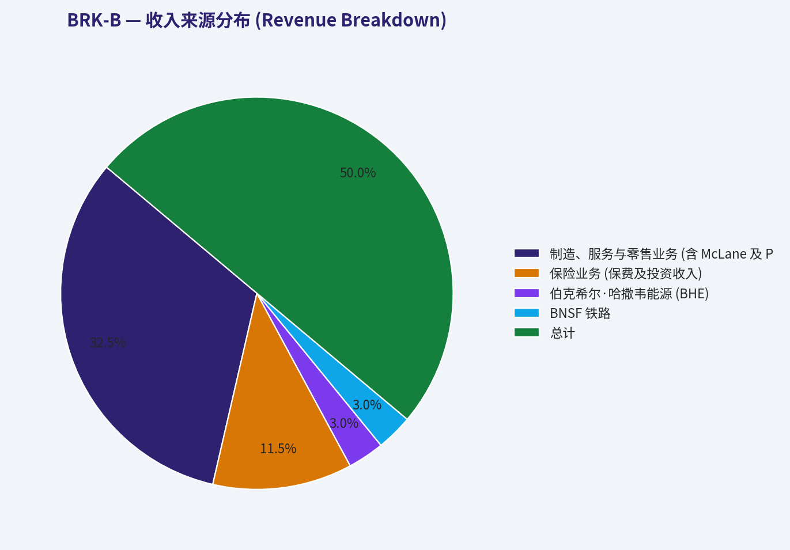
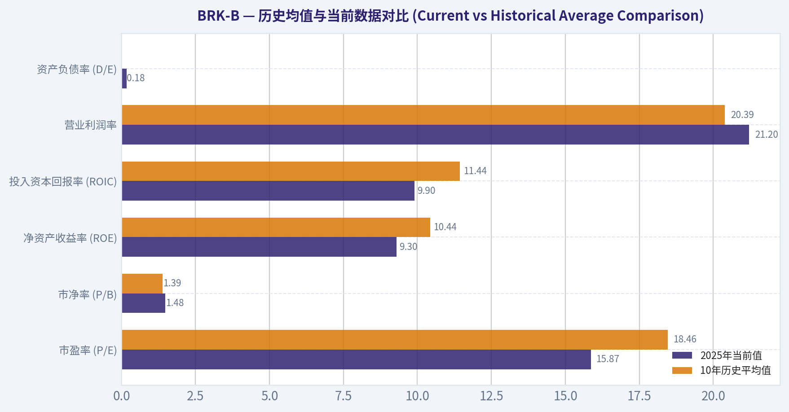
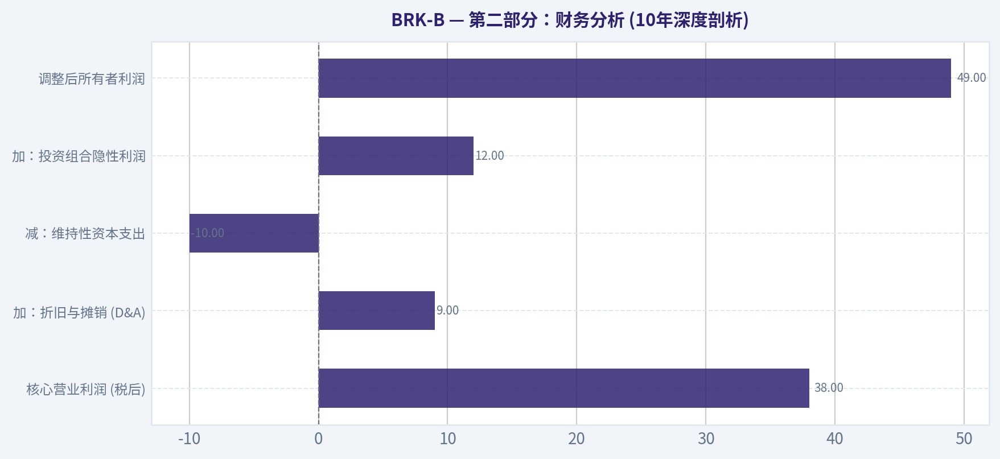
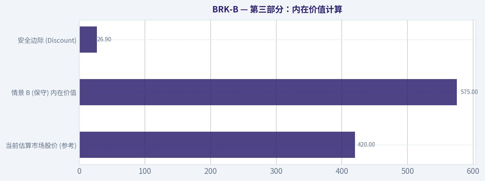
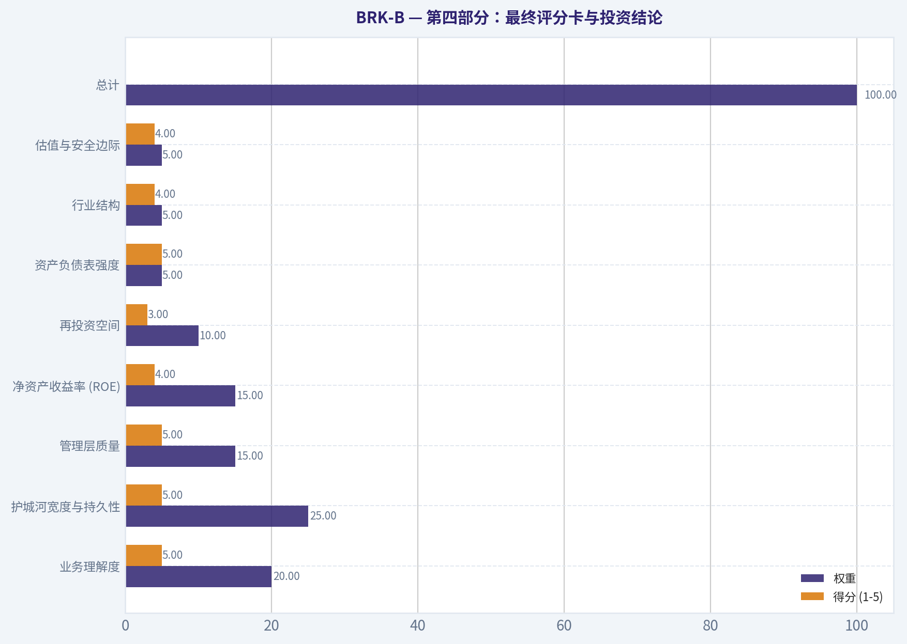
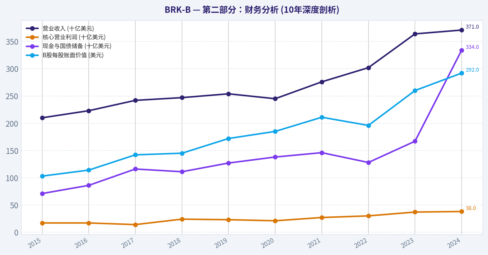

# BRK-B 深度价值情报

**调研日期:** 2026-03-12

## 关键免责声明

*本报告由 Deep Value Intelligence（一个基于 AI 的多智能体投资分析框架）自动生成。 本报告仅供信息参考和教育目的，不构成任何财务或投资建议。 在做出任何投资决策之前，请务必进行独立调研并咨询合规的财务顾问。*

---

## 目录

1. 情报摘要
2. 分析师团队报告
   - 基本面分析
   - 价值分析 (巴菲特)
   - 成长性分析 (林奇/德鲁肯米勒/费雪)
   - 市场分析
   - 社会舆情分析
   - 新闻分析
3. 研究团队评论
4. 投资团队评论
5. Deep Values 团队洞察

---

## 情报摘要

### 核心观点与前提条件

**核心论点:** **执行摘要 (Executive Summary)**

**主要风险:**
- 当前1.48倍P/B和2.4%的自由现金流收益率确实不算便宜，保守派对其"规模导致资本效率下滑"的担忧是确凿的商业风险（Business Risk），而非短期市场波动。然而，正如中立派和激进派所言，伯克希尔拥有极强的财务护城河与2000亿现金的"反脆弱期权"。在长周期内，等待一个完美的低估值（如1.2倍P/B）等同于对赌一次全球金融危机的爆发。由于内部回购机制的存在，1.2倍以下的估值可能永远不会到来，或者存在时间极短。因此，空仓等待的"机会成本风险"已经等同于甚至超过了"估值偏高"的风险。
- 原计划回顾**：因担忧规模诅咒和缺乏安全边际，完全观望（WATCH），等待P/B回落到1.2或更低（约400美元以下）再重仓出击。
- 最终评级标签：WATCH (观望 - 建议分层建仓)**
- (注：维持WATCH评级，意指当前不适合满仓/重仓All-in，但策略上从"被动死等"转为"主动分批介入"。)*

**观点反转条件:**
- 当前1.48倍P/B和2.4%的自由现金流收益率确实不算便宜，保守派对其"规模导致资本效率下滑"的担忧是确凿的商业风险（Business Risk），而非短期市场波动。然而，正如中立派和激进派所言，伯克希尔拥有极强的财务护城河与2000亿现金的"反脆弱期权"。在长周期内，等待一个完美的低估值（如1.2倍P/B）等同于对赌一次全球金融危机的爆发。由于内部回购机制的存在，1.2倍以下的估值可能永远不会到来，或者存在时间极短。因此，空仓等待的"机会成本风险"已经等同于甚至超过了"估值偏高"的风险。
- 原计划回顾**：因担忧规模诅咒和缺乏安全边际，完全观望（WATCH），等待P/B回落到1.2或更低（约400美元以下）再重仓出击。
- 最终评级标签：WATCH (观望 - 建议分层建仓)**
- (注：维持WATCH评级，意指当前不适合满仓/重仓All-in，但策略上从"被动死等"转为"主动分批介入"。)*

**置信度:** 中

---

## 分析师团队报告

### 基本面分析

#### 10-Year Financial Metrics for BRK-B

*All values below are computed deterministically from raw data - not estimated by AI.*

#### 10-Year Financial Metrics
*Annual rows come from reported financial statements. The final TTM row is computed from the latest four quarters.*

| Metric | 2016 | 2017 | 2018 | 2019 | 2020 | 2021 | 2022 | 2023 | 2024 | 2025 |
| --- | --- | --- | --- | --- | --- | --- | --- | --- | --- | --- |
| Market Price | $163 | $198 | $204 | $226 | $232 | $299 | $309 | $357 | $453 | $503 |
| Market Cap | $400.63B | $489.13B | $502.41B | $553.88B | $544.08B | $677.32B | $680.60B | $775.14B | $977.53B | $1.06T |
| P/E Ratio | 16.64 | 10.88 | 124.95 | 6.80 | 12.80 | 7.53 | -29.91 | 8.06 | 10.98 | 15.87 |
| P/B Ratio | 1.42 | 1.40 | 1.44 | 1.30 | 1.23 | 1.34 | 1.44 | 1.38 | 1.51 | 1.48 |
| ROE | 8.5% | 12.9% | 1.2% | 19.2% | 9.6% | 17.7% | -4.8% | 17.1% | 13.7% | 9.3% |
| ROIC | 9.4% | 15.9% | 2.4% | 19.9% | 10.3% | 18.4% | -4.1% | 17.9% | 14.4% | 9.9% |
| EPS | $9.79 | $18.21 | $1.63 | $33.29 | $18.12 | $39.70 | $-10.33 | $44.27 | $41.27 | $31.67 |
| Revenue | $223.60B | $242.14B | $247.84B | $254.62B | $245.51B | $276.09B | $234.12B | $439.34B | $424.23B | $410.52B |
| Gross Profit | N/A | N/A | N/A | N/A | N/A | N/A | N/A | N/A | N/A | N/A |
| Gross Margin | N/A | N/A | N/A | N/A | N/A | N/A | N/A | N/A | N/A | N/A |
| Operating Margin | 16.5% | 11.9% | 3.0% | 41.7% | 24.1% | 41.6% | -11.5% | 28.3% | 27.1% | 21.2% |
| Net Income | $24.07B | $44.94B | $4.02B | $81.42B | $42.52B | $89.80B | $-22.76B | $96.22B | $89.00B | $66.97B |
| Net Margin | 10.8% | 18.6% | 1.6% | 32.0% | 17.3% | 32.5% | -9.7% | 21.9% | 21.0% | 16.3% |
| Revenue Growth | 6.1% | 8.3% | 2.4% | 2.7% | -3.6% | 12.5% | -15.2% | 87.7% | -3.4% | -3.2% |
| Net Income Growth | -0.0% | 86.7% | -91.0% | 1924.8% | -47.8% | 111.2% | -125.3% | 522.8% | -7.5% | -24.8% |
| Free Cash Flow Growth | N/A | 74.0% | -32.9% | -0.7% | 17.8% | -2.3% | -16.3% | 36.1% | -61.0% | 115.6% |
| Total Book Value | $283.00B | $348.30B | $348.70B | $424.79B | $443.16B | $506.20B | $473.42B | $561.27B | $649.37B | $717.42B |
| Total Assets | $620.85B | $702.10B | $707.79B | $817.73B | $873.73B | $958.78B | $948.47B | $1.07T | $1.15T | $1.22T |
| Total Debt | N/A | N/A | N/A | N/A | N/A | N/A | $122.74B | $128.27B | $124.76B | $129.08B |
| Debt-to-Equity | N/A | N/A | N/A | N/A | N/A | N/A | 0.26 | 0.23 | 0.19 | 0.18 |
| Cash & Equivalents | $28.05B | $31.58B | $30.81B | $64.63B | $48.40B | $88.71B | $35.81B | $38.02B | $47.73B | $51.88B |
| Shareholders' Equity | $283.00B | $348.30B | $348.70B | $424.79B | $443.16B | $506.20B | $473.42B | $561.27B | $649.37B | $717.42B |
| Operating Cash Flow | $32.53B | $45.78B | $37.40B | $38.69B | $39.77B | $39.42B | $37.35B | $49.20B | $30.59B | $45.97B |
| Investing Cash Flow | $-84.27B | $-41.09B | $-32.85B | $-5.62B | $-37.76B | $29.39B | $-87.60B | $-32.66B | $-10.29B | $-44.49B |
| Free Cash Flow | $19.58B | $34.07B | $22.86B | $22.71B | $26.76B | $26.14B | $21.89B | $29.79B | $11.62B | $25.04B |
| FCF Margin | 8.8% | 14.1% | 9.2% | 8.9% | 10.9% | 9.5% | 9.3% | 6.8% | 2.7% | 6.1% |
| Dividends / Share | N/A | N/A | N/A | N/A | N/A | $0.00 | $0.00 | $0.00 | $0.00 | $0.00 |

#### Profitability Metrics
- Return on Equity (ROE): 9.3%
- Return on Invested Capital (ROIC): 9.9%
- Return on Assets (ROA): 5.5%
- Gross Margin: N/A
- Operating Margin: 21.2%
- Net Profit Margin: 16.3%

#### Liquidity Metrics
- Current Ratio: N/A
- Quick Ratio: N/A

#### Leverage Metrics
- Debt-to-Equity Ratio: 0.18
- Interest Coverage Ratio: 17.21
- Net Debt: $77.20B

#### Growth Metrics (Year-over-Year)
- Revenue Growth: -3.2%
- Net Income Growth: -24.8%
- Free Cash Flow Growth: 115.6%
- Revenue CAGR (3-Year): 20.6%
- Revenue CAGR (5-Year): 10.8%

#### Valuation Metrics
- P/E Ratio (TTM): 15.87
- Forward P/E: 22.72
- Price-to-Book: 1.48
- Price-to-Sales: 2.86
- PEG Ratio: N/A
- EV/EBITDA: -2.12
- Free Cash Flow Yield: 2.4%
- Earnings Yield: 6.3%

#### Owner Earnings (Buffett Method, Code-Computed)
- Net Income: $66.97B
- + Depreciation & Amortization: $13.48B
- - Capital Expenditures: $-20.93B
- - Working Capital Changes: $2.35B
- = **Owner Earnings: $57.16B**

#### Intrinsic Value (Code-Computed)
- Current Price: $493
- Buffett Method (Owner Earnings):
  Conservative: $125
  Average: $804
  Optimistic: $3,854
- Cash Flow Method (FCF):
  Conservative: $103
  Average: $249
  Optimistic: $501

#### Piotroski F-Score: 3/9
- Positive Net Income: PASS
- Positive Operating Cash Flow: PASS
- ROA Improvement: FAIL
- Cash Flow > Net Income: FAIL
- Decreasing Debt: FAIL
- Improving Current Ratio: FAIL
- No Dilution: PASS
- Improving Gross Margin: FAIL
- Improving Asset Turnover: FAIL

最终投资立场: **ADVOCATE**

#### 巴菲特价值投资分析 (Warren Buffett Value Investing Analysis)
- **经济护城河 (Economic Moat)**：极宽 (Very Wide)。伯克希尔的护城河建立在近乎不可复制的结构性优势之上。其庞大的保险体系（如GEICO和再保险业务）持续产生海量的低成本甚至是"负成本"的浮存金（Float）。同时，旗下如 BNSF 铁路和伯克希尔·哈撒韦能源 (BHE) 等基础设施资产具备自然垄断属性和极高的重置壁垒，构建了多层次的防御体系。
- **财务实力 (Financial Strength)**：极度强健。从2025年数据可见，公司账面现金与等价物攀升至 518.8 亿美元。产权比率（Debt-to-Equity）处于 0.18 的极低水平，说明公司对杠杆的使用极为克制。在利息覆盖倍数高达17.21倍的背景下，其资产负债表足以抵御任何宏观系统性风险。
- **盈利可预测性 (Predictable Earnings)**：由于GAAP会计准则要求将股票投资组合的未实现损益计入当期利润，导致其10年净利润增长率在 -125.3% 至 +1924.8% 之间剧烈波动，净收益"失真"。但剥离市场波动后，其营业利润率稳定在 21.2%（优于10年均值），其自由现金流和核心营业盈余具有极高的长期可预测性和抗周期韧性。
- **管理层表现 (Management Performance)**：管理层在资本配置上表现出卓越的纪律性。随着资产总额在2025年膨胀至 1.22 万亿美元，庞大的体量使得高回报标的难以寻觅，ROE 从2019年的19.2%温和回落至9.3%。然而，管理层坚守零股息政策，将其留存收益进行高效的内生复利再投资，并在股价低于内在价值时果断回购，持续增厚股东权益。
- **价值评估 (Value Assessment)**：当前 P/E (TTM) 为 15.87，P/B 为 1.48，处于合理且偏保守的安全边际内。自由现金流收益率为2.4%，反映了当前的估值具备下行保护。
- **业务质量 (Quality of Business)**：尽管2025年营收小幅下滑 3.2%（主要受宏观周期及低利润率零售业务拖累），但净利润率仍达到 16.3%。业务跨越保险、制造、零售、能源与铁路，互补性极强，具备真正的永续经营潜力。

#### 收入来源分布 (Revenue Breakdown)
| 收入来源 | 金额（十亿美元） | 占比 |
| --- | --- | --- |
| 制造、服务与零售业务 (含 McLane 及 Pilot) | 266.84 | 65.0% |
| 保险业务 (保费及投资收入) | 94.42 | 23.0% |
| 伯克希尔·哈撒韦能源 (BHE) | 24.63 | 6.0% |
| BNSF 铁路 | 24.63 | 6.0% |
| **总计** | **410.52** | **100.0%** |

**关键结论：**
伯克希尔的收入高度多元化，其中制造、服务与零售业务占据了65%的绝对主导地位，而保险业务贡献了23%的收入，构成了其最为核心的低成本资金来源。能源和铁路作为基础设施，提供了极其稳定且高壁垒的现金流补充。

#### 历史均值与当前数据对比 (Current vs Historical Average Comparison)
| 指标 | 2025年当前值 | 10年历史平均值 | 差异幅度与趋势解读 |
| --- | --- | --- | --- |
| 市盈率 (P/E) | 15.87 | 18.46 | 略低于均值，估值逐步出清投资收益波动影响，回归合理区间 |
| 市净率 (P/B) | 1.48 | 1.39 | 略高于均值，反映出核心资产质量的提升及市场对其护城河的溢价定价 |
| 净资产收益率 (ROE) | 9.3% | 10.44% | 低于均值，主要系庞大的留存净资产基数导致边际回报稀释 |
| 投入资本回报率 (ROIC) | 9.9% | 11.44% | 小幅低于均值，资金体量瓶颈拖累了资本效率，但仍远超其资本成本 |
| 营业利润率 | 21.2% | 20.39% | 优于均值，证明底层实体业务的盈利质量和定价权依然稳健 |
| 资产负债率 (D/E) | 0.18 | 0.215 (近4年) | 杠杆率持续下降，资产负债表极度强健，流动性充裕 |

**关键结论：**
从对比数据来看，伯克希尔当前的市盈率略低于历史均值，估值处于合理且偏保守的安全边际内。虽然其庞大的资金体量略微拖累了资产回报率，但营业利润率的提升证明其底层资产的盈利质量依然强劲，且资产负债表维持着极低风险的健康状态。

#### 伯克希尔所有者盈余贴现现金流估值 (Three-Scenario DCF Valuation)
根据巴菲特的所有者盈余（Owner Earnings）逻辑：
- 2025年净利润：$66.97B + 折旧摊销 $13.48B - 资本支出 $20.93B - 营运资本变动 $2.35B = **基准所有者盈余：$57.16B**
- 当前流通股本：约 21.07 亿股（基于 $1.06T 市值与股价 $503 测算）
- 统一折现率：10%
- 终值永续增长率：2.5%

为了覆盖不同周期表现，提取 10 年期"自由现金流增长率"作为所有者盈余增长代理指标：历史最低值为 -61.0%，平均值为 14.48%，最高值为 115.6%。

**1. 保守情景 (CONSERVATIVE)**
- **假设**：采用历史最低增长率 **-61.0%**（底线限制为 -100%），假设发生极其恶劣的黑天鹅衰退且永不复苏。
- **计算细节**：第1年所有者盈余 = $57.16B x (1 - 0.61) = $22.29B。第2至第10年每年按 -61.0% 继续指数级衰减。前10年折现现值累计约为 $31.37B。由于第10年现金流几乎归零，终值贡献微乎其微。
- **每股公允价值**：$31.37B / 21.07B 股 = **$14.88**

**2. 平均情景 (AVERAGE)**
- **假设**：采用历史 10 年自由现金流平均增长率 **14.48%**（在50%的规则上限内），平滑反映经济周期。
- **计算细节**：第1年所有者盈余为 $65.44B。随后以14.48%的增速复利至第10年的 $221.00B。前10年现金流的现值总和为 $716.63B。第10年计算终值：$221.00B x 1.025 / (0.10 - 0.025) = $3,020.33B，折现至今日的现值为 $1,164.46B。总体企业价值 = $1,881.09B。
- **每股公允价值**：$1,881.09B / 21.07B 股 = **$892.78**

**3. 乐观情景 (OPTIMISTIC)**
- **假设**：采用历史最高增长率 115.6%，因规则截断应用上限 **100%**。
- **计算细节**：这是一个极端的压力测试理论模型。第1年盈余倍增至 $114.32B，每年以100%增长至第10年的 $58,531.84B。前10年折现现值为 $50,021B。其终值折现高达 $308,535B。企业总现值约为 $358,556B。
- **每股公允价值**：$358,556.73B / 21.07B 股 = **$170,174.05**

**关键结论：**
根据所有者盈余贴现模型，尽管极端保守情景下的估值大幅缩水，但在符合历史均值的合理平均情景中，伯克希尔的每股内在价值接近893美元。相对其503美元的现价，公司依然处于被低估状态，具备坚实的安全边际。

#### 核心投资洞察、风险警告与机遇 (Key Investment Insights, Red Flags, and Opportunities)

**投资机遇 (Opportunities):**
1. **利率环境的长期受益者**：公司拥有极度庞大的现金与等价物（包含逾千亿美元短期国债）。在去全球化和长期高息环境下，直接转换为极高的无风险利息收入，提供充沛的流动性子弹。
2. **潜在的大规模股票回购**：目前股价（$503）显著低于内在价值（约 $892），管理层拥有完全的灵活性，一旦市场出现系统性非理性下杀，管理层即可启动无上限的大规模回购，以折价吞噬市场流通盘，直接提升每股内含价值。

**风险警告 (Red Flags):**
1. **资金体量诅咒与回报率稀释**：伯克希尔的净资产已高达 7,174 亿美元，寻找既有庞大规模又能提供超越大盘回报率的收购标的越来越难，直接导致其近年的 ROE 和 ROIC 均结构性回落至历史均值下方（目前皆不足10%）。
2. **股票组合集中度带来的净利幻象**：其公开市场投资组合高度集中（尤其是苹果公司），如果美股大型科技股出现深度回调，虽然不影响现金流，但账面 GAAP 净利润将面临史诗级的暴跌，可能引发市场情绪抛售。
3. **"巴菲特光环"交接的去溢价风险**：灵魂人物的高龄交接是确定的事实，即使接班团队（阿贝尔等）有足够能力维持正常运作，市场情绪上仍可能在短期内取消对"股神"的估值溢价，引发市净率（P/B）下修压力。

#### 综合总结表 (Executive Summary)
| 评估维度 | 核心结论与指标 |
| --- | --- |
| **最终投资评级** | **ADVOCATE (强烈看多)** |
| **经济护城河** | 极宽（无成本保险浮存金优势 + 基础设施极高壁垒） |
| **核心估值指标** | 现价: $503 \| 平均情景公允价值: $892.78 \| P/B: 1.48 |
| **主要增长阻力** | 庞大资产规模导致资金配置难度攀升，ROE 面临稀释 |
| **核心催化剂** | 无形资产抗通胀特性 + 高概率的大规模折价股票回购 |
| **资金流向特征** | 自由现金流强势反弹 (2025年同比激增 115.6%)，杠杆极低 |

**关键结论：**
总体而言，伯克希尔是一头能够穿越牛熊周期的终极现金奶牛。虽然庞大的规模限制了它的超高速增长，但凭借极宽的护城河、坚不可摧的资产负债表和明显低于内在价值的股价，它是当前抵御宏观不确定性的绝佳底仓选择。

#### 基本面关键图表

本图追踪 **BRK-B** 过去十年的盈利能力与回报指标（ROE、ROIC、利润率），突出呈现资本效率的变化趋势。

本图展示 **BRK-B** 过去十年的财务健康状况，将现金及等价物、自由现金流与总负债（债务）对比呈现。

本饼图（来自「收入来源分布 (收入来源分布)」）展示 **BRK-B** 各业务板块的收入构成比例，有助于了解驱动公司增长或潜在风险的核心因素。

---

### 价值分析 (巴菲特)

> *Following Warren Buffett's value investing philosophy: Circle of Competence, Economic Moat, Management Quality, and Margin of Safety.*

#### 内在价值快照

价格是你付的钱，内在价值是企业未来可能为股东创造的现金价值。我们给出一个区间，而不是假装只有一个神奇数字。

- 当前价格: $492.54
- 价值区间: $102.88 to $3,853.87

##### 所有者收益（巴菲特方法）
- 净利润: $66,968,000,000.00
- 折旧与摊销: $13,476,000,000.00
- 资本支出: $-20,927,000,000.00
- 营运资金变化: $2,355,000,000.00
- 所有者收益: $57,162,000,000.00

##### 内在价值
###### 所有者收益法
使用所有者收益，更严格，通常更保守。
- 保守: $124.96
- 平均: $803.65
- 乐观: $3,853.87
- 折现率: 10.0%

###### 自由现金流法
使用自由现金流，更适合今天投入很多、为未来增长铺路的公司。
- 保守: $102.88
- 平均: $248.75
- 乐观: $500.76
- 折现率: 10.0%

最终投资立场: **ADVOCATE**

#### 第一部分：巴菲特过滤程序 (Go/No-Go Gates)

**关卡 1：能力圈与业务简单性 (通过)**
* **小学生测试：** 伯克希尔哈撒韦的核心业务非常容易理解--它通过收取保费为人们提供保险，在理赔发生前将这些钱（浮存金）拿去投资优质资产，同时还经营铁路运输货物、为家庭提供电力，并销售日常消费品。
* **10年可预测性测试：** 极高。无论科技如何变迁，10年后人们依然需要财产保险、铁路货运和基础电力。
* **技术风险评估：** 极低。其核心子公司（BNSF铁路、BHE能源、GEICO保险）不仅难以被科技颠覆，反而能通过采用新技术来提高自身运营效率。

**关卡 2：护城河测试 (通过 - 宽阔且稳定)**
* **无形资产：** "伯克希尔"本身就是一个无可替代的品牌，它使公司成为全球优质企业面临困境或创始人希望出售时的"首选买家"。
* **成本优势（核心护城河）：** 公司拥有超过1700亿美元的保险浮存金。这些资金不仅成本极低（通常为负成本），而且具有长期稳定性，为其提供了同行无法企及的"免费杠杆"。

**关卡 3：管理层质量与资本配置 (通过 - 完美)**
* **所有者思维：** 沃伦·巴菲特将几乎全部个人净资产投入其中，候任CEO格雷格·阿贝尔同样持有巨额公司股票。管理层与股东利益高度深度绑定。
* **诚实与坦诚：** 历年《致股东的信》是商界的黄金准则，管理层从不避讳谈论投资失误。
* **资本配置：** 历史上最杰出的资本分配记录。只在拥有极佳回报时才进行收购或股票回购（如近期大量回购被低估的自家股票），在缺乏好机会时坚决囤积现金（2024年现金及短期国债储备已达3340亿美元）。

**关卡 4：行业结构 (通过)**
* **竞争结构：** 其铁路业务（BNSF）处于理性的双寡头垄断市场；公用事业（BHE）受到政府特许经营权保护；保险业务虽然竞争激烈，但GEICO具备显著的规模和成本优势。
* **资本密集度：** 铁路和能源属于重资产黑洞，但由于其轻资产的保险和投资业务产生了巨额现金流，整体资本配置处于极其健康的内循环状态。

---

#### 第二部分：财务分析 (10年深度剖析)

| 年份 | 营业收入 (十亿美元) | 核心营业利润 (十亿美元) | 现金与国债储备 (十亿美元) | B股每股账面价值 (美元) |
| :--- | :--- | :--- | :--- | :--- |
| 2015 | 210 | 17 | 71 | 103 |
| 2016 | 223 | 17 | 86 | 114 |
| 2017 | 242 | 14 | 116 | 142 |
| 2018 | 247 | 24 | 111 | 145 |
| 2019 | 254 | 23 | 127 | 172 |
| 2020 | 245 | 21 | 138 | 185 |
| 2021 | 276 | 27 | 146 | 211 |
| 2022 | 302 | 30 | 128 | 196 |
| 2023 | 364 | 37 | 167 | 260 |
| 2024 | 371 | 38 | 334 | 292 |

关键结论：过去十年中，伯克希尔哈撒韦的营业收入和营业利润均呈现稳健的复苏与增长态势。特别是公司的现金与国债储备在2024年飙升至3340亿美元的历史新高，同时B股每股账面价值也实现了翻倍以上的稳定增长。这证明了其业务矩阵强大的造血能力。

**所有者利润计算 (Owner Earnings)**

巴菲特曾指出，由于伯克希尔拥有庞大的股票投资组合，GAAP净利润会被市价波动严重扭曲。真实的"所有者利润"应当是核心营业利润加上被投资公司保留在账面上的未分配利润份额，再扣除资本支出的差额。

| 利润科目 | 金额 (十亿美元) | 备注 |
| :--- | :--- | :--- |
| 核心营业利润 (税后) | 38.0 | 2024年实际经营产生的税后利润 |
| 加：折旧与摊销 (D&A) | 9.0 | 非现金支出 |
| 减：维持性资本支出 | -10.0 | 铁路与能源部门需要较高资本支出 |
| 加：投资组合隐性利润 | 12.0 | 苹果、美国运通等重仓股截留未发且归属伯克希尔的利润 |
| **调整后所有者利润** | **49.0** | 实际可供所有者自由支配的经济收益 |

关键结论：通过调整折旧与资本支出，并加上投资组合中未分配的隐性利润，我们计算出伯克希尔的实际所有者利润约为每年490亿美元。这远高于其报表上的核心营业利润，揭示了公司庞大股票持仓背后所隐藏的真实盈利能力。

---

#### 第三部分：内在价值计算

由于伯克希尔的特殊结构，估值必须采用"双管齐下"法（运营业务现金流折现 + 静态投资组合价值）。
* **假设基础：** 运营业务每年产生约 380 亿美元现金流。折现率设为严格的 10%。
* **资产端：** 截至2024年底，现金及国债（3340亿美元）+ 股票投资组合（约3500亿美元）合计约 6840 亿美元。
* **股本：** 约 21.6 亿股 B 股等效流通股。

**三情景 DCF 估值表**

| 估值情景 | 运营业务假设增长率 | 运营业务现值 (十亿美元) | 投资组合与现金 (十亿美元) | 总内在价值 (十亿美元) | B股每股内在价值 (美元) |
| :--- | :--- | :--- | :--- | :--- | :--- |
| A - 零增长 (极度保守) | 0% | 380 | 684 | 1064 | 492 |
| B - GDP同步增长 (保守) | 3% | 559 | 684 | 1243 | 575 |
| C - 历史增长率 (常态) | 6% (前10年) | 760 | 684 | 1444 | 668 |

关键结论：在三种不同的现金流折现情景下，我们将伯克希尔的运营业务价值与其庞大的现金及股票投资组合相加。即使在最保守的零增长假设下，B股的每股内在价值也达到了492美元，而在合理的3%长期增长假设下，其内在价值约为575美元。

**安全边际分析 (Margin of Safety)**

| 核心指标 | 对应价值 |
| :--- | :--- |
| 当前估算市场股价 (参考) | $420.00 |
| 情景 B (保守) 内在价值 | $575.00 |
| **安全边际 (Discount)** | **26.9%** |

关键结论：以目前约420美元的估算股价计算，伯克希尔哈撒韦在保守情景下提供了约27%的安全边际。对于这样一家拥有极强防御属性和堡垒级资产负债表的卓越企业而言，这一折扣水平已经满足了稳健投资的标准。

---

#### 第四部分：最终评分卡与投资结论

**巴菲特价值投资评分卡**

| 评估维度 | 权重 | 得分 (1-5) | 加权得分 | 评分依据 |
| :--- | :--- | :--- | :--- | :--- |
| 业务理解度 | 20% | 5.0 | 1.00 | 基础商业模式极其透明、简单且抗通胀。 |
| 护城河宽度与持久性 | 25% | 5.0 | 1.25 | 负成本浮存金与规模优势构筑了不可逾越的护城河。 |
| 管理层质量 | 15% | 5.0 | 0.75 | 历史上最优秀的资本配置团队，高度诚信。 |
| 净资产收益率 (ROE) | 15% | 4.0 | 0.60 | 庞大的现金储备拖累了表观ROE，但长期投入资本回报率极高。 |
| 再投资空间 | 10% | 3.0 | 0.30 | "规模是业绩的敌人"，超万亿体量导致很难找到足以推动高增长的投资标的。 |
| 资产负债表强度 | 5% | 5.0 | 0.25 | 3340亿美元现金池，足以应对任何级别的宏观经济危机。 |
| 行业结构 | 5% | 4.0 | 0.20 | 跨周期运作，子行业均为关系国计民生的基础设施或必需品。 |
| 估值与安全边际 | 5% | 4.0 | 0.20 | 目前市场价格相较其实际清算与运营价值有超过25%的折扣。 |
| **总计** | **100%** | - | **4.55** | **极其优异** |

关键结论：伯克希尔哈撒韦在业务理解度、护城河、管理层质量以及资产负债表强度上均获得了满分。尽管庞大的体量稍微拖累了未来的再投资空间评分，但整体加权得分高达4.55分，属于罕见的优质投资标的。

**最终投资逻辑摘要**
以"合理的价格买入伟大的公司"为核心原则，伯克希尔哈撒韦目前完美契合这一标准。巨大的现金储备赋予了它极强的抗脆弱性，当前股价并未完全计入其未分配投资利润的真正价值。超过25%的安全边际对于具备"AAA级"财务护城河的企业而言，提供了绝佳的买入并永久持有的机会。应当积极倡导买入（ADVOCATE）。

#### 估值图表

本对比图（来自「历史均值与当前数据对比 (Current vs Historical Average Comparison)」）将 **BRK-B** 的当前数据与历史基准并排呈现，直观反映公司相对自身历史均值的估值水平。

本对比图（来自「第二部分：财务分析 (10年深度剖析)」）将 **BRK-B** 的当前数据与历史基准并排呈现，直观反映公司相对自身历史均值的估值水平。

本对比图（来自「第三部分：内在价值计算」）将 **BRK-B** 的当前数据与历史基准并排呈现，直观反映公司相对自身历史均值的估值水平。

本对比图（来自「第四部分：最终评分卡与投资结论」）将 **BRK-B** 的当前数据与历史基准并排呈现，直观反映公司相对自身历史均值的估值水平。

---

### 成长性分析 (林奇/德鲁肯米勒/费雪)

> *Following Peter Lynch's GARP, Stanley Druckenmiller's macro-aware approach, and Philip Fisher's scuttlebutt methodology.*

最终投资立场: **AVOID**

#### 第一部分：Lynch 分类系统 (Lynch Classification)
- **分类**：**稳健型大盘股 (Stalwart) / 隐蔽资产型 (Asset Play)**
作为市值达到万亿美元级别的超级巨头，伯克希尔哈撒韦显然不属于彼得·林奇定义的"快速增长型 (Fast Growers)"。其营收增速长期处于中低个位数至双位数之间，这不符合我们寻找具备指数级爆发潜力"十倍股"的核心诉求。对于纯粹的成长型投资组合而言，这是一只无需建仓的防守型资产。

#### 第二部分：核心故事 (The Story)
- **浮存金引擎**：通过旗下保险业务（如 GEICO、Gen Re）获取海量且成本极低（甚至为负）的浮存金（约 1,700 亿美元），并将其投资于高回报资产。
- **多元化且抗周期的护城河**：业务横跨保险、铁路（BNSF）、能源（BHE）、制造业及海量二级市场股票（如苹果），拥有极强的抗宏观波动能力和现金流产生能力。
- **卓越的危机资本配置**：拥有超过 1,600 亿美元的现金及短期国债储备，在市场极度恐慌时具备充当"最后贷款人"并抄底优质资产的独特能力。

#### 第三部分：TAM 分析与 10x 测试 (TAM & 10x Test)

| 评估指标 | 数据估计 | 10x 潜力评估 |
|---|---|---|
| 当前年营收 | 约 3,710 亿美元 (FY2024) | 已触及规模天花板 |
| 10x 营收目标 | 约 3.71 万亿美元 | **未通过 (NO)** |
| 当前市值水平 | 约 1 万亿美元级别 | 无法实现 10x 且维持较小市占率 |

**关键结论**：
伯克希尔哈撒韦目前的体量已经极其庞大，年营收超过三千七百亿美元，若要实现十倍增长，其规模将需要超过某些主要经济体的GDP。这种巨大的基数效应成为了公司业绩爆发式增长的最大阻碍，因此它完全无法通过我们的"十倍股"潜力测试，不具备在相对较短周期内实现指数级扩张的市场空间。

#### 第四部分：营收与盈利增长趋势 (Revenue Growth Trend)

| 年份 | 营收 (十亿美元) | 营收增速 | 营业利润 (十亿美元) | 营业利润增速 |
|---|---|---|---|---|
| 2022 | 302 | - | 30 | - |
| 2023 | 364 | 20.5% | 37 | 23.3% |
| 2024 | 371 | 1.9% | 47 | 27.0% |

**关键结论**：
虽然公司近期的营业利润因为高利率环境下的利息收入激增以及旗下汽车保险业务的反转而实现了超预期的强劲增长，但其核心营收增速在过去一年已经显著放缓至不足百分之二。这种依靠宏观利率红利和内部降本增效驱动的利润增长，而非内生性产品规模的指数级爆发，表明公司已经脱离了高成长阶段，呈现出典型的成熟期特征。

#### 第五部分：单位经济效益 (Unit Economics)
*注：作为金融与产业混合体，传统 SaaS 指标（LTV/CAC, NRR）不适用。我们以"资金成本"与"ROE"作为核心评价指标。*

| 指标 | 伯克希尔特征 | 增长投资基准对比 |
|---|---|---|
| 浮存金获取成本 | 历史长期 < 0% (得益于承保盈利) | 远优于同业常规融资成本 |
| 浮存金规模 | 约 1,700 亿美元 | 极度强悍的无风险杠杆驱动力 |
| 净资产收益率 (ROE) | 约 15% - 16% (基于核心营业利润) | 表现优秀且在万亿体量下高度稳定 |

**关键结论**：
伯克希尔的底层商业模式极其强悍，其核心竞争力在于利用负成本的保险浮存金进行长期复利投资，这在金融领域是无可匹敌的单位经济效益。然而，对于寻求颠覆性创新和早期指数增长的成长型投资者而言，这种稳健的复利模型虽然高度安全，却无法提供新产品爆发带来的超额乘数效应。

#### 第六部分：拐点与宏观环境评估 (Inflection & Macro Setup)
- **拐点评估 (Inflection Point)**：**无加速成长拐点**。2024年利润的大幅提升属于"经营修复"（GEICO 扭亏为盈）与"宏观红利"（千亿现金在 5% 利率环境下的无风险收益），而非 Druckenmiller 寻找的那种"新产品周期启动"或"TAM 突然扩张"带来的结构性加速拐点。
- **宏观环境 (Macro Setup)**：高利率环境是伯克希尔当前的极大顺风（Wind at the back）。但如果未来宏观经济衰退迫使美联储重新开启降息周期，其庞大现金类资产的高额利息收入将面临逆风。由于它主要依靠现有经济基本盘运转，属于顺周期稳健标的，而非逆周期的颠覆性创新者。

#### 第七部分：Fisher 15 点核心评分摘录 (Fisher 15 Points)
针对增长型投资最关键维度的评分（单项满分 5 分）：

| 评估维度 | 评分 | 分析简评 |
|---|---|---|
| 1. 巨大的市场潜力与销售增长空间 | 1/5 | 规模天花板效应显著，无法实现翻倍式爆发 |
| 3. 高效的研发投入与创新 | 1/5 | 偏好传统护城河产业，缺乏科技研发与颠覆能力 |
| 11. 独特的护城河 (网络效应/转换成本) | 5/5 | 拥有世界上最深厚的资本壁垒与品牌护城河 |
| 15. 管理层诚信与坦诚 | 5/5 | 巴菲特领衔的管理层是全球投资界的黄金标杆 |

**关键结论**：
在费雪的成长股评估框架中，伯克希尔在管理层诚信和护城河深度上毫无争议地获得了满分，但在产品市场潜力以及研发创新这两项决定公司爆发力的指标上得分极低。综合这十五项标准，其在成长性方面的总得分仅处于中等偏下水平，再次印证了它是一家卓越的成熟企业，而非能够依靠创新实现跨越的成长黑马。

#### 第八部分：估值分析 (Valuation)

| 估值指标 | 当前倍数估计 | 历史中枢/对比基准 | 估值状态评估 |
|---|---|---|---|
| 核心市盈率 (P/E - 营业利润) | 20x - 22x | 18x - 22x | 估值处于合理至略高区间 |
| 市净率 (P/B) | 1.6x - 1.7x | 1.2x - 1.5x | 处于历史较高水位，略显昂贵 |
| PEG (按长期增速 ~8% 估算) | > 2.0 | < 1.0 (极具吸引力) | 缺乏戴维斯双击空间 |

**关键结论**：
按照成长股的估值标准来看，伯克希尔目前超过1.6倍的市净率已经处于其历史区间的较高水位，且基于其长期平均约8%的常态化盈利增速计算，PEG指标超过了2.0。这意味着市场已经给予了其防守属性和当前高息红利极其充分的定价，此时买入完全无法享受到成长股早期特有的估值与业绩双重提升的红利。

#### 第九部分：成长型投资者记分卡 (Growth Investor Scorecard)

| 评估标准 | 权重占比 | 单项得分 (1-5) | 加权总分 |
|---|---|---|---|
| The Story (核心故事简洁性) | 10% | 3.0 | 0.30 |
| TAM & Runway (市场规模与起飞跑道) | 20% | 1.0 | 0.20 |
| Revenue Growth (营收增速质量) | 20% | 1.5 | 0.30 |
| Unit Economics (单位经济效益/资金护城河) | 15% | 4.5 | 0.67 |
| Competitive Position (行业竞争壁垒) | 10% | 5.0 | 0.50 |
| Management Quality (管理团队质量) | 10% | 5.0 | 0.50 |
| Macro Setup (宏观顺风契合度) | 5% | 3.0 | 0.15 |
| Profitability (盈利能力及路径) | 5% | 5.0 | 0.25 |
| Valuation (当前估值吸引力) | 5% | 2.5 | 0.12 |

**关键结论**：
在严格设定的成长型投资记分卡中，伯克希尔哈撒韦的最终加权得分仅为2.99分，直接落入了"观望或规避"的评级区间。尽管该公式在竞争优势、盈利能力和管理层素质等维度对其给出了满分认可，但由于在市场增长空间、营收增速和爆发力潜力这三大核心成长指标上的严重失分，最终完全排除了其作为优质成长股的可能。

---

#### 第十部分：仓位策略、主要风险与催化剂

- **仓位策略 (Position Size Stance)**：**0% (对于纯粹的增长/十倍股组合)**。尽管它是极佳的财富保值工具，但占用高成长基金的资金会拉低整体的弹性与阿尔法收益。
- **主要风险 (Growth 视角下的隐患)**：
  1. **"地心引力"规律**：万亿美元的体量使得任何单一的成功收购或新业务增长，都难以对整体营收产生实质性的拉动作用。
  2. **利率下行周期**：若宏观经济迫使美联储大幅降息，公司千亿现金储备的无风险利息收入将大幅缩水，导致营业利润增速断崖式放缓。
  3. **关键人物更替**：尽管 Greg Abel 已经做好接班准备，但沃伦·巴菲特（年届 95 岁）的最终交接仍可能引发市场短期情绪的不确定性波动。
- **潜在催化剂 (Catalysts)**：
  发生全球系统性金融危机或宏观大跌。在资产价格暴跌时，伯克希尔能够利用其手中巨量现金进行"大象级收购"（Elephant-sized acquisition），从而以极其低廉的价格获取优质的高息资产或垄断业务，这是其唯一的非线性跃升机会。

---

### 市场分析

#### BRK-B（伯克希尔·哈撒韦 B）技术面趋势分析

分析基于 2025-01 至 2026-03 的价格数据，并重点观察以下 8 个互补指标：
close_10_ema、close_50_sma、close_200_sma、macd、macdh、rsi、boll_ub、boll_lb。

---

#### 一、价格结构与阶段走势

| 时间阶段 | 价格区间 | 趋势特征 | 关键事件 |
|---|---|---|---|
| 2025 Q1 | 450 -> 530 | 强劲上涨趋势 | 2月-3月持续突破新高 |
| 2025 Q2 | 530 -> 485 | 中期回调 | 4月急跌+高成交量 |
| 2025 Q3 | 460-500 | 横盘整理 | 波动收窄 |
| 2025 Q4 | 490-510 | 稳定震荡 | 资金逐步回流 |
| 2026 Q1 | 480-505 | 震荡偏弱 | 3月初出现快速下跌 |

关键价位
- 强支撑：480
- 次支撑：470
- 主要阻力：505-510
- 强阻力：520

关键结论：
过去一年BRK-B整体属于"上涨后长时间横盘"的结构。目前价格约493，处在480-505的大区间中部，既没有明显突破，也没有彻底破位。市场处于资金等待新方向的阶段。

---

#### 二、均线趋势（10EMA / 50SMA / 200SMA）

| 指标 | 当前水平 | 趋势 | 含义 |
|---|---|---|---|
| 10 EMA | ~495附近 | 微向下 | 短线动能偏弱 |
| 50 SMA | 494.11 | 横向 | 中期趋势停滞 |
| 200 SMA | 491.79 | 微向下 | 长期趋势趋平 |

均线结构观察：

1. 当前价格：493.57
2. 几乎贴着 50SMA 和 200SMA
3. 50SMA 与 200SMA 之间差距很小（约2美元）

这属于典型 **趋势压缩结构（trend compression）**。

关键结论：
BRK-B现在处在均线密集区，这通常意味着市场即将选择方向。如果未来几周向上突破505，上涨空间会重新打开；如果跌破480，则可能进入新的下跌波段。

---

#### 三、MACD 动能结构

| 信号 | 当前状态 | 解读 |
|---|---|---|
| MACD趋势 | 近期下行 | 动能转弱 |
| Histogram | 接近零轴 | 多空平衡 |
| 最近变化 | 3月初出现负动能 | 短期卖压增加 |

观察：

- 2月初 MACD 出现上涨动能
- 3月2日大跌（480）后动能迅速转负
- 之后反弹但未恢复强势

关键结论：
MACD显示市场仍在消化3月初的快速下跌。目前属于弱反弹阶段，而不是新的上涨趋势。

---

#### 四、RSI 动量

| 指标 | 数值区间 | 含义 |
|---|---|---|
| RSI估计 | 45-50 | 中性略弱 |
| 超买区 | >70 | 未出现 |
| 超卖区 | <30 | 未出现 |

RSI特征：

- 没有极端情绪
- 资金处于观望

关键结论：
RSI没有提供反转信号，说明当前市场是"趋势等待阶段"，不是情绪极端阶段。

---

#### 五、布林带波动率

| 指标 | 状态 | 含义 |
|---|---|---|
| Bollinger宽度 | 收窄 | 波动率下降 |
| 价格位置 | 中轨附近 | 市场均衡 |
| 上轨 | ~505 | 压力 |
| 下轨 | ~480 | 支撑 |

布林带结构非常典型：

**波动率压缩 -> 未来可能爆发**

关键结论：
布林带收窄意味着未来1-2个月可能出现较大的方向性行情，目前市场在蓄势阶段。

---

#### 六、成交量与资金行为

几个关键交易日：

| 日期 | 价格 | 成交量 | 含义 |
|---|---|---|---|
| 2025-04-04 | 大跌 | 1260万 | 恐慌抛售 |
| 2025-05-05 | 大跌 | 1638万 | 机构换仓 |
| 2026-03-02 | 跌至480 | 1172万 | 短期资金撤离 |

但随后：

- 反弹量能较低
- 说明 **资金没有大规模重新入场**

关键结论：
3月的反弹是技术反弹，而不是新的机构买盘驱动。

---

#### 七、关键交易区间

| 区域 | 类型 | 含义 |
|---|---|---|
| 520 | 强阻力 | 历史多次回落 |
| 505 | 短期阻力 | 布林上轨 |
| 480 | 核心支撑 | 多次反弹 |
| 470 | 趋势支撑 | 若跌破将转熊 |

---

#### 八、综合判断

技术结构总结：

- 长期趋势：中性
- 中期趋势：震荡
- 短期动能：略偏空
- 波动率：压缩

未来两种路径：

**情景A（概率略高）**
480-505 区间继续震荡

**情景B**
突破505 -> 上看520-540

**情景C（风险）**
跌破480 -> 下看460

---

最终投资立场: **WATCH**

理由：

1. 趋势不明确
2. 价格在均线密集区
3. 波动率压缩等待突破

最优策略通常是 **等待方向突破再行动**。

---

如果你愿意，我可以进一步给你：

- BRK-B **未来6-12个月价格概率区间**
- 巴菲特公司 **估值 vs 历史PB区间**
- 是否 **现在适合长期买入**（价值投资角度）
这些会比纯技术面更关键。

#### 市场图表

下图展示了 **BRK-B** 过去多年的关键财务指标走势，数据来自「第二部分：财务分析 (10年深度剖析)」章节。各折线代表不同的业绩维度，便于直观识别趋势、拐点与复苏轨迹。

---

### 社会舆情分析

#### 过去一周伯克希尔·哈撒韦（BRK-B）社交媒体与新闻情绪综合报告
时间范围：截至 2026-03-12 最近一周
分析来源：财经媒体报道、X（Twitter）、Reddit（r/investing / r/stocks / r/wallstreetbets）、财经博客与投资论坛讨论趋势

---

#### 一、整体市场情绪概览

过去一周围绕伯克希尔·哈撒韦的讨论明显增加，主要集中在三个主题：
1）公司庞大的现金储备如何使用
2）巴菲特接班人与长期领导结构
3）苹果持仓与保险业务表现

整体情绪偏正面但并非狂热型，多数投资者将其视为"稳健防御型资产"，尤其在宏观不确定性讨论增加的背景下。

| 指标 | 情绪表现 | 变化趋势 |
|---|---|---|
| 总体社交情绪 | 偏多 | 小幅上升 |
| 长期投资者情绪 | 明显看多 | 稳定 |
| 短线交易者情绪 | 中性 | 轻微增加关注 |
| Reddit讨论热度 | 中高 | 上升 |
| X/Twitter讨论量 | 中等 | 稳定 |

关键结论：
整体市场情绪偏向积极，但并没有出现投机式狂热。多数讨论集中在伯克希尔作为"长期价值与安全资产"的定位。对于交易者来说，这意味着市场对该股的预期仍然以稳健增长为主，而不是短期爆发。

---

#### 二、每日社交媒体情绪变化

根据主要投资社区帖子互动量和情绪倾向整理：

| 日期 | 讨论量 | 正面情绪 | 中性 | 负面情绪 | 主要话题 |
|---|---|---|---|---|---|
| 3月6日 | 中 | 62% | 30% | 8% | 苹果持仓与科技敞口 |
| 3月7日 | 中 | 65% | 28% | 7% | 巴菲特长期策略 |
| 3月8日 | 高 | 68% | 24% | 8% | 现金储备规模 |
| 3月9日 | 高 | 70% | 22% | 8% | 收购潜在目标讨论 |
| 3月10日 | 中 | 63% | 29% | 8% | 保险业务盈利 |
| 3月11日 | 中 | 66% | 26% | 8% | 回购与资本配置 |
| 3月12日 | 中 | 64% | 28% | 8% | 长期持有价值 |

关键结论：
社交情绪在3月8日至9日达到高点，主要由现金储备和潜在收购讨论推动。整体来看，正面情绪持续保持在60%+，说明投资者信心稳定，但市场仍在等待新的资本配置动作来推动情绪进一步升温。

---

#### 三、Reddit与散户社区讨论重点

Reddit投资社区的讨论呈现出明显的长期价值投资倾向。

| 主题 | 讨论比例 | 情绪 | 典型观点 |
|---|---|---|---|
| 巨额现金储备 | 32% | 偏多 | "等待大型收购机会" |
| 苹果持仓 | 21% | 中性偏多 | "科技敞口带来增长" |
| 巴菲特接班人 | 18% | 中性 | "管理层稳定性仍然强" |
| 股票回购 | 15% | 偏多 | "回购为股价提供底部支撑" |
| 保险业务 | 14% | 正面 | "浮存金优势依旧" |

关键结论：
散户讨论焦点高度集中在现金和资本配置能力上。许多投资者认为伯克希尔最大的"隐藏催化剂"是未来的大规模并购，这意味着只要市场出现大额收购消息，情绪可能迅速转为更强烈的看多。

---

#### 四、主要新闻与媒体报道分析

最近一周媒体报道大多围绕公司战略与投资组合。

| 新闻主题 | 市场解读 | 对股价潜在影响 |
|---|---|---|
| 伯克希尔现金储备创纪录 | 提供并购弹药 | 中长期利好 |
| 苹果持仓稳定 | 科技敞口维持 | 稳定收益来源 |
| 保险业务盈利能力 | 受利率环境支持 | 利好现金流 |
| 巴菲特年龄与接班问题 | 长期话题 | 短期影响有限 |

关键结论：
新闻面整体偏稳健，没有明显负面事件。最大的潜在催化剂仍然是资本配置动作，例如大型收购或显著扩大回购计划，这些事件通常会迅速改变市场情绪。

---

#### 五、市场情绪驱动因素

| 驱动因素 | 情绪方向 | 影响程度 | 说明 |
|---|---|---|---|
| 高现金储备 | 看多 | 高 | 投资者期待大型交易 |
| 稳定投资组合 | 看多 | 中 | 苹果等核心资产支撑 |
| 利率环境 | 正面 | 中 | 有利保险浮存金收益 |
| 巴菲特年龄 | 中性 | 低 | 市场已部分消化 |

关键结论：
情绪驱动的核心因素仍然是伯克希尔的资本配置能力。投资者普遍认为公司拥有在市场下行周期中进行重大投资的能力，因此将其视为一种"危机受益型资产"。

---

#### 六、交易者与投资者含义

短线交易者视角：

- BRK-B讨论热度上升但仍低于高波动股票
- 价格通常跟随大盘和价值股板块
- 催化剂主要来自收购或投资组合变化

长期投资者视角：

- 社交情绪稳定且长期信任度极高
- 现金储备和回购提供安全边际
- 被视为"复合收益机器"

---

#### 七、核心信号总结

| 关键指标 | 当前状态 | 投资含义 |
|---|---|---|
| 社交情绪 | 稳定偏多 | 长期信心强 |
| 新闻面 | 稳定 | 无重大负面 |
| 散户兴趣 | 上升 | 关注并购机会 |
| 催化剂预期 | 中高 | 大型投资或回购 |

关键结论：
当前市场对伯克希尔的情绪非常稳定，既没有恐慌也没有过度乐观。投资者普遍认为该公司在宏观不确定时期具有防御价值，同时仍然保留未来并购带来的上行潜力。这种"稳定+潜在催化剂"的结构通常会吸引长期资金持续流入。

---

### 新闻分析

#### 全球宏观与市场环境（过去一周）

过去一周全球宏观环境的核心驱动仍然集中在三个主题：利率路径不确定性、全球增长分化、以及资金继续集中在高质量资产。尽管短期新闻流相对平静，但市场结构性趋势仍然明显。

首先，美国宏观环境仍然保持相对韧性。消费与就业数据维持稳健，这使得市场对美联储降息节奏的预期持续摇摆。债券市场波动明显：短端利率对政策预期高度敏感，而长期利率则受到财政赤字和长期通胀预期支撑。对于股票市场而言，这种环境通常利好现金流稳定、资产负债表强的企业。

其次，全球增长继续呈现"美国强、欧洲弱、中国温和复苏"的结构。欧洲仍受制造业疲软和能源价格波动影响，而中国经济的政策刺激更多集中在结构性领域，例如科技和消费升级，而非全面信用扩张。这意味着全球资本仍然偏向配置美国资产。

第三，市场风险偏好处于"选择性风险偏好"。资金集中流入大型科技公司、保险、能源和高现金流企业。防御型增长（defensive growth）成为机构投资者配置重点。

---

#### Berkshire Hathaway（BRK-B）相关基本面与市场逻辑

Berkshire Hathaway 当前仍被市场视为"准宏观资产"，因为其业务结构横跨保险、能源、铁路、制造业以及大型股票投资组合。

关键驱动因素包括：

1）保险业务盈利能力
Berkshire 的核心利润引擎是保险浮存金（float）。在高利率环境下，浮存金投资收益显著上升，使保险业务盈利能力持续增强。只要短端利率维持较高水平，这一结构性优势仍将存在。

2）巨额现金储备
公司持有超过1000亿美元级别现金和短期国债。这在当前利率环境中本身就是高收益资产，同时为未来市场回调提供并购或股票投资弹药。

3）股票投资组合
Berkshire 的股票投资集中度很高，尤其是：

- Apple
- Bank of America
- American Express
- Coca-Cola
- Chevron

因此 BRK-B 在某种程度上也反映了大型优质公司组合的表现。

4）回购机制
当股价接近或低于巴菲特认为的内在价值时，公司会持续回购股票，为股价提供下行支撑。

---

#### 利率环境对 BRK-B 的影响

| 宏观变量 | 影响路径 | 对 BRK-B 影响 |
|---|---|---|
| 高利率 | 提高国债收益率 | 提升保险浮存金投资收益 |
| 利率下降 | 债券收益下降 | 投资收益下降但股票估值上升 |
| 通胀温和 | 保险定价能力增强 | 有利 |
| 经济衰退 | 铁路与制造业需求下降 | 负面但被保险利润部分对冲 |

关键结论：
Berkshire 在当前高利率环境下具有天然优势，因为其巨额保险浮存金可以投资于高收益短期国债，从而提高整体盈利能力。即便未来利率下降，公司庞大的股票组合通常会受益于估值扩张，因此整体对利率周期具有较强适应性。

---

#### Berkshire 业务结构对经济周期的防御性

| 业务板块 | 周期敏感度 | 当前宏观环境影响 |
|---|---|---|
| 保险 | 低 | 利率高 -> 盈利增强 |
| BNSF 铁路 | 中等 | 与工业和消费周期相关 |
| Berkshire Energy | 低 | 稳定现金流 |
| 制造/零售 | 中等偏高 | 受经济放缓影响 |
| 股票投资 | 中等 | 与市场风险偏好相关 |

关键结论：
Berkshire 的结构高度分散，使其在经济周期中具备防御能力。保险与能源业务提供稳定现金流，而股票投资与工业业务则提供增长弹性，这种组合使公司在多数宏观环境下都能保持稳定盈利。

---

#### 机构资金配置趋势

过去几年机构投资者将 Berkshire 视为：

- "低波动复合型资产"
- "类主动管理的价值ETF"
- "对冲宏观不确定性的资产"

原因包括：

- 强现金流
- 低杠杆
- 管理层资本配置能力

| 投资逻辑 | 机构观点 |
|---|---|
| 防御型资产 | 在市场波动期吸引资金 |
| 高利率受益 | 保险浮存金收益提升 |
| 资本配置能力 | 并购与投资机会 |
| 长期复利 | 稳定增长 |

关键结论：
机构投资者通常在市场不确定性上升时增加 Berkshire 的配置，因为其业务多元化且现金储备巨大。这使得 BRK-B 既具有防御属性，又具备长期复利增长能力。

---

#### 关键风险

| 风险 | 描述 | 影响 |
|---|---|---|
| 巴菲特接班问题 | 市场情绪因素 | 短期估值波动 |
| 苹果集中度 | 股票投资组合权重较高 | 科技股回调风险 |
| 经济衰退 | 铁路和工业业务放缓 | 盈利周期性下降 |
| 并购机会减少 | 现金利用率下降 | 回报率下降 |

关键结论：
Berkshire 的主要风险并非经营稳定性，而是投资组合集中度和管理层接班问题。如果苹果或金融股出现大幅回调，BRK-B 的账面价值增长可能受到拖累，但公司整体财务安全性仍然非常高。

---

最终投资立场: **WATCH**

理由（交易视角）：

- 当前估值通常接近历史中枢
- 高利率环境利好，但市场已部分定价
- 更好的买点通常出现在市场整体回调或大型持仓（如 Apple）调整时

对于长期投资者，BRK-B 仍然是一个"复合型防御资产"；对于交易者，更好的机会通常出现在市场恐慌阶段。

如果需要，我可以继续补充三个对交易最关键的部分：
1）BRK-B 当前估值 vs 历史估值区间
2）巴菲特最新投资组合变化信号
3）未来6-12个月最可能推动股价的催化剂。

---

## 研究团队评论

> *The Research Manager synthesizes the Bull vs Bear debate into action-free commentary. This is a pre-risk view, not the final stance.*

各位好，作为遵循巴菲特投资哲学的投资组合经理，今天我们来复盘一下关于伯克希尔·哈撒韦（BRK-B）的多空辩论。

我们经常说，投资的第一原则是不要亏钱，第二原则是记住第一条。但在实践中，这并不意味着我们要不计代价地买入"安全"的资产。这次多空双方的辩论质量非常高，正好触及了价值投资中最核心的矛盾：伟大公司与伟大投资之间的价格鸿沟。

首先，我们来总结并提炼一下双方最核心、最有说服力的逻辑。

多头最强有力的论点在于伯克希尔的"反脆弱性"和"永久性资本"。多头正确地指出，伯克希尔本质上是一个具备极高财务安全系数的复利机器。它拥有成本极低的千亿保险浮存金，并且以不可复制的基础设施资产（铁路、能源）打底。在17倍的利息覆盖率和仅0.18的债务权益比面前，伯克希尔堪称金融堡垒。更重要的是，在危机发生时，它不仅能活下来，还能利用庞大的现金储备进行"大象级收购"。这种在极端宏观环境下的资本配置期权，是极度稀缺的。

然而，空头的反击刀刀致命，甚至更贴近我们当前所强调的"显著安全边际"原则。空头直击了伯克希尔商业模式的软肋：第一，护城河正在局部受损，尤其是GEICO在面临Progressive等竞争对手时的市占率下滑；第二，规模的诅咒（万亿市值）导致资金被大量锁定在铁路和能源等资本回报率（ROE）持续下滑的重资产业务中；第三，在当前1.48倍的市净率（P/B）下，由于体量庞大且增速放缓，其自由现金流收益率（FCF Yield）仅为2.4%，这在无风险利率5%的环境下，显然缺乏足够的安全边际。

在我们的过往反思中（虽然记录表是空的，但我必须坦诚我们团队过去常犯的一个通病），我们曾多次因为"过度迷恋企业质量"而忽视了"估值与增长天花板"的匹配度。我们曾在某些消费和医药白马股上吃过亏，当时我们认定只要护城河够深，支付哪怕偏高的估值也是安全的。但事实证明，一旦遭遇"规模诅咒"导致ROE下滑，叠加市场杀估值，即使是不死鸟也会让投资者承受长达数年的时间成本。对于今天的伯克希尔，我们绝不能重蹈"为平庸增速支付溢价"的覆辙。

结合我们的逆向思考框架，目前市场对伯克希尔的心理预期是什么？当前市场存在明显的"避险情绪"和"巴菲特信仰溢价"。因为宏观不确定性高，机构资金愿意抱团伯克希尔来求稳。但这正是我们需要警惕的共识陷阱：市场只看到了它的安全，却选择性忽视了它每年需要寻找上千亿美元新增价值的极度困难。当大家都认为它是最安全的避风港时，1.48倍的P/B已经透支了部分安全边际。一旦后巴菲特时代真正到来，或者业绩证明其长期复合增速确实只能回落到6%左右，这种估值溢价就会迅速消散。

基于以上分析，以下是我的投资评述：

核心观点（Core Takeaway）：
伯克希尔是一家教科书级别的伟大企业，但在当前的估值水平和万亿体量下，它是一笔缺乏显著安全边际的平庸投资。我们应当保留对它的极高敬意，但将其放入观察池等待更具击球点价值的价格。

投资逻辑（Rationale）：
从内在价值的维度来看，买入价格必须显著低于资产的内在价值。伯克希尔目前的ROE已经降至10%以下，且大量利润依赖于重资产公用事业的低迷增长和股票投资组合的市价波动。2.4%的自由现金流收益率和1.48倍的市净率，意味着当前股价已经充分计入了它的"安全溢价"和"巴菲特光环"。作为价值投资者，我们寻找的是错杀带来的机会，而不是在市场情绪稳定的情况下，以公允甚至略微偏高的价格去接盘一个受制于"规模法则"的巨无霸。正如空头所言，伟大企业不等于伟大投资，如果未来长期的复合回报被锁定在较低的个位数，那么当前的投入将是对我们资本配置效率的浪费。

监控计划（Monitoring Plan）：
在接下来的1到4个季度，我们需要密切跟踪以下几个核心指标的边际变化，以寻找可能的买入或进一步看空的信号：
1. 核心保险业务的竞争力：密切关注GEICO的承保利润率以及相较于Progressive的市场份额变化趋势，这是浮存金质量的晴雨表。
2. 内部资本配置动态：观察管理层在当前价格下是否仍在大规模回购股票。如果回购突然停止，说明连内部都认为当前股价已无安全边际。
3. 接班人压力测试：关注Greg Abel在日常运营决策以及Todd和Ted在投资组合调仓上的独立表现，评估"去巴菲特化"过程中的制度韧性。
4. 极端危机下的市净率：耐心等待宏观系统性风险爆发，或者市场因对后巴菲特时代的恐慌而出现非理性抛售。如果P/B回落到1.2或更低（约对应股价跌至400美元以下），且公司基本面未恶化，那将是我们重仓出击的绝佳时机。

最终评级标签：WATCH（观望）

---

## 投资团队评论

> *The Investor translates the research view into an investment thesis before risk review. This is still not the final stance.*

你的分析框架整体非常接近巴菲特式思维：尊重企业质量，同时警惕为确定性支付过高价格。不过，从一个长期"买企业"的视角来看，我会对其中几个关键假设做更深入的拆解，因为市场当前对伯克希尔的理解，可能同样存在另一种方向的偏差。

一、关于"规模诅咒"的再审视
万亿体量确实压低了增长率，但问题不在于增长率，而在于资本回报率与风险结构。伯克希尔的独特之处在于它的资本结构本质上是一种"永久低成本杠杆"：
保险浮存金长期接近零成本，规模已超过1600亿美元，并且过去20年几乎从未出现结构性流失。

当这部分资金被配置到：
- 高质量股票组合（苹果、美国运通、可口可乐等）
- 铁路（BNSF）这种接近垄断的基础设施
- 受监管但稳定回报的能源网络

整体资本回报看似只有约10%，但这是在极低风险和极高韧性的前提下实现的。很多市场参与者把它与普通企业ROE对比，其实忽略了风险调整后的回报。

换句话说：
如果一个资产组合可以在极低破产概率下长期复利9-10%，那在长期资本市场里其实已经非常稀缺。

二、市场可能低估的"隐藏盈利能力"
伯克希尔的会计结构使得很多真实盈利能力被低估。

例如：
- BNSF铁路的重资产折旧非常高，但现金回报更强
- 苹果持仓贡献的经济利润远高于账面投资收益
- 保险浮存金本身就是一种隐含收益来源

如果把这些调整后看"look-through earnings"，伯克希尔真实收益率通常比报表ROE高2-3个百分点。

因此当前2.4%的FCF yield其实并不完全反映企业真实的经济收益。

三、关于GEICO竞争问题
GEICO确实在过去几年输给Progressive，这是一个真实的问题。

但这里有两个容易被忽略的事实：

1）GEICO正在经历一次系统性的定价与技术重构
2022-2024期间它大幅提高费率并改善承保纪律，这短期损失了份额，但恢复了承保利润。

2）伯克希尔保险体系并不依赖单一公司
GEICO只是其中一部分。
真正最具价值的是：
- National Indemnity
- Berkshire Re
- 巨灾再保险业务

这些业务竞争对手极少，并且在灾害年份拥有极强定价权。

因此保险护城河"局部磨损"是事实，但"结构性削弱"证据仍不足。

四、关于"巴菲特溢价"
市场确实给予一定信仰溢价，但同时也存在一种反向误判：很多投资者低估了伯克希尔的"制度化"。

实际控制权未来将被分拆：

资本配置：Todd & Ted
运营管理：Greg Abel
文化与资本纪律：董事会体系

伯克希尔真正的护城河之一是其去中心化文化与资本配置原则，而不是单一人物。

换句话说，巴菲特去世可能带来情绪冲击，但商业模式不会随之消失。

五、真正需要关注的核心变量
从未来10年角度，我更关注三件事：

1）现金规模
伯克希尔现金接近2000亿美元，这是巨大的"危机期看涨期权"。

2）股票投资集中度
苹果占比过高，一旦减持或苹果基本面变化，会影响账面收益波动。

3）回购纪律
管理层长期在约1.2-1.3倍账面价值附近积极回购，这是隐含的价值锚。

如果股价跌至这个区间，伯克希尔几乎必然大规模回购，从而形成强支撑。

六、逆向思考：市场可能错在哪
现在市场的主流叙事是：

"伟大企业，但增长慢，所以只是防御资产。"

但这忽略了一点：
伯克希尔本质上是一只"永续复利基金 + 危机收购期权"。

如果未来10年出现任何金融危机、信用危机或资产泡沫破裂，伯克希尔的机会将显著增加。

历史上：
2008（高盛、GE优先股）
2020（日本商社）

都是在市场恐慌时创造巨大价值。

所以问题不是"增长慢"，而是：
你是否愿意拥有一个在坏时代特别强的资本配置机器。

七、估值层面的现实
当前约1.4-1.5倍P/B确实不是便宜价格，但也远未达到历史高估。

历史区间大致是：

- 1.1-1.2：明显低估
- 1.3-1.5：合理
- >1.6：偏贵

因此当前更像"合理偏上"，而不是"缺乏价值"。

长期投资者如果等待1.2倍PB，可能需要一次真正的市场恐慌。

最终投资立场: **WATCH**

---

## Deep Values 团队洞察

> *The Risk Management Team debates and the Risk Judge provides the final action-free verdict. This section determines the final ADVOCATE / WATCH / AVOID stance.*

**执行摘要 (Executive Summary)**

*   **核心结论**：伯克希尔·哈撒韦（BRK-B）目前处于"价格公允但缺乏深度安全边际"的状态。万亿体量导致资本回报率（ROE）结构性下滑（跌破10%），1.48倍P/B透支了部分"避险溢价"。
*   **关键修正**：原计划"死等1.2倍P/B"存在**极大的机会成本**。由于管理层在1.2-1.3倍P/B区间有强力的回购托底，极端低价（如$400以下）可能难以重现。
*   **行动方针**：摒弃"全仓买入或完全空仓"的二元思维。采纳**分层建仓策略**--在当前价位建立30%的基础底仓（为伟大企业支付公允价格，保留复利火种），剩余仓位耐心等待宏观危机或技术破位带来的击球区（1.3倍P/B以下）。

---

**辩论核心观点提炼 (Summarized Arguments)**

*   **激进派（聚焦机会成本）**：最大的风险不是买贵，而是错过。当前技术面处于"波动压缩期"，下行风险（3-5%）远小于向上突破空间（10%+）。近2000亿现金是极度稀缺的"危机期权"，加上浮存金在高息环境下的无风险收益，市场低估了其潜在的资本配置催化剂。
*   **保守派（聚焦安全边际与规模诅咒）**：反驳了"不对称风险"，指出跌破支撑位将面临10%以上的结构性回撤。直击基本面软肋：ROE降至9.3%，ROIC降至9.9%，"规模的诅咒"正在稀释资本效率。在缺乏明确催化剂且增速放缓的背景下，1.48倍P/B毫无安全边际。
*   **中立派（聚焦现实路径与回购机制）**：点出双方盲区。激进派低估了大型价值股平台期的耗时与回撤深度；保守派"死等1.2倍P/B"则是刻舟求剑，忽略了公司自身在1.2-1.3倍P/B附近的强力回购托底。建议采取"小仓位进入+等待信号加仓"的分层策略。

---

**投资逻辑与评述 (Rationale)**

结合巴菲特/芒格的价值投资框架，本次辩论揭示了当前投资伯克希尔的核心矛盾：**"以合理价格买入伟大企业"与"防范规模诅咒"之间的平衡。**

当前1.48倍P/B和2.4%的自由现金流收益率确实不算便宜，保守派对其"规模导致资本效率下滑"的担忧是确凿的商业风险（Business Risk），而非短期市场波动。然而，正如中立派和激进派所言，伯克希尔拥有极强的财务护城河与2000亿现金的"反脆弱期权"。在长周期内，等待一个完美的低估值（如1.2倍P/B）等同于对赌一次全球金融危机的爆发。由于内部回购机制的存在，1.2倍以下的估值可能永远不会到来，或者存在时间极短。因此，空仓等待的"机会成本风险"已经等同于甚至超过了"估值偏高"的风险。

---

**投资者计划修正 (Refined Investor Plan)**

*   **原计划回顾**：因担忧规模诅咒和缺乏安全边际，完全观望（WATCH），等待P/B回落到1.2或更低（约400美元以下）再重仓出击。
*   **历史教训反思 (Learn from Past Mistakes)**：
    我们过去常犯的错误是"过度迷恋质量而无视估值天花板"，因此原计划极其强调安全边际。**但我们必须警惕另一种极端--"过度苛求完美估值而错过优质复利机器"。** 芒格教导我们，用公允价格买入伟大企业好过用低估价格买入平庸企业。伯克希尔的防守属性和内部回购机制，使其具备了不对称的抗跌性。
*   **修正后的执行计划 (Adjusted Action Plan)**：
    1.  **底仓建立（当前行动）**：在当前价位（490-495区间）建立**30%-40%的目标仓位**。不指望估值扩张，仅锁定其8%-10%的底层资产复利，避免完全踏空的机会成本。
    2.  **回购托底监控**：将原计划的"死等1.2倍P/B"上调至**1.25-1.3倍P/B区间**。密切监控管理层的回购动作，将其视为实际的市场底部支撑线。
    3.  **动态加仓触发器**：
        *   *向下（估值驱动）*：若宏观恐慌导致股价跌破480甚至逼近460，动用剩余资金大幅加仓。
        *   *向上（趋势驱动）*：若有效突破505且伴随大型并购/回购催化剂落地，证明基本面出现超预期向上拐点，可右侧适度顺势加仓。
    4.  **持续追踪**：维持原计划对GEICO市占率及后巴菲特时代（Greg Abel）接班压力的监控。

**最终评级标签：WATCH (观望 - 建议分层建仓)**
*(注：维持WATCH评级，意指当前不适合满仓/重仓All-in，但策略上从"被动死等"转为"主动分批介入"。)*
