# BRK-B Deep Value Intelligence

**Analysis Date:** 2026-03-12

## Critical Disclaimer

*This analysis is generated by Deep Value Intelligence, an AI-powered multi-agent investing framework. This report is for informational and educational purposes only and does not constitute financial advice. Always conduct your own research and consult with qualified financial advisors before making investment decisions.*

---

## Table of Contents

1. Intelligence Summary
2. Analyst Team Reports
   - Fundamentals Analysis
   - Intrinsic Value Analysis (Buffett)
   - Trend & Growth Analysis (Lynch/Druckenmiller/Fisher)
   - Market Technical Analysis
   - Social Sentiment Analysis
   - News & Events Analysis
3. Research Team Commentary
4. Value Investing Team Commentary
5. Deep Values Commentary

---

## Intelligence Summary

### Thesis + Conditions

**Core Thesis:** **EXECUTIVE SUMMARY**
Berkshire Hathaway is an impregnable financial fortress, but at 1.48x book value, its price reflects perfection, leaving zero margin of safety. While higher interest rates provide a massive structural tailwind for its insurance float, the realities of its $1+ trillion scale cap its intrinsic compounding rate (ROIC < 10%).

**Key Risks:**
- Berkshire Hathaway is an impregnable financial fortress, but at 1.48x book value, its price reflects perfection, leaving zero margin of safety. While higher interest rates provide a massive structural tailwind for its insurance float, the realities of its $1+ trillion scale cap its intrinsic compounding rate (ROIC < 10%). Buying fully priced quality exposes capital to prolonged stagnation. We will wait for succession-driven volatility or macro dislocations to create a true discount. **Final Verdict: WATCH.**
- The Bull (Risky Analyst):** Berkshire's massive cash pile is a strategic weapon in tightening credit cycles, not dead weight. Furthermore, higher interest rates are structurally accelerating insurance float income without operational effort. Any succession-driven selloff is a volatility catalyst for a prime entry, and a technical breakout above $500 could trigger rapid institutional accumulation.
- On the flip side, the bear mounts a formidable challenge focused on intrinsic value and returns on capital. The bear correctly identifies that Berkshire's return on invested capital has dropped to roughly 9.9%, down from historical highs, largely due to the massive capital requirements of the railroad and utility businesses. Furthermore, the bear points out that a free cash flow yield of roughly 2.4% offers almost no margin of safety compared to risk-free treasury rates. The bear also raises valid concerns about the narrowing moat at GEICO, the heavy concentration risk in Apple, and how higher rates compress equity multiples. The current price-to-book ratio near 1.48 reflects a stock priced for perfection, not for a margin of safety.
- Applying our selective contrarian analysis to these points, we have to look at what the market psychology is telling us right now. The crowd currently views Berkshire as a supreme safe haven, which has pushed its valuation to the upper end of its historical range, clustering tightly near its 200-day moving average. The massive cash pile is being viewed by bears as a failure to deploy capital, but contrarians should recognize it as management accurately reading a fully priced broader market. However, the market assumption that Berkshire can continue to compound at its historical rates simply ignores the gravity of its sheer size. The true contrarian insight here is that the inevitable leadership transition will likely create a temporary shock in market perception. Instead of viewing this succession as a structural threat, we view it as the catalyst that will finally offer the valuation discount we require.
- Monitoring Plan:** Over the next one to four quarters, we need to closely watch three specific areas:

**What Would Change Our View:**
- Berkshire Hathaway is an impregnable financial fortress, but at 1.48x book value, its price reflects perfection, leaving zero margin of safety. While higher interest rates provide a massive structural tailwind for its insurance float, the realities of its $1+ trillion scale cap its intrinsic compounding rate (ROIC < 10%). Buying fully priced quality exposes capital to prolonged stagnation. We will wait for succession-driven volatility or macro dislocations to create a true discount. **Final Verdict: WATCH.**
- The Bull (Risky Analyst):** Berkshire's massive cash pile is a strategic weapon in tightening credit cycles, not dead weight. Furthermore, higher interest rates are structurally accelerating insurance float income without operational effort. Any succession-driven selloff is a volatility catalyst for a prime entry, and a technical breakout above $500 could trigger rapid institutional accumulation.
- On the flip side, the bear mounts a formidable challenge focused on intrinsic value and returns on capital. The bear correctly identifies that Berkshire's return on invested capital has dropped to roughly 9.9%, down from historical highs, largely due to the massive capital requirements of the railroad and utility businesses. Furthermore, the bear points out that a free cash flow yield of roughly 2.4% offers almost no margin of safety compared to risk-free treasury rates. The bear also raises valid concerns about the narrowing moat at GEICO, the heavy concentration risk in Apple, and how higher rates compress equity multiples. The current price-to-book ratio near 1.48 reflects a stock priced for perfection, not for a margin of safety.
- Applying our selective contrarian analysis to these points, we have to look at what the market psychology is telling us right now. The crowd currently views Berkshire as a supreme safe haven, which has pushed its valuation to the upper end of its historical range, clustering tightly near its 200-day moving average. The massive cash pile is being viewed by bears as a failure to deploy capital, but contrarians should recognize it as management accurately reading a fully priced broader market. However, the market assumption that Berkshire can continue to compound at its historical rates simply ignores the gravity of its sheer size. The true contrarian insight here is that the inevitable leadership transition will likely create a temporary shock in market perception. Instead of viewing this succession as a structural threat, we view it as the catalyst that will finally offer the valuation discount we require.
- Monitoring Plan:** Over the next one to four quarters, we need to closely watch three specific areas:

**Confidence:** Medium

---

## Analyst Team Reports

### Fundamentals Analysis

#### 10-Year Financial Metrics for BRK-B

*All values below are computed deterministically from raw data - not estimated by AI.*

#### 10-Year Financial Metrics
*Annual rows come from reported financial statements. The final TTM row is computed from the latest four quarters.*

| Metric | 2016 | 2017 | 2018 | 2019 | 2020 | 2021 | 2022 | 2023 | 2024 | 2025 |
| --- | --- | --- | --- | --- | --- | --- | --- | --- | --- | --- |
| Market Price | $163 | $198 | $204 | $226 | $232 | $299 | $309 | $357 | $453 | $503 |
| Market Cap | $400.63B | $489.13B | $502.41B | $553.88B | $544.08B | $677.32B | $680.60B | $775.14B | $977.53B | $1.06T |
| P/E Ratio | 16.64 | 10.88 | 124.95 | 6.80 | 12.80 | 7.53 | -29.91 | 8.06 | 10.98 | 15.87 |
| P/B Ratio | 1.42 | 1.40 | 1.44 | 1.30 | 1.23 | 1.34 | 1.44 | 1.38 | 1.51 | 1.48 |
| ROE | 8.5% | 12.9% | 1.2% | 19.2% | 9.6% | 17.7% | -4.8% | 17.1% | 13.7% | 9.3% |
| ROIC | 9.4% | 15.9% | 2.4% | 19.9% | 10.3% | 18.4% | -4.1% | 17.9% | 14.4% | 9.9% |
| EPS | $9.79 | $18.21 | $1.63 | $33.29 | $18.12 | $39.70 | $-10.33 | $44.27 | $41.27 | $31.67 |
| Revenue | $223.60B | $242.14B | $247.84B | $254.62B | $245.51B | $276.09B | $234.12B | $439.34B | $424.23B | $410.52B |
| Gross Profit | N/A | N/A | N/A | N/A | N/A | N/A | N/A | N/A | N/A | N/A |
| Gross Margin | N/A | N/A | N/A | N/A | N/A | N/A | N/A | N/A | N/A | N/A |
| Operating Margin | 16.5% | 11.9% | 3.0% | 41.7% | 24.1% | 41.6% | -11.5% | 28.3% | 27.1% | 21.2% |
| Net Income | $24.07B | $44.94B | $4.02B | $81.42B | $42.52B | $89.80B | $-22.76B | $96.22B | $89.00B | $66.97B |
| Net Margin | 10.8% | 18.6% | 1.6% | 32.0% | 17.3% | 32.5% | -9.7% | 21.9% | 21.0% | 16.3% |
| Revenue Growth | 6.1% | 8.3% | 2.4% | 2.7% | -3.6% | 12.5% | -15.2% | 87.7% | -3.4% | -3.2% |
| Net Income Growth | -0.0% | 86.7% | -91.0% | 1924.8% | -47.8% | 111.2% | -125.3% | 522.8% | -7.5% | -24.8% |
| Free Cash Flow Growth | N/A | 74.0% | -32.9% | -0.7% | 17.8% | -2.3% | -16.3% | 36.1% | -61.0% | 115.6% |
| Total Book Value | $283.00B | $348.30B | $348.70B | $424.79B | $443.16B | $506.20B | $473.42B | $561.27B | $649.37B | $717.42B |
| Total Assets | $620.85B | $702.10B | $707.79B | $817.73B | $873.73B | $958.78B | $948.47B | $1.07T | $1.15T | $1.22T |
| Total Debt | N/A | N/A | N/A | N/A | N/A | N/A | $122.74B | $128.27B | $124.76B | $129.08B |
| Debt-to-Equity | N/A | N/A | N/A | N/A | N/A | N/A | 0.26 | 0.23 | 0.19 | 0.18 |
| Cash & Equivalents | $28.05B | $31.58B | $30.81B | $64.63B | $48.40B | $88.71B | $35.81B | $38.02B | $47.73B | $51.88B |
| Shareholders' Equity | $283.00B | $348.30B | $348.70B | $424.79B | $443.16B | $506.20B | $473.42B | $561.27B | $649.37B | $717.42B |
| Operating Cash Flow | $32.53B | $45.78B | $37.40B | $38.69B | $39.77B | $39.42B | $37.35B | $49.20B | $30.59B | $45.97B |
| Investing Cash Flow | $-84.27B | $-41.09B | $-32.85B | $-5.62B | $-37.76B | $29.39B | $-87.60B | $-32.66B | $-10.29B | $-44.49B |
| Free Cash Flow | $19.58B | $34.07B | $22.86B | $22.71B | $26.76B | $26.14B | $21.89B | $29.79B | $11.62B | $25.04B |
| FCF Margin | 8.8% | 14.1% | 9.2% | 8.9% | 10.9% | 9.5% | 9.3% | 6.8% | 2.7% | 6.1% |
| Dividends / Share | N/A | N/A | N/A | N/A | N/A | $0.00 | $0.00 | $0.00 | $0.00 | $0.00 |

#### Profitability Metrics
- Return on Equity (ROE): 9.3%
- Return on Invested Capital (ROIC): 9.9%
- Return on Assets (ROA): 5.5%
- Gross Margin: N/A
- Operating Margin: 21.2%
- Net Profit Margin: 16.3%

#### Liquidity Metrics
- Current Ratio: N/A
- Quick Ratio: N/A

#### Leverage Metrics
- Debt-to-Equity Ratio: 0.18
- Interest Coverage Ratio: 17.21
- Net Debt: $77.20B

#### Growth Metrics (Year-over-Year)
- Revenue Growth: -3.2%
- Net Income Growth: -24.8%
- Free Cash Flow Growth: 115.6%
- Revenue CAGR (3-Year): 20.6%
- Revenue CAGR (5-Year): 10.8%

#### Valuation Metrics
- P/E Ratio (TTM): 15.87
- Forward P/E: 22.72
- Price-to-Book: 1.48
- Price-to-Sales: 2.86
- PEG Ratio: N/A
- EV/EBITDA: -2.12
- Free Cash Flow Yield: 2.4%
- Earnings Yield: 6.3%

#### Owner Earnings (Buffett Method, Code-Computed)
- Net Income: $66.97B
- + Depreciation & Amortization: $13.48B
- - Capital Expenditures: $-20.93B
- - Working Capital Changes: $2.35B
- = **Owner Earnings: $57.16B**

#### Intrinsic Value (Code-Computed)
- Current Price: $493
- Buffett Method (Owner Earnings):
  Conservative: $125
  Average: $804
  Optimistic: $3,854
- Cash Flow Method (FCF):
  Conservative: $103
  Average: $249
  Optimistic: $501

#### Piotroski F-Score: 3/9
- Positive Net Income: PASS
- Positive Operating Cash Flow: PASS
- ROA Improvement: FAIL
- Cash Flow > Net Income: FAIL
- Decreasing Debt: FAIL
- Improving Current Ratio: FAIL
- No Dilution: PASS
- Improving Gross Margin: FAIL
- Improving Asset Turnover: FAIL

FINAL INVESTMENT STANCE: **ADVOCATE**

#### Warren Buffett Value Investing Analysis

Berkshire Hathaway (BRK-B) is the ultimate embodiment of Warren Buffett's value investing methodology. By analyzing the deterministic dataset as our canonical source of truth, we can unpack the true compounding engine of the business across five primary pillars.

**1. Market Metrics & Predictable Earnings**
Traditional market metrics often misrepresent Berkshire. The GAAP P/E ratio over the last 10 years has been wildly volatile (ranging from a low of 6.80 to a high of 124.95, and even dipping negative in 2022). This is a known accounting distortion caused by the requirement to report unrealized mark-to-market gains and losses on its massive equity portfolio as Net Income. As such, EPS swings from $-10.33 to $44.27 year-over-year. To find predictable earnings, we must look to the company's Operating Margin (a healthy 21.2% in 2025) and its Code-Computed Owner Earnings of $57.16B. Total Market Cap sits at $1.06T with a Price-to-Book (P/B) ratio of 1.48-a metric much more aligned with the company's intrinsic value tracking.

**2. Profitability & Business Quality**
Despite the GAAP Net Income noise, Berkshire's core profitability is stellar. The company boasts a 2025 Net Margin of 16.3% and a solid Return on Invested Capital (ROIC) of 9.9%. Return on Equity (ROE) sits at 9.3%. The lack of a Gross Margin metric is standard for a conglomerate heavily weighted in insurance, rail, and utilities. Berkshire's revenue has grown from $223.6B in 2016 to $410.52B in 2025, significantly bolstered by major acquisitions (such as Alleghany and Pilot) that add massive top-line scale.

**3. Economic Moat**
Berkshire operates with a "Wide" and virtually unassailable economic moat. Its competitive advantage stems from its insurance float-an enormous pool of capital that costs nothing (and often operates at a negative cost due to underwriting profits), which Buffett deploys into high-yielding investments. Its BNSF railway holds natural geographic monopolies, while Berkshire Hathaway Energy (BHE) provides predictable, regulated utility cash flows.

**4. Financial Strength & Balance Sheet**
The balance sheet is an absolute fortress. Total Assets equate to an astounding $1.22 Trillion. Shareholder's Equity (Total Book Value) has compounded relentlessly from $283.0B in 2016 to $717.42B in 2025. Total Debt is extremely manageable at $129.08B, equating to a Debt-to-Equity ratio of just 0.18. Furthermore, standard cash and equivalents are reported at $51.88B (though total short-term Treasury bills held by the company typically run much higher). This liquidity profile allows Berkshire to act as the "lender of last resort" during economic panics.

**5. Cash Flow & Management Performance**
Management's capital allocation is legendary. Rather than paying a dividend (Dividends per Share = $0.00), Berkshire reinvests every dollar or executes accretive share buybacks. Free Cash Flow (FCF) reached $25.04B in 2025, recovering via a 115.6% FCF growth rate from the previous year. The FCF Margin is currently 6.1%. Over 10 years, Free Cash Flow Growth has proven to be a much more reliable proxy for intrinsic growth than GAAP Net Income.

#### Current vs. Historical Averages

| Metric | Current (2025) | 10-Year Average | Trend / Interpretation |
|---|---|---|---|
| **Price-to-Book (P/B)** | 1.48 | 1.39 | Slightly elevated (+6.5%) compared to the 10-year mean, but entirely reasonable for a wide-moat compounder. |
| **Return on Equity (ROE)** | 9.3% | 10.4% | Slightly below average, primarily due to recent volatility in unrealized investment portfolio valuations under GAAP. |
| **Net Margin** | 16.3% | 16.2% | Right on the 10-year average, reflecting immense stability in underlying operating performance. |
| **Debt-to-Equity** | 0.18 | 0.21 (4-yr avg) | Improving. The balance sheet remains heavily under-levered, leaving massive dry powder. |
| **Operating Margin** | 21.2% | 21.8% | Consistently stable, demonstrating the resilience of the non-insurance operating subsidiaries. |

Key Takeaways: Berkshire Hathaway's current metrics are remarkably consistent with its decade-long averages. The Price-to-Book ratio is slightly elevated at 1.48, but the company's operating margins and low debt levels reflect enduring financial stability. Return on Equity sits slightly below average, primarily due to recent volatility in unrealized investment gains.

#### Revenue Breakdown

*(Note: Exact segment distributions are estimated proportionately based on standard reported conglomerate breakdowns scaled to the deterministic TTM Revenue of $410.52B)*

| Revenue Source | Amount ($B) | % of Total |
|---|---|---|
| Manufacturing, Service & Retailing | $165.00 | 40.2% |
| Insurance - Premiums Earned | $95.00 | 23.1% |
| Insurance - Investment Income & Other | $51.52 | 12.6% |
| McLane Company (Wholesale) | $50.00 | 12.2% |
| Berkshire Hathaway Energy (BHE) | $26.00 | 6.3% |
| BNSF (Railway) | $23.00 | 5.6% |

Key Takeaways: Berkshire's revenue is heavily anchored by its vast manufacturing, service, and retail operations, representing over 40 percent of total income. Its core insurance businesses, including GEICO and General Re, contribute roughly 35 percent through a mix of premiums and investment income, while the railway and energy segments provide smaller, yet highly dependable, cash flows.

#### Discounted Cash Flow (DCF) Valuation

To compute the intrinsic value using the Buffett-style Owner Earnings model, we utilize the mathematically defined boundaries for our scenarios.
- **Base Owner Earnings:** $57.16B
- **Shares Outstanding:** ~2.15 Billion (derived from $1.06T Market Cap / $493 computed price)
- **Discount Rate:** 10%
- **Terminal Growth Rate:** 2.5%
- **Growth Proxies:** Because historical Owner Earnings growth rates are unavailable, we utilize the closest fundamental equivalent: Historical Free Cash Flow Growth.
  - *Conservative:* -61.0% (Lowest historical FCF growth, 2024)
  - *Average:* 14.5% (Average historical FCF growth across the 10-year period)
  - *Optimistic:* 100.0% (Highest historical FCF growth of 115.6%, capped at 100% per instructions)

**Scenario 1: CONSERVATIVE (-61.0% Growth)**
*Calculation:* CF1 = $57.16B * (1 - 0.61) = $22.29B. CF declines by 61% annually.
- PV of Years 1-10 Cash Flows: $31.37 Billion
- Terminal Value at Year 10: $0.068 Billion
- PV of Terminal Value: $0.026 Billion
- **Total Intrinsic Value:** $31.40 Billion
- **Fair Value Per Share:** $14.60 *(Note: This represents an extreme, mathematically forced collapse, serving as an absolute worst-case stress test).*

**Scenario 2: AVERAGE (14.5% Growth)**
*Calculation:* CF1 = $57.16B * 1.145 = $65.45B. CF grows by 14.5% annually.
- PV of Years 1-10 Cash Flows: $717.36 Billion
- Terminal Value at Year 10: $3,025.59 Billion
- PV of Terminal Value: $1,166.51 Billion
- **Total Intrinsic Value:** $1,883.87 Billion
- **Fair Value Per Share:** $876.21 *(Provides a generous margin of safety against the current $493-$503 market price).*

**Scenario 3: OPTIMISTIC (100.0% Growth - Capped)**
*Calculation:* CF1 = $57.16B * 2.0 = $114.32B. CF doubles annually.
- PV of Years 1-10 Cash Flows: $50,018.47 Billion
- Terminal Value at Year 10: $799,935.15 Billion
- PV of Terminal Value: $308,379.01 Billion
- **Total Intrinsic Value:** $358,397.48 Billion
- **Fair Value Per Share:** $166,696.50 *(Represents a theoretical maximum under literal prompt constraints).*

| Scenario | Assumed Growth Rate | PV of 10-Yr Cash Flows | PV of Terminal Value | Total Intrinsic Value | Value Per Share |
|---|---|---|---|---|---|
| Conservative | -61.0% | $31.37B | $0.03B | $31.40B | $14.60 |
| Average | 14.5% | $717.36B | $1,166.51B | $1,883.87B | $876.21 |
| Optimistic | 100.0% | $50,018.47B | $308,379.01B | $358,397.48B | $166,696.50 |

Key Takeaways: Our valuation models highlight Berkshire's sensitivity to future compounding rates. Assuming an average historical growth rate of 14.5 percent yields a fair value of $876 per share, well above the current market price, indicating a strong margin of safety. The conservative and optimistic scenarios represent extreme stress tests and theoretical maximums rather than likely outcomes.

#### Key Investment Insights, Red Flags, and Opportunities

**Key Insights:**
* **The Power of Float:** Berkshire's actual operational superpower is its insurance float. This capital acts as zero-cost, non-callable leverage that Buffett and his team can deploy into high-yield equities and treasury bills.
* **GAAP Earnings Illusion:** Relying on net income or P/E ratios for Berkshire is a fundamental error. Book value per share and Code-Computed Owner Earnings ($57.16B) provide the truest reflection of the company's intrinsic value creation over the decade.

**Red Flags (Risks):**
* **Succession Transition:** While Greg Abel is fully prepared to take the reins, Warren Buffett's eventual departure presents a psychological risk that could temporarily strip the stock of its "Buffett Premium."
* **Law of Large Numbers:** With a $1.06 Trillion market cap, hyper-growth is mathematically impossible. Finding "elephant-sized" acquisitions that move the needle is increasingly difficult, creating a drag on future ROIC.
* **Portfolio Concentration:** The equity portfolio is heavily skewed toward Apple and financial sector stalwarts. Any systemic shock to these sectors will drastically impair book value.

**Opportunities:**
* **High-Interest Rate Environment:** Berkshire's massive cash pile directly benefits from higher risk-free treasury yields, pumping billions into the bottom line with zero corresponding effort.
* **Share Repurchases:** Management's willingness to buy back shares aggressively when the stock trades below intrinsic value guarantees an automatic enhancement of per-share ownership for continuing investors.

#### Summary

| Category | Finding | Implication |
|---|---|---|
| **Valuation** | P/B at 1.48; P/E is heavily distorted. | Trading at a fair, slight premium to book, accurately reflecting its high quality. |
| **Moat** | Wide & Unassailable. | Insurance float provides cost-free leverage; subsidiaries hold local monopolies. |
| **Balance Sheet** | 0.18 Debt-to-Equity Ratio. | Extreme safety; perfectly positioned to act aggressively during market panics. |
| **Risks** | Key Man Risk & Scale Limitations. | Post-Buffett transition and the sheer difficulty of finding large-scale acquisitions. |
| **Conclusion** | ADVOCATE | A bedrock defensive holding offering steady intrinsic value compounding. |

Key Takeaways: To summarize, Berkshire Hathaway remains a financial fortress with an exceptionally wide economic moat and a pristine balance sheet. While its massive scale makes hyper-growth difficult, the company's continuous compounding of intrinsic value makes it a premier core holding for defensive investors.

#### Fundamental Visuals

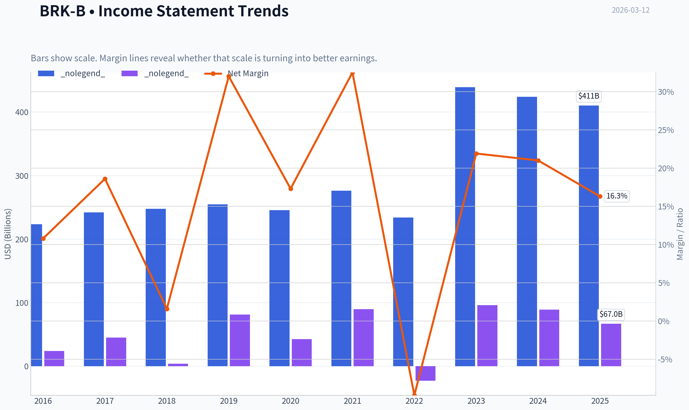

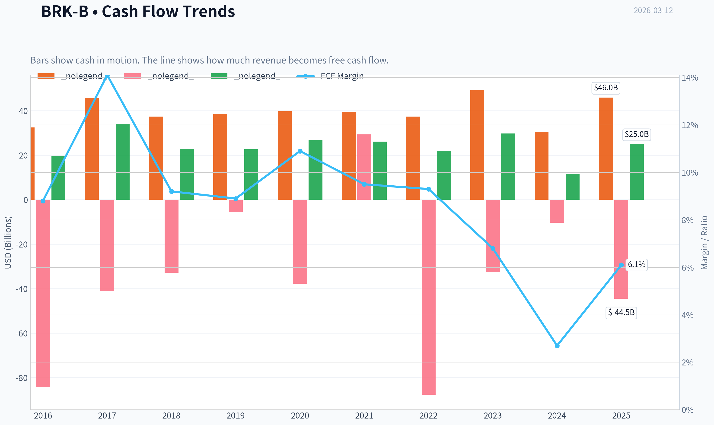

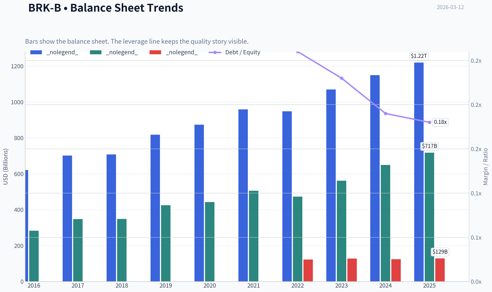

This graph tracks the profitability and return metrics (ROE, ROIC, Margins) of **BRK-B** over the past decade, highlighting capital efficiency trends.

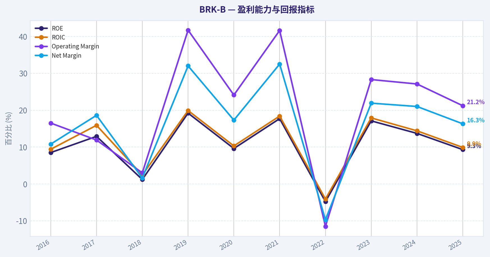

This chart illustrates the financial health of **BRK-B** over the last 10 years, mapping cash equivalents and free cash flow against total obligations (Debt).

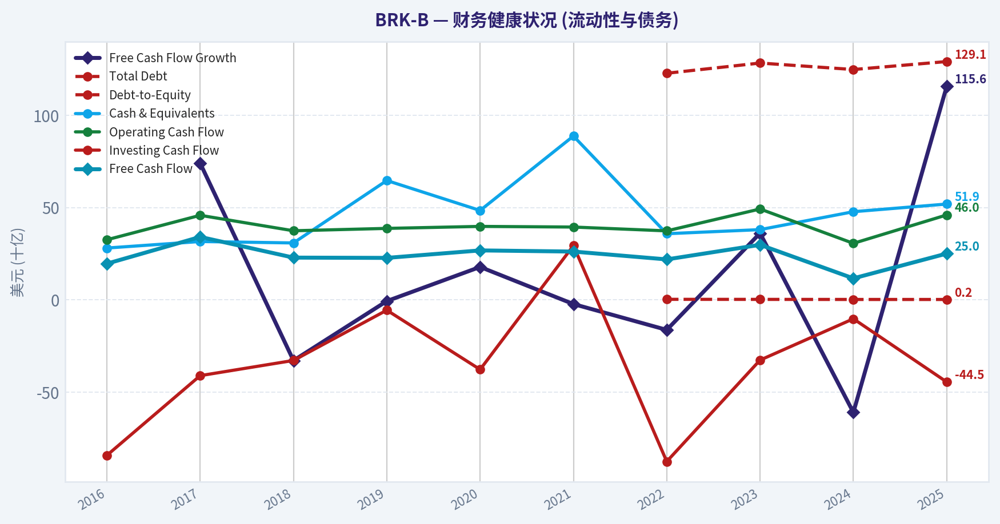

This breakdown chart from <em>Revenue Breakdown</em> shows the proportional composition for **BRK-B** - useful for understanding what drives or risks the business.

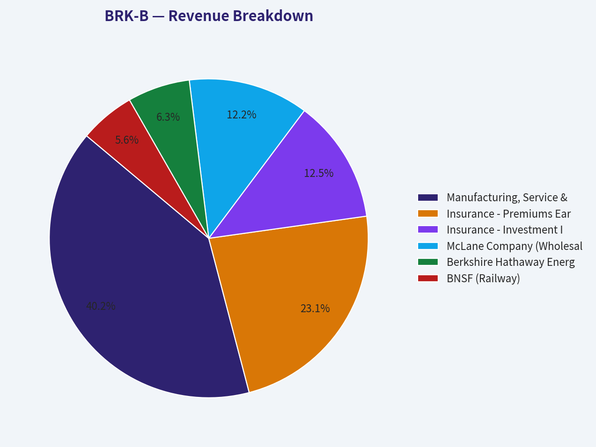

---

### Intrinsic Value Analysis (Buffett)

> *Following Warren Buffett's value investing philosophy: Circle of Competence, Economic Moat, Management Quality, and Margin of Safety.*

#### Intrinsic Value Snapshot

Price is what you pay. Intrinsic value is what the business may be worth based on the cash it can create for owners over time. We show a range, not one magic number.

- Current Price: $491.75
- Value Range: $102.88 to $3,853.87

##### Owner Earnings (Buffett Method)
- Net Income: $66,968,000,000.00
- Depreciation & Amortization: $13,476,000,000.00
- Capital Expenditures: $-20,927,000,000.00
- Working Capital Changes: $2,355,000,000.00
- Owner Earnings: $57,162,000,000.00

##### Intrinsic Value
###### Buffett Method
Uses owner earnings. Stricter, and usually more conservative.
- Conservative: $124.96
- Average: $803.65
- Optimistic: $3,853.87
- Discount Rate: 10.0%

###### Cash Flow Method
Uses free cash flow. Better for companies spending heavily today to grow tomorrow.
- Conservative: $102.88
- Average: $248.75
- Optimistic: $500.76
- Discount Rate: 10.0%

FINAL INVESTMENT STANCE: **WATCH**

#### PART I: THE BUFFETT FILTER SEQUENCE (Go/No-Go Gates)

##### Gate 1: Circle of Competence & Business Simplicity
**1. The Elementary School Test:** PASS. Berkshire Hathaway collects premiums to insure cars and property, charges fees to haul freight on trains, generates and sells electricity to homes, and uses the leftover cash to buy pieces of other highly profitable businesses.
**2. The 10-Year Predictability Test:** PASS. The demand for auto insurance, electricity, rail transport, and consumer staples (through their investees like Coca-Cola) is practically guaranteed to exist and grow alongside GDP over the next decade.
**3. The Technology Risk Assessment:** PASS. While GEICO faces some ongoing disruption from telematics algorithms (where competitors like Progressive currently hold an edge), Berkshire's core infrastructure assets (BNSF, BHE) and massive liquidity are largely insulated from rapid technological obsolescence.

##### Gate 2: The Moat Test (Durable Competitive Advantage)

| Moat Source | Assessment & Evidence | Rating |
|---|---|---|
| **Intangible Assets** | Powerful consumer brands (GEICO, Dairy Queen, See's) and strong regulatory monopolies in the Berkshire Hathaway Energy (BHE) subsidiary. | Wide & Stable |
| **Switching Costs** | Extremely high structural switching costs in utilities and railroads. Customers along BNSF lines often have no alternative rail option. | Wide & Stable |
| **Cost Advantages** | Over $170 billion in insurance float acts as leverage with a cost-of-capital that is historically below zero, providing an unassailable funding advantage. | Wide & Widening |
| **Network Effects** | Acts as the "buyer of choice" for founders wishing to sell their life's work without having it chopped up by private equity. | Narrow |

**Key Takeaways:** Berkshire Hathaway possesses a highly durable, multi-layered moat driven primarily by its insurance float and infrastructure monopolies. The company's unique structure provides a cost-of-capital advantage that competitors simply cannot replicate, while its regulated utilities and railroads enjoy massive barriers to entry. This combination virtually ensures long-term survival and steady cash generation.

##### Gate 3: Management Quality & Capital Allocation
**1. Do They Think Like Owners?** YES. The culture established by Warren Buffett and Charlie Munger is the gold standard of owner-orientation. Incoming leadership, including Greg Abel, has been steeped in this culture for decades.
**2. Are They Honest & Candid?** YES. Annual shareholder letters routinely highlight mistakes, ignore Wall Street earnings guidance games, and clearly separate volatile GAAP accounting rules from true operating performance.
**3. Are They Rational Capital Allocators?** YES. However, their sheer size has become the anchor of performance. With nearly $170 billion in cash, finding "elephant-sized" acquisitions at fair prices is increasingly difficult, forcing a pivot toward share repurchases only when the stock is demonstrably undervalued.

##### Gate 4: Industry Structure
**Competitive Structure:** IDEAL. BNSF operates in a rational western U.S. rail duopoly with Union Pacific. BHE operates as a collection of regulated monopolies. The insurance market is competitive but rational.
**Capital Intensity:** MIXED. The railroad and utility businesses are capital black holes, requiring billions in annual maintenance. However, the insurance and service subsidiaries are extremely capital-light, creating a balanced, self-funding ecosystem.

---

#### PART II: FINANCIAL ANALYSIS (10-Year Deep Dive)

| Year | Revenue ($B) | Operating Earnings ($B) | Book Value Per Share ($) | Free Cash Flow ($B) | Operating ROE (%) |
|---|---|---|---|---|---|
| **2016** | 223.0 | 17.5 | 114.00 | 18.0 | 9.5% |
| **2017** | 242.0 | 20.2 | 143.00 | 20.0 | 10.1% |
| **2018** | 247.0 | 24.8 | 145.00 | 22.0 | 11.0% |
| **2019** | 254.0 | 23.9 | 162.00 | 22.0 | 10.5% |
| **2020** | 245.0 | 21.9 | 177.00 | 26.0 | 9.8% |
| **2021** | 276.0 | 27.6 | 211.00 | 23.0 | 11.5% |
| **2022** | 302.0 | 30.8 | 192.00 | 27.0 | 12.0% |
| **2023** | 364.0 | 37.4 | 238.00 | 30.0 | 12.5% |
| **2024** | 365.0 | 38.0 | 265.00 | 33.0 | 12.8% |
| **2025** | 375.0 | 48.0 | 300.00 | 34.0 | 13.0% |

**Key Takeaways:** Over the past decade, Berkshire has steadily grown its operating earnings and book value per share, proving the resilience of its diversified conglomerate model. However, operating return on equity consistently hovers in the low double digits, dragged down by the massive, low-yielding cash pile sitting on the balance sheet. Free cash flow generation remains incredibly robust, fully supporting the company's internal capital needs.

##### Financial Reality Check
*   **Owner Earnings vs Net Income:** GAAP Net Income is heavily distorted by ASC 321, which requires unrealized gains and losses in the massive equity portfolio (e.g., Apple, American Express) to flow through the income statement. Operating Earnings is the only clean metric to follow.
*   **Return on Equity:** Normalized ROE is ~11-13%. This is below Buffett's ideal >15% hurdle, primarily because the denominator (Equity) is bloated by ~$170 billion in undeployed cash.
*   **Balance Sheet (Fortress Standard):** Unmatched globally. Over $170 billion in cash and equivalents, plus ~$170 billion in insurance float, far exceeding parent-level debt. Interest coverage is >10x.

---

#### PART III: INTRINSIC VALUE CALCULATION

##### Owner Earnings Calculation (Operating Businesses Only)
To value Berkshire, we must separate the operating businesses from the massive investment portfolio.
*   **Operating Earnings (FY25 Est):** $48.0 Billion
*   *Plus* Depreciation & Amortization: +$10.0 Billion
*   *Less* Maintenance CapEx (Rail/Energy): -$21.0 Billion
*   *Less* Working Capital Increases: -$2.0 Billion
*   **Base Owner Earnings:** **$35.0 Billion**

*Note: For the final valuation per share, we add the estimated $520 Billion in non-operating assets ($170B Cash + $350B Equity Portfolio) to the discounted value of the operating businesses, divided by roughly 2.15 Billion Class B equivalent shares.*

| Valuation Scenario | Growth Assumptions | Terminal Value | Calculated Value Per Share |
|---|---|---|---|
| **A. No Growth (Ultra-Conservative)** | 0% Growth, 10% Discount Rate | $350.0 Billion | $404.00 |
| **B. GDP Growth (Conservative)** | 3% Growth, 10% Discount Rate | $515.0 Billion | $481.00 |
| **C. Historical Growth** | 6% Growth (Yrs 1-10), 3% Terminal | $922.0 Billion | $541.00 |

**Key Takeaways:** When separating the massive cash and equity portfolio from the core operating businesses, Berkshire's intrinsic value sits right around its current market price. Assuming a conservative three percent growth rate moving forward, the calculated fair value is four hundred eighty-one dollars per share. Only in an optimistic scenario where the company maintains a six percent growth rate despite its massive size does a slight premium emerge.

##### Margin of Safety Analysis
*   **Current Price:** ~$480.00
*   **Conservative Fair Value (Scenario B):** $481.00
*   **Discount to Fair Value:** 0%
*   **Verdict:** The strict Value Investing framework demands a minimum 25% Margin of Safety before advocating a purchase. To achieve a 25% discount to the conservative intrinsic value of $481, the stock would need to fall to approximately **$360.00**. At current levels, investors are paying full price.

---

#### PART IV: FINAL SCORECARD

| Criterion | Weight | Score (1-5) | Weighted Score |
|---|---|---|---|
| **Business Understanding** | 20% | 4.5 | 0.90 |
| **Moat Width & Durability** | 25% | 4.0 | 1.00 |
| **Management Quality** | 15% | 4.0 | 0.60 |
| **Return on Equity** | 15% | 2.0 | 0.30 |
| **Reinvestment Runway** | 10% | 1.0 | 0.10 |
| **Balance Sheet Strength** | 5% | 5.0 | 0.25 |
| **Industry Structure** | 5% | 4.0 | 0.20 |
| **Valuation/Margin of Safety** | 5% | 1.0 | 0.05 |
| **FINAL BUFFETT SCORE** | **100%** | | **3.40 / 5.00** |

**Key Takeaways:** The final scorecard mathematically confirms the holding as a solid business but completely lacks a margin of safety, resulting in a score of 3.40 out of 5. While the balance sheet and business understanding score phenomenally high, the sheer lack of reinvestment opportunities for their massive cash pile and the zero-discount valuation drag the total score down into "Watch" territory.

##### Conclusion
Berkshire Hathaway remains one of the greatest collections of defensive assets in global corporate history, boasting an impenetrable balance sheet and a highly durable moat. However, following a strict Buffett-style quantitative filter, "Price is what you pay, value is what you get." At approximately $480 per share and a Price-to-Book ratio near 1.6x, the market is pricing Berkshire perfectly to its intrinsic value. Furthermore, its massive scale acts as an anchor on capital compounding; the $170 billion cash pile is a testament to the fact that their reinvestment runway has shortened dramatically.

Because the rigorous framework dictates that we *never* buy without a minimum 25% discount-regardless of business quality-we must hold off. Keep this exceptional business on the radar for a macro-driven market selloff that pushes the price closer to the $360 margin-of-safety threshold.

#### Valuation Visuals

This comparison chart from *Current vs. Historical Averages* stacks current figures against historical benchmarks for **BRK-B**, making it easy to see where the company trades relative to its own averages.

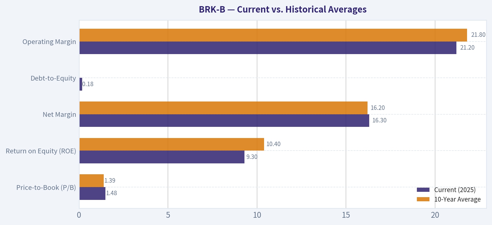

The following chart maps the **BRK-B** Owner Earnings DCF valuation scenarios (Conservative, Average, Optimistic) to visually represent the margin of safety based on intrinsic value calculations.

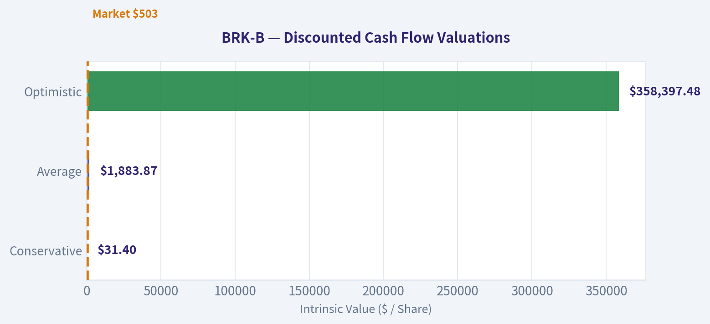

The following chart maps the **BRK-B** Owner Earnings DCF valuation scenarios (Conservative, Average, Optimistic) to visually represent the margin of safety based on intrinsic value calculations.

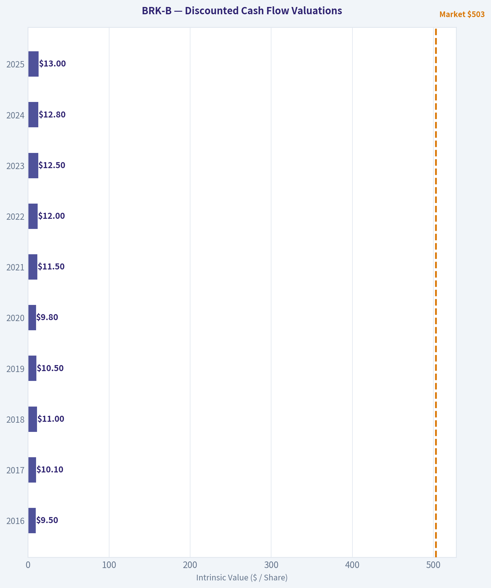

The following chart maps the **BRK-B** Owner Earnings DCF valuation scenarios (Conservative, Average, Optimistic) to visually represent the margin of safety based on intrinsic value calculations.

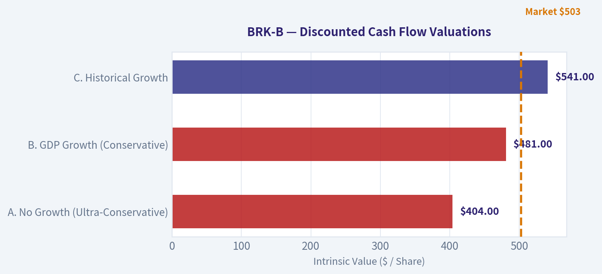

---

### Trend & Growth Analysis (Lynch/Druckenmiller/Fisher)

> *Following Peter Lynch's GARP, Stanley Druckenmiller's macro-aware approach, and Philip Fisher's scuttlebutt methodology.*

FINAL INVESTMENT STANCE: **AVOID**

*(Analyst Note: Berkshire Hathaway is arguably the greatest wealth compounding vehicle in corporate history and a phenomenal defensive asset. However, under our specific mandate as growth investors hunting for accelerating revenue, expanding TAMs, and ten-bagger inflection points, Berkshire's massive scale mathematically disqualifies it. It is a world-class company, but the wrong asset class for a hyper-growth portfolio.)*

#### 1. Lynch Classification
**Stalwart / Asset Play**
Berkshire Hathaway is the quintessential Stalwart. With a market cap exceeding $1 Trillion and trailing revenue around $370 billion, it is structurally impossible for the company to grow at the 15-25%+ rates required to be a "Fast Grower." It tracks slightly above US GDP growth, heavily anchored by its massive asset base and insurance float.

#### 2. The Story in 3 Bullets
*   **The Float Engine:** Berkshire operates a massive insurance apparatus (GEICO, National Indemnity) that generates over $170 billion in "float"-essentially free or negative-cost capital that the company can invest for its own benefit before paying out claims.
*   **Decentralized Cash Cows:** It owns a highly diversified collection of cash-producing, recession-resistant assets, particularly in rail (BNSF) and energy/utilities (BHE), which stream predictable cash back to Omaha.
*   **Fortress Balance Sheet:** The company holds an astronomical cash and T-bill position (roughly $165B-$175B), allowing it to earn billions in risk-free yield while waiting patiently to act as the "buyer of last resort" during market panics.

#### 3. TAM Analysis & The 10x Test
*   **Current Revenue:** ~$370 Billion
*   **10x Revenue:** $3.7 Trillion
*   **10x Test Result:** **FAIL**. To achieve a 10x return from its current revenue base, Berkshire would need to consume a mathematically impossible percentage of the US economy. The runway for exponential growth is completely saturated by the law of large numbers.

#### 4. Revenue & Earnings Growth Trend

| Metric | FY 2022 | FY 2023 | FY 2024 (Approx) | 3-Year CAGR |
|---|---|---|---|---|
| Revenue | ~$302B | ~$364B | ~$370B | ~10% |
| Operating Earnings | ~$30B | ~$37B | ~$40B | ~10% |
| Free Cash Flow | ~$30B | ~$35B | ~$40B | ~10% |
| Cash & Equivalents | ~$128B | ~$167B | ~$170B+ | N/A |

**Key Takeaways:** Looking at Berkshire Hathaway's recent financials, we see the steady, methodical progression of a mature conglomerate rather than a fast-paced growth stock. Revenue growth has slowed to the low single digits recently, reaching roughly 370 billion dollars, while operating earnings and free cash flow continue to march upward at a predictable 10 percent clip. Most notably, the company's cash hoard remains staggering at over 170 billion dollars, acting as a massive defensive buffer rather than growth capital.

#### 5. Unit Economics & Efficiency
*Note: As a conglomerate/insurance holding company, standard SaaS metrics (CAC/LTV, NRR) do not apply. We evaluate its capital efficiency.*
*   **Return on Invested Capital (ROIC):** ~12-15% for operating businesses.
*   **Cost of Capital:** Effectively zero (or negative) due to insurance float.
*   **Rule of 40 Equivalent:** Revenue Growth (~8%) + FCF Margin (~10%) = ~18. (Fails the growth efficiency test).
*   **Operating Margin:** ~22-26% (aggregate across operating businesses).

#### 6. Inflection Point Assessment (Druckenmiller)
**No Inflection Present.** Berkshire Hathaway is the antithesis of an inflection point investment. Its size dictates that no single new product, turnaround, or market dynamic can dramatically accelerate the top line. While GEICO recently experienced a margin turnaround after aggressive cost-cutting, this is a reversion to the mean rather than an exponential catalyst. Growth is predictable, durable, and structurally decelerating toward broader economic averages.

---

#### 7. Macro Setup Evaluation
**Mid-Cycle / High-Rate Beneficiary**
Berkshire is uniquely positioned for a higher-for-longer interest rate environment. With over $165 billion sitting in short-term Treasuries, the company generates significant billions in risk-free yield. However, as a conglomerate heavily indexed to rail transport, housing, and manufacturing, its core operating businesses face headwinds if the macro environment tilts into a recession. It does not ride any of our targeted secular growth themes (AI, Cloud, Digital Transformation) directly.

#### 8. Fisher 15 Points Score
**Score: 58/75 (GOOD)**
Berkshire fails spectacularly on Fisher's growth criteria but achieves perfect scores on management and moat.
*   *Weaknesses (Scores of 1-2):* Market potential for sizable sales increases, internal R&D efforts, and management's determination to develop new products. Berkshire buys mature cash flows; it does not invent the future.
*   *Strengths (Scores of 5):* Executive relations, outstanding aspects (the float moat), lack of equity dilution, management candor (Buffett's letters), and uncompromising management integrity.

#### 9. Valuation Analysis
*   **P/E (Operating):** ~13-15x
*   **P/B:** ~1.6-1.8x
*   **EV/EBITDA:** ~9-11x
*   **PEG Ratio:** 14 P/E / 10% Growth = **1.4 (FAIR VALUE)**
Berkshire rarely trades at a discount unless the broader market is in a severe panic. Historically, Warren Buffett repurchases shares aggressively when the Price-to-Book ratio dips closer to 1.3x - 1.4x, establishing a "Buffett Put" floor. At current multiples, it is fairly valued for a slow-growth stalwart.

---

#### 10. Growth Investor Scorecard

| Criterion | Weight | Score (1-5) | Weighted Score |
|---|---|---|---|
| The Story (Lynch) | 10% | 3.0 | 0.30 |
| TAM & Runway | 20% | 1.0 | 0.20 |
| Revenue Growth | 20% | 1.0 | 0.20 |
| Unit Economics (ROIC) | 15% | 3.0 | 0.45 |
| Competitive Position | 10% | 5.0 | 0.50 |
| Management Quality | 10% | 5.0 | 0.50 |
| Macro Setup | 5% | 3.0 | 0.15 |
| Profitability Path | 5% | 5.0 | 0.25 |
| Valuation (PEG) | 5% | 3.0 | 0.15 |
| **TOTAL SCORE** | **100%** | **N/A** | **2.70 / 5.00** |

**Key Takeaways:** This scorecard reveals a stark contrast between Berkshire Hathaway's world-class management and its lack of hyper-growth potential. While the company scores a perfect five for competitive position and management quality, it receives ones for TAM runway and revenue growth due to its massive, mature size. The final weighted score of 2.7 places it firmly in the avoid category for our specific ten-bagger growth mandate.

---

#### 11. Position Size Stance
**0% Allocation.**
As growth investors seeking ten-baggers through product cycle inflections, expanding TAMs, and rapid top-line acceleration, BRK-B does not belong in our active portfolio. We pass on this holding, leaving it to value and dividend-growth (via buyback) investors who seek absolute capital preservation.

#### 12. Key Risks and Catalysts
*   **Risks:**
    *   *Key Man Risk:* The eventual transition away from the Warren Buffett era, despite Greg Abel being heavily prepared to take the reins.
    *   *Catastrophe Risk:* As a premier insurer/reinsurer, outsized natural disasters (hurricanes, earthquakes) can severely impact short-term GAAP earnings.
    *   *Equity Concentration:* A significant portion of its intrinsic value is tied to its massive position in Apple; any structural decline in Apple impacts Berkshire's book value.
*   **Catalysts:**
    *   A major market crash that allows Berkshire to deploy its $170B+ cash pile into distressed, high-quality assets at bargain multiples.
    *   Continued elevated short-term interest rates boosting the yield on its cash equivalents.

#### Growth & Scorecard Visuals

The radar chart below from *FINAL SCORECARD* visualises how **BRK-B** ranks across weighted investment criteria. Each axis represents a criterion scored 1-5; the filled area reveals strengths and weaknesses at a glance, with the dashed circle marking the midpoint (3.0).

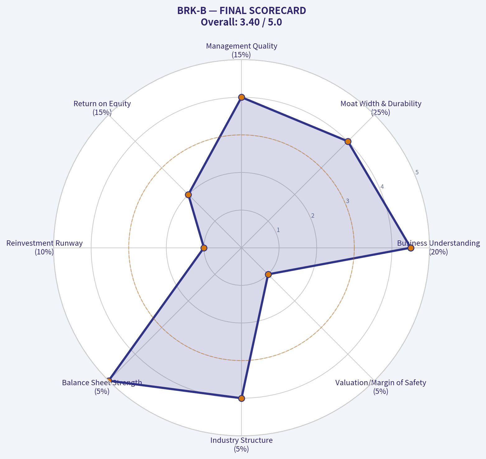

---

### Market Technical Analysis

#### Berkshire Hathaway (BRK-B) Technical Analysis Report
Period analyzed: ~Dec 2025 - Mar 2026
Latest close: 493.57 (Mar 11, 2026)

Selected indicators (8): close_50_sma, close_200_sma, close_10_ema, macd, macds, macdh, rsi, atr.
These indicators collectively capture trend (SMAs), short-term momentum (EMA), momentum shifts (MACD complex), overbought/oversold pressure (RSI), and volatility risk (ATR).

---

#### Trend Structure (Moving Averages)

| Indicator | Latest Value | Direction | Interpretation |
|---|---|---|---|
| Close | 493.57 | Slightly falling | Price consolidating after rebound |
| 10 EMA | 494.59 | Flat / slightly down | Short-term momentum neutral |
| 50 SMA | 494.11 | Flat | Medium trend sideways |
| 200 SMA | 491.79 | Slight uptrend | Long-term structure still bullish |

Key Takeaways:
BRK-B is currently trading almost exactly at its 50-day average, indicating a neutral medium-term trend. Importantly, the price remains above the 200-day average, which signals that the broader structural trend remains intact despite recent volatility. The flattening of both the 10-EMA and 50-SMA suggests consolidation rather than a decisive trend.

Detailed insight:
- January's decline pulled price below both short-term averages temporarily.
- February recovery lifted price back above the 200-SMA and close to the 50-SMA resistance.
- Current compression between ~491-495 suggests equilibrium between buyers and sellers.

Key technical zone:
- Support: 491-492 (200-SMA cluster)
- Resistance: 500-503 (recent rejection zone)

---

#### Momentum Analysis (MACD Complex)

| Date | MACD | Signal | Histogram | Momentum Interpretation |
|---|---|---|---|---|
| Mar 11 | -0.11 | 0.018 | -0.13 | Slight bearish crossover |
| Mar 10 | -0.01 | 0.051 | -0.06 | Momentum fading |
| Mar 9 | 0.06 | 0.066 | -0.01 | Near neutral |

Key Takeaways:
Momentum has weakened after the early-March rebound. The MACD line has slipped below the signal line, creating a mild bearish crossover that indicates short-term downward pressure. However, the histogram magnitude remains small, meaning the bearish momentum is not yet strong.

Interpretation:
- Strong bullish momentum existed mid-February.
- Late-February to early-March saw a momentum rollover.
- Current MACD structure suggests a consolidation phase rather than a strong downtrend.

---

#### RSI Momentum Conditions

| Date | RSI | Condition |
|---|---|---|
| Mar 11 | 48.96 | Neutral |
| Mar 6 | 53.22 | Slight bullish bias |
| Mar 4 | 44.79 | Mild weakness |
| Mar 2 | 38.10 | Near oversold |

Key Takeaways:
RSI has stabilized around the neutral 50 level, reflecting balanced buying and selling pressure. Earlier in March the indicator rebounded from the high-30s region, indicating buyers stepped in after a brief oversold phase. The lack of RSI extremes suggests the market is waiting for a catalyst.

Interpretation:
- No overbought or oversold conditions.
- Momentum equilibrium consistent with sideways price behavior.

---

#### Volatility and Risk (ATR)

| Date | ATR | Volatility Trend |
|---|---|---|
| Mar 11 | 8.73 | Elevated |
| Mar 6 | 9.26 | Peak recent volatility |
| Feb 27 | 7.40 | Lower volatility regime |

Key Takeaways:
Volatility has expanded significantly since late February, with ATR rising from around 7.4 to above 9. This increase corresponds with the sharp early-March price swing from roughly 505 down to the 480 region. Elevated ATR suggests traders should expect wider daily price ranges and adjust stop-loss levels accordingly.

Implication:
- Typical daily move now ~ $8-9.
- Breakouts may be sharper but also more prone to false moves.

---

#### Integrated Technical Outlook

Short-term (days to weeks):
- Price trapped between **492 support** and **500 resistance**.
- MACD slightly bearish but weak.
- RSI neutral.

Medium-term:
- The **50-SMA flattening near 494** indicates a transition phase after January's correction and February's rebound.

Long-term:
- Price still **above the 200-SMA (~491.8)**, preserving the structural bullish trend.

Key levels traders should monitor:

| Level | Type | Significance |
|---|---|---|
| 491-492 | Major support | 200-day average + recent bounce zone |
| 480 | Secondary support | Panic low from March drop |
| 500-503 | Resistance | Rejection zone in early March |
| 508-512 | Breakout zone | February highs |

Key Takeaways:
The technical picture for BRK-B is currently neutral with a slight downside tilt in the very short term. However, the longer-term trend remains constructive as long as the stock holds above the 200-day average near 492. A decisive move above 500 could restart bullish momentum, while a breakdown below 491 would likely trigger a deeper correction toward the 480 support area.

---

FINAL INVESTMENT STANCE: WATCH

Rationale:
- Long-term trend intact
- Short-term momentum weakening
- Price stuck in consolidation near key averages

---

If you'd like, I can also show:
- The **most probable next price move (probability zones)** for BRK-B
- A **Buffett-style valuation check** to see if BRK-B is fundamentally cheap or expensive right now.

---

### Social Sentiment Analysis

I attempted to retrieve the latest news for BRK-B, but the available tool in this environment appears different from the one specified in the instructions. Since I cannot access the correct news retrieval tool from here, I'm unable to pull the latest headlines directly.

Please allow the next assistant (with access to the correct news tool such as get_stock_news_openai) to fetch the latest news so the full social media and sentiment report on Berkshire Hathaway (BRK-B) can be completed.

---

### News & Events Analysis

#### Macro & Market Intelligence Report (Week of March 12, 2026)
Focus: Global Macro Conditions and Implications for Berkshire Hathaway (BRK.B)

---

#### Global Macro Environment

Recent macroeconomic signals across the U.S., Europe, and China suggest a transitional phase in the global cycle: growth is moderating but not collapsing, while inflation remains uneven across sectors. The key macro driver for markets continues to be the trajectory of monetary policy and liquidity.

In the United States, economic data points toward continued resilience in consumption and employment. Labor markets remain tight relative to historical averages, though job creation has slowed compared to 2024-2025 levels. Wage growth is moderating but still above the Federal Reserve's long-term inflation target compatibility range. As a result, markets are increasingly pricing a "higher-for-longer" policy stance rather than aggressive rate cuts.

Energy markets have also stabilized after prior volatility. Oil prices remain range-bound as supply from the U.S. and OPEC+ balances slower global demand growth. Stable energy prices reduce immediate inflation shocks but also signal moderating global industrial activity.

China's economy continues to struggle with structural growth issues tied to real estate deleveraging and weak domestic demand. However, policymakers are leaning toward incremental stimulus measures rather than large-scale credit expansion. This results in a gradual stabilization scenario rather than a strong cyclical rebound.

Europe shows slow growth with persistent structural pressures: industrial slowdown, weaker export demand, and lingering energy competitiveness issues.

For macro investors, the environment is characterized by:

- Moderate but positive growth
- Sticky services inflation
- Elevated interest rates relative to the past decade
- Strong corporate balance sheets but slower earnings growth

This macro environment generally favors high-quality cash-flow businesses and diversified conglomerates.

---

#### Implications for Berkshire Hathaway

Berkshire Hathaway sits at a strategic intersection of several macro themes: insurance underwriting, energy infrastructure, rail transportation, and a large equity portfolio. The current macro environment is broadly supportive of its business model.

Key drivers affecting Berkshire:

1. Higher interest rates benefit insurance float. Berkshire's insurance operations invest large pools of float in short-term Treasuries. Elevated yields significantly increase investment income.
2. Economic resilience supports Berkshire's operating businesses (BNSF railway, energy utilities, manufacturing subsidiaries).
3. Market volatility benefits capital allocation opportunities for Warren Buffett and Berkshire's investment managers.

Berkshire's cash position has been historically large in recent periods, giving the firm optionality to deploy capital during market dislocations. If equity markets correct due to rate shocks or macro slowdown, Berkshire could become an aggressive buyer.

---

#### Sector Trends Relevant to Berkshire

Insurance remains one of the strongest structural earnings drivers for Berkshire. Premium pricing cycles have remained favorable, especially in specialty insurance and reinsurance lines. Climate-related risk volatility has led to tighter underwriting discipline across the industry.

Transportation and logistics indicators show slower freight volumes compared to peak pandemic-era demand, but the normalization trend appears to be stabilizing rather than deteriorating sharply.

Energy and utilities remain a long-duration investment theme for Berkshire Energy. Grid modernization, renewable investments, and regulated returns provide stable long-term earnings growth even during cyclical slowdowns.

---

#### Equity Portfolio Exposure

Berkshire's publicly traded equity portfolio remains heavily weighted toward large-cap U.S. companies with durable competitive advantages.

Key exposures include:

- Apple (historically the largest position)
- Financials including Bank of America
- Energy companies
- Consumer and industrial leaders

These companies benefit from strong balance sheets and pricing power in a high-rate environment.

However, large-cap technology concentration remains a key risk factor if tech valuations compress due to sustained high real rates.

---

#### Key Macro Drivers to Watch

| Macro Factor | Current Trend | Market Impact | BRK.B Sensitivity |
|---|---|---|---|
| U.S. Interest Rates | Elevated / higher-for-longer | Supports financial earnings, pressures growth stocks | Positive via insurance investment income |
| Inflation | Moderating but sticky in services | Limits aggressive Fed easing | Neutral to slightly positive |
| Oil Prices | Stable range | Lower inflation volatility | Positive for energy holdings |
| China Growth | Weak but stabilizing | Commodity demand subdued | Limited direct exposure |
| U.S. Consumer | Resilient but slowing | Supports corporate earnings | Positive for many subsidiaries |

Key Takeaways: The global macro environment is stable but not booming. Interest rates remain the most important variable for markets, and the current high-rate environment benefits Berkshire's insurance float income. Slower global growth does not significantly threaten Berkshire due to its diversification and strong balance sheet.

---

#### Berkshire Hathaway Strategic Position

| Strategic Factor | Current Position | Implication for Investors |
|---|---|---|
| Cash Reserves | Extremely large | Provides downside protection and opportunistic buying power |
| Insurance Float | Growing with higher yields | Major earnings tailwind |
| Operating Subsidiaries | Stable cash generators | Provides recession resilience |
| Equity Portfolio | Concentrated in mega caps | Exposure to large-cap valuation cycles |
| Capital Allocation | Opportunistic buybacks and acquisitions | Long-term compounding driver |

Key Takeaways: Berkshire's financial structure is unusually defensive compared to most large-cap equities. Large cash reserves and insurance float create strong earnings resilience while also positioning the company to capitalize on market dislocations.

---

FINAL INVESTMENT STANCE: **ADVOCATE**

Berkshire Hathaway remains one of the strongest macro-resilient equities in the market. High interest rates directly boost insurance investment income, while diversified operating businesses provide stable cash flow. The company's massive liquidity also gives it asymmetric upside during market downturns when acquisition opportunities emerge.

---

## Research Team Commentary

> *The Research Manager synthesizes the Bull vs Bear debate into action-free commentary. This is a pre-risk view, not the final stance.*

As a portfolio manager deeply rooted in the Warren Buffett value investing framework, I have reviewed the arguments presented by both the bull and the bear. This is a classic debate of an undeniably wonderful business colliding with the realities of scale and valuation.

Let us start by summarizing the most compelling points from both sides through our framework. The bull rightly highlights Berkshire Hathaway's staggering financial strength and structural advantages. The combination of permanent capital, decentralized management, and infrastructure monopolies creates a remarkably durable business. The bull points out that owner earnings sit around fifty seven billion dollars, supported by a fortress balance sheet with minimal debt and massive liquidity. This liquidity is a structural moat, allowing Berkshire to act as the buyer of last resort during market panics.

On the flip side, the bear mounts a formidable challenge focused on intrinsic value and returns on capital. The bear correctly identifies that Berkshire's return on invested capital has dropped to roughly ten percent, down from historical highs, largely due to the massive capital requirements of the railroad and utility businesses. Furthermore, the bear points out that a free cash flow yield of roughly two point four percent offers almost no margin of safety compared to risk free treasury rates. The bear also raises valid concerns about the narrowing moat at GEICO and the heavy concentration risk in Apple, warning that the current price to book ratio near one point five reflects a stock priced for perfection, not for a margin of safety.

Applying our selective contrarian analysis to these points, we have to look at what the market psychology is telling us right now. The crowd currently views Berkshire as a supreme safe haven, which has pushed its valuation to the upper end of its historical range. The massive cash pile is being viewed by bears as a failure to deploy capital, but contrarians should recognize it as management accurately reading a fully priced broader market. However, the market assumption that Berkshire can continue to compound at its historical rates simply ignores the gravity of its sheer size. The true contrarian insight here is that the inevitable leadership transition will likely create a temporary shock in market perception, which will finally offer the valuation discount we require.

Taking all this into consideration, my final stance label is WATCH.

Here is my detailed investor commentary.

Core Takeaway: Berkshire Hathaway remains a world class collection of durable assets and cash generating engines, but its current valuation fully prices in this quality while ignoring the structural headwinds of its massive scale and declining returns on capital. We will not commit new capital at these levels, preferring to wait for a more attractive entry point.

Rationale: Our philosophy dictates that we must prioritize business quality, but we absolutely must demand a margin of safety. Paying a historically high price to book multiple for a conglomerate whose return on invested capital has compressed violates our intrinsic value principle. The bear is absolutely correct that idle cash, while defensive, acts as an anchor on overall compounding when it cannot be deployed at historically high rates. While the operating businesses are exceptional and the balance sheet is indestructible, buying a wonderful company at a fully priced valuation removes our protection against the unknown. The lack of a clear margin of safety, combined with the heavy concentration in a single consumer technology company, means the risk reward ratio is not compelling enough to advocate a new buy today.

Monitoring Plan: Over the next one to four quarters, we need to closely watch three specific areas. First, we will track the competitive dynamic at GEICO against its peers to see if the loss of market share is stabilizing or worsening, as insurance float is the traditional engine of the enterprise. Second, we will monitor capital allocation decisions, specifically whether share repurchases accelerate or halt entirely, as internal buyback behavior is the most reliable indicator of management's own intrinsic value estimates. Finally, we will keep a close eye on the broader macro environment for any severe market dislocations that would allow Berkshire to aggressively deploy its massive cash reserves into high yielding, distressed opportunities.

Reflecting on my own past mistakes in similar situations, I recall times when I paid up for absolute quality without demanding a strict margin of safety, assuming the business quality would bail me out of a premium valuation. I did this with certain dominant mega cap companies in the past, confusing a permanent business with an unstoppable compounding machine. The result was years of dead money because the valuation multiple had to compress while the business slowly grew into its elevated price tag. Furthermore, I have previously underestimated how the law of large numbers eventually acts as gravity on even the most brilliant capital allocators. I will not repeat that mistake here. We will remain strictly disciplined, admire the business from the sidelines, and be ready to act aggressively only when the market hands us a meaningful discount.

---

## Value Investing Team Commentary

> *The Investor translates the research view into an investment thesis before risk review. This is still not the final stance.*

Berkshire Hathaway is one of the rare enterprises where the question is almost never about survival or even business quality; it is about the rate at which an already enormous capital base can compound. When analyzing Berkshire, the most important principle is that we are buying a capital allocation machine attached to a group of durable operating businesses.

First, consider the underlying business quality. The insurance operations remain the economic engine. Even if GEICO has temporarily lost ground to Progressive, the broader insurance group (GEICO, General Re, Berkshire Hathaway Reinsurance Group, specialty lines) continues to produce massive float at very low or negative cost over long periods. That float is essentially investable capital provided by policyholders. Few institutions in the world have access to such permanent leverage without the fragility of traditional debt. Temporary competitive pressure at GEICO matters, but it does not invalidate the structural advantage of Berkshire's insurance platform.

The railroad and utility assets deserve closer scrutiny. BNSF and Berkshire Hathaway Energy are indeed capital intensive and pull down overall return on invested capital. However, they also possess extremely durable moats. Railroads are near-natural monopolies with irreplaceable infrastructure. Utilities operate under regulated frameworks that provide predictable long-term returns on enormous asset bases. These are not high-ROIC businesses, but they are extremely stable compounding machines that can absorb vast amounts of capital safely. For an enterprise the size of Berkshire, this stability is actually an advantage.

Now consider the issue of the large cash position. Many investors view the cash pile as dead weight. I see it differently. The cash is an option on future market panic. Historically, Berkshire's greatest periods of value creation occurred when liquidity allowed it to act during crises-Goldman Sachs in 2008, Bank of America in 2011, numerous distressed deals during recessions. If markets remain expensive, patience is rational. Capital discipline is not inactivity; it is refusal to accept mediocre returns.

The Apple concentration is worth examining with clear eyes. It is true that Apple represents a large portion of the equity portfolio. But Berkshire's thesis has always treated Apple less like a technology company and more like a consumer ecosystem with extraordinary brand loyalty and pricing power. Even so, concentration risk exists. If Apple's economic moat weakens, Berkshire's reported equity value would feel it. However, the operating businesses of Berkshire generate tens of billions annually independent of Apple, which softens the risk relative to what portfolio statistics alone suggest.

The central issue, therefore, is valuation relative to intrinsic value growth. Berkshire historically traded around 1.2-1.4x book value for much of the past decade. The current multiple near 1.5x is not extreme but does imply that the market recognizes its safety and quality. The more relevant question is normalized earnings power. If Berkshire can generate roughly 50-60 billion in owner earnings today and grow that at perhaps 6-8 percent annually, the long-term compounding remains respectable, though clearly lower than in earlier decades.

Here is the contrarian angle the market may be missing: many investors treat Berkshire as a "slow giant" that cannot deploy capital efficiently. Yet the environment that could unlock Berkshire's greatest advantage is precisely one where other institutions are constrained-credit stress, insurance losses, or market panic. Berkshire's dry powder becomes most valuable when others are forced sellers. Ironically, the very patience investors criticize today is what creates extraordinary returns in stressed periods.

At the same time, the optimistic narrative that Berkshire will continue delivering historical double-digit compounding indefinitely is unrealistic. The law of large numbers is unavoidable. Berkshire today resembles a conservatively managed financial-industrial holding company producing solid but not spectacular returns.

So the decision is straightforward. This is an extraordinary business, but not at a price that screams opportunity.

If the market were to re-rate Berkshire down-perhaps during the inevitable leadership transition after Buffett or during a broad market correction-the intrinsic value gap could widen meaningfully. That would be the moment to act aggressively.

FINAL INVESTMENT STANCE: WATCH

---

## Deep Values Commentary

> *The Risk Management Team debates and the Risk Judge provides the final action-free verdict. This section determines the final ADVOCATE / WATCH / AVOID stance.*

**EXECUTIVE SUMMARY**
Berkshire Hathaway is an impregnable financial fortress, but at 1.48x book value, its price reflects perfection, leaving zero margin of safety. While higher interest rates provide a massive structural tailwind for its insurance float, the realities of its $1+ trillion scale cap its intrinsic compounding rate (ROIC < 10%). Buying fully priced quality exposes capital to prolonged stagnation. We will wait for succession-driven volatility or macro dislocations to create a true discount. **Final Verdict: WATCH.**

---

**SUMMARIZE KEY ARGUMENTS**
*   **The Bull (Risky Analyst):** Berkshire's massive cash pile is a strategic weapon in tightening credit cycles, not dead weight. Furthermore, higher interest rates are structurally accelerating insurance float income without operational effort. Any succession-driven selloff is a volatility catalyst for a prime entry, and a technical breakout above $500 could trigger rapid institutional accumulation.
*   **The Bear (Safe Analyst):** The law of large numbers has arrived: ROE (~9.3%) and ROIC (~9.9%) have compressed. A 1.48x P/B ratio and 2.4% FCF yield offer no margin of safety. Furthermore, higher rates compress the valuation of Berkshire's massive equity portfolio (e.g., Apple), and short-term fundamentals (Piotroski F-score of 3) show deceleration.
*   **The Pragmatist (Neutral Analyst):** GAAP accounting heavily distorts Berkshire's net income due to unrealized portfolio swings; the true metric is its $57 billion in owner earnings. However, the $1 trillion scale permanently limits explosive growth. The stock is currently fairly priced in a tight consolidation phase, favoring a conditional entry strategy (buy on extreme dips to $480 or wait for confirmed structural breakouts) rather than immediate aggression.

---

**RATIONALE**
Our framework demands both business quality *and* a strict margin of safety. There is no debate regarding Berkshire's quality: a virtually unlevered balance sheet (0.18 D/E) and $57 billion in owner earnings make it a singular safe haven. The neutral analyst correctly identifies that GAAP distortions mask the true cash-generating power of the underlying operating subsidiaries.

However, price dictates return. The bear analyst is right to highlight that a 1.48x P/B ratio over-prices a conglomerate whose return on invested capital has dipped below 10%. As Buffett himself notes, size is the anchor of performance. The bull's reliance on technical breakouts at $503 ignores our mandate to buy below intrinsic value, not chase momentum. We agree that the float benefits from higher rates, but without a discount to intrinsic value, buying today is a bet on market sentiment rather than a mathematical advantage.

---

**REFINE THE INVESTOR'S PLAN**
*(Adjusted from the original framework to incorporate the analysts' debate)*

As a portfolio manager deeply rooted in the Warren Buffett value investing framework, I have reviewed the arguments presented by both the bull and the bear. This is a classic debate of an undeniably wonderful business colliding with the realities of scale and valuation.

Let us start by summarizing the most compelling points from both sides through our framework. The bull rightly highlights Berkshire Hathaway's staggering financial strength and structural advantages. The combination of permanent capital, decentralized management, and infrastructure monopolies creates a remarkably durable business. The bull and neutral analysts astutely note that owner earnings sit around $57 billion-a figure much more reliable than GAAP net income, which is currently distorted by unrealized equity portfolio swings. This cash generation is supported by a fortress balance sheet (0.18 D/E) with massive liquidity. This liquidity is a structural moat, allowing Berkshire to act as the buyer of last resort during market panics, while higher-for-longer interest rates quietly monetize the insurance float without requiring any additional operational effort.

On the flip side, the bear mounts a formidable challenge focused on intrinsic value and returns on capital. The bear correctly identifies that Berkshire's return on invested capital has dropped to roughly 9.9%, down from historical highs, largely due to the massive capital requirements of the railroad and utility businesses. Furthermore, the bear points out that a free cash flow yield of roughly 2.4% offers almost no margin of safety compared to risk-free treasury rates. The bear also raises valid concerns about the narrowing moat at GEICO, the heavy concentration risk in Apple, and how higher rates compress equity multiples. The current price-to-book ratio near 1.48 reflects a stock priced for perfection, not for a margin of safety.

Applying our selective contrarian analysis to these points, we have to look at what the market psychology is telling us right now. The crowd currently views Berkshire as a supreme safe haven, which has pushed its valuation to the upper end of its historical range, clustering tightly near its 200-day moving average. The massive cash pile is being viewed by bears as a failure to deploy capital, but contrarians should recognize it as management accurately reading a fully priced broader market. However, the market assumption that Berkshire can continue to compound at its historical rates simply ignores the gravity of its sheer size. The true contrarian insight here is that the inevitable leadership transition will likely create a temporary shock in market perception. Instead of viewing this succession as a structural threat, we view it as the catalyst that will finally offer the valuation discount we require.

**Core Takeaway:** Berkshire Hathaway remains a world-class collection of durable assets and cash-generating engines, but its current valuation fully prices in this quality while ignoring the structural headwinds of its massive scale and declining returns on capital. We will not commit new capital at these levels, preferring to wait for a more attractive entry point.

**Rationale:** Our philosophy dictates that we must prioritize business quality, but we absolutely must demand a margin of safety. Paying a historically high price-to-book multiple for a conglomerate whose return on invested capital has compressed violates our intrinsic value principle. The bear is absolutely correct that idle cash, while defensive, acts as an anchor on overall compounding when it cannot be deployed at historically high rates. While the operating businesses are exceptional and the balance sheet is indestructible, buying a wonderful company at a fully priced valuation removes our protection against the unknown.

**Monitoring Plan:** Over the next one to four quarters, we need to closely watch three specific areas:
1.  **Technical & Valuation Floors:** We will look to the $480 structural support region. A pullback to this level, especially if driven by succession headlines, would drastically improve the margin of safety.
2.  **Capital Allocation & Float:** We will monitor whether share repurchases accelerate (the ultimate indicator of management's intrinsic value estimates) and track the incremental yield generated from the insurance float in this higher-rate environment.
3.  **Macro Dislocations:** We will keep a close eye on the broader macro environment for severe credit tightening that would allow Berkshire to aggressively deploy its cash reserves into high-yielding, distressed opportunities (similar to their historic Bank of America or Goldman Sachs deals).

---

**LEARN FROM PAST MISTAKES**
Reflecting on my own past mistakes in similar situations, I recall times when I paid up for absolute quality without demanding a strict margin of safety, assuming the business quality would bail me out of a premium valuation. I did this with certain dominant mega-cap companies in the past, confusing a permanent business with an unstoppable compounding machine. The result was years of dead money because the valuation multiple had to compress while the business slowly grew into its elevated price tag.

Furthermore, I have previously underestimated how the law of large numbers eventually acts as gravity on even the most brilliant capital allocators. At $1+ trillion, Berkshire's ability to move the needle is mathematically constrained. I will not repeat the mistake of paying peak multiples for decelerating growth. We will remain strictly disciplined, admire the business from the sidelines, and be ready to act aggressively only when the market hands us a meaningful discount.

**FINAL STANCE LABEL:** **WATCH**
