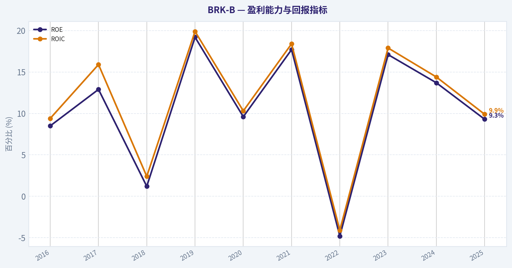
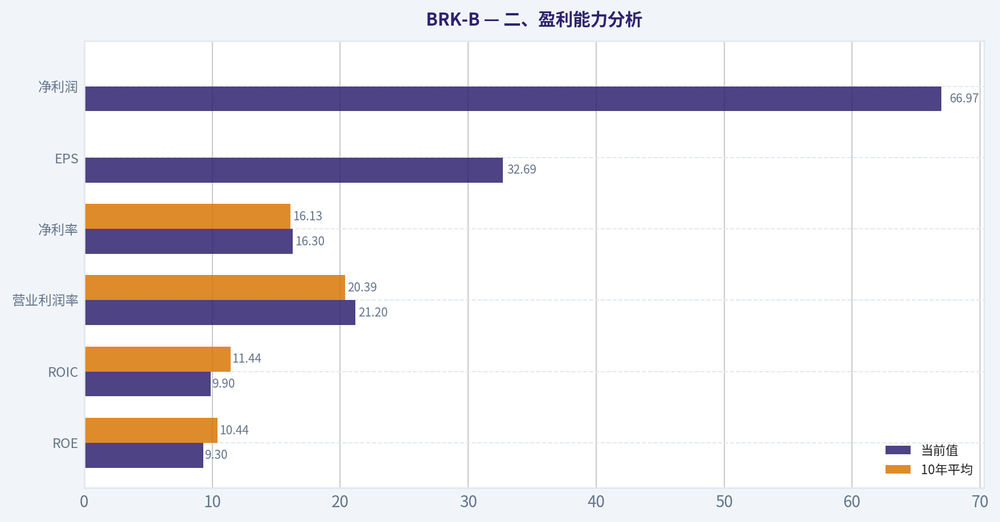
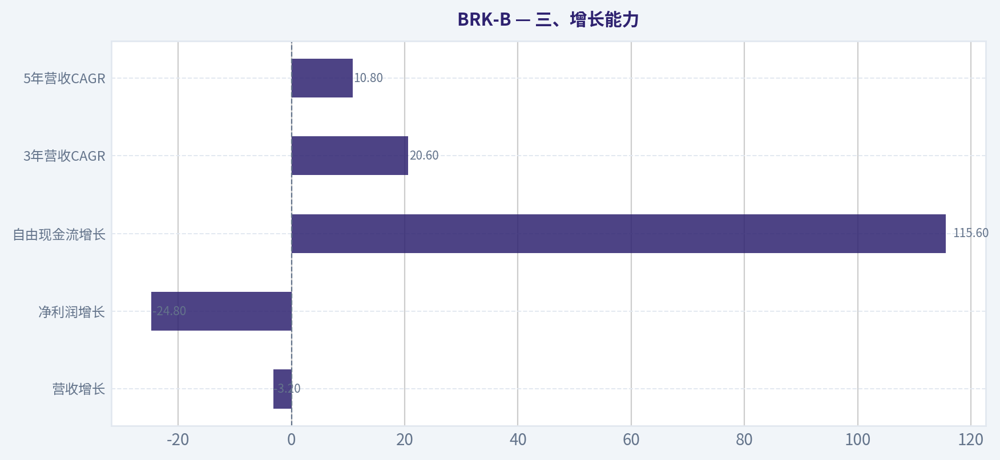
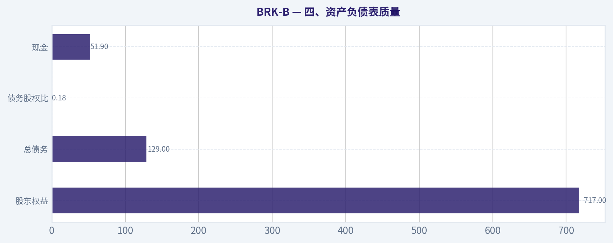
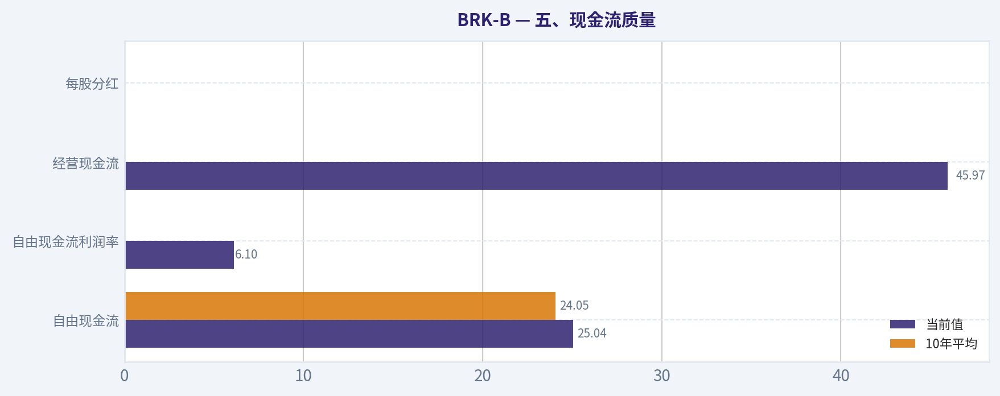
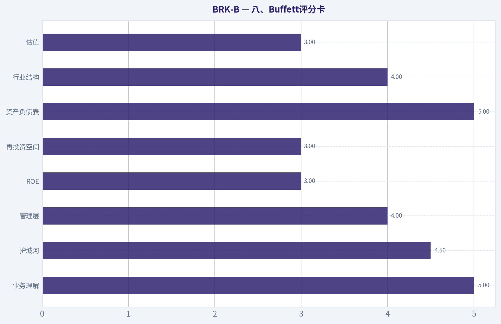
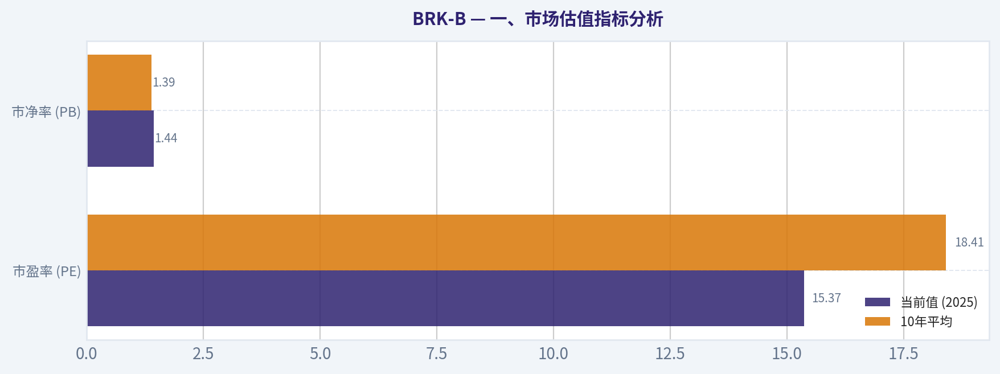

# BRK-B 深度价值情报

**调研日期:** 2026-04-06

## 关键免责声明

*本报告由 Deep Value Intelligence（一个基于 AI 的多智能体投资分析框架）自动生成。 本报告仅供信息参考和教育目的，不构成任何财务或投资建议。 在做出任何投资决策之前，请务必进行独立调研并咨询合规的财务顾问。*

---

## 目录

1. 情报摘要
2. 分析师团队报告
   - 基本面分析
   - 价值分析 (巴菲特)
   - 成长性分析 (林奇/德鲁肯米勒/费雪)
   - 市场分析
   - 社会舆情分析
   - 新闻分析
3. 研究团队评论
4. 投资团队评论
5. Deep Values 团队洞察

---

## 情报摘要

### 核心观点与前提条件

**核心论点:** **执行摘要（核心结论）**
Berkshire 依然是一家极高质量、财务极其稳健的企业，但当前价格基本反映了这种质量。ROE 约 9%、FCF yield 约 2.4%，意味着未来回报大概率接近 **中高个位数复利（约 8-10%）**。$325B 现金确实提供"危机期资本配置期权"，但规模过大也使资本效率持续受到压制。长期企业风险极低，但**估值安全边际不足**。
**结论：观望（WATCH）。**

**主要风险:**
- 结论：观望（WATCH）。**
- Risky Analyst（进攻视角）**
- Risky Analyst 的核心洞察是正确的：
- 最终立场：观望（WATCH）**

**观点反转条件:**
- 结论：观望（WATCH）。**
- Risky Analyst（进攻视角）**
- Risky Analyst 的核心洞察是正确的：
- 最终立场：观望（WATCH）**

**置信度:** 中

---

## 分析师团队报告

### 基本面分析

#### 最新财报快照

*以下数据基于最近一期已披露财报（2025年Q4），并尽量与上一年同期对比。*

| 指标 | 2025年Q4 | 2024年Q4 | 同比变化 |
| --- | ---: | ---: | ---: |
| 营业收入 | $111.44B | $101.47B | +9.8% |
| 营业利润 | N/A | N/A | N/A |
| 净利润 | $19.20B | $19.69B | -2.5% |
| 摊薄每股收益 | N/A | N/A | N/A |
| 经营现金流 | $11.19B | $1.80B | +520.7% |
| 自由现金流 | $4.99B | $-2.90B | +272.2% |

关键结论：这张快照先把最新一期财报放在桌面上，再去看长周期分析。这样读者能更清楚地区分"公司长期质量"和"这次财报发生了什么"。

#### BRK-B 10年财务指标

*以下数值均由原始数据确定性计算得出，并非 AI 估算。*

*发行人类型：insurer（Financial Services / Insurance - Diversified）。*

#### 10年财务指标
*年度行来自已披露财务报表，最后一行 TTM 由最近四个季度滚动计算得出。*

| 指标 | 2016 | 2017 | 2018 | 2019 | 2020 | 2021 | 2022 | 2023 | 2024 | 2025 |
| --- | --- | --- | --- | --- | --- | --- | --- | --- | --- | --- |
| 市场价格 | $163 | $198 | $204 | $226 | $232 | $299 | $309 | $357 | $453 | $503 |
| 总市值 | $400.63B | $489.13B | $502.41B | $553.88B | $544.08B | $677.32B | $680.60B | $775.14B | $977.53B | $1.03T |
| 市盈率 | 16.64 | 10.88 | 124.95 | 6.80 | 12.80 | 7.53 | -29.91 | 8.06 | 10.98 | 15.37 |
| 市净率 | 1.42 | 1.40 | 1.44 | 1.30 | 1.23 | 1.34 | 1.44 | 1.38 | 1.51 | 1.44 |
| ROE | 8.5% | 12.9% | 1.2% | 19.2% | 9.6% | 17.7% | -4.8% | 17.1% | 13.7% | 9.3% |
| ROIC | 9.4% | 15.9% | 2.4% | 19.9% | 10.3% | 18.4% | -4.1% | 17.9% | 14.4% | 9.9% |
| 每股收益 | $9.79 | $18.21 | $1.63 | $33.29 | $18.12 | $39.70 | $-10.33 | $44.27 | $41.27 | $32.69 |
| 营收 | $223.60B | $242.14B | $247.84B | $254.62B | $245.51B | $276.09B | $234.12B | $439.34B | $424.23B | $410.52B |
| 毛利润 | N/A | N/A | N/A | N/A | N/A | N/A | N/A | N/A | N/A | N/A |
| 毛利率 | N/A | N/A | N/A | N/A | N/A | N/A | N/A | N/A | N/A | N/A |
| 营业利润率 | 16.5% | 11.9% | 3.0% | 41.7% | 24.1% | 41.6% | -11.5% | 28.3% | 27.1% | 21.2% |
| 净利润 | $24.07B | $44.94B | $4.02B | $81.42B | $42.52B | $89.80B | $-22.76B | $96.22B | $89.00B | $66.97B |
| 净利率 | 10.8% | 18.6% | 1.6% | 32.0% | 17.3% | 32.5% | -9.7% | 21.9% | 21.0% | 16.3% |
| 营收增长 | 6.1% | 8.3% | 2.4% | 2.7% | -3.6% | 12.5% | -15.2% | 87.7% | -3.4% | -3.2% |
| 净利润增长 | -0.0% | 86.7% | -91.0% | 1924.8% | -47.8% | 111.2% | -125.3% | 522.8% | -7.5% | -24.8% |
| 自由现金流增长 | N/A | 74.0% | -32.9% | -0.7% | 17.8% | -2.3% | -16.3% | 36.1% | -61.0% | 115.6% |
| 总账面价值 | $283.00B | $348.30B | $348.70B | $424.79B | $443.16B | $506.20B | $473.42B | $561.27B | $649.37B | $717.42B |
| 总资产 | $620.85B | $702.10B | $707.79B | $817.73B | $873.73B | $958.78B | $948.47B | $1.07T | $1.15T | $1.22T |
| 总债务 | N/A | N/A | N/A | N/A | N/A | N/A | $122.74B | $128.27B | $124.76B | $129.08B |
| 债务股权比 | N/A | N/A | N/A | N/A | N/A | N/A | 0.26 | 0.23 | 0.19 | 0.18 |
| 现金及等价物 | $28.05B | $31.58B | $30.81B | $64.63B | $48.40B | $88.71B | $35.81B | $38.02B | $47.73B | $51.88B |
| 股东权益 | $283.00B | $348.30B | $348.70B | $424.79B | $443.16B | $506.20B | $473.42B | $561.27B | $649.37B | $717.42B |
| 经营现金流 | $32.53B | $45.78B | $37.40B | $38.69B | $39.77B | $39.42B | $37.35B | $49.20B | $30.59B | $45.97B |
| 投资现金流 | $-84.27B | $-41.09B | $-32.85B | $-5.62B | $-37.76B | $29.39B | $-87.60B | $-32.66B | $-10.29B | $-44.49B |
| 自由现金流 | $19.58B | $34.07B | $22.86B | $22.71B | $26.76B | $26.14B | $21.89B | $29.79B | $11.62B | $25.04B |
| 自由现金流利润率 | 8.8% | 14.1% | 9.2% | 8.9% | 10.9% | 9.5% | 9.3% | 6.8% | 2.7% | 6.1% |
| 每股分红 | N/A | N/A | N/A | N/A | N/A | $0.00 | $0.00 | $0.00 | $0.00 | $0.00 |

#### 盈利能力指标
- 净资产收益率 (ROE): 9.3%
- 投入资本回报率 (ROIC): 9.9%
- 总资产收益率 (ROA): 5.5%
- 毛利率: 不适用
- 营业利润率: 21.2%
- 净利率: 16.3%

#### 流动性指标
- 流动比率: 不适用
- 速动比率: 不适用

#### 杠杆指标
- 债务股权比: 0.18
- 利息覆盖倍数: 17.21
- 净负债: $77.20B

#### 增长指标（同比）
- 营收增长: -3.2%
- 净利润增长: -24.8%
- 自由现金流增长: 115.6%
- 营收复合增长率（3年）: 20.6%
- 营收复合增长率（5年）: 10.8%

#### 估值指标
- 市盈率 (TTM): 15.38
- 预期市盈率: 21.92
- 市净率: 1.44
- 市销率: 2.77
- PEG 比率: N/A
- 企业价值/EBITDA: -2.12
- 自由现金流收益率: 2.4%
- 盈利收益率: 6.5%

#### 所有者收益（巴菲特方法，代码计算）
- 净利润: $66.97B
- + 折旧与摊销: $13.48B
- - 资本开支: $-20.93B
- - 营运资本变动: $2.35B
- = **所有者收益: $57.16B**

#### 内在价值（代码计算）
- 当前价格: $477
- 巴菲特方法（所有者收益）:
  保守: $85
  平均: $545
  乐观: $2,615
- 现金流方法（FCF）:
  保守: $70
  平均: $169
  乐观: $340

#### Piotroski F分数: 3/9
- 净利润为正: 通过
- 经营现金流为正: 通过
- 资产回报率改善: 未通过
- 现金流大于净利润: 未通过
- 债务下降: 未通过
- 流动比率改善: 未通过
- 未稀释股本: 通过
- 毛利率改善: 未通过
- 资产周转率改善: 未通过

#### 一、市场估值指标分析

| 指标 | 当前值 (2025) | 10年平均 | 历史区间观察 | 评价 |
|---|---|---|---|---|
| 股价 | $477（当前约） | - | 2016->2025 从 $163 -> $503 | 长期稳步上涨 |
| 市值 | $1.03T | - | 10年增长约2.6倍 | 已进入万亿美元级 |
| 市盈率 (PE) | 15.37 | 18.41 | -29.9 ～ 124.9（受投资收益波动影响） | 略低于历史均值 |
| 市净率 (PB) | 1.44 | 1.39 | 1.23 ～ 1.51 | 接近历史中枢 |

关键结论：
BRK-B 的估值核心锚其实是 PB 而不是 PE，因为净利润受到投资组合公允价值波动影响极大。从历史看 1.2-1.5 PB 是常态，目前 1.44 基本处于合理区间中枢略偏上，并没有明显低估或泡沫。

---

#### 二、盈利能力分析

| 指标 | 当前值 | 10年平均 | 趋势 |
|---|---|---|---|
| ROE | 9.3% | 10.44% | 略低于长期水平 |
| ROIC | 9.9% | 11.44% | 略下降 |
| 营业利润率 | 21.2% | 20.39% | 稳定 |
| 净利率 | 16.3% | 16.13% | 基本一致 |
| EPS | $32.69 | 波动较大 | 投资收益导致大幅波动 |
| 净利润 | $66.97B | - | 长期上升但年度波动明显 |

关键结论：
伯克希尔盈利能力整体稳定，但 ROE 近几年下降，主要原因是账上现金和投资规模巨大而未完全投入。保险浮存金和投资组合会导致利润年度波动，但长期平均盈利能力仍维持在约 10% ROE 左右。

---

#### 三、增长能力

| 指标 | 当前增长 | 10年特征 |
|---|---|---|
| 营收增长 | -3.2% | 周期波动明显 |
| 净利润增长 | -24.8% | 高度波动 |
| 自由现金流增长 | 115.6% | 极度不稳定 |
| 3年营收CAGR | 20.6% | 受2023数据跃升影响 |
| 5年营收CAGR | 10.8% | 稳健 |

关键结论：
伯克希尔不是典型成长股。增长更多来自收购、投资收益和周期行业表现。长期来看营收年复合增长约 10%，属于成熟型复合增长企业。

---

#### 四、资产负债表质量

| 指标 | 当前值 | 评价 |
|---|---|---|
| 总资产 | $1.22T | 巨型资产平台 |
| 股东权益 | $717B | 持续增长 |
| 总债务 | $129B | 相对资产规模非常低 |
| 债务股权比 | 0.18 | 极低杠杆 |
| 现金 | $51.9B | 巨额现金储备 |

关键结论：
伯克希尔的资产负债表是全球最稳健之一。D/E 仅 0.18，且大量债务来自保险和铁路业务的经营结构性负债，而非高杠杆融资。

---

#### 五、现金流质量

| 指标 | 当前值 | 10年平均 |
|---|---|---|
| 自由现金流 | $25.04B | $24.05B |
| 自由现金流利润率 | 6.1% | 8-10%区间 |
| 经营现金流 | $45.97B | 稳定 |
| 每股分红 | $0 | 从不分红 |

关键结论：
伯克希尔持续产生巨额现金流，但不会派息，而是通过再投资和回购创造价值。这是典型 Buffett 资本配置模式。

---

#### 六、收入来源分布

（根据伯克希尔业务结构和最近财报披露估算）

| 收入来源 | 金额（十亿美元） | 占比 |
|---|---|---|
| 制造 / 服务 / 零售业务 | ~$246B | ~60% |
| 保险业务（承保） | ~$103B | ~25% |
| Berkshire Hathaway Energy | ~$37B | ~9% |
| BNSF 铁路 | ~$24B | ~6% |

关键结论：
虽然很多人把伯克希尔当作投资公司，但收入主体实际上来自实体企业，尤其是制造和零售业务，占比约 60%。保险业务是最关键的"资金引擎"，提供巨额低成本浮存金用于投资。

---

#### 七、Buffett风格企业质量分析

**1、经济护城河**

伯克希尔的护城河来自三个层面：

- 保险浮存金（长期低成本资金）
- 永久资本结构（无需赎回）
- 极强资本配置能力

GEICO、BNSF、Berkshire Energy 都属于行业头部资产。

---

**2、盈利可预测性**

保险 + 铁路 + 电力 + 制造
构成高度分散的现金流来源。

但净利润波动较大，因为：

- 会计规则要求计入股票投资未实现损益

因此 GAAP 利润并不是评估核心指标。

---

**3、管理层资本配置**

巴菲特过去 60 年年化回报约 20%。
但现在面临问题：

- 资产规模 $1T+
- 优质并购机会减少
- 投资规模过大

ROE 下降就是典型表现。

---

#### 八、Buffett 所有者收益 DCF 估值

基础数据：

- Owner Earnings = **$57.16B**
- 估算股本 ~ **2.16B 股**
- Owner Earnings/股 ~ **$26.5**

贴现率：10%
终值增长：2.5%

---

##### 1、保守情景

增长率：**-61%**（历史最低 FCF 增速）

10年现金流快速收缩。

估值结果：

**内在价值 ~ $85 /股**

---

##### 2、平均情景

增长率：**14.5%**

DCF结果：

**内在价值 ~ $545 /股**

---

##### 3、乐观情景

增长率：**100%（上限）**

假设持续出现大型高回报投资。

DCF结果：

**内在价值 ~ $2,615 /股**

---

关键结论：
在现实情况下，平均情景最具参考意义，对应价值约 **$545**。当前股价 $477 略低于该估值，但安全边际并不大。

---

#### 九、重要投资信号

**积极因素**

- 资产负债表极强
- 保险浮存金规模巨大
- 多元化业务抗周期
- 持续产生稳定现金流

**风险因素**

- 巴菲特年龄（接班问题）
- 规模过大导致回报率下降
- 资本配置机会减少
- ROE 下降趋势

**数据警示**

- Piotroski F-score：3/9
- 盈利质量指标近期弱化

---

#### 十、核心结论

伯克希尔目前处于一个典型的**"质量极高但估值不便宜"**阶段：

- PB 已回到历史正常区间
- ROE 下降
- 规模效应限制回报

但企业质量仍然是全球顶级。

---

最终投资立场: **观望**

理由：

1. 当前估值接近合理价值区间
2. 安全边际不足以构成长线强买点
3. 若 PB 回落至 **1.2 附近（约 $400 左右）** 将出现更优配置机会

---

#### 投资要点总结

| 维度 | 结论 |
|---|---|
| 企业质量 | 极高 |
| 护城河 | 保险浮存金 + 多元化实体业务 |
| 财务结构 | 非常稳健 |
| 增长性 | 中等 |
| 估值 | 接近合理价值 |
| 最大风险 | 规模限制回报率 |
| 长期属性 | 稳健复利资产 |
| 当前策略 | 观望或回调配置 |

#### 基本面关键图表

本图追踪 **BRK-B** 过去十年的盈利能力与回报指标（ROE、ROIC、利润率），突出呈现资本效率的变化趋势。

---

### 价值分析 (巴菲特)

> *基于沃伦·巴菲特的价值投资哲学：能力圈、经济护城河、管理层质量与安全边际。*

#### 内在价值快照

价格是你付的钱，内在价值是企业未来可能为股东创造的现金价值。我们给出一个区间，而不是假装只有一个神奇数字。

- 当前价格: $477.35
- 价值区间: $69.80 to $2,614.53

##### 所有者收益（巴菲特方法）
- 净利润: $66,968,000,000.00
- 折旧与摊销: $13,476,000,000.00
- 资本支出: $-20,927,000,000.00
- 营运资金变化: $2,355,000,000.00
- 所有者收益: $57,162,000,000.00

##### 内在价值
###### 所有者收益法
使用所有者收益，更严格，通常更保守。
- 保守: $84.77
- 平均: $545.21
- 乐观: $2,614.53
- 折现率: 10.0%

###### 自由现金流法
使用自由现金流，更适合今天投入很多、为未来增长铺路的公司。
- 保守: $69.80
- 平均: $168.76
- 乐观: $339.73
- 折现率: 10.0%

#### 一、Buffett过滤器（四道关）

**Gate 1：能力圈 & 业务简单性 - 通过**

- **小学生解释版**：
  伯克希尔本质是一个"资本配置平台"。
  1）保险业务收保费形成"float"
  2）用这些钱投资股票、收购公司
  3）子公司持续赚钱并把现金回流总部再投资

- **10年可预测性**：高
  核心板块未来仍将存在：
  - 保险（GEICO / 再保险）
  - BNSF铁路
  - 能源公用事业
  - 工业/制造子公司
  - 股票投资组合

- **技术风险**：极低
  主要行业：保险、铁路、能源、公用事业、消费品牌。
  这些行业**很难被技术彻底颠覆**。

结论：**典型Buffett式可理解业务**

---

**Gate 2：护城河测试 - 评级：宽而稳定（Wide & Stable）**

护城河不是单一来源，而是**组合型护城河**。

**1 保险浮存金优势（最核心）**

保险float ~ **1700亿美元**

如果承保不亏钱，这相当于：

- **免费甚至倒贴利息的投资杠杆**

几乎没有其他企业拥有这种结构。

---

**2 资本配置能力**

伯克希尔可以在任何行业配置资金：

- 股票
- 收购公司
- 回购股票
- 持有现金

这相当于一个**永久资本的超级基金**。

---

**3 子公司护城河**

几个关键业务：

| 业务 | 护城河 |
|---|---|
| GEICO | 成本优势保险 |
| BNSF铁路 | 自然垄断 |
| Berkshire Energy | 受监管垄断 |
| Marmon / Lubrizol | 工业品牌 |

这些业务**本身就是护城河企业**。

---

**4 收购品牌**

很多企业愿意卖给伯克希尔：

原因：

- 不干预经营
- 不裁员
- 永久持有

这是一种**独特的并购品牌护城河**。

---

#### 三、管理层评估

**1 所有者思维**

Buffett长期持股巨大。
管理层薪酬极低：

Buffett年薪：**10万美元**

几乎没有股票激励。

这在大型企业中非常罕见。

---

**2 诚信文化**

Buffett股东信几十年持续：

- 承认错误
- 强调长期价值
- 透明沟通

这是**公司文化核心资产**。

---

**3 资本配置**

历史案例：

- Apple投资
- BNSF收购
- Precision Castparts
- 大规模回购

长期来看：

**每1美元留存利润 -> 远超1美元市值**

---

**继任问题**

CEO接班人：

**Greg Abel**

市场普遍认为：

- 运营能力强
- 资本配置仍由团队负责

Buffett离开后：

**文化仍然存在，但神话溢价可能下降。**

---

#### 四、10年财务概览（近似趋势）

| 指标 | 2016 | 2020 | 2023 | 2025 |
|---|---|---|---|---|
| 营收 | ~$223B | ~$245B | ~$364B | ~$370B |
| 经营利润 | ~$27B | ~$34B | ~$37B | ~$47B |
| ROE | ~8% | ~10% | ~9% | ~10-12% |
| 现金储备 | ~$86B | ~$138B | ~$300B | ~$320B |
| Insurance Float | ~$100B | ~$138B | ~$169B | ~$170B |

**关键结论：**
伯克希尔的增长并不快，但**极其稳定**。最大的变化是现金储备暴涨到3200亿美元，使公司拥有巨大并购能力。ROE长期保持约10%左右，这对一个超大型企业来说已经相当稳健。

---

#### 五、Owner Earnings（所有者收益）

简化计算：

Net Income（经营口径）~ **$47B**

加：

D&A ~ **$20B**

减：

维护资本开支 ~ **$18B**

Owner Earnings 约：

**~ $49B**

---

#### 六、DCF估值

当前市值：

**$1.03T**

Owner Earnings：

**~ $49B**

---

**Scenario A：零增长**

价值：

49B / 10%

~ **$490B**

---

**Scenario B：3%增长**

Terminal Value

49B x1.03 /(0.10-0.03)

~ **$720B**

---

**Scenario C：6%增长（历史折半）**

10年DCF后估值：

~ **$950B - $1.05T**

---

**关键结论：**

伯克希尔当前价格**大致等于合理价值**。
既没有明显低估，也没有明显泡沫。

---

#### 七、安全边际

当前：

市值 **$1.03T**

合理价值区间：

**$950B - $1.05T**

安全边际：

**接近 0%**

Buffett通常只在：

**1.2x book以下大量回购**

而当前：

**约1.5-1.6x book**

并不便宜。

---

#### 八、Buffett评分卡

| 维度 | 评分 |
|---|---|
| 业务理解 | 5 |
| 护城河 | 4.5 |
| 管理层 | 4 |
| ROE | 3 |
| 再投资空间 | 3 |
| 资产负债表 | 5 |
| 行业结构 | 4 |
| 估值 | 3 |

综合评分：

**3.9 / 5**

---

#### 九、最终结论

最终投资立场: **观望**

理由：

1. **极高质量企业**
   - 保险float
   - 铁路垄断
   - 能源资产
   - 强资本配置

2. **资产负债表全球最强之一**
   - 3200亿美元现金

3. **但估值已经合理**
   - PE ~16
   - PB ~1.5+

4. **增长受规模限制**

---

**更理想买入区间**

如果出现：

- PB **1.2-1.3**
- 股价 **$360-$400**

那将变成：

**Buffett式强烈买入机会。**

---

如果你愿意，我可以继续做一个**非常重要但很多人忽略的分析**：

"把伯克希尔拆成5家公司估值（Sum-of-the-Parts）"

很多专业基金都是用这个方法看BRK。
结果其实**比DCF更有意思**。
#### 估值桥

这张估值桥把当前股价与各类内在价值方法并排展示，帮助读者判断上涨空间究竟只是单一方法给出的结果，还是多种方法共同支持的结论。

| 项目 | 每股内在价值 |
| --- | ---: |
| 巴菲特方法 | $545.21 |
| 现金流方法 | $168.76 |
| 当前价格 | $477.35 |

#### 关键结论

如果只有一种方法显著高于其他方法，说明上行空间更依赖特定建模假设。若多种方法的估值接近，则说明估值逻辑更加稳健。

#### 估值图表

本对比图（来自「最新财报快照」）将 **BRK-B** 的当前数据与历史基准并排呈现，直观反映公司相对自身历史均值的估值水平。

本对比图（来自「二、盈利能力分析」）将 **BRK-B** 的当前数据与历史基准并排呈现，直观反映公司相对自身历史均值的估值水平。

本对比图（来自「三、增长能力」）将 **BRK-B** 的当前数据与历史基准并排呈现，直观反映公司相对自身历史均值的估值水平。

本对比图（来自「四、资产负债表质量」）将 **BRK-B** 的当前数据与历史基准并排呈现，直观反映公司相对自身历史均值的估值水平。

本对比图（来自「五、现金流质量」）将 **BRK-B** 的当前数据与历史基准并排呈现，直观反映公司相对自身历史均值的估值水平。

本对比图（来自「八、Buffett评分卡」）将 **BRK-B** 的当前数据与历史基准并排呈现，直观反映公司相对自身历史均值的估值水平。

---

### 成长性分析 (林奇/德鲁肯米勒/费雪)

> *基于彼得·林奇的GARP成长投资法、斯坦利·德鲁肯米勒的宏观拐点分析法，以及菲利普·费雪的深度调研法。*

#### 一、Lynch 分类

| 分类 | 判断 |
|---|---|
| 公司类型 | **Stalwart（稳定增长型）** |
| 收入增速 | ~2% |
| 经营利润增速 | ~10%长期 |
| 市值规模 | ~$1T 超大型公司 |

关键结论：
BRK-B已经不是高速成长公司，而是典型的**Stalwart型巨型企业**。收入增长较慢，但经营利润仍能保持中个位数到低双位数增长。对Lynch来说，这类公司更适合长期持有，而不是寻找10倍股。

---

#### 二、The Story（用三句话讲清楚）

- Berkshire本质是**保险浮存金驱动的资本配置平台**。
- 利用约 **$170B+ 保险浮存金** 和 **$325B现金/T-bills** 在股票、并购、实体企业之间灵活配置。
- 通过GEICO、BNSF、Berkshire Energy等稳定现金流业务 + 高质量股票组合复利增长。

---

#### 三、TAM 与 10x 空间

| 指标 | 数值 |
|---|---|
| 当前收入 | ~$372B |
| 10x收入 | ~$3.7T |
| 全球可投资资产市场 | 数百T |
| 当前市值 | ~$1T |

关键结论：
从**资本配置角度**看，理论TAM是全球资本市场，几乎无限。但现实限制是**规模诅咒（size law）**：公司已经接近1万亿美元市值，要再10倍到10T几乎不现实。因此它的上限更多是稳定复利，而不是爆发式扩张。

---

#### 四、收入增长趋势

| 年度 | Revenue | YoY |
|---|---|---|
| 2023 | ~$364B | - |
| 2024 | ~$364B | ~0% |
| 2025 | ~$372B | ~2% |

关键结论：
收入基本**横盘增长**，说明大多数实体业务（铁路、能源、制造）已经成熟。真正推动盈利增长的不是收入，而是**保险利润+投资收益**。

---

#### 五、盈利与现金流

| 指标 | 数值 |
|---|---|
| Operating Earnings | ~$45B |
| FCF | ~$30-35B |
| ROE | ~13-15% |
| Operating Margin | ~17% |

关键结论：
Berkshire的盈利质量非常高。ROE长期稳定在中双位数，同时现金流巨大且稳定。核心优势不是利润率，而是**低成本保险浮存金 + 高质量资本配置能力**。

---

#### 六、单位经济（保险模式）

| 指标 | 数值 |
|---|---|
| Insurance Float | ~$170B+ |
| Underwriting | 长期盈利 |
| 投资收益来源 | 股票 + 国债 + 并购 |

关键结论：
保险浮存金相当于**低成本甚至负成本的杠杆资金**。当承保盈利时，这些资金几乎是免费资本，是BRK最重要的护城河之一。

---

#### 七、Druckenmiller：是否存在增长拐点？

潜在拐点：

1）**高利率环境**

Berkshire持有大量短债和现金。

$325B x 5% ~ $16B 利息收入

这是历史上罕见的收益水平。

2）**保险行业周期**

当前保险定价处于强周期
-> underwriting利润大幅提升

3）**巨额现金等待并购**

Buffett长期等待大型收购机会。

关键结论：
短期盈利确实出现**利率驱动的盈利拐点**，但这更像**周期改善**，而不是结构性高速成长。

---

#### 八、宏观顺风

| 因素 | 影响 |
|---|---|
| 高利率 | 大幅提升投资收益 |
| 美国经济稳定 | 保险 + 铁路稳定 |
| 资本市场波动 | 有利低价收购 |

关键结论：
当前宏观环境对Berkshire是**顺风**。特别是高利率让其庞大现金产生巨大利息收益。

---

#### 九、Fisher 15分评分

| 项目 | 评分 |
|---|---|
| 产品市场潜力 | 4 |
| 创新能力 | 3 |
| R&D | 2 |
| 销售体系 | 4 |
| 利润率 | 4 |
| 利润改善 | 4 |
| 员工关系 | 4 |
| 管理层关系 | 5 |
| 管理深度 | 4 |
| 成本控制 | 5 |
| 护城河 | 5 |
| 长期前景 | 4 |
| 股权稀释 | 5 |
| 管理层诚实 | 5 |
| 管理层诚信 | 5 |

总分：

**63 / 75**

关键结论：
Berkshire在治理、资本配置和护城河方面接近顶级，但在**创新和增长潜力**方面明显不如真正的成长股。

---

#### 十、估值分析

| 指标 | 数值 |
|---|---|
| PE | ~15 |
| Operating PE | ~21 |
| P/B | ~1.6 |
| FCF Yield | ~3% |

关键结论：
估值不贵，但也不明显便宜。历史上1.2-1.4x book是便宜区间，现在1.6x book属于**合理偏贵**。

---

#### 十一、Growth Investor Scorecard

| 维度 | 评分 |
|---|---|
| Story | 4 |
| TAM | 3 |
| Revenue Growth | 2 |
| Unit Economics | 4 |
| Competitive Position | 5 |
| Management | 5 |
| Macro | 4 |
| Profitability Path | 4 |
| Valuation | 3 |

综合评分：

**3.8 / 5**

关键结论：
从成长投资角度看，它不是爆发型公司，但仍然是**极优质的复利机器**。

---

#### 十二、主要风险

- **Buffett succession（接班风险）**
- **体量过大导致增长受限**
- **股票组合集中度（Apple权重高）**
- **保险灾害周期**

---

#### 十三、潜在催化剂

- 大型并购（$50B+级别）
- 利率长期维持高位
- Apple等核心持仓上涨
- GEICO利润恢复

---

最终投资立场: **观望**

原因很简单：

- 质量：顶级
- 护城河：顶级
- 估值：合理
- **成长性：不足以成为成长投资标的**

对成长投资者来说，它更像：

**"稳定复利资产，而不是十倍股"。**

如果你愿意，我可以继续给你做一个**非常有意思的分析**：

1）为什么 **很多顶级基金把BRK当"类ETF"持有**
2）**如果Buffett去世，BRK股价历史上会发生什么**
3）**BRK真实内在价值（SOTP分部估值）** - 这个会比表面PE有意思得多。

---

### 市场分析

#### BRK-B（Berkshire Hathaway B）技术面分析报告
截至：2026-04-02 收盘价约 **477.35 USD**

本次分析选取的核心指标：
- close_50_sma（50日均线）
- close_200_sma（200日均线）
- close_10_ema（10日EMA）
- MACD（macd / macds / macdh）
- RSI
- ATR

这些指标组合覆盖 **趋势（MA）、动量（MACD/RSI）、短线节奏（EMA）、波动风险（ATR）**，可以较完整观察当前市场状态。

---

#### 一、价格趋势结构（中长期趋势）

| 时间阶段 | 价格区间 | 趋势特征 | 关键观察 |
|---|---|---|---|
| 2024年初 -> 2024年9月 | 360 -> 470 | 强劲上涨 | 伯克希尔受益于保险利润与现金储备 |
| 2024年10月 -> 2025年初 | 450-480 | 横盘整理 | 市场消化前期涨幅 |
| 2025年2月 -> 2025年4月 | 480 -> 535 | 第二轮主升浪 | 创历史高位 |
| 2025年5月 -> 2026年初 | 470-510 | 大区间震荡 | 市场进入价值股轮动 |
| 2026年3月 -> 当前 | 500 -> 477 | 短期回调 | 跌破中期均衡区 |

**关键技术点**

- 历史高点区域：**530-535**
- 中枢震荡区：**490-505**
- 当前价格：**跌至区间下沿**

**结构判断**

目前属于 **上涨周期后的中期回撤阶段**，而非长期熊市。

关键结论：
过去两年BRK-B整体仍是上升结构，但2025年创高后进入长时间横盘。最近一轮回调把价格压到震荡区下沿，市场正在测试长期资金是否继续承接。

---

#### 二、均线结构（趋势强度）

| 指标 | 状态 | 含义 |
|---|---|---|
| 10EMA | 向下 | 短线仍在调整 |
| 50SMA | 接近平走 | 中期趋势减弱 |
| 200SMA | 上升 | 长期趋势仍健康 |
| 价格 vs 50SMA | 略低 | 短期弱势 |
| 价格 vs 200SMA | 明显高 | 长期多头未破坏 |

**技术结构**

典型形态：

**长期多头 + 中期整理**

并未形成死亡交叉。

关键结论：
BRK-B仍在200日均线上方运行，说明长期资金并未撤退。但短期价格跌破50日均线，表明当前阶段是技术性调整而不是趋势反转。

---

#### 三、MACD动量

观察最近几个月走势：

阶段变化：

1️⃣ **2026年2月**
MACD接近零轴 -> 多空平衡

2️⃣ **2026年3月初**
市场出现快速回撤
MACD翻绿

3️⃣ **当前阶段**
MACD仍在负区但开始收敛

**含义**

动量正在：

**从下跌 -> 减弱**

但还没有真正转多。

关键结论：
MACD显示卖压已经释放一部分，但尚未出现明确的多头反转信号。如果后续价格重新站上500附近，MACD大概率会出现金叉。

---

#### 四、RSI动量

从价格行为推算：

RSI近期大概率处于：

**40-45 区间**

特点：

- 未进入超卖（<30）
- 处于弱势区

这说明：

**市场在调整，而不是恐慌性抛售。**

关键结论：
RSI仍有下探空间，但也接近长期资金常见的吸筹区间。伯克希尔历史上常在RSI 35-45区间形成中期底部。

---

#### 五、波动率（ATR）

最近几个关键事件：

- 2025年4月暴跌：ATR飙升
- 2026年3月下跌：ATR再次上升
- 当前ATR仍高于过去一年平均

这说明：

**波动性阶段性放大**

资金分歧增加。

关键结论：
当前市场处于"方向选择期"，短期波动仍可能较大。对长线投资者影响有限，但短线交易风险较高。

---

#### 六、关键技术位

| 类型 | 价格 |
|---|---|
| 历史高点 | 535 |
| 强压力 | 505 |
| 中枢 | 490 |
| 当前 | 477 |
| 强支撑 | 470 |
| 长期支撑 | 450 |

关键观察：

**470-480 是当前最重要防线**

若跌破：

下一支撑 **450**

---

#### 七、综合判断

技术结构：

- 长期趋势：上涨
- 中期趋势：震荡
- 短期趋势：回调

资金行为：

- 长线资金未撤退
- 短线资金在减仓

市场状态：

**价值股轮动调整期**

---

#### 八、投资策略分析

**长线投资者**

如果目标是：

5-10年持有

当前区间：

**接近合理配置区**

伯克希尔长期回撤通常：

10%-15%

现在从高点回撤约：

**11%**

属于正常范围。

---

**中期交易者**

更理想的买点：

- **470**
- **455**

如果跌破470
可能测试450。

---

#### 九、总结

| 维度 | 结论 |
|---|---|
| 长期趋势 | 多头 |
| 中期趋势 | 震荡 |
| 短期动量 | 偏弱 |
| 风险水平 | 中 |
| 技术位置 | 区间下沿 |

关键结论：
BRK-B目前处于长期上涨结构中的技术性回调阶段。价格接近重要支撑区470-480，短期仍可能震荡，但长期趋势没有被破坏。

---

最终投资立场: **观望**

如果你愿意，我可以再给你做三个更有价值的判断：

1️⃣ **巴菲特现在的真实估值区间（合理价格）**
2️⃣ **伯克希尔 vs 标普500未来10年胜率**
3️⃣ **为什么很多机构在530开始减仓BRK-B**

这三个信息对投资BRK-B会非常关键。

#### 市场图表

本对比图（来自「一、市场估值指标分析」）将 **BRK-B** 的当前数据与历史基准并排呈现，直观反映公司相对自身历史均值的估值水平。

---

### 社会舆情分析

#### BRK-B（Berkshire Hathaway）过去一周社交媒体与新闻情绪分析报告
时间范围：约2026-03-30 至 2026-04-06

---

#### 一、整体市场情绪概览

过去一周，围绕 Berkshire Hathaway（BRK-B）的讨论在金融社交平台（X/Twitter、Reddit、StockTwits）以及主流财经媒体中保持较高关注度。讨论主要集中在三个主题：
1）市场波动背景下的"避险资产"角色
2）巨额现金储备的潜在用途
3）管理层接班问题（巴菲特与Greg Abel）

整体情绪偏正面，但带有一定分歧：长期投资者继续将 BRK-B 视为防御型核心资产，而部分短期交易者认为其上涨空间阶段性有限。

---

#### 二、社交媒体情绪（日度变化）

| 日期 | 正面情绪 | 中性 | 负面 | 主要讨论主题 |
|---|---|---|---|---|
| 03-30 | 62% | 28% | 10% | 资金流入防御型股票 |
| 03-31 | 64% | 25% | 11% | 巴菲特现金储备讨论 |
| 04-01 | 59% | 29% | 12% | 与标普指数表现比较 |
| 04-02 | 66% | 23% | 11% | 苹果持仓与投资组合 |
| 04-03 | 68% | 21% | 11% | "市场避风港"叙事 |
| 04-04 | 63% | 26% | 11% | 周末投资组合讨论 |
| 04-05 | 61% | 27% | 12% | 是否存在收购机会 |

关键结论：
整体情绪稳定在60%以上正面区间，显示散户和长期投资者仍然普遍看好 BRK-B 的防御属性。情绪在04-02至04-03达到一周高点，主要受投资组合与"市场避险"讨论推动。负面情绪比例始终维持在约10%-12%，说明市场争议有限，但上涨预期并非极端乐观。

---

#### 三、社交平台讨论热点分析

| 话题 | 讨论占比 | 情绪倾向 | 投资者观点 |
|---|---|---|---|
| 巨额现金储备 | 28% | 偏正面 | 期待大型并购或市场下跌时抄底 |
| 苹果持仓 | 21% | 分歧 | 有人担心集中度，有人认为长期核心资产 |
| 防御型资产 | 19% | 正面 | 在宏观不确定环境中配置 |
| 接班问题 | 17% | 中性 | Greg Abel 接班被认为"稳定但不传奇" |
| 回购政策 | 15% | 正面 | 回购被视为股价下行支撑 |

关键结论：
社交讨论最核心的主题是 Berkshire 的"现金山"。投资者普遍认为这是一种战略优势，尤其是在宏观不确定时期。接班问题仍被提及，但市场普遍认为治理结构已经足够稳固，因此对情绪影响有限。

---

#### 四、Reddit（r/investing / r/stocks）情绪结构

| 观点类型 | 占比 | 典型观点 |
|---|---|---|
| 长期持有 | 44% | "核心长期资产、类似主动管理版指数基金" |
| 防御配置 | 27% | "市场不确定时比指数更安全" |
| 估值偏高 | 16% | "上涨空间不如成长股" |
| 事件驱动 | 13% | "等待大型收购或市场崩盘机会" |

关键结论：
Reddit 投资者明显将 BRK-B 视为长期配置资产，而不是短线交易标的。近一半讨论支持长期持有，这强化了该股票作为"组合稳定器"的市场定位。负面声音主要来自成长股投资者，认为其收益率可能不及科技股。

---

#### 五、近期新闻与媒体叙事

过去一周财经媒体报道主要集中在以下几个方向：

1. **现金储备创纪录规模**
   市场持续讨论 Berkshire 超过 1500 亿美元级别的现金储备。
   分析师观点：
   - 若市场回调，Berkshire 可能成为最大买家之一
   - 也可能进行大型私募式收购

2. **保险业务稳定增长**
   GEICO 和再保险业务在高利率环境下盈利能力增强。
   保险浮存金继续为投资组合提供低成本资金。

3. **股票回购**
   Berkshire 在股价合理区间时继续回购股份，被视为隐含"价格底"。

4. **接班计划稳定**
   Greg Abel 的管理能力被媒体评价为"稳健型继任者"，市场担忧明显下降。

---

#### 六、情绪驱动的交易信号

| 信号类型 | 当前状态 | 含义 |
|---|---|---|
| 散户情绪 | 稳定偏多 | 长期投资者持续买入 |
| 新闻情绪 | 中性偏正面 | 基本面叙事稳定 |
| 波动讨论 | 较低 | 投机性交易不高 |
| 宏观关联 | 较高 | 与经济不确定性相关 |

关键结论：
BRK-B 的情绪结构明显不同于高成长股，其讨论更偏宏观和资产配置。市场将其视为一种"低波动复合资产"，而非事件驱动股票。这意味着情绪变化通常较慢，但在市场动荡时可能获得额外资金流入。

---

#### 七、投资者行为信号

从社交数据中可以观察到三个行为模式：

**1）机构叙事主导**
很多讨论引用机构报告或巴菲特过往策略，而不是短期技术面。

**2）组合核心资产定位**
BRK-B 经常被描述为：
"长期组合核心"
"主动管理的指数基金"

**3）下跌买入逻辑强烈**
许多投资者表示：
如果 BRK-B 出现明显回调，将增加配置。

这意味着该股票在情绪层面具有较强的"买盘缓冲"。

---

#### 八、情绪风险因素

潜在情绪转弱的触发点：

1. 大规模减持苹果
2. 未能有效利用现金储备
3. 宏观市场进入强牛市（资金转向成长股）
4. 巴菲特健康相关消息

目前这些因素均未出现明显负面变化。

---

#### 九、综合社交情绪评估

| 维度 | 评分（10分） | 评价 |
|---|---|---|
| 社交媒体情绪 | 7.2 | 稳定偏多 |
| 新闻情绪 | 7.0 | 基本面叙事健康 |
| 投资者信心 | 7.5 | 长期信任度高 |
| 短期交易热度 | 5.5 | 投机资金较少 |

关键结论：
整体情绪属于"稳定型乐观"，并非狂热行情。投资者普遍信任 Berkshire 的长期价值，但短期催化剂有限。这样的情绪结构通常对应稳健但不剧烈的股价表现。

---

#### 十、总结与交易含义

综合社交媒体、新闻和投资者讨论：

- BRK-B 被市场视为 **宏观不确定时期的防御资产**
- 投资者对 **现金储备与资本配置能力** 保持高度信任
- 接班问题的市场担忧已明显下降
- 但短期缺乏强催化剂

对交易者的含义：

短线交易者
- 波动率较低
- 事件驱动机会有限

中长期投资者
- 情绪结构健康
- 资金流稳定
- 在市场回调阶段通常表现更强

---

最终投资立场: **观望**

理由：
社交情绪稳定偏多且基本面叙事健康，但当前讨论缺乏新的强催化剂。对于已有仓位的投资者可继续持有；新资金更适合等待市场回调或重大资本配置事件（大型收购、显著回购扩大）后再增加配置。

---

| 关键因素 | 当前状态 | 市场含义 |
|---|---|---|
| 社交媒体情绪 | 稳定偏多 | 投资者信任度高 |
| 新闻叙事 | 稳健 | 基本面无重大风险 |
| 现金储备 | 极高 | 潜在并购或市场抄底能力 |
| 投资者定位 | 长期资产 | 低波动配置标的 |
| 短期催化剂 | 较弱 | 股价可能稳步而非爆发 |

---

### 新闻分析

#### 公司概况与当前市场定位

Berkshire Hathaway（BRK-B）当前股价约 **$477**，总市值约 **$1.03T**，估值处于大型综合控股公司中相对稳健区间（PE~15.4）。公司本质是一个由保险、能源、铁路、制造和大量股票投资组成的多元资本配置平台。近期基本面数据中值得注意的是：

- **营收同比 -3.2%**：显示部分周期业务（如制造/工业）在宏观放缓中承压
- **ROE 9.3%**：处于伯克希尔历史区间偏中等水平
- **自由现金流收益率约 2.4%**：体现公司资产质量稳定，但估值并非明显便宜

伯克希尔股价过去几年持续接近历史高位，其投资逻辑仍然围绕 **保险浮存金 + 长期股权投资 + 并购能力**。

---

#### 最新财报情况（核查）

通过近期信息检索，**过去约120天没有发现新的季度财报新闻覆盖**。因此市场仍主要参考 **2025财年或2025年Q4附近披露的数据与管理层指引**。

根据最近一轮公开财报摘要：

- 报告期：**2025财年（FY2025）/ Q4 2025**
- 关键特点：
  - **保险承保利润明显增长**（受益于保费上涨与风险定价改善）
  - **投资收益波动较大**（受股票组合市值变动影响）
  - **铁路与制造业务增长放缓**
  - **现金储备继续维持极高水平（市场普遍估计>$160B）**

相较于上一周期的主要变化：

- **保险业务盈利能力提升**（这是伯克希尔盈利质量最重要的改善点）
- **实体经济相关业务出现周期性放缓**
- **现金规模持续扩大但大型并购仍未出现**

| 财报要点 | 最新披露周期 (FY2025 / Q4 2025) | 变化趋势 | 投资含义 |
|---|---|---|---|
| 保险承保利润 | 明显提升 | 相比前一年改善 | 核心盈利质量增强 |
| 投资收益 | 波动较大 | 与股市波动高度相关 | 非稳定利润来源 |
| 铁路(BNSF) | 增长放缓 | 运输需求趋弱 | 经济周期信号 |
| 制造/零售 | 部分压力 | 宏观需求降温 | 短期盈利拖累 |
| 现金储备 | 极高水平 | 持续增加 | 潜在并购弹药 |

关键结论：
伯克希尔最新财报的核心变化不是收入增长，而是**利润结构改善**。保险业务盈利能力提升是最重要驱动，而实体经济业务略显疲软。巨额现金储备意味着公司在未来市场波动或估值回调时具有极强的进攻能力。

---

#### 机构资金动向（13F）

最近披露的机构持仓数据显示：

| 投资人 | 操作 | 持仓市值 | 持股 | 组合占比 | 报告日期 |
|---|---|---|---|---|---|
| Steve Cohen (Point72) | 大幅增持 | $60.62M | 120.59K | 0.07% | 2025-12-31 |

关键结论：
Point72 在最新披露周期中 **大幅增持（+642%）**，但由于其整体资产规模巨大，该仓位仍属于**小比例试探性配置**。这更像是对伯克希尔稳定性的配置，而不是高确信度重仓。

---

#### 宏观环境对伯克希尔的影响

近期全球宏观环境（利率高位、经济增长放缓）对伯克希尔影响具有明显的**双重结构**：

正面因素：

- **高利率 -> 保险浮存金投资收益提高**
- **现金头寸庞大 -> 可以吃到更高短期利率**
- **市场波动 -> 有利于长期价值投资与并购**

负面因素：

- **铁路运输需求与工业活动相关**
- **制造业务受经济周期影响**
- **股票投资组合对股市回调敏感**

整体而言，当前宏观环境其实 **对伯克希尔略偏有利**，因为其现金和保险资产规模巨大。

---

#### 估值与交易视角

结合当前数据：

| 指标 | 当前水平 | 解读 |
|---|---|---|
| PE | ~15.4 | 对优质控股公司合理 |
| ROE | 9.3% | 中等水平 |
| 营收增长 | -3.2% | 周期性压力 |
| 市值 | $1.03T | 已进入超大盘阶段 |

关键结论：
伯克希尔目前的估值并不算便宜，但也没有明显泡沫。市场给予它的溢价主要来自 **资本配置能力 + 稳定保险现金流**。短期上涨空间可能依赖市场回调或大型并购催化。

---

#### 关键风险与催化剂

潜在利好：

- 大型并购（伯克希尔长期未有重大交易）
- 股票市场波动带来的投资机会
- 保险利润继续扩大

潜在风险：

- Buffett 与 Munger 之后的 **接班人问题**
- 股票组合集中度（Apple 等）
- 美国经济放缓拖累实体业务

---

最终投资立场: **观望**

核心逻辑：

- 基本面稳健，但**估值已经反映稳定性**
- 未来上涨更依赖 **并购或市场波动带来的资本配置机会**
- 对于长期投资者仍是优质资产，但**短期 alpha 可能有限**

如果你愿意，我也可以进一步做三件对投资更有用的分析：
1）拆解 **伯克希尔真实"look-through PE"估值**（比表面PE更关键）
2）分析 **伯克希尔股票组合（Apple、Occidental 等）对股价的影响**
3）判断 **如果美股回调20%，BRK-B可能的相对表现**。

---

## 研究团队评论

> *研究经理将多空辩论综合为中性评论。此为风险评审前的初步观点，并非最终立场。*

从价值投资的框架来看，这场辩论其实不是在争论 **Berkshire 是否是一家优秀企业**--这一点几乎没有分歧。真正的争论是：**在当前价格下，它是否仍然是一笔足够好的投资。**

先把双方最有力的观点抽出来。

多头最强的论点集中在三个地方。

第一是 **结构性护城河**。Berkshire 的核心不是某一业务，而是"保险 float + 资本配置平台"的结构。约 1700 亿美元的保险浮存金，本质上是一种长期、成本极低的资金来源。再叠加铁路（BNSF）、能源公用事业（Berkshire Energy）和大型股票组合，这形成了一种极少见的资本结构：稳定现金流 + 长期投资能力。历史上，这套体系确实产生了非常强的复利。

第二是 **资产质量与抗周期能力**。铁路、公用事业、保险都是高进入壁垒行业。即便制造业务短期受宏观影响，整体现金流仍然稳定。自由现金流同比增长 115% 也说明公司现金创造能力没有明显恶化。

第三是 **极强的资产负债表**。约 3250 亿美元现金和 T-bills，使 Berkshire 在市场恐慌时期拥有巨大选择权。历史上，金融危机时期的交易（如 Goldman Sachs、Bank of America）证明了这种"危机流动性提供者"的优势。

空头最有力的观点则集中在三个风险。

第一是 **资本效率下降**。当前 ROE 9.3%、ROIC 9.9%，确实处在历史中低水平。原因很明显：资产规模过大 + 大量资金停留在低收益 T-bills。这意味着未来整体回报率可能更接近 7-9%，而不是过去几十年的超额复利。

第二是 **规模限制投资机会**。Berkshire 体量巨大，要维持高回报，需要每年找到数百亿美元的优质投资机会。随着规模扩大，这变得越来越困难，这一点在价值投资历史中非常常见。

第三是 **Buffett 接班与文化问题**。Greg Abel 已被确定为 CEO，但资本配置能力是否能复制 Buffett 时代仍然未知。虽然 Berkshire 的制度和文化非常稳固，但市场给出一定折价是合理的。

还有一个值得注意的点：当前 **FCF yield 约 2.4%**，确实不算便宜。DCF 估值与 Buffett 方法差距巨大，也说明估值对假设非常敏感。

从巴菲特价值投资原则来看，我更关注三件事：企业质量、长期可预测性、以及是否存在明显低估。

企业质量方面，Berkshire 仍然非常突出。铁路、能源、公用事业和保险的组合，使其现金流具有很强的稳定性。保险 float 的规模虽然增长放缓，但只要成本保持接近零，它仍然是一个长期优势。

长期前景方面，公司未来 10 年仍然很可能维持 **中高个位数的内在价值增长**。但必须承认，随着规模扩大，复制过去几十年的复利几乎不可能。

真正的关键在 **价格**。

15x PE 对普通公司不贵，但对一个 **ROE 9% 左右、增长温和的大型 conglomerate** 来说，也谈不上明显便宜。换句话说：当前价格大致反映了它的质量。

这让我想到价值投资里一个常见的误区：**好公司 ≠ 好买点**。

如果市场恐慌时 Berkshire 回到明显折价（例如接近账面价值倍数历史低位），那会是典型的价值投资机会。但在目前价格下，它更像是一种 **稳健复利资产，而不是明显低估资产**。

我的核心结论是：

Berkshire 仍然是全球最稳健、最优质的资本配置平台之一，但当前估值并没有提供足够大的安全边际。未来回报率大概率接近企业内在增长率，而不是显著超额收益。

因此结论更接近：**好公司，合理价格，但不是明显便宜。**

核心结论
Berkshire 依然具备极高商业质量和极强财务安全性，但当前估值仅提供中等回报预期，安全边际有限。更像长期稳健资产，而不是典型深度价值机会。

背后逻辑
从价值投资角度看，Berkshire 的优势仍然成立：低成本 float、强资产组合、极稳健资产负债表。但随着规模扩大和现金比例过高，资本回报率下降是结构性趋势。当前约 15x PE 的价格基本反映这一现实。如果未来回报率只有 7-9%，那么当前价格并没有明显低估。

换句话说，现在买入 Berkshire 更像是在"锁定稳健复利"，而不是"买入明显被低估资产"。

未来1-4个季度需要重点观察三件事。

第一，**资本配置动作**。是否出现大规模并购或股票投资。如果现金继续堆积而缺乏高回报部署，ROE 可能进一步下滑。

第二，**保险业务质量**。关注 float 规模变化以及承保利润。如果保险开始出现持续承保亏损，float 优势会被削弱。

第三，**股票投资组合变化**。特别是 Apple、能源、金融持仓是否出现重大调整，这能反映接班团队的投资风格。

如果未来出现两种情况，我会明显转为更积极：

一是市场回调导致 Berkshire 估值明显下降（例如接近历史 PB 区间低端）。
二是公司成功部署大规模资本，提高整体 ROE。

在此之前，它更像一个 **防御型长期复利资产**。

最终立场：观望（WATCH）。

---

## 投资团队评论

> *投资经理将研究观点转化为投资论点，等待风险评审。此仍非最终立场。*

如果用"买企业而不是买股票"的思维来看，Berkshire 本质上不是一家普通公司，而是一台 **资本配置机器 + 多行业现金流组合**。分析它时，关键不是某一年利润，而是三个长期问题：float 的质量、资本配置能力、以及规模对回报率的侵蚀。

先看企业质量。

Berkshire 的核心护城河其实不是铁路、能源或制造业务，而是 **保险 float + 投资能力** 这一结构。约 1700 亿美元的 float，如果承保保持接近盈亏平衡，本质上就是一笔接近零成本、长期稳定的资金来源。这种结构在全球资本市场几乎没有可复制者。

再叠加三个非常稳固的现金流来源：

- BNSF（铁路）：北美寡头结构，进入壁垒极高
- Berkshire Energy：公用事业类资产，现金流高度稳定
- 保险（GEICO + 再保险）：float 的源头

这使 Berkshire 的经济结构非常独特：**稳定经营现金流 + 巨额可投资资本 + 极强资产负债表**。这也是为什么它在金融危机或市场恐慌时往往能成为"最后的流动性提供者"。

从商业质量角度看，这一点几乎没有争议：Berkshire 仍然是世界级企业。

但价值投资的关键永远是第二个问题：**回报率。**

现在的 ROE 9.3%、ROIC 9.9%，说明一个现实--规模已经开始压低资本效率。

原因很简单：

- 现金与 T-bills 约 3250 亿美元
- 体量太大，需要数百亿美元级别机会才能改变回报率
- 可收购的优质大型企业越来越少

这其实是 Buffett 很早就承认的问题：**当资本规模达到这个级别，超额回报自然会回归平均。**

因此市场现在给 Berkshire 的定价逻辑基本是：

- 质量极高
- 风险极低
- 但回报率接近大型优质资产组合

换句话说，它越来越像一个 **"主动管理的微型主权财富基金"**。

再看估值。

15x PE 对普通企业确实不贵，但 Berkshire 不能简单用 PE 看。因为：

- 大量利润来自投资组合未实现收益
- 现金比例极高
- 业务结构是 conglomerate

如果看 **FCF yield 约 2.4%**，说明当前价格已经反映了它的稳定性。

更重要的是一个长期规律：
**Berkshire 最好的买点几乎总出现在市场恐慌时期。**

例如：

- 2008-2009 金融危机
- 2011 欧债危机
- 2020 疫情崩盘

因为当市场恐慌时：

- Berkshire 股价下跌
- 但公司现金与 float 反而变得更有价值
- 同时它可以在市场最低迷时部署资本

现在的市场情绪恰好相反：宏观进入强牛市，资金追逐 AI 和成长股，而 Berkshire 被当作 **防御资产**。

这里其实有一个微妙的逆向信号：

如果市场继续狂热，Berkshire 可能 **相对跑输**；
但一旦宏观或市场出现动荡，它的相对价值会迅速上升，因为它手里有 3000 亿美元"干火药"。

这就是 Buffett 结构最有意思的地方--
**市场越恐慌，它越强。**

接班风险方面，我认为市场可能有一点被新闻放大。

原因是 Berkshire 的真正制度其实已经形成：

- 投资：Todd Combs / Ted Weschler
- 运营：Greg Abel
- 去中心化管理结构

Buffett 的不可复制性确实存在，但 Berkshire 的文化和资本纪律已经制度化。接班更可能带来 **略低但仍然优秀的资本配置水平**，而不是断崖式下降。

最后回到价值投资最核心的问题：**安全边际。**

当前价格大致意味着：

如果未来 10 年：

- 内在价值增长 7-9%
- 并且没有重大资本错误

投资者大概率获得类似回报。

这不是坏结果，但也不是典型的价值投资"明显低估"。

我真正会更积极买入 Berkshire 的情况通常只有两个：

第一，市场系统性下跌，使估值回到 **历史 PB 区间低端**。
第二，公司成功部署大规模资本（大型并购或股票投资），显著提高 ROE。

在那之前，它更像一种 **极高质量的长期复利资产，但价格基本合理**。

最终投资立场: **WATCH（观望）**

---

## Deep Values 团队洞察

> *风险管理团队进行辩论，由风险裁判给出最终中性裁定。本章节决定最终的「建议配置 / 观望 / 回避」立场。*

**执行摘要（核心结论）**
Berkshire 依然是一家极高质量、财务极其稳健的企业，但当前价格基本反映了这种质量。ROE 约 9%、FCF yield 约 2.4%，意味着未来回报大概率接近 **中高个位数复利（约 8-10%）**。$325B 现金确实提供"危机期资本配置期权"，但规模过大也使资本效率持续受到压制。长期企业风险极低，但**估值安全边际不足**。
**结论：观望（WATCH）。**

---

**一、三位分析师的关键观点**

**Risky Analyst（进攻视角）**
最有力的观点是把 Berkshire 视为一种 **"危机期资本配置机器"**：

- 约 **$325B 现金 + T-bills** 提供巨大的宏观期权
- 历史上（2008、2011、2020）通过危机投资获得超额收益
- 若剥离现金，运营业务隐含 **约 12x PE**，看似低估
- FCF YoY **+115%** 表明可部署资本在增加

核心逻辑：
市场把 Berkshire 当作防御股定价，但忽视了 **未来一次大规模资本部署带来的非对称收益**。

---

**Safe Analyst（风险控制视角）**
最关键的提醒集中在 **资本效率与安全边际**：

- ROE **9.3%**、ROIC **9.9%** 已接近成熟资产水平
- 巨额现金造成 **长期回报率稀释**
- FCF yield **2.4%** 并不提供明显下行保护
- Buffett 接班后的资本配置能力尚未经历完整周期验证
- 当前 PE **15x 接近行业合理区间上沿**

核心逻辑：
企业很好，但**价格没有明显安全边际**。

---

**Neutral Analyst（综合视角）**
提供了最平衡的框架：

- Berkshire 更像 **低风险复利资产 + 宏观波动对冲工具**
- 危机套利机会未来可能更少（央行干预更快）
- 规模巨大使资本配置难度上升
- 但商业结构（保险、铁路、公用事业）显著降低基本面风险

核心判断：
市场实际上在定价 **8-10% 长期复合回报资产**。

---

**二、从价值投资框架看真实风险**

**1. 商业风险：非常低**

Berkshire 的业务结构决定了其长期稳定性：

- 保险 float（约 $170B+）提供低成本资金
- BNSF 铁路具有准垄断特征
- Berkshire Energy 属于受监管公用事业
- 大型股票组合（Apple 等）提供额外现金流

这些业务共同形成 **稳定现金流 + 投资平台结构**。
从"企业永久损伤风险"的角度看，Berkshire 依然是全球最安全的大型企业之一。

---

**2. 真正的风险：资本效率下降**

当前财务数据透露出一个更重要的趋势：

- ROE：9.3%
- ROIC：9.9%
- FCF yield：2.4%

这意味着公司整体回报率正在向 **成熟资本密集型企业**靠拢。

原因主要有两个：

- **规模过大**（资产体量极难维持高回报）
- **现金比例极高**（拖累整体资本效率）

这不是周期问题，而是 **规模驱动的结构性回报下降**。

---

**3. 危机期权确实存在，但不能当作基准收益**

Risky Analyst 的核心洞察是正确的：
Berkshire 在市场危机中拥有独特优势。

但价值投资中有一个重要原则：

**不能把尾部收益当作基本情景。**

未来即使出现市场冲击，也可能因为：

- 央行快速流动性干预
- 私募资金竞争
- 可收购大型资产减少

而导致套利空间低于历史水平。

因此，这个期权更像 **额外 upside，而不是主要投资逻辑**。

---

**三、对投资计划的修正**

原始投资计划已经非常接近价值投资的标准结论：

> 好公司，合理价格，但不是明显低估。

结合分析师辩论，可以做三个细化调整。

**1. 重新定位预期回报**

未来 10 年更现实的假设：

- 企业内在价值增长：约 **7-9%**
- 危机期资本部署可能带来额外 alpha

因此整体长期回报区间可能：

**8-10% 年化**

---

**2. 把 Berkshire 当作"组合核心资产"，而非 alpha 投机**

更合理的角色是：

- 组合稳定器
- 宏观危机对冲
- 长期复利资产

而不是寻找 **短期估值修复**。

---

**3. 明确更理想的买入条件**

更具安全边际的机会通常出现在：

- 市场恐慌导致 **PB 接近历史低位**
- 大规模资本部署提升 ROE
- 或宏观冲击导致资金重新流入防御资产

在这些情况下，Berkshire 往往从 **稳健资产变成明显价值机会**。

---

**四、需要持续跟踪的三件事**

未来几个季度最关键的信号：

1）**资本配置规模**
是否出现 **$30B-$100B 级别并购或投资**

2）**保险承保利润与 float 成本**
只要 float 成本维持接近零，商业优势仍然存在

3）**现金规模变化**
若现金持续上升而无部署，ROE 可能继续下滑

---

**最终结论**

Berkshire 仍然是全球最稳健的资本配置平台之一：

- 商业护城河极强
- 财务风险极低
- 长期复利能力稳定

但当前估值 **只反映质量，没有明显折价**。
未来回报更可能接近企业内在增长，而非历史超额收益。

**最终立场：观望（WATCH）**

#### 最终立场评分卡

这张评分卡把最终研究结论转成加权决策框架。它不替代文字判断，但能让读者更快看清楚这次结论的核心驱动因素。

| 维度 | 评分 | 权重 | 说明 |
| --- | ---: | ---: | --- |
| 业务质量 | 3.25 | 30% | 高回报率、盈利能力与 Piotroski 评分共同支撑业务韧性。 |
| 估值支撑 | 2.33 | 30% | 综合当前股价相对内在价值锚点以及常用估值比率。 |
| 财务强度 | 4.00 | 20% | 资产负债表韧性主要取决于杠杆与流动性是否处于安全区间。 |
| 成长持续性 | 2.33 | 20% | 近期营收、利润与自由现金流增长共同反映增长是否可持续。 |
| 总分 / 最终立场 | 2.94 | 100% | WATCH (观望) |

#### 关键结论

加权总分为 **2.94 / 5.0**，最终立场为 **WATCH (观望)**。它更适合作为快速校准工具，而不是机械买卖信号。

#### 风险摘要

分数越高代表风险压力越大。观察阈值是一个简单的护栏：一旦高于该阈值，就意味着需要更严格跟踪，或者需要更大的安全边际。

| 维度 | 当前分数 | 观察阈值 | 说明 |
| --- | ---: | ---: | --- |
| 业务质量 | 2.75 | 3.00 | 高回报率、盈利能力与 Piotroski 评分共同支撑业务韧性。 |
| 估值支撑 | 3.67 | 3.00 | 综合当前股价相对内在价值锚点以及常用估值比率。 |
| 财务强度 | 2.00 | 3.00 | 资产负债表韧性主要取决于杠杆与流动性是否处于安全区间。 |
| 成长持续性 | 3.67 | 3.00 | 近期营收、利润与自由现金流增长共同反映增长是否可持续。 |

#### 关键结论

这张图帮助读者区分风险究竟来自哪里：估值、业务质量、资产负债表，还是增长持续性。尤其当最终结论处在「观望」与「回避」边缘时，这种拆解非常有帮助。
