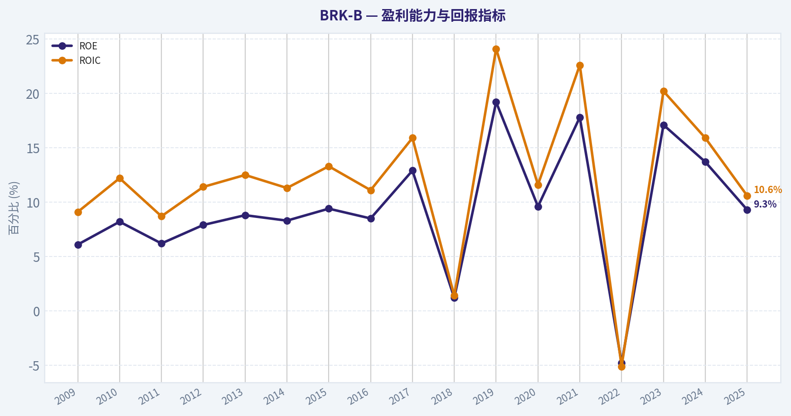
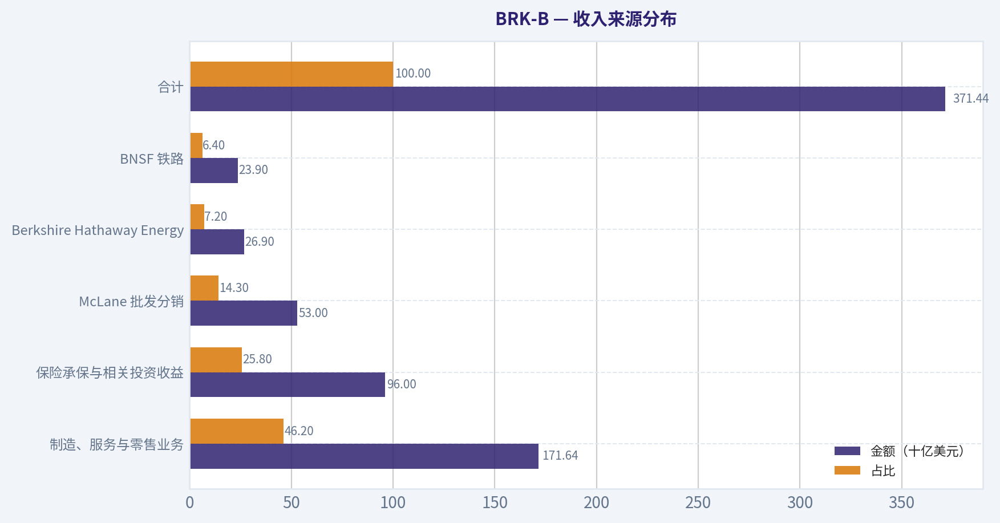
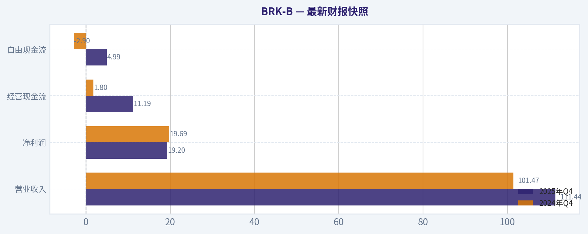
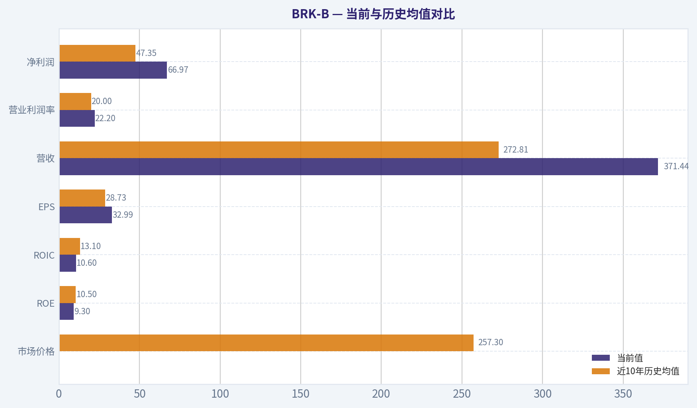
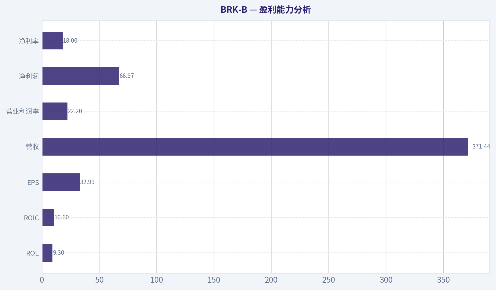
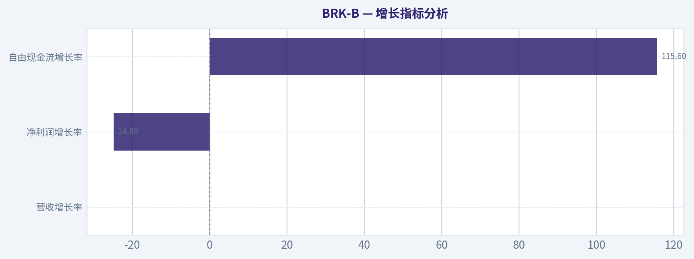
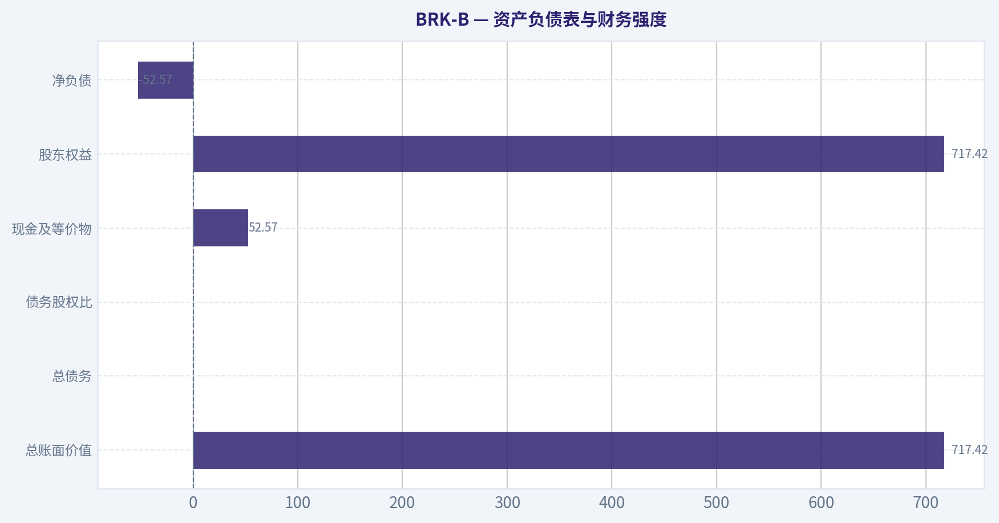
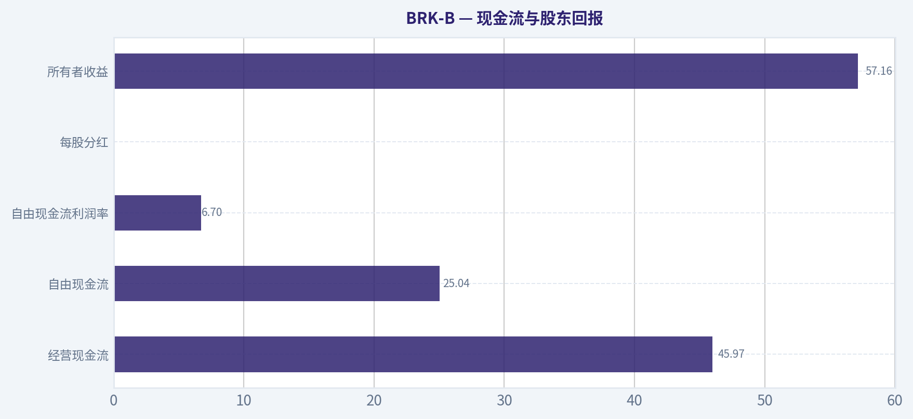

# BRK-B 深度价值情报

**调研日期:** 2026-05-02

## 关键免责声明

*本报告由 Deep Value Intelligence（一个基于 AI 的多智能体投资分析框架）自动生成。 本报告仅供信息参考和教育目的，不构成任何财务或投资建议。 在做出任何投资决策之前，请务必进行独立调研并咨询合规的财务顾问。*

---

## 目录

1. 情报摘要
2. 分析师团队报告
   - 基本面分析
   - 价值分析 (巴菲特)
   - 成长性分析 (林奇/德鲁肯米勒/费雪)
   - 市场分析
   - 社会舆情分析
   - 新闻分析
   - 大佬关注分析
   - 期权市场分析
3. 研究团队评论
4. 投资团队评论
5. Deep Values 团队洞察

---

## 情报摘要

### 核心观点与前提条件

**核心论点:** ### 风险管理法官与投资促进者评估报告：伯克希尔哈撒韦 (BRK-B)

**主要风险:**
- 最终裁决**：**观望 (WATCH)** -- 转向"谨慎分批累积"。
- 激进派 (Risky Analyst)**：指出保守派的最大盲区在于"等待的代价"。BRK-B 的最大价值不是单季增长，而是巨额现金在危机时展现出的"期权价值"。过度追求完美折扣，会导致永远错失这台长坡厚雪的复利机器。
- 原计划的缺陷**：原计划设定了死板的"$400 以下核心价值区间"才大举挥棒，且仅做单纯的 WATCH。这种"锚定偏误"可能导致完全错失长期底仓配置的机会。
- 观望 (WATCH)**

**观点反转条件:**
- 最终裁决**：**观望 (WATCH)** -- 转向"谨慎分批累积"。
- 激进派 (Risky Analyst)**：指出保守派的最大盲区在于"等待的代价"。BRK-B 的最大价值不是单季增长，而是巨额现金在危机时展现出的"期权价值"。过度追求完美折扣，会导致永远错失这台长坡厚雪的复利机器。
- 原计划的缺陷**：原计划设定了死板的"$400 以下核心价值区间"才大举挥棒，且仅做单纯的 WATCH。这种"锚定偏误"可能导致完全错失长期底仓配置的机会。
- 观望 (WATCH)**

**置信度:** 中

---

## 分析师团队报告

### 基本面分析

#### 最新财报快照

*以下数据基于最近一期已披露财报（2025年Q4），并尽量与上一年同期对比。*

| 指标 | 2025年Q4 | 2024年Q4 | 同比变化 |
| --- | ---: | ---: | ---: |
| 营业收入 | $111.44B | $101.47B | +9.8% |
| 营业利润 | N/A | N/A | N/A |
| 净利润 | $19.20B | $19.69B | -2.5% |
| 摊薄每股收益 | N/A | N/A | N/A |
| 经营现金流 | $11.19B | $1.80B | +520.7% |
| 自由现金流 | $4.99B | $-2.90B | +272.2% |

关键结论：这张快照先把最新一期财报放在桌面上，再去看长周期分析。这样读者能更清楚地区分"公司长期质量"和"这次财报发生了什么"。

#### BRK-B 10年财务指标

*以下数值均由原始数据确定性计算得出，并非 AI 估算。*

*发行人类型：insurer（Financial Services / Insurance - Diversified）。*

#### 10年财务指标
*年度行来自已披露财务报表，最后一行 TTM 由最近四个季度滚动计算得出。*

| 指标 | 2009 | 2010 | 2011 | 2012 | 2013 | 2014 | 2015 | 2016 | 2017 | 2018 | 2019 | 2020 | 2021 | 2022 | 2023 | 2024 | 2025 |
| --- | --- | --- | --- | --- | --- | --- | --- | --- | --- | --- | --- | --- | --- | --- | --- | --- | --- |
| 市场价格 | $66 | $80 | $76 | $90 | $119 | $150 | $132 | $163 | $198 | $204 | $226 | $232 | $299 | $309 | $357 | $453 | $503 |
| 总市值 | N/A | $88.1M | $71.7M | N/A | N/A | N/A | N/A | N/A | N/A | N/A | N/A | N/A | $677.32B | $680.60B | $775.14B | $977.53B | $1.02T |
| 市盈率 | 19.12 | 0.01 | 0.01 | 14.93 | 15.01 | N/A | 13.53 | 16.75 | 10.82 | 125.05 | 6.80 | 12.77 | 7.53 | -29.90 | 8.06 | 10.98 | 15.23 |
| 市净率 | 0.83 | 0.00 | 0.00 | N/A | N/A | N/A | 1.28 | 1.43 | 1.40 | 1.44 | 1.30 | 1.24 | 1.34 | 1.44 | 1.38 | 1.51 | 1.42 |
| ROE | 6.1% | 8.2% | 6.2% | 7.9% | 8.8% | 8.3% | 9.4% | 8.5% | 12.9% | 1.2% | 19.2% | 9.6% | 17.8% | -4.8% | 17.1% | 13.7% | 9.3% |
| ROIC | 9.1% | 12.2% | 8.7% | 11.4% | 12.5% | 11.3% | 13.3% | 11.1% | 15.9% | 1.4% | 24.1% | 11.6% | 22.6% | -5.1% | 20.2% | 15.9% | 10.6% |
| 每股收益 | N/A | $11788.18 | $10908.51 | N/A | N/A | N/A | N/A | N/A | N/A | N/A | N/A | N/A | $39.70 | $-10.33 | $44.27 | $41.27 | $32.99 |
| 营收 | $112.49B | $136.19B | $143.69B | $162.46B | $182.15B | $194.70B | $210.94B | $215.11B | $239.93B | $247.84B | $254.62B | $245.58B | $276.19B | $302.02B | $364.48B | $371.43B | $371.44B |
| 毛利润 | N/A | N/A | N/A | N/A | N/A | N/A | N/A | N/A | N/A | N/A | N/A | N/A | N/A | N/A | N/A | N/A | N/A |
| 毛利率 | N/A | N/A | N/A | N/A | N/A | N/A | N/A | N/A | N/A | N/A | N/A | N/A | N/A | N/A | N/A | N/A | N/A |
| 营业利润率 | 10.3% | 14.0% | 10.7% | 13.7% | 15.8% | 14.4% | 16.6% | 15.7% | 9.9% | 1.6% | 40.3% | 22.7% | 40.5% | -10.1% | 33.0% | 29.7% | 22.2% |
| 净利润 | $8.05B | $12.97B | $10.25B | $14.82B | $19.48B | $19.87B | $24.08B | $24.07B | $44.94B | $4.02B | $81.42B | $42.52B | $89.94B | $-22.76B | $96.22B | $89.00B | $66.97B |
| 净利率 | 7.2% | 9.5% | 7.1% | 9.1% | 10.7% | 10.2% | 11.4% | 11.2% | 18.7% | 1.6% | 32.0% | 17.3% | 32.6% | -7.5% | 26.4% | 24.0% | 18.0% |
| 营收增长 | N/A | 21.1% | 5.5% | 13.1% | 12.1% | 6.9% | 8.3% | 2.0% | 11.5% | 3.3% | 2.7% | -3.5% | 12.5% | 9.4% | 20.7% | 1.9% | 0.0% |
| 净利润增长 | N/A | 61.0% | -20.9% | 44.6% | 31.4% | 2.0% | 21.2% | -0.0% | 86.7% | -91.1% | 1924.8% | -47.8% | 111.5% | -125.3% | -522.8% | -7.5% | -24.8% |
| 自由现金流增长 | N/A | 9.2% | 3.1% | -9.0% | 48.7% | 1.3% | -8.4% | 27.8% | 72.8% | -32.8% | -0.7% | 17.8% | -2.3% | -16.3% | 36.1% | -61.0% | 115.6% |
| 总账面价值 | $131.10B | $157.32B | $164.85B | $187.65B | $221.89B | $240.17B | $255.55B | $282.07B | $348.30B | $348.70B | $424.79B | $443.16B | $506.20B | $473.42B | $561.27B | $649.37B | $717.42B |
| 总资产 | $297.12B | $372.23B | $392.65B | $427.45B | $484.62B | $525.87B | $552.26B | $620.85B | $702.10B | $707.79B | $817.73B | $873.73B | $959.39B | $948.47B | $1.07T | $1.15T | $1.22T |
| 总债务 | $0 | $0 | $0 | $0 | $0 | $0 | $0 | $0 | $0 | $0 | $0 | $0 | $0 | $0 | $0 | $0 | $0 |
| 债务股权比 | 0.00 | 0.00 | 0.00 | 0.00 | 0.00 | 0.00 | 0.00 | 0.00 | 0.00 | 0.00 | 0.00 | 0.00 | 0.00 | 0.00 | 0.00 | 0.00 | 0.00 |
| 现金及等价物 | $30.56B | $38.23B | $37.30B | $46.99B | $45.91B | $60.03B | $67.60B | $28.64B | $32.21B | $30.81B | $64.63B | $48.40B | $88.71B | $36.40B | $38.64B | $48.38B | $52.57B |
| 股东权益 | $131.10B | $157.32B | $164.85B | $187.65B | $221.89B | $240.17B | $255.55B | $282.07B | $348.30B | $348.70B | $424.79B | $443.16B | $506.20B | $473.42B | $561.27B | $649.37B | $717.42B |
| 经营现金流 | $15.85B | $17.89B | $20.48B | $20.95B | $27.70B | $32.01B | $31.49B | $32.65B | $45.73B | $37.40B | $38.69B | $39.77B | $39.43B | $37.35B | $49.20B | $30.59B | $45.97B |
| 投资现金流 | $-11.16B | $-18.28B | $-19.19B | $-10.57B | $-27.54B | $-20.33B | $-28.00B | $-84.22B | $-41.01B | $-32.85B | $-5.62B | $-37.76B | $29.39B | $-87.60B | $-32.66B | $-10.29B | $-44.49B |
| 自由现金流 | $10.91B | $11.91B | $12.29B | $11.18B | $16.62B | $16.82B | $15.41B | $19.69B | $34.02B | $22.86B | $22.71B | $26.76B | $26.15B | $21.89B | $29.79B | $11.62B | $25.04B |
| 自由现金流利润率 | 9.7% | 8.7% | 8.5% | 6.9% | 9.1% | 8.6% | 7.3% | 9.2% | 14.2% | 9.2% | 8.9% | 10.9% | 9.5% | 7.2% | 8.2% | 3.1% | 6.7% |
| 每股分红 | N/A | $0.00 | $0.00 | N/A | N/A | N/A | N/A | N/A | N/A | N/A | N/A | N/A | $0.00 | $0.00 | $0.00 | $0.00 | $0.00 |

#### 盈利能力指标
- 净资产收益率 (ROE): 9.3%
- 投入资本回报率 (ROIC): 10.1%
- 总资产收益率 (ROA): 5.5%
- 毛利率: 不适用
- 营业利润率: 22.2%
- 净利率: 18.0%

#### 流动性指标
- 流动比率: 不适用
- 速动比率: 不适用

#### 杠杆指标
- 债务股权比: 0.00
- 利息覆盖倍数: 16.27
- 净负债: $-52.57B

#### 增长指标（同比）
- 营收增长: 0.0%
- 净利润增长: -24.8%
- 自由现金流增长: 115.6%
- 营收复合增长率（3年）: 7.1%
- 营收复合增长率（5年）: 8.6%

#### 估值指标
- 市盈率 (TTM): 15.24
- 预期市盈率: 21.75
- 市净率: 1.42
- 市销率: 2.75
- PEG 比率: 10.06
- 企业价值/EBITDA: -2.12
- 自由现金流收益率: 2.5%
- 盈利收益率: 6.6%

#### 所有者收益（巴菲特方法，代码计算）
- 净利润: $66.97B
- + 折旧与摊销: $13.48B
- - 资本开支: $-20.93B
- - 营运资本变动: $2.35B
- = **所有者收益: $57.16B**

#### 内在价值（代码计算）
- 当前价格: $473
- 巴菲特方法（所有者收益）:
  保守: $79
  平均: $718
  乐观: $2,639
- 现金流方法（FCF）:
  保守: $111
  平均: $187
  乐观: $348

#### Piotroski F分数: 3/9
- 净利润为正: 通过
- 经营现金流为正: 通过
- 资产回报率改善: 未通过
- 现金流大于净利润: 未通过
- 债务下降: 未通过
- 流动比率改善: 未通过
- 未稀释股本: 通过
- 毛利率改善: 未通过
- 资产周转率改善: 未通过

最终投资立场: **观望**

#### BRK-B 巴菲特式基本面结论

Berkshire Hathaway 是典型的"优秀企业 + 强资产负债表 + 长期资本配置能力"组合，但以当前约 **$473** 的股价、约 **$1.02T** 市值和 **1.42 倍市净率** 看，安全边际并不极端充足。确定性数据中的所有者收益 DCF 显示，平均情景内在价值约 **$718/股**，高于现价；但自由现金流方法的乐观值仅约 **$348/股**，说明估值结论高度依赖对保险浮存金、投资收益、资本配置和长期所有者收益增长的判断。

最核心判断是：**BRK-B 是高质量长期复利资产，但当前更适合观望或分批配置，而不是重仓追高。**

---

#### 当前与历史均值对比

| 指标 | 当前值 | 近10年历史均值 | 当前相对历史 | 解读 |
|---|---:|---:|---:|---|
| 市场价格 | $473 当前报价；2025表内价格 $503 | $257.3 | 明显高于历史 | 股价已显著重估，反映市场对其稳健性和现金配置能力的溢价 |
| 总市值 | $1.02T | 约 $777.6B | 高于历史 | 规模已进入万亿美元级别，未来大额资本部署难度上升 |
| P/E | 15.24倍 | 18.24倍 | 低于均值 | 表面不贵，但 GAAP 盈利受投资组合公允价值波动影响很大 |
| P/B | 1.42倍 | 1.38倍 | 略高于均值 | 接近历史中枢，不算明显便宜 |
| ROE | 9.3% | 10.5% | 略低于均值 | 庞大权益资本和现金储备压低回报率 |
| ROIC | 10.6% | 13.1% | 低于均值 | 资本效率较高峰期回落 |
| EPS | $32.99 | $28.73 | 高于可比均值 | 仍具盈利能力，但波动性来自投资收益 |
| 营收 | $371.44B | $272.81B | 显著高于均值 | 规模持续扩大，但当前同比增长为 0.0% |
| 营业利润率 | 22.2% | 20.0% | 高于均值 | 运营盈利质量仍较强 |
| 净利润 | $66.97B | $47.35B | 高于均值 | 绝对利润强，但同比下降 |
| 净利率 | 18.0% | 16.8% | 略高于均值 | 盈利能力仍优于长期均值 |
| 营收增长 | 0.0% | 6.9% | 明显低于均值 | 增长进入停滞期 |
| 净利润增长 | -24.8% | 约135.0% | 明显低于均值 | 历史均值被投资损益扭曲，当前盈利同比承压 |
| 自由现金流增长 | 115.6% | 3.3% | 显著高于均值 | 2025 FCF 从低基数强劲反弹 |
| 总账面价值 | $717.42B | $429.28B | 显著高于均值 | 账面资本持续复利积累 |
| 总资产 | $1.22T | $840.23B | 显著高于均值 | 资产规模庞大，抗风险能力强 |
| 总债务 | $0 | $0 | 持平 | 确定性数据口径显示无债务压力 |
| 债务股权比 | 0.00 | 0.00 | 持平 | 财务杠杆极低 |
| 现金及等价物 | $52.57B | $48.44B | 略高于均值 | 流动性充足，具备危机投资弹药 |
| 股东权益 | $717.42B | $429.28B | 显著高于均值 | 资本基础持续扩大 |
| 自由现金流 | $25.04B | $23.09B | 略高于均值 | FCF 恢复，但收益率仅约 2.5% |
| 每股分红 | $0.00 | $0.00 | 持平 | 公司继续偏好留存收益、回购和再投资 |

关键结论：BRK-B 当前盈利、账面价值、资产规模和净利率均高于历史均值，显示其长期复利能力仍在。但估值已不便宜，P/B 略高于历史均值，营收增长降至 0.0%，ROE 和 ROIC 低于长期均值，说明当前买入的安全边际主要来自企业质量，而不是明显低估。

---

#### 市场指标解读

| 指标 | 当前水平 | 巴菲特式解读 |
|---|---:|---|
| 市场价格 | 约 $473；2025表内价格 $503 | 股价已充分反映"高质量避险型复利资产"的特征 |
| 总市值 | $1.02T | 规模优势强，但大数法则会压低未来复利速度 |
| P/E | 15.24倍 | 看似合理，但 BRK 的净利润受权益投资公允价值波动影响，单看 P/E 容易误判 |
| P/B | 1.42倍 | 接近历史中枢略偏高，未出现明显"捡便宜"区间 |

关键结论：BRK-B 的估值不属于泡沫化，但也不是深度价值区间。对 Berkshire 而言，P/B 比 P/E 更有参考意义；当前 1.42 倍 P/B 表明市场愿意为其品牌、浮存金、现金和资本配置能力支付合理溢价。

---

#### 盈利能力分析

| 指标 | 当前值 | 质量判断 |
|---|---:|---|
| ROE | 9.3% | 稳健但不惊艳，受庞大权益和现金拖累 |
| ROIC | 10.6% | 高于资本成本，但低于近10年均值 |
| EPS | $32.99 | 为正且高于近年可比均值，但波动性较大 |
| 营收 | $371.44B | 规模庞大，说明业务基础非常稳固 |
| 毛利润 / 毛利率 | N/A | 对保险与综合控股公司不适用 |
| 营业利润率 | 22.2% | 高于长期均值，经营质量较好 |
| 净利润 | $66.97B | 绝对利润强，但同比下降 |
| 净利率 | 18.0% | 高于历史均值，显示投资收益和运营利润仍强 |

关键结论：Berkshire 的盈利质量不能只看 GAAP 净利润，因为投资组合的未实现损益会造成剧烈波动。更重要的是，公司长期保持正自由现金流、较高营业利润率和强大资本基础，这符合巴菲特偏好的"可持续赚钱机器"特征。

---

#### 增长指标分析

| 指标 | 当前值 | 历史含义 |
|---|---:|---|
| 营收增长率 | 0.0% | 明显低于历史均值，短期增长停滞 |
| 净利润增长率 | -24.8% | 盈利同比下降，但受投资收益波动影响 |
| 自由现金流增长率 | 115.6% | 从 2024 低基数强劲反弹 |

关键结论：BRK-B 当前最大问题不是生存质量，而是增长速度。营收同比为零，说明万亿美元规模下继续高速扩张已变得困难；不过自由现金流反弹显示公司现金创造力仍然存在。

---

#### 资产负债表与财务强度

| 项目 | 当前值 | 判断 |
|---|---:|---|
| 总账面价值 | $717.42B | 长期复利积累明显 |
| 总资产 | $1.22T | 资产规模极强 |
| 总债务 | $0 | 确定性数据口径下无债务负担 |
| 债务股权比 | 0.00 | 财务杠杆极低 |
| 现金及等价物 | $52.57B | 流动性充足 |
| 股东权益 | $717.42B | 权益资本雄厚 |
| 净负债 | -$52.57B | 净现金状态 |
| 利息覆盖倍数 | 16.27倍 | 偿付能力强 |

关键结论：资产负债表是 BRK-B 最强的护城河之一。低杠杆、净现金和庞大权益资本让公司在市场危机中拥有逆周期收购、回购和投资能力，这正是巴菲特体系中最重要的"等待好球"能力。

---

#### 现金流与股东回报

| 指标 | 当前值 | 解读 |
|---|---:|---|
| 经营现金流 | $45.97B | 经营性现金创造力强 |
| 自由现金流 | $25.04B | 高于近10年均值，但 FCF 收益率仅 2.5% |
| 自由现金流利润率 | 6.7% | 低于历史较好年份 |
| 每股分红 | $0.00 | 不分红，偏好留存资本、投资和回购 |
| 所有者收益 | $57.16B | 巴菲特式估值的核心输入 |

关键结论：Berkshire 不分红并非股东回报不足，而是管理层认为内部资本配置、回购和危机投资更有效。问题在于，当前 FCF 收益率只有约 2.5%，若未来找不到足够高回报的资本部署机会，估值吸引力会下降。

---

#### 收入来源分布

| 收入来源 | 金额（十亿美元） | 占比 |
|---|---:|---:|
| 制造、服务与零售业务 | $171.64B | 46.2% |
| 保险承保与相关投资收益 | $96.00B | 25.8% |
| McLane 批发分销 | $53.00B | 14.3% |
| Berkshire Hathaway Energy | $26.90B | 7.2% |
| BNSF 铁路 | $23.90B | 6.4% |
| 合计 | $371.44B | 100.0% |

关键结论：BRK-B 的收入并不依赖单一业务，最大来源是制造、服务与零售，其次是保险和投资收益。BNSF 与能源业务占比不算最高，但它们提供了高度稳定、资产壁垒强的现金流，是公司长期韧性的重要来源。

---

#### 巴菲特式所有者收益 DCF 估值

使用确定性数据中的当前所有者收益：

| 项目 | 数值 |
|---|---:|
| 净利润 | $66.97B |
| 加：折旧与摊销 | $13.48B |
| 减：资本开支 | $20.93B |
| 减：营运资本变动 | $2.35B |
| 所有者收益 | $57.16B |
| 折现率 | 10.0% |
| 永续增长率 | 2.5% |
| 当前股价 | $473 |
| 总市值 | $1.02T |

关键结论：所有者收益为 $57.16B，是 BRK-B 估值中比 GAAP 净利润更有意义的现金盈利指标。由于 Berkshire 的投资收益和保险浮存金结构特殊，所有者收益法比单纯 P/E 更接近巴菲特式估值思路。

DCF 公式：

| 步骤 | 公式 |
|---|---|
| 第 t 年所有者收益 | OEₜ = OE₀ x 1 + g 的 t 次方 |
| 前10年现值 | Σ OEₜ / 1.10 的 t 次方 |
| 终值 | OE₁₀ x 1.025 / 10.0% - 2.5% |
| 终值现值 | 终值 / 1.10 的10次方 |
| 每股价值 | 企业权益价值 / 稀释后等效股数 |

关键结论：DCF 的关键敏感变量是长期所有者收益增长率。由于 BRK-B 的保险、投资和经营业务混合在一起，增长率的小幅变化会导致估值结果差异巨大，因此必须同时看保守、平均和乐观情景。

| 情景 | 增长假设 | 确定性DCF公允价值 | 相对 $473 当前股价 | 投资含义 |
|---|---:|---:|---:|---|
| 保守情景 | 使用最低历史所有者收益增长率，且不低于 -100% | $79/股 | 约 -83% | 若盈利持续收缩，现价缺乏保护 |
| 平均情景 | 使用平均历史所有者收益增长率，且不高于 50% | $718/股 | 约 +52% | 若长期复利能力延续，现价具备吸引力 |
| 乐观情景 | 使用最高历史所有者收益增长率，且不高于 100% | $2,639/股 | 约 +458% | 需要极强资本配置和高增长持续兑现 |

关键结论：所有者收益 DCF 给出的估值区间极宽，从 $79 到 $2,639，说明 BRK-B 的价值高度依赖未来资本配置效率。平均情景明显高于现价，但保守情景远低于现价，因此当前不能简单定义为"确定性低估"。

作为交叉验证，确定性数据中的自由现金流法结果如下：

| 方法 | 保守价值 | 平均价值 | 乐观价值 |
|---|---:|---:|---:|
| 自由现金流 DCF | $111/股 | $187/股 | $348/股 |

关键结论：自由现金流法显著低于所有者收益法，说明 BRK-B 的估值争议很大。若投资者只相信可见 FCF，当前股价偏贵；若认可保险浮存金、投资组合和资本配置的长期价值，当前估值则较合理。

---

#### 巴菲特式定性分析

| 维度 | 评价 | 具体判断 |
|---|---|---|
| 经济护城河 | 很强 | 保险浮存金、BNSF 铁路网络、能源基础设施、品牌声誉和永久资本共同构成护城河 |
| 财务强度 | 很强 | 确定性数据口径下总债务为零、净现金 $52.57B、股东权益 $717.42B |
| 盈利可预测性 | 中高 | 经营现金流较稳定，但 GAAP 净利润受投资组合市值波动影响较大 |
| 管理层表现 | 强 | 长期资本配置能力优秀，但公司规模变大后边际回报下降 |
| 股东回报 | 稳健但间接 | 不分红，主要通过留存收益、回购、投资和并购创造价值 |
| 估值吸引力 | 中性偏合理 | P/B 接近历史均值，P/E 不高但参考意义有限 |
| 企业质量 | 很高 | 多元化、现金充足、抗周期能力强，适合长期持有型投资者 |

关键结论：BRK-B 几乎符合巴菲特本人偏好的大多数标准：强护城河、保守财务、可理解业务、长期资本配置能力和优秀声誉。但从"用合理价格买伟大公司"的角度看，当前价格更像合理偏高，而非罕见便宜。

---

#### 关键机会

| 机会 | 影响 |
|---|---|
| 大量现金可在市场恐慌时部署 | 市场下跌反而可能提升长期回报 |
| 保险浮存金继续提供低成本资金 | 若承保纪律保持，浮存金是结构性优势 |
| BNSF 与能源业务提供稳定现金流 | 支撑长期内在价值 |
| 高利率环境提高现金和短债收益 | 投资收益对利润形成支撑 |
| 回购可在低估时提升每股价值 | 若股价低于内在价值，回购将增厚股东权益 |

关键结论：BRK-B 的最大机会来自"耐心资本"。它不需要每年高速增长，只要在危机时用现金买入优质资产，就能继续创造长期复利。

---

#### 主要红旗

| 风险 | 具体表现 |
|---|---|
| 增长放缓 | 当前营收增长为 0.0%，规模过大限制增速 |
| 估值安全边际不厚 | P/B 1.42倍略高于历史均值 |
| FCF 收益率偏低 | 当前约 2.5%，对价值投资者吸引力有限 |
| GAAP 盈利波动 | 投资组合公允价值变化会扭曲净利润 |
| Piotroski F分数较低 | 仅 3/9，显示短期财务动能一般 |
| 接班与关键人物风险 | 即使制度成熟，市场仍可能给予管理层更替折价 |
| 资本部署难度上升 | 万亿美元体量使高回报大额投资更难找到 |

关键结论：BRK-B 的风险不是破产风险，而是"回报率下降风险"。如果未来现金持续堆积、优质收购机会不足、ROE 和 ROIC 继续下行，股价可能长期跑输更高成长资产。

---

#### 最终投资立场：观望

| 结论项 | 判断 |
|---|---|
| 企业质量 | 极高 |
| 财务安全 | 极强 |
| 护城河 | 很深 |
| 当前估值 | 合理但非明显便宜 |
| 增长动能 | 偏弱 |
| 安全边际 | 中等偏低 |
| 适合投资者 | 长期稳健型、低换手、重视抗风险能力的投资者 |
| 不适合投资者 | 追求高增长、高股息或短期催化的投资者 |
| 最终立场 | 观望；已有仓位可持有，新增仓位宜等待更好价格 |

关键结论：BRK-B 是可以长期跟踪甚至长期持有的优质复利资产，但当前并未提供足够明显的巴菲特式安全边际。若股价回落至更低 P/B 区间、FCF 收益率提升，或市场恐慌带来资本部署机会，投资吸引力会明显增强。

---

#### 报告要点汇总

| 类别 | 核心要点 | 投资含义 |
|---|---|---|
| 质量 | 多元化控股、保险浮存金、铁路、能源和现金共同支撑 | 长期抗风险能力强 |
| 估值 | P/E 15.24倍、P/B 1.42倍，接近历史合理区间 | 不贵但也不便宜 |
| 盈利 | 净利润 $66.97B，净利率 18.0%，营业利润率 22.2% | 盈利质量仍强 |
| 增长 | 营收增长 0.0%，净利润增长 -24.8% | 短期增长动能不足 |
| 现金流 | FCF $25.04B，所有者收益 $57.16B | 现金创造力强，但 FCF 收益率偏低 |
| 资产负债表 | 现金 $52.57B，债务股权比 0.00 | 财务防御力极强 |
| DCF | 所有者收益平均情景 $718/股，FCF 乐观情景 $348/股 | 估值分歧大，需安全边际 |
| 红旗 | Piotroski 3/9、规模过大、资本部署难度上升 | 回报率可能下降 |
| 机会 | 危机投资、回购、保险浮存金、现金收益 | 下跌时吸引力更大 |
| 最终立场 | 观望 | 优质但等待更好买点 |

#### 基本面关键图表

本图追踪 **BRK-B** 过去十年的盈利能力与回报指标（ROE、ROIC、利润率），突出呈现资本效率的变化趋势。

本对比图（来自「收入来源分布」）将 **BRK-B** 的当前数据与历史基准并排呈现，直观反映公司相对自身历史均值的估值水平。

---

### 价值分析 (巴菲特)

> *基于沃伦·巴菲特的价值投资哲学：能力圈、经济护城河、管理层质量与安全边际。*

#### 内在价值快照

价格是你付的钱，内在价值是企业未来可能为股东创造的现金价值。我们给出一个区间，而不是假装只有一个神奇数字。

- 当前价格: $473.01
- 价值区间: $78.97 to $2,638.52

##### 所有者收益（巴菲特方法）
- 净利润: $66,968,000,000.00
- 折旧与摊销: $13,476,000,000.00
- 资本支出: $-20,927,000,000.00
- 营运资金变化: $2,355,000,000.00
- 所有者收益: $57,162,000,000.00

##### 内在价值
###### 所有者收益法
使用所有者收益，更严格，通常更保守。
- 保守: $78.97
- 平均: $718.34
- 乐观: $2,638.52
- 折现率: 10.0%

###### 自由现金流法
使用自由现金流，更适合今天投入很多、为未来增长铺路的公司。
- 保守: $110.77
- 平均: $187.04
- 乐观: $347.76
- 折现率: 10.0%

最终投资立场: **观望**

#### BRK-B 巴菲特式价值分析结论

以 $473 股价、约 $1.02 万亿美元市值、约 15.2 倍 PE、约 2.5% 自由现金流收益率来看，Berkshire Hathaway 仍是极少数"简单、稳健、抗脆弱"的复合型企业之一，但当前价格没有给出足够的安全边际。我的结论是：**企业质量优秀，资产负债表极强，但以保守内在价值估算，当前只接近合理价格，不是明显便宜。**

---

#### 一、Go / No-Go 闸门评估

| 闸门 | 结论 | 关键证据 | 巴菲特式判断 |
|---|---:|---|---|
| 能力圈与简单性 | 通过 | 保险浮存金、铁路、公用事业、制造服务、消费品、现金和股票投资组合 | 能用简单语言解释：收保费、运货、供电、卖产品、持有好公司 |
| 10 年可预测性 | 通过 | 核心资产如保险、BNSF、Berkshire Hathaway Energy、制造服务业务需求长期存在 | 10 年后大概率仍是大型保险加实业控股公司 |
| 技术颠覆风险 | 通过 | 铁路、公用事业、保险承保、能源基础设施不易被软件替代 | 技术更多是效率工具，而非毁灭性威胁 |
| 护城河 | 谨慎通过 | GEICO、BNSF、保险浮存金、能源资产、规模和信誉形成复合优势 | 宽但不再快速变宽，规模过大降低增速 |
| 管理与资本配置 | 谨慎通过 | 历史资本配置极佳，但 Buffett 年龄与接班后文化延续是关键变量 | 文化强，但不能把过去 60 年完全线性外推 |
| 行业结构 | 通过 | 保险、铁路、公用事业多为规模经济或寡头结构 | 资本密集部分较多，但回报稳定 |

**关键结论：** Berkshire 通过了巴菲特式投资的核心质量闸门：业务能理解、长期可预测、资产负债表极强、管理文化优秀。主要问题不是企业差，而是公司规模已经巨大，未来复利速度很难复制过去几十年的成绩。当前最重要的风险是"好公司不等于好价格"。

---

#### 二、护城河分析

| 护城河来源 | 证据 | 强度 | 评价 |
|---|---|---:|---|
| 品牌与信誉 | Berkshire 在保险、再保险、并购谈判中拥有极高信誉；卖方常愿意接受其长期持有文化 | 4 / 5 | 品牌不是消费品牌式溢价，而是资本市场信任溢价 |
| 保险浮存金 | 长期以低成本甚至负成本获得可投资资金 | 5 / 5 | 这是 Berkshire 最核心的结构性优势 |
| 成本优势 | GEICO 直销模式、BNSF 铁路规模、能源资产规模带来成本优势 | 4 / 5 | 部分优势稳固，但 GEICO 面临 Progressive 等强对手 |
| 切换成本 | 铁路客户、公用事业客户、再保险客户存在一定切换摩擦 | 3 / 5 | 不是软件式高切换成本，但基础设施属性强 |
| 网络效应 | 不明显 | 1 / 5 | Berkshire 不是网络效应型公司 |
| 资本配置声誉 | 大额交易中具备"快速、确定、少干预"的买方优势 | 5 / 5 | 这是普通资金无法复制的软护城河 |

**关键结论：** Berkshire 的护城河不是单一产品垄断，而是由保险浮存金、信誉、规模、资产多元化和资本配置文化组成的复合护城河。它的优势很难被新进入者复制，但由于体量已达万亿美元级别，护城河更像"稳定防御工事"，而不是高速扩张引擎。

---

#### 三、管理质量与资本配置

| 维度 | 评价 | 证据与判断 |
|---|---:|---|
| 股东导向 | 5 / 5 | 长期强调每股内在价值增长，不追逐季度业绩 |
| 诚实与透明 | 5 / 5 | 年报长期讨论错误、风险和估值局限，风格保守 |
| 资本配置 | 4 / 5 | 历史极强；但未来机会受公司规模限制 |
| 回购纪律 | 4 / 5 | 通常只在管理层认为低于内在价值时回购 |
| 接班风险 | 3 / 5 | Greg Abel 接班路径清晰，但 Buffett 个人声誉不可完全复制 |
| 杠杆纪律 | 5 / 5 | 持有大量现金和短债，保险风险管理保守 |

**关键结论：** Berkshire 的管理层历史上几乎是资本配置教科书，但未来不能简单等同于 Buffett 时代。接班安排清楚，文化也深厚，不过未来超额收益更可能来自稳健复利，而不是惊人复利。

---

#### 四、10 年财务概览，约数口径

> 注：Berkshire 的 GAAP 净利润受股票投资未实现盈亏影响很大，因此经营利润比净利润更能反映真实经营趋势。下表为公开财报口径的近似整理，用于方向性分析。

| 年度 | 营收，十亿美元 | 经营利润，十亿美元 | GAAP 净利润，十亿美元 | 股东权益，十亿美元 | 现金及短债，十亿美元 | 备注 |
|---:|---:|---:|---:|---:|---:|---|
| 2015 | 211 | 17 | 24 | 255 | 72 | 保险、铁路、能源为核心 |
| 2016 | 224 | 24 | 24 | 283 | 86 | 经营利润改善 |
| 2017 | 242 | 15 | 45 | 348 | 116 | 税改影响净利 |
| 2018 | 248 | 25 | 4 | 349 | 112 | 投资组合波动压低净利 |
| 2019 | 255 | 24 | 81 | 424 | 128 | 股票上涨推高净利 |
| 2020 | 246 | 22 | 43 | 443 | 138 | 疫情压力但现金充足 |
| 2021 | 276 | 28 | 90 | 514 | 147 | 经营恢复 |
| 2022 | 302 | 31 | -23 | 472 | 128 | 市场下跌导致 GAAP 亏损 |
| 2023 | 365 | 37 | 96 | 561 | 168 | 保险承保与投资收益强劲 |
| 2024 | 371 | 47 | 约 89 | 约 650 | 约 334 | 现金与短债显著增加 |

**关键结论：** 这张表最重要的信息是：Berkshire 的经营利润在过去十年大体上持续上升，而 GAAP 净利润剧烈波动，主要是股票投资会计处理造成的。现金和短债规模在 2024 年显著上升，说明公司防御能力极强，但也暗示管理层可能认为大规模投资机会不多。长期看，Berkshire 是一家现金生成能力强、抗风险能力强，但增长速度正在放缓的巨型复合企业。

---

#### 五、现金流与资产负债表现实检验

| 指标 | 当前或近似水平 | 巴菲特式解读 |
|---|---:|---|
| 市值 | 约 $1.02 万亿美元 | 已是全球最大企业之一，规模限制未来收益率 |
| 股价 | 约 $473 | 用于本次估值基准 |
| PE | 约 15.2 倍 | 表面不贵，但盈利口径需调整 |
| ROE | 约 9.3% | 低于"优秀企业"15%门槛，受巨大股东权益和现金拖累 |
| 自由现金流收益率 | 约 2.5% | 以自由现金流看并不便宜 |
| 现金及短债 | 约 $3000 亿以上 | 堡垒级资产负债表 |
| 财务杠杆 | 保守 | 保险负债需理解，但控股公司层面非常稳健 |
| 利息保障 | 很强 | 不是依赖债务滚动的企业 |

**关键结论：** Berkshire 的资产负债表是它最大的安全垫，现金储备使公司能在危机中进攻。但当前自由现金流收益率只有约 2.5%，说明投资者已经愿意为安全性和质量支付较高价格。它更像高质量防守型复利资产，而不是明显低估资产。

---

#### 六、Owner Earnings 估算

| 项目 | 估算值，十亿美元 | 说明 |
|---|---:|---|
| 经营利润基准 | 47 | 使用近年经营利润而非 GAAP 净利润 |
| 加：折旧摊销 | 14 | 铁路、能源、制造资产带来较高折旧 |
| 减：维护性资本开支 | -14 | 保守假设维护资本开支接近折旧 |
| 减：营运资本增加 | -2 | 使用正常化估计 |
| 正常化 Owner Earnings | 约 45 | 作为 DCF 的核心基准 |

**关键结论：** Berkshire 的真实盈利能力应以经营利润和所有者收益为核心，而不是被股票市场波动扭曲的 GAAP 净利润。保守估算下，当前正常化 Owner Earnings 约为 $450 亿。这个数字很强，但相对于 $1.02 万亿美元市值，初始收益率并不高。

---

#### 七、三情景 DCF 估值

核心假设：
- 折现率：10%
- B 类等效股数：约 21.6 亿股
- 正常化 Owner Earnings：约 $450 亿
- 保守纳入非经营投资和现金净值调整：约 $4500 亿
- 当前股价：$473

| 情景 | 假设 | 企业价值，十亿美元 | 每股内在价值 | 相对当前股价的安全边际 |
|---|---|---:|---:|---:|
| A：零增长 | Owner Earnings 永续不增长，按 10%资本化，加保守投资资产调整 | 约 900 | 约 $417 | -12% |
| B：GDP 增长 | 长期增长 3%，按 10%折现，加保守投资资产调整 | 约 1112 | 约 $516 | 约 8% |
| C：历史折扣增长 | 前 10 年增长 5%，之后 3%，加保守投资资产调整 | 约 1230 | 约 $571 | 约 17% |

**关键结论：** 在最保守情景下，当前价格偏高；在温和增长情景下，当前价格略低于内在价值；在较乐观但仍不激进的情景下，安全边际约 17%。这低于我对高质量企业要求的最低 25%安全边际，因此目前更适合持有或等待，而不是积极买入。

---

#### 八、最终巴菲特评分表

| 项目 | 权重 | 评分，1至5 | 加权分 | 理由 |
|---|---:|---:|---:|---|
| 业务理解度 | 20% | 4.3 | 0.86 | 业务多元但底层逻辑清楚 |
| 护城河宽度与耐久性 | 25% | 3.8 | 0.95 | 护城河宽，但增量变慢 |
| 管理质量 | 15% | 3.5 | 0.53 | 历史卓越，接班后仍需观察 |
| ROE | 15% | 2.5 | 0.38 | 当前 ROE 约 9.3%，低于理想水平 |
| 再投资空间 | 10% | 2.3 | 0.23 | 体量太大，高回报机会稀缺 |
| 资产负债表 | 5% | 5.0 | 0.25 | 堡垒级现金与保守杠杆 |
| 行业结构 | 5% | 3.5 | 0.18 | 保险、铁路、公用事业结构较好但资本密集 |
| 估值与安全边际 | 5% | 1.0 | 0.05 | 当前没有 25%安全边际 |
| 总分 | 100% | - | **3.43** | 高质量企业，价格不够吸引 |

**关键结论：** Berkshire 的质量分很高，但买入吸引力被估值和规模拖低。它不是"回避"的公司，而是"好公司等好价格"的典型案例。综合分数约 3.43，对应立场是观望。

---

#### 九、投资立场

| 结论项 | 判断 |
|---|---|
| 最终立场 | **观望** |
| 适合投资者 | 已持有者可继续持有；新资金应等待更好价格 |
| 理想买入区间 | 约 $390 至 $420 更有吸引力 |
| 合理价值中枢 | 约 $510 至 $520 |
| 强烈买入所需条件 | 股价较保守内在价值折让 25%以上，或公司出现明显高回报再投资机会 |
| 主要风险 | 接班后资本配置质量下降、保险巨灾损失、铁路和能源资本开支压力、现金拖累回报、规模过大导致复利放缓 |

**关键结论：** Berkshire 是一家值得尊重、值得长期跟踪的企业，但当前价格更像"合理偏公允"，而不是"明显便宜"。如果已经持有，可以继续让它作为防守型复利资产；如果是新买入，我会等待更大的安全边际。巴菲特式结论是：**好公司，价格不坏，但还不够便宜。**
#### 估值桥

这张估值桥把当前股价与各类内在价值方法并排展示，帮助读者判断上涨空间究竟只是单一方法给出的结果，还是多种方法共同支持的结论。

| 项目 | 每股内在价值 |
| --- | ---: |
| 巴菲特方法 | $718.34 |
| 现金流方法 | $187.04 |
| 当前价格 | $473.01 |

#### 关键结论

如果只有一种方法显著高于其他方法，说明上行空间更依赖特定建模假设。若多种方法的估值接近，则说明估值逻辑更加稳健。

#### 估值图表

本对比图（来自「最新财报快照」）将 **BRK-B** 的当前数据与历史基准并排呈现，直观反映公司相对自身历史均值的估值水平。

本对比图（来自「当前与历史均值对比」）将 **BRK-B** 的当前数据与历史基准并排呈现，直观反映公司相对自身历史均值的估值水平。

本对比图（来自「盈利能力分析」）将 **BRK-B** 的当前数据与历史基准并排呈现，直观反映公司相对自身历史均值的估值水平。

本对比图（来自「增长指标分析」）将 **BRK-B** 的当前数据与历史基准并排呈现，直观反映公司相对自身历史均值的估值水平。

本对比图（来自「资产负债表与财务强度」）将 **BRK-B** 的当前数据与历史基准并排呈现，直观反映公司相对自身历史均值的估值水平。

本对比图（来自「现金流与股东回报」）将 **BRK-B** 的当前数据与历史基准并排呈现，直观反映公司相对自身历史均值的估值水平。

---

### 成长性分析 (林奇/德鲁肯米勒/费雪)

> *基于彼得·林奇的GARP成长投资法、斯坦利·德鲁肯米勒的宏观拐点分析法，以及菲利普·费雪的深度调研法。*

最终投资立场: **观望**

#### BRK-B 增长投资结论

Berkshire Hathaway 是极高质量、极低破产风险、资本配置能力罕见的复合型企业，但它不是典型的 Lynch 式"快速成长股"。以当前约 **$473** 股价、约 **$1.02T** 市值、约 **15.2x PE**、约 **0% 营收同比增长**、约 **2.5% 自由现金流收益率** 来看，BRK-B 更适合防守型长期复利组合，而不是寻找 10 倍股的增长组合。

| 项目 | 判断 |
|---|---|
| Lynch 分类 | 稳健成长股 / 防御型复合器，不是快速成长股 |
| 增长属性 | 低至中个位数增长为主 |
| 10 倍股潜力 | 低 |
| 护城河 | 极强 |
| 资产负债表 | 极强 |
| 估值 | 合理偏公允，不便宜到足以弥补低增长 |
| 增长投资立场 | 观望 |
| 适合组合角色 | 防守核心、现金替代、危机期买入候选 |
| 不适合角色 | 高增长、十倍股、收入加速型标的 |

**关键结论：** BRK-B 是"好公司"，但不是"高增长公司"。它的优势在于现金、保险浮存金、资本配置、抗周期能力，而不是营收快速扩张。对增长投资者来说，当前更像是可持有的优质防守资产，而非应积极加仓的十倍股候选。

---

#### 1. Lynch 分类：稳健成长股，而非快速成长股

| Lynch 类别 | BRK-B 对应情况 | 结论 |
|---|---:|---|
| 慢速成长股 | 营收同比约 0%，部分年份低个位数 | 部分符合 |
| 稳健成长股 | 经营利润长期缓慢复利，抗周期能力强 | 主要符合 |
| 快速成长股 | 缺乏 15%-25% 以上持续收入增长 | 不符合 |
| 周期股 | 铁路、能源、制造有周期性，但集团更分散 | 部分相关 |
| 困境反转 | 非困境公司 | 不符合 |
| 资产型公司 | 大量现金、股票组合、保险浮存金 | 部分符合 |

**关键结论：** BRK-B 最合理的分类是"稳健成长型复合器"，而不是快速成长股。Lynch 框架下，它更适合"已经持有则继续观察"，不属于"新买入寻找 10 倍回报"的核心对象。

#### 2. 三句话讲清楚商业故事

- Berkshire 用保险业务获得长期浮存金，再把这些资金配置到股票、国债和全资经营企业中。
- 它拥有铁路、能源、保险、制造、服务、零售等多元业务，靠分散现金流和优秀资本配置长期复利。
- 最大看点不是高速增长，而是危机中有现金、有信誉、有耐心，可以在别人被迫卖出时买入优质资产。

#### 3. TAM 与 10 倍测试

| 指标 | 粗略判断 |
|---|---:|
| 当前市值 | 约 $1.02T |
| 当前收入规模 | 约 $360B-$400B 区间量级 |
| 10 倍收入目标 | 约 $3.6T-$4.0T |
| 全球可承载空间 | 理论上有，但现实难度极高 |
| 10 倍后市场份额问题 | 规模过大，难以靠现有模式实现 |
| 10 倍测试 | 不通过 |

**关键结论：** BRK-B 的规模已经太大，无法轻松再成长为 10 倍收入体量。它仍能复利，但更可能是每年中个位数到低双位数的内在价值增长，而不是高速扩张型增长。

#### 4. 收入增长趋势：无加速，偏成熟

| 指标 | 当前观察 |
|---|---:|
| 营收同比增长 | 约 0.0% |
| 近年收入趋势 | 稳定但不高速 |
| 主要增长来源 | 保险保费、投资收入、能源资本开支、收购 |
| 是否加速 | 否 |
| 增长质量 | 高质量但低速度 |
| 增长模式 | 成熟复利，而非爆发式扩张 |

**关键结论：** BRK-B 没有出现 Druckenmiller 所说的"增长加速拐点"。它的经营质量很高，但收入端缺乏明显上行斜率，增长投资吸引力因此受限。

#### 5. 单位经济模型：传统 SaaS 指标不适用

| 指标 | BRK-B 情况 | 评价 |
|---|---|---|
| LTV/CAC | 不适用 | 非订阅型商业模式 |
| NRR | 不适用 | 非 SaaS 模式 |
| Rule of 40 | 不适用 | 集团型保险与工业企业 |
| 自由现金流收益率 | 约 2.5% | 稳健但不便宜 |
| 保险浮存金成本 | 长期优势明显 | 核心护城河 |
| 资本配置效率 | 历史极强 | 关键价值来源 |

**关键结论：** BRK-B 不能用 SaaS 的 LTV/CAC 或 NRR 衡量。它真正的"单位经济"是保险浮存金成本、承保纪律、现金收益率和资本配置回报，这些方面依然强劲。

---

#### 6. 拐点评估

| 拐点类型 | 是否存在 | 说明 |
|---|---|---|
| 产品周期拐点 | 否 | 无单一新产品爆发 |
| 市占率拐点 | 否 | 集团太多元，难以形成统一市占率加速 |
| 利润率拐点 | 部分存在 | GEICO 承保改善、投资收入受高利率支持 |
| TAM 拐点 | 否 | 市场空间不是核心瓶颈，规模才是瓶颈 |
| 竞争格局拐点 | 部分存在 | 危机中可趁竞争对手流动性紧张出手 |
| 资本配置拐点 | 潜在存在 | 若市场大跌，巨额现金可变成进攻武器 |

**关键结论：** 当前最值得关注的不是经营增长拐点，而是"资本配置拐点"。如果市场出现流动性冲击或估值大幅回落，Berkshire 的现金和信誉会成为进攻性资产。

#### 7. 宏观环境评估

| 宏观因素 | 对 BRK-B 的影响 |
|---|---|
| 高利率 | 有利于现金和短债投资收益 |
| 降息周期 | 可能降低投资收入，但有利于资产估值 |
| 经济放缓 | 铁路、制造、零售承压，但保险和现金提供缓冲 |
| 市场波动 | 有利于 Berkshire 低价部署资本 |
| 通胀 | 能源、铁路、保险可部分转嫁，但成本也上升 |
| AI 等高增长主题 | 直接受益有限 |

**关键结论：** 宏观环境对 BRK-B 并非单向利好或利空。高利率提升现金收益，市场动荡提升资本配置机会，但它并不是 AI、云计算或网络安全这类高增长主题的直接受益者。

#### 8. Fisher 十五点评分

| Fisher 维度 | 评分 |
|---|---:|
| 产品是否有足够市场潜力 | 3 |
| 管理层是否持续开发新增长源 | 3 |
| R&D 效率 | 2 |
| 销售组织能力 | 3 |
| 利润率质量 | 4 |
| 利润率改善空间 | 3 |
| 员工关系 | 4 |
| 高管关系 | 5 |
| 管理层深度 | 4 |
| 成本与会计控制 | 5 |
| 独特护城河 | 5 |
| 长期利润前景 | 4 |
| 股权稀释风险 | 5 |
| 困难时的坦诚度 | 5 |
| 管理层诚信 | 5 |
| 总分 | 60 / 75 |

**关键结论：** Fisher 评分显示 Berkshire 是一家管理文化、财务纪律和护城河非常优秀的公司。扣分项主要来自增长速度不足、创新属性较弱，以及集团规模过大导致未来扩张难度上升。

#### 9. 估值分析

| 指标 | 当前水平 | 解读 |
|---|---:|---|
| 股价 | 约 $473 |
| 市值 | 约 $1.02T |
| PE | 约 15.2x |
| ROE | 约 9.3% |
| 自由现金流收益率 | 约 2.5% |
| 营收同比增长 | 约 0.0% |
| 粗略 PEG | 约 1.9x-3.0x，取决于正常化增长假设 |
| 估值结论 | 公允，非明显低估 |

**关键结论：** 15 倍左右的 PE 对 Berkshire 这种质量资产并不昂贵，但考虑到收入增长很低，PEG 并不吸引。估值更像"合理价格买优秀企业"，不是"低价买高增长拐点"。

#### 10. 情景估值框架

| 情景 | 假设 | 可能结果 |
|---|---|---|
| 熊市情景 | 经济放缓、铁路和制造承压、估值回到低位 | 股价回撤，但下行韧性强 |
| 基准情景 | 经营利润中个位数增长，现金收益稳定 | 年化回报中个位数至低双位数 |
| 牛市情景 | 市场大跌后成功部署巨额现金，保险利润改善 | 内在价值增长重新加速 |
| 高增长情景 | 需要大型收购或重大投资成功 | 概率较低 |

**关键结论：** BRK-B 的收益分布偏稳健，不是高弹性。最大上行来自危机中的资本部署，而不是日常业务自然高速增长。

---

#### 11. 增长投资者评分卡

| 维度 | 权重 | 评分 |
|---|---:|---:|
| Lynch 故事清晰度 | 10% | 4.0 |
| TAM 与增长跑道 | 20% | 2.0 |
| 收入增长 | 20% | 1.5 |
| 单位经济模型 | 15% | 3.5 |
| 竞争地位 | 10% | 5.0 |
| 管理层质量 | 10% | 4.5 |
| 宏观环境 | 5% | 3.5 |
| 盈利路径 | 5% | 4.5 |
| 估值 | 5% | 3.0 |
| 加权总分 | 100% | 3.05 / 5.00 |

**关键结论：** BRK-B 的强项是护城河、管理层、资产负债表和盈利稳定性。弱项非常明确：收入增长太慢，难以满足增长投资者寻找拐点和 10 倍股的要求，因此总分落在"观望"区间。

#### 12. 仓位立场

| 投资者类型 | 仓位建议 |
|---|---|
| 高增长组合 | 0%-2%，不是核心进攻仓 |
| 稳健复利组合 | 3%-8%，可作为防守核心之一 |
| 已持有投资者 | 可继续持有，等待更好买点 |
| 新建仓投资者 | 不急，优先等待估值回落或市场恐慌 |
| 激进增长投资者 | 资金效率不够高 |

**关键结论：** 对增长组合而言，BRK-B 不应占用太多进攻仓位。对稳健复利组合而言，它仍是高质量底仓候选，但最好在市场下跌或估值更有安全边际时加仓。

#### 13. 关键催化剂与风险

| 类别 | 内容 |
|---|---|
| 正面催化剂 | 市场大跌后大规模部署现金 |
| 正面催化剂 | GEICO 承保利润持续改善 |
| 正面催化剂 | 高利率维持，现金和短债收益继续贡献利润 |
| 正面催化剂 | 回购加速，显示管理层认为估值有吸引力 |
| 正面催化剂 | 大型优质收购出现 |
| 主要风险 | Buffett 时代后的关键人物风险 |
| 主要风险 | 规模过大导致未来复利率下降 |
| 主要风险 | 铁路、能源、制造业务受经济周期拖累 |
| 主要风险 | 保险巨灾损失或定价周期恶化 |
| 主要风险 | 股票组合集中度带来的市值波动 |

**关键结论：** Berkshire 的风险不是典型破产风险，而是复利率下降风险。它未来大概率仍会稳健，但要实现超额收益，需要市场给出更便宜的买点，或管理层找到足够大的资本配置机会。

#### 最终判断

BRK-B 是世界级质量资产，但不是当前增长投资框架下的优先买入对象。它缺少收入加速、TAM 扩张、产品周期爆发和 10 倍股特征；不过，它拥有强大现金、浮存金、资本配置文化和危机期进攻能力。

**最终立场：观望。**
如果已经持有，可以继续作为防守型复利资产；如果追求高增长和十倍股，应优先寻找收入增速更高、市场渗透率更低、拐点更明显的公司。

---

### 市场分析

最终投资立场: **观望**

#### BRK-B 技术面简报：防守型资产仍在修复，但趋势尚未重新转强

截至 2026-05-01，BRK-B 收于 **473.01 美元**。过去一年股价从 2025 年 5 月初的高位区域明显回落，目前仍低于 50 日与 200 日均线，说明中长期趋势尚未扭转；但短线动能已有边际修复，MACD 负值收窄、RSI 从接近超卖区回升，显示卖压较 3 月下旬至 4 月下旬有所缓和。整体判断是：**不宜追涨，适合等待重新站上 50 日均线或回踩下轨附近出现更明确支撑后再评估。**

---

#### 本次选用的 8 个互补指标

| 指标 | 当前读数或位置 | 主要作用 | 当前解读 |
|---|---:|---|---|
| close_10_ema | 473.54 | 短线趋势与入场节奏 | 收盘价 473.01 略低于 10 EMA，短线尚未完全转强 |
| close_50_sma | 482.48 | 中期趋势过滤 | 股价低于 50 日均线，反弹仍受中期压制 |
| close_200_sma | 489.90 | 长期趋势判断 | 股价低于 200 日均线，长期趋势偏弱 |
| macd | -2.47 | 动能方向 | 仍为负，但较 3 月底明显改善 |
| rsi | 45.34 | 超买超卖与反弹力度 | 脱离低位，但未进入强势区 |
| boll_ub | 484.30 | 上方波动压力 | 上轨接近 50 日均线，构成短期压力带 |
| boll_lb | 465.67 | 下方波动支撑 | 下轨附近是短线防守观察区 |
| atr | 6.22 | 波动率与止损参考 | 波动率下降，行情进入收敛修复阶段 |

关键结论：这组指标覆盖了短线趋势、中期趋势、长期趋势、动能、超买超卖、波动区间和风险控制。当前最重要的信息是：BRK-B 的下跌动能正在减弱，但股价仍未重新站上关键均线，因此更像是弱势后的修复，而不是已经确认的新一轮上升趋势。

---

#### 趋势结构：短线企稳，中长期仍偏弱

BRK-B 当前价格 **473.01** 略低于 10 EMA 的 **473.54**，说明短线买盘还没有形成稳定的上行动能。更关键的是，价格分别低于 50 SMA 的 **482.48** 和 200 SMA 的 **489.90**，这意味着中长期资金仍未给出明确的趋势确认。

从均线斜率看，50 日均线从 3 月初约 **494.63** 下滑到 5 月初 **482.48**，中期趋势仍在下行；200 日均线从 3 月初约 **492.19** 小幅下降至 **489.90**，长期趋势虽非急跌，但已从横向转为轻微下倾。短线若要改善，第一步需要有效站上 **475-478** 区间；若进一步突破 **482-485**，才更有资格讨论中期修复。

| 趋势层级 | 关键指标 | 当前位置 | 技术含义 |
|---|---:|---:|---|
| 短线 | 10 EMA | 473.54 | 股价略低于该线，短线偏中性偏弱 |
| 中期 | 50 SMA | 482.48 | 股价低于该线约 2%，中期仍承压 |
| 长期 | 200 SMA | 489.90 | 股价低于该线约 3.4%，长期趋势未恢复 |
| 当前收盘价 | Close | 473.01 | 处于均线系统下方，仍需确认反转 |

关键结论：BRK-B 的价格结构并不是崩跌状态，但也尚未转为多头排列。短线正在靠近 10 EMA 附近横向整理，真正的技术改善需要先突破 482-485 美元压力带。

---

#### 动能与情绪：卖压减弱，但买盘强度仍不足

MACD 当前为 **-2.47**，虽然仍在零轴下方，但已经较 3 月底的低位明显改善；这说明下行动能正在减弱。不过，MACD 尚未回到正值区间，因此更适合解读为"空头动能衰退"，而不是"多头趋势确立"。

RSI 当前为 **45.34**，位于中性偏弱区域。值得注意的是，RSI 曾在 3 月 27 日降至约 **29.25**，进入接近超卖状态；随后回升到 40-50 区间，显示市场已从恐慌性卖压中恢复。但 RSI 尚未突破 50-55 的强弱分界区，说明反弹力度仍有限。

| 动能指标 | 当前读数 | 近期变化 | 解读 |
|---|---:|---|---|
| MACD | -2.47 | 从 3 月底约 -5.52 改善 | 下跌动能减弱，但仍未转正 |
| RSI | 45.34 | 从 3 月底接近 30 回升 | 情绪修复，但未进入强势区 |
| 价格相对 10 EMA | 略低 | 差距很小 | 短线方向处于临界状态 |
| 价格相对 50 SMA | 明显低于 | 尚未收复 | 中期趋势仍未确认反转 |

关键结论：动能指标传递的是"跌势放缓"，不是"趋势转强"。如果 RSI 能稳定回到 50 以上，同时 MACD 继续上行并接近零轴，BRK-B 的技术面才会明显改善。

---

#### 波动区间：465-485 美元是当前核心交易带

布林带显示，当前上轨约 **484.30**，下轨约 **465.67**，中轨约 **474.98**。收盘价 **473.01** 略低于中轨，说明价格仍在区间中下部运行，但并没有贴近下轨，短线没有明显"极端超卖"信号。

这一区间非常关键：
- **465-466 美元**：接近布林下轨，是短线防守观察区；若跌破，可能再次测试 460 或 455 附近。
- **475 美元附近**：布林中轨与短线均线附近，是当前多空分界。
- **482-485 美元**：布林上轨与 50 日均线重合区域，是第一道重要压力。
- **490 美元附近**：接近 200 日均线，是更高层级的趋势确认位。

| 区间 | 对应指标 | 技术意义 | 交易含义 |
|---|---:|---|---|
| 465-466 | 布林下轨 | 短线支撑区 | 跌至此处可观察是否有承接 |
| 473-475 | 10 EMA 与布林中轨 | 当前平衡区 | 站稳则短线修复延续 |
| 482-485 | 50 SMA 与布林上轨 | 第一压力带 | 突破后中期结构改善 |
| 489-491 | 200 SMA 附近 | 长期趋势关口 | 站上后才偏向趋势反转 |

关键结论：BRK-B 当前最核心的交易区间是 465 到 485 美元。价格在这个区间内震荡时，追涨和杀跌的性价比都不高，等待突破或回踩确认更合理。

---

#### 风险与仓位：波动率下降，但方向仍未明朗

ATR 当前约 **6.22**，相当于股价的约 **1.3%**。相比 3 月初接近 **9.26** 的 ATR，目前波动率明显下降，说明市场从高波动下跌阶段转入低波动整理阶段。低波动本身并不代表安全，它往往意味着后续方向突破正在酝酿。

若做短线交易，可用 ATR 作为止损参考：
- 若在 473 附近试探性参与，1 倍 ATR 风险大约在 **466-467** 附近；
- 若跌破 **465** 且不能快速收复，说明布林下轨失守，技术结构会重新转弱；
- 若突破 **485** 并放量站稳，则可上看 **490-500** 区域，但仍需确认 200 日均线是否被有效收复。

| 风险指标 | 当前读数 | 变化方向 | 含义 |
|---|---:|---|---|
| ATR | 6.22 | 较 3 月明显下降 | 波动收敛，趋势等待选择方向 |
| ATR 占股价比例 | 约 1.3% | 中低水平 | 止损空间相对可控 |
| 下方关键位 | 465-466 | 接近布林下轨 | 跌破则弱势延续 |
| 上方关键位 | 482-485 | 均线与布林上轨重合 | 突破才改善中期结构 |

关键结论：当前 BRK-B 的波动率已经降温，但趋势方向仍不够清晰。仓位管理应偏保守，除非价格突破 485 美元或回踩 465 美元附近出现明确承接，否则不宜激进加仓。

---

#### 操作结论

当前 BRK-B 更适合列入观察名单，而不是立即积极配置。它具备防守型大型复合企业的长期特征，但从技术面看，股价仍处于 50 日和 200 日均线下方，趋势尚未完成修复。较理想的多头确认信号是：**收盘价站上 485 美元，并进一步挑战 490 美元上方；若跌破 465 美元，则应重新评估下行风险。**

| 项目 | 判断 | 关键价位 | 行动建议 |
|---|---|---:|---|
| 当前技术评级 | 观望 | 473.01 | 不追涨，等待确认 |
| 短线转强条件 | 站稳 475 | 475 附近 | 可观察轻仓试探 |
| 中期改善条件 | 突破 482-485 | 50 SMA 与布林上轨 | 突破后信号更可靠 |
| 长期转强条件 | 收复 490 | 200 SMA 附近 | 站稳后趋势明显改善 |
| 风险失守位 | 跌破 465 | 布林下轨附近 | 需防止再探低点 |

关键结论：BRK-B 目前处于"弱势修复"阶段，而不是明确的上升趋势。最稳健的策略是继续观望，等待 485 美元上方的突破确认，或等待 465 美元附近的支撑验证。

---

### 社会舆情分析

最终投资立场: **观望**

#### BRK-B 过去一周社媒、新闻与情绪综合报告

截至 2026-05-02，BRK-B 的市场讨论热度明显升温，核心驱动不是单一财报数字，而是"三件事叠加"：年度股东大会窗口、管理层传承预期、以及市场对 Berkshire Hathaway 巨额现金、保险承保周期和股票投资组合表现的再评估。社媒整体语气偏理性，不像高成长科技股那样情绪极端；多头强调"防御性、现金选择权、复利机器"，空头或谨慎派则集中质疑"估值不便宜、缺少催化剂、接班后估值溢价能否维持"。

本报告结论为：**短线不宜追高，长线仍具核心资产属性；当前更适合观望或逢回调分批，而非情绪化加仓。**

---

#### 一周情绪概览：热度上升，但多空分歧集中在"估值与传承"

| 日期 | 社媒热度 | 主导情绪 | 主要讨论点 | 交易含义 |
|---|---:|---|---|---|
| 4月26日 | 中等 | 偏正面 | 年度股东大会临近，长线投资者回顾 Berkshire 复利表现 | 长线资金关注度回升，但短线催化尚未释放 |
| 4月27日 | 中等 | 中性偏正面 | 保险业务、现金储备、债券收益率环境被频繁讨论 | 市场把 BRK-B 视作防御型配置标的 |
| 4月28日 | 较高 | 分歧 | 对持仓组合，尤其大型科技与金融股敞口的讨论增多 | 股价可能受大盘风格轮动影响 |
| 4月29日 | 较高 | 中性 | 投资者讨论估值、回购空间和账面价值倍数 | 估值敏感度上升，追高意愿下降 |
| 4月30日 | 高 | 偏谨慎 | 管理层传承、年度会议问答预期成为焦点 | 任何关于接班、资本配置的表态都可能影响短线情绪 |
| 5月1日 | 高 | 混合偏正面 | "现金为王"叙事升温，同时有人担心现金拖累收益 | 防御属性增强，但上涨弹性受质疑 |
| 5月2日 | 很高 | 观望偏正面 | 股东大会、财报窗口、管理层表态成为核心变量 | 事件驱动波动加大，适合等待信息落地 |

关键结论：过去一周 BRK-B 的讨论热度逐日升高，主要是年度股东大会和财报窗口带来的事件驱动。情绪并非单边乐观，而是"长期信任"与"短期估值谨慎"并存。对交易者而言，当前最大风险不是基本面突然恶化，而是好消息已部分反映在价格中，事件落地后可能出现获利了结。

#### 社媒主要叙事：多头买"稳定复利"，谨慎派担心"低催化"

| 叙事方向 | 社媒常见观点 | 情绪强度 | 对股价的潜在影响 |
|---|---|---:|---|
| 长期复利机器 | Berkshire 业务多元，保险、铁路、能源、制造、投资组合共同支撑内在价值 | 强 | 支撑长期估值底部 |
| 巨额现金储备 | 高现金被视为危机时的"弹药"，也让公司在市场下跌时有收购和回购空间 | 强 | 增强防御属性，但牛市中可能被认为拖累收益 |
| 管理层传承 | 投资者关注 Greg Abel 等管理层能否延续 Buffett 风格 | 强 | 若表态清晰稳健，有利于缓解估值折价 |
| 回购预期 | 投资者希望在股价低于内在价值时看到更积极回购 | 中等 | 回购信号可提供下方支撑 |
| 估值争议 | 一部分人认为 BRK-B 已不便宜，安全边际变薄 | 强 | 限制短线继续上行空间 |
| 持仓组合波动 | 大型持股表现会影响市场对 Berkshire 投资收益的预期 | 中等 | 增加与大盘指数的联动 |
| 缺少爆发性催化 | 相比 AI、半导体等热门板块，BRK-B 缺少高增长叙事 | 中等 | 可能导致资金短期流向更高弹性资产 |

关键结论：社媒上最有共识的正面因素是 Berkshire 的稳定性和现金选择权，最主要的负面因素是估值与催化不足。换句话说，市场并不怀疑 BRK-B 是优质公司，但在当前价位是否值得积极买入，分歧明显扩大。

---

#### 新闻与公司层面关注点

过去一周新闻和投资者讨论集中在以下几类信息：

1. **年度股东大会窗口**
   Berkshire 的年度会议通常被视为价值投资者的重要观察窗口。今年市场尤其关注管理层对资本配置、回购、保险业务、能源投资、铁路业务效率以及宏观环境的表态。相比一般公司会议，Berkshire 股东大会对市场心理的影响更偏"信任锚定"，即投资者希望从管理层语言中确认公司文化与投资纪律是否延续。

2. **管理层传承问题仍是估值核心变量**
   Berkshire 长期享有一定"Buffett 溢价"。社媒讨论显示，投资者并不只是关心接班人是谁，而是关心接班后三个问题：
   - 是否继续保持极强的资本纪律；
   - 是否避免为增长而高价收购；
   - 是否能在大规模现金管理上保持耐心。
   如果会议中管理层表达稳健，市场可能继续接受较高估值；如果表态模糊，则可能触发短线折价。

3. **现金储备的双重解读**
   多头认为，现金越多，Berkshire 在市场回撤时越有主动权；谨慎派则认为，如果长期找不到足够大的高回报投资机会，现金会拉低整体 ROE。当前高利率环境下，现金和短债收益仍能贡献利润，但这不是永久性增长来源。

4. **保险业务仍是基本面压舱石**
   社媒和新闻关注点中，保险承保纪律被反复提及。Berkshire 的保险浮存金是其长期投资模式的核心。若承保盈利保持强劲，市场会继续把 BRK-B 视作"低杠杆金融复合体"；若灾害损失或承保周期恶化，估值可能承压。

5. **股票投资组合影响市场情绪**
   Berkshire 大型持仓的表现仍会影响投资者对季度投资收益的解读。社媒上有不少讨论提醒，季度净利润可能因投资组合市值波动而失真，因此更应关注经营利润、浮存金质量和资本配置，而不是单季会计利润。

#### 过去一周新闻/事件影响矩阵

| 事件或话题 | 市场解读 | 情绪影响 | 对投资者的意义 |
|---|---|---:|---|
| 年度股东大会临近 | 重大信息窗口，关注管理层语气 | 正面偏观望 | 会议前后波动可能放大 |
| 管理层传承 | 公司文化延续是估值关键 | 混合 | 若信任增强，可降低估值折价 |
| 现金储备 | 防御性强，但增长效率受质疑 | 混合偏正面 | 下跌时提供安全垫，上涨时限制弹性 |
| 回购讨论 | 市场希望看到纪律性回购 | 偏正面 | 回购价格区间是重要信号 |
| 保险业务 | 被视为长期复利引擎 | 正面 | 经营利润质量比会计利润更重要 |
| 持仓组合波动 | 单季利润可能受市值变化影响 | 中性偏谨慎 | 不宜只看表面 EPS 波动 |

关键结论：新闻层面的核心不是突发利空或利好，而是市场等待 Berkshire 给出"稳定性证明"。只要管理层延续理性资本配置、保险业务保持稳健，长期投资者信心大概率不会动摇。但若股价已经提前反映乐观预期，事件后短线回调也并不意外。

---

#### 投资者情绪拆解：长线资金稳定，短线资金等待信号

社媒中可以明显看到两类投资者：

| 投资者类型 | 当前态度 | 关注重点 | 可能行为 |
|---|---|---|---|
| 长线价值投资者 | 继续持有或逢低加仓 | 内在价值、浮存金、现金配置、管理层文化 | 不因短线波动卖出 |
| 防御型配置资金 | 偏正面 | 低波动、资产质量、抗衰退能力 | 在市场不确定时增加配置 |
| 短线交易者 | 观望 | 股东大会、财报数字、技术位置 | 等事件落地后再决定方向 |
| 成长股投资者 | 兴趣有限 | 与 AI、科技股相比的收益弹性 | 可能认为机会成本偏高 |
| 谨慎派/空头 | 偏负面 | 估值、接班风险、现金拖累 | 若会议缺少亮点，可能押注回调 |

关键结论：BRK-B 的持有人结构决定了它不太容易出现极端情绪化抛售，但也不容易因社媒热度突然暴涨而持续飙升。当前资金结构更像"稳健持有者占主导，短线资金等待确认"。这意味着股价短期更可能围绕事件信息进行温和重估，而不是进入强趋势行情。

#### 市场情绪中的三大矛盾

第一，**现金越多，安全性越高，但收益弹性越低**。
这是本周讨论最集中的矛盾。现金让 Berkshire 在不确定市场中显得稳健，但如果股市持续上涨，投资者会质疑这部分资金是否拖累收益。

第二，**管理层越稳健，越能保护下行，但也可能降低激进增长预期**。
Berkshire 的优势是纪律和耐心，而不是追逐热门趋势。社媒上价值派赞赏这种风格，但交易型资金可能嫌"故事不够性感"。

第三，**公司越优质，买入价格越重要**。
多数讨论并不否认 Berkshire 的质量，真正分歧在于当前估值是否仍有足够安全边际。对于 BRK-B 这种成熟复合型公司，买入点往往比短期消息更重要。

---

#### 对交易者的影响

短线交易者应重点关注三个信号：

| 信号 | 偏多解读 | 偏空解读 | 操作含义 |
|---|---|---|---|
| 股东大会管理层表态 | 清晰强调资本纪律、回购标准和长期文化延续 | 回答模糊，市场担心接班后不确定性 | 会议后第一反应可能决定短线方向 |
| 经营利润质量 | 保险、铁路、能源等业务表现稳健 | 经营利润逊色，利润依赖投资波动 | 经营利润比账面净利更重要 |
| 回购或现金部署 | 回购积极但仍保持价格纪律 | 现金继续堆积且缺少部署方向 | 影响市场对内在价值增长速度的判断 |

关键结论：交易者不应只看股东大会的情绪氛围，而要看管理层是否提供可验证的资本配置信号。如果会议内容偏稳但缺少新增催化，股价可能出现"利好兑现"。如果经营利润和回购信号同时强于预期，则可能支撑股价继续走强。

#### 对中长期投资者的影响

对于中长期投资者，BRK-B 仍然具备几项稀缺优势：业务多元、资产负债表稳健、保险浮存金强大、资本配置历史优秀、在危机中拥有逆周期能力。但当前不宜忽略两个现实问题：一是公司体量巨大，未来超额收益率自然下降；二是如果估值处在历史偏高区间，未来回报可能更多来自内在价值缓慢增长，而不是估值扩张。

更合适的策略是：
- 已持有者可继续持有，但不必因会议热度追高；
- 新资金可等待事件落地或估值回到更有吸引力区间；
- 若市场因短期会计利润波动误杀，而经营利润仍稳健，可视为更好的观察窗口；
- 若股东大会释放强烈回购或现金部署信号，可重新评估配置吸引力。

---

#### 综合风险评估

| 风险类别 | 当前程度 | 说明 | 需要观察的指标 |
|---|---:|---|---|
| 估值风险 | 中高 | 市场对优质资产已有较高认可，安全边际可能不厚 | 市净率、经营利润倍数、回购节奏 |
| 接班风险 | 中等 | 文化延续是市场关注重点 | 管理层表态、资本配置案例 |
| 保险周期风险 | 中等 | 灾害损失和承保周期可能影响利润 | 综合成本率、浮存金变化 |
| 投资组合波动 | 中等 | 大型持仓市值波动影响账面利润 | 经营利润与净利润差异 |
| 利率风险 | 中等 | 高利率利好现金收益，但降息会降低现金回报 | 短债收益率、投资收益 |
| 机会成本风险 | 中高 | 若科技和成长股继续强势，BRK-B 相对吸引力下降 | 与标普500和成长指数相对表现 |

关键结论：BRK-B 的主要风险不是资产质量突然恶化，而是估值、机会成本和传承不确定性。它更像一只高质量但需要价格纪律的资产，而不是任何价位都应积极追入的标的。投资者应把风险管理重点放在买入价格和持仓比例上。

---

#### 最终判断：观望，等待事件落地与更好买点

BRK-B 当前的社媒和新闻情绪整体健康，长期信任基础仍强，负面讨论也主要集中在估值、催化和传承，而不是经营层面的系统性恶化。这说明市场对 Berkshire 的基本盘仍然认可。

但从交易角度看，过去一周热度已经明显上升，年度股东大会和财报窗口可能带来"预期先行、落地波动"的走势。若没有超预期的回购、资本部署或经营利润亮点，短线追高的赔率并不突出。

因此，当前投资 stance 为：**观望**。
已持有者可继续持有；新资金建议等待股东大会与财报信息充分消化后，再根据估值和回调幅度决定是否分批配置。

#### 核心要点汇总

| 维度 | 当前判断 | 对股价影响 | 投资建议 |
|---|---|---|---|
| 社媒情绪 | 偏正面但不狂热 | 支撑估值，但难以单独推动大涨 | 不追高 |
| 新闻催化 | 股东大会与财报窗口 | 短线波动可能放大 | 等待信息落地 |
| 基本面印象 | 稳健、防御、现金充足 | 下方有支撑 | 长线仍可关注 |
| 最大争议 | 估值与传承 | 限制短期上行空间 | 要求安全边际 |
| 多头逻辑 | 复利机器、现金选择权、保险浮存金 | 支撑长期配置价值 | 回调可重新评估 |
| 空头逻辑 | 缺少催化、体量过大、机会成本上升 | 可能导致相对跑输 | 控制仓位 |
| 最终 stance | 观望 | 等待更清晰信号 | 持有者不急卖，新资金不急买 |

关键结论：BRK-B 仍是高质量、低情绪噪音的长期资产，但当前一周的社媒热度和事件预期已经抬升，短线买入赔率一般。最合理的做法是等待股东大会和财报信号落地，若出现估值回落而基本面稳定，再考虑分批配置。

---

### 新闻分析

最终投资立场: **观望**

#### 伯克希尔哈撒韦 BRK-B 近一周新闻与交易研判

截至 2026-05-02，本次检索未发现过去 7 天内关于 BRK-B 的高密度突发负面新闻，也未抓取到过去 120 天内明确的季度或年度财报新闻覆盖。公司处于年度股东大会窗口期附近，市场关注点通常集中在 Warren Buffett 对现金配置、保险承保周期、股票回购、苹果等大型持仓变化、以及 Greg Abel 接班安排的表述上。
在当前股价约 473 美元、市值约 1.02 万亿美元、PE 约 15.2 倍、ROE 约 9.3%、自由现金流收益率约 2.5% 的背景下，BRK-B 更像是"防御型复合资产组合"，而非短线高弹性标的。短期催化不足，但资产负债表质量、保险浮存金和多元化经营仍支撑中长期底仓价值。

---

#### 最新财报核查：未抓取到近 120 天明确财报新闻，需等待下一份可验证报告

本次按要求尝试检索 BRK-B 最新季度或年度财报新闻，但工具结果显示：过去 120 天内未找到明确的季度或年度财报覆盖。因此，不能把 2026 年一季度业绩或新的年度数据作为已确认事实来交易。
基于现有可用信息，投资者当前更应关注最近一份已公开年报或季报的核心框架：保险承保利润是否延续、投资收益是否受利率水平支撑、铁路与能源业务是否出现成本压力、现金及短债规模是否继续上升、以及回购是否在估值抬升后放缓。

| 财报核查项目 | 当前结论 | 交易含义 |
|---|---:|---|
| 近 120 天财报新闻覆盖 | 未检索到明确覆盖 | 不应依据未经确认的"新财报惊喜"追涨 |
| 最新可交易关注点 | 等待下一份季度或年度报告确认 | 股价若先行上涨，财报兑现压力会提高 |
| 重点观察指标 | 保险承保利润、投资收益、现金规模、回购节奏 | 决定估值能否继续维持溢价 |
| 风险项 | 权益投资组合波动、铁路/能源利润率、接班人预期 | 可能压制短期风险偏好 |

关键结论：目前没有可靠证据显示 BRK-B 刚刚发布了新的重大财报，因此交易上不宜把"业绩超预期"作为核心买入理由。下一份财报的关键不是单纯净利润，因为会计口径受投资组合市值波动影响较大，而是经营利润、保险承保质量、现金配置和回购强度。

---

#### 公司层面新闻：年度股东大会窗口期提高关注度，但缺少新增硬催化

过去一周未检索到足以改变基本面判断的公司特定新闻。年度股东大会相关搜索也未显示明确的最新重大报道。这意味着短线交易焦点可能不是单一事件驱动，而是投资者对 Buffett 讲话、现金用途、并购机会、继任安排与市场估值的再定价。

对 BRK-B 来说，年度股东大会往往具有"情绪催化"意义：
一是如果管理层强调市场估值偏高、现金继续堆积，可能被市场解读为谨慎信号；
二是如果回购有所加速或大型并购线索增强，则可能改善资本配置预期；
三是如果对接班安排表述更清晰，可能降低长期治理折价；
四是如果对美国经济、保险再定价、能源监管或铁路需求释放谨慎看法，周期性业务估值可能承压。

---

#### 估值与基本面画像：质量高，但短期安全边际不算宽

共享研究包显示，BRK-B 当前价格约 473 美元，市值约 1.02 万亿美元，PE 约 15.24 倍。这个估值对伯克希尔并不极端昂贵，但也不是明显便宜，尤其在自由现金流收益率约 2.5%、ROE 约 9.3% 的情况下，股价进一步上行需要更明确的盈利增长、回购支撑或资产重估催化。

| 指标 | 当前数值 | 解读 |
|---|---:|---|
| 股价 | 约 473 美元 | 已反映较强防御属性和品牌溢价 |
| 市值 | 约 1.02 万亿美元 | 规模巨大，超额增长难度上升 |
| PE | 约 15.24 倍 | 不高估，但也非深度低估 |
| ROE | 约 9.3% | 稳健但不算高弹性 |
| 自由现金流收益率 | 约 2.5% | 对价值投资者吸引力一般 |
| 营收同比增长 | 约 0.0% | 需要靠利润率、投资收益或资本配置驱动回报 |

关键结论：BRK-B 的估值处于"合理偏满"区间，适合长期防御配置，但对短线新增仓位不够慷慨。若没有财报或回购催化，股价继续上行更依赖市场风险偏好，而不是基本面突然加速。

---

#### 机构持仓信号：Point72 大幅增持，但权重很低，信号有限

共享研究包显示，Steve Cohen 旗下 Point72 在截至 2025-12-31 的 13F 报告中增持 BRK-B，持股增幅达 642.6%，最新披露持仓约 12.06 万股，市值约 6062 万美元，组合权重仅 0.07%。
这说明部分主动型资金可能把 BRK-B 作为低波动防御仓或现金替代型权益资产，但由于权重很低，不能过度解读为强烈看多信号。

| 机构/投资人 | 动作 | 持仓市值 | 股数 | 组合权重 | 报告日期 |
|---|---:|---:|---:|---:|---|
| Steve Cohen / Point72 | 增持 | 约 6062 万美元 | 约 12.06 万股 | 0.07% | 2025-12-31 |

关键结论：Point72 的增持说明 BRK-B 对部分机构具备防御配置价值，但仓位占比很小，更多是组合层面的稳定器，而不是高信念集中押注。交易者不宜仅凭该 13F 信号追买，因为披露存在最高 45 天滞后。

---

#### 宏观与市场背景：利率、现金收益和风险偏好对 BRK-B 都很关键

过去一周宏观新闻检索未返回明确可引用的重大结果，但对 BRK-B 的交易逻辑仍应围绕三条宏观主线：
第一，若短端利率保持较高，伯克希尔庞大的现金与短债组合可继续贡献可观投资收益；这对经营利润有支撑。
第二，若股市整体估值偏高，伯克希尔可能减少回购或继续等待大型并购机会，短期股价弹性会下降。
第三，若市场进入避险模式，BRK-B 往往相对抗跌；但如果市场全面风险偏好升温，高成长股可能跑赢 BRK-B。

保险业务方面，通胀和灾害损失仍是关键变量。若再保险价格保持强劲，承保利润可能继续受益；但若大型灾害损失增加，短期利润波动会被放大。铁路和能源业务则更受经济周期、燃料成本、监管和资本开支影响。

---

#### 交易策略：短线不追高，中线等回调或财报确认

短线看，BRK-B 缺乏明确新增催化，且估值并非显著低估，适合等待更好的风险回报。若股价因股东大会情绪继续走强，短线交易者应关注是否出现"利好兑现"后的回落。
中长期看，公司仍是高质量复合型资产，适合在市场波动时作为防御型核心持仓。更优买点通常来自三类情景：一是大盘回调带来的估值压缩；二是财报确认经营利润持续改善；三是管理层加大回购或宣布高质量并购。

| 时间维度 | 建议 | 主要理由 | 关键触发条件 |
|---|---|---|---|
| 短线交易 | 不追高 | 缺少近一周硬催化，股东大会情绪可能已部分反映 | 跌回关键均线或财报确认后再评估 |
| 中线配置 | 逢回调关注 | 资产质量高、保险浮存金和现金收益稳定 | 估值回落或经营利润改善 |
| 长线持有 | 可作为防御底仓 | 多元化业务、强资产负债表、资本配置纪律 | 接班安排稳定、回购保持理性 |
| 风险控制 | 避免过度集中 | 市值巨大、增长弹性有限、权益组合波动 | 若财报显示经营利润走弱，应降风险 |

关键结论：BRK-B 目前更适合"持有和等待"，而不是主动追涨。真正能改变判断的因素，是下一份财报中的经营利润质量、现金使用方式和回购节奏，而不是短期市场情绪。

---

#### 最终要点汇总

| 维度 | 当前判断 | 对股价影响 | 投资动作 |
|---|---|---|---|
| 近一周公司新闻 | 未发现重大新增硬催化 | 中性 | 等待股东大会和财报确认 |
| 最新财报 | 近 120 天未抓取到明确财报覆盖 | 中性偏谨慎 | 不基于未经确认业绩追买 |
| 估值 | PE 约 15.2 倍，市值约 1.02 万亿美元 | 合理但安全边际有限 | 回调优于追高 |
| 基本面 | 现金、保险和多元业务支撑质量 | 中长期正面 | 适合防御配置 |
| 机构信号 | Point72 大幅增持但权重仅 0.07% | 轻微正面 | 参考价值有限 |
| 宏观敏感点 | 利率、保险周期、市场风险偏好 | 双向影响 | 关注利率与风险资产轮动 |
| 综合结论 | 高质量但短期催化不足 | 上行弹性有限、下行防御较强 | 观望，逢回调再配置 |

关键结论：BRK-B 仍是质量很高的防御型复合资产，但当前价格没有显示出明显低估，近一周也缺少足够强的新催化。综合财报可见度、估值和市场背景，当前更合理的操作是观望，已有仓位可继续持有，新资金等待回调或下一份财报确认后再加仓。

---

### 大佬关注分析

> *追踪传奇投资人的 13F 持仓和近期动作，识别聪明钱的信念与轮动。*

#### BRK-B 大佬持仓跟踪结论

截至最新可用结构化 13F 数据，BRK-B 在主要跟踪名单中只有 Steve Cohen 的 Point72 显示出明确持仓与加仓记录。其他重点大佬在最新 13F 中未检测到持仓，因此不能推断其当前持有 BRK-B。

| 大佬 / 基金 | 动作 | 持仓规模 | 组合权重 | 最近变化 | 时间点 | 验证链接 |
|---|---:|---:|---:|---:|---|---|
| Steve Cohen / Point72 | 加仓 | 120.59K 股，约 $60.62M | 0.07% | 较上一期增加 642.6% | 最新报告：2025-12-31；上一期：2025-09-30 | [SEC 13F Filing](https://www.sec.gov/Archives/edgar/data/1603466/000090266426001100/) |
| Warren Buffett / Berkshire Hathaway | No position detected in latest 13F filing | 不适用 | 不适用 | 不适用 | 最新 13F 未检测到 | 不适用 |
| Seth Klarman / Baupost Group | No position detected in latest 13F filing | 不适用 | 不适用 | 不适用 | 最新 13F 未检测到 | 不适用 |
| Mohnish Pabrai / Pabrai Investment Funds | No position detected in latest 13F filing | 不适用 | 不适用 | 不适用 | 最新 13F 未检测到 | 不适用 |
| Bill Ackman / Pershing Square | No position detected in latest 13F filing | 不适用 | 不适用 | 不适用 | 最新 13F 未检测到 | 不适用 |
| Stanley Druckenmiller / Duquesne Family Office | No position detected in latest 13F filing | 不适用 | 不适用 | 不适用 | 最新 13F 未检测到 | 不适用 |
| Michael Burry / Scion Asset Management | No position detected in latest 13F filing | 不适用 | 不适用 | 不适用 | 最新 13F 未检测到 | 不适用 |

关键结论：Steve Cohen 的 Point72 是当前结构化 13F 数据中唯一明确加仓 BRK-B 的重点大佬资金，且股数环比大幅增加 642.6%。不过，这笔仓位只占其披露组合的 0.07%，更像是小比例配置或交易型敞口，而不是高确信度核心仓位。其他重点大佬未在最新 13F 中显示持仓，不能据此编造或推断其持有 BRK-B。

#### 对投资者的解读

Steve Cohen 的加仓具有一定参考价值，因为 Point72 通常偏交易和多策略配置，显著增加股数说明 BRK-B 在其模型或基本面筛选中具备吸引力。但仓位权重仅 0.07%，说明这不是组合层面的重大押注。

对 BRK-B 而言，大佬持仓信号目前偏中性略正面：有新增资金流入迹象，但缺少多位价值型大佬共同买入的确认。结合共享数据中的估值，当前 PE 约 15.24，自由现金流收益率约 2.5%，ROE 约 9.3%，估值不算极端，但也不是明显便宜到吸引大规模名人资金集中配置的状态。

#### 大佬信号评级

| 维度 | 判断 |
|---|---|
| 大佬买入强度 | 中低，仅 Point72 明确加仓 |
| 仓位重要性 | 较低，Point72 权重仅 0.07% |
| 一致性 | 较弱，其他重点大佬未检测到持仓 |
| 13F 可信度 | 高，但存在最多约 45 天滞后 |
| 大佬信号结论 | 观望 |

关键结论：BRK-B 的大佬信号不差，但也不够强。唯一明确积极信号来自 Point72 的加仓，不过仓位很小，因此更适合作为辅助参考，而不是独立买入理由。当前从大佬跟踪角度看，结论是观望。

---

### 期权市场分析

> *解读期权流向--认沽/认购比、隐含波动率偏斜与异常活跃合约--以判断机构定位与事件驱动风险。*

最终投资立场: **观望**

#### BRK-B 期权市场定位报告
数据日期：2026-05-02
标的：BRK-B

#### 1. Put/Call Ratio 分析

| 到期日 | Call OI | Put OI | Put/Call OI | Call 成交量 | Put 成交量 | Put/Call 成交量 | 解读 |
|---|---:|---:|---:|---:|---:|---:|---|
| 2026-05-08 | 8,090 | 6,649 | 0.82 | 11,160 | 6,921 | 0.62 | OI 略偏防御，但当日成交偏向 Call |
| 2026-05-15 | 45,467 | 18,963 | 0.42 | 4,347 | 1,759 | 0.40 | 明显 Call 主导，偏多 |
| 2026-05-22 | 2,816 | 3,436 | 1.22 | 645 | 590 | 0.91 | OI 偏 Put，但成交量不强 |
| 近端合计 | 56,373 | 29,048 | 0.52 | - | - | 0.57 | 相对中性基准 0.7，偏多 |

关键结论：近端整体 Put/Call OI 为 0.52，低于历史中性基准约 0.7，说明期权仓位整体更偏向 Call。成交量 Put/Call 为 0.57，也低于中性水平，显示近期资金流入更偏向上行敞口。唯一需要注意的是 2026-05-22 到期的 OI 偏 Put，但该期限成交量较小，信号权重有限。

从 Put/Call 角度看，BRK-B 的近端期权情绪偏多。尤其是 2026-05-15 到期链条 Call OI 明显高于 Put OI，是当前最主要的多头仓位集中区域。

---

#### 2. IV 与波动率偏斜分析

| 到期日 | ATM Call IV | ATM Put IV | Call-Put IV 差值 | IV 偏斜方向 | 解读 |
|---|---:|---:|---:|---|---|
| 2026-05-08 | 30.5% | 27.5% | +3.0pct | Call 偏高 | 近端上行需求较强 |
| 2026-05-15 | 25.8% | 21.9% | +3.9pct | Call 偏高 | 中短期 Call 溢价明显 |
| 2026-05-22 | 24.9% | 20.2% | +4.7pct | Call 偏高 | 上行追逐多于下行保护 |
| 近端观察 | - | - | - | 偏 Call skew | 未见明显 Put skew 恐慌 |

关键结论：三个近端期限中，ATM Call IV 均高于 ATM Put IV，显示市场更愿意为上行敞口支付溢价。通常若市场担忧下跌，应看到 OTM Put IV 明显高于 Call IV；但当前可见数据更接近 Call skew，而非恐慌性 Put skew。整体 IV 不算异常失控，但 2026-05-08 的 ATM Call IV 达 30.5%，短线波动预期有所抬升。

需要说明的是，当前数据未提供完整 OTM Put 与 OTM Call 的逐档 IV，因此无法精确量化深度虚值端的 skew。不过，从 ATM 层面看，BRK-B 近端期权并未呈现典型防御型结构，反而更像是资金在押注短期温和上行或卖方对上行风险重新定价。

---

#### 3. 异常期权活动

| 到期日 | 类型 | 行权价 | 成交量 | OI | 成交量/OI | IV | 合约状态判断 | 含义 |
|---|---|---:|---:|---:|---:|---:|---|---|
| 2026-05-08 | Call | 487.5 | 1,676 | 124 | 13.5x | 27.8% | 近端、接近 ATM 或小幅 OTM | 新增短线看涨仓位明显 |

关键结论：最突出的异常活动是 2026-05-08 到期、487.5 行权价 Call，成交量是 OI 的 13.5 倍，显示更可能是新开仓，而非单纯平仓。由于该合约期限极短，且成交量显著高于未平仓量，通常代表短线方向性押注，而不是长期配置型仓位。该交易更偏向短期看涨，但也可能包含财报、会议、指数资金流或大盘事件前后的战术性仓位。

这笔异常 Call 活动从结构上偏多，但是否属于"聪明钱"仍需谨慎判断。BRK-B 本身不是典型高动量散户投机标的，因此异常近端 Call 可能有机构短线参与；但单一合约、短期限、较低 OI 背景下，也可能只是战术性事件交易，不能单独视为强烈长期多头信号。

---

#### 4. Open Interest 集中与潜在 Gamma 区域

| 到期日 | Call OI | Put OI | 总 OI | OI 特征 | 潜在影响 |
|---|---:|---:|---:|---|---|
| 2026-05-08 | 8,090 | 6,649 | 14,739 | 短线活跃，但非最大仓位期限 | 临近到期，若现价接近活跃行权价，可能出现短线 pinning |
| 2026-05-15 | 45,467 | 18,963 | 64,430 | 最大 OI 集中期限，Call 明显主导 | 最重要的近端 gamma 与仓位集中窗口 |
| 2026-05-22 | 2,816 | 3,436 | 6,252 | Put OI 略高，但整体规模小 | 对价格牵引力较弱 |
| 异常活跃行权价 | - | - | - | 487.5 Call 近端放量 | 可能成为短线关注位 |

关键结论：近端 OI 最集中在 2026-05-15 到期，且 Call OI 远高于 Put OI，说明该期限可能是当前最重要的期权仓位重心。若 BRK-B 价格接近主要 Call 集中区域，做市商 gamma 对冲可能放大短线波动，也可能在临近到期时形成价格牵引。由于当前数据未提供完整逐行权价 OI，无法准确计算 max pain 或明确单一 gamma wall。

目前可确认的是，2026-05-15 是最值得关注的到期期限；而 2026-05-08 的 487.5 Call 是最显著的新增短线交易点。若股价站上或逼近该区域，短线看涨仓位可能被进一步激活；若无法突破，则这些近端 Call 的时间价值衰减会很快。

---

#### 5. 综合期权情绪信号

| 维度 | 当前信号 | 方向性影响 | 置信度 |
|---|---|---|---|
| Put/Call OI | 0.52，低于 0.7 中性基准 | 偏多 | 中等 |
| Put/Call 成交量 | 0.57，成交偏 Call | 偏多 | 中等 |
| ATM IV | Call IV 普遍高于 Put IV | 偏多 | 中等 |
| IV skew | 更接近 Call skew，而非 Put skew | 偏多 | 中等偏低 |
| 异常活动 | 近端 487.5 Call 放量，成交量/OI 13.5x | 短线偏多 | 中等 |
| OI 集中 | 2026-05-15 Call OI 明显集中 | 偏多但有 pinning 风险 | 中等 |

关键结论：BRK-B 近端期权市场整体呈现偏多信号，核心依据是 Put/Call 比率低于中性、Call IV 高于 Put IV，以及近端 487.5 Call 出现明显放量。该信号更偏短线战术性看涨，而不是长期基本面重估。由于完整行权价 OI 与 OTM skew 数据不足，且异常活动集中在单一短期限合约，整体置信度应控制在中等。

#### 最终判断：期权情绪为 **偏多**

BRK-B 当前期权流显示，市场没有明显下行恐慌，反而存在一定上行追逐。近端 Call 需求较强，特别是 2026-05-08 的 487.5 Call 异常放量，暗示短线资金正在押注股价继续上探或维持强势。

不过，投资立场不宜直接升至"建议配置"。原因是期权数据本身只反映仓位与波动预期，不是估值判断；同时，BRK-B 的异常活动集中在短期限，若股价没有快速跟进，近端 Call 会面临较快时间价值损耗。因此，综合立场为 **观望偏多**：已有持仓可继续观察上行延续性，新增仓位应等待价格确认或更清晰的基本面催化。

#### 汇总表

| 项目 | 观察结果 | 信号 |
|---|---|---|
| Put/Call Ratio | 近端 OI 比率 0.52，成交量比率 0.57，均低于 0.7 中性基准 | 偏多 |
| IV Level | 近端 ATM IV 约 20% 至 31%，短线 IV 有一定抬升 | 中性偏多 |
| Skew Direction | ATM Call IV 高于 Put IV，未见明显 Put skew | 偏多 |
| Unusual Activity | 2026-05-08 到期 487.5 Call 成交量/OI 达 13.5x | 短线偏多 |
| Overall Signal | Call 仓位、Call 成交与 Call IV 同时占优 | 偏多，但投资立场为观望 |

关键结论：BRK-B 的期权市场信号偏向短线看涨，主要由 Call 需求和异常近端 Call 放量推动。下行保护需求并不突出，说明市场暂未显著定价负面风险。尽管如此，该信号更适合作为交易情绪参考，而非单独的长期买入依据，因此最终投资立场维持 **观望**。

---

## 研究团队评论

> *研究经理将多空辩论综合为中性评论。此为风险评审前的初步观点，并非最终立场。*

作为遵循巴菲特价值投资哲学的投资组合经理，我对多空双方关于伯克希尔哈撒韦（BRK-B）的这场深度辩论进行了仔细的评估。这不仅是一次对财务数据的审视，更是一次对"护城河本质"和"安全边际"的灵魂拷问。

在综合了基本面、估值、市场情绪以及多空双方最核心的论点后，我的最终评级是：观望 (WATCH)。

我们先来梳理一下双方最具有说服力的核心交锋。

多头最强大的武器是伯克希尔的"系统级护城河"与"隐蔽资产"。多头正确地指出，用传统的GAAP净利润去衡量BRK-B是刻舟求剑。这家公司的本质是一个以保险浮存金为低成本资金源，以顶级信誉和极度充裕的现金（超千亿美元）为防守与进攻武器，并结合了铁路、能源等强经营现金流的复合体。在多头看来，450亿美元的正常化所有者盈余（Owner Earnings）加上庞大的非经营性投资资产，用巴菲特法则估值得出718美元的内在价值，相比当前473美元的股价，具备充足的安全边际。

然而，空头这次的切入点极其犀利，甚至可以说是直击价值投资体系的软肋。空头最核心的逻辑是：伟大的公司不等于当前价格下伟大的投资。空头尖锐地指出了"规模诅咒"--对于一家市值过万亿美元、ROE仅为9.3%、自由现金流收益率（FCF yield）仅约2.5%、且营收零增长的企业，15倍的PE并不便宜。更重要的是，空头打破了"制度化神话"，指出伯克希尔过去几十年的超额收益高度绑定于巴菲特本人的天才决策和危机中的特殊交易能力。一旦进入阿贝尔（Greg Abel）时代，这种优势能否在万亿体量上无损传承，是一个未被市场充分计价的巨大盲盒。

基于巴菲特价值投资框架与逆向思考，我得出"观望"结论的核心逻辑如下：

首先是关于内在价值与安全边际。多头引用的718美元巴菲特法估值固然诱人，但空头指出的187美元DCF估值同样不容忽视。这种巨大的估值裂口恰恰说明，伯克希尔的内在价值高度依赖于对其庞大投资组合和未来资本配置能力的乐观假设。作为价值投资者，我们追求的是"一眼可见的便宜"。在营收零增长、净利润下滑的背景下，2.5%的自由现金流收益率意味着如果我们现在买入，初始的现金回报保护极低。我们实际上是在为一家面临"规模诅咒"和"权力交接"双重压力的巨无霸支付全价（Fair Price），这缺乏足够的安全边际。

其次是对商业质量与护城河的逆向思考。市场情绪目前将伯克希尔视为完美的避险资产，这种共识本身就值得警惕。我们必须承认，铁路和能源业务虽然稳健，但也属于资本密集且受强监管的行业，未来的资本开支会压制自由现金流的释放。同时，账面上堆积如山的现金，在危机中固然是期权，但在常态下，它恰恰证明了管理层在当前规模下寻找高回报项目的艰难。这说明其资本配置的护城河正在被庞大的体量所侵蚀。

回顾我过去在处理这类"神级"公司时容易犯的错误：我曾不止一次因为对伟大企业和传奇管理层的滤镜，而放松了对"击球区"也就是绝对低价的要求。过去的教训告诉我，当一家公司的复杂性增加、成长性趋缓、且面临代际交接时，如果它的价格没有反映出这些瑕疵带来的风险，那么长期持有很可能会陷入"赚了指数不赚钱"的平庸回报。高质量公司也要讲究买入价格，宁可错过，不能买贵。

因此，我的核心结论是：伯克希尔哈撒韦依然是美国乃至全球资产负债表最强健、抵御宏观尾部风险能力最强的公司之一。它绝对不是价值陷阱，但以当前473美元的价格和现有的业务增速，它是一笔"低惊喜、低安全边际"的防御性资产，而非具备高赔率的绝佳击球机会。

对于接下来的1到4个季度，我们的监控计划应该聚焦于以下几个极其具体的观测点：

第一，盯紧管理层的股票回购动作与价位。由于伯克希尔只有在巴菲特认为股价低于保守估计的内在价值时才会回购，如果未来几个季度在460到470美元区间回购力度显著减弱甚至停止，这将是内部人士认为股价不具吸引力的强烈信号。

第二，密切观察保险业务的承保利润率（Underwriting Profit）与巨灾损失。浮存金的成本是核心，如果由于极端天气或激烈的市场竞争导致综合成本率（Combined Ratio）恶化，将直接动摇其低成本资金池的逻辑。

第三，跟踪大规模现金的投向以及阿贝尔在即将到来的股东大会上的具体表述。我们需要看到这头大象在非危机时期如何配置资本，特别是在重资产业务（如BNSF铁路和伯克希尔哈撒韦能源）的资本开支计划，以此来评估未来几年自由现金流的真实转化能力。

最后，等待系统性机会。伯克希尔最大的价值往往在市场极度恐慌时显现。如果宏观黑天鹅导致大盘泥沙俱下，或者市场因为巴菲特个人的自然规律事件而出现情绪性的非理性抛售，将股价砸入400美元甚至更低的核心价值区间，那才是我们作为逆向价值投资者大举挥棒的时刻。在此之前，保持耐心，维持观望。

---

## 投资团队评论

> *投资经理将研究观点转化为投资论点，等待风险评审。此仍非最终立场。*

BRK-B 这种公司，最忌讳用"短期新闻 + 情绪波动"去做线性判断。它本质上不是一只普通股票，而是一套资本配置机器：保险浮存金提供低成本资金，铁路、能源、制造、服务与零售业务提供经营现金流，股票与国债组合提供流动性和机会选择权。判断它值不值得买，关键不是下季度会不会超预期，而是未来 5-10 年这台机器还能否持续以高于社会平均的水平复利。

### 一、先看新闻与情绪：市场现在在担心什么，忽略什么

从你给出的信息看，最近并没有高密度突发利空，也没有明确的新财报锚点。这种"消息真空"本身就很说明问题：市场对 BRK-B 的关注，更多落在股东大会、现金规模、回购、Apple 持仓变化、以及 Greg Abel 接班这些"叙事变量"上，而不是某个爆炸性的经营拐点。

这透露出两个信号：

**第一，市场对 BRK-B 的定价正在从"神话溢价"逐步过渡到"成熟防御资产定价"。**
这未必是坏事。对价值投资者而言，最危险的不是坏消息，而是所有人都深信"这家公司永远不会犯错"。现在的情绪并不狂热，甚至带着一点迟疑，这比一致性乐观健康得多。

**第二，市场真正纠结的核心，不是业务会不会崩，而是未来复利速度会不会放缓。**
这点非常关键。伯克希尔的下行风险，通常不是"永久性资本损失型崩塌"，而是"买得不够便宜，结果未来多年只是获得中等回报"。这与很多高杠杆、单一产品公司完全不同。

换句话说，**当前新闻面没有告诉我"出了大问题"，但情绪面也没有告诉我"出现了大错杀"。** 这就是为什么此时更像审视估值与赔率，而不是追逐叙事。

---

### 二、从巴菲特框架看，BRK-B 依然是高质量生意，但不是无条件买入

### 1. 商业质量：非常高
伯克希尔的商业质量，核心不在单一业务，而在其组合结构：

- 保险业务提供长期浮存金
- BNSF 铁路、能源业务提供稳定但偏资本密集的现金流
- 制造、服务、零售提高分散度
- 股票、现金、短债提供流动性与危机中的进攻能力

这种结构让它具备少见的韧性。真正厉害的地方，不是某个季度赚很多，而是在不同宏观环境下都不容易出局。对长期股东而言，这是极强的护城河。

### 2. 护城河：存在，而且是"系统级"的
很多公司护城河来自品牌、成本或网络效应；伯克希尔的护城河更特殊，来自：

- 超强资产负债表
- 保险浮存金规模与质量
- 管理层资本配置信誉
- 危机中被优先选择的交易对手地位
- 多元化现金流带来的抗风险能力

这类护城河很难复制。即便别人有资金，也未必有它的声誉、耐心与组织架构。

### 3. 管理层：优秀，但"接班风险"必须严肃对待
这里要有一点逆向思考。市场往往会说："伯克希尔文化已制度化，接班不是问题。"
我认为这种说法**方向可能对，但语气过满**。

Warren Buffett 的优势，不只是会看报表，而是他在几十年中建立了极罕见的判断力、信誉与机会获取渠道。Greg Abel 很可能是优秀经营者，但"优秀经营者"与"传奇资本配置者"不是完全同一件事。对于万亿美元体量的资产池，这种差异会被放大。

所以，**接班不是灾难性风险，但绝对是回报率下台阶的潜在来源。** 这也是当前估值不能给太高溢价的重要原因。

---

### 三、财务与估值：问题不在公司差，而在"是否便宜到足够诱人"

你提供的数据里，几个数字值得重视：

- 股价：$473
- PE：15.24
- ROE：9.3%
- ROIC：10.1%
- 营收同比：0.0%
- 3 年营收 CAGR：7.1%
- 净利润同比：-24.8%
- FCF 同比：+115.6%

### 1. 盈利能力：稳健，但不是惊艳
ROE 9.3%、ROIC 10.1%，对于普通工业企业不差；但对于一个被视为顶级复利平台的公司，这组数字说明它已经进入"大体量、低弹性、重防御"的阶段。它不像早年那样容易用高回报项目显著拉高复合增速。

### 2. 增长性：基本符合"稳健成长股"，不是高增长股
营收同比 0%，净利润下滑，说明现阶段并没有强烈的经营加速度。FCF 大增值得关注，但对伯克希尔这种公司，单年 FCF 波动不能机械外推，必须回看资本开支、营运资本和保险业务周期。

### 3. 估值分歧极大，说明"可解释空间太大"
- 巴菲特法平均估值：$718
- DCF 平均估值：$187
- 当前股价：$473

这不是普通意义上的"估值有争议"，而是说明 BRK-B 的价值高度依赖你如何理解：

- 保险浮存金的质量与久期
- 投资组合的隐含价值
- 现金储备的期权价值
- 接班后资本配置能力
- 重资产业务未来回报率

一个价值投资者最喜欢的局面，是"即便用保守算法也明显便宜"。但 BRK-B 现在不是这样。它更像是：**好公司确定性高，低估确定性没那么高。**

这就意味着，当前价格下买入，较大概率不是犯大错，但也未必是高赔率。

---

### 四、逆向思考：市场可能忽视的机会，与市场可能低估的风险

### 市场可能忽视的机会

**1. 巨额现金不是拖累，而是危机期看涨期权**
很多人批评现金太多、拉低回报。短期看这没错。但伯克希尔最强的历史战绩，往往不是在繁荣时期，而是在别人流动性断裂时出手。若未来 2-5 年出现信用收缩、资产价格下杀或并购冻结，这堆现金会突然从"低效资产"变成"稀缺武器"。

**2. 市场可能低估其"反脆弱"属性**
大多数公司在利率、衰退、信用紧张环境里是被动承受者；伯克希尔常常是少数能利用环境恶化扩大优势的主体。对于长期资金，这种特性值钱。

**3. 若市场围绕接班制造情绪性折价，反而可能创造真正机会**
从长期看，公司文化、资产结构和财务实力不会因为某次情绪波动立刻消失。如果未来因"后巴菲特时代"出现非理性杀跌，那很可能是价值投资者应重点观察的击球区。

### 市场可能低估的风险

**1. 规模诅咒是真实存在的**
资金池越大，找到高回报再投资机会越难。伯克希尔今天最大的敌人，不是竞争对手，而是自己的规模。

**2. 铁路与能源业务的资本密集属性，会压制自由现金流质量**
这些业务稳定，但不轻盈。若未来监管加强、资本开支上行或回报率被压缩，那么"稳定"并不自动等于"高回报"。

**3. 浮存金并非永远免费午餐**
保险业务的魅力在于低成本资金，但前提是承保纪律和风险定价保持严谨。若巨灾频率上升、再保险环境变化、竞争加剧，浮存金成本未必永远优雅。

**4. 当前"安全资产"共识可能使估值不够便宜**
当越来越多人把它当作防御底仓时，它的价格里已经嵌入了部分安全溢价。价值投资最怕的不是承认公司伟大，而是为伟大支付过高价格。

---

### 五、我会怎么做：不是追，不是怕，而是等赔率

如果我是以 10 年视角看待 BRK-B，我会承认三件事：

1. **这是一家极高质量的企业复合体**
2. **永久性崩塌风险很低**
3. **但当前价位未必提供足够厚的安全边际**

技术位上，市场分析给出 466 附近防守、475 左右分界、485 压力，这些对交易者有意义；但对长期投资者而言，更重要的是：**若股价回落到更明显反映接班、增速放缓与资本效率下降风险的区间，赔率才真正改善。**

你给出的计划中提到：若系统性冲击或情绪性事件把股价压到 400 美元甚至更低，才更接近"大举挥棒"的区域。这个思路我基本认同。因为在那个位置，投资者买入的不只是"好公司"，而是"好公司 + 更明确的安全边际"。

---

### 六、接下来 1-4 个季度，我最关注什么

### 1. 回购行为
伯克希尔是否在当前价位持续回购，非常重要。
如果回购明显收缩，说明内部对估值吸引力的判断偏谨慎。

### 2. 保险承保质量
重点不是保费规模，而是承保利润、Combined Ratio、巨灾损失后的纪律是否仍在。浮存金质量决定资本配置底盘。

### 3. 现金投向
现金继续堆积，既可能说明耐心，也可能说明高回报机会不足。要区分"审慎"与"无处可投"。

### 4. Greg Abel 的资本配置话语权和实际动作
市场会逐步从"相信文化"转向"验证能力"。真正重要的是行为，而不是口号。

### 5. 重资产业务的资本回报
BNSF 与能源资产未来几年能否维持合理回报，是判断整体 Owner Earnings 质量的关键。

---

### 结论

BRK-B 依然是少数我愿意长期持有、并在市场恐慌时优先加深研究的公司之一。它的优势没有消失，护城河也没有瓦解。但作为价值投资者，我们不该因为它质量太高，就忽视估值纪律。当前没有明显利空，也没有明显错杀；没有崩坏信号，也没有足够诱人的安全边际。

最理性的做法，不是唱空这台优质复利机器，也不是因为品牌与情怀追高，而是耐心等待更好的赔率。对已持有者，它仍适合作为高质量底仓；对新资金，更适合列入重点观察名单，等待更有吸引力的价格或更明确的资本配置证据。

**最终投资立场: WATCH（观望）**
伯克希尔是顶级商业资产，但以当前约 $473 的价格看，更像"合理价格上的优质防御资产"，而非"安全边际充足的重仓机会"。若未来因接班、市场恐慌或短期业绩扰动出现明显折价，再积极出手更符合巴菲特式纪律。

---

## Deep Values 团队洞察

> *风险管理团队进行辩论，由风险裁判给出最终中性裁定。本章节决定最终的「建议配置 / 观望 / 回避」立场。*

### 风险管理法官与投资促进者评估报告：伯克希尔哈撒韦 (BRK-B)

#### 1. 高管摘要 (Executive Summary)
- **最终裁决**：**观望 (WATCH)** -- 转向"谨慎分批累积"。
- **核心逻辑**：作为巴菲特信徒，我们追求"以合理价格买入伟大企业"。BRK-B 具备无与伦比的资产负债表与系统级护城河，但在营收零增长（0%）、自由现金流收益率仅 2.5% 且面临"规模诅咒"与"权力交接"的背景下，当前 $473 的股价属于"全价 (Fair Price)"，缺乏绝对的安全边际。
- **行动方针**：放弃死守极端的"$400 锚定低价"，转为：已持有者坚决持有；新资金不追高，利用市场波动（如跌破 $466 支撑位）建立基础底仓，保留充裕现金等待危机中的"击球区"。

---

#### 2. 关键论点提炼 (Summarize Key Arguments)
*   **激进派 (Risky Analyst)**：指出保守派的最大盲区在于"等待的代价"。BRK-B 的最大价值不是单季增长，而是巨额现金在危机时展现出的"期权价值"。过度追求完美折扣，会导致永远错失这台长坡厚雪的复利机器。
*   **保守派 (Safe Analyst)**：坚持"高质量不等于高安全边际"。在 DCF 估值仅 $187 且 ROE 仅 9.3% 的前提下，规模诅咒是现实。尚未验证的接班人（Greg Abel）能否驾驭万亿资本仍是未知数，以溢价买入将面临沉重的机会成本（平庸回报）。
*   **中立派 (Neutral Analyst)**：点破了双方的极端--既不该为低增长和不确定性支付过高溢价（反驳激进派），也不该刻舟求剑地死等崩盘（反驳保守派）。提出"谨慎分批累积 (Selective Accumulation)"策略，用仓位管理代替极端的买卖观点。

---

#### 3. 深度投资逻辑 (Rationale)
基于巴菲特价值投资框架，本裁决的逻辑锚点如下：
*   **安全边际 (Margin of Safety)**：BRK-B 的巴菲特法估值 ($718) 与 DCF 估值 ($187) 存在巨大裂口。这种裂口表明其内在价值极度依赖管理层未来的资本配置能力。在当前 15.2 倍 P/E、没有任何营收增长的常态下，$473 的价格没有提供足以抵御"接班人磨合期"和"万亿体量降速"的折扣保护。
*   **护城河与期权价值 (Quality & Crisis Ammo)**：BRK-B 的本质是"低成本浮存金 + 危机期资产定价权"。账面的巨额现金在平时拖累了 ROIC (10.1%)，但在宏观黑天鹅中，它是创造非线性回报的利器。这决定了 BRK-B 不存在永久性资本损失的风险，其风险仅在于"买贵了导致回报率平庸"。
*   **结论**：它是一头健康但已不再狂奔的大象。买入它不是为了获取超额阿尔法，而是为了投资组合的绝对防御。

---

#### 4. 投资计划的修正 (Refined Plan)
**原计划的缺陷**：原计划设定了死板的"$400 以下核心价值区间"才大举挥棒，且仅做单纯的 WATCH。这种"锚定偏误"可能导致完全错失长期底仓配置的机会。

**修正后的巴菲特式组合计划**：
1.  **仓位管理（取代非黑即白）**：放弃"零仓位死等"。对于长期（5-10年）组合，BRK-B 应作为降低整体波动的底仓。已持有者继续 **Hold**；新资金开启"谨慎累积"模式。
2.  **放弃死板锚定，基于安全边际建仓**：不要幻想市场必然给出 $400 的极低价。若股价回撤至 $466 防守区甚至 $460 附近，且基本面无恶化，即可开启小批量建仓。
3.  **核心监控指标验证**：
    *   **管理层回购动作**：这是最真实的"内在价值刻度尺"。若在 $460-$470 区间回购停止，说明内部认为价格已无吸引力，需立即停止建仓。
    *   **保险承保纪律**：监控综合成本率，这是产生低成本资金护城河的生命线。
    *   **资本配置透明度**：观察新一代管理层对重资产业务（铁路、能源）的资本开支效率及巨额现金的真实投向。

---

#### 5. 历史教训反思 (Learn from Past Mistakes)
*   **避免"捡烟蒂"思维**：我过去常犯的错误是，用评估普通公司的标准去苛求伟大公司，非要等 40% 的折扣才肯买入。巴菲特教导我们："以合理价格买入伟大企业，胜过以极佳价格买入平庸企业"。BRK-B 的内在价值是随时间内生增长的，死等极低价往往会踏空。
*   **警惕"名人滤镜"**：同时，我也曾因对管理层和护城河的盲目崇拜而忽视了"规模诅咒"。超万亿体量的资本基数，在数学规律上必然导致回报率的均值回归。我们必须尊重 9.3% ROE 的现实，不能把历史上的传奇收益率线性外推到未来。

---

#### 最终评级 (Final Stance)
**观望 (WATCH)**
*(注：以"观望"作为核心纪律约束，拒绝在当前缺乏明显折价的位置进行大规模一次性买入；但在策略执行上，强烈建议采用"逢低谨慎累积"的建仓手法，以构建防守型底仓。)*

#### 最终立场评分卡

这张评分卡把最终研究结论转成加权决策框架。它不替代文字判断，但能让读者更快看清楚这次结论的核心驱动因素。

| 维度 | 评分 | 权重 | 说明 |
| --- | ---: | ---: | --- |
| 业务质量 | 3.25 | 30% | 高回报率、盈利能力与 Piotroski 评分共同支撑业务韧性。 |
| 估值支撑 | 3.00 | 30% | 综合当前股价相对内在价值锚点以及常用估值比率。 |
| 财务强度 | 4.00 | 20% | 资产负债表韧性主要取决于杠杆与流动性是否处于安全区间。 |
| 成长持续性 | 2.67 | 20% | 近期营收、利润与自由现金流增长共同反映增长是否可持续。 |
| 总分 / 最终立场 | 3.21 | 100% | WATCH (观望) |

#### 关键结论

加权总分为 **3.21 / 5.0**，最终立场为 **WATCH (观望)**。它更适合作为快速校准工具，而不是机械买卖信号。

#### 风险摘要

分数越高代表风险压力越大。观察阈值是一个简单的护栏：一旦高于该阈值，就意味着需要更严格跟踪，或者需要更大的安全边际。

| 维度 | 当前分数 | 观察阈值 | 说明 |
| --- | ---: | ---: | --- |
| 业务质量 | 2.75 | 3.00 | 高回报率、盈利能力与 Piotroski 评分共同支撑业务韧性。 |
| 估值支撑 | 3.00 | 3.00 | 综合当前股价相对内在价值锚点以及常用估值比率。 |
| 财务强度 | 2.00 | 3.00 | 资产负债表韧性主要取决于杠杆与流动性是否处于安全区间。 |
| 成长持续性 | 3.33 | 3.00 | 近期营收、利润与自由现金流增长共同反映增长是否可持续。 |

#### 关键结论

这张图帮助读者区分风险究竟来自哪里：估值、业务质量、资产负债表，还是增长持续性。尤其当最终结论处在「观望」与「回避」边缘时，这种拆解非常有帮助。
