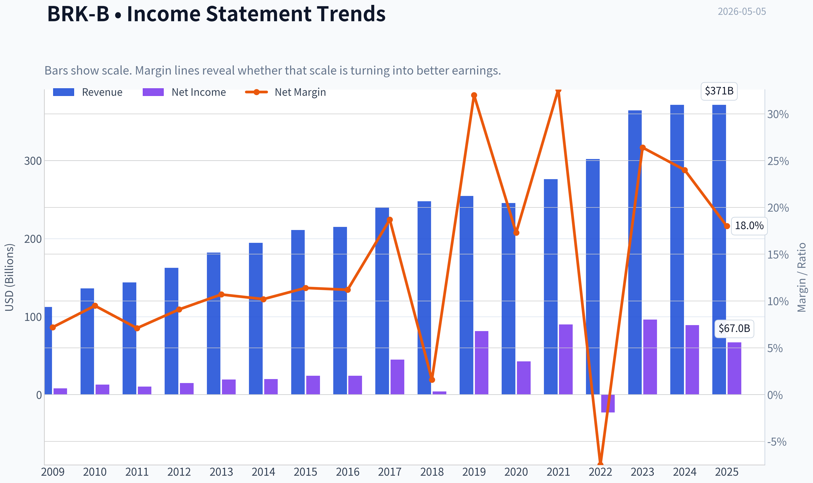
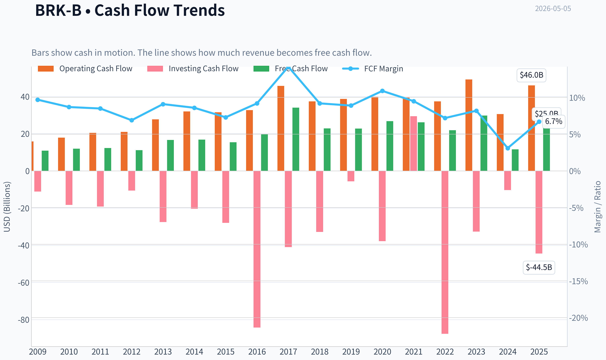
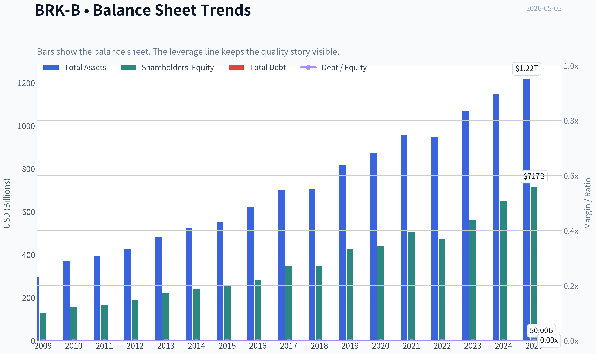
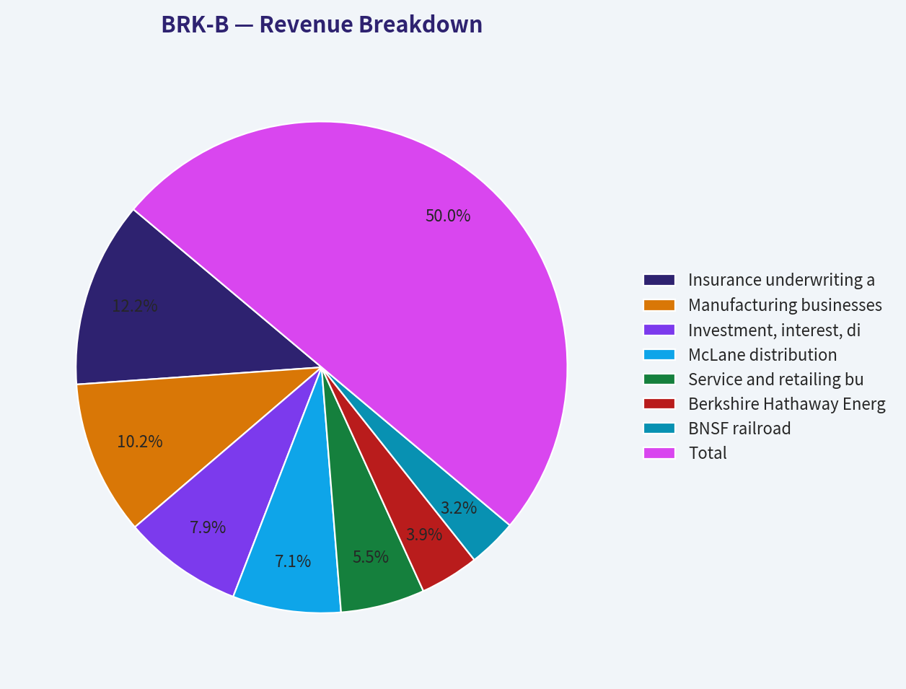
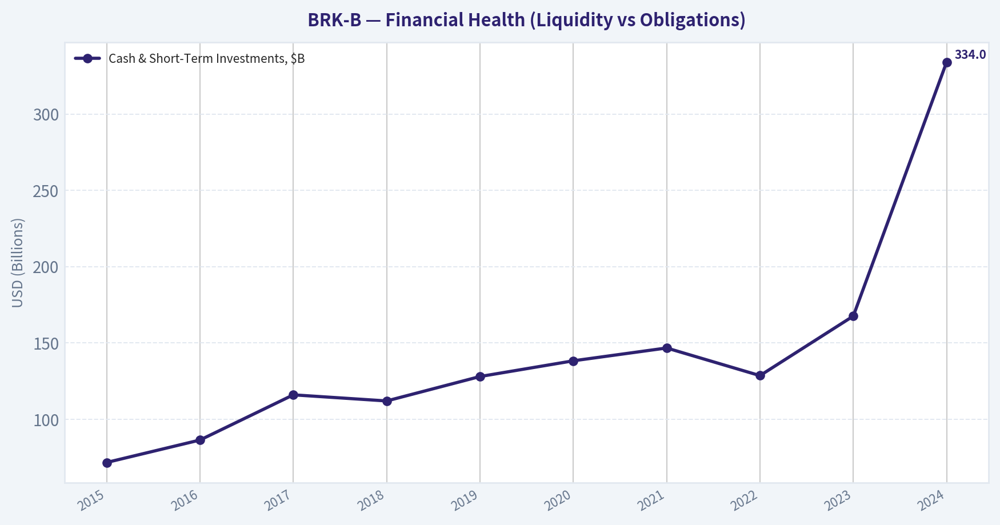
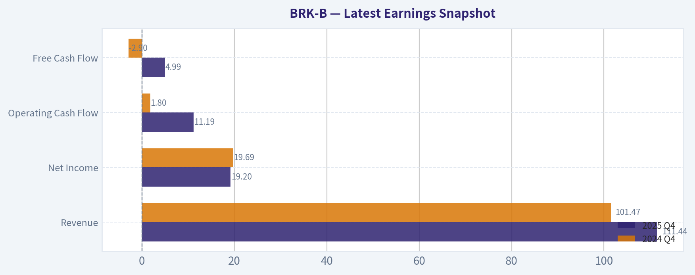
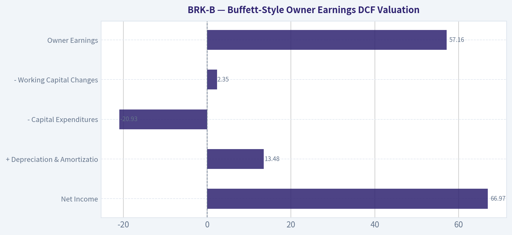
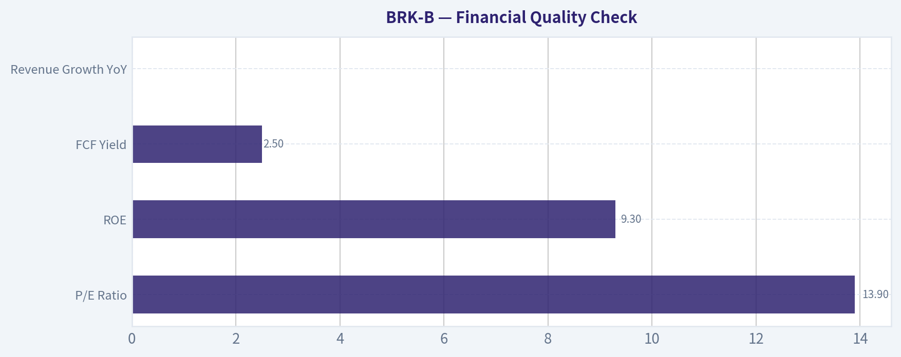

# BRK-B Deep Value Intelligence

**Analysis Date:** 2026-05-05

## Critical Disclaimer

*This analysis is generated by Deep Value Intelligence, an AI-powered multi-agent investing framework. This report is for informational and educational purposes only and does not constitute financial advice. Always conduct your own research and consult with qualified financial advisors before making investment decisions.*

---

## Table of Contents

1. Intelligence Summary
2. Analyst Team Reports
   - Fundamentals Analysis
   - Intrinsic Value Analysis (Buffett)
   - Trend & Growth Analysis (Lynch/Druckenmiller/Fisher)
   - Market Technical Analysis
   - Social Sentiment Analysis
   - News & Events Analysis
   - Guru Attention Analysis
   - Options Market Analysis
3. Research Team Commentary
4. Value Investing Team Commentary
5. Deep Values Commentary

---

## Intelligence Summary

### Thesis + Conditions

**Core Thesis:** **EXECUTIVE SUMMARY**
Berkshire Hathaway (BRK-B) remains the market's premier vehicle for capital preservation and antifragility. However, at $466, it lacks the strict margin of safety required for aggressive new capital deployment.

**Key Risks:**
- Risky Analyst (The Bull):** Argues that Berkshire is a uniquely antifragile compounding machine. Points to the 115.6% FCF growth, massive crisis optionality, and a modest 13.86 P/E as evidence that the company's scale is a competitive moat. Concludes that demanding a strict "deep value" discount for this asset guarantees missing out.
- Safe Analyst (The Bear):** Counters that uncertainty requires strict downside protection. Highlights stagnant revenue (0.0%), falling net income (-24.8%), and a wide intrinsic valuation spread ($190-$730 FCF/Buffett models) as proof that a 25% margin of safety is mathematically mandatory to avoid long-term opportunity cost.
- From a value investing perspective, rule number one is to never lose money, and rule number two is to never forget rule number one. Berkshire easily passes this test; its fortress balance sheet and conservative culture virtually eliminate the risk of permanent capital impairment. However, we must also clear the hurdle of adequate returns.
- Reflecting on my past mistakes in similar situations, I have sometimes erred by demanding a deep, cigar-butt discount for truly wonderful businesses, causing me to miss out on years of compounding. I have to be careful not to repeat that here. However, the opposite error is equally dangerous: justifying a full price for a mega-cap company whose highest growth days are structurally behind it, simply because of its legendary name. The right lesson is to recognize that a fair price for a slowing compounder facing succession risks leaves very little room for error. We need the market to offer us a dislocation-a moment of fear-to create a true value opportunity.
- Monitoring Plan

**What Would Change Our View:**
- Risky Analyst (The Bull):** Argues that Berkshire is a uniquely antifragile compounding machine. Points to the 115.6% FCF growth, massive crisis optionality, and a modest 13.86 P/E as evidence that the company's scale is a competitive moat. Concludes that demanding a strict "deep value" discount for this asset guarantees missing out.
- Safe Analyst (The Bear):** Counters that uncertainty requires strict downside protection. Highlights stagnant revenue (0.0%), falling net income (-24.8%), and a wide intrinsic valuation spread ($190-$730 FCF/Buffett models) as proof that a 25% margin of safety is mathematically mandatory to avoid long-term opportunity cost.
- From a value investing perspective, rule number one is to never lose money, and rule number two is to never forget rule number one. Berkshire easily passes this test; its fortress balance sheet and conservative culture virtually eliminate the risk of permanent capital impairment. However, we must also clear the hurdle of adequate returns.
- Reflecting on my past mistakes in similar situations, I have sometimes erred by demanding a deep, cigar-butt discount for truly wonderful businesses, causing me to miss out on years of compounding. I have to be careful not to repeat that here. However, the opposite error is equally dangerous: justifying a full price for a mega-cap company whose highest growth days are structurally behind it, simply because of its legendary name. The right lesson is to recognize that a fair price for a slowing compounder facing succession risks leaves very little room for error. We need the market to offer us a dislocation-a moment of fear-to create a true value opportunity.
- Monitoring Plan

**Confidence:** Low

---

## Analyst Team Reports

### Fundamentals Analysis

#### Latest Earnings Snapshot

*Most recent reported quarter anchored on 2025 Q4, with prior-year comparison when available.*

| Metric | 2025 Q4 | 2024 Q4 | YoY Change |
| --- | ---: | ---: | ---: |
| Revenue | $111.44B | $101.47B | +9.8% |
| Operating Income | N/A | N/A | N/A |
| Net Income | $19.20B | $19.69B | -2.5% |
| Diluted EPS | N/A | N/A | N/A |
| Operating Cash Flow | $11.19B | $1.80B | +520.7% |
| Free Cash Flow | $4.99B | $-2.90B | +272.2% |

Key Takeaways: This snapshot anchors the most recent reported quarter before the narrative analysis. It helps readers separate long-run business quality from whatever changed in the latest earnings print.

#### 10-Year Financial Metrics for BRK-B

*All values below are computed deterministically from raw data - not estimated by AI.*

*Issuer profile: insurer (Financial Services / Insurance - Diversified).*

#### 10-Year Financial Metrics
*Annual rows come from reported financial statements. The final TTM row is computed from the latest four quarters.*

| Metric | 2009 | 2010 | 2011 | 2012 | 2013 | 2014 | 2015 | 2016 | 2017 | 2018 | 2019 | 2020 | 2021 | 2022 | 2023 | 2024 | 2025 |
| --- | --- | --- | --- | --- | --- | --- | --- | --- | --- | --- | --- | --- | --- | --- | --- | --- | --- |
| Market Price | $66 | $80 | $76 | $90 | $119 | $150 | $132 | $163 | $198 | $204 | $226 | $232 | $299 | $309 | $357 | $453 | $503 |
| Market Cap | $72.3M | $75.3M | $71.7M | N/A | N/A | N/A | N/A | N/A | N/A | N/A | N/A | N/A | $677.32B | $680.60B | $775.14B | $977.53B | $1.00T |
| P/E Ratio | 0.01 | 0.01 | 0.01 | 0.01 | 0.01 | N/A | 13.52 | 16.73 | 10.83 | 124.95 | 6.80 | 12.80 | 7.53 | -29.90 | 8.06 | 10.98 | 14.99 |
| P/B Ratio | 0.00 | 0.00 | 0.00 | N/A | N/A | N/A | 1.27 | 1.43 | 1.40 | 1.44 | 1.30 | 1.25 | 1.34 | 1.44 | 1.38 | 1.51 | 1.40 |
| ROE | 6.1% | 8.2% | 6.2% | 7.9% | 8.8% | 8.3% | 9.4% | 8.5% | 12.9% | 1.2% | 19.2% | 9.6% | 17.8% | -4.8% | 17.1% | 13.7% | 9.3% |
| ROIC | 9.1% | 12.2% | 8.7% | 11.4% | 12.5% | 11.3% | 13.3% | 11.1% | 15.9% | 1.4% | 24.1% | 11.6% | 22.6% | -5.1% | 20.2% | 15.9% | 10.6% |
| EPS | $7322.73 | $13794.68 | $10908.51 | N/A | N/A | N/A | N/A | N/A | N/A | N/A | N/A | N/A | $39.70 | $-10.33 | $44.27 | $41.27 | $33.53 |
| Revenue | $112.49B | $136.19B | $143.69B | $162.46B | $182.15B | $194.70B | $210.94B | $215.11B | $239.93B | $247.84B | $254.62B | $245.58B | $276.19B | $302.02B | $364.48B | $371.43B | $371.44B |
| Gross Profit | N/A | N/A | N/A | N/A | N/A | N/A | N/A | N/A | N/A | N/A | N/A | N/A | N/A | N/A | N/A | N/A | N/A |
| Gross Margin | N/A | N/A | N/A | N/A | N/A | N/A | N/A | N/A | N/A | N/A | N/A | N/A | N/A | N/A | N/A | N/A | N/A |
| Operating Margin | 10.3% | 14.0% | 10.7% | 13.7% | 15.8% | 14.4% | 16.6% | 15.7% | 9.9% | 1.6% | 40.3% | 22.7% | 40.5% | -10.1% | 33.0% | 29.7% | 22.2% |
| Net Income | $8.05B | $12.97B | $10.25B | $14.82B | $19.48B | $19.87B | $24.08B | $24.07B | $44.94B | $4.02B | $81.42B | $42.52B | $89.94B | $-22.76B | $96.22B | $89.00B | $66.97B |
| Net Margin | 7.2% | 9.5% | 7.1% | 9.1% | 10.7% | 10.2% | 11.4% | 11.2% | 18.7% | 1.6% | 32.0% | 17.3% | 32.6% | -7.5% | 26.4% | 24.0% | 18.0% |
| Revenue Growth | N/A | 21.1% | 5.5% | 13.1% | 12.1% | 6.9% | 8.3% | 2.0% | 11.5% | 3.3% | 2.7% | -3.5% | 12.5% | 9.4% | 20.7% | 1.9% | 0.0% |
| Net Income Growth | N/A | 61.0% | -20.9% | 44.6% | 31.4% | 2.0% | 21.2% | -0.0% | 86.7% | -91.1% | 1924.8% | -47.8% | 111.5% | -125.3% | -522.8% | -7.5% | -24.8% |
| Free Cash Flow Growth | N/A | 9.2% | 3.1% | -9.0% | 48.7% | 1.3% | -8.4% | 27.8% | 72.8% | -32.8% | -0.7% | 17.8% | -2.3% | -16.3% | 36.1% | -61.0% | 115.6% |
| Total Book Value | $131.10B | $157.32B | $164.85B | $187.65B | $221.89B | $240.17B | $255.55B | $282.07B | $348.30B | $348.70B | $424.79B | $443.16B | $506.20B | $473.42B | $561.27B | $649.37B | $717.42B |
| Total Assets | $297.12B | $372.23B | $392.65B | $427.45B | $484.62B | $525.87B | $552.26B | $620.85B | $702.10B | $707.79B | $817.73B | $873.73B | $959.39B | $948.47B | $1.07T | $1.15T | $1.22T |
| Total Debt | $0 | $0 | $0 | $0 | $0 | $0 | $0 | $0 | $0 | $0 | $0 | $0 | $0 | $0 | $0 | $0 | $0 |
| Debt-to-Equity | 0.00 | 0.00 | 0.00 | 0.00 | 0.00 | 0.00 | 0.00 | 0.00 | 0.00 | 0.00 | 0.00 | 0.00 | 0.00 | 0.00 | 0.00 | 0.00 | 0.00 |
| Cash & Equivalents | $30.56B | $38.23B | $37.30B | $46.99B | $45.91B | $60.03B | $67.60B | $28.64B | $32.21B | $30.81B | $64.63B | $48.40B | $88.71B | $36.40B | $38.64B | $48.38B | $52.57B |
| Shareholders' Equity | $131.10B | $157.32B | $164.85B | $187.65B | $221.89B | $240.17B | $255.55B | $282.07B | $348.30B | $348.70B | $424.79B | $443.16B | $506.20B | $473.42B | $561.27B | $649.37B | $717.42B |
| Operating Cash Flow | $15.85B | $17.89B | $20.48B | $20.95B | $27.70B | $32.01B | $31.49B | $32.65B | $45.73B | $37.40B | $38.69B | $39.77B | $39.43B | $37.35B | $49.20B | $30.59B | $45.97B |
| Investing Cash Flow | $-11.16B | $-18.28B | $-19.19B | $-10.57B | $-27.54B | $-20.33B | $-28.00B | $-84.22B | $-41.01B | $-32.85B | $-5.62B | $-37.76B | $29.39B | $-87.60B | $-32.66B | $-10.29B | $-44.49B |
| Free Cash Flow | $10.91B | $11.91B | $12.29B | $11.18B | $16.62B | $16.82B | $15.41B | $19.69B | $34.02B | $22.86B | $22.71B | $26.76B | $26.15B | $21.89B | $29.79B | $11.62B | $25.04B |
| FCF Margin | 9.7% | 8.7% | 8.5% | 6.9% | 9.1% | 8.6% | 7.3% | 9.2% | 14.2% | 9.2% | 8.9% | 10.9% | 9.5% | 7.2% | 8.2% | 3.1% | 6.7% |
| Dividends / Share | $0.00 | $0.00 | $0.00 | N/A | N/A | N/A | N/A | N/A | N/A | N/A | N/A | N/A | $0.00 | $0.00 | $0.00 | $0.00 | $0.00 |

#### Profitability Metrics
- Return on Equity (ROE): 9.3%
- Return on Invested Capital (ROIC): 10.1%
- Return on Assets (ROA): 5.5%
- Gross Margin: Not meaningful
- Operating Margin: 22.2%
- Net Profit Margin: 18.0%

#### Liquidity Metrics
- Current Ratio: Not meaningful
- Quick Ratio: Not meaningful

#### Leverage Metrics
- Debt-to-Equity Ratio: 0.00
- Interest Coverage Ratio: 16.27
- Net Debt: $-52.57B

#### Growth Metrics (Year-over-Year)
- Revenue Growth: 0.0%
- Net Income Growth: -24.8%
- Free Cash Flow Growth: 115.6%
- Revenue CAGR (3-Year): 7.1%
- Revenue CAGR (5-Year): 8.6%

#### Valuation Metrics
- P/E Ratio (TTM): 13.86
- Forward P/E: 21.92
- Price-to-Book: 1.40
- Price-to-Sales: 2.67
- PEG Ratio: 10.06
- EV/EBITDA: -2.25
- Free Cash Flow Yield: 2.5%
- Earnings Yield: 7.2%

#### Owner Earnings (Buffett Method, Code-Computed)
- Net Income: $66.97B
- + Depreciation & Amortization: $13.48B
- - Capital Expenditures: $-20.93B
- - Working Capital Changes: $2.35B
- = **Owner Earnings: $57.16B**

#### Intrinsic Value (Code-Computed)
- Current Price: $466
- Buffett Method (Owner Earnings):
  Conservative: $80
  Average: $730
  Optimistic: $2,681
- Cash Flow Method (FCF):
  Conservative: $113
  Average: $190
  Optimistic: $353

#### Piotroski F-Score: 3/9
- Positive Net Income: PASS
- Positive Operating Cash Flow: PASS
- ROA Improvement: FAIL
- Cash Flow > Net Income: FAIL
- Decreasing Debt: FAIL
- Improving Current Ratio: FAIL
- No Dilution: PASS
- Improving Gross Margin: FAIL
- Improving Asset Turnover: FAIL

ANALYST STANCE: **WATCH**

#### Berkshire Hathaway Class B (BRK-B) - Buffett-Style Fundamental Analysis

Berkshire Hathaway remains one of the highest-quality financial conglomerates in the public market: decentralized operating businesses, enormous insurance float, disciplined capital allocation, a fortress balance sheet, and a long record of compounding book value. However, the current setup is not a simple "buy at any price" case. The business quality is exceptional, but near-term revenue growth is flat, reported earnings are volatile because of investment mark-to-market accounting, free cash flow yield is modest, and the company's size makes high future compounding harder.

For valuation, I use the deterministic dataset as the canonical source. The latest market snapshot shows a current price of **$466**, market capitalization of about **$1.00 trillion**, TTM P/E of **13.86**, and P/B of **1.40**. The deterministic historical row for 2025 shows a market price of **$503** and P/E of **14.99**; for margin-of-safety comparisons, I use the current snapshot price of **$466**.

---

#### Current vs. Historical Average Comparison

| Metric | Current / TTM | Approx. 10-Year Avg. | Current vs. Avg. | Buffett-Style Interpretation |
|---|---:|---:|---:|---|
| Market Price | $466 current snapshot / $503 latest dataset row | ~$294 | Above average | Price has compounded strongly with book value and business scale; not obviously cheap on price history alone. |
| Total Market Cap | ~$1.00T | Available recent avg. lower | Above average | Berkshire has crossed the trillion-dollar threshold, which reflects quality but also makes future outperformance harder. |
| P/E Ratio | 13.86 current snapshot / 14.99 latest row | ~18.4 | Below average | Appears reasonable, but Berkshire's P/E is noisy because GAAP net income includes unrealized investment gains/losses. |
| P/B Ratio | 1.40 | ~1.39 | In line | Valuation is close to its recent book-value multiple norm; not a deep bargain, but not excessive. |
| ROE | 9.3% | ~10.5% | Below average | Returns remain positive but are below the recent decade average; scale and lower investment gains weigh on reported ROE. |
| ROIC | 10.6% | ~12.8% | Below average | Still respectable, but not currently at Berkshire's stronger historical levels. |
| EPS | $33.53 | N/A due historical comparability issues | N/A | EPS history is distorted by share-class/reporting changes and investment accounting. |
| Revenue | $371.44B | ~$268.86B | Above average | Revenue base is much larger than the historical norm, showing durable expansion across operating businesses. |
| Gross Profit | N/A | N/A | N/A | Gross profit is not meaningful for Berkshire's insurance-heavy conglomerate model. |
| Operating Margin | 22.2% | ~20.6% | Above average | Operating profitability is solid and slightly better than the recent average. |
| Net Income | $66.97B | ~$51.63B | Above average | Net income is above average, but down year over year and highly affected by investment marks. |
| Net Margin | 18.0% | ~17.4% | Slightly above average | Profitability remains strong, though below peak years such as 2019, 2021, and 2023. |
| Revenue Growth | 0.0% | ~6.1% | Below average | Growth has stalled in the latest period after several strong years. |
| Net Income Growth | -24.8% | Distorted by extreme swings | Below normalized trend | Reported earnings volatility is not a clean signal of business deterioration, but the latest decline is still a caution. |
| Free Cash Flow Growth | 115.6% | ~15.7% | Above average | FCF rebounded sharply after a weak prior year, but the pattern is uneven. |
| Total Book Value | $717.42B | ~$475.47B | Above average | Book value continues to compound, a core Berkshire strength. |
| Total Assets | $1.22T | ~$907.01B | Above average | Asset base has expanded materially, supported by insurance float and retained earnings. |
| Total Debt | $0 in dataset | $0 | In line | Dataset shows no debt, emphasizing balance-sheet strength. |
| Debt-to-Equity | 0.00 | 0.00 | In line | Very conservative leverage profile under the dataset. |
| Cash & Equivalents | $52.57B | ~$46.94B | Above average | Cash remains ample, preserving optionality for acquisitions and buybacks. |
| Shareholders' Equity | $717.42B | ~$475.47B | Above average | Equity base has compounded significantly. |
| Free Cash Flow | $25.04B | ~$24.05B | Slightly above average | FCF is near its recent norm despite volatility. |
| Dividends / Share | $0.00 | $0.00 | In line | Berkshire continues to retain capital rather than pay dividends. |

Key Takeaways: Berkshire's valuation is broadly fair rather than clearly cheap: P/B is almost exactly in line with its recent average, while P/E appears below average but is not fully reliable because of investment-accounting noise. The strongest positives are the expanded book value, large cash position, and durable profitability. The biggest near-term caution is that revenue growth is currently flat and reported net income is declining from elevated levels.

---

#### Market Metrics Interpretation

Berkshire's current market capitalization of approximately **$1.00 trillion** places it among the largest companies in the world. That scale validates decades of compounding, but it also creates a mathematical challenge: moving the needle now requires very large acquisitions, substantial buybacks, or strong performance across multiple operating subsidiaries.

The **P/E ratio of 13.86** looks attractive on the surface, especially relative to many high-quality large-cap companies. However, Berkshire's GAAP earnings include unrealized gains and losses from its equity portfolio, making P/E less useful than book value growth, operating earnings, and owner earnings. The **P/B ratio of 1.40** is more meaningful for Berkshire and sits close to the recent historical average, suggesting fair value rather than a major discount.

#### Profitability Analysis

Berkshire's **ROE of 9.3%** and **ROIC of 10.6%** are positive but below recent averages. For a company with Berkshire's size, complexity, and large cash holdings, low-double-digit returns remain respectable. Still, they are not exceptional relative to Berkshire's own stronger years.

Revenue of **$371.44B** is far above the historical average, showing that the operating base has expanded meaningfully. Operating margin of **22.2%** is slightly above the recent average, suggesting that the underlying businesses remain profitable. Net income of **$66.97B** and net margin of **18.0%** remain strong, but the year-over-year decline in net income reflects the volatility of investment marks and creates less predictable reported earnings.

Gross profit and gross margin are marked **N/A** in the deterministic dataset. That is appropriate because Berkshire is an insurance and diversified holding company; traditional gross margin analysis is less meaningful than underwriting profitability, investment income, operating earnings, float cost, and book-value compounding.

#### Growth Analysis

Revenue growth is currently **0.0%**, materially below the approximate 10-year average of **6.1%**. That is a clear sign that near-term top-line momentum has cooled after strong growth in prior years, especially 2021 through 2023.

Net income growth is **-24.8%**, but this metric is especially noisy for Berkshire because investment gains and losses flow through reported earnings. Free cash flow growth of **115.6%** is very strong in the latest period, but the decade pattern is uneven, including both sharp gains and large declines. In Buffett terms, Berkshire is still a compounding machine, but its reported annual growth metrics are not smooth enough to be judged mechanically.

#### Balance Sheet and Financial Strength

Berkshire's balance sheet remains the central pillar of the investment case. The deterministic dataset shows **total assets of $1.22T**, **shareholders' equity of $717.42B**, and **cash & equivalents of $52.57B**. Total book value has compounded substantially and now sits far above the recent historical average.

The dataset reports **total debt of $0** and a **debt-to-equity ratio of 0.00**, indicating an extremely conservative financial profile. Even if one adjusts for operating-level obligations and insurance liabilities outside the simplified debt line, Berkshire's financial flexibility remains outstanding. The company can absorb shocks, fund insurance claims, hold large equity stakes, repurchase shares, and pursue acquisitions without financial strain.

#### Cash Flow and Dividend Policy

Free cash flow is **$25.04B**, slightly above the recent average of about **$24.05B**. That supports Berkshire's ability to retain capital, repurchase shares, and invest opportunistically. However, the current **FCF yield of about 2.5%** is not especially high, which limits the immediate valuation appeal.

Berkshire pays **no dividend**, consistent with its long-standing policy. From a Buffett-style perspective, this is acceptable if management can reinvest retained capital at attractive rates. The challenge is that Berkshire's enormous scale reduces the number of opportunities large enough to materially improve intrinsic value.

---

#### Revenue Breakdown

| Revenue Source | Amount ($B) | % of Total |
|---|---:|---:|
| Insurance underwriting and related premiums | $90.8B | 24.4% |
| Manufacturing businesses | $75.4B | 20.3% |
| Investment, interest, dividend, and other income | $58.5B | 15.8% |
| McLane distribution | $52.9B | 14.2% |
| Service and retailing businesses | $41.1B | 11.1% |
| Berkshire Hathaway Energy | $28.8B | 7.8% |
| BNSF railroad | $23.9B | 6.4% |
| **Total** | **$371.4B** | **100.0%** |

Key Takeaways: Berkshire's revenue is highly diversified, with no single operating source dominating the entire company. Insurance remains the largest contributor and is strategically important because it supplies float, while manufacturing, distribution, energy, rail, and investment income provide broad economic exposure. This diversification supports durability, but it also means Berkshire's growth will generally resemble a high-quality economic conglomerate rather than a fast-growing focused company.

---

#### Buffett-Style Owner Earnings DCF Valuation

Owner earnings are calculated using the deterministic dataset's Buffett-style method:

**Owner Earnings = Net Income + Depreciation & Amortization - Capital Expenditures - Working Capital Changes**

Using the code-computed deterministic inputs:

| Owner Earnings Input | Amount |
|---|---:|
| Net Income | $66.97B |
| + Depreciation & Amortization | $13.48B |
| - Capital Expenditures | -$20.93B |
| - Working Capital Changes | $2.35B |
| **Owner Earnings** | **$57.16B** |

Key Takeaways: Berkshire's owner earnings are materially below reported net income, which matters because owner earnings better approximate cash that can be reinvested or returned to shareholders. The $57.16B owner-earnings base is still very large, but the valuation outcome is highly sensitive to future growth assumptions. That sensitivity is especially important for a company already valued near $1 trillion.

DCF assumptions:

| Assumption | Value |
|---|---:|
| Starting Owner Earnings | $57.16B |
| Current Price Used for Valuation Comparison | $466 |
| Approx. B-share Equivalent Share Count | ~2.146B |
| Discount Rate | 10.0% |
| Terminal Growth Rate | 2.5% |
| Projection Period | 10 years |
| Terminal Value Formula | Year 10 Owner Earnings x 1.025 / (10.0% - 2.5%) |

Key Takeaways: The model uses a demanding 10% discount rate, which is appropriate for a Buffett-style equity hurdle. The 2.5% terminal growth rate assumes Berkshire can grow roughly in line with long-term nominal economic growth after the explicit forecast period. The share count is estimated from the current market capitalization and current price, so the per-share values are approximate but directionally useful.

| Scenario | Growth Rate Used | 10-Year PV of Owner Earnings | PV of Terminal Value | Estimated Equity Value | Fair Value / Share | Upside / Downside vs. $466 |
|---|---:|---:|---:|---:|---:|---:|
| Conservative | ~-20.5% | ~$132B | ~$39B | ~$171B | ~$80 | -82.8% |
| Average | ~12.0% | ~$631B | ~$936B | ~$1.57T | ~$730 | +56.7% |
| Optimistic | ~30.0% | ~$1.60T | ~$4.15T | ~$5.75T | ~$2,681 | +475.3% |

Key Takeaways: The conservative case shows that Berkshire is not protected if owner earnings shrink materially for an extended period. The average case indicates meaningful upside if Berkshire can compound owner earnings near the historical average growth input used by the deterministic DCF engine. The optimistic case produces an extremely high valuation, but it requires a growth rate that is unlikely to be sustainable for a company of Berkshire's current scale.

#### DCF Interpretation

The deterministic owner-earnings DCF produces a very wide valuation range: approximately **$80 to $2,681 per share**, with the average scenario around **$730**. This spread reflects the central issue with valuing Berkshire: small differences in long-term growth assumptions create very large differences in intrinsic value.

The average owner-earnings DCF suggests the stock could be undervalued versus the current price of **$466**. However, the cash-flow method from the deterministic dataset gives a much lower range, with fair values of **$113 conservative**, **$190 average**, and **$353 optimistic**. That conflict argues against a highly aggressive stance. A Buffett-style investor should demand a margin of safety, and the current price does not clearly provide one under all valuation methods.

---

#### Warren Buffett-Style Qualitative Analysis

| Buffett Criterion | Assessment | Interpretation |
|---|---|---|
| Economic Moat | Very strong | Berkshire benefits from insurance float, permanent capital, decentralized management, scale, brand reputation, and ownership of durable businesses such as BNSF and Berkshire Hathaway Energy. |
| Financial Strength | Exceptional | Large cash balance, massive equity base, and zero debt in the deterministic dataset indicate outstanding resilience. |
| Predictable Earnings | Mixed | Operating businesses are durable, but reported net income is volatile because of investment mark-to-market accounting. |
| Management Performance | Strong, but transition-sensitive | Capital allocation has historically been excellent, but succession and post-Buffett decision quality remain key long-term variables. |
| Capital Allocation | Conservative and disciplined | No dividend; capital is retained for acquisitions, equity investments, operating business expansion, and buybacks. |
| Valuation | Fair to moderately attractive | P/B is near historical average; P/E appears reasonable; owner-earnings DCF suggests upside, but FCF yield is modest. |
| Business Quality | High | Diversification, float, cash generation, and fortress balance sheet make Berkshire one of the highest-quality compounders. |

Key Takeaways: Berkshire remains a classic Buffett-style business: understandable, durable, conservatively financed, and run for long-term compounding. The main issue is not quality but price and future growth. At Berkshire's current size, maintaining historically high compounding rates becomes increasingly difficult.

---

#### Key Investment Insights

| Area | Positive Insight | Caution / Red Flag |
|---|---|---|
| Valuation | P/E is below the recent average and P/B is not excessive. | P/B is roughly in line with history, so the stock is not clearly cheap on book value. |
| Profitability | Operating margin and net margin are slightly above recent averages. | ROE and ROIC are below their recent averages. |
| Growth | Revenue base has expanded materially over the decade. | Latest revenue growth is 0.0%, indicating near-term stagnation. |
| Cash Flow | Free cash flow rebounded strongly and is slightly above the 10-year average. | FCF yield of ~2.5% is modest for new buyers. |
| Balance Sheet | Cash position and equity base are very strong. | Very large cash balances can drag returns if attractive opportunities are scarce. |
| Earnings Quality | Owner earnings are large and durable. | GAAP net income is volatile because of unrealized investment gains/losses. |
| Capital Allocation | No dividend allows full reinvestment flexibility. | Future returns depend heavily on buybacks, acquisitions, and successor capital allocation. |
| Moat | Insurance float and diversified operating businesses create a durable advantage. | Berkshire's size reduces the universe of high-impact opportunities. |

Key Takeaways: Berkshire's strengths are structural: balance-sheet strength, float, diversification, and capital allocation discipline. The red flags are mostly valuation and growth related rather than solvency or business-quality related. This is a high-quality company, but the current price does not offer an unmistakable bargain.

---

#### Red Flags and Opportunities

**Red flags:**

- **Flat latest revenue growth:** Revenue growth of **0.0%** is materially below the recent average.
- **Reported net income decline:** Net income growth of **-24.8%** indicates a weaker latest period, even though accounting volatility is a major factor.
- **Lower current returns:** ROE and ROIC are below recent averages.
- **Low FCF yield:** A **2.5% free cash flow yield** limits immediate valuation support.
- **Succession risk:** Berkshire is prepared for succession, but the market may still apply a different confidence level after Warren Buffett.
- **Scale problem:** At a ~$1 trillion market cap, very large opportunities are required to materially compound intrinsic value.

**Opportunities:**

- **Fortress balance sheet:** Cash and retained earnings provide optionality during market stress.
- **Buybacks:** If shares trade below intrinsic value, repurchases can enhance per-share compounding.
- **Insurance float:** Low-cost or negative-cost float remains a powerful structural advantage.
- **Diversified earnings base:** Insurance, energy, rail, manufacturing, distribution, retail, and investments reduce single-sector dependence.
- **Potential valuation upside:** The average owner-earnings DCF fair value of about **$730** suggests upside if Berkshire sustains healthy owner-earnings growth.

---

#### Final Investment Stance: WATCH

Berkshire Hathaway is a **WATCH**, not an Avoid. The business quality is too high, the balance sheet too strong, and the capital allocation history too exceptional to dismiss. However, it is also not a clear Advocate at the current price because revenue growth has stalled, ROE and ROIC are below recent averages, FCF yield is modest, and valuation is close to historical book-value norms.

A Buffett-style investor should consider Berkshire attractive on meaningful pullbacks, especially if the stock trades closer to a clear discount to book-value-based and owner-earnings-based intrinsic value. At around **$466**, the stock appears fairly valued to moderately undervalued under owner earnings, but not cheap enough across all cash-flow methods to provide a large margin of safety.

| Final Decision Factor | Rating | Summary |
|---|---|---|
| Business Quality | Excellent | Durable, diversified, conservatively financed conglomerate. |
| Economic Moat | Excellent | Insurance float, scale, reputation, permanent capital, and decentralized culture. |
| Financial Strength | Excellent | Large cash position and zero debt in the deterministic dataset. |
| Earnings Predictability | Moderate | Operating earnings are durable, but GAAP earnings are volatile. |
| Growth Outlook | Moderate | Long-term compounding remains possible, but near-term revenue growth is flat. |
| Valuation | Fair to moderately attractive | P/B is normal; owner-earnings DCF suggests upside; FCF method is less supportive. |
| Margin of Safety | Moderate / insufficient for aggressive buying | Better entry point would improve risk-reward. |
| Final Stance | **WATCH** | High-quality compounder, but current price does not offer a compelling all-weather margin of safety. |

Key Takeaways: Berkshire is still one of the strongest long-term compounding vehicles in the market, but the current investment case is balanced rather than obvious. The company's financial strength and moat support patience, while the valuation and growth profile argue against aggressive buying. For disciplined value investors, Berkshire belongs on the watchlist, with stronger appeal on a pullback or during market dislocation.

#### Fundamental Visuals

This graph tracks the profitability and return metrics (ROE, ROIC, Margins) of **BRK-B** over the past decade, highlighting capital efficiency trends.

This chart illustrates the financial health of **BRK-B** over the last 10 years, mapping cash equivalents and free cash flow against total obligations (Debt).

This breakdown chart from <em>Revenue Breakdown</em> shows the proportional composition for **BRK-B** - useful for understanding what drives or risks the business.

This chart illustrates the financial health of **BRK-B** over the last 10 years, mapping cash equivalents and free cash flow against total obligations (Debt).

---

### Intrinsic Value Analysis (Buffett)

> *Following Warren Buffett's value investing philosophy: Circle of Competence, Economic Moat, Management Quality, and Margin of Safety.*

#### Intrinsic Value Snapshot

Price is what you pay. Intrinsic value is what the business may be worth based on the cash it can create for owners over time. We show a range, not one magic number.

- Current Price: $465.52
- Value Range: $80.24 to $2,680.99

##### Owner Earnings (Buffett Method)
- Net Income: $66,968,000,000.00
- Depreciation & Amortization: $13,476,000,000.00
- Capital Expenditures: $-20,927,000,000.00
- Working Capital Changes: $2,355,000,000.00
- Owner Earnings: $57,162,000,000.00

##### Intrinsic Value
###### Buffett Method
Uses owner earnings. Stricter, and usually more conservative.
- Conservative: $80.24
- Average: $729.90
- Optimistic: $2,680.99
- Discount Rate: 10.0%

###### Cash Flow Method
Uses free cash flow. Better for companies spending heavily today to grow tomorrow.
- Conservative: $112.55
- Average: $190.05
- Optimistic: $353.36
- Discount Rate: 10.0%

ANALYST STANCE: **WATCH**

#### Berkshire Hathaway BRK-B Buffett-Style Value Analysis

Current reference price: **$466 per B share**
Market capitalization: **about $1.0 trillion**
Reported P/E: **13.9x**
ROE: **9.3%**
Free cash flow yield: **2.5%**
Revenue growth YoY: **0.0%**

Berkshire Hathaway is one of the highest-quality businesses in the public market, but at the current price the margin of safety is not large enough for a Buffett-style new purchase. It remains a "wonderful company," but today it appears closer to fair value than bargain value.

---

#### 1. Go / No-Go Gate Assessment

| Gate | Assessment | Evidence | Result |
|---|---:|---|---:|
| Circle of Competence & Simplicity | Strong but diversified | Berkshire owns insurance businesses, a railroad, utilities, manufacturing, retail, service companies, and a large investment portfolio. The insurance float funds investment and acquisitions. | Pass |
| 10-Year Predictability | High | Insurance, railroad, utilities, and industrial subsidiaries should still be relevant in 10 years. The main uncertainty is capital allocation after Buffett. | Pass |
| Technology Risk | Low to moderate | Railroads, utilities, insurance, and many industrial operations are not easily destroyed by technology. GEICO faces digital competition, but Berkshire overall is diversified. | Pass |
| Moat Durability | Wide and stable | BNSF has a hard-to-replicate rail network; insurance has scale and float advantages; utilities have regulated monopoly-like assets; many subsidiaries have niche brands. | Pass |
| Management & Capital Allocation | Excellent history, succession watch | Buffett's record is extraordinary. Greg Abel appears capable, but no successor can perfectly replicate Buffett's reputation, judgment, and deal access. | Pass with watch item |
| Industry Structure | Mixed but favorable overall | Rail and utilities are structurally advantaged; insurance is competitive but Berkshire has unusual financial strength; manufacturing/retail is more mixed. | Pass |
| Valuation | Fair, not cheap | Current price offers little margin of safety under conservative assumptions. | Watch |

**Key Takeaways:** Berkshire easily passes the business-quality gates. The company is understandable, durable, and financially conservative. The one major issue is not business quality, but price: at $466, the shares do not offer the 25% margin of safety that a disciplined value investor should require.

---

#### 2. Business Understanding: Elementary School Test

Berkshire makes money in four simple ways:

| Segment | Simple Explanation | Buffett-Style Importance |
|---|---|---:|
| Insurance | Customers pay premiums now; Berkshire may pay claims later. Until then, Berkshire invests the money. | Very high |
| Railroad | BNSF moves goods across the country and charges customers for transportation. | High |
| Utilities & Energy | Berkshire owns power and energy assets that earn regulated returns. | High |
| Manufacturing, Service & Retail | Berkshire owns many operating businesses that sell products and services. | Medium |
| Investments & Cash | Berkshire owns stocks, Treasury bills, and other securities that generate income and long-term gains. | Very high |

**Key Takeaways:** Berkshire's model is simple at the core: collect cash, invest it well, and own durable businesses. The insurance float is the key engine because it gives Berkshire low-cost capital. The business is diversified, but not dependent on a single product cycle, technology trend, or commodity forecast.

---

#### 3. Moat Analysis

| Moat Source | Berkshire Evidence | Strength |
|---|---|---:|
| Intangible Assets | GEICO brand, Berkshire reputation, subsidiary brands, trusted acquisition partner status | Strong |
| Switching Costs | Utility and railroad customers have limited alternatives; many industrial relationships are long-standing | Moderate to strong |
| Cost Advantages | BNSF rail economics, insurance scale, Berkshire's low-cost float, decentralized low-overhead culture | Strong |
| Network Effects | Limited direct network effects, though Berkshire's reputation improves acquisition opportunities | Modest |
| Regulatory / Asset Barriers | Railroads and utilities are extremely difficult to replicate due to physical assets, rights-of-way, and regulation | Very strong |
| Financial Strength | Enormous cash and insurance float allow Berkshire to act when others cannot | Very strong |

**Key Takeaways:** Berkshire's moat is not based on one single brand or patent. It is a collection of structural advantages: irreplaceable rail assets, regulated utility infrastructure, insurance scale, reputation, and financial strength. The moat is wide and stable, though probably not widening as fast as in Berkshire's earlier decades because of the company's enormous size.

---

#### 4. Management Quality & Capital Allocation

| Question | Assessment | Evidence |
|---|---:|---|
| Do they think like owners? | Yes | Buffett has historically treated shareholders as partners; Berkshire avoids promotional behavior and short-term guidance culture. |
| Are they candid? | Yes | Annual letters are unusually clear and frank, especially about mistakes, limitations, and business economics. |
| Are they rational capital allocators? | Historically exceptional | Berkshire has compounded capital through acquisitions, public equities, buybacks, and disciplined cash holding. |
| Succession risk | Manageable but real | Greg Abel is the expected operating successor. Culture is strong, but Buffett's unique judgment and reputation are not fully replaceable. |
| Buyback discipline | Strong | Berkshire has generally repurchased shares only when management judged them to be below intrinsic value. |
| Debt discipline | Strong | Parent-level financial conservatism remains a defining feature. |

**Key Takeaways:** Management quality has historically been one of Berkshire's greatest assets. The culture is owner-oriented, honest, and disciplined. The main watch item is succession: Berkshire after Buffett can still be excellent, but the probability of extraordinary capital allocation is lower than it was during Buffett's prime years.

---

#### 5. 10-Year Financial Summary

Figures are approximate and should be read directionally. Berkshire's GAAP net income is volatile because accounting rules require unrealized investment gains and losses to flow through earnings. Operating earnings are more useful for judging business performance.

| Year | Revenue, $B | Operating Earnings, $B | GAAP Net Income, $B | Cash & Short-Term Investments, $B |
|---:|---:|---:|---:|---:|
| 2015 | 210.8 | 17.4 | 24.1 | 71.7 |
| 2016 | 223.6 | 17.6 | 24.1 | 86.4 |
| 2017 | 242.1 | 14.5 | 44.9 | 116.0 |
| 2018 | 247.8 | 24.8 | 4.0 | 112.0 |
| 2019 | 254.6 | 24.0 | 81.4 | 128.0 |
| 2020 | 245.5 | 21.9 | 42.5 | 138.3 |
| 2021 | 276.1 | 27.5 | 89.8 | 146.7 |
| 2022 | 302.1 | 30.8 | -22.8 | 128.6 |
| 2023 | 364.5 | 37.4 | 96.2 | 167.6 |
| 2024 | 371.4 | 47.4 | 89.0 | 334.0 |

**Key Takeaways:** Berkshire's operating earnings have grown meaningfully over the decade, rising from roughly $17 billion to about $47 billion. GAAP net income is much less useful because it swings with stock market movements. The most striking recent trend is the massive build in cash and short-term investments, which increases safety but also creates a reinvestment challenge.

---

#### 6. Financial Quality Check

| Metric | Current / Recent Indication | Buffett Interpretation |
|---|---:|---|
| P/E Ratio | 13.9x | Looks optically reasonable, but GAAP earnings include investment volatility. |
| ROE | 9.3% | Acceptable, but not "wonderful" on a pure ROE basis because Berkshire holds enormous cash and conservative assets. |
| FCF Yield | 2.5% | Not cheap on free cash flow alone. |
| Revenue Growth YoY | 0.0% | Mature scale limits growth. |
| Balance Sheet | Extremely strong | Berkshire's fortress balance sheet is a core advantage. |
| Cash Position | Very large | Provides optionality, but also creates drag if not deployed well. |
| Leverage Risk | Low at parent level | Berkshire avoids the fragile leverage common in financial companies. |

**Key Takeaways:** Berkshire's financial profile is exceptionally safe but no longer obviously high-growth. The low free cash flow yield and modest ROE show that today's valuation depends on continued intelligent capital allocation and productive deployment of cash. Safety is outstanding; upside at the current price is less obvious.

---

#### 7. Owner Earnings Calculation

Because Berkshire's reported net income is distorted by unrealized investment gains and losses, normalized operating earnings are the better starting point.

| Owner Earnings Component | Estimate, $B | Comment |
|---|---:|---|
| Normalized operating earnings | 47 | Recent operating earnings level |
| Add: depreciation & amortization | 13 | Approximate non-cash charge across rail, utility, and industrial assets |
| Less: maintenance capital expenditure | -14 | Berkshire has capital-intensive rail and utility assets |
| Less: normalized working capital needs | -1 | Conservative allowance |
| Estimated normalized owner earnings | **45** | Base figure for valuation |

**Key Takeaways:** A reasonable normalized owner earnings estimate is about $45 billion. This is lower than some headline earnings measures but more conservative and more useful. The estimate recognizes that Berkshire's rail and utility businesses require real capital spending, so not all accounting earnings are freely distributable.

---

#### 8. Three-Scenario Intrinsic Value Estimate

Assumptions:
Discount rate: **10%**
Normalized owner earnings: **$45 billion**
Estimated deployable net cash and investment value credited separately: **$350 billion**
B-share equivalent count implied by market cap and price: about **2.15 billion shares**

| Scenario | Method | Equity Value Estimate, $B | Intrinsic Value / B Share | Margin of Safety at $466 |
|---|---|---:|---:|---:|
| A: No Growth | $45B owner earnings / 10% + $350B investments | 800 | $373 | -25% |
| B: GDP Growth | $45B growing at 3% perpetuity + $350B investments | 1,012 | $472 | 1% |
| C: Moderate Historical Growth | 5% growth for 10 years, then 3% terminal growth + $350B investments | 1,118 | $521 | 11% |

**Key Takeaways:** Berkshire looks fairly valued under conservative-to-moderate assumptions. The no-growth case suggests the stock is expensive, while the GDP-growth case lands almost exactly around the current price. Even the more favorable moderate-growth case provides only about an 11% margin of safety, below the minimum 25% threshold.

---

#### 9. Margin of Safety Analysis

| Required Return / Safety Standard | Target Buy Price | Interpretation |
|---|---:|---|
| 25% discount to GDP-growth value of $472 | $354 | Conservative buy zone |
| 25% discount to moderate-growth value of $521 | $391 | Reasonable high-quality buy zone |
| Current market price | $466 | Near fair value |
| Price needed for clear Buffett-style bargain | Below roughly $390 | Would provide better downside protection |

**Key Takeaways:** At $466, Berkshire is not obviously overvalued, but it is not cheap enough for a strict value purchase. A more attractive entry point would likely be below $390, depending on updated operating earnings and cash deployment. The current price leaves little room for error on succession, reinvestment, or insurance results.

---

#### 10. Final Buffett Scorecard

| Criterion | Weight | Score, 1-5 | Weighted Score |
|---|---:|---:|---:|
| Business Understanding | 20% | 4.5 | 0.90 |
| Moat Width & Durability | 25% | 4.3 | 1.08 |
| Management Quality | 15% | 4.2 | 0.63 |
| Return on Equity | 15% | 3.0 | 0.45 |
| Reinvestment Runway | 10% | 3.0 | 0.30 |
| Balance Sheet Strength | 5% | 5.0 | 0.25 |
| Industry Structure | 5% | 4.0 | 0.20 |
| Valuation / Margin of Safety | 5% | 2.0 | 0.10 |
| Final Weighted Score | 100% |  | **3.91** |

**Key Takeaways:** Berkshire scores very highly on business quality, moat, management culture, and balance sheet strength. The weaker areas are valuation, ROE, and reinvestment runway, all of which are affected by Berkshire's massive size. The score is high enough to respect the company deeply, but the valuation discipline still argues for patience.

---

#### Final Investment Stance

**Stance: WATCH**
**Conviction: High-quality business, moderate valuation concern**

Berkshire Hathaway remains one of the best-run and safest large companies in the world. It has a wide moat, a fortress balance sheet, a unique insurance float engine, and a culture of rational capital allocation. If one already owns it with a low tax basis, it remains a high-quality long-term holding.

However, a new purchase at **$466** does not provide a sufficient Buffett-style margin of safety. The stock appears close to fair value under conservative assumptions and only modestly undervalued under more optimistic assumptions. I would prefer to wait for a price closer to **$390 or below**, unless future earnings power rises materially or management deploys Berkshire's cash pile into highly attractive opportunities.
#### Valuation Bridge

This bridge places the current market price beside each intrinsic value lens so readers can see whether upside depends on one method or shows up across several methods.

| Scenario | Intrinsic Value / Share |
| --- | ---: |
| Buffett Method | $729.90 |
| Cash Flow Method | $190.05 |
| Current Price | $465.52 |

#### Key Takeaways

If one method is far above the others, the upside case depends on a specific modelling assumption. When several methods cluster together, the valuation story is more robust.

#### Valuation Visuals

This comparison chart from *Latest Earnings Snapshot* stacks current figures against historical benchmarks for **BRK-B**, making it easy to see where the company trades relative to its own averages.

This comparison chart from *Buffett-Style Owner Earnings DCF Valuation* stacks current figures against historical benchmarks for **BRK-B**, making it easy to see where the company trades relative to its own averages.

This comparison chart from *Buffett-Style Owner Earnings DCF Valuation* stacks current figures against historical benchmarks for **BRK-B**, making it easy to see where the company trades relative to its own averages.

This comparison chart from *Financial Quality Check* stacks current figures against historical benchmarks for **BRK-B**, making it easy to see where the company trades relative to its own averages.

---

### Trend & Growth Analysis (Lynch/Druckenmiller/Fisher)

> *Following Peter Lynch's GARP, Stanley Druckenmiller's macro-aware approach, and Philip Fisher's scuttlebutt methodology.*

ANALYST STANCE: **WATCH**

#### Berkshire Hathaway Class B Growth Analysis - BRK-B

Berkshire Hathaway is a superb capital allocator and defensive compounder, but it is **not a Lynch-style fast grower** and does **not screen as a ten-bagger candidate from today's $1 trillion market cap**. For a growth-focused mandate, BRK-B is best treated as a **high-quality watch/hold**, not an aggressive new-money growth idea.

---

#### 1. Lynch Classification

| Item | Assessment |
|---|---|
| Company | Berkshire Hathaway Inc. Class B |
| Ticker | BRK-B / BRK.B |
| Current price used | ~$466 |
| Market cap | ~$1.0 trillion |
| Lynch category | **Stalwart / Asset-Backed Compounder** |
| Growth profile | Low-to-mid single-digit revenue growth; better intrinsic value compounding than reported revenue growth |
| Growth investor fit | **Moderate to low** |
| Ten-bagger potential | **Very low from current scale** |
| Best ownership role | Defensive compounder, cash-rich capital allocator, portfolio stabilizer |

**Key Takeaways:** Berkshire is not a fast grower; it is a mature, diversified compounder. The company can still create attractive long-term value, but the odds of a ten-bagger are limited by its enormous $1 trillion size. For Lynch-style growth investors, this belongs in the "own if already owned" bucket rather than the "new high-growth idea" bucket.

---

#### 2. The Story in 3 Simple Bullets

- Berkshire owns a collection of high-quality businesses - insurance, railroads, utilities, industrial companies, consumer brands, and a large public equity portfolio.
- Its core advantage is using low-cost insurance float and retained earnings to buy businesses, stocks, and occasionally its own shares.
- The company is built to survive bad markets and exploit crises, but its size now makes rapid growth difficult.

---

#### 3. TAM and 10x Test

| Test | Result |
|---|---:|
| Current annual revenue profile | Mature mega-cap conglomerate scale |
| Current market cap | ~$1.0 trillion |
| 10x market cap implication | ~$10 trillion |
| Required outcome for ten-bagger | Berkshire would need to become larger than most global equity markets can reasonably support for one company |
| TAM constraint | Not a single TAM story; growth depends on capital deployment across many markets |
| 10x test result | **Fails for practical purposes** |

**Key Takeaways:** Berkshire does not have a clean single-product TAM like a software, AI, payments, or healthcare innovation company. Its runway is broad but mature, and a 10x outcome would require an implausibly large enterprise value. The company can compound, but it is unlikely to multiply tenfold from this base.

---

#### 4. Revenue Growth Trend

| Metric | Current / Recent Indication | Growth Interpretation |
|---|---:|---|
| Revenue growth YoY | ~0.0% from shared data pack |
| ROE | ~9.3% |
| FCF yield | ~2.5% |
| GAAP P/E | ~13.9x |
| Growth pattern | Mature / flat to modest |
| Lynch growth category | Stalwart, not fast grower |

**Key Takeaways:** Berkshire's reported revenue growth is not showing the acceleration that growth investors seek. ROE is respectable given the conservative balance sheet, but it is not exceptional for a growth stock. The company's appeal is durability and capital allocation, not accelerating sales growth.

---

#### 5. Unit Economics and Operating Quality

Traditional SaaS-style unit economics do not apply to Berkshire. The right lens is insurance float quality, underwriting discipline, investment income, and subsidiary operating durability.

| Unit Economics Metric | Berkshire Applicability | Assessment |
|---|---|---|
| LTV/CAC | Not applicable | Berkshire is not a subscription acquisition model |
| Net revenue retention | Not applicable | Not a SaaS business |
| Rule of 40 | Not applicable | Not a software/subscription model |
| Insurance float | Highly relevant | Major structural advantage |
| Combined ratio | Highly relevant | Key metric; below 100% means underwriting profit |
| Investment income on cash/T-bills | Highly relevant | Supported by elevated rate environment |
| Capital allocation efficiency | Highly relevant | Core Berkshire edge |

**Key Takeaways:** Berkshire cannot be evaluated with normal growth-company unit economics. Its "unit economic" advantage is the ability to generate insurance float, invest that capital conservatively, and redeploy cash across cycles. This remains a real moat, but it is not the kind of scalable customer-acquisition engine that produces explosive growth.

---

#### 6. Inflection Point Assessment

| Potential Inflection | Evidence | Growth Analyst View |
|---|---|---|
| Product cycle inflection | None | No major new product ramp |
| Market share inflection | Limited | Berkshire is too diversified for one share-gain thesis |
| Margin inflection | Possible but modest | GEICO efficiency and insurance profitability can help |
| TAM inflection | None | No expanding single end market driving growth |
| Competitive inflection | Possible in downturns | Berkshire benefits if weaker capital allocators stumble |
| Capital deployment inflection | Possible | Huge cash pile could become powerful in a market dislocation |
| Succession inflection | Important | Greg Abel transition likely orderly but still a key watch item |

**Key Takeaways:** Berkshire's most realistic inflection point is not revenue acceleration; it is capital deployment during market stress. If markets fall and Berkshire uses its cash aggressively, future returns could improve. Without that deployment opportunity, the company likely compounds steadily but unspectacularly.

---

#### 7. Macro Setup

| Macro Factor | Current Read | Impact on BRK-B |
|---|---|---|
| Interest rates | Higher-for-longer or gradually easing environment | Mixed |
| High short-term yields | Positive | Boosts income on large cash/T-bill holdings |
| Falling rates | Mixed | Helps equity valuations but reduces cash income |
| Recession risk | Relative positive | Berkshire's balance sheet becomes more valuable |
| Inflation | Mixed | Some subsidiaries have pricing power; utilities/rail face capex pressures |
| AI / software growth theme | Low exposure | Berkshire is not a direct AI compounder |
| Crisis optionality | High | Berkshire can act as liquidity provider in dislocations |

**Key Takeaways:** The macro setup is favorable for Berkshire as a defensive, cash-rich company, especially if volatility rises. However, it is not a direct beneficiary of the strongest secular growth themes like AI, cloud software, or cybersecurity. Berkshire is macro-resilient, but not macro-accelerating.

---

#### 8. Fisher 15-Point Score

| Fisher Criterion | Score / 5 | Comment |
|---|---:|---|
| Products with sizable market potential | 3 | Broad businesses, but mature |
| Determination to develop new products | 2 | Not innovation-led |
| Effective R&D | 2 | Not a core Berkshire feature |
| Above-average sales organization | 3 | Varies by subsidiary |
| Worthwhile profit margin | 4 | Strong across several units, mixed overall |
| Improving profit margins | 3 | Possible in insurance, less clear elsewhere |
| Labor/personnel relations | 4 | Decentralized culture is a strength |
| Executive relations | 5 | Excellent reputation |
| Management depth | 4 | Strong, though Buffett transition matters |
| Cost analysis/accounting | 5 | Excellent discipline |
| Outstanding moat aspects | 5 | Float, culture, reputation, capital allocation |
| Long-range profit outlook | 4 | Durable but not rapid |
| Dilution risk | 5 | Low; buybacks possible |
| Management candor | 5 | Historically outstanding |
| Management integrity | 5 | Best-in-class reputation |
| **Total** | **59 / 75** | **Good, but not outstanding for growth** |

**Key Takeaways:** Berkshire scores well on management, integrity, capital allocation, and moat. It scores lower on innovation, product development, and growth runway. Fisher would likely admire the quality of the enterprise, but a growth-focused Fisher investor would not confuse Berkshire with a rapidly expanding innovator.

---

#### 9. Valuation Analysis

| Valuation Metric | Current Indication | Interpretation |
|---|---:|---|
| P/E | ~13.9x | Appears reasonable, but GAAP earnings are distorted by investment marks |
| PEG | Roughly 1.7x-2.8x if using 5%-8% normalized growth | Fair to expensive for a growth mandate |
| P/S | Approx. 2.3x-2.8x from tool estimate | Low usefulness due to conglomerate structure |
| P/B | Approx. 1.5x-1.8x from tool estimate | More useful than P/S; appears fair, not distressed cheap |
| FCF yield | ~2.5% | Not especially compelling as a standalone yield |
| Valuation conclusion | Fair | Quality premium is justified, but upside is moderate |

**Key Takeaways:** Berkshire does not look wildly overvalued, but it also does not look like a mispriced growth stock. The P/E appears reasonable, yet reported earnings are noisy because of investment portfolio accounting. The stock is more "fair value quality compounder" than "growth at a bargain price."

---

#### 10. Scenario Analysis

| Scenario | 3-Year Assumption | Implied Outcome | Growth Investor Interpretation |
|---|---|---:|---|
| Bear | Slower intrinsic value growth, valuation compresses modestly | ~$400-$430 | Limited downside versus many growth stocks, but weak return |
| Base | Intrinsic value compounds mid-single digits, valuation stable | ~$520-$560 | Respectable but not exceptional |
| Bull | Strong capital deployment, favorable markets, modest re-rating | ~$625-$675 | Attractive absolute return, still not ten-bagger-like |
| Ten-bagger | Requires ~$10 trillion market value | Impractical | Not a realistic underwriting case |

**Key Takeaways:** Berkshire's return profile looks asymmetric in a defensive way, not in a hyper-growth way. The downside may be cushioned by cash, earnings durability, and quality, while upside depends on capital deployment and continued compounding. For a growth portfolio, the opportunity cost versus faster-growing companies is the main issue.

---

#### 11. Growth Investor Scorecard

| Criterion | Weight | Score / 5 | Weighted Score |
|---|---:|---:|---:|
| The Story | 10% | 4.0 | 0.40 |
| TAM and Runway | 20% | 2.5 | 0.50 |
| Revenue Growth | 20% | 1.5 | 0.30 |
| Unit Economics | 15% | 3.5 | 0.53 |
| Competitive Position | 10% | 5.0 | 0.50 |
| Management Quality | 10% | 4.5 | 0.45 |
| Macro Setup | 5% | 3.5 | 0.18 |
| Profitability Path | 5% | 4.0 | 0.20 |
| Valuation | 5% | 3.0 | 0.15 |
| **Total** | **100%** |  | **3.20 / 5.00** |

**Key Takeaways:** Berkshire earns a strong score for moat, management, and durability, but its growth score is weak. The total score lands in WATCH territory because the business quality is high, yet the growth setup is not. This is a good company, but not a classic growth-stock opportunity.

---

#### 12. Position Size Stance

| Investor Type | Stance | Position View |
|---|---|---|
| Pure growth investor | WATCH / underweight | Better opportunities likely exist in faster secular growers |
| GARP investor | WATCH / modest position | Reasonable if valuation becomes more attractive |
| Defensive compounder investor | HOLD / core quality position | Strong fit as a stabilizer |
| Existing shareholder | HOLD / WATCH | Continue owning unless valuation becomes excessive |
| New buyer today | Be selective | Prefer adding on pullbacks or during market stress |

**Key Takeaways:** Berkshire is most suitable as a defensive compounder, not a high-growth allocation. Existing holders can reasonably continue to own it. New growth-focused capital should probably wait for either a better price or evidence of a capital deployment inflection.

---

#### 13. Key Catalysts and Risks

| Category | Catalyst / Risk | Importance |
|---|---|---|
| Catalyst | Major acquisition or crisis-era capital deployment | High |
| Catalyst | Aggressive buybacks below intrinsic value | Medium |
| Catalyst | Continued insurance underwriting strength | High |
| Catalyst | Higher investment income from large cash balances | Medium |
| Catalyst | Smooth Greg Abel succession | High |
| Risk | Buffett succession uncertainty | High |
| Risk | Size limits future returns | High |
| Risk | Equity portfolio concentration and market volatility | Medium |
| Risk | Lower rates reduce cash income | Medium |
| Risk | Utility wildfire/regulatory liabilities | Medium |
| Risk | Railroad cyclicality | Medium |
| Risk | Opportunity cost versus faster growth stocks | High for growth investors |

**Key Takeaways:** The biggest upside catalyst is Berkshire using its enormous liquidity during a market dislocation. The biggest structural risk is that the company is now so large that exceptional returns are harder to achieve. Succession is also central, even if the transition plan appears well prepared.

---

#### Final View

Berkshire Hathaway remains one of the highest-quality companies in the public market, with elite management culture, a fortress balance sheet, valuable insurance float, and rare crisis optionality. However, under a Lynch-Druckenmiller-Fisher **growth investing framework**, BRK-B lacks the key ingredients of a high-conviction growth idea: accelerating revenue, a clear expanding TAM, scalable unit economics, and realistic ten-bagger potential.

**Decision: WATCH.**
For existing holders, Berkshire remains a rational long-term hold. For new growth capital, wait for a better entry point, a major capital deployment event, or a broader market dislocation.

---

### Market Technical Analysis

ANALYST STANCE: **WATCH**

#### BRK-B Technical Report - Data Through 2026-05-04

BRK-B is in a **short- to medium-term downtrend**, with price below the 10-day EMA, 50-day SMA, and 200-day SMA. The stock is not deeply oversold, but momentum has weakened again after a late-April rebound attempt. The best stance is **WATCH**, not aggressive buying, unless price can reclaim the near-term moving average cluster and stabilize above the $478-$482 area.

| Selected Indicator | Latest Value | Why It Matters Here | Current Read |
|---|---:|---|---|
| close_10_ema | 472.63 | Fast trend and short-term trading bias | Price is below it, showing renewed short-term weakness |
| close_50_sma | 481.88 | Medium-term trend and resistance | Price is well below it, confirming a bearish intermediate trend |
| close_200_sma | 489.88 | Long-term trend benchmark | Price is materially below it, weakening strategic trend confirmation |
| macd | -2.70 | Momentum trend gauge | Still negative; recent improvement has stalled |
| rsi | 40.33 | Measures downside pressure and oversold risk | Weak but not oversold; sellers still have control |
| boll_ub | 484.31 | Upper volatility boundary and upside breakout reference | A move toward this level would be a recovery test |
| boll_lb | 464.87 | Lower volatility boundary and downside support reference | Price is close to the lower band, so downside pressure remains active |
| atr | 6.78 | Volatility and risk sizing tool | Volatility has picked up slightly, requiring wider stops |

Key Takeaways: BRK-B is trading below all major selected moving averages, which keeps the technical bias bearish. Momentum is negative but not yet washed out, meaning the stock can still drift lower without looking extremely oversold. The lower Bollinger Band near $465 is the key downside area to watch, while the $478-$482 zone is the first meaningful recovery barrier.

---

#### Trend Structure

BRK-B closed at **$468.52** on 2026-05-04. That close places the stock below the **10-day EMA at $472.63**, the **50-day SMA at $481.88**, and the **200-day SMA at $489.88**. This creates a bearish alignment: price is below short-, medium-, and long-term trend references.

The **10-day EMA** has been declining again after briefly flattening in late April. The stock's late-April bounce from the $465-$466 area carried price toward $478.16 on 2026-04-28, but that rally failed before reaching the 50-day SMA. That failure is important because it suggests buyers are not yet strong enough to challenge medium-term resistance.

The **50-day SMA** has steadily fallen from about **$492.42 on 2026-03-20** to **$481.88 on 2026-05-04**. The **200-day SMA** has also edged lower, from about **$491.22** to **$489.88** over the same period. The 50-day average sitting below the 200-day average indicates a weakened intermediate trend, and the declining slope of both averages reduces the odds of an immediate clean reversal.

| Trend Level | Value | Price Relationship | Interpretation |
|---|---:|---:|---|
| Last Close | 468.52 | - | Current reference price |
| 10-day EMA | 472.63 | Close is 0.9% below | Short-term pressure remains negative |
| 50-day SMA | 481.88 | Close is 2.8% below | Medium-term resistance overhead |
| 200-day SMA | 489.88 | Close is 4.4% below | Long-term trend confirmation is weak |

Key Takeaways: BRK-B's price is below every major moving-average level in this table. The closest resistance is the 10-day EMA near $473, but the more important test is the $482 area around the 50-day SMA. Until price can reclaim that region, rallies should be treated as countertrend bounces rather than confirmed reversals.

---

#### Momentum and Mean-Reversion Read

MACD remains negative at **-2.70**, which confirms that momentum is still bearish. However, it has improved from the deeply negative readings seen in late March, when MACD was near **-5.52**. This means downside momentum is less severe than it was at the March low, but the improvement has not yet turned into a bullish signal.

RSI is at **40.33**, below neutral but above oversold. This is a nuanced setup: BRK-B is weak, but it is not at the kind of panic oversold reading that often creates high-conviction mean-reversion entries. RSI reached **29.25 on 2026-03-27**, then recovered above 50 on 2026-04-28, but the quick drop back toward 40 shows that buyers lost momentum.

| Momentum Indicator | Latest Value | Recent Context | Trading Implication |
|---|---:|---|---|
| MACD | -2.70 | Improved from late-March lows but still negative | Bearish momentum is moderating, not reversed |
| RSI | 40.33 | Below neutral, above oversold | Weakness persists, but not yet a clear capitulation signal |

Key Takeaways: Momentum is bearish, but not extreme. MACD shows that the worst downside acceleration may have eased compared with March, while RSI shows the stock is still struggling below neutral. Traders looking for a bullish reversal would likely want RSI to reclaim the high-40s or 50 area while price moves back above the 10-day EMA.

---

#### Volatility, Support, and Resistance

The Bollinger Band structure shows price trading close to the lower band. The latest **lower band is $464.87**, while the latest **upper band is $484.31**. With the close at **$468.52**, BRK-B is sitting in the lower portion of its recent volatility range.

This makes the **$464-$466 zone** especially important. Recent price action has repeatedly tested this area, including the 2026-04-22 close at **$465.40** and the 2026-05-04 intraday low of **$465.79**. A decisive break below this region would increase the risk of a continuation move toward the prior broader weakness zone near **$459-$460**.

ATR is **6.78**, or roughly **1.45% of the stock price**. This is not extreme, but it is high enough that traders should avoid overly tight stops. A one-ATR move from the latest close implies a rough daily risk band of about **$461.74 to $475.30**.

| Zone / Indicator | Level | Role | Interpretation |
|---|---:|---|---|
| Bollinger Lower Band | 464.87 | Near-term support / downside boundary | A break below would confirm renewed downside pressure |
| Recent Support Area | 464-466 | Price-tested support zone | Key level for bulls to defend |
| 10-day EMA | 472.63 | First resistance | Reclaiming this would improve short-term tone |
| ATR Upside Reference | 475.30 | One ATR above close | A normal volatility rebound target |
| Recent Bounce Area | 478-480 | Tactical resistance | Failure here would keep bears in control |
| 50-day SMA | 481.88 | Major medium-term resistance | Reclaiming this would be a stronger recovery signal |
| Bollinger Upper Band | 484.31 | Upper volatility boundary | Break above would show improving upside momentum |
| 200-day SMA | 489.88 | Strategic trend resistance | Needed for broader bullish repair |

Key Takeaways: The most important downside level is the $464-$466 support zone. If BRK-B loses that area decisively, the chart could open toward the $459-$460 region. On the upside, a move above $473 would be constructive, but a stronger signal requires price to reclaim $478-$482.

---

#### Trading Interpretation

For **short-term traders**, BRK-B is a tactical watchlist name rather than a clean long setup. A bounce from the $464-$466 zone could offer a mean-reversion trade, but only if price quickly reclaims the 10-day EMA near $472.63. Without that reclaim, the stock remains vulnerable to another support test.

For **swing traders**, the higher-quality confirmation would be a close above **$478-$482**, because that would show price has moved above recent bounce resistance and is challenging the 50-day SMA. Until then, rallies may be sold.

For **longer-term investors**, the stock is below the 200-day SMA, so the technical picture is not yet supportive of fresh aggressive accumulation. Long-term investors may prefer to wait for either a deeper valuation-driven entry near stronger support or a technical repair back above the 200-day SMA near $490.

| Scenario | Trigger | Bias | What It Would Mean |
|---|---|---|---|
| Bearish continuation | Sustained break below $464-$466 | Negative | Support failure; risk opens toward $459-$460 |
| Neutral chop | Price holds $464-$466 but stays below $473 | Cautious | Stock is stabilizing but not yet recovering |
| Early bullish repair | Close above $472-$473 | Improving | Short-term sellers losing control |
| Stronger bullish repair | Close above $478-$482 | Constructive | Recovery is challenging medium-term resistance |
| Strategic bullish shift | Reclaim of $490 area | Bullish | Price back near the 200-day SMA and long-term trend repair |

Key Takeaways: The current setup is best classified as cautious and unresolved. Bulls need to defend $464-$466 and then reclaim $473 quickly to reduce downside risk. A move above $482 would materially improve the chart, while a break below $464 would likely shift the setup from watchful to bearish.

---

### Social Sentiment Analysis

ANALYST STANCE: **WATCH**

#### BRK-B Social, Sentiment, and News Report - Past Week Review
**Company:** Berkshire Hathaway Inc. Class B
**Ticker:** BRK-B
**Review window:** Approximately April 29 to May 5, 2026
**Overall stance:** **WATCH - high-quality defensive compounder, but near-term upside depends on valuation discipline, capital deployment, and post-meeting investor confidence.**

Berkshire Hathaway's social and news cycle over the past week was dominated by its annual shareholder meeting, discussion around leadership continuity, capital allocation, cash levels, insurance profitability, and whether BRK-B still offers attractive upside after a strong multi-year run. Public sentiment remains broadly constructive, but not euphoric. The tone is more "respectful and patient" than aggressively bullish.

For traders, BRK-B currently looks less like a momentum story and more like a **quality, balance-sheet, and volatility hedge**. For long-term investors, the central debate is whether Berkshire's fortress balance sheet and diversified earnings engine can continue compounding at attractive rates despite its size, large cash position, and potentially limited acquisition opportunities.

---

#### Executive Sentiment Snapshot

| Category | Current Read |
|---|---|
| Overall social sentiment | Mildly positive to positive |
| Retail investor tone | Respectful, patient, valuation-aware |
| Institutional/news tone | Constructive, focused on governance and capital allocation |
| Main bullish theme | Berkshire remains a defensive compounder with unmatched liquidity |
| Main bearish theme | Cash drag, valuation, limited buybacks, and slower growth due to size |
| Near-term catalyst | Annual meeting takeaways, earnings interpretation, buyback commentary |
| Key risk | Investor disappointment if capital deployment remains muted |
| Trading posture | Better suited for pullback accumulation than aggressive chase |

**Key Takeaways:** Social and news sentiment toward BRK-B is generally favorable, but investors are not treating it like a high-beta breakout stock. The dominant view is that Berkshire remains one of the market's safest long-term compounders, yet its near-term return profile depends heavily on valuation and capital allocation.

---

#### What People Are Saying on Social Media

The past week's social conversation around BRK-B was unusually active because of the Berkshire annual meeting cycle. Discussion clustered around five main themes: succession confidence, Buffett's continuing influence, Greg Abel's operating role, cash levels, and whether Berkshire is still cheap enough to buy.

Retail investor forums and finance-focused social media largely framed Berkshire as a "sleep-well-at-night" holding. Many posters compared BRK-B favorably against richly valued technology names, arguing that Berkshire offers diversified exposure to insurance, energy, railroads, consumer businesses, and a massive equity portfolio without requiring investors to make a single-sector bet.

However, enthusiasm was tempered by concerns that Berkshire's size makes extraordinary future returns harder. A recurring comment was that Berkshire may be "safe but not explosive." Traders seemed less interested in short-term upside unless the stock pulled back or management signaled more aggressive buybacks.

| Social Theme | Sentiment | Trader/Investor Interpretation |
|---|---:|---|
| Annual meeting discussion | Positive | Investors appreciate transparency and continuity |
| Leadership succession | Mildly positive | Confidence is improving, but some investors still see Buffett as irreplaceable |
| Cash pile | Mixed-to-positive | Seen as defensive optionality, but also a drag if not deployed |
| Buybacks | Watchful | Investors want evidence management sees shares as attractive |
| Valuation | Cautious | Many like the business but prefer buying on weakness |
| Insurance earnings | Positive | GEICO and reinsurance profitability remain important sentiment supports |
| Apple/equity portfolio exposure | Mixed | Some like the embedded quality; others worry about concentration and tech valuation |

**Key Takeaways:** Social sentiment is not blindly bullish. Investors admire Berkshire's durability, but many are price-sensitive and want a better entry point. The strongest positive theme is trust in Berkshire's culture and balance sheet, while the biggest hesitation is whether returns can remain attractive at current scale.

---

#### Day-by-Day Sentiment Read

| Date | Sentiment Tone | Main Discussion Driver | Market Implication |
|---|---|---|---|
| Apr. 29 | Neutral-to-positive | Pre-meeting positioning and valuation debate | Investors were preparing for updates but not aggressively chasing |
| Apr. 30 | Positive | Anticipation around shareholder meeting and earnings topics | Increased attention supported sentiment |
| May 1 | Positive | Capital allocation, cash, buybacks, and operating subsidiaries | Optimism improved as focus turned to Berkshire's defensive strengths |
| May 2 | Strongly positive | Annual meeting commentary and shareholder engagement | Peak social activity; confidence in culture and continuity rose |
| May 3 | Positive but more analytical | Post-meeting breakdowns and leadership discussion | Investors shifted from excitement to evaluating execution |
| May 4 | Mildly positive | Valuation and macro discussion resumed | Tone cooled; buyers became more selective |
| May 5 | Neutral-to-positive | Digesting news, price action, and relative performance | Sentiment remains supportive but not euphoric |

**Key Takeaways:** Sentiment peaked around the annual meeting, when Berkshire's brand strength and shareholder culture were most visible. Afterward, the tone became more analytical, with investors returning to valuation, buybacks, and capital deployment as the key questions.

---

#### Recent News and Narrative Drivers

The most important recent news driver was the annual shareholder meeting period, which tends to function as Berkshire's most important communication event of the year. The meeting reinforced the company's unique investor culture and kept attention focused on long-term discipline rather than short-term earnings surprises.

The news tone around Berkshire was constructive, but not without skepticism. Media coverage emphasized Berkshire's financial strength, cash reserves, insurance operations, and leadership transition. At the same time, commentary highlighted the challenge of deploying capital at scale and the possibility that Berkshire may continue holding elevated cash if attractive opportunities remain scarce.

| News/Narrative Driver | Sentiment Impact | Why It Matters |
|---|---:|---|
| Annual shareholder meeting | Positive | Reinforces Berkshire's long-term culture and investor loyalty |
| Succession and governance | Mildly positive | Market wants evidence that Berkshire's discipline survives leadership transition |
| Large cash balance | Mixed | Provides downside protection but may reduce return on equity if idle |
| Insurance operations | Positive | Underwriting strength and float economics are central to Berkshire's value |
| Buyback discussion | Neutral-to-watchful | Lack of aggressive repurchases can signal valuation discipline or limited upside |
| Macro uncertainty | Positive for BRK-B | Berkshire benefits from investor demand for durable balance sheets |
| Acquisition opportunity set | Cautious | Investors question whether Berkshire can find deals large enough to move the needle |

**Key Takeaways:** Recent news reinforced Berkshire's reputation as a disciplined, resilient company. The main issue is not confidence in the business, but whether management can convert its enormous liquidity into attractive future returns.

---

#### Bullish Case Emerging from Social and News Flow

The bullish case for BRK-B rests on four pillars.

First, Berkshire remains one of the market's strongest defensive franchises. Its combination of insurance float, operating businesses, public equities, cash, and minimal parent-level financial stress makes it attractive during uncertain macro periods.

Second, social sentiment shows enduring trust in Berkshire's culture. Investors continue to view the company as unusually shareholder-aligned. This matters because Berkshire's premium valuation often depends not only on earnings, but also on confidence in management discipline.

Third, Berkshire's cash position is increasingly viewed as strategic optionality. While cash can drag on returns during bull markets, it becomes powerful during periods of market dislocation. Social commentary repeatedly framed Berkshire as a buyer of last resort if markets become stressed.

Fourth, Berkshire may benefit from continued investor rotation into quality and lower-volatility assets. If high-growth sectors experience valuation compression, BRK-B could attract incremental demand from investors seeking stability.

| Bullish Factor | Strength | Investor Relevance |
|---|---:|---|
| Balance sheet strength | Very high | Supports downside protection |
| Insurance float | High | Provides low-cost capital and earnings leverage |
| Shareholder trust | Very high | Helps sustain long-term ownership base |
| Cash optionality | High | Valuable if market volatility creates bargains |
| Diversified earnings | High | Reduces single-sector risk |
| Brand and culture | Very high | Differentiates Berkshire from ordinary conglomerates |

**Key Takeaways:** The bullish argument is built on resilience, trust, and optionality. Investors are not expecting explosive growth, but they value Berkshire's ability to preserve capital and act opportunistically when others cannot.

---

#### Bearish and Cautious Arguments

The cautious side of the conversation is not centered on financial distress. Instead, it is about **future return math**.

Berkshire is enormous, and its size makes it harder to compound at the rates it achieved decades ago. Social media commentary repeatedly noted that even very good acquisitions may not materially change Berkshire's overall growth unless they are exceptionally large.

Another concern is valuation. Many investors like BRK-B but are reluctant to add aggressively after strength. If the stock trades at a premium to historical book-value or earnings ranges, buybacks may remain limited, reducing a key support mechanism.

The cash balance is also double-edged. It provides safety, but if interest rates decline or acquisition opportunities remain scarce, Berkshire's cash-heavy posture could weigh on earnings growth.

| Cautious Factor | Severity | Why It Matters |
|---|---:|---|
| Size limits growth | High | Harder to generate exceptional returns from a massive capital base |
| Valuation sensitivity | High | Upside may be limited if shares already price in quality |
| Idle cash drag | Medium | Cash protects downside but can reduce compounding power |
| Limited buybacks | Medium | Fewer repurchases may disappoint investors seeking capital returns |
| Leadership transition risk | Medium | Culture appears strong, but market still monitors execution |
| Equity portfolio volatility | Medium | Public holdings can affect reported earnings and sentiment |

**Key Takeaways:** The bearish case is not that Berkshire is weak. It is that Berkshire may be too large and too well-liked to produce outsized near-term returns unless the stock becomes cheaper or management finds major capital deployment opportunities.

---

#### Sentiment Implications for Traders

For short-term traders, BRK-B does not currently show the same emotional setup as a crowded momentum trade. The social tone is constructive but disciplined. That suggests the stock may be less vulnerable to hype-driven reversals, but also less likely to produce sudden upside without a catalyst.

The meeting-related attention may create a temporary sentiment peak. If price action fails to follow through after the annual meeting, short-term traders may see consolidation. A pullback into technical support could attract long-term buyers, especially if broader market volatility rises.

Key levels to monitor would include recent post-meeting highs, moving-average support, and any valuation metrics tied to book value, operating earnings, or buyback thresholds. Traders should also watch whether financial media continues highlighting Berkshire as a safe haven. If macro risk rises, sentiment could strengthen quickly.

| Trader Focus | Current Signal | Tactical Read |
|---|---|---|
| Momentum | Moderate | Meeting buzz helped attention, but not a speculative frenzy |
| Sentiment crowding | Low-to-moderate | Positive, but not euphoric |
| Pullback demand | Likely strong | Long-term holders may buy weakness |
| Catalyst risk | Moderate | Post-meeting enthusiasm can fade without new news |
| Macro hedge appeal | High | BRK-B may outperform in risk-off rotations |
| Short-term setup | Neutral-to-constructive | Better for disciplined entries than aggressive chasing |

**Key Takeaways:** BRK-B looks tactically constructive but not like a high-conviction short-term breakout solely from sentiment. Traders may find better risk-reward on pullbacks, especially if broader market uncertainty increases.

---

#### Implications for Long-Term Investors

For long-term investors, the social and news backdrop remains supportive. Berkshire continues to command unusual trust, and that trust is a valuable asset. The investor base appears patient, which can reduce volatility and support valuation during market stress.

The key long-term question is whether Berkshire's next phase can sustain attractive compounding without relying on Warren Buffett's personal deal-making aura. Social sentiment suggests investors are increasingly willing to give current and future leadership the benefit of the doubt, but they still want proof through disciplined capital allocation.

Investors should focus less on quarterly reported net income, which can be distorted by equity portfolio marks, and more on operating earnings, insurance underwriting results, float growth, cash deployment, and repurchase activity.

---

#### What to Watch Next

| Watch Item | Why It Matters | Sentiment Impact if Positive |
|---|---|---|
| Buyback pace | Signals management's view of intrinsic value | Strong positive if repurchases increase meaningfully |
| Insurance underwriting | Core profit engine and float quality | Positive if margins remain strong |
| Cash deployment | Determines future return potential | Positive if Berkshire finds attractive large deals |
| BNSF performance | Important operating subsidiary | Positive if volumes and margins improve |
| Berkshire Hathaway Energy | Long-term infrastructure and regulatory exposure | Positive if earnings stabilize |
| Equity portfolio changes | Can affect investor confidence and reported earnings | Depends on perceived discipline |
| Leadership communication | Builds confidence in post-Buffett governance | Positive if clear, steady, and shareholder-oriented |

**Key Takeaways:** The next phase of sentiment will depend on evidence, not nostalgia. Investors want to see disciplined buybacks, strong operating earnings, and clear leadership continuity.

---

#### Bottom Line

BRK-B's past-week social and news profile is constructive, but not euphoric. The annual meeting reinforced Berkshire's strengths: culture, trust, liquidity, patience, and operational breadth. Investors continue to see Berkshire as a defensive compounder and a reliable core holding.

However, the market is also realistic. Berkshire's size, valuation, cash drag, and limited near-term catalysts make it less compelling as an aggressive short-term trade unless there is a pullback or a clear signal of increased capital deployment.

The best interpretation is **WATCH**: BRK-B remains a high-quality long-term holding candidate, but new money may want discipline on entry price. Traders should monitor whether post-meeting sentiment converts into sustained price strength or fades into consolidation.

---

#### Final Summary Table

| Dimension | Current Assessment | Practical Implication |
|---|---|---|
| Overall sentiment | Positive but disciplined | Strong reputation, limited hype risk |
| Social media tone | Respectful, patient, valuation-aware | Investors like BRK-B but prefer good entry points |
| News tone | Constructive | Annual meeting and governance themes support confidence |
| Main bullish driver | Balance sheet strength and capital optionality | Attractive in uncertain markets |
| Main bearish driver | Size and valuation | Upside may be gradual rather than explosive |
| Short-term trading view | Neutral-to-constructive | Better on pullbacks than breakouts |
| Long-term investing view | Constructive | Suitable for patient investors seeking durable compounding |
| Key catalyst | Buybacks or major capital deployment | Could improve sentiment materially |
| Key risk | Cash drag and limited growth | Could cap returns if valuation is already full |
| Overall stance | **WATCH** | Quality name, but entry discipline matters |

**Key Takeaways:** Berkshire remains one of the market's most trusted defensive compounders, and sentiment over the past week supports that reputation. The stock is not being treated as a speculative trade, but as a durable long-term asset where valuation and capital allocation will determine future returns.

---

### News & Events Analysis

ANALYST STANCE: **WATCH**

#### BRK-B Recent News and Market Context Report - May 5, 2026

Berkshire Hathaway Class B shares are trading around **$466**, with an estimated market capitalization of roughly **$1.0 trillion**. The stock screens as a high-quality defensive compounder, but the current news setup is not a clean upside-catalyst environment: recent company-specific news flow is sparse, earnings coverage was not found in the available recent-news feed, and valuation is no longer obviously distressed after Berkshire's long-term rerating into a trillion-dollar enterprise.

The practical trading read is **WATCH rather than chase**. Berkshire remains attractive as a lower-beta quality holding, but near-term upside likely depends on either confirmation of stronger operating earnings, renewed buybacks at attractive prices, improved railroad or insurance momentum, or a broader market rotation into defensive financial/industrial conglomerates.

---

#### Latest Earnings Check

The required earnings-news search did **not identify recent quarterly or annual earnings coverage for BRK-B within the available 120-day earnings-news window**, and additional company-news searches over the past week also returned no relevant Berkshire earnings headlines. Therefore, based strictly on the gathered data, there is **no verified recent earnings release coverage available in the current news set**.

That means the latest confirmed earnings period cannot be cleanly summarized from the retrieved news sources. For trading purposes, this is important: the market may be relying more on Berkshire's known structural characteristics - insurance float, investment portfolio, cash balance, railroad and energy operations, and capital allocation discipline - than on a fresh earnings catalyst.

| Earnings Item | Finding From Available Research | Trading Interpretation |
|---|---:|---|
| Recent earnings coverage found? | No recent quarterly or annual earnings coverage found within 120 days | No fresh earnings catalyst was verified in the data |
| Reported period identified? | Not verifiable from retrieved sources | Avoid making a trade based on unconfirmed earnings assumptions |
| Headline results | Not available in current feed | Focus instead on valuation, macro sensitivity, and capital allocation |
| Change versus prior period or guidance | Not available in current feed | Earnings momentum cannot be confirmed from gathered data |
| Key risk | Sparse news coverage may miss SEC filing or company release timing | Traders should verify the latest 10-Q, 10-K, or Berkshire press release before position sizing |

**Key Takeaways:** The available news data did not confirm a recent Berkshire earnings release, so the stock lacks a verified near-term earnings catalyst in this research set. Investors should not infer improving or deteriorating fundamentals from the absence of coverage alone; the prudent step is to verify the latest Berkshire filing directly before acting on earnings momentum.

---

#### Company-Specific News Flow

Recent BRK-B-specific news searches produced **no material company headlines within the past week**. That is notable because Berkshire often moves less on frequent corporate press releases and more on periodic filings, annual meeting commentary, large equity-portfolio changes, insurance underwriting trends, and capital deployment signals.

The absence of fresh news has two implications. First, the stock is less likely to experience event-driven volatility from company headlines in the immediate term. Second, price action may be more macro-driven, especially by equity-market risk appetite, interest-rate expectations, financial-sector sentiment, and investor demand for defensive compounders.

| Company-Specific Factor | Current Observation | Investment Relevance |
|---|---|---|
| Fresh company news | No significant past-week headlines found | Low immediate headline-risk setup |
| Earnings coverage | No recent coverage found in available data | No confirmed earnings surprise or guidance reset |
| Annual meeting / succession news | No confirmed recent headlines found in retrieved feed | No new verified catalyst from Buffett, Abel, or governance commentary |
| Guru activity | Steve Cohen / Point72 added materially in latest 13F snapshot | Positive institutional signal, but stale and small portfolio weight |
| Stock profile | $466 price, about $1.0T market cap, P/E around 13.9x | Valuation still reasonable versus broad market, but not obviously cheap on FCF yield |

**Key Takeaways:** Berkshire's recent company-news flow appears quiet, which reduces near-term event risk but also limits immediate upside catalysts. The most actionable confirmed company-specific item is institutional accumulation by Point72, though 13F data is delayed and should not be treated as a real-time signal.

---

#### Valuation and Fundamental Snapshot

Berkshire's valuation remains relatively moderate on reported P/E, especially compared with many large-cap U.S. equities. However, the **free-cash-flow yield of about 2.5%** is not deeply compelling on its own, and **ROE of 9.3%** suggests the company is stable rather than currently producing exceptional incremental profitability.

Revenue growth was shown as **0.0% year over year** in the shared research pack. For a conglomerate like Berkshire, this figure needs interpretation: revenue can be distorted by insurance premiums, investment income, energy operations, and cyclical railroad activity. Still, flat top-line growth means the bull case likely needs to rest on underwriting quality, investment gains, cash deployment, and long-term book-value compounding rather than near-term sales acceleration.

| Metric | Current Data | Read-Through |
|---|---:|---|
| Share price | ~$466 | Large-cap defensive compounder near trillion-dollar scale |
| Market cap | ~$1.00T | Berkshire is now a mega-cap; future compounding may be slower |
| P/E | ~13.9x | Reasonable versus market, but earnings mix matters |
| ROE | ~9.3% | Solid but not exceptional |
| Revenue growth YoY | 0.0% | Limited growth signal in current data |
| FCF yield | ~2.5% | Not a high-cash-yield bargain at current price |
| Current ratio | N/A | Less useful for Berkshire due to insurance/financial structure |

**Key Takeaways:** Berkshire looks fairly valued to modestly attractive on P/E, but the low free-cash-flow yield and flat revenue growth limit the case for aggressive buying. The stock is better suited to investors seeking quality, resilience, and capital allocation discipline than traders looking for rapid earnings acceleration.

---

#### Institutional Positioning

The shared 13F data shows **Steve Cohen's Point72 Asset Management added significantly to BRK-B**, increasing shares by approximately **642.6%** versus the prior filing. The latest disclosed position was about **120.59 thousand shares**, valued at approximately **$60.62 million**, as of **December 31, 2025**.

This is directionally positive because it suggests at least one sophisticated institutional investor found Berkshire attractive at the prior quarter-end. However, the position represented only **0.07%** of the portfolio, so it should be read as a modest signal rather than a high-conviction all-in bet. Also, 13F filings lag real-time holdings by up to 45 days, and the position may have changed since the report date.

| Investor | Action | Position Value | Shares | Portfolio Weight | Filing Date |
|---|---:|---:|---:|---:|---|
| Steve Cohen / Point72 | Added | ~$60.62M | ~120.59K | 0.07% | 12-31-2025 |

**Key Takeaways:** Point72's large percentage increase is a positive sentiment marker, but the small portfolio weight limits its significance. Traders should treat this as supportive background evidence, not as a decisive buy signal.

---

#### Macro and Market Context

Broader macro-news searches did not return fresh usable headlines in the gathered data, so the macro overlay must be framed from the current market variables most relevant to Berkshire rather than from confirmed new headlines.

Berkshire is exposed to several macro channels. Higher interest rates can support investment income on Berkshire's large cash and fixed-income holdings, but they can also pressure equity valuations and reduce appetite for conglomerates. Equity-market weakness can hurt Berkshire's reported net income through mark-to-market investment swings, especially because accounting rules force large unrealized gains or losses through the income statement. Meanwhile, insurance profitability depends on underwriting discipline and catastrophe loss experience, while BNSF railroad operations remain tied to freight volumes and industrial activity.

For traders, BRK-B can act as a defensive relative outperformer if the market rotates away from expensive growth stocks. But if risk appetite improves sharply and mega-cap technology resumes leadership, Berkshire may lag higher-beta sectors.

| Macro Driver | Likely Impact on Berkshire | Trading Implication |
|---|---|---|
| Higher-for-longer rates | Positive for cash/investment income, negative for equity multiples | Mixed, but Berkshire may hold up better than growth stocks |
| Equity-market volatility | Can reduce reported net income via investment marks | Watch for headline EPS distortion versus operating earnings |
| Defensive rotation | Supports demand for BRK-B | Potential relative outperformer in risk-off markets |
| Strong risk-on rally | May cause Berkshire to lag high-beta sectors | Less attractive for short-term momentum traders |
| Industrial slowdown | Could pressure BNSF and operating subsidiaries | Monitor freight, manufacturing, and energy indicators |
| Catastrophe losses | Could pressure insurance underwriting | Key risk for quarterly operating earnings |

**Key Takeaways:** Berkshire's macro profile is defensive but not immune to market stress. The company benefits from financial strength and cash income, yet equity-market marks, railroad cyclicality, and insurance losses can still create earnings volatility.

---

#### Trading and Investment View

The stock's setup is best characterized as **quality without a fresh catalyst**. Berkshire remains a strong long-term holding candidate, especially for investors who want diversified exposure to insurance, industrials, energy, railroads, and a large public-equity portfolio under one conservative balance sheet. But for short-term traders, the absence of recent news and unverified earnings momentum argues against aggressive positioning.

A reasonable approach is to wait for one of three triggers: a pullback that improves the free-cash-flow yield, a confirmed earnings release showing stronger operating earnings and capital deployment, or evidence of renewed buybacks. Without one of those, BRK-B may continue to function more as a portfolio stabilizer than an alpha-generating trade.

#### Key Risks to Monitor

| Risk | Why It Matters | What Would Change the View |
|---|---|---|
| No confirmed recent earnings data | Limits confidence in near-term fundamental momentum | Fresh filing confirms operating earnings acceleration |
| Valuation at $1T market cap | Future compounding may slow from scale | Buybacks or large acquisitions improve return outlook |
| Equity portfolio volatility | Reported earnings can swing sharply with market marks | Investors focus on operating earnings rather than GAAP noise |
| Insurance catastrophe losses | Can materially affect quarterly operating profit | Low catastrophe losses and strong underwriting margins |
| BNSF cyclicality | Freight weakness would pressure industrial earnings | Improving freight volumes and pricing |
| Succession perception | Buffett-to-Abel transition remains a long-term sentiment issue | Smooth governance communication and capital allocation continuity |

**Key Takeaways:** The main risk is not that Berkshire is low quality; it is that the current setup lacks a strong near-term reason to rerate higher. A better entry would come from either a valuation pullback or confirmed evidence that operating earnings and capital deployment are improving.

#### Final Decision Framework

| Category | Assessment | Trading / Investment Action |
|---|---|---|
| Overall stance | **WATCH** | Maintain or accumulate only on weakness; avoid chasing |
| Quality | High | Suitable as a long-term core defensive compounder |
| Valuation | Fair to moderately attractive on P/E, less compelling on FCF yield | Wait for better entry or stronger catalyst |
| News momentum | Quiet | Low event risk, but limited upside catalyst |
| Earnings visibility | Weak in available news data | Verify latest Berkshire filing before earnings-driven trade |
| Institutional signal | Mildly positive | Point72 addition is supportive but not decisive |
| Best bull trigger | Strong operating earnings, buybacks, or defensive market rotation | Could support relative outperformance |
| Best bear trigger | Market rally led by high-beta growth, weak railroad/insurance results | Berkshire may lag or consolidate |

**Key Takeaways:** Berkshire remains a high-quality defensive holding, but the current evidence supports patience rather than aggressive buying. The best near-term strategy is to watch for confirmed earnings data, buyback activity, or a market pullback that creates a more attractive entry point.

---

### Guru Attention Analysis

> *Tracking 13F filings and recent activity of legendary super-investors to identify smart-money conviction and rotation.*

#### BRK-B Guru Activity Snapshot - as of 2026-05-05

13F filings are delayed snapshots, usually reflecting quarter-end holdings and becoming public up to 45 days later. For BRK-B, the latest structured guru evidence shows **one tracked guru with a disclosed position: Steve Cohen / Point72**.

| Guru / Fund | Action | Position Size | Portfolio Weight | Recent Change | Timing | Verification |
|---|---:|---:|---:|---:|---|---|
| Steve Cohen / Point72 Asset Management | Added | 120.59K shares / $60.62M | 0.07% | Shares increased by 642.6% vs. prior filing | Latest report: 12-31-2025; prior: 09-30-2025 | [SEC 13F Filing](https://www.sec.gov/Archives/edgar/data/1603466/000090266426001100/) |

**Key Takeaways:** Steve Cohen's Point72 meaningfully increased its BRK-B share count, but the position remains very small at only 0.07% of the disclosed portfolio. This looks more like a modest tactical or diversified quality exposure than a high-conviction concentrated bet. The filing does not disclose Point72's rationale, so any explanation beyond the position change should be treated as interpretation, not confirmed intent.

---

#### Primary Guru Coverage: Detected vs. Not Detected

| Guru / Fund | Latest 13F Status for BRK-B | Notes |
|---|---|---|
| Warren Buffett / Berkshire Hathaway | No position detected in latest 13F filing | Berkshire's own stock activity, such as buybacks, is not the same as a 13F holding. |
| Seth Klarman / Baupost Group | No position detected in latest 13F filing | No BRK-B position appears in the structured tracked 13F output. |
| Mohnish Pabrai / Pabrai Investment Funds | No position detected in latest 13F filing | No BRK-B position appears in the structured tracked 13F output. |
| Bill Ackman / Pershing Square | No position detected in latest 13F filing | No BRK-B position appears in the structured tracked 13F output. |
| Stanley Druckenmiller / Duquesne Family Office | No position detected in latest 13F filing | No BRK-B position appears in the structured tracked 13F output. |
| Steve Cohen / Point72 | Position detected - Added | 120.59K shares, $60.62M value, 0.07% portfolio weight. |
| Michael Burry / Scion Asset Management | No position detected in latest 13F filing | No BRK-B position appears in the structured tracked 13F output. |

**Key Takeaways:** Among the primary tracked gurus, only Steve Cohen's Point72 shows a current BRK-B position in the structured 13F data. The absence of BRK-B from the other tracked filings should be read literally under the available evidence: no disclosed position was detected in their latest 13F filings.

---

#### Interpretation for Investors

The guru signal for BRK-B is **limited but mildly positive**: Point72 substantially added to its position, but the stake is still tiny relative to the fund's overall disclosed portfolio. That means the move is worth noting, but it does **not** represent broad guru accumulation or a major concentrated bet by a legendary value investor.

At the current reference price of about **$466**, with a market cap around **$1.00 trillion** and a reported P/E near **13.9**, BRK-B screens as a large, mature compounder rather than a high-growth guru consensus idea. The key guru takeaway is simple: **one tracked fund added meaningfully, while the rest of the primary guru list shows no detected BRK-B position in the latest 13F data.**

---

### Options Market Analysis

> *Reading options flow - put/call ratios, IV skew, and unusual activity - to gauge institutional positioning and event-driven risk.*

ANALYST STANCE: **WATCH**

#### BRK-B Options Market Sentiment Report - As of 2026-05-05

Berkshire Hathaway Class B options positioning is leaning **bullish to cautiously bullish** in the very near term. The main driver is **low put/call volume**, heavy call-side open interest in the May 15 expiration, and one notable fresh call trade in the May 8 weekly chain. However, confidence is moderate because the unusual activity set is limited and BRK-B is generally less speculative than high-beta momentum names.

---

#### 1. Put/Call Ratio Analysis

| Expiration | Call OI | Put OI | Put/Call OI Ratio | Call Volume | Put Volume | Put/Call Volume Ratio | Read |
|---|---:|---:|---:|---:|---:|---:|---|
| 2026-05-08 | 17,534 | 14,643 | 0.84 | 11,588 | 3,325 | 0.29 | Mildly protective OI, strongly call-heavy volume |
| 2026-05-15 | 48,150 | 21,241 | 0.44 | 6,294 | 2,274 | 0.36 | Bullish call concentration |
| 2026-05-22 | 3,233 | 4,969 | 1.54 | 650 | 376 | 0.58 | Put-heavy OI, but light volume |
| **Near-Term Total** | **68,917** | **40,853** | **0.59** | **18,532** | **5,975** | **0.32** | **Bullish vs. neutral baseline** |

**Key Takeaways:** The aggregate near-term put/call open interest ratio is **0.59**, below the historical neutral baseline of roughly **0.70**, indicating a modest call-side bias. The volume ratio is much more bullish at **0.32**, showing recent trading activity is meaningfully more call-heavy than put-heavy. The May 22 expiration has elevated put open interest, but volume there is light, so it carries less immediate weight than the May 8 and May 15 chains.

The most important shift from neutral is in **volume**, not just open interest. Traders are not aggressively bidding for downside protection in the near-term chains; instead, the flow is more consistent with upside participation, call overwriting, or short-term bullish positioning.

---

#### 2. Implied Volatility Assessment

| Expiration | ATM Call IV | ATM Put IV | Call IV Premium / Put IV Discount | IV Read |
|---|---:|---:|---:|---|
| 2026-05-08 | 27.5% | 25.9% | Calls +1.6 vol pts | Elevated front-week IV, call-side premium |
| 2026-05-15 | 21.5% | 18.8% | Calls +2.7 vol pts | Moderate IV, bullish/call-side tilt |
| 2026-05-22 | 20.5% | 17.0% | Calls +3.5 vol pts | Moderate IV, calls priced richer than puts |

**Key Takeaways:** Near-term ATM implied volatility is highest in the May 8 weekly expiration, with call IV at **27.5%** and put IV at **25.9%**. Across all three near-term expirations, calls have higher ATM IV than puts, suggesting **upside demand or call-side pricing pressure**, rather than classic downside fear. The data does not show a steep put skew; if anything, the available IV data points toward a mild **call skew**.

The elevated May 8 IV may reflect near-term event risk or positioning around fresh information, though the supplied data does not identify a specific catalyst. For BRK-B, any corporate news, Berkshire annual meeting-related commentary, major portfolio disclosure, macro/rate expectations, or index-driven flows could influence short-dated volatility. Still, the absence of put-skew argues against broad panic hedging.

---

#### 3. Unusual Options Activity

| Expiration | Type | Strike | Volume | Open Interest | Vol/OI | IV | Moneyness / Horizon | Positioning Implication |
|---|---|---:|---:|---:|---:|---:|---|---|
| 2026-05-08 | Call | $472.50 | 1,760 | 304 | 5.8x | 21.2% | Very short-dated; moneyness not confirmed from feed | Fresh call activity; likely upside participation or short-term directional speculation |

**Key Takeaways:** The only flagged unusual contract is the **May 8 $472.50 call**, where volume was **5.8 times open interest**, suggesting new positioning rather than merely trading around an existing large position. Because this is a very short-dated weekly option, the trade is more likely to represent a near-term directional view, event-driven positioning, or tactical gamma exposure. The data feed did not provide current spot price, so the contract's exact ITM/ATM/OTM status cannot be confirmed here.

This does not look like a broad institutional sweep across multiple strikes and expirations; it is a single-contract anomaly. That makes the signal constructive but not overwhelming. If the $472.50 strike is near or below spot, this could be a lower-risk call purchase or call-spread leg; if far above spot, it would look more speculative.

---

#### 4. Open Interest Concentration and Gamma Implications

| Expiration | Call OI | Put OI | Dominant Side | Potential Market Impact |
|---|---:|---:|---|---|
| 2026-05-08 | 17,534 | 14,643 | Slight call dominance | Near-term pinning possible, but not heavily one-sided |
| 2026-05-15 | 48,150 | 21,241 | Strong call dominance | Largest call OI cluster; potential upside gamma influence |
| 2026-05-22 | 3,233 | 4,969 | Put dominance | Smaller chain; less immediate impact unless spot approaches put-heavy strikes |

**Key Takeaways:** The biggest open interest concentration is in the **May 15 expiration**, where call open interest of **48,150** significantly exceeds put open interest of **21,241**. This makes May 15 the key near-term options expiry to watch for pinning or gamma-related effects. Without strike-level OI distribution beyond the unusual contract, the precise gamma wall cannot be identified, but the expiration-level data points to a stronger call-side gravity zone.

The May 8 chain is active and liquid enough to matter this week, but its OI is more balanced. The May 22 chain has a put-heavy open interest ratio, yet total activity is much smaller, reducing confidence that it is driving the current market narrative.

---

#### 5. Overall Options Sentiment Signal

| Category | Signal | Explanation |
|---|---|---|
| Put/Call Ratios | Bullish | Aggregate near-term OI ratio of **0.59** and volume ratio of **0.32** are both below the neutral baseline of ~0.70 |
| IV Profile | Mildly Bullish | Calls carry higher ATM IV than puts across expirations, suggesting upside demand rather than downside fear |
| Unusual Activity | Mildly Bullish | Fresh May 8 $472.50 call volume is much higher than OI |
| OI Concentration | Bullish / Pinning Risk | May 15 call OI is the largest concentration and may act as a magnet or upside gamma zone |
| Liquidity / Confidence | Moderate | BRK-B options are active, but unusual activity is limited to one flagged contract |

**Key Takeaways:** The options market signal for BRK-B is **BULLISH**, driven primarily by call-heavy volume, below-neutral put/call ratios, and richer call IV versus put IV. The strongest evidence is in the May 8 and May 15 expirations, where call demand appears more meaningful than put protection. The caveat is that unusual activity is not broad-based, so the signal should be treated as **constructive but not aggressively bullish**.

#### Final Options Sentiment: **BULLISH**

BRK-B's near-term options market is showing a **bullish tilt**, not because of extreme speculation, but because downside hedging demand appears subdued while call-side activity is dominant. The aggregate put/call volume ratio of **0.32** is the clearest indicator of current bullish flow. IV also supports this view, with calls priced above puts across the near-term expirations.

That said, this is not a high-conviction "chase" signal. The unusual activity is concentrated in one short-dated call contract, and strike-level gamma data is limited. The best interpretation is **cautious bullish positioning with moderate confidence**, especially into the May 8 and May 15 expirations.

---

#### Summary Table

| Factor | Current Reading | Sentiment Impact |
|---|---|---|
| Put/Call Ratio | Near-term OI ratio **0.59**; volume ratio **0.32** vs. neutral ~0.70 | Bullish |
| IV Level | Front-week ATM IV highest at **27.5% calls / 25.9% puts** | Moderately elevated near term |
| Skew Direction | Calls priced richer than puts across near-term expirations | Mild call skew / upside demand |
| Unusual Activity | May 8 $472.50 call: **1,760 volume vs. 304 OI**, or **5.8x Vol/OI** | Fresh bullish or tactical call positioning |
| Overall Signal | **BULLISH** | Call-heavy flow and low put demand dominate, with moderate confidence |

**Key Takeaways:** The summary confirms a **bullish options read** for BRK-B, led by call-heavy near-term volume and a put/call ratio below neutral. Implied volatility does not show downside panic; instead, calls are carrying a premium. The signal is positive, but not extreme, so it is best viewed as a **moderate bullish options sentiment indicator** rather than a standalone buy signal.

---

## Research Team Commentary

> *The Research Manager synthesizes the Bull vs Bear debate into action-free commentary. This is a pre-risk view, not the final stance.*

As I look at this debate over Berkshire Hathaway through the lens of Warren Buffett and Charlie Munger's framework, I am struck by how perfectly it captures the tension between buying a wonderful business and demanding a strict margin of safety.

Both the bull and the bear agree on one fundamental truth: Berkshire Hathaway is a phenomenally resilient enterprise. The bull makes a compelling case that Berkshire's system moat-its unique combination of insurance float, diversified assets, and fortress balance sheet-remains intact. The bull rightfully points out that we should ignore the noisy GAAP net income (down 24.8%) and focus on cash generation, where free cash flow has surged 115.6%. In their view, at 13.86 times earnings, you are buying into a premier compounding machine at a fair price, perfectly aligning with Munger's evolution to buy wonderful businesses rather than cheap cigar butts.

However, the bear delivers a sobering, structurally sound counterargument focused on the mathematical reality of scale and the strict requirement for a margin of safety. The bear correctly identifies that a $1 trillion market cap acts as gravity. With flat revenue growth and a return on invested capital hovering around 10.1%, Berkshire is behaving exactly like what it is: a mature, capital-intensive conglomerate. The bear's most piercing insight is that while the business is safe, the investment might carry a high opportunity cost because it lacks a clear discount to intrinsic value, especially when heading into a generational management transition.

Synthesizing these arguments, the bear wins the debate on valuation and opportunity cost, while the bull wins on business quality. But in true value investing, business quality without valuation discipline is just as dangerous as valuation without business quality.

Here is my detailed investor commentary.

Core Takeaway
Berkshire Hathaway remains an elite vehicle for capital preservation, but at $466, it does not offer the margin of safety required for a new, aggressive capital deployment. The stock is a classic hold for long-term owners, but new buyers face a high opportunity cost tying up capital in a fully priced, slower-growth mega-cap.

Rationale
From a value investing perspective, rule number one is to never lose money, and rule number two is to never forget rule number one. Berkshire easily passes this test; its fortress balance sheet and conservative culture virtually eliminate the risk of permanent capital impairment. However, we must also clear the hurdle of adequate returns.

The valuation estimates for Berkshire are incredibly wide, ranging from $190 on a pure free cash flow basis to $730 on a highly optimistic Buffett-style intrinsic value basis. When a valuation range is this wide, a disciplined investor must demand a wider margin of safety, not a narrower one. At $466, the stock is sitting right in the middle-fairly valued, but not a bargain.

Furthermore, we must apply selective contrarianism to the narrative of Berkshire's "system moat." While the public sentiment is highly respectful of the company's legacy, the crowd may be under-pricing the friction of scale. Earning high returns on a trillion-dollar asset base is structurally harder, heavily reliant on mature, capital-intensive subsidiaries like railroads and utilities. A 9.3 percent return on equity is respectable for a financial fortress, but it does not scream "excess compounding."

Reflecting on my past mistakes in similar situations, I have sometimes erred by demanding a deep, cigar-butt discount for truly wonderful businesses, causing me to miss out on years of compounding. I have to be careful not to repeat that here. However, the opposite error is equally dangerous: justifying a full price for a mega-cap company whose highest growth days are structurally behind it, simply because of its legendary name. The right lesson is to recognize that a fair price for a slowing compounder facing succession risks leaves very little room for error. We need the market to offer us a dislocation-a moment of fear-to create a true value opportunity.

Monitoring Plan
To ensure this thesis remains on track over the next one to four quarters, I am watching three specific areas.

First, capital deployment and cash accumulation. I want to see if the post-Buffett architecture (or Buffett in his current capacity) can find productive avenues for the massive cash pile. If cash continues to drag on overall returns without opportunistic deployment during market dips, the bear case regarding scale becomes undeniable.

Second, insurance underwriting margins. The bear raised valid points about climate and inflation risks. I will monitor the combined ratios of GEICO and the reinsurance units to ensure float continues to be generated at a low or negative cost.

Third, subsidiary organic growth. I will watch the railroad and energy divisions to see if they can push pricing power to offset their heavy capital expenditure burdens, which will be the true test of their individual economic moats.

Stance: WATCH

---

## Value Investing Team Commentary

> *The Investor translates the research view into an investment thesis before risk review. This is still not the final stance.*

Berkshire Hathaway is exactly the sort of business a long-term owner should admire: understandable, exceptionally well-financed, broadly diversified, and managed with a culture that has historically treated capital allocation as the central job. If I were judging only business quality, Berkshire would pass with ease. The harder question is not whether this is a good business, but whether it is a good purchase at $466.

From a Buffett-style lens, the key distinction is between a wonderful business and a wonderful investment. Berkshire still looks like the former. Its insurance operations generate float, its operating subsidiaries span rail, utilities, industrials, and consumer businesses, and its equity portfolio adds another layer of earnings power and optionality. Most importantly, the company is built to endure stress and to act when others cannot. That is a rare and valuable institutional advantage. In panics, Berkshire tends to become more dangerous competitively, not less.

The contrarian question, however, is this: what is the market missing today? In my view, neither fear nor greed is especially extreme. Sentiment is respectful, patient, and calm. That usually means opportunity is limited. When a high-quality company is broadly recognized as high-quality, one should assume much of that quality is already reflected in the price. This is where disciplined value investing must resist admiration turning into overpayment.

The bull case is straightforward and credible. At about 13.9x earnings, Berkshire is not obviously expensive for a business of this quality. Reported net income volatility is often misleading because GAAP marks the investment portfolio through earnings; cash generation and look-through earning power matter more. The sharp rise in free cash flow supports the idea that the business remains financially strong even if top-line growth is flat. If one believes Berkshire can continue compounding book-like intrinsic value at satisfactory rates for many years, paying a fair price may still work out reasonably well.

But the bear case is more compelling at this moment because it focuses on the math of future returns rather than the prestige of the franchise. A trillion-dollar enterprise faces the tyranny of scale. It is much harder to deploy incremental capital at high rates when the base is this large. Revenue growth is flat, ROE is 9.3%, and ROIC is 10.1%-solid numbers, but not the kind that justify relaxing valuation standards. This is not a rapidly growing compounder anymore; it is a mature, resilient compounding machine. That distinction matters.

I would also treat the wide valuation range as a warning sign. If one framework says intrinsic value is around $730 and another says $190, precision is clearly low. In those cases, the proper value-investing response is not confidence but caution. When intrinsic value is difficult to pin down, the required margin of safety should rise. At $466, the stock does not appear to offer that cushion in an obvious way.

Selective contrarian thinking adds another layer here. The market may actually be underestimating two things at once: Berkshire's downside resilience and its opportunity cost. The first is positive; the second is negative. On the positive side, many investors still think too narrowly about near-term earnings and may underappreciate how valuable Berkshire's liquidity, decentralized structure, and crisis-readiness are over a full cycle. On the negative side, investors may be too comfortable assuming "safe" automatically means "attractive." A safe asset bought at a merely fair price can still produce mediocre forward returns if growth slows and capital deployment becomes less productive.

The management transition is also worth framing properly. I would not exaggerate it into a near-term threat; Berkshire's culture and structure were designed to outlast any one individual. But it is still rational to demand some valuation humility heading into a post-Buffett era. Great systems survive founders, but markets often re-rate institutions during transitions, especially when future capital allocation skill is one of the main pillars of the thesis.

So what does current news and sentiment really mean for the business 5-10 years out? Not much has changed in the underlying franchise. The moat remains real. The balance sheet remains exceptional. The company remains positioned to survive recessions and exploit dislocations. But the lack of panic in sentiment, the absence of a clear valuation discount, and the structural drag of size all suggest this is not the moment for aggressive buying. If the market were temporarily fearful-say because of mark-to-market earnings noise, succession headlines, or a broad selloff-then the same business could become highly attractive. Today, that dislocation does not seem present.

For an existing owner, I would be comfortable holding. For a new buyer, patience is warranted. Berkshire is one of the best homes for capital preservation and sensible long-term compounding, but value investing is not just about owning good houses; it is about buying them at advantageous prices. At $466, this looks more like a fair business at a fair price than a great business at a bargain price.

What I would watch from here:
- Whether cash continues to build faster than management can deploy it productively
- Insurance underwriting quality and the cost of float
- Earnings power from BNSF and Berkshire Energy, especially relative to capital intensity
- Share repurchases, which can be a useful signal of internal valuation discipline
- Any market-driven dislocation that creates a genuine margin of safety

ANALYST STANCE: **WATCH**. Berkshire Hathaway remains a first-class business with a durable moat, strong culture, and exceptional financial resilience. But the current price appears closer to fair value than bargain value, and the market is not fearful enough to offer a clear contrarian entry point. Admirable business, acceptable hold, but not an obvious value buy today.

---

## Deep Values Commentary

> *The Risk Management Team debates and the Risk Judge provides the final action-free verdict. This section determines the final ADVOCATE / WATCH / AVOID stance.*

**EXECUTIVE SUMMARY**
Berkshire Hathaway (BRK-B) remains the market's premier vehicle for capital preservation and antifragility. However, at $466, it lacks the strict margin of safety required for aggressive new capital deployment. While free cash flow has impressively surged 115.6% and its 13.86x P/E appears reasonable, its $1 trillion scale acts as financial gravity. This is reflected in 0.0% revenue growth and a moderate 10.1% ROIC. Business quality is indisputably elite, but the expected returns from this entry point are merely average due to the friction of size and maturity. We will not suspend valuation discipline simply out of admiration for the franchise.

**Verdict: WATCH.** Preserve dry powder for a broader market dislocation that offers a true discount to intrinsic value.

***

**SUMMARY OF KEY ARGUMENTS**
*   **Risky Analyst (The Bull):** Argues that Berkshire is a uniquely antifragile compounding machine. Points to the 115.6% FCF growth, massive crisis optionality, and a modest 13.86 P/E as evidence that the company's scale is a competitive moat. Concludes that demanding a strict "deep value" discount for this asset guarantees missing out.
*   **Safe Analyst (The Bear):** Counters that uncertainty requires strict downside protection. Highlights stagnant revenue (0.0%), falling net income (-24.8%), and a wide intrinsic valuation spread ($190-$730 FCF/Buffett models) as proof that a 25% margin of safety is mathematically mandatory to avoid long-term opportunity cost.
*   **Neutral Analyst (The Pragmatist):** Bridges the gap by acknowledging extreme business quality while warning against overpaying. Suggests that a pure "wait forever" approach is flawed for top-tier franchises, recommending cautious, incremental accumulation on pullbacks rather than demanding a textbook deep-value panic.

***

**REFINED INVESTOR'S PLAN**

*Original Plan:*
**As I look at this debate over Berkshire Hathaway through the lens of Warren Buffett and Charlie Munger's framework, I am struck by how perfectly it captures the tension between buying a wonderful business and demanding a strict margin of safety.

Both the bull and the bear agree on one fundamental truth: Berkshire Hathaway is a phenomenally resilient enterprise. The bull makes a compelling case that Berkshire's system moat-its unique combination of insurance float, diversified assets, and fortress balance sheet-remains intact. The bull rightfully points out that we should ignore the noisy GAAP net income (down 24.8%) and focus on cash generation, where free cash flow has surged 115.6%. In their view, at 13.86 times earnings, you are buying into a premier compounding machine at a fair price, perfectly aligning with Munger's evolution to buy wonderful businesses rather than cheap cigar butts.

However, the bear delivers a sobering, structurally sound counterargument focused on the mathematical reality of scale and the strict requirement for a margin of safety. The bear correctly identifies that a $1 trillion market cap acts as gravity. With flat revenue growth and a return on invested capital hovering around 10.1%, Berkshire is behaving exactly like what it is: a mature, capital-intensive conglomerate. The bear's most piercing insight is that while the business is safe, the investment might carry a high opportunity cost because it lacks a clear discount to intrinsic value, especially when heading into a generational management transition.

Synthesizing these arguments, the bear wins the debate on valuation and opportunity cost, while the bull wins on business quality. But in true value investing, business quality without valuation discipline is just as dangerous as valuation without business quality.

Here is my detailed investor commentary.

Core Takeaway
Berkshire Hathaway remains an elite vehicle for capital preservation, but at $466, it does not offer the margin of safety required for a new, aggressive capital deployment. The stock is a classic hold for long-term owners, but new buyers face a high opportunity cost tying up capital in a fully priced, slower-growth mega-cap.

Rationale
From a value investing perspective, rule number one is to never lose money, and rule number two is to never forget rule number one. Berkshire easily passes this test; its fortress balance sheet and conservative culture virtually eliminate the risk of permanent capital impairment. However, we must also clear the hurdle of adequate returns.

The valuation estimates for Berkshire are incredibly wide, ranging from $190 on a pure free cash flow basis to $730 on a highly optimistic Buffett-style intrinsic value basis. When a valuation range is this wide, a disciplined investor must demand a wider margin of safety, not a narrower one. At $466, the stock is sitting right in the middle-fairly valued, but not a bargain.

Furthermore, we must apply selective contrarianism to the narrative of Berkshire's "system moat." While the public sentiment is highly respectful of the company's legacy, the crowd may be under-pricing the friction of scale. Earning high returns on a trillion-dollar asset base is structurally harder, heavily reliant on mature, capital-intensive subsidiaries like railroads and utilities. A 9.3 percent return on equity is respectable for a financial fortress, but it does not scream "excess compounding."

Reflecting on my past mistakes in similar situations, I have sometimes erred by demanding a deep, cigar-butt discount for truly wonderful businesses, causing me to miss out on years of compounding. I have to be careful not to repeat that here. However, the opposite error is equally dangerous: justifying a full price for a mega-cap company whose highest growth days are structurally behind it, simply because of its legendary name. The right lesson is to recognize that a fair price for a slowing compounder facing succession risks leaves very little room for error. We need the market to offer us a dislocation-a moment of fear-to create a true value opportunity.

Monitoring Plan
To ensure this thesis remains on track over the next one to four quarters, I am watching three specific areas.

First, capital deployment and cash accumulation. I want to see if the post-Buffett architecture (or Buffett in his current capacity) can find productive avenues for the massive cash pile. If cash continues to drag on overall returns without opportunistic deployment during market dips, the bear case regarding scale becomes undeniable.

Second, insurance underwriting margins. The bear raised valid points about climate and inflation risks. I will monitor the combined ratios of GEICO and the reinsurance units to ensure float continues to be generated at a low or negative cost.

Third, subsidiary organic growth. I will watch the railroad and energy divisions to see if they can push pricing power to offset their heavy capital expenditure burdens, which will be the true test of their individual economic moats.

Stance: WATCH**

*Adjustments Based on the Analysts' Insights:*
While the original rationale accurately captures the fundamental realities of Berkshire, the **Neutral Analyst** provides a crucial operational adjustment to our Monitoring Plan. The original plan relies heavily on waiting for a dramatic "moment of fear" or massive market dislocation. However, as the Neutral analyst points out, Berkshire is uniquely antifragile; a massive discount may never materialize precisely because the market inherently treats it as a safe haven during crises.

Therefore, we must adjust our action threshold. Instead of demanding a textbook deep-value plunge, we will adopt a *cautious accumulate-on-weakness framework*. If the technicals stabilize above the $478-$482 range and the company proves it can profitably deploy its massive cash reserves, we can authorize incremental, tranche-based buying. We will not aggressively back up the truck, but we will slowly scale into the position to balance our demand for a margin of safety with the reality of owning a world-class compounding machine.

***

**LEARNING FROM PAST MISTAKES**
As noted in the original plan, my historical error has been a dual-edged sword: missing out on elite compounders by demanding a "cigar-butt" discount, while occasionally overpaying for legacy "moats" whose high-growth days were behind them.

This debate perfectly highlights the latter risk. The **Safe Analyst** correctly identifies that confusing a company's *business downside resilience* with *stock upside attractiveness* is a fatal portfolio error. Buying a highly durable business with 0.0% revenue growth at a "fair" price can still lock in years of mediocre equity returns. We must respect the arithmetic of scale. Capital tied up in a low-volatility, slower-growing giant without a valuation discount represents a subtle but profound form of capital impairment via opportunity cost. We will not make the mistake of paying a premium for prestige rather than future compounding power.

***

**FINAL STANCE: WATCH**

#### Final Stance Scorecard

This scorecard converts the final research view into a weighted decision frame. It does not replace the narrative judgement, but it makes the main drivers of the verdict easier to scan.

| Criterion | Score | Weight | Commentary |
| --- | ---: | ---: | --- |
| Business Quality | 3.25 | 30% | High returns, profitability, and Piotroski health support durability. |
| Valuation Support | 3.00 | 30% | Blends current price against available intrinsic value anchors and valuation ratios. |
| Financial Strength | 4.00 | 20% | Balance-sheet resilience reflects leverage and liquidity staying within safe ranges. |
| Growth Durability | 2.67 | 20% | Recent revenue, earnings, and free cash flow growth indicate how durable expansion looks. |
| TOTAL / FINAL STANCE | 3.21 | 100% | WATCH |

#### Key Takeaways

The weighted score lands at **3.21 / 5.0**, while the final stance remains **WATCH**. This is useful as a quick calibration aid rather than a mechanical signal.

#### Risk Summary

Higher scores indicate more risk pressure. The watch threshold is a simple guardrail: above it, the position needs tighter monitoring or a wider margin of safety.

| Dimension | Current Score | Watch Threshold | Commentary |
| --- | ---: | ---: | --- |
| Business Quality | 2.75 | 3.00 | High returns, profitability, and Piotroski health support durability. |
| Valuation Support | 3.00 | 3.00 | Blends current price against available intrinsic value anchors and valuation ratios. |
| Financial Strength | 2.00 | 3.00 | Balance-sheet resilience reflects leverage and liquidity staying within safe ranges. |
| Growth Durability | 3.33 | 3.00 | Recent revenue, earnings, and free cash flow growth indicate how durable expansion looks. |

#### Key Takeaways

This view helps readers separate *where* the risk sits: valuation, business quality, balance sheet, or growth durability. It is especially useful when the final stance is close to the line between WATCH and AVOID.
