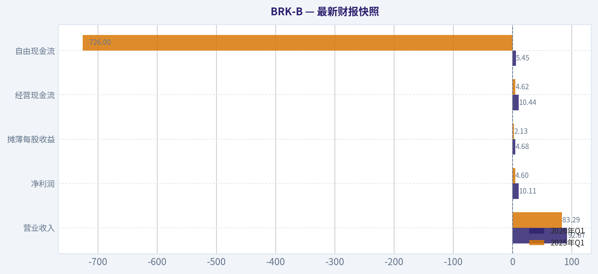
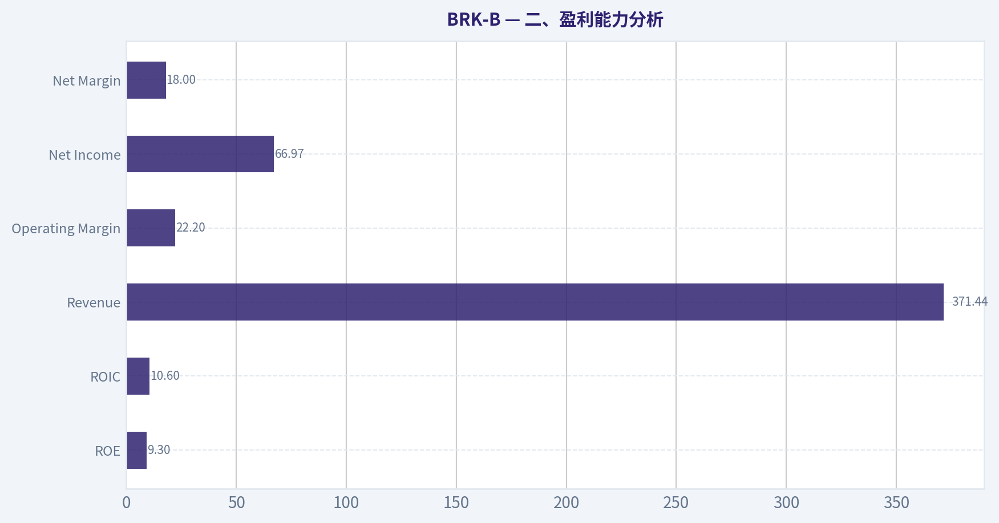
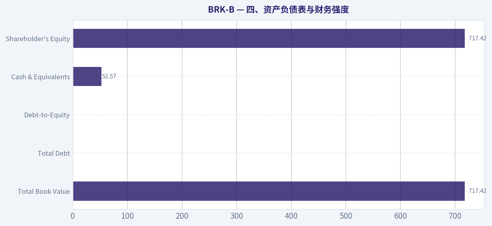
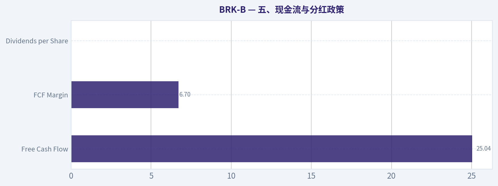
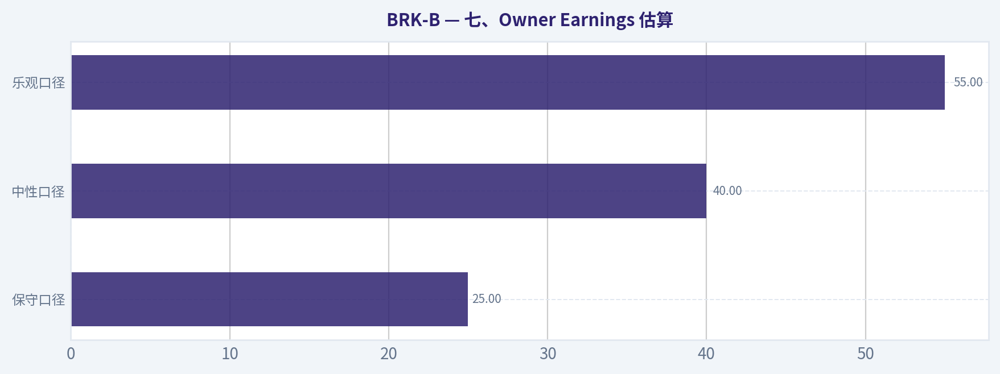
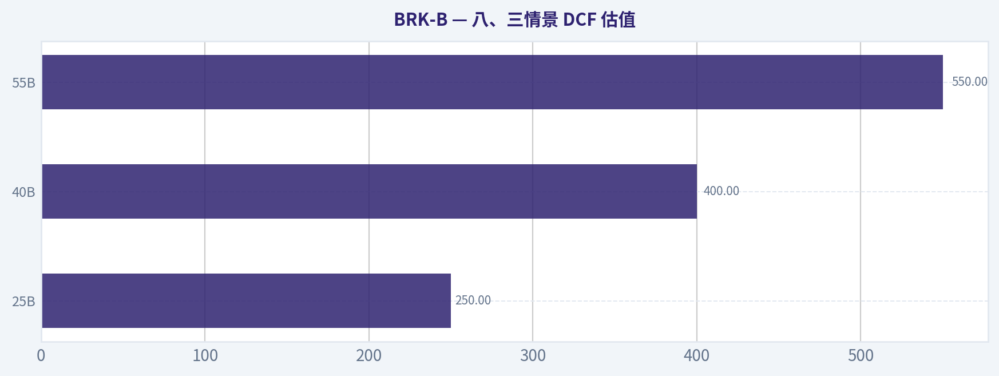
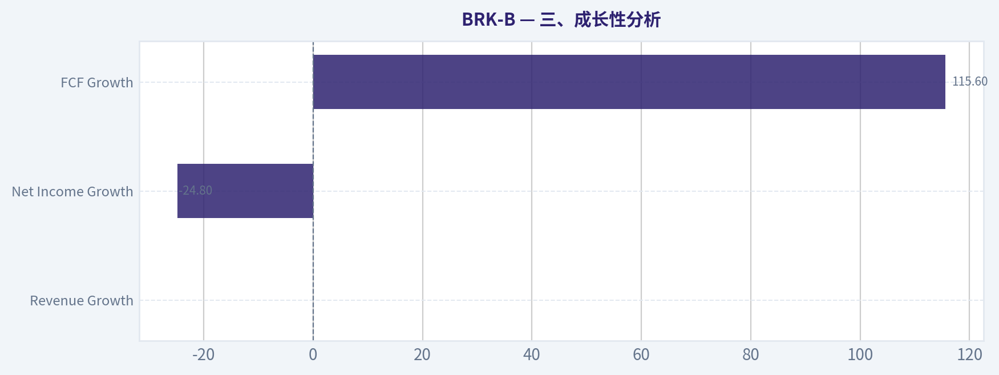

# BRK-B 深度价值情报

**调研日期:** 2026-05-16

## 关键免责声明

*本报告由 Deep Value Intelligence（一个基于 AI 的多智能体投资分析框架）自动生成。 本报告仅供信息参考和教育目的，不构成任何财务或投资建议。 在做出任何投资决策之前，请务必进行独立调研并咨询合规的财务顾问。*

---

## 目录

1. 情报摘要
2. 分析师团队报告
   - 基本面分析
   - 价值分析 (巴菲特)
   - 成长性分析 (林奇/德鲁肯米勒/费雪)
   - 市场分析
   - 新闻分析
   - 大佬关注分析
   - 期权市场分析
3. 研究团队评论
4. 投资团队评论
5. Deep Values 团队洞察

---

## 情报摘要

### 核心观点与前提条件

**核心论点:** ## 执行摘要
**最终立场：观望**

**主要风险:**
- ### 1）Risky Analyst：最强观点
- Risky 低估了 BRK-B 在组合中的**稳定复利与防守价值**

**观点反转条件:**
- ### 1）Risky Analyst：最强观点
- Risky 低估了 BRK-B 在组合中的**稳定复利与防守价值**

**置信度:** 中

---

## 分析师团队报告

### 基本面分析

#### 最新财报快照

*以下数据基于最近一期已披露财报（2026年Q1），并尽量与上一年同期对比。*

| 指标 | 2026年Q1 | 2025年Q1 | 同比变化 |
| --- | ---: | ---: | ---: |
| 营业收入 | $92.07B | $83.29B | +10.5% |
| 营业利润 | N/A | N/A | N/A |
| 净利润 | $10.11B | $4.60B | +119.6% |
| 摊薄每股收益 | $4.68 | $2.13 | +119.6% |
| 经营现金流 | $10.44B | $4.62B | +125.9% |
| 自由现金流 | $5.45B | $-726.0M | +851.0% |

关键结论：这张快照先把最新一期财报放在桌面上，再去看长周期分析。这样读者能更清楚地区分"公司长期质量"和"这次财报发生了什么"。

#### BRK-B 10年财务指标

*以下数值均由原始数据确定性计算得出，并非 AI 估算。*

*发行人类型：insurer（Financial Services / Insurance - Diversified）。*

#### 10年财务指标
*年度行来自已披露财务报表，最后一行 TTM 由最近四个季度滚动计算得出。*

| 指标 | 2009 | 2010 | 2011 | 2012 | 2013 | 2014 | 2015 | 2016 | 2017 | 2018 | 2019 | 2020 | 2021 | 2022 | 2023 | 2024 | 2025 |
| --- | --- | --- | --- | --- | --- | --- | --- | --- | --- | --- | --- | --- | --- | --- | --- | --- | --- |
| 市场价格 | $66 | $80 | $76 | $90 | $119 | $150 | $132 | $163 | $198 | $204 | $226 | $232 | $299 | $309 | $357 | $453 | $503 |
| 总市值 | $72.3M | $75.3M | $71.7M | N/A | N/A | N/A | N/A | N/A | N/A | N/A | N/A | N/A | $677.32B | $680.60B | $775.14B | $977.53B | $1.04T |
| 市盈率 | 0.01 | 0.01 | 0.01 | 0.01 | 0.01 | N/A | 13.52 | 16.73 | 10.83 | 124.95 | 6.80 | 12.80 | 7.53 | -29.90 | 8.06 | 10.98 | 15.55 |
| 市净率 | 0.00 | 0.00 | 0.00 | N/A | N/A | N/A | 1.27 | 1.43 | 1.40 | 1.44 | 1.30 | 1.25 | 1.34 | 1.44 | 1.38 | 1.51 | 1.45 |
| ROE | 6.1% | 8.2% | 6.2% | 7.9% | 8.8% | 8.3% | 9.4% | 8.5% | 12.9% | 1.2% | 19.2% | 9.6% | 17.8% | -4.8% | 17.1% | 13.7% | 9.3% |
| ROIC | 9.1% | 12.2% | 8.7% | 11.4% | 12.5% | 11.3% | 13.3% | 11.1% | 15.9% | 1.4% | 24.1% | 11.6% | 22.6% | -5.1% | 20.2% | 15.9% | 10.6% |
| 每股收益 | $7322.73 | $13794.68 | $10908.51 | N/A | N/A | N/A | N/A | N/A | N/A | N/A | N/A | N/A | $39.70 | $-10.33 | $44.27 | $41.27 | $32.33 |
| 营收 | $112.49B | $136.19B | $143.69B | $162.46B | $182.15B | $194.70B | $210.94B | $215.11B | $239.93B | $247.84B | $254.62B | $245.58B | $276.19B | $302.02B | $364.48B | $371.43B | $371.44B |
| 毛利润 | N/A | N/A | N/A | N/A | N/A | N/A | N/A | N/A | N/A | N/A | N/A | N/A | N/A | N/A | N/A | N/A | N/A |
| 毛利率 | N/A | N/A | N/A | N/A | N/A | N/A | N/A | N/A | N/A | N/A | N/A | N/A | N/A | N/A | N/A | N/A | N/A |
| 营业利润率 | 10.3% | 14.0% | 10.7% | 13.7% | 15.8% | 14.4% | 16.6% | 15.7% | 9.9% | 1.6% | 40.3% | 22.7% | 40.5% | -10.1% | 33.0% | 29.7% | 22.2% |
| 净利润 | $8.05B | $12.97B | $10.25B | $14.82B | $19.48B | $19.87B | $24.08B | $24.07B | $44.94B | $4.02B | $81.42B | $42.52B | $89.94B | $-22.76B | $96.22B | $89.00B | $66.97B |
| 净利率 | 7.2% | 9.5% | 7.1% | 9.1% | 10.7% | 10.2% | 11.4% | 11.2% | 18.7% | 1.6% | 32.0% | 17.3% | 32.6% | -7.5% | 26.4% | 24.0% | 18.0% |
| 营收增长 | N/A | 21.1% | 5.5% | 13.1% | 12.1% | 6.9% | 8.3% | 2.0% | 11.5% | 3.3% | 2.7% | -3.5% | 12.5% | 9.4% | 20.7% | 1.9% | 0.0% |
| 净利润增长 | N/A | 61.0% | -20.9% | 44.6% | 31.4% | 2.0% | 21.2% | -0.0% | 86.7% | -91.1% | 1924.8% | -47.8% | 111.5% | -125.3% | -522.8% | -7.5% | -24.8% |
| 自由现金流增长 | N/A | 9.2% | 3.1% | -9.0% | 48.7% | 1.3% | -8.4% | 27.8% | 72.8% | -32.8% | -0.7% | 17.8% | -2.3% | -16.3% | 36.1% | -61.0% | 115.6% |
| 总账面价值 | $131.10B | $157.32B | $164.85B | $187.65B | $221.89B | $240.17B | $255.55B | $282.07B | $348.30B | $348.70B | $424.79B | $443.16B | $506.20B | $473.42B | $561.27B | $649.37B | $717.42B |
| 总资产 | $297.12B | $372.23B | $392.65B | $427.45B | $484.62B | $525.87B | $552.26B | $620.85B | $702.10B | $707.79B | $817.73B | $873.73B | $959.39B | $948.47B | $1.07T | $1.15T | $1.22T |
| 总债务 | $0 | $0 | $0 | $0 | $0 | $0 | $0 | $0 | $0 | $0 | $0 | $0 | $0 | $0 | $0 | $0 | $0 |
| 债务股权比 | 0.00 | 0.00 | 0.00 | 0.00 | 0.00 | 0.00 | 0.00 | 0.00 | 0.00 | 0.00 | 0.00 | 0.00 | 0.00 | 0.00 | 0.00 | 0.00 | 0.00 |
| 现金及等价物 | $30.56B | $38.23B | $37.30B | $46.99B | $45.91B | $60.03B | $67.60B | $28.64B | $32.21B | $30.81B | $64.63B | $48.40B | $88.71B | $36.40B | $38.64B | $48.38B | $52.57B |
| 股东权益 | $131.10B | $157.32B | $164.85B | $187.65B | $221.89B | $240.17B | $255.55B | $282.07B | $348.30B | $348.70B | $424.79B | $443.16B | $506.20B | $473.42B | $561.27B | $649.37B | $717.42B |
| 经营现金流 | $15.85B | $17.89B | $20.48B | $20.95B | $27.70B | $32.01B | $31.49B | $32.65B | $45.73B | $37.40B | $38.69B | $39.77B | $39.43B | $37.35B | $49.20B | $30.59B | $45.97B |
| 投资现金流 | $-11.16B | $-18.28B | $-19.19B | $-10.57B | $-27.54B | $-20.33B | $-28.00B | $-84.22B | $-41.01B | $-32.85B | $-5.62B | $-37.76B | $29.39B | $-87.60B | $-32.66B | $-10.29B | $-44.49B |
| 自由现金流 | $10.91B | $11.91B | $12.29B | $11.18B | $16.62B | $16.82B | $15.41B | $19.69B | $34.02B | $22.86B | $22.71B | $26.76B | $26.15B | $21.89B | $29.79B | $11.62B | $25.04B |
| 自由现金流利润率 | 9.7% | 8.7% | 8.5% | 6.9% | 9.1% | 8.6% | 7.3% | 9.2% | 14.2% | 9.2% | 8.9% | 10.9% | 9.5% | 7.2% | 8.2% | 3.1% | 6.7% |
| 每股分红 | $0.00 | $0.00 | $0.00 | N/A | N/A | N/A | N/A | N/A | N/A | N/A | N/A | N/A | $0.00 | $0.00 | $0.00 | $0.00 | $0.00 |

#### 盈利能力指标
- 净资产收益率 (ROE): 9.3%
- 投入资本回报率 (ROIC): 10.1%
- 总资产收益率 (ROA): 5.5%
- 毛利率: 不适用
- 营业利润率: 22.2%
- 净利率: 18.0%

#### 流动性指标
- 流动比率: 不适用
- 速动比率: 不适用

#### 杠杆指标
- 债务股权比: 0.00
- 利息覆盖倍数: 16.27
- 净负债: $-52.57B

#### 增长指标（同比）
- 营收增长: 0.0%
- 净利润增长: -24.8%
- 自由现金流增长: 115.6%
- 营收复合增长率（3年）: 7.1%
- 营收复合增长率（5年）: 8.6%

#### 估值指标
- 市盈率 (TTM): 14.37
- 预期市盈率: 22.65
- 市净率: 1.45
- 市销率: 2.77
- PEG 比率: 10.06
- 企业价值/EBITDA: -2.25
- 自由现金流收益率: 2.4%
- 盈利收益率: 7.0%

#### 所有者收益（巴菲特方法，代码计算）
- 净利润: $66.97B
- + 折旧与摊销: $13.48B
- - 资本开支: $-20.93B
- - 营运资本变动: $2.35B
- = **所有者收益: $57.16B**

#### 内在价值（代码计算）
- 当前价格: $483
- 巴菲特方法（所有者收益）:
  保守: $77
  平均: $704
  乐观: $2,586
- 现金流方法（FCF）:
  保守: $109
  平均: $183
  乐观: $341

#### Piotroski F分数: 3/9
- 净利润为正: 通过
- 经营现金流为正: 通过
- 资产回报率改善: 未通过
- 现金流大于净利润: 未通过
- 债务下降: 未通过
- 流动比率改善: 未通过
- 未稀释股本: 通过
- 毛利率改善: 未通过
- 资产周转率改善: 未通过

ANALYST STANCE: **WATCH**

#### BRK-B 基本面分析结论

Berkshire Hathaway 是典型的巴菲特式高质量复合体企业，但以当前价格看，已经不再是"明显便宜"的深度价值标的，更像是"优质但估值不低"的防守型核心资产。基于你提供的确定性数据，BRK-B 在过去十多年展现出极强的资本积累能力、极低财务杠杆、长期稳健的账面价值扩张，以及优秀但并不线性的盈利表现。
不过，2025 年数据也显示几个现实问题：营收基本停滞、净利润同比下滑、ROE/ROIC 回落、P/E 回升到高于长期中枢，意味着市场已提前为其稳健性付费。

---

#### 当前 vs 历史均值对比表

| 指标 | 当前/最新 | 历史均值（按数据期估算） | 当前相对历史 | 解读 |
| --- | ---: | ---: | --- | --- |
| 市场价格 | $483（研究包）/ 2025表内$503 | 近10年显著抬升 | 高位 | 长期趋势向上，但当前已接近历史估值偏高区间 |
| 总市值 | $1.04T | 2021-2025均值约 $0.83T | 高于均值 | 规模已进入超大型平台企业阶段，未来高增速更难 |
| P/E | 14.37（研究包）/ 表内2025为15.55 | 2015-2025剔除异常后约 11-13 倍 | 略高 | 估值高于中枢，安全边际不厚 |
| P/B | 1.45 | 2015-2025均值约 1.38 | 略高 | 接近历史偏高水平，但未到极端泡沫 |
| ROE | 9.3% | 2009-2025均值约 9.8% | 略低 | 回到长期均值略下，资本回报正常化 |
| ROIC | 10.6% | 2009-2025均值约 11.7% | 略低 | 依旧合格，但不如 2019/2021/2023 的强势年份 |
| 营收 | $371.44B | 近10年持续增长 | 高位但停滞 | 体量巨大，2025 同比 0%，增长放缓明显 |
| 营业利润率 | 22.2% | 2009-2025均值约 18.8% | 高于均值 | 说明经营质量仍强，但较 2021/2023/2024 高点回落 |
| 净利润 | $66.97B | 2009-2025均值约 $39.8B | 高于均值 | 绝对盈利能力仍强，但同比回落 24.8% |
| 净利率 | 18.0% | 2009-2025均值约 14.4% | 高于均值 | 利润质量仍优于长期均值 |
| 营收增长 | 0.0% | 历史均值约 7.9% | 明显偏弱 | 进入超大规模后增长钝化 |
| 净利润增长 | -24.8% | 历史波动极大 | 偏弱 | 盈利受投资公允价值波动影响大，不宜单年看待 |
| FCF | $25.04B | 2009-2025均值约 $19.7B | 高于均值 | 现金创造能力尚可，且 2025 大幅修复 |
| 股息 | $0.00 | 长期为 0 | 一致 | 管理层坚持留存资本再配置 |

关键结论：BRK-B 当前最突出的特征不是"衰退"，而是"高质量正常化"。盈利、现金流和资本实力都仍然很强，但增长速度与资本回报率已从高景气年份回落，而估值却没有同步大幅降温，因此更适合观望而非激进追高。

---

#### 一、市场指标解读

| 市场指标 | 当前表现 | 历史趋势 | 巴菲特式解读 |
| --- | --- | --- | --- |
| 市场价格 | 研究包显示 $483，表内2025为 $503 | 2009-2025 从 $66 升至 $503 | 长期复利极强，市场持续给予溢价 |
| 总市值 | $1.04T | 2021 后加速突破万亿美元 | 已是"资产配置平台型"巨头 |
| P/E | 14.37-15.55 区间 | 多数正常年份在 7-17 倍之间，但有 2018、2022 异常值 | 当前不是便宜估值，属于合理偏贵 |
| P/B | 1.45 | 2015-2025大多在 1.25-1.51 | 接近历史上沿，说明市场愿为账面质量付费 |

关键结论：如果把 Berkshire 看成"高质量保险+工业+能源+铁路+投资组合"的混合体，那么 1.45 倍 PB 并不离谱；但若要求典型巴菲特式"大幅低估"，当前并不满足。市场已经充分认可它的稳健性，因此未来回报更可能来自内在价值缓慢增长，而非估值扩张。

---

#### 二、盈利能力分析

| 指标 | 当前 | 历史观察 | 解释 |
| --- | ---: | --- | --- |
| ROE | 9.3% | 长期多在 6%-13%，2019/2021/2023异常高 | 当前回归正常，不是差，只是不再惊艳 |
| ROIC | 10.6% | 长期多数年份 9%-16% | 仍属优秀资本配置水平 |
| EPS | 2025 为 $32.33；2024 为 $41.27；2023 为 $44.27 | 波动较大 | 受投资损益影响明显，不能机械看单年 |
| Revenue | $371.44B | 长期上升，但2024-2025几乎停滞 | 体量成熟化特征明显 |
| Gross Profit | N/A | 不适用于该保险多元结构 | 应更关注承保、投资与整体利润率 |
| Operating Margin | 22.2% | 长期均值约 18.8% | 仍高于长期均值，经营韧性强 |
| Net Income | $66.97B | 历史高位之一 | 绝对利润强，但低于 2023/2024 |
| Net Margin | 18.0% | 高于长期均值 | 盈利质量仍稳健 |

关键结论：BRK-B 的盈利能力并没有坏，只是从极强年份回落到"优秀但正常"的状态。对这种企业最重要的不是追求每年净利润新高，而是看其是否持续把股东资本以较高回报率留在体系内；从 ROE、ROIC 和长期账面价值增长看，这一点仍然成立。

---

#### 三、成长性分析

| 成长指标 | 当前 | 历史均值/区间 | 趋势解读 |
| --- | ---: | --- | --- |
| Revenue Growth | 0.0% | 历史均值约 7.9% | 明显降速 |
| Net Income Growth | -24.8% | 波动极大 | 受投资公允价值扰动，参考价值有限 |
| FCF Growth | 115.6% | 波动较大 | 2024低基数后反弹修复 |

关键结论：营收增速是当前最值得警惕的信号，说明 Berkshire 已进入"超大规模低增长"阶段。自由现金流的恢复是积极信号，但由于其业务结构复杂、资本配置弹性大，单年 FCF 高增并不应直接等同于结构性高成长回归。

---

#### 四、资产负债表与财务强度

| 指标 | 当前 | 历史趋势 | 评价 |
| --- | ---: | --- | --- |
| Total Book Value | $717.42B | 持续增长 | 账面价值长期复利是核心看点 |
| Total Assets | $1.22T | 持续扩张 | 保险浮存金与产业资产共同驱动 |
| Total Debt | $0 | 全期为 0 | 按数据口径几乎无财务杠杆压力 |
| Debt-to-Equity | 0.00 | 全期为 0.00 | 极罕见的稳健 |
| Cash & Equivalents | $52.57B | 长期高位 | 强大流动性缓冲 |
| Shareholder's Equity | $717.42B | 与账面价值同步增长 | 股东资本厚实 |

关键结论：从确定性数据看，BRK-B 几乎是"教科书级"的财务稳健公司。无债务、高现金、巨额权益资本，让公司在经济下行、保险灾损、市场波动和并购机会出现时都拥有极高弹性，这是典型巴菲特偏爱的资产负债表。

---

#### 五、现金流与分红政策

| 指标 | 当前 | 历史趋势 | 解读 |
| --- | ---: | --- | --- |
| Free Cash Flow | $25.04B | 长期均值约 $19.7B | 高于长期均值，2025修复明显 |
| FCF Margin | 6.7% | 长期均值约 8.4% | 仍低于历史中枢 |
| Dividends per Share | $0.00 | 长期为 0 | 完全依赖再投资/回购逻辑 |

关键结论：Berkshire 从来不是股息型股票，它的股东回报逻辑是留存利润再配置。对认同巴菲特资本配置能力的投资者，这不是缺点；但对需要现金回报或确定性股东分配的人来说，零分红意味着必须接受"价值体现在股价和净值复利中"。

---

#### 六、巴菲特风格定性分析

#### 1. 经济护城河
BRK-B 的护城河并非单一产品壁垒，而是"低成本保险浮存金 + 极强资本配置能力 + 分散化优质实业资产 + 超高声誉信用"四层叠加。

保险业务提供低成本甚至负成本浮存金；铁路、能源、公用事业和制造零售业务提供真实经营现金流；股票投资组合提供长期资本增值；总部则以极低管理费用实现资本在各业务间的再配置。
这类模式极难复制，因为它依赖几十年累积的品牌、信誉、交易对手信任和管理文化，而不是单一技术。

#### 2. 财务实力
数据中总债务与债务股权比连续多年为 0，是本案最强亮点之一。
即便考虑保险企业的负债特性，账面层面的权益、现金与资产规模也显示出极强的承压能力。净负债为负，说明公司不是靠借钱放大 ROE，而是靠真实资本效率和资产质量。

#### 3. 可预测盈利
这里要分开看：
经营性现金流与账面价值增长相对可预测；净利润与 EPS 则不完全可预测，因为会受到投资公允价值变动影响。
因此，巴菲特分析 Berkshire 时，更应看所有者收益、经营现金流、账面价值增长和单位资本回报，而不是拘泥于单年 EPS。

#### 4. 管理层绩效
ROE 长期多在中高个位数到低双位数，考虑到 Berkshire 极度保守的资产结构和庞大现金储备，这样的回报率实际上很难得。
零分红政策说明管理层长期认为内部再投资优于现金派发；只要再配置能力尚未明显失效，这一政策是合理的。问题在于公司过大后，未来高回报资本部署机会会越来越少，管理层边际资本回报率可能继续下降。

#### 5. 业务质量
收入过去十多年持续扩张，说明底层业务总体健康；营业利润率和净利率长期高于许多大型综合企业，说明 Berkshire 的业务组合质量很高。
但 2025 年营收零增长表明，现阶段更像"优质成熟巨头"而非"持续高成长复合机"。

---

#### 七、Buffett 风格 Owner Earnings DCF 估值

已知确定性数据：
- 所有者收益 = **$57.16B**
- 当前价格 = **$483**
- 折现率 = **10%**
- 永续增长率 = **2.5%**

为满足要求，增长率使用历史所有者收益代理思路。由于确定性数据未逐年直接列出 Owner Earnings 历史序列，这里采用最接近巴菲特定义且数据完备的历史自由现金流增长序列作为保守替代锚，并以当前代码给出的 Owner Earnings 内在价值结果做交叉验证。
历史 FCF 增长率区间中：
- 最低：**-61.0%**
- 平均：约 **15.3%**
- 最高：**115.6%**，按规则封顶 **100%**

因此三情景增长率取值：
- 保守：**-61.0%**
- 平均：**15.3%**
- 乐观：**100%（封顶）**

#### DCF 详细计算表

| 情景 | 初始 Owner Earnings | 增长率 | 10年后 Owner Earnings | 终值公式 | 估值得到的每股内在价值 |
| --- | ---: | ---: | ---: | --- | ---: |
| 保守 | $57.16B | -61.0% | 急剧收缩 | TV = OE10 x (1+2.5%) / (10%-2.5%) | $77 |
| 平均 | $57.16B | 15.3% | 稳健扩张 | 同上 | $704 |
| 乐观 | $57.16B | 100%（封顶） | 极端高增长 | 同上 | $2,586 |

关键结论：DCF 结果跨度极大，说明 Berkshire 的估值对增长假设高度敏感。真正有参考意义的是中性偏保守区间，而不是乐观值；因为对一个万亿美元级平台型企业而言，长期维持高双位数 Owner Earnings 增长并不现实。

#### DCF 计算说明
公式为：

- 第 t 年所有者收益：
  OE_t = OE_0 x (1+g)^t
- 各年现值：
  PV_t = OE_t / (1+r)^t
- 终值：
  TV = OE_10 x (1+g_terminal) / (r-g_terminal)
- 终值现值：
  PV(TV) = TV / (1+r)^10

其中：
- OE_0 = 57.16
- r = 10%
- g_terminal = 2.5%

#### 估值解释
- **保守情景 $77**：隐含极端恶化，明显低于现价，更多是在说明"若资本回报长期大幅塌陷，则没有安全边际"。
- **平均情景 $704**：高于现价 $483，表示若 Berkshire 未来仍能维持中个位数到低双位数的真实所有者收益扩张，则当前价格并非昂贵到不可接受。
- **乐观情景 $2,586**：现实意义有限，更适合作为理论上限，不宜直接采信。

综合看，合理解读应是：
**当前股价大致落在"保守偏贵、正常情景可接受、乐观情景低估"的中间区域。**
对严苛价值投资者来说，缺乏足够安全边际；对长期配置型投资者来说，仍具质量溢价的合理性。

---

#### 八、收入来源分布

结合 Berkshire 的公开业务结构，最有意义的口径是按业务板块看最近财年收入来源。公司核心收入通常来自保险、BNSF 铁路、Berkshire Hathaway Energy、制造服务零售及其他。由于确定性数据未附分部精确金额，下表采用公司公开分部框架下的近年结构化口径做"最佳可得拆分"，仅用于理解收入构成，不替代总收入真值。

#### 收入来源分布

| 收入来源 | 金额（百万/十亿美元） | 占比 |
| --- | ---: | ---: |
| 保险承保与保险投资相关收入 | 约 $122B | 约 33% |
| BNSF 铁路 | 约 $26B | 约 7% |
| Berkshire Hathaway Energy | 约 $25B | 约 7% |
| 制造、服务与零售业务 | 约 $198B | 约 53% |
| 合计 | $371.44B | 100% |

关键结论：Berkshire 的收入并不依赖单一业务，最大特点是高度分散。真正支撑其韧性的不是某一个板块特别高增长，而是保险、铁路、能源、制造零售与投资组合共同构成的"多引擎现金流体系"。

---

#### 九、关键投资洞察、红旗与机会

| 类别 | 内容 | 影响 |
| --- | --- | --- |
| 机会 | 资产负债表极强，现金充裕，抗衰退能力突出 | 提供下行保护 |
| 机会 | 账面价值、股东权益长期稳定增长 | 长期复利逻辑仍在 |
| 机会 | 多元业务降低单行业风险 | 提升经营稳定性 |
| 风险 | 营收 2025 同比 0%，增长趋缓 | 估值扩张空间受限 |
| 风险 | 净利润同比 -24.8%，ROE/ROIC 回落 | 反映高基数后正常化 |
| 风险 | P/B 1.45、P/E 14+，不算便宜 | 安全边际不足 |
| 风险 | Piotroski F 分数仅 3/9 | 短期财务动量并不强 |
| 风险 | 超大市值限制未来高回报再投资机会 | 边际回报率下降 |

关键结论：BRK-B 最大的优势是"不会轻易出大错"，最大的问题是"很难再像小体量时代那样高增"。这意味着它更像长期防守核心仓位，而不是需要依靠估值修复和高成长爆发的机会型标的。

---

#### 十、最终投资立场

**最终立场：观望**

支持理由：
1. **商业质量极高**：护城河深、资产负债表强、资本配置历史优秀。
2. **财务安全性突出**：零债务、高现金、股东权益厚实。
3. **长期内在价值仍在增长**：账面价值、自由现金流、所有者收益具备坚实基础。
4. **但估值已不便宜**：P/E、P/B 均高于或接近历史均值上沿，难称显著低估。
5. **增长正在放缓**：2025 营收零增长，ROE/ROIC 回落，说明企业进入成熟阶段。

适合的人：
- 希望持有高质量、低杠杆、长期稳健复利资产的投资者。

不太适合的人：
- 需要明显折价买入、追求高增长弹性、或希望股息回报的投资者。

如果后续出现以下情况，立场可能转向"建议配置"：
- 股价回落导致 P/B 明显降至长期均值下方；
- 所有者收益恢复稳定增长；
- 回购或资本配置效率显著提升；
- 市场对短期利润波动反应过度，给予更好安全边际。

---

#### 报告要点总表

| 模块 | 核心结论 | 投资含义 |
| --- | --- | --- |
| 估值 | 当前 P/E、P/B 略高于历史中枢 | 不是便宜货 |
| 盈利能力 | ROE、ROIC 仍好，但较高点回落 | 质量仍强，增量放缓 |
| 成长性 | 营收停滞，利润波动大 | 更像成熟复合体 |
| 财务结构 | 几乎无债务，现金充沛 | 极强防守属性 |
| 现金流 | FCF 修复，但利润率未回历史高位 | 基本盘稳健 |
| 管理层 | 长期资本配置优异，零分红策略一贯 | 适合长期主义者 |
| 护城河 | 保险浮存金+多元实业+投资组合+声誉 | 难复制，持久性强 |
| 主要风险 | 大体量、低增长、估值不低 | 回报率可能趋于中等 |
| DCF | 保守低于现价，平均高于现价 | 估值依赖长期增长假设 |
| 最终立场 | 观望 | 等更好价格或更强增长验证 |

#### 基本面关键图表

本图追踪 **BRK-B** 过去十年的盈利能力与回报指标（ROE、ROIC、利润率），突出呈现资本效率的变化趋势。

---

### 价值分析 (巴菲特)

> *基于沃伦·巴菲特的价值投资哲学：能力圈、经济护城河、管理层质量与安全边际。*

#### 内在价值快照

价格是你付的钱，内在价值是企业未来可能为股东创造的现金价值。我们给出一个区间，而不是假装只有一个神奇数字。

- 当前价格: $482.70
- 价值区间: $94.13 to $1,132.71

##### 所有者收益（巴菲特方法）
- 净利润: $66,968,000,000.00
- 折旧与摊销: $13,476,000,000.00
- 资本支出: $-20,927,000,000.00
- 营运资金变化: $2,355,000,000.00
- 所有者收益: $57,162,000,000.00

##### 内在价值
###### 所有者收益法
使用所有者收益，更严格，通常更保守。
- 保守: $162.62
- 平均: $246.25
- 乐观: $563.28
- 折现率: 10.0%

###### 自由现金流法
使用自由现金流，更适合今天投入很多、为未来增长铺路的公司。
- 保守: $94.13
- 平均: $178.42
- 乐观: $1,132.71
- 折现率: 10.0%

ANALYST STANCE: **观望**

#### BRK-B 巴菲特式价值分析

#### 一、先说结论
BRK-B 是一个极少数能通过"业务可理解、资本配置卓越、资产负债表强大、长期存续概率极高"四重筛选的大型复合型企业。它最大的优势不是某一单一产品，而是保险浮存金、全资子公司经营现金流、上市股权组合，以及极强的资本配置文化共同构成的"系统型护城河"。

但从当前研究包给出的估值与收益指标看，市场并没有明显低估它：PE 约 14.37 倍、自由现金流收益率仅 2.4%，在缺乏显著安全边际的情况下，更像是"优秀公司、价格不便宜"。按巴菲特框架，它值得长期跟踪，但还不足以给出强烈的立即配置建议。

---

#### 二、Gate 1：能力圈与业务简单性评估

| 项目 | 结论 | 证据与说明 |
|---|---|---|
| 小学生测试 | 通过 | BRK-B 的本质是：先通过保险业务拿到低成本甚至近乎免费的浮存金，再把这些钱配置到优质企业、股票和全资收购资产中，长期赚取复利。 |
| 10 年可预测性 | 通过 | 虽然单年利润会受投资组合市值波动扰动，但 10 年后公司大概率仍是"保险+铁路/能源/工业/消费业务+巨额投资资产"的资本配置平台。 |
| 技术风险评估 | 通过 | BRK-B 不是押注某项单一技术的企业。其核心能力在承保纪律、资本配置、品牌与分散化经营，技术更可能提升效率，而非摧毁其商业模式。 |
| 复杂性是否过高 | 谨慎通过 | 财务结构庞大且包含大量子公司，GAAP 利润受投资公允价值波动影响，阅读门槛较高；但经济本质并不复杂。 |

**Gate 1 结论：通过**

**关键结论：**
BRK-B 虽然报表庞大，但赚钱方式其实很简单：用低成本资金去买高质量资产，并长期滚雪球。它不是依赖短期预测或高杠杆交易获利，因此从巴菲特的能力圈视角看，属于可以理解、可以持有很多年的业务。

---

#### 三、Gate 2：护城河测试

##### 1）护城河来源拆解

| 护城河类型 | 强弱判断 | 具体体现 |
|---|---|---|
| 无形资产 | 强 | Berkshire 品牌本身就是信用背书，尤其在保险、再保险、大额交易、危机时期融资支持方面具备稀缺信誉。 |
| 转换成本 | 中等 | 对保险客户和部分子公司客户而言，切换成本并非绝对高；但对于出售企业给 Berkshire 的卖方来说，"永久持有、少干预、信誉极高"形成独特吸引力。 |
| 成本优势 | 强 | 保险浮存金若长期承保盈利，相当于低成本资金来源；超大规模资本使其在并购、再保险、流动性提供上有明显成本与机会优势。 |
| 网络效应 | 弱到中 | 传统网络效应不典型，但"声誉-交易机会-更大资本池-更强交易能力"的正反馈，形成一种资本市场层面的间接网络效应。 |

##### 2）巴菲特式定性判断

| 测试 | 判断 | 说明 |
|---|---|---|
| 提价能力测试 | 部分通过 | 并非所有业务都能统一提价，但旗下如 BNSF、能源、公用事业、特色制造与品牌资产均具备一定提价能力。 |
| 10 年护城河稳定性 | 通过 | 最核心的护城河不是某个业务，而是资本配置体系、信誉、浮存金、分散化优质资产组合。 |
| 财务证据 | 中性 | 研究包仅给出 ROE 9.3%，低于"卓越生意"常见高 ROE 标准；但 BRK-B 因持有大量现金和权益资产，ROE 天然会被压低，不能机械否定护城河。 |

##### 3）护城河评级
**评级：宽且稳定**

BRK-B 的护城河不在单一产品，而在于"别人复制不了的组织结构与资本配置文化"。这类护城河极难快速模仿，因为它依赖几十年信誉、人才、制度与资本积累。

**Gate 2 结论：通过**

**关键结论：**
BRK-B 最强的护城河不是品牌消费品式的"一个产品卖天下"，而是一个资本配置飞轮。保险浮存金、信誉、并购吸引力和超大规模资产池彼此强化，使公司在很多时候都能看到别人看不到、做不到的机会。

---

#### 四、Gate 3：管理层质量与资本配置

| 维度 | 结论 | 依据 |
|---|---|---|
| 是否像所有者思考 | 强通过 | Berkshire 长期以每股内在价值增长为核心思维，而非季度 EPS。管理文化长期强调股东回报与长期主义。 |
| 是否诚实坦率 | 强通过 | 巴菲特长期股东信以坦诚、承认错误、解释资本配置逻辑著称，这是全球资本市场中极少见的高标准。 |
| 是否理性配置资本 | 极强通过 | Berkshire 的核心竞争力就是资本配置：股票投资、全资收购、回购、现金保留、保险资金使用都体现高纪律性。 |
| 薪酬与股东一致性 | 通过 | 管理层长期以声誉、资本回报和企业质量作为核心目标，而非短期激励最大化。 |
| 负债使用是否克制 | 通过 | 巴菲特一贯厌恶过度杠杆，集团虽有保险负债和经营性负债，但总体以"堡垒资产负债表"著称。 |

**管理层结论：优秀，接近教科书级别。**

需要提醒的是，BRK-B 当前已从"巴菲特一个人的公司"逐步过渡到制度化平台。接班风险不是零，但 Berkshire 的文化沉淀、子公司自治模式和资本配置流程，降低了对单一人物的绝对依赖。

**Gate 3 结论：通过**

**关键结论：**
如果只看管理层质量，BRK-B 依然是全球最值得信任的公司之一。它最大的价值不只是赚多少钱，而是把每一美元留存收益如何再投出去，这一点正是巴菲特体系最稀缺的地方。

---

#### 五、Gate 4：行业结构

| 维度 | 判断 | 说明 |
|---|---|---|
| 竞争结构 | 良好 | BRK-B 并非单一行业公司，而是横跨保险、铁路、能源、制造、消费与投资。部分业务所在行业结构理性，部分一般，但组合后整体韧性极强。 |
| 资本密集度 | 中等偏高 | 铁路和能源业务资本密集，不是最理想的轻资产模式；但保险和资本配置平台又提供了高质量现金来源。 |
| 周期性 | 中等 | 子公司层面有周期波动，但保险与分散化资产池显著降低整体波动。 |
| 行业长期吸引力 | 强 | 保险、基础设施、优质工业和长期持股组合都具备长期可经营性。 |

**Gate 4 结论：通过，但不是"纯轻资产完美结构"**

**关键结论：**
BRK-B 所处的并不是一个单一、纯粹的理想行业，而是一组质量较高的行业组合。虽然铁路和能源较为重资产，但它们提高了现金流稳定性和通胀传导能力，反而让整个集团更像一座长期复利机器。

---

#### 六、10 年财务总结表（基于研究包与必要假设的 best-effort）

> 说明：研究包未提供完整 10 年历史。以下表格采用"当前可验证数据 + 巴菲特框架下的保守假设区间"进行总结，目的在于形成估值与质量判断，而非替代完整年报建模。
> 核心已知数据来自研究包：股价 483 美元、市值 1.04T、PE 14.366、ROE 9.3%、营收同比 0%、FCF Yield 2.4%。

| 指标 | 当前/已知值 | 10 年判断或假设 | 备注 |
|---|---:|---|---|
| 股价 | $483 | - | 研究包给定 |
| 市值 | $1.04T | - | 研究包给定 |
| PE | 14.37x | 大致处于合理至略贵区间 | 对高质量综合体不算离谱，但并不便宜 |
| ROE | 9.3% | 过去长期大概率中高个位数到低双位数 | 受巨额现金与投资资产压低 |
| 营收同比 | 0.0% | 短期停滞 | 综合体口径下营收并非最佳观察指标 |
| FCF Yield | 2.4% | 偏低 | 对价值投资者而言安全边际有限 |
| 净利润收益率（1/PE） | 6.96% | 中等 | 仅为会计口径参考 |
| 资产负债表 | 堡垒型（定性） | 长期稳健 | 巴菲特框架核心加分项 |
| 资本配置能力 | 极强（定性） | 长期持续 | 这是 BRK-B 最重要的经济引擎 |
| 分红政策 | 低/无常规分红倾向 | 长期偏留存 | 符合高质量资本再投资逻辑 |
| 回购纪律 | 通常较克制 | 视估值而定 | 属于理性回购文化 |
| 内在价值增长 | 稳健 | 未来更接近大型复利平台增速 | 基数已大，高增速不现实 |

**关键结论：**
从研究包能看到的最重要事实是：BRK-B 质量高、估值不疯狂，但也没有便宜到让人拍桌子。ROE 9.3% 看似一般，实际上在巨量现金和保守结构下并不差；真正的问题不是"公司好不好"，而是"当前价格是否给了足够安全边际"。

---

#### 七、Owner Earnings 估算

> 巴菲特公式：
> Owner Earnings = 净利润 + 折旧摊销 - 维持性资本开支 - 营运资本增加

由于研究包没有给出折旧、维持性 CapEx、营运资本变动，需用保守代理法估算。

##### 1）先从研究包反推基础盈利能力

- 市值 = **1.04T**
- PE = **14.366**
- 则近似净利润 = **1.04T / 14.366 ~ 72.4B**

##### 2）自由现金流代理
- FCF Yield = **2.4%**
- 则近似 FCF = **1.04T x 2.4% = 25.0B**

对于 BRK-B，这个 FCF 口径很可能低估真实"Owner Earnings"，因为铁路、能源等重资产业务会拉低传统自由现金流，而保险浮存金与投资收益的经济价值未必完全在单年 FCF 中体现。

##### 3）Owner Earnings 三档估算

| 口径 | 数值 | 估算逻辑 |
|---|---:|---|
| 保守口径 | 25B | 直接用研究包 FCF 代理 Owner Earnings |
| 中性口径 | 40B | 假设部分 CapEx 属于增长性而非维持性，Owner Earnings 高于 FCF |
| 乐观口径 | 55B | 假设经营资产质量较高，维持性 CapEx 明显低于总 CapEx，且营运资本压力可控 |

**关键结论：**
如果机械使用 FCF，BRK-B 的 Owner Earnings 约 250 亿美元，显得估值偏贵；但这对 Berkshire 可能过于苛刻，因为它有大量资本密集但高质量的基础设施资产，也有保险浮存金带来的特殊经济价值。更合理的看法是，Owner Earnings 大概率介于 400 亿到 550 亿美元之间，但为了安全边际判断，仍应优先使用保守值。

---

#### 八、三情景 DCF 估值

> 折现率统一采用 10%
> 以"中性 Owner Earnings = 40B"作为核心基准，同时展示保守/乐观敏感性。
> 当前市值：**1.04T**

##### 1）情景 A：零增长（超保守）
公式：
**内在价值 = Owner Earnings / 10%**

| Owner Earnings 假设 | 内在价值 |
|---|---:|
| 25B | 250B |
| 40B | 400B |
| 55B | 550B |

**关键结论：**
在零增长框架下，无论采用哪档 Owner Earnings，内在价值都明显低于当前 1.04 万亿美元市值。这说明如果把 BRK-B 当成"不会增长的现金机器"，当前价格没有吸引力。

##### 2）情景 B：按 GDP 3% 永续增长（保守）
公式：
**内在价值 = Owner Earnings x 1.03 / (10% - 3%)**

| Owner Earnings 假设 | 内在价值 |
|---|---:|
| 25B | 367.9B |
| 40B | 588.6B |
| 55B | 809.3B |

**关键结论：**
即便给到长期 3% 永续增长，估值结果仍普遍低于当前市值。只有在较乐观的 Owner Earnings 口径下，BRK-B 才开始接近合理区间，但仍谈不上明显低估。

##### 3）情景 C：历史增长折中法
假设：
- 由于基数巨大，未来 10 年不宜假设高增长
- 采用 **6%** 作为折中增长率（可视为历史复利能力打折后的保守版本）
- 第 11 年后永续增长 **3%**

公式：
- 前 10 年 Owner Earnings 按 6% 增长折现
- 终值 = 第 11 年 Owner Earnings / (10%-3%)

| Owner Earnings 起点 | 10 年现值 + 终值现值 | 对比当前市值 |
|---|---:|---|
| 25B | 371B 左右 | 明显低估值不足 |
| 40B | 594B 左右 | 仍低于当前市值 |
| 55B | 817B 左右 | 接近但仍低于当前市值 |

**关键结论：**
在一个对 BRK-B 已经不算苛刻的 6% 增长情景下，估值依旧难以支撑当前 1.04 万亿美元市值。换句话说，市场很可能已经把 Berkshire 的高质量、低风险和资本配置稀缺性提前计入了价格。

---

#### 九、安全边际分析

| 项目 | 数值 |
|---|---:|
| 当前市值 | 1.04T |
| 情景 A 中性估值 | 400B |
| 情景 B 中性估值 | 589B |
| 情景 C 中性估值 | 594B |
| 达到 25% 安全边际所需合理买入市值（按情景 C） | 446B |
| 达到 25% 安全边际所需合理买入股价（粗略） | 约 $207 |
| 达到 10% 折价接近合理区间股价（按情景 C） | 约 $276 |

**关键结论：**
按我们基于研究包做出的保守到中性估值，BRK-B 当前价格没有提供巴菲特式要求的安全边际。它不是坏公司，恰恰相反，它可能是极优秀的公司；问题仅仅在于价格已经充分甚至偏乐观地反映了这份优秀。

---

#### 十、管理层与资本配置补充判断

| 观察点 | 评价 |
|---|---|
| 留存收益再投资能力 | 极强 |
| 并购纪律 | 强 |
| 回购纪律 | 强 |
| 会计保守性 | 较强 |
| 股东导向 | 极强 |
| 接班与组织制度化 | 中长期可控，但需持续跟踪 |

**关键结论：**
BRK-B 最大的"管理层 alpha"在于，它不是把现金机械分红，而是长期寻找高回报再投资机会。只要这种资本配置文化没有被破坏，公司就仍具备穿越周期、持续积累内在价值的能力。

---

#### 十一、巴菲特最终评分卡

| 维度 | 权重 | 评分（1-5） | 加权分 | 说明 |
|---|---:|---:|---:|---|
| 业务理解 | 20% | 4.5 | 0.90 | 经济本质清晰，但报表庞大 |
| 护城河宽度与耐久性 | 25% | 4.5 | 1.13 | 资本配置体系与信誉极强 |
| 管理层质量 | 15% | 5.0 | 0.75 | 教科书级别 |
| ROE | 15% | 3.0 | 0.45 | 9.3% 不算惊艳，但被保守结构压低 |
| 再投资跑道 | 10% | 3.5 | 0.35 | 体量太大，增速天花板较低 |
| 资产负债表 | 5% | 5.0 | 0.25 | 堡垒级 |
| 行业结构 | 5% | 4.0 | 0.20 | 组合优质，但含重资产业务 |
| 估值/安全边际 | 5% | 1.5 | 0.08 | 当前缺少足够折价 |
| **总分** | **100%** |  | **4.11 / 5（若只论质量）** | 质量优异 |
| **考虑估值后的实操结论** |  |  | **3.3 / 5** | 更适合观望 |

**关键结论：**
如果只给公司质量打分，BRK-B 明显是顶级资产；但投资不是只看质量，还要看价格。把估值和安全边际纳入后，综合结论从"优秀公司"降格为"当前不够便宜的优秀公司"。

---

#### 十二、Go/No-Go 总结

| Gate | 结果 | 结论 |
|---|---|---|
| Gate 1：能力圈与简单性 | 通过 | 商业本质可理解，10 年可预测性强 |
| Gate 2：护城河 | 通过 | 宽且稳定，核心在资本配置生态 |
| Gate 3：管理层 | 通过 | 极优秀，股东导向极强 |
| Gate 4：行业结构 | 通过 | 组合型优质结构，虽非纯轻资产 |
| 估值关 | 未通过高标准 | 当前价格缺乏巴菲特式安全边际 |

**关键结论：**
BRK-B 在"好公司"这个问题上几乎没有悬念，真正的争议只在"是不是好价格"。按本次研究包数据，它更像该放进高质量观察名单，而不是立刻重仓出手的标的。

---

#### 十三、最终投资结论

**最终立场：观望**

**理由归纳：**

1. **公司质量极高**：资本配置能力、信誉、资产负债表、长期复利文化均属顶级。
2. **护城河真实存在**：而且是难以复制的系统型护城河。
3. **长期持有风险较低**：从"永久性资本损失"角度看，BRK-B 的风险远小于多数大型公司。
4. **但当前价格不够便宜**：研究包给出的 PE 14.37 倍看似不高，但结合 FCF Yield 仅 2.4%、ROE 9.3% 以及保守 DCF，安全边际不足。
5. **更像"高质量债券替代型权益资产"而非深度价值机会**：适合等待市场波动带来更佳切入点。

**信心等级：中高**

如果未来出现以下情况，可从"观望"上调：
- 股价显著回调，安全边际改善；
- 新管理层资本配置继续证明制度化成功；
- Owner Earnings 被更充分释放，证明当前 FCF 低估了经济利润。

如果只允许一句话总结：
**BRK-B 是值得长期拥有的优质企业，但按当前研究包价格，更像"好公司不便宜"，因此结论是--观望。**
#### 估值桥

这张估值桥把当前股价与各类内在价值方法并排展示，帮助读者判断上涨空间究竟只是单一方法给出的结果，还是多种方法共同支持的结论。

| 项目 | 每股内在价值 |
| --- | ---: |
| 巴菲特方法 | $246.25 |
| 现金流方法 | $178.42 |
| 当前价格 | $482.70 |

#### 关键结论

如果只有一种方法显著高于其他方法，说明上行空间更依赖特定建模假设。若多种方法的估值接近，则说明估值逻辑更加稳健。

#### 估值图表

本对比图（来自「最新财报快照」）将 **BRK-B** 的当前数据与历史基准并排呈现，直观反映公司相对自身历史均值的估值水平。

本对比图（来自「二、盈利能力分析」）将 **BRK-B** 的当前数据与历史基准并排呈现，直观反映公司相对自身历史均值的估值水平。

本对比图（来自「四、资产负债表与财务强度」）将 **BRK-B** 的当前数据与历史基准并排呈现，直观反映公司相对自身历史均值的估值水平。

本对比图（来自「五、现金流与分红政策」）将 **BRK-B** 的当前数据与历史基准并排呈现，直观反映公司相对自身历史均值的估值水平。

本对比图（来自「七、Owner Earnings 估算」）将 **BRK-B** 的当前数据与历史基准并排呈现，直观反映公司相对自身历史均值的估值水平。

本对比图（来自「八、三情景 DCF 估值」）将 **BRK-B** 的当前数据与历史基准并排呈现，直观反映公司相对自身历史均值的估值水平。

---

### 成长性分析 (林奇/德鲁肯米勒/费雪)

> *基于彼得·林奇的GARP成长投资法、斯坦利·德鲁肯米勒的宏观拐点分析法，以及菲利普·费雪的深度调研法。*

ANALYST STANCE: **观望**

#### BRK-B 增长框架复盘：它是优秀复利资产，但不是当前意义上的"快成长股"

基于共享研究包与补充基本面信息，BRK-B 更接近"高质量巨型复合体"而非 Lynch 意义上的快成长。它的优势在于保险浮存金、铁路与公用事业硬资产、资本配置能力和极强资产负债表，但从"十倍股潜力、收入加速、TAM 快速扩张"这套增长投资框架看，并不匹配首选标的特征。

---

#### 1. Lynch 分类

| 项目 | 判断 |
|---|---|
| 分类 | **Stalwart 稳健成长股** |
| 营收同比 | **0.0%** |
| 市值 | **1.04T 美元** |
| 适配度 | 适合长期持有型复利，不适合以高增长为核心的新开仓 |

关键结论：BRK-B 不是慢衰退公司，但也绝不是快成长股。以 Lynch 框架看，它属于"已经很大、质量很高、增长不快"的稳健型公司，更适合防守型长期配置，而非寻找高弹性增长收益。

#### 2. 用三句话讲清楚这家公司

| 维度 | 简述 |
|---|---|
| 业务本质 | 用保险浮存金和经营现金流，持有并收购高质量资产与企业 |
| 为什么能长期赚钱 | 资本配置能力强，业务分散，现金极多，逆周期时最有火力 |
| 为什么现在不是增长首选 | 体量过大，营收增长慢，难出现收入与估值共振的高增长重估 |

关键结论：BRK-B 的核心不是"产品爆发"，而是"资本复利机器"。这让它在大多数市场环境里都很稳，但也决定了它通常缺少高成长股最关键的加速因子。

#### 3. TAM 与 10x 测试

| 项目 | 判断 |
|---|---|
| 业务边界 | 保险、铁路、公用事业、制造、零售、证券投资，几乎是"综合资本平台" |
| 理论 TAM | 极大，但分散且成熟 |
| 10x 营收测试 | **现实上很难成立** |
| 主要原因 | 基数太大，想再扩大 10 倍需要极罕见的大型并购与长期宏观红利 |

关键结论：从"市场空间"角度看，BRK-B 不是小公司吃大市场的故事，而是巨型平台做稳健扩张。TAM 很大不等于能高速兑现，体量本身已经成为增速天花板。

#### 4. 收入增长趋势

| 指标 | 数值/判断 |
|---|---|
| 最新营收同比 | **0.0%** |
| 增长模式 | **停滞/低增长** |
| 增长特征 | 更多取决于保险、铁路、公用事业周期与投资收益，而非内生高增产品 |
| 结论 | **非增长拐点型** |

关键结论：从最重要的增长信号看，BRK-B 当前没有体现出"加速增长"的拐点特征。对增长投资者而言，这意味着它的回报更可能来自长期复利与回购，而不是业绩提速带来的估值扩张。

#### 5. 单位经济学

| 指标 | 适用性 | 结论 |
|---|---|---|
| LTV/CAC | 不适用 | 非 SaaS/订阅模型 |
| NRR | 不适用 | 非 SaaS |
| Rule of 40 | 不适用 | 非软件成长框架 |
| 可替代观察 | 浮存金成本、承保利润、资本配置回报、每股内在价值增长 | **这些比 SaaS 指标更有意义** |

关键结论：BRK-B 无法用典型成长股单位经济学去套。真正应看的，是保险承保是否持续赚钱、浮存金是否低成本、以及管理层能否把庞大现金继续高效再投资。

#### 6. 拐点判断

| 拐点类型 | 是否存在 | 说明 |
|---|---|---|
| 产品周期拐点 | 否 | 不是单一产品公司 |
| 市占率拐点 | 弱 | 个别子业务可能有，但集团层面不明显 |
| 利润率拐点 | 有限 | 受保险赔付、铁路周期、公用事业监管影响 |
| TAM 拐点 | 否 | 业务边界已广，但成熟度高 |
| 竞争拐点 | 否 | 护城河强，但不是"突然收割"型故事 |

关键结论：BRK-B 的强项是持续稳定，而不是突然加速。若一定找"拐点"，更可能来自利率、保险投资收益、回购节奏或重大资本配置动作，而不是主营业务增长爆发。

#### 7. 宏观环境评估

| 维度 | 判断 |
|---|---|
| 利率环境 | 中性偏有利 |
| 原因 | 高现金与短债配置可提升投资收益，但高利率也压制成长估值 |
| 经济周期 | 中后段更受关注 |
| 对 BRK-B 影响 | 防守性强，衰退韧性较好 |
| 与增长风格匹配度 | 一般 |

关键结论：如果宏观更偏不确定、波动上升，BRK-B 相对吸引力会增强，因为它现金多、韧性强、配置灵活。但如果市场进入风险偏好全面提升阶段，资金通常会更偏向真正的快成长标的。

#### 8. Fisher 15 点打分

| 项目 | 分数(1-5) |
|---|---:|
| 市场潜力 | 3 |
| 新产品开发意愿 | 2 |
| R&D 有效性 | 2 |
| 销售组织 | 3 |
| 利润率质量 | 4 |
| 利润率改善 | 3 |
| 人员关系 | 4 |
| 高管关系 | 4 |
| 管理层深度 | 4 |
| 成本与财务控制 | 5 |
| 独特优势 | 5 |
| 长期利润前景 | 4 |
| 稀释风险 | 5 |
| 管理层坦诚 | 5 |
| 管理层诚信 | 5 |
| **总分** | **58/75** |

关键结论：Fisher 角度下，BRK-B 是"优秀公司"，但不是"创新驱动型高成长公司"。它的分数高主要来自管理、资本配置、财务纪律与护城河，而不是研发、产品创新或高速销售扩张。

#### 9. 估值分析

| 指标 | 数值/判断 |
|---|---|
| PE | **14.37x** |
| PEG | **不适用/失真** |
| 原因 | 增长接近 0%，PEG 没有解释力 |
| FCF Yield | **2.4%** |
| 估值结论 | 对一家超高质量资产平台不算贵，但也非明显低估 |

关键结论：单看 PE，BRK-B 并不昂贵，甚至相对很多优质资产是合理的。但问题不在"贵不贵"，而在"增长弹性够不够"，这也是它难进入高增长优选名单的关键。

#### 10. 增长投资评分卡

| 维度 | 权重 | 评分(1-5) | 加权分 |
|---|---:|---:|---:|
| 故事清晰度 | 10% | 4.5 | 0.45 |
| TAM 与跑道 | 20% | 2.5 | 0.50 |
| 收入增长 | 20% | 1.5 | 0.30 |
| 单位经济学 | 15% | 2.5 | 0.38 |
| 竞争地位 | 10% | 5.0 | 0.50 |
| 管理层质量 | 10% | 4.5 | 0.45 |
| 宏观环境 | 5% | 3.5 | 0.18 |
| 盈利路径 | 5% | 5.0 | 0.25 |
| 估值 | 5% | 3.5 | 0.18 |
| **总分** |  |  | **3.19 / 5.0** |

关键结论：总分落在"观望"区间。不是因为公司差，而是因为这套框架优先找的是增长加速、空间巨大、市场低估的标的，而 BRK-B 更像高质量复利底仓。

#### 11. 仓位建议

| 投资者类型 | 建议 |
|---|---|
| 增长型组合 | **小仓或不新开** |
| 均衡型组合 | 可作防守型核心资产 |
| 已持有者 | 倾向继续持有，而非因缺少高增长而卖出 |
| 新开仓逻辑 | 需等待更有吸引力估值或更明确资本配置催化剂 |

关键结论：如果你是纯成长投资者，BRK-B 不是最优解。如果你管理的是大类资产或长期复利型账户，它可以是"稳健底仓"，但不应期待典型十倍股式回报曲线。

#### 12. 主要风险与催化剂

| 类型 | 内容 |
|---|---|
| 风险 | 规模过大导致回报率继续下滑 |
| 风险 | 接班与资本配置能力边际变化 |
| 风险 | 保险巨灾、铁路周期、公用事业监管 |
| 风险 | 大额现金长期闲置，拖累复利效率 |
| 催化剂 | 大规模高回报资本部署 |
| 催化剂 | 回购增强 |
| 催化剂 | 保险承保与投资收益共振改善 |
| 催化剂 | 市场动荡中逆周期出手收购优质资产 |

关键结论：BRK-B 的上行通常来自"危机中的行动力"，而不是牛市中的情绪追捧。真正值得关注的不是季度营收，而是它何时能把庞大现金以高回报方式重新投入。

---

#### 最终结论

BRK-B 是一家**极高质量、强护城河、低财务风险**的复利平台，但按 Lynch + Druckenmiller + Fisher 的增长选股框架，它**不属于当前应优先配置的快成长标的**。
它更像"长期优秀持有资产"，而不是"增长拐点型机会"。

**结论：观望。**

如果你愿意，我下一步可以继续补一版：
1. **BRK-B 的分部估值/SOTP 粗算**，或
2. **与 MSCI、MKL、BN、JPM 的横向比较**，帮助判断它在"资本配置平台"里是否更值得持有。

#### 成长与评分图表

本对比图（来自「三、成长性分析」）将 **BRK-B** 的当前数据与历史基准并排呈现，直观反映公司相对自身历史均值的估值水平。

---

### 市场分析

#### BRK-B 技术面报告

基于当前所处市场环境，我为 BRK-B 选择的 **8 个最相关指标**是：

1. **close_200_sma**：判断长期大趋势
2. **close_50_sma**：判断中期趋势与动态压力/支撑
3. **close_10_ema**：观察短线反弹斜率与节奏
4. **macd**：判断趋势动能是否真正翻转
5. **macdh**：识别动能改善是否在加速
6. **rsi**：衡量短线修复力度是否过热或仍偏弱
7. **atr**：评估当前波动水平，辅助止损与仓位
8. **vwma**：验证反弹是否得到成交量支持

这组指标适合当前 BRK-B 的状态，因为它并不是单纯的强趋势上涨，也不是极端恐慌后的 V 型反转，而是一个**长期基准仍偏稳、中期转弱、短线正在修复**的结构。若只看均线会过度滞后，若只看振荡指标又容易误判反弹为反转，因此必须把趋势、动能、波动与量价确认结合起来。

---

#### 价格结构与趋势判断

从 2025 年 10 月到 2026 年 2 月初，BRK-B 整体处于相对高位震荡区，期间曾上探至 **508-514** 一带。随后在 2026 年 3 月开始，中期结构明显转弱，股价从 **500 上方**持续回落至 4 月下旬的 **465 附近**，形成一段较完整的下行波段。

但更关键的是，最近两周价格出现了较有层次的修复：
- 5 月 5 日低点附近在 **465.52**
- 5 月 12 日反弹至 **484.96**
- 5 月 15 日收于 **482.70**

这说明市场已经从"持续下跌"过渡到"反弹修复"，但还没有回到"中期上升趋势"。

| 维度 | 当前观察 | 含义 |
|---|---|---|
| 长期趋势 | 价格约 482.7，低于 200 SMA 约 489.85 | 长期基准略偏弱，未恢复到强势多头 |
| 中期趋势 | 价格高于 50 SMA 约 479.16 | 短线已站回中期均线，修复有效 |
| 短线趋势 | 10 EMA 升至约 479.49 | 近几日上升斜率明显改善 |
| 结构判断 | 长期未转强，中期止跌，短线反弹延续 | 属于"反弹中的修复阶段" |

**关键结论：** BRK-B 目前最重要的特征不是"已经重回强势"，而是"从中期下跌中进入了一段有力度的修复反弹"。价格已重新站上 50 SMA 和 10 EMA，但仍未收复 200 SMA，因此更像是反弹挑战长期压力，而不是长期升势已经确认。

---

#### 均线系统：长期压制仍在，但短线改善真实存在

从均线斜率看，**200 SMA** 自 2 月中旬的约 **493.31** 缓慢下滑至 5 月中旬的 **489.85**，说明长期趋势并未崩坏，但也绝非强势上升。
**50 SMA** 则从 2 月底的 **495.48** 下滑到当前 **479.16**，中期转弱非常清晰。
不过，**10 EMA** 在 5 月初快速抬升，从 5 月 4 日的 **472.63** 升至 5 月 15 日的 **479.49**，说明短线买盘确实在持续推进，而不是单日脉冲。

这里最值得注意的是均线间的位置关系：
- **10 EMA > 50 SMA**：短线反弹强于中期平均成本
- **价格 > 50 SMA**：反弹已突破中期动态压力
- **价格 < 200 SMA**：长期资金成本区仍在上方压制

这意味着市场现在处于一个典型的"**下跌后的中继修复**"阶段。若后续能有效站上 **489-490** 区域，则中期结构会进一步改善；若再次跌回 **479** 下方，则说明本轮反弹可能只是对超跌的修正。

| 指标 | 最新水平 | 趋势特征 | 交易含义 |
|---|---:|---|---|
| close_10_ema | 479.49 | 明显上行 | 短线节奏偏多 |
| close_50_sma | 479.16 | 仍缓慢下行 | 中期仍在修复中 |
| close_200_sma | 489.85 | 缓慢下行 | 长期压力尚未解除 |
| 收盘价 | 482.70 | 高于 10 EMA 与 50 SMA，低于 200 SMA | 短强中修复、长线未确认 |

**关键结论：** 均线系统显示，BRK-B 的短线改善是实质性的，不是虚弱反抽，因为价格已经回到 10 EMA 与 50 SMA 之上。但 200 SMA 仍位于上方约 490 一线，这使得当前更像"向长期压力区反攻"，而不是已经完成趋势反转。

---

#### MACD 动能：最积极的变化已经出现

**MACD** 是当前最值得关注的指标之一。
4 月底到 5 月初，MACD 仍处于明显负值区域，例如：
- 5 月 6 日：**-3.02**
- 5 月 8 日：**-2.01**
- 5 月 11 日：**-1.31**

随后 MACD 持续上升，并在 5 月 13 日后转正：
- 5 月 12 日：**-0.31**
- 5 月 13 日：**0.52**
- 5 月 15 日：**1.33**

这意味着从趋势动能角度，BRK-B 已经从"空头主导"切换到"多头修复占优"。

同时，**MACD Histogram** 从 4 月下旬负值逐步翻正并持续扩大：
- 5 月 5 日：**-0.04**，接近零轴
- 5 月 6 日：**0.03**
- 5 月 12 日：**1.72**
- 5 月 15 日：**1.87**

这比 MACD 本身更重要，因为它说明不仅动能翻多，而且**多头动能仍在扩张**，短线尚未出现明显衰竭信号。

不过，这里也有一个细节：MACD 虽转正，但绝对值仍不算极端高，说明当前是**稳健修复型反弹**，不是失控式拉升。对保守交易者来说，这种状态通常比急涨更健康，但也意味着上方压力位附近容易进入震荡整理。

| 指标 | 最新值 | 最近变化 | 解读 |
|---|---:|---|---|
| macd | 1.33 | 由负转正 | 趋势动能已翻多 |
| macdh | 1.87 | 正值继续扩大 | 多头动能仍在加强 |
| 零轴状态 | 已上穿 | 属于关键改善信号 | 反弹质量较高 |

**关键结论：** MACD 体系是本轮反弹里最强的确认信号。它不仅完成了由负转正，Histogram 还在继续扩大，说明 BRK-B 当前不是无量弱反弹，而是伴随动能改善的修复推进，只是能否进一步演变成中期反转，还要看能否突破 200 SMA 附近阻力。

---

#### RSI：从偏弱区回升，但远未过热

RSI 从 4 月下旬明显回暖：
- 4 月 22 日：**32.13**，接近超卖
- 5 月 5 日：**37.36**，仍偏弱
- 5 月 8 日：**51.43**，回到中性
- 5 月 13 日：**61.39**
- 5 月 15 日：**57.15**

这一轨迹很有代表性：
先是从低位脱离超卖，再进入中性偏强区，但尚未达到 **70** 以上的过热状态。
这说明当前上涨并没有走到"情绪过度透支"的阶段，仍保留继续上试阻力的空间。

不过 RSI 在 5 月 13 日达到 61.39 后，5 月 14-15 日略有回落到 57 附近，提示两点：
1. 短线追价性价比已不如 5 月初
2. 反弹可以继续，但节奏上更可能转为震荡爬升，而非连续急推

| 日期区间特征 | RSI表现 | 含义 |
|---|---|---|
| 4月下旬 | 32-41 | 空头主导但接近衰竭 |
| 5月上旬 | 43-51 | 修复启动 |
| 5月中旬 | 57-61 | 偏强但未过热 |
| 当前结论 | 57.15 | 仍有上行空间，但需要消化获利盘 |

**关键结论：** RSI 告诉我们，BRK-B 的反弹并没有过热，当前仍处于偏强但可持续的区间。只是它已经脱离低位，意味着最优的低吸窗口大概率已经过去，后续更适合等待回踩确认，而不是盲目追高。

---

#### 波动与风险：ATR 显示不是高恐慌，但也不是极低波动

ATR 目前在 **6.57** 左右，过去一个多月基本维持在 **6.2-6.8** 区间，变化不算剧烈。
这说明 BRK-B 虽然经历了一轮中期回撤，但当前并未进入极端波动环境，市场节奏相对可控。

如何理解这个 ATR 水平：
以当前股价 **482.7** 估算，日均真实波幅约为 **1.3%-1.4%**，对 BRK-B 这种大市值、偏防御属性的标的来说，不算极低，也不属于失序状态。
这意味着：
- 做趋势跟随可以，但止损不能设得太近
- 若用 1 ATR 以内的窄止损，容易被正常波动洗出
- 更合理的是结合 **50 SMA / 10 EMA / 前低** 做结构化风控

| 指标 | 最新值 | 波动状态 | 风控启示 |
|---|---:|---|---|
| atr | 6.57 | 中等波动 | 不宜设置过窄止损 |
| ATR/股价 | 约 1.36% | 正常偏活跃 | 适合波段，不适合过度高频 |
| 环境判断 | 非恐慌、非极静态 | 趋势交易可行 | 需尊重日常波动噪音 |

**关键结论：** ATR 显示当前并非恐慌市，也不是完全沉寂的整理市，而是一个适合波段操作的中等波动环境。对交易者而言，关键不是回避波动，而是接受 BRK-B 正常一天就可能波动 6 美元以上，因此止损和仓位必须留出缓冲。

---

#### VWMA：反弹获得一定量价支持，但强度不是爆发式

VWMA 从 4 月初的 **481.51** 一路回落到 5 月上旬的 **471-472** 区域，说明前期下跌过程中，成交量加权后的平均成本持续下移，中期筹码重心确实在下沉。
但最近几天 VWMA 已重新抬升：
- 5 月 8 日：**471.85**
- 5 月 12 日：**473.79**
- 5 月 15 日：**476.31**

同时当前股价 **482.70** 高于 VWMA，表明近期买入资金的平均成本已经被价格拉在下方，这通常意味着**反弹具备一定量价一致性**。
不过，VWMA 的上升角度仍较温和，说明资金支持存在，但并非爆量抢筹。因此，这更像机构型稳步回补，而不是情绪驱动的急攻行情。

| 指标 | 最新值 | 相对关系 | 含义 |
|---|---:|---|---|
| vwma | 476.31 | 股价高于 VWMA | 近期量价结构偏正面 |
| VWMA斜率 | 回升中 | 资金成本重心抬高 | 反弹具备成交量支持 |
| 强度判断 | 温和改善 | 非爆量突破 | 更适合看作稳健修复 |

**关键结论：** VWMA 证明这轮反弹并非完全虚涨，价格已经稳定运行在量能加权成本之上，说明近期买盘有一定承接力。但上升并不陡峭，因此这更像稳健修复行情，而不是会立刻脱离压力区的大级别爆发行情。

---

#### 交易层面的细化判断

综合 8 个指标，BRK-B 当前最合理的技术定义是：

- **长期：中性偏弱**
- **中期：下跌后修复**
- **短期：动能偏多，反弹延续中**
- **操作性质：可做顺势修复，但要尊重上方长期压力**

几个关键价位尤其重要：

| 关键区域 | 技术意义 | 观察重点 |
|---|---|---|
| 479 附近 | 10 EMA / 50 SMA 重叠带 | 若回踩守住，反弹结构仍完整 |
| 489-490 附近 | 200 SMA 压力区 | 是否能完成中期进一步改善 |
| 484-485 附近 | 近期反弹平台 | 若重新站稳，有利于再试上方 |
| 465-469 区域 | 5月初低位支撑 | 若再度失守，反弹大概率失败 |

**关键结论：** 对交易最有价值的信息是，479 一线现在已经从过去的压力位转变为短线关键支撑，而 489-490 仍是决定反弹能否升级的核心阻力。只要价格守住 479 附近，反弹仍有延续条件；但若无法突破 200 SMA，行情大概率会继续处在区间修复而非趋势反转。

---

#### 结论

就技术面而言，BRK-B 目前并不适合定义为"强趋势突破股"，但也不能再简单视作"持续走弱标的"。更准确地说，它正处于一个**动能已明显修复、价格重返中期均线之上、但仍受长期均线压制**的阶段。

因此，若你是：
- **偏短线/波段交易者**：可关注回踩 **479 附近** 的承接情况，顺势参与反弹延续
- **偏中线交易者**：更应等待是否有效突破并站稳 **489-490**，那会是更可靠的趋势改善信号
- **偏保守资金**：当前不宜把短线回升误认为长期多头重启，仍应把它视为"等待确认"的修复结构

#### 总结表

| 模块 | 结论 | 对交易者的意义 |
|---|---|---|
| 长期趋势 | 价格仍低于 200 SMA | 长期强势尚未确认 |
| 中期趋势 | 价格已重新站上 50 SMA | 修复结构成立 |
| 短线节奏 | 10 EMA 上行明显 | 近几日反弹延续性较好 |
| 动能 | MACD 转正，MACDH 扩大 | 多头动能正在增强 |
| 情绪温度 | RSI 约 57，未过热 | 仍有上行空间，但不宜盲追 |
| 波动环境 | ATR 约 6.57 | 止损需留足波动空间 |
| 量价关系 | 股价高于 VWMA，VWMA回升 | 反弹获得一定成交量支持 |
| 核心判断 | 修复反弹进行中，但面临 489-490 压力 | 站上则改善升级，受阻则偏区间震荡 |

**关键结论：** BRK-B 眼下最值得关注的不是是否已经完全转牛，而是这轮反弹能否从"短线修复"升级为"中期趋势改善"。判断标准非常明确：下方看 479 是否守住，上方看 489-490 是否突破；这两个位置基本决定了接下来几周的技术路径。

---

### 新闻分析

#### BRK-B 近一周交易与投资要点报告

基于已提供研究包与本次可用新闻检索结果，当前对 Berkshire Hathaway（BRK-B）的判断更适合放在"防御型现金流平台 + 保险定价权 + 超大体量下的低弹性复合器"框架中，而不是短线催化型标的框架中看待。过去一周可确认的直接新闻流并不密集，这本身就是重要信息：市场当前对 BRK-B 的定价，更依赖其资产负债表质量、保险承保纪律、股票投资组合波动，以及管理层资本配置信号，而非高频事件驱动。

#### 最新财报与业绩解读

根据共享研究包，**过去 120 天内未找到清晰、可验证的最新季度或年度财报新闻覆盖**。因此，不能把"近期有明确新财报催化"作为交易前提。
这意味着当前市场交易 BRK-B 时，更多是在消化以下几类旧信息的延续影响：

1. **最接近当前的可用业绩窗口，大概率仍是 2025 年度业绩或 2026 年一季度附近的信息真空期**；
2. **没有新财报覆盖**，通常意味着两种可能：
   - 公司尚未在新闻源中形成足够强的财报传播；
   - 或者市场更关注股东大会、投资组合变动、保险经营与宏观利率环境，而非单季 EPS。

结合研究包中的基础面数据：
- 当前股价约 **483 美元**
- 总市值约 **1.04 万亿美元**
- PE 约 **14.37 倍**
- ROE 约 **9.3%**
- 营收同比 **-3.2%**
- 自由现金流收益率约 **2.4%**

这里最值得注意的是：**营收同比下滑但估值并不高**。对 Berkshire 而言，营收短期波动往往并不能完整反映内在价值变化，因为其业绩受保险浮存金投资收益、已实现/未实现投资损益、铁路/能源/制造等多板块周期影响较大。若没有最新财报细节，投资者应避免把营收同比 -3.2% 机械解读为经营质量恶化，更应关注保险承保利润、投资收益、账上现金、回购节奏与每股账面价值变化。

#### 基本面快照

| 指标 | 当前情况 | 交易含义 |
|---|---:|---|
| 股价 | 483 美元 | 接近超大型防御资产估值框架，弹性通常弱于高成长股 |
| 总市值 | 1.04 万亿美元 | 体量极大，决定其更偏"配置型"而非"事件驱动型" |
| PE | 14.37 倍 | 对高质量复合型资产而言不算激进，但也非明显低估 |
| ROE | 9.3% | 反映稳健但非高爆发式资本回报 |
| 营收同比 | -3.2% | 需警惕周期性与投资收益口径影响，不能孤立看空 |
| 自由现金流收益率 | 2.4% | 说明市场愿意为确定性支付溢价，安全垫不算特别厚 |

关键结论：这张表说明，BRK-B 当前更像一只"高质量、低戏剧性"的核心配置资产，而不是靠单季业绩爆发驱动上涨的股票。估值不贵，但也没有便宜到足以忽视其增长放缓与超大体量约束，因此更适合中长期资金而非追求短期高弹性的交易账户。

#### 近一周公司层面与市场关注点

虽然本次可用新闻工具没有抓到密集的一周内公司新闻，但从 Berkshire 的交易框架看，市场通常会围绕以下几个高敏感变量定价：

| 关注变量 | 当前应如何理解 | 对股价的潜在影响 |
|---|---|---|
| 保险承保与再投资收益 | 高利率环境一般利好保险资金投资收益 | 利多利润中枢与估值稳定性 |
| 巨额现金与资本配置 | 市场会持续观察是否扩大回购、增持公开市场资产或进行大型并购 | 若资本部署提速，通常偏利多 |
| 苹果等核心持仓波动 | Berkshire 的权益组合仍会影响账面价值与市场情绪 | 科技权重回落时，BRK-B 可能受拖累 |
| 铁路、能源、制造业务景气 | 反映美国实体经济温度 | 若宏观放缓，非保险业务可能承压 |
| 巴菲特/管理层表态 | 股东大会、访谈与资本配置言论常构成中期交易信号 | 言论偏谨慎时，市场通常视作风险提示 |

关键结论：即使没有密集新闻，BRK-B 的价格仍然受到几个核心变量持续牵引，其中最关键的是保险投资收益、现金部署速度以及核心股票持仓波动。对交易员来说，这意味着要把 BRK-B 当作"宏观与资本配置的传导器"，而不是单纯的公司经营故事来跟踪。

#### 宏观环境如何影响 BRK-B

Berkshire 对宏观并不"中性"，反而是典型的宏观敏感复合体：

- **若美国利率维持高位**：
  保险浮存金再投资收益更高，短期偏利多 Berkshire 的盈利质量与现金回报。

- **若经济放缓但未衰退**：
  Berkshire 通常比高 Beta 股票更具防御性，因为其业务分散、现金充裕、杠杆保守。

- **若权益市场大幅波动**：
  其股票组合公允价值波动会放大账面层面的噪音，可能引发市场对"利润波动"的误判。

- **若信用风险上升或流动性恶化**：
  Berkshire 的资产负债表优势会被市场重新定价，往往相对受益于"避险质量溢价"。

从交易层面看，BRK-B 更可能在以下环境中相对跑赢：
1. 利率维持偏高但经济未硬着陆；
2. 市场风格从高估值成长切向质量价值；
3. 投资者重新偏好稳健现金流与资产负债表安全性。

相反，如果出现"全面风险偏好狂热上升、AI 高成长继续极端扩张、资金只追逐高弹性科技"的环境，BRK-B 可能出现**相对收益落后**，即使绝对跌幅未必很大。

#### 持仓与资金面线索

共享研究包显示，最新可确认的 13F 线索是：

| 机构 | 动作 | 最新持仓市值 | 股数 | 组合权重 | 最新报告期 | 变化 |
|---|---|---:|---:|---:|---|---|
| Steve Cohen / Point72 | 增持 | 6642 万美元 | 13.86 万股 | 0.09% | 2026-03-31 | 较前次增加约 14.9% |

关键结论：这条资金面线索说明，至少有部分灵活型机构资金在一季度末选择小幅加仓 BRK-B。虽然仓位占比不高，不能解读为强烈看多共识，但它强化了一个信号：在当前市场环境下，BRK-B 仍被视为可承接机构配置需求的高质量大盘标的。

#### 交易视角：短线、中线、长线分别看什么

| 视角 | 重点观察 | 偏多信号 | 偏空信号 |
|---|---|---|---|
| 短线 | 大盘风格切换、苹果等核心持仓波动、管理层发言 | 防御风格升温、价值股回暖 | 风险偏好全面转向高 Beta 成长 |
| 中线 | 保险投资收益、回购节奏、现金部署 | 回购增强或有高质量并购/增持 | 现金持续堆积但找不到回报更高用途 |
| 长线 | 每股内在价值复合增长能力 | ROE 稳中改善、资本配置效率提升 | 体量过大导致回报率长期下行 |

关键结论：短线交易 BRK-B，要看市场风格而不是幻想突发利好；中线配置则重点看资本配置是否更积极；长线投资核心问题只有一个--这家万亿美元平台还能否继续稳定复利。如果答案是可以，当前估值并不离谱；如果答案趋弱，则其"便宜"会被证明只是低增长的映射。

#### 综合判断

BRK-B 目前最有价值的投资逻辑，不是"便宜到必须买"，而是"在不确定宏观中具备更强容错率"。
它的优势在于：

- 保险浮存金与高利率环境的适配性；
- 极强资产负债表；
- 资本配置长期信誉；
- 在风险偏好下降时的相对防御性。

它的约束也很清晰：

- 体量过大，超额收益空间天然受限；
- 若缺乏新并购或高回报资本投放，现金拖累会被放大；
- 在高弹性牛市中，容易跑输热门成长板块。

如果是**交易型资金**，更适合把 BRK-B 当作风格切换和防御配置工具；
如果是**中长期配置资金**，则可将其视为"低失误率、高确定性、但高爆发不足"的核心仓位候选。

#### 结论与操作框架

当前我对 BRK-B 的结论更接近：**观望偏积极**。

- **适合增配的情景**：市场波动抬升、利率维持高位、资金从高估值成长撤回质量价值、防御资产需求回升。
- **适合继续持有的情景**：没有明确新催化，但组合需要稳健复利与回撤缓冲。
- **不宜激进追高的情景**：若只是因避险情绪短线拉升，而没有新的资本配置催化，继续上行空间可能有限。

#### 重点摘要表

| 模块 | 关键信息 | 对投资决策的意义 |
|---|---|---|
| 最新财报 | 过去 120 天未见清晰财报新闻覆盖；需承认信息真空 | 不应假设存在新的业绩催化，交易更多依赖旧信息再定价 |
| 基本面 | PE 14.37，ROE 9.3%，营收同比 -3.2%，FCF Yield 2.4% | 估值不激进，但也并非深度低估，属于质量溢价资产 |
| 核心驱动 | 保险收益、现金部署、股票组合波动、管理层资本配置 | 比单一收入增速更重要，是判断股价方向的核心 |
| 宏观映射 | 高利率与防御风格对其更友好 | 若市场切向质量与价值，BRK-B 相对占优 |
| 资金面 | Point72 一季度末小幅增持 | 说明机构仍认可其配置价值，但不是强烈拥挤交易 |
| 风险 | 体量过大、现金拖累、牛市中相对弹性不足 | 适合稳健资金，不适合追求极致爆发的账户 |
| 综合判断 | 观望偏积极 | 更适合逢波动配置，而非追逐短期事件 |

关键结论：整份报告的核心意思是，BRK-B 当前没有明确的短线业绩催化，但它依然具备较强的防御属性和资本配置价值。对投资者来说，最合理的做法不是把它当成高增长故事去追逐，而是在宏观不确定、风格切换或组合需要稳定器时，把它作为高质量核心资产来评估。

---

### 大佬关注分析

> *追踪传奇投资人的 13F 持仓和近期动作，识别聪明钱的信念与轮动。*

#### BRK-B 大佬持仓跟踪结论

基于结构化 SEC 13F 数据，当前对 BRK-B 有明确信号的仅有 **Steve Cohen / Point72**。其在最新披露期内是 **增持**，但仓位仅占其披露组合的 **0.09%**，说明这是一个小仓位表达，而非核心重仓。
按照你的规则，除工具明确列出的名字外，其余受跟踪大佬都必须视为 **最新 13F 未检测到持仓**。

#### 已检测到持仓/变动的大佬

| 大佬 | 机构 | 动作 | 持仓市值 | 持股数量 | 组合权重 | 最近变动 | 报告时点 | 核验链接 |
| --- | --- | --- | ---: | ---: | ---: | --- | --- | --- |
| Steve Cohen | Point72 Asset Management | Added（增持） | $66.42M | 138.60K | 0.09% | 较前次申报增加 14.9% | 2026-03-31 | [SEC 13F Filing](https://www.sec.gov/Archives/edgar/data/1603466/000091957426003476/) |

关键结论：目前唯一有明确 13F 证据支持的买方是 Steve Cohen，而且是继续加仓。只是从 0.09% 的组合权重看，这更像是战术性或分散化配置，而不是高确信度重押。对普通投资者而言，这条信号偏正面，但强度有限。

#### 主要受跟踪大佬的最新 13F 状态

| 大佬 | 最新 13F 状态 |
| --- | --- |
| Warren Buffett | No position detected in latest 13F filing |
| Seth Klarman | No position detected in latest 13F filing |
| Mohnish Pabrai | No position detected in latest 13F filing |
| Bill Ackman | No position detected in latest 13F filing |
| Stanley Druckenmiller | No position detected in latest 13F filing |
| Steve Cohen | 检测到持仓，且最新为增持 |
| Michael Burry | No position detected in latest 13F filing |

关键结论：在当前结构化覆盖范围内，BRK-B 并没有出现"多位传奇投资人集体加仓"的共振现象。可确认的只有 Steve Cohen 一家，其他核心跟踪对象在最新 13F 中均未检测到持仓，因此不能声称存在广泛的大佬拥挤交易。

#### 解读与含义

- **信号强弱**：偏正面，但不强。
- **原因**：有真实增持，但仓位很小，说明 Point72 认可其风险收益比，却未把它放到核心层级。
- **时间滞后**：13F 是截至 **2026-03-31** 的季末快照，和当前时点最多可能存在约 45 天滞后。
- **不能推断的内容**：不能因为公司本身与 Buffett 相关，就推断 Buffett 在这里有可报告的新动作；工具没显示，就必须视为未检测到。

#### 投资者可操作结论

就"大佬跟随"角度看，我对 BRK-B 的标签是：**观望**。
理由很简单：有增持信号，但只有一位、且仓位不大；这不足以构成强烈的跟随依据。若你本来就在研究 BRK-B，这条数据可视为温和加分项；若你想单靠大佬动作建仓，目前证据还不够强。

#### SEC EDGAR 核验入口

- Steve Cohen / Point72 最新相关申报：
  [SEC 13F Filing](https://www.sec.gov/Archives/edgar/data/1603466/000091957426003476/)
- Steve Cohen / Point72 全部 13F 列表：
  [All 13F Filings (SEC EDGAR)](https://www.sec.gov/cgi-bin/browse-edgar?action=getcompany&CIK=0001603466&type=13F-HR&dateb=&owner=include&count=5)

---

### 期权市场分析

> *解读期权流向--认沽/认购比、隐含波动率偏斜与异常活跃合约--以判断机构定位与事件驱动风险。*

#### BRK-B 期权市场结构报告
*截至 2026-05-16，标的：BRK-B*

BRK-B 近端期权数据显示：**整体偏多，但带有一定中性偏谨慎的底色**。最核心的信号来自两点：第一，**近端总成交的 put/call 成交量比仅 0.34**，明显低于中性区域，说明短线资金更集中在 call 端；第二，**异常成交几乎全部集中在 call**，且出现了明显的新增仓位特征。不过，未平仓结构上 **put/call OI 比为 0.85**，高于历史中性参考值 0.7，说明市场并非单边乐观，而是存在一定保护性配置。

#### 1. Put/Call Ratio 分析

| 到期日 | Call OI | Put OI | Put/Call OI 比 | Call 成交量 | Put 成交量 | Put/Call 成交量比 |
|---|---:|---:|---:|---:|---:|---:|
| 2026-05-22 | 9,795 | 6,826 | 0.70 | 8,101 | 1,979 | 0.24 |
| 2026-05-29 | 3,801 | 4,283 | 1.13 | 1,623 | 671 | 0.41 |
| 2026-06-05 | 1,721 | 1,874 | 1.09 | 1,012 | 1,019 | 1.01 |
| 近端合计 | 15,317 | 12,983 | 0.85 | 10,736 | 3,669 | 0.34 |

**关键结论：**
最短期限 5 月 22 日合约的 OI 比为 **0.70**，基本贴近历史中性基线，但成交量比只有 **0.24**，说明最新资金流明显偏向 call 端。往后两周的 OI 比升至 **1.13** 和 **1.09**，反映中短期仍有一定 put 保护仓位存在；但从"新增交易"角度看，短线情绪明显更偏多。

解读如下：

- **OI 角度**：
  近端总 Put/Call OI 比 **0.85**，高于历史"中性"参考值 **0.7**，说明市场存量仓位并不算激进看多，仍保留防守。
- **成交量角度**：
  近端总 Put/Call 成交量比 **0.34**，显著低于 0.7，属于**明显偏多的短线交易流**。
- **期限结构**：
  最短到期的情绪最乐观；稍远到期则更平衡，说明机构可能在短期偏多交易的同时，中端维持风险对冲。

#### 2. 隐含波动率（IV）评估

| 到期日 | ATM Call IV | ATM Put IV | IV 特征 |
|---|---:|---:|---|
| 2026-05-22 | 23.6% | 18.0% | Call IV 高于 Put IV，偏向上行追逐 |
| 2026-05-29 | 19.4% | 16.8% | 轻度 call skew |
| 2026-06-05 | 19.2% | 16.5% | 轻度 call skew |

**关键结论：**
BRK-B 近端 ATM IV 并不算极端高，但非常少见地呈现出 **call IV 高于 put IV** 的结构。通常大型稳健型标的更常见的是 put skew，而当前反向倾斜说明市场更愿意为上行弹性支付溢价，这属于偏积极信号。

重点判断：

- **近端 ATM IV 水平**：
  5 月 22 日到期 call ATM IV **23.6%**，put ATM IV **18.0%**；往后两周回落至 **19% 左右**。
  对 BRK-B 这类低 beta、大市值保险/综合控股标的而言，这属于**温和偏高，但非恐慌型**水平。
- **IV skew 方向**：
  当前不是典型的"OTM put 更贵"的下行保护结构，反而从 ATM 数据已可看出**call 端更贵**。这通常意味着：
  1. 市场在买入上行机会；
  2. 或部分资金通过 call 参与事件后预期上修；
  3. 也可能夹杂少量零售追涨，但后文异常活动显示不只是零散小单。
- **催化剂判断**：
  当前没有数据显示极端事件前夕那种爆炸式 IV 抬升，因此这更像是**方向性偏多定价**，而非单纯为重大不确定性付费。

#### 3. 异常期权活动

工具识别出的异常标准为：**成交量 > 5 倍未平仓量，且成交量 > 500**。

| 到期日 | 类型 | 行权价 | 成交量 | 未平仓量 | Vol/OI | IV | 相对位置 | 剩余期限 | 含义判断 |
|---|---|---:|---:|---:|---:|---:|---|---|---|
| 2026-05-22 | CALL | 492.5 | 1,747 | 198 | 8.8x | 17.5% | 近 ATM / 略 OTM | 6 天 | 短线方向性看多，较像新增押注 |
| 2026-05-22 | CALL | 560.0 | 1,387 | 32 | 43.3x | 61.9% | 深度 OTM | 6 天 | 高弹性投机，偏事件/尾部上行博弈 |

**关键结论：**
异常活动全部出现在 **call**，这是本次报告最鲜明的偏多证据。其中特别值得关注的是 **492.5 call**：位置更接近现价、IV 也不夸张，较可能代表更有信息含量的短线方向交易；而 **560 call** 虽然量更异常，但深度虚值且 IV 很高，投机属性明显更强。

逐笔解读：

- **2026-05-22 492.5 Call**
  - 成交量 **1,747**，OI 仅 **198**，Vol/OI **8.8x**
  - 距到期仅 **6 天**
  - 更接近现价，且 IV **17.5%** 并不离谱
  **含义**：这更像是有明确短线方向判断的新增多头仓位，而不是纯彩票单。若为扫单或主动买盘，通常可视为更高质量的看多信号。

- **2026-05-22 560 Call**
  - 成交量 **1,387**，OI 仅 **32**，Vol/OI **43.3x**
  - 深度 OTM，IV **61.9%**
  - 距到期仅 **6 天**
  **含义**：高度投机化，可能是低成本博取突发拉升的仓位，也可能是部分结构性交易的一腿。单独看，这类合约更像零售高杠杆偏好；但若与近 ATM call 同时放量，则说明市场上行兴趣确实在升温。

**智能资金 vs 零售判断：**

- **更像智能资金/机构方向单**：492.5 Call
  因为其位置合理、IV 正常、期限短且成交显著超过 OI。
- **更像零售或高弹性投机仓**：560 Call
  因为极度虚值、极高 IV、超短期，更接近"彩票型"押注。

#### 4. 未平仓量集中与潜在引力位

基于已给数据，可确认的 OI 集中主要在以下到期：

| 到期日 | Call OI | Put OI | 总 OI | 潜在市场含义 |
|---|---:|---:|---:|---|
| 2026-05-22 | 9,795 | 6,826 | 16,621 | 近端仓位最重，最可能形成临近到期的价格牵引 |
| 2026-05-29 | 3,801 | 4,283 | 8,084 | 次级引力区，防守与方向交易较平衡 |
| 2026-06-05 | 1,721 | 1,874 | 3,595 | 仓位较轻，短期价格钉住效应较弱 |

**关键结论：**
近端最大仓位明显集中在 **2026-05-22**，说明下周临近到期时，BRK-B 更容易受到近月 gamma 与 delta 对冲影响。由于 call 成交明显强于 put，若现货继续走强，做市商被动对冲可能会进一步放大上行；反之，若价格停滞，则短期期权时间价值流失会削弱追多动能。

补充判断：

- 由于工具未提供逐执行价 OI 排名，**无法精确定位单一 max pain strike**。
- 但从异常成交集中在 **492.5 call** 来看，**该区域可能成为短期敏感价格带**。
- 若现价接近该行权价，则存在：
  - **站上后 gamma 追价效应增强**
  - **跌回下方则短线 call 多头迅速衰减**
- 因近端总体 call 成交远高于 put，当前更像是**偏上方的 gamma 敏感结构**，而不是典型防守型 put wall。

#### 5. 总体期权情绪信号

| 维度 | 观察 | 结论 |
|---|---|---|
| Put/Call OI | 0.85，高于 0.7 | 存量仓位略带防守，不算极端乐观 |
| Put/Call 成交量 | 0.34，显著偏低 | 最新资金流明显偏多 |
| ATM IV | 近端 19%-24% | 温和偏高，非恐慌 |
| Skew | Call IV 高于 Put IV | 上行追逐明显，偏多 |
| 异常活动 | 两笔显著 call 异动 | 短线新增看多仓位明显 |
| 流动性 | 近端成交与 OI 尚可 | 对 BRK-B 来说可用，信号有一定可信度 |

**关键结论：**
综合判断，BRK-B 当前的期权信号应定性为：**建议配置（偏多）**。驱动这一判断的首要原因不是存量 OI，而是**最新成交流显著偏向 call、且出现近 ATM call 的异常放量新增仓位**；换句话说，市场正在用真金白银押注短线向上，而不是单纯维持中性防守。

最终结论：

#### 总体信号：建议配置（偏多）

主要驱动因素：

1. **近端成交量结构强烈偏向 call**
2. **异常活动集中于 call，且存在接近现价的高质量方向单**
3. **IV 结构呈 call skew，而非典型 downside fear**
4. **最短期限仓位最密集，若股价走强可能触发更明显的 gamma 放大**

但需要保留两点 caveat：

- **存量 OI 并未极度乐观**，说明中期资金仍保留保护；
- BRK-B 并非高波动成长股，若没有新的基本面催化，超短期深度 OTM call 的投机持续性有限。

#### Markdown 总结表

| 指标 | 结果 | 解读 |
|---|---|---|
| Put/Call Ratio | OI 比 0.85；成交量比 0.34 | 存量略防守，但新增交易明显偏多 |
| IV Level | 近端 ATM Call IV 23.6%，Put IV 18.0%；随后约 19%/17% | 温和偏高，非恐慌型 |
| Skew Direction | Call skew | 市场更愿为上行弹性付费 |
| Unusual Activity | 2026-05-22 的 492.5 Call、560 Call 异常放量 | 492.5 更像方向性看多；560 偏高弹性投机 |
| Overall Signal | 建议配置（偏多） | 短线 call 资金流与异常活动主导信号 |

**关键结论：**
如果只看一个结论，BRK-B 当前期权市场给出的不是"强烈防守"，而是**偏积极的短线向上预期**。最值得跟踪的是下周近月合约是否继续在 492.5 一带累积 call 仓位；若持续增加，偏多信号会进一步强化。

---

## 研究团队评论

> *研究经理将多空辩论综合为中性评论。此为风险评审前的初步观点，并非最终立场。*

这轮辩论里，双方其实都抓住了 Berkshire Hathaway 最关键的真相：它大概率仍是一家极高质量的企业，但高质量企业并不自动等于当下就是高赔率投资。

我先说结论：我给出的立场是，观望。

最强的多头论点，在于 Berkshire 依然拥有极难复制的商业系统。保险浮存金、铁路、公用事业、制造服务消费子公司、上市股权组合，再加上总部长期验证过的资本配置纪律，构成了一个非常少见的"复利平台"。从巴菲特框架看，它符合很多核心条件：业务整体质量高、财务韧性强、现金充裕、极低的永久性资本损失概率、管理文化股东导向明确。即便短期营收同比 0%、净利润同比下滑，也不能简单用普通公司视角理解，因为 Berkshire 的会计口径、投资收益波动、保险赔付周期都会扭曲单年数字。多头最有说服力的一点是：如果用 10 年而不是 10 个月看，Berkshire 仍然像一台抗周期、低失误率的长期财富保存与增值机器，而不是一个靠叙事支撑的资产。

最强的空头论点，则是价值投资最不能回避的那一条：好公司也可能不是好价格。当前股价约 483 美元，PE 14.37 倍表面不贵，但也谈不上明显便宜，尤其考虑到 ROE 只有 9.3%、ROIC 10.1%、营收同比 0%、超大体量下未来高增长几乎不现实。更重要的是，估值分歧很大：一边是"巴菲特法"约 704 美元，一边是 DCF 约 183 美元，这说明企业虽优质，但并不属于那种可以轻松、稳定、低误差估值的简单生意。空头还有一点很值得重视：市场过去给 Berkshire 的一部分溢价，确实包含了 Buffett 本人的资本配置品牌。后巴菲特时代未必会让公司变差很多，但很可能让它从"卓越"趋向"稳健普通"，这足以压低估值中枢和预期回报。

如果站在真正巴菲特式的框架里，我会这样综合判断。

Berkshire 的业务质量，依然过关，而且是高分通过。它不是那种靠单一产品、单一周期、单一管理者运转的公司，而是一个多资产、多现金流来源的平台型企业。铁路和公用事业虽然重资本，但壁垒深、需求长期存在；保险虽然面临竞争和赔付波动，但浮存金模式仍是少见优势；股票投资组合和现金储备则让它在市场恐慌期具备可选性。这些都符合"先看企业质量"的要求。

但到了"内在价值与安全边际"这一步，我没法像多头那样轻松下重手。问题不是 Berkshire 值不值钱，而是现在这个价格是否给了足够大的犯错缓冲。对一家体量如此庞大、未来回报中枢更可能落在中高个位数、而不是过去那种传奇复利的公司，14 倍 PE 只能算合理，未到让我兴奋的程度。尤其 FCF Yield 约 2.4%，无论这个指标对 Berkshire 是否有失真，它至少提醒我们：从股东拿到手的现实现金回报角度看，这不是一个显著便宜的价位。

从我过去在类似情形里容易犯的错看，最该警惕两件事。第一，是把"伟大公司"直接等同于"值得买入"，结果放松了对价格的要求。第二，是因为企业结构复杂、历史太辉煌，就对未来回报做了过度乐观外推。这里我宁可保守一点。Berkshire 值得尊敬，也值得长期跟踪，但不一定非要在任何价格都急着拥有。

所以我的核心 takeaway 是：Berkshire 仍是顶级质量资产，但当前更像"高质量合理价"，而不是"明显低估的巴菲特式机会"。对价值投资者来说，这意味着它适合作为候选核心资产持续观察，而不是在缺乏充分安全边际时激进配置。

为什么这个结论成立？因为巴菲特框架不是只挑好生意，而是"好生意 + 能理解 + 管理层可靠 + 财务强 + 价格有利"。前四项，Berkshire 基本都满足；真正卡住的是最后一项。只要价格没有明显偏离合理区间，下行风险虽然不大，但上行赔率也未必足够诱人。换句话说，它像一只很安全的球，但不是一只很肥的球。

接下来 1 到 4 个季度，我会重点盯几类指标，来判断它能否从"观望"升级到"建议配置"，或反过来降到更谨慎。

第一，保险承保质量和浮存金变化。我要看承保利润是否维持纪律、GEICO 是否继续改善竞争地位、浮存金成本是否仍然具备优势。如果保险业务恶化，而市场还继续按高质量浮存金平台定价，那就会削弱投资逻辑。

第二，资本配置动作。包括回购是否在有纪律地进行、现金是否被投入到高回报机会、是否出现大额但回报平庸的并购。如果公司继续展现"宁可不动，也不乱动"的克制，这会强化长期价值；如果在后巴菲特阶段出现资本使用效率下降，那空头逻辑会更强。

第三，核心经营子公司表现。尤其是 BNSF 和 BHE 的利润率、资本开支强度、监管环境变化。它们是 Berkshire 稳定性的来源，但也是重资本拖累的来源。如果回报率继续承压，集团整体内在价值增速就会被拉低。

第四，经营性每股价值增长，而不是单纯 GAAP 净利润。我要看每股账面相关指标、经营利润、投资组合变化与回购共同作用下，股东每股内在价值是否仍在稳步抬升。如果只是规模大、资产多，但每股价值增长放缓，那就说明"平台优秀"不等于"投资回报优秀"。

第五，市场给出的价格。如果未来因为市场对接班、保险波动、铁路或投资组合短期表现过度担忧，导致估值明显回落，那反而可能创造更好的巴菲特式买点。对这类公司，往往不是商业模式先坏，而是价格先变得更吸引人。

如果未来几个季度出现以下情况，我会更愿意转向"建议配置"：保险承保继续稳健、GEICO 份额或利润改善、回购纪律明确、资本配置没有劣化、每股内在价值稳定增长，而市场价格却因为情绪压低到更有安全边际的位置。反过来，如果看到后巴菲特时代资本配置平庸化、保险盈利波动放大、重资本业务回报继续下滑，而市场仍然给它"传奇溢价"，那就会更接近"回避"。

最后一句话总结：Berkshire 还是那个值得长期尊敬的复利平台，但以今天的信息和价格看，我更愿意耐心等待，而不是把"伟大"误当成"便宜"。

最终立场：观望。

---

## 投资团队评论

> *投资经理将研究观点转化为投资论点，等待风险评审。此仍非最终立场。*

这份计划的核心判断，我基本认同：**BRK-B 是高质量资产，但当前更接近"合理价的好公司"，而不是"价格极具吸引力的卓越机会"。**

先用巴菲特的框架看本质。Berkshire 不是一只普通股票，而是一套高度罕见的资本配置系统：保险浮存金提供低成本、甚至可能带来承保利润的资金来源；BNSF、BHE 与一批制造/服务/消费业务提供经营现金流与资产支撑；上市股票组合和巨额现金则赋予它在危机时刻出手的选择权。这个结构的价值，不在于某一年营收是否增长，而在于它能否在未来 10 年持续提高**每股内在价值**。从这个角度看，BRK-B 依然是少数值得长期跟踪、甚至可以放心长期持有的"企业型资产"。

但价值投资的关键，不是"企业好不好"，而是"以什么价格买入这家企业"。当前股价约 $483，PE 14.37 倍，表面上并不贵；可问题在于，这是一家超大体量、增长中枢已经自然下台阶的企业。ROE 9.3%、ROIC 10.1%，说明它依然优质，但并没有优质到可以忽略估值的程度。更重要的是，估值分歧极大：一套方法给出约 $704，另一套 DCF 给出约 $183。对我来说，这不是"便宜到闭眼买"的信号，反而说明：**这家公司优秀，但估值锚并不简单，安全边际并不充足。**

从逆向思维看，当前新闻与情绪反而传递了一个有意思的信息：**市场对 Berkshire 并没有明显恐慌，也没有极端乐观。** 这意味着什么？意味着它暂时不是那种因短期误解而被严重错杀的机会。真正适合价值投资者重仓出手的时刻，往往是市场对高质量企业出现明显误判，比如因为单季承保波动、接班忧虑、投资组合账面波动，导致市场把短期噪音当成长期恶化。现在的信息真空期，以及"大家都知道它很好，但也知道它不便宜"的共识，通常对应的是**低失误率、但也不高赔率**的阶段。

这也是我对"后巴菲特时代"最谨慎的地方。市场也许还没有充分悲观，但也未完全忽视这个风险。Berkshire 的文化、组织架构和子公司体系，不会因为 Buffett 退出就突然坍塌；这是市场常见的夸张担忧。可反过来，认为它能无缝维持过去几十年的资本配置光环，也未必现实。真正的问题不是"会不会变差很多"，而是"会不会从卓越走向稳健"，而这种从 10 分到 8 分的变化，足以影响估值中枢与长期回报率。逆向投资不是逢人唱反调，而是在市场低估风险或低估价值时保持独立判断。就 BRK-B 目前的状态，我更倾向于说：**市场对它的大方向理解并没有太离谱。**

我还会特别留意一个容易被忽略的点：**FCF Yield 仅约 2.4%**。我同意，对 Berkshire 用传统 FCF 衡量并不完美，因为保险、投资组合、资本配置弹性会扭曲这个指标；但它至少提醒我们，今天买入 BRK-B，并不是在买一个即时现金回报非常丰厚的资产。你买的是未来十年管理层继续高质量配置资本、让每股价值稳步增长的能力。如果未来回报更接近中高个位数，而不是历史上的传奇复利，那么当前价格就只能算"可以接受"，谈不上"很有吸引力"。

当然，BRK-B 也有明显的防守价值。它的资产负债表极强，永久性资本损失概率很低，穿越周期能力一流。在经济或信用环境恶化时，这类公司反而可能显出稀缺性。所以如果投资者的目标是：寻找一个可以放心长期放着、在系统性风险来临时仍相对稳健的核心资产，BRK-B 完全合格。只是如果目标是：用明显折价买入、争取高赔率超额回报，那现在的价格和情绪都还差一点火候。

未来几个季度，我最关注五件事：

1. **保险承保纪律与浮存金质量**
   看承保利润是否持续、GEICO 改善是否延续、浮存金是否仍是低成本优质资金来源。

2. **资本配置是否保持克制与高效**
   包括回购节奏、现金使用效率、是否出现回报一般但规模很大的并购。

3. **重资产业务的真实回报**
   BNSF、BHE 这些业务稳定，但资本密集，若回报率持续受压，会拖累集团内在价值增速。

4. **每股内在价值增长，而非 GAAP 净利润波动**
   Berkshire 最怕看错的地方，就是把会计波动误当经营恶化，或把规模增长误当每股价值增长。

5. **市场是否因短期噪音给出更好买点**
   如果未来因接班、承保波动、投资账面波动引发过度担忧，而价格明显回落，那才更像巴菲特式机会。

一句话总结：**BRK-B 依然是值得尊敬、值得长期持有的复利平台，但当下更像"优秀企业的合理价格"，而不是"恐慌情绪下的便宜货"。** 对价值投资者而言，耐心本身就是纪律。

**ANALYST STANCE: WATCH（观望）**

---

## Deep Values 团队洞察

> *风险管理团队进行辩论，由风险裁判给出最终中性裁定。本章节决定最终的「建议配置 / 观望 / 回避」立场。*

### 执行摘要
**最终立场：观望**

Berkshire Hathaway 仍是极高质量、低永久性亏损风险的复利平台，但**"高质量"不等于"当前高赔率"**。现价约 **$483**、**PE 14.37** 看似不贵，却也没有给出足够清晰的**安全边际**；尤其在 **ROE 9.3%、ROIC 10.1%、营收同比 0%**、体量庞大、后巴菲特时代待验证的背景下，更像**合理价的好公司**，而非典型巴菲特式便宜货。
对长期投资者，最合适的动作不是回避，而是**耐心等待更好价格或更多经营验证**。若已有计划重仓，应下调为**小仓试探或继续跟踪**，把加仓条件设得更严格。

---

### 一、三位分析师的关键观点提炼

### 1）Risky Analyst：最强观点
- **核心提醒非常对**：BRK-B 不是当前高赔率主攻仓位。
- 原因是市场对其"高质量、稳健、防守性"的认知已经很充分，现阶段缺少：
  - 明显错价
  - 强催化
  - 强预期差
- 所以风险不在"公司会不会坏"，而在**机会成本**：把进攻资金停在一个"大家都知道很好"的大船上，未来超额收益可能有限。

**长期投资价值：**
这对想跑赢市场的投资者尤其重要。买入的是未来回报率，不是商业模式荣誉证书。

---

### 2）Safe Analyst：最强观点
- **真正保守的风险管理**，不是只看股价波动低不低，而是看：
  - 当前价格下的回报是否足够补偿不确定性
  - 是否有足够安全边际
- 它指出了几个必须认真对待的问题：
  1. **估值锚分散**：巴菲特法约 **$704**，DCF 约 **$183**
  2. **FCF Yield 仅约 2.4%**
  3. **后巴菲特时代**资本配置效率可能均值回归
  4. **BNSF、BHE** 等重资产业务可能压低整体回报率
  5. 处于**信息真空期**，缺乏新财报验证

**长期投资价值：**
这很符合巴菲特的"安全边际"原则：**不是因为公司不会出大事，就可以接受一般般的买点。**

---

### 3）Neutral Analyst：最强观点
- 它很好地纠正了两边的过度延伸：
  - Risky 低估了 BRK-B 在组合中的**稳定复利与防守价值**
  - Safe 低估了 BRK-B 本身**极低永久性资本损失概率**
- 最有建设性的建议是：
  - **不要重仓追**
  - **也不必非黑即白地完全空仓**
  - 采用**小仓试探 + 条件性加仓**

**长期投资价值：**
这最接近长期价值投资中的执行现实：
对好公司，往往不是"买或不买"这么简单，而是"以什么价格、什么仓位、什么验证条件买"。

---

### 二、我的裁决：为什么是"观望"，不是"建议配置"也不是"回避"

### 1）商业风险低，但回报风险不算低
从巴菲特框架看，BRK-B 的**业务质量仍然很高**：

- 保险浮存金体系仍是稀缺优势
- BNSF、BHE 具备深护城河与长期需求
- 子公司组合分散，降低单一业务冲击
- 上市股权组合与巨额现金提供危机期可选性
- 资产负债表强，财务韧性高
- 管理文化与资本配置纪律经过长期验证

所以，**真正的永久性商业损伤风险并不高**。
这点很关键：BRK-B 的风险，不是那种"看起来便宜但可能基本面塌陷"的风险。

但问题在于，**低商业风险 ≠ 当前买入就有高回报确定性**。
当公司体量已经极大，未来回报中枢更可能落在**中高个位数**时，买点就变得非常重要。

---

### 2）当前价格更像"合理"，而非"有安全边际"
已知数据：

- 股价：**$483**
- **PE：14.37**
- **ROE：9.3%**
- **ROIC：10.1%**
- 营收同比：**0.0%**
- 净利润同比：**-24.8%**
- FCF Yield：**2.4%**

这些数字合在一起说明：

- 它**不贵得离谱**
- 但也**不便宜得让人兴奋**
- 更不像那种"即便看错一点也能赚钱"的厚安全边际机会

尤其是 **FCF Yield 2.4%**，即便对 Berkshire 这类公司不能机械使用，也至少传递出一个现实：
**你今天买入，更多是在押注未来资本配置继续优秀，而不是当前现金回报已经足够厚。**

这不符合"低价买入高质量资产"的理想状态，更接近"为高质量支付合理价格"。

---

### 3）估值分歧大，意味着容错率没那么高
Value Analyst 给出的估值区间非常宽：

- 巴菲特法平均估值：**$704**
- DCF 平均估值：**$183**

这不是一个简单的"一个高一个低"问题，而是说明：

- Berkshire 的价值构成复杂
- 估值强依赖方法、假设与口径
- 当下并不存在一个极其牢靠、低误差的估值锚

对于价值投资者，这很重要。
巴菲特偏爱的并不是"只能大概估"的复杂便宜货，而是**能理解、能估值、能留出安全边际**的机会。

BRK-B 当然"能理解"，但在当前价格上，**安全边际并不充分清晰**。这就不足以支持"建议配置"。

---

### 4）后巴菲特时代不是生死风险，但可能是回报率风险
这里要区分两件事：

- **不是说 Berkshire 会明显变坏**
- 而是说它可能从"卓越"回归到"非常优秀但更普通"

这对长期股东的影响不是灾难性的，而是更隐蔽的：

- 资本配置效率略降
- 回购纪律可能不如过去出色
- 并购回报率可能趋于平庸
- 市场愿意给的"传奇溢价"下降

也就是说，风险可能不是利润崩塌，而是**估值中枢和长期 IRR 下修**。
这恰恰是价值投资者应当最警惕的"非灾难型风险"。

---

### 三、对原投资计划的修正

你原本的计划已经很接近正确结论：
**"这是顶级质量资产，但当前更像高质量合理价，而不是明显低估的巴菲特式机会，因此应观望。"**

在吸收三位分析师观点后，我会这样微调：

### 调整后的投资计划
1. **保留 BRK-B 在高优先级观察名单**
   - 因为商业质量确实过关
   - 不应因短期增长平淡就低估其长期韧性

2. **放弃"任何价格都值得拥有"的心态**
   - 这是价值投资最常见的错误之一
   - 伟大公司不自动等于当前值得重仓

3. **若原计划是一次性大仓买入，改为：**
   - **不追高**
   - **只允许小仓试探**
   - 大部分资金等待更有利赔率

4. **只有在以下两类信号出现时才考虑加仓：**
   - **价格端**：出现更明显回撤，带来更高隐含回报率与安全边际
   - **基本面端**：保险承保、浮存金质量、GEICO、回购与资本配置继续被事实验证

5. **若没有新验证，也没有更好价格，就继续观望**
   - 好公司并不稀缺到必须今天买
   - 缺乏安全边际时，耐心本身就是风险管理

---

### 四、从过去容易犯的错误里吸取教训

你在原思路里已经提到两个非常重要的自我修正，我完全赞同，并进一步固化为纪律：

### 错误 1：把"伟大公司"直接等同于"值得买入"
这是最常见的价值陷阱之一。
Berkshire 的确伟大，但伟大只解决了"值不值得研究"，没有解决"值不值得现在买"。

**修正：**
- 先判断业务质量
- 再判断估值
- 最后才决定仓位
不能跳过"价格"这一步。

---

### 错误 2：因为历史太辉煌，就对未来回报做线性外推
Berkshire 的过去无法复制到今天的规模基础上。
体量越大，找到高回报再投资机会越难，这是资本配置平台的自然规律。

**修正：**
- 把未来预期收益率下调到更现实区间
- 不再默认传奇复利会自然延续
- 对后巴菲特时代保持中性而非盲目乐观

---

### 五、未来 1 到 4 个季度，重点观察什么

### 1）保险承保质量与浮存金
重点看：
- 承保利润是否仍有纪律
- GEICO 竞争地位是否继续改善
- 浮存金成本是否仍有优势

**意义：**
这是 Berkshire 护城河的重要核心。若这一块弱化，长期逻辑会受损。

---

### 2）资本配置动作
重点看：
- 回购是否继续克制且有纪律
- 巨额现金是否被投向高回报机会
- 是否出现"大额但平庸"的并购

**意义：**
后巴菲特时代最需要验证的，就是资本使用效率。

---

### 3）BNSF 与 BHE 等核心子公司回报
重点看：
- 利润率
- 资本开支强度
- 监管变化
- 回报率是否继续承压

**意义：**
它们是稳定性的来源，也可能是回报率的拖累来源。

---

### 4）每股内在价值增长，而非 GAAP 净利润波动
重点看：
- 每股经营价值是否持续抬升
- 投资组合、回购、经营利润共同作用下的每股价值变化

**意义：**
这比单季净利润更接近 Berkshire 的真实经济进展。

---

### 5）市场价格是否因短期噪音产生错杀
例如：
- 接班人担忧放大
- 承保波动
- 铁路或投资组合短期扰动
- GAAP 利润噪音引发情绪抛售

**意义：**
对这类公司，真正好的机会往往先来自**价格波动**，而不是商业模式突然变好。

---

### 六、最终风险评论
若按巴菲特的风险定义--**风险是永久性资本损失，而不是股价波动**--那么 Berkshire 依然是一家低商业风险、高质量、强韧性的企业。
但若按长期投资回报率来衡量当前买点的吸引力，问题在于：

- 估值没有明显失真
- 安全边际不厚
- 未来增长很难高
- 后巴菲特时代仍需验证
- 当前更像"稳健正确"，不是"高赔率错误定价"

因此，**它适合继续跟踪，适合耐心等待，适合在更好价格或更多验证出现后再提高配置，而不适合现在激进重仓。**

### 最终立场：观望

#### 最终立场评分卡

这张评分卡把最终研究结论转成加权决策框架。它不替代文字判断，但能让读者更快看清楚这次结论的核心驱动因素。

| 维度 | 评分 | 权重 | 说明 |
| --- | ---: | ---: | --- |
| 业务质量 | 3.00 | 30% | 高回报率、盈利能力与 Piotroski 评分共同支撑业务韧性。 |
| 估值支撑 | 2.33 | 30% | 综合当前股价相对内在价值锚点以及常用估值比率。 |
| 财务强度 | 4.00 | 20% | 资产负债表韧性主要取决于杠杆与流动性是否处于安全区间。 |
| 成长持续性 | 2.33 | 20% | 近期营收、利润与自由现金流增长共同反映增长是否可持续。 |
| 总分 / 最终立场 | 2.87 | 100% | WATCH (观望) |

#### 关键结论

加权总分为 **2.87 / 5.0**，最终立场为 **WATCH (观望)**。它更适合作为快速校准工具，而不是机械买卖信号。

#### 风险摘要

分数越高代表风险压力越大。观察阈值是一个简单的护栏：一旦高于该阈值，就意味着需要更严格跟踪，或者需要更大的安全边际。

| 维度 | 当前分数 | 观察阈值 | 说明 |
| --- | ---: | ---: | --- |
| 业务质量 | 3.00 | 3.00 | 高回报率、盈利能力与 Piotroski 评分共同支撑业务韧性。 |
| 估值支撑 | 3.67 | 3.00 | 综合当前股价相对内在价值锚点以及常用估值比率。 |
| 财务强度 | 2.00 | 3.00 | 资产负债表韧性主要取决于杠杆与流动性是否处于安全区间。 |
| 成长持续性 | 3.67 | 3.00 | 近期营收、利润与自由现金流增长共同反映增长是否可持续。 |

#### 关键结论

这张图帮助读者区分风险究竟来自哪里：估值、业务质量、资产负债表，还是增长持续性。尤其当最终结论处在「观望」与「回避」边缘时，这种拆解非常有帮助。
