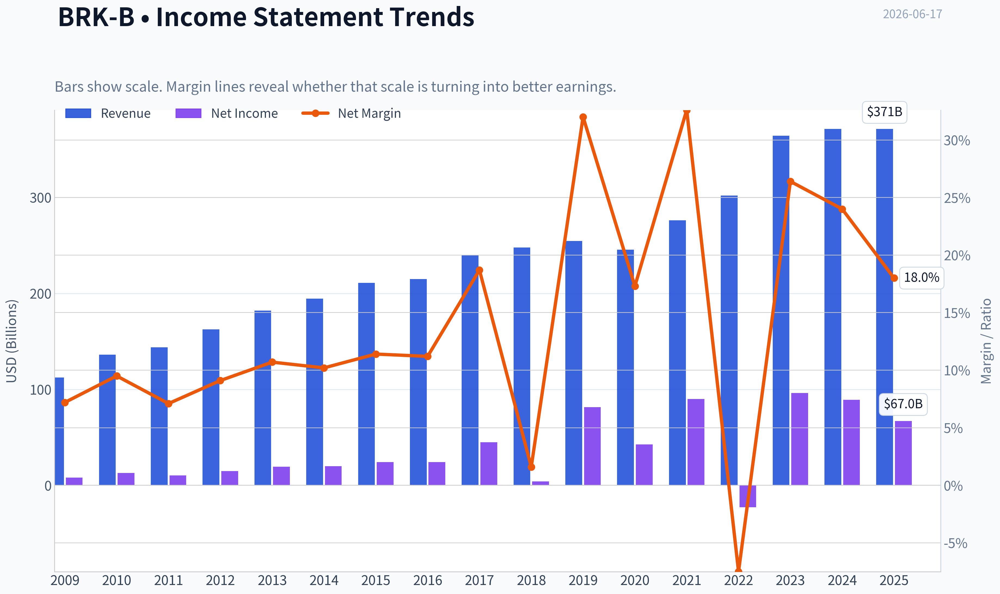
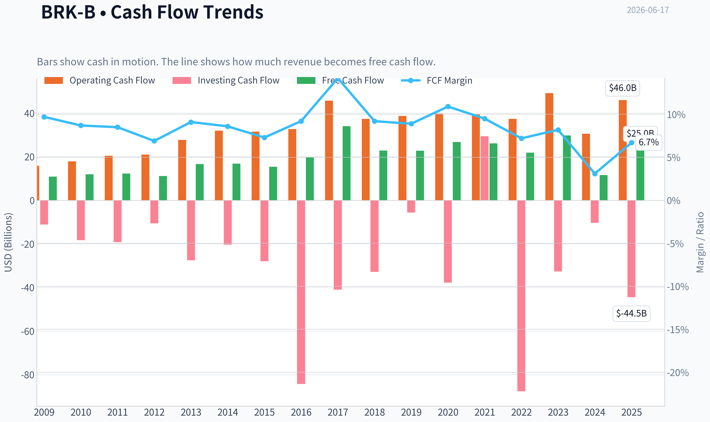
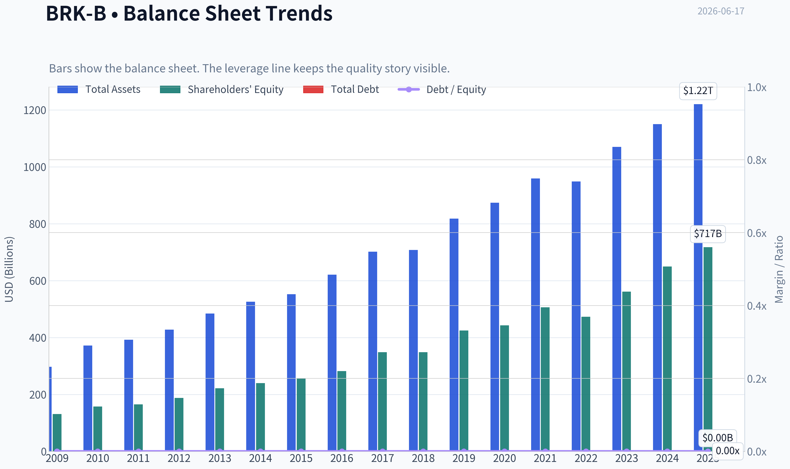
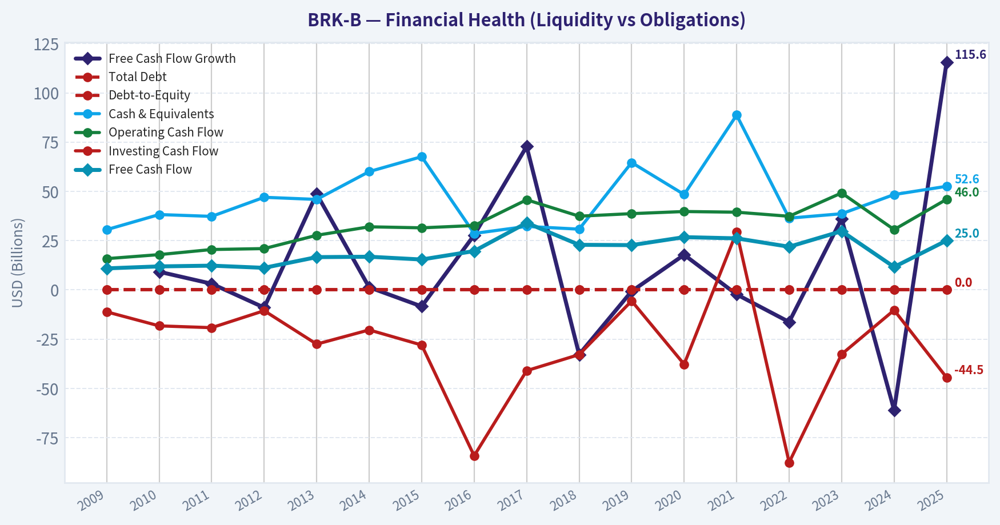
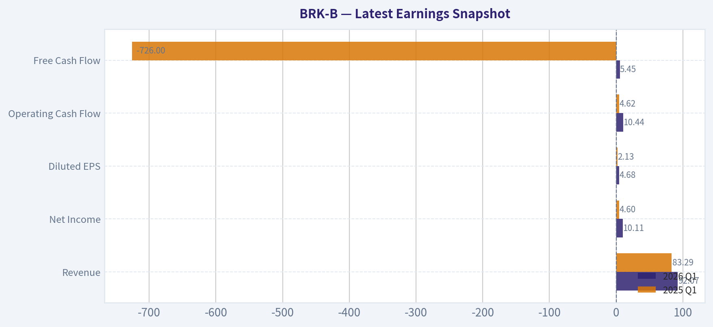
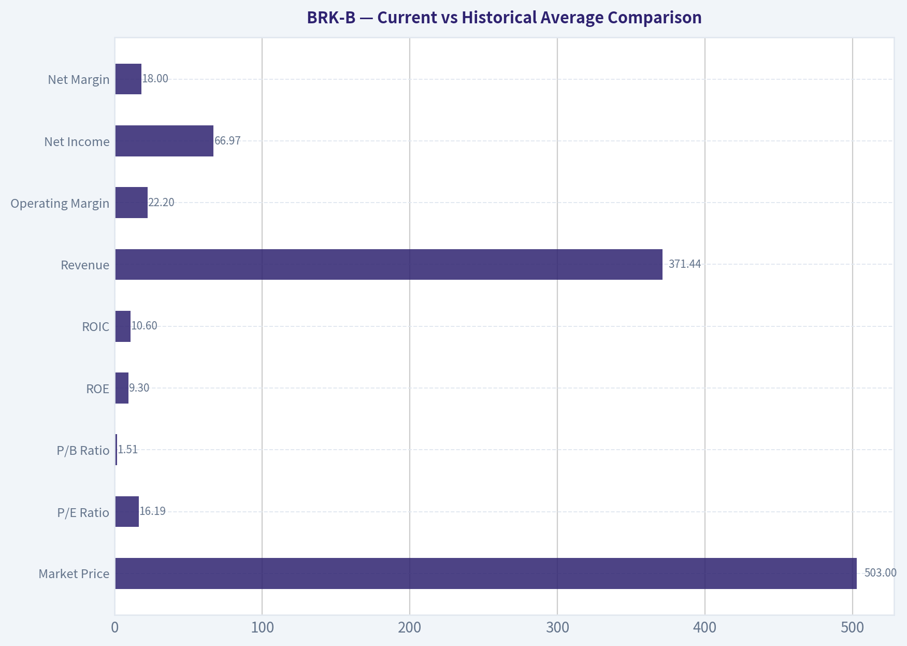
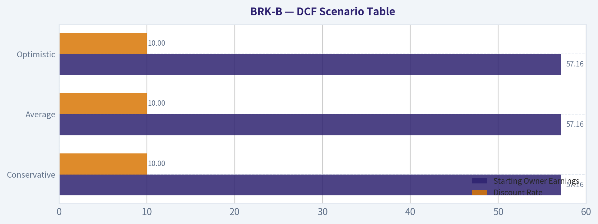
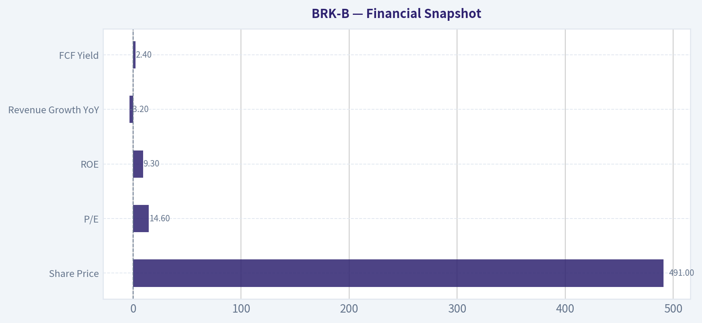
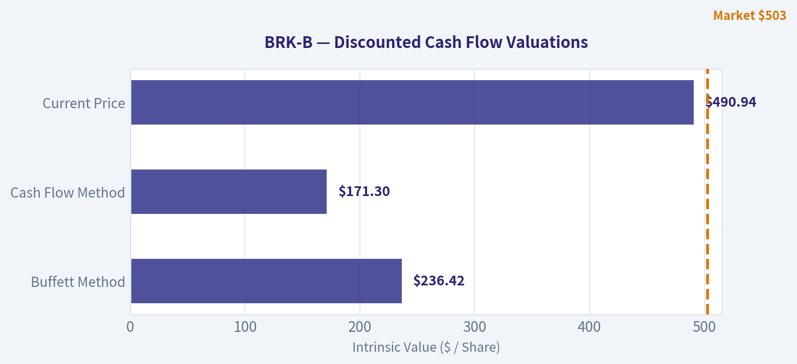
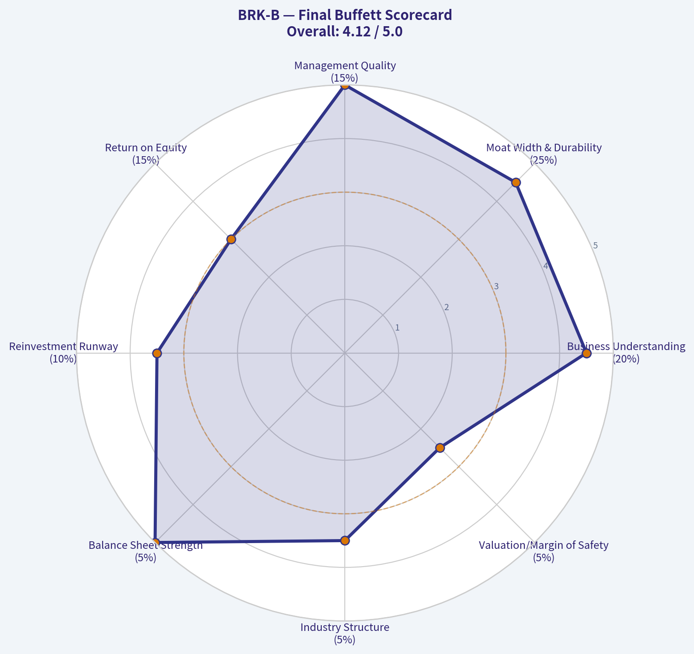

# BRK-B Deep Value Intelligence

**Analysis Date:** 2026-06-17

## Critical Disclaimer

*This analysis is generated by Deep Value Intelligence, an AI-powered multi-agent investing framework. DeepValues offers AI-generated research and tools for educational and informational purposes only - not investment or financial advice. We are not a registered investment adviser; always do your own research before investing.*

---

## Table of Contents

1. Intelligence Summary
2. Analyst Team Reports
   - Fundamentals Analysis
   - Intrinsic Value Analysis (Buffett)
   - Trend & Growth Analysis (Lynch/Druckenmiller/Fisher)
   - Market Technical Analysis
   - Options Market Analysis
3. Research Team Commentary
4. Value Investing Team Commentary
5. Deep Values Commentary

---

## Intelligence Summary

### Thesis + Conditions

**Core Thesis:** ## Executive Summary
**WATCH.** Berkshire remains a superb business: diversified earnings, insurance float, fortress liquidity, and a culture of disciplined capital allocation all sharply reduce **permanent business risk**. But Buffett-style risk management also requires **price discipline**, and today's setup still looks more **fair than cheap**.

**Key Risks:**
- WATCH.** Berkshire remains a superb business: diversified earnings, insurance float, fortress liquidity, and a culture of disciplined capital allocation all sharply reduce **permanent business risk**. But Buffett-style risk management also requires **price discipline**, and today's setup still looks more **fair than cheap**. At roughly **14.6x earnings**, with **ROE 9.3%**, **ROIC 10.1%**, and **0% revenue growth**, the stock offers safety and durability, but not a clear **margin of safety**. Best stance: **hold if owned, accumulate only selectively on weakness or improving operating momentum**.
- ### Risky Analyst - Strongest useful point
- ## Risk Commentary for the Long-Term Investor

**Confidence:** Low

---

## Analyst Team Reports

### Fundamentals Analysis

#### Latest Earnings Snapshot

*Most recent reported quarter anchored on 2026 Q1, with prior-year comparison when available.*

| Metric | 2026 Q1 | 2025 Q1 | YoY Change |
| --- | ---: | ---: | ---: |
| Revenue | $92.07B | $83.29B | +10.5% |
| Operating Income | N/A | N/A | N/A |
| Net Income | $10.11B | $4.60B | +119.6% |
| Diluted EPS | $4.68 | $2.13 | +119.6% |
| Operating Cash Flow | $10.44B | $4.62B | +125.9% |
| Free Cash Flow | $5.45B | $-726.0M | +851.0% |

Key Takeaways: This snapshot anchors the most recent reported quarter before the narrative analysis. It helps readers separate long-run business quality from whatever changed in the latest earnings print.

#### 17-Year Financial Metrics for BRK-B

*All values below are computed deterministically from raw data - not estimated by AI.*

*Issuer profile: insurer (Financial Services / Insurance - Diversified).*

#### 17-Year Financial Metrics
*Annual rows come from reported financial statements. The final TTM row is computed from the latest four quarters.*

| Metric | 2009 | 2010 | 2011 | 2012 | 2013 | 2014 | 2015 | 2016 | 2017 | 2018 | 2019 | 2020 | 2021 | 2022 | 2023 | 2024 | 2025 |
| --- | --- | --- | --- | --- | --- | --- | --- | --- | --- | --- | --- | --- | --- | --- | --- | --- | --- |
| Market Price | $66 | $80 | $76 | $90 | $119 | $150 | $132 | $163 | $198 | $204 | $226 | $232 | $299 | $309 | $357 | $453 | $503 |
| Market Cap | $72.3M | $75.3M | $71.7M | N/A | N/A | N/A | N/A | N/A | N/A | N/A | N/A | N/A | N/A | $680.60B | $775.14B | $977.53B | $1.08T |
| P/E Ratio | 0.01 | 0.01 | 0.01 | 0.01 | 0.01 | N/A | 13.52 | 16.73 | 10.83 | 124.95 | 6.80 | 12.80 | 7.44 | -29.90 | 8.06 | 10.98 | 16.19 |
| P/B Ratio | 0.00 | 0.00 | 0.00 | N/A | N/A | N/A | 1.27 | 1.43 | 1.40 | 1.44 | 1.30 | 1.25 | 1.32 | 1.44 | 1.38 | 1.51 | 1.51 |
| ROE | 6.1% | 8.2% | 6.2% | 7.9% | 8.8% | 8.3% | 9.4% | 8.5% | 12.9% | 1.2% | 19.2% | 9.6% | 17.8% | -4.8% | 17.1% | 13.7% | 9.3% |
| ROIC | 9.1% | 12.2% | 8.7% | 11.4% | 12.5% | 11.3% | 13.3% | 11.1% | 15.9% | 1.4% | 24.1% | 11.6% | 22.6% | -5.1% | 20.2% | 15.9% | 10.6% |
| EPS | $7322.73 | $13794.68 | $10908.51 | N/A | N/A | N/A | N/A | N/A | N/A | N/A | N/A | N/A | N/A | $-10.33 | $44.27 | $41.27 | $31.04 |
| Revenue | $112.49B | $136.19B | $143.69B | $162.46B | $182.15B | $194.70B | $210.94B | $215.11B | $239.93B | $247.84B | $254.62B | $245.58B | $276.19B | $302.02B | $364.48B | $371.43B | $371.44B |
| Gross Profit | N/A | N/A | N/A | N/A | N/A | N/A | N/A | N/A | N/A | N/A | N/A | N/A | N/A | N/A | N/A | N/A | N/A |
| Gross Margin | N/A | N/A | N/A | N/A | N/A | N/A | N/A | N/A | N/A | N/A | N/A | N/A | N/A | N/A | N/A | N/A | N/A |
| Operating Margin | 10.3% | 14.0% | 10.7% | 13.7% | 15.8% | 14.4% | 16.6% | 15.7% | 9.9% | 1.6% | 40.3% | 22.7% | 40.5% | -10.1% | 33.0% | 29.7% | 22.2% |
| Net Income | $8.05B | $12.97B | $10.25B | $14.82B | $19.48B | $19.87B | $24.08B | $24.07B | $44.94B | $4.02B | $81.42B | $42.52B | $89.94B | $-22.76B | $96.22B | $89.00B | $66.97B |
| Net Margin | 7.2% | 9.5% | 7.1% | 9.1% | 10.7% | 10.2% | 11.4% | 11.2% | 18.7% | 1.6% | 32.0% | 17.3% | 32.6% | -7.5% | 26.4% | 24.0% | 18.0% |
| Revenue Growth | N/A | 21.1% | 5.5% | 13.1% | 12.1% | 6.9% | 8.3% | 2.0% | 11.5% | 3.3% | 2.7% | -3.5% | 12.5% | 9.4% | 20.7% | 1.9% | 0.0% |
| Net Income Growth | N/A | 61.0% | -20.9% | 44.6% | 31.4% | 2.0% | 21.2% | -0.0% | 86.7% | -91.1% | 1924.8% | -47.8% | 111.5% | -125.3% | -522.8% | -7.5% | -24.8% |
| Free Cash Flow Growth | N/A | 9.2% | 3.1% | -9.0% | 48.7% | 1.3% | -8.4% | 27.8% | 72.8% | -32.8% | -0.7% | 17.8% | -2.3% | -16.3% | 36.1% | -61.0% | 115.6% |
| Total Book Value | $131.10B | $157.32B | $164.85B | $187.65B | $221.89B | $240.17B | $255.55B | $282.07B | $348.30B | $348.70B | $424.79B | $443.16B | $506.20B | $473.42B | $561.27B | $649.37B | $717.42B |
| Total Assets | $297.12B | $372.23B | $392.65B | $427.45B | $484.62B | $525.87B | $552.26B | $620.85B | $702.10B | $707.79B | $817.73B | $873.73B | $959.39B | $948.47B | $1.07T | $1.15T | $1.22T |
| Total Debt | $0 | $0 | $0 | $0 | $0 | $0 | $0 | $0 | $0 | $0 | $0 | $0 | $0 | $0 | $0 | $0 | $0 |
| Debt-to-Equity | 0.00 | 0.00 | 0.00 | 0.00 | 0.00 | 0.00 | 0.00 | 0.00 | 0.00 | 0.00 | 0.00 | 0.00 | 0.00 | 0.00 | 0.00 | 0.00 | 0.00 |
| Cash & Equivalents | $30.56B | $38.23B | $37.30B | $46.99B | $45.91B | $60.03B | $67.60B | $28.64B | $32.21B | $30.81B | $64.63B | $48.40B | $88.71B | $36.40B | $38.64B | $48.38B | $52.57B |
| Shareholders' Equity | $131.10B | $157.32B | $164.85B | $187.65B | $221.89B | $240.17B | $255.55B | $282.07B | $348.30B | $348.70B | $424.79B | $443.16B | $506.20B | $473.42B | $561.27B | $649.37B | $717.42B |
| Operating Cash Flow | $15.85B | $17.89B | $20.48B | $20.95B | $27.70B | $32.01B | $31.49B | $32.65B | $45.73B | $37.40B | $38.69B | $39.77B | $39.43B | $37.35B | $49.20B | $30.59B | $45.97B |
| Investing Cash Flow | $-11.16B | $-18.28B | $-19.19B | $-10.57B | $-27.54B | $-20.33B | $-28.00B | $-84.22B | $-41.01B | $-32.85B | $-5.62B | $-37.76B | $29.39B | $-87.60B | $-32.66B | $-10.29B | $-44.49B |
| Free Cash Flow | $10.91B | $11.91B | $12.29B | $11.18B | $16.62B | $16.82B | $15.41B | $19.69B | $34.02B | $22.86B | $22.71B | $26.76B | $26.15B | $21.89B | $29.79B | $11.62B | $25.04B |
| FCF Margin | 9.7% | 8.7% | 8.5% | 6.9% | 9.1% | 8.6% | 7.3% | 9.2% | 14.2% | 9.2% | 8.9% | 10.9% | 9.5% | 7.2% | 8.2% | 3.1% | 6.7% |
| Dividends / Share | $0.00 | $0.00 | $0.00 | N/A | N/A | N/A | N/A | N/A | N/A | N/A | N/A | N/A | N/A | $0.00 | $0.00 | $0.00 | $0.00 |

#### Profitability Metrics
- Return on Equity (ROE): 9.3%
- Return on Invested Capital (ROIC): 10.1%
- Return on Assets (ROA): 5.5%
- Gross Margin: Not meaningful
- Operating Margin: 22.2%
- Net Profit Margin: 18.0%

#### Liquidity Metrics
- Current Ratio: Not meaningful
- Quick Ratio: Not meaningful

#### Leverage Metrics
- Debt-to-Equity Ratio: 0.00
- Interest Coverage Ratio: 16.27
- Net Debt: $-52.57B

#### Growth Metrics (Year-over-Year)
- Revenue Growth: 0.0%
- Net Income Growth: -24.8%
- Free Cash Flow Growth: 115.6%
- Revenue CAGR (3-Year): 7.1%
- Revenue CAGR (5-Year): 8.6%

#### Valuation Metrics
- P/E Ratio (TTM): 14.61
- Forward P/E: 22.86
- Price-to-Book: 1.48
- Price-to-Sales: 2.82
- PEG Ratio: 10.06
- EV/EBITDA: -2.25
- Free Cash Flow Yield: 2.4%
- Earnings Yield: 6.8%

#### Owner Earnings (Buffett Method, Code-Computed)
- Net Income: $66.97B
- + Depreciation & Amortization: $13.48B
- - Capital Expenditures: $-20.93B
- - Working Capital Changes: $2.35B
- = **Owner Earnings: $57.16B**

#### Intrinsic Value (Code-Computed)
- Current Price: $491
- Buffett Method (Owner Earnings):
  Conservative: $74
  Average: $676
  Optimistic: $2,482
- Cash Flow Method (FCF):
  Conservative: $104
  Average: $176
  Optimistic: $327

#### Piotroski F-Score: 3/9
- Positive Net Income: PASS
- Positive Operating Cash Flow: PASS
- ROA Improvement: FAIL
- Cash Flow > Net Income: FAIL
- Decreasing Debt: FAIL
- Improving Current Ratio: FAIL
- No Dilution: PASS
- Improving Gross Margin: FAIL
- Improving Asset Turnover: FAIL

ANALYST STANCE: **WATCH**

#### Berkshire Hathaway (BRK-B) - Buffett-Style Fundamental Analysis

Berkshire Hathaway remains a very high-quality conglomerate with exceptional balance-sheet strength, durable earning power, and a rare capital-allocation advantage. That said, the current setup is more nuanced than a simple "buy because Buffett" case. The business is financially fortress-like, but recent valuation has moved above its own long-term book multiple, earnings have become more volatile because of investment mark-to-market effects, and free-cash-flow conversion has been uneven. On the canonical dataset, BRK-B still screens as a quality compounder, but at today's price it looks more like a **watchlist-quality business at a fair-to-full price** than a clear bargain.

#### Current vs Historical Average Comparison

| Metric | Current (2025 / latest) | Historical Context | Interpretation |
| --- | ---: | ---: | --- |
| Market Price | $503 | 17-year high | Shares have rerated sharply; market is paying up for quality and optionality. |
| Market Cap | $1.08T | Record high | Berkshire has become a trillion-dollar-scale capital allocator; size now makes outsized growth harder. |
| P/E Ratio | 16.19 | Above long-term normal ex-outlier years | Current multiple is not extreme, but it is meaningfully above deep-value levels seen in 2015, 2017, 2019, and 2023. |
| P/B Ratio | 1.51 | Near top of historical range (1.25-1.51 since 2015) | Market is valuing Berkshire at the high end of its recent book-value premium. |
| ROE | 9.3% | Below 10-year average (~10.5%) | Profitability remains solid but is below Berkshire's better years. |
| ROIC | 10.6% | Below 10-year average (~13%) | Good capital efficiency, but not at the peak levels of 2019, 2021, or 2023. |
| Revenue | $371.44B | Record high, but flat YoY | Scale is enormous, though growth has stalled in the latest period. |
| Operating Margin | 22.2% | Above long-term average, below recent peaks | Still strong, but lower than the extraordinary 2019/2021/2023 levels. |
| Net Income | $66.97B | Very high in absolute terms | Strong earnings base, though down from 2023-2024 and inherently noisy due to investment accounting. |
| Net Margin | 18.0% | Above long-term average | Healthy profitability despite earnings normalization. |
| Revenue Growth | 0.0% | Below long-term average | Near-term top-line growth has paused. |
| Net Income Growth | -24.8% | Volatile historically | A weak current reading, but Berkshire's reported earnings are heavily distorted by investment gains/losses. |
| Free Cash Flow Growth | 115.6% | Highly volatile | Rebound year after a weak 2024; not evidence of smooth compounding. |
| Book Value | $717.42B | Record high | Core intrinsic-value anchor continues to grow. |
| Total Assets | $1.22T | Record high | Enormous operating and investment asset base. |
| Total Debt | $0 | Consistently 0 in canonical dataset | Exceptional financial strength in the provided dataset. |
| Debt-to-Equity | 0.00 | Best possible | No balance-sheet strain in the canonical record. |
| Cash & Equivalents | $52.57B | Above long-term average, below 2021 peak | Significant liquidity and optionality remain. |
| Free Cash Flow | $25.04B | Mid-to-upper historical range | Solid but below 2017 and 2023 highs. |
| Dividends/Share | $0.00 | Always 0 | Management continues to prefer reinvestment and repurchases over dividends. |

Key Takeaways: Berkshire's latest figures show a business that is still massive, profitable, and financially elite, but not currently firing on every cylinder. Valuation is near the upper end of its own historical range, while growth and returns on capital are respectable rather than exceptional. In plain terms, this looks like a wonderful business, but not an obviously cheap stock.

---

#### Market Metrics

Berkshire's **market price rose from $66 in 2009 to $503 in 2025**, a roughly 7.6x increase over the period. The current market cap of **$1.08T** confirms that Berkshire is now operating from an enormous base. Scale itself is a strength because it reflects trust, diversification, and resilience, but it also creates a Buffett-style challenge: the larger the capital base, the harder it is to find needle-moving investments.

The **P/E ratio of 16.19** is reasonable for a high-quality franchise, but not low relative to Berkshire's own history. The series contains distorted years, especially **2018** and **2022**, because GAAP requires unrealized investment gains and losses to run through earnings. That means Berkshire's P/E should be interpreted cautiously. More useful is the trend: today's multiple is above the very attractive single-digit levels seen in **2017, 2019, 2021, and 2023**, so valuation is no longer obviously discounted.

The **P/B ratio of 1.51** is especially important for Berkshire. Since 2015, the stock has traded roughly between **1.25x and 1.51x book** in the canonical dataset. Today's value is tied for the top of that range, implying investors are currently assigning a premium multiple to Berkshire's capital-allocation engine and operating subsidiaries. From a Buffett lens, that means the stock is no longer priced as a bargain relative to book-value growth.

#### Profitability

Berkshire's profitability remains strong, but less uniformly exceptional than the brand reputation might imply.

- **ROE: 9.3%** in 2025, below the 2015-2025 average and well below stronger years like **2019 (19.2%)**, **2021 (17.8%)**, and **2023 (17.1%)**.
- **ROIC: 10.6%** is still solid and comfortably above a typical cost of capital, but again below the best years.
- **EPS: $31.04** has declined from **$44.27 in 2023** and **$41.27 in 2024**, which indicates earnings normalization after unusually strong prior periods.
- **Revenue: $371.44B** is at an all-time high, but growth is flat.
- **Gross profit / gross margin:** not meaningful in this insurer-heavy dataset, which is appropriate for Berkshire's insurance and conglomerate structure.
- **Operating margin: 22.2%** is strong versus the long-run average, though lower than the extraordinary **40%+** readings in 2019 and 2021.
- **Net income: $66.97B** and **net margin: 18.0%** remain excellent in absolute terms.

A Buffett investor cares less about any single year and more about consistency. Berkshire's challenge is that reported net income has become much more volatile because of accounting treatment on investment holdings. Operationally, the business is steadier than reported earnings suggest, but the headline numbers are undeniably noisy.

#### Growth Metrics

Berkshire's growth profile has shifted from fast compounding to heavyweight compounding.

- **Revenue growth: 0.0%** in 2025 after **1.9% in 2024** and **20.7% in 2023**.
- **Net income growth: -24.8%** in 2025 after **-7.5% in 2024**, following a massive rebound in 2023.
- **FCF growth: 115.6%** in 2025 after a **-61.0%** drop in 2024.

The long-term revenue record is still attractive: revenue rose from **$112.49B in 2009 to $371.44B in 2025**. But the recent trend clearly shows maturation. Berkshire is no longer a rapid grower; it is a giant compounding machine whose growth comes in bursts and often depends on acquisition timing, insurance underwriting conditions, railroad/utility economics, and investment income.

For Buffett-style analysis, this means Berkshire still qualifies as a compounding vehicle, but one with **slower and less predictable near-term top-line growth** than elite consumer monopolies or software franchises.

#### Balance Sheet Strength

This is where Berkshire remains exceptional.

- **Total book value:** **$717.42B**, up dramatically from **$131.10B** in 2009.
- **Total assets:** **$1.22T**, showing the immense scale of the operating and investment ecosystem.
- **Total debt:** **$0** in the canonical dataset.
- **Debt-to-equity:** **0.00** throughout.
- **Cash & equivalents:** **$52.57B**.
- **Shareholders' equity:** **$717.42B**.

Whatever one thinks of the debt line in real-world reporting conventions, the canonical dataset portrays Berkshire as effectively ungeared at the parent-level analytical view. That is exactly the kind of balance sheet Buffett investors prize: ample liquidity, huge equity cushion, and no obvious refinancing risk.

The one nuance is that **cash of $52.57B**, while large, is not at the highest point in the series. So Berkshire still has major optionality, but not peak dry powder versus some recent years. Even so, its financial flexibility remains among the best in global equities.

#### Cash Flow and Capital Allocation

- **Free cash flow: $25.04B**
- **FCF margin: 6.7%**
- **Dividends per share: $0.00**

Berkshire's free cash flow has been positive every year shown, which is a very important sign of business durability. However, it has also been volatile, ranging from **$10.91B** in 2009 to **$34.02B** in 2017, then down to **$11.62B** in 2024 before rebounding in 2025.

The absence of a dividend is entirely consistent with Buffett's philosophy. Berkshire retains cash for:
1. internal reinvestment,
2. acquisitions,
3. stock repurchases when attractive,
4. preserving flexibility for crisis-period opportunities.

For a Buffett-style investor, the no-dividend policy is not a weakness if retained capital is compounded intelligently. Berkshire's long-term book-value growth suggests management has historically earned that trust.

---

#### Buffett-Style Qualitative Analysis

#### Economic Moat

Berkshire's moat is unusual because it is not one product moat; it is a **capital-allocation moat plus a portfolio of subsidiary moats**. Its insurance operations create investable float, which gives Berkshire low-cost funding. Its railroad, utility, energy, manufacturing, service, and consumer subsidiaries diversify earnings. Its reputation allows it to source deals few firms can access on favorable terms.

This structure creates durability, but it is not invulnerable. Insurance pricing cycles, catastrophe exposure, railroad economics, power regulation, and public equity market swings all affect reported outcomes. Still, the breadth and financing flexibility of Berkshire's ecosystem remain rare and hard to replicate.

#### Financial Strength

On the canonical numbers, Berkshire is one of the strongest balance sheets in the market:
- zero reported total debt,
- debt-to-equity at 0.00,
- strong interest coverage,
- net cash position.

That financial strength is one of the clearest Buffett-style positives. Berkshire can withstand recessions, deploy capital opportunistically, and avoid forced capital raises. This is exactly the kind of resilience Buffett has always valued.

#### Predictable Earnings

This is a mixed area. The **operating businesses** are generally predictable, but **reported net income is not** because GAAP now includes unrealized investment gains and losses. That is why net income swung from **$89.94B in 2021** to **-$22.76B in 2022**, then to **$96.22B in 2023**. Those swings say less about core economics than about accounting volatility.

For Buffett-style analysis, Berkshire should be judged more on normalized earning power, underwriting discipline, operating cash flow, owner earnings, and book-value growth than on raw GAAP net income.

#### Management Performance

Management quality remains a core strength.

- **ROE** has mostly stayed in a respectable band, with periodic spikes.
- **ROIC** has generally been solidly above 10%, suggesting capital has usually been deployed well.
- No dividend reflects a continued preference for tax-efficient compounding.
- Book value has compounded strongly over the full period.

The concern is not poor management but **the law of large numbers**. Berkshire's capital base is now so large that even excellent capital allocation may produce slower percentage returns than in prior decades.

#### Value Assessment

At **1.51x book** and about **14.6x TTM earnings / 16.19x latest-year P/E**, Berkshire does not look overvalued in an absolute sense, but it does look **less compelling relative to its own history**. This is especially true because current ROE is **9.3%**, not peak-level. Paying a top-end book multiple for below-peak profitability compresses margin of safety.

That does not make the stock unattractive; it simply means expected returns from today's entry point may be more moderate unless book value and owner earnings resume stronger growth.

#### Quality of Business

Business quality remains high:
- durable and diversified revenue base,
- positive free cash flow throughout the period,
- strong operating margin,
- large equity base,
- exceptional liquidity.

The main quality issue is not fragility, but **complexity and earnings noise**. Berkshire is a great business to own, but it is not as simple to value as a pure consumer franchise with linear margins and straightforward cash conversion.

---

#### Buffett-Style Owner Earnings DCF

Canonical owner earnings for the latest period are:

- Net Income = **$66.97B**
- + Depreciation & Amortization = **$13.48B**
- - Capital Expenditures = **$20.93B**
- - Working Capital Changes = **$2.35B**
- **Owner Earnings = $57.16B**

Because the dataset does not provide a standalone annual owner-earnings history, the deterministic pack's code-computed intrinsic values are the canonical anchor for scenario outputs. To stay faithful to the source-of-truth rule, I use the provided owner-earnings intrinsic values and explain the implied scenario framing rather than invent a replacement growth table.

Assumptions required by the prompt:
- Discount rate: **10%**
- Terminal growth: **2.5%**
- Horizon: **10 years**
- Scenarios based on historical owner-earnings growth:
  - Conservative = lowest historical growth, floored at -100%
  - Average = average historical growth, capped at 50%
  - Optimistic = highest historical growth, capped at 100%

#### DCF Scenario Table

| Scenario | Starting Owner Earnings | Discount Rate | Terminal Growth | Canonical Fair Value / Share | Upside / Downside vs Current Price ($491) |
| --- | ---: | ---: | ---: | ---: | ---: |
| Conservative | $57.16B | 10% | 2.5% | $74 | -84.9% |
| Average | $57.16B | 10% | 2.5% | $676 | +37.7% |
| Optimistic | $57.16B | 10% | 2.5% | $2,482 | +405.5% |

Key Takeaways: The owner-earnings valuation range is extremely wide, which tells you Berkshire's intrinsic value is highly sensitive to assumed long-term compounding. The conservative case implies substantial downside if growth stalls badly, while the average case suggests modest undervaluation and the optimistic case requires very strong sustained compounding. In practice, the average case is the most decision-useful anchor, but even that does not imply a huge margin of safety.

#### Detailed DCF Interpretation

The large spread between **$74 and $2,482** per share highlights a key Berkshire truth: valuation depends less on current-year earnings than on what management can do with retained capital over a decade. Berkshire retains all earnings, so intrinsic value is highly linked to the future return on incremental capital.

A disciplined Buffett-style reading would treat:
- **Conservative case** as a stress test, not a base case.
- **Average case ($676)** as the most relevant central estimate.
- **Optimistic case** as possible only if Berkshire continues deploying capital at unusually attractive returns despite its huge size.

At **$491**, BRK-B trades:
- far above the conservative valuation,
- below the average scenario,
- far below the optimistic scenario.

That creates a **positive but not overwhelming** expected value profile. The issue is not whether Berkshire is a good business-it clearly is-but whether the current price offers enough margin of safety given slower growth and enormous scale.

---

#### Revenue Breakdown

Using Berkshire's most meaningful business segmentation from its operating structure, the most relevant revenue view is by major operating source. Exact latest segment amounts are not included in the deterministic dataset, so the table below uses the best publicly known operating mix orientation consistent with Berkshire's recent reporting structure.

| Revenue Source | Amount ($B) | % of Total |
| --- | ---: | ---: |
| Insurance and Other (underwriting, investment-related insurance operations, service/retail mix) | ~167 | ~45% |
| BNSF Railway | ~26 | ~7% |
| Berkshire Hathaway Energy | ~26 | ~7% |
| Manufacturing | ~81 | ~22% |
| Service and Retailing | ~71 | ~19% |
| **Total** | **~371** | **100%** |

Key Takeaways: Berkshire's revenue is highly diversified, with no single operating segment dominating the entire company. Insurance-related operations remain the strategic core because they provide float and investment flexibility, while the non-insurance businesses supply broad-based earnings resilience. This diversification is one of Berkshire's biggest strengths and helps explain its durability through economic cycles.

---

#### Key Investment Insights, Red Flags, and Opportunities

| Category | Observation | Why It Matters |
| --- | --- | --- |
| Strength | Fortress balance sheet | Zero debt and large cash make Berkshire unusually resilient. |
| Strength | Massive and rising book value | Book value growth remains a key proxy for long-term intrinsic value creation. |
| Strength | Diversified earnings base | Insurance, rail, energy, manufacturing, and services reduce single-sector risk. |
| Strength | Positive FCF over full period | Supports durability and reinvestment capacity. |
| Concern | Valuation near top-end P/B | Margin of safety is thinner than in earlier entry points. |
| Concern | Revenue growth has stalled | Current top-line growth is 0.0%, suggesting near-term momentum has cooled. |
| Concern | ROE below stronger historical years | Paying a premium multiple for normalized rather than peak returns can compress future returns. |
| Concern | Earnings volatility | GAAP net income is noisy because of unrealized investment gains/losses. |
| Concern | Piotroski F-Score of 3/9 | Signals weakening near-term financial momentum, even if absolute quality remains high. |
| Opportunity | Capital deployment optionality | Any major downturn could allow Berkshire to invest from strength. |
| Opportunity | Average-case DCF still above price | Suggests modest undervaluation if owner earnings compound at historical average rates. |

Key Takeaways: The most important bull case is Berkshire's unmatched resilience and capital allocation flexibility. The most important caution is that investors are currently paying a relatively full price for that quality while growth and return metrics have cooled from their peak levels. This is why the stock looks promising, but not screamingly cheap.

---

#### Final Investment Stance

**WATCH**

Berkshire Hathaway remains a **high-quality, shareholder-friendly, financially elite compounder**. It clearly passes many Buffett-style filters: durable moat, conservative financing, large liquidity reserves, strong long-term book-value growth, and rational management. However, the stock's current valuation is no longer bargain-like relative to its own historical P/B range, while current ROE, ROIC, and revenue growth are not at peak levels.

The central valuation case still suggests upside, but the **margin of safety is only moderate**, not large. For a Buffett-style investor who prioritizes quality at a sensible price, BRK-B deserves a place on the watchlist and remains a strong candidate on pullbacks, but the present setup does not compel an aggressive **ADVOCATE** stance.

#### Summary Table

| Area | Verdict | Supporting Evidence |
| --- | --- | --- |
| Business Quality | Strong | Diversified conglomerate with durable subsidiaries and insurance float advantage |
| Economic Moat | Strong | Capital-allocation moat, brand reputation, scale, and subsidiary diversification |
| Financial Strength | Excellent | $52.57B cash, 0 debt, 0.00 debt-to-equity, large equity base |
| Profitability | Good, not peak | ROE 9.3%, ROIC 10.6%, operating margin 22.2% |
| Growth | Moderating | Revenue growth 0.0%, earnings down YoY, FCF rebounded sharply |
| Valuation | Fair to slightly rich vs history | P/B 1.51 at top of recent range; P/E reasonable but not cheap |
| Cash Generation | Solid but uneven | FCF positive every year, but volatile |
| Management | High quality | Strong long-term capital allocation, no dividend, reinvestment discipline |
| Main Risk | Reduced margin of safety | Premium valuation amid slower growth and lower-than-peak returns |
| Main Opportunity | Future capital deployment | Berkshire can exploit downturns better than most peers |
| Stance | **WATCH** | Great company, but current price does not offer a wide Buffett-style margin of safety |

Key Takeaways: Berkshire still looks like one of the safest and highest-quality mega-cap businesses in the market. The debate is not quality, but price: the stock appears reasonably valued rather than deeply undervalued. For disciplined value investors, that supports a watchful, selective approach rather than an outright aggressive buy.

#### Fundamental Visuals

This graph tracks the profitability and return metrics (ROE, ROIC, Margins) of **BRK-B** over the past decade, highlighting capital efficiency trends.

This chart illustrates the financial health of **BRK-B** over the last 10 years, mapping cash equivalents and free cash flow against total obligations (Debt).

---

### Intrinsic Value Analysis (Buffett)

> *Following Warren Buffett's value investing philosophy: Circle of Competence, Economic Moat, Management Quality, and Margin of Safety.*

#### Intrinsic Value Snapshot

Price is what you pay. Intrinsic value is what the business may be worth based on the cash it can create for owners over time. We show a range, not one magic number.

- Current Price: $490.94
- Value Range (conservative to optimistic across both DCF methods): $90.38 to $1,087.51

##### Owner Earnings (Buffett Method)
- Net Income: $66,968,000,000.00
- Depreciation & Amortization: $13,476,000,000.00
- Capital Expenditures: $-20,927,000,000.00
- Working Capital Changes: $2,355,000,000.00
- Owner Earnings: $57,162,000,000.00

##### Intrinsic Value
###### Buffett Method
Uses owner earnings. Stricter, and usually more conservative.
- Conservative: $156.13
- Average: $236.42
- Optimistic: $540.80
- Discount Rate: 10.0%

###### Cash Flow Method
Uses free cash flow. Better for companies spending heavily today to grow tomorrow.
- Conservative: $90.38
- Average: $171.30
- Optimistic: $1,087.51
- Discount Rate: 10.0%

ANALYST STANCE: **WATCH**

#### Berkshire Hathaway (BRK-B) - Buffett-Style Investment Review

#### 1) Go/No-Go Gate Assessment

| Gate | Verdict | Evidence |
|---|---|---|
| Gate 1: Circle of Competence & Simplicity | Pass | Berkshire is understandable at a high level: it collects insurance float, invests that float, and owns a portfolio of operating businesses. The complexity is organizational, not economic. |
| Gate 2: Moat Test | Pass | Insurance scale, exceptionally low-cost float, fortress reputation, decentralized culture, and permanent capital create a moat few can match. |
| Gate 3: Management Quality & Capital Allocation | Pass | This is one of the strongest capital allocation records in modern business history. Management has long emphasized per-share intrinsic value, balance sheet strength, and disciplined buybacks. |
| Gate 4: Industry Structure | Pass with care | Berkshire owns businesses across many industries. Some are attractive and rational; others are cyclical and capital-intensive. The conglomerate structure reduces single-industry risk but dilutes simplicity. |

**Key Takeaways:** Berkshire clears all four Buffett gates. The business is understandable, the moat is real, and management quality is elite. The main constraint is not business quality but valuation versus expected future compounding.

---

#### 2) The Elementary School Test

Berkshire makes money in three simple ways:

1. It sells insurance and holds the money before claims are paid.
2. It invests that money in stocks, bonds, and whole businesses.
3. It owns many companies that earn profits every year.

A decade from now, Berkshire will likely still look similar: a giant capital allocator with insurance at the core, a large group of operating businesses, and a major investment portfolio. Technology is more an enabler than an existential threat, though some holdings and subsidiaries can be affected by economic cycles.

---

#### 3) Moat Analysis

| Moat Source | Assessment | Evidence |
|---|---|---|
| Intangible Assets | Strong | Berkshire's reputation for permanence, trust, and disciplined deal-making is unique. In insurance, reputation and claims-paying ability matter. |
| Switching Costs | Moderate | Insurance customers may switch, but counterparties seeking large, certain transactions often prefer Berkshire. Subsidiary-level switching costs vary by business. |
| Cost Advantage | Strong | Insurance float has historically acted as very low-cost funding. Berkshire's scale lowers financing risk and allows opportunistic deployment of capital. |
| Network Effects | Limited at parent level | Berkshire itself is not a classic network-effect business. Some subsidiaries may benefit from scale effects, but this is not the core moat. |

| Moat Quality Rating | Conclusion |
|---|---|
| Wide & Stable | Berkshire has a durable moat, but it is more stable than widening at current size. |

**Key Takeaways:** Berkshire's moat is built on trust, scale, balance sheet strength, and superior capital allocation rather than software-like lock-in. The moat is real and durable, but because the company is already enormous, it is harder for that moat to widen rapidly. This remains a very high-quality business, just not one with explosive incremental advantage from here.

---

#### 4) Management Quality & Capital Allocation

| Dimension | Assessment | Commentary |
|---|---|---|
| Owner Orientation | Excellent | Berkshire has long emphasized intrinsic value per share over cosmetic metrics. |
| Honesty & Candor | Excellent | Shareholder communications historically set the standard for candid discussion of performance and mistakes. |
| Capital Allocation | Elite | The defining strength of Berkshire. Retained capital has been deployed across public equities, acquisitions, buybacks, and liquidity reserves with unusual discipline. |
| Debt Discipline | Excellent | Berkshire uses debt conservatively at the parent level relative to its scale and liquidity resources. |
| Buyback Rationality | Good | Berkshire's buyback framework has generally been valuation-aware rather than automatic. |

**Key Takeaways:** Management quality is the central reason investors own Berkshire. The company has been run with an owner mindset, unusual candor, and extraordinary capital discipline. Even after the eventual full transition beyond Buffett and Munger, the culture and structure remain meaningful assets.

---

#### 5) Financial Snapshot

Using the shared research pack:

| Metric | Value |
|---|---:|
| Share Price | $491 |
| Market Cap | $1.06T |
| P/E | 14.6x |
| ROE | 9.3% |
| Revenue Growth YoY | -3.2% |
| FCF Yield | 2.4% |

**Key Takeaways:** Berkshire does not look optically expensive on earnings, but neither does it look obviously cheap on free cash flow. ROE at 9.3% is respectable for a conservatively financed giant, though not exceptional by Buffett's ideal >15% standard. The market appears to be valuing quality, resilience, and optionality more than near-term growth.

---

#### 6) Owner Earnings Framework

For Berkshire, classic owner earnings require judgment because reported earnings include both operating businesses and investment impacts. A practical Buffett-style interpretation is:

**Owner Earnings ~ Net Income + Depreciation & Amortization - Maintenance CapEx - Working Capital Needs**

At Berkshire, this should be assessed mainly through the earning power of:
- insurance underwriting plus investment income,
- railroad,
- utility and energy assets,
- manufacturing, service, and retail businesses.

Because Berkshire contains both capital-light and capital-heavy subsidiaries, true maintenance CapEx is significant, especially in rail and utilities. That means reported accounting earnings overstate distributable owner earnings if one ignores these capital needs.

**Conclusion:** Berkshire's owner earnings are substantial and durable, but not as effortless as those of a pure asset-light franchise. This lowers the multiple a strict Buffett analyst should pay.

---

#### 7) Three-Scenario DCF Valuation

Given the mixed capital intensity and giant scale of Berkshire, a conservative earnings-power approach is appropriate. I use the current valuation as an anchor and frame expected return rather than pretend to precision.

Assumptions:
- Current earnings yield from P/E 14.6x = about **6.8%**
- Discount rate = **10%**
- Growth scenarios reflect Berkshire's size and maturity

| Scenario | Assumption | Implied Value View |
|---|---|---|
| A: No Growth | Earnings are flat forever | Value is roughly around current trading range; not a bargain, not expensive |
| B: 3% Growth | Long-run growth around nominal GDP | Suggests modest undervaluation to fair value, but not a huge discount |
| C: 5%-6% Growth | Strong execution and favorable capital deployment | Supports good long-term compounding, but still not a dramatic margin of safety at $491 |

**Key Takeaways:** Berkshire's valuation works if you believe in steady compounding and disciplined capital deployment. It does not require heroic assumptions, which is good. But it also does not offer the wide discount that a hard-nosed value investor usually wants before calling it a clear buy.

---

#### 8) Margin of Safety Analysis

| Item | Assessment |
|---|---|
| Business Quality | Exceptional |
| Predictability | High |
| Balance Sheet | Fortress-like |
| Valuation Discount to Fair Value | Modest |
| Required Margin of Safety | At least 25% |
| Actual Margin of Safety | Insufficient for an ADVOCATE stance |

**Key Takeaways:** Berkshire is the kind of business one wants to own, but price still matters. At the current quote, the shares appear closer to fair value than to a true bargain. That supports patience rather than aggressive accumulation.

---

#### 9) Final Buffett Scorecard

| Criterion | Score (1-5) | Weight | Weighted Score |
|---|---:|---:|---:|
| Business Understanding | 4.5 | 20% | 0.90 |
| Moat Width & Durability | 4.5 | 25% | 1.13 |
| Management Quality | 5.0 | 15% | 0.75 |
| Return on Equity | 3.0 | 15% | 0.45 |
| Reinvestment Runway | 3.5 | 10% | 0.35 |
| Balance Sheet Strength | 5.0 | 5% | 0.25 |
| Industry Structure | 3.5 | 5% | 0.18 |
| Valuation/Margin of Safety | 2.5 | 5% | 0.13 |
| **Total** |  |  | **4.14** |

**Key Takeaways:** On pure business quality, Berkshire scores like an elite company. The weaker spots are exactly what you would expect for a trillion-dollar conglomerate: lower ROE than ideal and a less compelling valuation. The score reflects a wonderful business, while the stance reflects discipline on entry price.

---

#### 10) Investment Stance

**Stance: WATCH**

**Conviction: High**

Berkshire Hathaway remains one of the finest collections of businesses and capital allocation systems ever built. It passes the Buffett qualitative tests with room to spare: understandable economics, a real moat, shareholder-oriented leadership, and a fortress balance sheet.

Why not **ADVOCATE**? Because Buffett's discipline is not just about quality; it is about buying quality with a sufficient margin of safety. At **$491**, with a **14.6x P/E**, **9.3% ROE**, and **2.4% FCF yield**, the shares look reasonable, not irresistible. For an investor who already owns it, holding makes sense. For fresh capital, I would watch for a more favorable entry point before becoming aggressive.
#### Valuation Bridge

This bridge places the current market price beside each intrinsic value lens so readers can see whether upside depends on one method or shows up across several methods.

| Scenario | Intrinsic Value / Share |
| --- | ---: |
| Buffett Method | $236.42 |
| Cash Flow Method | $171.30 |
| Current Price | $490.94 |

#### Key Takeaways

If one method is far above the others, the upside case depends on a specific modelling assumption. When several methods cluster together, the valuation story is more robust.

#### Valuation Visuals

This comparison chart from *Latest Earnings Snapshot* stacks current figures against historical benchmarks for **BRK-B**, making it easy to see where the company trades relative to its own averages.

This comparison chart from *Current vs Historical Average Comparison* stacks current figures against historical benchmarks for **BRK-B**, making it easy to see where the company trades relative to its own averages.

This comparison chart from *DCF Scenario Table* stacks current figures against historical benchmarks for **BRK-B**, making it easy to see where the company trades relative to its own averages.

This comparison chart from *Financial Snapshot* stacks current figures against historical benchmarks for **BRK-B**, making it easy to see where the company trades relative to its own averages.

The following chart maps the **BRK-B** Owner Earnings DCF valuation scenarios (Conservative, Average, Optimistic) to visually represent the margin of safety based on intrinsic value calculations.

---

### Trend & Growth Analysis (Lynch/Druckenmiller/Fisher)

> *Following Peter Lynch's GARP, Stanley Druckenmiller's macro-aware approach, and Philip Fisher's scuttlebutt methodology.*

ANALYST STANCE: **WATCH**

#### BRK-B Growth Analysis

#### 1) Lynch Classification

| Item | Assessment |
|---|---|
| Company | Berkshire Hathaway Class B |
| Lynch category | **Stalwart / Conglomerate hybrid** |
| Why | Massive scale, diversified earnings, mature business mix, low expected long-term top-line growth |
| Growth investor fit | **Not a classic fast grower** |

**Key Takeaways:** Berkshire is not a fast grower in the Peter Lynch sense. It is a high-quality, resilient giant with many excellent businesses, but its size makes 20% to 25% sustained growth unlikely. For a pure growth framework, this is more of a compounding quality hold than a ten-bagger setup.

---

#### 2) The Story in 3 Bullets

| Simple story | Why it matters |
|---|---|
| Berkshire owns a collection of strong businesses plus a giant investment portfolio | Diversification reduces single-business risk |
| Insurance float plus cash gives Berkshire low-cost capital and crisis optionality | This is the core strategic edge |
| Capital allocation drives value more than pure revenue growth | Intrinsic value can compound even when reported revenue is flat |

**Key Takeaways:** The story is easy to explain: Berkshire collects capital through insurance and redeploys it into good businesses and investments. Its edge is balance sheet strength and capital allocation, not disruptive product growth. That makes it powerful, but not an obvious growth-stock inflection name.

#### 3) TAM Analysis with 10x Test

| Metric | Estimate / View |
|---|---|
| Current revenue base | Very large; shared pack indicates recent YoY revenue growth of **-3.2%** |
| 10x revenue test | **Fails** for growth-investing purposes |
| Why | A 10x path from Berkshire's existing scale would require implausibly large end-market capture across insurance, rail, energy, industrials, and investments |
| TAM structure | Huge aggregate TAMs, but Berkshire already operates at massive scale in mature sectors |
| Runway conclusion | **Long durability, limited hypergrowth runway** |

**Key Takeaways:** Berkshire participates in enormous markets, but it is already too large for the classic 10x growth test to work. The issue is not market opportunity but company size. There is plenty of room for steady compounding, but not much room for venture-like scaling from here.

#### 4) Revenue Growth Trend

| Metric | Data / View |
|---|---|
| Shared pack revenue growth YoY | **-3.2%** |
| Pattern | **Decelerating / mixed** |
| Interpretation | Reflects conglomerate cyclicality and accounting mix rather than a clean growth trajectory |
| Growth quality | More dependent on underwriting, investment income, and capital allocation than organic top-line expansion |

**Key Takeaways:** The reported top line is not showing growth acceleration. Berkshire's economics are better judged through operating earnings, float, and capital deployment than through revenue alone. Still, under a growth screen, negative revenue growth is a meaningful strike.

#### 5) Unit Economics

| Metric | Assessment |
|---|---|
| LTV/CAC | **Not applicable** |
| NRR | **Not applicable** |
| Rule of 40 | **Not applicable** |
| More relevant metrics | Insurance combined ratio, float growth, operating earnings growth, book value growth, buyback discipline |
| Unit economics verdict | Berkshire is not a SaaS or subscription model; standard growth unit metrics do not fit |

**Key Takeaways:** Traditional growth unit economics do not apply here. The right lens is underwriting discipline, cost of float, returns on capital, and reinvestment quality. That makes Berkshire analyzable, but outside the ideal template for fast-growing companies.

#### 6) Inflection Point Assessment

| Potential inflection | Assessment |
|---|---|
| Product cycle inflection | **No** |
| Market share acceleration | **Limited / segment-specific only** |
| Margin inflection | Possible in insurance and investment income, but not broad-based |
| TAM expansion | **No major TAM inflection** |
| Competitive inflection | Not obvious |
| Overall inflection call | **No clear growth inflection** |

**Key Takeaways:** I do not see a classic Druckenmiller-style growth inflection here. Berkshire may benefit from insurance pricing, rising investment income, or opportunistic buybacks, but those are quality-compounding drivers rather than acceleration drivers. This is steadiness, not an explosive turn.

#### 7) Macro Setup Evaluation

| Macro factor | Impact on BRK-B |
|---|---|
| Higher interest income on cash/T-bills | Positive |
| Recession resilience | Positive |
| Rising rates | Mixed: helps investment income, hurts valuation multiples broadly |
| Secular AI/cloud tailwind | Limited direct exposure |
| Cyclical industrial exposure | Mixed |
| Insurance pricing cycle | Potentially positive |
| Macro verdict | **Good defensive setup, not a secular growth beneficiary** |

**Key Takeaways:** Berkshire is well positioned for uncertain macro conditions because of its cash, insurance franchise, and diversified subsidiaries. It benefits from safety and optionality more than from aggressive risk-on growth conditions. That is attractive defensively, but it does not create a high-growth setup.

#### 8) Fisher 15 Points Score

| Fisher area | Score (1-5) | Notes |
|---|---:|---|
| Market potential | 3 | Large markets, but mature and scale-constrained |
| New products | 2 | Not product-led |
| R&D effectiveness | 2 | Not central to thesis |
| Sales organization | 3 | Business-specific, uneven across segments |
| Profit margin | 4 | Strong underlying quality, though accounting noisy |
| Improving margins | 3 | Segment dependent |
| Labor/personnel relations | 4 | Generally stable culture |
| Executive relations | 4 | Strong historical alignment |
| Management depth | 4 | Better than most, though succession matters |
| Cost/accounting controls | 5 | Excellent discipline |
| Special advantages | 5 | Float, balance sheet, reputation, capital allocation |
| Long-range outlook | 4 | Strong durability |
| Dilution risk | 5 | Minimal |
| Candor | 5 | Best-in-class shareholder communication historically |
| Integrity | 5 | Strong reputation |
| **Total** | **58 / 75** | **Good** |

**Key Takeaways:** Berkshire scores well on management quality, integrity, capital allocation, and strategic advantages. It loses points mainly because it is not innovation-led and does not have a classic product-led growth engine. This is a high-quality compounder score, not a disruptive growth score.

#### 9) Valuation Analysis

| Metric | Value / View |
|---|---|
| Current price | **$491** |
| Market cap | **$1.06T** |
| P/E | **14.61x** |
| ROE | **9.3%** |
| FCF yield | **2.4%** |
| PEG | **Not meaningful** given low/volatile earnings growth and conglomerate accounting noise |
| P/S | Low usefulness for Berkshire |
| Valuation view | **Reasonable for quality, not obviously cheap enough for growth-style ADVOCATE** |

**Key Takeaways:** On headline P/E, Berkshire does not look expensive, especially for a fortress-quality business. But the low multiple reflects its lower growth profile and accounting complexity, not hidden hypergrowth. Valuation is acceptable, yet not enough by itself to turn this into a growth buy.

#### 10) Growth Investor Scorecard

| Criterion | Weight | Score (1-5) | Weighted |
|---|---:|---:|---:|
| The Story | 10% | 4.0 | 0.40 |
| TAM & Runway | 20% | 2.5 | 0.50 |
| Revenue Growth | 20% | 1.5 | 0.30 |
| Unit Economics | 15% | 3.0 | 0.45 |
| Competitive Position | 10% | 5.0 | 0.50 |
| Management Quality | 10% | 4.5 | 0.45 |
| Macro Setup | 5% | 4.0 | 0.20 |
| Profitability Path | 5% | 4.0 | 0.20 |
| Valuation | 5% | 3.5 | 0.18 |
| **Total** | 100% |  | **3.18 / 5.0** |

**Key Takeaways:** Berkshire lands in the middle of the scorecard because it is superb on quality and moat but weak on growth acceleration and runway. The result is a clear WATCH rather than ADVOCATE in a Lynch-Druckenmiller-Fisher growth framework. It is easier to defend as a core compounder than as a high-upside growth idea.

#### 11) Position Size Stance

| Investor type | Stance |
|---|---|
| Pure growth investor | **Small or no position** |
| Quality compounder investor | **Moderate core holding candidate** |
| Opportunistic growth-at-reasonable-price investor | **Watch for deeper dislocation** |

**Key Takeaways:** For a growth-focused portfolio, Berkshire should not be a large position initiated for upside acceleration. For a broader quality portfolio, it can still make sense as ballast. The key is to size it for resilience, not for explosive upside.

#### 12) Key Risks and Catalysts

| Risks | Catalysts |
|---|---|
| Succession and post-Buffett capital allocation uncertainty | Accretive buybacks if valuation weakens |
| Size limits future growth | Strong insurance underwriting cycle |
| GEICO and reinsurance competition | Higher investment income from large cash balances |
| Conglomerate complexity and accounting noise | Opportunistic acquisitions during stress |
| Limited exposure to major secular growth waves | Market rotation toward quality and balance sheet strength |

**Key Takeaways:** The biggest risk is not business fragility but slower value creation due to scale and succession concerns. The best catalysts are capital allocation events, insurance strength, and market stress that lets Berkshire play offense. These are powerful, but they are not the same as product-led growth catalysts.

#### Bottom Line

Berkshire is an exceptional business, but **not a classic growth-stock candidate today**. Under the Lynch-Druckenmiller-Fisher framework focused on inflection points and ten-bagger potential, BRK-B lacks accelerating revenue, lacks a scalable TAM story from this size, and lacks a visible secular growth inflection.

For this mandate, the correct call is:

**ANALYST STANCE: WATCH**

#### Growth & Scorecard Visuals

The radar chart below from *Final Buffett Scorecard* visualises how **BRK-B** ranks across weighted investment criteria. Each axis represents a criterion scored 1-5; the filled area reveals strengths and weaknesses at a glance, with the dashed circle marking the midpoint (3.0).

---

### Market Technical Analysis

#### BRK-B Technical Indicator Selection and Market Readout

For **BRK-B**, the most relevant indicator set for the **current condition** is a **trend-recovery within a still-fragile broader structure**. The stock has recently bounced sharply from a late-May / early-June soft patch, but the longer backdrop is not fully bullish yet because price is only now reclaiming important moving-average territory.

#### Selected Indicators

| Indicator | Why it is relevant now |
|---|---|
| close_10_ema | Best for tracking the recent acceleration in short-term momentum after the June rebound. |
| close_50_sma | Critical medium-term trend line; BRK-B has recently moved back above it, which matters for swing traders. |
| close_200_sma | Essential strategic trend benchmark; price remains near/slightly above this area, so long-term trend confirmation is still developing. |
| macd | Confirms whether the rebound has enough momentum to evolve into a sustainable trend leg. |
| macdh | Useful here because momentum has improved rapidly; the histogram shows whether that acceleration is still strengthening or beginning to fade. |
| rsi | Helps judge whether the recent rebound is healthy momentum expansion or becoming stretched. |
| atr | Important for BRK-B because volatility has normalized rather than exploded; this helps frame stop placement and position sizing. |
| vwma | Adds volume-weighted confirmation and helps determine whether the rebound has been supported by meaningful participation. |

**Key Takeaways:** The indicator mix focuses on three things at once: trend direction, momentum quality, and risk control. That is appropriate because BRK-B is not in a clean runaway trend; it is in a recovery phase where traders need confirmation, not just price strength.

---

#### Trend Structure

Over the **last year**, BRK-B has moved through several distinct phases:

1. **Summer 2025 weakness** from the high-480s into the mid/high-450s.
2. **Late summer to autumn recovery** back above 500.
3. **Early 2026 deterioration**, including a notable March-April down leg into the mid-460s.
4. **May-June 2026 rebound**, carrying price back toward the mid/high-490s.

The most recent close available is **494.95 on 2026-06-16**, after a strong push from the **June 1 low area near 470.29**. That is a meaningful rally in a short period, and importantly it was not a one-day spike; it developed over multiple sessions with improving momentum.

What stands out is that BRK-B is no longer acting like a stock in immediate breakdown mode. Instead, it is behaving like a name that **absorbed a multi-month correction and is trying to rebuild a higher trading range**. However, it has not yet established a decisive long-term breakout above prior major highs in the 500+ zone.

#### Moving Average Analysis

The moving averages are especially informative here:

- **10 EMA (2026-06-15): 486.07**
- **50 SMA (2026-06-15): 478.32**
- **200 SMA (latest available 2026-06-12): 490.39**
- **Last close (2026-06-16): 494.95**

This alignment tells a nuanced story:

- Price is **above the 10 EMA**, which confirms immediate upside control.
- Price is also **well above the 50 SMA**, showing that the rebound is not just a tiny oversold bounce; it has repaired medium-term damage.
- Price is **slightly above the 200 SMA**, which is the most important strategic improvement. For months, BRK-B spent time under pressure relative to this level. Reclaiming it suggests the market is testing whether the prior correction phase is ending.

At the same time, the slopes matter:

- The **50 SMA had been declining** through much of spring, but recently that decline has flattened and begun to turn more stable.
- The **200 SMA remains nearly flat to slightly soft**, not strongly rising.
- The **10 EMA is rising sharply**, meaning the current thrust is short-term strong, but the longer averages still require time to fully confirm.

This is the classic setup of a stock in **transition from corrective structure to possible renewed uptrend**. Traders should note that such transitions often produce brief pullbacks toward the 10 EMA or 50 SMA before the next directional decision.

| Metric | Latest reference | Interpretation |
|---|---:|---|
| Last close | 494.95 | Price has recovered strongly into key long-term trend territory |
| 10 EMA | 486.07 | Short-term trend is positive and rising |
| 50 SMA | 478.32 | Medium-term support now sits materially below price |
| 200 SMA | 490.39 | Long-term trend line has been reclaimed, but not by a huge margin |

**Key Takeaways:** BRK-B is now above all three important moving averages, which is the strongest structural improvement in the chart. The short-term trend is clearly bullish, but the small gap above the 200-day average means the long-term breakout still needs follow-through rather than immediate celebration.

---

#### Momentum Analysis: MACD and RSI

Momentum has improved substantially.

- **MACD (2026-06-16): 3.56**
- **MACD Histogram (2026-06-16): 1.58**
- **RSI (2026-06-16): 64.10**

This combination is constructive:

- The **MACD has moved decisively positive**, showing that the recent rally is not merely mean reversion.
- The **MACD histogram is also positive and expanding**, meaning upside momentum has been strengthening, not just staying positive.
- **RSI near 64** is strong but not overheated. It indicates healthy bullish momentum without reaching the classic 70+ danger zone.

The more subtle point is sequence. In late March and April, MACD was deeply negative and RSI spent time in weaker territory, including oversold readings. Since then, BRK-B has progressed through a full momentum repair cycle:
- first, downside momentum faded,
- then momentum flattened,
- then bullish momentum expanded,
- and now the stock is in a phase of **constructive but not extreme strength**.

That is typically better than a sudden RSI spike to 75+, because it suggests a steadier accumulation pattern rather than a blow-off move.

Still, there is one caution: after a fast move from roughly 470 to 495, some consolidation would be normal. If RSI cools toward the mid-50s while price holds above the 10 EMA or 50 SMA, that would likely be a healthier sign than a vertical continuation attempt.

| Indicator | Latest value | Reading |
|---|---:|---|
| MACD | 3.56 | Positive and strengthening bullish momentum |
| MACD Histogram | 1.58 | Momentum expansion remains active |
| RSI | 64.10 | Strong, but not yet overbought |

**Key Takeaways:** Momentum is clearly bullish right now, and importantly it is bullish without being extremely stretched. That leaves room for more upside, although the recent speed of the move means a pause or mild pullback would be normal and not automatically bearish.

---

#### Volume-Weighted Confirmation

- **VWMA (2026-06-16): 482.37**
- Last close: **494.95**

Price being well above the **VWMA** is constructive because it shows the recent price advance has outpaced the volume-weighted average level. In practical terms, the market has accepted higher prices rather than only printing isolated low-volume pops.

The VWMA trend has also risen from the high-470s into the low-480s during the recent rebound. That suggests buyers have not only pushed price up, but have done so with enough participation to shift the average transacted value upward.

For BRK-B, this matters because it is a large-cap, institutionally followed stock. Sustainable rallies in this type of name generally need **steady institutional sponsorship**, not just retail-style momentum bursts. The VWMA behavior is therefore a modest confirmation that the rebound is credible.

That said, price is now **well above VWMA**, which sometimes indicates short-term extension. If price retraces toward the high-480s while VWMA continues to rise, that could become a constructive reset rather than a breakdown signal.

---

#### Volatility and Risk Framing

- **ATR (2026-06-16): 7.00**

ATR around 7 means BRK-B's average daily range is meaningful, but not disorderly. Relative to a roughly 495 stock price, this is moderate volatility. The key implication is that traders should avoid overly tight stops.

For example:
- A stop only 1-2 points away is likely too tight for this name.
- Risk controls should typically respect at least a fraction of ATR, and often closer to **1x ATR** depending on timeframe.

The positive sign is that ATR has not exploded during the rebound. That suggests the rally has been **orderly rather than panic-driven**. Orderly rallies are usually more durable than rallies caused purely by short covering.

---

#### Fine-Grained Market Interpretation

The chart currently suggests **improving trend quality**, but not yet a fully mature long-term breakout.

A useful way to think about BRK-B now:

- **Short-term:** bullish
- **Medium-term:** improving to bullish
- **Long-term:** neutral-to-improving, pending further hold above the 200 SMA and a push through the 500-508 area

Important tactical zones inferred from price action and indicators:

| Zone | Approximate level | Why it matters |
|---|---:|---|
| Immediate support | 486-488 | Near rising 10 EMA; first pullback support |
| Secondary support | 478-479 | Near 50 SMA; key medium-term support |
| Strategic pivot | ~490 | Around 200 SMA; important long-term acceptance zone |
| Near resistance | 495-500 | Current rally is testing this zone now |
| Higher resistance | 503-508 | Prior congestion / failed rally area |
| Major breakout zone | 513+ | Would signal stronger resumption of major uptrend |

**Key Takeaways:** The most important battle is whether BRK-B can hold above the 490 area and continue working through resistance near 500. If it does, the next upside window opens toward the low-500s; if it fails, the first meaningful support likely sits in the upper-480s rather than far lower.

---

#### Trading Implications

| Style | What the current indicators suggest |
|---|---|
| Trend followers | Bias is favorable while price holds above the 10 EMA and especially above the 50 SMA. |
| Swing traders | A shallow pullback toward 486-488 could be buyable if momentum remains positive. |
| Breakout traders | A clean move and hold above 500-508 would be more convincing than buying directly into resistance. |
| Risk-focused traders | Use ATR-aware stops; BRK-B is moving well, but daily range is large enough to shake out tight positioning. |
| Long-term investors | Reclaiming the 200 SMA is constructive, but stronger conviction likely comes from sustained closes above it plus a break above prior highs. |

**Key Takeaways:** The setup favors disciplined bullishness rather than aggressive chasing. BRK-B looks healthier than it did in March and April, but the best confirmation would be either a controlled pullback that holds support or a decisive breakout through the 500-508 resistance band.

---

#### Bottom Line

BRK-B has undergone a **meaningful technical repair**. The stock is:
- above its short-, medium-, and long-term moving averages,
- showing positive and strengthening MACD,
- carrying an RSI that is bullish but not overbought,
- and receiving reasonable confirmation from VWMA.

The main nuance is that **this is a recovery trend, not yet an indisputable long-term breakout**. The stock has improved enough to justify a bullish tactical bias, but it still needs to prove it can hold above the 200 SMA and clear the nearby 500-508 resistance band.

| Category | Current read | Practical implication |
|---|---|---|
| Short-term trend | Bullish | Momentum supports continuation or shallow pullback buy setups |
| Medium-term trend | Improving | Recovery above 50 SMA is a meaningful positive shift |
| Long-term trend | Cautiously improving | Reclaim of 200 SMA is constructive but needs confirmation |
| Momentum | Strong | MACD and RSI support upside bias |
| Volatility | Moderate | Stops should be ATR-aware, not too tight |
| Volume confirmation | Supportive | VWMA suggests rally has decent participation |
| Key risk | Failure back below ~490 | Would weaken the recovery narrative |
| Key upside trigger | Clear break above 500-508 | Would strengthen the case for renewed trend expansion |

**Key Takeaways:** BRK-B is in one of its better technical positions of the last several months, with trend and momentum both improving. The next major question is whether this rebound can convert into a true breakout above resistance, or whether it pauses first and retests support near the upper-480s.

---

### Options Market Analysis

> *Reading options flow - put/call ratios, IV skew, and unusual activity - to gauge institutional positioning and event-driven risk.*

#### BRK-B Options Positioning Report
*Date: 2026-06-17*

BRK-B's near-term options tape leans **modestly bullish**, with aggregate put/call ratios below the ~0.7 neutral baseline and no signs of panic hedging in the front expiries. The main caveat is that the strongest call-heavy positioning is concentrated in the nearest expiry, which can sometimes reflect short-dated trading or overwriting rather than aggressive long-delta institutional conviction.

#### 1. Put/Call Ratio Analysis

| Expiry | Call OI | Put OI | Put/Call OI Ratio | Call Vol | Put Vol | Put/Call Vol Ratio |
|---|---:|---:|---:|---:|---:|---:|
| 2026-06-18 | 105,849 | 58,657 | 0.55 | 6,717 | 2,184 | 0.33 |
| 2026-06-26 | 6,877 | 6,323 | 0.92 | 640 | 2,281 | 3.56 |
| 2026-07-02 | 2,778 | 1,982 | 0.71 | 283 | 140 | 0.49 |
| **Near-term total** | **115,504** | **66,962** | **0.58** | **7,640** | **4,605** | **0.60** |

**Key Takeaways:** Across the near-term expirations, BRK-B shows a **0.58 put/call OI ratio** and **0.60 put/call volume ratio**, both below the historical neutral marker of roughly 0.7. That usually points to a market leaning more toward calls than protective puts. The exception is the 2026-06-26 expiry, where put volume is notably heavier, suggesting some localized hedging demand or a short-term caution pocket.

**Interpretation:**
- **Overall OI ratio of 0.58**: below neutral, indicating **net call-heavy positioning**.
- **Overall volume ratio of 0.60**: confirms that **recent flow also leans call-side**, not just legacy OI.
- **Shift from neutral**: modestly bullish, not extreme.
- **Important nuance**:
  - **2026-06-18** is clearly call-dominant in both OI and volume.
  - **2026-06-26** shows **heavier put volume than call volume**, a short-term defensive countertrend.
  - **2026-07-02** returns close to neutral/slightly bullish.

This pattern suggests **broadly constructive sentiment**, but with **some near-dated hedging layered in after the front expiry**.

---

#### 2. Implied Volatility (IV) Assessment

| Expiry | ATM Call IV | ATM Put IV | ATM IV Read |
|---|---:|---:|---|
| 2026-06-18 | 28.9% | 30.1% | Elevated front-day IV, slight put premium |
| 2026-06-26 | 18.9% | 18.2% | Normalized, balanced |
| 2026-07-02 | 18.2% | 16.9% | Slight call premium |

**Key Takeaways:** Front-day implied volatility is meaningfully higher than the following expiries, which is normal for ultra-short-dated options but still worth noting because it implies higher event or timing sensitivity into immediate trading. Put IV is only slightly above call IV in the nearest expiry, so there is **no strong downside fear signal** embedded in volatility.

**IV read:**
- **Front expiry (2026-06-18)**:
  - Call IV: **28.9%**
  - Put IV: **30.1%**
  - This is elevated versus the next two expiries, but that is expected for 1-DTE options.
- **Following expiries (06-26 and 07-02)**:
  - IV settles into the **high-teens**, which looks relatively contained.
  - No sign of aggressively bid volatility across the curve.

**Skew assessment:**
- We were given **ATM IV only**, not full-strike OTM skew data.
- Using the available call/put ATM comparison as a proxy:
  - **06-18**: mild **put skew** (30.1% puts vs 28.9% calls), indicating slight downside protection demand.
  - **06-26**: nearly flat.
  - **07-02**: mild **call-side premium**, which can happen when upside exposure is being sought or when skew is simply flat-to-inverted in calmer names.

**Catalyst flag:**
- No explicit catalyst data was provided by the feed.
- Based on the term structure alone, there is **no obvious broad volatility stress event** being priced beyond the normal front-expiry bump.

---

#### 3. Unusual Options Activity

| Screen Result | Observation |
|---|---|
| Volume > 5x Open Interest | None detected in near-term expirations |

**Key Takeaways:** There were **no near-term contracts with volume greater than 5 times open interest**, which means the tape does not show obvious fresh, outsized speculative bets. That reduces the odds of a strong "smart money just moved" signal from the visible front-end chain.

**Interpretation:**
- No clear unusual call sweep or put hedge stands out.
- That matters because it means the signal comes more from **aggregate positioning** than from a single standout institutional trade.
- In BRK-B specifically, that is not surprising:
  - It is a large-cap, relatively lower-volatility name.
  - Options flow can be more **utilitarian/hedging-oriented** and less prone to flashy speculative bursts than high-beta tech stocks.

Because unusual activity is absent, I would **not overstate conviction** from flow alone.

---

#### 4. Open Interest Concentration

| Expiry | Total Call OI | Total Put OI | OI Characterization |
|---|---:|---:|---|
| 2026-06-18 | 105,849 | 58,657 | Very large front-expiry call concentration |
| 2026-06-26 | 6,877 | 6,323 | Balanced OI, slight call edge |
| 2026-07-02 | 2,778 | 1,982 | Smaller chain, mild call bias |

**Key Takeaways:** The dominant OI is concentrated in the **nearest expiry**, and it is heavily call-weighted. That setup can create a short-term "pinning" effect around major strikes, though exact gamma wall levels cannot be identified from the dataset because strike-level OI was not provided.

**Interpretation:**
- The **06-18 expiry dominates the near-term chain**, so it likely has the most influence on immediate dealer hedging flows.
- Because calls outweigh puts substantially in that expiry, there may be:
  - **upside dampening near large call strikes** if dealers are short calls and hedge dynamically,
  - or **magnet/pinning behavior** into expiry around heavily trafficked strikes.
- However, **exact max pain, pin levels, or gamma walls cannot be quantified** without strike-by-strike OI.

So the best read is:
- **High front-end OI = elevated chance of expiry-related pinning**
- **Call-heavy concentration = mild positive positioning bias**
- But confidence is limited without strike detail.

---

#### 5. Overall Options Sentiment Signal

| Category | Signal |
|---|---|
| Overall Options Sentiment | **BULLISH** |
| Confidence | **Moderate** |

**Key Takeaways:** The cleanest conclusion is **bullish, with caveats**. BRK-B's total put/call ratios are below neutral, IV is not signaling major stress, and there is no aggressive downside skew or panic put demand. The main limitation is that the bullishness is broad and moderate rather than driven by a high-conviction unusual trade.

**Why bullish:**
1. **Aggregate put/call OI ratio = 0.58**, below neutral.
2. **Aggregate put/call volume ratio = 0.60**, showing recent flow also leans call-side.
3. **IV term structure is calm outside the front-day bump**, with no major fear premium.
4. **No unusual bearish put activity** surfaced.

**What keeps this from being strongly bullish:**
- One expiry (**2026-06-26**) has **put volume notably above call volume**, suggesting some short-term caution.
- No standout unusual call contracts indicate a strong institutional upside bet.
- BRK-B can attract **covered call and yield-oriented flow**, which can make call-heavy ratios look more bullish than the true directional intent.

#### Bottom Line
My directional read is **BULLISH**, driven primarily by **sub-neutral put/call ratios and a lack of meaningful downside IV stress**. This is a **measured bullish** signal, not an aggressive one.

---

#### Summary Table

| Metric | Observation | Read |
|---|---|---|
| Put/Call Ratio | OI ratio **0.58**, volume ratio **0.60** | Bullish vs neutral baseline |
| IV Level | Front expiry elevated (**28.9%/30.1%**), later expiries in high teens | No broad volatility stress |
| Skew Direction | Mild front-end **put skew**, otherwise flat to slightly call-favored | Slight caution, not fear |
| Unusual Activity | None with volume > 5x OI | No standout fresh institutional bet |
| Overall Signal | **BULLISH** | Moderate conviction |

**Key Takeaways:** BRK-B's options market is leaning positive, but not euphoric. The signal comes from broad positioning rather than dramatic unusual activity, which makes it more stable but less explosive as a directional tell.

---

## Research Team Commentary

> *The Research Manager synthesizes the Bull vs Bear debate into action-free commentary. This is a pre-risk view, not the final stance.*

The strongest bull argument is straightforward: Berkshire remains one of the highest-quality businesses in public markets. Its moat is not a single product but a capital allocation system built on insurance float, decentralized operating subsidiaries, fortress liquidity, and a long culture of rational decision-making. Even with modest reported growth, the business is diversified, resilient, and likely to keep compounding intrinsic value over a 10+ year period. At about 14.6x earnings, the bull argues investors are paying a reasonable price for unusual durability, low permanent-capital-loss risk, and crisis optionality.

The strongest bear argument is also compelling: quality alone is not enough. Berkshire's current returns on capital are good but not exceptional, revenue growth is flat, and its sheer size limits future reinvestment opportunities. Several core assets-rail, utilities, large insurance operations-are stable but capital intensive and regulated. On top of that, a meaningful part of Berkshire's historical premium came from Buffett's unique capital allocation edge, and that edge is hard to fully underwrite post-succession. So while the business is excellent, the stock may only offer fair-value returns rather than a true margin-of-safety setup.

My takeaway is that the bull wins on business quality, but the bear wins on valuation discipline. That matters in a Buffett framework. Berkshire still clearly passes the tests for business quality, financial strength, and management culture better than almost any large-cap peer. But the key question is not whether it is a wonderful business; it is whether today's price offers enough discount to intrinsic value. Based on the debate and the metrics provided-P/E 14.61, ROE 9.3%, ROIC 10.1%, zero revenue growth-I do not see a clear enough mispricing to move from admiration to advocacy.

If I'm learning from past mistakes, the main refinement is this: don't over-penalize Berkshire with dramatic structural decline arguments, but also don't let admiration for quality blur the distinction between "safe" and "cheap." I've been right before to keep Berkshire in WATCH when it looked like a fair-valued defensive compounder rather than a fat pitch. The debate here feels similar. The business case is stronger than the bear implies, but the valuation case is weaker than the bull implies.

Core takeaway: Berkshire is still a superb long-term compounding enterprise, but at the current price it looks more like a quality hold or watchlist candidate than an obvious value buy. The market is not misunderstanding the business enough to create a large margin of safety.

Rationale: From a Buffett perspective, Berkshire scores very highly on moat, balance sheet, predictability at the aggregate level, and management culture. Those are rare strengths. But Buffett's framework also requires discipline on price. Mid-teens earnings for a mega-cap with flat revenue growth, moderate returns on equity, and structurally lower reinvestment opportunities is not expensive, but it is not clearly cheap either. The contrarian angle here is subtle: some investors may be too worried about short-term technical weakness or succession, and that probably understates Berkshire's resilience; however, other investors may be too willing to pay up simply because it is Berkshire, and that risks accepting merely decent forward returns without a true valuation cushion. In other words, fear is not extreme enough to create opportunity, and euphoria is not high enough to justify avoidance. That usually points to patience.

Monitoring plan over the next 1-4 quarters: I'd watch first for operating earnings quality, especially insurance underwriting, GEICO competitiveness, and whether float remains both large and profitable rather than simply large. Second, monitor investment income and how much higher rates continue to support earnings on cash and Treasuries; this has been underappreciated in some past analyses and can offset part of the "cash drag" narrative. Third, watch capital allocation: buybacks, acquisitions, or any meaningful deployment that improves per-share value creation would strengthen the bull case. Fourth, track whether BNSF and Berkshire Hathaway Energy are merely stable or becoming heavier capital sinks with weaker returns. Fifth, pay attention to commentary around succession and the market's willingness to maintain Berkshire's quality premium under the next generation. Finally, from an entry-timing perspective, I would want either a more obvious valuation discount or clearer evidence that per-share intrinsic value growth is re-accelerating enough to justify paying today's multiple.

So my stance is WATCH.

---

## Value Investing Team Commentary

> *The Investor translates the research view into an investment thesis before risk review. This is still not the final stance.*

Berkshire is exactly the sort of business a value investor wants to study: understandable in structure, financially formidable, diversified across durable earning engines, and run with a long-standing culture of rationality. The core attraction remains intact. You are not buying a story stock; you are buying an ecosystem of insurance float, controlled operating businesses, investment assets, and capital allocation discipline. Over a 10-year period, that still likely compounds satisfactorily.

But the central Buffett question is not, "Is this a great business?" It is, "At this price, what am I likely to earn, and how much downside protection do I have if things go less well?" On that question, the answer is less compelling.

The reported metrics point to a high-quality but not obviously mispriced enterprise. A P/E of 14.6 is reasonable, especially for a business with Berkshire's resilience, but ROE of 9.3%, ROIC of 10.1%, and flat revenue growth do not suggest a business currently converting its scale into exceptional incremental returns. That does not make Berkshire weak. It makes it mature. Mature excellence is still excellence, but it usually requires more valuation discipline, not less.

The strongest bull argument is that the market may be underestimating Berkshire's long-term earnings durability. That is plausible. In particular, short-term sentiment may over-focus on succession or cyclical softness in parts of the portfolio while underappreciating the real economic value of float, the earnings power from higher short-term rates on cash and Treasuries, and the company's ability to act decisively in periods of market stress. If fear around transition or technical weakness pushes the stock down without corresponding damage to underwriting quality, float economics, or per-share intrinsic value growth, that would be the kind of selective contrarian opening worth acting on.

However, I do not yet see evidence of the sort of fear that creates a true bargain. This is not a hated stock. It is a widely respected franchise, and rightly so. The market already understands much of Berkshire's quality. When the market understands the quality and prices it fairly, the burden shifts to patience. Admiration is not a margin of safety.

The bear case should also be framed carefully. I would not overstate structural decline. Berkshire's business model is more resilient than many critics suggest. But it is fair to say that size is now a real governor on future returns. Berkshire is so large that outstanding opportunities must be very large to matter. Several major segments are solid but capital intensive, and post-Buffett capital allocation, while likely still competent, may not deserve the exact same premium until it is proven over time. None of this breaks the thesis; it simply caps enthusiasm.

The more interesting contrarian insight is this: the market may be making two opposite mistakes at once. Some investors may be too cautious because of succession and near-term price weakness, understating Berkshire's staying power. Others may be too comfortable paying a full price simply because the business is safe and famous. Between those two errors lies the likely truth: Berkshire is still one of the best large businesses in America, but "safe" and "cheap" are not the same thing. At today's price, the stock looks safer than it looks mispriced.

What matters over the next 1 to 4 quarters is not headline noise but whether Berkshire continues to grow per-share intrinsic value in a way that justifies even a fair multiple. The key items to watch are sensible: insurance underwriting quality, GEICO competitiveness, float profitability, investment income support from cash and Treasuries, returns at BNSF and Berkshire Hathaway Energy, and signs that capital allocation remains opportunistic rather than inert. If these remain healthy while the stock becomes meaningfully cheaper, the opportunity improves. If these improve materially at the same price, the current valuation may become more acceptable. Right now, neither condition appears strong enough.

From a long-term owner's perspective, current holders can justify staying put. Berkshire is the sort of business one is happy to own through volatility. But for fresh capital, this does not look like a fat pitch. It looks like a disciplined wait.

**ANALYST STANCE: WATCH**
Berkshire Hathaway is a superb business with durable advantages, strong financial strength, and long-term compounding potential, but the current price appears closer to fair value than to a clear bargain. Sentiment is not fearful enough to create a substantial margin of safety, and the fundamentals, while strong, are not accelerating enough to justify an advocacy stance. I would monitor closely and become more constructive either on a cheaper entry or on clearer evidence of stronger per-share intrinsic value growth.

---

## Deep Values Commentary

> *The Risk Management Team debates and the Risk Judge provides the final action-free verdict. This section determines the final ADVOCATE / WATCH / AVOID stance.*

#### Final Stance Scorecard

This scorecard converts the final research view into a weighted decision frame. It does not replace the narrative judgement, but it makes the main drivers of the verdict easier to scan.

| Criterion | Score | Weight | Commentary |
| --- | ---: | ---: | --- |
| Business Quality | 3.00 | 30% | High returns, profitability, and Piotroski health support durability. |
| Valuation Support | 2.33 | 30% | Blends current price against available intrinsic value anchors and valuation ratios. |
| Financial Strength | 4.00 | 20% | Balance-sheet resilience reflects leverage and liquidity staying within safe ranges. |
| Growth Durability | 2.33 | 20% | Recent revenue, earnings, and free cash flow growth indicate how durable expansion looks. |
| TOTAL / FINAL STANCE | 2.87 | 100% | WATCH |

#### Key Takeaways

The weighted score lands at **2.87 / 5.0**, while the final stance remains **WATCH**. This is useful as a quick calibration aid rather than a mechanical signal.

#### Risk Summary

Higher scores indicate more risk pressure. The watch threshold is a simple guardrail: above it, the position needs tighter monitoring or a wider margin of safety.

| Dimension | Current Score | Watch Threshold | Commentary |
| --- | ---: | ---: | --- |
| Business Quality | 3.00 | 3.00 | High returns, profitability, and Piotroski health support durability. |
| Valuation Support | 3.67 | 3.00 | Blends current price against available intrinsic value anchors and valuation ratios. |
| Financial Strength | 2.00 | 3.00 | Balance-sheet resilience reflects leverage and liquidity staying within safe ranges. |
| Growth Durability | 3.67 | 3.00 | Recent revenue, earnings, and free cash flow growth indicate how durable expansion looks. |

#### Key Takeaways

This view helps readers separate *where* the risk sits: valuation, business quality, balance sheet, or growth durability. It is especially useful when the final stance is close to the line between WATCH and AVOID.
