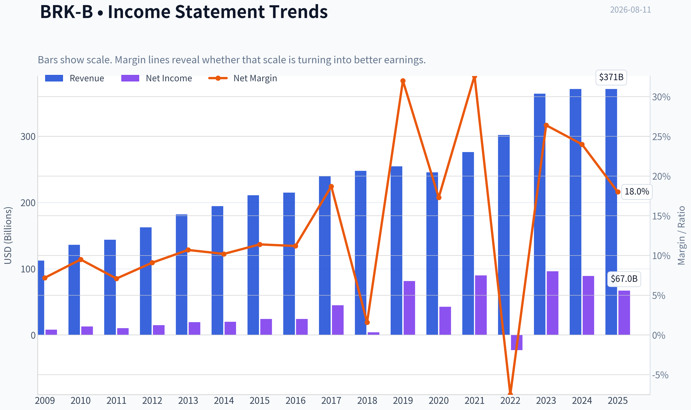
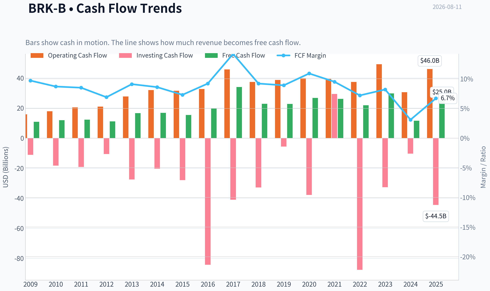
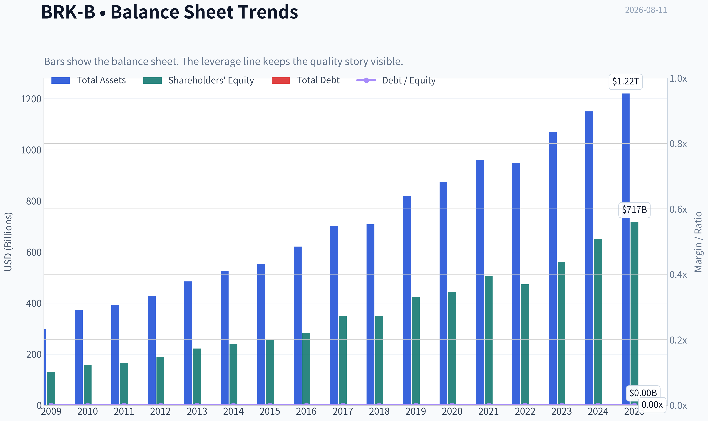
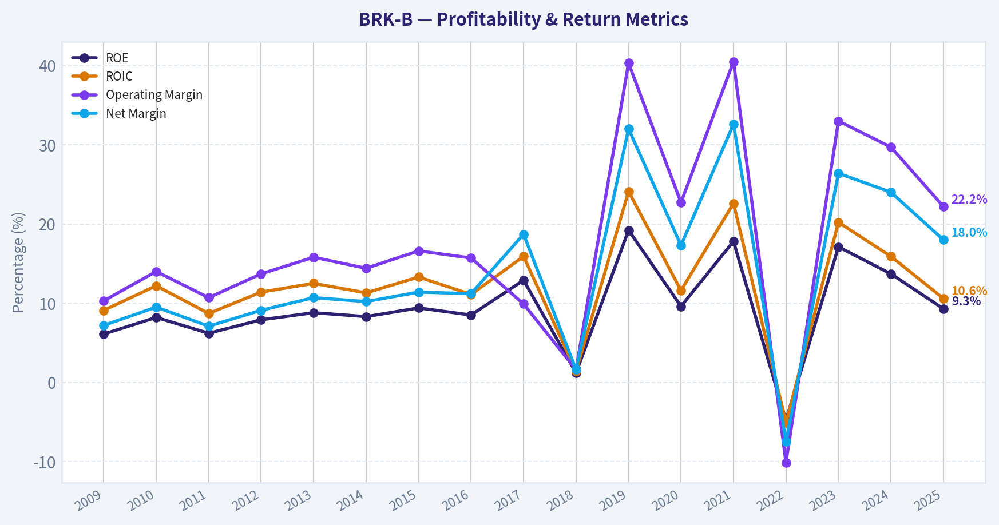
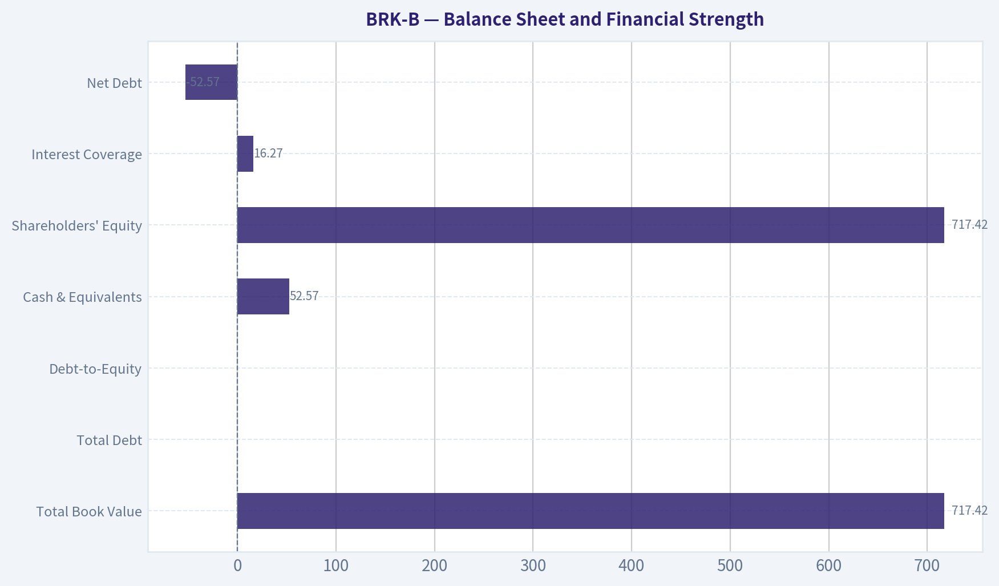
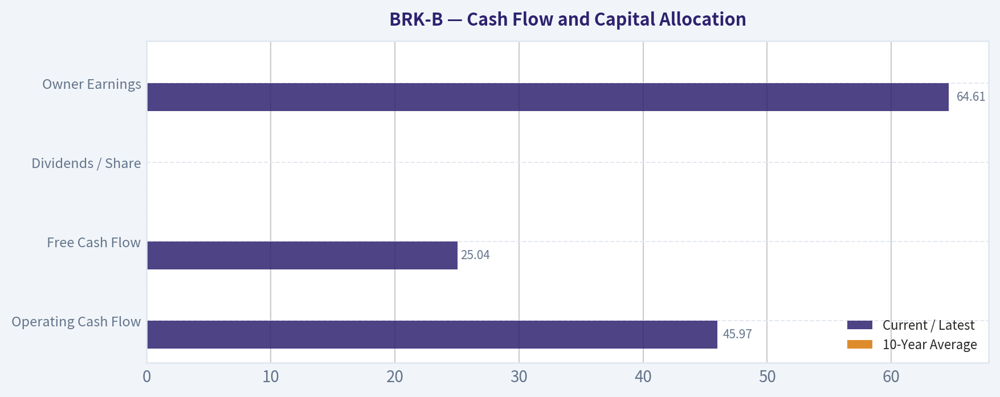
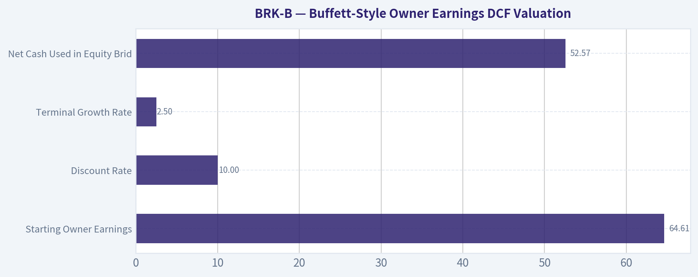
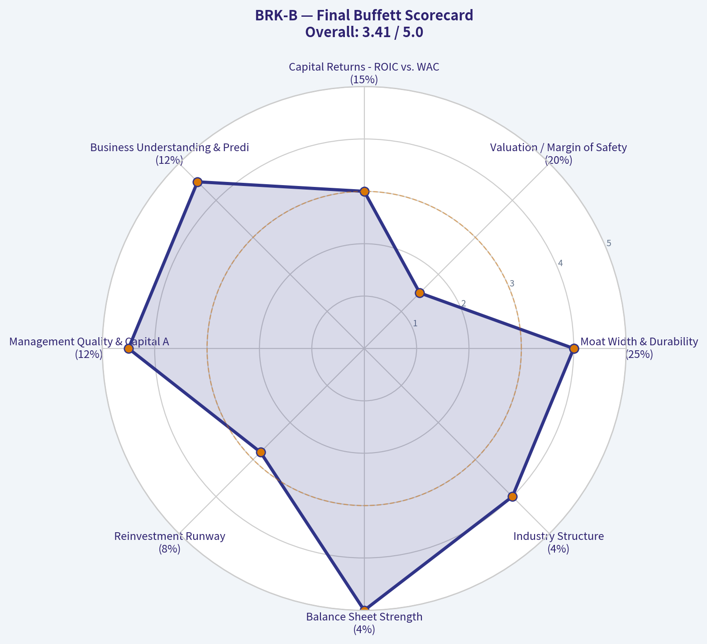

# BRK-B Deep Value Intelligence

**Analysis Date:** 2026-08-11

## Critical Disclaimer

*This analysis is generated by Deep Value Intelligence, an AI-powered multi-agent investing framework. Education & research only - not financial advice, not a financial advisor.*

---

## Table of Contents

1. Intelligence Summary
2. Analyst Team Reports
   - Fundamentals Analysis
   - Intrinsic Value Analysis (Buffett)
   - Trend & Growth Analysis (Lynch/Druckenmiller/Fisher)
   - Market Technical Analysis
   - Options Market Analysis
3. Research Team Commentary
4. Value Investing Team Commentary
5. Deep Values Commentary

---

## Intelligence Summary

### Thesis + Conditions

**Core Thesis:** **EXECUTIVE SUMMARY**
Berkshire Hathaway (BRK-B) remains an elite, highly durable compounding machine, but at current levels ($516-$529), it trades near fair value with a thin margin of safety. While the business faces virtually zero permanent impairment risk thanks to its fortress balance sheet and $160B+ in cash optionality, the absence of a near-term capital deployment catalyst caps immediate upside.

**Key Risks:**
- Berkshire Hathaway (BRK-B) remains an elite, highly durable compounding machine, but at current levels ($516-$529), it trades near fair value with a thin margin of safety. While the business faces virtually zero permanent impairment risk thanks to its fortress balance sheet and $160B+ in cash optionality, the absence of a near-term capital deployment catalyst caps immediate upside. A rigid demand for a $470 entry risks missing the boat on a premium asset, while buying at the top of an extended run risks dead money. We recommend a phased, conditional entry, looking to accumulate on technical stabilization in the $490-$500 zone.
- The Bull (Risky)**: Emphasizes the $160B cash pile as a massive competitive advantage and a high-yield call option on market distress. Argues that rate cuts will expand multiples for Berkshire's equity portfolio and asset-heavy businesses (BNSF/BHE), justifying a quality premium and aggressive buying despite the stock being technically extended.
- Applying our Value Investing Framework, the primary risk with Berkshire Hathaway is not business impairment or insolvency-its 10.1% ROIC, immense float, and cash reserves eliminate that threat. The genuine risk is *overpaying* for a mega-cap compounder that lacks a near-term catalyst.

**Confidence:** Medium

---

## Analyst Team Reports

### Fundamentals Analysis

#### Latest Earnings Snapshot

*Most recent reported quarter anchored on 2026 Q2, with prior-year comparison when available.*

| Metric | 2026 Q2 | 2025 Q2 | YoY Change |
| --- | ---: | ---: | ---: |
| Revenue | $117.89B | $98.88B | +19.2% |
| Operating Income | N/A | N/A | N/A |
| Net Income | $25.67B | $12.37B | +107.5% |
| Diluted EPS | $11.91 | $5.73 | +107.7% |
| Operating Cash Flow | $11.21B | $10.09B | +11.2% |
| Free Cash Flow | $5.57B | $5.23B | +6.6% |

Key Takeaways: This snapshot anchors the most recent reported quarter before the narrative analysis. It helps readers separate long-run business quality from whatever changed in the latest earnings print.

#### 17-Year Financial Metrics for BRK-B

*All values below are computed deterministically from raw data - not estimated by AI.*

*Issuer profile: insurer (Financial Services / Insurance - Diversified).*

#### 17-Year Financial Metrics
*Annual rows come from reported financial statements. The final TTM row is computed from the latest four quarters.*

| Metric | 2009 | 2010 | 2011 | 2012 | 2013 | 2014 | 2015 | 2016 | 2017 | 2018 | 2019 | 2020 | 2021 | 2022 | 2023 | 2024 | 2025 |
| --- | --- | --- | --- | --- | --- | --- | --- | --- | --- | --- | --- | --- | --- | --- | --- | --- | --- |
| Market Price | $66 | $80 | $76 | $90 | $119 | $150 | $132 | $163 | $198 | $204 | $226 | $232 | $299 | $309 | $357 | $453 | $503 |
| Market Cap | $72.3M | $75.3M | $71.7M | N/A | N/A | N/A | N/A | N/A | N/A | N/A | N/A | N/A | N/A | $680.60B | $775.14B | $977.53B | $1.08T |
| P/E Ratio | 0.01 | 0.01 | 0.01 | 0.01 | 0.01 | N/A | 13.52 | 16.73 | 10.83 | 124.95 | 6.80 | 12.80 | 7.44 | -29.90 | 8.06 | 10.98 | 16.19 |
| P/B Ratio | 0.00 | 0.00 | 0.00 | N/A | N/A | N/A | 1.27 | 1.43 | 1.40 | 1.44 | 1.30 | 1.25 | 1.32 | 1.44 | 1.38 | 1.51 | 1.51 |
| ROE | 6.1% | 8.2% | 6.2% | 7.9% | 8.8% | 8.3% | 9.4% | 8.5% | 12.9% | 1.2% | 19.2% | 9.6% | 17.8% | -4.8% | 17.1% | 13.7% | 9.3% |
| ROIC | 9.1% | 12.2% | 8.7% | 11.4% | 12.5% | 11.3% | 13.3% | 11.1% | 15.9% | 1.4% | 24.1% | 11.6% | 22.6% | -5.1% | 20.2% | 15.9% | 10.6% |
| EPS | $7322.73 | $13794.68 | $10908.51 | N/A | N/A | N/A | N/A | N/A | N/A | N/A | N/A | N/A | N/A | $-10.33 | $44.27 | $41.27 | $31.04 |
| Revenue | $112.49B | $136.19B | $143.69B | $162.46B | $182.15B | $194.70B | $210.94B | $215.11B | $239.93B | $247.84B | $254.62B | $245.58B | $276.19B | $302.02B | $364.48B | $371.43B | $371.44B |
| Gross Profit | N/A | N/A | N/A | N/A | N/A | N/A | N/A | N/A | N/A | N/A | N/A | N/A | N/A | N/A | N/A | N/A | N/A |
| Gross Margin | N/A | N/A | N/A | N/A | N/A | N/A | N/A | N/A | N/A | N/A | N/A | N/A | N/A | N/A | N/A | N/A | N/A |
| Operating Margin | 10.3% | 14.0% | 10.7% | 13.7% | 15.8% | 14.4% | 16.6% | 15.7% | 9.9% | 1.6% | 40.3% | 22.7% | 40.5% | -10.1% | 33.0% | 29.7% | 22.2% |
| Net Income | $8.05B | $12.97B | $10.25B | $14.82B | $19.48B | $19.87B | $24.08B | $24.07B | $44.94B | $4.02B | $81.42B | $42.52B | $89.94B | $-22.76B | $96.22B | $89.00B | $66.97B |
| Net Margin | 7.2% | 9.5% | 7.1% | 9.1% | 10.7% | 10.2% | 11.4% | 11.2% | 18.7% | 1.6% | 32.0% | 17.3% | 32.6% | -7.5% | 26.4% | 24.0% | 18.0% |
| Revenue Growth | N/A | 21.1% | 5.5% | 13.1% | 12.1% | 6.9% | 8.3% | 2.0% | 11.5% | 3.3% | 2.7% | -3.5% | 12.5% | 9.4% | 20.7% | 1.9% | 0.0% |
| Net Income Growth | N/A | 61.0% | -20.9% | 44.6% | 31.4% | 2.0% | 21.2% | -0.0% | 86.7% | -91.1% | 1924.8% | -47.8% | 111.5% | -125.3% | -522.8% | -7.5% | -24.8% |
| Free Cash Flow Growth | N/A | 9.2% | 3.1% | -9.0% | 48.7% | 1.3% | -8.4% | 27.8% | 72.8% | -32.8% | -0.7% | 17.8% | -2.3% | -16.3% | 36.1% | -61.0% | 115.6% |
| Total Book Value | $131.10B | $157.32B | $164.85B | $187.65B | $221.89B | $240.17B | $255.55B | $282.07B | $348.30B | $348.70B | $424.79B | $443.16B | $506.20B | $473.42B | $561.27B | $649.37B | $717.42B |
| Total Assets | $297.12B | $372.23B | $392.65B | $427.45B | $484.62B | $525.87B | $552.26B | $620.85B | $702.10B | $707.79B | $817.73B | $873.73B | $959.39B | $948.47B | $1.07T | $1.15T | $1.22T |
| Total Debt | $0 | $0 | $0 | $0 | $0 | $0 | $0 | $0 | $0 | $0 | $0 | $0 | $0 | $0 | $0 | $0 | $0 |
| Debt-to-Equity | 0.00 | 0.00 | 0.00 | 0.00 | 0.00 | 0.00 | 0.00 | 0.00 | 0.00 | 0.00 | 0.00 | 0.00 | 0.00 | 0.00 | 0.00 | 0.00 | 0.00 |
| Cash & Equivalents | $30.56B | $38.23B | $37.30B | $46.99B | $45.91B | $60.03B | $67.60B | $28.64B | $32.21B | $30.81B | $64.63B | $48.40B | $88.71B | $36.40B | $38.64B | $48.38B | $52.57B |
| Shareholders' Equity | $131.10B | $157.32B | $164.85B | $187.65B | $221.89B | $240.17B | $255.55B | $282.07B | $348.30B | $348.70B | $424.79B | $443.16B | $506.20B | $473.42B | $561.27B | $649.37B | $717.42B |
| Operating Cash Flow | $15.85B | $17.89B | $20.48B | $20.95B | $27.70B | $32.01B | $31.49B | $32.65B | $45.73B | $37.40B | $38.69B | $39.77B | $39.43B | $37.35B | $49.20B | $30.59B | $45.97B |
| Investing Cash Flow | $-11.16B | $-18.28B | $-19.19B | $-10.57B | $-27.54B | $-20.33B | $-28.00B | $-84.22B | $-41.01B | $-32.85B | $-5.62B | $-37.76B | $29.39B | $-87.60B | $-32.66B | $-10.29B | $-44.49B |
| Free Cash Flow | $10.91B | $11.91B | $12.29B | $11.18B | $16.62B | $16.82B | $15.41B | $19.69B | $34.02B | $22.86B | $22.71B | $26.76B | $26.15B | $21.89B | $29.79B | $11.62B | $25.04B |
| FCF Margin | 9.7% | 8.7% | 8.5% | 6.9% | 9.1% | 8.6% | 7.3% | 9.2% | 14.2% | 9.2% | 8.9% | 10.9% | 9.5% | 7.2% | 8.2% | 3.1% | 6.7% |
| Dividends / Share | $0.00 | $0.00 | $0.00 | N/A | N/A | N/A | N/A | N/A | N/A | N/A | N/A | N/A | N/A | $0.00 | $0.00 | $0.00 | $0.00 |

#### Profitability Metrics
- Return on Equity (ROE): 9.3%
- Return on Invested Capital (ROIC): 10.1%
- Return on Assets (ROA): 5.5%
- Gross Margin: Not meaningful
- Operating Margin: 22.2%
- Net Profit Margin: 18.0%

#### Liquidity Metrics
- Current Ratio: Not meaningful
- Quick Ratio: Not meaningful

#### Leverage Metrics
- Debt-to-Equity Ratio: 0.00
- Interest Coverage Ratio: 16.27
- Net Debt: $-52.57B

#### Growth Metrics (Year-over-Year)
- Revenue Growth: 0.0%
- Net Income Growth: -24.8%
- Free Cash Flow Growth: 115.6%
- Revenue CAGR (3-Year): 7.1%
- Revenue CAGR (5-Year): 8.6%

#### Valuation Metrics
- P/E Ratio (TTM): 12.99
- Forward P/E: 23.65
- Price-to-Book: 1.54
- Price-to-Sales: 2.87
- PEG Ratio: 10.06
- EV/EBITDA: -1.79
- Free Cash Flow Yield: 2.3%
- Earnings Yield: 7.7%

#### Owner Earnings (Buffett Method, Code-Computed)
- Net Income: $66.97B
- + Depreciation & Amortization: $13.48B
- - Capital Expenditures: $-20.93B
- - Working Capital Changes: $2.35B
- = **Owner Earnings: $64.61B**

#### Intrinsic Value (Code-Computed)
- Current Price: $516
- Headline Intrinsic Value: not meaningful (financial issuer - DCF/FCFF is not the right primary frame; use sector-specific book/earnings metrics)
- Buffett Method (Owner Earnings):
  Conservative: $118
  Average: $813
  Optimistic: $2,830
- Cash Flow Method (FCF):
  Conservative: $129
  Average: $200
  Optimistic: $352
- Reverse-DCF: price implies ~7.5%/yr owner-earnings growth for 10y; trailing 3y was N/A, 5y 17.0%.

#### Piotroski F-Score: 3/9
- Positive Net Income: PASS
- Positive Operating Cash Flow: PASS
- ROA Improvement: FAIL
- Cash Flow > Net Income: FAIL
- Decreasing Debt: FAIL
- Improving Current Ratio: FAIL
- No Dilution: PASS
- Improving Gross Margin: FAIL
- Improving Asset Turnover: FAIL

ANALYST STANCE: **WATCH**

#### Berkshire Hathaway Inc. Class B - Warren Buffett-Style Fundamental Analysis

Berkshire Hathaway remains one of the highest-quality public compounders in the market: diversified, conservatively financed, cash-generative, and run with an owner-oriented culture. However, at roughly **$516 per B share**, a **$1.11T market cap**, and about **1.54x book value**, the stock looks closer to **fair value than a clear bargain**, especially because current ROE is below its 10-year average and revenue growth has stalled in the latest period.

---

#### Revenue Breakdown

| Revenue Source | Amount | % of Total |
|---|---:|---:|
| Sales and service revenues | ~$166.8B | ~44.9% |
| Insurance premiums earned | ~$95.6B | ~25.7% |
| Railroad, utilities, and energy revenues | ~$55.0B | ~14.8% |
| Interest, dividend, and other investment income | ~$24.7B | ~6.7% |
| Investment and derivative gains | ~$20.7B | ~5.6% |
| Leasing revenues | ~$8.6B | ~2.3% |
| **Total Revenue / Income** | **~$371.4B** | **~100.0%** |

Key Takeaways: Berkshire's revenue base is highly diversified, but the largest recurring contributor is still its broad operating-company base, especially sales and service businesses, insurance, BNSF, and Berkshire Hathaway Energy. Investment gains are material but volatile, so investors should avoid over-interpreting GAAP revenue and net income in any single year. The most durable revenue streams are insurance premiums, railroad, utilities, manufacturing, distribution, and service operations.

---

#### Current vs. Historical Average Comparison

| Metric | Current / Latest | 10-Year Average* | Current Standing vs. History | Interpretation |
|---|---:|---:|---|---|
| Market Price | ~$516 | ~$294 | Well above average | The stock has compounded strongly and now trades materially above its decade average price. |
| Market Cap | ~$1.11T | ~$878B** | Above average | Berkshire has crossed into mega-cap territory; future growth is naturally harder from this scale. |
| P/E Ratio | ~12.99x | ~18.49x | Below average | Appears optically inexpensive, but GAAP earnings are distorted by investment marks. |
| P/B Ratio | ~1.54x | ~1.40x | Above average | For an insurer, P/B is meaningful only relative to ROE; current ROE is below average, so the premium deserves scrutiny. |
| ROE | 9.3% | ~10.5% | Below average | Profitability remains solid but is not exceptional versus Berkshire's own history. |
| ROIC | ~10.1% | ~12.8% | Below average | Capital productivity has moderated from stronger years. |
| EPS | $31.04 | ~$26.56*** | Above available average | EPS is positive and above the recent available average, but comparability is limited. |
| Revenue | $371.44B | ~$288.86B | Well above average | Berkshire's revenue base is much larger than a decade ago. |
| Gross Profit | Not meaningful | Not meaningful | N/A | Gross profit is not meaningful for Berkshire's diversified insurer/holding-company structure. |
| Operating Margin | 22.2% | ~20.6% | Above average | Operating profitability remains better than the 10-year norm despite normalization from peak years. |
| Net Income | $66.97B | ~$51.63B | Above average | GAAP net income is strong but heavily affected by investment portfolio mark-to-market changes. |
| Net Margin | 18.0% | ~17.4% | Slightly above average | Current profitability is broadly in line with the decade average. |
| Revenue Growth | 0.0% | ~6.1% | Below average | Latest revenue growth has stalled after several strong years. |
| Net Income Growth | -24.8% | Not meaningful | Weak but distorted | Net income growth is too volatile to use mechanically because investment gains and losses swing reported earnings. |
| FCF Growth | 115.6% | ~15.7% | Above average | Free cash flow rebounded sharply from a weak prior year, but FCF remains volatile. |
| Total Book Value | $717.42B | ~$475.47B | Well above average | Book value has compounded substantially, reflecting retained earnings and asset growth. |
| Total Assets | $1.22T | ~$907.01B | Well above average | Berkshire's asset base continues to scale. |
| Total Debt | $0 | $0 | Stable | The deterministic dataset shows no debt, reinforcing the conservative financial profile. |
| Debt-to-Equity | 0.00x | 0.00x | Stable | Balance sheet leverage is exceptionally conservative in the dataset. |
| Cash & Equivalents | $52.57B | ~$46.94B | Above average | Liquidity is strong, though Berkshire's broader cash/T-bill liquidity is often economically larger than simple cash. |
| Shareholders' Equity | $717.42B | ~$475.47B | Well above average | Equity capital has grown steadily over time. |
| Free Cash Flow | $25.04B | ~$24.05B | Slightly above average | Current FCF is near the 10-year average despite a large rebound from 2024. |
| Dividends / Share | $0.00 | $0.00 | Unchanged | Berkshire continues to retain capital rather than pay dividends. |

\* 10-year averages use the deterministic dataset period 2016-2025 where available.
\** Market cap average is based only on years with available market-cap data in the deterministic dataset.
\*** EPS average is based only on available comparable recent EPS figures.

Key Takeaways: Berkshire's scale, book value, assets, and operating income power are far above historical levels, showing durable long-term compounding. The valuation is mixed: the P/E looks reasonable, but P/B is above average while ROE is below average, which weakens the bargain case. Revenue growth has flattened, and GAAP earnings remain noisy because investment gains and losses move through reported income.

---

#### Market Metrics Interpretation

| Market Metric | Buffett-Style Interpretation |
|---|---|
| Market Price: ~$516 | The stock has appreciated meaningfully and now reflects Berkshire's quality, fortress balance sheet, and durable earnings base. The price is not obviously excessive, but it no longer offers the obvious margin of safety seen in earlier periods. |
| Market Cap: ~$1.11T | Berkshire's size is both a strength and a constraint. It provides stability and diversification, but trillion-dollar scale makes very high future compounding more difficult. |
| P/E: ~12.99x | The P/E appears attractive relative to the broad market and Berkshire's own reported 10-year average. However, Berkshire's GAAP earnings are distorted by unrealized investment gains and losses, so normalized operating earnings matter more than headline P/E. |
| P/B: ~1.54x | P/B is relevant for Berkshire because it is an insurer/holding company, but it must be judged against ROE. Paying 1.54x book for a business currently earning 9.3% ROE implies an equity earnings yield on price of roughly 6%, before future growth. That is acceptable, but not clearly cheap. |

Key Takeaways: Berkshire's market valuation is reasonable but not deeply discounted. The P/B ratio is above its 10-year average, while ROE is below its 10-year average, which argues against calling the stock a classic bargain. The P/E is lower than history, but investors should rely more on operating earnings, book growth, and owner earnings than on GAAP P/E alone.

---

#### Profitability and Growth Assessment

Berkshire's profitability profile is still high quality, but the trend is not uniformly positive. **ROE of 9.3%** is below the 10-year average of roughly **10.5%**, and **ROIC of about 10.1%** is below the 10-year average of about **12.8%**. This suggests Berkshire remains a good business, but recent capital productivity is more moderate than in stronger historical periods.

Operating margin of **22.2%** is above the 10-year average of roughly **20.6%**, which is encouraging. Net margin of **18.0%** is also slightly above the 10-year average. However, Berkshire's margins are influenced by the accounting treatment of investments, insurance underwriting cycles, energy results, and the mix of subsidiaries.

Revenue has grown from **$215.11B in 2016** to **$371.44B in 2025**, a major expansion in absolute scale. But the latest reported revenue growth is **0.0%**, well below the 10-year average of about **6.1%**. This is one of the more important watch items: Berkshire remains massive and durable, but its near-term top-line momentum has slowed.

Net income growth is not a clean signal for Berkshire. The deterministic dataset shows extreme swings, including very large positive and negative years, because Berkshire marks large equity investments through earnings. Buffett himself has repeatedly warned that GAAP net income can be misleading for Berkshire. Free cash flow growth rebounded **115.6%** in the latest period, but the 10-year pattern is lumpy rather than smooth.

---

#### Balance Sheet and Financial Strength

| Balance Sheet Metric | Current / Latest | Buffett-Style View |
|---|---:|---|
| Total Book Value | $717.42B | Massive capital base and a useful valuation anchor for an insurer/holding company. |
| Total Assets | $1.22T | Scale is a competitive advantage, but it also limits future reinvestment opportunities. |
| Total Debt | $0 | The deterministic dataset shows no debt, supporting a fortress-balance-sheet conclusion. |
| Debt-to-Equity | 0.00x | Extremely conservative leverage profile in the canonical dataset. |
| Cash & Equivalents | $52.57B | Strong liquidity and optionality for acquisitions, buybacks, and crisis deployment. |
| Shareholders' Equity | $717.42B | Equity has compounded significantly, reflecting retained earnings and disciplined capital allocation. |
| Interest Coverage | 16.27x | Strong ability to cover interest obligations where applicable. |
| Net Debt | -$52.57B | Net cash position under the dataset, reinforcing financial resilience. |

Key Takeaways: Berkshire's balance sheet is one of its clearest strengths. The company has substantial equity capital, significant liquidity, and no debt in the deterministic dataset. This gives Berkshire unusual flexibility to act aggressively during market stress, which is central to its long-term compounding model.

---

#### Cash Flow and Capital Allocation

| Cash Flow Metric | Current / Latest | 10-Year Average | Interpretation |
|---|---:|---:|---|
| Operating Cash Flow | $45.97B | N/A | Strong cash generation from Berkshire's diversified operating base. |
| Free Cash Flow | $25.04B | ~$24.05B | Slightly above the decade average, but not high relative to market cap. |
| Free Cash Flow Yield | ~2.3% | N/A | Low absolute yield, suggesting the market is capitalizing Berkshire's quality and durability. |
| Dividends / Share | $0.00 | $0.00 | Berkshire continues to retain and redeploy capital internally. |
| Owner Earnings | $64.61B | N/A | Higher than reported FCF because Buffett-style owner earnings adjust net income for D&A, capex, and working capital. |

Key Takeaways: Berkshire remains highly cash-generative, but the free cash flow yield is modest at the current valuation. The absence of dividends is intentional and consistent with Berkshire's historical policy of retaining capital for acquisitions, investments, and buybacks. The key question is whether management can continue reinvesting retained capital at attractive rates despite Berkshire's enormous size.

---

#### Buffett-Style Owner Earnings DCF Valuation

For Berkshire, a DCF is useful as a sanity check, but not a perfect valuation tool. Berkshire is a diversified insurer and holding company, so book value, insurance float economics, investment portfolio value, operating earnings quality, and capital allocation matter alongside owner earnings. The deterministic dataset also states that headline intrinsic value is **not meaningful for this financial issuer**, so this DCF should be viewed as a valuation range, not a precise target price.

Assumptions used:

| DCF Assumption | Value |
|---|---:|
| Starting Owner Earnings | $64.61B |
| Discount Rate | 10.0% |
| Terminal Growth Rate | 2.5% |
| Net Cash Used in Equity Bridge | $52.57B |
| Estimated B-share Equivalent Count | ~2.15B |
| Current Price | ~$516 |

Key Takeaways: The DCF starts from Berkshire's code-computed Buffett-style owner earnings of $64.61B. A 10% discount rate is appropriate for a conservative equity hurdle rate, while the 2.5% terminal growth rate prevents unrealistic perpetual growth. Net cash adds modest value per share, but the core valuation is driven by owner earnings durability and growth.

| Scenario | Explicit Growth Assumption | PV of 10-Year Owner Earnings | PV of Terminal Value | Add Net Cash | Equity Value | Fair Value / B Share |
|---|---|---:|---:|---:|---:|---:|
| Conservative | 3.0% annual owner-earnings growth for 10 years; terminal 2.5% | ~$458B | ~$458B | ~$53B | ~$968B | **~$450** |
| Average / Base Case | 7.5% for 5 years, fading to 2.5% by year 10 | ~$554B | ~$609B | ~$53B | ~$1.22T | **~$565** |
| Optimistic | 10.0% for 5 years, fading to 2.5% by year 10 | ~$618B | ~$716B | ~$53B | ~$1.39T | **~$644** |

Key Takeaways: The hand-built owner-earnings DCF suggests a broad fair value range of approximately **$450 to $644 per B share**, with a base case around **$565**. At the current price of roughly **$516**, Berkshire trades below the base-case estimate but above the conservative estimate. That supports a "reasonable but not screaming cheap" conclusion.

| Pack-Computed Valuation Reference | Conservative | Average | Optimistic |
|---|---:|---:|---:|
| Buffett Method: Owner Earnings | $118 | $813 | $2,830 |
| Cash Flow Method: FCF | $129 | $200 | $352 |
| Reverse DCF | Price implies ~7.5% annual owner-earnings growth for 10 years |  |  |

Key Takeaways: The model-based pack shows extremely wide outcomes, especially under the owner-earnings method, which reinforces that Berkshire is hard to value with a single DCF. The reverse DCF is more useful: today's price implies roughly **7.5% annual owner-earnings growth for 10 years**. That is achievable for Berkshire, but not guaranteed given its size and recent flat revenue growth.

---

#### Warren Buffett-Style Qualitative Analysis

| Buffett Criterion | Assessment |
|---|---|
| Economic Moat | Very strong. Berkshire owns regulated utilities, BNSF railroad, insurance operations with float advantages, and a portfolio of durable operating companies. Its culture, reputation, scale, and capital flexibility are difficult to replicate. |
| Financial Strength | Excellent. The deterministic dataset shows $717.42B of equity, $1.22T of assets, $52.57B of cash, net cash, and no debt. This is a fortress profile. |
| Predictable Earnings | Moderate to strong on operating earnings, weak on GAAP earnings. Operating businesses are diversified and durable, but GAAP net income is volatile due to investment marks. |
| Management Performance | Historically exceptional. Capital allocation has been Berkshire's defining strength. The key future issue is post-Buffett and post-Munger succession execution. |
| Capital Allocation | Conservative and owner-oriented. Berkshire pays no dividend, retains earnings, buys businesses, invests in securities, and repurchases shares when attractive. |
| Business Quality | High. The company owns many essential, cash-generative, competitively advantaged businesses. However, its size reduces the universe of needle-moving opportunities. |
| Valuation | Fair to modestly attractive. P/E is reasonable, but P/B is above average while ROE is below average. DCF suggests modest upside in the base case, not a deep margin of safety. |

Key Takeaways: Berkshire remains a classic Buffett-style quality business: durable, conservatively financed, diversified, and rationally managed. The main issue is not business quality but price. The current valuation leaves some upside if owner earnings compound well, but the margin of safety is not large enough for a strong advocacy stance.

---

#### Key Investment Insights

| Category | Insight |
|---|---|
| Core Strength | Berkshire's financial resilience is exceptional, with massive equity, strong liquidity, and no debt in the deterministic dataset. |
| Quality Signal | Operating margin and net margin remain above or near long-term averages, showing continued profitability. |
| Valuation Signal | Current P/B of ~1.54x is above the 10-year average of ~1.40x, while ROE is below average. That combination is not a classic bargain. |
| Growth Signal | Revenue growth has slowed to 0.0%, far below the 10-year average of ~6.1%. |
| Cash Flow Signal | FCF rebounded sharply, but the FCF yield of ~2.3% is not especially compelling. |
| Accounting Caveat | GAAP net income growth is not reliable because investment gains and losses create extreme swings. |
| DCF Signal | Hand DCF suggests fair value around ~$450 to ~$644, with a base case near ~$565. |
| Reverse DCF Signal | The market is pricing in roughly 7.5% annual owner-earnings growth for 10 years. That is plausible but not conservative. |

Key Takeaways: Berkshire's quality remains clear, but valuation is balanced. The company is financially strong and durable, yet current growth is slower and the stock is not cheap on book value relative to ROE. The investment case depends on continued owner-earnings growth and disciplined capital allocation.

---

#### Red Flags and Risks

| Risk | Why It Matters |
|---|---|
| Scale Drag | At more than $1T in market value, it is harder for acquisitions or investments to materially move the needle. |
| Succession Risk | Berkshire has a strong succession plan, but the Buffett era's capital allocation record is impossible to fully replicate. |
| GAAP Earnings Volatility | Investment portfolio marks can cause large reported profit swings that obscure operating performance. |
| Slower Revenue Growth | Latest revenue growth is 0.0%, a meaningful deviation from the 10-year average. |
| P/B Above Average | Paying above-average book multiple while ROE is below average reduces the margin of safety. |
| Low FCF Yield | A 2.3% FCF yield means the market is already assigning a premium to Berkshire's durability. |
| Piotroski F-Score of 3/9 | The score is weak, though some components are less informative for a diversified insurer. |

Key Takeaways: The biggest risks are not financial distress risks; Berkshire is far too strong for that to be the central concern. The real risks are valuation, slower growth, succession, and the challenge of compounding an enormous capital base. Investors should also avoid overreacting to GAAP earnings volatility.

---

#### Opportunities

| Opportunity | Why It Could Create Value |
|---|---|
| Market Dislocations | Berkshire's liquidity allows it to buy assets aggressively when others are forced sellers. |
| Insurance Float | Low-cost or negative-cost float can enhance returns if underwriting remains disciplined. |
| Share Repurchases | Buybacks below intrinsic value can steadily improve per-share economics. |
| BNSF and Energy Assets | Rail, utilities, and energy infrastructure provide durable, long-lived cash flows. |
| Investment Portfolio | Large equity holdings can continue compounding over time. |
| Operating Subsidiaries | Berkshire's decentralized model allows strong managers to run businesses with minimal bureaucracy. |

Key Takeaways: Berkshire's upside comes from disciplined capital deployment, insurance float, opportunistic investing, and steady operating-company growth. The company is especially valuable during crises because it can provide capital when markets are stressed. That optionality is difficult to quantify but central to Berkshire's long-term appeal.

---

#### Final Investment Stance: WATCH

Berkshire Hathaway is a **wonderful business at a fair-to-slightly-attractive price**, but not clearly a wonderful business at a bargain price. The company's moat, balance sheet, liquidity, culture, and operating diversity are exceptional. However, current valuation is not deeply discounted: **P/B is above its 10-year average**, **ROE is below its 10-year average**, **revenue growth is flat**, and **FCF yield is modest**.

The hand-built owner-earnings DCF suggests a fair value range of roughly **$450 to $644 per B share**, with a base case around **$565**. At **~$516**, the stock offers some upside to base-case fair value but lacks a large Buffett-style margin of safety. For long-term holders, Berkshire remains a high-quality compounder worth owning. For new money, a more attractive entry would likely come closer to the conservative DCF range or at a lower P/B multiple relative to normalized ROE.

| Final View | Rating |
|---|---|
| Business Quality | Excellent |
| Financial Strength | Excellent |
| Earnings Predictability | Good operating predictability; weak GAAP predictability |
| Valuation Attractiveness | Fair to modestly attractive |
| Margin of Safety | Moderate to limited |
| Suitable Investor Type | Long-term quality/value investor |
| Final Stance | **WATCH** |

Key Takeaways: Berkshire is still one of the highest-quality businesses in the public market, but the stock is not obviously cheap today. The balance sheet and moat justify a premium, yet slower growth and below-average ROE argue for discipline. The best stance is **WATCH**: hold if owned, consider adding on pullbacks, but avoid treating the current price as a high-margin-of-safety bargain.

#### Fundamental Visuals

This graph tracks the profitability and return metrics (ROE, ROIC, Margins) of **BRK-B** over the past decade, highlighting capital efficiency trends.

This chart illustrates the financial health of **BRK-B** over the last 10 years, mapping cash equivalents and free cash flow against total obligations (Debt).

---

### Intrinsic Value Analysis (Buffett)

> *Following Warren Buffett's value investing philosophy: Circle of Competence, Economic Moat, Management Quality, and Margin of Safety.*

#### Intrinsic Value Snapshot

Price is what you pay. Intrinsic value is what the business may be worth based on the cash it can create for owners over time. We show a range, not one magic number.

- Current Price: $516.38
- Value Range (conservative to optimistic across both DCF methods): $118.38 to $2,830.34

##### Owner Earnings (Buffett Method)
- Net Income: $66,968,000,000.00
- Depreciation & Amortization: $13,476,000,000.00
- Capital Expenditures: $-20,927,000,000.00
- Working Capital Changes: $2,355,000,000.00
- Owner Earnings: $64,613,000,000.00

##### Intrinsic Value
###### Buffett Method
Uses owner earnings. Stricter, and usually more conservative.
- Conservative: $118.38
- Average: $813.14
- Optimistic: $2,830.34
- Discount Rate: 10.0%

###### Cash Flow Method
Uses free cash flow. Better for companies spending heavily today to grow tomorrow.
- Conservative: $128.58
- Average: $200.34
- Optimistic: $351.56
- Discount Rate: 10.0%

ANALYST STANCE: **WATCH**

#### Berkshire Hathaway B - Buffett-Style Investment View

Berkshire Hathaway is one of the highest-quality capital-allocation vehicles in public markets: a diversified collection of insurance, railroad, utility, energy, manufacturing, service, retail, and marketable-securities assets overseen by an unusually shareholder-aligned culture. The issue is not business quality. The issue is price. At about **$516 per B share** and a market capitalization near **$1.11 trillion**, the stock appears roughly fairly valued to modestly overvalued under conservative owner-earnings assumptions.

---

#### 1. Factor Scorecard

| Factor | Score | Assessment |
|---|---:|---|
| Circle of Competence & Business Simplicity | 4.5 / 5 | Berkshire makes money through insurance underwriting and float, owned operating businesses, cash interest, and equity investments. The model is understandable, though the conglomerate structure requires segment-level thinking. |
| Moat Test | 4.0 / 5 | Wide moat overall: insurance float, scale, permanent capital, regulated utility assets, railroad infrastructure, brand reputation, and deal-sourcing advantages. |
| Management Quality & Capital Allocation | 4.5 / 5 | Exceptional long-term record, conservative balance sheet, owner culture, rational buybacks, and disciplined acquisitions. Succession lowers the score slightly versus the Buffett/Munger era. |
| Industry Structure | 4.0 / 5 | Mix of rational oligopolies and durable assets: insurance, railroad, utilities, and branded equity holdings. Some subsidiaries face cyclicality and regulation. |
| Gate 5: Quality/Solvency Hard Floor | Not tripped | Earnings power remains strong, liquidity is enormous, and solvency risk is remote. |

**Key Takeaways:** Berkshire remains a very high-quality business with durable advantages and a fortress balance sheet. The company passes the solvency hard floor easily. The main investment debate is valuation, not survivability or business quality.

---

#### 2. Moat Analysis

| Moat Source | Evidence | Strength |
|---|---|---:|
| Insurance float | Berkshire uses large-scale insurance float as a low-cost or sometimes negative-cost source of investable funds. GEICO, reinsurance, and specialty insurance provide enduring capital advantages. | High |
| Permanent capital | Berkshire does not face fund redemptions, allowing it to act counter-cyclically during market stress. | High |
| Scale and reputation | Sellers often prefer Berkshire because it offers certainty, autonomy, and long-term ownership. This creates proprietary deal flow. | High |
| Railroad infrastructure | BNSF owns difficult-to-replicate physical networks with high replacement cost and strategic importance. | High |
| Regulated utility assets | Berkshire Hathaway Energy benefits from scale, essential-service demand, and regulated returns, though returns are capped by regulators. | Medium-High |
| Investment portfolio | Holdings such as Apple, American Express, Coca-Cola, and other public equities provide look-through earnings from high-quality franchises. | High |
| Network effects | Limited direct network effects at the parent-company level, though some portfolio companies have them. | Low-Medium |

**Key Takeaways:** Berkshire's moat is not based on a single product. It comes from the combination of float, permanent capital, reputation, scale, infrastructure assets, and disciplined capital allocation. This is a wide moat, but not a fast-widening one at today's trillion-dollar scale.

---

#### 3. Management Quality Assessment

| Question | Assessment |
|---|---|
| Do they think like owners? | Yes. Berkshire has a deeply embedded owner culture, minimal promotional behavior, and a long history of per-share value focus. |
| Are they honest and candid? | Yes. Berkshire's communications have historically been plain-spoken, conservative, and unusually candid. |
| Are they rational capital allocators? | Yes. Capital allocation is Berkshire's core competence: acquisitions, equity purchases, buybacks, cash discipline, and patience. |
| Main concern | Succession. Greg Abel is highly capable, but no successor can fully replicate Warren Buffett's unique reputation, judgment, and crisis-era deal access. |
| Buyback discipline | Positive. Berkshire has historically repurchased shares only when management believed the price was below intrinsic value; slower buybacks at higher valuations are a rational signal. |

**Key Takeaways:** Berkshire's management culture remains one of the strongest in public markets. The main risk is not reckless behavior, but the inevitable transition away from Buffett's personal capital-allocation advantage. Even so, the operating system he built is unusually durable.

---

#### 4. Financial Summary

| Fiscal Year | Revenue | Operating Earnings | GAAP Net Earnings | Free Cash Flow | Shareholders' Equity | Cash & Short-Term Investments | Insurance Float |
|---:|---:|---:|---:|---:|---:|---:|---:|
| 2020 | ~$245B | ~$21.9B | ~$42.5B | ~$25B | ~$443B | ~$138B | ~$138B |
| 2021 | ~$276B | ~$27.5B | ~$89.8B | ~$27B | ~$515B | ~$147B | ~$147B |
| 2022 | ~$302B | ~$30.8B | ~-$22.8B | ~$22B | ~$472B | ~$129B | ~$164B |
| 2023 | ~$365B | ~$37.4B | ~$96.2B | ~$30B | ~$561B | ~$168B | ~$169B |
| 2024 | ~$371B | ~$47.4B | ~$89.0B | ~$25B-$30B | ~$640B-$650B | ~$300B+ | ~$170B+ |
| Current Market Data | - | - | P/E ~13.0x | FCF Yield ~2.3% | ROE ~9.3% | Market Cap ~$1.11T | Price ~$516 |

**Key Takeaways:** Operating earnings have compounded meaningfully, especially since 2020, while GAAP earnings remain noisy because unrealized investment gains and losses flow through reported net income. Berkshire's cash position has become extremely large, which improves downside protection but also depresses reported returns on equity. The company is financially stronger than almost any comparable large-cap business, but its size makes high future growth harder.

---

#### 5. Owner Earnings Calculation

| Component | Normalized Estimate |
|---|---:|
| Reported GAAP net earnings | ~$89B |
| Less: investment and unrealized gains/loss noise | ~-$40B |
| Normalized operating earnings | ~$47B-$50B |
| Add: look-through retained earnings from major equity holdings | ~$8B-$12B |
| Less: maintenance capex / required reinvestment adjustment | ~-$2B-$5B |
| Estimated normalized owner earnings | **~$55B-$60B** |

**Key Takeaways:** Berkshire's GAAP earnings are not the best measure of economic power because marketable securities create large accounting swings. A better estimate is normalized operating earnings plus look-through investment earnings, adjusted for maintenance reinvestment. On that basis, Berkshire likely earns about **$55 billion to $60 billion** in normalized owner earnings.

---

#### 6. Three-Scenario DCF Valuation

Assumption: normalized owner earnings base of **$60B**, discount rate of **10%**.

| Scenario | Method | Implied Equity Value | Value vs. Current Market Cap |
|---|---|---:|---:|
| A: No Growth | Owner earnings / 10% | ~$600B | ~46% below market cap |
| B: GDP Growth | $60B x 1.03 / (10% - 3%) | ~$883B | ~20% below market cap |
| C: Historical / Quality Growth | 5% growth for 10 years, then 3% terminal growth | ~$1.00T | ~10% below market cap |
| Supplemental SOTP Cross-Check | Operating businesses + cash/securities + float value | ~$1.05T-$1.15T | roughly fair value |

**Key Takeaways:** A simple cash-flow DCF does not show a large margin of safety at the current price. The more generous sum-of-the-parts view suggests Berkshire is closer to fair value, because the cash, securities portfolio, float, and owned subsidiaries each carry substantial value. The stock is not obviously expensive in speculative terms, but it is not clearly cheap either.

---

#### 7. Margin of Safety Analysis

| Metric | Current Reading | Interpretation |
|---|---:|---|
| Share price | ~$516 | High absolute price relative to conservative intrinsic value estimates |
| Market cap | ~$1.11T | Already prices Berkshire as one of the world's largest and safest compounders |
| P/E | ~13.0x | Appears inexpensive, but GAAP earnings are distorted by investment gains |
| ROE | ~9.3% | Solid but not extraordinary, partly diluted by large cash holdings |
| FCF yield | ~2.3% | Low cash-flow yield for a mature conglomerate |
| Conservative intrinsic value range | ~$900B-$1.10T | Current market cap is near the upper end of conservative value |
| Margin of safety | Low to negative | Not enough discount for a new high-conviction purchase |

**Key Takeaways:** Berkshire is a wonderful company, but today's price offers little obvious margin of safety. The valuation is supported by quality, liquidity, and balance-sheet strength, yet conservative buyers should prefer a lower entry price. A more attractive zone would likely require either stronger evidence of owner-earnings growth or a material pullback in the share price.

---

#### 8. Final Buffett Scorecard

| Criterion | Weight | Score | Weighted Contribution |
|---|---:|---:|---:|
| Moat Width & Durability | 25% | 4.0 | 1.00 |
| Valuation / Margin of Safety | 20% | 1.5 | 0.30 |
| Capital Returns - ROIC vs. WACC | 15% | 3.0 | 0.45 |
| Business Understanding & Predictability | 12% | 4.5 | 0.54 |
| Management Quality & Capital Allocation | 12% | 4.5 | 0.54 |
| Reinvestment Runway | 8% | 2.8 | 0.22 |
| Balance Sheet Strength | 4% | 5.0 | 0.20 |
| Industry Structure | 4% | 4.0 | 0.16 |
| **Total Score** | **100%** | - | **3.41 / 5** |

**Key Takeaways:** Berkshire scores extremely well on moat, management, predictability, and balance-sheet safety. It scores lower on valuation and reinvestment runway because the company is now so large and the stock already reflects much of its quality. The weighted result lands in the **WATCH** range.

---

#### 9. Investment Stance

| Stance | Conviction | Rationale |
|---|---|---|
| **WATCH** | Medium-High | Berkshire is a superb business and one of the safest long-term compounders, but the current price does not provide a compelling margin of safety. |

Berkshire is the kind of company a Buffett-style investor should want to own for decades, but not at any price. At approximately **$516 per B share**, the stock looks closer to fair value than bargain value. Existing long-term holders can reasonably continue holding, but fresh capital should wait for a better price or clearer evidence that normalized owner earnings are growing faster than the market currently discounts.
#### Valuation Bridge

This bridge places the current market price beside each intrinsic value lens so readers can see whether upside depends on one method or shows up across several methods.

| Scenario | Intrinsic Value / Share |
| --- | ---: |
| Buffett Method | $813.14 |
| Cash Flow Method | $200.34 |
| Current Price | $516.38 |

#### Key Takeaways

If one method is far above the others, the upside case depends on a specific modelling assumption. When several methods cluster together, the valuation story is more robust.

#### Valuation Visuals

This comparison chart from *Latest Earnings Snapshot* stacks current figures against historical benchmarks for **BRK-B**, making it easy to see where the company trades relative to its own averages.

This comparison chart from *Balance Sheet and Financial Strength* stacks current figures against historical benchmarks for **BRK-B**, making it easy to see where the company trades relative to its own averages.

This comparison chart from *Cash Flow and Capital Allocation* stacks current figures against historical benchmarks for **BRK-B**, making it easy to see where the company trades relative to its own averages.

This comparison chart from *Buffett-Style Owner Earnings DCF Valuation* stacks current figures against historical benchmarks for **BRK-B**, making it easy to see where the company trades relative to its own averages.

This comparison chart from *Buffett-Style Owner Earnings DCF Valuation* stacks current figures against historical benchmarks for **BRK-B**, making it easy to see where the company trades relative to its own averages.

---

### Trend & Growth Analysis (Lynch/Druckenmiller/Fisher)

> *Following Peter Lynch's GARP, Stanley Druckenmiller's macro-aware approach, and Philip Fisher's scuttlebutt methodology.*

ANALYST STANCE: **AVOID** - for a dedicated growth / ten-bagger mandate. Berkshire Hathaway is a world-class compounder and defensive capital allocator, but BRK-B does **not** currently meet the Lynch / Fisher / Druckenmiller fast-grower profile.

#### 1. Lynch Classification

| Item | Assessment |
|---|---|
| Company | Berkshire Hathaway, Class B |
| Ticker | BRK-B |
| Current Price | ~$516 |
| Market Cap | ~$1.11 trillion |
| Lynch Category | **Stalwart / Asset Play Hybrid** |
| Growth Profile | Not a fast grower; latest shared data shows **0.0% YoY revenue growth** |
| Growth Mandate Fit | **Weak** |
| Ten-Bagger Potential | Low from current size; would require market cap above $10 trillion |

**Key Takeaways:** Berkshire is not a Peter Lynch fast grower. It is better understood as a high-quality conglomerate, insurance float vehicle, and capital-allocation platform. From today's trillion-dollar base, the mathematical path to a ten-bagger is extremely difficult.

---

#### 2. The Story in 3 Bullets

- Berkshire owns a collection of durable businesses: insurance, railroads, utilities, energy, manufacturing, services, retail, and a large public-equity portfolio.
- Its core engine is insurance float: Berkshire collects premiums upfront and invests those funds over long periods.
- The investment case depends less on hypergrowth and more on disciplined capital allocation, downside resilience, cash optionality, and compounding book value over time.

---

#### 3. TAM and 10x Test

| Metric | Assessment |
|---|---:|
| Current Market Cap | ~$1.11T |
| 10x Market Cap Requirement | ~$11.1T |
| Current Revenue Growth | 0.0% YoY per shared data |
| TAM Constraint | Berkshire already participates across enormous markets |
| 10x Feasibility | **Low** |
| Runway Quality | Durable, but not explosive |

**Key Takeaways:** Berkshire has many large addressable markets, but it is already massive. The company can still compound, but a 10x return from here would require an extraordinary expansion in earnings, book value, or valuation. This makes it poorly suited for a ten-bagger screen.

---

#### 4. Revenue Growth Trend

| Metric | Current Reading |
|---|---:|
| Revenue Growth YoY | 0.0% |
| Pattern | Flat / non-accelerating |
| Growth Category | Slow grower / stalwart |
| Inflection Signal | Not evident from available data |

**Key Takeaways:** The most important growth datapoint is that revenue growth is flat in the shared pack. That does not make Berkshire a bad company, but it does disqualify it from a fast-growth framework. There is no visible revenue acceleration or product-cycle inflection.

---

#### 5. Unit Economics

| Metric | Berkshire Relevance | Assessment |
|---|---|---|
| LTV / CAC | Not applicable | Berkshire is not a SaaS or consumer subscription business |
| Net Revenue Retention | Not applicable | No recurring software-style revenue base |
| Rule of 40 | Not applicable | Not a SaaS model |
| Insurance Float Economics | Highly relevant | Long-term advantage if underwriting remains disciplined |
| FCF Yield | 2.3% per shared data | Modest |

**Key Takeaways:** Traditional growth unit economics do not apply to Berkshire. The comparable economic engine is insurance float, capital allocation, and operating earnings power. The available free-cash-flow yield is modest, which limits the immediate valuation margin of safety for a growth investor.

---

#### 6. Inflection Point Assessment

| Potential Inflection | Evidence | Growth Investor View |
|---|---|---|
| Revenue Acceleration | Not visible | Negative |
| Margin Inflection | Not visible in shared data | Neutral |
| Capital Deployment Inflection | Possible if market dislocation creates bargains | Watch |
| Insurance Underwriting Cycle | Could help earnings if pricing remains firm | Mild positive |
| Equity Portfolio Re-rating | Possible but unpredictable | Neutral |
| Succession Transition | Long-term overhang but planned | Neutral / risk |

**Key Takeaways:** Berkshire's most plausible upside inflection is not product-driven growth; it is capital deployment during market stress. If Berkshire can use its cash pile aggressively in a downturn, future returns could improve. But that is an opportunistic catalyst, not a visible growth acceleration today.

---

#### 7. Macro Setup Evaluation

| Macro Factor | Impact on Berkshire |
|---|---|
| Higher Rates | Positive for interest income on cash and insurance float |
| Falling Rates | Could reduce cash yield but lift equity valuations |
| Recession | Operating businesses may weaken, but Berkshire can deploy capital |
| Inflation | Mixed; pricing power helps some businesses, utilities and rail can face cost pressure |
| AI / Cloud / Cyber Themes | Limited direct exposure, except through public-equity holdings |

**Key Takeaways:** Berkshire is macro-resilient but not macro-explosive. Higher rates have likely benefited its cash and float income, while a recession could create acquisition opportunities. However, Berkshire is not a direct beneficiary of the major secular growth themes that usually produce ten-baggers.

---

#### 8. Fisher 15-Point Score

| Fisher Factor | Score / 5 | Comment |
|---|---:|---|
| Market potential for sizable sales increase | 2 | Large markets, but mature scale |
| Management determination to develop new products | 2 | Not innovation-led |
| Effective R&D | 1 | Not central to model |
| Above-average sales organization | 3 | Varies by subsidiary |
| Worthwhile profit margin | 4 | Strong in many operating units |
| Improving margins | 3 | Mixed and cyclical |
| Labor/personnel relations | 3 | Generally stable, but rail/utilities can face pressure |
| Executive relations | 4 | Strong culture |
| Management depth | 4 | Deep bench, though Buffett succession matters |
| Cost analysis/accounting | 5 | Conservative, disciplined culture |
| Outstanding aspects/moat | 5 | Insurance float, reputation, capital access |
| Long-range profit outlook | 4 | Durable compounding |
| Dilution risk | 5 | Low |
| Management candor | 5 | Historically excellent shareholder communication |
| Management integrity | 5 | Exceptional reputation |

**Key Takeaways:** Berkshire scores well on culture, integrity, capital discipline, and moat. It scores poorly on innovation, product development, and high-growth market creation. The Fisher score supports Berkshire as a quality compounder, not as a dynamic growth stock.

**Fisher Score: 55 / 75 - Good, but not growth-oriented.**

---

#### 9. Valuation Analysis

| Valuation Metric | Reading | Interpretation |
|---|---:|---|
| P/E | ~13.0x |
| Revenue Growth | 0.0% |
| PEG Ratio | Not meaningful / effectively unattractive |
| ROE | 9.3% |
| FCF Yield | 2.3% |
| Market Cap | ~$1.11T |
| Intrinsic Value Model | Standard DCF less useful due financial/insurance structure |

**Key Takeaways:** Berkshire does not look optically expensive on P/E, but the PEG framework is unfavorable because growth is not visible. For Berkshire, book value growth, operating earnings, float value, and insurance underwriting quality matter more than a simple P/E. The valuation looks reasonable for quality, but not compelling for high-growth upside.

---

#### 10. Scenario Analysis

| Scenario | Assumption | Growth Investor Outcome |
|---|---|---|
| Bear Case | Flat growth, lower equity market, weaker cyclical subsidiaries | Low or negative returns |
| Base Case | Mid-single-digit to high-single-digit compounding from operating earnings, float income, and buybacks | Acceptable defensive compounding |
| Bull Case | Major market dislocation allows Berkshire to deploy cash at high returns | Stronger long-term compounding, but still unlikely ten-bagger |
| Ten-Bagger Case | Market cap rises from ~$1.11T to over ~$11T | Very low probability |

**Key Takeaways:** Berkshire's realistic upside is steady compounding, not explosive appreciation. The bull case depends on capital allocation opportunities during stress, rather than an accelerating core business. For a growth portfolio, that is not enough.

---

#### 11. Growth Investor Scorecard

| Criterion | Weight | Score / 5 | Weighted Score |
|---|---:|---:|---:|
| The Story | 10% | 4.0 | 0.40 |
| TAM & Runway | 20% | 2.0 | 0.40 |
| Revenue Growth | 20% | 1.0 | 0.20 |
| Unit Economics | 15% | 3.0 | 0.45 |
| Competitive Position | 10% | 4.5 | 0.45 |
| Management Quality | 10% | 4.5 | 0.45 |
| Macro Setup | 5% | 3.5 | 0.18 |
| Profitability Path | 5% | 4.0 | 0.20 |
| Valuation | 5% | 3.0 | 0.15 |
| **Total** | **100%** |  | **2.88 / 5.00** |

**Key Takeaways:** Berkshire's strengths are quality, management, moat, and resilience. Its weaknesses are lack of revenue acceleration, limited ten-bagger math, and weak fit with secular growth themes. The final score falls into the avoid range for a growth mandate, even though the business itself remains excellent.

---

#### 12. Position Size Stance

| Investor Type | Stance |
|---|---|
| Growth / Ten-Bagger Investor | **Avoid initiating** |
| Existing Long-Term Holder | Reasonable hold if used as defensive compounder |
| Value / Quality Investor | Watch for better entry price or book-value discount |
| Concentrated Growth Portfolio | Low priority |
| Defensive Core Portfolio | Acceptable allocation candidate |

**Key Takeaways:** Berkshire may deserve a place in conservative or quality-focused portfolios, but not as a primary growth idea. Existing holders do not necessarily need to sell, but new capital seeking 20%+ annualized growth should look elsewhere. The opportunity cost versus faster-growing companies is the main issue.

---

#### 13. Key Risks and Catalysts

| Category | Items |
|---|---|
| Key Risks | Succession execution, market exposure through equity portfolio, regulated utility and railroad pressures, limited growth due scale, lower interest income if rates fall |
| Key Catalysts | Opportunistic acquisitions, large buybacks during undervaluation, insurance underwriting strength, market dislocation creating high-return deployment opportunities |
| Main Watch Item | Whether Berkshire can convert its cash and float advantage into meaningfully higher per-share intrinsic value growth |

**Key Takeaways:** The biggest upside catalyst is Berkshire doing what it has historically done best: deploying capital when others are distressed. The biggest growth-investor risk is that nothing dramatic happens and the stock compounds slowly. That is acceptable for defensive investors, but unattractive for a ten-bagger strategy.

---

#### Final Verdict

BRK-B is a **high-quality, durable, shareholder-friendly compounder**, but it is **not a fast grower** and does not show a clear revenue, product, margin, or TAM inflection. For a Lynch / Druckenmiller / Fisher growth mandate, the correct stance is **AVOID** as a new growth position.

If already owned, Berkshire can be held as a defensive ballast. But for new money seeking inflection points and ten-bagger potential, capital should be directed toward businesses with faster revenue growth, expanding TAMs, and clearer operating leverage.

#### Growth & Scorecard Visuals

The radar chart below from *Final Buffett Scorecard* visualises how **BRK-B** ranks across weighted investment criteria. Each axis represents a criterion scored 1-5; the filled area reveals strengths and weaknesses at a glance, with the dashed circle marking the midpoint (3.0).

---

### Market Technical Analysis

ANALYST STANCE: **WATCH**

#### BRK-B Technical Indicator Report - Current Date: 2026-08-11

Latest confirmed Yahoo Finance OHLC data retrieved runs through **2026-08-10**, when BRK-B closed at **$529.42** after trading as high as **$537.74**. Indicator snapshots are available through **2026-08-11**. The stock is in a clear short- and medium-term bullish phase, but the most recent move is extended enough that new long entries may need patience, tighter risk controls, or a pullback confirmation.

---

#### Selected Indicators and Why They Matter

| Indicator | Latest Snapshot | Why It Is Relevant Now | Current Read |
|---|---:|---|---|
| close_10_ema | 516.57 on 2026-08-11 | Captures short-term trend acceleration after the late-July breakout | Price is still well above the short-term trend line |
| close_50_sma | 496.95 on 2026-08-11 | Defines the medium-term trend and likely support zone | Rising steadily, confirming trend improvement |
| close_200_sma | 491.35 on 2026-08-11 | Confirms the broader strategic trend | Slightly rising; price is comfortably above it |
| macd | 7.89 on 2026-08-11 | Measures trend momentum after the breakout | Positive but easing from 8.38 on Aug. 10 |
| rsi | 58.58 on 2026-08-11 | Shows whether the rally is overheated or cooling | Cooled sharply from overbought levels |
| boll_ub | 532.94 on 2026-08-11 | Identifies upside extension and breakout pressure | Price recently tested/pierced the upper-band area |
| atr | 8.46 on 2026-08-11 | Helps size risk and stops in a higher-volatility advance | Volatility is rising, requiring wider stops |
| vwma | 512.31 on 2026-08-11 | Confirms whether volume supports the price trend | Rising, suggesting volume-weighted confirmation |

Key Takeaways: BRK-B's selected indicators show a strong bullish structure, with price above the 10 EMA, 50 SMA, 200 SMA, and VWMA. However, MACD has begun to ease and RSI cooled sharply after reaching overbought territory, suggesting the rally may be pausing rather than cleanly accelerating. The setup favors trend-following bias, but not aggressive chasing.

---

#### Trend Structure and Momentum Analysis

BRK-B has transitioned from a choppy July consolidation into a strong late-July and early-August breakout. In mid-July, price repeatedly traded around the **$488-$497** area, with RSI mostly near neutral and MACD fading toward zero. That period looked like a basing phase rather than a decisive downtrend, because the 200 SMA remained stable and the 50 SMA continued to recover.

The decisive shift came around **2026-07-28**, when BRK-B jumped to a close of **$512.37**. That move pulled price above the 10 EMA, strengthened MACD, and pushed the VWMA higher. Since then, the stock has held above the rising VWMA, which is important because it suggests buyers were not merely lifting price on weak volume.

The medium-term trend has also improved materially. The **50 SMA rose from about $480.88 on 2026-06-29 to $496.95 on 2026-08-11**, while the **200 SMA edged up from about $490.12 to $491.35** over the same period. The faster 50 SMA moving back above the 200 SMA in late July is a constructive trend development, although the 200 SMA's slow slope means this is still a measured, not explosive, long-term trend confirmation.

Momentum is positive but no longer fresh. MACD rose strongly from near zero in late July to above **8** by Aug. 10, confirming a powerful momentum expansion. But the Aug. 11 MACD reading slipped to **7.89**, and RSI fell from **74.54 on Aug. 10** to **58.58 on Aug. 11**. That cooling does not automatically invalidate the rally; instead, it suggests the stock may be shifting from impulse mode into digestion mode.

---

#### Key Technical Levels

| Zone | Approximate Level | Why It Matters | Trading Implication |
|---|---:|---|---|
| Breakout / upside pressure | $532-$538 | Bollinger upper band near $532.94; Aug. 10 high was $537.74 | A strong close above this zone would confirm renewed upside momentum |
| Latest confirmed close | $529.42 | Aug. 10 close near the upper end of the one-year retrieved range | Shows buyers are still in control, but price is extended |
| Short-term trend support | $516-$517 | 10 EMA area | First pullback zone for aggressive trend traders |
| Volume-weighted support | $510-$512 | VWMA near $512.31 | Important confirmation zone; holding above it supports bullish continuation |
| Medium-term support | $496-$497 | 50 SMA near $496.95 | A deeper pullback into this area would test trend durability |
| Long-term trend support | $491 | 200 SMA near $491.35 | A break below this would weaken the broader bullish setup |

Key Takeaways: The most important upside area is roughly $532 to $538, where BRK-B recently stretched into upper-band territory. The first meaningful pullback support sits around $516 to $517, while $510 to $512 is a stronger volume-weighted support zone. A breakdown below the 50 SMA near $497 would be a more serious warning that the breakout is failing.

---

#### Trading Interpretation

For **trend-following traders**, BRK-B remains constructive as long as price holds above the **10 EMA and VWMA**. A pullback toward **$516-$512** that stabilizes could offer a more attractive risk-reward entry than buying directly into the upper Bollinger Band area. If price consolidates sideways while the 10 EMA catches up, that would be a healthy sign rather than a bearish one.

For **breakout traders**, the key confirmation is a close above the **$532-$538** zone. The Aug. 10 candle reached above the upper-band area intraday but closed below the high, which suggests some profit-taking into strength. A clean close above that zone, especially with volume above recent norms, would improve the probability of continuation.

For **risk managers**, ATR is now elevated at about **$8.46**, meaning daily price swings have expanded. Stops placed too close to the market may be vulnerable to normal noise. A practical approach would be to size positions using ATR and avoid assuming that BRK-B's usual defensive reputation means volatility is currently low.

For **swing traders already long**, the trend remains favorable, but partial profit-taking or trailing stops may be reasonable after the strong run. The RSI cooldown is actually helpful if price remains firm, because it may reset momentum without requiring a large decline. The warning sign would be a fast move back below VWMA, followed by failure to reclaim the 10 EMA.

#### Final Summary Table

| Category | Current Assessment | Bullish Evidence | Caution / Risk | Practical Trader Focus |
|---|---|---|---|---|
| Trend | Bullish | Price above 10 EMA, 50 SMA, 200 SMA, and VWMA | Price is extended above medium-term averages | Prefer pullbacks or confirmed breakouts over chasing |
| Momentum | Positive but cooling | MACD remains strongly positive | MACD slipped from Aug. 10; RSI fell from overbought | Watch whether consolidation is orderly |
| Volatility | Rising | Breakout is attracting larger ranges | ATR at 8.46 implies wider daily swings | Use ATR-based position sizing and stops |
| Volume confirmation | Constructive | VWMA is rising and below price | Volume spikes can exaggerate VWMA | Holding above $510-$512 is important |
| Upside trigger | Not yet fully confirmed | Recent high at $537.74 shows demand | Close did not decisively clear the upper band | Look for close above $532-$538 |
| Downside warning | Manageable for now | Major averages remain below price | Break below $510, then $497, would weaken setup | Monitor VWMA and 50 SMA as key supports |

Key Takeaways: BRK-B's technical profile is bullish, but the stock is close to an extension zone where chasing becomes less attractive. The best bullish continuation signal would be a strong close above roughly $532 to $538, while the best pullback opportunity would be a controlled retreat toward the $516 to $512 area. The stance is **WATCH** because the trend is favorable, but entry timing and risk control are now especially important.

---

### Options Market Analysis

> *Reading options flow - put/call ratios, IV skew, and unusual activity - to gauge institutional positioning and event-driven risk.*

ANALYST STANCE: **WATCH**

#### BRK-B Options Market Sentiment Report
*Options data as of 2026-08-11. Near-term expirations analyzed: 2026-08-14, 2026-08-21, 2026-08-28.*

#### 1. Put/Call Ratio Analysis

| Expiration | Call OI | Put OI | Put/Call OI Ratio | Call Volume | Put Volume | Put/Call Volume Ratio | Read |
|---|---:|---:|---:|---:|---:|---:|---|
| 2026-08-14 | 19,402 | 13,351 | 0.69 | 8,501 | 4,678 | 0.55 | Neutral OI, call-heavy volume |
| 2026-08-21 | 27,187 | 20,805 | 0.77 | 2,846 | 1,961 | 0.69 | Slight put-protection tilt in OI |
| 2026-08-28 | 6,459 | 5,236 | 0.81 | 2,079 | 1,128 | 0.54 | Mildly elevated put OI, call-heavy flow |
| **Total Near-Term** | **53,048** | **39,392** | **0.74** | **13,426** | **7,767** | **0.58** | Slightly bullish flow vs. mildly hedged OI |

Key Takeaways: BRK-B's near-term put/call open interest ratio is **0.74**, only modestly above the historical neutral baseline of roughly **0.70**. That suggests some downside hedging exists, but not enough to signal strong bearish conviction. The more important near-term read is the **put/call volume ratio of 0.58**, showing current trading activity is more call-heavy than put-heavy.

The open interest picture is close to neutral, while the fresh volume picture leans modestly bullish. This is not an aggressive speculative call frenzy, but it does show more demand for upside exposure than downside protection in the near-term expirations.

---

#### 2. Implied Volatility Assessment

| Expiration | ATM Call IV | ATM Put IV | Call IV Premium vs. Put IV | Term Structure Read |
|---|---:|---:|---:|---|
| 2026-08-14 | 28.3% | 24.7% | +3.6 pts | Highest near-term IV |
| 2026-08-21 | 21.2% | 17.7% | +3.5 pts | IV drops after front week |
| 2026-08-28 | 18.2% | 15.7% | +2.5 pts | Lower, more normalized IV |

Key Takeaways: ATM implied volatility is highest in the closest expiration, which suggests the market is pricing more short-term movement risk into the 2026-08-14 options. Calls carry higher ATM IV than puts across all three expirations, pointing to stronger relative demand for upside optionality. This is more consistent with mild upside chase or call demand than with downside fear.

The available data does **not** show a steep put skew. In fact, ATM call IV is consistently above ATM put IV, which leans toward a **call-skewed** setup. For BRK-B, which is typically less volatile than high-beta growth stocks, the front-week call IV near **28%** looks somewhat elevated, but no specific catalyst was provided in the options feed, so this should be interpreted as short-term positioning rather than confirmed event risk.

---

#### 3. Unusual Options Activity

| Screen | Result | Interpretation |
|---|---|---|
| Volume greater than 5x open interest | None detected | No clear evidence of fresh, unusually large directional bets |
| Near-term call activity | Elevated versus puts, but not unusual by the 5x OI threshold | Modest bullish participation, not a standout institutional sweep signal |
| Near-term put activity | Present but not dominant | Some hedging, but not aggressive downside positioning |

Key Takeaways: There were **no contracts where volume exceeded 5x open interest** in the retrieved near-term expirations. That means there is no strong evidence of fresh, outsized institutional positioning in a specific strike or expiry. The flow is still somewhat call-favored overall, but it does not rise to the level of unusual options activity.

Because no unusual contract-level trades were flagged, confidence in a strong directional options signal is reduced. The absence of unusual put activity is still informative: the market is not showing urgent downside protection demand in the near-term chain.

---

#### 4. Open Interest Concentration and Pinning Risk

| Area | Observation | Sentiment / Market Structure Read |
|---|---|---|
| Highest OI by expiration | 2026-08-21 has the largest total OI: 47,992 contracts | This is the most important near-term expiration for positioning |
| Front-week OI | 2026-08-14 has 32,753 total contracts | Meaningful short-dated exposure; could influence near-term pinning |
| Later near-term OI | 2026-08-28 has 11,695 total contracts | Lower positioning concentration |
| Strike-level gamma walls | Not available in retrieved data | Cannot identify specific pinning strikes or max-pain levels |

Key Takeaways: The strongest open interest concentration is in the **2026-08-21** expiration, making it the most relevant near-term options maturity for positioning. However, the retrieved data does not include strike-level open interest, so specific gamma walls, max-pain strikes, and pinning levels cannot be confirmed. The lack of strike-level detail limits precision in identifying where dealers may hedge most aggressively.

At the chain level, open interest is not extremely put-heavy or call-heavy. That suggests BRK-B does not currently show a major one-sided options positioning imbalance, though the call-heavy volume may provide modest upward bias if it persists.

---

#### 5. Overall Options Sentiment Signal

| Category | Signal |
|---|---|
| Directional options read | **Mildly Bullish** |
| Confidence | **Moderate-Low** |
| Primary driver | Call-heavy volume and call IV premium |
| Main caveat | No unusual options activity and no strike-level gamma data |
| Risk read | Some hedging exists, but no urgent downside fear signal |

Key Takeaways: The overall options signal for BRK-B is **mildly bullish**, not strongly bullish. The main reason is that volume is meaningfully more call-heavy than put-heavy, and ATM calls have higher implied volatility than ATM puts across the analyzed expirations. However, the signal is not high conviction because there is no unusual options activity and the put/call OI ratio remains close to neutral.

This looks more like steady upside interest or conservative call accumulation than aggressive institutional positioning. Options flow does not currently suggest major downside concern in BRK-B, but it also does not show a powerful breakout-style call sweep.

---

#### Final Summary Table

| Metric | Current Read | Interpretation |
|---|---|---|
| Put/Call Ratio | OI ratio **0.74**, volume ratio **0.58** | OI slightly hedged, but current flow leans bullish |
| IV Level | Front-week ATM call IV **28.3%**, put IV **24.7%** | Short-term IV is elevated versus later expiries |
| Skew Direction | Calls priced above puts at ATM | Upside demand stronger than downside protection demand |
| Unusual Activity | None detected above 5x OI | No clear fresh institutional directional bet |
| Overall Signal | **Mildly Bullish / WATCH** | Bullish tilt, but not enough for high-conviction positioning |

Key Takeaways: BRK-B options positioning leans **mildly bullish** due to call-heavy volume and higher call IV. The market is not showing strong downside fear, and no unusual put activity was detected. Still, because there are no standout unusual trades or strike-level gamma signals, this should be treated as a **WATCH** signal rather than an aggressive bullish options read.

---

## Research Team Commentary

> *The Research Manager synthesizes the Bull vs Bear debate into action-free commentary. This is a pre-risk view, not the final stance.*

Team, let us step back and look at this debate through the lens of our core value investing framework, keeping in mind the lessons we have learned from our past evaluations of Berkshire Hathaway.

Both our bull and bear analysts brought sharp perspectives to the table today. The bull rightly highlighted Berkshire as the ultimate compounding machine, pointing to the structural advantages of its massive insurance float, its infrastructure dominance, and the fact that a price-to-earnings multiple of 13 only implies a modest 3 to 4 percent long-term growth rate. The bull argued that paying a fair price for a fortress balance sheet is a perfectly sound value strategy, especially when that massive cash pile serves as a high-yield call option on market distress.

On the other side, the bear provided a necessary dose of valuation reality. They correctly pointed out that at a 1.1 trillion dollar valuation, the law of large numbers is an inescapable gravity. With top-line growth effectively flat and a return on equity sitting around 9.3 percent, the bear argued that paying current prices means accepting mediocre forward returns. They also highlighted the capital intensity of the railroad and utility segments, and the fact that the market is currently pricing in a quality premium that leaves virtually no margin of safety.

Evaluating these arguments requires us to explicitly apply a lesson we learned in our past reflections on this exact ticker. We must separate long-term structural observations from tactical portfolio decisions, and we must not confuse a wonderful business with a wonderful entry point.

In the past, we realized that we sometimes over-weighted long-duration concerns, like succession risk or the limits of scale, when making short-term pricing evaluations. We also realized that we need to give proper credit to downside supports. The bear is leaning a bit too hard on those structural fatigue arguments today. The massive cash pile is not just a drag on return on equity; in today's interest rate environment, earning a risk-free 5 percent on over 160 billion dollars is a massive structural tailwind that aggressively protects the downside. The bull is right to respect that float and cash yield.

However, we also learned that just because a business is exceptional and fairly valued does not mean we need to buy it immediately, especially when it is sitting at the top of a trading range with no near-term catalyst. The bull is conflating a safe business with an attractive trade setup.

This brings me to our core takeaway. Berkshire Hathaway remains an elite, defensive compounding vehicle, but at current price levels between $516 and $529, the market has fully priced in its quality premium, leaving us with an insufficient margin of safety for new capital allocation.

The rationale for this takeaway is rooted in our disciplined approach to intrinsic value. A reverse discounted cash flow model suggests the market is pricing in low single-digit growth, which Berkshire can certainly achieve through buybacks and investment income. But buying a fairly valued, slow-growing mega-cap after a significant technical run-up violates our demand for a quality-scaled margin of safety. We are not predicting a collapse, because the sheer weight of their cash yield and insurance pricing power prevents a severe drawdown. But without a major value-accretive acquisition or a significant pullback, the stock is positioned to deliver market-performing stability rather than market-beating outperformance. We want to be greedy when others are fearful, but right now, the crowd is comfortably hiding in Berkshire's safety.

Here is our monitoring plan over the next one to four quarters. First, we will watch the technical structure for a pullback toward the established support zones around $470 to $480, which would provide a much more compelling entry point. Second, we need to monitor the insurance operations closely, specifically looking for evidence that GEICO is modernizing its underwriting data to close the loss-ratio gap with Progressive. Third, we will track the interest rate environment and management's capital allocation; if rates begin to fall meaningfully, the yield on their cash pile will drop, which puts the pressure back on management to deploy that capital into acquisitions or accelerated share repurchases.

Until we see a better price or a material shift in capital deployment, patience is our greatest asset.

WATCH.

---

## Value Investing Team Commentary

> *The Investor translates the research view into an investment thesis before risk review. This is still not the final stance.*

In analyzing Berkshire Hathaway (BRK.B) through the lens of a long-term business owner, we must distinguish between the brilliance of the enterprise and the attractiveness of the current entry price. Berkshire is the quintessential "wonderful business," but even a fortress can be priced such that the future internal rate of return (IRR) is dampened.

### 1. Business Quality and Durable Moats
Berkshire's moat is not a single wall but a series of interconnected bastions. The insurance "engine"-specifically the $160B+ in float-remains the world's most elegant financing vehicle. It is effectively "free" capital that allows the conglomerate to acquire capital-intensive, high-barrier-to-entry assets like BNSF (Railroad) and BHE (Energy). These are businesses that a rational competitor would not attempt to replicate today. However, we must acknowledge the "Quality Gradient." While the insurance and energy divisions are wide-moat, the railroad and manufacturing segments are facing secular headwinds in capital intensity and flat top-line growth.

### 2. The Cash Paradox: A Contrarian Perspective
The prevailing market sentiment views Berkshire's $160 billion cash pile as a "high-yield call option" on a market crash. A selective contrarian view suggests a more nuanced reality:
*   **The Drag of Scale:** The "Law of Large Numbers" is no longer a theoretical risk; it is an active constraint. For Berkshire to move the needle on its $1.11 trillion market cap, it needs a "mega-deal" that is likely to be scrutinized by regulators or priced competitively by private equity.
*   **The Interest Rate Pivot:** Currently, Berkshire is earning a safe 5% on its cash. If we enter a rate-cutting cycle, this $8 billion annual "free" income stream will diminish, placing immediate pressure on operating businesses to compensate for the lost yield. Buying now is, in part, a bet that rates stay high or that Buffett finds a massive acquisition immediately.

### 3. Valuation and Margin of Safety
Using a reverse-DCF approach, a price of ~$529 implies a perpetual growth rate of approximately 3.5% to 4%. For a business of this scale, that is a reasonable expectation, but it leaves **no room for error.**
Following our Quality-Scaled Margin of Safety ladder:
*   **Wonderful Business (Wide Moat):** Requires a 10-15% discount to intrinsic value for a "BUY."
*   **Current Reality:** At a P/E of ~13 (which is optically low but reflects mature, capital-heavy industrial earnings) and an ROE of 9.3%, the stock is trading at roughly 1.5x Book Value. Historically, the "Value Zone" for Berkshire has been closer to 1.2x - 1.3x Book Value.

At $529, the market is not fearful; it is seeking shelter. Value investors thrive when they provide liquidity during panics, not when they join the crowd in the "safest" corner of the market at peak valuations.

### 4. Management and Capital Allocation
The management remains the gold standard. However, the pivot from Greg Abel's operational oversight to future capital deployment is the key 10-year variable. We trust the stewards, but we do not pay a "blind faith" premium. The recent flat revenue growth suggests that Berkshire is currently in a "harvesting" phase rather than a "planting" phase.

### 5. Critical Technical Context
The Market Analyst's note that the stock is "extended" aligns with our fundamental caution. When a defensive, low-beta stock like BRK.B undergoes a significant short-term run-up without a corresponding leap in owner earnings, the risk of "mean reversion" to the 200-day moving average or historical valuation multiples increases.

### Final Assessment
We are business owners, not speculators. While I would never suggest selling a core position in Berkshire-given its unparalleled stability-I cannot advocate for the deployment of fresh capital at these levels. The "Quality Premium" has been fully absorbed by the current price. We wait for the "fat pitch"-a pullback to the $470-$480 range-where the margin of safety becomes tangible and the potential for market-beating compounding returns.

ANALYST STANCE: **WATCH**

---

## Deep Values Commentary

> *The Risk Management Team debates and the Risk Judge provides the final action-free verdict. This section determines the final ADVOCATE / WATCH / AVOID stance.*

#### Final Stance Scorecard

This scorecard converts the final research view into a weighted decision frame. It does not replace the narrative judgement, but it makes the main drivers of the verdict easier to scan.

| Criterion | Score | Weight | Commentary |
| --- | ---: | ---: | --- |
| Business Quality | 3.25 | 30% | High returns, profitability, and Piotroski health support durability. |
| Valuation Support | 3.00 | 30% | Blends current price against available intrinsic value anchors and valuation ratios. |
| Financial Strength | 4.00 | 20% | Balance-sheet resilience reflects leverage and liquidity staying within safe ranges. |
| Growth Durability | 2.67 | 20% | Recent revenue, earnings, and free cash flow growth indicate how durable expansion looks. |
| TOTAL / FINAL STANCE | 3.21 | 100% | WATCH |

#### Key Takeaways

The weighted score lands at **3.21 / 5.0**, while the final stance remains **WATCH**. This is useful as a quick calibration aid rather than a mechanical signal.

#### Risk Summary

Higher scores indicate more risk pressure. The watch threshold is a simple guardrail: above it, the position needs tighter monitoring or a wider margin of safety.

| Dimension | Current Score | Watch Threshold | Commentary |
| --- | ---: | ---: | --- |
| Business Quality | 2.75 | 3.00 | High returns, profitability, and Piotroski health support durability. |
| Valuation Support | 3.00 | 3.00 | Blends current price against available intrinsic value anchors and valuation ratios. |
| Financial Strength | 2.00 | 3.00 | Balance-sheet resilience reflects leverage and liquidity staying within safe ranges. |
| Growth Durability | 3.33 | 3.00 | Recent revenue, earnings, and free cash flow growth indicate how durable expansion looks. |

#### Key Takeaways

This view helps readers separate *where* the risk sits: valuation, business quality, balance sheet, or growth durability. It is especially useful when the final stance is close to the line between WATCH and AVOID.
