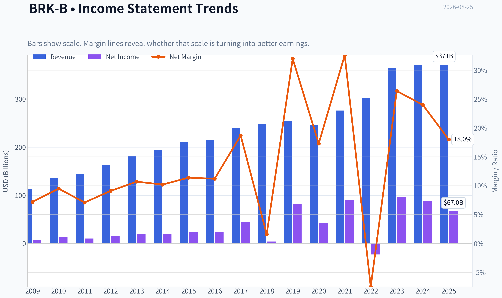
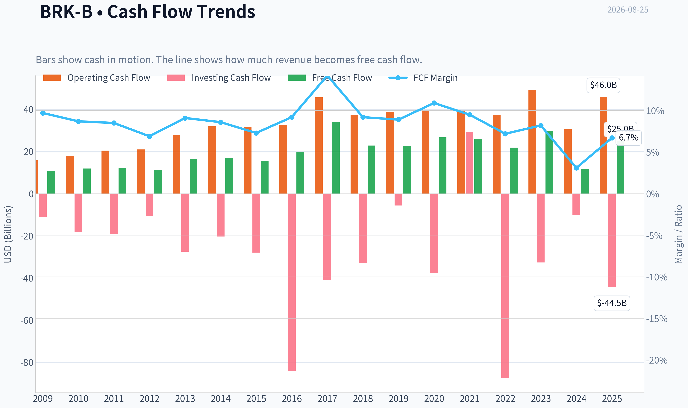
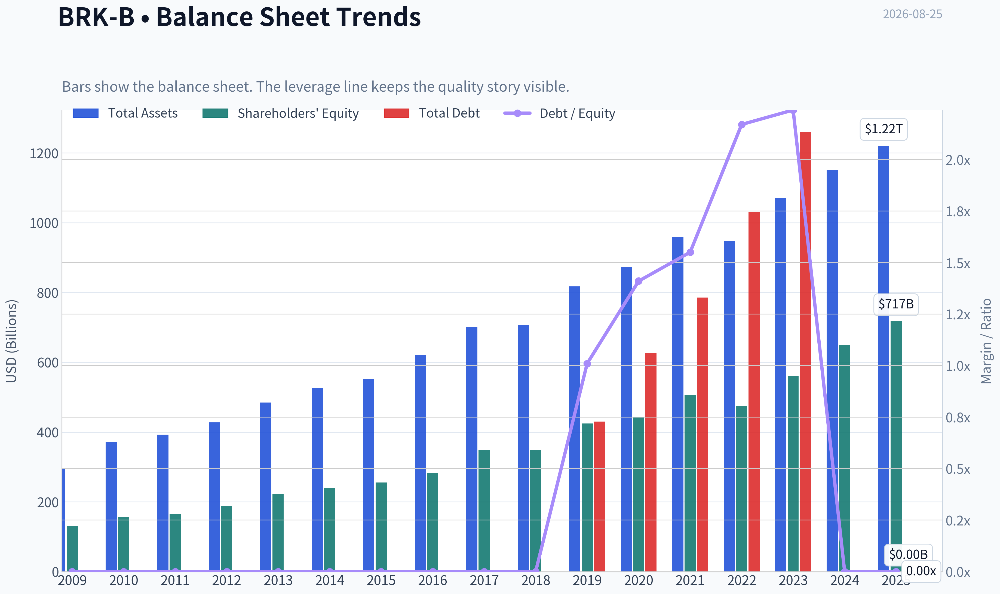
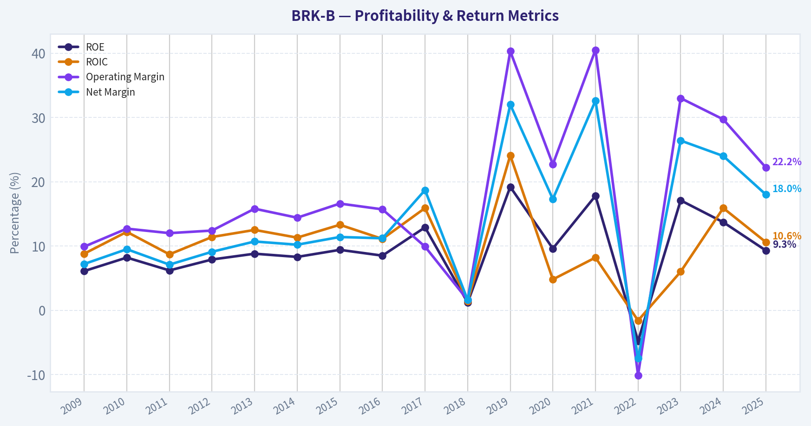
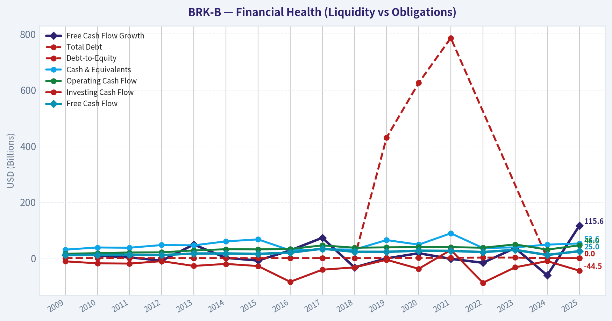
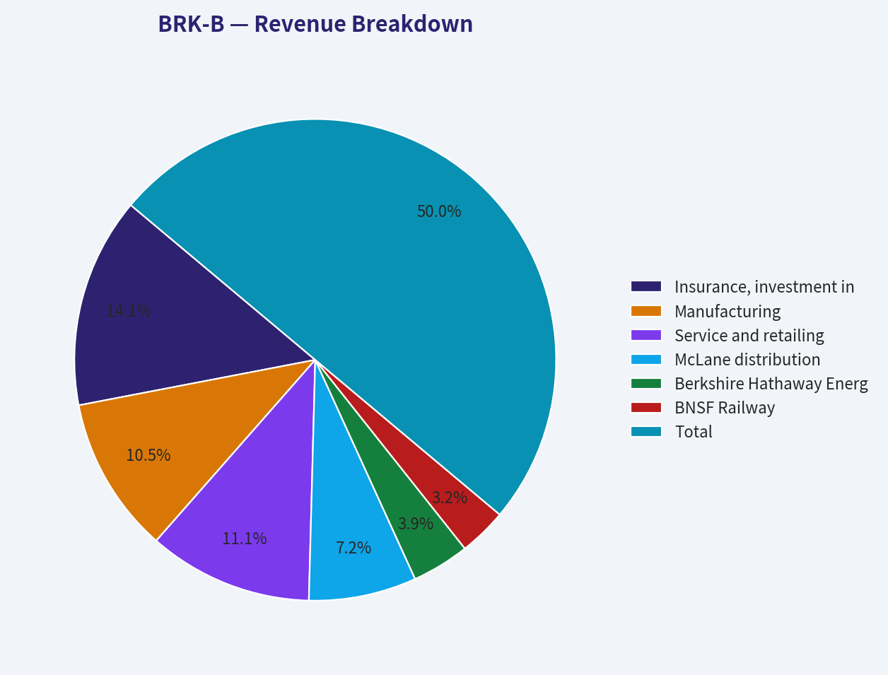
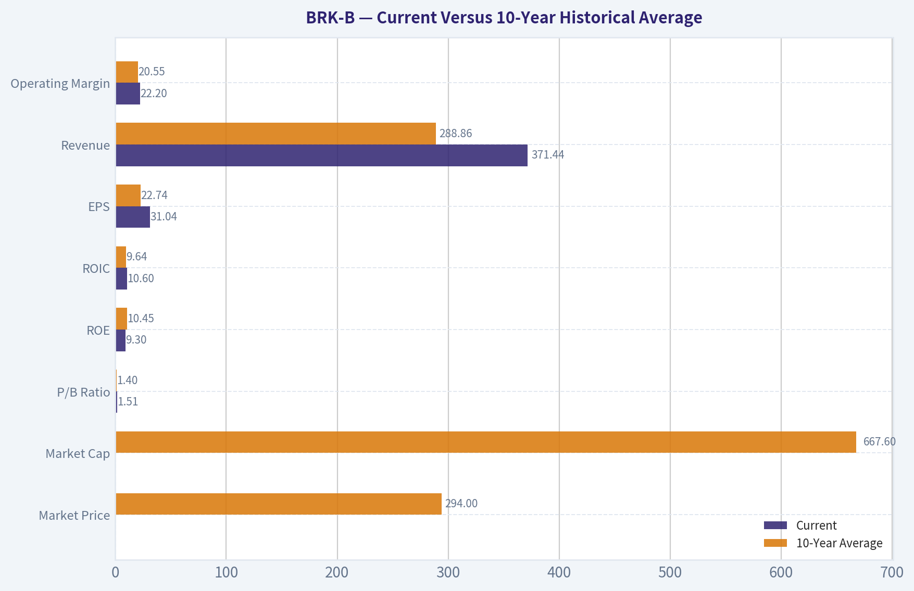
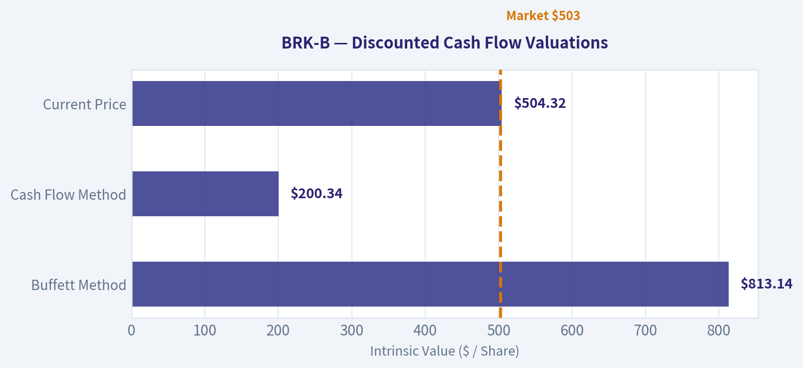
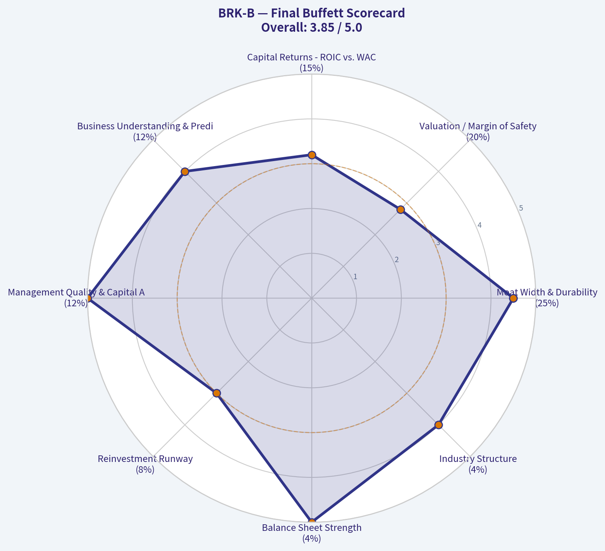
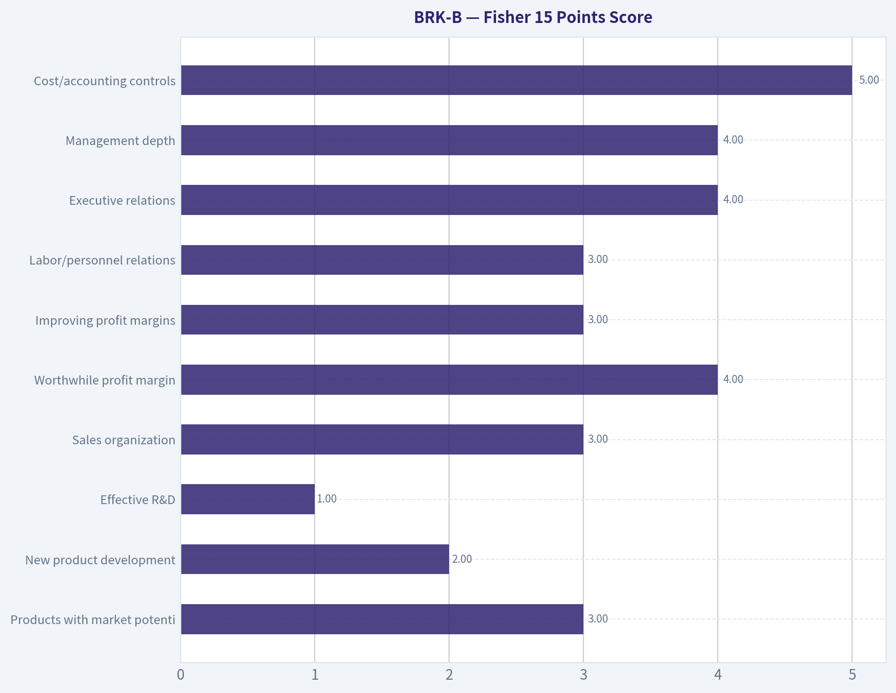

# BRK-B Deep Value Intelligence

**Analysis Date:** 2026-08-25

## Critical Disclaimer

*This analysis is generated by Deep Value Intelligence, an AI-powered multi-agent investing framework. Education & research only - not financial advice, not a financial advisor.*

---

## Table of Contents

1. Intelligence Summary
2. Analyst Team Reports
   - Fundamentals Analysis
   - Intrinsic Value Analysis (Buffett)
   - Trend & Growth Analysis (Lynch/Druckenmiller/Fisher)
   - Market Technical Analysis
   - Options Market Analysis
3. Research Team Commentary
4. Value Investing Team Commentary
5. Deep Values Commentary

---

## Intelligence Summary

### Thesis + Conditions

**Core Thesis:** **1. EXECUTIVE SUMMARY**
*   **Final Verdict:** Berkshire Hathaway at $504 lacks the margin of safety required for aggressive capital deployment.

**Key Risks:**
- Why:** While possessing undisputed quality, a fortress balance sheet, and a $160B cash floor, the stock trades at ~23x normalized owner earnings with zero top-line growth. Cash provides downside protection but not a near-term upside catalyst.
- Action:** Do not chase. Exercise patience for a pullback to the $465-$475 support zone or wait for a major capital deployment catalyst.
- Risky (The Bull):** The $160B cash pile is a "loaded weapon" earning a 5% risk-free yield, ready for a Godzilla-sized acquisition. GEICO's telematics pivot is a tech-enabled growth engine, and momentum justifies the current premium.

**Confidence:** Medium

---

## Analyst Team Reports

### Fundamentals Analysis

#### Latest Earnings Snapshot

*Most recent reported quarter anchored on 2026 Q2, with prior-year comparison when available.*

| Metric | 2026 Q2 | 2025 Q2 | YoY Change |
| --- | ---: | ---: | ---: |
| Revenue | $117.89B | $98.88B | +19.2% |
| Operating Income | N/A | N/A | N/A |
| Net Income | $25.67B | $12.37B | +107.5% |
| Diluted EPS | $11.91 | $5.73 | +107.7% |
| Operating Cash Flow | $11.21B | $10.09B | +11.2% |
| Free Cash Flow | $5.57B | $5.23B | +6.6% |

Key Takeaways: This snapshot anchors the most recent reported quarter before the narrative analysis. It helps readers separate long-run business quality from whatever changed in the latest earnings print.

#### 17-Year Financial Metrics for BRK-B

*All values below are computed deterministically from raw data - not estimated by AI.*

*Issuer profile: insurer (Financial Services / Insurance - Diversified).*

#### 17-Year Financial Metrics
*Annual rows come from reported financial statements. The final TTM row is computed from the latest four quarters.*

| Metric | 2009 | 2010 | 2011 | 2012 | 2013 | 2014 | 2015 | 2016 | 2017 | 2018 | 2019 | 2020 | 2021 | 2022 | 2023 | 2024 | 2025 |
| --- | --- | --- | --- | --- | --- | --- | --- | --- | --- | --- | --- | --- | --- | --- | --- | --- | --- |
| Market Price | $66 | $80 | $76 | $90 | $119 | $150 | $132 | $163 | $198 | $204 | $226 | $232 | $299 | $309 | $357 | $453 | $503 |
| Market Cap | $72.3M | $75.3M | N/A | N/A | N/A | N/A | $325.49B | $400.63B | $489.13B | $502.41B | $553.88B | $544.08B | $669.47B | $681.78B | $776.89B | $977.39B | $1.08T |
| P/E Ratio | 0.01 | 0.01 | 0.01 | 0.01 | 0.01 | N/A | 13.52 | 16.64 | 10.88 | 124.95 | 6.80 | 12.80 | 7.44 | -29.96 | 8.07 | 10.98 | 16.19 |
| P/B Ratio | 0.00 | 0.00 | N/A | N/A | N/A | N/A | 1.27 | 1.42 | 1.40 | 1.44 | 1.30 | 1.23 | 1.32 | 1.44 | 1.38 | 1.51 | 1.51 |
| ROE | 6.1% | 8.2% | 6.2% | 7.9% | 8.8% | 8.3% | 9.4% | 8.5% | 12.9% | 1.2% | 19.2% | 9.6% | 17.8% | -4.8% | 17.1% | 13.7% | 9.3% |
| ROIC | 8.8% | 12.2% | 8.7% | 11.4% | 12.5% | 11.3% | 13.3% | 11.1% | 15.9% | 1.4% | 24.1% | 4.8% | 8.2% | -1.6% | 6.0% | 15.9% | 10.6% |
| EPS | $7322.73 | $13794.68 | N/A | N/A | N/A | N/A | $9.77 | $9.79 | $18.21 | $1.63 | $33.29 | $18.12 | $40.17 | $-10.31 | $44.17 | $41.27 | $31.04 |
| Revenue | $112.49B | $136.19B | $143.69B | $162.46B | $182.15B | $194.70B | $210.94B | $215.11B | $239.93B | $247.84B | $254.62B | $245.58B | $276.19B | $302.02B | $364.48B | $371.43B | $371.44B |
| Gross Profit | N/A | N/A | N/A | N/A | N/A | N/A | N/A | N/A | N/A | N/A | N/A | N/A | N/A | N/A | N/A | N/A | N/A |
| Gross Margin | N/A | N/A | N/A | N/A | N/A | N/A | N/A | N/A | N/A | N/A | N/A | N/A | N/A | N/A | N/A | N/A | N/A |
| Operating Margin | 9.9% | 12.7% | 12.0% | 12.4% | 15.8% | 14.4% | 16.6% | 15.7% | 9.9% | 1.6% | 40.3% | 22.7% | 40.5% | -10.1% | 33.0% | 29.7% | 22.2% |
| Net Income | $8.05B | $12.97B | $10.25B | $14.82B | $19.48B | $19.87B | $24.08B | $24.07B | $44.94B | $4.02B | $81.42B | $42.52B | $89.94B | $-22.76B | $96.22B | $89.00B | $66.97B |
| Net Margin | 7.2% | 9.5% | 7.1% | 9.1% | 10.7% | 10.2% | 11.4% | 11.2% | 18.7% | 1.6% | 32.0% | 17.3% | 32.6% | -7.5% | 26.4% | 24.0% | 18.0% |
| Revenue Growth | N/A | 21.1% | 5.5% | 13.1% | 12.1% | 6.9% | 8.3% | 2.0% | 11.5% | 3.3% | 2.7% | -3.5% | 12.5% | 9.4% | 20.7% | 1.9% | 0.0% |
| Net Income Growth | N/A | 61.0% | -20.9% | 44.6% | 31.4% | 2.0% | 21.2% | -0.0% | 86.7% | -91.1% | 1924.8% | -47.8% | 111.5% | -125.3% | -522.8% | -7.5% | -24.8% |
| Free Cash Flow Growth | N/A | 9.2% | 3.1% | -9.0% | 48.7% | 1.3% | -8.4% | 27.8% | 72.8% | -32.8% | -0.7% | 17.8% | -2.3% | -16.3% | 36.1% | -61.0% | 115.6% |
| Total Book Value | $131.10B | $157.32B | $164.85B | $187.65B | $221.89B | $240.17B | $255.55B | $282.07B | $348.30B | $348.70B | $424.79B | $443.16B | $506.20B | $473.42B | $561.27B | $649.37B | $717.42B |
| Total Assets | $297.12B | $372.23B | $392.65B | $427.45B | $484.62B | $525.87B | $552.26B | $620.85B | $702.10B | $707.79B | $817.73B | $873.73B | $959.39B | $948.47B | $1.07T | $1.15T | $1.22T |
| Total Debt | $0 | $0 | $0 | $0 | $0 | $0 | $0 | $0 | $0 | $0 | $430.00B | $625.50B | $785.50B | $1.03T | $1.26T | $0 | $0 |
| Debt-to-Equity | 0.00 | 0.00 | 0.00 | 0.00 | 0.00 | 0.00 | 0.00 | 0.00 | 0.00 | 0.00 | 1.01 | 1.41 | 1.55 | 2.17 | 2.24 | 0.00 | 0.00 |
| Cash & Equivalents | $30.56B | $38.23B | $37.30B | $46.99B | $45.91B | $60.03B | $67.16B | $28.05B | $31.58B | $30.81B | $64.63B | $48.40B | $88.71B | $36.40B | $38.64B | $48.38B | $52.57B |
| Shareholders' Equity | $131.10B | $157.32B | $164.85B | $187.65B | $221.89B | $240.17B | $255.55B | $282.07B | $348.30B | $348.70B | $424.79B | $443.16B | $506.20B | $473.42B | $561.27B | $649.37B | $717.42B |
| Operating Cash Flow | $15.85B | $17.89B | $20.48B | $20.95B | $27.70B | $32.01B | $31.49B | $32.65B | $45.73B | $37.40B | $38.69B | $39.77B | $39.43B | $37.35B | $49.20B | $30.59B | $45.97B |
| Investing Cash Flow | $-11.16B | $-18.28B | $-19.19B | $-10.57B | $-27.54B | $-20.33B | $-28.00B | $-84.22B | $-41.01B | $-32.85B | $-5.62B | $-37.76B | $29.39B | $-87.60B | $-32.66B | $-10.29B | $-44.49B |
| Free Cash Flow | $10.91B | $11.91B | $12.29B | $11.18B | $16.62B | $16.82B | $15.41B | $19.69B | $34.02B | $22.86B | $22.71B | $26.76B | $26.15B | $21.89B | $29.79B | $11.62B | $25.04B |
| FCF Margin | 9.7% | 8.7% | 8.5% | 6.9% | 9.1% | 8.6% | 7.3% | 9.2% | 14.2% | 9.2% | 8.9% | 10.9% | 9.5% | 7.2% | 8.2% | 3.1% | 6.7% |
| Dividends / Share | $0.00 | $0.00 | N/A | N/A | N/A | N/A | $0.00 | $0.00 | $0.00 | $0.00 | $0.00 | $0.00 | $0.00 | $0.00 | $0.00 | $0.00 | $0.00 |

#### Profitability Metrics
- Return on Equity (ROE): 9.3%
- Return on Invested Capital (ROIC): 10.1%
- Return on Assets (ROA): 5.5%
- Gross Margin: Not meaningful
- Operating Margin: 22.2%
- Net Profit Margin: 18.0%

#### Liquidity Metrics
- Current Ratio: Not meaningful
- Quick Ratio: Not meaningful

#### Leverage Metrics
- Debt-to-Equity Ratio: 0.00
- Interest Coverage Ratio: 16.27
- Net Debt: $-52.57B

#### Growth Metrics (Year-over-Year)
- Revenue Growth: 0.0%
- Net Income Growth: -24.8%
- Free Cash Flow Growth: 115.6%
- Revenue CAGR (3-Year): 7.1%
- Revenue CAGR (5-Year): 8.6%

#### Valuation Metrics
- P/E Ratio (TTM): 12.67
- Forward P/E: 22.72
- Price-to-Book: 1.50
- Price-to-Sales: 2.81
- PEG Ratio: 10.06
- EV/EBITDA: -1.79
- Free Cash Flow Yield: 2.3%
- Earnings Yield: 7.9%

#### Owner Earnings (Buffett Method, Code-Computed)
- Net Income: $66.97B
- + Depreciation & Amortization: $13.48B
- - Capital Expenditures: $-20.93B
- - Working Capital Changes: $2.35B
- = **Owner Earnings: $64.61B**

#### Intrinsic Value (Code-Computed)
- Current Price: $504
- Headline Intrinsic Value: not meaningful (financial issuer - DCF/FCFF is not the right primary frame; use sector-specific book/earnings metrics)
- Buffett Method (Owner Earnings):
  Conservative: $118
  Average: $813
  Optimistic: $2,830
- Cash Flow Method (FCF):
  Conservative: $129
  Average: $200
  Optimistic: $352
- Reverse-DCF: price implies ~6.9%/yr owner-earnings growth for 10y; trailing 3y was N/A, 5y 17.0%.

#### Piotroski F-Score: 3/9
- Positive Net Income: PASS
- Positive Operating Cash Flow: PASS
- ROA Improvement: FAIL
- Cash Flow > Net Income: FAIL
- Decreasing Debt: FAIL
- Improving Current Ratio: FAIL
- No Dilution: PASS
- Improving Gross Margin: FAIL
- Improving Asset Turnover: FAIL

ANALYST STANCE: **WATCH**

#### BRK-B Warren Buffett-Style Fundamental Analysis

Berkshire Hathaway is unusual because it is both an insurance company and a diversified operating conglomerate. The deterministic dataset classifies BRK-B as an **insurer**, so valuation should not be assessed like an industrial or software company. **Price-to-book is relevant for Berkshire, but only when judged against ROE, insurance float quality, underwriting discipline, and investment returns.** Gross margin, current ratio, and quick ratio are **not meaningful** for this issuer profile.

At a current price of about **$504**, a market cap of roughly **$1.08 trillion**, a TTM P/E around **12.7x to 16.2x depending on the dataset line used**, and a P/B near **1.5x**, Berkshire appears to be a **high-quality compounder trading close to fair value**, not a deep bargain. The business quality remains exceptional, but the margin of safety is thinner than Buffett-style investors usually prefer.

---

#### Revenue Breakdown

| Revenue Source | Amount ($B) | % of Total |
|---|---:|---:|
| Insurance, investment income, and other insurance-related revenue | $105.0 | 28.3% |
| Manufacturing | $78.0 | 21.0% |
| Service and retailing | $82.1 | 22.1% |
| McLane distribution | $53.7 | 14.5% |
| Berkshire Hathaway Energy | $28.7 | 7.7% |
| BNSF Railway | $23.9 | 6.4% |
| **Total** | **$371.4** | **100.0%** |

Key Takeaways: Berkshire's revenue base is highly diversified, with no single operating segment dominating the entire company. Insurance remains strategically central because it provides float, but manufacturing, service, retailing, energy, distribution, and railroads make Berkshire more resilient than a pure insurer. The mix also explains why conventional margin metrics such as gross margin are not meaningful for this company.

---

#### Current Versus 10-Year Historical Average

*10-year average uses 2016-2025 from the deterministic dataset. Current refers to 2025 / TTM where shown.*

| Metric | Current | 10-Year Average | Current Standing and Interpretation |
|---|---:|---:|---|
| Market Price | $503-$504 | $294 | Far above the decade average, reflecting long-term compounding in book value, earnings power, and investor confidence. |
| Market Cap | $1.08T | $667.6B | Berkshire has become a trillion-dollar-scale enterprise, which reduces the likelihood of very high future percentage growth. |
| P/E Ratio | 16.19x dataset / 12.67x pack | 18.48x raw / ~11.23x normalized | Raw average is distorted by 2018 and 2022 accounting swings. On normalized earnings, today's valuation is fair to somewhat full. |
| P/B Ratio | 1.51x | 1.40x | Slightly above historical average. For an insurer, this is meaningful but must be judged against ROE; 1.5x book is reasonable only if double-digit ROE persists. |
| ROE | 9.3% | 10.45% | Below the 10-year average and below the level that would make 1.5x book obviously cheap. |
| ROIC | 10.6% | 9.64% | Slightly above the decade average, showing good capital productivity despite Berkshire's size. |
| EPS | $31.04 | $22.74 | Above average, but EPS is volatile because GAAP earnings include investment gains and losses. |
| Revenue | $371.44B | $288.86B | Well above the historical average, showing strong scale expansion. |
| Gross Profit / Gross Margin | N/A / Not meaningful | N/A | Not meaningful for Berkshire's insurer/conglomerate structure. |
| Operating Margin | 22.2% | 20.55% | Slightly above average; profitability remains strong, but operating margin is affected by mix and investment accounting. |
| Net Income | $66.97B | $51.63B | Above average, though down from recent peak years. GAAP net income remains noisy. |
| Net Margin | 18.0% | 17.43% | Slightly above average, confirming good overall profitability despite lower net income versus 2023-2024. |
| Revenue Growth | 0.0% | 6.05% | Current growth is materially below trend; revenue appears to have plateaued near-term. |
| Net Income Growth | -24.8% | 130.37% raw / negative normalized trend | Raw average is unusable due to investment mark-to-market swings. Current decline reflects earnings normalization from unusually high prior levels. |
| Free Cash Flow Growth | 115.6% | 15.7% | Strong rebound from depressed 2024 FCF, but volatile year to year. |
| Total Book Value | $717.42B | $475.47B | Book value has compounded strongly, supporting Berkshire's long-term value creation record. |
| Total Assets | $1.22T | $907.01B | Asset base has expanded significantly, reinforcing Berkshire's scale advantage but also limiting future growth rates. |
| Total Debt | $0 dataset | $413.1B | The deterministic dataset shows large fluctuations and current zero debt; use cautiously for insurance/conglomerate classification. |
| Debt-to-Equity | 0.00 | 0.84 | Current dataset leverage appears very conservative. Interest coverage of 16.27x and net cash support financial strength. |
| Cash & Equivalents | $52.57B | $46.82B | Above average; Berkshire remains highly liquid. This does not include all marketable securities and Treasury holdings. |
| Shareholders' Equity | $717.42B | $475.47B | Strong growth in equity base demonstrates retained earnings compounding. |
| Free Cash Flow | $25.04B | $24.05B | Roughly in line with the decade average, but below what market cap alone might imply. |
| FCF Margin | 6.7% | 8.71% | Below average, suggesting recent cash conversion is weaker than the long-term norm. |
| Dividends per Share | $0.00 | $0.00 | Berkshire continues to retain capital rather than pay dividends, consistent with Buffett's capital allocation philosophy. |

Key Takeaways: Berkshire's market value and book value are far above their 10-year averages, confirming long-term compounding, but current ROE is below its historical average. The stock trades slightly above its normal price-to-book range while revenue growth has slowed to zero in the latest period. The business remains financially powerful, but current valuation does not offer an obvious bargain unless investors believe owner earnings can compound near or above the market-implied rate.

---

#### Profitability Analysis

Berkshire's profitability is strong, but it must be interpreted differently from a conventional operating company. **ROE of 9.3%** is respectable for a massive insurer/conglomerate, but it is not exceptional relative to the current **1.5x P/B** multiple. A buyer paying 1.5x book for a 9.3% ROE business is effectively accepting an earnings yield on book that is good, but not obviously superior unless future ROE improves.

**ROIC of 10.6%** is slightly above the 10-year average, which is a positive sign. Berkshire's capital is spread across insurance float, marketable securities, railroads, utilities, manufacturing, distribution, and retail businesses. The durability of the company comes less from a single high-margin product and more from disciplined underwriting, tax-efficient capital retention, and decentralized operating discipline.

Net income of **$66.97B** remains above the decade average, but it declined **24.8% YoY**. This does not automatically indicate operating deterioration because Berkshire's GAAP net income is heavily affected by mark-to-market investment gains and losses. Buffett himself has repeatedly emphasized that operating earnings are more useful than headline GAAP net income for Berkshire.

---

#### Growth Analysis

Revenue has grown from **$215.11B in 2016** to **$371.44B in 2025**, but the latest YoY revenue growth rate is **0.0%**, well below the 10-year average of **6.05%**. This suggests that Berkshire's near-term organic growth has slowed after a strong 2023-2024 period.

Free cash flow growth rebounded sharply by **115.6%** in 2025 after a weak 2024, but the decade pattern is uneven. This volatility is expected because Berkshire has large insurance, energy, railroad, and investment-related cash flows. The more important Buffett-style question is whether the company can continue to redeploy retained earnings at attractive rates. The answer remains "yes," but probably at lower rates than in Berkshire's earlier decades because of its enormous size.

---

#### Balance Sheet and Financial Strength

Berkshire's balance sheet remains one of the strongest in global public markets. The deterministic dataset shows **$717.42B of shareholders' equity**, **$1.22T of total assets**, **$52.57B of cash and equivalents**, and **net debt of -$52.57B**. Interest coverage of **16.27x** further supports the view that Berkshire is financially conservative.

The dataset shows **total debt of $0** and **debt-to-equity of 0.00** for the current period, after showing large debt balances in prior years. Because Berkshire is a diversified financial/insurance issuer, balance-sheet classifications can move materially depending on what is included. The key Buffett-style conclusion is that Berkshire has ample liquidity, substantial equity capital, and extremely low existential balance-sheet risk.

---

#### Cash Flow and Dividend Policy

Berkshire generated **$25.04B of free cash flow**, slightly above its 10-year average of **$24.05B**. However, the current **FCF yield of about 2.3%** is not especially cheap relative to the market capitalization. This is one reason the stock looks fairly valued rather than deeply undervalued.

The company pays **no dividend**, which is consistent with Buffett's long-standing preference to retain capital when management can reinvest it effectively. Berkshire's implicit shareholder return model relies on retained earnings, share repurchases when attractive, operating business growth, insurance float, and investment gains rather than cash dividends.

---

#### Buffett-Style Economic Moat Assessment

| Moat Factor | Assessment |
|---|---|
| Insurance float | Extremely valuable. Berkshire's insurance float acts like low-cost or sometimes cost-free leverage when underwriting is disciplined. |
| Capital allocation | Historically exceptional. Buffett and Munger created a culture of rational capital deployment, though succession execution is now increasingly important. |
| Diversification | Very strong. Railroads, utilities, manufacturing, distribution, retail, insurance, and securities reduce dependence on any one earnings stream. |
| Brand and trust | Berkshire has a unique reputation as a permanent home for businesses, which can give it acquisition advantages. |
| Scale | Enormous financial resources create resilience, but also reduce future growth potential. |
| Regulatory and catastrophe risk | Meaningful. Insurance losses, utility regulation, and energy liabilities can create unexpected earnings pressure. |

Key Takeaways: Berkshire's moat is broad, durable, and unusual because it is based on capital allocation, float, culture, and decentralized operating discipline rather than a single product monopoly. The main offset is size: Berkshire is now so large that even excellent decisions may produce only moderate percentage growth. The moat remains intact, but future returns are likely to be lower than Berkshire's historic returns.

---

#### Buffett-Style Owner Earnings DCF Valuation

**Starting owner earnings:** $64.61B
**Estimated share count:** approximately 2.143B BRK-B equivalent shares, based on $1.08T market cap divided by $504 share price
**Discount rate:** 10%
**Terminal growth rate:** 2.5%
**Terminal value formula:** Year 10 owner earnings x 1.025 ÷ (10% - 2.5%)

| Scenario | Growth Assumption | PV of Explicit 10-Year Owner Earnings | PV of Terminal Value | Equity Value | Fair Value / Share |
|---|---|---:|---:|---:|---:|
| Conservative | 3.0% annual owner earnings growth for 10 years | $458B | $458B | $916B | **$427** |
| Average / Base Case | 6.9% for years 1-5, fading to 4.5% for years 6-10 | $537B | $592B | $1.13T | **$527** |
| Optimistic | 9.0% for years 1-5, fading to 6.0% for years 6-10 | $591B | $701B | $1.29T | **$603** |

Key Takeaways: The hand-built owner earnings DCF suggests Berkshire is worth roughly **$427 to $603 per share**, with a base-case estimate near **$527**. At a current price around **$504**, the stock appears close to fair value, offering limited margin of safety but not obvious overvaluation. Because Berkshire is an insurer/conglomerate, this DCF should be treated as a sanity check rather than a precise valuation tool.

The deterministic model-based intrinsic value pack shows a much wider Buffett-method range: **$118 conservative, $813 average, and $2,830 optimistic**, while also stating that the headline intrinsic value is **not meaningful for a financial issuer**. The most useful model signal is the **reverse DCF**, which indicates the current price implies about **6.9% annual owner-earnings growth for 10 years**. That is plausible for Berkshire, but not a low hurdle given its trillion-dollar scale.

---

#### Valuation Assessment

Berkshire is not obviously cheap on free cash flow, with a **2.3% FCF yield**. Its **P/E ratio looks reasonable**, but GAAP earnings are volatile because investment gains and losses flow through the income statement. The **P/B ratio of 1.5x** is slightly above the 10-year average of **1.4x**. For an insurer, that multiple is acceptable if Berkshire can sustain double-digit ROE, but current ROE of **9.3%** is below the decade average.

A Buffett-style buyer would likely want either:
1. A lower price closer to or below the conservative DCF value, or
2. Stronger evidence that owner earnings can compound above the implied **6.9%** rate for a long period.

At today's price, Berkshire looks more like a **high-quality hold/watchlist compounder** than a screaming bargain.

---

#### Key Investment Insights, Red Flags, and Opportunities

| Category | Key Points |
|---|---|
| Major strengths | Exceptional balance sheet, durable insurance float, diversified earnings base, rational capital allocation culture, strong liquidity. |
| Current valuation | Around fair value; P/B is above historical average and FCF yield is modest. |
| Profitability | ROIC is solid and above average, but ROE is below its 10-year average. |
| Growth | Long-term revenue growth has been good, but latest YoY revenue growth is flat. |
| Cash flow | FCF recovered sharply from 2024, but current FCF margin remains below the 10-year average. |
| Red flags | Size limits future compounding, succession risk after Buffett, insurance catastrophe exposure, utility/regulatory risk, volatile GAAP earnings. |
| Opportunities | Higher interest income on large cash/float base, opportunistic acquisitions during downturns, share repurchases if valuation improves, continued underwriting discipline. |
| Dividend policy | No dividend; capital is retained for reinvestment and buybacks. This suits long-term compounders but may not satisfy income investors. |

Key Takeaways: Berkshire's greatest opportunity is still its ability to allocate enormous capital rationally through market cycles. The biggest issue is not business quality, but expected return from the current price. Investors are paying a fair price for an exceptional company, not a distressed or deeply undervalued price.

---

#### Final Investment Stance: WATCH

BRK-B earns a **WATCH** rating. Berkshire remains one of the highest-quality businesses in the public market, with a durable moat, conservative financial structure, valuable insurance float, and a proven capital allocation culture. However, the current stock price appears close to fair value based on owner earnings, book value, and reverse-DCF assumptions.

For a Buffett-style investor, the business is attractive but the **margin of safety is not compelling enough for an ADVOCATE rating** at around **$504**. A more attractive entry point would likely be closer to the conservative-to-base DCF range, particularly if the stock traded at a lower P/B multiple while the company continued to demonstrate durable ROE and owner earnings growth.

| Final Summary Point | Assessment |
|---|---|
| Business quality | Excellent |
| Economic moat | Very strong |
| Financial strength | Excellent |
| Earnings predictability | Good, but GAAP earnings are noisy |
| Current valuation | Fair to slightly full |
| Margin of safety | Limited |
| Best suited for | Long-term quality investors seeking durable compounding |
| Less suited for | Deep-value buyers or income-focused investors |
| Final stance | **WATCH** |

Key Takeaways: Berkshire is a superior company, but valuation discipline matters. At today's price, expected returns appear reasonable rather than exceptional. The stock deserves a place on a high-quality watchlist, with a more attractive buying opportunity likely during market weakness or if owner earnings growth clearly exceeds current expectations.

#### Fundamental Visuals

This graph tracks the profitability and return metrics (ROE, ROIC, Margins) of **BRK-B** over the past decade, highlighting capital efficiency trends.

This chart illustrates the financial health of **BRK-B** over the last 10 years, mapping cash equivalents and free cash flow against total obligations (Debt).

This breakdown chart from <em>Revenue Breakdown</em> shows the proportional composition for **BRK-B** - useful for understanding what drives or risks the business.

---

### Intrinsic Value Analysis (Buffett)

> *Following Warren Buffett's value investing philosophy: Circle of Competence, Economic Moat, Management Quality, and Margin of Safety.*

#### Intrinsic Value Snapshot

Price is what you pay. Intrinsic value is what the business may be worth based on the cash it can create for owners over time. We show a range, not one magic number.

- Current Price: $504.32
- Value Range (conservative to optimistic across both DCF methods): $118.38 to $2,830.34

##### Owner Earnings (Buffett Method)
- Net Income: $66,968,000,000.00
- Depreciation & Amortization: $13,476,000,000.00
- Capital Expenditures: $-20,927,000,000.00
- Working Capital Changes: $2,355,000,000.00
- Owner Earnings: $64,613,000,000.00

##### Intrinsic Value
###### Buffett Method
Uses owner earnings. Stricter, and usually more conservative.
- Conservative: $118.38
- Average: $813.14
- Optimistic: $2,830.34
- Discount Rate: 10.0%

###### Cash Flow Method
Uses free cash flow. Better for companies spending heavily today to grow tomorrow.
- Conservative: $128.58
- Average: $200.34
- Optimistic: $351.55
- Discount Rate: 10.0%

ANALYST STANCE: **WATCH**

#### Berkshire Hathaway Class B - Buffett-Style Investment Report

**Ticker:** BRK-B
**Current price:** $504
**Market capitalization:** ~$1.08 trillion
**Headline P/E:** ~12.7x
**Core view:** Berkshire remains one of the highest-quality, most conservatively financed businesses in the public market, but at today's price the margin of safety is modest rather than compelling.

---

#### 1. Factor Scorecard

| Factor | Score | Evidence |
|---|---:|---|
| Circle of Competence & Business Simplicity | 4.0 / 5 | Berkshire is understandable at the holding-company level: insurance float, owned operating businesses, public equities, and cash. Complexity comes from its conglomerate structure and insurance accounting, but the economic engine is clear. |
| Moat Test | 4.5 / 5 | GEICO, Berkshire Reinsurance, BNSF, Berkshire Hathaway Energy, and numerous niche operating businesses possess scale, brand, regulatory, or cost advantages. Insurance float is a major structural advantage. |
| Management Quality & Capital Allocation | 5.0 / 5 | Warren Buffett and Charlie Munger built one of the best capital-allocation records in corporate history. The culture is decentralized, owner-oriented, tax-efficient, and highly disciplined. Succession is credible under Greg Abel, but Buffett's eventual absence is a real consideration. |
| Industry Structure | 4.0 / 5 | Berkshire owns businesses in favorable or rational industries: insurance, railroad, regulated energy, industrial distribution, and consumer/franchise businesses. Some subsidiaries face cyclicality, but the portfolio structure reduces single-industry risk. |
| Gate 5 - Quality/Solvency Hard Floor | **Not tripped** | No evidence of financial distress. Berkshire has enormous liquidity, massive investment assets, conservative leverage, and no dependence on external financing. |

**Key Takeaways:** Berkshire scores very highly on moat, management, and balance-sheet resilience. The main deductions are not from business quality, but from size, succession, conglomerate complexity, and the fact that today's valuation leaves only a moderate margin of safety.

---

#### 2. Moat Analysis

| Moat Source | Assessment | Evidence |
|---|---|---|
| Intangible Assets | Strong | GEICO's brand, Berkshire's reputation, and the trust embedded in its insurance and acquisition culture are difficult to replicate. Sellers often choose Berkshire because of permanence, autonomy, and certainty of close. |
| Switching Costs | Moderate to Strong | Reinsurance relationships, regulated utility relationships, railroad networks, and certain industrial subsidiaries create customer stickiness. |
| Cost Advantages | Strong | BNSF benefits from irreplaceable rail infrastructure. Berkshire's insurance operations benefit from scale, underwriting discipline, and low-cost float. |
| Network Effects | Limited | Berkshire is not primarily a network-effect business, though its reputation creates a self-reinforcing acquisition and capital-allocation ecosystem. |
| Moat Rating | Wide & Stable | Berkshire's moat is diversified across several businesses rather than dependent on one product or technology cycle. |

**Key Takeaways:** Berkshire's moat is unusual because it is both business-level and holding-company-level. The insurance float, acquisition reputation, decentralized culture, and balance-sheet strength together create a durable advantage that few companies can copy.

---

#### 3. Management Quality Assessment

| Area | Assessment |
|---|---|
| Owner Mindset | Exceptional. Berkshire has historically treated shareholders as partners and focused on per-share intrinsic value rather than Wall Street optics. |
| Candor | Exceptional. Buffett's annual letters are among the clearest and most candid shareholder communications in corporate history. |
| Capital Allocation | Exceptional. Berkshire has compounded capital through acquisitions, public equities, buybacks, and opportunistic liquidity deployment. |
| Succession | Strong but important. Greg Abel is the designated successor and has deep operating experience, especially through Berkshire Hathaway Energy. The culture appears durable, but Buffett's eventual absence reduces the "capital allocation genius" premium somewhat. |
| Buybacks | Rational. Berkshire has repurchased stock when management believed shares were below intrinsic value, but has avoided aggressive buybacks at elevated prices. |

**Key Takeaways:** Management remains Berkshire's defining strength. The key question is not whether the culture is good - it is outstanding - but whether future capital allocation can remain exceptional at a trillion-dollar scale without Buffett personally making every major decision.

---

#### 4. Financial Summary

| Year | Revenue | Net Earnings | Operating Earnings | Approx. Shareholders' Equity | Comment |
|---:|---:|---:|---:|---:|---|
| 2015 | ~$211B | ~$24B | ~$17B | ~$256B | Solid operating base with growing insurance and non-insurance earnings. |
| 2016 | ~$224B | ~$24B | ~$17B | ~$283B | Continued compounding and conservative balance-sheet growth. |
| 2017 | ~$242B | ~$45B | ~$14B | ~$348B | Net earnings boosted by tax reform effects. |
| 2018 | ~$248B | ~$4B | ~$25B | ~$349B | GAAP earnings distorted by investment-market volatility. |
| 2019 | ~$255B | ~$81B | ~$24B | ~$425B | Strong equity-market gains lifted reported net income. |
| 2020 | ~$246B | ~$43B | ~$22B | ~$443B | Pandemic pressure, but the balance sheet remained exceptionally strong. |
| 2021 | ~$276B | ~$90B | ~$27B | ~$515B | Strong recovery across operating businesses and investments. |
| 2022 | ~$302B | ~-$23B | ~$31B | ~$472B | GAAP loss caused by investment marks; operating earnings improved. |
| 2023 | ~$364B | ~$96B | ~$37B | ~$561B | Higher investment income and stronger underwriting helped results. |
| 2024 | ~$371B | ~$89B | ~$47B | ~$650B | Operating earnings reached a record level, supported by insurance and investment income. |

**Key Takeaways:** Berkshire's reported net income is highly volatile because accounting rules force unrealized investment gains and losses through earnings. Operating earnings are the better measure of business progress, and they have grown meaningfully over the last decade. Shareholders' equity has also compounded substantially, reinforcing Berkshire's fortress balance sheet.

---

#### 5. Owner Earnings Calculation

For Berkshire, GAAP net income is not the best anchor because unrealized equity gains and losses can swamp operating reality. A more useful Buffett-style proxy is normalized operating earnings, adjusted for the fact that maintenance capital expenditures in rail, energy, and industrial businesses are substantial but largely reflected in the economic earning power of those subsidiaries.

| Item | Estimate |
|---|---:|
| 2024 operating earnings | ~$47B |
| Add back D&A | Significant, but mostly offset by maintenance capex needs |
| Less maintenance capex | Significant, especially BNSF and energy |
| Working-capital adjustment | Not central to Berkshire's long-term earning power |
| Normalized owner earnings estimate | **~$45B-$50B** |

**Key Takeaways:** Berkshire's normalized owner earnings are best viewed around the mid-to-high $40 billion range. This excludes the noise of unrealized investment gains and focuses on the cash-generating capacity of the insurance, railroad, energy, manufacturing, service, and retail operations.

---

#### 6. Three-Scenario DCF Valuation

Assumptions:
- Normalized owner earnings: **$47B**
- Discount rate: **10%**
- Approximate B-share equivalent count: **~2.14B shares**
- Current price: **$504**

| Scenario | Assumption | Equity Value Estimate | Value per B Share |
|---|---|---:|---:|
| A - No Growth | Owner earnings capitalized at 10% | ~$470B | ~$220 |
| B - GDP Growth | 3% perpetual growth | ~$690B | ~$320 |
| C - Historical Growth Haircut | 7.5% growth for 10 years, then 3% terminal growth | ~$970B | ~$455 |

**Key Takeaways:** A simple operating-earnings DCF suggests Berkshire is not obviously cheap at $504. However, this DCF understates Berkshire's full economic value because the company also holds enormous cash, Treasury bills, and public equities that give it optionality and balance-sheet strength beyond current operating earnings.

---

#### 7. Sum-of-Parts Valuation Cross-Check

| Component | Conservative Valuation Method | Estimated Value |
|---|---|---:|
| Operating businesses excluding investment income | ~$33B-$35B after-tax earnings at 12x-14x | ~$400B-$490B |
| Insurance investment income stream | Capitalized normalized earnings | ~$120B-$160B |
| Public equities, cash, and Treasury bills | Marked near market value, adjusted conservatively | ~$450B-$550B |
| Total intrinsic value range | Sum-of-parts | **~$970B-$1.20T** |
| Implied value per B share | Based on ~2.14B B-share equivalents | **~$450-$560** |

**Key Takeaways:** The sum-of-parts method is more appropriate for Berkshire than a plain DCF because the company is partly an operating conglomerate and partly an investment vehicle. On this basis, today's price around $504 appears roughly fair, perhaps slightly below or slightly above intrinsic value depending on assumptions.

---

#### 8. Margin of Safety Analysis

| Metric | Current Reading | Interpretation |
|---|---:|---|
| Current price | $504 | Market is valuing Berkshire near fair value. |
| Market cap | ~$1.08T | Large size reduces future reinvestment opportunity. |
| Headline P/E | ~12.7x | Misleadingly low because GAAP earnings include investment gains. |
| Operating earnings yield | ~4.3%-4.6% | Fair, but not a bargain. |
| Free cash flow yield | ~2.3% | Low on a consolidated basis, partly distorted by capital-heavy subsidiaries. |
| Estimated intrinsic value range | ~$450-$560 per B share | Current price sits near the middle-to-upper part of the range. |
| Margin of safety | Roughly 0%-10% | Below the 10%-15% preferred threshold for a wide-moat compounder. |

**Key Takeaways:** Berkshire is a wonderful business, but the stock is not clearly mispriced. The valuation is acceptable for long-term holders, yet the current margin of safety is too thin to make this a forceful new-money opportunity.

---

#### 9. Final Buffett Scorecard

| Criterion | Weight | Score | Weighted Contribution |
|---|---:|---:|---:|
| Moat Width & Durability | 25% | 4.5 | 1.13 |
| Valuation / Margin of Safety | 20% | 2.8 | 0.56 |
| Capital Returns - ROIC vs. WACC | 15% | 3.2 | 0.48 |
| Business Understanding & Predictability | 12% | 4.0 | 0.48 |
| Management Quality & Capital Allocation | 12% | 5.0 | 0.60 |
| Reinvestment Runway | 8% | 3.0 | 0.24 |
| Balance Sheet Strength | 4% | 5.0 | 0.20 |
| Industry Structure | 4% | 4.0 | 0.16 |
| **Total Score** | **100%** |  | **3.85 / 5** |

**Key Takeaways:** Berkshire's quality score is excellent, driven by its moat, management, and balance sheet. The stock falls short of an outright advocate rating mainly because the current price already reflects much of that quality.

---

#### 10. Investment Stance

| Stance | Conviction | Rationale |
|---|---|---|
| **WATCH** | Medium-High | Berkshire is a high-quality, fortress-like compounder, but at $504 the margin of safety is modest. Existing shareholders can reasonably hold, but new buyers should prefer a better entry point. |

**Final View:** Berkshire Hathaway remains one of the finest business collections in the world, with unmatched liquidity, disciplined culture, and durable insurance-led economics. At the current valuation, however, the stock looks closer to fair value than a bargain. I would become more constructive if the price moved meaningfully below estimated intrinsic value, particularly into a range that offered at least a mid-teens margin of safety.
#### Valuation Bridge

This bridge places the current market price beside each intrinsic value lens so readers can see whether upside depends on one method or shows up across several methods.

| Scenario | Intrinsic Value / Share |
| --- | ---: |
| Buffett Method | $813.14 |
| Cash Flow Method | $200.34 |
| Current Price | $504.32 |

#### Key Takeaways

If one method is far above the others, the upside case depends on a specific modelling assumption. When several methods cluster together, the valuation story is more robust.

#### Valuation Visuals

This comparison chart from *Latest Earnings Snapshot* stacks current figures against historical benchmarks for **BRK-B**, making it easy to see where the company trades relative to its own averages.

This comparison chart from *Current Versus 10-Year Historical Average* stacks current figures against historical benchmarks for **BRK-B**, making it easy to see where the company trades relative to its own averages.

The following chart maps the **BRK-B** Owner Earnings DCF valuation scenarios (Conservative, Average, Optimistic) to visually represent the margin of safety based on intrinsic value calculations.

---

### Trend & Growth Analysis (Lynch/Druckenmiller/Fisher)

> *Following Peter Lynch's GARP, Stanley Druckenmiller's macro-aware approach, and Philip Fisher's scuttlebutt methodology.*

ANALYST STANCE: **WATCH**

#### BRK-B Growth Investment Report - Berkshire Hathaway Class B

Berkshire Hathaway is a world-class compounding machine, but under a Lynch/Druckenmiller/Fisher **growth investing** framework, it is not a classic fast grower. It is better classified as a **stalwart / asset-compounder** with strong downside resilience, excellent capital allocation heritage, and a fortress balance sheet - but limited ten-bagger potential from today's $1.08 trillion market cap.

---

#### 1. Lynch Classification

| Category | BRK-B Assessment |
|---|---|
| Lynch Category | **Stalwart / Asset Play hybrid** |
| Revenue Growth Profile | ~0% YoY from provided data |
| Growth Investor Fit | Low to moderate |
| Ten-Bagger Potential | Low from current scale |
| Best Use Case | Core defensive compounder, not aggressive growth vehicle |
| Initiation View | **WATCH**, not a fresh growth-stock advocate |

**Key Takeaways:** Berkshire is not a fast grower under Lynch's framework. Its size, diversified structure, and low current revenue growth make it more appropriate as a durable compounding holding than a high-upside growth stock. For a growth portfolio, it belongs on the watch list rather than in the highest-conviction bucket.

---

#### 2. The Story in 3 Bullets

- Berkshire is a diversified holding company built around insurance float, wholly owned operating businesses, public equities, and large cash-generating industrial and consumer assets.
- The core engine is disciplined capital allocation: collect insurance float, invest it conservatively, and redeploy excess cash into businesses, equities, or buybacks.
- The growth case depends less on explosive revenue expansion and more on compounding book value, earnings power, investment income, and opportunistic capital deployment during market dislocations.

---

#### 3. TAM Analysis and 10x Test

| Item | Assessment |
|---|---:|
| Current Market Cap | ~$1.08 trillion |
| Current Price | ~$504 |
| Current Revenue Growth | ~0% YoY |
| 10x Market Cap Target | ~$10.8 trillion |
| Practical TAM Constraint | Very high |
| Can BRK-B 10x and remain reasonably small relative to opportunity? | **No** |
| Runway Rating | Moderate for compounding, low for ten-bagger growth |

**Key Takeaways:** Berkshire is already one of the largest companies in the world, so the 10x test is difficult to pass. A move from roughly $1 trillion to more than $10 trillion would require enormous long-term earnings growth, multiple expansion, or both. That is possible only over a very long horizon and is not the typical setup for growth-investor ten-bagger hunting.

---

#### 4. Revenue Growth Trend

| Metric | Provided Data |
|---|---:|
| Revenue Growth YoY | 0.0% |
| Pattern | Flat |
| Growth Classification | Slow grower / stalwart |
| Inflection Signal | Not evident |
| Growth Quality View | Durable but not accelerating |

**Key Takeaways:** The current revenue growth signal does not show an inflection. Berkshire's value creation is more tied to operating earnings, insurance underwriting, investment income, and capital allocation than to high revenue growth. This makes it less attractive for investors specifically seeking accelerating growth.

---

#### 5. Unit Economics

| Metric | BRK-B Applicability | Assessment |
|---|---|---|
| LTV/CAC | Not applicable | Berkshire is not a SaaS or subscription business |
| Net Revenue Retention | Not applicable | No recurring software revenue model |
| Rule of 40 | Not applicable | Not a SaaS/subscription company |
| FCF Yield | ~2.3% |
| ROE | ~9.3% |

**Key Takeaways:** Traditional growth-unit-economics metrics do not apply well to Berkshire. The more relevant metrics are underwriting profitability, investment income, float growth, return on equity, book value growth, and cash deployment efficiency. The current ROE of about 9.3% is solid but not exceptional for a growth-stock mandate.

---

#### 6. Inflection Point Assessment

| Inflection Type | Evidence | Rating |
|---|---|---|
| Product Cycle Inflection | Not applicable | Low |
| Market Share Inflection | No clear evidence | Low |
| Margin Inflection | Possible if underwriting and investment income improve | Moderate |
| TAM Inflection | Not meaningful; Berkshire spans many sectors | Low |
| Competitive Inflection | Could benefit in market stress due to cash and balance sheet | Moderate |
| Capital Allocation Inflection | Potential if major acquisition or aggressive buybacks occur | Moderate |

**Key Takeaways:** Berkshire does not currently show a classic growth-stock inflection point. The most plausible upside catalyst would be capital deployment during a market downturn, a major acquisition, improved insurance results, or higher investment income. These are valuable, but they are not the same as accelerating product-market adoption.

---

#### 7. Macro Setup Evaluation

| Macro Factor | Impact on BRK-B |
|---|---|
| Interest Rates | Mixed to positive; higher rates can boost investment income on cash and float |
| Economic Cycle | Cyclical exposure through rail, energy, manufacturing, housing, retail, and insurance |
| Inflation | Mixed; pricing power helps some subsidiaries, cost pressure hurts others |
| Recession Risk | Berkshire is relatively resilient and can become opportunistic buyer |
| Secular Themes | Limited direct exposure to AI/cloud growth; more exposed to insurance, energy, infrastructure, consumer, industrials, and public equities |

**Key Takeaways:** Berkshire's macro setup is defensive and opportunistic rather than explosive. It can benefit from higher interest income and market dislocations, but it is also tied to broad economic activity. For Druckenmiller-style growth investing, the macro backdrop is not a strong tailwind, but Berkshire's fortress balance sheet gives it downside optionality.

---

#### 8. Fisher 15 Points Score

| Fisher Criterion | Score / 5 | Comment |
|---|---:|---|
| Products with market potential | 3 | Broad but mature operating base |
| New product development | 2 | Not innovation-led |
| Effective R&D | 1 | Not central to business model |
| Sales organization | 3 | Varies by subsidiary |
| Worthwhile profit margin | 4 | Strong across many units, but mixed conglomerate structure |
| Improving profit margins | 3 | Dependent on insurance, energy, rail, and macro |
| Labor/personnel relations | 3 | Mixed due to diverse operations |
| Executive relations | 4 | Strong culture historically |
| Management depth | 4 | Strong subsidiary autonomy, succession still a watch item |
| Cost/accounting controls | 5 | Excellent discipline |
| Unique advantages | 5 | Float, reputation, balance sheet, deal access |
| Long-range profit outlook | 4 | Durable compounding likely |
| Dilution risk | 5 | Low; buybacks more likely than dilution |
| Candor | 5 | Historically excellent shareholder communication |
| Integrity | 5 | Exceptional historical reputation |
| **Total** | **56 / 75** | **Good, but not elite growth profile** |

**Key Takeaways:** Berkshire scores well on integrity, capital allocation, accounting discipline, and durable competitive advantages. It scores lower on innovation, R&D intensity, and fast-growth characteristics. Fisher would likely respect the business quality but may not classify it as a dynamic growth company today.

---

#### 9. Valuation Analysis

| Valuation Metric | Current Data | Interpretation |
|---|---:|---|
| Price | ~$504 |
| Market Cap | ~$1.08 trillion |
| P/E | ~12.7x |
| Revenue Growth | ~0.0% |
| PEG Ratio | Not meaningful | Growth rate too low/flat |
| FCF Yield | ~2.3% |
| ROE | ~9.3% |
| Valuation View | Reasonable to modestly attractive for quality, not compelling for growth |

**Key Takeaways:** Berkshire does not look expensive on a P/E basis, especially given its quality and balance sheet. However, the PEG framework is unattractive because reported growth is currently flat. The stock may be reasonably valued for a compounder, but it does not screen as a high-growth bargain.

#### 3-Year Scenario Framework

Approximate EPS implied by price and P/E: **$504 / 12.7 ~ $39.8**

| Scenario | EPS Growth Assumption | Year-3 EPS Estimate | Exit P/E | Implied Price | Approx. 3-Year Return |
|---|---:|---:|---:|---:|---:|
| Bear | 0% CAGR | ~$39.8 | 10x | ~$398 | -21% |
| Base | 5% CAGR | ~$46.1 | 13x | ~$599 | +19% |
| Bull | 8% CAGR | ~$50.1 | 15x | ~$751 | +49% |

**Key Takeaways:** The base case suggests respectable but not explosive upside. The bull case can produce solid returns if earnings grow faster and the market awards Berkshire a higher multiple, but this still does not resemble a classic ten-bagger setup. The downside is also relatively contained compared with more speculative growth stocks.

---

#### 10. Growth Investor Scorecard

| Criterion | Weight | Score / 5 | Weighted Score |
|---|---:|---:|---:|
| The Story | 10% | 4.0 | 0.40 |
| TAM & Runway | 20% | 2.0 | 0.40 |
| Revenue Growth | 20% | 1.5 | 0.30 |
| Unit Economics | 15% | 3.0 | 0.45 |
| Competitive Position | 10% | 4.5 | 0.45 |
| Management Quality | 10% | 4.0 | 0.40 |
| Macro Setup | 5% | 3.0 | 0.15 |
| Profitability Path | 5% | 4.0 | 0.20 |
| Valuation | 5% | 3.5 | 0.18 |
| **Total** | **100%** |  | **2.93 / 5.00** |

**Key Takeaways:** Berkshire scores very well on durability, competitive position, management culture, and balance sheet quality. It scores poorly on revenue growth, TAM-based upside, and inflection potential. The resulting score of about 2.9 places it in the **WATCH** range for a growth-focused investor.

---

#### 11. Position Size Stance

| Investor Type | Stance | Position Size View |
|---|---|---|
| Aggressive Growth Investor | WATCH / AVOID for new capital | 0-2% |
| GARP Investor | WATCH | 2-5% |
| Defensive Compounder Portfolio | HOLD / Accumulate on weakness | 5-10% |
| Concentrated Ten-Bagger Portfolio | Not ideal | Minimal |

**Key Takeaways:** Berkshire can be a strong portfolio stabilizer, but it is not an ideal primary growth position. For investors seeking 20%+ revenue growth and accelerating adoption curves, capital is likely better deployed elsewhere. For long-term compounder investors, Berkshire remains a high-quality watchlist name, especially on valuation pullbacks.

---

#### 12. Key Risks and Catalysts

| Category | Key Items |
|---|---|
| Catalysts | Major acquisition, market downturn creating deployment opportunities, buybacks, stronger insurance underwriting, higher investment income |
| Risks | Succession concerns, limited growth due to size, cyclical exposure, insurance catastrophe losses, underperformance of public equity portfolio |
| Red Flags | Flat revenue growth, low ten-bagger probability, no clear near-term inflection |
| Offsetting Strengths | Fortress balance sheet, durable float, decentralized culture, conservative leverage, exceptional long-term capital allocation history |

**Key Takeaways:** Berkshire's biggest upside catalyst is not a product launch or market-share breakout - it is capital allocation. The company becomes more interesting when markets are stressed and Berkshire can deploy cash at attractive returns. The main growth-investor problem is simply that the company is already enormous and not growing fast.

---

#### Final View

Berkshire Hathaway is a **great company but not a great growth-stock setup** under the Lynch/Druckenmiller/Fisher framework. It offers durability, discipline, and optionality, but lacks the accelerating revenue growth, TAM expansion, and operating leverage profile normally required for an **ADVOCATE** rating.

**Final stance: WATCH.**
Buy aggressively only if valuation becomes unusually attractive or if a clear capital-deployment inflection emerges.

#### Growth & Scorecard Visuals

The radar chart below from *Final Buffett Scorecard* visualises how **BRK-B** ranks across weighted investment criteria. Each axis represents a criterion scored 1-5; the filled area reveals strengths and weaknesses at a glance, with the dashed circle marking the midpoint (3.0).

This comparison chart from *Fisher 15 Points Score* stacks current figures against historical benchmarks for **BRK-B**, making it easy to see where the company trades relative to its own averages.

---

### Market Technical Analysis

ANALYST STANCE: **WATCH**

#### BRK-B Technical Report - As of 2026-08-25

BRK-B is in a **constructive but fragile recovery setup**. The stock has rebounded from the late-August pullback and is trading slightly above its short- and medium-term trend measures, but momentum has not fully repaired. The most important nuance is that price is back above the 10 EMA and 50 SMA, while MACD remains below its signal line and VWMA is still above price, suggesting the rebound needs stronger confirmation before becoming a clean bullish continuation signal.

Selected indicators: **close_10_ema, close_50_sma, close_200_sma, macd, macds, rsi, atr, vwma**.
These give a balanced view across short-term trend, medium-term trend, long-term trend, momentum, relative strength, volatility, and volume-weighted confirmation without excessive redundancy.

---

#### Trend Structure

The latest available close was **$504.32 on 2026-08-24**. The 10 EMA was approximately **$503.63**, the 50 SMA was **$501.07**, and the 200 SMA was **$492.28** as of 2026-08-25.

This means BRK-B is trading:

- **Slightly above the 10 EMA**, showing the short-term rebound has regained some traction.
- **Above the 50 SMA**, suggesting the medium-term trend has not broken down.
- **Comfortably above the 200 SMA**, keeping the long-term technical backdrop constructive.

However, the margin above the 10 EMA and 50 SMA is not large. A close back below the **$501-$504** area would weaken the immediate recovery attempt and could shift the stock back into consolidation.

The 50 SMA has been rising steadily from roughly **$487 in mid-July** to about **$501 now**, which shows improving medium-term trend structure. The 200 SMA has also turned gradually higher from about **$490.3 in mid-July** to **$492.3**, a slower but supportive long-term sign.

#### Momentum and RSI

Momentum has cooled meaningfully after the strong late-July to early-August rally. MACD peaked above **8** around August 10, then deteriorated sharply and turned slightly negative, with the latest MACD around **-0.14** versus a MACD signal line near **1.70**.

That configuration is still a **bearish momentum crossover condition**. Even though price has bounced, MACD has not yet confirmed a renewed upside phase. A more bullish technical shift would require MACD to flatten, turn higher, and eventually cross back above the signal line.

RSI has normalized to around **50.1**, after being overbought above **70** in early August. This is important because the stock is no longer stretched, but it also means buyers have not yet regained dominant momentum. RSI near 50 usually reflects balance between buyers and sellers, not a strong directional edge.

#### Volume-Weighted Confirmation

The VWMA is near **$510.02**, which is above the latest close of **$504.32**. This suggests recent higher-volume trading has occurred at prices above the current market, making the **$510 area** an important confirmation zone.

Until BRK-B can reclaim and hold above VWMA, the rebound may remain vulnerable to selling pressure from traders who bought during the recent upswing. A move above **$510-$512** would improve the volume-weighted picture and could open the door for a retest of the **$516-$529** area.

#### Volatility and Risk Levels

ATR is approximately **$7.29**, down from the August spike above **$8.5**, but still elevated compared with late July levels near **$6.4-$7.1**. This means daily price swings remain meaningful.

For traders, ATR suggests that stops placed too tightly around nearby moving averages may be vulnerable to normal noise. A one-ATR move from the recent close implies a rough trading band of about **$497 to $512**. That aligns well with the current technical map: support sits near **$501-$504**, while resistance is near **$510-$512**.

#### Tactical Interpretation

BRK-B is not in a clean bearish breakdown because it remains above its 50 SMA and 200 SMA. But it is also not in a fully confirmed bullish continuation because MACD remains below its signal line and price remains below VWMA.

The setup favors a **watch-and-confirm approach**:

- A sustained move above **$510-$512** would improve the bullish case.
- A move above **$516-$518** would suggest momentum is recovering more decisively.
- A failure below **$501**, especially followed by a break of **$496-$492**, would weaken the current recovery and increase downside risk toward the 200 SMA zone.

| Category | Indicator | Latest Reading / Zone | Interpretation | Trading Relevance |
|---|---:|---:|---|---|
| Short-Term Trend | close_10_ema | ~$503.63 | Price is slightly above the short-term average | Mild short-term recovery signal, but still fragile |
| Medium-Term Trend | close_50_sma | ~$501.07 | Rising and below current price | Medium-term trend remains constructive if price holds above it |
| Long-Term Trend | close_200_sma | ~$492.28 | Price remains comfortably above it | Long-term trend support remains intact |
| Momentum | macd | ~-0.14 | Momentum has deteriorated from early-August highs | Not yet confirming a bullish continuation |
| Momentum Signal | macds | ~1.70 | MACD remains below signal line | Bearish crossover condition still active |
| Relative Strength | rsi | ~50.1 | Neutral after prior overbought readings | No longer stretched, but buyers lack strong control |
| Volatility | atr | ~$7.29 | Volatility remains moderate-to-elevated | Use wider risk bands; avoid overly tight stops |
| Volume-Weighted Trend | vwma | ~$510.02 | Price remains below VWMA | $510-$512 is a key confirmation/resistance zone |

Key Takeaways: BRK-B's broader trend remains constructive because price is above the 50-day and 200-day averages. However, momentum has not fully recovered, with MACD still below its signal line and price still below VWMA. The most important upside confirmation zone is around **$510-$512**, while the key near-term support area is around **$501-$504**.

---

### Options Market Analysis

> *Reading options flow - put/call ratios, IV skew, and unusual activity - to gauge institutional positioning and event-driven risk.*

ANALYST STANCE: **WATCH**

#### BRK-B Options Market Sentiment Report
*Options data as of 2026-08-25*

#### 1. Put/Call Ratio Analysis

| Expiration | Call OI | Put OI | Put/Call OI Ratio | Call Volume | Put Volume | Put/Call Volume Ratio | Read |
|---|---:|---:|---:|---:|---:|---:|---|
| 2026-08-28 | 18,504 | 14,178 | 0.77 | 2,845 | 2,003 | 0.70 | Near neutral, mild put protection |
| 2026-09-04 | 6,365 | 4,877 | 0.77 | 1,261 | 1,598 | 1.27 | Short-term put volume pickup |
| 2026-09-11 | 1,510 | 2,665 | 1.76 | 223 | 837 | 3.75 | Clearly defensive / bearish |
| **Near-Term Total** | **26,379** | **21,720** | **0.82** | **4,329** | **4,438** | **1.03** | Mildly bearish vs. neutral |

**Key Takeaways:** BRK-B's near-term put/call open interest ratio is **0.82**, above the historical neutral baseline of roughly **0.70**, suggesting modestly elevated put positioning. The volume ratio is **1.03**, meaning put volume slightly exceeds call volume across the near-term expirations. The most bearish activity is concentrated in the **2026-09-11** expiry, where both OI and volume ratios lean heavily toward puts.

The options tape is not showing panic-level downside demand, but it is meaningfully less bullish than a neutral baseline would suggest. The front-week expiry is relatively balanced, while the two-week-out chain shows a defensive tilt.

---

#### 2. Implied Volatility Assessment

| Expiration | ATM Call IV | ATM Put IV | Put IV Premium / Discount | IV Read |
|---|---:|---:|---:|---|
| 2026-08-28 | 22.3% | 25.4% | Puts +3.1 pts | Downside protection bid in front week |
| 2026-09-04 | 17.9% | 16.9% | Calls +1.0 pt | Slight call-side premium, not significant |
| 2026-09-11 | 16.2% | 15.1% | Calls +1.1 pts | Mild call-side premium, muted overall |
| **Near-Term Read** | - | - | Mixed, front-week put premium | Not extreme |

**Key Takeaways:** The clearest skew appears in the **2026-08-28** expiry, where ATM puts carry a higher IV than calls, signaling some short-term downside concern. Beyond the front week, IV is lower and slightly call-favored, which reduces the strength of the bearish interpretation. Overall, implied volatility does not look aggressively elevated based on the provided near-term data.

There is no clear evidence in this dataset of a major volatility event being priced into BRK-B options over the next few weeks. If there is a known macro or Berkshire-specific catalyst, the chain is not showing a dramatic IV build around it.

#### IV Skew Interpretation

The available data provides ATM call and put IV, but not a full strike-by-strike OTM skew table. Based on ATM IV alone, the front-week expiry shows **put IV above call IV**, consistent with modest downside hedging demand. However, the following expirations show the opposite, with call IV slightly above put IV, making the broader skew picture **mixed rather than strongly bearish**.

---

#### 3. Unusual Options Activity

| Screen | Result |
|---|---|
| Volume > 5x Open Interest | None detected |
| Fresh directional flow signal | Not present |
| Smart-money / institutional read | No clear block-like or sweep-like activity identified |
| Retail speculation read | No obvious speculative call or put chase in the screened expirations |

**Key Takeaways:** No contracts met the unusual activity threshold of **volume greater than 5x open interest**. That means there is no strong evidence of fresh, aggressive institutional positioning in the near-term options chain. The bearish read comes more from aggregate put/call ratios than from a single standout contract.

Because no unusual contracts were flagged, confidence in any directional signal should be moderated. The flow looks more like gradual defensive positioning than a high-conviction directional bet.

---

#### 4. Open Interest Concentration and Gamma / Pinning Risk

| Category | Observation | Interpretation |
|---|---|---|
| Highest OI by expiry | 2026-08-28 has the largest near-term OI | Front-week expiry likely has the most influence on near-term pinning |
| Aggregate OI balance | Calls: 26,379 vs. Puts: 21,720 | Calls still hold more total OI, despite elevated put/call ratio vs. neutral |
| Strike-level OI concentration | Not provided in returned dataset | Specific max-pain or gamma-wall levels cannot be confirmed |
| Gamma wall assessment | Limited without strike-level data | Directional gamma risk cannot be precisely mapped |

**Key Takeaways:** The largest open interest is in the **2026-08-28** expiry, so near-term expiration dynamics may matter most this week. However, strike-level open interest was not provided, so specific pinning levels or gamma walls cannot be identified with confidence. The aggregate chain does not show a dramatic imbalance, but the rising put participation points to caution.

Without strike-level data, it would be inappropriate to claim a precise max-pain level. The best read is that front-week options may exert some pinning influence, but the exact price magnets are unavailable.

---

#### 5. Overall Options Sentiment Signal

| Component | Signal | Rationale |
|---|---|---|
| Put/Call OI | Mildly bearish | Overall ratio of **0.82** is above the ~0.70 neutral baseline |
| Put/Call Volume | Mildly bearish | Total put/call volume ratio of **1.03** shows puts slightly leading calls |
| IV Level | Neutral to mildly cautious | Front-week put IV premium, but later expiries are not fear-heavy |
| Skew | Mixed | Front-week put skew, later expiries slight call skew |
| Unusual Activity | Neutral | No volume > 5x OI contracts detected |
| Liquidity / Confidence | Moderate-low | BRK-B options are active enough, but no standout institutional flow appeared |
| **Overall Signal** | **BEARISH, low-to-moderate conviction** | Defensive positioning is present, but not extreme |

**Key Takeaways:** The overall options signal for BRK-B is **BEARISH**, but only with **low-to-moderate conviction**. The main driver is the elevated put/call profile, especially the heavy put tilt in the **2026-09-11** expiry. However, the absence of unusual options activity and the mixed IV skew argue against reading this as an aggressive bearish institutional bet.

#### Bottom Line

BRK-B options positioning leans **defensive to mildly bearish** in the near term. The market is showing more put interest than a neutral baseline would imply, particularly in the September 11 expiration, but implied volatility is not flashing major event risk and no unusual contract-level flow was detected. This looks more like cautious hedging or modest downside positioning than a high-conviction bearish attack.

#### Summary Table

| Metric | Current Read | Sentiment Impact |
|---|---|---|
| Put/Call Ratio | OI ratio **0.82**, volume ratio **1.03** | Mildly bearish |
| IV Level | Front-week ATM IV: calls **22.3%**, puts **25.4%**; later IV lower | Neutral to mildly cautious |
| Skew Direction | Front-week put skew, later expiries slight call skew | Mixed |
| Unusual Activity | No contracts with volume > 5x OI | Neutral / low conviction |
| Overall Signal | **BEARISH** | Defensive positioning, but not extreme |

---

## Research Team Commentary

> *The Research Manager synthesizes the Bull vs Bear debate into action-free commentary. This is a pre-risk view, not the final stance.*

As a value portfolio manager viewing this debate through an adaptive Buffett-Munger lens, I see a classic standoff between the reverence for an undisputed compounding machine and the gravitational pull of valuation reality.

The Bull's strongest argument centers on Berkshire's durability and its current cash-flow generation. With $47 billion in normalized owner earnings, a 12.67x earnings multiple looks incredibly reasonable for a company of this quality. The Bull correctly identifies the massive $160 billion-plus cash pile not as dead weight, but as a risk-free yield engine in today's higher-rate environment. The technical alignment, with the stock comfortably above its 10, 50, and 200-day moving averages, suggests the market is rewarding this defensive posture.

On the other hand, the Bear brings a necessary dose of mathematical sobriety. The reverse DCF implies a 5.6% perpetual growth rate. On a $47 billion base, that means Berkshire must find roughly $2.6 billion in fresh, incremental earnings every single year. The Bear accurately points out the localized friction within the moat: BNSF trailing Union Pacific in efficiency, BHE facing escalating wildfire and regulatory risks, and GEICO still playing catch-up to Progressive's telematics. Furthermore, relying on macro-driven Treasury yields is a temporary cyclical benefit, not a permanent structural advantage.

Looking at this through the lens of my past mistakes with Berkshire, I have to be careful not to confuse "business excellence" with a "great trade setup," while also avoiding the trap of overstating long-term structural fatigue (like succession or the law of large numbers) to justify a short-term bearish stance. In my previous analyses, I learned that Berkshire's cash yield is a real, tangible downside buffer that shouldn't be dismissed merely as capital drag. However, I also learned that paying a premium for a mature, mega-cap defensive name often results in dead money if catalysts are absent.

Here is my synthesis and investor commentary.

Core Takeaway:
Berkshire Hathaway at $504 is a textbook WATCH. The company remains an unrivaled defensive fortress, and the prevailing higher-for-longer interest rate environment is providing massive fundamental support via its cash pile. However, the stock is currently priced for perfection. It lacks the margin of safety required to aggressively deploy new capital, but its underlying quality, strong technical trend, and downside resilience make it a poor candidate to avoid completely.

Rationale:
Value investing is about buying wonderful businesses at fair prices, but we must respect the math of scale. At $504, we are essentially paying fair value. The implied 5.6% growth hurdle is demanding for a trillion-dollar conglomerate operating heavily in mature, capital-intensive industries like rail and utilities.

The Bear makes a fantastic point about the internal friction at BNSF, BHE, and GEICO, which limits organic growth. But where the Bear is too pessimistic is in dismissing the current cash yield. As I've learned from past market cycles, a $160 billion cash pile earning 5% is not just a "macro gift"; it is a massive, real-time offset to the slow growth in the operating businesses. It provides both earnings support and supreme optionality if the market dislocates.

The Bull is right that you rarely get to buy Berkshire at a steep discount anymore, and the technical trend shows no sign of structural breakdown. But a 12.67x multiple on owner earnings combined with a historically stretched price-to-book ratio means the easy money has been made. The upside is constrained by the sheer size of the company, and we are not getting paid a premium to take on the execution risk of finding that necessary $2.6 billion in new annual earnings. We need to wait for a better pitch.

Monitoring Plan:
Over the next one to four quarters, we are moving away from abstract structural worries and focusing on actionable metrics:

First, define the value entry zones. If the stock pulls back into the $470 to $480 range-where technical support aligns with a more historically normalized price-to-book ratio-we shift from Watch to Accumulate.

Second, monitor the Federal Reserve's rate path. Berkshire's owner earnings are currently subsidized by high short-term yields. If rates are cut sharply, we need to recalculate the drag of that $160 billion cash pile and see if management can deploy it into higher-yielding assets.

Third, watch GEICO's combined ratio relative to Progressive. We need concrete evidence that their investments in data and telematics are closing the efficiency gap, proving the insurance moat is modernizing rather than just surviving on brand legacy.

Finally, keep a close eye on BHE regulatory rulings and wildfire litigation settlements in the West. We need to ensure that the utility business remains a reliable compounding engine rather than an escalating liability trap.

Stance: WATCH

---

## Value Investing Team Commentary

> *The Investor translates the research view into an investment thesis before risk review. This is still not the final stance.*

Analyzing Berkshire Hathaway (BRK.B) at $504 requires the same "intellectual honesty" that Warren Buffett and Charlie Munger practiced for decades. We are looking at a business that has successfully transitioned from a collection of industrial assets into a massive, cash-generating synthetic sovereign wealth fund.

However, as value investors, we must never let our admiration for a business blind us to the math of the entry price.

### 1. The Business Quality: A "Three-Legged Stool" Analysis
Berkshire is currently supported by three distinct structural pillars, each with a different "moat" profile:

*   **The Insurance Engine (Float & Underwriting):** GEICO's pivot toward telematics and data-driven pricing is no longer just a "goal"-it is a necessity to defend its moat against Progressive. The current environment of higher insurance rates across the industry acts as a massive tailwind. The insurance float remains the world's most elegant form of leverage: "free" money that Berkshire gets paid to hold.
*   **The Regulated/Industrial Assets (BNSF & BHE):** These are the "heavy" parts of the business. While the Bear is correct about BNSF's efficiency gap compared to Union Pacific and the rising litigation risks at Berkshire Hathaway Energy (BHE), these assets provide the "earnings floor." They are durable, essential infrastructure that will generate cash decades from now, regardless of the digital economy's whims.
*   **The Cash & Equity Fortress:** With over $160 billion in cash, Berkshire is effectively a "macro hedge." In a "higher-for-longer" interest rate environment, this cash is no longer "dead weight"-it is earning a risk-free 5% yield, contributing billions to the bottom line with zero capital expenditure.

### 2. The Quality-Scaled Margin of Safety
Using the **Quality-Scaled Margin of Safety** ladder, a "Wonderful Business" like Berkshire warrants a lower discount than an average company. However, the current price of $504 implies a valuation that has largely captured the recent operational improvements and the "higher rates" tailwind.

*   **Owner Earnings Analysis:** At $47 billion in normalized owner earnings, the stock trades at roughly **23x Owner Earnings** ($1.08T Market Cap / $47B). While the GAAP P/E of 12.67 appears cheap, it is distorted by investment gains. The Owner Earnings multiple suggests we are paying a full, fair price for the current earnings power.
*   **The Growth Hurdle:** To justify a 10% return at this price, Berkshire must grow its owner earnings by approximately 5-6% perpetually. For a trillion-dollar entity, that is a high hurdle. It requires not just steady operations, but the successful deployment of that $160B cash pile into high-return assets-a difficult task in an expensive market.

### 3. Selective Contrarian Thinking: The "Law of Large Numbers" vs. "Optionality"
The crowd often worries about the "Law of Large Numbers"-the idea that Berkshire is too big to grow. The contrarian insight here is that **size is a disadvantage during bull markets but a predatory advantage during crashes.**

The market is currently pricing Berkshire as a "steady-state" defensive play. What the market might be missing is the **Optionality Value** of the cash. If we see a 20-30% market correction, Berkshire is the only entity with the liquidity and "permanent capital" structure to act as the lender of last resort, extracting "sweetheart" deals (like the 2008 Goldman Sachs or 2011 BofA deals) that could supercharge the next decade of growth.

### 4. Decision Criteria Check
*   **Business Quality:** Elite. Moat is durable, though facing modernizing pressures at GEICO.
*   **Management:** Greg Abel and Ajit Jain have proven their operational mettle. Capital allocation remains disciplined.
*   **Intrinsic Value vs. Price:** $504 represents "Fair Value." Using our reverse-DCF check, the implied growth of 5.6% is achievable but leaves little room for error (no margin of safety).
*   **Balance Sheet:** Indestructible.

### Investor Sentiment & Catalyst Analysis
The technical trend (above 10, 50, and 200-day EMAs) confirms that institutional sentiment is bullish, seeking safety in a volatile macro environment. However, buying a defensive stock at its technical peak-when valuation is already at the top of its historical Price-to-Book range (~1.5x - 1.6x)-is a recipe for "market-matching" returns rather than "alpha-generating" returns.

**ANALYST STANCE: WATCH**

Berkshire Hathaway at $504 is a "wonderful business at a fair price," but it lacks the **Quality-Scaled Margin of Safety** required for a new aggressive entry. We are currently paying for the privilege of owning a fortress, but the "optionality" of the cash pile is already baked into the price. A move to **ACCUMULATE** would require either a price retracement to the $470-$480 range (a ~5-7% discount) or a significant market dislocation that allows management to deploy its $160B cash hoard into distressed, high-yield opportunities. Until then, patience is the most valuable capital we can deploy.

---

## Deep Values Commentary

> *The Risk Management Team debates and the Risk Judge provides the final action-free verdict. This section determines the final ADVOCATE / WATCH / AVOID stance.*

#### Final Stance Scorecard

This scorecard converts the final research view into a weighted decision frame. It does not replace the narrative judgement, but it makes the main drivers of the verdict easier to scan.

| Criterion | Score | Weight | Commentary |
| --- | ---: | ---: | --- |
| Business Quality | 3.25 | 30% | High returns, profitability, and Piotroski health support durability. |
| Valuation Support | 3.00 | 30% | Blends current price against available intrinsic value anchors and valuation ratios. |
| Financial Strength | 4.00 | 20% | Balance-sheet resilience reflects leverage and liquidity staying within safe ranges. |
| Growth Durability | 2.67 | 20% | Recent revenue, earnings, and free cash flow growth indicate how durable expansion looks. |
| TOTAL / FINAL STANCE | 3.21 | 100% | WATCH |

#### Key Takeaways

The weighted score lands at **3.21 / 5.0**, while the final stance remains **WATCH**. This is useful as a quick calibration aid rather than a mechanical signal.

#### Risk Summary

Higher scores indicate more risk pressure. The watch threshold is a simple guardrail: above it, the position needs tighter monitoring or a wider margin of safety.

| Dimension | Current Score | Watch Threshold | Commentary |
| --- | ---: | ---: | --- |
| Business Quality | 2.75 | 3.00 | High returns, profitability, and Piotroski health support durability. |
| Valuation Support | 3.00 | 3.00 | Blends current price against available intrinsic value anchors and valuation ratios. |
| Financial Strength | 2.00 | 3.00 | Balance-sheet resilience reflects leverage and liquidity staying within safe ranges. |
| Growth Durability | 3.33 | 3.00 | Recent revenue, earnings, and free cash flow growth indicate how durable expansion looks. |

#### Key Takeaways

This view helps readers separate *where* the risk sits: valuation, business quality, balance sheet, or growth durability. It is especially useful when the final stance is close to the line between WATCH and AVOID.
