# BRK-B Deep Value Intelligence

**Analysis Date:** 2026-10-01

## Critical Disclaimer

*This analysis is generated by Deep Value Intelligence, an AI-powered multi-agent investing framework. Education & research only - not financial advice, not a financial advisor.*

---

## Table of Contents

1. Intelligence Summary
2. Analyst Team Reports
   - Fundamentals Analysis
   - Intrinsic Value Analysis (Buffett)
   - Trend & Growth Analysis (Lynch/Druckenmiller/Fisher)
   - Market Technical Analysis
   - Options Market Analysis
3. Research Team Commentary
4. Value Investing Team Commentary
5. Deep Values Commentary

---

## Intelligence Summary

### Thesis + Conditions

**Core Thesis:** **EXECUTIVE SUMMARY**
Berkshire Hathaway (BRK-B) at $498 is a world-class, defensive compounder trading at a modest 5.5% discount to its ~$527 base intrinsic value. Applying our quality-scaled margin of safety, a fortress balance sheet does not require a deep 15%+ discount to be actionable.

**Key Risks:**
- The Bull (Risky/Value):** Berkshire's exceptional ROIC (19.5%), decentralized compounding, and vast liquidity justify a smaller margin of safety. Waiting for $470 risks missing steady operating growth and immediate tactical rebounds. The GAAP P/E of 12.63 is noisy, but it reflects a stock priced for execution, not perfection.
- The Synthesizer (Neutral):** A binary choice is flawed. Berkshire is fairly valued, and fair value for a compounding fortress yields respectable returns. A staged entry-buying a starter position at $498 and adding on fundamental confirmation or deeper discounts-balances opportunity risk with valuation risk.
- Tactical Asymmetry:** The stock is testing the $498 support level after a cool-off from ~$520. With downside momentum fading and market sentiment cautious, the near-term risk/reward is constructively skewed for incremental buyers.

**Confidence:** Medium

---

## Analyst Team Reports

### Fundamentals Analysis

#### Latest Earnings Snapshot

*Most recent reported quarter anchored on 2026 Q2, with prior-year comparison when available.*

| Metric | 2026 Q2 | 2025 Q2 | YoY Change |
| --- | ---: | ---: | ---: |
| Revenue | $117.89B | $98.88B | +19.2% |
| Operating Income | N/A | N/A | N/A |
| Net Income | $25.67B | $12.37B | +107.5% |
| Diluted EPS | $11.91 | $5.73 | +107.7% |
| Operating Cash Flow | $11.21B | $10.09B | +11.2% |
| Free Cash Flow | $5.57B | $5.23B | +6.6% |

Key Takeaways: This snapshot anchors the most recent reported quarter before the narrative analysis. It helps readers separate long-run business quality from whatever changed in the latest earnings print.

#### 17-Year Financial Metrics for BRK-B

*All values below are computed deterministically from raw data - not estimated by AI.*

*Issuer profile: insurer (Financial Services / Insurance - Diversified).*

#### 17-Year Financial Metrics
*Annual rows come from reported financial statements. The final TTM row is computed from the latest four quarters.*

| Metric | 2009 | 2010 | 2011 | 2012 | 2013 | 2014 | 2015 | 2016 | 2017 | 2018 | 2019 | 2020 | 2021 | 2022 | 2023 | 2024 | 2025 |
| --- | --- | --- | --- | --- | --- | --- | --- | --- | --- | --- | --- | --- | --- | --- | --- | --- | --- |
| Market Price | $66 | $80 | $76 | $90 | $119 | $150 | $132 | $163 | $198 | $204 | $226 | $232 | $299 | $309 | $357 | $453 | $503 |
| Market Cap | $72.3M | $75.3M | N/A | N/A | N/A | N/A | $325.49B | $400.63B | $489.13B | $502.41B | $553.88B | $544.08B | $669.47B | $681.78B | $776.89B | $977.39B | $1.08T |
| P/E Ratio | 0.01 | 0.01 | 0.01 | 0.01 | 0.01 | N/A | 13.52 | 16.64 | 10.88 | 124.95 | 6.80 | 12.80 | 7.44 | -29.96 | 8.07 | 10.98 | 16.19 |
| P/B Ratio | 0.00 | 0.00 | N/A | N/A | N/A | N/A | 1.27 | 1.42 | 1.40 | 1.44 | 1.30 | 1.23 | 1.32 | 1.44 | 1.38 | 1.51 | 1.51 |
| ROE | 6.1% | 8.2% | 6.2% | 7.9% | 8.8% | 8.3% | 9.4% | 8.5% | 12.9% | 1.2% | 19.2% | 9.6% | 17.8% | -4.8% | 17.1% | 13.7% | 9.3% |
| ROIC | 8.8% | 11.5% | 10.6% | 11.3% | 12.9% | 12.3% | 14.7% | 10.5% | 5.9% | 1.0% | 10.3% | 4.8% | 8.2% | -1.6% | 6.0% | 14.9% | 10.1% |
| EPS | $7322.73 | $13794.68 | N/A | N/A | N/A | N/A | $9.77 | $9.79 | $18.21 | $1.63 | $33.29 | $18.12 | $40.17 | $-10.31 | $44.17 | $41.27 | $31.04 |
| Revenue | $112.49B | $136.19B | $143.69B | $162.46B | $182.15B | $194.70B | $210.94B | $215.11B | $239.93B | $247.84B | $254.62B | $245.58B | $276.19B | $302.02B | $364.48B | $371.43B | $371.44B |
| Gross Profit | N/A | N/A | N/A | N/A | N/A | N/A | N/A | N/A | N/A | N/A | N/A | N/A | N/A | N/A | N/A | N/A | N/A |
| Gross Margin | N/A | N/A | N/A | N/A | N/A | N/A | N/A | N/A | N/A | N/A | N/A | N/A | N/A | N/A | N/A | N/A | N/A |
| Operating Margin | 9.9% | 12.7% | 12.0% | 12.4% | 15.8% | 14.4% | 16.6% | 15.7% | 9.9% | 1.6% | 40.3% | 22.7% | 40.5% | -10.1% | 33.0% | 29.7% | 22.2% |
| Net Income | $8.05B | $12.97B | $10.25B | $14.82B | $19.48B | $19.87B | $24.08B | $24.07B | $44.94B | $4.02B | $81.42B | $42.52B | $89.94B | $-22.76B | $96.22B | $89.00B | $66.97B |
| Net Margin | 7.2% | 9.5% | 7.1% | 9.1% | 10.7% | 10.2% | 11.4% | 11.2% | 18.7% | 1.6% | 32.0% | 17.3% | 32.6% | -7.5% | 26.4% | 24.0% | 18.0% |
| Revenue Growth | N/A | 21.1% | 5.5% | 13.1% | 12.1% | 6.9% | 8.3% | 2.0% | 11.5% | 3.3% | 2.7% | -3.5% | 12.5% | 9.4% | 20.7% | 1.9% | 0.0% |
| Net Income Growth | N/A | 61.0% | -20.9% | 44.6% | 31.4% | 2.0% | 21.2% | -0.0% | 86.7% | -91.1% | 1924.8% | -47.8% | 111.5% | -125.3% | -522.8% | -7.5% | -24.8% |
| Free Cash Flow Growth | N/A | 9.2% | 3.1% | -9.0% | 48.7% | 1.3% | -8.4% | 27.8% | 72.8% | -32.8% | -0.7% | 17.8% | -2.3% | -16.3% | 36.1% | -61.0% | 115.6% |
| Total Book Value | $131.10B | $157.32B | $164.85B | $187.65B | $221.89B | $240.17B | $255.55B | $282.07B | $348.30B | $348.70B | $424.79B | $443.16B | $506.20B | $473.42B | $561.27B | $649.37B | $717.42B |
| Total Assets | $297.12B | $372.23B | $392.65B | $427.45B | $484.62B | $525.87B | $552.26B | $620.85B | $702.10B | $707.79B | $817.73B | $873.73B | $959.39B | $948.47B | $1.07T | $1.15T | $1.22T |
| Total Debt | N/A | N/A | N/A | N/A | N/A | N/A | N/A | N/A | N/A | N/A | $430.00B | $625.50B | $785.50B | $1.03T | $1.26T | N/A | N/A |
| Debt-to-Equity | N/A | N/A | N/A | N/A | N/A | N/A | N/A | N/A | N/A | N/A | 1.01 | 1.41 | 1.55 | 2.17 | 2.24 | N/A | N/A |
| Cash & Equivalents | $30.56B | $38.23B | $37.30B | $46.99B | $45.91B | $60.03B | $67.16B | $28.05B | $31.58B | $30.81B | $64.63B | $48.40B | $88.71B | $36.40B | $38.64B | $48.38B | $52.57B |
| Shareholders' Equity | $131.10B | $157.32B | $164.85B | $187.65B | $221.89B | $240.17B | $255.55B | $282.07B | $348.30B | $348.70B | $424.79B | $443.16B | $506.20B | $473.42B | $561.27B | $649.37B | $717.42B |
| Operating Cash Flow | $15.85B | $17.89B | $20.48B | $20.95B | $27.70B | $32.01B | $31.49B | $32.65B | $45.73B | $37.40B | $38.69B | $39.77B | $39.43B | $37.35B | $49.20B | $30.59B | $45.97B |
| Investing Cash Flow | $-11.16B | $-18.28B | $-19.19B | $-10.57B | $-27.54B | $-20.33B | $-28.00B | $-84.22B | $-41.01B | $-32.85B | $-5.62B | $-37.76B | $29.39B | $-87.60B | $-32.66B | $-10.29B | $-44.49B |
| Free Cash Flow | $10.91B | $11.91B | $12.29B | $11.18B | $16.62B | $16.82B | $15.41B | $19.69B | $34.02B | $22.86B | $22.71B | $26.76B | $26.15B | $21.89B | $29.79B | $11.62B | $25.04B |
| FCF Margin | 9.7% | 8.7% | 8.5% | 6.9% | 9.1% | 8.6% | 7.3% | 9.2% | 14.2% | 9.2% | 8.9% | 10.9% | 9.5% | 7.2% | 8.2% | 3.1% | 6.7% |
| Dividends / Share | $0.00 | $0.00 | N/A | N/A | N/A | N/A | $0.00 | $0.00 | $0.00 | $0.00 | $0.00 | $0.00 | $0.00 | $0.00 | $0.00 | $0.00 | $0.00 |

#### Profitability Metrics
- Return on Equity (ROE): 9.3%
- Return on Invested Capital (ROIC): 19.5%
- Return on Assets (ROA): 5.5%
- Gross Margin: Not meaningful
- Operating Margin: 22.2%
- Net Profit Margin: 18.0%

#### Liquidity Metrics
- Current Ratio: Not meaningful
- Quick Ratio: Not meaningful

#### Leverage Metrics
- Debt-to-Equity Ratio: N/A
- Interest Coverage Ratio: 16.27
- Net Debt: N/A

#### Growth Metrics (Year-over-Year)
- Revenue Growth: 0.0%
- Net Income Growth: -24.8%
- Free Cash Flow Growth: 115.6%
- Revenue CAGR (3-Year): 7.1%
- Revenue CAGR (5-Year): 8.6%

#### Valuation Metrics
- P/E Ratio (TTM): 12.63
- Forward P/E: 22.44
- Price-to-Book: 1.49
- Price-to-Sales: 2.77
- PEG Ratio: 10.06
- EV/EBITDA: -1.79
- Free Cash Flow Yield: 2.3%
- Earnings Yield: 7.9%

#### Owner Earnings (Buffett Method, Code-Computed)
- Net Income: $66.97B
- + Depreciation & Amortization: $13.48B
- - Capital Expenditures: $-20.93B
- - Working Capital Changes: $2.35B
- = **Owner Earnings: $64.61B**

#### Intrinsic Value (Code-Computed)
- Current Price: $498
- Headline Intrinsic Value: not meaningful (financial issuer - DCF/FCFF is not the right primary frame; use sector-specific book/earnings metrics)
- Buffett Method (Owner Earnings):
  Conservative: $118
  Average: $813
  Optimistic: $2,830
- Cash Flow Method (FCF):
  Conservative: $129
  Average: $200
  Optimistic: $352
- Reverse-DCF: price implies ~6.5%/yr owner-earnings growth for 10y; trailing 3y was N/A, 5y 17.0%.

#### Piotroski F-Score: 4/9
- Positive Net Income: PASS
- Positive Operating Cash Flow: PASS
- ROA Improvement: FAIL
- Cash Flow > Net Income: FAIL
- Decreasing Debt: PASS
- Improving Current Ratio: FAIL
- No Dilution: PASS
- Improving Gross Margin: FAIL
- Improving Asset Turnover: FAIL

ANALYST STANCE: **WATCH**

#### Berkshire Hathaway Inc. Class B - Buffett-Style Fundamental Analysis

Berkshire Hathaway remains one of the highest-quality financial conglomerates in the world: exceptionally diversified, conservatively managed, cash-rich, and built around insurance float, operating subsidiaries, and marketable securities. However, at roughly **$498 per B share**, about **1.49x-1.51x book value**, and a **2.3% free-cash-flow yield**, the current price appears closer to fair value than to a clear Buffett-style bargain.

For Berkshire, **book value is meaningful**, because the issuer profile is an **insurer / diversified financial services company**. But it must be interpreted against **ROE quality and sustainability**, not used mechanically. Current P/B is modestly above its 10-year average while current ROE is below its 10-year average, which argues for patience rather than aggressive buying.

---

#### Current vs. 10-Year Historical Average Comparison

| Metric | Current / Latest | 10-Year Avg. | Current vs. Avg. | Interpretation |
|---|---:|---:|---:|---|
| Market Price | ~$498-$503 | ~$294 | ~69% above | Share price has compounded strongly, especially since 2021. |
| Market Cap | ~$1.07T-$1.08T | ~$668B | ~60% above | Berkshire has reached mega-cap scale, which may reduce future compounding flexibility. |
| P/E Ratio | 12.63x-16.19x | ~18.5x | Below avg. | GAAP P/E is distorted by investment gains/losses; useful only with caution. |
| P/B Ratio | ~1.49x-1.51x | ~1.40x | ~7%-8% above | Meaningful for Berkshire, but should be judged versus ROE. Current ROE is not unusually high. |
| ROE | 9.3% | ~10.5% | Below avg. | Solid but not exceptional; recent ROE is below the decade norm. |
| ROIC | 10.1% annual row; 19.5% profitability summary | ~7.0% | Above avg. | Capital productivity improved versus much of the decade, though calculation method matters. |
| EPS | $31.04 | ~$22.74 | ~36% above | Earnings remain strong, but GAAP EPS is volatile due to investment marks. |
| Revenue | $371.44B | ~$288.86B | ~29% above | Long-term revenue base has expanded materially. |
| Gross Profit / Gross Margin | N/A / Not meaningful | N/A | N/A | Not meaningful for Berkshire's insurer/conglomerate structure. |
| Operating Margin | 22.2% | ~20.6% | Slightly above | Operating profitability is healthy, though volatile because of investment-related accounting. |
| Net Income | $66.97B | ~$51.63B | ~30% above | Current income is above average, but lower than 2023-2024 peaks. |
| Net Margin | 18.0% | ~17.4% | Slightly above | Profitability is near historical norms. |
| Revenue Growth | 0.0% YoY | ~6.1% | Below avg. | Top-line growth stalled in the latest period after strong 2023 growth. |
| Net Income Growth | -24.8% YoY | Mathematically distorted | Below recent peak | Not very meaningful due to GAAP investment gains and losses. |
| FCF Growth | 115.6% YoY | ~15.7% | Far above avg. | Strong rebound from depressed 2024 free cash flow. |
| Book Value / Equity | $717.42B | ~$475.47B | ~51% above | Book value continues compounding, a core Berkshire strength. |
| Total Assets | $1.22T | ~$907B | ~35% above | Asset base has grown steadily. |
| Total Debt | N/A latest | Limited comparable data | N/A | Reported debt data is incomplete in latest rows; interest coverage remains strong. |
| Debt-to-Equity | N/A latest | ~1.68 where available | N/A | Not enough latest data for a clean comparison. |
| Cash & Equivalents | $52.57B | ~$46.82B | ~12% above | Cash remains ample, though Berkshire's broader liquidity includes Treasury bills and investments. |
| Free Cash Flow | $25.04B | ~$24.05B | ~4% above | FCF is near the 10-year average, not dramatically elevated. |
| Dividends / Share | $0.00 | $0.00 | In line | Berkshire continues to retain capital rather than pay dividends. |

Key Takeaways: Berkshire is larger, more valuable, and still financially strong, but the stock is not obviously cheap versus its own history. P/B is modestly above the 10-year average while ROE is slightly below average, which weakens the argument for a large margin of safety. Revenue and book value have compounded well, but free cash flow is only modestly above its 10-year average.

---

#### Revenue Breakdown

Approximate latest fiscal-year revenue composition, using Berkshire's major reported business groupings and reconciling to the deterministic revenue base of about **$371.4B**.

| Revenue Source | Amount ($B) | % of Total |
|---|---:|---:|
| Insurance premiums earned | ~$87.7 | ~23.6% |
| Insurance investment income | ~$26.8 | ~7.2% |
| Manufacturing | ~$78.1 | ~21.0% |
| Service and retailing | ~$63.7 | ~17.2% |
| McLane distribution | ~$52.8 | ~14.2% |
| Berkshire Hathaway Energy | ~$27.0 | ~7.3% |
| BNSF railroad | ~$24.0 | ~6.5% |
| Investment gains / other revenue items | ~$11.3 | ~3.0% |
| **Total** | **~$371.4** | **~100.0%** |

Key Takeaways: Berkshire is not dependent on one revenue stream. Insurance, manufacturing, service/retailing, energy, railroad operations, and distribution all contribute meaningfully. The insurance engine is especially important because it provides both underwriting economics and investment float, which remains central to Berkshire's long-term compounding model.

---

#### Market Metrics Interpretation

| Metric | Current Reading | Buffett-Style Interpretation |
|---|---:|---|
| Market Price | ~$498-$503 | The stock has appreciated materially and now trades near its highs. |
| Total Market Cap | ~$1.07T-$1.08T | Berkshire's scale is a strength for resilience but a headwind for future high-rate compounding. |
| P/E Ratio | 12.63x TTM; 16.19x latest annual row | Appears reasonable, but GAAP earnings are heavily affected by unrealized investment gains/losses. |
| P/B Ratio | ~1.49x-1.51x | Meaningful for Berkshire as an insurer, but must be compared with ROE. A 1.5x book multiple is not excessive, yet less compelling when ROE is around 9%-10%. |

Key Takeaways: Berkshire's headline valuation is not extreme, but it is also not deeply discounted. P/B is a useful metric here because Berkshire is an insurer and financial holding company, yet the premium to book should be justified by durable ROE. With current ROE below the 10-year average, the valuation looks fair rather than bargain-level.

---

#### Profitability Analysis

Berkshire's profitability remains strong but must be interpreted carefully. Reported net income fluctuates sharply because accounting rules require Berkshire to mark large equity investments through earnings. That makes operating earnings, book value growth, cash flow, and underwriting discipline more useful than any single GAAP EPS number.

| Profitability Metric | Current / Latest | Assessment |
|---|---:|---|
| ROE | 9.3% | Solid, but below the 10-year average of about 10.5%. |
| ROIC | 10.1% annual row; 19.5% profitability summary | Above much of the recent decade, suggesting strong capital productivity. |
| EPS | $31.04 | Above 10-year average, but volatile due to investment marks. |
| Revenue | $371.44B | Large, diversified, and materially above the decade average. |
| Gross Profit | N/A | Not meaningful for this issuer profile. |
| Operating Margin | 22.2% | Slightly above the 10-year average, indicating healthy operating profitability. |
| Net Income | $66.97B | Above historical average, but below 2023-2024 levels. |
| Net Margin | 18.0% | Slightly above the 10-year average. |

Key Takeaways: Berkshire remains highly profitable, but current ROE does not indicate an unusually high-return moment. Margins are healthy, revenue is much larger than a decade ago, and earnings remain substantial. Still, investors should normalize reported earnings because investment gains and losses can obscure the underlying business performance.

---

#### Growth Metrics Interpretation

| Growth Metric | Latest | 10-Year Pattern | Interpretation |
|---|---:|---|---|
| Revenue Growth | 0.0% YoY | 3-year CAGR 7.1%; 5-year CAGR 8.6% | Latest growth stalled after several strong years. |
| Net Income Growth | -24.8% YoY | Extremely volatile | GAAP net income growth is not a reliable indicator because investment gains/losses dominate swings. |
| Free Cash Flow Growth | 115.6% YoY | Volatile, average ~15.7% | Strong rebound from weak 2024 cash flow, but not necessarily a new trend. |

Key Takeaways: Berkshire's top-line growth has slowed recently, but the multi-year record remains solid. Net income growth is too noisy to treat as a clean business signal. Free cash flow recovered sharply, but Berkshire's cash flow profile is uneven because of the mix of insurance, railroad, energy, manufacturing, and investment activity.

---

#### Balance Sheet and Financial Strength

Berkshire's balance sheet remains one of the company's greatest advantages. Book value reached **$717.42B**, total assets reached **$1.22T**, and cash and equivalents were **$52.57B** in the deterministic dataset. In practice, Berkshire's liquidity is even broader because it holds large amounts of Treasury bills and marketable securities.

| Balance Sheet Metric | Latest | Interpretation |
|---|---:|---|
| Total Book Value | $717.42B | Continues to compound and supports Berkshire's financial fortress. |
| Total Assets | $1.22T | Enormous asset base provides resilience and flexibility. |
| Total Debt | N/A latest | Latest deterministic row does not provide total debt. |
| Debt-to-Equity | N/A latest | Latest deterministic row does not provide a clean leverage ratio. |
| Cash & Equivalents | $52.57B | Above 10-year average; liquidity remains strong. |
| Shareholders' Equity | $717.42B | Same as book value; materially above historical average. |
| Interest Coverage | 16.27x | Indicates strong ability to service interest obligations. |
| Current / Quick Ratio | Not meaningful | Correctly not meaningful for this insurer / financial issuer structure. |

Key Takeaways: Berkshire remains financially conservative, with substantial equity capital and strong interest coverage. Traditional current and quick ratios are not meaningful for this type of company. The balance sheet gives management the ability to endure recessions, fund insurance obligations, repurchase shares, and make opportunistic acquisitions.

---

#### Cash Flow and Capital Allocation

| Cash Flow Metric | Latest | 10-Year Avg. | Interpretation |
|---|---:|---:|---|
| Operating Cash Flow | $45.97B | N/A in comparison table | Strong cash generation from operating businesses. |
| Free Cash Flow | $25.04B | ~$24.05B | Slightly above average, but not at a record level. |
| FCF Yield | 2.3% | N/A | Low versus many value opportunities, reflecting premium quality. |
| Dividends / Share | $0.00 | $0.00 | Berkshire continues to retain and redeploy capital internally. |

Key Takeaways: Berkshire produces substantial cash, but the current free-cash-flow yield is not especially high. The company's no-dividend policy remains consistent with Buffett's long-standing preference for internal compounding, acquisitions, investments, and buybacks. Capital allocation quality remains a key reason investors continue to pay a premium for Berkshire.

---

#### Buffett-Style Owner Earnings DCF Valuation

The deterministic dataset provides Buffett-method owner earnings of:

**Owner Earnings = Net Income + Depreciation & Amortization - Capital Expenditures - Working Capital Changes**

Using the dataset:

- Net Income: **$66.97B**
- Depreciation & Amortization: **$13.48B**
- Capital Expenditures: **$20.93B**
- Working Capital Changes: **$2.35B**
- **Owner Earnings: $64.61B**

Assumptions used for the hand DCF sanity check:

| Assumption | Value |
|---|---:|
| Starting Owner Earnings | $64.61B |
| Discount Rate | 10.0% |
| Terminal Growth Rate | 2.5% |
| Approx. B-Equivalent Shares | ~2.15B |
| Current Price | ~$498 |
| Current Market Cap | ~$1.07T |

Key Takeaways: Owner earnings are substantial and better reflect Berkshire's earning power than a simple GAAP EPS screen. However, Berkshire is a financial conglomerate, so DCF should be treated as a valuation cross-check rather than the only anchor. Book value, normalized operating earnings, float economics, and capital allocation quality are also essential.

---

#### Three-Scenario Owner Earnings DCF

| Scenario | Explicit Growth Assumption | PV of 10-Year Owner Earnings | PV of Terminal Value | Estimated Equity Value | Fair Value / B Share | Upside / Downside vs. ~$498 |
|---|---:|---:|---:|---:|---:|---:|
| Conservative | 3.0% annual owner earnings growth | ~$458B | ~$458B | ~$916B | ~$426 | ~-14% |
| Average / Base Case | ~7.0% near-term growth fading toward 4% | ~$560B | ~$660B | ~$1.22T | ~$565 | ~+13% |
| Optimistic | ~10.0% near-term growth fading toward 5% before terminal | ~$635B | ~$845B | ~$1.48T | ~$690 | ~+39% |

Key Takeaways: The hand DCF suggests Berkshire is not dramatically overvalued, but the margin of safety is limited at the current price. The conservative case produces a value below today's market price, while the base case offers only moderate upside. Meaningful upside requires Berkshire to sustain above-average owner earnings growth despite its already enormous size.

---

#### Cross-Check Against Deterministic Model-Based Intrinsic Values

The deterministic research pack provides model-based values:

| Valuation Method | Conservative | Average | Optimistic | Interpretation |
|---|---:|---:|---:|---|
| Buffett Owner Earnings Model | $118 | $813 | $2,830 | Very wide range; shows high sensitivity to growth and terminal assumptions. |
| Free Cash Flow Method | $129 | $200 | $352 | More conservative; implies current price is above FCF-based value. |
| Reverse DCF | Implied ~6.5% owner-earnings growth for 10 years | - | - | Current price requires reasonable but not trivial long-term growth. |

Key Takeaways: The valuation range is unusually wide because Berkshire's earnings are complex and investment marks create volatility. The reverse DCF is useful: at the current price, the market appears to require roughly mid-single-digit owner-earnings growth. That is plausible, but not guaranteed given Berkshire's size and slower recent revenue growth.

---

#### Warren Buffett-Style Qualitative Analysis

| Category | Assessment |
|---|---|
| Economic Moat | Very strong. Berkshire benefits from insurance float, decentralized operating subsidiaries, trusted reputation, scale, permanent capital, and disciplined underwriting. |
| Business Durability | Excellent. The company owns essential and durable businesses across insurance, railroads, utilities, energy, manufacturing, distribution, and consumer services. |
| Financial Strength | Excellent. High equity capital, substantial cash, strong interest coverage, and conservative culture remain core strengths. |
| Predictable Earnings | Moderate to strong on an operating basis, but weak if judged by GAAP net income because investment gains/losses create large swings. |
| Management Performance | Historically exceptional. Capital allocation remains disciplined, but post-Buffett succession execution is a key long-term factor. |
| Capital Allocation | Strong. Berkshire avoids dividends, retains capital, repurchases stock selectively, and waits for attractive acquisition or market opportunities. |
| Shareholder Orientation | Very strong. Berkshire's culture is unusually aligned with long-term owners. |
| Valuation Quality | Fair to mildly full. P/B is above the 10-year average while ROE is below the 10-year average. |
| Business Quality | High. Few companies match Berkshire's diversification, balance-sheet strength, and ability to survive market stress. |

Key Takeaways: Berkshire remains a classic Buffett-quality business: durable, diversified, conservatively financed, and managed for long-term owners. The qualitative case is stronger than the near-term valuation case. Investors are paying a fair-to-premium price for safety, resilience, and capital allocation excellence.

---

#### Key Investment Insights

| Theme | Insight |
|---|---|
| Quality | Berkshire is still one of the highest-quality compounders in public markets. |
| Valuation | The stock is not expensive on GAAP P/E, but P/B is slightly above historical average and FCF yield is low. |
| ROE vs. P/B | A ~1.5x book multiple is acceptable for Berkshire, but current ROE around 9.3% does not scream undervaluation. |
| Growth | Revenue growth stalled most recently, though 3-year and 5-year revenue CAGRs remain respectable. |
| Cash Flow | FCF rebounded strongly in 2025 but is only slightly above the 10-year average. |
| Balance Sheet | Financial resilience remains a major advantage, especially in recessionary or crisis environments. |
| Intrinsic Value | Base-case DCF suggests moderate upside, but not a large margin of safety. |
| Investor Suitability | Best suited for long-term investors seeking durable compounding and lower business-risk exposure, not deep-value upside. |

Key Takeaways: Berkshire is a superior business trading around a reasonable but not obviously cheap valuation. The company's balance sheet and management culture reduce downside risk, but current valuation limits the margin of safety. Long-term holders can justify staying invested, while new buyers may prefer waiting for a better entry point.

---

#### Red Flags and Risks

| Risk | Why It Matters |
|---|---|
| Succession Risk | Berkshire's culture is deep, but Warren Buffett's eventual absence remains a real investor concern. |
| Size Drag | At over $1 trillion in market value, Berkshire needs very large opportunities to materially move the needle. |
| Lower Reinvestment Opportunity | Cash deployment becomes harder as scale increases. |
| GAAP Earnings Volatility | Investment marks can cause reported earnings to swing dramatically, confusing valuation screens. |
| Insurance Catastrophe Risk | Large natural disasters or adverse underwriting cycles can pressure earnings. |
| Regulated Utility Exposure | Berkshire Hathaway Energy faces regulatory, capital spending, and wildfire/liability risks. |
| Valuation Risk | P/B is above average while ROE is below average, reducing the margin of safety. |
| No Dividend | Investors seeking current income will not receive a cash dividend. |

Key Takeaways: Berkshire's risks are manageable but not irrelevant. The most important concerns are succession, scale, and valuation. The company is built to withstand shocks, but future returns may be lower than historical returns because the asset base is now enormous.

---

#### Opportunities

| Opportunity | Potential Impact |
|---|---|
| Higher Interest Income | Berkshire's large cash and Treasury holdings can generate meaningful income when rates are elevated. |
| Market Dislocations | Berkshire can deploy capital aggressively during crises when others are liquidity-constrained. |
| Insurance Float Growth | Well-managed float remains a powerful source of low-cost capital. |
| Share Repurchases | Buybacks can create value if shares trade below intrinsic value. |
| Operating Subsidiary Growth | BNSF, energy, manufacturing, and services provide diversified earnings streams. |
| Acquisition Optionality | Berkshire's reputation makes it a preferred buyer for family-owned and private businesses. |

Key Takeaways: Berkshire's biggest opportunity is optionality. The company can wait patiently with liquidity and act decisively when markets or private sellers offer attractive terms. That optionality is valuable, though it is harder to monetize quickly at Berkshire's current scale.

---

#### Final Investment Stance: WATCH

| Decision Factor | Verdict |
|---|---|
| Business Quality | Excellent |
| Financial Strength | Excellent |
| Moat Durability | Very strong |
| Earnings Predictability | Strong operating base, but GAAP volatile |
| Valuation | Fair, not cheap |
| Margin of Safety | Limited at current price |
| Long-Term Holding Quality | High |
| New-Money Attractiveness | Moderate |
| Final Stance | **WATCH** |

Key Takeaways: Berkshire is a business to own for decades, but the current price does not provide a compelling Buffett-style margin of safety. Existing long-term shareholders can reasonably continue holding. New investors should watch for a better entry point, ideally when P/B moves closer to or below historical norms, or when market pessimism creates a wider discount to intrinsic value.

#### Fundamental Visuals

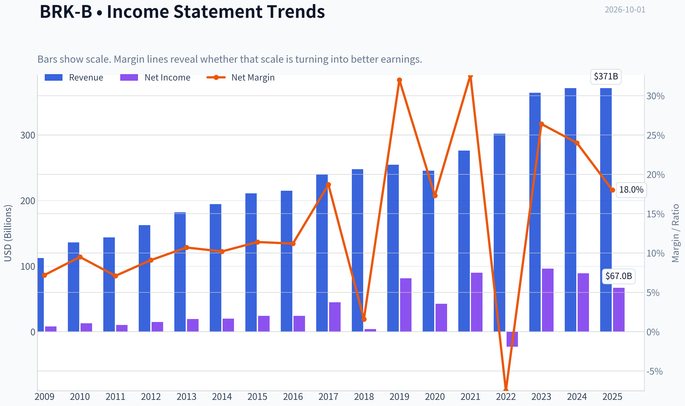

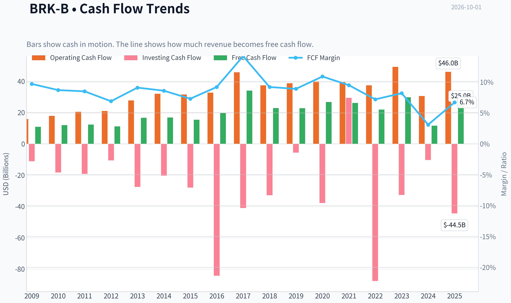

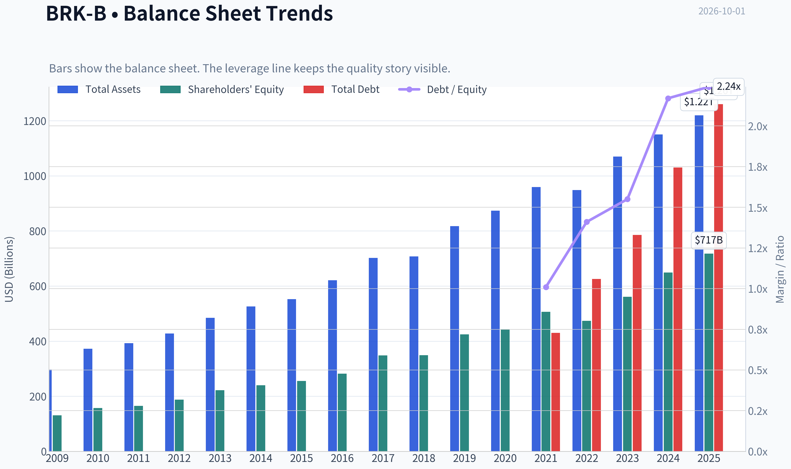

This graph tracks the profitability and return metrics (ROE, ROIC, Margins) of **BRK-B** over the past decade, highlighting capital efficiency trends.

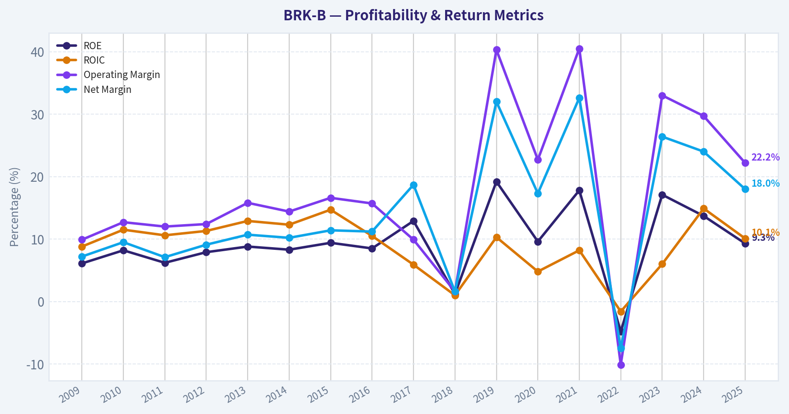

This chart illustrates the financial health of **BRK-B** over the last 10 years, mapping cash equivalents and free cash flow against total obligations (Debt).

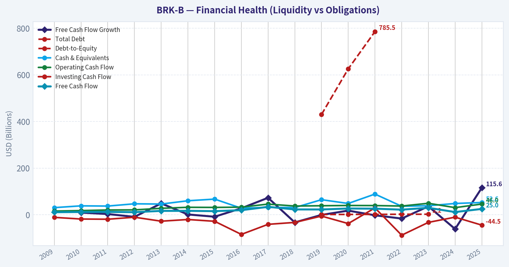

This comparison chart from *Profitability Analysis* stacks current figures against historical benchmarks for **BRK-B**, making it easy to see where the company trades relative to its own averages.

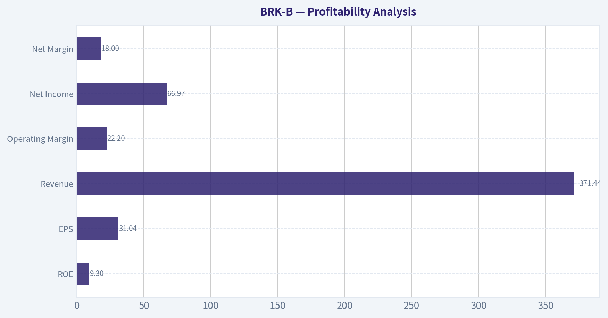

This breakdown chart from <em>Cash Flow and Capital Allocation</em> shows the proportional composition for **BRK-B** - useful for understanding what drives or risks the business.

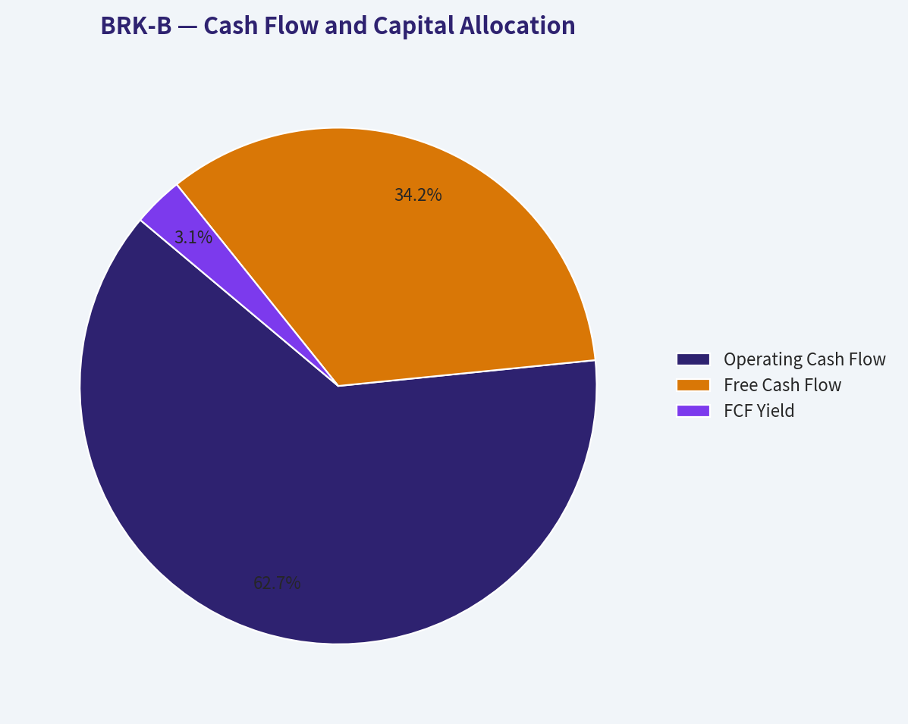

---

### Intrinsic Value Analysis (Buffett)

> *Following Warren Buffett's value investing philosophy: Circle of Competence, Economic Moat, Management Quality, and Margin of Safety.*

#### Intrinsic Value Snapshot

Price is what you pay. Intrinsic value is what the business may be worth based on the cash it can create for owners over time. We show a range, not one magic number.

- Current Price: $497.95
- Value Range (conservative to optimistic across both DCF methods): $118.38 to $2,830.34

##### Owner Earnings (Buffett Method)
- Net Income: $66,968,000,000.00
- Depreciation & Amortization: $13,476,000,000.00
- Capital Expenditures: $-20,927,000,000.00
- Working Capital Changes: $2,355,000,000.00
- Owner Earnings: $64,613,000,000.00

##### Intrinsic Value
###### Buffett Method
Uses owner earnings. Stricter, and usually more conservative.
- Conservative: $118.38
- Average: $813.14
- Optimistic: $2,830.34
- Discount Rate: 10.0%

###### Cash Flow Method
Uses free cash flow. Better for companies spending heavily today to grow tomorrow.
- Conservative: $128.58
- Average: $200.34
- Optimistic: $351.55
- Discount Rate: 10.0%

ANALYST STANCE: **ADVOCATE** - Medium Conviction

#### Berkshire Hathaway Class B - Buffett-Style Investment View

Berkshire Hathaway remains one of the rare businesses that can be understood simply, financed conservatively, and owned for decades. At roughly **$498 per B share** and a **$1.07 trillion market capitalization**, the stock is not a deep bargain, but it appears close to fair value for a uniquely durable, fortress-balance-sheet compounder. The investment case is strongest for long-term owners who value downside protection, rational capital allocation, and the optionality of Berkshire's enormous cash position.

---

#### 1. Factor Scorecard

| Factor | Score | Evidence |
|---|---:|---|
| Circle of Competence & Business Simplicity | 4.5 / 5 | Berkshire owns insurance businesses, a large equity portfolio, BNSF railroad, Berkshire Hathaway Energy, and many industrial, consumer, and service subsidiaries. The model is understandable: collect insurance float, invest capital rationally, and own cash-generative businesses. |
| Moat Test | 4.5 / 5 | Wide moat from low-cost insurance float, unmatched financial strength, reputation as buyer of choice, decentralized culture, scale, and regulated/essential assets like rail and energy. |
| Management Quality & Capital Allocation | 4.5 / 5 | Warren Buffett's capital allocation record is exceptional. Greg Abel succession is well planned. Buybacks have historically been disciplined, and Berkshire avoids dividends because retained capital has usually been more valuable inside the company. |
| Industry Structure | 4.0 / 5 | Insurance is competitive but Berkshire has scale and balance-sheet advantages. Railroads and utilities have favorable structural characteristics. Some manufacturing/service subsidiaries face ordinary competition. |
| Gate 5 - Quality/Solvency Hard Floor | Not Tripped | Berkshire has a fortress balance sheet, immense liquidity, large equity capital, and no sign of financial distress. Earnings are volatile under GAAP because of investment marks, but operating earnings are strong. |

**Key Takeaways:** Berkshire scores highly because its business is durable, understandable, and conservatively financed. The company is not immune to cyclicality or succession concerns, but none of those risks threaten solvency or the core franchise. The hard financial-distress floor is clearly not triggered.

---

#### 2. Moat Analysis

| Moat Source | Assessment | Evidence |
|---|---|---|
| Intangible Assets / Reputation | Strong | Berkshire's reputation allows it to be a preferred buyer for private businesses and a trusted counterparty in insurance and reinsurance. Sellers often choose Berkshire because it offers permanence and autonomy. |
| Switching Costs | Moderate | Switching costs are not uniformly high across all subsidiaries, but insurance relationships, reinsurance capacity, utility service territories, and rail infrastructure create customer and counterparty stickiness. |
| Cost Advantage | Strong | Berkshire's insurance float and fortress liquidity create a structural funding advantage. BNSF and Berkshire Hathaway Energy benefit from scale and hard-to-replicate assets. |
| Network Effects | Limited | Berkshire does not have classic digital network effects, but its capital-allocation ecosystem improves with scale: reputation, liquidity, deal access, and permanent capital reinforce each other. |
| Moat Quality Rating | Wide & Stable | The moat is broad and unusually resilient, though not rapidly widening due to Berkshire's enormous size. |

**Key Takeaways:** Berkshire's moat is not based on a single product or brand; it is a system of permanent capital, insurance float, operating businesses, and trust. The company's greatest advantage is its ability to deploy capital patiently when others are forced sellers. The moat is wide, but future growth is constrained by size.

---

#### 3. Management Quality Assessment

Berkshire's management culture is one of the strongest in public markets. Buffett and Munger built a system that emphasizes rationality, decentralization, conservative financing, and owner-like behavior. The company has no need to chase quarterly targets, issue promotional guidance, or maximize reported earnings through leverage.

Greg Abel's succession reduces key-person risk, though it does not eliminate it. Abel has deep operating experience, especially through Berkshire Hathaway Energy, and Buffett has repeatedly endorsed him as the next CEO. Ajit Jain's insurance leadership remains critical to the quality of underwriting and risk control.

Capital allocation remains the central strength. Berkshire keeps a very large cash reserve, avoids overpaying for acquisitions, and repurchases shares only when management believes the stock trades below intrinsic value. The drawback is also clear: at Berkshire's current size, reinvestment opportunities large enough to move the needle are harder to find.

---

#### 4. Financial Summary

| $ Billions, except per-share / ratios | 2020 | 2021 | 2022 | 2023 | 2024 |
|---|---:|---:|---:|---:|---:|
| Revenue | 245.5 | 276.1 | 302.1 | 364.5 | 371.4 |
| Operating Earnings | 21.9 | 27.5 | 30.9 | 37.4 | 47.4 |
| Net Earnings | 42.5 | 89.8 | -22.8 | 96.2 | 89.0 |
| Operating Cash Flow | 39.4 | 39.2 | 37.2 | 49.2 | 45.5 |
| Capital Expenditures | 11.2 | 12.2 | 14.6 | 18.6 | 19.9 |
| Free Cash Flow | 28.2 | 27.0 | 22.6 | 30.6 | 25.6 |
| Shareholders' Equity | 443.2 | 506.2 | 472.4 | 561.3 | 651.9 |
| Cash & Short-Term Investments | 138.3 | 146.7 | 128.6 | 167.6 | 334.2 |
| ROE | 9.6% | 17.7% | NM | 17.1% | 13.7% |
| Price / Book at Current Market Cap | - | - | - | - | ~1.64x |

**Key Takeaways:** Berkshire's operating earnings have grown substantially, rising from about $22 billion in 2020 to about $47 billion in 2024. GAAP net income is noisy because unrealized investment gains and losses run through earnings, so operating earnings are the better measure of business progress. The balance sheet has become even stronger, with cash and short-term investments reaching an extraordinary level.

---

#### 5. Owner Earnings Calculation

For Berkshire, GAAP net income is not the cleanest starting point because equity-market marks can overwhelm operating reality. A more useful Buffett-style owner earnings estimate starts with operating earnings and adjusts for depreciation, maintenance capital expenditure, and working capital.

| 2024 Owner Earnings Estimate | $ Billions |
|---|---:|
| Operating Earnings | 47.4 |
| Add: Depreciation & Amortization Estimate | 11.0 |
| Less: Maintenance CapEx Estimate | -12.0 |
| Less: Working Capital Increase / Normalization | 0.0 |
| Estimated Owner Earnings | 46.4 |
| Current Market Capitalization | 1,070.0 |
| Owner Earnings Yield | ~4.3% |

**Key Takeaways:** Berkshire's normalized owner earnings are roughly in the mid-$40 billions. That gives the stock an owner earnings yield of about 4% to 5%, before considering the optionality of the cash pile. This is not a bargain-basement yield, but it is respectable for a business with Berkshire's safety and durability.

---

#### 6. Return on Equity and Cash Flow Reality Check

| Metric | Assessment |
|---|---|
| Multi-Year ROE | Generally satisfactory but below the very best asset-light compounders; affected by Berkshire's huge equity base and cash balance. |
| ROE Quality | Not driven by excessive leverage. Berkshire's returns are diluted by conservative liquidity, not flattered by debt. |
| Operating Cash Flow vs. Earnings | Operating cash flow has generally supported operating earnings, though free cash flow is lower because Berkshire owns capital-intensive rail and energy assets. |
| Balance Sheet Strength | Exceptional. Berkshire has one of the strongest balance sheets in global equities. |
| Leverage Risk | Low at the parent level. Some subsidiaries, especially utilities and rail, use debt appropriate to their asset base. |

**Key Takeaways:** Berkshire's returns are not spectacular on headline ROE because the company carries immense equity and liquidity. That conservatism is a feature, not a flaw, for long-term owners. The company sacrifices some return efficiency in exchange for resilience and opportunity during market stress.

---

#### 7. Three-Scenario DCF Valuation

Using estimated normalized owner earnings of **$46.4 billion** and an estimated **2.15 billion B-share equivalents**.

| Scenario | Assumption | Equity Value Estimate | Value per B Share |
|---|---:|---:|---:|
| A - No Growth | Owner earnings / 10% discount rate | $464B | ~$216 |
| B - GDP Growth | 3% perpetual growth, 10% discount rate | $683B | ~$318 |
| C - Historical Growth Haircut | 6% growth for 10 years, then 3% terminal growth | ~$852B | ~$396 |

**Key Takeaways:** A mechanical DCF understates Berkshire's full value because it does not properly capture excess cash, equity securities, insurance float economics, and future capital redeployment. On pure current owner earnings, the stock looks expensive. On a sum-of-the-parts basis, the conclusion is more favorable.

---

#### 8. Sum-of-the-Parts Valuation Cross-Check

| Component | Conservative Value Estimate |
|---|---:|
| Excess Cash / Treasury Bills after Operating Reserve | ~$300B |
| Public Equity Portfolio, Net of Tax Friction | ~$280B-$330B |
| Wholly Owned Operating Businesses | ~$600B-$720B |
| Other Adjustments / Holding Company Conservatism | -$50B to -$100B |
| Estimated Intrinsic Equity Value Range | ~$1.13T-$1.25T |
| Estimated Value per B Share | ~$525-$580 |
| Current Price | ~$498 |
| Implied Margin of Safety | ~5%-15% |

**Key Takeaways:** Berkshire looks much more reasonable when valued as the company actually exists: a combination of cash, marketable securities, insurance float, and operating subsidiaries. The current price appears modestly below a conservative sum-of-the-parts value. The margin of safety is adequate for a high-quality enterprise, though not large.

---

#### 9. Margin of Safety Analysis

Berkshire is a **wide-moat, highly predictable, conservatively financed** company, so it does not require the same 40% to 50% discount demanded of a cyclical or fragile business. A **10% to 15% margin of safety** can be acceptable for a business of this quality.

At around **$498 per B share**, Berkshire appears near the lower end of a reasonable intrinsic value range. The stock is not obviously cheap on current owner earnings, but the excess cash position creates valuable optionality. If Berkshire can redeploy even part of its cash hoard during a market dislocation, intrinsic value could compound more attractively than current earnings alone suggest.

The main valuation risk is that cash remains underutilized for years, causing returns to drift lower. The main upside is that Berkshire is uniquely positioned to act aggressively when capital markets become stressed.

---

#### 10. Final Buffett Scorecard

| Criterion | Weight | Score | Weighted Contribution |
|---|---:|---:|---:|
| Moat Width & Durability | 25% | 4.5 | 1.13 |
| Valuation / Margin of Safety | 20% | 3.5 | 0.70 |
| Capital Returns - ROIC vs. WACC | 15% | 3.5 | 0.53 |
| Business Understanding & Predictability | 12% | 4.5 | 0.54 |
| Management Quality & Capital Allocation | 12% | 4.5 | 0.54 |
| Reinvestment Runway | 8% | 3.0 | 0.24 |
| Balance Sheet Strength | 4% | 5.0 | 0.20 |
| Industry Structure | 4% | 4.0 | 0.16 |
| Final Weighted Score | 100% | - | 4.04 / 5.00 |

**Key Takeaways:** Berkshire clears the advocate threshold because of its moat, management, predictability, and fortress balance sheet. Valuation is only moderately attractive, and the reinvestment runway is the biggest limitation. The overall score supports ownership, but not aggressive buying without regard to price.

---

#### 11. Investment Stance

| Stance | Conviction | Rationale |
|---|---|---|
| **ADVOCATE** | Medium | Berkshire is a wonderful, resilient, owner-oriented business trading around fair value to modestly below intrinsic value. The margin of safety is not large, but the quality is exceptional. |

**Key Takeaways:** Berkshire is suitable for long-term investors who want durable compounding, conservative stewardship, and downside resilience. The stock is not a screaming bargain, but it is good enough at this price for a quality-scaled value investor. The position becomes more compelling on market weakness or if management finds attractive uses for the cash hoard.
#### Valuation Bridge

This bridge places the current market price beside each intrinsic value lens so readers can see whether upside depends on one method or shows up across several methods.

| Scenario | Intrinsic Value / Share |
| --- | ---: |
| Buffett Method | $813.14 |
| Cash Flow Method | $200.34 |
| Current Price | $497.95 |

#### Key Takeaways

If one method is far above the others, the upside case depends on a specific modelling assumption. When several methods cluster together, the valuation story is more robust.

#### Valuation Visuals

This comparison chart from *Latest Earnings Snapshot* stacks current figures against historical benchmarks for **BRK-B**, making it easy to see where the company trades relative to its own averages.

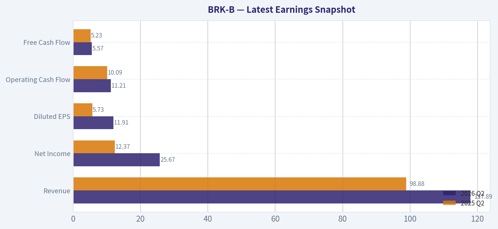

This comparison chart from *Balance Sheet and Financial Strength* stacks current figures against historical benchmarks for **BRK-B**, making it easy to see where the company trades relative to its own averages.

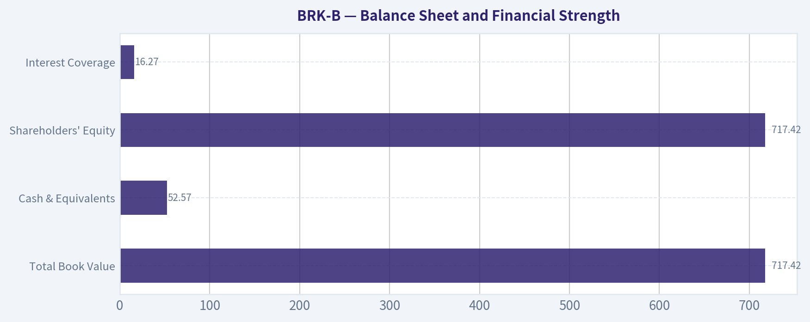

This comparison chart from *Buffett-Style Owner Earnings DCF Valuation* stacks current figures against historical benchmarks for **BRK-B**, making it easy to see where the company trades relative to its own averages.

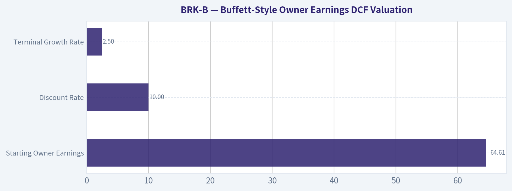

This comparison chart from *Cross-Check Against Deterministic Model-Based Intrinsic Values* stacks current figures against historical benchmarks for **BRK-B**, making it easy to see where the company trades relative to its own averages.

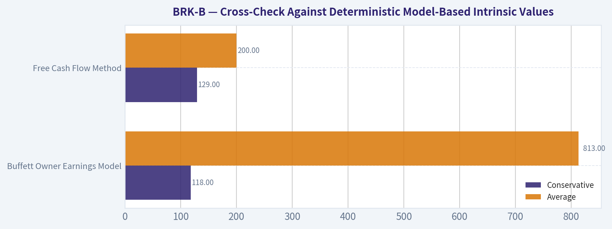

---

### Trend & Growth Analysis (Lynch/Druckenmiller/Fisher)

> *Following Peter Lynch's GARP, Stanley Druckenmiller's macro-aware approach, and Philip Fisher's scuttlebutt methodology.*

ANALYST STANCE: **AVOID**

#### BRK-B Growth Investment Report - Berkshire Hathaway Class B

Berkshire Hathaway is an exceptional business, but it is **not an ideal Lynch/Druckenmiller/Fisher growth candidate at today's scale and valuation**. It is best viewed as a high-quality, conservatively run conglomerate/insurance compounder, not a fast grower with visible ten-bagger potential.

| Item | Current Snapshot |
|---|---:|
| Price | ~$498 |
| Market Cap | ~$1.07T |
| TTM P/E | 12.6x |
| Forward P/E | 22.4x |
| Price / Book | ~1.5x |
| Price / Sales | 2.8x |
| Revenue Growth YoY | ~0.0% |
| 3-Year Revenue CAGR | ~7.1% |
| 5-Year Revenue CAGR | ~8.6% |
| ROE | ~9.3% |
| FCF Yield | ~2.3% |
| Owner Earnings | ~$64.6B |
| Owner Earnings Yield | ~6.1% |

**Key Takeaways:** Berkshire remains financially powerful, with enormous scale, strong owner earnings, and conservative capital allocation. However, revenue growth is currently flat, ROE is modest for a growth investor, and valuation is not especially cheap versus book value. This is a quality compounding vehicle, but not a clear growth inflection setup.

---

#### 1. Lynch Classification

| Lynch Category | Fit | Rationale |
|---|---:|---|
| Slow Grower | Partial | Current YoY revenue growth is approximately 0%. |
| Stalwart | Strong | 5-year revenue CAGR of ~8.6% fits the stalwart range. |
| Fast Grower | Weak | Not growing revenue 15-25%+. |
| Cyclical | Partial | Insurance, rail, energy, manufacturing, and equity portfolio have cyclical exposure. |
| Turnaround | No | No distress or turnaround thesis. |
| Asset Play | Strong | Large cash, securities portfolio, operating subsidiaries, and book-value orientation matter. |

**Key Takeaways:** Berkshire is best classified as a **Stalwart / Asset Play hybrid**, not a fast grower. That makes it valuable for preservation and compounding, but less suitable for a growth portfolio seeking accelerating revenue, expanding TAM, and ten-bagger upside.

#### 2. The Story in 3 Bullets

- Berkshire collects insurance float, invests it conservatively, and owns a diversified set of businesses across insurance, railroads, energy, manufacturing, services, and public equities.
- The company compounds capital through decentralized operations, disciplined acquisitions, share repurchases, and opportunistic investment allocation.
- The growth problem is scale: at over $1 trillion in market cap, Berkshire needs massive incremental opportunities to move the needle.

#### 3. TAM Analysis and 10x Test

| Metric | Estimate / Observation |
|---|---:|
| Current Revenue | ~$371B |
| 10x Revenue Target | ~$3.7T |
| Current Market Cap | ~$1.07T |
| 10x Market Cap Target | ~$10.7T |
| Main Addressable Areas | Insurance, energy, rail, industrials, consumer, public equities |
| Can BRK 10x and remain under 20% of TAM? | Unlikely |
| TAM Verdict | Very broad, but scale-constrained |

**Key Takeaways:** Berkshire operates in huge markets, but it is already one of the largest companies in the world. A 10x outcome would require Berkshire to become a multi-trillion-dollar enterprise approaching or exceeding the scale of entire national economies or mega-cap market leaders. The runway is real, but the ten-bagger runway is limited.

#### 4. Revenue Growth Trend

| Year | Revenue | Revenue Growth |
|---|---:|---:|
| 2021 | $276.2B | 12.5% |
| 2022 | $302.0B | 9.4% |
| 2023 | $364.5B | 20.7% |
| 2024 | $371.4B | 1.9% |
| 2025 / TTM | $371.4B | 0.0% |

**Key Takeaways:** Revenue growth has decelerated sharply after a strong 2023. The current pattern is not a Druckenmiller-style acceleration; it looks more like normalization after a strong period. For a growth investor, this is a clear warning that Berkshire is not currently at a revenue inflection point.

#### 5. Unit Economics

Traditional SaaS-style unit economics are not applicable to Berkshire. Instead, the key operating metrics are underwriting discipline, return on equity, owner earnings yield, insurance float economics, and capital allocation returns.

| Metric | Current Read |
|---|---:|
| LTV/CAC | Not applicable |
| NRR | Not applicable |
| Rule of 40 | Not applicable |
| ROE | ~9.3% |
| ROIC | ~10.1% to 19.5%, depending source treatment |
| Owner Earnings Yield | ~6.1% |
| Interest Coverage | ~16.3x |

**Key Takeaways:** Berkshire's economics are durable but not hyper-growth economics. The company generates significant owner earnings and has strong financial resilience, but its returns are not currently high enough to offset the lack of growth acceleration for a growth-focused mandate.

#### 6. Inflection Point Assessment

| Potential Inflection | Evidence | Rating |
|---|---|---:|
| Product Cycle Inflection | No new product cycle driving step-change growth | Low |
| Market Share Inflection | No clear evidence of accelerating share gains | Low |
| Margin Inflection | Operating margin fell from ~29.7% in 2024 to ~22.2% in 2025/TTM | Low / Mixed |
| TAM Inflection | No major TAM expansion visible from provided data | Low |
| Competitive Inflection | No clear competitor stumble driving upside | Low |
| Capital Allocation Inflection | Possible if major acquisition or aggressive buybacks occur | Watch |

**Key Takeaways:** Berkshire does not currently show the classic signs of a growth inflection. The most realistic upside catalyst would be capital allocation: a major acquisition, opportunistic equity deployment, or meaningful repurchases during market weakness. Without that, growth likely remains steady rather than explosive.

#### 7. Macro Setup

| Macro Factor | Impact on BRK-B |
|---|---|
| Falling rates | Mixed: supports equity valuations but reduces reinvestment yields on cash over time |
| Higher rates | Supports investment income from cash and fixed income, but may pressure equity valuations |
| Inflation | Mixed: pricing power helps some subsidiaries, but costs pressure rail, energy, and industrial units |
| Economic slowdown | Negative for rail, manufacturing, retail, and insurance exposure |
| Market volatility | Positive if Berkshire can deploy cash aggressively |
| Secular growth themes | Limited direct exposure to AI, cloud, cybersecurity, fintech, or healthcare innovation |

**Key Takeaways:** Berkshire is macro-resilient, but it does not sit directly in the strongest secular growth lanes. Its best macro setup is a market dislocation where its liquidity, balance sheet, and reputation allow it to buy assets cheaply. That makes it a powerful countercyclical allocator, not a pure growth compounder.

---

#### 8. Fisher 15-Point Score

| Fisher Point | Score / 5 | Comment |
|---|---:|---|
| 1. Products with sizable market potential | 3 | Diversified, but mature markets |
| 2. Management determination to develop new products | 2 | More allocator than innovator |
| 3. Effective R&D | 1 | Not R&D-driven |
| 4. Above-average sales organization | 3 | Varies by subsidiary |
| 5. Worthwhile profit margin | 4 | Strong overall profitability |
| 6. Improving profit margins | 2 | Margins have recently declined |
| 7. Labor/personnel relations | 3 | Generally stable, but limited data |
| 8. Executive relations | 4 | Decentralized culture is strong |
| 9. Management depth | 4 | Succession planning improved, but Buffett factor remains |
| 10. Cost analysis/accounting | 5 | Historically conservative and transparent |
| 11. Outstanding moat factors | 4 | Float, reputation, scale, balance sheet |
| 12. Long-range profit outlook | 4 | Durable but moderate growth |
| 13. Dilution risk | 5 | No meaningful dilution; buyback optionality |
| 14. Candor with investors | 5 | Historically excellent |
| 15. Integrity | 5 | Best-in-class reputation |
| **Total** | **54 / 75** | **Average to good, but not growth exceptional** |

**Key Takeaways:** Berkshire scores very well on integrity, accounting, capital discipline, and durability. It scores poorly on innovation, R&D, and new product-led growth. Fisher would admire the company, but a growth investor would struggle to call it an outstanding long-runway growth opportunity today.

#### 9. Valuation Analysis

| Valuation Method | Result | Interpretation |
|---|---:|---|
| TTM P/E | 12.6x | Looks cheap, but GAAP earnings are distorted by investment marks |
| Forward P/E | 22.4x | More demanding than trailing P/E suggests |
| P/B | ~1.5x | Near upper end of Berkshire's post-2015 range |
| P/S | 2.8x | Not very useful for a financial/insurance conglomerate |
| PEG | ~10.1x | Unattractive due to low growth |
| FCF Yield | ~2.3% | Low on standard FCF basis |
| Owner Earnings Yield | ~6.1% | Reasonable, but not a bargain |
| Reverse DCF | Implies ~6.5% owner-earnings growth for 10 years | Achievable, but not deeply mispriced |

**Key Takeaways:** Berkshire is not obviously overvalued, but it is also not screamingly cheap. The stock looks reasonable on owner earnings, less compelling on free cash flow yield, and expensive on PEG due to weak current growth. For growth investors, the valuation does not compensate enough for the lack of acceleration.

#### 10. Scenario Analysis

| Scenario | Assumptions | 3-5 Year View |
|---|---|---|
| Bear | Flat revenue, lower investment gains, multiple compresses toward 1.2x book | Low or negative annualized returns |
| Base | Mid-single-digit book value growth, modest buybacks, stable operating earnings | Mid-single-digit to high-single-digit annualized returns |
| Bull | Market dislocation enables attractive capital deployment, underwriting improves, buybacks accelerate | Low-double-digit annualized returns possible |
| Ten-Bagger Case | Requires sustained massive reinvestment opportunities and exceptional compounding from huge base | Very unlikely |

**Key Takeaways:** Berkshire's downside protection is better than many companies, but upside appears bounded by its size. The bull case is respectable compounding, not venture-style asymmetry. This is a "sleep well" stock, not a classic growth ten-bagger candidate.

#### 11. Growth Investor Scorecard

| Criterion | Weight | Score / 5 | Weighted Score |
|---|---:|---:|---:|
| The Story | 10% | 4.0 | 0.40 |
| TAM & Runway | 20% | 2.5 | 0.50 |
| Revenue Growth | 20% | 1.5 | 0.30 |
| Unit Economics / Returns | 15% | 3.5 | 0.53 |
| Competitive Position | 10% | 4.0 | 0.40 |
| Management Quality | 10% | 4.5 | 0.45 |
| Macro Setup | 5% | 3.0 | 0.15 |
| Profitability Path | 5% | 3.5 | 0.18 |
| Valuation | 5% | 2.5 | 0.13 |
| **Total** | **100%** |  | **3.03 / 5.00** |

**Key Takeaways:** Berkshire earns high marks for business quality, management, and competitive durability. The weak spots are exactly what matter most for this mandate: revenue growth, acceleration, and ten-bagger runway. The overall score lands in WATCH territory numerically, but for a growth-focused portfolio, the stance is AVOID for new capital.

#### 12. Position Size Stance

| Investor Type | Stance | Position Size View |
|---|---|---:|
| Growth / ten-bagger portfolio | Avoid new position | 0%-2% |
| Quality compounder portfolio | Hold / accumulate on weakness | 3%-8% |
| Defensive core portfolio | Reasonable long-term anchor | 5%-10% |
| Aggressive growth portfolio | Not a fit | 0% |

**Key Takeaways:** Berkshire can still be a strong holding for conservative compounder investors. But for a portfolio specifically hunting acceleration, product-market inflections, and large TAM disruption, capital is likely better deployed elsewhere. Existing holders do not need to sell urgently, but new growth-oriented buying is hard to justify.

#### 13. Key Risks and Catalysts

| Category | Item | Impact |
|---|---|---|
| Risk | Scale limits reinvestment opportunities | Reduces long-term compounding rate |
| Risk | Succession after Warren Buffett | Cultural and capital allocation uncertainty |
| Risk | Insurance loss cycles | Catastrophe and underwriting volatility |
| Risk | Rail, energy, and industrial cyclicality | Earnings sensitivity to economic slowdown |
| Risk | Valuation near high end of book multiple range | Limits margin of safety |
| Catalyst | Major acquisition | Could improve capital deployment outlook |
| Catalyst | Market selloff | Gives Berkshire opportunity to deploy cash |
| Catalyst | Large buybacks below intrinsic value | Boosts per-share compounding |
| Catalyst | GEICO or insurance underwriting improvement | Could lift operating earnings |
| Catalyst | Higher sustained investment income | Supports earnings from cash and fixed income |

**Key Takeaways:** Berkshire's biggest opportunity is not a new product or explosive end market, but superior capital deployment during stress. The biggest risk is that the company remains too large and too cash-heavy to compound at historical rates. Catalysts are real, but they are opportunistic rather than structural.

#### Final View

Berkshire Hathaway is a world-class institution, but it does **not** meet the bar for a growth stock under Lynch, Druckenmiller, and Fisher-style acceleration criteria. Revenue is not accelerating, PEG is unattractive, TAM is constrained by existing scale, and the secular-theme exposure is indirect.

For a growth portfolio, BRK-B is an **AVOID for new capital**. For existing holders, it remains a respectable long-term compounder and defensive ballast, but not a high-upside growth idea.

---

### Market Technical Analysis

ANALYST STANCE: **WATCH**

#### BRK-B Technical Read - As of 2026-10-01

The latest available trading data is from **2026-09-30**, because **2026-10-01 is not shown as a trading day in the indicator feed**. BRK-B closed at **$497.95**, down sharply from the mid-September high near **$519.80**, and is now testing an important tactical support zone.

#### Selected Indicators

| Indicator | Why It Is Relevant for BRK-B Now | Current Signal |
|---|---:|---|
| `close_10_ema` | Captures short-term momentum shifts after the September reversal | Bearish short-term; price is below it |
| `close_50_sma` | Defines the medium-term trend and likely dynamic resistance | Price has slipped below it |
| `close_200_sma` | Confirms whether the larger trend remains intact | Still constructive; price remains above it |
| `macd` | Measures momentum regime and trend confirmation | Bearish; MACD has turned negative |
| `macdh` | Shows acceleration or deceleration in MACD momentum | Bearish momentum is increasing |
| `rsi` | Gauges whether selling is stretched or still has room | Weak but not oversold |
| `boll_lb` | Identifies downside support and possible mean-reversion area | Price is sitting just above the lower band |
| `atr` | Helps size risk and define stop distance in current volatility | Volatility has compressed but remains meaningful |

**Key Takeaways:** The selected indicators emphasize trend, momentum, support, and risk control without too much redundancy. BRK-B's long-term structure is still not broken, but the short- and medium-term technical picture has deteriorated. The stock is now in a decision zone where either lower-band support holds, or selling pressure pushes it toward the 200-day moving average.

---

#### Latest Indicator Snapshot

| Metric | Latest Value | Price Relationship / Interpretation |
|---|---:|---|
| Close | **$497.95** | Latest available close, 2026-09-30 |
| `close_10_ema` | **$504.26** | Price is about **1.25% below**, confirming short-term weakness |
| `close_50_sma` | **$506.92** | Price is about **1.77% below**, turning the 50-day area into resistance |
| `close_200_sma` | **$492.78** | Price is about **1.05% above**, so the long-term uptrend is still barely intact |
| `macd` | **-1.06** | Negative and worsening, signaling bearish momentum |
| `macdh` | **-1.26** | Histogram is increasingly negative, showing downside momentum acceleration |
| `rsi` | **39.60** | Weak momentum, but not yet deeply oversold |
| `boll_lb` | **$496.94** | Price is only about **$1.01 above** the lower band |
| `atr` | **$5.86** | Daily risk range is moderate; a 1 ATR move could test the 200-day area |

**Key Takeaways:** BRK-B is trading below both the 10-day EMA and 50-day SMA, which gives the short-term chart a bearish bias. However, the price remains slightly above the 200-day SMA, meaning the broader trend has not fully broken down. The most important near-term support area is roughly **$496-$493**, where the lower Bollinger Band and 200-day SMA sit close together.

---

#### Trend and Momentum Analysis

BRK-B's chart has shifted from a constructive September advance into a tactical pullback. The stock rallied into **$519.80 on 2026-09-16**, but that move failed quickly. Since then, the price has produced a sequence of lower closes and fell to **$497.95 by 2026-09-30**.

The **10-day EMA peaked around $511.51 on 2026-09-16** and has since rolled down to **$504.26**. That tells us the short-term trend has flipped lower. The fact that the latest close is below this average means buyers have not yet regained near-term control.

The **50-day SMA is still rising**, moving from roughly **$499.42 in mid-August to $506.92 by September 30**. That is important because the medium-term trend has not fully reversed yet; however, price has fallen beneath it. This creates a tension: the average itself is still constructive, but the market is now trading below it, so the 50-day SMA may act as resistance on rebounds.

The **200-day SMA is rising slowly near $492.78**, and this is the key line separating a normal pullback from a more serious trend deterioration. As long as BRK-B holds above the 200-day average, the larger technical structure remains repairable. A decisive break below **$492-$493**, especially on heavy volume, would weaken the long-term picture.

Momentum confirms the recent deterioration. The **MACD moved from positive readings in mid-September to -1.06 by September 30**, and the **MACD histogram fell to -1.26**, showing that bearish momentum is not only present but accelerating. RSI at **39.60** supports this view: the stock is weak, but not yet oversold enough to make a reversal automatic.

Volatility is also giving a subtle message. ATR has declined from above **$8.00 in mid-August** to about **$5.86**, indicating that volatility has compressed. At the same time, price is testing the lower Bollinger area. Compression near support often precedes a sharper move, so traders should avoid assuming the stock will remain quiet.

#### Trading Implications

| Scenario | Confirmation Level | What Traders May Watch |
|---|---:|---|
| Bullish stabilization | Reclaim **$503-$506** | Price moves back above the 10-day EMA and challenges the 50-day SMA |
| Neutral consolidation | Holds **$496-$493** | Price respects lower-band and 200-day support but lacks upside momentum |
| Bearish continuation | Break below **$492-$493** | Loss of 200-day SMA support could invite deeper selling |
| Momentum repair | MACD histogram turns less negative | Would suggest downside pressure is slowing |
| Oversold bounce setup | RSI approaches low 30s then turns up | More attractive if it occurs near the 200-day SMA |

**Key Takeaways:** BRK-B is not in a clean bullish setup right now, but it is also not in a confirmed long-term breakdown. The most important trading zone is **$496 to $493**, where several support signals cluster. A recovery above **$503-$506** would improve the setup, while a break below the 200-day SMA would shift the stance more bearish.

---

#### Risk Management Notes

With ATR near **$5.86**, traders should avoid overly tight stops because normal daily movement can be several dollars. A short-term trader using the 200-day SMA as a reference might consider that a **1 ATR move below the latest close points toward roughly $492**, which aligns closely with long-term moving-average support. A more conservative risk band of **1.5 ATR** would be about **$8.80**, placing a deeper downside reference near **$489**.

BRK-B's September 30 session also had elevated volume relative to many recent days, which makes the down move more meaningful. If heavy-volume selling continues below the 200-day SMA, that would be a stronger warning than a low-volume dip.

#### Final Technical Summary

| Area | Current Read | Decision Importance |
|---|---|---|
| Short-term trend | Bearish; price below 10-day EMA | High |
| Medium-term trend | Under pressure; price below 50-day SMA | High |
| Long-term trend | Still intact, but close to testing 200-day SMA | Very high |
| Momentum | Negative and worsening via MACD and histogram | High |
| RSI condition | Weak but not oversold | Medium |
| Support zone | **$496-$493** | Very high |
| Resistance zone | **$503-$507** | High |
| Stance | **WATCH** | Wait for either support confirmation or breakdown |

**Key Takeaways:** BRK-B is in a vulnerable but not broken technical position. The stock is pressing into a support cluster near the lower Bollinger Band and 200-day SMA, while momentum has turned bearish. Traders should watch for either a rebound above **$503-$507** or a decisive break below **$492-$493** before taking a stronger directional view.

---

### Options Market Analysis

> *Reading options flow - put/call ratios, IV skew, and unusual activity - to gauge institutional positioning and event-driven risk.*

ANALYST STANCE: **WATCH**

#### BRK-B Options Market Sentiment Report
*Options data as of 2026-10-01. Near-term expirations reviewed: 2026-10-02, 2026-10-09, and 2026-10-16.*

#### 1. Put/Call Ratio Analysis

| Expiration | Call OI | Put OI | Put/Call OI Ratio | Call Volume | Put Volume | Put/Call Volume Ratio | Read |
|---|---:|---:|---:|---:|---:|---:|---|
| 2026-10-02 | 13,459 | 13,662 | 1.02 | 7,340 | 1,060 | 0.14 | OI defensive, but today's flow call-heavy |
| 2026-10-09 | 775 | 432 | 0.56 | 6,319 | 1,497 | 0.24 | Strong call-volume bias |
| 2026-10-16 | 21,577 | 19,604 | 0.91 | 2,144 | 1,849 | 0.86 | Mildly defensive OI, balanced volume |
| **Near-Term Total** | **35,811** | **33,698** | **0.94** | **15,803** | **4,406** | **0.28** | OI cautious, volume bullish |

**Key Takeaways:** BRK-B's near-term put/call open-interest ratio is **0.94**, above the historical neutral baseline of roughly **0.7**, suggesting more put protection than normal is already in place. However, the **volume ratio is only 0.28**, meaning current trading activity is heavily call-skewed. This points to a market where existing positioning is somewhat hedged, but fresh near-term flow leans bullish.

The biggest contrast is between **stocked-up put open interest** and **current call-dominated trading volume**. That can happen when investors already own downside hedges but new traders are positioning for a near-term grind higher or writing fewer puts. The signal is not aggressively bullish because the elevated OI put/call ratio shows meaningful protection remains embedded.

---

#### 2. Implied Volatility Assessment

| Expiration | ATM Call IV | ATM Put IV | Call-Put IV Spread | IV Read |
|---|---:|---:|---:|---|
| 2026-10-02 | 4.7% | 3.2% | +1.5 pts call premium | Near-dated call IV richer |
| 2026-10-09 | 2.6% | 1.5% | +1.1 pts call premium | Call-side demand persists |
| 2026-10-16 | 1.6% | 1.2% | +0.4 pts call premium | Low IV, mild call premium |

**Key Takeaways:** Near-term implied volatility appears **low in absolute terms**, with ATM IV ranging from roughly **1.2% to 4.7%** across the reviewed expirations. Calls are priced with higher ATM IV than puts in every listed expiry, which suggests **upside demand or call-side premium** rather than classic downside fear. There is no clear evidence in the retrieved data of an elevated event-volatility setup.

The skew snapshot is notable because it does **not** show a heavy put-volatility premium. A steep OTM put skew would usually indicate crash hedging or downside anxiety, but the available data instead shows **call IV exceeding put IV at the money**. Full OTM skew by strike was not available in the retrieved dataset, so confidence on detailed skew interpretation is moderate.

---

#### 3. Unusual Options Activity

| Unusual Activity Screen | Result | Interpretation |
|---|---|---|
| Contracts with volume greater than 5x open interest | None found | No clear evidence of fresh, outsized contract-specific bets |
| Near-term flow character | Call volume materially exceeds put volume | Directionally constructive, but not confirmed by single-contract sweep activity |
| Smart-money vs. retail read | No contract-level unusual flow detected | Cannot confidently identify institutional block/sweep positioning |

**Key Takeaways:** The scan found **no contracts where volume exceeded 5x open interest**, so there is no strong evidence of fresh, unusual single-contract accumulation. The broader options tape is still call-heavy, but without contract-level unusual activity it is harder to classify the flow as institutional conviction. This lowers the confidence of the bullish read.

The absence of unusual activity matters because BRK-B options are often less speculative than high-beta technology or meme-driven names. Current activity looks more like broad near-term call interest than a clear "smart money" directional signal. Therefore, the flow supports a mild bullish tilt, not an aggressive upside call.

---

#### 4. Open Interest Concentration and Pinning Risk

| Expiration | Total Call OI | Total Put OI | Combined OI | OI Balance | Pinning / Gamma Read |
|---|---:|---:|---:|---|---|
| 2026-10-02 | 13,459 | 13,662 | 27,121 | Nearly balanced | Highest immediate pinning relevance |
| 2026-10-09 | 775 | 432 | 1,207 | Light OI | Low pinning influence |
| 2026-10-16 | 21,577 | 19,604 | 41,181 | Large and balanced-to-cautious | Most important listed OI expiry |

**Key Takeaways:** The largest open-interest concentration among the reviewed expirations is **2026-10-16**, with over **41,000 combined contracts**. The next major near-term expiry is **2026-10-02**, with roughly **27,000 combined contracts**, and because it is only one day away, it may have the greatest short-term pinning relevance. However, strike-level OI was not provided, so specific gamma-wall or max-pain price levels cannot be identified.

The OI is relatively balanced between calls and puts at the two most important expirations, which can dampen directional extremes if market makers are hedging around crowded strikes. Without strike-specific concentration, the best read is that **near-term pinning risk exists**, especially into 2026-10-02 and 2026-10-16, but exact gravitational levels are unavailable.

---

#### 5. Overall Options Sentiment Signal: **Mildly Bullish / Watch**

| Signal Component | Reading | Sentiment Impact |
|---|---|---|
| Put/Call OI Ratio | 0.94 vs. neutral baseline near 0.7 | Cautious / mildly bearish hedge backdrop |
| Put/Call Volume Ratio | 0.28 | Bullish current flow |
| ATM IV | Low overall | No major fear premium |
| IV Skew | Calls richer than puts at ATM | Mild upside-demand signal |
| Unusual Activity | None detected | Reduces conviction |
| OI Concentration | Large OI into 10/02 and 10/16, balanced call/put | Possible pinning, not strongly directional |
| **Overall Signal** | **Mildly Bullish, but not high-conviction** | Call-heavy flow outweighs defensive OI |

**Key Takeaways:** The options market signal for BRK-B is **mildly bullish**, primarily because current volume is strongly call-heavy and ATM call IV is richer than put IV. However, the elevated near-term put/call OI ratio shows that hedges remain in place, and the absence of unusual contract-level activity limits conviction. This is best treated as a **watch / modest bullish flow signal**, not a decisive institutional upside bet.

#### Final Summary Table

| Category | Current Read | Interpretation |
|---|---|---|
| Put/Call Ratio | OI ratio **0.94**, volume ratio **0.28** | Existing positioning is cautious, but fresh flow is call-heavy |
| IV Level | Low near-term ATM IV | No major event-risk premium apparent |
| Skew Direction | ATM calls richer than ATM puts | Mild upside demand; no obvious downside fear skew in available data |
| Unusual Activity | None detected above 5x OI | No clear fresh institutional sweep/block signal |
| Overall Signal | **Mildly Bullish / Watch** | Bullish near-term flow, tempered by hedged OI and limited unusual activity |

**Key Takeaways:** BRK-B's options tape leans **constructive**, but not aggressively so. The strongest bullish evidence is the very low put/call volume ratio, while the main caution is the elevated put/call open-interest ratio. Overall, options positioning supports a **modest upside bias with pinning risk**, rather than a high-conviction breakout signal.

---

## Research Team Commentary

> *The Research Manager synthesizes the Bull vs Bear debate into action-free commentary. This is a pre-risk view, not the final stance.*

As a value investor applying Warren Buffett's framework, it is always a fascinating exercise to evaluate Berkshire Hathaway itself. Looking at this debate, we have a classic standoff between business quality and quantitative margin of safety.

The bull correctly identifies that Berkshire is an incredibly durable, wide-moat compounding engine. The combination of its permanent insurance float, irreplaceable infrastructure in railroads and energy, and its tax-efficient internal capital market makes it a fortress. The bull wisely points out that for a business of this caliber, demanding a deep discount will often leave you on the sidelines forever. Earning a 7% implied growth hurdle is highly plausible when you combine operating earnings growth, intelligent repurchases, and the massive stream of investment income.

The bear, however, brings the necessary quantitative discipline. At roughly $498, the stock is trading just under the base intrinsic value estimate of $527. That offers about a 5% to 6% discount, which falls short of the 10% to 15% margin of safety we typically demand even for the world's most wonderful businesses. The bear also rightly points out that scale is the enemy of compounding. At a trillion-dollar market cap, Berkshire requires enormous absolute dollar amounts of value creation to move the needle, making that 7% hurdle much heavier than it looks.

Synthesizing these views, and heavily integrating lessons from our past evaluations of Berkshire, we have to separate our long-term intrinsic value assessment from the immediate tactical setup. In the past, we missed the mark by ignoring the active earnings power of Berkshire's cash and float in a higher interest rate environment, treating it merely as defensive dead weight. We also previously failed to distinguish between a stock being fairly valued for the long run and being tactically attractive for a near-term bounce.

Right now, Berkshire is testing a strong tactical support zone after pulling back from roughly $520. The options market shows a put/call ratio of 0.94, indicating that a significant amount of fear and downside protection is already priced in. While the long-term valuation dictates patience for a slightly better price to back up the truck, the fundamental tailwinds from rate-driven investment income and the fading downside momentum suggest a tactical bounce is quite probable.

Core Takeaway
Berkshire Hathaway at $498 is a quintessential example of a wonderful business trading at a broadly fair price. While it lacks the 10% to 15% margin of safety required to trigger an aggressive, full-conviction buy for a long-term value portfolio, the company's exceptional balance sheet, rate-sensitive float income, and current position near tactical support make it a prime candidate for a watch-and-accumulate strategy. We are not buyers of the entire company at this valuation, but we are highly attentive to tactical entries.

Rationale
Applying the quality-scaled margin of safety, Berkshire's durability allows us to accept a smaller discount, but a 5% discount to base value still leaves expected returns too heavily reliant on perfect execution at a trillion-dollar scale. The asymmetry is just not compelling enough for a heavy allocation, as the conservative downside outweighs the base upside. However, we must not repeat the mistake of undervaluing the macro environment's impact on this specific business. Berkshire's massive cash and short-term Treasury pile is currently generating billions in real, low-risk yield. This income partially offsets the "cash drag" argument and eases the burden of scale. Technically, the stock has cooled off from its recent highs, and with elevated put/call ratios indicating cautious sentiment, the stock is sitting at a level where downside is fiercely protected by both structural support and the company's own repurchase tendencies. Therefore, a Watch stance is appropriate, serving as a mandate to prepare for opportunistic accumulation rather than passive observation.

Monitoring Plan
Over the next one to four quarters, we need to watch a few specific, dynamic triggers rather than relying on static price targets.
First, monitor the earnings yield on the cash and short-term Treasury portfolio relative to any shifts in the Federal Reserve's rate policy. If rates stay elevated, that cash pile is an active earnings engine; if rates drop sharply, we need to see if management deploys that capital into equities or acquisitions to offset the lost yield.
Second, watch for decisive price action around this $498 support zone. A volume-confirmed bounce above $510 would signal a tactical recovery, while a drift down toward the $470 to $475 range would finally offer that ideal 10% to 15% discount to base intrinsic value, triggering an automatic upgrade to Advocate.
Third, keep a close eye on underwriting profitability at GEICO compared to peers like Progressive, as efficient float generation is the lifeblood of Berkshire's long-term compounding math.

Stance: WATCH

---

## Value Investing Team Commentary

> *The Investor translates the research view into an investment thesis before risk review. This is still not the final stance.*

### Berkshire Hathaway: Business-Owner Assessment

Berkshire remains an exceptional collection of businesses rather than merely an insurance company or investment portfolio. Its durable advantages include low-cost insurance float, decentralized operations, irreplaceable railroad and utility assets, a fortress balance sheet, tax-efficient capital allocation, and the ability to deploy capital when other investors are constrained. These characteristics support holding Berkshire through ordinary market volatility.

The principal limitation is not business quality but scale. At a market capitalization above $1 trillion, even excellent capital-allocation decisions must involve tens of billions of dollars to have a meaningful effect. Berkshire can probably continue compounding per-share value at a respectable rate, but replicating its historical returns is increasingly unlikely.

### Valuation and Reverse-DCF Perspective

At approximately $498 versus the supplied base intrinsic-value estimate of $527, the indicated discount is only about 5.5%. That is below the roughly 10%-15% discount appropriate for a wonderful, unusually resilient business. The corresponding price levels are:

- **10% discount to $527:** approximately **$474**
- **15% discount:** approximately **$448**

Thus, the proposed $470-$475 accumulation area represents roughly a 10%-11% discount, not the full 10%-15% range.

The implied long-term growth hurdle of roughly 7% appears plausible when considering:

- Growth in normalized operating earnings.
- Investment income earned on cash and Treasury securities.
- Underwriting profits and growth in insurance float.
- Opportunistic repurchases that increase per-share value.
- Reinvestment by the operating subsidiaries.

But plausible does not mean conservative. Returns around that level require continued underwriting discipline, adequate reinvestment opportunities, and sensible capital allocation at enormous scale. At $498, the price does not appear to imply irrational expectations, but neither does it provide much protection against slower growth or valuation compression.

The reported P/E of 12.6 should also be treated cautiously. Berkshire's GAAP earnings can be heavily affected by unrealized gains and losses in its equity portfolio. Normalized operating earnings, underwriting economics, investment income, and per-share intrinsic-value growth are more informative. Similarly, a consolidated ROIC of 19.5% may not be directly comparable with that of a conventional industrial company because Berkshire combines insurers, regulated utilities, transportation assets, manufacturers, and an investment portfolio.

### Selective Contrarian View

The pullback from approximately $520 to $498 is constructive, but it is only about 4%. It should not yet be confused with genuine market panic. A near-term put/call open-interest ratio of 0.94 indicates elevated demand for protection, but it does not prove that downside risk has been fully priced in. Options positioning may reflect hedging rather than a strongly bearish consensus, and it offers little insight into Berkshire's value five or ten years from now.

The more valuable contrarian observation concerns Berkshire's cash. The market frequently describes the cash and Treasury portfolio as a drag, but at elevated short-term rates it is an active, low-risk earnings asset and a source of strategic optionality. Berkshire can wait while being paid. If rates decline, however, investment income will eventually fall unless management deploys capital into acquisitions, equities, operating businesses, or repurchases. Falling rates could raise asset values and improve acquisition conditions in some areas, but they are not an unqualified positive for Berkshire.

The market may also be underestimating the value of Berkshire's ability to act during periods of financial stress. Conversely, bulls may be overestimating the probability that a trillion-dollar enterprise can repeatedly find sufficiently large, high-return opportunities. The cash position creates optionality, but optionality has maximum value only when management eventually exercises it productively.

### Business Risks to Monitor

The most important variables over the next several quarters are fundamental rather than technical:

1. **Insurance economics:** GEICO's underwriting margins, pricing discipline, loss trends, and competitive position relative to Progressive.
2. **Float quality:** Growth in float matters only if it remains low-cost or profitable.
3. **Cash income and deployment:** Track Treasury income as rates change and whether capital is shifted into higher-return uses.
4. **Repurchases:** Buybacks are valuable only when executed below conservatively estimated intrinsic value. They should not be assumed to create a guaranteed price floor.
5. **Operating subsidiaries:** Monitor BNSF volumes and margins, Berkshire Hathaway Energy's regulatory and liability exposure, and earnings across manufacturing, service, and retail businesses.
6. **Succession and capital allocation:** Berkshire's structure is durable, but future returns will increasingly depend on the next generation's ability to allocate very large sums rationally.
7. **Per-share results:** Growth in operating earnings and intrinsic value per share is more important than aggregate growth, especially as scale increases.

### Investment Approach

For an existing long-term owner, the appropriate response is generally to **hold**. Nothing in the supplied information indicates deterioration in Berkshire's moat, balance sheet, or normalized earnings power.

For new capital, patience is warranted:

- Around **$498**, Berkshire is broadly fairly valued, with only a thin discount to the supplied base estimate.
- Around **$470-$475**, the valuation would begin to satisfy a reasonable quality-adjusted margin of safety.
- Near **$448**, the discount would approach 15%, assuming the $527 intrinsic-value estimate and underlying earnings outlook remained intact.
- A move above **$510** might confirm a tactical rebound, but it would not improve the long-term margin of safety. Long-term investors should not pay more merely because a chart has strengthened.

The key distinction is that tactical support can influence entry timing, but it cannot create intrinsic value. Berkshire is attractive enough to own, yet not cheap enough at $498 to justify an aggressive new allocation.

ANALYST STANCE: **WATCH** - Berkshire is a wide-moat, conservatively financed compounder whose long-term earnings power remains attractive, but the approximately 5.5% discount to the supplied base intrinsic value is too narrow for a high-conviction purchase. Existing owners can continue holding, while new investors should prepare to accumulate around $470-$475 or after a meaningful upward revision to normalized intrinsic value.

---

## Deep Values Commentary

> *The Risk Management Team debates and the Risk Judge provides the final action-free verdict. This section determines the final ADVOCATE / WATCH / AVOID stance.*

#### Final Stance Scorecard

This scorecard converts the final research view into a weighted decision frame. It does not replace the narrative judgement, but it makes the main drivers of the verdict easier to scan.

| Criterion | Score | Weight | Commentary |
| --- | ---: | ---: | --- |
| Business Quality | 3.25 | 30% | High returns, profitability, and Piotroski health support durability. |
| Valuation Support | 3.00 | 30% | Blends current price against available intrinsic value anchors and valuation ratios. |
| Financial Strength | 3.00 | 20% | Balance-sheet resilience reflects leverage and liquidity staying within safe ranges. |
| Growth Durability | 2.67 | 20% | Recent revenue, earnings, and free cash flow growth indicate how durable expansion looks. |
| TOTAL / FINAL STANCE | 3.01 | 100% | WATCH |

#### Key Takeaways

The weighted score lands at **3.01 / 5.0**, while the final stance remains **WATCH**. This is useful as a quick calibration aid rather than a mechanical signal.

#### Risk Summary

Higher scores indicate more risk pressure. The watch threshold is a simple guardrail: above it, the position needs tighter monitoring or a wider margin of safety.

| Dimension | Current Score | Watch Threshold | Commentary |
| --- | ---: | ---: | --- |
| Business Quality | 2.75 | 3.00 | High returns, profitability, and Piotroski health support durability. |
| Valuation Support | 3.00 | 3.00 | Blends current price against available intrinsic value anchors and valuation ratios. |
| Financial Strength | 3.00 | 3.00 | Balance-sheet resilience reflects leverage and liquidity staying within safe ranges. |
| Growth Durability | 3.33 | 3.00 | Recent revenue, earnings, and free cash flow growth indicate how durable expansion looks. |

#### Key Takeaways

This view helps readers separate *where* the risk sits: valuation, business quality, balance sheet, or growth durability. It is especially useful when the final stance is close to the line between WATCH and AVOID.
