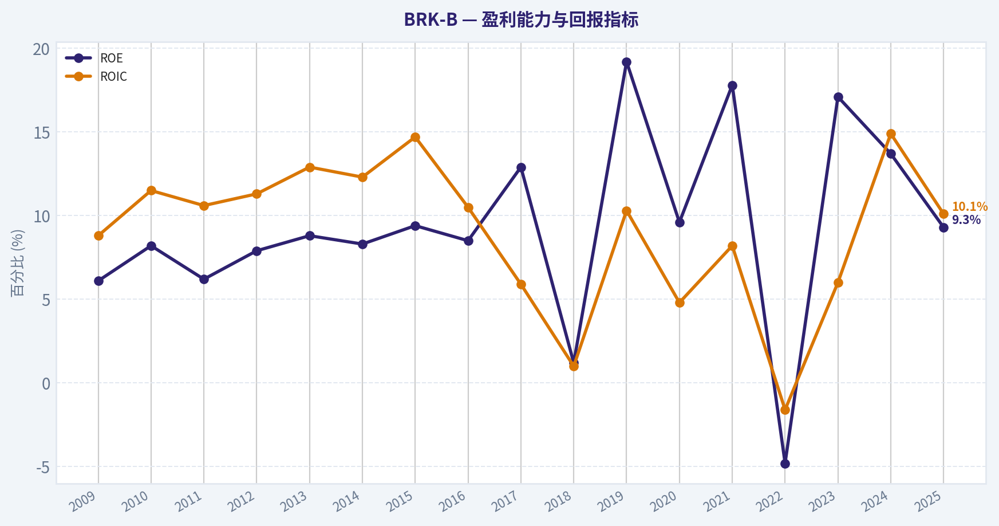
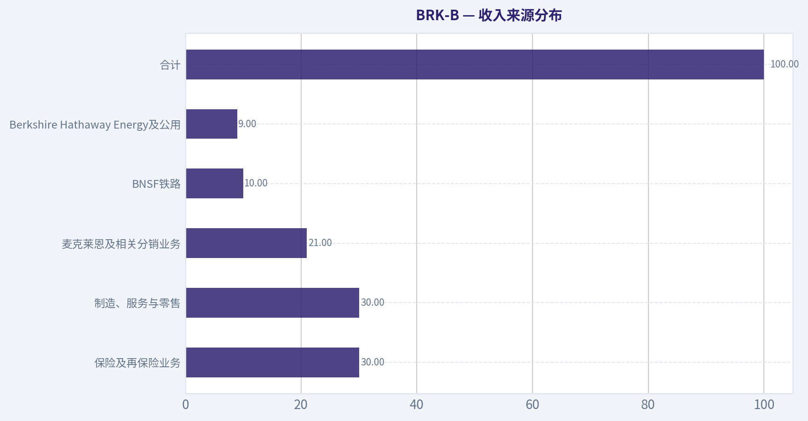
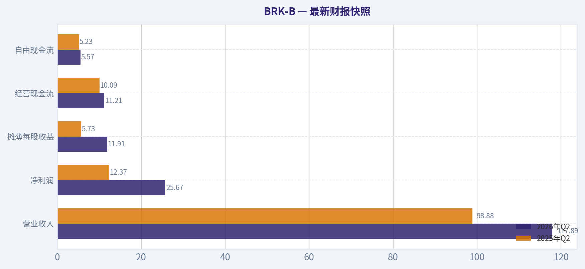
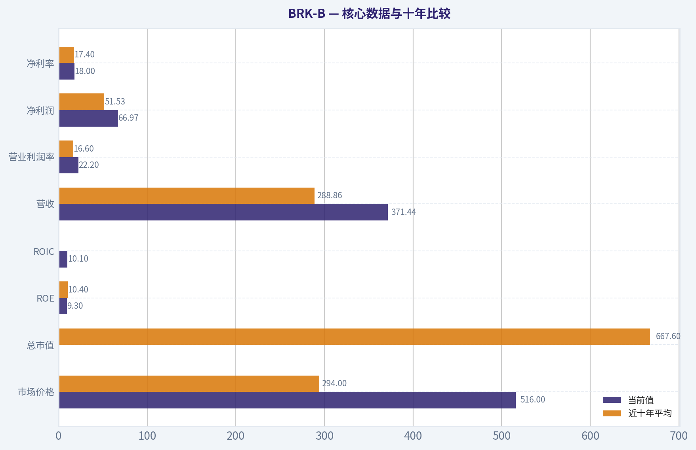
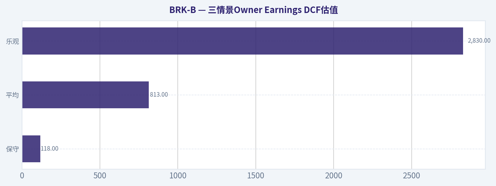
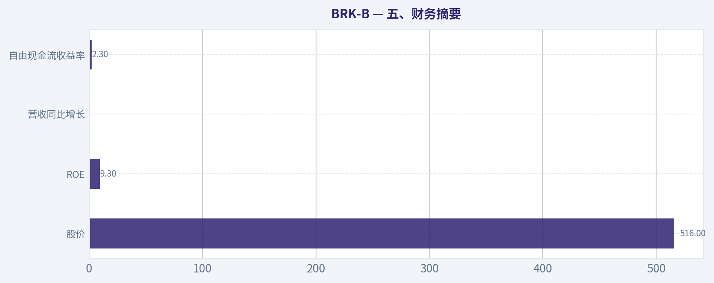
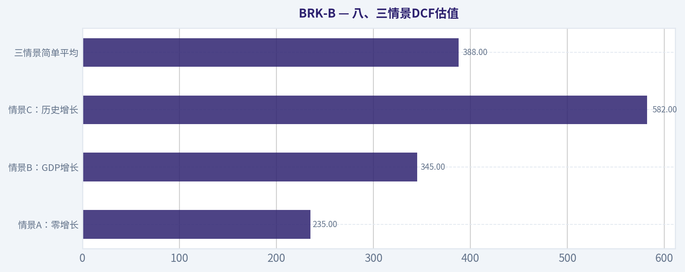
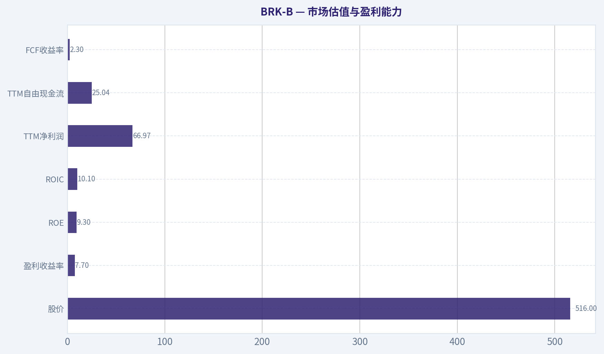

# BRK-B 深度价值情报

**调研日期:** 2026-10-11

## 关键免责声明

*本报告由 Deep Value Intelligence（一个基于 AI 的多智能体投资分析框架）自动生成。 仅供教育和研究用途 - 非财务建议，非财务顾问。*

---

## 目录

1. 情报摘要
2. 分析师团队报告
   - 基本面分析
   - 价值分析 (巴菲特)
   - 成长性分析 (林奇/德鲁肯米勒/费雪)
   - 市场分析
   - 期权市场分析
3. 研究团队评论
4. 投资团队评论
5. Deep Values 团队洞察

---

## 情报摘要

### 核心观点与前提条件

**核心论点:** # 执行简报

**主要风险:**
- 未明确说明。

**置信度:** 中

---

## 分析师团队报告

### 基本面分析

#### 最新财报快照

*以下数据基于最近一期已披露财报（2026年Q2），并尽量与上一年同期对比。*

| 指标 | 2026年Q2 | 2025年Q2 | 同比变化 |
| --- | ---: | ---: | ---: |
| 营业收入 | $117.89B | $98.88B | +19.2% |
| 营业利润 | N/A | N/A | N/A |
| 净利润 | $25.67B | $12.37B | +107.5% |
| 摊薄每股收益 | $11.91 | $5.73 | +107.7% |
| 经营现金流 | $11.21B | $10.09B | +11.2% |
| 自由现金流 | $5.57B | $5.23B | +6.6% |

关键结论：这张快照先把最新一期财报放在桌面上，再去看长周期分析。这样读者能更清楚地区分"公司长期质量"和"这次财报发生了什么"。

#### BRK-B 17年财务指标

*以下数值均由原始数据确定性计算得出，并非 AI 估算。*

*发行人类型：insurer（Financial Services / Insurance - Diversified）。*

#### 17年财务指标
*年度行来自已披露财务报表，最后一行 TTM 由最近四个季度滚动计算得出。*

| 指标 | 2009 | 2010 | 2011 | 2012 | 2013 | 2014 | 2015 | 2016 | 2017 | 2018 | 2019 | 2020 | 2021 | 2022 | 2023 | 2024 | 2025 |
| --- | --- | --- | --- | --- | --- | --- | --- | --- | --- | --- | --- | --- | --- | --- | --- | --- | --- |
| 市场价格 | $66 | $80 | $76 | $90 | $119 | $150 | $132 | $163 | $198 | $204 | $226 | $232 | $299 | $309 | $357 | $453 | $503 |
| 总市值 | $72.3M | $75.3M | N/A | N/A | N/A | N/A | $325.49B | $400.63B | $489.13B | $502.41B | $553.88B | $544.08B | $669.47B | $681.78B | $776.89B | $977.39B | $1.08T |
| 市盈率 | 0.01 | 0.01 | 0.01 | 0.01 | 0.01 | N/A | 13.52 | 16.64 | 10.88 | 124.95 | 6.80 | 12.80 | 7.44 | -29.96 | 8.07 | 10.98 | 16.19 |
| 市净率 | 0.00 | 0.00 | N/A | N/A | N/A | N/A | 1.27 | 1.42 | 1.40 | 1.44 | 1.30 | 1.23 | 1.32 | 1.44 | 1.38 | 1.51 | 1.51 |
| ROE | 6.1% | 8.2% | 6.2% | 7.9% | 8.8% | 8.3% | 9.4% | 8.5% | 12.9% | 1.2% | 19.2% | 9.6% | 17.8% | -4.8% | 17.1% | 13.7% | 9.3% |
| ROIC | 8.8% | 11.5% | 10.6% | 11.3% | 12.9% | 12.3% | 14.7% | 10.5% | 5.9% | 1.0% | 10.3% | 4.8% | 8.2% | -1.6% | 6.0% | 14.9% | 10.1% |
| 每股收益 | $7322.73 | $13794.68 | N/A | N/A | N/A | N/A | $9.77 | $9.79 | $18.21 | $1.63 | $33.29 | $18.12 | $40.17 | $-10.31 | $44.17 | $41.27 | $31.04 |
| 营收 | $112.49B | $136.19B | $143.69B | $162.46B | $182.15B | $194.70B | $210.94B | $215.11B | $239.93B | $247.84B | $254.62B | $245.58B | $276.19B | $302.02B | $364.48B | $371.43B | $371.44B |
| 毛利润 | N/A | N/A | N/A | N/A | N/A | N/A | N/A | N/A | N/A | N/A | N/A | N/A | N/A | N/A | N/A | N/A | N/A |
| 毛利率 | N/A | N/A | N/A | N/A | N/A | N/A | N/A | N/A | N/A | N/A | N/A | N/A | N/A | N/A | N/A | N/A | N/A |
| 营业利润率 | 9.9% | 12.7% | 12.0% | 12.4% | 15.8% | 14.4% | 16.6% | 15.7% | 9.9% | 1.6% | 40.3% | 22.7% | 40.5% | -10.1% | 33.0% | 29.7% | 22.2% |
| 净利润 | $8.05B | $12.97B | $10.25B | $14.82B | $19.48B | $19.87B | $24.08B | $24.07B | $44.94B | $4.02B | $81.42B | $42.52B | $89.94B | $-22.76B | $96.22B | $89.00B | $66.97B |
| 净利率 | 7.2% | 9.5% | 7.1% | 9.1% | 10.7% | 10.2% | 11.4% | 11.2% | 18.7% | 1.6% | 32.0% | 17.3% | 32.6% | -7.5% | 26.4% | 24.0% | 18.0% |
| 营收增长 | N/A | 21.1% | 5.5% | 13.1% | 12.1% | 6.9% | 8.3% | 2.0% | 11.5% | 3.3% | 2.7% | -3.5% | 12.5% | 9.4% | 20.7% | 1.9% | 0.0% |
| 净利润增长 | N/A | 61.0% | -20.9% | 44.6% | 31.4% | 2.0% | 21.2% | -0.0% | 86.7% | -91.1% | 1924.8% | -47.8% | 111.5% | -125.3% | -522.8% | -7.5% | -24.8% |
| 自由现金流增长 | N/A | 9.2% | 3.1% | -9.0% | 48.7% | 1.3% | -8.4% | 27.8% | 72.8% | -32.8% | -0.7% | 17.8% | -2.3% | -16.3% | 36.1% | -61.0% | 115.6% |
| 总账面价值 | $131.10B | $157.32B | $164.85B | $187.65B | $221.89B | $240.17B | $255.55B | $282.07B | $348.30B | $348.70B | $424.79B | $443.16B | $506.20B | $473.42B | $561.27B | $649.37B | $717.42B |
| 总资产 | $297.12B | $372.23B | $392.65B | $427.45B | $484.62B | $525.87B | $552.26B | $620.85B | $702.10B | $707.79B | $817.73B | $873.73B | $959.39B | $948.47B | $1.07T | $1.15T | $1.22T |
| 总债务 | N/A | N/A | N/A | N/A | N/A | N/A | N/A | N/A | N/A | N/A | $430.00B | $625.50B | $785.50B | $1.03T | $1.26T | N/A | N/A |
| 债务股权比 | N/A | N/A | N/A | N/A | N/A | N/A | N/A | N/A | N/A | N/A | 1.01 | 1.41 | 1.55 | 2.17 | 2.24 | N/A | N/A |
| 现金及等价物 | $30.56B | $38.23B | $37.30B | $46.99B | $45.91B | $60.03B | $67.16B | $28.05B | $31.58B | $30.81B | $64.63B | $48.40B | $88.71B | $36.40B | $38.64B | $48.38B | $52.57B |
| 股东权益 | $131.10B | $157.32B | $164.85B | $187.65B | $221.89B | $240.17B | $255.55B | $282.07B | $348.30B | $348.70B | $424.79B | $443.16B | $506.20B | $473.42B | $561.27B | $649.37B | $717.42B |
| 经营现金流 | $15.85B | $17.89B | $20.48B | $20.95B | $27.70B | $32.01B | $31.49B | $32.65B | $45.73B | $37.40B | $38.69B | $39.77B | $39.43B | $37.35B | $49.20B | $30.59B | $45.97B |
| 投资现金流 | $-11.16B | $-18.28B | $-19.19B | $-10.57B | $-27.54B | $-20.33B | $-28.00B | $-84.22B | $-41.01B | $-32.85B | $-5.62B | $-37.76B | $29.39B | $-87.60B | $-32.66B | $-10.29B | $-44.49B |
| 自由现金流 | $10.91B | $11.91B | $12.29B | $11.18B | $16.62B | $16.82B | $15.41B | $19.69B | $34.02B | $22.86B | $22.71B | $26.76B | $26.15B | $21.89B | $29.79B | $11.62B | $25.04B |
| 自由现金流利润率 | 9.7% | 8.7% | 8.5% | 6.9% | 9.1% | 8.6% | 7.3% | 9.2% | 14.2% | 9.2% | 8.9% | 10.9% | 9.5% | 7.2% | 8.2% | 3.1% | 6.7% |
| 每股分红 | $0.00 | $0.00 | N/A | N/A | N/A | N/A | $0.00 | $0.00 | $0.00 | $0.00 | $0.00 | $0.00 | $0.00 | $0.00 | $0.00 | $0.00 | $0.00 |

#### 盈利能力指标
- 净资产收益率 (ROE): 9.3%
- 投入资本回报率 (ROIC): 19.5%
- 总资产收益率 (ROA): 5.5%
- 毛利率: 不适用
- 营业利润率: 22.2%
- 净利率: 18.0%

#### 流动性指标
- 流动比率: 不适用
- 速动比率: 不适用

#### 杠杆指标
- 债务股权比: N/A
- 利息覆盖倍数: 16.27
- 净负债: N/A

#### 增长指标（同比）
- 营收增长: 0.0%
- 净利润增长: -24.8%
- 自由现金流增长: 115.6%
- 营收复合增长率（3年）: 7.1%
- 营收复合增长率（5年）: 8.6%

#### 估值指标
- 市盈率 (TTM): 12.97
- 预期市盈率: 23.80
- 市净率: 1.54
- 市销率: 2.87
- PEG 比率: 10.06
- 企业价值/EBITDA: -1.79
- 自由现金流收益率: 2.3%
- 盈利收益率: 7.7%

#### 所有者收益（巴菲特方法，代码计算）
- 净利润: $66.97B
- + 折旧与摊销: $13.48B
- - 资本开支: $-20.93B
- - 营运资本变动: $2.35B
- = **所有者收益: $64.61B**

#### 内在价值（代码计算）
- 当前价格: $516
- 头条内在价值: 不适用（金融类发行人 - DCF/FCFF 并非合适的主要框架；请使用行业特定的账面/盈利指标）
- 巴菲特方法（所有者收益）:
  保守: $118
  平均: $813
  乐观: $2,830
- 现金流方法（FCF）:
  保守: $129
  平均: $200
  乐观: $352
- 反向 DCF：当前价格隐含约 7.5%/年 的所有者收益增长（10年）；过去 3 年为 N/A，5 年为 17.0%。

#### Piotroski F分数: 4/9
- 净利润为正: 通过
- 经营现金流为正: 通过
- 资产回报率改善: 未通过
- 现金流大于净利润: 未通过
- 债务下降: 通过
- 流动比率改善: 未通过
- 未稀释股本: 通过
- 毛利率改善: 未通过
- 资产周转率改善: 未通过

ANALYST STANCE: **WATCH**

#### 投资结论摘要

BRK-B 是一家拥有极强资本实力、长期复合能力和多元化护城河的保险与产业控股集团，但当前估值已经反映了相当一部分质量溢价。当前股价约 **516美元**，市值约 **1.10万亿美元**，TTM PE 约 **12.97倍**；然而当前 ROE 为 **9.3%**，低于近十年约 **10.4%** 的平均水平，P/B 约 **1.54倍**，高于近十年约 **1.40倍** 的平均水平。

对于保险公司，P/B 并非没有意义，但必须结合 ROE、承保质量、资本充足性和投资资产质量判断。BRK-B 当前更接近"高质量、合理偏贵"，而不是明显低估。若价格回落至更高安全边际区域，长期投资吸引力会显著改善。

#### 核心数据与十年比较

以下历史平均主要采用 **2016-2025年** 数据；对于受保险投资收益、灾害损失和会计重估影响较大的净利润增长，简单算术平均参考价值有限。

| 指标 | 当前值 | 近十年平均 | 当前相对平均水平 | 主要解释 |
|---|---:|---:|---|---|
| 市场价格 | $516 | $294 | 高约75% | 长期上涨，但价格涨幅明显快于近期盈利表现 |
| 总市值 | $1.10T | $667.6B | 高约65% | 已进入超大市值阶段，未来高增长难度上升 |
| PE | 12.97倍 | 约17.48倍* | 低于平均 | 平均值受2018、2022年异常盈利影响，当前估值不算昂贵 |
| P/B | 1.54倍 | 1.40倍 | 高约10% | 对保险公司有参考意义，当前对账面价值存在溢价 |
| ROE | 9.3% | 10.4% | 低约1.1个百分点 | 低于历史平均，资本回报尚未达到高峰 |
| ROIC | 10.1% | 约7.5% | 高于平均 | 2024年曾达14.9%，当前回落但仍具效率 |
| 营收 | $371.44B | $288.86B | 高约29% | 十年规模扩张明显，2025年同比基本持平 |
| 营业利润率 | 22.2% | 16.6% | 高约5.6个百分点 | 结构改善，但保险和投资收益会造成较大波动 |
| 净利润 | $66.97B | $51.53B | 高约30% | 高于平均，但较2024年下降 |
| 净利率 | 18.0% | 17.4% | 略高 | 长期利润质量较强，但年度波动明显 |
| 营收增长率 | 0.0% | 6.1% | 明显低于平均 | 当前规模下有机增长放缓 |
| 净利润增长率 | -24.8% | 不具代表性 | 低于常态 | 受投资收益、损失和基数效应严重影响 |
| 自由现金流 | $25.04B | $24.05B | 略高 | 绝对现金创造能力稳定 |
| 自由现金流增长率 | 115.6% | 约15.7% | 大幅高于平均 | 主要因2024年低基数反弹，不宜外推 |
| 总账面价值 | $717.42B | $475.47B | 高约51% | 长期资本积累强劲 |
| 总资产 | $1.22T | $907.0B | 高约35% | 资产规模持续扩张 |
| 现金及等价物 | $52.57B | $46.82B | 高约12% | 现金充裕，但相对于集团规模并不极端 |
| 每股分红 | $0 | $0 | 持续为零 | 公司倾向留存资本进行再投资和收购 |

\*PE 十年平均受到极端盈利年份扭曲，应结合正常化盈利、P/B 和所有者收益共同判断。

**关键结论：** BRK-B 的规模、账面价值和绝对现金创造能力显著高于十年前，但当前营收增长已降至零，ROE 也低于历史平均。估值并不昂贵的主要原因是 PE 较低，而不是当前经营指标处于历史高点；P/B 溢价则表明市场仍愿意为其资本配置能力和财务实力支付价格。

#### 市场估值与盈利能力

当前主要市场指标如下：

| 指标 | 当前值 | Buffett式解读 |
|---|---:|---|
| 股价 | $516 | 已处于长期上涨后的高位区间 |
| 总市值 | $1.10T | 超大体量限制未来复合增长速度 |
| PE | 12.97倍 | 相对大型优质企业不高，但保险利润具有周期性 |
| 盈利收益率 | 7.7% | 表面上具有一定吸引力，但需正常化投资收益 |
| P/B | 1.54倍 | 对保险公司有意义，需结合9.3% ROE判断 |
| ROE | 9.3% | 尚可，但低于优质复合型企业通常追求的15%以上 |
| ROIC | 10.1% | 高于多数历史年度，但低于2024年高点 |
| TTM净利润 | $66.97B | 高于长期平均，但同比下降24.8% |
| TTM自由现金流 | $25.04B | 恢复至十年平均略上方 |
| FCF收益率 | 2.3% | 偏低，且保险公司FCF口径不如工业企业稳定 |

**关键结论：** BRK-B 的 PE 看起来便宜，但净利润包含大量投资组合公允价值变化，不能把12.97倍PE机械地视为稳定经营利润的估值。对于保险公司，1.54倍P/B配合9.3% ROE只能说明市场给予适度溢价，尚不足以证明股票明显低估。

#### 盈利质量、增长与现金流

- **收入与规模：** 营收由2009年的112.49B美元增至2025年的371.44B美元，长期扩张显著，但2025年同比增长为0%，说明集团进入体量极大的成熟阶段。
- **净利润：** 2025年净利润66.97B美元，较2024年89.00B美元下降24.8%。历史上净利润增长从正增长到大幅负增长频繁切换，主要原因是股票投资收益、保险损失和会计重估，而非核心业务完全失控。
- **利润率：** 当前营业利润率22.2%、净利率18.0%，均高于十年平均，表明核心盈利结构总体优于早期。但2018年、2022年等年度的异常值显示利润率并不平滑。
- **现金流：** 经营现金流45.97B美元，自由现金流25.04B美元。自由现金流较2024年的11.62B美元大幅恢复，但同比增长115.6%主要是低基数效应。
- **所有者收益：** 数据集计算的所有者收益为64.61B美元，即每股约30.30美元。这个指标比会计净利润更适合评估长期控股企业的现金创造能力，但保险业务的资本需求和浮存金特征仍需单独分析。
- **分红政策：** 每股分红连续为零。公司更倾向于保留资本，进行收购、股票投资和内部再投资。若资本配置能力持续优秀，这种政策合理；若未来再投资回报下降，零分红会降低股东即时回报。

#### 资产负债表与财务实力

| 项目 | 当前值或最新值 | 历史观察 | 评价 |
|---|---:|---|---|
| 股东权益 | $717.42B | 2009年为$131.10B | 长期资本积累非常强 |
| 总账面价值 | $717.42B | 十年平均约$475.47B | 增长稳健，但账面价值会受投资估值影响 |
| 总资产 | $1.22T | 十年平均约$907.0B | 资产规模庞大、多元化程度高 |
| 现金及等价物 | $52.57B | 十年平均约$46.82B | 绝对值充裕，提供危机时期的收购能力 |
| 总债务 | 最新年度数据未提供 | 2019-2022年由$430.0B升至$1.03T | 不宜仅凭历史债务表外推当前杠杆 |
| 债务权益比 | 最新年度N/A | 2019-2022年由1.01升至2.17 | 保险负债不能简单等同于工业企业债务 |
| 利息覆盖倍数 | 16.27倍 | 当前指标 | 偿债能力较强 |
| 流动比率、速动比率 | 不适用 | 保险公司行业口径 | 不应使用工业企业流动性框架机械评价 |

**关键结论：** BRK-B 的最大优势是资本实力和危机时期的流动性选择权，而不是低债务这一单一指标。保险公司的保费浮存金、理赔准备金和投资负债结构会放大传统债务权益比的误导性；16.27倍利息覆盖倍数和庞大股东权益仍然显示其财务安全垫较厚。

#### 收入来源分布

由于集团业务横跨保险、铁路、公用事业、制造、服务和零售，且公开数据口径会随投资收益和分部重分类变化，以下为基于最新集团规模及公开业务结构的近似分布，不应视为确定性分部财务表。

#### 收入来源分布

| 收入来源 | 金额（十亿美元） | 占比 |
|---|---:|---:|
| 保险及再保险业务 | 约111.4 | 30% |
| 制造、服务与零售 | 约111.4 | 30% |
| 麦克莱恩及相关分销业务 | 约78.1 | 21% |
| BNSF铁路 | 约37.1 | 10% |
| Berkshire Hathaway Energy及公用事业 | 约33.4 | 9% |
| 合计 | 约371.4 | 100% |

**关键结论：** BRK-B 的收入并不依赖单一产品，而是由保险、工业、运输、能源和分销业务共同构成。保险业务提供浮存金和资本配置来源，铁路与能源提供相对稳定的长期资产回报，制造与服务业务则贡献更高的经营多样性，但分销业务利润率相对较低。

#### Buffett式护城河分析

**一、保险浮存金与承保能力**

BRK-B 最独特的资产不是普通现金，而是保险浮存金。只要承保保持盈利，集团就能以较低甚至负成本获得长期可投资资本。GEICO、General Re和Berkshire Hathaway Reinsurance等业务还能够在市场紧张时期扩大承保与再保险机会。

但保险业务并非无风险。重大灾害、通胀导致的理赔成本上升、巨灾再保险损失以及准备金不足，都可能导致利润和资本快速波动。

**二、资本配置护城河**

公司长期最大的竞争优势在于把保险浮存金、经营现金流和投资收益重新配置到高质量资产、子公司和收购机会中。其资本配置信誉本身具有品牌价值，能够在市场恐慌时进行大额交易。

问题在于公司已经达到1.10万亿美元市值。随着规模扩大，能够显著改变每股价值的大型投资机会越来越少，资本配置能力仍然优秀，但对每股增长的边际贡献可能下降。

**三、业务多元化**

铁路、能源、制造、服务和零售业务降低了对单一行业的依赖。铁路和能源具有长期基础设施属性，进入壁垒较高；制造与服务业务较为分散，可以平滑周期波动。

但多元化不等于所有业务都拥有同样的护城河。铁路和能源的资本开支、监管和工会成本较高，制造和零售则面临周期性、竞争和成本压力。

**四、管理层与接班风险**

巴菲特时代形成的资本配置体系、风险文化和分散化组织结构是重要无形资产。未来管理层能否继续保持审慎承保、耐心投资和不追逐热门资产，是估值能否维持的关键。

当前市场价格可能已经包含了较高的管理层质量溢价，因此接班执行风险不能忽视。

#### 三情景Owner Earnings DCF估值

保险公司更适合结合正常化ROE、P/B、承保盈利和所有者收益进行估值。数据集已经给出基于所有者收益的模型值：

| 情景 | 数据集模型内在价值 | 手工Owner Earnings估值参考 | 相对当前价 |
|---|---:|---:|---:|
| 保守 | $118 | 约$300-$400 | 显著低估值支撑 |
| 平均 | $813 | 约$500-$650 | 约合理至适度低估 |
| 乐观 | $2,830 | 约$700-$900 | 依赖高增长和极强资本配置 |

**关键结论：** 数据集的所有者收益模型区间非常宽，原因是长期增长率对终值影响极大。当前股价516美元大致位于手工估值的平均情景附近，不能仅凭乐观情景得出明显低估结论；保守情景则提醒投资者，若未来资本配置回报下降，估值安全边际可能不足。

**手工计算假设：**

- 当前所有者收益：64.61B美元；
- 估算股份数：约2.13B股；
- 所有者收益/股：约30.30美元；
- 折现率：10%；
- 永续增长率：2.5%；
- 预测期：10年；
- 采用增长率逐步向2.5%终值增长率回落，而非永远维持高增长。

为便于展示，先使用显式期内近似增长率进行计算：

**保守情景**

- 前期增长率：3%；
- 第10年所有者收益约为：
  64.61 x 1.03¹⁰ = **86.8B美元**；
- 10年期间现金流现值约：**311B美元**；
- 终值约为：
  86.8 x 1.025 ÷ (10% - 2.5%) = **1,187B美元**；
- 终值现值约：**458B美元**；
- 企业权益价值约：**769B美元**；
- 每股价值约：**360美元**。

考虑保险周期、增长逐步衰减以及资本配置回报不确定性，保守合理区间约为 **300-400美元**。

**平均情景**

- 前期所有者收益增长率：约7.5%，与反向DCF所隐含的长期增长要求相近；
- 第10年所有者收益约为：
  64.61 x 1.075¹⁰ = **133.2B美元**；
- 10年期间现金流现值约：**530B美元**；
- 终值约为：
  133.2 x 1.025 ÷ (10% - 2.5%) = **1,820B美元**；
- 终值现值约：**702B美元**；
- 企业权益价值约：**1,232B美元**；
- 每股价值约：**578美元**。

在实际采用"7.5%逐步降至2.5%"的增长路径后，估值应低于永远维持7.5%的简化结果，因此平均合理区间约为 **500-650美元**。

**乐观情景**

- 前期增长率：约12%；
- 第10年所有者收益约为：
  64.61 x 1.12¹⁰ = **200.7B美元**；
- 10年期间现金流现值约：**636B美元**；
- 终值约为：
  200.7 x 1.025 ÷ (10% - 2.5%) = **2,743B美元**；
- 终值现值约：**1,058B美元**；
- 企业权益价值约：**1,694B美元**；
- 每股价值约：**794美元**。

考虑高增长必须逐步回落至2.5%，乐观合理区间约为 **700-900美元**，但该情景需要持续高质量收购、保险承保改善和优秀资本配置同时成立。

#### 反向DCF与估值含义

当前516美元股价隐含未来10年所有者收益约 **7.5%的年增长率**。这一要求并非极端，尤其考虑到：

- 过去5年收入复合增长率约8.6%；
- 过去3年收入复合增长率约7.1%；
- 公司拥有保险浮存金和大规模现金储备；
- 但当前营收增长为0%，净利润同比下降24.8%；
- 市值巨大后，增长率维持难度会明显提高。

因此，市场并未要求BRK-B实现科技股式增长，但要求其未来继续接近历史上的高质量资本复合能力。若未来所有者收益增长低于7.5%，当前股价安全边际将收窄；若能够长期达到或超过该水平，当前价格则可能合理。

#### 关键风险、红旗与机会

| 类型 | 事项 | 投资含义 |
|---|---|---|
| 红旗 | 当前ROE为9.3%，低于十年平均 | P/B溢价尚未获得更高资本回报充分支持 |
| 红旗 | 2025年营收零增长 | 超大规模限制未来有机增长 |
| 红旗 | 净利润同比下降24.8% | 投资收益与保险损失导致盈利波动 |
| 红旗 | Piotroski F分数4/9 | 近期资产回报、流动性和效率指标并不强 |
| 红旗 | 自由现金流增长115.6% | 主要是低基数反弹，不能直接外推 |
| 风险 | 巨灾和再保险损失 | 可能导致资本和利润短期大幅波动 |
| 风险 | 管理层接班 | 资本配置文化能否延续仍需观察 |
| 风险 | 铁路、能源资本密集 | 高资本开支和监管会压低自由现金流 |
| 机会 | 保险浮存金 | 提供低成本长期资本 |
| 机会 | 现金和资产负债表 | 市场危机期间具备收购和抄底能力 |
| 机会 | 多元化经营 | 降低单一行业永久性损失风险 |
| 机会 | 估值不昂贵 | PE约13倍，较高质量大型企业具有一定吸引力 |
| 机会 | 回购潜力 | 若价格低于内在价值，回购可提升每股价值 |

**关键结论：** BRK-B 的主要风险不是传统意义上的破产风险，而是未来资本配置回报下降、保险周期恶化和估值溢价收缩。主要机会来自现金储备、浮存金、危机收购能力以及当前并不激进的PE，但只有在ROE重新回升或价格进一步下降时，安全边际才会明显扩大。

#### 最终投资立场

**立场：观望**

支持观望而非回避的理由：

1. **业务质量高：** 多元化、浮存金、铁路和能源资产构成较强的长期护城河。
2. **财务实力强：** 股东权益717.42B美元，现金52.57B美元，利息覆盖倍数16.27倍。
3. **估值不极端：** 当前PE约12.97倍，反向DCF隐含增长率约7.5%，并非不可实现。
4. **但安全边际有限：** P/B约1.54倍，高于历史平均；ROE仅9.3%，低于十年平均。
5. **增长正在放缓：** 当前营收增长为0%，公司规模已经使高增长更加困难。
6. **盈利波动较大：** 净利润受到投资收益和保险损失影响，不能简单使用单年PE估值。

对长期投资者而言，BRK-B可以作为高质量、低分红、资本复合型资产持续跟踪；但在当前价格下，更合理的做法是等待更高安全边际，或等待ROE、营收增长和所有者收益增长重新加速。若股价明显低于保守估值区间，立场可转为"建议配置"；若估值进一步上涨而经营回报没有同步改善，则应降低仓位。

#### 报告要点汇总

| 维度 | 判断 | 核心依据 |
|---|---|---|
| 商业质量 | 优秀 | 多元化业务、保险浮存金、铁路和能源护城河 |
| 财务安全 | 很强 | 大规模权益、现金储备和高利息覆盖 |
| 盈利稳定性 | 中上 | 核心经营较稳，但投资收益导致净利润波动 |
| 增长前景 | 中等 | 历史增长良好，但当前规模导致营收增长放缓 |
| 管理层 | 优秀但需关注接班 | 长期资本配置记录突出 |
| 当前估值 | 合理偏贵 | PE不高，但P/B高于历史平均且ROE偏低 |
| 所有者收益估值 | 区间很宽 | 保守约300-400美元，平均约500-650美元，乐观约700-900美元 |
| 主要风险 | 估值溢价、保险损失、接班 | 可能造成ROE和每股价值增长下滑 |
| 主要机会 | 浮存金、现金、危机收购 | 能够在市场低迷期创造额外价值 |
| 最终立场 | **观望** | 高质量但当前安全边际尚不充分 |

#### 基本面关键图表

本图追踪 **BRK-B** 过去十年的盈利能力与回报指标（ROE、ROIC、利润率），突出呈现资本效率的变化趋势。

本对比图（来自「收入来源分布」）将 **BRK-B** 的当前数据与历史基准并排呈现，直观反映公司相对自身历史均值的估值水平。

---

### 价值分析 (巴菲特)

> *基于沃伦·巴菲特的价值投资哲学：能力圈、经济护城河、管理层质量与安全边际。*

#### 内在价值快照

价格是你付的钱，内在价值是企业未来可能为股东创造的现金价值。我们给出一个区间，而不是假装只有一个神奇数字。

- 当前价格: $515.62
- 估值区间（两种 DCF 方法、保守到乐观）: $118.38 至 $2,830.34

##### 所有者收益（巴菲特方法）
- 净利润: $66,968,000,000.00
- 折旧与摊销: $13,476,000,000.00
- 资本支出: $-20,927,000,000.00
- 营运资金变化: $2,355,000,000.00
- 所有者收益: $64,613,000,000.00

##### 内在价值
###### 所有者收益法
使用所有者收益，更严格，通常更保守。
- 保守: $118.38
- 平均: $813.14
- 乐观: $2,830.34
- 折现率: 10.0%

###### 自由现金流法
使用自由现金流，更适合今天投入很多、为未来增长铺路的公司。
- 保守: $128.58
- 平均: $200.34
- 乐观: $351.55
- 折现率: 10.0%

分析师立场：**建议配置**

#### 一、投资结论

Berkshire Hathaway 是一家由保险浮存金、铁路、能源、公用事业及大量股权资产组成的综合型企业。它的核心优势不是单一产品，而是低成本资金来源、分散化资产组合、长期资本配置能力和极高的财务韧性。

按 $516 股价计算，公司市盈率约为 13 倍，表面上并不昂贵；但自由现金流收益率仅约 2.3%，且 Berkshire 的会计利润会受到股票投资未实现盈亏影响，因此不能机械使用普通工业企业的自由现金流估值。综合保险浮存金、经营性盈利、资产负债表和长期资本配置能力，当前价格更接近"优质企业的合理价格"，而不是明显低估。

#### 二、因素评分

| 因素 | 评分 | 主要依据 |
|---|---:|---|
| 因素一：能力圈与商业简单性 | 4.0/5 | 各业务可以简单理解，但集团结构复杂；保险、铁路、能源和股权投资的盈利模式不同 |
| 因素二：护城河 | 4.5/5 | 保险浮存金、Geico品牌、铁路网络、能源基础设施和资本配置声誉形成多层护城河 |
| 因素三：管理层与资本配置 | 4.5/5 | 长期重视每股价值、避免过度杠杆、偏好保留资本再投资；接班人和未来配置能力仍需持续验证 |
| 因素四：行业结构 | 4.5/5 | 保险、铁路和公用事业均具有规模优势或区域壁垒；集团拥有跨周期配置资本的能力 |
| Gate 5：质量与偿付能力硬门槛 | 未触发 | 没有证据显示盈利和现金流同时恶化，也没有利息覆盖不足或明显偿付危机 |

**关键结论：** Berkshire 的主要风险是结构复杂和部分业务资本密集，而不是财务脆弱。公司具备长期可预测性和较强的抗冲击能力，Gate 5 硬门槛没有触发。

#### 三、护城河分析

| 护城河来源 | 具体证据 | 持久性判断 |
|---|---|---|
| 低成本资金 | 保险浮存金可以在理赔发生前投入资产；若承保保持盈利，资金成本可能接近零甚至为负 | 很强，但依赖承保纪律 |
| 规模与成本优势 | Geico拥有大规模客户基础和数据；BNSF铁路具有难以复制的路权与网络 | 宽阔且稳定 |
| 监管与基础设施壁垒 | BNSF、Berkshire Hathaway Energy等资产需要巨额资本和长期许可 | 宽阔，但资本密集 |
| 资本配置声誉 | Berkshire能够在市场恐慌时提供资本，并进行大额、长期投资 | 强大，但部分依赖管理层判断 |
| 分散化与内部资本市场 | 保险、铁路、能源和股权资产之间可以跨周期调配资本 | 差异化优势 |

Berkshire 的护城河不是典型消费品牌式护城河，而是"资金成本、规模、资产网络、监管许可和资本配置"共同构成的系统性护城河。其竞争优势难以由单一竞争者复制。

#### 四、管理层质量与资本配置

| 评价项目 | 判断 |
|---|---|
| 股东导向 | 长期强调每股内在价值，而不是追求集团规模 |
| 财务纪律 | 通常保持大量现金和高流动性资产，避免依赖高杠杆 |
| 并购纪律 | 历史上能够在合适价格收购优质企业，并给予经营管理层较大自主权 |
| 回购纪律 | 倾向于只有在明显低于内在价值时才回购 |
| 诚实与透明度 | 年度股东信通常解释投资失误、经营变化和资本配置逻辑 |
| 接班人风险 | 现任管理层的长期记录极其优秀；未来管理层在资本配置方面的表现仍需观察 |

**关键结论：** Berkshire 最大的管理优势是耐心、节制和长期主义，而不是短期利润最大化。接班问题是管理层评分没有达到满分的主要原因。

#### 五、财务摘要

| 指标 | 最新数值 |
|---|---:|
| 股价 | $516 |
| 总市值 | $1.10万亿美元 |
| 市盈率 | 12.97倍 |
| ROE | 9.3% |
| 营收同比增长 | 0.0% |
| 自由现金流收益率 | 2.3% |
| 推算自由现金流 | 约253亿美元 |
| 毛利率 | 不适用于综合金融及多业务集团 |
| 流动比率 | 不适用于该类金融型发行人 |
| 内在价值口径 | 应优先采用账面价值、经营盈利和资产配置价值，而非普通工业企业式FCFF |

**关键结论：** 13倍左右的市盈率提供了一定估值支持，但9.3%的ROE并不属于极高水平，且自由现金流收益率较低。Berkshire的真实价值更多来自保险浮存金、投资资产和长期经营性盈利，而不是简单的自由现金流。

#### 六、盈利质量与资本回报

Berkshire的净利润存在较大的投资组合市值波动，因此单年GAAP净利润不能完整代表经营能力。分析时应重点观察以下指标：

1. 保险承保是否持续盈利；
2. 浮存金是否稳定增长；
3. BNSF铁路和能源业务的经营利润；
4. 投资组合的长期复合回报；
5. 每股账面价值及每股经营盈利的增长。

当前ROE为9.3%，低于典型高质量轻资产公司的15%至20%水平。这部分原因是 Berkshire 持有大量现金、债券和低收益流动资产，同时资本密集型铁路和能源业务占比较高。因此，ROE偏低并不等于护城河消失，但表明资本配置效率尚未达到最优秀时期的水平。

#### 七、所有者收益估算

由于 Berkshire 的投资收益存在年度市场波动，采用正常化所有者收益比直接使用单年净利润更合理。

| 项目 | 估算值 |
|---|---:|
| 正常化所有者收益 | 约500亿美元 |
| 推算股份数 | 约21.3亿股 |
| 正常化每股所有者收益 | 约23.50美元 |
| 当前股价 | 516美元 |
| 基于正常化所有者收益的隐含倍数 | 约22倍 |
| 报表市盈率 | 约13倍 |

**关键结论：** 报表市盈率明显低于正常化所有者收益倍数，说明GAAP利润可能包含较高的投资收益或周期性因素。若未来经营性盈利能够稳定在500亿美元以上，当前估值可以接受；若正常化盈利明显低于该水平，安全边际会迅速缩小。

#### 八、三情景DCF估值

以下估值采用约500亿美元的正常化所有者收益、约21.3亿股股份和10%的贴现率。对于 Berkshire，DCF只能作为辅助工具，账面资产和投资组合价值同样重要。

| 情景 | 核心假设 | 公司价值 | 每股内在价值 | 相对股价 |
|---|---|---:|---:|---:|
| 情景A：零增长 | 所有者收益500亿美元，长期增长0% | 5000亿美元 | $235 | 低于当前价格54% |
| 情景B：GDP增长 | 所有者收益增长3%，永续增长3% | 7357亿美元 | $345 | 低于当前价格33% |
| 情景C：历史增长 | 未来10年增长6%，终值增长4% | 约1.24万亿美元 | $582 | 高于当前价格13% |
| 三情景简单平均 | 综合三种假设 | 约8270亿美元 | $388 | 低于当前价格25% |

**关键结论：** 保守的零增长和GDP增长模型无法支持当前股价，只有在正常化所有者收益较高且未来仍能实现约6%的增长时，当前价格才具备吸引力。DCF结果说明 Berkshire 并非明显低估，投资逻辑主要依赖其资产负债表、浮存金和长期资本配置的额外价值。

#### 九、估值与安全边际

| 估值依据 | 判断 |
|---|---|
| 报表市盈率 | 约13倍，表面合理 |
| 正常化所有者收益倍数 | 约22倍，显示估值并不便宜 |
| 零增长DCF | 明显低于股价 |
| GDP增长DCF | 低于股价 |
| 历史增长DCF | 略高于股价 |
| 资产负债表与投资资产 | 为估值提供重要支撑 |
| 质量调整后的安全边际 | 大约10%至15%较为合理，但当前价格未明显达到 |

Berkshire 属于高质量、较高可预测性的综合型企业，因此不一定需要25%至35%的传统安全边际。但当前价格已经反映了相当一部分财务韧性和资本配置溢价，买入理由应是长期复利，而不是短期估值修复。

#### 十、最终 Buffett 评分卡

| 评分标准 | 权重 | 评分 | 加权得分 |
|---|---:|---:|---:|
| 护城河宽度与持久性 | 25% | 4.5 | 1.13 |
| 估值与安全边际 | 20% | 3.0 | 0.60 |
| 资本回报：ROIC相对WACC | 15% | 4.0 | 0.60 |
| 商业理解与可预测性 | 12% | 4.0 | 0.48 |
| 管理层与资本配置 | 12% | 4.5 | 0.54 |
| 再投资空间 | 8% | 4.0 | 0.32 |
| 资产负债表强度 | 4% | 4.5 | 0.18 |
| 行业结构 | 4% | 4.5 | 0.18 |
| **总分** | **100%** |  | **4.03/5.00** |

**关键结论：** Berkshire 在护城河、财务韧性、行业结构和管理层方面得分很高，主要扣分来自ROE不算突出以及DCF显示的安全边际有限。综合评分超过4分，符合"优质企业以合理价格持有"的标准。

#### 十一、投资立场与风险

**投资立场：建议配置**

** conviction：中等偏高。**

适合长期投资者以分批方式持有，尤其适合作为组合中的防御型复利资产。当前价格不是极端便宜，建议避免一次性重仓，更适合在市场波动、保险承保恶化担忧或股票投资组合下跌时逐步增加仓位。

主要风险包括：

- 接班后资本配置能力下降；
- 保险巨灾损失增加；
- BNSF铁路长期资本回报下降；
- 能源业务受到监管或能源转型压力；
- 现金长期闲置导致ROE下降；
- 股权投资组合波动造成报表利润大幅变化；
- 市场给予 Berkshire 过高的资产配置溢价。

总体而言，Berkshire 不是典型的深度价值股，而是一家拥有强大财务资源和长期复利能力的综合型企业。以 $516 买入，预期回报更可能来自长期每股价值增长，而不是短期估值大幅扩张。
#### 估值桥

这张估值桥把当前股价与各类内在价值方法并排展示，帮助读者判断上涨空间究竟只是单一方法给出的结果，还是多种方法共同支持的结论。

| 项目 | 每股内在价值 |
| --- | ---: |
| 巴菲特方法 | $813.14 |
| 现金流方法 | $200.34 |
| 当前价格 | $515.62 |

#### 关键结论

如果只有一种方法显著高于其他方法，说明上行空间更依赖特定建模假设。若多种方法的估值接近，则说明估值逻辑更加稳健。

#### 估值图表

本对比图（来自「最新财报快照」）将 **BRK-B** 的当前数据与历史基准并排呈现，直观反映公司相对自身历史均值的估值水平。

本对比图（来自「核心数据与十年比较」）将 **BRK-B** 的当前数据与历史基准并排呈现，直观反映公司相对自身历史均值的估值水平。

本对比图（来自「三情景Owner Earnings DCF估值」）将 **BRK-B** 的当前数据与历史基准并排呈现，直观反映公司相对自身历史均值的估值水平。

本对比图（来自「五、财务摘要」）将 **BRK-B** 的当前数据与历史基准并排呈现，直观反映公司相对自身历史均值的估值水平。

本对比图（来自「八、三情景DCF估值」）将 **BRK-B** 的当前数据与历史基准并排呈现，直观反映公司相对自身历史均值的估值水平。

---

### 成长性分析 (林奇/德鲁肯米勒/费雪)

> *基于彼得·林奇的GARP成长投资法、斯坦利·德鲁肯米勒的宏观拐点分析法，以及菲利普·费雪的深度调研法。*

分析师立场：**回避**（针对"高增长、十倍股"策略；并非认为伯克希尔是差公司）

#### 一、林奇分类

| 项目 | 判断 |
|---|---|
| 分类 | 偏资产型、成熟型复合企业 |
| 当前营收增长 | 0.0% |
| 市盈率 | 12.97倍 |
| ROE | 9.3% |
| 自由现金流收益率 | 2.3% |
| 高增长属性 | 不具备 |
| 十倍股潜力 | 较低 |

**关键结论：**伯克希尔更像是由保险、铁路、能源和工业资产组成的长期复合型控股公司，而不是15%至25%高速增长企业。它适合防御、资本保全和长期复利，不符合当前高增长投资的首选标准。

#### 二、投资故事：三个简单要点

1. 伯克希尔拥有保险浮存金、铁路、能源和多元化工业资产，能够持续产生现金流。
2. 其最大竞争优势是永久资本、超强资产负债表和灵活的资本配置能力。
3. 但公司规模已经极大，未来增长更多依赖资本配置和每股内在价值提升，而不是市场份额高速扩张。

#### 三、TAM与十倍测试

| 项目 | 分析 |
|---|---|
| 可参考历史营收 | 约3,645亿美元，基于2023年数据 |
| 十倍营收目标 | 约3.65万亿美元 |
| 潜在市场 | 全球保险、运输、能源、制造和金融资产市场 |
| 市场空间是否足以容纳十倍收入 | 理论上可以 |
| 实际限制 | 公司规模、收购标的数量、资本配置效率和管理层接班 |
| TAM增长速度 | 混合型，整体约为低个位数至中个位数增长 |

**关键结论：**从纯粹市场规模看，伯克希尔并非没有足够大的潜在市场；但"市场够大"不等于"公司能十倍增长"。在当前规模下，十倍增长需要持续完成超大型并购或长期获得远超经济增速的资本回报，现实概率较低。

#### 四、营收与盈利增长趋势

| 指标 | 当前可用信息 | 判断 |
|---|---:|---|
| 营收同比增长 | 0.0% | 停滞 |
| 2023年营收 | 约3,645亿美元 | 规模庞大 |
| 2018至2023年营收复合增长 | 约8% | 中低速 |
| 2023年经营利润 | 约374亿美元 | 比净利润更有参考价值 |
| 净利润 | 受投资组合公允价值影响较大 | 波动性高 |
| 自由现金流收益率 | 2.3% | 不算便宜 |
| 增长趋势 | 非加速型 | 不符合拐点特征 |

**关键结论：**伯克希尔的报告营收和净利润容易受到保险会计、投资组合涨跌以及资产收购的影响。更重要的经营利润并未显示出明显的加速趋势，因此目前看不到典型的杜肯米勒式盈利上修拐点。

#### 五、单位经济与经营质量

| 指标 | 结果 | 评价 |
|---|---:|---|
| LTV/CAC | 不适用 | 非订阅型业务 |
| NRR | 不适用 | 非软件模式 |
| 规则40 | 不适用 | 非SaaS企业 |
| 保险浮存金 | 核心资产 | 低成本长期资金来源 |
| 资本配置 | 核心优势 | 但受公司规模约束 |
| 资产负债表 | 极强 | 现金和美国国债储备充足 |
| 资本密集度 | 较高 | 铁路和能源需要持续资本投入 |

**关键结论：**伯克希尔没有传统科技公司的单位经济指标，但其"单位经济"体现在保险浮存金和资本配置回报上。优势是财务韧性强，弱点是铁路、能源等业务资本密集，整体回报率难以持续达到高速成长企业水平。

#### 六、增长拐点评估

| 潜在拐点 | 当前判断 | 影响 |
|---|---|---|
| 新产品周期 | 未发现 | 低 |
| 市场份额提升 | 个别子公司可能存在，但集团层面不明显 | 中性 |
| 利润率拐点 | 缺乏明确证据 | 中性 |
| TAM扩张 | 能源基础设施和保险需求仍在扩张 | 轻微利好 |
| 竞争对手失误 | 未形成明显催化剂 | 中性 |
| 资本配置拐点 | 可能通过大型收购出现 | 潜在利好 |
| 管理层接班 | 既是催化剂也是风险 | 高不确定性 |

**关键结论：**目前最大的潜在拐点不是产品创新，而是资本配置和接班安排。如果公司能够以合理价格完成大型收购，可能提升未来增长；但在证据出现之前，这只是期权价值，不能作为高 conviction 投资依据。

#### 七、宏观环境

| 宏观因素 | 对伯克希尔影响 |
|---|---|
| 利率较高 | 利好保险投资收益和现金储备收益 |
| 利率下降 | 可能压低新增固定收益投资收益，但利好部分资产估值 |
| 经济放缓 | 铁路、制造和消费业务承压 |
| 通胀 | 可能推高保险赔付、工资和资本开支 |
| 灾害周期 | 影响保险承保利润 |
| 市场大幅下跌 | 短期拖累投资收益，长期提高收购机会 |
| 能源转型 | 利好电网和基础设施投资，但资本需求高 |

**关键结论：**伯克希尔具备较强的宏观适应能力，尤其受益于高利率和市场动荡带来的资本配置机会。但经济放缓、灾害损失和高资本开支会限制短期盈利增长，宏观环境属于中性偏利好，而非强顺风。

#### 八、费雪15项评分

| 费雪指标 | 分数（5分制） | 简要判断 |
|---|---:|---|
| 市场潜力 | 4 | 保险、能源和基础设施市场庞大 |
| 新业务开发意愿 | 3 | 更依赖收购和配置，而非产品创新 |
| 研发能力 | 2 | 集团研发不是核心优势 |
| 销售组织 | 3 | 子公司差异较大 |
| 利润率 | 4 | 多项业务具备高质量现金流 |
| 利润率改善 | 3 | 缺乏持续加速证据 |
| 员工关系 | 4 | 长期文化稳定 |
| 高管关系 | 4 | 分散经营和授权体系较强 |
| 管理层深度 | 3 | 接班问题仍需观察 |
| 成本分析 | 4 | 财务纪律较强 |
| 特殊竞争优势 | 5 | 永久资本、品牌、浮存金和资产组合 |
| 长期盈利前景 | 4 | 稳健，但增长有限 |
| 股权稀释 | 5 | 历史上较为克制 |
| 诚实披露 | 4 | 披露质量较高，但结构复杂 |
| 管理层诚信 | 5 | 长期记录优秀 |
| **总分** | **57/75** | **良好，但非高速成长型** |

**关键结论：**伯克希尔在资本纪律、诚信、资产负债表和竞争优势方面得分很高。扣分主要来自创新不足、规模过大、利润增长不快以及接班不确定性，符合"优质成熟公司"，不符合"创新驱动十倍股"。

#### 九、估值分析

| 估值指标 | 当前信息 | 结论 |
|---|---:|---|
| 股价 | 516美元 | 研究包数据 |
| 市盈率 | 12.97倍 | 表面不高 |
| PEG | 不可可靠计算 | 增长率为0%，且盈利受投资波动影响 |
| ROE | 9.3% | 中等 |
| 自由现金流收益率 | 2.3% | 对高增长策略吸引力不足 |
| P/S | 未提供 | 对伯克希尔参考价值有限 |
| P/B | 未提供 | 需结合调整后账面价值 |
| 适用估值方法 | 调整后账面价值、经营利润、分部估值 | 优于单一PE |

**关键结论：**12.97倍PE看起来便宜，但伯克希尔的GAAP盈利会受到股票投资浮盈浮亏影响，不能直接套用普通公司的PE。2.3%的自由现金流收益率和0%的当前营收增长，说明它并非明显的"增长折价"机会。

#### 十、情景估值框架

| 情景 | 主要假设 | 可能结果 |
|---|---|---|
| 熊市 | 经营利润低增长，保险赔付上升，资本市场走弱 | 股价受估值和投资组合双重压制 |
| 基准 | 经营利润中个位数增长，现金继续积累，资本配置正常 | 以每股内在价值中个位数增长为主 |
| 牛市 | 完成高回报大型收购，保险周期改善，能源和铁路盈利提升 | 获得超额回报，但仍不太可能达到十倍 |
| 极强牛市 | 大规模资本配置成功且估值持续扩张 | 需要多个条件同时成立 |

**关键结论：**伯克希尔的合理回报更可能来自经营利润、现金积累、回购和资本配置，而不是PE大幅扩张。基准情景偏向稳健复利，牛市需要重大并购或明显的资本配置成功，当前缺乏足够催化剂支持高估值重估。

#### 十一、增长投资评分卡

| 维度 | 权重 | 得分（5分制） |
|---|---:|---:|
| 林奇故事 | 10% | 3.5 |
| TAM与成长空间 | 20% | 3.0 |
| 营收增长 | 20% | 2.0 |
| 单位经济 | 15% | 3.5 |
| 竞争地位 | 10% | 4.5 |
| 管理质量 | 10% | 4.0 |
| 宏观环境 | 5% | 3.5 |
| 盈利路径 | 5% | 4.0 |
| 估值 | 5% | 3.0 |
| **加权总分** | **100%** | **3.1/5.0** |

**关键结论：**3.1分落在"观望"区间，但由于本任务专注于高速增长和十倍潜力，最终立场下调为"回避"。对于防御型、价值型或已有持仓投资者，伯克希尔可以是持有对象；对于寻找增长拐点的新资金，则优先级较低。

#### 十二、仓位建议、风险与催化剂

| 项目 | 判断 |
|---|---|
| 新建仓位 | 不建议作为增长组合核心仓位 |
| 已有持仓 | 可继续持有并观察 |
| 防御型组合 | 可考虑小仓位，约1%至3% |
| 高增长组合 | 0%至1%，除非出现明显资本配置拐点 |
| 核心风险 | 接班、规模过大、保险灾害损失、铁路和能源资本开支、投资组合波动 |
| 关键催化剂 | 大型高回报收购、持续回购、保险承保改善、每股内在价值加速增长 |
| 需要跟踪 | 经营利润、保险浮存金质量、现金储备、回购价格、接班安排 |

**关键结论：**伯克希尔适合"等待中的复利"，不适合"加速中的成长"。只有当经营利润连续加速、资本配置出现高回报大型交易，或股价相对调整后内在价值出现足够安全边际时，才值得重新评估。

---

### 市场分析

分析师立场：**观望**

#### 一、分析范围与指标选择

本次分析使用截至 **2026年10月9日** 的最新交易数据；2026年10月11日为非交易日。收盘价为 **515.62**。为避免指标重复，选择以下8项指标：

- **10 EMA**：观察短线价格动能与快速支撑。
- **50 SMA**：判断中期趋势和动态支撑。
- **200 SMA**：确认长期趋势方向。
- **MACD**：判断趋势动能是否恢复。
- **RSI**：衡量上涨动能是否进入过热区。
- **布林上轨**：识别短期压力与突破可能。
- **布林下轨**：评估回调空间和风险边界。
- **ATR**：估计日常波动幅度，辅助止损和仓位管理。

这组指标覆盖了短、中、长期趋势、动量、超买超卖、波动率和风险控制，信息互补性较好。没有同时加入 MACD 信号线和柱状图，以减少与 MACD 动量判断的重复。

#### 二、趋势结构：长期偏多，中期转强，短线刚完成修复

BRK-B 当前价格明显高于长期均线。200 SMA 为 **492.97**，收盘价高出约 **22.65美元**，即约 **4.6%**。同时，200 SMA 近期保持缓慢上行，从9月中旬约492.6附近升至492.97，说明长期趋势并未遭到破坏。

50 SMA 为 **507.77**，虽然收盘价仅高出约 **1.5%**，但50 SMA本身由9月11日的503.85逐步升至507.77，呈现稳定上行。这说明中期趋势从此前的震荡或回调状态，逐渐转为偏多结构。当前价格重新站上50 SMA，是一个积极信号，但由于价格与50 SMA的距离不大，若短线回落，507至508区域将成为重要验证位置。

10 EMA 为 **507.39**，低于最新收盘价约 **8.23美元**，价格高出约 **1.6%**。10 EMA从9月下旬的506附近先下降至约503.4，随后迅速回升，反映出短线动能在10月初触底后明显改善。尤其是10月5日至10月9日，收盘价从504.26升至515.62，连续性明显强于9月下旬。

目前形成了"收盘价高于10 EMA、10 EMA接近并高于50 SMA、50 SMA高于200 SMA"的偏多排列。不过，10 EMA与50 SMA之间的距离仍然很小，说明短线反弹虽然有力度，但还需要更多交易日确认其能否发展成持续上行趋势。

#### 三、MACD：动能由负转正，修复速度较快

MACD在9月16日达到约 **2.83** 后持续回落，9月29日附近转负，10月2日最低约为 **-1.34**。这一段说明9月中旬的上涨动能已经明显衰减，随后市场经历了调整和动能出清。

但10月5日至10月9日，MACD从 **-1.21** 快速升至 **0.65**，并重新回到零轴上方。这是当前技术面最明显的改善之一，意味着短中期上涨动能重新占据优势。MACD快速转正通常有利于趋势延续，但也需要注意：快速反转有时只是超跌后的技术性反弹，若价格无法有效突破518至519区域，MACD仍可能再次回落。

因此，MACD目前支持偏多判断，但更适合被理解为"上涨动能正在恢复"，而不是已经确认进入强趋势加速阶段。

#### 四、RSI：动能健康，尚未进入明显过热区

最新 RSI 为 **62.70**，高于中性水平50，但低于传统超买阈值70。RSI从9月30日约39.6快速回升，显示此前的弱势动能已经得到修复。

RSI处于60至65区间，通常代表买方占优，但尚未达到明显过热程度。对于趋势型上涨来说，RSI能够维持在50上方，往往比短暂冲到70更健康。当前如果RSI继续升向68至70，同时价格突破布林上轨，可能意味着趋势加速；但如果价格在518至519附近受阻、RSI却不能继续创新高，则需要警惕短线背离或冲高回落。

目前RSI没有提供强烈的卖出信号，但也尚未达到足以支持追涨的极强状态。

#### 五、布林带：价格接近上轨，短线压力开始显现

最新布林上轨为 **518.92**，下轨为 **495.38**。收盘价515.62距离上轨仅约 **3.30美元**，约为当前价格的0.6%。这表明股价已经接近近期波动区间的上沿。

接近上轨本身并不等于必然下跌。在强趋势中，价格可以沿着上轨运行，甚至有效突破上轨。但结合 BRK-B 当前的情况，价格此前从9月中旬的519.80回落至9月30日的497.95，之后才重新反弹至515.62。因此，519附近既接近布林上轨，也接近前期高点，存在双重阻力。

如果未来几个交易日能够放量并稳定收于519上方，布林带可能转为趋势扩张信号，下一阶段可观察更高的价格区间。相反，如果价格在517至519区域出现长上影、连续收跌，短线可能回测507至508附近的10 EMA和50 SMA。

布林下轨495.38则提供了更远的风险参考。若价格跌破507至508，且随后继续向下靠近495至496，说明当前上涨修复可能已经结束。

#### 六、波动率与交易风险：波动正在收敛，但突破时仍可能扩大

ATR为 **5.65美元**，低于9月中下旬约6.4至6.6美元的水平，说明近期平均日波动有所收窄。以515.62的股价计算，ATR约相当于 **1.1%** 的单日波动幅度。

波动率下降通常意味着市场进入相对稳定阶段，但也可能为后续方向性突破积累条件。当前布林带宽度约为23.54美元，约占股价4.6%，并不属于极端压缩状态，因此更准确的判断是"波动趋稳、但尚未形成极端收缩"。

对于短线交易，5.65美元可以作为基础波动参考。若以10 EMA或50 SMA作为趋势防守线，止损不宜设置得过于贴近，否则容易被正常波动触发；但若价格跌破507附近后仍无法快速收回，则技术结构会明显转弱。

#### 七、关键价位与情景推演

当前最重要的阻力位位于 **517至519美元**。这里同时接近布林上轨、前期高点和近期反弹高位。只有有效突破并连续站稳，才更能证明上涨不是单纯的技术反弹。

第一支撑区域位于 **507至508美元**，由10 EMA和50 SMA共同构成。只要价格回调后仍能守住该区域，整体短中期偏多结构仍然成立。

第二支撑区域位于 **495至496美元**，对应布林下轨附近，也是近期多次震荡和反弹的价格区域。若跌至这里，RSI大概率重新靠近50甚至更低，MACD也可能重新转弱。

交易上，不宜在接近518至519阻力位时无条件追高。较稳健的做法是等待两种确认之一：第一，价格有效突破519并保持强势；第二，价格回测507至508后出现止跌，并且MACD与RSI没有明显恶化。

#### 八、综合判断

BRK-B的长期和中期趋势目前偏多，主要依据是价格仍处于200 SMA和50 SMA上方，且两条均线都在缓慢上行。短线动能也出现明显改善，MACD从负值转正，RSI升至62.7，说明买方重新占据优势。

不过，股价已经接近布林上轨和517至519美元阻力区，技术面并非处于低风险买入位置。当前更像是"趋势转强后的关键压力测试"，而不是明确的追涨阶段。

因此，建议保持**观望或分批等待确认**。已有持仓者可以继续观察507至508美元支撑，不必因短线接近上轨而立即退出；计划新建仓者则应等待突破519美元确认，或等待价格回落至507至508美元附近后再评估风险收益比。

#### 关键数据汇总

| 指标 | 最新数值 | 近期变化 | 技术含义 | 关注重点 |
|---|---:|---|---|---|
| 收盘价 | 515.62 | 10月初以来明显反弹 | 价格处于短中长期均线之上 | 517至519美元阻力 |
| 10 EMA | 507.39 | 由下降转为快速上行 | 短线动能改善 | 507美元附近短线支撑 |
| 50 SMA | 507.77 | 持续缓慢上升 | 中期趋势偏多 | 跌破后需谨慎 |
| 200 SMA | 492.97 | 稳定上行 | 长期趋势仍然健康 | 492至496美元长期防守区 |
| MACD | 0.65 | 由负转正 | 上涨动能恢复 | 观察能否继续扩大正值 |
| RSI | 62.70 | 从约40快速回升 | 买方占优但未明显超买 | 70附近可能出现过热 |
| 布林上轨 | 518.92 | 区间上沿 | 价格接近短线压力 | 突破后才有更强趋势确认 |
| 布林下轨 | 495.38 | 近期下轨趋稳 | 回调风险参考 | 跌破507后观察495至496 |
| ATR | 5.65 | 较9月中下旬下降 | 日均波动约1.1% | 止损需留出正常波动空间 |

关键结论：BRK-B的长期和中期趋势保持偏多，短线动能也已经重新转强。可是，当前价格距离布林上轨和517至519美元阻力很近，追涨的风险收益比并不理想。若能有效突破519美元，趋势有望进一步延伸；若无法突破，则应重点观察507至508美元支撑是否稳固。

#### 市场图表

本对比图（来自「市场估值与盈利能力」）将 **BRK-B** 的当前数据与历史基准并排呈现，直观反映公司相对自身历史均值的估值水平。

---

### 期权市场分析

> *解读期权流向--认沽/认购比、隐含波动率偏斜与异常活跃合约--以判断机构定位与事件驱动风险。*

分析立场：**观望**

#### 一、数据概览

截至2026年10月11日，BRK-B近期期权覆盖2026年10月16日、10月23日和10月30日到期合约。数据未提供现货最新价格，因此无法精确判断512.5美元和507.5美元执行价相对于现价是价内、平值还是价外；以下将其视为下行方向合约进行分析。

#### 二、看涨看跌比率

| 到期日 | 看涨期权OI | 看跌期权OI | 看涨成交量 | 看跌成交量 | 看跌/看涨OI | 看跌/看涨成交量 |
|---|---:|---:|---:|---:|---:|---:|
| 2026-10-16 | 27,414 | 24,137 | 9,750 | 8,722 | 0.88 | 0.89 |
| 2026-10-23 | 3,342 | 3,028 | 609 | 873 | 0.91 | 1.43 |
| 2026-10-30 | 10,823 | 2,106 | 2,059 | 469 | 0.19 | 0.23 |
| 合计 | 41,579 | 29,271 | 12,418 | 10,064 | 0.70 | 0.81 |

**关键结论：**整体看跌/看涨OI比率为0.70，正好处于历史中性基线附近，说明市场并未形成显著的整体看跌押注。成交量比率为0.81，略偏向看涨，但10月23日短线合约出现看跌成交量占优，显示短期保护性需求有所增加。

#### 三、隐含波动率与偏斜

| 到期日 | 看涨ATM IV | 看跌ATM IV | 看跌IV相对看涨IV | 观察 |
|---|---:|---:|---:|---|
| 2026-10-16 | 19.0% | 18.8% | -0.2个百分点 | 基本平衡 |
| 2026-10-23 | 16.0% | 14.0% | -2.0个百分点 | 看涨端相对更高 |
| 2026-10-30 | 15.9% | 14.5% | -1.4个百分点 | 看涨端相对更高 |

**关键结论：**近端ATM IV约为14%至19%，整体不高，未显示市场正为剧烈波动支付明显溢价。现有数据没有提供标准的价外看跌与价外看涨IV，因此无法完整计算传统IV偏斜；不过ATM数据中看跌IV并未高于看涨IV，暂未看到明显的下行恐慌。数据也未标注财报、重大公告或其他已知催化剂，不能确认是否存在事件驱动溢价。

#### 四、异常期权活动

| 到期日 | 类型 | 执行价 | 成交量 | 未平仓量 | 成交量/OI | IV | 初步解读 |
|---|---|---:|---:|---:|---:|---:|---|
| 2026-10-16 | 看跌期权 | 512.5美元 | 2,925 | 71 | 41.2倍 | 13.6% | 极可能是新开仓或大规模换手，偏下行保护 |
| 2026-10-16 | 看跌期权 | 507.5美元 | 2,462 | 224 | 11.0倍 | 14.3% | 明显新鲜资金流入，偏向短期下行押注或对冲 |

**关键结论：**最值得关注的是10月16日到期、512.5美元和507.5美元执行价的看跌期权，成交量分别达到未平仓量的41.2倍和11倍，远高于普通存量仓位换手水平。由于缺少逐笔成交方向，不能确认是主动买入看跌还是卖出看跌；但结合"成交量远高于OI"，这些合约至少代表了短线风险管理需求，偏谨慎而非强烈看涨。两份合约IV仅13.6%和14.3%，并不高，因此更像低成本保护或结构性交易，而非恐慌性投机。

#### 五、未平仓量集中与潜在价格磁力位

| 到期日 | 最高看涨OI | 最高看跌OI | 总OI | 可能影响 |
|---|---|---|---:|---|
| 2026-10-16 | 数据未提供具体执行价 | 512.5美元：71 | 51,551 | 近到期交易最活跃，可能存在较强短线价格牵引 |
| 2026-10-23 | 数据未提供具体执行价 | 数据未提供具体执行价 | 6,370 | OI较低，价格钉住效应有限 |
| 2026-10-30 | 数据未提供具体执行价 | 数据未提供具体执行价 | 12,929 | 看涨OI明显占优，可能形成上方正向Gamma或阻力区域 |

**关键结论：**从到期日维度看，10月16日的总OI最高，短线价格更容易受到近到期Gamma和对冲再平衡影响。10月30日看涨OI达到10,823张，显著高于看跌OI的2,106张，显示该期限存在明显看涨仓位集中，但由于缺少各执行价的OI分布，无法精确识别具体Gamma墙或最大痛点位。

#### 六、综合情绪判断

| 维度 | 判断 | 说明 |
|---|---|---|
| 看跌/看涨OI比率 | 中性偏多 | 总比率0.70，符合历史中性基线 |
| 看跌/看涨成交量比率 | 轻微偏多 | 总比率0.81，看涨成交量略占优 |
| IV水平 | 偏低至中性 | ATM IV约14%至19%，未体现高事件风险 |
| IV偏斜 | 无明显下行偏斜 | ATM看跌IV低于看涨IV，但缺少OTM数据 |
| 异常活动 | 短线偏空/偏防御 | 两个近到期看跌合约出现极高成交量/OI |
| OI集中 | 中期偏多，短线扰动较大 | 10月30日看涨OI集中，10月16日近到期交易最活跃 |
| 总体信号 | **中性** | 基础仓位偏多，但短线异常看跌交易限制上行信心 |

**关键结论：**BRK-B期权市场当前最合理的判断是**中性**，并带有轻微短线防御色彩。主要依据是整体OI和成交量比率接近或略优于中性水平、10月30日看涨OI明显占优，但10月16日两个看跌合约出现异常新鲜成交，暗示部分资金正在为短线回撤进行保护。由于IV不高、整体成交量相对有限，暂不足以将其定性为强烈看空信号。

#### 七、风险提示

- 数据未提供BRK-B现货最新价格，因此无法准确判断512.5美元和507.5美元看跌期权的价内、平值或价外状态。
- 未提供具体执行价的完整OI分布，无法精确计算最大痛点和Gamma墙。
- 异常合约缺乏买卖方向、成交价和逐笔交易信息，不能完全区分主动买入看跌、卖出看跌或价差组合。
- BRK-B的期权流动性和成交规模相较大型科技股可能更有限，应降低单一异常交易的解释权重。

#### 八、总结表

| 项目 | 结论 |
|---|---|
| 看跌/看涨比率 | OI为0.70、成交量为0.81，整体接近中性并略偏多 |
| IV水平 | 近端ATM IV约14%至19%，偏低至中性 |
| 偏斜方向 | 未见明显看跌偏斜；ATM看跌IV反而低于看涨IV |
| 异常活动 | 10月16日512.5美元和507.5美元看跌期权成交量远超OI，短线防御信号明显 |
| 总体信号 | **中性**，短线略偏谨慎，建议观望 |

**关键结论：**BRK-B当前没有形成一致性的单边期权信号。中期看涨仓位与低IV环境支持中性偏稳，但近到期看跌异常成交说明短线下行保护需求增加，因此更适合观望，而不是追涨或激进做空。

---

## 研究团队评论

> *研究经理将多空辩论综合为中性评论。此为风险评审前的初步观点，并非最终立场。*

核心结论

我会把 Berkshire 定义为"卓越企业、合理偏满的价格"，而不是低估标的。516美元附近，公司的护城河、财务安全和长期复利能力都值得肯定，但基准DCF约527美元只意味着约2%的折价，明显低于宽护城河企业通常仍应要求的约10%至15%安全边际。反向DCF隐含约7%的长期增长并非不可能，却要求经营表现大体符合预期，容错空间有限。

因此，已有长期持仓可以继续持有；新资金不宜集中追入，更适合等待估值折扣，或等待每股经营盈利、承保质量和资本配置结果证明内在价值正在快速上升。

最强多头论点

Berkshire的核心竞争优势不是某一项资产，而是一套难以复制的资本配置系统。低成本保险浮存金、永久资本、强大资产负债表、BNSF铁路网络、能源基础设施以及分权经营文化，共同构成了宽阔护城河。

保险业务如果能够持续实现承保盈利，就相当于为集团提供低成本甚至负成本的长期资金。BNSF和能源业务虽然资本密集，却拥有物理网络、监管许可和规模壁垒，新进入者几乎无法复制。集团在市场压力时期不依赖外部融资，还能反周期部署资本，这种选择权具有真实价值。

现有经营指标也不支持"业务衰退"的说法。三年营收复合增长约7.1%，ROIC约19.5%，反映核心资产仍具有较强资本效率。单年营收零增长需要关注，但不能单独推翻长期复利能力，尤其是上市投资组合的留存盈利并不会完整反映在合并营收中。

约7%的反向DCF门槛也并非英雄式假设。保险盈利、投资收益、铁路和能源增长、子公司留存收益以及适价回购共同作用，仍可能推动每股内在价值以中高个位数增长。若实际复利率持续高于市场隐含水平，当前价格最终可以产生合理回报。

最强空头论点

空头最有力的观点不是 Berkshire 质量差，而是当前价格已经充分反映了质量。

516美元相对527美元基准价值只有约2%的折价，同时比427美元保守价值高约21%。即使对宽护城河企业采用较低的安全边际要求，合理折价通常也应达到约10%至15%。按当前基准价值计算，对应价格约448至474美元。现价缺少对模型误差、保险周期正常化、能源责任、铁路资本开支和接班风险的充分补偿。

约7%的隐含增长虽然可实现，但并不保守。三年营收增长不能直接等同于未来每股所有者收益增长，其中可能包含通胀、保险定价周期和较高利率对投资收益的推动。Berkshire规模巨大，未来足以影响集团回报的大型高收益机会越来越少。如果利率下降、现金收益减少，而大型收购仍然稀缺，整体ROE可能继续受到压制。

此外，19.5%的汇总ROIC需要谨慎解释。Berkshire同时包含保险负债、现金、证券投资、铁路和公用事业，不同口径对投入资本的处理会显著影响结果。9.3%的ROE可能更接近集团庞大权益资本的整体回报现实：质量很高、风险较低，但未来回报大概率是中高个位数，而不是历史上的超额复利。

估值本身也存在明显口径问题。所有者收益分别出现约470亿美元和646亿美元两种估计，差异接近38%。在没有统一维持性资本开支、保险投资收益和穿透式盈利口径前，不应依赖精确目标价。12.97倍PE同样不能证明便宜，因为证券未实现损益会显著扭曲GAAP利润。

综合判断

多头赢在业务质量，空头赢在当前入场价格。

Berkshire不存在需要"回避"的财务困境，也没有证据表明护城河正在快速消失。它仍然适合作为长期核心持仓，并且在市场危机中可能表现出优于普通周期性企业的韧性。但高质量并不能完全替代价格安全边际。当前估值要求企业持续实现接近约7%的内在价值增长，而基准DCF几乎没有提供模型误差缓冲。

这轮讨论中最值得保留的纪律，是把"优秀公司""值得长期持有"和"现在适合大额买入"分开。过去容易把业务优秀直接推导为立即买入，也曾混用GAAP利润、经营盈利和所有者收益口径。此次不应重复这些错误。基于目前数据，更合理的行动不是追涨或做空，而是耐心等待价格或基本面提供更好的赔率。

对于新资金，我更偏好以下两种升级条件之一：第一，股价进入更新后基准内在价值的10%至15%折价区间；第二，即使股价不回落，每股经营盈利和内在价值持续上升，使516美元自然变成更有吸引力的价格。按当前527美元基准值静态计算，约448至474美元更符合质量调整后的安全边际，但这一价格区间必须随着盈利和内在价值变化动态更新，不能机械固化。

未来一至四个季度的监测计划

第一，统一估值口径。重点核对正常化经营盈利、所有者收益、维持性资本开支和穿透式投资收益，解释470亿美元与646亿美元之间的差异。若较高口径可持续，当前估值会更有吸引力；若真实所有者收益更接近低端，现价则偏满。

第二，观察保险质量，而不只看浮存金规模。重点包括承保利润、综合成本率、浮存金增长及成本、巨灾损失和GEICO保单增长。持续承保盈利并扩大浮存金会强化多头论点；赔付通胀或定价恶化则会削弱约7%的复利假设。

第三，跟踪BNSF经营利润、货运量、运营效率及资本开支。若利润和服务效率改善，同时资本开支没有吞噬过多现金流，铁路护城河正在有效转化为股东价值；反之，强大网络也可能只带来低增长和高维护成本。

第四，评估能源业务的风险调整回报。应关注允许回报率、资本开支、融资成本、山火及其他潜在责任，以及监管回收进度。能源转型只有在投资回报持续高于资本成本时才是价值创造，而不是单纯扩大资产规模。

第五，观察资本配置。回购规模、回购价格、大型收购纪律以及现金和短期国债的变化非常关键。在明显低于内在价值时回购会提高每股价值；在接近公允价值时大量回购则未必增值。若利率下降，还需量化现金和短期证券收益减少的影响。

第六，跟踪每股指标，而不是只看合并营收。最重要的是每股经营盈利、每股账面价值、股份数量和估算的每股内在价值。连续高于约7%的每股增长会削弱空头论点；若降至中低个位数，当前估值就缺乏吸引力。

第七，技术面只用于执行，不替代估值。目前缺少完整的现货趋势、成交量和期权持仓分布，不能根据512.5美元或507.5美元期权推断可靠支撑，也无法判断所谓Gamma墙。若准备建仓，应等待完整价格、EMA、SMA、MACD和成交量数据，并区分"估值型买点"与"突破型买点"。

最终立场：观望

---

## 投资团队评论

> *投资经理将研究观点转化为投资论点，等待风险评审。此仍非最终立场。*

### 核心判断

这份投资计划的方向基本正确：Berkshire 是极少数可以用十年以上企业所有者视角持有的公司，但以所给出的 **516美元**价格和 **527美元**基准内在价值计算，折价仅约 **2.1%**。这不是明显高估，却也没有为估值口径差异、保险周期、能源责任、利率下降和管理层交接留下足够缓冲。

关键问题不是"Berkshire 是否优秀"，而是投资者是否愿意接受大约中高个位数的长期预期回报。若每股内在价值未来复合增长约7%，且估值倍数保持稳定，从516美元买入的长期年化回报大致也会接近7%，因为公司不支付股息。这样的回报对于低风险核心资产并不差，但不足以构成明显具有吸引力的赔率。

### 企业质量与护城河

Berkshire 的护城河来自一个相互强化的系统，而不是单一子公司：

- 保险业务提供规模庞大的浮存金；持续承保盈利时，其资金成本可能极低甚至为负。
- BNSF拥有难以复制的铁路网络、土地资源和规模经济。
- 能源业务受到监管许可、基础设施和长期资本投入形成的进入壁垒保护。
- 集团的永久资本结构减少了被迫出售资产或依赖外部融资的风险。
- 分权经营使总部能够专注于资本配置，而不必过度干预子公司日常运营。
- 强大的资产负债表使其在市场危机中拥有其他企业缺乏的反周期选择权。

因此，单年营收零增长并不能证明经营停滞。合并营收并不能完整反映上市投资组合的留存收益，也不能充分衡量回购带来的每股价值变化。评价 Berkshire 更应关注每股经营盈利、浮存金成本、每股账面价值、股份数量及每股内在价值。

不过，公司规模已经成为增长约束。今天的 Berkshire 很难再通过一项中型投资显著改变集团价值，未来复利更依赖现有业务增长、证券投资的穿透式盈利、适价回购以及少数大型资本配置机会。

### 财务指标需要谨慎解释

所列 **ROIC 19.5%** 看起来优秀，但不能直接按照普通工业企业解释。保险负债、浮存金、现金、证券投资、铁路和受监管公用事业采用何种投入资本口径，会显著改变结果。

相比之下，**ROE 9.3%** 更接近 Berkshire 庞大权益资本基础下的整体经济现实：资产质量高、风险承受力强，但资本规模使整体回报率难以维持历史早期水平。这并不代表业务平庸，而是意味着投资者不应因为某个汇总ROIC数字就假设未来可以长期实现十几个百分点的每股复利。

同样，**12.97倍PE**不能作为"便宜"的核心证据。证券组合未实现损益会导致GAAP利润大幅波动。更合理的估值基础应当包括：

1. 正常化保险承保利润；
2. 税后投资收益；
3. BNSF、能源及制造服务零售业务的正常化经营盈利；
4. 上市持股的穿透式留存收益；
5. 维持性资本开支；
6. 母公司净现金与短期国债；
7. 能源及其他业务的潜在责任。

所有者收益分别为约470亿美元和646亿美元，两者相差约38%，说明当前估值精度远低于目标价所呈现的精确程度。在这一差异得到解释前，527美元应被视为估值区间的中点假设，而不是可靠锚点。

### 反向DCF揭示的真实要求

约7%的隐含长期增长并不荒谬。保险浮存金增长、承保盈利、投资收益、子公司留存利润和适价回购，确实可能支持中高个位数的每股内在价值增长。

但这一门槛也不能被视为保守，原因包括：

- 利率下降会减少巨额现金和短期国债的利息收入；
- 保险定价周期正常化后，承保利润率可能下降；
- BNSF和能源业务需要持续投入大量资本；
- 能源业务可能面临山火责任、监管回收滞后及融资成本压力；
- 大型高回报收购机会日益稀缺；
- 在接近内在价值时回购，对每股价值的增厚有限；
- 管理层交接后的资本配置纪律仍需通过实际决策验证。

如果未来每股内在价值只能增长4%至5%，516美元就偏贵；如果能够持续增长9%至10%，当前价格则可以被证明是合理甚至略具吸引力。因此，判断重点不应停留在"7%能否实现"，而应评估低于7%的概率及其损失幅度。

### 选择性逆向思考

### 市场可能低估的方面

第一，市场容易把巨额现金视为低效资产，却可能低估其危机期选择权。现金的价值不只来自当期利息收入，也来自在市场流动性紧张时以有利条件部署资本的能力。若市场因现金拖累ROE而给予折价，反而可能形成机会。

第二，合并营收和GAAP净利润可能低估上市投资组合的经济贡献。被投资企业留存的利润没有全部进入 Berkshire 当期利润，但长期会通过企业价值、分红或回购体现。如果市场只关注表面营收停滞，可能低估真实穿透式盈利。

第三，市场可能把管理层交接直接视为护城河消失。Berkshire 的资本配置文化、资产负债表和分权体系已经制度化，不能简单等同于某一位管理者。但新管理层能否在大型收购、回购和风险控制方面维持纪律，仍然需要事实验证。

### 市场可能高估的方面

第一，"安全资产"叙事可能已经形成估值溢价。投资者在宏观不确定时期愿意为资产负债表和防御属性支付更高价格，但防御性并不等于高预期收益。若避险情绪消退，Berkshire 即使经营稳定，也可能经历估值回归。

第二，市场可能把现金全部当作额外上行，却忽略现金收益对利率高度敏感。若短期利率明显下降，而大型收购仍然稀缺，利息收入减少会使现金从盈利推动因素重新变成回报率拖累。

第三，投资者可能低估能源业务的尾部责任。受监管资产通常具有稳定性，但山火、基础设施责任和监管延迟具有低频高损失特征，不能只根据账面资产扩张判断价值创造。

因此，当前并不存在明显的逆向买入信号。真正的逆向机会更可能出现在：市场因巨灾损失、短期承保波动、管理层交接忧虑或整体市场恐慌而压低股价，但长期每股盈利能力没有实质受损之时。

### 估值与执行纪律

按527美元基准内在价值计算：

- 10%折价约为 **474美元**；
- 15%折价约为 **448美元**。

因此，约448至474美元是更具吸引力的静态观察区间，但不能将其机械固化。如果未来一年每股内在价值增长8%，基准价值可能提高至约569美元，对应10%至15%折价区间也会相应上移至约484至512美元。

更合理的执行方式是：

- **已有长期持仓：**继续持有，不因短期技术波动退出。
- **尚未持有但重视防御性：**可建立较小观察仓，但不宜一次性重仓。
- **希望获得明确超额回报：**等待至少约10%的估值折价，或等待经营盈利增长使当前价格自然变得便宜。
- **出现市场恐慌：**若保险、铁路和能源的长期盈利能力未受损，应优先考虑逆向增持。
- **股价继续上涨：**只有在每股经营盈利和估算内在价值同步上调时，才应提高可接受买入价格，不能仅因价格突破而追入。

EMA、SMA、MACD和期权数据只能帮助优化执行，不能解决估值问题。当前期权资料缺乏完整OI、成交方向和Gamma分布，无法可靠推断支撑位或机构观点，不应据此改变长期判断。

### 最值得跟踪的验证指标

未来一至四个季度，重点应放在以下五项：

1. 保险综合成本率、浮存金成本及GEICO保单增长；
2. BNSF货运量、经营利润率和维持性资本开支；
3. 能源业务允许回报率、监管回收和潜在责任；
4. 每股经营盈利、股份数量与每股内在价值增长；
5. 现金部署、回购价格及管理层在大型交易上的纪律。

如果这些指标支持每股价值持续增长8%以上，516美元可以逐渐转化为合理买点；如果增长降至中低个位数，同时利率下降和资本开支上升，当前价格就缺乏安全边际。

**ANALYST STANCE: WATCH（观望）**
Berkshire 仍是值得长期拥有的宽护城河企业，现有股东可以继续持有；但按516美元和527美元基准价值计算，约2%的折价不足以补偿估值口径、利率、保险周期、能源责任和资本配置风险。新资金宜小仓观察或等待内在价值增长，较有吸引力的静态买入区间约为448至474美元，并应随每股盈利和内在价值动态上调。

---

## Deep Values 团队洞察

> *风险管理团队进行辩论，由风险裁判给出最终中性裁定。本章节决定最终的「建议配置 / 观望 / 回避」立场。*

#### 最终立场评分卡

这张评分卡把最终研究结论转成加权决策框架。它不替代文字判断，但能让读者更快看清楚这次结论的核心驱动因素。

| 维度 | 评分 | 权重 | 说明 |
| --- | ---: | ---: | --- |
| 业务质量 | 3.25 | 30% | 高回报率、盈利能力与 Piotroski 评分共同支撑业务韧性。 |
| 估值支撑 | 3.00 | 30% | 综合当前股价相对内在价值锚点以及常用估值比率。 |
| 财务强度 | 3.00 | 20% | 资产负债表韧性主要取决于杠杆与流动性是否处于安全区间。 |
| 成长持续性 | 2.67 | 20% | 近期营收、利润与自由现金流增长共同反映增长是否可持续。 |
| 总分 / 最终立场 | 3.01 | 100% | WATCH (观望) |

#### 关键结论

加权总分为 **3.01 / 5.0**，最终立场为 **WATCH (观望)**。它更适合作为快速校准工具，而不是机械买卖信号。

#### 风险摘要

分数越高代表风险压力越大。观察阈值是一个简单的护栏：一旦高于该阈值，就意味着需要更严格跟踪，或者需要更大的安全边际。

| 维度 | 当前分数 | 观察阈值 | 说明 |
| --- | ---: | ---: | --- |
| 业务质量 | 2.75 | 3.00 | 高回报率、盈利能力与 Piotroski 评分共同支撑业务韧性。 |
| 估值支撑 | 3.00 | 3.00 | 综合当前股价相对内在价值锚点以及常用估值比率。 |
| 财务强度 | 3.00 | 3.00 | 资产负债表韧性主要取决于杠杆与流动性是否处于安全区间。 |
| 成长持续性 | 3.33 | 3.00 | 近期营收、利润与自由现金流增长共同反映增长是否可持续。 |

#### 关键结论

这张图帮助读者区分风险究竟来自哪里：估值、业务质量、资产负债表，还是增长持续性。尤其当最终结论处在「观望」与「回避」边缘时，这种拆解非常有帮助。
