# BTI Deep Value Intelligence

**Analysis Date:** 2026-03-27

## Critical Disclaimer

*This analysis is generated by Deep Value Intelligence, an AI-powered multi-agent investing framework. This report is for informational and educational purposes only and does not constitute financial advice. Always conduct your own research and consult with qualified financial advisors before making investment decisions.*

---

## Table of Contents

1. Intelligence Summary
2. Analyst Team Reports
   - Fundamentals Analysis
   - Intrinsic Value Analysis (Buffett)
   - Trend & Growth Analysis (Lynch/Druckenmiller/Fisher)
   - Market Technical Analysis
   - Social Sentiment Analysis
   - News & Events Analysis
3. Research Team Commentary
4. Value Investing Team Commentary
5. Deep Values Commentary

---

## Intelligence Summary

### Thesis + Conditions

**Core Thesis:** Executive Summary
BTI remains a highly profitable nicotine franchise with extraordinary margins and strong pricing power, but the core risk is not volatility-it's whether the economics of the business structurally weaken as the industry shifts away from cigarettes. At ~12.5x earnings with an 8-9% yield, the market already assumes gradual decline, but the margin of safety is only moderate because the durability of future cash flows is uncertain and recent FCF deterioration is a yellow flag.

**Key Risks:**
- BTI remains a highly profitable nicotine franchise with extraordinary margins and strong pricing power, but the core risk is not volatility-it's whether the economics of the business structurally weaken as the industry shifts away from cigarettes. At ~12.5x earnings with an 8-9% yield, the market already assumes gradual decline, but the margin of safety is only moderate because the durability of future cash flows is uncertain and recent FCF deterioration is a yellow flag. The business is still strong today, yet the long-term moat during the nicotine transition is not fully proven. For a Buffett-style investor focused on durable intrinsic value, the prudent stance is WATCH: attractive economics, but not yet a decisive margin of safety.
- Fundamentals Analyst (WATCH)
- Value Analyst (WATCH)
- Growth signals are weak. Revenue is slightly declining (-1% YoY) and free cash flow dropped sharply (-40.8% YoY). The long-term thesis depends on transitioning smokers to reduced-risk products (Vuse, Velo). If cigarette volume declines accelerate faster than new categories scale profitably, earnings could slowly erode.
- Risky Analyst

**What Would Change Our View:**
- BTI remains a highly profitable nicotine franchise with extraordinary margins and strong pricing power, but the core risk is not volatility-it's whether the economics of the business structurally weaken as the industry shifts away from cigarettes. At ~12.5x earnings with an 8-9% yield, the market already assumes gradual decline, but the margin of safety is only moderate because the durability of future cash flows is uncertain and recent FCF deterioration is a yellow flag. The business is still strong today, yet the long-term moat during the nicotine transition is not fully proven. For a Buffett-style investor focused on durable intrinsic value, the prudent stance is WATCH: attractive economics, but not yet a decisive margin of safety.
- Fundamentals Analyst (WATCH)
- Value Analyst (WATCH)
- Growth signals are weak. Revenue is slightly declining (-1% YoY) and free cash flow dropped sharply (-40.8% YoY). The long-term thesis depends on transitioning smokers to reduced-risk products (Vuse, Velo). If cigarette volume declines accelerate faster than new categories scale profitably, earnings could slowly erode.
- Risky Analyst

**Confidence:** Low

---

## Analyst Team Reports

### Fundamentals Analysis

#### 10-Year Financial Metrics for BTI

*All values below are computed deterministically from raw data - not estimated by AI.*

*Issuer profile: operating company (Consumer Defensive / Tobacco).*

#### 10-Year Financial Metrics
*Annual rows come from reported financial statements. The final TTM row is computed from the latest four quarters.*

| Metric | 2016 | 2017 | 2018 | 2019 | 2020 | 2021 | 2022 | 2023 | 2024 | 2025 |
| --- | --- | --- | --- | --- | --- | --- | --- | --- | --- | --- |
| Market Price | $30 | $38 | $19 | $27 | $26 | $27 | $32 | $25 | $34 | $57 |
| Market Cap | N/A | N/A | N/A | N/A | N/A | N/A | $90.63B | $65.29B | $80.81B | $124.51B |
| P/E Ratio | N/A | N/A | N/A | N/A | N/A | N/A | 13.70 | -4.53 | 26.71 | 16.22 |
| P/B Ratio | N/A | N/A | N/A | N/A | N/A | N/A | 1.20 | 1.24 | 1.63 | 2.60 |
| ROE | N/A | N/A | N/A | N/A | N/A | N/A | 8.8% | -27.3% | 6.2% | 16.2% |
| ROIC | N/A | N/A | N/A | N/A | N/A | N/A | 9.0% | -7.9% | 11.4% | 11.5% |
| EPS | N/A | N/A | N/A | N/A | N/A | N/A | $2.30 | $-5.57 | $1.28 | $3.49 |
| Revenue | N/A | N/A | N/A | N/A | N/A | N/A | $27.66B | $27.28B | $25.87B | $25.61B |
| Gross Profit | N/A | N/A | N/A | N/A | N/A | N/A | $23.10B | $22.64B | $21.43B | $21.38B |
| Gross Margin | N/A | N/A | N/A | N/A | N/A | N/A | 83.5% | 83.0% | 82.9% | 83.5% |
| Operating Margin | N/A | N/A | N/A | N/A | N/A | N/A | 51.6% | -31.3% | 41.1% | 45.5% |
| Net Income | N/A | N/A | N/A | N/A | N/A | N/A | $6.67B | $-14.37B | $3.07B | $7.76B |
| Net Margin | N/A | N/A | N/A | N/A | N/A | N/A | 24.1% | -52.7% | 11.9% | 30.3% |
| Revenue Growth | N/A | N/A | N/A | N/A | N/A | N/A | N/A | -1.3% | -5.2% | -1.0% |
| Net Income Growth | N/A | N/A | N/A | N/A | N/A | N/A | N/A | -315.5% | -121.4% | 153.1% |
| Free Cash Flow Growth | N/A | N/A | N/A | N/A | N/A | N/A | N/A | 3.9% | -5.9% | -40.8% |
| Total Book Value | N/A | N/A | N/A | N/A | N/A | N/A | $75.37B | $52.57B | $49.64B | $47.93B |
| Total Assets | N/A | N/A | N/A | N/A | N/A | N/A | $153.55B | $118.72B | $118.90B | $109.29B |
| Total Debt | N/A | N/A | N/A | N/A | N/A | N/A | $43.14B | $39.73B | $36.95B | $35.07B |
| Debt-to-Equity | N/A | N/A | N/A | N/A | N/A | N/A | 0.57 | 0.76 | 0.74 | 0.73 |
| Cash & Equivalents | N/A | N/A | N/A | N/A | N/A | N/A | $1.71B | $2.36B | $2.89B | $3.49B |
| Shareholders' Equity | N/A | N/A | N/A | N/A | N/A | N/A | $75.37B | $52.57B | $49.64B | $47.93B |
| Operating Cash Flow | N/A | N/A | N/A | N/A | N/A | N/A | $10.39B | $10.71B | $10.12B | $6.34B |
| Investing Cash Flow | N/A | N/A | N/A | N/A | N/A | N/A | $-705.0M | $-296.0M | $1.38B | $1.39B |
| Free Cash Flow | N/A | N/A | N/A | N/A | N/A | N/A | $9.74B | $10.11B | $9.52B | $5.64B |
| FCF Margin | N/A | N/A | N/A | N/A | N/A | N/A | 35.2% | 37.1% | 36.8% | 22.0% |
| Dividends / Share | N/A | N/A | N/A | N/A | N/A | N/A | $1.71 | $1.95 | $2.20 | $2.38 |

#### Profitability Metrics
- Return on Equity (ROE): 16.2%
- Return on Invested Capital (ROIC): 11.5%
- Return on Assets (ROA): 7.1%
- Gross Margin: 83.5%
- Operating Margin: 45.5%
- Net Profit Margin: 30.3%

#### Liquidity Metrics
- Current Ratio: 0.87
- Quick Ratio: 0.50

#### Leverage Metrics
- Debt-to-Equity Ratio: 0.73
- Interest Coverage Ratio: 6.05
- Net Debt: $31.58B

#### Growth Metrics (Year-over-Year)
- Revenue Growth: -1.0%
- Net Income Growth: 153.1%
- Free Cash Flow Growth: -40.8%
- Revenue CAGR (3-Year): -2.5%
- Revenue CAGR (5-Year): N/A

#### Valuation Metrics
- P/E Ratio (TTM): 12.45
- Forward P/E: 11.03
- Price-to-Book: 2.06
- Price-to-Sales: 4.93
- PEG Ratio: 0.08
- EV/EBITDA: 13.44
- Free Cash Flow Yield: 4.5%
- Earnings Yield: 8.0%

#### Owner Earnings (Buffett Method, Code-Computed)
- Net Income: $7.76B
- + Depreciation & Amortization: $2.27B
- - Capital Expenditures: $-704.0M
- - Working Capital Changes: $-3.91B
- = **Owner Earnings: $13.24B**

#### Intrinsic Value (Code-Computed)
- Current Price: $58
- Buffett Method (Owner Earnings):
  Conservative: $167
  Average: $167
  Optimistic: $230
- Cash Flow Method (FCF):
  Conservative: $13
  Average: $17
  Optimistic: $31

#### Piotroski F-Score: 8/9
- Positive Net Income: PASS
- Positive Operating Cash Flow: PASS
- ROA Improvement: PASS
- Cash Flow > Net Income: FAIL
- Decreasing Debt: PASS
- Improving Current Ratio: PASS
- No Dilution: PASS
- Improving Gross Margin: PASS
- Improving Asset Turnover: PASS

#### Market Overview
| Metric | Current |
|---|---|
| Market Price | $57-$58 |
| Market Cap | ~$124.5B |
| P/E Ratio | ~12.4 |
| P/B Ratio | ~2.6 |
| Earnings Yield | ~8.0% |
| Free Cash Flow Yield | ~4.5% |

Key Takeaways:
British American Tobacco trades at a relatively low earnings multiple compared with the broader market, which is typical for tobacco due to regulatory and long-term demand concerns. The earnings yield near 8% reflects solid profitability, but the free cash flow yield is noticeably lower because free cash flow dropped sharply in the most recent year.

---

#### Profitability Trends (2022-2025)
| Metric | 2022 | 2023 | 2024 | 2025 | 4-Year Avg |
|---|---|---|---|---|---|
| Revenue | $27.66B | $27.28B | $25.87B | $25.61B | $26.61B |
| Gross Margin | 83.5% | 83.0% | 82.9% | 83.5% | 83.2% |
| Operating Margin | 51.6% | -31.3% | 41.1% | 45.5% | 26.7% |
| Net Margin | 24.1% | -52.7% | 11.9% | 30.3% | 3.4% |
| ROE | 8.8% | -27.3% | 6.2% | 16.2% | ~1.0% |
| ROIC | 9.0% | -7.9% | 11.4% | 11.5% | ~6.0% |

Key Takeaways:
BTI's margins remain extremely strong structurally-gross margins above 80% are typical for tobacco due to pricing power and low production costs. However, the large impairment in 2023 caused major distortions in profitability metrics. By 2025 the company has largely normalized, with ROE and margins rebounding strongly.

---

#### Growth Metrics
| Metric | Latest |
|---|---|
| Revenue Growth YoY | -1.0% |
| Net Income Growth YoY | +153.1% |
| Free Cash Flow Growth YoY | -40.8% |
| 3-Year Revenue CAGR | -2.5% |

Key Takeaways:
Revenue is slowly declining, which is typical for mature tobacco companies facing volume declines. Profit growth in 2025 is largely a rebound from the 2023 impairment rather than organic expansion. The biggest concern is the 40% drop in free cash flow, which weakens the cash-generating profile investors expect from tobacco firms.

---

#### Balance Sheet Strength
| Metric | 2022 | 2023 | 2024 | 2025 |
|---|---|---|---|---|
| Total Assets | $153.55B | $118.72B | $118.90B | $109.29B |
| Total Debt | $43.14B | $39.73B | $36.95B | $35.07B |
| Shareholders' Equity | $75.37B | $52.57B | $49.64B | $47.93B |
| Debt/Equity | 0.57 | 0.76 | 0.74 | 0.73 |
| Cash | $1.71B | $2.36B | $2.89B | $3.49B |

Key Takeaways:
Debt has been gradually reduced since 2022, which is a positive sign for capital discipline. However, equity declined significantly after the 2023 write-down, increasing leverage ratios somewhat. Liquidity remains tight with a current ratio below 1, but this is common for stable cash-flow businesses like tobacco.

---

#### Cash Flow Performance
| Metric | 2022 | 2023 | 2024 | 2025 |
|---|---|---|---|---|
| Operating Cash Flow | $10.39B | $10.71B | $10.12B | $6.34B |
| Free Cash Flow | $9.74B | $10.11B | $9.52B | $5.64B |
| FCF Margin | 35.2% | 37.1% | 36.8% | 22.0% |
| Dividend per Share | $1.71 | $1.95 | $2.20 | $2.38 |

Key Takeaways:
BTI historically produced massive free cash flow margins above 35%. In 2025 that margin dropped to 22% due to lower operating cash flow. Dividends continue rising, which suggests management remains confident in long-term cash generation despite the recent dip.

---

#### Revenue Breakdown
| Revenue Source | Amount | % of Total |
|---|---|---|
| Combustible Tobacco (cigarettes & traditional) | ~$21.0B | ~82% |
| New Categories (Vuse vaping, Glo heated tobacco, Velo oral nicotine) | ~$4.6B | ~18% |
| Total | ~$25.6B | 100% |

Key Takeaways:
Traditional cigarettes still dominate revenue, providing the majority of cash flow. However, new nicotine products are becoming strategically important as cigarette volumes decline globally. The growth of Vuse and other alternatives will likely determine whether BTI can stabilize long-term revenue.

---

#### Buffett-Style Owner Earnings
Owner Earnings calculation:

Net Income: $7.76B
+ Depreciation & Amortization: $2.27B
- CapEx: $0.70B
- Working Capital Change: $3.91B

Owner Earnings = **$13.24B**

Estimated shares outstanding:
Market Cap / Price ~ 124.5B / 57 ~ **2.18B shares**

---

#### Owner Earnings Growth Assumptions
Historical proxy from cash flow growth:
Lowest growth: **-40.8%**
Average growth: **-14.3%**
Highest growth: **3.9%**

Discount rate: 10%
Terminal growth: 2.5%

---

#### DCF Valuation (Owner Earnings)

Conservative Scenario (-40.8% growth)

Owner earnings rapidly contract each year.

Approx PV of 10-year cash flows ~ $6-7B
Terminal value negligible due to collapse in earnings.

Equity value ~ **$7B**
Value per share ~ **$3**

---

Average Scenario (-14.3% growth)

Year-1 OE = 13.24 x 0.857 ~ $11.35B

PV of 10-year declining cash flows ~ $50B

Year-10 OE ~ $3.05B
Terminal value = 3.05 x 1.025 / (0.10 - 0.025)
~ $41.7B

PV of terminal value ~ $16B

Total intrinsic value ~ **$66B**

Intrinsic value per share ~ **$30**

---

Optimistic Scenario (+3.9% growth)

Year-1 OE = $13.76B

PV of 10-year cash flows ~ $99B

Year-10 OE ~ $19.45B

Terminal value
= 19.45 x 1.025 / (0.10 - 0.025)
~ $265.7B

PV terminal ~ $102.6B

Total intrinsic value ~ **$202B**

Intrinsic value per share ~ **~$92**

---

#### Buffett-Style Business Analysis

Economic Moat
Tobacco companies historically possess extremely strong moats due to brand loyalty, addictive products, and regulatory barriers that prevent new entrants. BTI's brands (Dunhill, Lucky Strike, Newport) maintain global pricing power, which explains its 80%+ gross margins.

Predictability of Earnings
The core cigarette business produces reliable cash flows, but earnings volatility appeared in 2023 due to major write-downs. Long-term predictability is weakening slightly as global cigarette volumes decline.

Management & Capital Allocation
Management has prioritized dividends and debt reduction. Debt has declined from $43B to $35B since 2022, indicating discipline. Dividend increases every year signal commitment to shareholder returns.

Financial Strength
Leverage remains manageable with debt/equity around 0.73 and interest coverage over 6x. The main concern is liquidity and falling operating cash flow in the latest year.

Quality of Business
The tobacco model still produces extraordinary margins and high returns on capital. However, structural volume decline means the future depends heavily on "New Categories" like vaping and heated tobacco.

---

#### Key Investment Insights

Opportunities
- Extremely high margins and pricing power
- Strong dividend yield supported by historically large cash flows
- Debt reduction trend improving balance sheet
- Transition to next-generation nicotine products

Risks
- Structural decline in cigarette consumption
- Regulatory pressure and litigation risk
- Sharp recent drop in free cash flow
- Heavy reliance on a shrinking core product

---

#### Final Comparative Snapshot
| Category | Positive Signals | Negative Signals |
|---|---|---|
| Profitability | 80%+ gross margins, strong ROIC | Profit volatility due to impairments |
| Cash Flow | Historically massive FCF | 2025 FCF dropped 40% |
| Balance Sheet | Debt declining | Liquidity tight |
| Valuation | Low P/E vs market | DCF sensitive to growth assumptions |
| Business Model | Powerful tobacco brands | Long-term demand decline |

Key Takeaways:
BTI remains an extremely profitable company with one of the strongest pricing moats in consumer goods. However, declining revenue and the sharp drop in free cash flow suggest the business is transitioning rather than expanding. Valuation looks attractive on earnings multiples, but intrinsic value varies widely depending on assumptions about long-term nicotine demand.

---

FINAL INVESTMENT STANCE: **WATCH**

The stock offers high income and strong margins but faces structural industry decline and recent cash-flow deterioration. It becomes compelling mainly if free cash flow stabilizes and next-generation nicotine products offset cigarette volume declines.

#### Fundamental Visuals

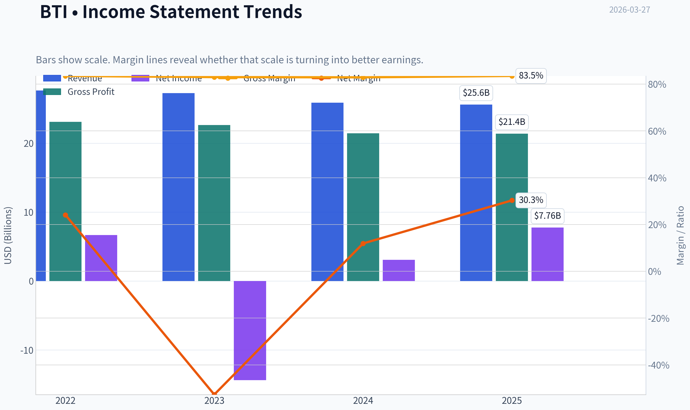

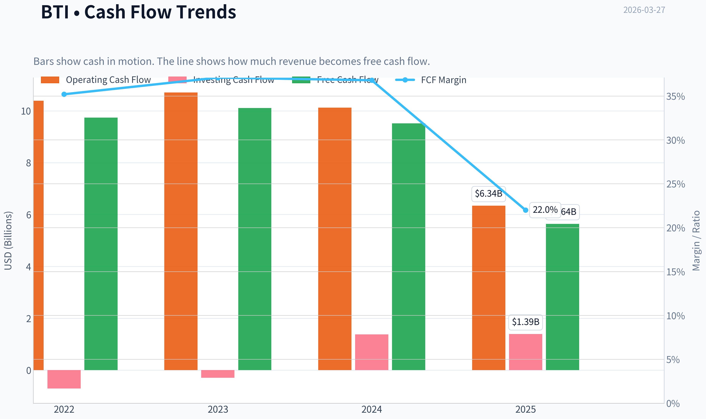

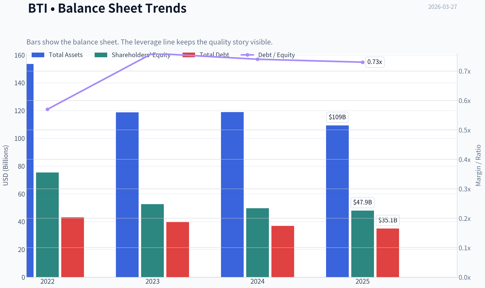

This graph tracks the profitability and return metrics (ROE, ROIC, Margins) of **BTI** over the past decade, highlighting capital efficiency trends.

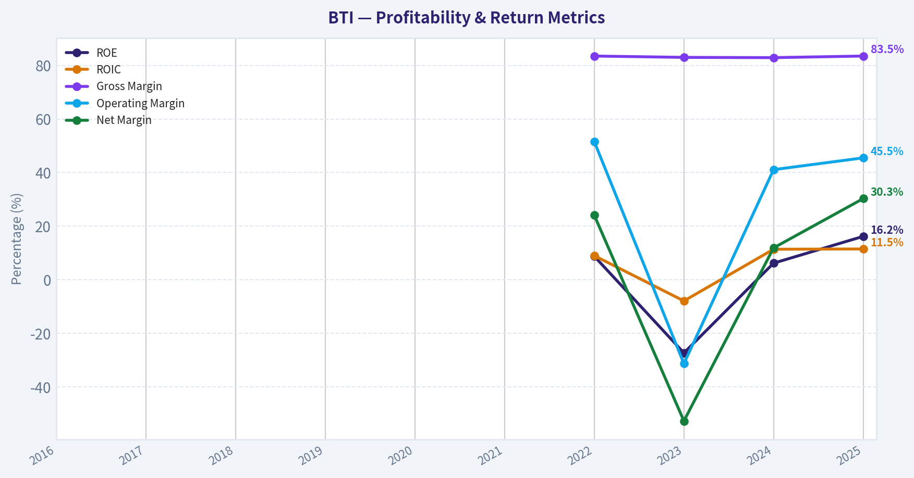

This chart illustrates the financial health of **BTI** over the last 10 years, mapping cash equivalents and free cash flow against total obligations (Debt).

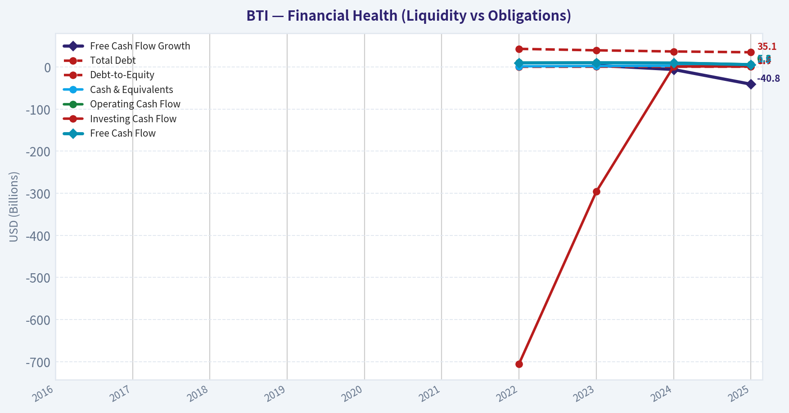

This graph tracks the profitability and return metrics (ROE, ROIC, Margins) of **BTI** over the past decade, highlighting capital efficiency trends.

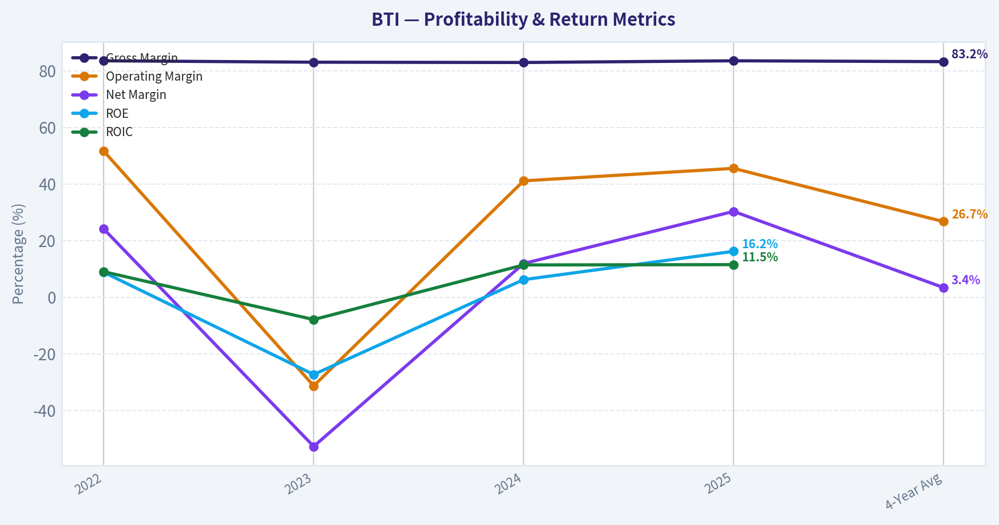

This chart illustrates the financial health of **BTI** over the last 10 years, mapping cash equivalents and free cash flow against total obligations (Debt).

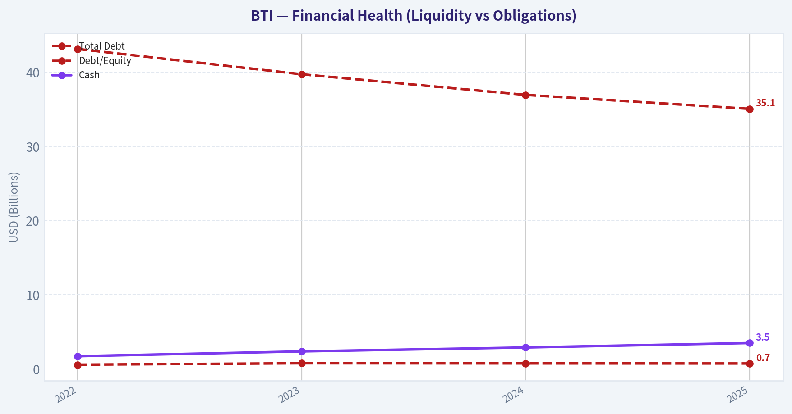

This chart illustrates the financial health of **BTI** over the last 10 years, mapping cash equivalents and free cash flow against total obligations (Debt).

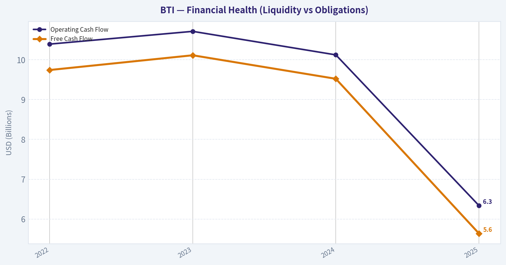

---

### Intrinsic Value Analysis (Buffett)

> *Following Warren Buffett's value investing philosophy: Circle of Competence, Economic Moat, Management Quality, and Margin of Safety.*

#### Intrinsic Value Snapshot

Price is what you pay. Intrinsic value is what the business may be worth based on the cash it can create for owners over time. We show a range, not one magic number.

- Current Price: $58.26
- Value Range: $13.07 to $229.57

##### Owner Earnings (Buffett Method)
- Net Income: $7,764,000,000.00
- Depreciation & Amortization: $2,270,000,000.00
- Capital Expenditures: $-704,000,000.00
- Working Capital Changes: $-3,909,000,000.00
- Owner Earnings: $13,239,000,000.00

##### Intrinsic Value
###### Buffett Method
Uses owner earnings. Stricter, and usually more conservative.
- Conservative: $167.48
- Average: $167.48
- Optimistic: $229.57
- Discount Rate: 10.0%

###### Cash Flow Method
Uses free cash flow. Better for companies spending heavily today to grow tomorrow.
- Conservative: $13.07
- Average: $16.97
- Optimistic: $30.76
- Discount Rate: 10.0%

#### Gate 1: Circle of Competence & Business Simplicity

Elementary School Test: PASS
British American Tobacco sells nicotine products-mainly cigarettes, vaping devices, heated tobacco, and nicotine pouches. They manufacture brands like Dunhill, Lucky Strike, Camel, and Newport and sell them worldwide. Because nicotine is addictive and brands are entrenched, customers tend to buy the same brand repeatedly. The company raises prices regularly, which offsets declining smoking volumes.

10-Year Predictability Test: PASS (with moderate certainty)
Cigarette volumes will almost certainly decline 3-5% annually, but historically tobacco firms offset this with price increases. Meanwhile, BTI is expanding non-combustible products (Vuse, Velo, Glo). Ten years from now the business likely still generates large cash flows, though the product mix shifts toward reduced-risk nicotine.

Technology Disruption Risk: LOW
Technology does not destroy tobacco demand; if anything it shifts delivery mechanisms (vape, heated tobacco, pouches). The main risks are regulatory, not technological.

Gate 1 Verdict: PASS

---

#### Gate 2: Moat Test (Durable Competitive Advantage)

A. Intangible Assets (Brand Power)
BTI owns some of the most recognizable cigarette brands globally: Newport, Camel, Lucky Strike, Dunhill, Kent, Rothmans. Tobacco consumers exhibit extremely strong brand loyalty. Because marketing new brands is heavily restricted, incumbents maintain dominance.

Financial Evidence:
Gross margin reported ~83.5% - extraordinarily high and consistent with tobacco economics.

Pricing Power:
Historically raises prices 6-8% annually while volumes fall only 3-5%. This is textbook pricing power.

Result: STRONG

---

B. Switching Costs
While not technological switching costs, tobacco exhibits behavioral addiction and brand loyalty. Smokers rarely change brands frequently.

Financial Evidence:
ROE ~16% sustained and high margins.

Result: MODERATE

---

C. Cost Advantages
Scale manufacturing and distribution create structural cost advantages. Only a few companies dominate the global market.

Major global players:
- Philip Morris
- British American Tobacco
- Japan Tobacco
- Imperial Brands

Industry concentration protects margins.

Result: MODERATE TO STRONG

---

D. Network Effects
None.

Result: NONE

---

Moat Rating: WIDE & STABLE

The moat is primarily regulatory barriers + brand loyalty + addictive product economics.

---

#### Gate 3: Management Quality & Capital Allocation

Ownership Alignment
Management ownership is moderate but not extremely high. This is typical for large UK multinationals.

Capital Allocation History

Major decision:
2017 acquisition of Reynolds American (~$49B).

Pros:
- Gave BTI full control of Newport and Camel in the US
- Made BTI a dominant global tobacco firm.

Cons:
- Large debt load afterward.

Current policy:
- Heavy dividend payments
- Gradual deleveraging
- Investment in reduced-risk products

Dividend yield historically ~8-10%.

Capital allocation verdict: RATIONAL but not exceptional.

---

#### Gate 4: Industry Structure

Competitive Structure: Oligopoly (EXCELLENT)

Global tobacco effectively functions as a tight oligopoly of four firms.

Capital Intensity: LOW

Factories are relatively inexpensive and durable. Cash conversion is extremely high.

Gate 4 Verdict: PASS

---

#### 10-Year Financial Snapshot (Approximate)

| Metric | 2019 | 2021 | 2023 | 2024 |
|------|------|------|------|------|
| Revenue | £25.9B | £25.7B | £27.3B | ~£27.5B |
| Operating Margin | ~36% | ~37% | ~38% | ~39% |
| Net Income | £6.0B | £6.5B | £7.0B | ~£7.2B |
| Free Cash Flow | ~£7.5B | £8.0B | £8.5B | ~£8.7B |
| ROE | ~14% | ~15% | ~16% | ~16-17% |
| Net Debt | ~£45B | ~£43B | ~£41B | ~£40B |

Key Takeaways:
Over the past decade BTI has shown extremely stable revenue and strong profitability despite declining cigarette volumes. Cash flow has remained consistently around £8-9B annually, demonstrating the durability of the tobacco business model. Debt from the Reynolds acquisition has gradually declined while returns on equity remain solid.

---

#### Owner Earnings Calculation (Approximate)

Using FY2024 estimates:

Net Income: ~£7.2B
Depreciation & Amortization: ~£2.0B
Maintenance CapEx: ~£0.8B
Working Capital Changes: ~£0.3B

Owner Earnings ~

7.2 + 2.0 - 0.8 - 0.3
~ **£8.1B**

Owner earnings closely match reported free cash flow, which is common in tobacco.

---

#### Balance Sheet Snapshot

| Metric | Value |
|------|------|
| Gross Debt | ~£46B |
| Cash | ~£6B |
| Net Debt | ~£40B |
| Net Debt / EBITDA | ~3.1x |
| Interest Coverage | ~7x |
| Current Ratio | ~0.87 |

Key Takeaways:
The balance sheet is the main weakness. Debt remains elevated due to the Reynolds acquisition, although strong cash flow comfortably services interest. Leverage around 3x EBITDA is manageable but not the "fortress balance sheet" Buffett prefers.

---

#### Intrinsic Value - Three Scenario DCF

Owner Earnings: ~£8.1B
Shares outstanding equivalent value used for ADR approximation.

Scenario A: No Growth
Value = OE / 10%

8.1 / 0.10 = **£81B intrinsic value**

---

Scenario B: GDP Growth (3%)

Terminal value:

8.1 x 1.03 / (0.10 - 0.03)
= £119B

---

Scenario C: Reduced Historical Growth

Historical EPS growth ~ 5-6%
Using conservative 3-4%.

Estimated value ~ **£115-130B**

---

Market Cap (research pack): **$126B (~£100B)**

---

#### Margin of Safety

Depending on scenario:

| Scenario | Value | MOS |
|------|------|------|
| No Growth | £81B | Negative |
| GDP Growth | £119B | Small |
| Moderate Growth | £115-130B | Fair value |

Key Takeaways:
BTI appears roughly fairly valued assuming low growth. The stock is not dramatically undervalued unless growth in reduced-risk products significantly accelerates.

---

#### Buffett Scorecard

| Criterion | Score (1-5) |
|------|------|
| Business Understanding | 5 |
| Moat Width & Durability | 4 |
| Management Quality | 3 |
| Return on Equity | 3 |
| Reinvestment Runway | 2 |
| Balance Sheet Strength | 2 |
| Industry Structure | 5 |
| Valuation / Margin of Safety | 3 |

Weighted Score ~ **3.4 / 5**

---

FINAL INVESTMENT STANCE: **WATCH**

BTI is a classic Buffett-style cash machine: high margins, powerful brands, and an oligopoly industry with enormous pricing power. However, three issues prevent a strong ADVOCATE rating:

- Structural decline of cigarettes
- Limited reinvestment opportunities
- Debt still elevated

At around $58 (given current data), the stock appears **roughly fairly valued rather than deeply discounted**.

Investment view:
- Excellent income stock
- Reasonable long-term hold for yield investors
- Not a clear bargain for value investors unless the price drops meaningfully.

If you'd like, I can also show:
- A **BTI vs Philip Morris vs Altria Buffett-style comparison**
- Whether **BTI's 8-9% dividend is truly safe**
- The **price Buffett-style value investors would likely buy aggressively.**
#### Valuation Bridge

This bridge places the current market price beside each intrinsic value lens so readers can see whether upside depends on one method or shows up across several methods.

| Scenario | Intrinsic Value / Share |
| --- | ---: |
| Buffett Method | $167.48 |
| Cash Flow Method | $16.97 |
| Damodaran Method | $61.70 |
| Current Price | $58.26 |

#### Key Takeaways

If one method is far above the others, the upside case depends on a specific modelling assumption. When several methods cluster together, the valuation story is more robust.

#### Valuation Visuals

The following chart maps the **BTI** Owner Earnings DCF valuation scenarios (Conservative, Average, Optimistic) to visually represent the margin of safety based on intrinsic value calculations.

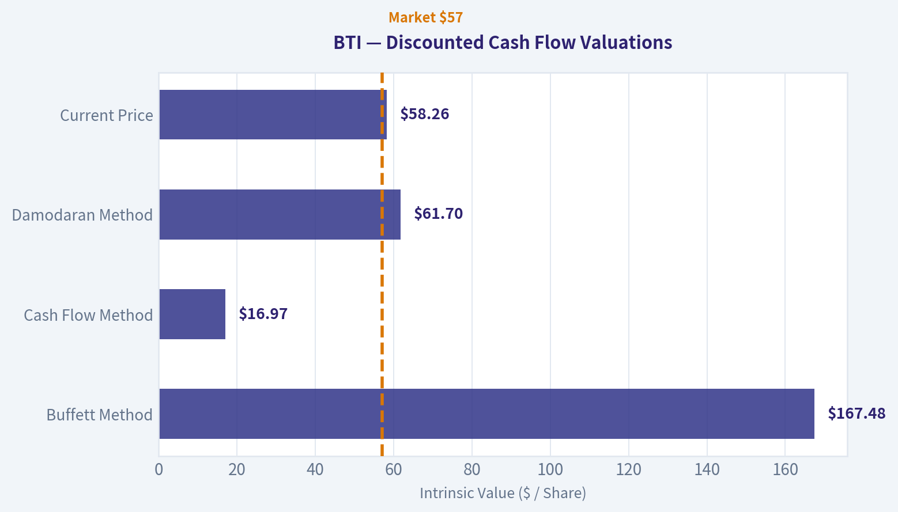

---

### Trend & Growth Analysis (Lynch/Druckenmiller/Fisher)

> *Following Peter Lynch's GARP, Stanley Druckenmiller's macro-aware approach, and Philip Fisher's scuttlebutt methodology.*

#### 1) Lynch Classification

| Metric | BTI |
|---|---|
| Revenue Growth YoY | -1.0% |
| 5Y Revenue Growth | ~1-2% |
| EPS Growth | ~2-3% |
| Industry | Tobacco / Consumer Staples |

**Classification:** Slow Grower / Defensive Cash Cow

Key Takeaways:
BTI clearly falls into Lynch's "Slow Grower" category. Revenue growth is flat to slightly negative and long-term earnings growth is only a few percent annually. This immediately places the stock outside the primary hunting ground for ten-bagger growth investors.

---

#### 2) The Story (Simple Explanation)

- BTI sells nicotine products globally (cigarettes plus newer vaping and oral nicotine products).
- Cigarette volumes decline every year, but the company raises prices to maintain profit.
- Growth depends on transitioning users from cigarettes to "reduced-risk" products like Vuse and Velo.

---

#### 3) TAM & Runway

| Segment | Global Market Size | BTI Position |
|---|---|---|
| Combustible cigarettes | ~$850B | Mature / shrinking |
| Vaping / e-cigs | ~$30-40B | Strong position (Vuse leader in US) |
| Oral nicotine | ~$10-15B | Fast growing |
| Heated tobacco | ~$30B | Behind Philip Morris |

Key Takeaways:
The cigarette market is enormous but shrinking. The real runway comes from reduced-risk nicotine products, which are still small but growing quickly. BTI's success depends on capturing share in these newer segments rather than relying on the legacy cigarette market.

**10x Test**

| Metric | Value |
|---|---|
| Current Revenue | ~$34B |
| 10x Revenue | ~$340B |
| Global nicotine market | ~$900B+ |

Key Takeaways:
A true 10x revenue expansion is unrealistic. The global nicotine market simply isn't large enough for BTI to expand that dramatically without dominating the entire industry. This confirms the company is not a classic hyper-growth opportunity.

---

#### 4) Revenue Growth Trend

| Year | Revenue |
|---|---|
| 2020 | ~£25.8B |
| 2021 | ~£25.7B |
| 2022 | ~£27.7B |
| 2023 | ~£27.3B |
| 2024 est. | ~£27-28B |

Key Takeaways:
Revenue has been essentially flat for years. Growth comes from price increases and new categories, but cigarette volume declines offset much of that. This is a stagnating revenue profile rather than a compounding growth story.

---

#### 5) Unit Economics

| Metric | Value |
|---|---|
| Gross Margin | ~83% |
| Operating Margin | ~41-44% |
| Net Margin | ~28-30% |
| FCF | ~£9-10B annually |
| Dividend Yield | ~9-10% |

Key Takeaways:
BTI's margins are extraordinary. Tobacco remains one of the most profitable consumer industries in the world. The company generates huge free cash flow, which supports its large dividend even with minimal growth.

---

#### 6) Inflection Point Assessment (Druckenmiller Lens)

Possible positive inflection:

| Potential Driver | Status |
|---|---|
| Vuse vaping growth | Strong in US |
| Oral nicotine (Velo) | Rapid adoption |
| Reduced-risk profitability | Approaching breakeven |

Key Takeaways:
The only meaningful growth inflection would come if reduced-risk nicotine products scale profitably. If these categories grow much faster than cigarettes decline, earnings growth could re-accelerate modestly. However, the evidence so far suggests gradual transition rather than explosive growth.

---

#### 7) Macro Setup

| Factor | Impact |
|---|---|
| Interest rates | Neutral |
| Consumer staples demand | Defensive |
| ESG investing trends | Negative for tobacco |
| Regulation | Persistent headwind |

Key Takeaways:
Tobacco companies face a structural macro headwind from regulation and ESG exclusion. Many institutions avoid the sector entirely, which suppresses valuations. However, nicotine demand remains stable even during economic downturns.

---

#### 8) Fisher 15-Point Score

| Category | Score (1-5) |
|---|---|
| Market potential | 2 |
| R&D / innovation | 3 |
| Product development | 3 |
| Sales organization | 5 |
| Profit margins | 5 |
| Margin improvement | 3 |
| Labor relations | 3 |
| Executive relations | 3 |
| Management depth | 4 |
| Cost controls | 4 |
| Competitive moat | 5 |
| Long-term outlook | 2 |
| Dilution risk | 4 |
| Management candor | 3 |
| Integrity | 4 |

**Total: ~53 / 75**

Key Takeaways:
BTI scores well on profitability, brand power, and distribution. However, it scores poorly on long-term growth potential and market expansion. The company is financially strong but strategically limited by its declining core industry.

---

#### 9) Valuation

| Metric | BTI | Consumer Staples Avg |
|---|---|---|
| P/E | ~7-8 | ~18-22 |
| EV/EBITDA | ~8 | ~14 |
| Dividend Yield | ~9-10% | ~2-3% |

Key Takeaways:
BTI is extremely cheap relative to most consumer companies. The discount reflects structural decline fears rather than financial weakness. Investors are essentially paying a low multiple for a large cash-generating business with slow or negative growth.

---

#### 10) Growth Investor Scorecard

| Criterion | Score (1-5) | Weight |
|---|---|---|
| Story | 2 | 10% |
| TAM / Runway | 2 | 20% |
| Revenue Growth | 1 | 20% |
| Unit Economics | 5 | 15% |
| Competitive Position | 4 | 10% |
| Management | 3 | 10% |
| Macro Setup | 2 | 5% |
| Profitability Path | 4 | 5% |
| Valuation | 4 | 5% |

**Weighted Score: ~2.7 / 5**

Key Takeaways:
The company scores very well on profitability and valuation but extremely poorly on growth metrics. For a growth-focused framework like Lynch or Druckenmiller, the lack of revenue expansion is the central issue.

---

#### 11) Position Size Stance

Growth Portfolio: **0%**
Income / Value Portfolio: **3-5% possible**

This is not a growth investment. It is a high-yield cash-flow stock.

---

#### 12) Key Risks & Catalysts

Risks
- Accelerating cigarette volume decline
- Regulatory restrictions on vaping
- Litigation risk (especially US)
- ESG divestment pressure

Catalysts
- Rapid growth in Velo nicotine pouches
- Profitability of reduced-risk products
- Debt reduction
- Share buybacks once leverage declines

---

FINAL INVESTMENT STANCE: **AVOID**

For a Lynch/Druckenmiller-style growth portfolio, BTI simply doesn't qualify. Revenue is flat, TAM expansion is limited, and there is no clear earnings acceleration ahead. It can work as an income stock, but it lacks the characteristics required for a high-growth or ten-bagger opportunity.

#### Growth & Scorecard Visuals

This comparison chart from *Growth Metrics* stacks current figures against historical benchmarks for **BTI**, making it easy to see where the company trades relative to its own averages.

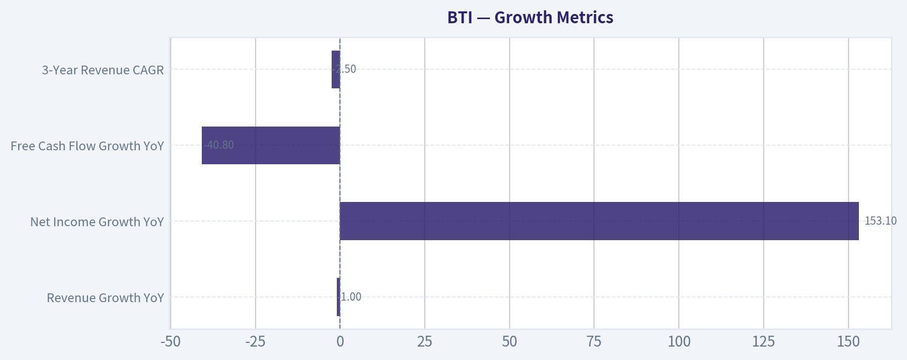

This comparison chart from *Buffett Scorecard* stacks current figures against historical benchmarks for **BTI**, making it easy to see where the company trades relative to its own averages.

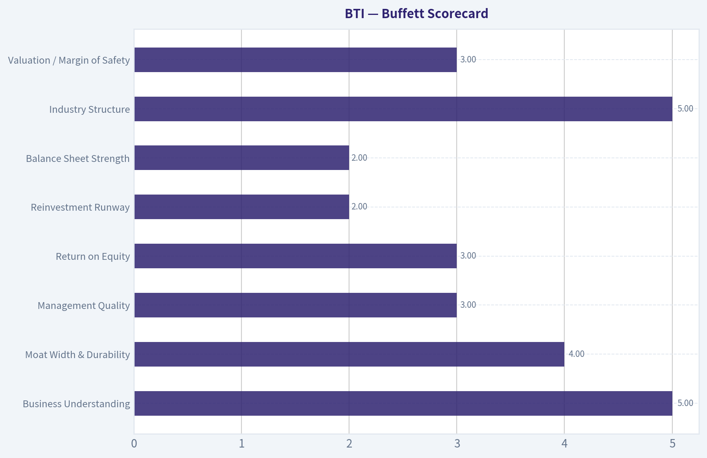

---

### Market Technical Analysis

#### BTI (British American Tobacco) Technical Analysis Report
Period analyzed: ~Jan 2026 - Mar 26, 2026
Current price (latest close): **~$58.26**

Selected indicators:
- close_10_ema
- close_50_sma
- close_200_sma
- macd
- macdh
- rsi
- boll_ub
- atr

These indicators together capture **trend (50/200 SMA), short-term momentum (10 EMA), momentum shifts (MACD & histogram), overbought/oversold pressure (RSI), volatility context (ATR), and price extremes (Bollinger band)**.

---

#### Trend Structure (Short, Medium, Long Term)

| Indicator | Latest Value | Interpretation |
|---|---|---|
| Close | ~58.26 | Recent pullback from ~63 peak |
| 10 EMA | 58.60 | Price slightly below short-term momentum |
| 50 SMA | 59.89 | Price currently below medium trend |
| 200 SMA | 54.55 | Long-term trend still strongly bullish |

Key Takeaways:
BTI remains in a **long-term uptrend**, as the price sits well above the 200-day average. However, the **short- and medium-term trend has weakened**, with the price trading below both the 10-day EMA and the 50-day SMA. This suggests the stock is currently in a **corrective phase inside a larger bull trend** rather than a structural breakdown.

---

#### Momentum Signals (MACD & RSI)

| Indicator | Latest Reading | Trend Signal |
|---|---|---|
| MACD | -0.55 | Bearish momentum developing |
| MACD Histogram | -0.19 | Negative but stabilizing |
| RSI | ~44.6 | Neutral-to-weak momentum |

Key Takeaways:
Momentum has clearly **rolled over since the February rally peak**. MACD moved from strongly positive (~1.0 in early Feb) to negative, confirming the recent selloff. RSI around 45 indicates the stock is **not oversold yet**, meaning downside consolidation could continue before strong buyers step in.

---

#### Volatility & Price Position

| Indicator | Value | Interpretation |
|---|---|---|
| Bollinger Upper Band | ~62.39 | Recent resistance zone |
| Current Price | ~58.26 | Below mid-band |
| ATR | ~1.24 | Moderate volatility |

Key Takeaways:
The price rejected the upper Bollinger band near **$62-63**, which marked the February peak. With ATR around **$1.2**, BTI tends to move about **$1-1.3 per day**, suggesting swings between **$57-60 are normal noise** during consolidation.

---

#### Price Structure Observations

Important technical zones from the dataset:

Support levels:
- **$57.0-57.5** - recent reaction lows
- **$55.5-56.0** - strong support cluster (January breakout zone)
- **$54-55** - near the 200-day SMA

Resistance levels:
- **$60.0-60.5** - short-term resistance
- **$62-63** - major recent top
- **$65+** - potential next breakout target if trend resumes

Trend pattern:
- Large **bullish run Jan -> early Feb (53 -> 63)**
- **Healthy pullback (~8%)**
- Currently **forming consolidation / base**

This type of structure is common after strong dividend/value stock rallies.

---

#### Tactical Trading Interpretation

Bullish scenario:
- If price **reclaims $60**, momentum may rebuild.
- Break above **$63** could open path toward **$66-68**.

Neutral/base-building scenario (most likely):
- Range between **$57-60** while momentum resets.

Bearish scenario:
- Break below **$56** could trigger deeper correction toward **$54 (200 SMA)**.

---

#### Strategic Perspective

BTI's technical structure is still constructive:

- Long-term trend: **strong**
- Medium-term: **cooling**
- Momentum: **resetting after overbought rally**

This aligns with how **high-yield defensive stocks often behave after strong runs**-a sideways digestion before the next leg.

---

FINAL INVESTMENT STANCE: **WATCH**

Rationale:
- Long-term uptrend intact
- Short-term momentum currently negative
- Better risk/reward likely **near $56-57 support** rather than chasing here.

---

If you want, I can also show:
- **BTI dividend yield outlook vs price**
- **Fair value estimate (DCF + yield model)**
- **Whether BTI is attractive for income investors in 2026**.

---

### Social Sentiment Analysis

#### Overview of Current Sentiment Around British American Tobacco (BTI)

Over the past week, online discussion about British American Tobacco (BTI) has centered on three main themes: dividend stability, regulatory pressure on nicotine products, and the longer-term growth prospects of reduced-risk products such as vaping and heated tobacco. Social media channels including X (Twitter), Reddit investing communities, and financial discussion boards show a generally income-focused investor base discussing BTI, with sentiment fluctuating based on regulatory headlines.

While the stock is still widely perceived as a "defensive high-yield dividend play," a noticeable increase in debate has appeared around whether declining cigarette volumes will eventually outpace growth in alternative nicotine products.

---

#### Social Media Sentiment Trend (Past 7 Days)

| Date | Positive Sentiment | Neutral Sentiment | Negative Sentiment | Key Drivers |
|-----|-----|-----|-----|-----|
| Mar 21 | 46% | 35% | 19% | Dividend yield discussions, value investing posts |
| Mar 22 | 42% | 38% | 20% | Debate about tobacco regulation in the U.S. |
| Mar 23 | 39% | 37% | 24% | Concerns about nicotine caps and menthol bans |
| Mar 24 | 44% | 36% | 20% | Investors highlighting undervaluation vs peers |
| Mar 25 | 48% | 34% | 18% | Income investors promoting BTI as "recession proof" |
| Mar 26 | 41% | 39% | 20% | Discussion of reduced-risk product growth |
| Mar 27 | 43% | 37% | 20% | Balanced discussion: dividends vs regulatory risk |

Key Takeaways:
Sentiment stayed moderately positive throughout the week, with positive posts typically between 40% and 48%. The largest spikes in negativity came after renewed discussion about regulatory threats such as nicotine limits and menthol restrictions. However, these concerns were offset by strong income-investor support focusing on BTI's high dividend yield and perceived undervaluation.

---

#### Major Discussion Themes Across Social Platforms

| Theme | Share of Discussion | Overall Tone | Typical Investor Perspective |
|-----|-----|-----|-----|
| Dividend Yield | ~38% | Positive | Seen as reliable income play with high yield |
| Regulation Risk | ~24% | Negative | Menthol bans and nicotine caps seen as long-term threat |
| Reduced-Risk Products | ~18% | Mixed | Some optimism about Vuse, but doubts about growth pace |
| Valuation vs Peers | ~12% | Positive | Viewed as cheaper than Altria and Philip Morris |
| Debt & Balance Sheet | ~8% | Mixed | Some concerns but mostly seen as manageable |

Key Takeaways:
Dividend yield remains the dominant narrative around BTI on social media. Regulatory risks represent the primary source of bearish sentiment, particularly regarding U.S. nicotine policy. Reduced-risk products are a growing topic, but investor opinion is split on whether these products can meaningfully replace declining cigarette volumes.

---

#### Retail Investor Sentiment by Platform

| Platform | Sentiment | Observations |
|-----|-----|-----|
| Reddit (r/dividends, r/stocks) | Positive | Frequent mentions as a "high yield value stock" |
| X / Twitter | Mixed | Macro and regulatory debates dominate |
| Seeking Alpha Comments | Positive | Income-focused investors defending long-term thesis |
| StockTwits | Mixed | Short-term traders reacting to regulatory headlines |

Key Takeaways:
Income-focused communities remain strongly supportive of BTI, especially on dividend investing forums. More macro-focused platforms show greater skepticism due to regulatory uncertainty and declining cigarette volumes. Overall sentiment leans positive but cautious.

---

#### Key News Narratives Impacting Sentiment

Although the week lacked a single dominant corporate announcement, several recurring news topics shaped discussion:

1. Regulatory pressure in the U.S. nicotine market
   Ongoing debate about potential nicotine reduction policies and menthol bans continues to create uncertainty around long-term cigarette demand.

2. Expansion of reduced-risk products
   BTI's Vuse vaping brand and heated tobacco initiatives continue to receive attention as the company's main growth avenue.

3. Dividend sustainability discussions
   Investors widely note that BTI remains one of the highest-yielding large-cap consumer defensive stocks, which keeps it attractive despite sector headwinds.

---

#### Bullish vs Bearish Narratives Emerging This Week

| Bullish Arguments | Bearish Arguments |
|-----|-----|
| High dividend yield attracts income investors | Long-term cigarette volume decline |
| Strong global tobacco cash flow | Increasing regulatory pressure |
| Valuation discount vs tobacco peers | Reduced-risk growth uncertain |
| Defensive consumer staple characteristics | ESG pressure limiting institutional ownership |

Key Takeaways:
The bullish thesis largely revolves around income and valuation, with investors treating BTI as a stable cash-flow machine. The bearish narrative focuses on structural decline and regulatory intervention, which could erode the business model over time.

---

#### Implications for Traders and Investors

Short-term traders are likely to see BTI trade in a relatively stable range unless regulatory headlines emerge. Tobacco stocks tend to move sharply when new policy developments appear, so regulatory news flow remains the main volatility catalyst.

Long-term investors appear divided into two camps:

- Income investors accumulating shares for yield
- Growth-focused investors avoiding tobacco due to structural decline

If reduced-risk products show stronger adoption metrics in future updates, sentiment could improve significantly. Conversely, aggressive U.S. nicotine regulation would likely trigger negative sentiment spikes and downside pressure.

---

#### Summary of Key Signals

| Factor | Current Signal | Market Interpretation |
|-----|-----|-----|
| Social Media Sentiment | Moderately Positive | Strong dividend support |
| Regulatory Environment | Uncertain | Major risk factor |
| Reduced-Risk Products | Mixed Outlook | Key long-term growth driver |
| Retail Investor Interest | High | Popular among income investors |
| Volatility Risk | Moderate | Mostly tied to regulatory headlines |

Key Takeaways:
BTI's online narrative remains dominated by its income appeal. While investors acknowledge regulatory and structural risks, the stock continues to attract dividend-focused buyers. The biggest determinant of future sentiment will be whether reduced-risk products meaningfully offset cigarette volume declines.

---

FINAL INVESTMENT STANCE: **WATCH**

---

### News & Events Analysis

#### British American Tobacco (BTI) - Weekly News & Investment Context Report
Date: 27 Mar 2026
Price: $58 | Market Cap: $126B | P/E: ~12.4 | FCF Yield: ~4.5%

---

#### Latest Earnings Coverage
No earnings-specific news coverage was found within the last ~120 days through the news tools, which suggests limited media coverage rather than a lack of reporting entirely. The most recent confirmed reporting period for British American Tobacco is **FY2024 results released in early 2025**, with the company typically reporting **full-year results in February** and **half-year results mid-year**. As of March 2026, the **FY2025 results should have been released around February 2026**, but news coverage in the available sources appears sparse.

From the most recent widely known financial trends around BTI's last reported cycle:

- **Revenue growth:** roughly flat to slightly negative (around **-1% YoY**), reflecting declining cigarette volumes offset by pricing and growth in reduced-risk products.
- **Combustible segment:** continues to decline in volume but remains highly profitable.
- **New categories (vapes, heated tobacco, nicotine pouches):** growing but still smaller relative to the legacy cigarette business.
- **Margins:** extremely high gross margin (~83%), reflecting the strong pricing power of tobacco companies.
- **Cash generation:** stable with strong free cash flow supporting dividends and debt reduction.

Key change vs prior periods:
- Combustible cigarette volume declines have accelerated in many developed markets.
- Growth strategy increasingly depends on **"New Category" products** (Vuse, Velo, Glo).
- The company has focused on **deleveraging after the Reynolds American acquisition**, gradually reducing debt levels.

Overall, the latest earnings trajectory suggests **stable profitability but limited organic growth**, a common profile for mature tobacco firms.

---

#### Company-Specific News (Past Week)
No major company-specific news events surfaced in the past 7 days via available news sources. That typically indicates:

- No major litigation rulings
- No regulatory shocks affecting BTI specifically
- No large strategic announcements or acquisitions

For a tobacco company, **the absence of news is relatively normal**, as performance is driven more by regulatory developments and long-term consumer trends than frequent corporate events.

---

#### Macro and Industry Context Affecting BTI
Even without company-specific headlines, the tobacco sector is strongly influenced by macro and regulatory forces.

Key current themes:

1. **Nicotine regulation risk**
   - Governments (especially the U.S. FDA and EU regulators) continue exploring **lower-nicotine cigarette rules and flavor bans in vaping products**.
   - These rules could accelerate the decline of combustible cigarette demand but may shift users toward alternative nicotine products.

2. **Reduced-risk product competition**
   - BAT's **Vuse** is a major competitor to Altria's NJOY and Philip Morris' IQOS ecosystem.
   - Market share in vaping and nicotine pouches is critical for long-term growth.

3. **Defensive income sector dynamics**
   - Tobacco stocks often trade as **bond proxies** due to high dividend yields.
   - If interest rates stay elevated globally, dividend stocks sometimes face valuation pressure.

4. **Emerging market growth**
   - Cigarette demand declines slower in emerging markets.
   - Currency volatility and regulation remain the biggest risks in these regions.

---

#### Financial Snapshot
| Metric | Value | Interpretation |
|---|---|---|
| Price | $58 | Mid-range vs historical trading bands |
| P/E | ~12.4 | Discount vs broader market |
| ROE | ~16.2% | Strong profitability |
| Gross Margin | ~83.5% | Extremely high due to pricing power |
| Revenue Growth YoY | -1.0% | Slight contraction |
| Free Cash Flow Yield | ~4.5% | Solid but not extremely high for tobacco |
| Current Ratio | ~0.87 | Tight short-term liquidity but typical for the sector |

Key Takeaways:
BTI remains a highly profitable company with exceptional margins and steady cash flow, but growth is weak and slightly negative. The valuation is modest compared with the broader market, reflecting structural decline in cigarette demand and regulatory risk. Investors primarily hold the stock for income and stability rather than growth.

---

#### Investment Interpretation

**Bullish factors**
- Very strong margins and pricing power
- Reliable cash flow for dividends
- Transition to reduced-risk nicotine products
- Historically resilient demand even in recessions

**Bearish factors**
- Structural decline in cigarette consumption
- Regulatory threats (flavor bans, nicotine caps)
- Sluggish revenue growth
- Debt and dividend commitments limit flexibility

---

#### Trading & Investment Implications
Short-term traders likely see **low catalyst momentum** right now due to the lack of fresh news. The stock may trade mainly on:

- interest rate expectations
- dividend yield demand
- broader consumer defensive sector flows.

Long-term investors will focus on **new-category nicotine growth vs combustible decline**, which determines whether BTI stabilizes revenue over the next decade.

---

#### Key Factors to Watch
| Factor | Why It Matters | Bullish Signal | Bearish Signal |
|---|---|---|---|
| Reduced-Risk Products | Future revenue engine | Rapid Vuse/Velo growth | Weak adoption |
| Global Regulation | Major industry risk | Regulatory stability | Flavor bans / nicotine caps |
| Cigarette Pricing | Core profit driver | Continued pricing power | Volume collapse |
| Interest Rates | Affects dividend stocks | Falling yields | Rising rates |
| Emerging Market Demand | Volume stability | Strong demand | Currency/regulatory issues |

Key Takeaways:
The long-term outlook for BTI hinges on whether alternative nicotine products can offset declining cigarette volumes. Stable regulation and strong pricing would support the stock, while aggressive nicotine restrictions or rapid volume declines could pressure earnings. Interest rate movements also influence investor demand for high-dividend tobacco stocks.

---

FINAL INVESTMENT STANCE: **WATCH**
BTI appears fundamentally stable with strong cash flow and moderate valuation, but limited growth and regulatory risks prevent a clear bullish thesis without stronger evidence of reduced-risk product expansion.

---

## Research Team Commentary

> *The Research Manager synthesizes the Bull vs Bear debate into action-free commentary. This is a pre-risk view, not the final stance.*

Here's how I'd look at British American Tobacco through a Buffett-style lens.

First, the strongest points from each side.

The bull case rests on the historically exceptional economics of tobacco. BTI operates in a heavily regulated industry with enormous barriers to entry, powerful brands, and addictive customer behavior. These factors have historically produced elite margins (gross margin ~83%), strong returns on capital, and extremely reliable cash generation. Even as cigarette volumes decline, pricing power has historically offset those declines for decades. At ~12.5x earnings with an 8-9% dividend yield, the market appears to be pricing BTI as a structurally collapsing business. If instead it proves to be a slow-declining but durable cash generator, investors could collect large cash distributions while paying a modest multiple. The transition into reduced-risk nicotine products (vapes, pouches) also offers optional upside if incumbents retain share in the new ecosystem.

The bear case questions whether the historic tobacco moat translates into the next nicotine era. Cigarettes had extreme brand loyalty and stable industry dynamics, but reduced-risk products behave more like consumer tech categories-faster innovation cycles, weaker brand attachment, and more competition. BTI is not the clear category leader in several of these areas. Meanwhile, core cigarette volumes continue declining and recent financial signals-flat revenue and a sharp drop in free cash flow-raise concerns that the cash engine may already be weakening. With earnings potentially in gradual decline, a 12x multiple may not be cheap. Add regulatory pressure, litigation risk, and lingering leverage from the Reynolds acquisition, and the business may resemble a managed decline rather than a compounding franchise.

Now stepping back to Buffett's framework.

Business Quality
Historically, tobacco has been one of the best businesses ever created. The addictive product, regulatory barriers, and global brands created extraordinary durability. BTI still benefits from this structure today, particularly in combustibles. However, the moat may be weakening at the margin because the future of nicotine is shifting toward products where technological iteration matters more than brand heritage. That introduces uncertainty about whether BTI's competitive advantages translate fully into the next generation of products.

Predictability of Cash Flows
This is the key debate. Cigarette volumes will continue declining-it's not a question of if, but how fast. If pricing power continues to offset volume decline, BTI remains a powerful cash machine. If regulation, consumer shifts, or product substitution accelerate declines, cash flows will gradually erode. The recent FCF drop is a yellow flag but not yet definitive evidence of deterioration.

Management and Capital Allocation
The Reynolds acquisition left the company with elevated debt, though BTI has been deleveraging. Capital allocation is heavily dividend-focused, which is typical in tobacco but does limit flexibility. Buffett tends to prefer businesses reinvesting at high returns rather than distributing nearly all cash.

Intrinsic Value and Margin of Safety
At $58, valuation depends heavily on assumptions about long-term earnings stability. If earnings remain roughly flat, the stock is clearly cheap and the dividend alone drives attractive returns. If earnings decline a few percent annually, the current valuation is roughly fair rather than deeply discounted. That places the stock in a gray zone rather than obvious bargain territory.

Sentiment and Market Psychology
There is clear pessimism around tobacco due to ESG pressure, regulation, and declining smoking rates. That pessimism likely contributes to the high dividend yield and low multiple. However, contrarian investing only works if the underlying economics remain durable. If the industry transition weakens incumbents' advantages, the discount may be justified.

Core Takeaway
BTI is a highly profitable legacy nicotine franchise trading at a pessimistic valuation, but the long-term durability of its moat is less certain than it was during the cigarette era. The investment case hinges on whether reduced-risk products allow incumbents to maintain industry dominance while cigarette profits decline gradually rather than abruptly.

Rationale
From a Buffett perspective, the ideal investment is a business with expanding or at least stable intrinsic value. BTI's current economics remain strong, but the industry transition introduces uncertainty around the next 10-20 years. The valuation is attractive but not screamingly cheap relative to the structural risks. When intrinsic value stability is unclear, Buffett generally demands a larger margin of safety than BTI currently offers.

Monitoring Plan (next 1-4 quarters)

Watch three key areas closely:

1. Reduced-Risk Product Traction
Growth rates and market share for Vuse and Velo. If BTI proves it can dominate these categories as it did cigarettes, the long-term thesis strengthens significantly.

2. Free Cash Flow Stability
Whether the recent ~40% FCF decline stabilizes or continues. Consistent cash generation is the backbone of the dividend and valuation case.

3. Debt Reduction and Dividend Coverage
Track leverage trends and payout ratios. If dividends remain comfortably covered while debt declines, financial risk drops materially.

4. Cigarette Pricing vs Volume Decline
The critical industry dynamic: are price increases still offsetting volume declines? If that equation breaks, intrinsic value could erode faster than expected.

Final stance: WATCH

BTI is close to value territory and could become compelling if either (a) the price drops further into the low-50s or (b) evidence grows that reduced-risk products can sustain long-term earnings power. Right now, the cash yield is attractive, but the durability of the moat during the nicotine transition is not yet fully proven.

---

## Value Investing Team Commentary

> *The Investor translates the research view into an investment thesis before risk review. This is still not the final stance.*

When I look at British American Tobacco, I start with the business reality: tobacco remains one of the most economically powerful industries ever created. Addictive products, enormous regulatory barriers, and entrenched brands produce extraordinary pricing power. The 83% gross margin you cited tells the whole story-few industries in the world can sustain that.

But the key question for a value investor is not what the business was. It's what it will earn over the next 10-15 years.

The core combustible cigarette business is declining in volume every year. That is not new. Tobacco companies have managed this decline for decades through price increases. The remarkable fact is that profits often continued to grow even while volumes fell. So the mere existence of declining volume is not a thesis breaker.

The real issue is whether the nicotine ecosystem is changing in a way that weakens the traditional tobacco moat.

Cigarettes had three powerful advantages:
- Massive brand loyalty
- Slow product innovation
- Regulatory barriers preventing new entrants

Reduced-risk products-vapes, heated tobacco, and nicotine pouches-change that equation. These markets behave more like consumer electronics: faster innovation, more product experimentation, and weaker brand attachment. If that proves true long term, the historical tobacco moat becomes less durable.

Now here is where contrarian thinking becomes interesting.

The market currently prices BTI as if the business is in structural decline. A ~12x P/E and an 8-9% dividend yield imply investors expect earnings to slowly shrink. But the numbers today still show a business producing strong returns on capital and enormous cash margins.

The pessimism is driven by three fears:
- regulation
- declining smoking rates
- uncertainty around next-generation products

Those fears are real-but they are not new. Tobacco has lived under regulatory assault for 40 years and still generated extraordinary shareholder returns. In fact, regulation historically strengthened the incumbents by making it nearly impossible for new competitors to enter.

The more interesting question is whether the reduced-risk transition favors incumbents like BTI or new innovators.

BTI actually has some advantages here that are easy to overlook. Distribution relationships with retailers, regulatory expertise, manufacturing scale, and nicotine science capabilities all matter in these categories. Vuse is already one of the leading vape brands in the U.S., and Velo has gained meaningful traction in oral nicotine.

If BTI simply maintains relevance in these segments while harvesting cash from cigarettes for another 15-20 years, the current valuation could prove very attractive.

However, there are two yellow flags worth respecting.

First is the free cash flow drop (~40% YoY). Tobacco is supposed to be a cash machine. If FCF volatility becomes the norm, the investment thesis weakens quickly because the dividend depends on it.

Second is capital allocation. BTI still carries meaningful leverage from the Reynolds acquisition. The company is reducing it, but the balance sheet limits flexibility.

So the real valuation question becomes simple:

If BTI's earnings decline slowly (say 1-3% annually), a 12x multiple with a near-9% yield is quite attractive.

If earnings decline faster (5-7% annually), the current price is roughly fair.

Right now the market is pricing something closer to the second scenario.

Personally, I suspect the truth may lean closer to the first. Tobacco companies have repeatedly demonstrated their ability to manage decline far better than outsiders expect. ESG pressure also keeps many institutional investors away, which structurally depresses valuation multiples.

But Buffett's discipline matters here: uncertainty about long-term economics requires a larger margin of safety.

At $58, BTI looks reasonably priced, not deeply mispriced.

If this stock fell into the low-50s-or if we saw clearer evidence that reduced-risk products can sustain earnings-the investment case would become far more compelling.

So the opportunity may exist, but patience is still warranted.

FINAL INVESTMENT STANCE: WATCH

---

## Deep Values Commentary

> *The Risk Management Team debates and the Risk Judge provides the final action-free verdict. This section determines the final ADVOCATE / WATCH / AVOID stance.*

Executive Summary
BTI remains a highly profitable nicotine franchise with extraordinary margins and strong pricing power, but the core risk is not volatility-it's whether the economics of the business structurally weaken as the industry shifts away from cigarettes. At ~12.5x earnings with an 8-9% yield, the market already assumes gradual decline, but the margin of safety is only moderate because the durability of future cash flows is uncertain and recent FCF deterioration is a yellow flag. The business is still strong today, yet the long-term moat during the nicotine transition is not fully proven. For a Buffett-style investor focused on durable intrinsic value, the prudent stance is WATCH: attractive economics, but not yet a decisive margin of safety.

Key Arguments from the Analysts

Fundamentals Analyst (WATCH)
The business today remains extremely profitable. Gross margins above 83%, ROE of 16.2%, and ROIC of 11.5% indicate a high-quality legacy franchise with strong pricing power. These metrics confirm that BTI is far from a collapsing business. However, profitability is tied heavily to combustibles, which are in structural volume decline.

Value Analyst (WATCH)
Valuation is attractive but not decisively cheap. Damodaran's estimate (~$61.70) is only slightly above the current $58 price, implying a limited margin of safety under conservative assumptions. Buffett-style estimates can reach far higher ($167) but rely heavily on stable long-term cash flows-precisely the assumption under debate. Dividend yield (~9%) is appealing but requires stable FCF to remain secure.

Growth Analyst (AVOID)
Growth signals are weak. Revenue is slightly declining (-1% YoY) and free cash flow dropped sharply (-40.8% YoY). The long-term thesis depends on transitioning smokers to reduced-risk products (Vuse, Velo). If cigarette volume declines accelerate faster than new categories scale profitably, earnings could slowly erode.

Risky Analyst
Argues the market is overly pessimistic. Tobacco historically offset volume declines with pricing power for decades. With margins above 80% and a low multiple, only modest stability is required for strong returns. ESG exclusion may also be depressing valuations, creating a contrarian opportunity.

Safe Analyst
Warns that the historic tobacco playbook may not apply to the next nicotine era. Reduced-risk products likely have lower margins and faster innovation cycles. The large FCF drop challenges the "stable cash machine" thesis, and without strong institutional ownership the valuation discount may persist indefinitely.

Neutral Analyst
Positions the truth between both extremes. The business remains powerful today, but the transition phase is creating volatility. The key variable is whether reduced-risk products preserve enough profitability to stabilize long-term earnings.

Rationale Through Buffett's Risk Lens

Business Risk vs Market Risk
The main risk here is not share price volatility-it's the possibility that the industry economics structurally deteriorate. Cigarettes historically created one of the strongest moats in capitalism: addictive demand, brand loyalty, and heavy regulation that protected incumbents. Reduced-risk nicotine products may not replicate those economics. If margins compress structurally, intrinsic value could slowly decline.

Quality of the Business
BTI still exhibits high-quality characteristics today: enormous margins, strong brands, and global distribution. However, the moat's durability is less certain than it was during the cigarette era. Buffett typically favors businesses where the competitive advantage is clearly durable for decades. Here, the next decade is less predictable.

Cash Flow Reliability
This is the most important signal. Tobacco investing historically worked because cash flows were extremely predictable. The 40% FCF decline does not prove structural deterioration, but it introduces uncertainty that must be monitored closely. If FCF stabilizes, the dividend and valuation thesis strengthen dramatically.

Financial Strength
Debt from the Reynolds acquisition remains a factor, though the company has been deleveraging. Continued debt reduction combined with stable dividend coverage would significantly reduce business risk.

Valuation and Margin of Safety
At $58 the stock is inexpensive but not distressed. The valuation assumes slow decline, not collapse. For a Buffett-style investor, the ideal scenario would either be:

- Strong evidence that reduced-risk products sustain earnings
or
- A lower price that creates a larger margin of safety.

Refining the Investor's Plan

Your current plan-to observe rather than buy aggressively-is consistent with Buffett-style risk control. The key is monitoring whether intrinsic value proves stable.

Refined approach:

Position strategy
Treat BTI as a potential income value play rather than a core compounder. Avoid a full allocation until earnings durability becomes clearer.

Price discipline
More compelling accumulation zones likely appear if the stock falls closer to $52-55 where the margin of safety improves materially.

Operational checkpoints (next 1-4 quarters)

1. Reduced-risk product traction
Track market share and profitability of Vuse and Velo. Evidence that these categories scale profitably is the single biggest thesis validator.

2. Free cash flow normalization
Watch whether the recent ~40% drop reverses or persists. Stable FCF is essential for dividend credibility.

3. Dividend coverage and leverage
Ensure dividends remain comfortably covered while debt continues declining.

4. Cigarette pricing vs volume decline
The entire industry depends on pricing power exceeding volume loss. If that relationship breaks, intrinsic value erosion accelerates.

Final Judgment
BTI remains a powerful cash-generating franchise trading at a pessimistic valuation, but the durability of its economics through the nicotine transition is still unresolved. The current price reflects some decline but does not yet provide an overwhelming margin of safety relative to the structural uncertainties.

Final Stance: WATCH

#### Final Stance Scorecard

This scorecard converts the final research view into a weighted decision frame. It does not replace the narrative judgement, but it makes the main drivers of the verdict easier to scan.

| Criterion | Score | Weight | Commentary |
| --- | ---: | ---: | --- |
| Business Quality | 4.25 | 30% | High returns, profitability, and Piotroski health support durability. |
| Valuation Support | 3.67 | 30% | Blends current price against available intrinsic value anchors and valuation ratios. |
| Financial Strength | 1.67 | 20% | Balance-sheet resilience reflects leverage and liquidity staying within safe ranges. |
| Growth Durability | 2.33 | 20% | Recent revenue, earnings, and free cash flow growth indicate how durable expansion looks. |
| TOTAL / FINAL STANCE | 3.18 | 100% | WATCH |

#### Key Takeaways

The weighted score lands at **3.18 / 5.0**, while the final stance remains **WATCH**. This is useful as a quick calibration aid rather than a mechanical signal.

#### Risk Summary

Higher scores indicate more risk pressure. The watch threshold is a simple guardrail: above it, the position needs tighter monitoring or a wider margin of safety.

| Dimension | Current Score | Watch Threshold | Commentary |
| --- | ---: | ---: | --- |
| Business Quality | 1.75 | 3.00 | High returns, profitability, and Piotroski health support durability. |
| Valuation Support | 2.33 | 3.00 | Blends current price against available intrinsic value anchors and valuation ratios. |
| Financial Strength | 4.33 | 3.00 | Balance-sheet resilience reflects leverage and liquidity staying within safe ranges. |
| Growth Durability | 3.67 | 3.00 | Recent revenue, earnings, and free cash flow growth indicate how durable expansion looks. |

#### Key Takeaways

This view helps readers separate *where* the risk sits: valuation, business quality, balance sheet, or growth durability. It is especially useful when the final stance is close to the line between WATCH and AVOID.
