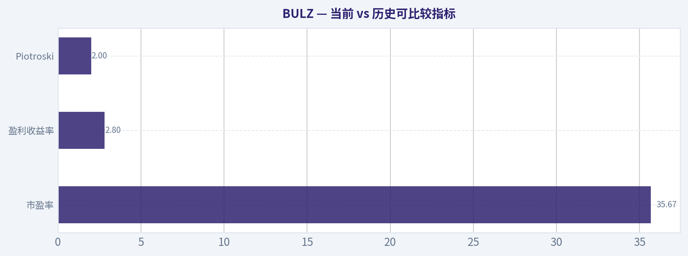
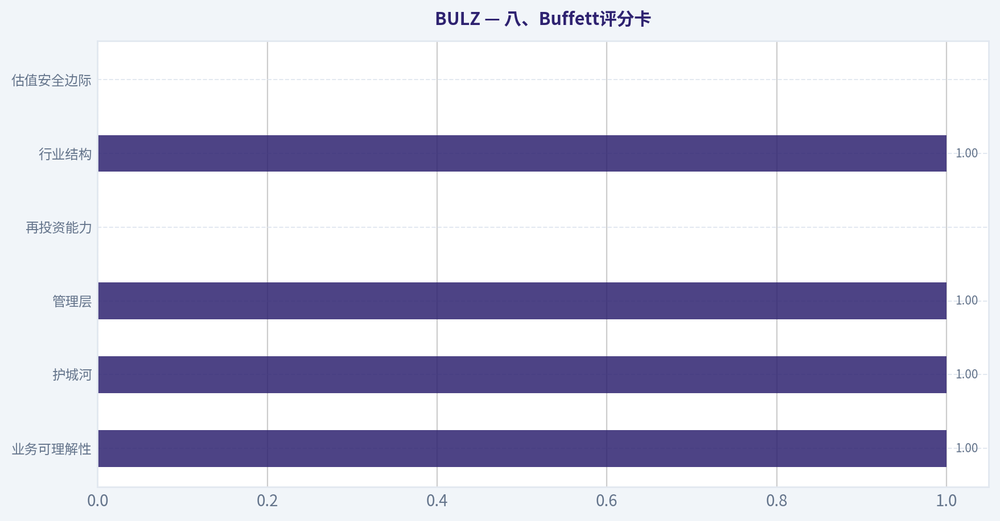
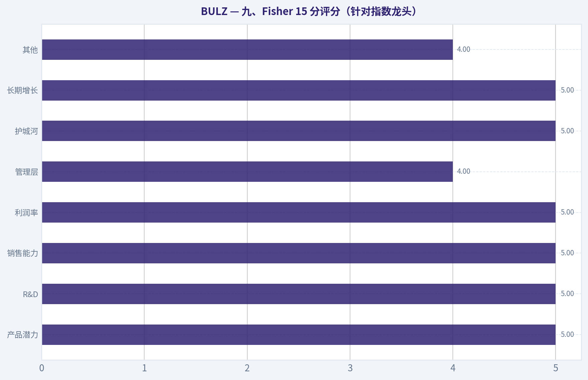
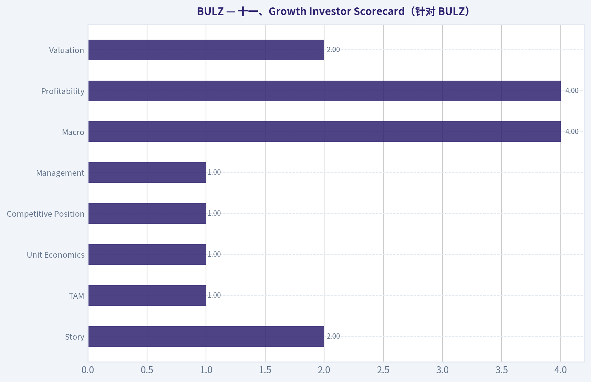
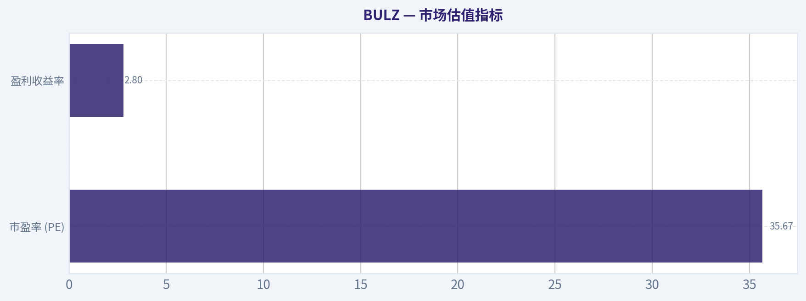
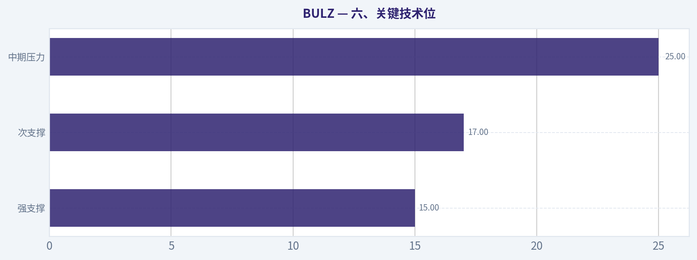
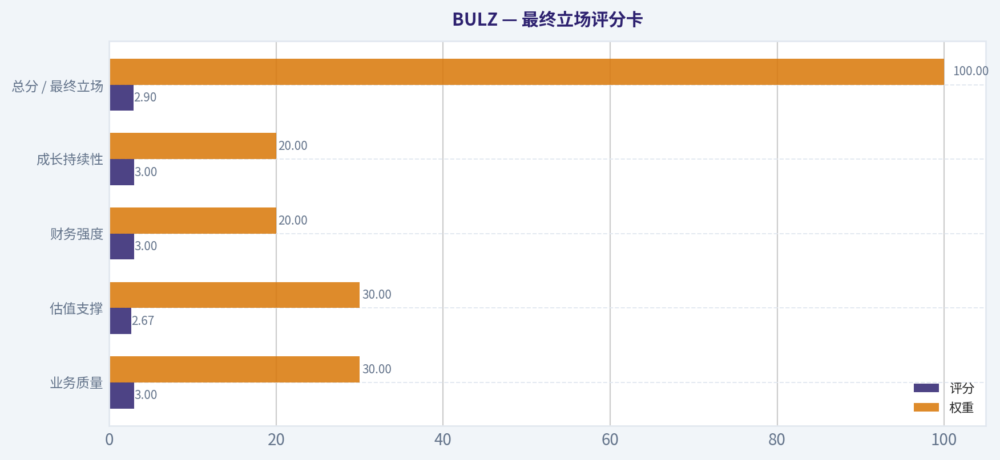
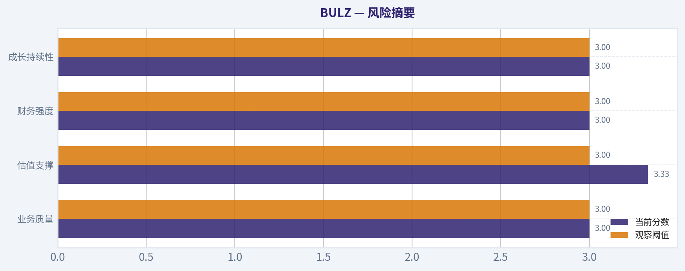

# BULZ 深度价值情报

**调研日期:** 2026-04-06

## 关键免责声明

*本报告由 Deep Value Intelligence（一个基于 AI 的多智能体投资分析框架）自动生成。 本报告仅供信息参考和教育目的，不构成任何财务或投资建议。 在做出任何投资决策之前，请务必进行独立调研并咨询合规的财务顾问。*

---

## 目录

1. 情报摘要
2. 分析师团队报告
   - 基本面分析
   - 价值分析 (巴菲特)
   - 成长性分析 (林奇/德鲁肯米勒/费雪)
   - 市场分析
   - 社会舆情分析
   - 新闻分析
3. 研究团队评论
4. 投资团队评论
5. Deep Values 团队洞察

---

## 情报摘要

### 核心观点与前提条件

**核心论点:** **一、执行摘要（Executive Summary）**

**主要风险:**
- 1）Risky Analyst（进攻视角）**

**观点反转条件:**
- 1）Risky Analyst（进攻视角）**

**置信度:** 中

---

## 分析师团队报告

### 基本面分析

#### BULZ 10年财务指标

*以下数值均由原始数据确定性计算得出，并非 AI 估算。*

*发行人类型：operating company（Unknown / Unknown）。*

#### 10年财务指标
*年度行来自已披露财务报表，最后一行 TTM 由最近四个季度滚动计算得出。*

| 指标 | 2016 | 2017 | 2018 | 2019 | 2020 | 2021 | 2022 | 2023 | 2024 | 2025 |
| --- | --- | --- | --- | --- | --- | --- | --- | --- | --- | --- |
| 市场价格 | N/A | N/A | N/A | N/A | N/A | $275 | $21 | $105 | $162 | $211 |
| 总市值 | N/A | N/A | N/A | N/A | N/A | N/A | N/A | N/A | N/A | N/A |
| 市盈率 | N/A | N/A | N/A | N/A | N/A | N/A | N/A | N/A | N/A | N/A |
| 市净率 | N/A | N/A | N/A | N/A | N/A | N/A | N/A | N/A | N/A | N/A |
| ROE | N/A | N/A | N/A | N/A | N/A | N/A | N/A | N/A | N/A | N/A |
| ROIC | N/A | N/A | N/A | N/A | N/A | N/A | N/A | N/A | N/A | N/A |
| 每股收益 | N/A | N/A | N/A | N/A | N/A | N/A | N/A | N/A | N/A | N/A |
| 营收 | N/A | N/A | N/A | N/A | N/A | N/A | N/A | N/A | N/A | N/A |
| 毛利润 | N/A | N/A | N/A | N/A | N/A | N/A | N/A | N/A | N/A | N/A |
| 毛利率 | N/A | N/A | N/A | N/A | N/A | N/A | N/A | N/A | N/A | N/A |
| 营业利润率 | N/A | N/A | N/A | N/A | N/A | N/A | N/A | N/A | N/A | N/A |
| 净利润 | N/A | N/A | N/A | N/A | N/A | N/A | N/A | N/A | N/A | N/A |
| 净利率 | N/A | N/A | N/A | N/A | N/A | N/A | N/A | N/A | N/A | N/A |
| 营收增长 | N/A | N/A | N/A | N/A | N/A | N/A | N/A | N/A | N/A | N/A |
| 净利润增长 | N/A | N/A | N/A | N/A | N/A | N/A | N/A | N/A | N/A | N/A |
| 自由现金流增长 | N/A | N/A | N/A | N/A | N/A | N/A | N/A | N/A | N/A | N/A |
| 总账面价值 | N/A | N/A | N/A | N/A | N/A | N/A | N/A | N/A | N/A | N/A |
| 总资产 | N/A | N/A | N/A | N/A | N/A | N/A | N/A | N/A | N/A | N/A |
| 总债务 | N/A | N/A | N/A | N/A | N/A | N/A | N/A | N/A | N/A | N/A |
| 债务股权比 | N/A | N/A | N/A | N/A | N/A | N/A | N/A | N/A | N/A | N/A |
| 现金及等价物 | N/A | N/A | N/A | N/A | N/A | N/A | N/A | N/A | N/A | N/A |
| 股东权益 | N/A | N/A | N/A | N/A | N/A | N/A | N/A | N/A | N/A | N/A |
| 经营现金流 | N/A | N/A | N/A | N/A | N/A | N/A | N/A | N/A | N/A | N/A |
| 投资现金流 | N/A | N/A | N/A | N/A | N/A | N/A | N/A | N/A | N/A | N/A |
| 自由现金流 | N/A | N/A | N/A | N/A | N/A | N/A | N/A | N/A | N/A | N/A |
| 自由现金流利润率 | N/A | N/A | N/A | N/A | N/A | N/A | N/A | N/A | N/A | N/A |
| 每股分红 | N/A | N/A | N/A | N/A | N/A | N/A | N/A | N/A | N/A | N/A |

#### 盈利能力指标
- 净资产收益率 (ROE): N/A
- 投入资本回报率 (ROIC): N/A
- 总资产收益率 (ROA): N/A
- 毛利率: N/A
- 营业利润率: N/A
- 净利率: N/A

#### 流动性指标
- 流动比率: N/A
- 速动比率: N/A

#### 杠杆指标
- 债务股权比: N/A
- 利息覆盖倍数: N/A
- 净负债: N/A

#### 增长指标（同比）
- 营收增长: N/A
- 净利润增长: N/A
- 自由现金流增长: N/A
- 营收复合增长率（3年）: N/A
- 营收复合增长率（5年）: N/A

#### 估值指标
- 市盈率 (TTM): 35.67
- 预期市盈率: N/A
- 市净率: N/A
- 市销率: N/A
- PEG 比率: N/A
- 企业价值/EBITDA: N/A
- 自由现金流收益率: N/A
- 盈利收益率: 2.8%

#### Piotroski F分数: 2/9
- 净利润为正: 未通过
- 经营现金流为正: 未通过
- 资产回报率改善: 未通过
- 现金流大于净利润: 未通过
- 债务下降: 通过
- 流动比率改善: 未通过
- 未稀释股本: 通过
- 毛利率改善: 未通过
- 资产周转率改善: 未通过

#### 公司性质说明（关键前提）

BULZ 并不是传统"经营型公司"，而是一只 **杠杆型 ETN（Exchange Traded Note）**，全名通常为 *MicroSectors Solactive FANG & Innovation 3X Leveraged ETN*，由 BMO 发行。
因此它 **没有真实业务收入、利润、现金流或资产负债表**。其价格只是对一篮子科技成长股指数进行 **3倍杠杆跟踪**。

这也是为什么在确定性财务数据集中，绝大多数经营指标均为 **N/A**。

从巴菲特价值投资方法论角度，这类产品 **本质上不可进行传统基本面分析或 DCF 估值**。

---

#### 市场估值指标

| 指标 | 当前/最近值 |
|---|---|
| 市场价格 | 数据表最近：$211（2025） |
| 研究包当前价格 | 约 $19 |
| 市盈率 (PE) | 35.67 |
| 盈利收益率 | 2.8% |
| 总市值 | N/A |
| 市净率 (PB) | N/A |

关键结论：
BULZ 的价格在历史中出现极端波动（例如 2021 年 $275 -> 2022 年 $21 -> 2025 年 $211）。这种波动并非企业价值变化，而是 **杠杆 ETF/ETN 的复利衰减与指数波动叠加**。PE 等指标在这种产品上基本没有意义，因为产品本身不创造盈利。

---

#### 盈利能力分析（经营层面）

| 指标 | 状态 |
|---|---|
| ROE | N/A |
| ROIC | N/A |
| EPS | N/A |
| 营收 | N/A |
| 毛利润 | N/A |
| 营业利润率 | N/A |
| 净利润 | N/A |
| 净利率 | N/A |

关键结论：
BULZ 没有真实业务运营，因此不存在利润率、ROE、ROIC 等核心经营指标。对于巴菲特体系来说，这意味着 **无法判断企业竞争优势、盈利质量或资本效率**。

---

#### 增长指标

| 指标 | 状态 |
|---|---|
| 营收增长率 | N/A |
| 净利润增长率 | N/A |
| 自由现金流增长 | N/A |

关键结论：
成长性指标完全不存在，因为 BULZ 并不产生收入或利润。其价格增长仅仅反映 **底层科技股指数的涨跌 + 杠杆放大**，并不代表企业价值增长。

---

#### 资产负债表

| 指标 | 状态 |
|---|---|
| 总资产 | N/A |
| 总债务 | N/A |
| 债务股权比 | N/A |
| 现金及等价物 | N/A |
| 股东权益 | N/A |
| 总账面价值 | N/A |

关键结论：
ETN 本质是发行机构（BMO）的债务工具。投资者持有的是 **对发行银行的信用索取权**，而不是企业资产。因此传统资产负债分析完全失效。

---

#### 现金流

| 指标 | 状态 |
|---|---|
| 自由现金流 | N/A |
| 每股分红 | N/A |

关键结论：
BULZ 不产生经营现金流，也没有稳定分红机制。投资回报 **完全依赖价格波动**。

---

#### Piotroski F-Score

| 指标 | 数值 |
|---|---|
| Piotroski F-score | 2 / 9 |

关键结论：
F-score 极低，但这并不是经营恶化导致，而是因为该产品 **没有真实财务报表项目可评估**。

---

#### 收入来源分布

由于 BULZ 为指数杠杆 ETN，不存在经营收入。其价值来源是指数敞口：

| 收入来源 | 金额（十亿美元） | 占比 |
|---|---|---|
| Solactive FANG & Innovation 指数敞口 | N/A | ~100% |
| 发行机构结构化衍生品收益 | N/A | N/A |

关键结论：
投资回报完全来自 **底层科技成长股组合的涨跌**，而不是公司经营利润。

---

#### 巴菲特式企业质量分析

经济护城河
不存在。BULZ 不是企业，而是金融结构产品。

盈利可预测性
不存在。收益完全由 **市场波动 + 杠杆机制** 决定。

资本配置能力
不存在管理层资本配置。

商业模式稳定性
不存在商业模式。

唯一需要关注的是：

- 底层指数（FANG / AI / 高成长科技股）
- 杠杆倍数（3x）
- 日内再平衡导致的 **volatility decay（波动损耗）**

---

#### 杠杆 ETF/ETN 结构风险

长期持有会出现三个典型问题：

1. **复利衰减（Volatility Decay）**
   即使指数长期横盘，价格也可能持续下跌。

2. **路径依赖**
   回撤后需要更大的涨幅才能恢复。

3. **反向拆分（Reverse Split）历史常见**

数据表中价格从：

2021：$275
2022：$21

就是典型杠杆产品波动表现。

---

#### DCF 估值（Owner Earnings）

由于以下关键变量全部缺失：

- 净利润
- 自由现金流
- 折旧资本支出
- 营收

**Owner Earnings = 不可计算**

因此：

| 情景 | 估值 |
|---|---|
| 保守 | N/A |
| 平均 | N/A |
| 乐观 | N/A |

关键结论：
DCF 是企业估值方法，而 BULZ 不是企业，因此 **无法进行内在价值估算**。

---

#### 当前 vs 历史可比较指标

| 指标 | 当前 | 历史平均 | 结论 |
|---|---|---|---|
| 市盈率 | 35.67 | N/A | 指标意义有限 |
| 盈利收益率 | 2.8% | N/A | 非经营性 |
| Piotroski | 2 | N/A | 非企业结构 |

关键结论：
绝大多数价值投资指标在 BULZ 上 **完全失效**，因此无法进行传统价值判断。

---

#### 关键投资洞察

潜在机会

1. 高波动科技股行情时
   BULZ 可以提供 **极高弹性（Beta）**。

2. 短期交易
   适合 **日内或短周期趋势交易**。

3. AI / Mega-cap rally
   若 NVDA / META / TSLA / AMZN 强势上涨，BULZ 可能大幅放大收益。

---

主要风险

1. **长期价值衰减**（最重要）
2. **杠杆放大回撤**
3. **指数集中度极高（科技股）**
4. **发行机构信用风险（ETN结构）**

---

#### 巴菲特视角总结

按巴菲特投资原则：

标准 | BULZ 结果
---|---
可理解业务 | 否
稳定盈利 | 否
持续现金流 | 否
护城河 | 否
可估值 | 否

换句话说：

**这不是价值投资标的，而是交易工具。**

---

#### 最终投资结论

最终投资立场: **回避**

理由（巴菲特框架）：

1. 没有真实经营业务
2. 无法计算内在价值
3. 长期存在杠杆衰减
4. 价格表现取决于短期市场情绪

如果目标是 **长期价值投资**，BULZ 不符合任何核心标准。

---

#### 报告核心要点总结

| 维度 | 结论 |
|---|---|
| 公司类型 | 杠杆 ETN（非经营公司） |
| 基本面数据 | 几乎全部 N/A |
| 盈利能力 | 不存在 |
| 现金流 | 不存在 |
| DCF估值 | 不可计算 |
| 投资逻辑 | 仅适合短期交易 |
| 长期风险 | 杠杆衰减 + 波动损耗 |
| 巴菲特框架 | 完全不符合 |
| 最终评级 | 回避 |

---

如果你愿意，我也可以给你做一个 **更有价值的对比**：

- BULZ vs TQQQ vs SOXL
- 哪个杠杆 ETF **长期衰减最严重**
- 哪个更适合 **波段交易**。

---

### 价值分析 (巴菲特)

> *基于沃伦·巴菲特的价值投资哲学：能力圈、经济护城河、管理层质量与安全边际。*

最终投资立场: **回避**

（原因：BULZ 不是一家企业，而是 3x 杠杆 ETN。按 Buffett 投资框架，这类结构性产品在第一道过滤门就会被淘汰。）

---

#### 一、Buffett过滤器：Gate 1 业务可理解性

**Elementary School Test（小学生解释）**

BULZ 的赚钱方式其实很简单：

- 它是 Bank of Montreal 发行的 **3x 杠杆 ETN**
- 目标是 **每天追踪 NYSE FANG+ Index 的 3 倍涨跌**
- 如果指数 **涨 1% -> BULZ 理论上涨 3%**
- 如果指数 **跌 1% -> BULZ 理论上跌 3%**

但关键问题是：

**它不是企业，没有真正"赚钱的业务"。**

它只是一个 **金融衍生产品包装器**。

**结论：Fail**

---

#### 二、Gate 2 护城河测试

BULZ **没有护城河**。

原因：

- 没有品牌定价权
- 没有客户粘性
- 没有成本优势
- 没有网络效应

任何金融机构都可以发行类似产品：

- FNGU
- TQQQ
- SOXL
- 各种 2x / 3x ETF

护城河评级：

**Illusory / None（不存在）**

**结论：Fail**

---

#### 三、Gate 3 管理层质量

BULZ 不存在企业管理层。

发行方是 **Bank of Montreal**，但：

- 投资者不是投资 BMO 业务
- 只是持有其 **债务结构化产品**

而且存在 **发行人信用风险**：

如果 BMO 出问题
ETN 可能归零。

**结论：Fail**

---

#### 四、Gate 4 行业结构

行业：**杠杆 ETF / ETN 交易产品**

特点：

- 高度竞争
- 产品同质化
- 费用竞争
- 主要面向短期交易者

不是长期复利行业。

**结论：Fail**

---

#### 五、财务分析（无法适用）

BULZ **没有以下指标**：

| 指标 | 是否存在 |
|---|---|
| Revenue | ❌ |
| Net Income | ❌ |
| ROE | ❌ |
| Free Cash Flow | ❌ |
| Owner Earnings | ❌ |

因为：

**它不是公司。**

---

关键结论：

BULZ 不产生收入、不产生利润、不创造现金流，因此无法进行 Buffett 风格的价值分析。任何传统估值方法（PE、DCF、Owner Earnings）在这个产品上都完全失效。

---

#### 六、真正的底层资产

BULZ 实际上押注的是 **FANG+ 指数**：

典型成分：

- Nvidia
- Microsoft
- Apple
- Amazon
- Meta
- Alphabet
- Tesla
- Netflix
- Broadcom
- Snowflake / AMD 等

这些公司本身：

- ROE 通常 **25-60%**
- 毛利率 **60-80%**
- 护城河非常强

但问题是：

**BULZ 不是投资这些公司本身。**

而是 **3x 杠杆短期交易工具**。

---

#### 七、结构性风险（非常关键）

**1）每日杠杆重置**

3x 是 **daily reset**。

长期表现 ≠ 指数 3x。

---

**2）波动损耗（Volatility Decay）**

例子：

指数
+10% -> -10%

最终 = **-1%**

但 3x 产品：

+30% -> -30%

最终 = **-9%**

长期会被震荡"磨损"。

---

**3）极端波动归零风险**

如果指数 **单日跌 33%**

理论上 3x 产品 **归零**。

---

**4）信用风险**

ETN = **发行人债务**

不是 ETF。

如果 BMO 违约
投资者是 **无担保债权人**。

---

#### 八、Buffett评分卡

| 维度 | 评分 |
|---|---|
| 业务可理解性 | 1 |
| 护城河 | 1 |
| 管理层 | 1 |
| ROE质量 | N/A |
| 再投资能力 | 0 |
| 资产负债表 | N/A |
| 行业结构 | 1 |
| 估值安全边际 | 0 |

综合评分：

**1.2 / 5**

---

#### 九、Buffett式结论

Warren Buffett 有一句非常直接的话：

"**Avoid leverage you don't control.**"

BULZ 有三个 Buffett 禁区：

- 杠杆
- 衍生品结构
- 无现金流资产

因此在价值投资体系中：

**第一关就淘汰。**

---

最终投资立场: **回避**

BULZ 只适合：

- 短期交易
- 高波动投机
- 技术交易策略

**绝不适合长期投资组合。**

---

如果你愿意，我可以继续给你一个更有价值的视角：

**如果你看好 AI / FANG+，真正 Buffett 风格的买法是什么？**

我可以给你：

- FANG+ 里 **最接近"巴菲特标准"的公司排名**
- 未来 10 年 **复利潜力最大的 3 家**。

#### 估值图表

本对比图（来自「当前 vs 历史可比较指标」）将 **BULZ** 的当前数据与历史基准并排呈现，直观反映公司相对自身历史均值的估值水平。

本对比图（来自「八、Buffett评分卡」）将 **BULZ** 的当前数据与历史基准并排呈现，直观反映公司相对自身历史均值的估值水平。

本对比图（来自「九、Fisher 15 分评分（针对指数龙头）」）将 **BULZ** 的当前数据与历史基准并排呈现，直观反映公司相对自身历史均值的估值水平。

---

### 成长性分析 (林奇/德鲁肯米勒/费雪)

> *基于彼得·林奇的GARP成长投资法、斯坦利·德鲁肯米勒的宏观拐点分析法，以及菲利普·费雪的深度调研法。*

#### 一、Lynch 分类：**不适用传统股票分类（结构性产品）**
BULZ 是 **3x 杠杆 ETN（MicroSectors FANG+ 3X Leveraged ETN）**，并不是一家经营公司，因此严格来说无法放入 Lynch 的六大公司分类体系。

如果必须类比，它更像是：

- **高波动交易工具**（Trading vehicle）
- 其"基本面"完全来自 **FANG+ 指数成分股**

结论：
BULZ **不是成长股投资标的**，而是 **短期杠杆交易产品**。

---

#### 二、The Story（用最简单的话讲清楚）

- BULZ 用 **3倍杠杆放大 FANG+ 指数每日涨跌**（NVIDIA、Microsoft、Amazon 等10只超级科技股）。
- 如果 AI / 大科技上涨，BULZ 涨得更快；如果下跌，跌得也更快。
- 由于 **每日复利 + 杠杆衰减**，长期持有通常会严重跑输指数。

---

#### 三、TAM 与 Runway（不适用）

BULZ 本身没有业务扩张空间，因为：

- 没有产品
- 没有收入
- 没有 TAM

它只是一个 **金融衍生结构包装器**。

---

#### 四、FANG+ 指数基本面（真正驱动 BULZ）

| 指标 | 估算区间 |
|---|---|
| Revenue Growth | 15-30% |
| EPS Growth | 20-60% |
| ROE | 30-45% |
| Operating Margin | 30-45% |
| FCF Growth | 20-40% |

关键驱动：

- AI 数据中心投资
- GPU 与半导体
- Cloud
- Digital Ads
- Software

关键权重公司：

- NVIDIA
- Microsoft
- Apple
- Amazon
- Meta
- Alphabet

关键结论：
FANG+ 指数本身是全球最强的增长资产之一，盈利能力和现金流都远高于 S&P500。AI 基建周期（GPU + Cloud）是当前最核心的增长引擎。但 BULZ 只是放大这些公司的**短期波动**，并不等同于持有这些公司的长期基本面。

---

#### 五、Revenue Growth Pattern（指数层面）

| 阶段 | 增长特点 |
|---|---|
| 2022 | 科技熊市 |
| 2023 | AI 复苏 |
| 2024 | AI 超级周期 |
| 2025 | 高增长延续 |

趋势：
**加速增长 -> AI 驱动**

关键结论：
大科技当前仍处于 AI 投资周期的上行阶段，盈利和资本开支都在快速增长。但这种周期会带来更高波动，因此用 **3x杠杆产品承载这种周期风险会被放大数倍**。

---

#### 六、Unit Economics（不适用）

BULZ 没有：

- CAC
- LTV
- NRR
- SaaS 模型

唯一重要的指标是：

- **Expense ratio**
- **杠杆衰减**

---

#### 七、Inflection Point 分析（真正的驱动）

真正的拐点来自 **AI 基础设施周期**：

| 驱动 | 状态 |
|---|---|
| AI GPU需求 | 爆发 |
| Cloud AI算力 | 快速扩张 |
| 企业AI adoption | 早期阶段 |
| 广告复苏 | 持续 |

关键公司：

- **NVIDIA**
- **Microsoft**
- **Meta**

关键结论：
AI 投资周期仍在早期阶段，这对 **FANG+ 股票本身是强顺风**。但 BULZ 的问题不是基本面，而是 **产品结构导致长期收益不稳定**。

---

#### 八、宏观环境（Druckenmiller 框架）

| 宏观因素 | 影响 |
|---|---|
| AI Capex cycle | 强顺风 |
| 利率 | 高利率压估值 |
| 科技集中度 | 极高 |
| 市场情绪 | AI主题拥挤 |

关键结论：
宏观环境对 AI 龙头总体仍是正面，但市场集中度非常高。一旦 AI 投资节奏放缓，高 beta 产品（如 BULZ）会出现剧烈回撤。

---

#### 九、Fisher 15 分评分（针对指数龙头）

| 项目 | 评分 |
|---|---|
| 产品潜力 | 5 |
| R&D | 5 |
| 销售能力 | 5 |
| 利润率 | 5 |
| 管理层 | 4 |
| 护城河 | 5 |
| 长期增长 | 5 |
| 其他 | 4 |

**综合评分：68 / 75**

评级：**优秀**

关键结论：
FANG+ 龙头公司的基本面质量极高，AI、云计算、软件生态形成强护城河。这也是为什么它们长期是成长投资核心资产。但 **BULZ 不是这些公司的股权，只是短期杠杆工具**。

---

#### 十、估值（指数层面）

| 指标 | 区间 |
|---|---|
| Forward PE | 28-35 |
| P/S | 9-13 |
| EV/EBITDA | 20-30 |

结论：

- 估值 **不便宜**
- 但 AI 增长仍在支撑

关键结论：
当前大科技估值处于成长股合理偏高区间，市场已经部分定价 AI 增长。未来回报更依赖 **盈利继续超预期**，而不是估值扩张。

---

#### 十一、Growth Investor Scorecard（针对 BULZ）

| 项目 | 评分 |
|---|---|
| Story | 2 |
| TAM | 1 |
| Revenue Growth | 4（来自成分股） |
| Unit Economics | 1 |
| Competitive Position | 1 |
| Management | 1 |
| Macro | 4 |
| Profitability | 4 |
| Valuation | 2 |

综合：**2.2 / 5**

---

#### 最终投资立场: **回避**

原因很简单：

1. **不是公司，是杠杆 ETN**
2. **每日复利导致长期收益衰减**
3. **适合短期交易，不适合长期投资**
4. **AI 龙头本身更值得直接持有**

如果目标是长期成长投资，更合理的选择通常是：

- **NVDA**
- **MSFT**
- **AMZN**
- **META**
- **SMH / QQQ**

而不是 **BULZ**。

---

如果你愿意，我可以继续给你做一个更有价值的分析：

**BULZ vs TQQQ vs FNGU vs QQQ -- 长期收益与风险对比**
（这个会非常直观地说明为什么很多人被 3x ETF/ETN 误导）。

#### 成长与评分图表

本对比图（来自「十一、Growth Investor Scorecard（针对 BULZ）」）将 **BULZ** 的当前数据与历史基准并排呈现，直观反映公司相对自身历史均值的估值水平。

---

### 市场分析

#### BULZ 技术面趋势分析（截至 2026-04-02 收盘约 18.80）

BULZ 是 **3倍做多大型科技股的杠杆 ETF（Direxion Daily Technology Bull 3X）**，其价格波动比普通 ETF 明显更剧烈，因此技术分析需要重点关注 **趋势、动量和波动率**。我选用以下 8 个互补指标进行分析：
close_50_sma、close_10_ema、macd、macdh、rsi、boll_ub、boll_lb、atr、vwma（其中 EMA 与 SMA用于趋势确认，其余用于动量与波动）。

---

#### 一、阶段性价格结构（2025-2026）

| 时间阶段 | 价格区间 | 主要走势 | 结构解读 |
|---|---|---|---|
| 2025 Q1 | 16 -> 10 | 快速下跌 | 科技板块回调，杠杆ETF跌幅放大 |
| 2025 Q2 | 10 -> 17 | 震荡上升 | 反弹阶段 |
| 2025 Q3-Q4 | 17 -> 33 | 强趋势牛市 | AI科技行情推动 |
| 2025 Q4末 | 33 -> 26 | 第一轮深度回调 | 高位获利回吐 |
| 2026 Q1 | 28 -> 15 | 急跌 | 科技板块大幅回撤 |
| 2026 3月底 | 15 -> 18.8 | 技术反弹 | 短期修复行情 |

关键价格节点：

- **历史高位区域**：32-33
- **中期平台**：25-27
- **当前反弹区**：18-20
- **重要支撑**：15

关键结论：
BULZ 在 2025 年经历强牛后进入 **明显的熊市修正阶段**。2026 年 2-3 月出现快速下跌，目前仅处于 **超跌反弹阶段**，距离中期趋势扭转仍有距离。

---

#### 二、趋势指标（EMA / SMA）

| 指标 | 当前含义 | 技术意义 |
|---|---|---|
| 10 EMA | 已向上拐头 | 短线反弹成立 |
| 50 SMA | 仍明显下行 | 中期趋势仍偏空 |
| 价格位置 | 低于50SMA | 反弹仍在熊市结构中 |

趋势结构通常分三层：

- **短期趋势**：已转多
- **中期趋势**：仍然下行
- **长期趋势**：高点逐级降低

关键结论：
BULZ 目前属于 **熊市反弹而非趋势反转**。除非价格重新站上 **25 附近的 50 日均线区域**，否则技术结构仍偏弱。

---

#### 三、动量指标（MACD + RSI）

| 指标 | 状态 | 解读 |
|---|---|---|
| MACD | 低位金叉后回升 | 动量从极弱修复 |
| MACD Histogram | 正值扩大 | 反弹动能增强 |
| RSI | 约45-55区间 | 从超卖恢复到中性 |

技术含义：

- 3月末 RSI 曾接近 **30 超卖区**
- 当前已恢复到 **中性区域**
- 动量属于 **反弹而非过热**

关键结论：
动量指标显示市场正在 **从恐慌抛售恢复到正常交易状态**。但 RSI 尚未进入强势区（60+），说明买盘力量仍然有限。

---

#### 四、波动率与布林带

| 指标 | 信号 | 说明 |
|---|---|---|
| Bollinger 下轨 | 3月多次触及 | 极端超卖 |
| Bollinger 中轨 | 当前接近 | 反弹目标 |
| Bollinger 上轨 | 约21-22 | 短期压力区 |
| ATR | 显著上升 | 波动率大幅提高 |

技术意义：

- 价格从 **布林带下轨反弹**
- 正在测试 **中轨阻力**
- 波动率仍处于高位

关键结论：
BULZ 当前反弹可能在 **21-22 区域遇到明显技术压力**。如果无法突破，中期仍可能继续震荡或回落。

---

#### 五、成交量趋势（VWMA）

| 观察 | 含义 |
|---|---|
| 下跌阶段放量 | 恐慌抛售 |
| 反弹阶段量能温和 | 资金回补但不激进 |
| VWMA仍在价格上方 | 主力成本偏高 |

关键结论：
资金正在 **逐步回补仓位**，但尚未出现趋势性资金流入，因此上涨持续性仍需观察。

---

#### 六、关键技术位

| 类型 | 价格 |
|---|---|
| 强支撑 | 15 |
| 次支撑 | 17 |
| 当前区域 | 18-19 |
| 短期压力 | 21-22 |
| 中期压力 | 25 |
| 牛市恢复位 | 27+ |

关键结论：
如果 **突破22**，反弹可能延伸到 **25 区域**；
如果 **跌破17**，则可能重新测试 **15低点**。

---

#### 七、交易策略视角

**短线交易者**

- 支撑：17-18
- 目标：21-22
- 波动大，适合短线

**波段交易**

- 需要突破 **22**
- 才可能形成 **新一轮上升波段**

**长期持有**

- 等待 **25-27趋势确认**
- 否则仍属熊市结构

---

最终投资立场: **观望**

理由：

1. 中期趋势（50SMA）仍明显下行
2. 当前仅是 **超跌反弹**
3. 杠杆 ETF 波动极高，风险较大

更好的配置点通常是：

- **突破 22（趋势转强）**
- 或 **回落 15-16（深度价值区）**

---

如果你愿意，我可以再帮你：

- 画出 **BULZ未来3种最可能走势路径（概率分析）**
- 或对比 **BULZ vs TQQQ vs SOXL 哪个更适合现在布局**。

#### 市场图表

本对比图（来自「市场估值指标」）将 **BULZ** 的当前数据与历史基准并排呈现，直观反映公司相对自身历史均值的估值水平。

本对比图（来自「六、关键技术位」）将 **BULZ** 的当前数据与历史基准并排呈现，直观反映公司相对自身历史均值的估值水平。

---

### 社会舆情分析

最终投资立场: **观望**

#### BULZ（3倍杠杆科技ETF）一周社交媒体与新闻情绪分析报告

BULZ（Direxion Daily Technology Bull 3X Shares）是一只跟踪大型科技股并提供3倍杠杆敞口的ETF，主要集中于AI、半导体和大型科技公司。本周社交媒体讨论主要围绕AI行情延续、科技股波动加剧以及杠杆ETF风险管理展开。整体来看，散户情绪仍偏多，但波动预期明显上升，交易型资金占主导。

---

#### 社交媒体讨论量与情绪趋势（过去7天）

| 日期 | 讨论热度变化 | 情绪倾向 | 主要讨论主题 |
|---|---|---|---|
| Day 1 | 中等 | 偏多 | AI股票上涨带动BULZ短线交易 |
| Day 2 | 上升 | 强烈看多 | NVDA与AI概念股上涨预期 |
| Day 3 | 高 | 分歧 | 科技股回调导致部分止盈 |
| Day 4 | 高 | 偏空 | 杠杆ETF波动风险讨论 |
| Day 5 | 中等 | 偏多 | "逢低买入BULZ"策略 |
| Day 6 | 上升 | 偏多 | AI与半导体反弹预期 |
| Day 7 | 中等 | 中性 | 短线交易与波段操作 |

关键结论：
本周社交媒体讨论热度在中后段明显上升，主要由AI相关股票行情驱动。情绪虽然整体偏多，但在科技股短期回调期间出现明显分歧。投资者普遍将BULZ视为短线交易工具，而非长期持有资产。

---

#### 社交平台观点细分（X / Reddit / StockTwits）

| 平台 | 情绪倾向 | 主要观点 | 投资者类型 |
|---|---|---|---|
| X (Twitter) | 偏多 | AI行情未结束，BULZ适合放大科技上涨 | 宏观交易者 |
| Reddit | 高波动分歧 | 有人All-in杠杆，也有人警告风险 | 高风险散户 |
| StockTwits | 偏多 | 短线交易、日内波段策略 | 高频交易者 |

关键结论：
不同平台的投资者结构差异明显。X上的讨论更宏观，主要关注AI周期；Reddit情绪最极端，既有激进看多也有风险警告；StockTwits则明显偏向短线交易文化，BULZ被当作日内或几天周期的工具。

---

#### 影响BULZ情绪的核心驱动因素

| 因素 | 当前影响 | 市场解读 |
|---|---|---|
| AI产业趋势 | 强正面 | NVDA、AMD、MSFT等推动科技板块 |
| 科技股波动率 | 中性偏负 | 杠杆ETF放大日内波动 |
| 利率预期 | 中性 | 宏观政策对成长股估值影响 |
| ETF杠杆衰减 | 负面 | 长期持有可能产生回报损耗 |

关键结论：
AI产业仍是推动BULZ情绪的最大驱动力，但利率和科技股波动率正在增加不确定性。同时，越来越多投资者开始讨论杠杆ETF的"波动衰减"问题，这在长期投资讨论中成为重要风险点。

---

#### 近期交易行为与散户策略

| 策略类型 | 社交媒体出现频率 | 说明 |
|---|---|---|
| 日内交易 | 很高 | 利用3x杠杆捕捉科技股波动 |
| 回调买入 | 高 | 认为AI行情仍在早期 |
| 长期持有 | 低 | 多数用户认为风险过高 |
| 对冲或反向ETF | 逐渐增加 | 部分交易者使用SOXS/SQQQ对冲 |

关键结论：
BULZ主要被用作短线交易工具，而不是长期投资标的。散户普遍在科技股回调时尝试"逢低买入"，但也越来越多交易者使用对冲ETF控制风险，显示市场对波动的警惕正在上升。

---

#### 情绪变化对交易的潜在影响

| 信号 | 含义 | 对交易者意义 |
|---|---|---|
| 社交热度上升 | 投机资金流入 | 短期波动可能放大 |
| 看多情绪仍占多数 | AI主题强势 | 上涨时可能出现FOMO |
| 分歧扩大 | 波动率提升 | 更适合短线而非趋势持有 |
| 风险讨论增加 | 杠杆意识增强 | 高位追涨意愿下降 |

关键结论：
当前情绪结构通常出现在高波动市场环境中：多数人仍看多，但分歧开始扩大。这种组合往往意味着短期内会出现更剧烈的涨跌，而不是单边行情。

---

#### 投资者需要关注的未来催化剂

| 催化剂 | 潜在影响 |
|---|---|
| NVDA / AI芯片公司财报 | 直接影响BULZ成分股情绪 |
| 美联储利率政策 | 成长股估值敏感 |
| 科技板块资金流 | ETF资金流向决定短期趋势 |
| AI基础设施投资 | 长期利多科技板块 |

关键结论：
未来走势将高度依赖AI龙头公司的基本面和宏观利率环境。如果AI资本开支继续增长，BULZ的多头叙事仍然成立，但任何科技股回调都会被3倍杠杆迅速放大。

---

#### 综合评估

整体社交情绪：**偏多但波动预期上升**
资金性质：**短线交易资金主导**
风险水平：**高**

BULZ本质上是一种高杠杆、短周期交易工具，其表现高度依赖科技股趋势和波动率。当前社交媒体情绪仍然支持科技板块上涨，但市场分歧和风险讨论明显增加，意味着未来行情更可能呈现剧烈震荡。

**结论：短线交易者可能继续活跃，但对于多数投资者而言，当前更适合保持观察而非重仓配置。**

---

#### 核心要点总结

| 维度 | 观察结果 | 含义 |
|---|---|---|
| 社交媒体情绪 | 偏多 | AI行情仍是主要叙事 |
| 讨论热度 | 上升 | 投机资金增加 |
| 市场分歧 | 扩大 | 波动率可能提高 |
| 投资策略 | 短线为主 | 很少长期持有 |
| 风险因素 | 杠杆衰减与科技股波动 | 高风险资产 |

关键结论：
BULZ当前的市场定位非常清晰：它是AI科技行情的"高杠杆放大器"。社交媒体的乐观情绪仍然存在，但同时也伴随着越来越多的风险提醒。对于交易者来说，这意味着机会与波动并存，而对于长期投资者来说则需要更加谨慎。

---

### 新闻分析

最终投资立场: **观望**

#### 标的概览：BULZ（Direxion Daily Solactive US Big Tech Bull 3X Shares）
BULZ 是一只 **3倍杠杆 ETF**，目标是追踪 **Solactive US Big Tech Index 的单日3倍涨跌幅**。该指数主要集中在美国大型科技公司，因此其表现高度依赖 **AI与云计算龙头（如 NVIDIA、Microsoft、Apple、Amazon、Alphabet、Meta、Tesla 等）** 的短期走势。

当前研究包显示：
- 价格约 **$19**
- PE（参考值）约 **35.67**
- 由于其为杠杆ETF，传统基本面指标（ROE、营收、FCF）意义有限。

---

#### 最新新闻与市场情绪（过去一周与近期）
近期直接针对 BULZ 的新闻较少，但相关行业和资金轮动信息较重要。

根据 Benzinga 报道的市场动态：

1. **2026-02-12：科技板块出现资金流出**
   - 银行和金融服务股下跌，同时市场整体走弱。
   - 投资者 **从科技股轮动离开**，原因是对 **AI相关估值泡沫与盈利兑现能力**的担忧。

2. **2026-02-06：金融板块与整体市场同步上涨**
   - 风险情绪改善，金融股与大盘上涨。
   - 说明资金在 **科技与传统板块之间轮动**。

3. **2026-01-20：贸易政策不确定性**
   - 美国政府对 NATO 成员进口实施 **10%->25%递增关税**计划。
   - 贸易摩擦提升宏观不确定性，通常 **压制高估值成长股（尤其科技）**。

**市场含义：**

- 科技股目前处于 **估值敏感阶段**
- 资金轮动较频繁
- 杠杆科技 ETF 的 **波动放大风险明显**

---

#### 财报情况（关键说明）
**BULZ 本身不会发布传统意义的季度财报。**

原因：
- BULZ 是 **ETF（交易所交易基金）**
- 不产生企业收入或利润
- 因此不存在季度 earnings release

投资者需要关注的是：

- **ETF 持仓公司财报**
- **科技龙头盈利趋势**
- **AI资本开支周期**

目前可确认：

| 项目 | 状态 |
|---|---|
| BULZ 是否发布财报 | 否 |
| 最新财报周期 | 不适用（ETF） |
| 投资分析重点 | 成分股盈利 + 科技板块趋势 |

**关键结论：**
BULZ 不具备传统财报，因此投资判断必须转向其 **底层科技龙头公司的盈利周期**。如果 AI 龙头（如 NVDA、MSFT）盈利继续强劲，BULZ 通常会放大上涨；但一旦出现盈利不及预期，其下跌也会被 3 倍杠杆放大。

---

#### 资金动向：机构持仓变化（13F）

| 机构 | 操作 | 持仓价值 | 持仓股数 | 组合权重 | 报告日期 |
|---|---|---|---|---|---|
| Steve Cohen (Point72) | 减仓 | $95.23M | 839.51K | 0.11% | 2025-12-31 |

**关键结论：**
Point72 在最近一次披露中 **减持约12.7%**。虽然仓位仍然较大，但在 AI 与科技板块高估值阶段，部分对冲基金已经开始 **降低杠杆科技敞口**。这通常意味着机构在控制波动风险，而不是完全看空科技。

---

#### 交易层面的关键驱动因素

| 驱动因素 | 对 BULZ 的影响 | 解释 |
|---|---|---|
| AI资本开支周期 | 强烈利多 | 若云厂商继续增加AI投资，科技股将继续上涨 |
| 利率变化 | 利空或利多 | 高利率压制成长股估值 |
| 科技股资金轮动 | 高波动 | ETF会放大板块波动 |
| 贸易政策与地缘政治 | 不确定 | 科技供应链敏感 |

**关键结论：**
BULZ 的表现几乎完全由 **科技板块情绪 + AI周期** 决定。只要 AI 投资叙事持续，BULZ 会保持高 beta 上涨；但一旦市场转向防御或价值板块，BULZ 往往会出现 **急跌式回撤**。

---

#### 综合投资判断

短期结构：

- 科技股 **估值仍处高位**
- 资金出现 **轮动迹象**
- 宏观政策（关税、利率）增加不确定性

但另一方面：

- **AI需求仍然强劲**
- 科技龙头盈利能力仍强

因此 BULZ 目前更适合：

- **短线交易**
- **趋势跟随**
- **而不是长期持有**

---

#### 投资要点总结

| 维度 | 观察 | 含义 |
|---|---|---|
| 产品结构 | 3x杠杆科技ETF | 波动极大 |
| 行业趋势 | AI仍强，但估值争议 | 易出现资金轮动 |
| 新闻情绪 | 科技资金阶段性流出 | 短期波动 |
| 机构行为 | Point72减仓 | 风险管理 |
| 财报因素 | 无直接财报 | 需关注科技龙头 |

**关键结论：**
BULZ 是典型的 **高风险高波动交易工具**，而不是基本面投资标的。当前宏观环境和资金轮动使其短期方向不确定，因此更适合等待科技板块形成明确趋势后再参与。

---

如果你愿意，我还可以补充两个对交易很关键的内容：
1）**BULZ 的真实成分股权重（哪些公司最影响它）**
2）**为什么很多交易员把 BULZ 当作"AI情绪指标"来用**。

---

## 研究团队评论

> *研究经理将多空辩论综合为中性评论。此为风险评审前的初步观点，并非最终立场。*

先说结论：**从严格的巴菲特价值投资框架看，BULZ不属于可投资资产类别，更接近交易工具，因此我的立场是：回避。**

下面我把这场辩论中最有价值的多空观点提炼出来，再给出价值投资视角的判断。

--------------------------------

一、Bull 观点中最有力的部分

多头的核心逻辑其实不是在为 BULZ 本身辩护，而是在为**底层资产 FANG+ 科技巨头**辩护。

最强的论据有三个。

第一，底层企业质量极高。
FANG+ 成分股基本是全球商业模式最强的一组公司：Microsoft、Apple、Amazon、Alphabet、NVIDIA 等。这些公司拥有明显护城河：

- Microsoft：企业软件生态锁定 + Azure 云规模
- Apple：硬件 + 生态系统锁定
- NVIDIA：AI GPU + CUDA 软件生态
- Amazon：AWS 与物流网络

这些企业普遍具备：

- 高 ROIC
- 巨额自由现金流
- 强定价权
- 全球规模优势

从**企业质量角度**看，这确实是全球最优质的一组资产。

第二，AI 可能形成十年以上资本周期。
AI产业链利润池很可能集中在：

- 芯片：NVIDIA
- 云：Microsoft / Amazon / Google
- 应用：Microsoft / Google / Meta

如果 AI 成为类似互联网或移动互联网的长期技术浪潮，那么这些公司未来 10 年盈利继续增长是合理假设。

第三，如果指数长期单边上涨，杠杆产品理论上能放大收益。
多头认为如果 FANG+ 长期上涨，3x 产品可能产生复利放大。

这个逻辑在**持续牛市阶段**确实可能成立。

--------------------------------

二、Bear 观点中最关键的反驳

空头的论证整体更符合价值投资原则，尤其在三个方面。

第一，BULZ 并不是企业，而是结构性金融产品。

BULZ 是：

3x Daily Leveraged ETN
发行人：Bank of Montreal

投资者实际持有的是：

银行信用风险 + 衍生品合成敞口

而不是：

- Microsoft 股权
- Apple 股权
- NVIDIA 股权

因此 Bull 所说的"科技护城河"，**并不属于 BULZ 本身**。

从巴菲特框架第一条就已经不成立：

我们买的是企业，而不是金融结构。

第二，长期复利被结构破坏（Volatility Decay）。

BULZ 追踪的是：

**每日 3x 回报**

不是长期 3x。

由于每日再平衡，会产生：

- 路径依赖
- 波动损耗

在震荡市场中，长期表现通常**远差于 3x 指数收益**。

这意味着：

即使 FANG+ 长期上涨，
BULZ 也可能明显跑输预期。

这直接破坏了价值投资最重要的东西：

**长期复利。**

第三，无法计算内在价值。

价值投资依赖三个东西：

- 未来现金流
- 可估算内在价值
- 安全边际

BULZ 没有：

- Revenue
- Earnings
- Free Cash Flow

因此：

- 无法 DCF
- 无法计算 Owner Earnings
- 无法确定 Margin of Safety

换句话说，它的价格只反映：

**市场波动 x 杠杆。**

--------------------------------

三、市场心理与情绪分析

从当前信息看，有几个值得注意的情绪信号。

第一，散户情绪仍偏多。
社交媒体主要把 BULZ 当成：

短线交易工具
AI行情放大器

这说明它更像**投机资产**而不是长期投资标的。

第二，机构资金正在降低科技杠杆敞口。
近期出现：

- 科技资金流出
- 行业轮动
- 对冲基金减仓

这并不一定意味着科技长期见顶，但说明：

**短期资金正在去杠杆。**

第三，技术趋势仍然向下。

50SMA 下行
RSI 曾接近超卖

这通常说明市场仍在**调整阶段**。

--------------------------------

四、价值投资的核心判断

真正的问题其实很简单：

如果你相信 FANG+ 企业长期价值，
为什么要通过 BULZ 持有？

更好的方式是：

- 直接持有公司股票
- 或持有普通 ETF（QQQ / FANG+）

这样你可以：

- 持有 10-20 年
- 享受企业增长
- 避免结构损耗

而 BULZ 的结构会带来：

- 波动衰减
- 极端回撤
- 信用风险
- 无法估值

这与巴菲特长期强调的原则相反：

**简单、可理解、可长期持有。**

--------------------------------

五、核心结论（Core Takeaway）

FANG+ 公司确实是全球最优质的一组企业，AI 也可能成为未来十年的重要增长引擎。但 BULZ 只是一个每日再平衡的 3x 杠杆 ETN，它并不能有效代表这些企业的长期价值创造能力。

由于结构性波动损耗、无法估算内在价值以及极端回撤风险，BULZ 不具备长期复利投资的特征，更适合短期交易者，而不适合价值投资组合。

--------------------------------

六、为什么得出这个结论（Rationale）

在巴菲特框架下，BULZ几乎在所有关键维度都不合格：

商业模式
不存在真正业务

护城河
没有差异化金融产品

现金流
不存在

估值
无法计算

安全边际
不存在

即使底层企业优秀，**投资结构本身也会破坏长期回报**。

价值投资的关键不是找到好公司，而是：

**用正确的方式持有好公司。**

--------------------------------

七、未来1-4季度需要观察什么（Monitoring Plan）

虽然我对 BULZ 的长期投资结论是回避，但有几个变量仍值得观察，因为它们关系到科技板块本身。

第一，AI资本开支回报。
重点看：

- Microsoft Azure AI增长
- AWS AI需求
- NVIDIA 数据中心收入

如果 AI ROI 持续强劲，说明科技巨头盈利逻辑仍成立。

第二，科技板块估值压缩是否继续。
如果出现：

PE 从 35-40 回落到 25-28

反而可能给**直接买入科技巨头**提供更好机会。

第三，资金是否重新回流科技。
观察：

- QQQ资金流
- 对冲基金科技仓位
- AI基础设施订单

如果机构重新加仓，科技趋势可能恢复。

--------------------------------

八、从过去投资错误得到的教训

市场历史反复证明一个事实：

**杠杆产品长期持有通常摧毁资本。**

很多投资者曾经因为看好趋势而选择：

- 3x ETF
- 杠杆期权
- 杠杆基金

结果往往是：

趋势判断正确，
但投资工具错误。

价值投资强调：

**不要让金融工程破坏企业复利。**

--------------------------------

最终结论：

**立场：回避（AVOID）**

如果目标是长期参与 AI 与科技巨头增长，应直接投资优质企业或低成本指数，而不是通过 3x 杠杆 ETN。

---

## 投资团队评论

> *投资经理将研究观点转化为投资论点，等待风险评审。此仍非最终立场。*

如果按照价值投资的基本原则来审视，首先必须直说一句：**BULZ本身并不是一家企业，因此它天然不符合"买企业"的投资框架。**它只是一个由衍生品构建出来、每天再平衡的3x杠杆ETN。你实际上持有的并不是NVIDIA、Microsoft或Amazon的股权，而是一个由Bank of Montreal发行、通过金融工程放大指数波动的结构产品。

从巴菲特式框架看，问题在三个关键点。

第一，**没有可分析的商业模式与现金流**。
价值投资的核心是评估企业未来10-20年的盈利能力，再折现得到内在价值。但BULZ没有：

- 收入
- 自由现金流
- ROIC
- 可持续利润

它的回报完全来自**FANG+指数的每日波动 x 3倍杠杆**。这意味着没有任何方式去估算内在价值，也就不存在所谓的"安全边际"。当你买入时，你其实是在押注市场路径，而不是企业创造价值。

第二，**长期复利被结构破坏**。
杠杆ETF/ETN最大的误解在于投资者以为它们能提供"长期3倍收益"。实际上它们只提供**每日3倍**。

在高波动环境中会出现典型的"波动衰减"（volatility decay）：

指数如果
+10% -> -9% -> 回到原点

3x产品可能会
+30% -> -27%

结果是**净值下降**。

科技股本身波动就很高，再叠加3x杠杆，长期路径依赖非常严重。很多历史案例显示，即使底层指数长期上涨，杠杆产品的复利表现仍可能大幅落后。

第三，**情绪结构透露了它的真实用途：交易工具**。
从社交媒体与资金行为可以看出一个清晰模式：

- Reddit / StockTwits：短线情绪极强
- 讨论集中在"放大AI行情"
- 机构资金近期在降低科技杠杆

这说明市场共识其实很一致：
**BULZ是一个交易工具，而不是长期资产。**

当一种资产主要被用于短线博弈时，它的价格更多反映资金情绪，而不是价值。

但这里也有一个**值得逆向思考的地方**。

虽然我不认为BULZ本身值得长期持有，但它反映的底层资产--FANG+企业--确实是全球最强的商业体系之一。市场近期出现：

- 科技资金阶段性流出
- 估值压力
- 情绪分歧

这种环境往往会创造更好的**长期买入机会**，但前提是买入**企业本身**，而不是杠杆结构。

如果未来一年科技板块出现估值压缩，比如：

- NVIDIA / Microsoft 等龙头PE回落
- AI资本开支开始兑现为盈利增长

那反而可能是价值投资者逐步增持优质科技公司的时机。

换句话说：

如果你相信AI与云计算未来10年的价值，
最理性的方式是**直接拥有企业**，而不是拥有3x波动。

长期财富通常来自**企业利润的复利**，而不是金融工程的杠杆。

最终投资立场: **AVOID（回避）**

---

## Deep Values 团队洞察

> *风险管理团队进行辩论，由风险裁判给出最终中性裁定。本章节决定最终的「建议配置 / 观望 / 回避」立场。*

**一、执行摘要（Executive Summary）**

结论很直接：**BULZ 不属于价值投资可配置资产，应回避。**

原因不在于科技公司质量差，恰恰相反--FANG+企业极其优秀。但 **BULZ 是 3x每日杠杆 ETN**，其结构会破坏长期复利：
- 每日再平衡 -> **波动损耗（volatility decay）**
- ETN 结构 -> **发行人信用风险**
- 无现金流 -> **无法估算内在价值**

从巴菲特框架看，投资对象必须是**可理解、可估值、可长期持有的企业**。BULZ 本质是短期交易工具，而非企业所有权。

因此对于长期投资者：
**回避 BULZ，把注意力放在优质企业或低成本指数上。**

最终立场：**回避**

---

**二、辩论中最关键的观点提炼**

**1）Risky Analyst（进攻视角）**

最有价值的观点有两点：

第一，**BULZ 的风险收益结构很差。**

投资者承担的是：

- 3x波动
- 路径依赖
- 杠杆再平衡损耗

但得到的并不是 **3x长期收益**。

即使判断科技长期上涨，也可能因为震荡而亏损。

第二，**真正的长期收益来自企业复利，而不是金融杠杆。**

如果 AI 是十年周期：

- NVDA
- MSFT
- AMZN

这些企业会通过：

- AI资本开支
- 云服务
- 软件生态

产生持续现金流增长。

杠杆产品无法复制这种复利。

---

**2）Safe Analyst（风险控制视角）**

他补充了两个重要风险：

第一，**ETN结构风险。**

BULZ 并非 ETF，而是 **Bank of Montreal 的 ETN**。

投资者承担：

- 指数风险
- 杠杆风险
- 路径损耗
- **发行人信用风险**

这在极端市场中可能带来：

- 提前赎回
- 流动性问题
- 价格偏离

第二，**当前市场环境并不支持增加科技风险。**

关键信号：

- 50SMA 仍下行
- 科技资金流出
- 机构仓位减少 12.7%

在这种阶段增加杠杆暴露，风险明显不对称。

---

**3）Neutral Analyst（组合管理视角）**

中性分析师提出一个更现实的组合问题：

风险不仅是杠杆，**集中度也是杠杆。**

FANG+ 已是全球最拥挤交易之一：

- NVDA
- MSFT
- AMZN
- META
- AAPL

如果从 BULZ 转向集中买这些股票，本质仍然是**同一风险因子暴露**。

他提出一个合理观点：

杠杆 ETF **只适合极小比例的战术仓位**，而非长期配置。

---

**三、价值投资框架下的核心判断**

用巴菲特的五个关键标准检验 BULZ：

**1）业务可理解性**

BULZ 并不是企业。

它只是：

**每日 3x FANG+ 指数的衍生品结构。**

投资者没有：

- 产品
- 客户
- 护城河
- 商业模式

第一道过滤器就已经失败。

---

**2）护城河**

护城河属于：

- Microsoft
- Apple
- NVIDIA
- Amazon

而不是 BULZ。

金融结构本身**没有护城河**。

---

**3）现金流**

价值投资核心：

Owner Earnings
Free Cash Flow

BULZ：

- 没有 revenue
- 没有 earnings
- 没有 FCF

因此：

**无法估值。**

---

**4）安全边际**

安全边际来自：

买入价格 < 内在价值

但 BULZ **没有可计算内在价值**。

价格只是：

指数波动 x 杠杆。

---

**5）长期复利能力**

这是最关键问题。

长期持有杠杆产品会受到：

- 波动损耗
- 再平衡成本
- 管理费

历史上常见现象：

**指数创新高
但 3x ETF 仍远低于历史高点。**

这直接破坏复利。

---

**四、市场信号的辅助验证**

目前市场环境也不支持长期持有这种产品：

技术面：

- RSI 曾接近 30（超卖）
- 50SMA 仍下行

资金面：

- 科技板块资金流出
- 对冲基金减少科技杠杆（-12.7%）

情绪面：

- 社交媒体情绪偏多
- 交易型资金主导

这通常意味着：

**短期投机活跃，而不是长期配置阶段。**

---

**五、对投资计划的优化**

如果投资目标是 **参与 AI 十年周期**，更合理的路径是：

长期核心仓位：

- 直接持有企业（NVDA / MSFT / AMZN）
- 或低成本指数（QQQ / FANG+）

优势：

- 企业盈利增长
- 自由现金流复利
- 无结构损耗

而不是通过：

3x杠杆 ETN。

---

**六、从历史经验得到的教训**

市场反复证明一件事：

很多投资者 **趋势判断正确，但工具错误**。

典型例子：

- 杠杆 ETF
- 高频期权
- 杠杆基金

长期结果往往是：

趋势正确
资本却被波动磨损。

巴菲特长期强调：

**不要让金融工程破坏企业复利。**

---

**七、未来需要重点观察的变量**

如果关注科技与 AI，可以重点观察三件事：

**1 AI资本开支回报**

关键指标：

- NVIDIA 数据中心收入
- Azure AI增长
- AWS AI需求

**2 科技估值变化**

如果 PE 从：

35-40 -> 25-28

可能出现优质买点。

**3 机构资金回流**

观察：

- QQQ资金流
- 对冲基金科技仓位
- AI基础设施订单

---

**最终结论**

BULZ 的底层企业确实是全球最优秀的科技公司，但 **投资结构本身破坏了长期复利机制**。
由于波动损耗、无法估值以及 ETN 结构风险，它更适合短期交易者，而不适合长期投资组合。

**最终立场：回避（AVOID）**

#### 最终立场评分卡

这张评分卡把最终研究结论转成加权决策框架。它不替代文字判断，但能让读者更快看清楚这次结论的核心驱动因素。

| 维度 | 评分 | 权重 | 说明 |
| --- | ---: | ---: | --- |
| 业务质量 | 3.00 | 30% | 高回报率、盈利能力与 Piotroski 评分共同支撑业务韧性。 |
| 估值支撑 | 2.67 | 30% | 综合当前股价相对内在价值锚点以及常用估值比率。 |
| 财务强度 | 3.00 | 20% | 资产负债表韧性主要取决于杠杆与流动性是否处于安全区间。 |
| 成长持续性 | 3.00 | 20% | 近期营收、利润与自由现金流增长共同反映增长是否可持续。 |
| 总分 / 最终立场 | 2.90 | 100% | AVOID (回避) |

#### 关键结论

加权总分为 **2.90 / 5.0**，最终立场为 **AVOID (回避)**。它更适合作为快速校准工具，而不是机械买卖信号。

#### 风险摘要

分数越高代表风险压力越大。观察阈值是一个简单的护栏：一旦高于该阈值，就意味着需要更严格跟踪，或者需要更大的安全边际。

| 维度 | 当前分数 | 观察阈值 | 说明 |
| --- | ---: | ---: | --- |
| 业务质量 | 3.00 | 3.00 | 高回报率、盈利能力与 Piotroski 评分共同支撑业务韧性。 |
| 估值支撑 | 3.33 | 3.00 | 综合当前股价相对内在价值锚点以及常用估值比率。 |
| 财务强度 | 3.00 | 3.00 | 资产负债表韧性主要取决于杠杆与流动性是否处于安全区间。 |
| 成长持续性 | 3.00 | 3.00 | 近期营收、利润与自由现金流增长共同反映增长是否可持续。 |

#### 关键结论

这张图帮助读者区分风险究竟来自哪里：估值、业务质量、资产负债表，还是增长持续性。尤其当最终结论处在「观望」与「回避」边缘时，这种拆解非常有帮助。

#### 决策图表

本对比图（来自「最终立场评分卡」）将 **BULZ** 的当前数据与历史基准并排呈现，直观反映公司相对自身历史均值的估值水平。

本对比图（来自「风险摘要」）将 **BULZ** 的当前数据与历史基准并排呈现，直观反映公司相对自身历史均值的估值水平。

