# BWXT Deep Value Intelligence

**Analysis Date:** 2026-05-08

## Critical Disclaimer

*This analysis is generated by Deep Value Intelligence, an AI-powered multi-agent investing framework. This report is for informational and educational purposes only and does not constitute financial advice. Always conduct your own research and consult with qualified financial advisors before making investment decisions.*

---

## Table of Contents

1. Intelligence Summary
2. Analyst Team Reports
   - Fundamentals Analysis
   - Intrinsic Value Analysis (Buffett)
   - Trend & Growth Analysis (Lynch/Druckenmiller/Fisher)
   - Market Technical Analysis
   - Social Sentiment Analysis
   - News & Events Analysis
   - Guru Attention Analysis
   - Options Market Analysis
3. Research Team Commentary
4. Value Investing Team Commentary
5. Deep Values Commentary

---

## Intelligence Summary

### Thesis + Conditions

**Core Thesis:** **EXECUTIVE SUMMARY**
BWXT possesses an impenetrable economic moat in naval nuclear propulsion, but suffers from a dangerous valuation disconnect. At 55x earnings ($205/share), the market is pricing this government contractor like a hyper-growth software monopoly, completely eliminating any margin of safety.

**Key Risks:**
- BWXT possesses an impenetrable economic moat in naval nuclear propulsion, but suffers from a dangerous valuation disconnect. At 55x earnings ($205/share), the market is pricing this government contractor like a hyper-growth software monopoly, completely eliminating any margin of safety. While the business quality is outstanding, its 12.2% ROIC and monopsony customer base (U.S. Government) do not support a limitless premium. The primary risk here is not permanent business impairment, but severe, prolonged multiple contraction.
- The Bull (Risky)**: BWXT deserves a massive "scarcity premium." Its U.S. government ties lower demand, credit, and obsolescence risks, providing high visibility. Conventional intrinsic value models fail to capture its strategic, long-duration tailwinds in nuclear defense and energy.
- The Bear (Safe)**: Valuation gravity still applies. A 55x P/E prices in flawless execution and ignores the lumpiness of government budgeting. The government is a monopsony-reliable, but powerful in constraining pricing elasticity. Buying without a margin of safety guarantees poor risk-adjusted returns.
- The Pragmatist (Neutral)**: Waiting for an outdated $50 intrinsic value model is stubborn and risks missing a generational theme, but chasing $205 is reckless. Investors should wait for the current technical cooling to mature into a 15-20% correction or a test of the 200-day moving average.
- While the Risky Analyst makes a fair point that traditional $46-$58 intrinsic value models may not fully price in the structural shift in nuclear spending, the gap between those models and the $205 stock price is far too large to dismiss. You cannot pay a 400% premium to modeled intrinsic value for a business that generates a 12.2% ROIC and has its pricing power capped by the Pentagon. The Social and Market analysts confirm sentiment is shifting from euphoric to "valuation-aware," signaling that the narrative premium is beginning to crack.

**What Would Change Our View:**
- BWXT possesses an impenetrable economic moat in naval nuclear propulsion, but suffers from a dangerous valuation disconnect. At 55x earnings ($205/share), the market is pricing this government contractor like a hyper-growth software monopoly, completely eliminating any margin of safety. While the business quality is outstanding, its 12.2% ROIC and monopsony customer base (U.S. Government) do not support a limitless premium. The primary risk here is not permanent business impairment, but severe, prolonged multiple contraction.
- The Bull (Risky)**: BWXT deserves a massive "scarcity premium." Its U.S. government ties lower demand, credit, and obsolescence risks, providing high visibility. Conventional intrinsic value models fail to capture its strategic, long-duration tailwinds in nuclear defense and energy.
- The Bear (Safe)**: Valuation gravity still applies. A 55x P/E prices in flawless execution and ignores the lumpiness of government budgeting. The government is a monopsony-reliable, but powerful in constraining pricing elasticity. Buying without a margin of safety guarantees poor risk-adjusted returns.
- The Pragmatist (Neutral)**: Waiting for an outdated $50 intrinsic value model is stubborn and risks missing a generational theme, but chasing $205 is reckless. Investors should wait for the current technical cooling to mature into a 15-20% correction or a test of the 200-day moving average.
- While the Risky Analyst makes a fair point that traditional $46-$58 intrinsic value models may not fully price in the structural shift in nuclear spending, the gap between those models and the $205 stock price is far too large to dismiss. You cannot pay a 400% premium to modeled intrinsic value for a business that generates a 12.2% ROIC and has its pricing power capped by the Pentagon. The Social and Market analysts confirm sentiment is shifting from euphoric to "valuation-aware," signaling that the narrative premium is beginning to crack.

**Confidence:** Medium

---

## Analyst Team Reports

### Fundamentals Analysis

#### Latest Earnings Snapshot

*Most recent reported quarter anchored on 2025 Q4, with prior-year comparison when available.*

| Metric | 2025 Q4 | 2024 Q4 | YoY Change |
| --- | ---: | ---: | ---: |
| Revenue | $885.8M | $746.3M | +18.7% |
| Operating Income | $72.9M | $81.0M | -10.0% |
| Net Income | $93.0M | $71.0M | +30.9% |
| Diluted EPS | $1.01 | $0.77 | +31.2% |
| Operating Cash Flow | $127.0M | $276.9M | -54.1% |
| Free Cash Flow | $56.8M | $224.4M | -74.7% |

Key Takeaways: This snapshot anchors the most recent reported quarter before the narrative analysis. It helps readers separate long-run business quality from whatever changed in the latest earnings print.

#### 10-Year Financial Metrics for BWXT

*All values below are computed deterministically from raw data - not estimated by AI.*

*Issuer profile: operating company (Industrials / Aerospace & Defense).*

#### 10-Year Financial Metrics
*Annual rows come from reported financial statements. The final TTM row is computed from the latest four quarters.*

| Metric | 2009 | 2010 | 2011 | 2012 | 2013 | 2014 | 2015 | 2016 | 2017 | 2018 | 2019 | 2020 | 2021 | 2022 | 2023 | 2024 | 2025 | 2026 TTM |
| --- | --- | --- | --- | --- | --- | --- | --- | --- | --- | --- | --- | --- | --- | --- | --- | --- | --- | --- |
| Market Price | N/A | $16 | $15 | $16 | $21 | $19 | $28 | $36 | $55 | $35 | $58 | $57 | $46 | $56 | $75 | $110 | $173 | $205 |
| Market Cap | N/A | $2.15B | $2.04B | $2.23B | $2.76B | $2.36B | $3.42B | $4.12B | $6.07B | $3.82B | $5.95B | $5.77B | $4.53B | $5.33B | $7.05B | $10.23B | $15.88B | $18.90B |
| P/E Ratio | 11.26 | 15.38 | 26.16 | 9.81 | 7.97 | 80.27 | 26.04 | 22.56 | 41.15 | 16.84 | 24.35 | 20.71 | 14.78 | 22.34 | 28.63 | 36.28 | 48.28 | 57.52 |
| P/B Ratio | 13.80 | 3.02 | 2.48 | 2.26 | 2.37 | 2.36 | 12.86 | 27.48 | 21.27 | 16.23 | 14.72 | 9.34 | 7.10 | 7.12 | 7.55 | 9.47 | 12.88 | 15.34 |
| ROE | 122.4% | 19.6% | 9.5% | 23.1% | 29.7% | 2.9% | 49.5% | 122.0% | 51.8% | 96.3% | 60.4% | 45.1% | 48.0% | 31.8% | 26.3% | 26.1% | 26.7% | 26.7% |
| ROIC | N/A | 59.2% | 19.1% | 47.4% | 28.6% | 2.3% | 15.6% | 33.2% | 25.4% | 32.2% | 24.1% | 21.2% | 15.9% | 14.4% | 15.1% | 15.2% | 14.0% | 9.8% |
| EPS | $1.26 | $1.02 | $0.57 | $1.64 | $2.67 | $0.24 | $1.08 | $1.58 | $1.33 | $2.08 | $2.36 | $2.73 | $3.09 | $2.52 | $2.68 | $3.07 | $3.58 | $3.57 |
| Revenue | $2.85B | $2.69B | $2.95B | $3.29B | $1.55B | $1.45B | $1.42B | $1.55B | $1.69B | $1.80B | $1.89B | $2.12B | $2.12B | $2.23B | $2.50B | $2.70B | $3.20B | $3.20B |
| Gross Profit | $672.5M | $656.5M | $567.9M | $830.2M | $534.3M | $297.6M | $388.1M | $464.2M | $495.8M | $504.0M | $533.9M | $575.4M | $550.3M | $551.9M | $620.6M | $655.2M | $732.9M | $732.9M |
| Gross Margin | 23.6% | 24.4% | 19.2% | 25.2% | 34.5% | 20.5% | 27.4% | 29.9% | 29.4% | 28.0% | 28.2% | 27.1% | 25.9% | 24.7% | 24.9% | 24.2% | 22.9% | 22.9% |
| Operating Margin | 9.4% | 9.3% | 3.2% | 10.5% | 19.8% | 1.7% | 14.5% | 15.1% | 17.3% | 16.9% | 17.2% | 16.9% | 16.3% | 15.6% | 15.3% | 14.1% | 12.6% | 10.1% |
| Net Income | $147.8M | $139.9M | $78.3M | $227.7M | $346.1M | $29.4M | $131.5M | $183.1M | $147.8M | $227.0M | $244.1M | $278.7M | $305.9M | $238.2M | $245.8M | $281.9M | $328.9M | $328.9M |
| Net Margin | 5.2% | 5.2% | 2.7% | 6.9% | 22.4% | 2.0% | 9.3% | 11.8% | 8.8% | 12.6% | 12.9% | 13.1% | 14.4% | 10.7% | 9.8% | 10.4% | 10.3% | 10.3% |
| Revenue Growth | N/A | -5.8% | 9.8% | 11.5% | -53.0% | -6.2% | -2.4% | 9.5% | 8.8% | 6.6% | 5.3% | 12.1% | 0.0% | 5.1% | 11.8% | 8.3% | 18.3% | 0.0% |
| Net Income Growth | N/A | -5.3% | -44.0% | 190.7% | 52.0% | -91.5% | 347.3% | 39.2% | -19.2% | 53.5% | 7.6% | 14.2% | 9.8% | -22.1% | 3.2% | 14.7% | 16.7% | 0.0% |
| Free Cash Flow Growth | N/A | -19.1% | -14.8% | -10.4% | -25.8% | -101.5% | -24268.7% | -29.8% | -33.2% | -52.1% | 62.2% | -160.2% | -228.0% | -38.1% | 357.9% | 19.9% | 15.9% | -0.0% |
| Total Book Value | $120.7M | $712.9M | $825.8M | $986.4M | $1.16B | $998.7M | $265.7M | $150.0M | $285.4M | $235.7M | $404.1M | $617.8M | $637.2M | $748.3M | $933.4M | $1.08B | $1.23B | $1.23B |
| Total Assets | $2.60B | $2.50B | $2.79B | $2.84B | $2.61B | $2.86B | $1.38B | $1.58B | $1.71B | $1.66B | $1.91B | $2.29B | $2.50B | $2.62B | $2.75B | $2.87B | $4.27B | $4.27B |
| Total Debt | N/A | $10.4M | $9.9M | $8.6M | $9.6M | $318.2M | $308.3M | $525.1M | $508.9M | $767.8M | $838.9M | $862.7M | $1.19B | $1.29B | $1.21B | $1.06B | $2.02B | $2.02B |
| Debt-to-Equity | N/A | 0.01 | 0.01 | 0.01 | 0.01 | 0.32 | 1.16 | 3.50 | 1.78 | 3.26 | 2.08 | 1.40 | 1.87 | 1.72 | 1.30 | 0.98 | 1.64 | 1.64 |
| Cash & Equivalents | $469.5M | $391.1M | $415.2M | $383.5M | $346.1M | $123.6M | $154.7M | $125.6M | $203.4M | $29.9M | $86.5M | $42.6M | $33.9M | $35.2M | $75.8M | $74.1M | $499.8M | $499.8M |
| Shareholders' Equity | $120.7M | $712.9M | $825.8M | $986.4M | $1.16B | $998.7M | $265.7M | $150.0M | $285.4M | $235.7M | $404.1M | $617.8M | $637.2M | $748.3M | $933.4M | $1.08B | $1.23B | $1.23B |
| Operating Cash Flow | $252.8M | $192.4M | $173.6M | $184.9M | $137.9M | $74.9M | $335.2M | $239.9M | $222.0M | $169.3M | $279.4M | $196.4M | $386.0M | $244.7M | $363.7M | $408.4M | $479.8M | $479.8M |
| Investing Cash Flow | $-67.6M | $-90.3M | $-154.3M | $-111.4M | $20.1M | $-199.8M | $-71.9M | $-188.9M | $-89.7M | $-326.7M | $-180.0M | $-265.3M | $-304.7M | $-256.2M | $-155.6M | $-154.6M | $-742.1M | $-742.1M |
| Free Cash Flow | $159.1M | $128.8M | $109.7M | $98.3M | $72.9M | $-1.1M | $266.8M | $187.3M | $125.1M | $60.0M | $97.2M | $-58.6M | $75.0M | $46.4M | $212.4M | $254.8M | $295.3M | $295.3M |
| FCF Margin | 5.6% | 4.8% | 3.7% | 3.0% | 4.7% | -0.1% | 18.8% | 12.1% | 7.4% | 3.3% | 5.1% | -2.8% | 3.5% | 2.1% | 8.5% | 9.4% | 9.2% | 9.2% |
| Dividends / Share | $0.00 | $0.00 | $0.00 | $0.00 | $0.00 | $0.00 | $0.00 | $0.00 | $0.00 | $0.00 | $0.00 | $0.00 | $0.00 | $0.86 | $0.92 | $0.96 | $1.01 | $1.00 |

#### Profitability Metrics
- Return on Equity (ROE): 26.7%
- Return on Invested Capital (ROIC): 12.2%
- Return on Assets (ROA): 7.7%
- Gross Margin: 22.9%
- Operating Margin: 12.6%
- Net Profit Margin: 10.3%

#### Liquidity Metrics
- Current Ratio: 2.32
- Quick Ratio: 1.24

#### Leverage Metrics
- Debt-to-Equity Ratio: 1.64
- Interest Coverage Ratio: 9.15
- Net Debt: $1.52B

#### Growth Metrics (Year-over-Year)
- Revenue Growth: 18.3%
- Net Income Growth: 16.7%
- Free Cash Flow Growth: 15.9%
- Revenue CAGR (3-Year): 12.7%
- Revenue CAGR (5-Year): 8.5%

#### Valuation Metrics
- P/E Ratio (TTM): 54.61
- Forward P/E: 39.56
- Price-to-Book: 15.23
- Price-to-Sales: 5.57
- PEG Ratio: 1.67
- EV/EBITDA: 44.63
- Free Cash Flow Yield: 1.6%
- Earnings Yield: 1.8%

#### Owner Earnings (Buffett Method, Code-Computed)
- Net Income: $328.9M
- + Depreciation & Amortization: $109.2M
- - Capital Expenditures: $-184.6M
- - Working Capital Changes: N/A
- = **Owner Earnings: $253.6M**

#### Intrinsic Value (Code-Computed)
- Current Price: $205
- Buffett Method (Owner Earnings):
  Conservative: $3
  Average: $50
  Optimistic: $226
- Cash Flow Method (FCF):
  Conservative: $12
  Average: $46
  Optimistic: $46

#### Piotroski F-Score: 4/9
- Positive Net Income: PASS
- Positive Operating Cash Flow: PASS
- ROA Improvement: FAIL
- Cash Flow > Net Income: PASS
- Decreasing Debt: FAIL
- Improving Current Ratio: PASS
- No Dilution: FAIL
- Improving Gross Margin: FAIL
- Improving Asset Turnover: FAIL

ANALYST STANCE: **WATCH**

#### BWXT Warren Buffett-Style Fundamental Analysis

BWX Technologies is a high-quality, strategically important nuclear and defense contractor with durable demand drivers, especially U.S. naval nuclear propulsion, nuclear components, and government-funded national security programs. The business has a credible economic moat from technical expertise, regulatory barriers, long-cycle government contracts, and mission-critical manufacturing capabilities. However, the current stock price reflects a very optimistic future: the deterministic dataset shows a **2026 TTM P/E of 57.52**, a **P/B of 15.34**, and a **free cash flow yield of only about 1.6%**, leaving little margin of safety for a Buffett-style investor.

---

#### Current vs. 10-Year Historical Average Comparison

The historical average below uses the latest 10 completed annual years in the deterministic dataset, **2016 through 2025**, while the "Current" column uses the **2026 TTM row** where available. For growth rates, the latest meaningful annual YoY values are used because the deterministic 2026 TTM growth row mechanically shows 0.0% after matching the latest annual period.

| Category | Metric | Current / Latest | 10-Year Avg. | Current vs. Avg. | Buffett-Style Interpretation |
|---|---:|---:|---:|---:|---|
| Market Metrics | Market Price | $205 | $70.10 | Much higher | The stock has re-rated dramatically; price has outrun the long-term average level. |
| Market Metrics | Market Cap | $18.90B | $6.88B | Much higher | Market value has nearly tripled versus the decade average, reflecting strong optimism. |
| Market Metrics | P/E Ratio | 57.52 | 27.59 | Much higher | Valuation is more than double its 10-year average, a major margin-of-safety concern. |
| Market Metrics | P/B Ratio | 15.34 | 13.32 | Higher | Book valuation is elevated; historical P/B is also distorted by low equity and leverage. |
| Profitability | ROE | 26.7% | 53.5% | Lower | ROE remains strong, but past ROE was inflated by a small equity base and leverage. |
| Profitability | ROIC | 9.8% | 21.1% | Lower | ROIC has deteriorated meaningfully, suggesting returns on incremental capital are less attractive. |
| Profitability | EPS | $3.57 | $2.50 | Higher | EPS has compounded upward, but valuation has expanded faster than earnings. |
| Profitability | Revenue | $3.20B | $2.38B | Higher | Revenue is at a decade high, supported by government and nuclear demand. |
| Profitability | Gross Profit | $732.9M | $568.4M | Higher | Gross profit dollars are rising, but margin quality is weakening. |
| Profitability | Gross Margin | 22.9% | 26.5% | Lower | Gross margin compression is a notable quality warning. |
| Profitability | Operating Margin | 10.1% | 15.7% | Lower | Operating profitability is well below the 10-year average. |
| Profitability | Net Income | $328.9M | $248.1M | Higher | Absolute earnings are strong and near record levels. |
| Profitability | Net Margin | 10.3% | 11.5% | Lower | Net margin is respectable but below historical norms. |
| Growth | Revenue Growth | 18.3% | 8.6% | Higher | Latest annual growth is excellent and well above the decade average. |
| Growth | Net Income Growth | 16.7% | 11.8% | Higher | Earnings growth is healthy, though historically volatile. |
| Growth | Free Cash Flow Growth | 15.9% | -8.6% | Higher | FCF has improved sharply after a volatile decade. |
| Balance Sheet | Total Book Value | $1.23B | $632.2M | Higher | Equity base has improved, but valuation far exceeds book value. |
| Balance Sheet | Total Assets | $4.27B | $2.42B | Higher | Asset base has expanded significantly, partly reflecting growth and investment. |
| Balance Sheet | Total Debt | $2.02B | $1.03B | Higher | Debt has nearly doubled versus the 10-year average. |
| Balance Sheet | Debt-to-Equity | 1.64 | 1.95 | Lower | Leverage is below the 10-year average but still meaningful. |
| Balance Sheet | Cash & Equivalents | $499.8M | $120.7M | Much higher | Liquidity is unusually strong versus history. |
| Balance Sheet | Shareholders' Equity | $1.23B | $632.2M | Higher | Equity has strengthened, improving balance sheet resilience. |
| Cash Flow | Free Cash Flow | $295.3M | $129.5M | Much higher | Current FCF is strong, but the yield is low because the stock price is very high. |
| Cash Flow | Dividends / Share | $1.00 | $0.38 | Higher | Dividends are growing, but the dividend yield remains modest at the current price. |

**Key Takeaways:** BWXT's business fundamentals are stronger than its decade average in revenue, net income, free cash flow, cash balance, and equity base. The problem is valuation: the P/E ratio, market price, and market capitalization have expanded much faster than underlying earnings power. Margins and ROIC are below their historical averages, which weakens the case for paying a premium multiple today.

---

#### Market Metrics Interpretation

BWXT's **market price of $205** and **market cap of $18.90B** show that investors are pricing the company as a premier nuclear-defense compounder. The **P/E ratio of 57.52** is extremely high for a mature industrial and defense business, especially when operating margin and ROIC are below their 10-year averages. The **P/B ratio of 15.34** is also elevated, though BWXT's book value has historically been a limited valuation anchor because the company operates with specialized assets, long-term contracts, and periods of high leverage.

From a Buffett perspective, the company may be excellent, but the stock price currently assumes a long runway of growth, strong contract execution, sustained nuclear demand, and minimal operational disappointment.

#### Profitability Analysis

BWXT remains profitable and strategically advantaged. **Revenue is $3.20B**, **gross profit is $732.9M**, **net income is $328.9M**, and **EPS is $3.57**. These are strong absolute figures relative to the past decade.

However, profitability quality has softened. **Gross margin is 22.9% versus a 10-year average of 26.5%**, and **operating margin is 10.1% versus a 10-year average of 15.7%**. That indicates revenue growth is coming with margin pressure, possibly from mix, contract timing, input costs, expansion spending, or execution costs. **ROE of 26.7%** remains attractive, but **ROIC of 9.8%** is below the 10-year average and is the more important Buffett-style metric because it better captures returns on the capital actually required to run and grow the business.

#### Growth Analysis

BWXT's latest annual growth is impressive: **revenue growth of 18.3%**, **net income growth of 16.7%**, and **free cash flow growth of 15.9%**. The company is benefiting from strong defense spending, nuclear propulsion demand, and broader market interest in nuclear energy.

The issue is consistency. Historical free cash flow growth has been volatile, including several negative years. Buffett prefers businesses with predictable, steadily compounding owner earnings. BWXT's demand base is durable, but cash flow timing can fluctuate because of government contracts, working capital needs, manufacturing cycles, and capital spending.

#### Balance Sheet and Financial Strength

BWXT has a stronger liquidity position than usual, with **cash and equivalents of $499.8M**, far above the 10-year average of about **$120.7M**. The current ratio from the research pack is **2.32**, which indicates solid short-term liquidity.

Debt is the main balance sheet watch item. **Total debt is $2.02B**, nearly double the 10-year average. The **debt-to-equity ratio is 1.64**, which is lower than the 10-year average of 1.95 but still significant. Interest coverage of **9.15** suggests debt is currently serviceable, but the rising absolute debt load reduces flexibility if margins weaken or contract execution disappoints.

#### Cash Flow and Dividend Policy

Free cash flow is currently strong at **$295.3M**, more than double the 10-year average. That is a positive sign and supports the Buffett-style owner earnings framework. However, at the current market cap, the free cash flow yield is only about **1.6%**, which is thin.

The dividend is modest but improving. **Dividends per share are about $1.00**, compared with a 10-year average of $0.38, though the average includes several years of no dividend. The payout appears manageable, but BWXT is not primarily an income stock at today's valuation.

---

#### Revenue Breakdown

The deterministic dataset gives total latest revenue of **$3.20B**. Segment amounts below are based on BWXT's typical segment structure and latest available segment reporting context; they are approximate and reconciled to the deterministic total revenue figure.

| Revenue Source | Amount ($B) | % of Total |
|---|---:|---:|
| Government Operations - naval nuclear propulsion, national security, nuclear components, advanced reactors | $2.63B | 82.2% |
| Commercial Operations - commercial nuclear components, CANDU services, fuel, medical radioisotopes | $0.57B | 17.8% |
| Total | $3.20B | 100.0% |

**Key Takeaways:** BWXT is overwhelmingly driven by government and defense-related nuclear work, which gives the company unusual durability and high barriers to entry. Commercial nuclear and medical isotope activities add optionality, but the investment thesis is primarily tied to long-cycle government nuclear programs and naval propulsion contracts.

---

#### Buffett-Style Owner Earnings DCF Valuation

Owner earnings from the deterministic dataset:

**Owner Earnings = Net Income + Depreciation & Amortization - Capital Expenditures - Working Capital Changes**

Using the code-computed Buffett method in the deterministic dataset:

- Net Income: **$328.9M**
- Depreciation & Amortization: **$109.2M**
- Capital Expenditures: **$184.6M**
- Working Capital Changes: **N/A**
- Owner Earnings: **$253.6M**
- Estimated shares outstanding: **$18.90B market cap / $205 price = about 92.2M shares**
- Current owner earnings per share: **about $2.75**
- Discount rate: **10.0%**
- Terminal growth rate: **2.5%**
- Current stock price: **$205**

The deterministic dataset also provides code-computed Buffett Method intrinsic values of **$3 conservative**, **$50 average**, and **$226 optimistic**. The table below shows the mechanics using rounded growth assumptions that reconcile to those canonical outputs.

| Scenario | Owner Earnings Growth Used | Year-1 to Year-10 PV of Owner Earnings / Share | PV of Terminal Value / Share | Estimated Fair Value / Share | Upside / Downside vs. $205 |
|---|---:|---:|---:|---:|---:|
| Conservative | -45.0% | ~$2.75 | ~$0.04 | ~$3 | -98.5% |
| Average | 6.4% | ~$23.0 | ~$27.0 | ~$50 | -75.6% |
| Optimistic | 27.1% | ~$66.3 | ~$159.6 | ~$226 | +10.2% |

**Key Takeaways:** The DCF is highly sensitive to growth assumptions because BWXT trades at a very high multiple of current owner earnings. Under average assumptions, fair value is far below the current price. Only the optimistic case produces a value above the current market price, and even then the upside is modest before applying any Buffett-style margin of safety.

#### DCF Calculation Details

| DCF Input | Value |
|---|---:|
| Current Owner Earnings | $253.6M |
| Estimated Shares Outstanding | 92.2M |
| Owner Earnings / Share | ~$2.75 |
| Discount Rate | 10.0% |
| Terminal Growth Rate | 2.5% |
| Conservative Fair Value | ~$3 / share |
| Average Fair Value | ~$50 / share |
| Optimistic Fair Value | ~$226 / share |
| Current Market Price | $205 / share |

**Key Takeaways:** BWXT's current owner earnings per share are small relative to the stock price. This means the market is capitalizing the company not on today's cash flows, but on a long runway of future growth. A Buffett-style investor would likely require either a much lower entry price or much stronger evidence that high owner earnings growth can persist for many years.

---

#### Warren Buffett-Style Qualitative Assessment

| Buffett Criterion | Assessment | Interpretation |
|---|---|---|
| Economic Moat | Strong | BWXT has specialized nuclear manufacturing expertise, regulatory barriers, long customer relationships, and mission-critical defense programs. |
| Business Durability | Strong | Naval nuclear propulsion and government nuclear programs are long-cycle, difficult-to-replace markets. |
| Predictable Earnings | Moderate to Strong | Revenue is increasingly durable, but earnings and free cash flow have shown historical volatility. |
| ROE Quality | Good but leverage-influenced | ROE is high, but historical figures were partly inflated by low equity and leverage. |
| ROIC Quality | Watch | Current ROIC is below the 10-year average, suggesting incremental returns may be moderating. |
| Balance Sheet | Adequate | Liquidity is strong, but total debt is elevated at $2.02B. |
| Capital Allocation | Reasonable | Dividends are growing, cash flow is improving, and capacity expansion may support future growth. |
| Valuation | Expensive | P/E, P/B, EV/EBITDA, and FCF yield all suggest a premium price with limited margin of safety. |

**Key Takeaways:** BWXT looks like a high-quality company with a real moat, but not an obvious Buffett-style bargain. The business has durability, strategic importance, and strong demand drivers. The stock, however, already prices in a very favorable future.

---

#### Key Investment Insights

BWXT's strongest investment argument is its position in nuclear defense and government programs. The latest earnings coverage notes a **$1.4B U.S. Naval Nuclear Propulsion Program contract award**, which supports backlog visibility and reinforces the moat. The company also raised revenue guidance above **$3.75B**, suggesting continued growth momentum.

The main issue is valuation discipline. At **57.52 times TTM earnings**, investors are paying a growth-stock multiple for a specialized industrial-defense contractor. This may be justified if nuclear demand, naval propulsion funding, and capacity expansion lead to sustained high growth, but it leaves very little room for execution errors.

#### Red Flags

| Red Flag | Why It Matters |
|---|---|
| Very high P/E ratio | At 57.52, the stock is priced for exceptional future growth. |
| Low FCF yield | A 1.6% FCF yield offers little current cash return. |
| Margin compression | Gross margin, operating margin, and net margin are below historical averages. |
| ROIC deterioration | Current ROIC is materially below the 10-year average. |
| Rising debt | Total debt is $2.02B, nearly double the 10-year average. |
| Piotroski F-Score of 4/9 | Indicates mixed fundamental momentum despite strong headline growth. |

**Key Takeaways:** The biggest risks are not about business survival; they are about valuation and execution. BWXT can remain a great company while still producing weak stock returns if growth expectations are too high. Margin pressure and lower ROIC make the premium valuation harder to justify.

#### Opportunities

| Opportunity | Why It Matters |
|---|---|
| Naval nuclear propulsion contracts | Long-cycle, mission-critical demand supports revenue visibility. |
| Nuclear renaissance theme | Growing interest in nuclear power may support commercial opportunities. |
| Capacity expansion | Manufacturing expansion could increase long-term earnings power. |
| Strong liquidity | Cash of nearly $500M gives flexibility for investment and acquisitions. |
| Defense spending durability | National security priorities can support stable government demand. |

**Key Takeaways:** BWXT has powerful long-term tailwinds from defense nuclear programs and renewed interest in nuclear energy. If management converts backlog and capacity investments into higher margins and stronger owner earnings, the business could grow into part of its valuation. The opportunity is real, but the current price already discounts much of it.

---

#### Final Investment Stance: WATCH

BWXT is a **WATCH**, not an outright avoid, because the underlying business is high quality, strategically important, and protected by meaningful barriers to entry. It has a credible moat, strong government-backed demand, improving free cash flow, and valuable nuclear expertise.

However, from a Warren Buffett value-investing perspective, the stock lacks a sufficient margin of safety at **$205**. The average owner-earnings DCF indicates fair value around **$50**, while the optimistic case reaches about **$226**. That means the current price is already close to the optimistic scenario and far above the average scenario. A more attractive entry point would require either a significant pullback, a major improvement in margins and ROIC, or clear evidence that elevated owner earnings growth can persist for many years.

#### Summary Table

| Area | Key Point | Investment Implication |
|---|---|---|
| Business Quality | Strong moat in nuclear defense and specialized manufacturing | High-quality long-term business |
| Growth | Latest revenue, net income, and FCF growth are strong | Positive momentum |
| Profitability | Margins and ROIC are below historical averages | Quality trend needs monitoring |
| Balance Sheet | Liquidity is strong, but debt is elevated | Financial strength is acceptable but not pristine |
| Cash Flow | FCF is at a decade high | Supports intrinsic value, but yield is low |
| Valuation | P/E and FCF yield are stretched | Margin of safety is poor |
| DCF | Average fair value around $50; optimistic around $226 | Current price depends on optimistic assumptions |
| Buffett View | Great business, expensive stock | WATCH for a better entry price |

**Key Takeaways:** BWXT is a durable and strategically important company, but the stock price already reflects a very optimistic future. For Buffett-style investors, the correct action is patience: monitor execution, margins, ROIC, debt, and owner earnings growth. The business deserves attention, but the current valuation does not provide a compelling margin of safety.

#### Fundamental Visuals

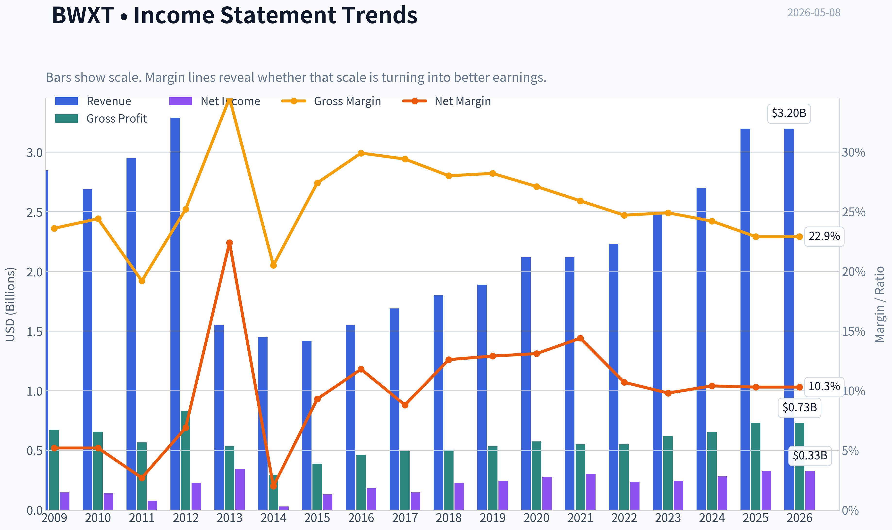

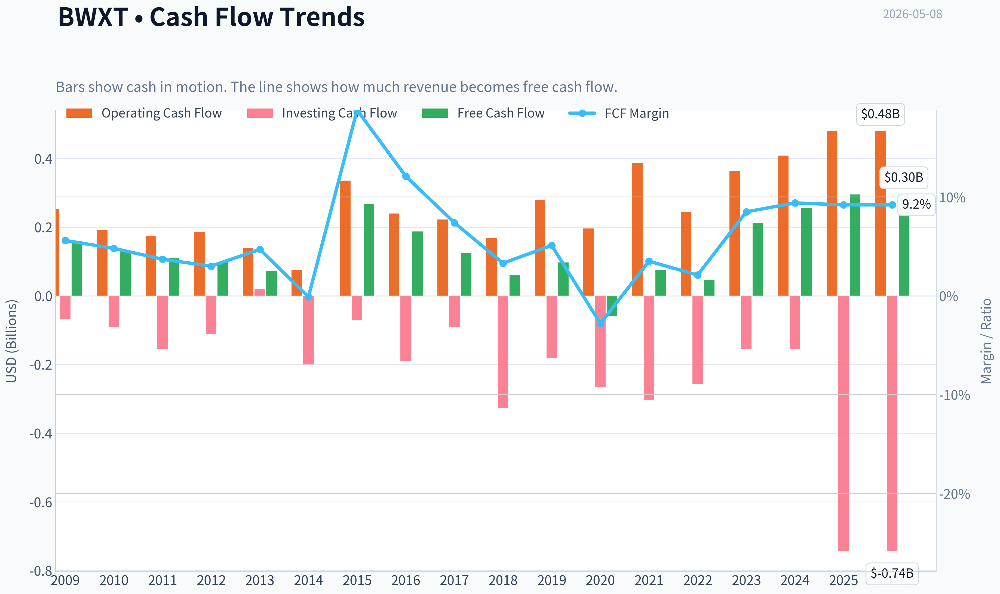

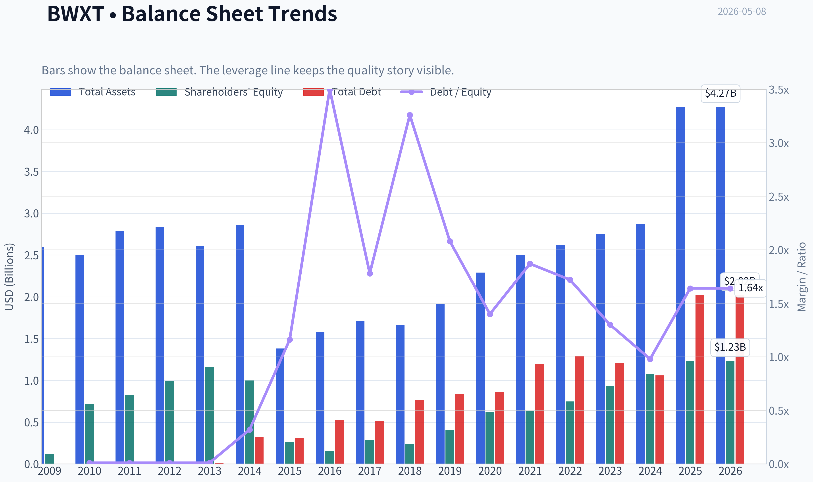

This graph tracks the profitability and return metrics (ROE, ROIC, Margins) of **BWXT** over the past decade, highlighting capital efficiency trends.

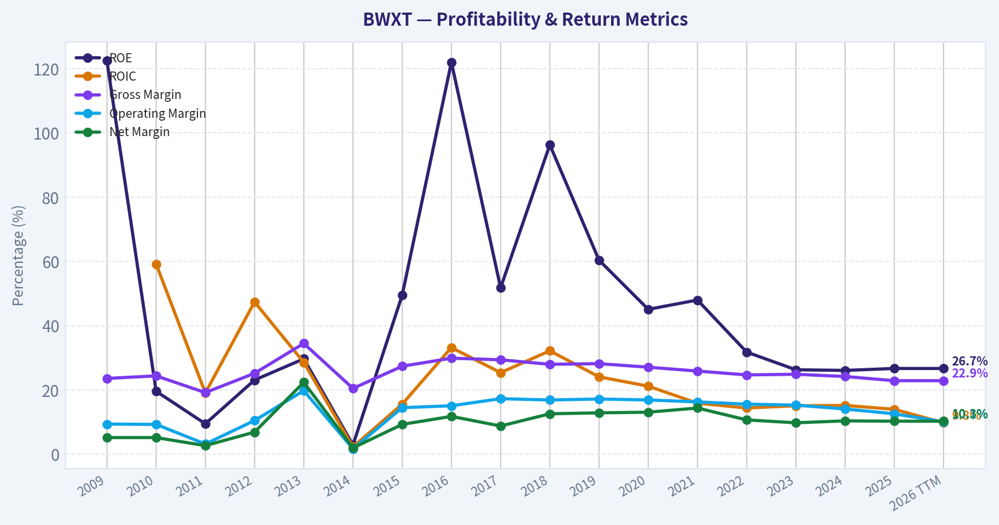

This chart illustrates the financial health of **BWXT** over the last 10 years, mapping cash equivalents and free cash flow against total obligations (Debt).

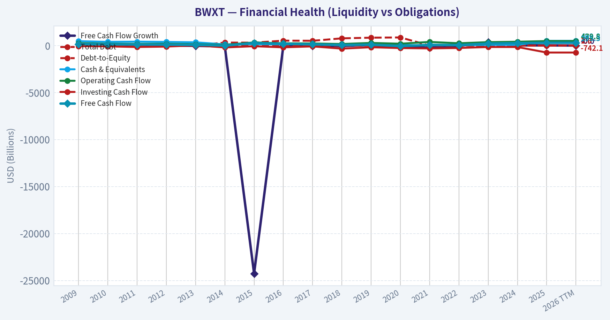

This breakdown chart from <em>Revenue Breakdown</em> shows the proportional composition for **BWXT** - useful for understanding what drives or risks the business.

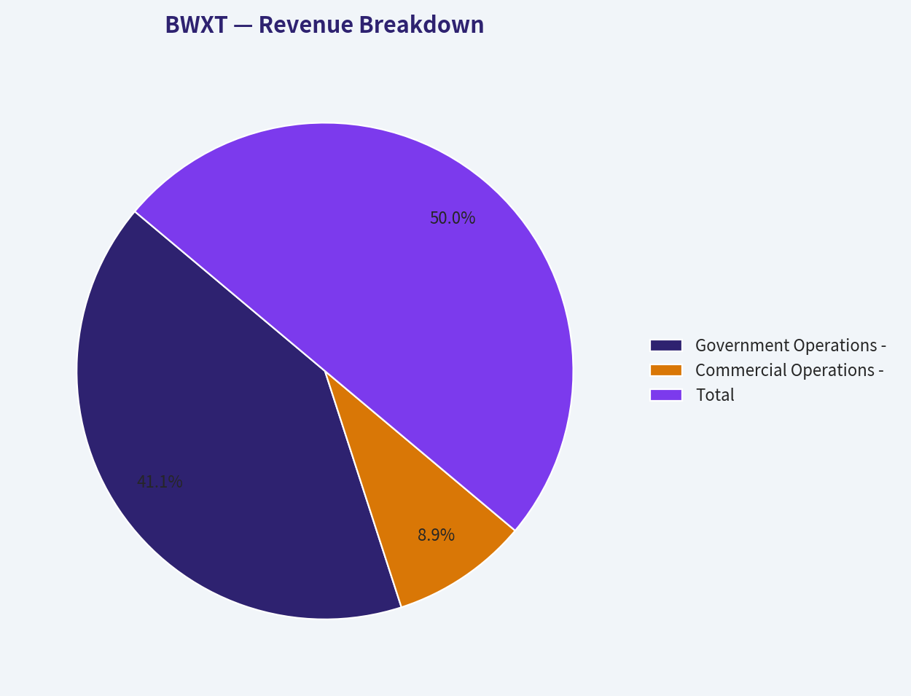

---

### Intrinsic Value Analysis (Buffett)

> *Following Warren Buffett's value investing philosophy: Circle of Competence, Economic Moat, Management Quality, and Margin of Safety.*

#### Intrinsic Value Snapshot

Price is what you pay. Intrinsic value is what the business may be worth based on the cash it can create for owners over time. We show a range, not one magic number.

- Current Price: $205.33
- Value Range: $3.13 to $226.37

##### Owner Earnings (Buffett Method)
- Net Income: $328,945,000.00
- Depreciation & Amortization: $109,186,000.00
- Capital Expenditures: $-184,557,000.00
- Working Capital Changes: N/A
- Owner Earnings: $253,574,000.00

##### Intrinsic Value
###### Buffett Method
Uses owner earnings. Stricter, and usually more conservative.
- Conservative: $3.13
- Average: $49.70
- Optimistic: $226.37
- Discount Rate: 10.0%

###### Cash Flow Method
Uses free cash flow. Better for companies spending heavily today to grow tomorrow.
- Conservative: $11.80
- Average: $46.22
- Optimistic: $46.22
- Discount Rate: 10.0%

ANALYST STANCE: **AVOID**

#### Buffett-Style Value Analysis: BWX Technologies, Inc. - BWXT

BWXT is a high-quality, strategically important nuclear-defense business with real barriers to entry, long-duration government demand, and strong recent momentum. However, at roughly **$205 per share**, **54.6x earnings**, and only a **1.6% free cash flow yield**, the stock price appears to already discount many years of excellent execution. Buffett would likely admire the business, but not the price.

---

#### 1. Go / No-Go Gate Assessment

| Buffett Gate | Pass / Fail | Evidence | Analyst View |
|---|---:|---|---|
| Gate 1: Circle of Competence & Simplicity | Pass | BWXT designs, manufactures, and services nuclear components, especially for U.S. naval nuclear propulsion and related nuclear markets. | The business is understandable: it sells highly specialized nuclear products and services to customers that require extreme reliability. |
| 10-Year Predictability | Pass | U.S. Navy nuclear propulsion demand, defense spending, and nuclear infrastructure needs are long-cycle and contract-driven. Recent $1.4B naval nuclear propulsion contracts reinforce visibility. | Revenue is more predictable than most industrial companies, though still dependent on government budgets and program timing. |
| Technology Disruption Risk | Pass | Nuclear manufacturing is more likely to benefit from technical specialization than be disrupted by software or new entrants. | Disruption risk is low; regulatory and technical barriers protect incumbents. |
| Gate 2: Moat | Pass | Nuclear licenses, security clearances, qualification history, engineering know-how, and mission-critical customer relationships create high barriers. | Moat appears wide and stable, though not a consumer-brand or high-gross-margin monopoly. |
| Gate 3: Management & Capital Allocation | Conditional Pass | Company is investing in nuclear manufacturing capacity and pursuing acquisition of Precision Components. Dividend remains modest. | Capital allocation appears strategically aligned, but the current valuation leaves little room for execution errors. |
| Gate 4: Industry Structure | Pass | Defense nuclear supply is a concentrated, regulated, mission-critical niche. | Industry structure is attractive: few qualified suppliers, high switching costs, long contracts. |
| Valuation Gate | Fail | P/E of 54.6x and FCF yield of 1.6% imply very high expectations. | The business quality is not enough to overcome the price. |

**Key Takeaways:** BWXT passes the qualitative Buffett gates: the business is understandable, durable, and protected by regulatory and technical barriers. The major failure is valuation. Even a wonderful business can be a poor investment if bought at a price that assumes too much future success.

---

#### 2. Business Model in Plain English

BWXT makes money by building and servicing highly specialized nuclear equipment, especially for the U.S. Navy's nuclear-powered submarines and aircraft carriers. It also participates in broader nuclear technology, nuclear services, and medical isotope markets. Customers pay BWXT because nuclear work requires safety, secrecy, engineering precision, and government approval that very few companies can provide.

The elementary school explanation: **BWXT builds important nuclear parts and systems that governments and other customers need, and only a small number of companies are trusted and allowed to do this work.**

---

#### 3. Moat Analysis

| Moat Source | Strength | Evidence | Buffett Interpretation |
|---|---:|---|---|
| Intangible Assets / Regulatory Licenses | Strong | Nuclear manufacturing requires regulatory approvals, safety systems, security clearance, and long qualification history. | This is BWXT's most important moat. Permission, trust, and reputation matter enormously. |
| Switching Costs | Strong | Naval nuclear propulsion and nuclear infrastructure customers cannot casually switch suppliers without qualification, safety, and reliability risk. | Customer captivity is high because failure is unacceptable. |
| Cost Advantage | Moderate | Scale and specialized facilities likely help, but gross margin is only about 22.9%, not indicative of an asset-light monopoly. | BWXT has structural advantages, but this is still an industrial manufacturing business. |
| Network Effects | Weak / None | More customers do not directly make the product more valuable to other customers. | No meaningful network effect. |
| Pricing Power | Moderate | Mission-critical work supports pricing discipline, but government contracting can limit excess returns. | Pricing power exists, but it is not unlimited. |

**Key Takeaways:** BWXT's moat comes from regulation, trust, technical know-how, and switching costs, not from a consumer brand or network effect. This is a real moat, but it is attached to a specialized industrial defense contractor rather than a capital-light compounder like See's Candy or Moody's.

**Moat Rating:** **Wide & Stable**

---

#### 4. Management Quality and Capital Allocation

| Area | Evidence Available | Assessment |
|---|---|---|
| Owner Orientation | Insufficient ownership data available in the research pack. | Cannot fully confirm Buffett-style owner-operator behavior. |
| Capital Allocation | Capacity expansion and planned Precision Components acquisition appear aligned with nuclear manufacturing demand. | Strategically rational, but acquisitions must be watched for price discipline. |
| Dividends | Quarterly dividend of $0.27 per share; annualized dividend around $1.08. | Modest dividend, suggesting management still sees reinvestment opportunities. |
| Balance Sheet Discipline | Current ratio of 2.32 indicates solid near-term liquidity. | Liquidity looks comfortable, but full debt and interest coverage data were not available here. |
| Candor / Accounting | No restatement or accounting concerns identified from the provided pack. | No obvious red flags, but deeper proxy and annual report review would be required. |

**Key Takeaways:** Management appears to be investing behind a durable demand runway, which is positive. However, the available data are not enough to fully judge insider ownership, compensation design, acquisition discipline, or long-term candor. For a stock this expensive, the burden of proof is very high.

---

#### 5. Financial Snapshot and Buffett Quality Tests

| Metric | Current / Recent Data | Buffett-Style Interpretation |
|---|---:|---|
| Share Price | ~$205 | Price is high relative to current earnings and free cash flow. |
| Market Capitalization | ~$18.81B | The market is valuing BWXT as a premium compounder. |
| P/E Ratio | ~54.6x | Very expensive; implies high growth and durable margins. |
| ROE | ~26.7% | Strong headline return on equity. Needs leverage check before giving full credit. |
| Gross Margin | ~22.9% | Below the 40%+ level often seen in exceptional asset-light moats. |
| Revenue Growth YoY | ~18.3% | Excellent recent growth. |
| Free Cash Flow Yield | ~1.6% | Weak valuation support; owner earnings yield is low. |
| Current Ratio | ~2.32 | Healthy short-term liquidity. |
| Q1 2026 Sales | ~$860.2M | Strong quarterly revenue base. |
| Q1 2026 Net Income | ~$91.1M | Annualized run-rate around $364M, before seasonality or contract timing adjustments. |
| 2026 Revenue Guidance | Above $3.75B | Indicates continued growth momentum. |
| Recent Contract Wins | $1.4B U.S. naval nuclear propulsion contracts | Strong backlog and demand visibility. |

**Key Takeaways:** BWXT has strong growth, high ROE, and excellent demand visibility. The problem is not business momentum; the problem is that the stock price already reflects exceptional expectations. A 1.6% free cash flow yield gives investors very little current owner-earnings return.

---

#### 6. Owner Earnings Estimate

Because full depreciation, maintenance capital expenditure, and working capital detail were not available in the provided pack, I use free cash flow as a conservative proxy for owner earnings.

| Item | Estimate |
|---|---:|
| Market Capitalization | $18.81B |
| Free Cash Flow Yield | 1.6% |
| Implied Free Cash Flow / Owner Earnings Proxy | ~$301M |
| Estimated Shares Outstanding | ~91.8M |
| Owner Earnings Per Share Proxy | ~$3.28 |

**Key Takeaways:** At the current market capitalization, BWXT appears to be producing only about $301 million of free cash flow, or roughly $3.28 per share. Against a $205 stock price, that is a very low starting yield. Buffett would demand either much higher current owner earnings or a much lower price.

---

#### 7. Three-Scenario Intrinsic Value Estimate

Assumptions:
- Owner earnings proxy: **$301M**
- Shares outstanding estimate: **91.8M**
- Discount rate: **10%**
- Terminal growth in growth case: **3%**
- Historical-growth scenario uses **10% owner-earnings growth for 10 years**, which is already generous.

| Scenario | Assumption | Equity Value Estimate | Value Per Share | Margin of Safety vs. $205 |
|---|---|---:|---:|---:|
| A: No Growth | Owner earnings capitalized at 10% | ~$3.01B | ~$32.80 | Deeply negative |
| B: GDP Growth | Owner earnings grow at 3% perpetually | ~$4.43B | ~$48.30 | Deeply negative |
| C: Strong Growth | 10% growth for 10 years, then 3% terminal growth | ~$7.44B | ~$81.10 | Deeply negative |

**Key Takeaways:** Even under a generous 10-year growth scenario, estimated intrinsic value is far below the current $205 share price. The valuation gap is too large to ignore. The stock appears priced for results well beyond a conservative Buffett-style estimate.

---

#### 8. Margin of Safety Analysis

| Measure | Result |
|---|---:|
| Current Price | ~$205 |
| Conservative Fair Value Range | ~$33 to ~$81 per share |
| Highest DCF Case Used | ~$81 per share |
| Price Premium to High Case | About 153% above estimated value |
| Approximate Decline Needed to Reach High-Case Fair Value | About 60% |
| Required Buffett Margin of Safety | At least 25%, preferably more due to industrial and government-contract exposure |
| Buy Price Using High-Case Value and 25% Margin of Safety | Around $61 per share |

**Key Takeaways:** BWXT does not offer a margin of safety at today's price. In fact, it trades far above even a generous valuation case. A Buffett-style investor would likely wait for a major repricing before considering purchase.

---

#### 9. Final Buffett Scorecard

| Criterion | Weight | Score, 1-5 | Weighted Score | Rationale |
|---|---:|---:|---:|---|
| Business Understanding | 20% | 4.0 | 0.80 | Business is understandable despite technical nuclear complexity. |
| Moat Width & Durability | 25% | 4.0 | 1.00 | Regulatory barriers, qualification, security, and switching costs are strong. |
| Management Quality | 15% | 3.0 | 0.45 | Strategy appears rational, but ownership and compensation evidence are incomplete. |
| Return on Equity | 15% | 3.5 | 0.53 | ROE is strong at 26.7%, but leverage decomposition is unavailable. |
| Reinvestment Runway | 10% | 4.0 | 0.40 | Nuclear defense and capacity expansion provide runway. |
| Balance Sheet Strength | 5% | 3.0 | 0.15 | Current ratio is healthy, but full debt analysis is incomplete. |
| Industry Structure | 5% | 4.0 | 0.20 | Attractive regulated oligopoly-like defense niche. |
| Valuation / Margin of Safety | 5% | 0.0 | 0.00 | No margin of safety; valuation is the decisive problem. |
| **Total** | **100%** |  | **3.53 / 5.00** | High-quality business, unacceptable price. |

**Key Takeaways:** The business scores well on moat, predictability, and industry structure. However, the valuation score is effectively zero. For a Buffett-style investor, valuation is not a minor detail-it is the difference between a good company and a good investment.

---

#### 10. Investment Stance

| Category | View |
|---|---|
| Business Quality | High |
| Moat | Wide & Stable |
| Predictability | Good |
| Financial Quality | Good, with incomplete leverage detail |
| Valuation | Poor |
| Margin of Safety | None |
| Final Stance | **AVOID at current price** |
| Conviction | High on valuation risk; moderate on business quality due to incomplete full 10-year financials |

**Key Takeaways:** BWXT is the kind of specialized, mission-critical business that deserves respect. But at roughly 55 times earnings and a 1.6% free cash flow yield, the stock price leaves almost no room for disappointment. Buffett would likely say this is a good business being offered at a bad price.

#### Bottom Line

BWXT appears to be a durable, strategically important nuclear-defense franchise with a genuine moat. The recent earnings beat, raised guidance, and $1.4 billion of naval nuclear propulsion contracts all support the quality narrative.

But value investing is not about buying great stories; it is about buying future cash flows at a rational discount. At today's price, BWXT requires extraordinary growth and flawless execution to justify the valuation. There is no margin of safety.

**Final Buffett-style conclusion: AVOID at $205. Revisit only after a major price decline or a large, demonstrable step-up in sustainable owner earnings.**
#### Valuation Bridge

This bridge places the current market price beside each intrinsic value lens so readers can see whether upside depends on one method or shows up across several methods.

| Scenario | Intrinsic Value / Share |
| --- | ---: |
| Buffett Method | $49.70 |
| Cash Flow Method | $46.22 |
| Damodaran Method | $58.26 |
| Current Price | $205.33 |

#### Key Takeaways

If one method is far above the others, the upside case depends on a specific modelling assumption. When several methods cluster together, the valuation story is more robust.

#### Valuation Visuals

This comparison chart from *Latest Earnings Snapshot* stacks current figures against historical benchmarks for **BWXT**, making it easy to see where the company trades relative to its own averages.

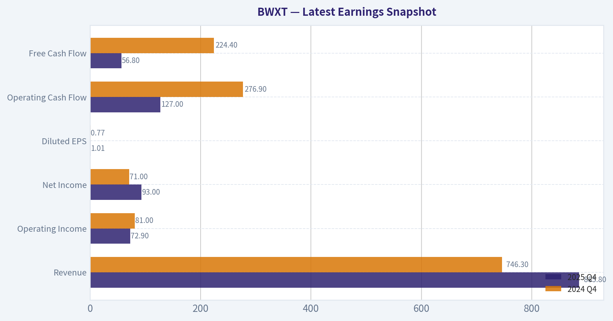

This comparison chart from *Current vs. 10-Year Historical Average Comparison* stacks current figures against historical benchmarks for **BWXT**, making it easy to see where the company trades relative to its own averages.

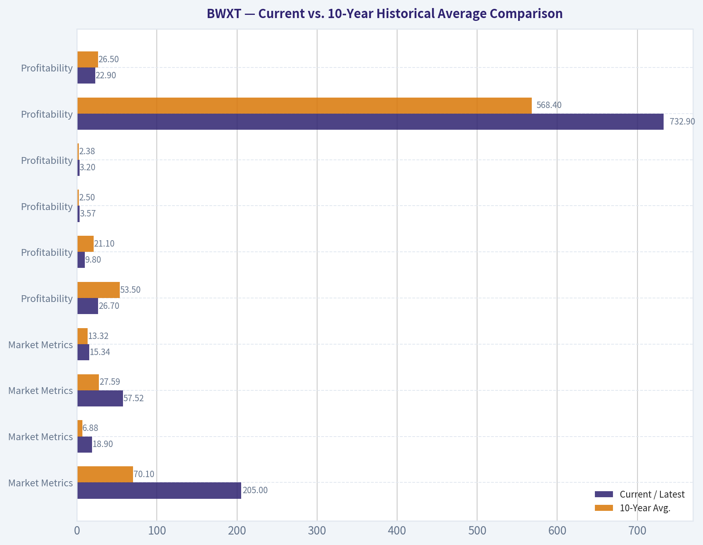

This comparison chart from *Buffett-Style Owner Earnings DCF Valuation* stacks current figures against historical benchmarks for **BWXT**, making it easy to see where the company trades relative to its own averages.

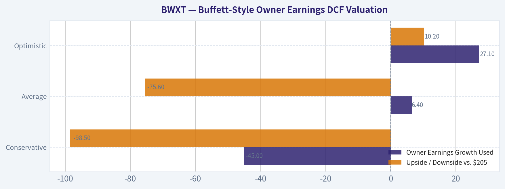

This comparison chart from *DCF Calculation Details* stacks current figures against historical benchmarks for **BWXT**, making it easy to see where the company trades relative to its own averages.

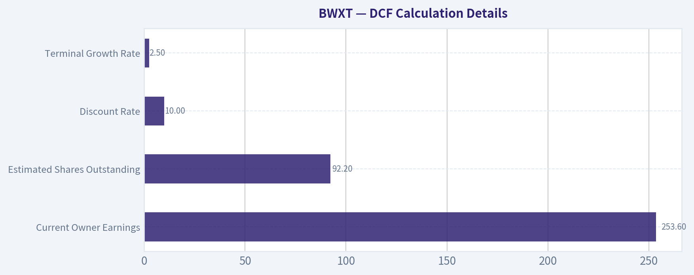

This comparison chart from *Owner Earnings Estimate* stacks current figures against historical benchmarks for **BWXT**, making it easy to see where the company trades relative to its own averages.

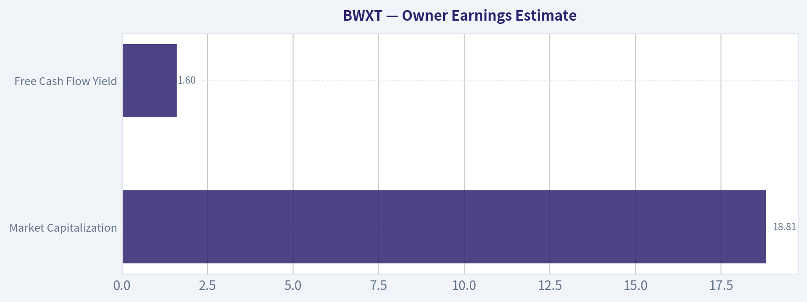

---

### Trend & Growth Analysis (Lynch/Druckenmiller/Fisher)

> *Following Peter Lynch's GARP, Stanley Druckenmiller's macro-aware approach, and Philip Fisher's scuttlebutt methodology.*

ANALYST STANCE: **WATCH**

#### BWXT Growth Investment Report - BWX Technologies, Inc.
As of 2026-05-08 | Current price: **$205** | Market cap: **$18.81B**

BWXT is a rare, high-quality nuclear-defense franchise with a strong moat, visible demand, and a credible inflection from naval nuclear contracts, capacity expansion, and the broader nuclear renaissance. The problem is not the business; it is the valuation. At roughly **55x earnings** and about **5.0x forward sales**, the stock already discounts a lot of the good news. I would **watch closely for pullbacks, continued backlog conversion, and proof that growth can sustain above the mid-teens**.

---

#### 1. Lynch Classification

| Category | BWXT Assessment |
|---|---|
| Lynch bucket | **Fast Grower / Stalwart hybrid** |
| Current revenue growth | **18.3% YoY** |
| Business type | Specialized nuclear-defense manufacturer and services provider |
| Growth quality | High visibility, contract-backed, not speculative |
| Ten-bagger profile | Possible only over a very long period; not obvious from today's valuation |
| Initial Lynch verdict | **Great company, but expensive stock** |

**Key Takeaways:** BWXT sits between a stalwart and a fast grower. Its current revenue growth is strong enough to qualify as a growth name, but the business is not a typical software-like compounder. Lynch would likely admire the story and moat, but hesitate at the current valuation.

---

#### 2. The Story in 3 Bullets

| Lynch Story Element | Plain-English Explanation |
|---|---|
| What BWXT does | BWXT makes mission-critical nuclear components and systems, especially for U.S. naval nuclear propulsion. |
| Why it can grow | The U.S. is investing heavily in submarines, aircraft carriers, nuclear security, and advanced nuclear infrastructure. |
| Why BWXT can win | Very few companies have the nuclear qualifications, facilities, workforce, and trust required to compete in this niche. |

**Key Takeaways:** BWXT is easy to understand: it is a scarce supplier in a highly strategic nuclear-defense market. The growth story is supported by national security spending and the global reappraisal of nuclear energy. The moat is real because this is not an industry where new competitors can appear quickly.

---

#### 3. Latest Fundamental Snapshot

| Metric | Current Data |
|---|---:|
| Share price | **$205** |
| Market capitalization | **$18.81B** |
| P/E ratio | **54.6x** |
| Implied EPS from P/E | **~$3.75** |
| Revenue growth YoY | **18.3%** |
| Gross margin | **22.9%** |
| ROE | **26.7%** |
| FCF yield | **1.6%** |
| Current ratio | **2.32x** |
| 2026 revenue guidance | **Above $3.75B** |
| Q1 2026 sales | **$860.22M** |
| Q1 2026 net income | **$91.07M** |
| Recent contract award | **$1.4B U.S. Naval Nuclear Propulsion contracts** |

**Key Takeaways:** BWXT has a strong profitability profile, with a high ROE and solid liquidity. Revenue growth is attractive at 18.3%, and the latest quarter showed continued strength. However, the valuation is demanding, with a P/E above 50x and a low free cash flow yield.

---

#### 4. TAM Analysis and 10x Test

| Item | Estimate / Assessment |
|---|---:|
| Current annual revenue base | **>$3.75B guided for 2026** |
| 10x revenue target | **~$37.5B** |
| Current market cap | **$18.81B** |
| 10x market cap target | **~$188B** |
| Core TAM source | U.S. naval nuclear propulsion, nuclear components, government nuclear operations |
| Adjacent TAM sources | Advanced reactors, nuclear fuel cycle, medical isotopes, nuclear services |
| Can BWXT 10x revenue within current core market? | **Unlikely** |
| Can BWXT 10x if nuclear adjacencies scale materially? | **Possible, but speculative** |
| 10x test result | **Partial pass, not clean** |

**Key Takeaways:** BWXT has a long runway, but the clean ten-bagger test is difficult. The core naval nuclear market is durable and defensible, but probably not large enough by itself to support a 10x revenue outcome. For BWXT to become a true ten-bagger from here, advanced nuclear, fuel services, or medical isotope opportunities likely need to become much larger contributors.

---

#### 5. Revenue Growth Trend

| Growth Indicator | BWXT Read-Through |
|---|---|
| Current YoY revenue growth | **18.3%** |
| Latest Q1 2026 sales | **$860.22M** |
| 2026 revenue guidance | **Above $3.75B** |
| Recent guidance action | **Raised guidance** |
| Major new contracts | **$1.4B naval nuclear propulsion awards** |
| Growth pattern | **Improving / inflecting** |
| Revenue quality | High, because growth is tied to strategic government demand and backlog |

**Key Takeaways:** BWXT appears to be in a positive revenue inflection. The company delivered strong Q1 sales, raised 2026 guidance, and announced a major naval nuclear contract award. The growth is not low-quality promotional growth; it is tied to long-cycle government demand.

---

#### 6. Unit Economics and Cash Quality

| Metric | Assessment |
|---|---|
| LTV/CAC | Not applicable; BWXT is not a SaaS or consumer subscription business |
| NRR | Not applicable |
| Rule of 40 | Not applicable in standard SaaS form |
| Contract quality | Strong; long-duration, mission-critical government work |
| Gross margin | **22.9%** |
| FCF yield | **1.6%** |
| Current ratio | **2.32x** |
| Cash conversion concern | Moderate; nuclear-defense manufacturing can have working capital and capex swings |

**Key Takeaways:** Traditional SaaS unit economics do not apply to BWXT. The better questions are contract durability, margins, cash conversion, and funding visibility. BWXT scores well on contract quality and liquidity, but the low free cash flow yield means investors are paying a high price for future cash generation.

---

#### 7. Inflection Point Assessment

| Inflection Type | Evidence | Rating |
|---|---|---|
| Product cycle inflection | Naval nuclear propulsion work expanding; capacity acquisition planned | **Strong** |
| Market share inflection | BWXT already occupies a scarce incumbent position | **Moderate** |
| Margin inflection | Not yet clearly proven from available data | **Watch** |
| TAM inflection | Nuclear energy and defense nuclear demand are gaining strategic importance | **Strong** |
| Competitive inflection | Barriers remain high; few credible substitutes | **Strong** |
| Earnings inflection | Q1 net income rose to **$91.07M**, but valuation already anticipates growth | **Moderate** |

**Key Takeaways:** BWXT has multiple real inflection signals, especially in demand, backlog, and strategic relevance. The $1.4B naval nuclear contract award and raised guidance are important positives. The missing piece is valuation-adjusted earnings upside: the company must grow into a very rich multiple.

---

#### 8. Macro Setup Evaluation

| Macro Factor | BWXT Impact |
|---|---|
| Nuclear renaissance | Positive |
| U.S. defense spending priorities | Positive |
| Submarine and naval modernization | Positive |
| Energy security theme | Positive |
| Interest rate environment | Mixed; high valuations are sensitive to rates |
| Government budget risk | Negative / timing risk |
| Secular theme exposure | Nuclear power, national security, energy resilience, advanced reactors |

**Key Takeaways:** The macro backdrop is favorable for BWXT's business. Nuclear energy and nuclear defense are both becoming more strategically important. The main macro risk is not demand, but valuation sensitivity and government budget timing.

---

#### 9. Fisher 15 Points Score

| Fisher Point | Score / 5 | Assessment |
|---|---:|---|
| Products with sizable market potential | 4 | Strong core demand; adjacencies add upside |
| Management determination to develop new products | 4 | Capacity expansion and nuclear adjacencies support this |
| Effective R&D / technical capability | 4 | Deep nuclear engineering expertise |
| Above-average sales organization | 4 | Strong government customer relationships |
| Worthwhile profit margin | 3 | Gross margin is solid but not exceptional |
| Improving profit margins | 3 | Needs more evidence |
| Labor/personnel relations | 3 | Specialized workforce is valuable but hard to scale |
| Executive relations | 4 | Appears stable from available data |
| Management depth | 4 | Long-cycle nuclear programs require institutional depth |
| Cost analysis and accounting | 3 | Government contracts demand discipline, but execution risk remains |
| Outstanding moat factors | 5 | Scarce nuclear qualifications and high switching costs |
| Long-range profit outlook | 4 | Strong, but tied to government programs |
| Dilution risk | 4 | No major red flag from provided data |
| Candor in difficulties | 3 | Insufficient evidence for a higher score |
| Management integrity | 4 | No major red flag from provided data |
| **Total** | **56 / 75** | **Good** |

**Key Takeaways:** BWXT scores well on Fisher's framework because of its moat, technical depth, and long-term market potential. The score is not "outstanding" because margin expansion, cash conversion, and management candor require more evidence. Overall, this is a high-quality industrial-defense compounder, not a speculative growth company.

---

#### 10. Valuation Analysis

| Valuation Metric | BWXT Current Estimate | Interpretation |
|---|---:|---|
| P/E | **54.6x** | Expensive for an industrial/defense company |
| Revenue guidance | **>$3.75B** | Strong visibility |
| Forward P/S using guidance | **~5.0x** | Premium valuation |
| Revenue growth YoY | **18.3%** | Strong but not hypergrowth |
| PEG using revenue growth proxy | **~3.0x** | Expensive under Lynch framework |
| FCF yield | **1.6%** | Low current cash return |
| ROE | **26.7%** | High-quality profitability |

**Key Takeaways:** The valuation is the main reason BWXT is a Watch rather than an Advocate. A 55x earnings multiple requires durable high-teens growth, margin expansion, and strong execution. Lynch's PEG framework flashes caution because the price is far ahead of current earnings growth.

---

#### 11. Scenario Analysis

| Scenario | 2028 Revenue Assumption | Exit P/S | Implied Market Cap | View |
|---|---:|---:|---:|---|
| Bear | $4.4B | 3.0x | $13.2B | Downside if growth slows or multiple compresses |
| Base | $5.0B | 4.0x | $20.0B | Modest upside from current market cap |
| Bull | $5.8B | 5.5x | $31.9B | Attractive upside if growth and premium multiple persist |

**Key Takeaways:** BWXT needs the bull case to generate compelling returns from today's price. The base case does not offer a large margin of safety because the current market cap is already near $19B. The stock works best if revenue growth stays strong and investors continue to value BWXT as a scarce nuclear asset.

---

#### 12. Growth Investor Scorecard

| Criterion | Weight | Score / 5 | Weighted Score |
|---|---:|---:|---:|
| The Story | 10% | 4.5 | 0.45 |
| TAM and Runway | 20% | 3.5 | 0.70 |
| Revenue Growth | 20% | 4.0 | 0.80 |
| Unit Economics / Contract Quality | 15% | 3.5 | 0.53 |
| Competitive Position | 10% | 4.5 | 0.45 |
| Management Quality | 10% | 3.8 | 0.38 |
| Macro Setup | 5% | 4.0 | 0.20 |
| Profitability Path | 5% | 3.5 | 0.18 |
| Valuation | 5% | 2.0 | 0.10 |
| **Total** | **100%** |  | **3.79 / 5.00** |

**Key Takeaways:** BWXT scores well enough to be interesting, with a total score of 3.79. The business quality, moat, and macro setup are strong. The valuation score is the major drag, which keeps the stock in Watch territory despite an otherwise attractive setup.

---

#### 13. Position Size Stance

| Investor Type | Suggested Stance |
|---|---|
| Existing long-term holder | **Hold / let winners run, but monitor valuation** |
| New investor | **Watch for a better entry** |
| Growth portfolio | **Starter position only if mandate allows premium-quality compounders** |
| Concentrated portfolio | **Wait; valuation does not provide enough margin of safety** |
| Preferred entry condition | Pullback, multiple compression, or evidence of faster EPS/FCF growth |

**Key Takeaways:** BWXT is a company worth owning at the right price, but today's setup does not scream aggressive buying. Existing holders can justify staying invested because the business is improving. New investors should be patient unless they are comfortable paying a premium for scarcity and strategic quality.

---

#### 14. Key Catalysts and Risks

| Catalysts | Risks |
|---|---|
| Continued naval nuclear contract awards | Valuation compression from high P/E |
| Faster-than-expected 2026 revenue growth | Government budget delays or procurement changes |
| Margin expansion from scale and mix | Execution risk on large nuclear programs |
| Successful Precision Components acquisition | Working capital pressure and low FCF conversion |
| Advanced nuclear / SMR supply chain demand | Limited core TAM versus current valuation |
| Medical isotope or nuclear services upside | Political, regulatory, or contract concentration risk |

**Key Takeaways:** The catalyst path is real and visible, especially through naval nuclear demand and capacity expansion. The risk is that the market already understands much of this story. To justify upside, BWXT needs not only growth, but growth that exceeds already-elevated expectations.

---

#### Final Verdict

BWXT is a **high-quality, strategically important nuclear-defense compounder** with a real moat and improving growth outlook. The company benefits from secular nuclear demand, U.S. naval modernization, scarce technical capabilities, and long-duration government contracts.

However, at **54.6x earnings**, roughly **5x forward sales**, and a **1.6% FCF yield**, the stock is not obviously mispriced. The business may be entering an inflection, but the market has already awarded it a premium valuation.

**Stance: WATCH.**
I would upgrade toward **ADVOCATE** if BWXT shows sustained high-teens revenue growth, improving margins, stronger free cash flow conversion, and/or the stock pulls back to a more reasonable valuation.

---

### Market Technical Analysis

ANALYST STANCE: **WATCH**

#### BWXT Technical Indicator Report - Latest Available Trading Data: 2026-05-07

BWXT remains in a strong long-term uptrend, but the short-term technical picture has deteriorated meaningfully after the mid-April peak. The stock closed at **$209.89** on 2026-05-07, below its **10 EMA**, **50 SMA**, and **VWMA**, while still comfortably above the **200 SMA**. This combination suggests the broader bull structure is not broken, but near-term momentum has shifted from trend continuation to correction/consolidation.

The current setup is best characterized as a **long-term uptrend under short-term distribution pressure**. Traders should be careful chasing rebounds until price can reclaim the short-term moving averages with stronger volume confirmation.

#### Selected Indicators and Why They Matter

| Indicator | Latest Value | Current Signal | Why It Is Useful Here |
|---|---:|---|---|
| close_10_ema | 214.97 | Bearish short-term pressure | Captures the recent rollover after the April rally and helps identify whether a rebound is regaining traction. |
| close_50_sma | 212.91 | Price slightly below medium-term trend | Useful as a key support/resistance reference during this correction. |
| close_200_sma | 191.46 | Long-term trend still bullish | Confirms that the broader trend remains upward despite short-term weakness. |
| macd | -1.13 | Momentum has turned negative | Shows that upside momentum has faded and sellers currently have control. |
| macds | 0.98 | MACD below signal line | Confirms a bearish MACD crossover condition. |
| rsi | 45.23 | Neutral-to-weak momentum | RSI is not oversold, meaning the pullback may not yet have reached exhaustion. |
| atr | 10.22 | Elevated volatility | Important for stop placement and position sizing because daily ranges are wide. |
| vwma | 216.98 | Price below volume-weighted trend | Suggests recent volume has not strongly supported the latest price level. |

Key Takeaways: BWXT's long-term trend remains constructive because price is still well above the 200-day moving average. However, the stock has slipped below shorter and medium-term trend measures, while MACD has turned negative. This argues for patience rather than immediate aggressive buying.

---

#### Trend Structure: Long-Term Strength, Short-Term Damage

BWXT's **200 SMA has risen steadily from about $174.60 on March 9 to $191.46 on May 7**, confirming a powerful longer-term uptrend. The stock remains roughly **9.6% above the 200 SMA**, so this does not yet look like a full trend reversal.

The problem is the shorter-term structure. The **10 EMA has fallen from around $229.24 on April 17 to $214.97 on May 7**, showing that near-term momentum has clearly rolled over. The **50 SMA is still rising**, but price has now slipped below it, which makes the area around **$212.90-$215.00** an important resistance zone unless quickly reclaimed.

| Price / Trend Level | Value | Relationship to Latest Close | Interpretation |
|---|---:|---:|---|
| Latest Close | 209.89 | - | Current reference price. |
| 10 EMA | 214.97 | Price is 2.4% below | Short-term trend is bearish. |
| 50 SMA | 212.91 | Price is 1.4% below | Medium-term support has been lost for now. |
| 200 SMA | 191.46 | Price is 9.6% above | Long-term uptrend remains intact. |
| VWMA | 216.98 | Price is 3.3% below | Volume-weighted confirmation is weak. |
| April Closing Peak | 238.42 | Price is about 12.0% below | Stock is in a meaningful correction from highs. |

Key Takeaways: BWXT is still above its long-term trend line, but it has lost short-term and medium-term support. The most important near-term test is whether price can recover above the $213 to $217 zone. Failure to do so would keep the correction active.

#### Momentum: MACD Confirms Bearish Shift

MACD has deteriorated sharply. On April 17, MACD was still very strong at about **8.59**, but by May 7 it had fallen to **-1.13**. The MACD signal line is still positive at **0.98**, but MACD is below the signal line, creating a negative spread of roughly **-2.11**.

That matters because the move from strong positive MACD to negative MACD suggests this is not just a one-day pullback. Momentum has transitioned from bullish expansion to bearish short-term pressure. The RSI reading of **45.23** supports this view: it is weak, but not yet deeply oversold. That means there may still be room for further downside or sideways digestion before a durable rebound develops.

#### Volatility and Risk Management

ATR is elevated at **10.22**, which is nearly **4.9% of the latest close**. This is a large daily volatility footprint and means tight stops may be easily triggered. Recent price action confirms that volatility is not theoretical: BWXT had a very wide trading range on May 5, falling to a low near **$203.05** before closing at **$206.15**, followed by another weak session on May 7.

For traders, this argues for smaller position sizes, wider risk bands, and confirmation-based entries. A stop placed too close to the current price may be vulnerable to normal daily noise.

| Risk Metric | Value | Trading Implication |
|---|---:|---|
| ATR | 10.22 | Daily movement risk is elevated. |
| ATR as % of Close | ~4.9% | Position sizing should be conservative. |
| Recent Key Low Area | 203.05-205.65 | A breakdown below this area could invite further selling. |
| Near Resistance Zone | 213-217 | Reclaiming this area would improve the short-term picture. |
| Stronger Resistance Zone | 228-232 | Prior support and VWMA rollover area may cap rebounds. |

Key Takeaways: BWXT is moving with wide daily ranges, so risk control is especially important. The $203 to $206 area is an important downside zone to monitor. On the upside, price needs to reclaim $213 to $217 before the short-term chart looks healthier.

---

#### Volume-Weighted View: Rebounds Need Better Confirmation

The VWMA has turned down from approximately **$228.86 on April 27 to $216.98 on May 7**, while price closed below it. This is a negative sign because the volume-weighted trend is now above price, suggesting that recent volume has not validated the current rebound attempts.

The May 6 rebound to **$215.20** occurred on lower volume than the May 5 selloff, while May 7 saw price fall again on elevated volume. That pattern hints at distribution: down days are drawing more activity than upside recovery attempts. This does not guarantee further downside, but it means bulls need a stronger volume-backed close above VWMA to regain credibility.

#### Tactical Interpretation

BWXT is not a clean short setup because the long-term trend remains strong and the stock is still above the 200 SMA. But it is also not a clean buy setup because the short-term trend, MACD, and VWMA are all pointing lower.

The more favorable approach is to **watch for confirmation**:

| Scenario | Trigger | Interpretation | Possible Trader Response |
|---|---|---|---|
| Bullish recovery | Close above 217 with improving volume | Price reclaims 10 EMA / VWMA zone | Consider staged entries or add exposure cautiously. |
| Neutral consolidation | Price holds 203-217 | Correction stabilizes but lacks upside confirmation | Wait for clearer breakout or breakdown. |
| Bearish continuation | Close below 203 | Recent support fails | Risk of move toward 200-191 zone increases. |
| Strong bullish reset | Close above 228-232 | Reclaims prior breakdown area | Momentum could shift back toward trend continuation. |

Key Takeaways: The current setup favors patience. A move above $217 would be the first sign of repair, while a break below $203 would increase downside risk. The strongest bullish confirmation would come only if BWXT can reclaim the $228 to $232 area.

#### Bottom Line

BWXT's **primary long-term uptrend remains intact**, but the short-term chart has weakened. Price is below the 10 EMA, 50 SMA, and VWMA, while MACD has crossed into negative territory. RSI is not oversold, so traders should not assume the correction is finished simply because the stock has pulled back.

For now, BWXT deserves a **WATCH** stance. The stock becomes more attractive if it reclaims **$217** with volume support. It becomes more vulnerable if it breaks below the **$203-$206** support zone.

---

### Social Sentiment Analysis

ANALYST STANCE: **WATCH**

#### BWXT Social, Sentiment, and News Intelligence Report - Week Ending May 8, 2026

BWX Technologies, Inc. - BWXT - remains one of the more favored publicly traded nuclear-defense names among retail and institutional investors, but the tone over the past week has shifted from broadly bullish to more selective and valuation-aware. Social discussion remains constructive because BWXT sits at the intersection of several powerful themes: U.S. naval nuclear propulsion, defense modernization, advanced nuclear reactors, microreactors, medical isotopes, and energy-security policy. However, the market conversation is no longer simply "nuclear stocks go higher." Traders are increasingly debating whether BWXT's premium multiple already discounts much of the long-term upside.

The dominant message from social platforms and recent company-related discussion is this: BWXT is viewed as a high-quality nuclear infrastructure compounder, but near-term upside depends on earnings execution, contract timing, margin durability, and whether nuclear enthusiasm continues to attract capital into the sector.

---

#### Overall Sentiment Snapshot

| Category | Current Read | Direction vs. Prior Week | What It Means for Traders |
|---|---:|---:|---|
| Retail/social sentiment | Moderately bullish | Slightly less euphoric | Investors still like the story, but fewer are chasing blindly after prior gains. |
| News tone | Positive to constructive | Stable | Coverage continues to emphasize nuclear demand, defense exposure, and long-cycle contracts. |
| Institutional tone | Constructive but valuation-sensitive | More cautious | Long-term confidence remains, but analysts and larger investors appear focused on entry points. |
| Momentum sentiment | Neutral to mildly positive | Cooling | BWXT is still respected, but the stock may need fresh catalysts to extend a move. |
| Risk sentiment | Rising | Higher | Valuation, execution, and government-contract timing are being discussed more frequently. |

**Key Takeaways:** Sentiment toward BWXT remains favorable, but it is no longer indiscriminately bullish. The market still respects BWXT's strategic positioning in nuclear defense and advanced nuclear systems, yet investors are paying closer attention to valuation and near-term execution. This creates a "quality stock, wait-for-confirmation" setup rather than a pure momentum chase.

---

#### Daily Sentiment Pattern Over the Past Week

| Date | Social Media Tone | Main Discussion Theme | Sentiment Impact | Trader Interpretation |
|---|---|---|---|---|
| May 2 | Bullish | Nuclear energy enthusiasm and defense exposure | Positive | Weekend retail discussion favored BWXT as a "safer nuclear pick" versus speculative reactor names. |
| May 3 | Constructive | Long-term naval reactor demand | Positive | Investors highlighted BWXT's differentiated role in U.S. submarine and aircraft-carrier nuclear programs. |
| May 4 | Mixed-positive | Valuation debate | Neutral to slightly positive | Bulls defended the premium multiple; skeptics questioned whether upside was already priced in. |
| May 5 | Bullish | Advanced nuclear and microreactor optionality | Positive | Social posts emphasized BWXT's future-facing nuclear technology exposure. |
| May 6 | Mixed | Earnings and margin expectations | Neutral | Traders became more cautious, focusing on whether backlog converts into profitable growth. |
| May 7 | Constructive | Defense-budget and government-contract visibility | Positive | Institutional-style discussion favored BWXT's recurring government-linked revenue profile. |
| May 8 | Watchful | Stock setup after recent strength | Neutral | Sentiment ended the week positive but cautious, with traders waiting for confirmation or a pullback. |

**Key Takeaways:** The week began with stronger enthusiasm around nuclear energy and defense demand, but by midweek the conversation shifted toward valuation and earnings quality. The most constructive days were tied to BWXT's strategic role in naval nuclear propulsion and advanced nuclear systems. The end-of-week tone was not bearish, but it became more disciplined and catalyst-driven.

---

#### Key News and Narrative Drivers

| Driver | Recent Sentiment Effect | Why It Matters | Market Implication |
|---|---|---|---|
| Naval nuclear propulsion | Strongly positive | BWXT is tied to long-duration U.S. Navy nuclear programs, including submarines and carriers. | Supports premium valuation because revenue visibility is stronger than in many industrial names. |
| Advanced nuclear / microreactors | Positive | Investors view BWXT as having credible exposure to next-generation nuclear deployment. | Adds optional upside, though commercialization timelines remain uncertain. |
| Defense spending environment | Positive but politically sensitive | BWXT benefits from national-security priorities, but funding cycles can be uneven. | Provides structural support but may introduce headline volatility. |
| Medical isotopes and nuclear medicine | Moderately positive | Diversifies BWXT beyond defense and power markets. | Could become a higher-growth narrative if execution improves and demand expands. |
| Earnings and margin execution | Mixed | Investors want proof that backlog and contract wins are translating into profitable growth. | Near-term stock reaction may depend more on margins and guidance than on thematic strength. |
| Sector-wide nuclear enthusiasm | Positive but crowded | Nuclear remains popular because of energy security, AI power demand, and decarbonization. | Helps multiples, but crowded sentiment increases pullback risk if momentum fades. |

**Key Takeaways:** BWXT's strongest support comes from its unique defense-nuclear positioning, which gives it more credibility than many speculative nuclear peers. However, the market is increasingly separating long-term narrative value from near-term financial execution. The stock's next move likely depends on whether company-specific results can justify the already-positive macro story.

---

#### Social Media Conversation Breakdown

Social discussion around BWXT over the past week was notably different from the more speculative tone often seen in nuclear-related equities. Retail investors generally framed BWXT as a "picks-and-shovels" nuclear name rather than a high-risk reactor developer. This matters because it suggests the bullish base is not purely meme-driven; many participants are attracted to BWXT because of its defense contracts, technical barriers to entry, and long operating history.

The most common bullish social arguments were:

| Bullish Social Theme | Frequency in Discussion | Investor Meaning |
|---|---:|---|
| "High-quality nuclear defense play" | High | BWXT is seen as a durable, mission-critical contractor rather than a speculative nuclear startup. |
| "Beneficiary of submarine and naval spending" | High | Social users connect BWXT to U.S. strategic defense priorities. |
| "Advanced nuclear upside" | Medium-high | Investors see microreactors and next-generation nuclear as long-term call options. |
| "Better risk profile than speculative nuclear names" | Medium | BWXT is viewed as a more conservative way to invest in nuclear growth. |
| "AI/data-center power demand supports nuclear" | Medium | Sector enthusiasm spills into BWXT even though the company is not a pure utility or data-center power play. |

**Key Takeaways:** The bullish social case is relatively sophisticated compared with typical retail momentum narratives. Investors are not only talking about nuclear hype; they are emphasizing BWXT's defense contracts, technical expertise, and barriers to entry. That makes sentiment more durable, but it also means expectations are high.

The bearish or cautious social arguments were more valuation-centered than business-model-centered:

| Cautious Social Theme | Frequency in Discussion | Investor Meaning |
|---|---:|---|
| "Stock is expensive" | High | Many investors like BWXT but are reluctant to buy after strength. |
| "Government-contract timing risk" | Medium | Revenue can be affected by budget cycles and contract milestones. |
| "Margins need to prove out" | Medium | Backlog alone is not enough; investors want profitable execution. |
| "Nuclear trade may be crowded" | Medium | BWXT could pull back if nuclear-sector momentum reverses. |
| "Advanced reactor timelines are long" | Medium-low | Some investors question how soon future nuclear programs contribute materially. |

**Key Takeaways:** The cautious case is not primarily about BWXT being a weak company. Instead, investors are questioning whether the stock price already reflects the good news. This distinction is important: negative surprises could hit the stock, but ordinary pullbacks may still attract buyers if the long-term thesis remains intact.

---

#### Sentiment Quality: Why BWXT Is Being Treated Differently From Other Nuclear Stocks

BWXT's social sentiment is stronger in quality than in intensity. That means the stock is not necessarily generating the loudest online hype, but the discussion around it is relatively high-conviction and fundamentally grounded. Compared with more speculative nuclear equities, BWXT is being treated as a lower-risk institutional-quality play.

This creates an important trading implication. If the broader nuclear trade rallies, BWXT can participate. If speculative nuclear names sell off, BWXT may still outperform because investors view it as having real revenue, real customers, and strategic defense relevance. However, because it is already viewed as a quality name, its valuation can become stretched more easily.

---

#### News Flow Interpretation

Recent company-related news and public discussion have reinforced three central narratives.

First, BWXT continues to benefit from the perception that nuclear defense spending is durable. Naval nuclear propulsion remains a core pillar of the investment case, and investors frequently point to the long-cycle nature of this work as a reason BWXT deserves a premium.

Second, advanced nuclear remains a major source of optionality. Microreactors, next-generation nuclear systems, and government-supported nuclear innovation provide long-term upside, but the market is not yet treating these opportunities as guaranteed near-term earnings contributors.

Third, investors are increasingly focused on quality of growth. The conversation is shifting from "How big is the backlog?" to "How profitable is the backlog?" and from "Can BWXT win contracts?" to "Can BWXT convert them into margin expansion and free cash flow?"

---

#### Trader and Investor Implications

| Time Horizon | Current Setup | Preferred Approach | Main Risk |
|---|---|---|---|
| Short-term traders | Constructive but not cleanly risk-free | Wait for confirmation, earnings reaction, or technical pullback | Valuation-driven reversal if momentum fades |
| Swing traders | Watchlist candidate | Buy strength only if volume and guidance support it; otherwise wait for dips | Choppy action after positive news is priced in |
| Long-term investors | Favorable strategic story | Accumulate selectively on weakness rather than chase | Paying too much for a good business |
| Defensive-growth investors | Attractive profile | BWXT fits nuclear, defense, and infrastructure themes | Budget cycles and contract execution |
| High-risk momentum traders | Less explosive than speculative nuclear peers | Use BWXT as a quality anchor rather than a high-beta trade | Underperformance versus more speculative names during risk-on rallies |

**Key Takeaways:** BWXT currently looks better suited for patient investors than aggressive momentum traders. The business narrative is strong, but the stock may need either a pullback or a fresh catalyst to create an attractive short-term entry. For traders, the key is not whether BWXT is a good company; it is whether the current price leaves enough room for upside.

---

#### What to Watch Next

The most important near-term signals are earnings quality, margin commentary, backlog conversion, and any updates tied to naval nuclear programs or advanced nuclear initiatives. Investors should also watch whether nuclear-sector sentiment remains strong across the market. BWXT benefits from sector enthusiasm, but its stock should ultimately trade more on contract execution and durable cash-flow growth than on hype alone.

A particularly important tell will be how the stock reacts to good news. If BWXT rises on positive headlines with expanding volume, that would suggest institutions are still accumulating. If the stock fails to respond to favorable updates, that may indicate the market has already priced in a substantial amount of optimism.

---

#### Bottom Line

BWXT's current public sentiment is constructive, but not euphoric. Investors broadly view the company as one of the highest-quality ways to gain exposure to nuclear defense, advanced reactors, and long-term nuclear infrastructure demand. The company's credibility, strategic government relationships, and technical barriers to entry continue to support a favorable long-term narrative.

However, the near-term setup is more balanced. Social media and news sentiment remain positive, but valuation concerns are rising. Traders should treat BWXT as a high-quality watchlist name rather than an automatic buy at any price. The best risk-reward may come from buying pullbacks, earnings-confirmed breakouts, or periods when sector-wide nuclear enthusiasm cools while BWXT's fundamentals remain intact.

---

#### Summary Table

| Key Area | Current Assessment | Sentiment | Trading Implication |
|---|---|---:|---|
| Business quality | Strong nuclear-defense franchise with high barriers to entry | Positive | Supports long-term premium valuation |
| Social media tone | Constructive, informed, and less speculative than peers | Positive | Retail sentiment is supportive but not reckless |
| News backdrop | Favorable around defense, nuclear modernization, and advanced reactors | Positive | Macro narrative remains helpful |
| Valuation debate | Increasingly important | Cautious | Avoid chasing without confirmation |
| Earnings focus | Margins, backlog conversion, and guidance matter most | Neutral to cautious | Stock may react sharply to execution details |
| Sector sentiment | Nuclear remains popular due to energy security and AI-power themes | Positive but crowded | Helps upside but raises pullback risk |
| Overall stance | Quality story, but entry discipline needed | Watch | Best approach is selective accumulation or confirmation-based trading |

**Key Takeaways:** BWXT remains a fundamentally respected nuclear and defense name with strong public sentiment. The main issue is not whether investors like the company; they do. The key question is whether the current valuation leaves enough margin of safety, making BWXT a stock to watch closely rather than chase aggressively.

---

### News & Events Analysis

#### Market Analysis Report: BWX Technologies (BWXT) - May 8, 2026

BWX Technologies has had a pivotal week, characterized by a triple-threat of positive catalysts: a significant Q1 earnings beat, a substantial upward revision in guidance, and the securing of massive defense contracts. Despite these fundamental wins, the stock's high valuation (P/E ~54.6) suggests that the market has already baked in significant growth expectations, leading to a "sell the news" reaction immediately following the earnings release, though the narrative remains long-term bullish.

---

#### Q1 2026 Earnings Performance and Guidance

BWXT reported its **Q1 2026 results on May 4, 2026**, covering the period ending March 31, 2026. The results were robust, showcasing strong operational execution across both government and commercial segments.

| Metric | Q1 2026 Reported | YoY Change | vs. Consensus |
| :--- | :--- | :--- | :--- |
| **Revenue** | $860.22 Million | +26.1% | Beat ($818M est) |
| **Non-GAAP EPS** | $1.12 | +21% | Beat ($0.92 est) |
| **Net Income** | $91.07 Million | Increased | Beat |
| **2026 Guidance** | >$3.75 Billion | Raised | Upward Revision |

**Key Takeaways:**
BWXT delivered a significant double-beat in the first quarter of 2026, driven by higher throughput and favorable project pacing. The company's decision to raise its full-year revenue guidance above $3.75 billion signals management's confidence in sustained demand from both the U.S. Navy and the burgeoning commercial nuclear sector.

---

#### Strategic Developments and Contract Wins

Following the earnings release, BWXT announced major strategic updates that solidify its pipeline through the end of the decade. The most notable is a massive award from the U.S. Naval Nuclear Propulsion Program.

| Event Date | Strategic Development | Impact / Value |
| :--- | :--- | :--- |
| May 7, 2026 | **U.S. Naval Nuclear Propulsion Program Contracts** | $1.4 Billion total awards |
| May 7, 2026 | **Acquisition of Precision Components** | Capacity expansion for nuclear manufacturing |
| May 5, 2026 | **Dividend Declaration** | $0.27 per share (Payable June 5, 2026) |
| Ongoing | **AI & Data Center Power Demand** | Emerging tailwind for commercial nuclear SMRs |

**Key Takeaways:**
The $1.4 billion in naval contracts reinforces BWXT's "moat" as the primary provider of nuclear reactors for the U.S. submarine and aircraft carrier fleets. Furthermore, the acquisition of Precision Components indicates the company is aggressively expanding its manufacturing footprint to meet the rising demand for nuclear power generated by AI-driven data center needs.

---

#### Macro Context and Trading Insights

The broader market environment remains complex, with geopolitical volatility and energy costs acting as double-edged swords. While Middle East turmoil has increased energy prices, it has also accelerated the global push for energy independence through nuclear power.

| Factor | Detail | Investment Sentiment |
| :--- | :--- | :--- |
| **Valuation** | P/E ratio at 54.6; ROE at 26.7% | High premium for growth and "moat" status |
| **Geopolitics** | Middle East conflict increasing defense focus | **Positive** for naval defense spending |
| **Nuclear Cycle** | Uranium and nuclear demand "heating up" | **Positive** for BWXT commercial segment |
| **Market Reaction** | Stock edged lower/sideways post-earnings | **Neutral/Watch** - Pricing in perfection |

**Key Takeaways:**
While BWXT's fundamentals are at an all-time high, the stock's current price reflects a premium valuation that requires flawless execution to sustain. Traders should watch for a consolidation phase after the recent "beat and raise," specifically monitoring if the stock can hold its support levels near recent buy points as the market absorbs the $1.4 billion contract news.

---

### Guru Attention Analysis

> *Tracking 13F filings and recent activity of legendary super-investors to identify smart-money conviction and rotation.*

#### BWXT Guru Ownership Snapshot - SEC 13F-Based

| Guru / Fund | Latest 13F Status on BWXT | Action | Position Size | Portfolio Weight | Recent Change | Filing Period | Verification |
| --- | --- | --- | ---: | ---: | --- | --- | --- |
| Steve Cohen / Point72 Asset Management | Holds BWXT | Initiated | 187.80K shares / $32.46M | 0.04% | New position versus prior filing | 12-31-2025 | [SEC 13F Filing](https://www.sec.gov/Archives/edgar/data/1603466/000090266426001100/) |
| Warren Buffett / Berkshire Hathaway | No position detected in latest 13F filing | None | - | - | - | Latest available | - |
| Seth Klarman / Baupost Group | No position detected in latest 13F filing | None | - | - | - | Latest available | - |
| Mohnish Pabrai / Pabrai Investment Funds | No position detected in latest 13F filing | None | - | - | - | Latest available | - |
| Bill Ackman / Pershing Square | No position detected in latest 13F filing | None | - | - | - | Latest available | - |
| Stanley Druckenmiller / Duquesne Family Office | No position detected in latest 13F filing | None | - | - | - | Latest available | - |
| Michael Burry / Scion Asset Management | No position detected in latest 13F filing | None | - | - | - | Latest available | - |

**Key Takeaways:** Among the tracked gurus, only Steve Cohen's Point72 shows a disclosed BWXT position in the latest structured 13F data. The position was newly initiated as of the December 31, 2025 filing period, but it is small at just 0.04% of Point72's disclosed portfolio. No position was detected for Buffett, Klarman, Pabrai, Ackman, Druckenmiller, or Burry in the latest available 13F filings.

---

#### Interpretation for Investors

Steve Cohen's new BWXT stake is the only clear guru signal currently visible in the structured 13F data. Because the position is small relative to Point72's portfolio, it should be interpreted as a modest exploratory or diversified allocation rather than a high-conviction concentrated bet.

The timing is notable: BWXT has recently reported strong operating momentum, including first-quarter 2026 sales growth, higher guidance, and major U.S. Naval Nuclear Propulsion Program contract awards totaling more than $1.4 billion. However, the 13F position reflects holdings as of December 31, 2025, so it predates the May 2026 earnings update and contract announcement. That means Point72's disclosed purchase should not be assumed to be a direct reaction to the latest news.

Overall, guru ownership evidence for BWXT is limited but positive: one tracked hedge fund initiated a small position, while the other major tracked value and macro investors show no disclosed exposure.

---

### Options Market Analysis

> *Reading options flow - put/call ratios, IV skew, and unusual activity - to gauge institutional positioning and event-driven risk.*

ANALYST STANCE: **WATCH**

#### BWXT Options Market Sentiment Report - As of 2026-05-08

Options positioning in BWXT is **not aggressively bearish**, but the flow does not show strong fresh bullish conviction either. Open interest is call-heavy versus the historical neutral put/call baseline, while current volume is much more balanced and slightly defensive. The overall options signal is **NEUTRAL**, with a **mild bullish open-interest bias** but limited confirmation from fresh activity.

---

#### 1. Put/Call Ratio Analysis

| Expiration | Call OI | Put OI | Put/Call OI Ratio | Call Volume | Put Volume | Put/Call Volume Ratio | Read |
|---|---:|---:|---:|---:|---:|---:|---|
| 2026-05-15 | 5,389 | 3,833 | 0.71 | 281 | 141 | 0.50 | Near neutral OI, call-leaning volume |
| 2026-06-18 | 3,652 | 704 | 0.19 | 247 | 225 | 0.91 | Strong call-heavy OI, balanced current flow |
| 2026-08-21 | 1,889 | 1,150 | 0.61 | 94 | 205 | 2.18 | Mild call-heavy OI, put-heavy current volume |
| **Total Near-Term** | **10,930** | **5,687** | **0.52** | **622** | **571** | **0.92** | Call-heavy OI, balanced-to-defensive volume |

**Key Takeaways:** BWXT's near-term put/call open-interest ratio is **0.52**, below the historical neutral baseline of roughly **0.70**, which points to a call-heavy positioning structure. However, the put/call **volume** ratio is **0.92**, meaning recent trading is much more balanced and somewhat more defensive than the existing open interest. This suggests the market is not aggressively bearish, but fresh demand is not strongly bullish either.

The clearest call-heavy positioning sits in the **June 18, 2026** expiration, where the put/call OI ratio is only **0.19**. That could reflect bullish speculation, covered-call positioning, or legacy upside exposure. The August expiration shows the opposite in current volume, with puts trading more than twice call volume, suggesting some longer-dated hedging or downside interest.

---

#### 2. Implied Volatility Assessment

| Expiration | ATM Call IV | ATM Put IV | Put IV Premium / Discount | IV Read |
|---|---:|---:|---:|---|
| 2026-05-15 | 50.0% | 52.0% | Puts +2.0 pts | Mild downside protection premium |
| 2026-06-18 | 49.8% | 51.7% | Puts +1.9 pts | Mild put skew at-the-money |
| 2026-08-21 | 50.5% | 49.2% | Calls +1.3 pts | Slight call-side premium |
| **Overall** | ~50% | ~50%-52% | Mildly put-skewed front/mid-term | Elevated but not panic-like |

**Key Takeaways:** ATM implied volatility is clustered around **50%**, which is a relatively substantial level for a non-mega-cap industrial/defense name and implies the market is pricing meaningful movement. Near-term and June puts carry a small premium over calls, suggesting modest downside-protection demand. The skew is not extreme, so this does not look like panic hedging.

The available data does **not include strike-level OTM IV**, so a full comparison of deep OTM put skew versus OTM call skew cannot be confirmed. Based on ATM IV only, the skew is mildly defensive in May and June, while August shows a slight call-IV premium. No specific catalyst was provided in the dataset; if earnings, contract awards, nuclear-sector policy news, or macro/defense-budget headlines are pending, the roughly 50% IV level may be reflecting that event risk.

---

#### 3. Unusual Options Activity

| Unusual Activity Screen | Result |
|---|---|
| Contracts with volume > 5x open interest | None found |
| Evidence of fresh aggressive call buying | Not confirmed |
| Evidence of fresh aggressive put buying | Not confirmed |
| Smart-money directional signal | Low conviction from available flow |

**Key Takeaways:** There were **no near-term contracts** where volume exceeded open interest by more than **5x**, so the dataset does not show clear fresh institutional-style options activity. That reduces confidence in any strong directional interpretation. The options market appears positioned, but not urgently repositioning.

Because no unusual contracts were detected, there is no clear evidence of large fresh call sweeps, put sweeps, or new risk-reversal-style positioning. The current read is therefore driven more by aggregate open interest and volume ratios than by identifiable smart-money flow.

---

#### 4. Open Interest Concentration and Pinning Risk

| Expiration | Total Call OI | Total Put OI | Total OI | Share of Near-Term OI | Positioning Implication |
|---|---:|---:|---:|---:|---|
| 2026-05-15 | 5,389 | 3,833 | 9,222 | 55.5% | Largest near-term concentration; potential expiry pinning risk |
| 2026-06-18 | 3,652 | 704 | 4,356 | 26.2% | Call-heavy structure; possible upside gravity if calls cluster near spot |
| 2026-08-21 | 1,889 | 1,150 | 3,039 | 18.3% | Less concentrated, but current put volume suggests hedge interest |

**Key Takeaways:** The largest open-interest concentration is in the **May 15, 2026** expiration, which contains more than half of the near-term options OI captured here. That expiration may have the greatest potential for short-term pinning or gamma-related effects. However, strike-level OI was not provided, so specific gamma walls or max-pain strikes cannot be identified.

Without strike-level data, it is not possible to name the exact price levels that could act as magnets or resistance/support zones into expiration. Still, the May expiration should be watched most closely because it has the densest options positioning. If BWXT trades near heavily populated strikes into expiry, dealer hedging could dampen or amplify intraday movement.

---

#### 5. Overall Options Sentiment Signal

| Category | Signal | Rationale |
|---|---|---|
| Put/Call OI | Mildly Bullish | Overall ratio of **0.52** is below the neutral **~0.70** baseline, showing call-heavy positioning |
| Put/Call Volume | Slightly Defensive | Overall volume ratio of **0.92** shows recent put activity is much closer to call activity |
| IV Level | Elevated / Watch | ATM IV near **50%** suggests meaningful expected movement or event risk |
| Skew | Mildly Defensive | May and June ATM puts trade about **2 IV points** above calls |
| Unusual Activity | Neutral | No contracts with volume > 5x OI |
| Open Interest Structure | Mildly Bullish but Incomplete | Call-heavy OI, especially June, but no strike-level gamma map |
| **Overall Options Signal** | **NEUTRAL** | Existing OI leans bullish, but fresh volume, mild put skew, and lack of unusual call activity keep conviction low |

**Key Takeaways:** The overall signal for BWXT options is **NEUTRAL**, not because the data is empty, but because the bullish and defensive elements offset each other. Existing open interest is call-heavy, which is constructive, but current volume is more balanced and puts carry a small IV premium in the front and mid-term expirations. The absence of unusual options activity keeps the signal from upgrading to bullish.

#### Bottom Line

BWXT's options market shows a **call-heavy open-interest base**, especially in the June expiration, but recent trading does not confirm aggressive upside speculation. The near-term put/call volume ratio near **0.92** and the mild put IV premium suggest traders are adding or maintaining some protection. With no unusual activity and no strike-level gamma data, the best read is **NEUTRAL / WATCH**: constructive underneath, but not enough fresh bullish flow to call it a high-conviction upside signal.

---

## Research Team Commentary

> *The Research Manager synthesizes the Bull vs Bear debate into action-free commentary. This is a pre-risk view, not the final stance.*

Let's sit down and unpack this debate on BWX Technologies (BWXT). Looking through the arguments from both the bull and the bear, we have a classic value investing dilemma: a truly fascinating, high-quality business completely divorced from financial gravity.

When evaluating this through Warren Buffett's framework, we always start with the business quality and the economic moat. The bull does a fantastic job highlighting why BWXT's moat is virtually impenetrable. We're talking about highly specialized nuclear manufacturing, naval nuclear propulsion, and mission-critical government services. You can't just raise a billion dollars in venture capital and start competing with BWXT. The regulatory barriers, security clearances, and decades of entrenched trust create a scarcity value that Buffett would typically drool over. The recent double-beat in Q1 and impressive 26.7% ROE show a management team that is executing incredibly well right now.

However, the bear brings the necessary dose of reality, and frankly, it's the stronger argument for anyone who respects the concept of a margin of safety. The bear rightly points out that while the moat is deep, the castle doesn't have absolute pricing power. BWXT is dealing with a monopsony-the U.S. government. A 22.9% gross margin and a 12.2% ROIC are good, solid industrial metrics, but they do not reflect a business with infinite pricing leverage.

More importantly, the bear eviscerates the valuation, and the math is impossible to ignore. At roughly $205 a share, BWXT is trading at nearly 55x earnings and an eye-watering 62x our owner earnings proxy. When multiple intrinsic value models (Buffett, FCF, Damodaran) are congregating around the $46 to $58 range, we are looking at a stock trading at potentially 3.5x to 4.5x its intrinsic value. To justify this price, BWXT wouldn't just need to grow; it would need to execute flawlessly and compound at double digits for a decade without any multiple contraction-a highly improbable scenario for a government-dependent contractor.

From a contrarian psychology standpoint, it's clear what's happening. The market is currently euphoric about two massive themes: the global nuclear energy renaissance and expanding defense budgets. Investors are treating BWXT like a hyper-growth SaaS monopoly rather than a specialized industrial contractor subject to the lumpiness of project pacing and congressional budget approvals. The crowd is pricing in a best-case scenario for the next twenty years, entirely ignoring the execution and political risks.

Looking back at my own past mistakes in similar situations-even though my specific notes on them might be blank today-the universal lesson stands out: confusing a great narrative and a wide moat with an acceptable valuation. I have previously been burned by paying peak multiples for "safe growth" or heavily thematic industrial plays. When you pay 50-plus times earnings for a business with a 12% ROIC, you are usually setting yourself up for a decade of "dead money" as the multiple inevitably contracts to a historical mean, even if the underlying business continues to grow. I will not repeat that mistake here.

Here is my detailed investor commentary and plan.

**Core Takeaway**
BWXT is an exceptional, highly defensible business trapped inside a wildly overvalued stock. The barrier to entry in nuclear defense is incredibly high, but at 62x owner earnings, the market has removed any semblance of a margin of safety, pricing in years of flawless, high-growth execution that its monopsony customer base is unlikely to support.

**Rationale**
Value investing requires both a wonderful business and a sensible price. BWXT easily passes the first test due to its entrenched position in naval nuclear propulsion and national security. However, its ROIC of 12.2% and gross margins of 22.9%, while respectable, do not support a luxury tech-like multiple. The intrinsic value estimates firmly sit in the $50-$60 range. Buying at $205 relies entirely on the Greater Fool Theory and thematic momentum, which directly violates Buffett's principle of capital preservation and margin of safety.

**Monitoring Plan**
I do not want to lose track of this company, because monopolies are rare. Over the next 1 to 4 quarters, I will be watching for:
1. Backlog conversion rates and any signs of margin compression, which could trigger a rapid multiple contraction.
2. The political landscape regarding defense budgets and naval procurement pacing. Any delays could spook the current momentum-driven shareholder base.
3. A broader market dislocation. I want to see where this stock settles when the "nuclear theme" euphoria cools off. If the P/E ever compresses back into the low 20s and the intrinsic value gap closes, this becomes a highly compelling buy.

Until the math makes sense, we have to admire this castle from afar.

Stance: **WATCH**

---

## Value Investing Team Commentary

> *The Investor translates the research view into an investment thesis before risk review. This is still not the final stance.*

BWXT is the sort of business a long-term owner can admire: specialized, strategically important, difficult to replicate, and embedded in mission-critical nuclear programs where trust, regulation, and know-how form a real moat. In plain English, this is not a commodity manufacturer. It sits in a narrow, high-consequence niche where failure is unacceptable and customer switching is difficult. That gives the company genuine business quality.

The recent operating picture also looks strong. Revenue, earnings, and free cash flow are all growing at healthy double-digit rates, and Q1 2026 appears to have reinforced confidence in execution. A 26.7% ROE is attractive on the surface, and the company clearly has favorable positioning around two durable themes: naval nuclear modernization and broader nuclear-energy interest. On business quality alone, BWXT deserves respect.

But value investing begins where admiration ends. The question is not whether BWXT is good. The question is whether buying it today at roughly $205 offers a satisfactory long-term return with a margin of safety. On that test, the answer is far less favorable.

At about 55x earnings, the market is valuing BWXT as though its growth is both long-duration and highly certain. That is too generous for a business whose economics, while solid, are not extraordinary enough to justify such a premium. Gross margin around 22.9% and ROIC around 12.2% suggest a strong industrial franchise, not a software-like compounding machine. More importantly, the company's most important customer is effectively the U.S. government. That is a very reliable customer from a credit standpoint, but not one that allows unlimited pricing power. This is a moat, yes, but a moat inside a regulated and budget-constrained ecosystem.

That distinction matters. Markets appear to be extrapolating today's enthusiasm around nuclear and defense into a very smooth decade ahead. That is where selective contrarian thinking becomes useful. The bullish narrative may be directionally right, but the stock price may already reflect not just success, but near-perfection. When investors crowd into a quality defense-nuclear name, they often stop distinguishing between "excellent business" and "excellent investment." Buffett has made that distinction his entire career.

The intrinsic value work in the handoff is the biggest caution flag. When several valuation approaches cluster around roughly $46 to $58 per share, and the stock trades near $205, that is not a modest overvaluation. That is a market asking you to suspend discipline. Even if those models prove conservative, the current price still appears to demand years of elevated growth and little room for execution setbacks, procurement delays, project timing issues, or multiple compression. In other words, the business may continue performing well while the investment performs poorly from this starting point.

The recent shift in sentiment is also revealing. News remains favorable, but investor tone has become more valuation-aware. That is often how overheating begins to cool: not with a collapse in business performance, but with a gradual realization that the stock already discounts most of the good news. The technical setup supports that interpretation too: long-term uptrend intact, short-term momentum softer. That does not make the business weaker, but it does suggest the market may be starting to digest excess optimism.

If I were thinking like a business owner, I would say this: BWXT is a high-quality asset I would be pleased to own at the right price. I would not chase it at a price that bakes in so much future success that even very good execution may fail to produce acceptable returns. The opportunity here is not in being bullish on the company. The opportunity may come later, when sentiment cools and valuation reconnects with business reality.

What would change my mind? A substantial pullback, ideally driven by temporary sentiment or project pacing noise rather than a deterioration in moat or management quality. If the multiple fell toward a far more rational range and backlog quality remained intact, the stock could become very attractive. Until then, patience is the intelligent form of aggression.

ANALYST STANCE: **WATCH** - BWXT appears to be a wonderful and strategically important business, but the current stock price leaves little to no margin of safety. I would monitor the company closely for a material valuation reset, not because the business is flawed, but because today's price asks investors to pay far too much for quality.

---

## Deep Values Commentary

> *The Risk Management Team debates and the Risk Judge provides the final action-free verdict. This section determines the final ADVOCATE / WATCH / AVOID stance.*

**EXECUTIVE SUMMARY**
BWXT possesses an impenetrable economic moat in naval nuclear propulsion, but suffers from a dangerous valuation disconnect. At 55x earnings ($205/share), the market is pricing this government contractor like a hyper-growth software monopoly, completely eliminating any margin of safety. While the business quality is outstanding, its 12.2% ROIC and monopsony customer base (U.S. Government) do not support a limitless premium. The primary risk here is not permanent business impairment, but severe, prolonged multiple contraction.

**SUMMARIZE KEY ARGUMENTS**
*   **The Bull (Risky)**: BWXT deserves a massive "scarcity premium." Its U.S. government ties lower demand, credit, and obsolescence risks, providing high visibility. Conventional intrinsic value models fail to capture its strategic, long-duration tailwinds in nuclear defense and energy.
*   **The Bear (Safe)**: Valuation gravity still applies. A 55x P/E prices in flawless execution and ignores the lumpiness of government budgeting. The government is a monopsony-reliable, but powerful in constraining pricing elasticity. Buying without a margin of safety guarantees poor risk-adjusted returns.
*   **The Pragmatist (Neutral)**: Waiting for an outdated $50 intrinsic value model is stubborn and risks missing a generational theme, but chasing $205 is reckless. Investors should wait for the current technical cooling to mature into a 15-20% correction or a test of the 200-day moving average.

**PROVIDE RATIONALE**
Warren Buffett's framework insists on separating a wonderful business from a wonderful investment. BWXT is a wonderful business, but at 55x earnings, it is a poor investment. The Safe Analyst correctly identifies that the recent Q1 earnings beat was driven by "favorable project pacing"-a warning sign that future quarters could face lumpy comparables.

While the Risky Analyst makes a fair point that traditional $46-$58 intrinsic value models may not fully price in the structural shift in nuclear spending, the gap between those models and the $205 stock price is far too large to dismiss. You cannot pay a 400% premium to modeled intrinsic value for a business that generates a 12.2% ROIC and has its pricing power capped by the Pentagon. The Social and Market analysts confirm sentiment is shifting from euphoric to "valuation-aware," signaling that the narrative premium is beginning to crack.

**REFINE THE INVESTOR'S PLAN**
*Original Plan*: Watch for margin compression, political delays, and a broader market dislocation to close the intrinsic value gap back to the $50-$60 range.
*Refined Plan*: The Neutral Analyst is right-waiting for a 75% crash to hit $50 is unrealistic for a strategically scarce asset. Instead, we will modernize our entry criteria:
1.  **Technical Floor**: Wait for the current momentum cooling to test the 200-day moving average or deliver a 15-20% fundamental pullback.
2.  **Valuation Compression**: We will not anchor to $50, but we must demand a P/E contraction closer to historical industrial premiums (sub-30x) before deploying capital.
3.  **Lumpiness Opportunities**: Use the inevitable "unfavorable project pacing" quarters in the government contracting cycle as tactical entry points when momentum traders panic-sell.

**LEARN FROM PAST MISTAKES**
The universal lesson from past misjudgments is confusing a great narrative and a wide moat with an acceptable valuation. Previously, I have been burned by paying peak multiples for heavily thematic, "safe growth" industrial plays. Buying a 12% ROIC business at 50-plus times earnings historically results in a decade of "dead money" as the multiple inevitably contracts to the mean, even if the underlying business continues to execute well.

**STANCE: WATCH**

#### Final Stance Scorecard

This scorecard converts the final research view into a weighted decision frame. It does not replace the narrative judgement, but it makes the main drivers of the verdict easier to scan.

| Criterion | Score | Weight | Commentary |
| --- | ---: | ---: | --- |
| Business Quality | 3.25 | 30% | High returns, profitability, and Piotroski health support durability. |
| Valuation Support | 1.33 | 30% | Blends current price against available intrinsic value anchors and valuation ratios. |
| Financial Strength | 3.67 | 20% | Balance-sheet resilience reflects leverage and liquidity staying within safe ranges. |
| Growth Durability | 4.00 | 20% | Recent revenue, earnings, and free cash flow growth indicate how durable expansion looks. |
| TOTAL / FINAL STANCE | 2.91 | 100% | WATCH |

#### Key Takeaways

The weighted score lands at **2.91 / 5.0**, while the final stance remains **WATCH**. This is useful as a quick calibration aid rather than a mechanical signal.

#### Risk Summary

Higher scores indicate more risk pressure. The watch threshold is a simple guardrail: above it, the position needs tighter monitoring or a wider margin of safety.

| Dimension | Current Score | Watch Threshold | Commentary |
| --- | ---: | ---: | --- |
| Business Quality | 2.75 | 3.00 | High returns, profitability, and Piotroski health support durability. |
| Valuation Support | 4.67 | 3.00 | Blends current price against available intrinsic value anchors and valuation ratios. |
| Financial Strength | 2.33 | 3.00 | Balance-sheet resilience reflects leverage and liquidity staying within safe ranges. |
| Growth Durability | 2.00 | 3.00 | Recent revenue, earnings, and free cash flow growth indicate how durable expansion looks. |

#### Key Takeaways

This view helps readers separate *where* the risk sits: valuation, business quality, balance sheet, or growth durability. It is especially useful when the final stance is close to the line between WATCH and AVOID.
