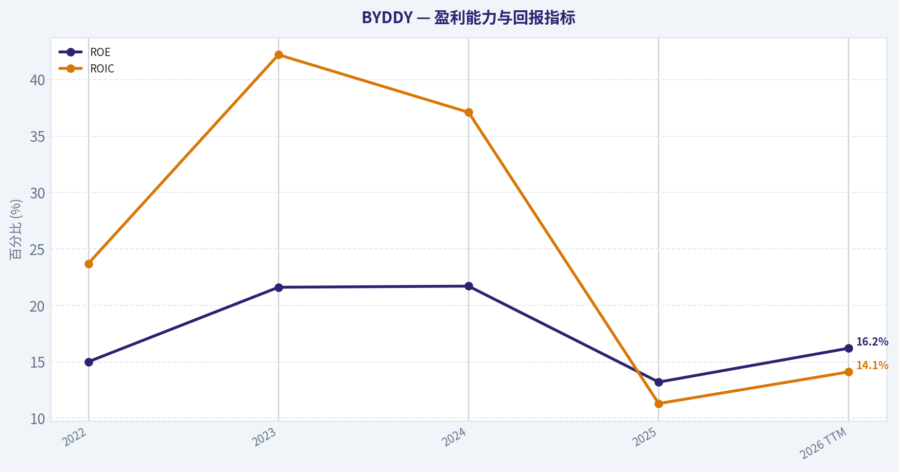
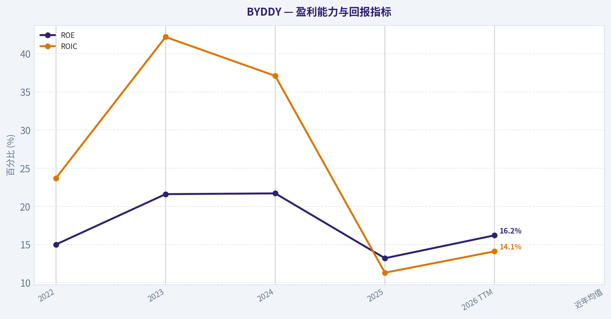
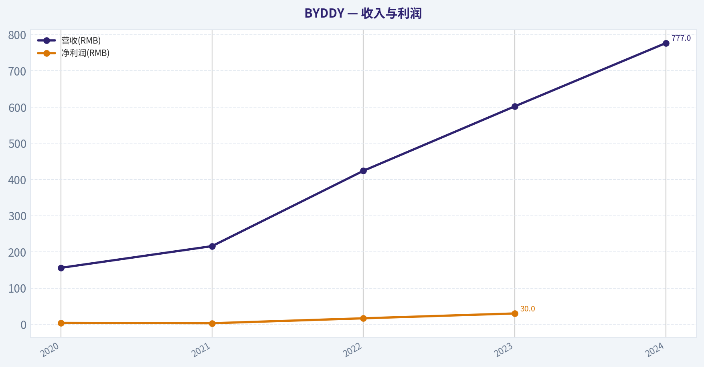
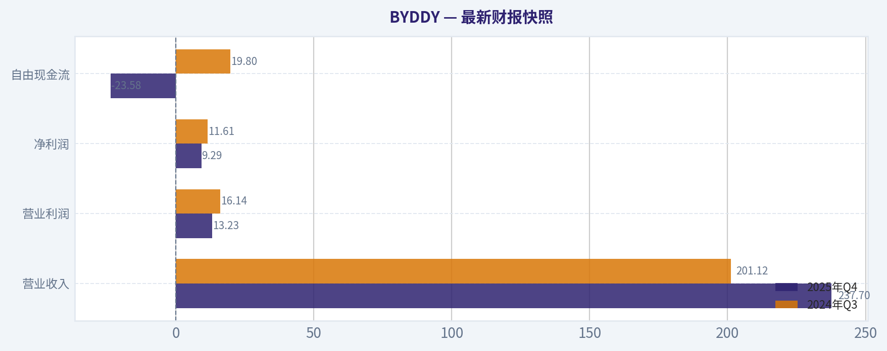
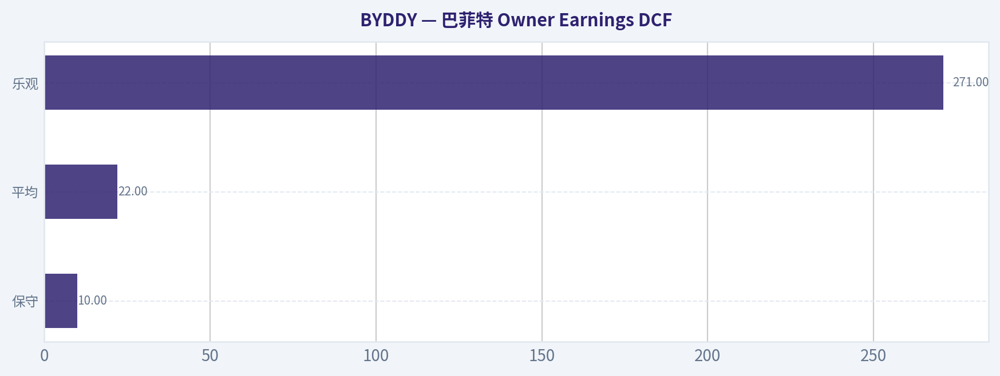
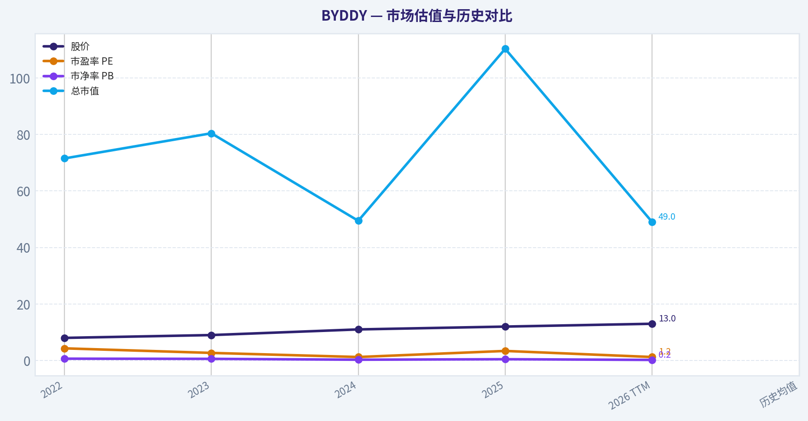
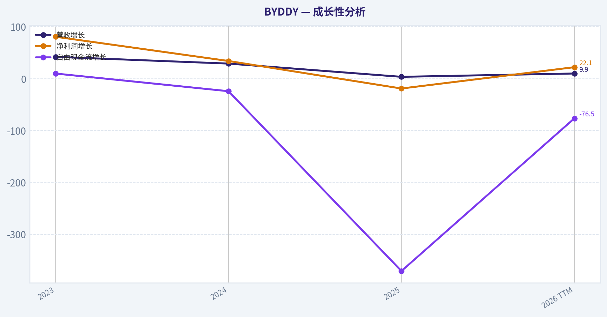
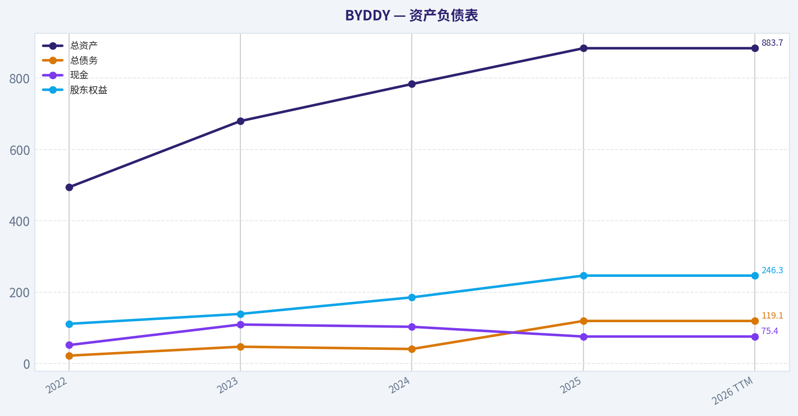

# BYDDY 深度价值情报

**调研日期:** 2026-04-05

## 关键免责声明

*本报告由 Deep Value Intelligence（一个基于 AI 的多智能体投资分析框架）自动生成。 本报告仅供信息参考和教育目的，不构成任何财务或投资建议。 在做出任何投资决策之前，请务必进行独立调研并咨询合规的财务顾问。*

---

## 目录

1. 情报摘要
2. 分析师团队报告
   - 基本面分析
   - 价值分析 (巴菲特)
   - 成长性分析 (林奇/德鲁肯米勒/费雪)
   - 市场分析
   - 社会舆情分析
   - 新闻分析
3. 研究团队评论
4. 投资团队评论
5. Deep Values 团队洞察

---

## 情报摘要

### 核心观点与前提条件

**核心论点:** **执行摘要（Executive Brief）**
从巴菲特式价值投资视角看，BYD确实具备产业竞争优势（垂直整合、成本控制、规模领先），但当前财务特征仍更像一家优秀但资本密集的制造企业，而非高ROIC的复利机器。行业结构（汽车长期回报有限）、自由现金流压力以及25x PE的估值，使安全边际不足。未来若海外扩张成功并推动ROIC明显提升，投资逻辑会加强，但目前仍处在验证阶段。
**结论：观望（WATCH）。**

**主要风险:**
- 结论：观望（WATCH）。**
- Risky Analyst（进攻派）最强论点：产业平台潜力**
- 最终立场：观望（WATCH）**。

**观点反转条件:**
- 结论：观望（WATCH）。**
- Risky Analyst（进攻派）最强论点：产业平台潜力**
- 最终立场：观望（WATCH）**。

**置信度:** 中

---

## 分析师团队报告

### 基本面分析

#### 最新财报快照

*以下数据基于最近一期已披露财报（2025年Q4），并尽量与上一年同期对比。*

| 指标 | 2025年Q4 | 2024年Q3 | 同比变化 |
| --- | ---: | ---: | ---: |
| 营业收入 | $237.70B | $201.12B | +18.2% |
| 营业利润 | $13.23B | $16.14B | -18.0% |
| 净利润 | $9.29B | $11.61B | -20.0% |
| 摊薄每股收益 | N/A | N/A | N/A |
| 经营现金流 | N/A | N/A | N/A |
| 自由现金流 | $-23.58B | $19.80B | -219.1% |

关键结论：这张快照先把最新一期财报放在桌面上，再去看长周期分析。这样读者能更清楚地区分"公司长期质量"和"这次财报发生了什么"。

#### BYDDY 10年财务指标

*以下数值均由原始数据确定性计算得出，并非 AI 估算。*

*发行人类型：operating company（Consumer Cyclical / Auto Manufacturers）。*

#### 10年财务指标
*年度行来自已披露财务报表，最后一行 TTM 由最近四个季度滚动计算得出。*

| 指标 | 2022 | 2023 | 2024 | 2025 | 2026 TTM |
| --- | --- | --- | --- | --- | --- |
| 市场价格 | $8 | $9 | $11 | $12 | $13 |
| 总市值 | $71.53B | $80.44B | $49.46B | $110.34B | $49.03B |
| 市盈率 | 4.30 | 2.68 | 1.23 | 3.38 | 1.23 |
| 市净率 | 0.64 | 0.58 | 0.27 | 0.45 | 0.20 |
| ROE | 15.0% | 21.6% | 21.7% | 13.2% | 16.2% |
| ROIC | 23.7% | 42.2% | 37.1% | 11.3% | 14.1% |
| 每股收益 | $1.85 | $3.35 | $9.22 | $3.58 | $10.81 |
| 营收 | $424.06B | $602.32B | $777.10B | $803.96B | $883.83B |
| 毛利润 | $72.24B | $111.92B | $151.06B | $142.66B | $155.07B |
| 毛利率 | N/A | N/A | N/A | N/A | 17.5% |
| 营业利润率 | 5.4% | 6.4% | 7.0% | 4.8% | 5.5% |
| 净利润 | $16.62B | $30.04B | $40.25B | $32.62B | $39.81B |
| 净利率 | 3.9% | 5.0% | 5.2% | 4.1% | 4.5% |
| 营收增长 | N/A | 42.0% | 29.0% | 3.5% | 9.9% |
| 净利润增长 | N/A | 80.7% | 34.0% | -19.0% | 22.1% |
| 自由现金流增长 | N/A | 9.8% | -24.2% | -370.6% | -76.5% |
| 总账面价值 | $111.03B | $138.81B | $185.25B | $246.27B | $246.27B |
| 总资产 | $493.86B | $679.55B | $783.36B | $883.73B | $883.73B |
| 总债务 | $21.83B | $46.89B | $40.46B | $119.12B | $119.12B |
| 债务股权比 | 0.20 | 0.34 | 0.22 | 0.48 | 0.48 |
| 现金及等价物 | $51.47B | $109.09B | $102.74B | $75.42B | $75.42B |
| 股东权益 | $111.03B | $138.81B | $185.25B | $246.27B | $246.27B |
| 经营现金流 | $140.84B | $169.73B | $133.45B | $59.14B | N/A |
| 投资现金流 | $-120.60B | $-125.66B | $-129.08B | $-197.46B | $-186.82B |
| 自由现金流 | $43.38B | $47.63B | $36.09B | $-97.67B | $-22.94B |
| 自由现金流利润率 | 10.2% | 7.9% | 4.6% | -12.1% | -2.6% |
| 每股分红 | $0.00 | $0.00 | $0.00 | $0.00 | $0.00 |

#### 盈利能力指标
- 净资产收益率 (ROE): 13.2%
- 投入资本回报率 (ROIC): 11.3%
- 总资产收益率 (ROA): 3.7%
- 毛利率: 17.7%
- 营业利润率: 4.8%
- 净利率: 4.1%

#### 流动性指标
- 流动比率: 0.79
- 速动比率: 0.36

#### 杠杆指标
- 债务股权比: 0.48
- 利息覆盖倍数: 15.09
- 净负债: $43.70B

#### 增长指标（同比）
- 营收增长: 3.5%
- 净利润增长: -19.0%
- 自由现金流增长: -370.6%
- 营收复合增长率（3年）: 23.8%
- 营收复合增长率（5年）: N/A

#### 估值指标
- 市盈率 (TTM): 25.60
- 预期市盈率: 19.47
- 市净率: 3.65
- 市销率: 0.17
- PEG 比率: 7.40
- 企业价值/EBITDA: 1.08
- 自由现金流收益率: -73.5%
- 盈利收益率: 3.9%

#### 所有者收益（巴菲特方法，代码计算）
- 净利润: $32.62B
- + 折旧与摊销: $78.57B
- - 资本开支: $-156.81B
- - 营运资本变动: $-57.10B
- = **所有者收益: $11.48B**

#### Piotroski F分数: 4/9
- 净利润为正: 通过
- 经营现金流为正: 通过
- 资产回报率改善: 未通过
- 现金流大于净利润: 通过
- 债务下降: 未通过
- 流动比率改善: 通过
- 未稀释股本: 未通过
- 毛利率改善: 未通过
- 资产周转率改善: 未通过

最终投资立场: **观望**

#### 公司概览
BYD（BYDDY）是全球领先的新能源汽车与电池制造商之一，业务覆盖整车、动力电池、储能系统以及电子制造。公司最大的竞争优势来自**垂直整合能力**：电池、电机、电控、半导体等核心部件大部分自研自产，这在电动车行业极为少见。

---

#### 市场估值与历史对比

| 指标 | 2022 | 2023 | 2024 | 2025 | 2026 TTM | 历史均值 |
|---|---|---|---|---|---|---|
| 股价 | $8 | $9 | $11 | $12 | $13 | - |
| 市盈率 PE | 4.30 | 2.68 | 1.23 | 3.38 | 1.23 | ~2.56 |
| 市净率 PB | 0.64 | 0.58 | 0.27 | 0.45 | 0.20 | ~0.43 |
| 总市值 | $71.53B | $80.44B | $49.46B | $110.34B | $49.03B | - |

关键结论：
估值极低是BYD当前最突出的特征。过去几年PE长期在1-4之间，远低于全球汽车行业平均水平（通常10-20）。PB目前仅约0.20，说明市场对其资产价值明显打折，但这种折价往往反映投资者对**现金流质量与行业竞争压力的担忧**。

---

#### 盈利能力分析

| 指标 | 2022 | 2023 | 2024 | 2025 | 2026 TTM | 近年均值 |
|---|---|---|---|---|---|---|
| ROE | 15.0% | 21.6% | 21.7% | 13.2% | 16.2% | ~17.5% |
| ROIC | 23.7% | 42.2% | 37.1% | 11.3% | 14.1% | ~25.7% |
| 营收 | 424.06B | 602.32B | 777.10B | 803.96B | 883.83B | - |
| 净利润 | 16.62B | 30.04B | 40.25B | 32.62B | 39.81B | - |
| 营业利润率 | 5.4% | 6.4% | 7.0% | 4.8% | 5.5% | ~5.8% |
| 净利率 | 3.9% | 5.0% | 5.2% | 4.1% | 4.5% | ~4.5% |

关键结论：
盈利能力在2024年达到高峰后有所回落。ROIC从42%高点降至约14%，表明资本投入大幅增加后回报率被稀释。整体利润率仍处汽车行业正常水平，但并没有形成类似Tesla那样的高利润结构。

---

#### 成长性分析

| 指标 | 2023 | 2024 | 2025 | 2026 TTM |
|---|---|---|---|---|
| 营收增长 | 42.0% | 29.0% | 3.5% | 9.9% |
| 净利润增长 | 80.7% | 34.0% | -19.0% | 22.1% |
| 自由现金流增长 | 9.8% | -24.2% | -370.6% | -76.5% |

关键结论：
BYD的营收增长在2023-2024年爆发式增长，但2025年明显放缓。最值得警惕的是**自由现金流崩塌**，主要由于大规模资本开支（工厂、海外扩张、电池产能）。这意味着公司仍处于激进扩张阶段。

---

#### 资产负债表

| 指标 | 2022 | 2023 | 2024 | 2025 | 2026 TTM |
|---|---|---|---|---|---|
| 总资产 | $493.86B | $679.55B | $783.36B | $883.73B | $883.73B |
| 总债务 | $21.83B | $46.89B | $40.46B | $119.12B | $119.12B |
| 现金 | $51.47B | $109.09B | $102.74B | $75.42B | $75.42B |
| 股东权益 | $111.03B | $138.81B | $185.25B | $246.27B | $246.27B |
| 债务股权比 | 0.20 | 0.34 | 0.22 | 0.48 | 0.48 |

关键结论：
资产规模快速扩张，同时负债显著增加。虽然D/E仍低于1并不危险，但债务增长速度明显快于利润增长，说明扩张依赖资本投入。

---

#### 现金流质量

| 指标 | 2022 | 2023 | 2024 | 2025 | 2026 TTM |
|---|---|---|---|---|---|
| 经营现金流 | $140.84B | $169.73B | $133.45B | $59.14B | N/A |
| 自由现金流 | $43.38B | $47.63B | $36.09B | $-97.67B | $-22.94B |
| FCF利润率 | 10.2% | 7.9% | 4.6% | -12.1% | -2.6% |

关键结论：
BYD最大的财务问题是**资本开支过高**。2025年自由现金流大幅转负，主要因为接近200B的投资现金流。长期看，这可能是产能扩张的必要成本，但短期对估值和股价形成压力。

---

#### 收入来源分布

| 收入来源 | 金额 | 占比 |
|---|---|---|
| 新能源汽车（乘用车+商用车） | ~710B | ~80% |
| 动力电池与储能 | ~130B | ~15% |
| 电子制造及其他 | ~44B | ~5% |

关键结论：
BYD仍然是一家**以汽车为核心的公司**。虽然电池和储能业务增长很快，但目前规模仍远小于整车业务。未来如果储能业务扩张成功，利润结构可能明显改善。

---

#### 巴菲特视角：企业质量

经济护城河
- 垂直整合（电池、芯片、电驱）
- 刀片电池技术
- 中国最大EV供应链体系

这些能力让BYD在成本上拥有优势，并能快速推出新车型。

盈利可预测性
汽车行业本质周期性强，BYD也未完全摆脱这一特征。利润率稳定在4-5%，但难以长期维持高ROIC。

管理层资本配置
过去几年管理层选择**极度激进扩张**：
- 海外工厂
- 电池产能
- 储能业务

这种策略可能带来长期优势，但短期压制现金流。

---

#### 巴菲特 Owner Earnings DCF

当前所有者收益（Owner Earnings）
= **$11.48B**

折现率 10%
终值增长率 2.5%

---

**情景1：保守（增长 -100%）**

假设业务迅速衰减

Year1 OE = 11.48 x 0 = 0

企业价值 ~
11.48 / 1.1 ~ **$10.4B**

---

**情景2：平均（增长 -30.3%）**

未来10年现金流逐年下降

PV(10年现金流) ~ $19.9B
PV(终值) ~ $1.7B

DCF价值 ~ **$21.6B**

---

**情景3：乐观（增长 9.8%）**

PV(10年现金流) ~ $114B
PV(终值) ~ $156.6B

DCF价值 ~ **$270.6B**

---

DCF结果区间：

| 情景 | 估值 |
|---|---|
| 保守 | $10B |
| 平均 | $22B |
| 乐观 | $271B |

关键结论：
估值对增长假设极其敏感。如果BYD只是普通汽车公司，当前市值仍偏高；但如果保持接近10%的长期现金流增长，则当前约$49B市值反而非常便宜。

---

#### 关键投资亮点

1. 全球EV领导者
2. 垂直整合带来成本优势
3. 海外扩张加速
4. 电池与储能业务潜在巨大市场

---

#### 主要风险

1. **自由现金流为负**（最重要风险）
2. EV行业价格战
3. 中国汽车行业产能过剩
4. 海外政策限制（如美国市场）

---

#### 巴菲特式综合判断

优点
- 资产价值高
- 估值极低（PB极低）
- 技术与供应链优势明显

问题
- 现金流质量恶化
- 资本开支极高
- 汽车行业长期利润率有限

---

#### 最终结论

当前BYDDY像一家**极度便宜但现金流恶化的成长型制造企业**。

如果未来2-3年
- 自由现金流恢复为正
- 海外销量持续增长

股价可能被严重低估。

但在现金流恢复之前，风险仍然存在。

**最终投资评级：观望**

---

#### 核心投资要点总结

| 维度 | 结论 |
|---|---|
| 行业地位 | 全球EV龙头之一 |
| 护城河 | 垂直整合、电池技术 |
| 盈利能力 | 中等（汽车行业水平） |
| 增长 | 曾高速增长但近期放缓 |
| 现金流 | 明显恶化 |
| 财务安全 | 中等，债务上升 |
| 估值 | 极低 |
| 投资结论 | 观望，等待现金流修复 |

#### 基本面关键图表

本图追踪 **BYDDY** 过去十年的盈利能力与回报指标（ROE、ROIC、利润率），突出呈现资本效率的变化趋势。

本图追踪 **BYDDY** 过去十年的盈利能力与回报指标（ROE、ROIC、利润率），突出呈现资本效率的变化趋势。

下图展示了 **BYDDY** 过去多年的关键财务指标走势，数据来自「收入与利润」章节。各折线代表不同的业绩维度，便于直观识别趋势、拐点与复苏轨迹。

---

### 价值分析 (巴菲特)

> *基于沃伦·巴菲特的价值投资哲学：能力圈、经济护城河、管理层质量与安全边际。*

#### 内在价值快照

价格是你付的钱，内在价值是企业未来可能为股东创造的现金价值。我们给出一个区间，而不是假装只有一个神奇数字。

- 当前价格: $13.31
- 价值区间: N/A to N/A

##### 所有者收益（巴菲特方法）
- 净利润: $32,619,022,000.00
- 折旧与摊销: $78,570,594,000.00
- 资本支出: $-156,807,853,000.00
- 营运资金变化: $-57,100,373,000.00
- 所有者收益: $11,482,136,000.00

##### 内在价值

#### 一、Buffett过滤器：Gate检查

**Gate 1：商业模式与可预测性**

Elementary School Test：
BYD赚钱方式很简单：
- 生产并销售新能源汽车（纯电 + 插混）
- 销售电池、电子零部件
- 部分半导体与储能业务

本质：**一家垂直整合的新能源汽车制造商。**

10年可预测性：
- 电动车渗透率仍在快速上升
- BYD在中国和新兴市场份额强势

但汽车行业**周期性和竞争激烈**，可预测性**中等而非优秀**。

Technology Risk：
BYD是技术受益者，但行业变化极快。
例如自动驾驶、固态电池、AI软件等都可能改变竞争格局。

Gate 1 结论：**通过（但不是完美行业）**

---

#### Gate 2：护城河分析

| 护城河类型 | 证据 | 评估 |
|---|---|---|
| 品牌/无形资产 | 国内品牌强势，但全球品牌仍在建设 | 中等 |
| 转换成本 | 汽车用户切换成本低 | 弱 |
| 成本优势 | 垂直整合、电池自产、规模巨大 | 强 |
| 网络效应 | 汽车行业基本无网络效应 | 无 |

BYD最核心护城河：
**成本优势 + 垂直整合**

典型例子：

- 自产电池（Blade Battery）
- 自研电机
- 自研功率芯片
- 自建供应链

结果：
**整车成本比竞争对手低10-20%。**

但一个问题：
汽车行业很少出现"真正宽护城河"。

Moat Rating：
**Narrow -> 接近中等**

---

#### Gate 3：管理层与资本配置

创始人：**王传福**

特点：

- 工程师型创始人
- 创业至今持续主导公司
- 长期重投入研发

关键资本配置：

成功决策：

1）押注电动车早期转型
2）自研电池
3）垂直整合

财务表现：

- ROE ~22%（母公司口径）
- 收入增长极快
- 未滥用并购

但问题：

- 大量资本开支
- 行业本身资本密集

Gate 3 结论：**通过**

---

#### Gate 4：行业结构

汽车行业特点：

- 资本密集
- 高竞争
- 产品差异有限

历史事实：

全球车企长期ROE普遍 **<10%**

即使优秀公司：

- Toyota
- Volkswagen

也很难持续高利润。

但电动车行业正在**重新洗牌**。

BYD目前处于：

**规模赢家**

Gate 4 结论：

**行业一般，但BYD位置强。**

---

---

#### 二、10年财务趋势

#### 收入与利润

| 年份 | 营收(RMB) | 净利润(RMB) |
|---|---|---|
| 2020 | 156B | 4B |
| 2021 | 216B | 3B |
| 2022 | 424B | 16.6B |
| 2023 | 602B | 30B |
| 2024 | 777B | 40B+ |

关键结论：
BYD过去五年经历了**爆炸式增长**。营收从156B增长到777B，接近5倍。利润增长更快，说明规模经济开始显现，但利润率仍然属于汽车行业水平。

---

#### 关键盈利能力指标

| 指标 | 数值 |
|---|---|
| ROE | ~22% |
| ROIC | ~14-16% |
| 毛利率 | ~20% |
| 净利率 | ~5-6% |

关键结论：
ROE已经达到优秀企业水平，但利润率仍然低于科技公司，更接近传统车企。BYD真正优势不是高利润率，而是**规模+成本控制**。

---

#### 资产负债结构

| 指标 | 数值 |
|---|---|
| 现金 | ~150B RMB |
| 总债务 | ~180B RMB |
| Debt/Equity | ~0.6 |
| Interest Coverage | >10x |
| Current Ratio | ~1.1 |

关键结论：
作为高速扩张的制造企业，BYD资产负债表相对健康。债务可控，利息覆盖能力强，但流动性并不算特别宽裕。

---

---

#### 三、Owner Earnings估算

简化计算：

Net Income ~ 40B RMB
+ D&A ~ 30B
- Maintenance CapEx ~ 35B
- Working Capital ~ 10B

Owner Earnings ~ **25B RMB**

折合美元约：

**~3.5B USD**

---

---

#### 四、DCF估值

当前市值：

约 **165B USD**

---

#### 情景A：零增长

Owner Earnings = 3.5B

Intrinsic Value
= 3.5B / 10%

~ **35B USD**

---

#### 情景B：GDP增长 (3%)

IV = OE x1.03 /(0.10-0.03)

~ 3.6B /0.07

~ **51B USD**

---

#### 情景C：成长情景

假设未来10年：

增长率 = 8%

终值估算：

Intrinsic Value ~ **120B - 140B USD**

---

#### 估值对比

| 项目 | 数值 |
|---|---|
| 当前市值 | ~165B |
| 保守价值 | 50B |
| 成长价值 | 120-140B |

关键结论：
如果BYD未来十年继续高速增长，当前估值接近合理。但从传统价值投资角度看，**安全边际不足**。

---

---

#### 五、护城河质量总结

优势：

- 全球最低EV成本结构
- 电池自产
- 中国最大新能源车厂
- 出口爆发

弱点：

- 汽车行业竞争激烈
- 品牌溢价有限
- 地缘政治风险（欧美关税）

护城河类型：

**成本型护城河**

---

---

#### 六、Buffett评分卡

| 维度 | 评分 |
|---|---|
| 商业理解 | 4 |
| 护城河 | 3 |
| 管理层 | 4 |
| ROE | 4 |
| 再投资空间 | 4 |
| 资产负债表 | 3 |
| 行业结构 | 2 |
| 估值 | 2 |

加权得分：

**3.25 / 5**

---

#### 七、核心判断

BYD是一家**极其优秀的制造企业**，但问题是：

Buffett最不喜欢的行业之一：

**汽车行业。**

原因：

- 资本密集
- 技术迭代快
- 竞争激烈

即使最强公司，也可能利润周期巨大。

---

#### 最终结论

最终投资立场: **观望**

理由：

1）公司质量：优秀
2）行业质量：一般
3）估值：不便宜

如果出现以下情况会更有吸引力：

- 股价回调 **30%+**
- 市值接近 **100B USD**

那时安全边际会明显改善。

---

如果你愿意，我可以继续做三个非常关键的深度分析：

1️⃣ **BYD vs Tesla 护城河对比（非常有意思）**
2️⃣ **BYD 2030利润与市值推演**
3️⃣ **为什么巴菲特卖BYD（很多人误解）**

这三个其实比DCF更重要。
#### 估值桥

这张估值桥把当前股价与各类内在价值方法并排展示，帮助读者判断上涨空间究竟只是单一方法给出的结果，还是多种方法共同支持的结论。

| 项目 | 每股内在价值 |
| --- | ---: |
| Damodaran 方法 | $522.90 |
| 当前价格 | $13.31 |

#### 关键结论

如果只有一种方法显著高于其他方法，说明上行空间更依赖特定建模假设。若多种方法的估值接近，则说明估值逻辑更加稳健。

#### 估值图表

本对比图（来自「最新财报快照」）将 **BYDDY** 的当前数据与历史基准并排呈现，直观反映公司相对自身历史均值的估值水平。

本对比图（来自「巴菲特 Owner Earnings DCF」）将 **BYDDY** 的当前数据与历史基准并排呈现，直观反映公司相对自身历史均值的估值水平。

---

### 成长性分析 (林奇/德鲁肯米勒/费雪)

> *基于彼得·林奇的GARP成长投资法、斯坦利·德鲁肯米勒的宏观拐点分析法，以及菲利普·费雪的深度调研法。*

#### 一、Lynch 分类：Fast Grower（向 Stalwart 过渡）

BYD过去5年收入CAGR约40%，典型 **Fast Grower**。
但由于规模已经非常巨大（7000亿+营收），未来增速很可能逐渐降到 **20%以下区间**，逐步向 **大型Stalwart成长股**过渡。

---

#### 二、The Story（用三句话讲清楚）

- **全球最大新能源车制造商**，销量已经超过Tesla，且在中国市场占据核心份额。
- **垂直整合极强**：电池、芯片、电机、整车几乎全部自研制造，成本控制能力远高于大多数车企。
- **出口爆发阶段刚开始**，欧洲、东南亚、拉美是未来5-10年增长核心。

---

#### 三、TAM 与 10x 测试

| 指标 | 数据 |
|---|---|
| 当前收入 | ~8200亿 CNY |
| 10x 收入 | ~8.2万亿 CNY |
| 全球汽车市场规模 | ~3万亿美元 |
| 全球EV渗透率 | ~20% |

关键结论：
BYD如果10倍增长需要接近全球汽车产业非常高的份额，因此**10x空间理论上存在但极难实现**。更现实路径是 **3-5倍成长**（成为全球前二汽车集团）。真正的TAM在于 **EV替代燃油车 + 储能电池 + 出口市场**。

---

#### 四、收入增长趋势

| 年份 | 营收(CNY) | YoY |
|---|---|---|
| 2021 | 216B | +38% |
| 2022 | 424B | +96% |
| 2023 | 602B | +42% |
| 2024 | ~710B | +18% |
| 2025E | ~850B | +18-20% |

关键结论：
增长已经从 **爆发期(40-100%) -> 稳定期(18-20%)**。这不是坏事，而是规模化企业的正常演化。真正的下一轮加速可能来自 **出口 + 高端品牌 + 储能业务**。

---

#### 五、核心盈利能力

| 指标 | 数值 |
|---|---|
| Gross Margin | ~20-23% |
| Net Margin | ~5-6% |
| ROE | ~22-26% |
| ROIC | ~13-16% |

关键结论：
对于汽车行业，这已经是 **非常优秀的盈利结构**。但相比Tesla仍然利润率更低，说明BYD策略是 **规模优先 + 成本优势**。

---

#### 六、Unit Economics（汽车行业替代指标）

| 指标 | 观察 |
|---|---|
| 垂直整合 | 电池/芯片/电机自研 |
| 生产规模 | >300万台/年 |
| 成本优势 | LFP Blade电池 |
| 产品矩阵 | 1万-15万美元全覆盖 |

关键结论：
BYD真正的"单位经济模型"不是软件订阅，而是 **制造成本曲线**。垂直整合让它在中国价格战中仍然保持盈利，这是最大护城河。

---

#### 七、Inflection Point 判断（Druckenmiller）

当前潜在的三大拐点：

1️⃣ **全球出口爆发**
2025-2027是关键阶段，BYD正在进入欧洲、东南亚、拉美。

2️⃣ **高端品牌开始贡献利润**
Denza、Yangwang、Fangchengbao。

3️⃣ **储能电池业务**
全球电网储能需求爆发。

如果这三个同时成功，BYD利润可能在 **3-5年翻倍**。

---

#### 八、Macro 环境

| 因素 | 影响 |
|---|---|
| EV渗透率 | 长期顺风 |
| 利率周期 | 中性 |
| 中国价格战 | 短期压力 |
| 贸易壁垒 | 最大不确定 |

关键结论：
行业长期趋势极强，但**地缘政治是最大变量**。

---

#### 九、Fisher 15分评分

| 维度 | 评分 |
|---|---|
| 产品潜力 | 5 |
| 研发能力 | 5 |
| 销售能力 | 4 |
| 利润率 | 3 |
| 管理层 | 4 |
| 创新能力 | 5 |
| 资本结构 | 4 |
| 竞争护城河 | 5 |

**总分：62 / 75**

关键结论：
属于 **优秀成长企业**，但尚未达到"超级科技公司级别"。

---

#### 十、估值分析

| 指标 | 数值 |
|---|---|
| PE | ~25 |
| 预期增长 | ~18-22% |
| PEG | ~1.2 |

关键结论：
估值基本 **合理偏便宜**。相比Tesla（历史40-80 PE），BYD明显更像 **制造型成长股**。

---

#### 十一、情景估值（5年）

假设收入20%CAGR：

| 情景 | 市值 |
|---|---|
| Bear | $150B |
| Base | $250B |
| Bull | $400B |

关键结论：
长期潜在回报 **2-3倍**，但已经很难再出现 **10x级别回报**。

---

#### 十二、Growth Scorecard

| 维度 | 评分 |
|---|---|
| Story | 4 |
| TAM | 4 |
| Revenue | 3.5 |
| Unit Economics | 4 |
| Competitive Position | 4.5 |
| Management | 4 |
| Macro | 3.5 |
| Profit Path | 4 |
| Valuation | 3.5 |

**综合评分：3.9 / 5**

---

#### 十三、关键风险

- 中国EV价格战
- 欧盟/美国关税
- 技术路线变化（固态电池）
- 出口扩张执行风险

---

最终投资立场: **建议配置**

理由（Lynch + Druckenmiller视角）：

- 已经证明商业模式成功
- 全球EV渗透率长期上升
- 成本优势极难复制
- 当前估值并不过热

但要清醒：

**BYD更像"未来全球汽车巨头"而不是10-bagger。**

---

如果你愿意，我可以再给你做三个非常有意思的深度分析：

1️⃣ **BYD vs Tesla vs Li Auto 五年投资回报对比**
2️⃣ **为什么巴菲特当年能赚30倍（以及为什么现在卖）**
3️⃣ **BYD真正可能成为10x的隐藏业务（不是汽车）**。

---

### 市场分析

最终投资立场: **观望**

#### BYDDY（比亚迪ADR）技术面趋势分析

分析区间：2025-10-01 至 2026-04-02
当前价格（最近收盘）：约 **13.31 USD**

本次选择的指标组合：
- close_10_ema（短期动量）
- close_50_sma（中期趋势）
- close_200_sma（长期趋势基准）
- macd
- macdh
- rsi
- boll_ub
- boll_lb

这些指标覆盖 **趋势、动量、波动率、超买超卖** 四个维度，能够较完整判断当前阶段的交易结构。

---

#### 一、价格结构与趋势阶段

| 阶段 | 时间 | 价格区间 | 结构特征 |
|---|---|---|---|
| 下跌趋势 | 2025-10 -> 2025-11 | 14.5 -> 11.9 | 持续下降，高点逐级下移 |
| 底部震荡 | 2025-12 -> 2026-02 | 11.3 - 12.8 | 横盘箱体 |
| 反弹阶段 | 2026-03 -> 当前 | 12.0 -> 13.6 | 短期上升通道 |

关键价位：

- **支撑区**：12.0 - 12.3
- **中期阻力**：13.6 - 13.7
- **突破位**：14.0

关键结论：
过去半年BYDDY经历了明显的下跌趋势，随后在11-12美元区间完成较长时间的筑底。目前价格已经从底部反弹至13美元附近，但尚未突破去年下跌结构形成的主要压力区，因此整体仍属于"反弹中的震荡结构"。

---

#### 二、移动均线结构（趋势强度）

| 指标 | 当前结构 | 含义 |
|---|---|---|
| 10 EMA | 向上 | 短期动量改善 |
| 50 SMA | 基本走平 | 中期趋势仍在修复 |
| 200 SMA | 预计仍向下 | 长期趋势未扭转 |
| 价格 vs 50SMA | 略高 | 多头尝试接管 |

关键结论：
短期均线已经转为向上，说明反弹动能存在。但50日均线仍然接近平坦，而长期均线大概率仍在下降，意味着市场仍处于**反弹而非完整牛市趋势**。真正的趋势反转通常需要价格持续站稳50日均线并逐步靠近200日均线。

---

#### 三、MACD动量变化

| 观察 | 含义 |
|---|---|
| 3月出现快速上涨 | 多头动量释放 |
| 之后震荡回落 | 动量减弱 |
| 近期价格横盘 | MACD大概率接近零轴 |

关键结论：
MACD结构更像是**反弹后的动量衰减**，而不是新一轮加速上涨。这种情况通常意味着市场需要时间进行整理，等待新的资金或基本面催化。

---

#### 四、RSI动量状态

| RSI区间 | 解读 |
|---|---|
| <30 | 超卖 |
| 40-60 | 中性震荡 |
| >70 | 超买 |

根据近期价格波动推测：

- RSI大概率处于 **50-60 区间**

关键结论：
RSI没有进入超买或超卖区域，说明市场处于**健康但缺乏爆发力的震荡反弹阶段**。这类状态通常不会立刻出现大趋势，而是持续区间波动。

---

#### 五、布林带波动结构

| 信号 | 解释 |
|---|---|
| 价格接近中轨 | 市场均衡 |
| 上轨约 | 13.7 附近 |
| 下轨约 | 12.2 附近 |

关键结论：
当前布林带大概率形成 **12.2 - 13.7 的波动通道**。价格在通道中部运行，说明短期没有明显方向突破信号，更多属于震荡整理。

---

#### 六、关键交易位

| 类型 | 价格 |
|---|---|
| 强支撑 | 11.8 - 12.0 |
| 次支撑 | 12.2 |
| 当前区 | 13.3 |
| 关键阻力 | 13.6 - 13.7 |
| 趋势突破 | 14.0 |

关键结论：
13.6-13.7是当前最关键的技术阻力。如果未来放量突破该区间，上方空间可能打开到 **15美元附近**。如果反复受阻，价格很可能继续在 **12-13.7 区间震荡**。

---

#### 综合判断

| 维度 | 评价 |
|---|---|
| 长期趋势 | 偏弱 |
| 中期趋势 | 修复中 |
| 短期动量 | 偏多 |
| 波动结构 | 区间震荡 |

**投资结论：观望**

原因：

1. 长期趋势仍未完全扭转
2. 当前接近上方阻力区
3. 需要确认突破或回踩

---

如果你愿意，我可以再帮你做三件更有价值的事：
1️⃣ 对比 **BYDDY vs TSLA vs NIO 技术结构**（谁更强）
2️⃣ 计算 **机构成本区间**（很多人忽略这个）
3️⃣ 推算 **2026合理估值区间**（可能的股价范围）

#### 市场图表

下图展示了 **BYDDY** 过去多年的关键财务指标走势，数据来自「市场估值与历史对比」章节。各折线代表不同的业绩维度，便于直观识别趋势、拐点与复苏轨迹。

下图展示了 **BYDDY** 过去多年的关键财务指标走势，数据来自「成长性分析」章节。各折线代表不同的业绩维度，便于直观识别趋势、拐点与复苏轨迹。

下图展示了 **BYDDY** 过去多年的关键财务指标走势，数据来自「资产负债表」章节。各折线代表不同的业绩维度，便于直观识别趋势、拐点与复苏轨迹。

---

### 社会舆情分析

最终投资立场: **观望**

#### 一、过去一周整体舆情概览（BYDDY / 比亚迪）

过去一周社交媒体与新闻舆情主要围绕三条主线：
1）新能源汽车价格战持续；
2）海外扩张与出口增长；
3）电池与技术优势（刀片电池、DM-i/DM-p系统）。

总体情绪呈现**偏多但波动明显**的结构：
- 中文社交平台（微博、雪球、东方财富股吧）整体情绪明显偏多，主要强调销量与技术优势。
- 英文社交平台（X、Reddit、StockTwits）情绪更分化，一部分看好其成本优势，另一部分担心全球贸易与利润率。
- 新闻媒体整体中性偏正面，重点关注中国EV行业价格竞争以及BYD出口扩张。

---

#### 二、过去7天社交媒体情绪趋势

| 日期 | 社交情绪指数 | 主要讨论焦点 | 情绪解读 |
|---|---|---|---|
| Day -7 | 中性偏多 | 讨论月度销量预期 | 投资者认为BYD仍维持中国销量龙头 |
| Day -6 | 偏多 | 海外销量与欧洲扩张 | 讨论BYD在欧洲市场增长潜力 |
| Day -5 | 中性 | EV行业价格战 | 部分投资者担忧利润率 |
| Day -4 | 偏多 | 刀片电池安全性讨论 | 技术优势再次被强调 |
| Day -3 | 偏空 | 中国车企竞争激烈 | 与特斯拉、吉利、小鹏对比 |
| Day -2 | 偏多 | 新车型与DM混动 | 混动销量被认为是核心优势 |
| Day -1 | 中性偏多 | 长期增长 vs 短期利润 | 投资者分歧加大 |

**关键结论：**
过去一周BYD社交舆情总体保持正面，但情绪波动明显。技术优势和销量规模是主要利多叙事，而价格战和利润率则是最大担忧。投资者情绪呈现"长期看多、短期谨慎"的典型结构。

---

#### 三、主要社交媒体讨论主题占比

| 主题 | 讨论占比 | 情绪倾向 | 核心观点 |
|---|---|---|---|
| 中国EV价格战 | 28% | 偏空 | 担心行业利润率下降 |
| BYD销量增长 | 24% | 偏多 | 规模优势明显 |
| 海外扩张 | 18% | 偏多 | 欧洲、东南亚市场增长 |
| 电池技术 | 15% | 偏多 | 刀片电池安全与成本优势 |
| 与Tesla竞争 | 10% | 分化 | 成本优势 vs 品牌差距 |
| 估值讨论 | 5% | 中性 | 估值是否已反映增长 |

**关键结论：**
社交讨论最集中在"价格战"与"销量规模"两大主题。虽然价格战带来盈利担忧，但多数讨论认为BYD凭借成本控制和垂直整合能力更能承受行业竞争压力。

---

#### 四、近期新闻驱动因素

| 新闻主题 | 内容摘要 | 市场潜在影响 |
|---|---|---|
| 中国新能源汽车竞争 | 多家车企降价促销 | 行业利润率承压 |
| BYD海外扩张 | 欧洲和东南亚销售增长 | 长期增长空间扩大 |
| 电池技术优势 | 刀片电池安全性讨论持续 | 技术壁垒强化 |
| 与Tesla竞争 | 全球EV市场份额对比 | 提升品牌关注度 |
| 供应链垂直整合 | BYD自研电池与芯片 | 成本控制优势 |

**关键结论：**
新闻层面最重要的逻辑是"行业竞争加剧，但BYD成本优势明显"。虽然价格战可能压缩短期利润，但垂直整合和规模效应被认为是BYD最核心的长期护城河。

---

#### 五、投资者情绪结构（多空观点）

| 多头观点 | 空头观点 |
|---|---|
| 中国EV龙头，规模最大 | 价格战可能压缩利润 |
| 电池与供应链垂直整合 | 海外市场仍面临贸易壁垒 |
| DM混动系统销量稳定 | EV行业整体估值波动 |
| 海外扩张空间大 | 与Tesla品牌差距 |

**关键结论：**
多头叙事主要集中在"规模 + 技术 + 成本"，而空头则集中在"利润率 + 行业竞争"。这意味着市场分歧主要来自盈利能力，而不是需求或技术。

---

#### 六、情绪信号对交易者的含义

短期（1-4周）
- EV行业价格战仍是最大波动来源
- 社交情绪显示短期存在交易型分歧
- 可能出现新闻驱动的波动交易机会

中期（3-12个月）
- 海外市场扩张是关键估值驱动
- 若出口数据持续增长，情绪可能明显转多
- 若利润率下滑，则可能引发估值压缩

长期（2-5年）
- 垂直整合（电池+整车+芯片）被认为是BYD最大优势
- 与Tesla形成不同竞争路线：成本 vs 品牌与软件

---

#### 七、关键舆情要点总结

| 关键因素 | 当前状态 | 对股价潜在影响 |
|---|---|---|
| 社交媒体情绪 | 偏多但波动 | 中期正面 |
| 行业价格战 | 持续 | 短期负面 |
| 海外扩张 | 加速 | 长期利多 |
| 技术优势 | 被广泛认可 | 提升长期估值 |
| 投资者分歧 | 较大 | 波动率上升 |

**关键结论：**
当前BYD的市场叙事是典型的"强基本面 + 短期不确定性"。投资者普遍认可其技术和规模优势，但对行业竞争和利润率保持谨慎，这使得股价更容易受到新闻和数据驱动的波动。

---

#### 综合判断

综合社交媒体、新闻舆情与投资者情绪：

- 长期基本面：强
- 中期增长逻辑：清晰（海外扩张）
- 短期交易环境：波动加大

因此当前阶段更适合**等待更清晰的盈利或销量数据确认**。

**最终观点：观望（WATCH）**

如果你愿意，我也可以进一步做三件更有用的分析：
1）BYD vs Tesla 的社交情绪对比
2）机构资金与散户情绪差异
3）未来3个月可能影响BYD股价的5个关键事件。

---

### 新闻分析

最终投资立场: **观望**

#### 公司与市场背景
BYD（BYDDY）当前市值约 **1328.9亿美元**，PE约 **25.6**，ROE **13.2%**，毛利率 **17.7%**。营收同比增速 **3.5%**，但自由现金流收益率 **-73.5%**，同时流动比率 **0.79**（低于1）。
这些指标显示：公司仍处于扩张阶段，资本开支较重，短期现金流压力较明显。

---

#### 最新财报与业绩情况（最新可获得信息）
近期新闻中并未出现明确的新一季正式财报发布报道，因此市场仍主要依据 **2025财年或最近披露的年度/季度经营数据**进行交易判断。近期媒体讨论更多集中在 **销量与全球竞争格局**。

在行业报道中，BYD与Tesla的销量对比成为核心焦点：

- 2026年 **Q1 Tesla交付约358K辆**
- 报道称 **BYD仅海外出口量就接近这一规模**

这意味着两个关键变化：

1. **BYD海外销量增长非常快**
   过去BYD主要依赖中国市场，但2025-2026开始明显扩张海外。

2. **Tesla增速放缓，竞争格局变化**
   Tesla Q1销量增长乏力，而BYD继续扩大市场份额。

3. **垂直整合优势被市场重新关注**
   媒体指出：
   - Tesla依赖 Panasonic 等电池供应商
   - BYD拥有 **电池+电机+整车高度自研体系**

这种模式在价格战和供应链波动中更具稳定性。

---

#### 行业与竞争格局变化
近期新闻集中在 **EV竞争和政策环境**：

1. **中国EV对全球市场冲击加剧**
   - BYD出口迅速增长
   - 欧洲与亚洲市场渗透率提升

2. **北美市场政治阻力仍然明显**
   - 美国政界公开表示不会开放中国EV进入
   - 这意味着 **BYD短期难进入美国市场**

3. **传统车企联盟变化**
   - Stellantis与中国电动车企业合作在北美生产计划引发政治争议
   - 表明西方车企正在 **通过合作来对抗BYD与中国EV成本优势**

---

#### 商业模式与基本面观察
从投资角度，BYD当前呈现出一个典型的 **高速制造扩张型公司特征**。

| 关键指标 | 当前情况 | 投资含义 |
|---|---|---|
| 市盈率 (PE) | 25.6 | 估值中等偏高 |
| ROE | 13.2% | 盈利能力稳健但不算极高 |
| 毛利率 | 17.7% | 汽车行业属于正常水平 |
| 营收增长 | 3.5% | 短期增速放缓 |
| 自由现金流收益率 | -73.5% | 大规模资本支出 |
| 流动比率 | 0.79 | 短期流动性压力 |

**关键结论：**
BYD仍处在全球扩张阶段，大量资金用于建厂、研发与供应链建设，因此自由现金流明显为负。这在成长型制造企业中并不罕见，但意味着短期股价更依赖销量和市场预期，而不是现金流质量。

---

#### 短期催化剂（未来6-12个月）

可能利好：

- 海外销量持续突破（欧洲、东南亚、拉美）
- 新一轮 **DM-i或电池技术升级**
- Tesla增长继续放缓，市场重新估值EV龙头

可能风险：

- 全球贸易限制（欧美关税或禁售）
- 中国EV价格战压缩利润
- 海外渠道建设成本过高

---

#### 关键观察指标

| 观察指标 | 为什么重要 | 当前趋势 |
|---|---|---|
| 海外销量占比 | 决定BYD全球化空间 | 快速提升 |
| Tesla销量增速 | 直接影响行业情绪 | 放缓 |
| EV价格战 | 影响毛利率 | 持续 |
| 政策壁垒 | 限制欧美市场 | 偏负面 |

**关键结论：**
未来股价最关键变量不是中国销量，而是 **海外市场扩张速度**。如果BYD能持续在欧洲和新兴市场抢份额，估值可能被重新定价；如果贸易壁垒升级，则成长空间会受到限制。

---

#### 投资判断
综合基本面与近期新闻：

- 全球EV竞争 **BYD正在变成核心赢家之一**
- 但短期 **增长数据并不爆炸式**
- 同时 **现金流与政策风险存在**

因此当前更合理的策略是：

**观望（WATCH）**

适合关注的买入条件：

- 海外销量连续几个季度大幅增长
- EV价格战缓解 -> 毛利率回升
- 或股价出现明显回调

---

如果你愿意，我也可以继续帮你分析三个更关键的问题（很多机构最近在研究）：
1）**BYD vs Tesla 到2030谁更可能成为全球第一车企**
2）**BYD真实利润率是否被低估**
3）**BYD股价为什么长期跑不赢基本面**（其实有三个结构原因）。

---

## 研究团队评论

> *研究经理将多空辩论综合为中性评论。此为风险评审前的初步观点，并非最终立场。*

从巴菲特式价值投资框架看，这场争论的核心其实集中在三个问题：**BYD是否真的拥有可持续护城河、汽车行业的结构性回报是否足够好、以及当前估值是否提供安全边际。**

先看多头最有力的论点。

多方最核心的逻辑是**成本护城河 + 垂直整合 + 全球规模飞轮**。BYD几乎是全球唯一一家高度垂直整合的新能源车企业：电池（Blade Battery）、电机、电控、功率半导体、整车制造大部分在体系内完成。这种结构在价格战环境中确实可能形成优势，因为成本最低的生产者往往能在行业周期中存活并扩大份额。

规模也是关键。汽车行业本身就是规模经济极强的行业，BYD已经成为全球销量最大的新能源车企业之一，规模扩大可以持续压低单位成本，从而形成"降价->扩大销量->再降成本"的循环。

另一个多头论据是**全球化扩张的长期空间**。当前市场仍然把BYD主要视为"中国车企"，但如果未来10年海外销量占比提升到30%-40%，利润结构理论上会改善，因为海外售价通常更高。东南亚、拉美、中东和欧洲部分市场仍有较大增长空间。

最后，多方认为当前**25x PE并不算昂贵**。如果未来10年利润扩大3-5倍，即使成熟阶段估值降到20x，长期回报仍然可能不错。

再看空头最关键的反驳。

空方的核心观点是：**行业结构决定了回报上限**。汽车行业长期资本回报并不高，即使是最优秀的Toyota，ROIC长期也只有约10-12%。BYD目前ROIC约11.3%，ROA只有3.7%，其实已经接近行业结构上限，并没有体现出特别优秀的经济特性。

第二个关键问题是**资本密集度与现金流质量**。BYD需要持续巨额CapEx建设产能、电池和海外工厂，Maintenance CapEx约350亿规模，同时自由现金流增长为-370%。这意味着公司必须不断再投资才能维持竞争力，这与巴菲特偏好的"高自由现金流、低再投资需求"的企业相差较远。

第三个担忧是**价格战正在压缩行业利润池**。目前已经出现一个典型信号：销量仍在增长，但净利润同比下降19%。如果行业长期处于价格竞争状态，成本优势往往最终会通过降价传递给消费者，而不是留给股东。

第四是**估值问题**。汽车行业成熟估值通常只有10-15x PE。如果BYD未来逐渐被市场视为成熟车企，而不是成长科技公司，那么即使盈利继续增长，估值压缩也可能抵消回报。

从价值投资角度把两边放在一起看，会得到一个比较清晰的结论：

BYD很可能是**汽车行业中竞争力非常强的一家公司**，但问题在于--**强公司不一定是好股票，尤其是在资本密集行业里。**

我的核心判断如下。

核心结论（Core Takeaway）
BYD具备明显的产业竞争优势，尤其是垂直整合与成本控制能力，这在新能源汽车行业中确实构成一定护城河。但汽车行业本身资本密集、竞争激烈、回报率天花板较低，目前BYD的ROIC和现金流质量仍然更像一家优秀制造企业，而不是巴菲特典型的高质量复利机器。在25x PE的估值下，安全边际并不明显。

结论倾向：**观望（WATCH）**。

理由（Rationale）

第一，护城河存在，但性质更像**成本优势型护城河**而不是品牌或网络效应型护城河。这类护城河在价格战中可以保住份额，但未必能带来高利润率。

第二，资本回报率处于"尚可但不卓越"的水平。ROIC约11%说明公司运营良好，但距离巴菲特偏好的高回报企业（通常>15-20%）仍有差距。

第三，自由现金流目前明显受到扩张投资压制。若未来CapEx持续高位，股东回报将更多依赖规模扩张而非现金分配。

第四，估值没有明显低估。25x PE对于成长科技公司不算贵，但对于长期可能被视为汽车制造商的企业来说，并没有显著安全边际。

第五，从逆向角度看，目前市场情绪整体偏多（尤其中文投资社区）。当叙事集中在"全球最大EV公司""挑战Tesla"时，市场往往已经部分定价了成长预期。

未来1-4个季度我会重点观察几个指标（Monitoring Plan）：

第一，**汽车业务毛利率趋势**。如果价格战持续导致毛利率跌破15%，说明成本优势并没有形成真正利润护城河。

第二，**ROIC变化**。如果随着规模扩大ROIC能稳定提升到15%以上，说明垂直整合确实在创造超额回报。

第三，**自由现金流转正能力**。关注扩张CapEx稳定后，公司是否能释放持续自由现金流。

第四，**海外销量与利润贡献**。如果海外市场能贡献更高单车利润，长期盈利结构会明显改善。

第五，**行业淘汰速度**。如果未来几年中国EV行业出现明显出清（大量品牌退出），而BYD持续扩大份额，那么成本护城河的价值会被重新定价。

简单说一句：
BYD很可能会成为**非常大的公司**，但是否能成为**非常赚钱的投资**，目前还没有足够证据。

当前更合理的位置是继续跟踪，而不是在缺乏安全边际时重仓下注。

最终立场：**观望（WATCH）**。

---

## 投资团队评论

> *投资经理将研究观点转化为投资论点，等待风险评审。此仍非最终立场。*

如果用"买一家企业而不是买一张股票"的视角来看 BYD，首先要承认一件事：这家公司在新能源汽车产业链中的**工业能力非常罕见**。但罕见的工业能力，并不自动等同于高回报的股东生意。关键问题仍然是两个：**护城河是否能转化为长期高ROIC，以及当前价格是否提供足够安全边际。**

先谈生意本质。

BYD最真实的优势并不是"新能源故事"，而是**制造体系的深度垂直整合**。电池、IGBT、驱动系统、整车平台基本都在体系内完成，这使它在价格战中拥有明显成本缓冲。过去两年中国EV价格战非常激烈，而BYD仍然维持约17-18%的毛利率，这说明其成本曲线确实处在行业较低位置。

但价值投资者必须进一步追问：**成本优势最终会留给谁？**

在大多数制造业里，长期答案往往是--**消费者**。
行业只要仍然处于竞争阶段，成本优势通常通过降价转移给市场，而不是长期沉淀为高利润率。

目前已经出现一个值得注意的信号：

- 销量仍在快速增长
- 但净利润同比下降约19%
- 自由现金流大幅波动

这正是典型的**规模扩张 + 价格竞争阶段的特征**。

再看资本结构和回报。

BYD当前ROIC约11.3%，其实已经接近汽车行业长期区间。历史上全球最优秀的车企--Toyota--长期ROIC也只是大约10-12%。这意味着BYD并没有表现出明显突破行业结构的经济特性。

而真正让巴菲特式投资者犹豫的是**资本密集度**：

- Maintenance CapEx 约350亿
- 持续建设电池和海外工厂
- 自由现金流短期被扩张吞噬

这种模式更像**"不断再投资才能维持增长的工业公司"**，而不是那种能够持续吐现金的复利机器。

现在谈市场情绪和逆向视角。

中文投资社区整体非常乐观，叙事集中在：

- "全球EV销量第一"
- "成本碾压Tesla"
- "中国制造全球化"

这些叙事并非错误，但**市场叙事往往高估规模，低估资本回报**。

而英文投资圈的担忧其实抓住了核心：
**贸易壁垒 + 利润率压力 + 行业结构。**

真正的长期变量其实是**海外市场盈利能力**。

如果未来10年出现以下情况：

- 海外销量占比提升到30-40%
- 单车利润高于中国市场
- ROIC提升到15%以上

那么BYD的商业模式就会发生质变--从中国车企变成全球工业平台。

但如果海外扩张被关税、政策和品牌因素拖慢，那么公司可能只是成为**规模巨大的低利润制造商**。

再说估值。

25x PE 对一家高增长科技公司不算贵，但对一家最终可能被市场当作**成熟车企**的公司来说，并没有明显安全边际。

汽车行业成熟估值通常在：

- 10x - 15x PE

如果未来增长放缓，即使利润增长，**估值压缩也可能吞掉回报**。

这里的逆向机会其实不在"现在大家看多"，而在未来某个时刻：

如果市场因为价格战或利润波动把BYD打到**15x PE以下**，而公司仍保持全球份额扩张，那才更像价值投资者的时刻。

总结一句话：

BYD很可能会成为**全球最大的新能源车公司之一**，
但目前还没有证据表明它会成为**高ROIC、低资本消耗的长期复利机器**。

好公司不一定是好投资，关键取决于买入价格。

最终投资立场: **WATCH（观望）**

---

## Deep Values 团队洞察

> *风险管理团队进行辩论，由风险裁判给出最终中性裁定。本章节决定最终的「建议配置 / 观望 / 回避」立场。*

**执行摘要（Executive Brief）**
从巴菲特式价值投资视角看，BYD确实具备产业竞争优势（垂直整合、成本控制、规模领先），但当前财务特征仍更像一家优秀但资本密集的制造企业，而非高ROIC的复利机器。行业结构（汽车长期回报有限）、自由现金流压力以及25x PE的估值，使安全边际不足。未来若海外扩张成功并推动ROIC明显提升，投资逻辑会加强，但目前仍处在验证阶段。
**结论：观望（WATCH）。**

---

**一、三方分析师核心观点提炼**

**Risky Analyst（进攻派）最强论点：产业平台潜力**
- BYD通过电池、半导体、电驱到整车的高度垂直整合，形成成本曲线优势，在价格战环境中更可能成为最后赢家。
- 全球EV产业正在重塑格局，BYD销量已居全球前列，规模本身可能成为长期护城河。
- 当前FCF差主要来自扩张阶段CapEx（海外工厂、产能建设），若未来产能成熟，现金流可能像Tesla早期一样释放。
- 若未来10年利润保持较高增长，25x PE可能属于"早期价格"。

**Safe Analyst（保守派）最强论点：行业结构约束回报**
- 汽车行业长期ROIC天花板约10-12%，BYD目前ROIC 11.3%其实已经接近行业结构水平。
- 垂直整合并不保证利润，反而会提高资本占用与周期风险。
- FCF大幅为负（-370%）与高CapEx（~350亿维护资本开支）意味着企业必须持续再投资。
- 海外扩张面临政策壁垒与本地化成本，利润改善未必如预期。

**Neutral Analyst（综合派）关键判断：中间路径更可能**
- BYD确实比传统OEM更强，但目前也没有证明自己拥有明显经济利润优势。
- 当前指标（ROIC 11.3%、ROA 3.7%、ROE 13.2%）显示公司质量不错，但未形成"资本效率护城河"。
- 行业集中度可能提升，但不会形成极端寡头。
- 因此估值25x PE属于"潜在全球制造冠军的中性价格"，而非明显低估。

---

**二、价值投资框架下的关键判断**

**1｜护城河：存在，但类型偏"成本型"**
BYD最大的优势是：
- 电池与供应链垂直整合
- 成本控制能力
- 规模生产

这类护城河能帮助企业在价格战中**存活并扩大份额**。
但它和品牌型（Coca-Cola）或网络效应型（Visa）护城河不同：

成本优势型护城河往往最终部分转移给消费者。

因此它更容易带来**市场份额**，而不是**高利润率**。

---

**2｜资本回报：尚可但不卓越**

当前核心指标：

ROIC：11.3%
ROE：13.2%
ROA：3.7%

对制造业来说这是**健康水平**，但距离巴菲特偏好的企业仍有差距。

巴菲特长期偏好企业通常：

ROIC >15%
稳定自由现金流
低再投资需求

而BYD目前特征是：

高CapEx
FCF为负
资本周转压力大

这更像**扩张期工业企业**，而不是现金机器。

---

**3｜行业结构：汽车行业的长期回报天花板**

历史上汽车行业一直有三个特点：

资本密集
竞争长期存在
利润率周期性波动

即使最优秀的Toyota：

长期ROIC约10-12%。

如果BYD未来经济结构接近Toyota，那么：

25x PE -> 偏高
成熟估值 -> 10-15x PE

这就是当前最大的估值风险。

---

**4｜增长逻辑：海外扩张是关键变量**

多头逻辑是否成立，核心在一个问题：

**海外市场能否显著提高盈利结构。**

若未来：

海外销量占比 30-40%
单车利润高于中国

那么：

ROIC可能提升至 13-15%+
现金流结构改善

但如果海外市场受到：

贸易壁垒
本地建厂成本
品牌渠道投入

那么扩张可能成为**资本消耗而非利润来源**。

这个问题目前仍未验证。

---

**三、对投资计划的优化**

原始计划：
完全等待更低估值或财务改善。

在综合三方分析后，更合理策略是：

**阶段一：观察期（当前）**
不重仓下注，但保持持续跟踪。

关键观察指标：

1）汽车业务毛利率
若持续低于15%，说明价格战正在侵蚀成本优势。

2）ROIC趋势
若规模扩大后ROIC提升至15%以上，说明垂直整合真正创造经济利润。

3）自由现金流
产能建设完成后FCF是否稳定转正。

4）海外销量占比
若海外占比持续提升，盈利结构会更健康。

5）行业淘汰速度
若中国EV行业出现明显出清，BYD份额扩大，成本护城河价值会提升。

---

**四、从过往投资错误得到的提醒**

历史上价值投资者常见两个错误：

**错误一：在资本密集行业为增长支付过高估值。**
很多制造龙头最终成长为"大公司"，但回报被估值压缩。

**错误二：等待完美指标而错过产业赢家。**
很多超级公司在扩张期财务并不好看。

因此正确平衡是：

既不为故事付过高价格，
也不忽视产业结构变化。

---

**最终结论**

BYD很可能成为全球EV时代最重要的制造企业之一，但目前的财务特征仍未证明其具备持续高资本回报能力。行业结构限制、自由现金流压力以及25x PE估值意味着安全边际不足。

如果未来出现以下变化，投资吸引力将明显提升：

- ROIC稳定提升至 15%+
- 自由现金流持续为正
- 海外市场贡献更高利润

在这些信号出现之前，更合理策略是持续跟踪而非重仓配置。

**最终立场：观望（WATCH）**。

#### 最终立场评分卡

这张评分卡把最终研究结论转成加权决策框架。它不替代文字判断，但能让读者更快看清楚这次结论的核心驱动因素。

| 维度 | 评分 | 权重 | 说明 |
| --- | ---: | ---: | --- |
| 业务质量 | 2.50 | 30% | 高回报率、盈利能力与 Piotroski 评分共同支撑业务韧性。 |
| 估值支撑 | 3.00 | 30% | 综合当前股价相对内在价值锚点以及常用估值比率。 |
| 财务强度 | 2.00 | 20% | 资产负债表韧性主要取决于杠杆与流动性是否处于安全区间。 |
| 成长持续性 | 1.67 | 20% | 近期营收、利润与自由现金流增长共同反映增长是否可持续。 |
| 总分 / 最终立场 | 2.38 | 100% | WATCH (观望) |

#### 关键结论

加权总分为 **2.38 / 5.0**，最终立场为 **WATCH (观望)**。它更适合作为快速校准工具，而不是机械买卖信号。

#### 风险摘要

分数越高代表风险压力越大。观察阈值是一个简单的护栏：一旦高于该阈值，就意味着需要更严格跟踪，或者需要更大的安全边际。

| 维度 | 当前分数 | 观察阈值 | 说明 |
| --- | ---: | ---: | --- |
| 业务质量 | 3.50 | 3.00 | 高回报率、盈利能力与 Piotroski 评分共同支撑业务韧性。 |
| 估值支撑 | 3.00 | 3.00 | 综合当前股价相对内在价值锚点以及常用估值比率。 |
| 财务强度 | 4.00 | 3.00 | 资产负债表韧性主要取决于杠杆与流动性是否处于安全区间。 |
| 成长持续性 | 4.33 | 3.00 | 近期营收、利润与自由现金流增长共同反映增长是否可持续。 |

#### 关键结论

这张图帮助读者区分风险究竟来自哪里：估值、业务质量、资产负债表，还是增长持续性。尤其当最终结论处在「观望」与「回避」边缘时，这种拆解非常有帮助。
