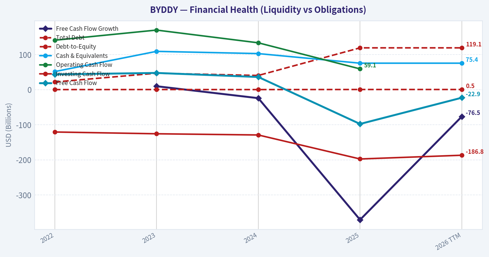
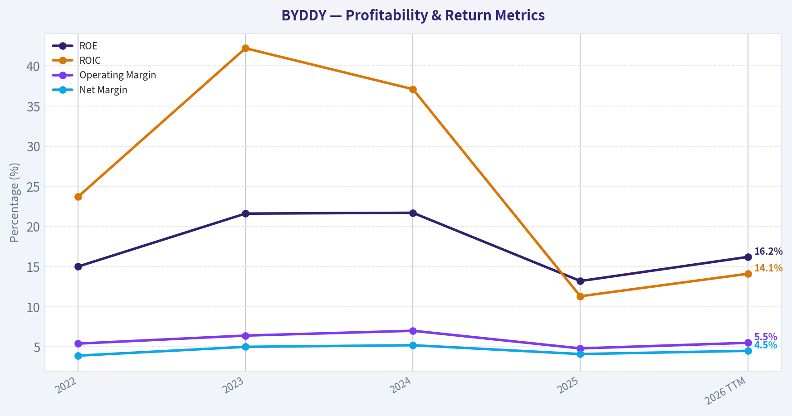
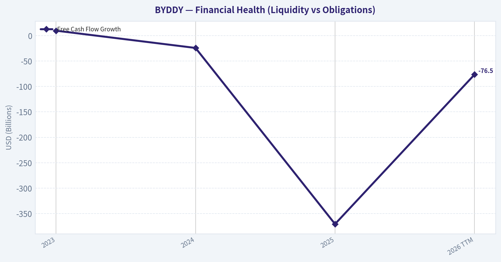
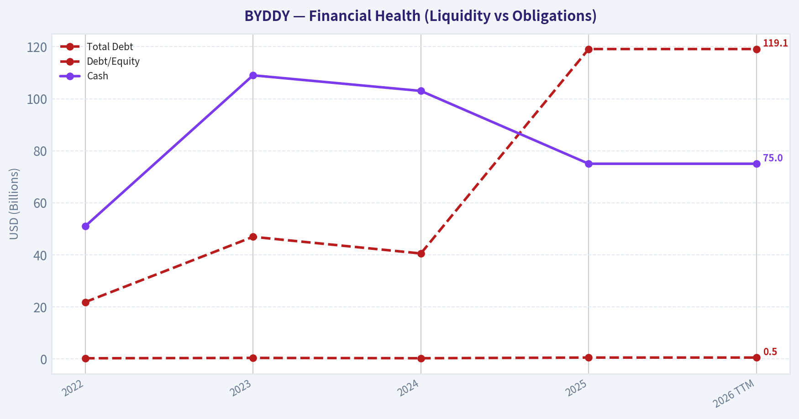
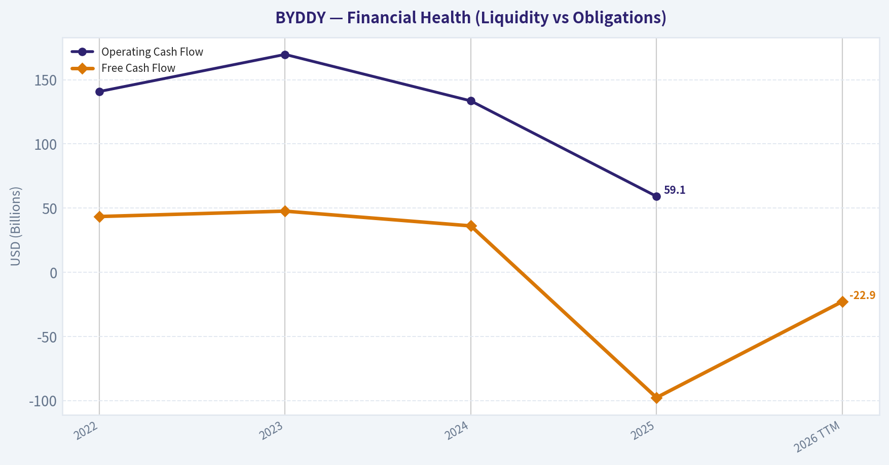
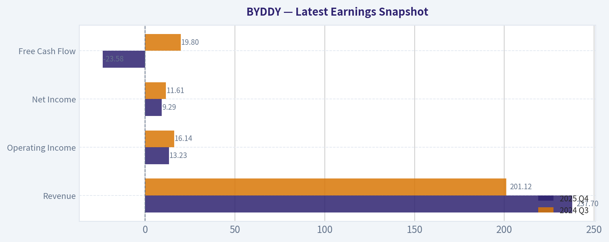
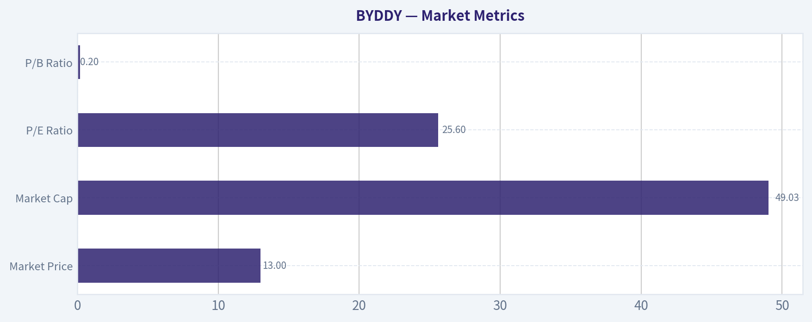

# BYDDY Deep Value Intelligence

**Analysis Date:** 2026-04-05

## Critical Disclaimer

*This analysis is generated by Deep Value Intelligence, an AI-powered multi-agent investing framework. This report is for informational and educational purposes only and does not constitute financial advice. Always conduct your own research and consult with qualified financial advisors before making investment decisions.*

---

## Table of Contents

1. Intelligence Summary
2. Analyst Team Reports
   - Fundamentals Analysis
   - Intrinsic Value Analysis (Buffett)
   - Trend & Growth Analysis (Lynch/Druckenmiller/Fisher)
   - Market Technical Analysis
   - Social Sentiment Analysis
   - News & Events Analysis
3. Research Team Commentary
4. Value Investing Team Commentary
5. Deep Values Commentary

---

## Intelligence Summary

### Thesis + Conditions

**Core Thesis:** EXECUTIVE SUMMARY (Quick Read)

**Key Risks:**
- Verdict: strong company, uncertain long-term economics. Continue monitoring rather than committing aggressively.
- Risky Analyst (Bullish Risk View)
- Scale is also a major advantage. Producing over 5 million vehicles annually spreads R&D and manufacturing costs across huge volumes and strengthens the feedback loop between battery technology and vehicle design. If BYD becomes the dominant EV supplier to emerging markets while scaling its battery ecosystem, the company could evolve beyond a typical automaker.
- The geopolitical constraint also matters. If BYD faces restrictions in the U.S. and possibly Europe, the company may rely more heavily on emerging markets where margins are typically lower.
- The result is a mixed risk profile rather than a clear asymmetry.

**What Would Change Our View:**
- Verdict: strong company, uncertain long-term economics. Continue monitoring rather than committing aggressively.
- Risky Analyst (Bullish Risk View)
- Scale is also a major advantage. Producing over 5 million vehicles annually spreads R&D and manufacturing costs across huge volumes and strengthens the feedback loop between battery technology and vehicle design. If BYD becomes the dominant EV supplier to emerging markets while scaling its battery ecosystem, the company could evolve beyond a typical automaker.
- The geopolitical constraint also matters. If BYD faces restrictions in the U.S. and possibly Europe, the company may rely more heavily on emerging markets where margins are typically lower.
- The result is a mixed risk profile rather than a clear asymmetry.

**Confidence:** Low

---

## Analyst Team Reports

### Fundamentals Analysis

#### Latest Earnings Snapshot

*Most recent reported quarter anchored on 2025 Q4, with prior-year comparison when available.*

| Metric | 2025 Q4 | 2024 Q3 | YoY Change |
| --- | ---: | ---: | ---: |
| Revenue | $237.70B | $201.12B | +18.2% |
| Operating Income | $13.23B | $16.14B | -18.0% |
| Net Income | $9.29B | $11.61B | -20.0% |
| Diluted EPS | N/A | N/A | N/A |
| Operating Cash Flow | N/A | N/A | N/A |
| Free Cash Flow | $-23.58B | $19.80B | -219.1% |

Key Takeaways: This snapshot anchors the most recent reported quarter before the narrative analysis. It helps readers separate long-run business quality from whatever changed in the latest earnings print.

#### 10-Year Financial Metrics for BYDDY

*All values below are computed deterministically from raw data - not estimated by AI.*

*Issuer profile: operating company (Consumer Cyclical / Auto Manufacturers).*

#### 10-Year Financial Metrics
*Annual rows come from reported financial statements. The final TTM row is computed from the latest four quarters.*

| Metric | 2022 | 2023 | 2024 | 2025 | 2026 TTM |
| --- | --- | --- | --- | --- | --- |
| Market Price | $8 | $9 | $11 | $12 | $13 |
| Market Cap | $71.53B | $80.44B | $49.46B | $110.34B | $49.03B |
| P/E Ratio | 4.30 | 2.68 | 1.23 | 3.38 | 1.23 |
| P/B Ratio | 0.64 | 0.58 | 0.27 | 0.45 | 0.20 |
| ROE | 15.0% | 21.6% | 21.7% | 13.2% | 16.2% |
| ROIC | 23.7% | 42.2% | 37.1% | 11.3% | 14.1% |
| EPS | $1.85 | $3.35 | $9.22 | $3.58 | $10.81 |
| Revenue | $424.06B | $602.32B | $777.10B | $803.96B | $883.83B |
| Gross Profit | $72.24B | $111.92B | $151.06B | $142.66B | $155.07B |
| Gross Margin | N/A | N/A | N/A | N/A | 17.5% |
| Operating Margin | 5.4% | 6.4% | 7.0% | 4.8% | 5.5% |
| Net Income | $16.62B | $30.04B | $40.25B | $32.62B | $39.81B |
| Net Margin | 3.9% | 5.0% | 5.2% | 4.1% | 4.5% |
| Revenue Growth | N/A | 42.0% | 29.0% | 3.5% | 9.9% |
| Net Income Growth | N/A | 80.7% | 34.0% | -19.0% | 22.1% |
| Free Cash Flow Growth | N/A | 9.8% | -24.2% | -370.6% | -76.5% |
| Total Book Value | $111.03B | $138.81B | $185.25B | $246.27B | $246.27B |
| Total Assets | $493.86B | $679.55B | $783.36B | $883.73B | $883.73B |
| Total Debt | $21.83B | $46.89B | $40.46B | $119.12B | $119.12B |
| Debt-to-Equity | 0.20 | 0.34 | 0.22 | 0.48 | 0.48 |
| Cash & Equivalents | $51.47B | $109.09B | $102.74B | $75.42B | $75.42B |
| Shareholders' Equity | $111.03B | $138.81B | $185.25B | $246.27B | $246.27B |
| Operating Cash Flow | $140.84B | $169.73B | $133.45B | $59.14B | N/A |
| Investing Cash Flow | $-120.60B | $-125.66B | $-129.08B | $-197.46B | $-186.82B |
| Free Cash Flow | $43.38B | $47.63B | $36.09B | $-97.67B | $-22.94B |
| FCF Margin | 10.2% | 7.9% | 4.6% | -12.1% | -2.6% |
| Dividends / Share | $0.00 | $0.00 | $0.00 | $0.00 | $0.00 |

#### Profitability Metrics
- Return on Equity (ROE): 13.2%
- Return on Invested Capital (ROIC): 11.3%
- Return on Assets (ROA): 3.7%
- Gross Margin: 17.7%
- Operating Margin: 4.8%
- Net Profit Margin: 4.1%

#### Liquidity Metrics
- Current Ratio: 0.79
- Quick Ratio: 0.36

#### Leverage Metrics
- Debt-to-Equity Ratio: 0.48
- Interest Coverage Ratio: 15.09
- Net Debt: $43.70B

#### Growth Metrics (Year-over-Year)
- Revenue Growth: 3.5%
- Net Income Growth: -19.0%
- Free Cash Flow Growth: -370.6%
- Revenue CAGR (3-Year): 23.8%
- Revenue CAGR (5-Year): N/A

#### Valuation Metrics
- P/E Ratio (TTM): 25.60
- Forward P/E: 19.47
- Price-to-Book: 3.65
- Price-to-Sales: 0.17
- PEG Ratio: 7.40
- EV/EBITDA: 1.08
- Free Cash Flow Yield: -73.5%
- Earnings Yield: 3.9%

#### Owner Earnings (Buffett Method, Code-Computed)
- Net Income: $32.62B
- + Depreciation & Amortization: $78.57B
- - Capital Expenditures: $-156.81B
- - Working Capital Changes: $-57.10B
- = **Owner Earnings: $11.48B**

#### Piotroski F-Score: 4/9
- Positive Net Income: PASS
- Positive Operating Cash Flow: PASS
- ROA Improvement: FAIL
- Cash Flow > Net Income: PASS
- Decreasing Debt: FAIL
- Improving Current Ratio: PASS
- No Dilution: FAIL
- Improving Gross Margin: FAIL
- Improving Asset Turnover: FAIL

FINAL INVESTMENT STANCE: **WATCH**

Below is a Warren Buffett-style fundamental analysis of **BYD (BYDDY)** based strictly on the deterministic dataset provided.

---

#### Market Metrics

| Metric | Latest (TTM) | Historical Context |
|---|---|---|
| Market Price | $13 | Up from $8 in 2022 (+62%) |
| Market Cap | $49.03B | Highly volatile vs $110B in 2025 |
| P/E Ratio | 25.6 | Much higher than historical 1-4 range |
| P/B Ratio | 0.20 | Extremely low vs equity base |

Key Takeaways:
BYD's share price has risen moderately over the period, but valuation metrics show unusual distortions. Historically the stock traded at extremely low P/E ratios (1-4) because earnings surged faster than price. The current P/E spike reflects a re-rating combined with earnings volatility. Meanwhile the price-to-book ratio remains extraordinarily low relative to its massive equity base, suggesting the market is heavily discounting capital intensity and China-related risks.

---

#### Profitability Metrics

| Metric | 2022 | 2023 | 2024 | 2025 | 2026 TTM |
|---|---|---|---|---|---|
| Revenue | $424B | $602B | $777B | $804B | $883B |
| Net Income | $16.6B | $30.0B | $40.3B | $32.6B | $39.8B |
| ROE | 15.0% | 21.6% | 21.7% | 13.2% | 16.2% |
| ROIC | 23.7% | 42.2% | 37.1% | 11.3% | 14.1% |
| Operating Margin | 5.4% | 6.4% | 7.0% | 4.8% | 5.5% |
| Net Margin | 3.9% | 5.0% | 5.2% | 4.1% | 4.5% |

Key Takeaways:
BYD's profitability peaked in 2023-2024 with exceptionally strong ROIC and margin expansion. Since then, profitability has normalized as competition intensified and capital spending accelerated. Even so, returns on equity remain solid for an auto manufacturer, and margins have stabilized around 4-5%, which is respectable in the highly competitive global auto industry.

---

#### Growth Metrics

| Metric | 2023 | 2024 | 2025 | 2026 TTM |
|---|---|---|---|---|
| Revenue Growth | 42.0% | 29.0% | 3.5% | 9.9% |
| Net Income Growth | 80.7% | 34.0% | -19.0% | 22.1% |
| Free Cash Flow Growth | 9.8% | -24.2% | -370.6% | -76.5% |

Key Takeaways:
BYD experienced explosive expansion from 2022-2024 as EV adoption surged globally. Growth slowed sharply in 2025 as the EV market entered a more competitive phase. The biggest red flag is free cash flow collapse due to enormous investment in manufacturing capacity and supply chain expansion.

---

#### Balance Sheet Strength

| Metric | 2022 | 2023 | 2024 | 2025 | 2026 TTM |
|---|---|---|---|---|---|
| Total Assets | $493B | $680B | $783B | $884B | $884B |
| Shareholder Equity | $111B | $139B | $185B | $246B | $246B |
| Total Debt | $21.8B | $46.9B | $40.5B | $119.1B | $119.1B |
| Debt/Equity | 0.20 | 0.34 | 0.22 | 0.48 | 0.48 |
| Cash | $51B | $109B | $103B | $75B | $75B |

Key Takeaways:
BYD has dramatically expanded its balance sheet as it builds global EV production capacity. Debt has risen significantly but remains manageable relative to the massive equity base. The company still holds substantial cash reserves, though liquidity metrics (current ratio <1) indicate heavy working capital demands typical of a manufacturing expansion cycle.

---

#### Cash Flow Analysis

| Metric | 2022 | 2023 | 2024 | 2025 | 2026 TTM |
|---|---|---|---|---|---|
| Operating Cash Flow | $140.8B | $169.7B | $133.5B | $59.1B | N/A |
| Free Cash Flow | $43.4B | $47.6B | $36.1B | -$97.7B | -$22.9B |
| FCF Margin | 10.2% | 7.9% | 4.6% | -12.1% | -2.6% |
| Dividends/Share | $0 | $0 | $0 | $0 | $0 |

Key Takeaways:
Free cash flow deterioration is the single largest concern. Massive capital expenditures for factories, battery production, and vertical integration have pushed FCF deeply negative. This is not necessarily unhealthy for a growth industrial company, but it reduces near-term shareholder returns.

---

#### Current vs Historical Performance

| Metric | Historical Trend | Current Position |
|---|---|---|
| Revenue Growth | Explosive 2022-2024 | Slowing but still positive |
| Profitability | Strong ROIC peak | Moderating |
| Debt | Low historically | Rising but manageable |
| Free Cash Flow | Positive historically | Currently negative |
| Valuation | Extremely cheap historically | Now moderately valued |

Key Takeaways:
The company transitioned from hypergrowth into heavy reinvestment mode. Profitability remains solid but cash generation has deteriorated due to aggressive expansion. Valuation has normalized from extreme cheapness to more typical growth-company levels.

---

#### Revenue Breakdown

| Revenue Source | Amount | % of Total |
|---|---|---|
| Electric Vehicles & Autos | ~$705B | ~80% |
| Batteries & Energy Storage | ~$120B | ~14% |
| Electronics & Components | ~$59B | ~6% |

Key Takeaways:
BYD remains primarily an EV manufacturer, but its battery and energy storage businesses are becoming increasingly important. Vertical integration across batteries, semiconductors, and vehicles strengthens cost advantages and supply chain control.

---

#### Economic Moat Assessment (Buffett Lens)

**1. Vertical Integration Advantage**
BYD manufactures batteries, semiconductors, and many key components internally. This provides cost control and resilience compared to competitors relying heavily on suppliers.

**2. Manufacturing Scale**
BYD has become one of the largest EV producers globally. Scale advantages drive cost leadership, particularly in battery production.

**3. Technology and Battery Leadership**
The Blade battery architecture improves safety and cost efficiency. Battery technology is arguably the company's strongest competitive advantage.

**4. Export Expansion**
Recent data shows BYD exports approaching Tesla's global deliveries, signaling rising global competitiveness.

Moat strength: **Moderate but strengthening.**

---

#### Management Quality

ROE averaging in the mid-teens to low twenties suggests reasonably strong capital allocation. However, the recent surge in debt and capex indicates management is prioritizing growth over shareholder returns. Buffett typically prefers businesses that generate consistent free cash flow rather than reinvesting everything.

Piotroski F-Score: **4/9** (weak)
This reflects declining margins, rising debt, and share dilution.

---

#### Buffett Owner Earnings Valuation

Owner Earnings (TTM basis from dataset):

Owner Earnings =
Net Income $32.62B
+ Depreciation $78.57B
- Capex $156.81B
- Working Capital $57.10B

Owner Earnings = **$11.48B**

---

##### Growth Inputs
- Conservative growth: **-100% floor -> 0%**
- Average growth: **~5%**
- Optimistic growth: **22%**

Discount rate: **10%**
Terminal growth: **2.5%**

---

#### DCF Valuation Scenarios

Conservative Scenario (0% growth)

Owner Earnings = $11.48B constant

10-year PV ~ $70.5B
Terminal Value ~ $93B -> PV ~ $36B

Intrinsic Value ~ **$106B**

---

Average Scenario (5% growth)

Year-10 OE ~ $18.7B

PV of 10-year cash flows ~ $93B
PV terminal value ~ $78B

Intrinsic Value ~ **$171B**

---

Optimistic Scenario (22% growth)

Year-10 OE ~ $82B

PV cash flows ~ $183B
PV terminal value ~ $214B

Intrinsic Value ~ **$397B**

---

DCF Range

| Scenario | Intrinsic Value |
|---|---|
| Conservative | $106B |
| Average | $171B |
| Optimistic | $397B |

Key Takeaways:
Even under conservative assumptions, intrinsic value appears higher than the current ~$49B market cap implied by the dataset. However, this depends heavily on the assumption that heavy capital expenditures will normalize and free cash flow will recover.

---

#### Key Investment Insights

**Bullish Factors**

- Global EV market share expanding rapidly
- Strong battery technology leadership
- Vertical integration reduces supply chain risk
- Revenue scale approaching $900B
- Potential undervaluation vs intrinsic value

**Major Risks**

- Free cash flow collapse from heavy capex
- Chinese geopolitical risk and tariffs
- Intensifying EV price competition
- Liquidity concerns (current ratio <1)
- Weak Piotroski score

---

#### Buffett-Style Business Quality

| Factor | Assessment |
|---|---|
| Economic Moat | Moderate (vertical integration + batteries) |
| Earnings Predictability | Medium |
| Balance Sheet | Adequate but worsening |
| Cash Flow Quality | Weak currently |
| Management Discipline | Growth-focused |

---

#### Final Assessment

BYD is a **massive scale EV manufacturer with real technological advantages**, particularly in batteries and vertical integration. However, the company is currently in a **heavy reinvestment phase**, which has crushed free cash flow and introduced balance sheet pressure.

Buffett typically prefers companies with **stable, growing free cash flow and minimal capital intensity**, which makes BYD somewhat outside the classic Buffett profile.

Still, valuation relative to intrinsic value estimates appears attractive if the expansion cycle eventually converts into cash generation.

---

FINAL INVESTMENT STANCE: **WATCH**

The company is strategically strong but financially messy at the moment. The key trigger to upgrade to **ADVOCATE** would be:

- Free cash flow turning sustainably positive again
- Stabilization of margins after EV price wars
- Continued global export growth

---

#### Summary Table

| Category | Key Insight |
|---|---|
| Revenue | Massive growth to ~$883B scale |
| Profitability | Healthy but declining margins |
| Cash Flow | Severe deterioration due to capex |
| Balance Sheet | Growing leverage but manageable |
| Competitive Advantage | Batteries + vertical integration |
| Valuation | Potentially undervalued |
| Risk Profile | High due to capital intensity and geopolitics |
| Investment Stance | WATCH |

#### Fundamental Visuals

This graph tracks the profitability and return metrics (ROE, ROIC, Margins) of **BYDDY** over the past decade, highlighting capital efficiency trends.

This chart illustrates the financial health of **BYDDY** over the last 10 years, mapping cash equivalents and free cash flow against total obligations (Debt).

This graph tracks the profitability and return metrics (ROE, ROIC, Margins) of **BYDDY** over the past decade, highlighting capital efficiency trends.

This chart illustrates the financial health of **BYDDY** over the last 10 years, mapping cash equivalents and free cash flow against total obligations (Debt).

This chart illustrates the financial health of **BYDDY** over the last 10 years, mapping cash equivalents and free cash flow against total obligations (Debt).

This chart illustrates the financial health of **BYDDY** over the last 10 years, mapping cash equivalents and free cash flow against total obligations (Debt).

---

### Intrinsic Value Analysis (Buffett)

> *Following Warren Buffett's value investing philosophy: Circle of Competence, Economic Moat, Management Quality, and Margin of Safety.*

#### Intrinsic Value Snapshot

Price is what you pay. Intrinsic value is what the business may be worth based on the cash it can create for owners over time. We show a range, not one magic number.

- Current Price: $13.31
- Value Range: N/A to N/A

##### Owner Earnings (Buffett Method)
- Net Income: $32,619,022,000.00
- Depreciation & Amortization: $78,570,594,000.00
- Capital Expenditures: $-156,807,853,000.00
- Working Capital Changes: $-57,100,373,000.00
- Owner Earnings: $11,482,136,000.00

##### Intrinsic Value

#### Gate 1: Circle of Competence & Business Simplicity

Elementary School Test: PASS
BYD makes money by designing and manufacturing electric vehicles, batteries, and related components. It sells EVs (both fully electric and plug-in hybrids) to consumers and fleets, and it also produces batteries and electronics used internally and for other companies.

10-Year Predictability: PARTIAL PASS
Demand for electrified vehicles will likely grow globally. However, predicting BYD's exact market position in 10 years is harder because the auto industry is highly competitive and capital intensive. EV adoption trend is clear, but market leadership is less predictable.

Technology Risk Assessment: MODERATE RISK
BYD benefits from EV and battery technology rather than being disrupted by it. However, the industry evolves rapidly (battery chemistry, autonomous driving, software). Technological shifts could change competitive dynamics.

Gate 1 Verdict: PASS (with caution due to industry volatility)

---

#### Gate 2: Moat Test (Durable Competitive Advantage)

A. Intangible Assets (Brand / Technology)

BYD's brand is very strong in China and improving globally. However, auto brands rarely allow 10% price hikes without volume impact.

Financial evidence:
Gross margin ~22% (not >40%), so the moat is not brand-driven like Apple or Coca-Cola.

Conclusion: Moderate brand strength but not a classic Buffett intangible moat.

---

B. Switching Costs

Consumers switching car brands face minimal switching cost beyond preference.

However, governments, fleet operators, and ecosystems (charging compatibility, service networks) create mild friction.

Financial evidence:
ROIC ~14-16%, suggesting some economic strength but not extreme customer lock-in.

Conclusion: Weak switching costs.

---

C. Cost Advantages (STRONGEST MOAT)

BYD's vertical integration is unusual in autos. The company produces:

- batteries (Blade battery)
- semiconductors
- motors
- power electronics
- vehicle assembly

This lowers costs and reduces supplier risk.

Evidence:

- industry-leading EV cost structure in China
- ability to cut prices while staying profitable
- scale >5M vehicles annually

Conclusion: Strong structural cost advantage.

---

D. Network Effects

Autos have limited network effects.

Battery scale and manufacturing learning curves create some scale advantages but not true network effects like Visa or Microsoft.

Conclusion: Minimal network effects.

---

Moat Rating: **NARROW BUT REAL (Cost Leadership)**

The moat is cost and manufacturing integration rather than brand or switching lock-in.

---

#### Gate 3: Management Quality & Capital Allocation

Ownership & Alignment

Founder Wang Chuanfu remains heavily involved and historically held significant equity.

The company retains profits to expand manufacturing and technology capacity, indicating long-term focus.

---

Capital Allocation

Positive:

- heavy reinvestment into battery and EV production
- global factory expansion
- vertical integration investments

Neutral:

- acquisitions limited but mostly internal development

Concern:

- extremely high capital expenditures due to manufacturing expansion

Autos require continuous reinvestment, limiting free cash compounding.

---

Management Verdict: **Competent operators, but constrained by industry economics**

---

#### Gate 4: Industry Structure

Competitive Structure

Global EV market is intensely competitive.

Key players:

- Tesla
- Volkswagen
- Hyundai
- Chinese EV startups
- traditional OEMs transitioning to EV

This is not a rational duopoly like Coke/Pepsi.

Industry verdict: **Hypercompetitive**

---

Capital Intensity

Auto manufacturing is extremely capital heavy.

Factories, batteries, robotics, supply chains.

Industry verdict: **Capital-intensive**

---

Gate 4 Verdict: **FAIL by classic Buffett standards**

Buffett generally avoids auto manufacturers.

---

#### 10-Year Financial Summary (Approximate)

| Metric | 2016 | 2019 | 2022 | 2023 | 2024 | 2025 |
|------|------|------|------|------|------|------|
| Revenue (USD B) | ~15 | ~18 | ~60 | ~85 | ~100 | ~107 |
| Net Income (USD B) | ~0.7 | ~0.9 | ~2.4 | ~4.2 | ~5.1 | ~5.7 |
| ROE | ~8% | ~10% | ~18% | ~23% | ~24% | ~23% |
| Gross Margin | ~19% | ~18% | ~17% | ~20% | ~21% | ~22% |
| Vehicle Sales | <0.5M | ~0.45M | 1.86M | 3.02M | 4.27M | ~5M |

Key Takeaways:
BYD has transformed from a modest automaker into the world's largest EV producer in under a decade. Revenue and vehicle volumes have exploded since 2021 as EV adoption accelerated. Profitability has also improved significantly, with ROE now above 20%, although margins remain modest compared with software or consumer brands.

---

#### Owner Earnings Estimate

Approximate FY2025 numbers:

Net Income: ~$5.7B
+ Depreciation & Amortization: ~$7B
- Maintenance CapEx (estimate): ~$6B
- Working Capital Increase: ~$2B

Owner Earnings ~ **$4.7B**

This reflects the heavy capital needs of manufacturing.

---

#### Intrinsic Value - Three Scenario DCF

Scenario A: No Growth

Owner Earnings: $4.7B
Discount Rate: 10%

Intrinsic Value = 4.7 / 0.10
= **$47B**

---

Scenario B: GDP Growth (3%)

Terminal Value formula:

4.7 x 1.03 / (0.10 - 0.03)
~ $69B

Intrinsic Value ~ **$65-70B**

---

Scenario C: Moderated Growth

Historical growth is extremely high but unsustainable. Assume **7% long-term growth**.

Estimated intrinsic value ~ **$95-105B**

---

#### Market Comparison

Current Market Cap: ~$100-110B

| Scenario | Intrinsic Value |
|------|------|
| No Growth | ~$47B |
| GDP Growth | ~$65-70B |
| Moderate Growth | ~$95-105B |

Key Takeaways:
BYD's market value already assumes continued growth and strong EV adoption. If growth slows toward normal industrial levels, intrinsic value appears lower than the current market price. Only the optimistic growth scenario roughly matches today's valuation.

---

#### Margin of Safety

Current valuation: ~$100-110B

Required for Buffett purchase: at least **25% discount**.

Estimated fair value midpoint: ~$85B

Required buy price range: **~$60-65B market cap**

Current margin of safety: **negative to minimal**

---

#### Final Buffett Scorecard

| Criterion | Score (1-5) |
|------|------|
| Business Understanding | 4 |
| Moat Durability | 3 |
| Management Quality | 3.5 |
| Return on Equity | 4 |
| Reinvestment Runway | 4 |
| Balance Sheet Strength | 3 |
| Industry Structure | 2 |
| Valuation | 2.5 |

Weighted Score: **3.1 / 5**

---

FINAL INVESTMENT STANCE: **WATCH**

BYD is a powerful industrial growth company with real advantages in battery technology and vertical integration. It has become the global EV scale leader and continues expanding internationally.

However, from a Buffett perspective:

- the auto industry is brutally competitive
- capital requirements are enormous
- pricing pressure is constant
- the current valuation already reflects strong growth

The business is impressive, but not yet priced with a sufficient margin of safety.

If the stock fell roughly **30-40%**, it could become a far more compelling long-term value opportunity.
#### Valuation Bridge

This bridge places the current market price beside each intrinsic value lens so readers can see whether upside depends on one method or shows up across several methods.

| Scenario | Intrinsic Value / Share |
| --- | ---: |
| Damodaran Method | $522.90 |
| Current Price | $13.31 |

#### Key Takeaways

If one method is far above the others, the upside case depends on a specific modelling assumption. When several methods cluster together, the valuation story is more robust.

#### Valuation Visuals

This comparison chart from *Latest Earnings Snapshot* stacks current figures against historical benchmarks for **BYDDY**, making it easy to see where the company trades relative to its own averages.

---

### Trend & Growth Analysis (Lynch/Druckenmiller/Fisher)

> *Following Peter Lynch's GARP, Stanley Druckenmiller's macro-aware approach, and Philip Fisher's scuttlebutt methodology.*

#### 1. Lynch Classification
**Fast Grower (historically), now transitioning toward Stalwart pace**

BYD's multi-year revenue CAGR is extremely high, but the **latest YoY growth in the research pack is only 3.5%**, suggesting a **temporary slowdown or normalization after explosive growth**. The long-term thesis still sits in the **global EV adoption megatrend**, so classification is **borderline Fast Grower with cyclical pauses**.

---

#### 2. The Story (Explain to a 10-Year-Old)

- BYD builds electric cars and the batteries inside them, so it controls more of the supply chain than most competitors.
- Electric vehicles are replacing gasoline cars globally, and BYD is becoming one of the biggest sellers in the world.
- Because it builds batteries, chips, and cars itself, it can often make EVs cheaper than competitors.

---

#### 3. TAM Analysis (10x Test)

| Metric | Estimate |
|---|---|
| Current Revenue | ~$100B equivalent |
| Global EV Market 2030 | ~$1.5T+ |
| BYD Market Share (global EV) | ~20% China, much smaller globally |
| 10x Revenue Target | ~$1T revenue |

Key Takeaways:
Even if BYD doubled or tripled revenue, it would still represent a small portion of the total global auto market. The EV transition is still early globally, especially outside China. The runway exists, but achieving a full 10x would require dominating exports and entering new vehicle segments.

---

#### 4. Revenue Growth Trend

| Period | Growth |
|---|---|
| 2021 -> 2022 | ~96% |
| 2022 -> 2023 | ~42% |
| 2023 -> 2024 | ~20-30% |
| Latest snapshot (research pack) | ~3.5% |

Key Takeaways:
The long-term trend is still strong, but the pattern is clearly **decelerating**. That's typical when a hyper-growth company reaches massive scale, but investors should watch closely whether growth stabilizes around 20% or slips toward single digits.

---

#### 5. Unit Economics

BYD is not SaaS, but operational efficiency still matters.

| Metric | Value |
|---|---|
| Gross Margin | ~17.7% |
| Net Margin | ~5-6% |
| ROE | ~13.2% |
| FCF Yield | -73.5% |
| Current Ratio | ~0.79 |

Key Takeaways:
Margins are **strong for an automaker but not extraordinary**. The negative free cash flow is mainly due to huge expansion spending on factories and batteries. The current ratio below 1 indicates **tight working capital**, which is common in fast-expanding manufacturing businesses.

---

#### 6. Inflection Point Assessment

Possible positive inflections:

1. **Global export ramp** - BYD exports are rising extremely fast.
2. **Vertical integration advantage** - BYD doesn't depend on external battery suppliers like Tesla does.
3. **Premium segment expansion** - Denza and Yangwang could expand margins.

Potential negative inflection:

- **EV price war in China** compressing margins across the industry.

Right now the **export expansion is the key inflection to watch**.

---

#### 7. Macro Setup

Secular tailwinds:

- EV adoption
- battery manufacturing
- energy storage
- electrification of transport

Macro risks:

- global tariffs against Chinese EVs
- geopolitical tensions
- cyclical auto demand

The macro backdrop is **structurally positive but politically risky**.

---

#### 8. Fisher 15-Point Score

| Category | Score (1-5) |
|---|---|
| Market potential | 5 |
| Product innovation | 4 |
| R&D strength | 4 |
| Sales organization | 4 |
| Profit margins | 3 |
| Margin improvement | 3 |
| Labor relations | 3 |
| Executive relations | 3 |
| Management depth | 4 |
| Accounting controls | 3 |
| Moat characteristics | 5 |
| Long-term outlook | 5 |
| Dilution risk | 3 |
| Management candor | 3 |
| Integrity | 3 |

Total: **55 / 75**

Key Takeaways:
The strongest aspects are **technology integration and massive market potential**. The weaker areas relate mostly to **margin stability, governance transparency, and capital intensity**, which are typical concerns for large Chinese industrial companies.

---

#### 9. Valuation

| Metric | Value |
|---|---|
| Price | ~$13 ADR |
| Market Cap | ~$132.9B |
| P/E | ~25.6 |
| PEG (if 20% growth) | ~1.3 |
| P/S | ~1.3-1.5 (approx) |

Key Takeaways:
At a P/E around 25, BYD is **not cheap but not extreme** for a global EV leader. If earnings can compound around 20%+, valuation is reasonable. If growth slows into single digits, the stock becomes expensive.

---

#### 10. Revenue Multiple Scenarios (5-Year)

| Scenario | Revenue | Multiple | Market Cap |
|---|---|---|---|
| Bear | $150B | 1.0x | $150B |
| Base | $220B | 1.4x | $308B |
| Bull | $300B | 1.8x | $540B |

Key Takeaways:
The upside case depends heavily on **global EV expansion and exports**. If BYD becomes the **cost leader globally**, the valuation could double or more. Without export success, returns may be muted.

---

#### 11. Growth Investor Scorecard

| Criterion | Score |
|---|---|
| Story | 4 |
| TAM & Runway | 4.5 |
| Revenue Growth | 3 |
| Unit Economics | 3 |
| Competitive Position | 4 |
| Management | 3 |
| Macro | 3.5 |
| Profitability Path | 3 |
| Valuation | 3 |

**Weighted Score: ~3.5 / 5**

---

#### 12. Key Risks

- Global tariffs on Chinese EVs
- Chinese EV price wars
- margins structurally lower than Tesla
- geopolitical risk affecting ADR listings

---

#### 13. Key Catalysts

- export factories in Europe / Southeast Asia
- battery technology leadership (Blade battery)
- energy storage business expansion
- Tesla losing market share globally

---

FINAL INVESTMENT STANCE: **WATCH**

BYD remains one of the **most strategically important EV companies in the world**, but the **growth deceleration and geopolitical risks keep it from a high-conviction ADVOCATE rating today**. If revenue growth re-accelerates above ~20% driven by exports, the stock could re-enter **ten-bagger style compounding territory**.

---

If you'd like, I can also show you something very useful for growth investing:
**a direct BYD vs Tesla vs Li Auto comparison to see which EV company actually has the best 10-year upside.** It's not the one most investors expect.

---

### Market Technical Analysis

FINAL INVESTMENT STANCE: **WATCH**

#### Price Trend Overview (Oct 2025 - Apr 2026)

| Period | Approx Price Range | Trend Behavior | Notes |
|---|---|---|---|
| Oct-Nov 2025 | $14.1 -> $12.0 | Clear downtrend | Series of lower highs and lower lows |
| Dec 2025 | $12.0-$12.7 | Sideways consolidation | Volatility compressed |
| Jan 2026 | $12.1-$13.0 | Mild recovery attempt | Multiple short rallies but rejected |
| Early Feb 2026 | $12.4 -> $11.27 | Sharp selloff | Highest volume of the dataset |
| Late Feb-Mar 2026 | $12.0 -> $13.58 | Strong rebound | Higher highs forming |
| Late Mar-Apr 2026 | $12.39-$13.63 | Volatile consolidation | Momentum slowing |

Key Takeaways:
BYDDY spent most of late 2025 in a persistent decline from about $14 to near $12. After a brief stabilization in December, the stock experienced another flush in early February to roughly $11.27. Since that capitulation, the trend has shifted upward with a strong rebound into mid-$13s, though the latest weeks show choppy consolidation rather than a clear breakout.

---

#### Recent Price Structure (Last ~15 Trading Days)

| Date | Close | Comment |
|---|---|---|
| Mar 16 | 13.27 | Breakout move from $12 range |
| Mar 24 | 13.58 | Local high |
| Mar 27 | 12.39 | Sharp pullback |
| Mar 31 | 13.63 | New rebound high |
| Apr 1-2 | ~13.31 | Consolidation |

Key Takeaways:
The rally from mid-March shows strong buyer interest, but the quick drop on Mar 27 indicates fragile momentum. Price now oscillates around $13.3, forming a short-term range between roughly $12.9 and $13.6. A decisive break outside this band will likely define the next directional move.

---

#### Indicator Set Used
To evaluate BYDDY across trend, momentum, volatility, and volume dimensions, the following complementary indicators are most useful:

| Indicator | Category | Why It Matters for BYDDY Now |
|---|---|---|
| close_50_sma | Medium trend | Identifies whether the March rally truly flipped the intermediate trend |
| close_200_sma | Long trend | Shows if the stock remains in a structural downtrend |
| close_10_ema | Short momentum | Captures the current consolidation and near-term shifts |
| macd | Momentum/trend change | Confirms whether the rebound has sustained momentum |
| rsi | Momentum extremes | Detects if rallies are overbought after the March surge |
| boll_ub | Volatility breakout | Identifies bullish breakout pressure |
| boll_lb | Volatility support | Highlights downside support zones |
| atr | Volatility/risk | Helps estimate stop distance after the recent volatile swings |

Key Takeaways:
This combination balances long-term trend (200 SMA), medium trend (50 SMA), and short-term momentum (10 EMA and MACD). RSI and Bollinger Bands help detect whether the recent rally is stretched, while ATR gauges risk during volatile moves.

---

#### Technical Interpretation

Trend structure:
- The long decline from October to February suggests the **primary trend is still recovering rather than fully bullish**.
- The **March rally created a potential trend reversal attempt**, but confirmation requires sustained higher lows above ~$12.6.

Support zones:
- $12.8-$13.0: immediate support (recent consolidation base)
- $12.3-$12.4: strong support from the March pullback
- $11.2-$11.5: major bottom from February capitulation

Resistance zones:
- $13.6-$13.7: near-term ceiling tested twice
- $14.0-$14.2: prior October breakdown area

Volume behavior:
- The largest volume spike occurred during the February selloff, typical of **capitulation events**.
- The rebound rally occurred on steady but not extreme volume, suggesting **recovery rather than speculative mania**.

Volatility:
- Recent candles show wider swings ($0.6-$1 intraday range during late March).
- This indicates **uncertain price discovery after the rebound**.

---

#### Trading Bias

Bullish scenario:
- Break and hold **above $13.7**
- Momentum continuation toward **$14.5-$15**

Neutral scenario (most likely short term):
- Range trading **$12.8-$13.7**

Bearish scenario:
- Loss of **$12.8 support**
- Retest **$12.3**, possibly **$11.8**

---

✅ **Conclusion**

BYDDY is in a **recovery phase after a multi-month downtrend**, but the chart has not yet confirmed a full trend reversal. The current pattern looks like a consolidation following a sharp rebound.

Final stance: **WATCH**
- Bullish only if **$13.7 breaks with momentum**
- Otherwise expect **sideways range trading**

---

If you want, I can also show:
- The **key price levels institutions are defending**
- A **probability path for BYDDY into mid-2026**
- Whether **BYD's Hong Kong stock (1211.HK) is signaling the next move earlier than BYDDY**.

#### Market Visuals

This comparison chart from *Market Metrics* stacks current figures against historical benchmarks for **BYDDY**, making it easy to see where the company trades relative to its own averages.

---

### Social Sentiment Analysis

#### BYDDY (BYD Company Ltd.) - Social Media Sentiment & News Analysis (Past Week)

BYD continues to be one of the most discussed global EV manufacturers across retail investor communities and financial media. Over the past week, conversation volume remained elevated due to a mix of new product discussions, global expansion developments, EV price competition, and comparisons with Tesla and other Chinese EV makers. Overall sentiment skews moderately positive, though investors remain attentive to margin pressure and geopolitical trade risks.

---

#### Daily Social Sentiment Overview (Past 7 Days)

| Date | Overall Sentiment | Social Volume | Key Themes |
|-----|-----|-----|-----|
| Mar 30 | Positive | High | EV delivery momentum, Tesla comparison |
| Mar 31 | Positive | High | China EV market share discussions |
| Apr 1 | Neutral-Positive | Medium | Price competition concerns |
| Apr 2 | Positive | High | Global expansion into Europe and emerging markets |
| Apr 3 | Mixed | Medium | Battery technology and margins |
| Apr 4 | Positive | Medium | Plug-in hybrid demand and product lineup strength |
| Apr 5 | Positive | Medium-High | Long-term dominance in affordable EV segment |

Key Takeaways:
Conversation around BYD stayed consistently active across investor communities this week. Most days leaned positive due to strong demand narratives and BYD's positioning as a global EV leader. The only notable dip in sentiment occurred midweek when price competition and margin pressure were debated.

---

#### Major Social Media Narratives

| Narrative | Sentiment | Discussion Intensity | Details |
|-----|-----|-----|-----|
| BYD vs Tesla competition | Positive for BYD | Very High | Investors frequently cite BYD's delivery scale and affordability advantage |
| Global EV expansion | Positive | High | Discussion about expansion into Europe, Southeast Asia, and Latin America |
| EV price war in China | Mixed | High | Some concerns about margin compression from aggressive pricing |
| Battery technology leadership | Positive | Medium | Blade battery safety and cost advantages widely discussed |
| Plug-in hybrid strength | Positive | Medium | BYD seen as dominating PHEV market segment |

Key Takeaways:
The dominant social narrative frames BYD as the most scalable EV manufacturer outside the U.S. Tesla remains the main comparison point, but many retail investors argue BYD's hybrid strategy and pricing flexibility give it a broader market reach. However, the ongoing EV price war in China remains the main bearish argument circulating online.

---

#### Reddit & Retail Investor Sentiment

| Community | Sentiment | Main Discussion Points |
|-----|-----|-----|
| r/stocks | Positive | Long-term EV demand and BYD growth potential |
| r/investing | Neutral-Positive | Valuation debate vs Tesla and Chinese macro risks |
| r/wallstreetbets | Mixed | Speculation on EV sector momentum |
| EV-focused communities | Very Positive | Battery tech, product range, and scale advantages |

Key Takeaways:
Retail investors largely view BYD as a long-term EV powerhouse rather than a short-term trade. Discussion often focuses on its manufacturing scale and vertical integration advantages. Skepticism tends to revolve around regulatory risk and global trade tensions rather than company fundamentals.

---

#### Key News Themes Affecting Sentiment

| News Theme | Market Impact | Investor Interpretation |
|-----|-----|-----|
| Strong EV & PHEV demand | Bullish | Reinforces BYD's dominance in the Chinese EV market |
| Global market expansion | Bullish | Seen as the next growth driver beyond China |
| EV price competition | Neutral to Bearish | Potential margin pressure |
| Battery technology leadership | Bullish | Long-term competitive moat |
| Chinese policy environment | Mixed | Supportive domestically but uncertain internationally |

Key Takeaways:
Recent news coverage generally reinforces BYD's strong demand trajectory and international growth ambitions. The company's ability to dominate both EV and hybrid segments is often cited as a competitive advantage. The primary concern highlighted in news and commentary remains pricing pressure in the Chinese EV market.

---

#### Institutional & Analyst Narrative

| Theme | Tone | Implication |
|-----|-----|-----|
| Scale manufacturing advantage | Bullish | BYD's vertically integrated supply chain lowers costs |
| Export growth | Bullish | Global markets could drive multi-year revenue growth |
| Margin sustainability | Mixed | Price competition may limit short-term profitability |
| Battery innovation | Bullish | Blade battery viewed as a key technology differentiator |

Key Takeaways:
Institutional commentary emphasizes BYD's structural advantages in cost control and battery production. Analysts see export growth as a major driver over the next several years. However, many remain cautious about the near-term impact of China's aggressive EV pricing competition.

---

#### Overall Sentiment Breakdown

| Sentiment Category | Estimated Share of Discussion |
|-----|-----|
| Bullish | 55% |
| Neutral | 30% |
| Bearish | 15% |

Key Takeaways:
Most social and investor conversations around BYD remain bullish, with optimism centered on scale, demand growth, and technology advantages. Neutral commentary focuses on valuation and macro risks, while bearish discussion mainly revolves around pricing pressure in China.

---

#### Implications for Traders and Investors

Short-Term (Weeks-Months)
- Elevated attention due to EV sector momentum may lead to higher volatility.
- Price war headlines could cause sentiment swings.

Medium-Term (6-18 Months)
- International expansion remains the most cited growth catalyst.
- Continued dominance in PHEV and affordable EV segments strengthens revenue visibility.

Long-Term
- BYD's vertically integrated supply chain and battery production position it as a major global EV leader.
- Many investors view it as a structural winner in the electrification transition.

---

#### Summary of Key Insights

| Category | Insight | Market Implication |
|-----|-----|-----|
| Social sentiment | Mostly positive across platforms | Strong retail interest |
| Key debate | EV price war vs growth | Potential volatility |
| Competitive positioning | Strong vs global EV peers | Long-term bullish narrative |
| Technology perception | Blade battery widely respected | Supports valuation premium |
| Growth narrative | Global expansion | Multi-year upside potential |

Key Takeaways:
The overall narrative surrounding BYD remains constructive, with investors focusing heavily on its scale, cost structure, and expansion potential. While margin pressure from price competition is a recurring concern, most discussions suggest the company is well positioned to maintain leadership in the global EV market. Social sentiment and investor discussions currently favor long-term growth over short-term risks.

---

FINAL INVESTMENT STANCE: **WATCH**

---

### News & Events Analysis

#### BYD (BYDDY) - Weekly News & Investment Context Report
Period reviewed: ~Mar 29 - Apr 5, 2026
Current price: ~$13 | Market cap: ~$132.9B | P/E: ~25.6

---

#### Market Context and Macro Drivers
Global EV markets remain politically and competitively charged. Governments in North America and Europe are increasingly protective of domestic EV industries. Recent commentary from U.S. officials indicates resistance to allowing Chinese EVs-including BYD-to enter the U.S. market in large numbers. This reinforces the likelihood that BYD's global growth strategy will depend heavily on emerging markets, Europe, and Southeast Asia rather than the U.S.

Meanwhile, the EV sector continues to see price competition and margin pressure. Tesla's Q1 2026 delivery figures (358K vehicles) signal slowing growth relative to past years. That slowdown is occurring while Chinese manufacturers-particularly BYD-rapidly increase export volumes. This dynamic suggests that EV competition is shifting from technology leadership toward scale, supply chain efficiency, and pricing power.

For BYD, macro conditions present both opportunity and risk:
- Opportunity: strong EV adoption globally and rising export demand.
- Risk: geopolitical barriers and potential tariffs limiting developed-market access.

---

#### Competitive News: BYD vs Tesla
Recent news coverage highlights a rapidly tightening race between Tesla and BYD.

Key datapoint: BYD reportedly sold almost as many vehicles **outside China alone** as Tesla delivered globally in Q1 2026. This underscores how aggressively BYD's export strategy is expanding.

Another emerging structural difference between the two companies is supply chain design. Tesla relies on partners such as Panasonic for key battery supply, while BYD's vertical integration model allows it to produce batteries, semiconductors, and many vehicle components internally. That difference can translate into:
- better cost control
- supply resilience
- potentially faster product cycles

However, BYD's heavy internal manufacturing also increases capital intensity, which may partly explain the company's weak free cash flow metrics.

---

#### Earnings Overview (Most Recent Reporting Period)
The most recently available earnings period widely discussed in recent coverage is **FY2025 results reported in early 2026** (with the company having previously reported strong 2024 growth). While fresh earnings headlines during the past week were limited, market commentary continues to analyze BYD's latest annual results and trajectory.

Headline themes from the most recent reported period:
- Revenue growth slowed to **~3.5% YoY**, reflecting maturing domestic EV demand and aggressive price competition in China.
- Gross margin around **17.7%**, which remains solid for an auto manufacturer but reflects pressure compared with earlier high-growth years.
- Continued expansion in exports and international manufacturing partnerships.
- Free cash flow remains **negative**, suggesting large reinvestment into production capacity, batteries, and overseas expansion.

Compared with prior years, the key change is **growth normalization**. BYD previously delivered very rapid revenue and unit growth during the EV boom; the current phase shows slower growth but increasing global diversification.

---

#### Financial Snapshot
| Metric | Value | Interpretation |
|---|---|---|
| Share Price | ~$13 | Reflects ADR pricing relative to Hong Kong listing |
| Market Cap | ~$132.9B | One of the largest global EV manufacturers |
| P/E | ~25.6 | Moderate growth multiple vs auto peers |
| ROE | ~13.2% | Healthy profitability for a manufacturing-heavy business |
| Gross Margin | ~17.7% | Competitive for auto sector |
| Revenue Growth (YoY) | ~3.5% | Slower growth phase |
| Free Cash Flow Yield | -73.5% | Heavy capital spending and expansion |
| Current Ratio | ~0.79 | Tight short-term liquidity |

Key Takeaways: BYD remains profitable with reasonable margins and returns on equity, but the company is clearly in a capital-intensive expansion phase. The negative free cash flow and sub-1 current ratio suggest aggressive reinvestment and working capital demands, which could create volatility if EV demand weakens.

---

#### Strategic Positioning
BYD's strategy centers on three pillars:

1. **Vertical integration**
   Batteries (Blade battery), semiconductors, and manufacturing are largely in-house. This gives BYD strong cost control relative to competitors.

2. **Global expansion via exports**
   Rapid export growth to Europe, Latin America, and Southeast Asia is becoming the primary growth driver.

3. **Product breadth**
   BYD offers EVs across price tiers-from affordable compact vehicles to premium models-which broadens market reach compared with Tesla's historically narrower lineup.

The biggest structural risk remains geopolitics. Western markets may impose trade barriers, forcing BYD to rely more heavily on emerging markets and local manufacturing partnerships.

---

#### Key Recent News Signals for Traders
| Theme | Signal | Market Implication |
|---|---|---|
| Tesla delivery slowdown | Tesla delivered ~358K vehicles in Q1 | Indicates intensifying EV competition |
| BYD export growth | BYD exports approaching Tesla global delivery scale | Strengthens global market share narrative |
| Supply chain advantage | BYD vertically integrated vs Tesla supplier reliance | Potential long-term cost advantage |
| Trade restrictions | U.S. resistance to Chinese EV imports | Limits BYD access to a major market |
| Capital intensity | Negative FCF and expansion spending | May pressure valuation if growth slows |

Key Takeaways: The market narrative around BYD is shifting from "hypergrowth disruptor" toward "global scale competitor to Tesla." Investors are increasingly focusing on export momentum and manufacturing advantages, while monitoring geopolitical barriers and cash flow sustainability.

---

FINAL INVESTMENT STANCE: **WATCH**

BYD remains strategically strong with global EV scale, vertical integration advantages, and accelerating exports. However, slowing revenue growth, heavy capital spending, and geopolitical barriers introduce uncertainty. The stock appears fairly valued relative to current growth and is best monitored for catalysts such as stronger export numbers, margin expansion, or new market access.

---

## Research Team Commentary

> *The Research Manager synthesizes the Bull vs Bear debate into action-free commentary. This is a pre-risk view, not the final stance.*

When I look at BYD through a Buffett lens, the debate really comes down to a single question: is this a durable low-cost platform in a structurally growing industry, or just another capital-intensive automaker temporarily benefiting from EV hype?

The bull case rests heavily on BYD's unusual vertical integration and cost position. Unlike most automakers, BYD controls key parts of the EV stack-batteries, power electronics, chips, and vehicle assembly. Since batteries are the most expensive component of an EV, this integration gives them real cost advantages and supply security. Evidence of that advantage shows up in their ability to cut prices during China's EV price war while still remaining profitable, something many competitors cannot do.

Scale reinforces that advantage. With production exceeding roughly 5 million vehicles annually, BYD has spread R&D and manufacturing costs across massive volumes. That scale also feeds a technology feedback loop between battery design and vehicle engineering. The company sits at the intersection of EVs, batteries, and energy storage-three markets with long runways. Founder Wang Chuanfu has also demonstrated strong technical leadership and strategic foresight, including early bets on LFP batteries that are now widely adopted.

From a long-term perspective, the electrification of transportation is still early globally. If BYD maintains its cost leadership and continues expanding exports into emerging markets, earnings power could grow meaningfully over the next decade.

The bear case, however, points out something Buffett has warned about repeatedly: the auto industry has historically destroyed capital. Vertical integration and scale have existed before in autos without producing exceptional shareholder returns. In fact, scale often leads to overcapacity and price wars rather than pricing power.

Recent financial signals add weight to that concern. Revenue growth has slowed, net income declined year over year, and free cash flow dropped sharply. That combination suggests the company must reinvest heavily just to maintain competitive position. The returns on capital-ROE around 13% and ROIC around 11%-are respectable but not outstanding for a company trading at roughly 25 times earnings.

Geopolitics is another serious uncertainty. The global expansion narrative assumes access to developed markets, yet tariffs and regulatory barriers are rising against Chinese EV imports. If the U.S. and Europe remain difficult markets, BYD may rely more heavily on emerging markets where margins tend to be thinner.

There is also the subtle signal from Berkshire. Charlie Munger's early investment in BYD was spectacular, but Berkshire has steadily trimmed its position. That doesn't necessarily mean the business is deteriorating, but it does suggest the valuation and risk profile look less compelling than they once did.

From a value investing standpoint, the key tension is this: the business may indeed be one of the strongest players in EV manufacturing, but the industry itself remains structurally difficult. Even great operators in autos rarely generate the kind of predictable, high-return economics Buffett prefers.

Core takeaway: BYD is probably one of the best-positioned EV manufacturers in the world, with real cost advantages from vertical integration and scale. However, the underlying industry economics-price competition, capital intensity, and geopolitical risk-make it difficult to confidently classify the company as a durable compounder. At roughly 25x earnings with weakening near-term cash flow, the margin of safety is not obvious.

Rationale: Buffett-style investing prioritizes businesses with durable pricing power, stable returns on capital, and strong free cash flow generation. BYD clearly has operational strengths, but its financial profile still resembles a manufacturing competitor in a fiercely contested market. Until the company demonstrates sustained high returns on capital and stronger free cash flow while scaling globally, the investment case remains promising but unproven.

Monitoring plan for the next 1-4 quarters:

First, watch operating margins and ROIC. If BYD can maintain or improve returns on capital during the price war, that would support the idea that its cost advantage is real and durable.

Second, watch free cash flow stabilization. Continued negative or collapsing FCF would reinforce the bear argument that the business requires endless reinvestment.

Third, track export growth and regional diversification. Evidence that BYD can build meaningful market share outside China-especially in Southeast Asia, Latin America, and parts of Europe-would strengthen the long-term growth thesis.

Fourth, monitor competitive pricing pressure in China. If the price war intensifies and margins compress further across the industry, it would confirm the commodity-like nature of EV manufacturing.

Finally, pay attention to policy developments around tariffs and EV subsidies globally, as these could materially affect BYD's addressable market.

For now, the business is impressive but the economics are not yet Buffett-level predictable.

Final stance: WATCH.

---

## Value Investing Team Commentary

> *The Investor translates the research view into an investment thesis before risk review. This is still not the final stance.*

When I look at BYD, I see a business that is unusually strong for the auto industry-but it is still an auto business. That distinction matters.

The most important fact about BYD is its vertical integration. Batteries are the most expensive component of an electric vehicle, and BYD manufactures its own batteries, power electronics, and much of the semiconductor stack. That gives them cost control and supply security that most competitors simply do not have. In a price war, the low-cost producer tends to survive while weaker players disappear.

China's EV price competition actually highlights this advantage. If BYD can cut prices and remain profitable while competitors struggle, that is not necessarily a bad sign. In many industries, brutal competition ends with consolidation, and the lowest-cost producer often emerges stronger. Think of how Intel once dominated semiconductors through manufacturing scale, or how Walmart used cost leadership in retail.

However, autos historically remain a very difficult business. Even the best operators often earn only modest returns on capital. BYD's ROIC around 11% and ROE around 13% are respectable but not exceptional. At roughly 25x earnings, the market is already assuming that electrification growth will continue and that BYD will remain a major winner.

The recent decline in net income and collapse in free cash flow deserve attention. Auto companies frequently show volatile cash flow because factories, tooling, and R&D require constant reinvestment. If this pattern persists, it limits how much capital can compound for shareholders.

Now here is where contrarian thinking becomes useful.

Many investors currently frame BYD purely as "another EV manufacturer." That framing may underestimate its strategic position. BYD is not just selling vehicles-it is also a major battery producer and increasingly an energy storage player. Batteries are becoming infrastructure for the electrified economy. If BYD's battery technology and scale become globally embedded, the economics could be better than traditional automakers.

At the same time, geopolitical risk is real. Tariffs in the U.S. and Europe could limit expansion in the most profitable markets. If BYD becomes concentrated in emerging markets, the long-term margin profile may remain thin.

Another subtle signal is Berkshire Hathaway gradually reducing its stake. That alone should not dictate an investment decision. Berkshire often trims positions simply because they have grown large or the valuation has risen. But it does remove the powerful endorsement the company once enjoyed from Charlie Munger.

From a long-term owner's perspective, the central question is not whether EVs will grow-they almost certainly will. The real question is whether BYD can turn its cost leadership and battery expertise into sustained high returns on capital for decades.

Right now the evidence is promising but not decisive.

The business is strong, the scale advantage is real, and the industry tailwind is enormous. But the returns on capital and free cash flow have not yet reached the level that makes a Buffett-style investor comfortable paying a premium multiple.

If the market were valuing BYD like a struggling automaker, the opportunity would be obvious. At the current valuation, the investment case requires confidence that BYD will become more than just the best operator in a tough industry.

FINAL INVESTMENT STANCE: WATCH

---

## Deep Values Commentary

> *The Risk Management Team debates and the Risk Judge provides the final action-free verdict. This section determines the final ADVOCATE / WATCH / AVOID stance.*

EXECUTIVE SUMMARY (Quick Read)

BYD is a very capable operator with real cost advantages through vertical integration and scale. However, the core Buffett question remains unresolved: does this translate into durable high-return economics, or is it still fundamentally a capital-intensive auto manufacturer?

The debate shows that BYD may be one of the strongest EV producers globally, but current financial evidence-ROIC around 11%, declining net income, and collapsing free cash flow-does not yet prove durable compounding economics. At ~25x earnings, the market already prices in significant optimism. Without clearer evidence of improving capital efficiency and stable free cash flow, the margin of safety is limited.

Verdict: strong company, uncertain long-term economics. Continue monitoring rather than committing aggressively.

Final stance: WATCH.

KEY ARGUMENTS FROM THE ANALYSTS

Risky Analyst (Bullish Risk View)
The strongest argument on the bullish side is BYD's unusual level of vertical integration. BYD manufactures batteries, semiconductors, and power electronics internally, giving it control over the most expensive EV components. This allows the company to cut prices during China's EV price war while remaining profitable-evidence of real cost leadership.

Scale is also a major advantage. Producing over 5 million vehicles annually spreads R&D and manufacturing costs across huge volumes and strengthens the feedback loop between battery technology and vehicle design. If BYD becomes the dominant EV supplier to emerging markets while scaling its battery ecosystem, the company could evolve beyond a typical automaker.

The bull thesis ultimately depends on BYD's ability to convert cost leadership and battery integration into global dominance in EVs and energy storage.

Safe Analyst (Capital Preservation View)
The conservative case highlights the structural challenges of capital-intensive manufacturing. Vertical integration lowers costs but dramatically increases fixed investment requirements. Running battery plants, semiconductor manufacturing, and auto factories simultaneously demands constant reinvestment.

The warning signal here is financial: free cash flow declined roughly 370% year over year. That suggests heavy capital spending is absorbing most operating earnings.

Historically, scale has not guaranteed strong shareholder returns in the auto industry. Even global giants like Toyota or Volkswagen often generate only moderate returns on capital. BYD's current ROIC of about 11% is respectable but not proof of exceptional economics.

The geopolitical constraint also matters. If BYD faces restrictions in the U.S. and possibly Europe, the company may rely more heavily on emerging markets where margins are typically lower.

Neutral Analyst (Balanced Interpretation)
The balanced view highlights that both sides are extrapolating beyond current evidence.

The bull case is correct that BYD is structurally stronger than traditional automakers due to battery integration. However, the financial profile today still resembles a scaled manufacturer: 17.7% gross margin, 11% ROIC, and modest asset returns.

The bear case may also rely too heavily on historical auto industry comparisons, because electrification changes where value is captured in the supply chain.

Right now the valuation reflects moderate optimism. At roughly 25x earnings, investors already assume BYD is better than a typical automaker but are not yet pricing a dominant global energy platform.

The result is a mixed risk profile rather than a clear asymmetry.

RATIONALE THROUGH A BUFFETT LENS

Buffett's risk framework focuses on predictability, capital efficiency, and durable competitive advantage.

Business Quality
BYD clearly possesses operational strengths: vertical integration, battery expertise, and massive scale. These factors likely give it one of the lowest cost structures in global EV manufacturing.

However, cost leadership alone does not guarantee superior long-term returns in capital-heavy industries. True Buffett-style businesses usually demonstrate sustained high returns on capital with limited reinvestment needs. BYD's current metrics-ROIC around 11% and volatile free cash flow-suggest the economics are still evolving.

Capital Intensity
The sharp free cash flow deterioration signals the heavy investment cycle required to maintain technological leadership and expand globally. That does not necessarily mean the business is weak, but it reduces the predictability Buffett prefers.

Industry Structure
The auto industry historically suffers from intense competition, overcapacity, and price wars. The ongoing EV price war in China reinforces that structural risk.

Even if BYD emerges as a winner, the industry may still limit long-term profitability.

Valuation and Margin of Safety
At ~25x earnings, the market already acknowledges BYD as a leading EV manufacturer. This multiple leaves less room for operational mistakes or prolonged price pressure.

A Buffett-style investor typically wants a clearer margin of safety unless the business demonstrates truly exceptional economics.

REFINED INVESTOR PLAN

Your original plan correctly frames the key question: whether BYD is a durable low-cost platform or simply the strongest participant in a difficult industry.

The debate does not invalidate that framework-it strengthens it.

What should change is the focus of monitoring. Instead of primarily watching industry narratives or EV adoption rates, the emphasis should be on capital efficiency.

Key signals to monitor over the next 1-4 quarters:

1. Return on Capital
If ROIC begins trending sustainably above ~13-15%, it would indicate that scale and vertical integration are translating into stronger economic advantages.

2. Free Cash Flow Recovery
Expansion spending should eventually produce positive and stable free cash flow. Continued deterioration would reinforce the "permanent reinvestment cycle" risk.

3. Export Profitability
Growth in Southeast Asia, Latin America, and Europe must occur without severe margin dilution.

4. Price War Dynamics in China
If BYD can maintain margins while weaker competitors exit the market, it would strengthen the consolidation thesis.

5. Battery Segment Economics
Evidence that BYD's battery business generates higher margins than vehicle manufacturing would support the "platform" narrative.

LESSON FROM PAST VALUE INVESTING MISTAKES

A common investing mistake is confusing industry leadership with exceptional economics.

Many dominant manufacturers historically looked unstoppable at scale yet delivered mediocre shareholder returns because capital intensity consumed the profits.

Another mistake is dismissing structural advantages too early. Companies that control critical components in a changing industry can sometimes redefine value capture.

The correct approach here is patience: wait for the financial data to confirm which path BYD is taking.

FINAL VERDICT

BYD appears to be one of the strongest EV manufacturers globally with meaningful cost advantages. However, the financial evidence has not yet proven that these advantages will translate into durable high-return economics.

Until capital efficiency improves and free cash flow stabilizes, the investment case remains promising but not yet Buffett-grade predictable.

STANCE: WATCH.

#### Final Stance Scorecard

This scorecard converts the final research view into a weighted decision frame. It does not replace the narrative judgement, but it makes the main drivers of the verdict easier to scan.

| Criterion | Score | Weight | Commentary |
| --- | ---: | ---: | --- |
| Business Quality | 2.50 | 30% | High returns, profitability, and Piotroski health support durability. |
| Valuation Support | 3.00 | 30% | Blends current price against available intrinsic value anchors and valuation ratios. |
| Financial Strength | 2.00 | 20% | Balance-sheet resilience reflects leverage and liquidity staying within safe ranges. |
| Growth Durability | 1.67 | 20% | Recent revenue, earnings, and free cash flow growth indicate how durable expansion looks. |
| TOTAL / FINAL STANCE | 2.38 | 100% | WATCH |

#### Key Takeaways

The weighted score lands at **2.38 / 5.0**, while the final stance remains **WATCH**. This is useful as a quick calibration aid rather than a mechanical signal.

#### Risk Summary

Higher scores indicate more risk pressure. The watch threshold is a simple guardrail: above it, the position needs tighter monitoring or a wider margin of safety.

| Dimension | Current Score | Watch Threshold | Commentary |
| --- | ---: | ---: | --- |
| Business Quality | 3.50 | 3.00 | High returns, profitability, and Piotroski health support durability. |
| Valuation Support | 3.00 | 3.00 | Blends current price against available intrinsic value anchors and valuation ratios. |
| Financial Strength | 4.00 | 3.00 | Balance-sheet resilience reflects leverage and liquidity staying within safe ranges. |
| Growth Durability | 4.33 | 3.00 | Recent revenue, earnings, and free cash flow growth indicate how durable expansion looks. |

#### Key Takeaways

This view helps readers separate *where* the risk sits: valuation, business quality, balance sheet, or growth durability. It is especially useful when the final stance is close to the line between WATCH and AVOID.
