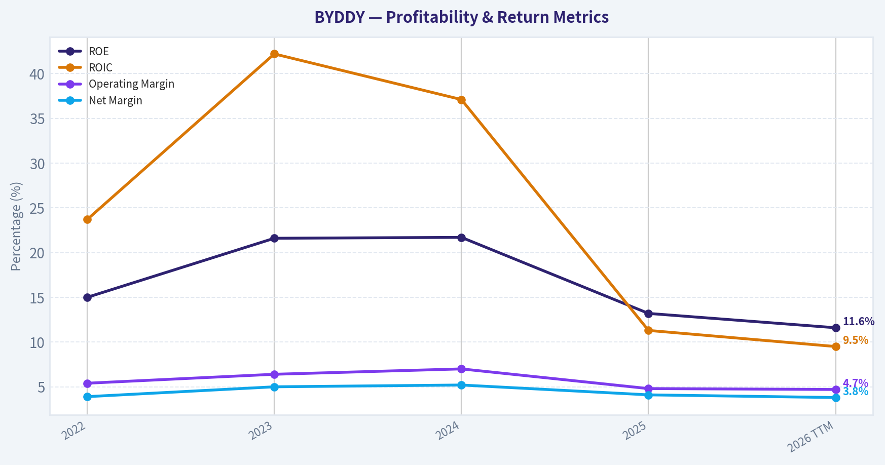
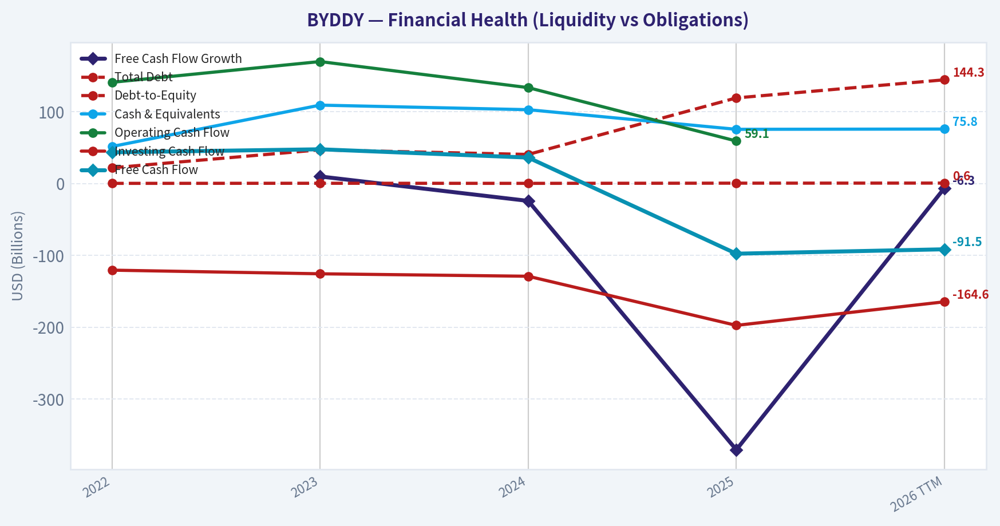
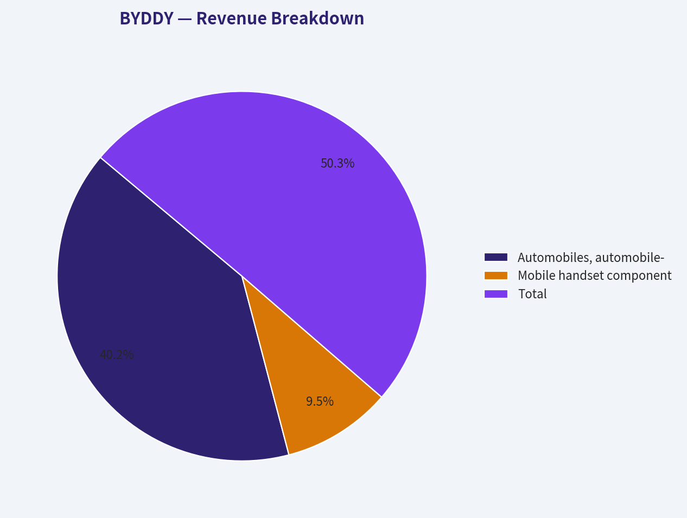
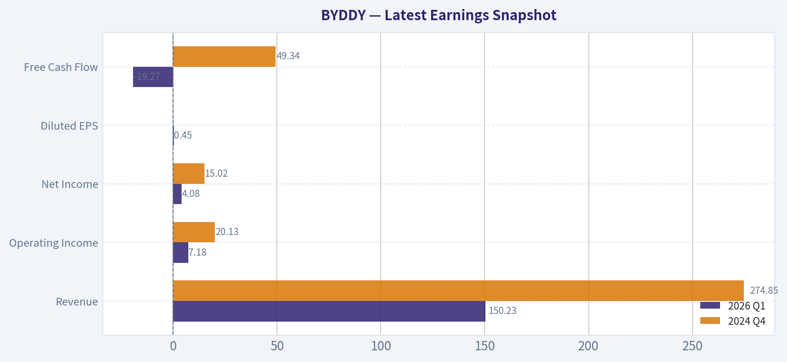
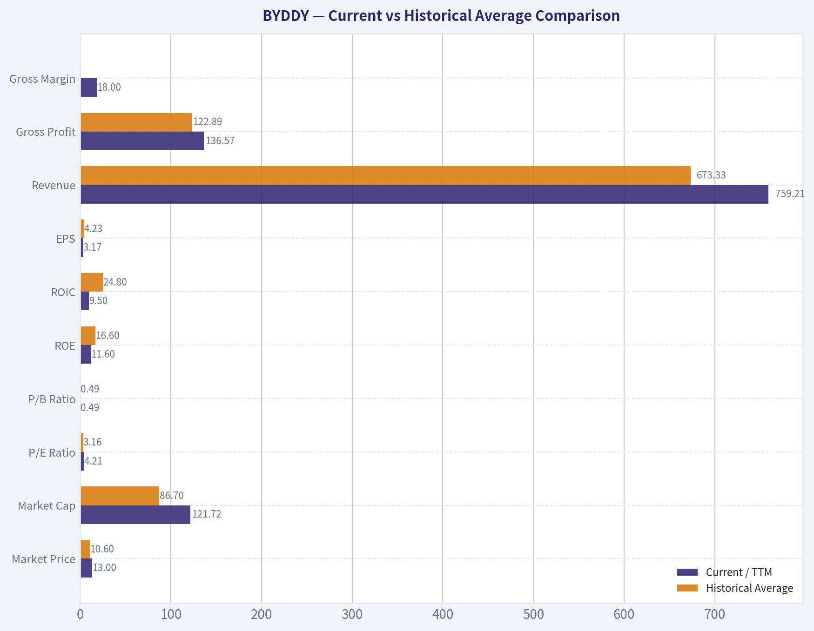
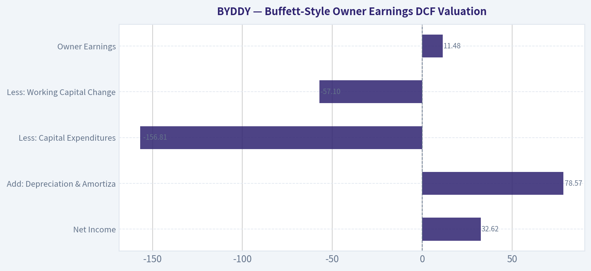
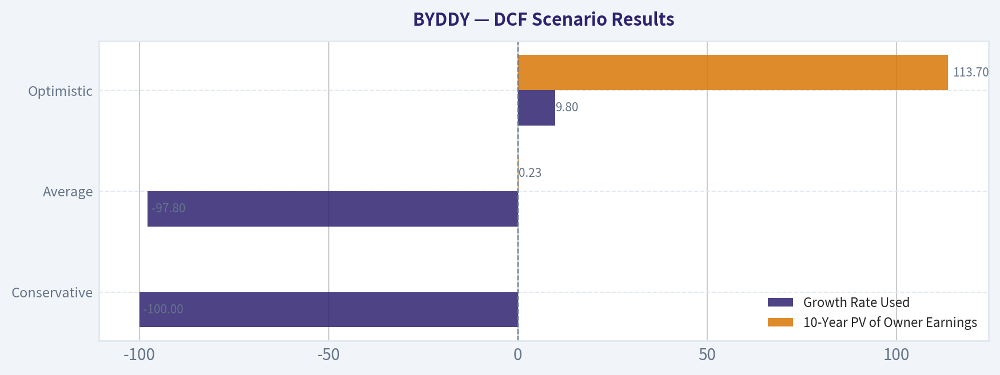

# BYDDY Deep Value Intelligence

**Analysis Date:** 2026-05-01

## Critical Disclaimer

*This analysis is generated by Deep Value Intelligence, an AI-powered multi-agent investing framework. This report is for informational and educational purposes only and does not constitute financial advice. Always conduct your own research and consult with qualified financial advisors before making investment decisions.*

---

## Table of Contents

1. Intelligence Summary
2. Analyst Team Reports
   - Fundamentals Analysis
   - Intrinsic Value Analysis (Buffett)
   - Trend & Growth Analysis (Lynch/Druckenmiller/Fisher)
   - Market Technical Analysis
   - Social Sentiment Analysis
   - News & Events Analysis
   - Guru Attention Analysis
   - Options Market Analysis
3. Research Team Commentary
4. Value Investing Team Commentary
5. Deep Values Commentary

---

## Intelligence Summary

### Thesis + Conditions

**Core Thesis:** **EXECUTIVE SUMMARY**
BYD is a world-class operator in a fundamentally brutal, capital-intensive industry. While its strategic dominance in the global EV transition is undeniable, its current financial reality-deeply negative free cash flow (-370.6%), shrinking net income (-19%), and anemic revenue growth (3.5%)-collides with a premium valuation (46x P/E).

**Key Risks:**
- The Bearish Case (Fundamental Deterioration):** Autos are notoriously capital-hungry. Strategic admiration is not a substitute for risk control. Declining net income and collapsing FCF in a slowing growth environment indicate that BYD's heavy reinvestment might be a permanent structural requirement, leaving zero margin of safety at current prices.
- The Neutral Case (Conditional Readiness):** Ambiguity is not a green light to buy blindly, nor a reason for total paralysis. Investors need a strict, trigger-based watchlist rather than relying on either extreme optimism about future cash flows or extreme pessimism about industry cycles.
- The Original Plan:* Wait for FCF to stabilize, watch the 17% gross margin defense amidst price wars, and look for a substantial price pullback or earnings explosion to compress the multiple.
- The Refined Plan:* We retain the core of the original plan but add **strict, actionable triggers** derived from the Neutral Analyst to prevent passive complacency:
- 3. **Valuation De-risking:** We demand a significant multiple compression. BYD must be priced as a high-quality industrial compounder, not a hyper-growth tech stock.

**What Would Change Our View:**
- The Bearish Case (Fundamental Deterioration):** Autos are notoriously capital-hungry. Strategic admiration is not a substitute for risk control. Declining net income and collapsing FCF in a slowing growth environment indicate that BYD's heavy reinvestment might be a permanent structural requirement, leaving zero margin of safety at current prices.
- The Neutral Case (Conditional Readiness):** Ambiguity is not a green light to buy blindly, nor a reason for total paralysis. Investors need a strict, trigger-based watchlist rather than relying on either extreme optimism about future cash flows or extreme pessimism about industry cycles.
- The Original Plan:* Wait for FCF to stabilize, watch the 17% gross margin defense amidst price wars, and look for a substantial price pullback or earnings explosion to compress the multiple.
- The Refined Plan:* We retain the core of the original plan but add **strict, actionable triggers** derived from the Neutral Analyst to prevent passive complacency:
- 3. **Valuation De-risking:** We demand a significant multiple compression. BYD must be priced as a high-quality industrial compounder, not a hyper-growth tech stock.

**Confidence:** Medium

---

## Analyst Team Reports

### Fundamentals Analysis

#### Latest Earnings Snapshot

*Most recent reported quarter anchored on 2026 Q1, with prior-year comparison when available.*

| Metric | 2026 Q1 | 2024 Q4 | YoY Change |
| --- | ---: | ---: | ---: |
| Revenue | $150.23B | $274.85B | -45.3% |
| Operating Income | $7.18B | $20.13B | -64.3% |
| Net Income | $4.08B | $15.02B | -72.8% |
| Diluted EPS | $0.45 | N/A | N/A |
| Operating Cash Flow | N/A | N/A | N/A |
| Free Cash Flow | $-19.27B | $49.34B | -139.1% |

Key Takeaways: This snapshot anchors the most recent reported quarter before the narrative analysis. It helps readers separate long-run business quality from whatever changed in the latest earnings print.

#### 10-Year Financial Metrics for BYDDY

*All values below are computed deterministically from raw data - not estimated by AI.*

*Issuer profile: operating company (Consumer Cyclical / Auto Manufacturers).*

#### 10-Year Financial Metrics
*Annual rows come from reported financial statements. The final TTM row is computed from the latest four quarters.*

| Metric | 2022 | 2023 | 2024 | 2025 | 2026 TTM |
| --- | --- | --- | --- | --- | --- |
| Market Price | $8 | $9 | $11 | $12 | $13 |
| Market Cap | $71.53B | $80.44B | $49.46B | $110.34B | $121.72B |
| P/E Ratio | 4.30 | 2.68 | 1.23 | 3.38 | 4.21 |
| P/B Ratio | 0.64 | 0.58 | 0.27 | 0.45 | 0.49 |
| ROE | 15.0% | 21.6% | 21.7% | 13.2% | 11.6% |
| ROIC | 23.7% | 42.2% | 37.1% | 11.3% | 9.5% |
| EPS | $1.85 | $3.35 | $9.22 | $3.58 | $3.17 |
| Revenue | $424.06B | $602.32B | $777.10B | $803.96B | $759.21B |
| Gross Profit | $72.24B | $111.92B | $151.06B | $142.66B | $136.57B |
| Gross Margin | N/A | N/A | N/A | N/A | 18.0% |
| Operating Margin | 5.4% | 6.4% | 7.0% | 4.8% | 4.7% |
| Net Income | $16.62B | $30.04B | $40.25B | $32.62B | $28.88B |
| Net Margin | 3.9% | 5.0% | 5.2% | 4.1% | 3.8% |
| Revenue Growth | N/A | 42.0% | 29.0% | 3.5% | -5.6% |
| Net Income Growth | N/A | 80.7% | 34.0% | -19.0% | -11.5% |
| Free Cash Flow Growth | N/A | 9.8% | -24.2% | -370.6% | -6.3% |
| Total Book Value | $111.03B | $138.81B | $185.25B | $246.27B | $249.92B |
| Total Assets | $493.86B | $679.55B | $783.36B | $883.73B | $902.08B |
| Total Debt | $21.83B | $46.89B | $40.46B | $119.12B | $144.35B |
| Debt-to-Equity | 0.20 | 0.34 | 0.22 | 0.48 | 0.58 |
| Cash & Equivalents | $51.47B | $109.09B | $102.74B | $75.42B | $75.79B |
| Shareholders' Equity | $111.03B | $138.81B | $185.25B | $246.27B | $249.92B |
| Operating Cash Flow | $140.84B | $169.73B | $133.45B | $59.14B | N/A |
| Investing Cash Flow | $-120.60B | $-125.66B | $-129.08B | $-197.46B | $-164.64B |
| Free Cash Flow | $43.38B | $47.63B | $36.09B | $-97.67B | $-91.55B |
| FCF Margin | 10.2% | 7.9% | 4.6% | -12.1% | -12.1% |
| Dividends / Share | $0.00 | $0.00 | $0.00 | $0.00 | $0.00 |

#### Profitability Metrics
- Return on Equity (ROE): 13.2%
- Return on Invested Capital (ROIC): 11.3%
- Return on Assets (ROA): 3.7%
- Gross Margin: 17.7%
- Operating Margin: 4.8%
- Net Profit Margin: 4.1%

#### Liquidity Metrics
- Current Ratio: 0.79
- Quick Ratio: 0.36

#### Leverage Metrics
- Debt-to-Equity Ratio: 0.48
- Interest Coverage Ratio: 15.09
- Net Debt: $43.70B

#### Growth Metrics (Year-over-Year)
- Revenue Growth: 3.5%
- Net Income Growth: -19.0%
- Free Cash Flow Growth: -370.6%
- Revenue CAGR (3-Year): 23.8%
- Revenue CAGR (5-Year): N/A

#### Valuation Metrics
- P/E Ratio (TTM): 46.03
- Forward P/E: 19.54
- Price-to-Book: 3.64
- Price-to-Sales: 0.16
- PEG Ratio: 0.89
- EV/EBITDA: 1.33
- Free Cash Flow Yield: -80.2%
- Earnings Yield: 2.2%

#### Owner Earnings (Buffett Method, Code-Computed)
- Net Income: $32.62B
- + Depreciation & Amortization: $78.57B
- - Capital Expenditures: $-156.81B
- - Working Capital Changes: $-57.10B
- = **Owner Earnings: $11.48B**

#### Piotroski F-Score: 4/9
- Positive Net Income: PASS
- Positive Operating Cash Flow: PASS
- ROA Improvement: FAIL
- Cash Flow > Net Income: PASS
- Decreasing Debt: FAIL
- Improving Current Ratio: PASS
- No Dilution: FAIL
- Improving Gross Margin: FAIL
- Improving Asset Turnover: FAIL

FINAL INVESTMENT STANCE: **WATCH**

#### BYDDY Warren Buffett-Style Fundamental Analysis

BYDDY is a high-quality, strategically important electric vehicle and battery manufacturer with clear scale advantages, vertical integration, and global growth potential. However, under a Buffett-style lens, the current picture is not clean enough for an outright "ADVOCATE" stance because free cash flow has turned deeply negative, leverage has risen sharply, margins are compressing, and recent earnings momentum has weakened.

The deterministic dataset is treated as the canonical source of truth. Current values below refer to the 2026 TTM row where available, and historical averages use only the years shown in the provided deterministic dataset.

---

#### Current vs Historical Average Comparison

| Metric | Current / TTM | Historical Average | Current vs Average | Buffett-Style Interpretation |
|---|---:|---:|---:|---|
| Market Price | $13 | $10.60 | +22.6% | Price has moved above the recent historical average, reflecting continued market confidence despite weakening cash flow. |
| Market Cap | $121.72B | $86.70B | +40.4% | Market value is meaningfully above average, suggesting investors still assign a premium to BYD's long-term EV and battery position. |
| P/E Ratio | 4.21 | 3.16 | +33.2% | Still low on the deterministic dataset, but higher than its own recent average; valuation is less cheap than it was in 2024. |
| P/B Ratio | 0.49 | 0.49 | ~Flat | Book valuation is near historical norm, implying the market is not aggressively overpaying for net assets on this dataset. |
| ROE | 11.6% | 16.6% | -30.2% | Profitability on equity has deteriorated materially from the 2023-2024 peak. |
| ROIC | 9.5% | 24.8% | -61.6% | The most concerning quality signal: returns on capital have fallen sharply as investment intensity has risen. |
| EPS | $3.17 | $4.23 | -25.1% | Earnings per share are below average after peaking in 2024. |
| Revenue | $759.21B | $673.33B | +12.8% | Revenue remains above average, but recent growth has slowed and turned negative on a TTM basis. |
| Gross Profit | $136.57B | $122.89B | +11.1% | Gross profit is still above average, showing scale remains powerful despite margin pressure. |
| Gross Margin | 18.0% | N/A | N/A | Current gross margin is modest for a manufacturing-heavy EV business and reflects intense pricing competition. |
| Operating Margin | 4.7% | 5.7% | -17.0% | Operating profitability has compressed from the 2024 high. |
| Net Income | $28.88B | $29.68B | -2.7% | Net income is close to average but below the 2024 peak. |
| Net Margin | 3.8% | 4.4% | -13.6% | Net profitability is thin, which leaves less room for error in a price war. |
| Revenue Growth | -5.6% | 17.2% | Significant deterioration | Growth has decelerated from extremely strong 2023-2024 levels to a TTM decline. |
| Net Income Growth | -11.5% | 21.1% | Significant deterioration | Earnings momentum has turned negative after prior high growth. |
| Free Cash Flow Growth | -6.3% | -97.8% | Better than distorted average, still negative | The average is distorted by the severe 2025 collapse, but current FCF remains deeply negative. |
| Total Book Value | $249.92B | $186.26B | +34.2% | Equity base has grown substantially, strengthening the asset base. |
| Total Assets | $902.08B | $748.52B | +20.5% | Asset growth is strong, but asset-heavy growth requires high reinvestment. |
| Total Debt | $144.35B | $74.53B | +93.7% | Debt has nearly doubled versus average, a clear financial-risk signal. |
| Debt-to-Equity | 0.58 | 0.36 | +59.3% | Leverage has increased materially, though not yet extreme. |
| Cash & Equivalents | $75.79B | $82.90B | -8.6% | Cash remains sizable but is below average while debt has risen. |
| Shareholders' Equity | $249.92B | $186.26B | +34.2% | Equity growth supports solvency, but returns on that equity are declining. |
| Free Cash Flow | -$91.55B | -$12.42B | Much worse | The central red flag: BYD is consuming cash heavily after years of positive FCF. |
| Dividends / Share | $0.00 | $0.00 | No change | No dividend; capital is being retained for growth and reinvestment. |

Key Takeaways: BYDDY remains a large and strategically advantaged business, with revenue, gross profit, assets, and book value all above historical averages. However, profitability quality has weakened: ROE, ROIC, EPS, margins, and earnings growth are all below historical norms. The biggest Buffett-style concern is the combination of sharply negative free cash flow and rising debt, which reduces the margin of safety despite apparently low valuation multiples in the deterministic dataset.

---

#### Revenue Breakdown

| Revenue Source | Amount ($B) | % of Total |
|---|---:|---:|
| Automobiles, automobile-related products, and other products | $643.17B | 80.0% |
| Mobile handset components, assembly services, and other electronics products | $152.75B | 19.0% |
| Rechargeable batteries and photovoltaics | $8.04B | 1.0% |
| **Total** | **$803.96B** | **100.0%** |

Key Takeaways: BYD is overwhelmingly an automotive and auto-related products company, with about four-fifths of revenue tied to vehicles and adjacent products. The handset and electronics assembly business remains meaningful but secondary. The standalone battery and photovoltaic segment appears small in reported revenue terms, although batteries remain strategically important because they support BYD's vertical integration and cost advantage in electric vehicles.

---

#### Market Metrics Interpretation

BYDDY's current deterministic market price is **$13**, above the recent average of **$10.60**, while market cap is **$121.72B**, far above the historical average of **$86.70B**. This shows the market continues to value BYD as a strategic EV leader even as near-term financial momentum weakens.

The deterministic **P/E ratio of 4.21** is low in absolute terms but above the recent average of **3.16**. That suggests the stock is less statistically cheap than it was during the 2024 trough. The deterministic **P/B ratio of 0.49** is almost exactly in line with the historical average, implying the market value is not stretched relative to book value under the canonical dataset.

Important validation note: the shared research pack also shows external valuation figures such as **TTM P/E of 46.03** and **P/B of 3.64**, which differ materially from the deterministic historical table. For this report, the deterministic dataset remains canonical, but the discrepancy is itself a red flag for investors because ADR ratio, currency translation, data-provider methodology, or timing differences may materially affect headline valuation interpretation.

#### Profitability Analysis

BYD's profitability is good but deteriorating. **ROE declined to 11.6% TTM**, down from an average of **16.6%** and far below the 2023-2024 peak above 21%. **ROIC declined even more sharply to 9.5%**, compared with an average of **24.8%**. For a Buffett-style investor, this is highly important: durable compounders should ideally maintain high returns on capital even while growing.

Revenue remains large at **$759.21B TTM**, above the historical average, but net income of **$28.88B** is slightly below average and well below the 2024 high of **$40.25B**. Margins are thin: **operating margin is 4.7%** and **net margin is 3.8%**. Thin margins are common in autos, but they reduce resilience during price wars, raw material cost swings, and macro downturns.

Gross profit of **$136.57B** remains above average, which shows BYD still has scale and manufacturing strength. But the decline in operating margin and net margin suggests pricing pressure, higher operating costs, heavier international expansion costs, or competitive intensity are absorbing much of the gross profit benefit.

#### Growth Analysis

BYD's growth profile has shifted from exceptional to strained. Revenue growth was **42.0% in 2023** and **29.0% in 2024**, but slowed to **3.5% in 2025** and then declined **5.6% TTM**. Net income growth followed a similar pattern: very strong in 2023 and 2024, then negative in 2025 and TTM.

Free cash flow growth is the weakest part of the growth story. FCF growth fell **-370.6% in 2025** and remained negative at **-6.3% TTM**. This indicates that growth is currently capital-intensive and cash-consuming. Buffett generally prefers businesses that can grow while producing excess owner cash; BYD is not currently demonstrating that.

#### Balance Sheet and Financial Strength

BYD's balance sheet has grown significantly. Total assets are **$902.08B**, above the historical average of **$748.52B**, and shareholder equity is **$249.92B**, above the average of **$186.26B**. This indicates scale, reinvestment, and retained earnings have expanded the company's asset base.

However, debt has risen sharply. Total debt is **$144.35B**, nearly double the historical average of **$74.53B**. Debt-to-equity has increased to **0.58**, compared with an average of **0.36**. This is not yet a crisis level, but it represents a clear deterioration in financial conservatism.

Cash and equivalents are **$75.79B**, still substantial, but below the historical average and far below total debt. The current ratio from the shared metrics is **0.79**, and the quick ratio is **0.36**, both of which indicate tight short-term liquidity. Interest coverage of **15.09** remains healthy, but liquidity and leverage trends deserve close monitoring.

#### Cash Flow and Capital Allocation

Free cash flow is **negative $91.55B TTM**, compared with a historical average of **negative $12.42B**. This is the single most important red flag in the analysis. BYD generated positive FCF from 2022 through 2024, but free cash flow turned sharply negative in 2025 and remained deeply negative TTM.

Dividends per share are **$0.00** throughout the deterministic period. That is acceptable for a growth company if retained capital earns high returns. But the decline in ROIC from above 37% in 2024 to 9.5% TTM raises the question of whether incremental reinvestment is still creating attractive value.

From a Buffett perspective, no dividend is not a problem by itself. The problem is retaining all earnings while free cash flow is negative and returns on incremental capital are falling.

---

#### Buffett-Style Owner Earnings DCF Valuation

The deterministic dataset provides code-computed Buffett-style Owner Earnings for 2025:

**Owner Earnings = Net Income + Depreciation & Amortization - Capital Expenditures - Working Capital Changes**

Using the provided components:

| Owner Earnings Component | Amount |
|---|---:|
| Net Income | $32.62B |
| Add: Depreciation & Amortization | $78.57B |
| Less: Capital Expenditures | -$156.81B |
| Less: Working Capital Changes | -$57.10B |
| **Owner Earnings** | **$11.48B** |

Key Takeaways: BYD's owner earnings are positive at **$11.48B**, but they are much lower than reported net income because capital expenditures and working capital needs are very large. This is exactly the type of adjustment Buffett emphasizes: accounting profits are not the same as cash that can be freely distributed to owners. BYD's current owner earnings show that reinvestment demands are consuming a large share of the business's economic profit.

Because the deterministic dataset does not provide a full historical owner-earnings series, the available historical free cash flow growth rates are used as the closest deterministic proxy for owner-earnings growth. Scenario rules are applied as requested: the conservative case uses the lowest available historical growth rate floored at -100%, the average case uses the average available growth rate capped at 50%, and the optimistic case uses the highest available growth rate capped at 100%.

Assumptions:

| DCF Assumption | Value |
|---|---:|
| Base Owner Earnings | $11.48B |
| Discount Rate | 10.0% |
| Terminal Growth Rate | 2.5% |
| Estimated Shares Outstanding | 9.36B |
| Share Count Method | Market Cap $121.72B / Price $13 |

Key Takeaways: The DCF starts from positive but modest owner earnings relative to BYD's market capitalization. A 10% discount rate is used to reflect Buffett-style opportunity cost, while a 2.5% terminal growth rate assumes long-term growth roughly in line with mature economic growth. The implied share count is derived directly from the deterministic market cap and price.

#### DCF Scenario Results

| Scenario | Growth Rate Used | 10-Year PV of Owner Earnings | PV of Terminal Value | Estimated Equity Value | Fair Value / Share | Upside / Downside vs $13 |
|---|---:|---:|---:|---:|---:|---:|
| Conservative | -100.0% | $0.00B | $0.00B | $0.00B | $0.00 | -100.0% |
| Average | -97.8% | $0.23B | ~$0.00B | $0.23B | $0.03 | -99.8% |
| Optimistic | +9.8% | $113.70B | $154.00B | $267.70B | $28.59 | +119.9% |

Key Takeaways: The DCF is extremely sensitive to cash-flow normalization. Under conservative and average historical cash-flow-growth assumptions, the valuation is effectively unsupported because recent free cash flow trends are severely negative. Under the optimistic scenario, where owner earnings grow at the best available historical cash-flow growth rate, the stock appears materially undervalued, with fair value around **$28.59 per share**.

#### DCF Calculation Detail

| Scenario | Calculation Summary |
|---|---|
| Conservative | Lowest available FCF growth was -370.6%, floored at -100%. Owner earnings fall to zero after year one; therefore, 10-year cash flows and terminal value are zero. |
| Average | Average available FCF growth = approximately -97.8%. Year-one owner earnings decline to about $0.25B, and subsequent discounted cash flows rapidly approach zero. Estimated equity value is about $0.23B. |
| Optimistic | Highest available FCF growth = +9.8%. Year-one owner earnings = $11.48B x 1.098 = $12.61B. Ten-year discounted owner earnings are about $113.70B. Year-ten owner earnings are about $29.23B, terminal value equals $29.23B x 1.025 / 7.5% = about $399.4B, discounted back to about $154.0B. Total estimated value is about $267.7B. |

Key Takeaways: The conservative and average cases highlight why BYD is not a simple Buffett-style bargain despite low deterministic P/E and P/B ratios. The optimistic case shows substantial potential value if BYD's heavy investment phase produces durable, growing owner earnings. The investment decision therefore depends less on current accounting earnings and more on whether negative free cash flow is temporary or structural.

---

#### Warren Buffett-Style Qualitative Assessment

| Buffett Factor | Assessment | Interpretation |
|---|---|---|
| Economic Moat | Strong but contested | BYD has scale, vertical integration, battery expertise, manufacturing depth, and brand strength in China. However, autos are fiercely competitive and pricing power is limited. |
| Cost Advantage | Strong | BYD's battery integration and manufacturing scale likely provide cost advantages versus many EV peers. |
| Brand and Distribution | Improving | BYD has become a global EV leader, but outside China its brand moat is still developing. |
| Financial Strength | Mixed | Equity base and cash are large, but debt is rising quickly and current ratio is below 1. |
| Earnings Predictability | Moderate | Revenue scaled rapidly, but earnings and margins are now declining. Predictability is lower than Buffett's ideal. |
| Return on Capital | Deteriorating | ROE and ROIC were excellent in 2023-2024 but have fallen sharply. |
| Capital Allocation | Aggressive reinvestment | No dividends; heavy capex and working capital investment support growth but pressure free cash flow. |
| Margin Stability | Weak to moderate | Net margins remain thin and have declined TTM. |
| Valuation | Statistically cheap on canonical table, uncertain on external data | Deterministic P/E and P/B look low, but external valuation metrics conflict materially. |
| Overall Business Quality | High-quality operator in a difficult industry | BYD is an impressive company, but the auto industry's capital intensity and cyclicality reduce Buffett-style certainty. |

Key Takeaways: BYD has real competitive advantages, especially in batteries, scale manufacturing, and vertical integration. But Buffett-style investing requires not only a good business, but a predictable, cash-generative business available with a margin of safety. BYD currently looks strategically strong but financially less predictable than ideal.

#### Key Investment Insights

BYD's core opportunity is that it may be one of the few EV manufacturers with enough scale, cost control, battery capability, and manufacturing integration to survive a global EV price war. If negative free cash flow is temporary and current investments produce future owner earnings growth, the optimistic DCF suggests meaningful upside.

The company also benefits from long-term structural growth in electric vehicles, plug-in hybrids, batteries, and global transportation electrification. BYD does not need the U.S. market to remain relevant, and recent commentary suggests it continues expanding globally despite geopolitical restrictions.

However, the investment case is currently complicated by deteriorating returns on capital, negative TTM revenue growth, negative net income growth, sharply negative free cash flow, and rising leverage. These factors reduce the margin of safety and make the stock more dependent on a successful future normalization of cash flow.

#### Red Flags

| Red Flag | Why It Matters |
|---|---|
| Free cash flow is deeply negative | Negative $91.55B TTM FCF means accounting profits are not translating into distributable cash. |
| Debt is rising quickly | Total debt increased to $144.35B, nearly double the historical average. |
| ROIC deterioration | ROIC fell to 9.5% from a historical average of 24.8%, suggesting lower incremental returns. |
| Margin compression | Operating margin and net margin are both below average. |
| Revenue growth turned negative | TTM revenue declined 5.6%, a major slowdown from prior high-growth years. |
| Liquidity is tight | Current ratio of 0.79 and quick ratio of 0.36 indicate limited short-term flexibility. |
| Geopolitical risk | U.S. restrictions and broader anti-China auto policy could limit market access and valuation multiples. |
| Data-provider valuation discrepancy | Deterministic and external valuation metrics differ sharply, requiring careful ADR and currency validation. |

Key Takeaways: BYD's largest risks are financial rather than strategic. The business may be competitively strong, but cash generation, leverage, and return on capital trends have moved in the wrong direction. Investors should be cautious about relying on low earnings multiples unless free cash flow improves.

#### Opportunities

| Opportunity | Why It Matters |
|---|---|
| Global EV and hybrid growth | BYD is positioned to benefit from continued electrification. |
| Battery vertical integration | Internal battery supply can support cost leadership and product differentiation. |
| Scale manufacturing | Large production scale can create cost advantages that weaker competitors cannot match. |
| International expansion | Growth outside China could diversify revenue and improve long-term market opportunity. |
| Cash flow normalization | If capex intensity moderates, owner earnings could rise significantly. |
| Valuation upside in optimistic DCF | If owner earnings grow near the optimistic case, fair value could be well above the current price. |

Key Takeaways: BYD's upside is meaningful if the current investment cycle creates durable future cash flows. The optimistic DCF demonstrates that even modest positive owner-earnings growth can justify a much higher valuation. The key question is whether BYD can convert scale and growth into sustainable free cash flow.

---

#### Final Investment Stance: WATCH

BYDDY earns a **WATCH** stance. The company has many characteristics of a great strategic business: scale, vertical integration, battery expertise, cost advantages, and a leading position in electric vehicles. However, it does not currently meet the full Buffett standard for a high-confidence investment because free cash flow is deeply negative, leverage is rising, ROIC is falling, and growth has slowed sharply.

For a Buffett-style investor, the right approach is patience. BYD should remain on the watchlist, but a stronger buy case would require evidence that free cash flow is recovering, debt growth is stabilizing, ROIC is improving, and margins are no longer compressing.

#### End-of-Report Summary Table

| Category | Verdict | Key Point |
|---|---|---|
| Business Quality | Strong | BYD has scale, integration, and EV leadership. |
| Economic Moat | Good but not invincible | Cost advantages are real, but autos remain highly competitive. |
| Profitability | Weakening | ROE, ROIC, EPS, and margins are below historical averages. |
| Growth | Decelerating | Revenue and net income growth have turned negative TTM. |
| Balance Sheet | Mixed | Equity and assets are strong, but debt has risen sharply. |
| Cash Flow | Poor | Free cash flow is deeply negative. |
| Valuation | Unclear but potentially attractive | Canonical multiples look low, but DCF depends heavily on cash-flow recovery. |
| Dividend Policy | Growth-focused | No dividends; all capital retained for reinvestment. |
| Main Red Flag | Cash conversion | Owner earnings are far below net income due to capex and working capital needs. |
| Main Opportunity | Cash-flow normalization | If current investments mature, intrinsic value could be materially higher. |
| Final Stance | WATCH | High-quality company, but insufficient current margin of safety. |

Key Takeaways: BYD is a strategically impressive company but not yet a clean Buffett-style investment. The business has long-term potential, yet the financial trends require caution. A move from WATCH to ADVOCATE would require clear improvement in free cash flow, leverage discipline, and returns on invested capital.

#### Fundamental Visuals

This graph tracks the profitability and return metrics (ROE, ROIC, Margins) of **BYDDY** over the past decade, highlighting capital efficiency trends.

This chart illustrates the financial health of **BYDDY** over the last 10 years, mapping cash equivalents and free cash flow against total obligations (Debt).

This breakdown chart from <em>Revenue Breakdown</em> shows the proportional composition for **BYDDY** - useful for understanding what drives or risks the business.

---

### Intrinsic Value Analysis (Buffett)

> *Following Warren Buffett's value investing philosophy: Circle of Competence, Economic Moat, Management Quality, and Margin of Safety.*

#### Intrinsic Value Snapshot

Price is what you pay. Intrinsic value is what the business may be worth based on the cash it can create for owners over time. We show a range, not one magic number.

- Current Price: $13.35
- Value Range: N/A to N/A

##### Owner Earnings (Buffett Method)
- Net Income: $32,619,022,000.00
- Depreciation & Amortization: $78,570,594,000.00
- Capital Expenditures: $-156,807,853,000.00
- Working Capital Changes: $-57,100,373,000.00
- Owner Earnings: $11,482,136,000.00

##### Intrinsic Value

FINAL INVESTMENT STANCE: **AVOID**

#### BYDDY / BYD Company - Buffett-Style Value Investment Review

As of 2026-05-01, BYDDY appears to be an impressive operating company but **not a Buffett-style investment at today's price and risk profile**. BYD has real strengths in electric vehicles, batteries, scale manufacturing, and vertical integration, but the business sits in a brutally competitive, capital-intensive, technology-sensitive industry with weak current free cash flow, modest ROE, thin gross margins, and no clear margin of safety.

I attempted to retrieve deeper audited financial history through the available tools, but the financial data tools returned unavailable/null results. This analysis therefore relies on the shared research pack and known qualitative business characteristics.

---

#### 1. Go / No-Go Gate Assessment

| Buffett Gate | Assessment | Evidence | Result |
|---|---:|---|---:|
| Gate 1: Circle of Competence & Simplicity | Mixed | BYD makes money by selling electric vehicles, plug-in hybrids, batteries, and related components. Simple enough to understand, but long-term economics depend on technology, regulation, subsidies, batteries, and competition. | **Partial Fail** |
| Gate 2: Durable Moat | Weak to moderate | BYD has scale, vertical integration, battery know-how, and brand strength in China, but gross margin is only about 17.7%, far below the 40%+ Buffett-style evidence of pricing power. | **Fail** |
| Gate 3: Management & Capital Allocation | Inconclusive to mixed | Founder-led culture and long-term manufacturing ambition are positives. However, heavy capital needs, negative free cash flow yield, and rapid global expansion raise capital allocation risk. | **Partial Fail** |
| Gate 4: Industry Structure | Unattractive | Autos and EVs are capital-intensive, cyclical, price-competitive, and exposed to policy/geopolitical risk. Recent news includes U.S. political efforts to restrict Chinese automakers. | **Fail** |

**Key Takeaways:** BYD is understandable at a basic level, but the business does not pass the Buffett filter cleanly. The largest issue is not whether BYD is a capable company; it is whether the company has durable, high-return economics in an industry known for price wars, heavy reinvestment, and technological change. On that basis, the business fails several core Buffett gates.

---

#### 2. Moat Analysis

| Moat Source | BYD Evidence | Buffett-Style Interpretation |
|---|---|---|
| Brand / Intangibles | Strong brand in China EVs and growing global recognition. | Positive, but not enough evidence of true pricing power. Auto buyers remain price-sensitive. |
| Switching Costs | Low for consumers; moderate only in fleet or ecosystem contexts. | Weak. Consumers can switch brands easily. |
| Cost Advantage | BYD benefits from scale, battery integration, and manufacturing depth. | This is the strongest moat factor, but competitors can still attack with price cuts and subsidies. |
| Network Effects | Limited. Vehicles do not become meaningfully better simply because more people buy them. | Weak. Not a network-effect business. |
| Regulatory / Geopolitical Position | Benefits from China industrial policy, but faces restrictions abroad. | Mixed. Regulation may help domestically but hurt international expansion. |

**Key Takeaways:** BYD's moat is based mainly on scale and vertical integration, not on the kind of pricing power Buffett usually prefers. The low gross margin suggests that even a leading company must compete hard on price. This is a good industrial competitor, but not clearly a wide-moat compounding machine.

**Moat Rating:** **Narrow to Moderate, Not Wide**

---

#### 3. Management Quality Assessment

| Management Factor | Assessment | Comment |
|---|---:|---|
| Founder / Owner Mentality | Positive | BYD has long benefited from founder-led execution and a long-term manufacturing culture. |
| Candor / Reporting | Neutral | No major conclusion can be drawn from available data in this run. |
| Capital Allocation | Mixed | Heavy reinvestment has built scale, but negative free cash flow yield raises concern about whether growth is truly owner-earnings accretive. |
| Balance Sheet Conservatism | Weak to mixed | Current ratio of about 0.79 suggests short-term obligations exceed current assets. |
| Shareholder Orientation | Inconclusive | No tracked recent 13F guru ownership was found for BYDDY; foreign listings may limit visibility. |

**Key Takeaways:** BYD's management deserves credit for building one of the world's most important EV and battery manufacturers. However, from a Buffett perspective, the test is not ambition or growth; it is whether retained earnings consistently become high-quality owner earnings. The current free cash flow profile makes that hard to prove.

---

#### 4. Financial Summary Table

| Metric | Current / Available Data | Buffett Preference | Interpretation |
|---|---:|---:|---|
| Share Price | $13 | Buy only below intrinsic value | Price alone is not meaningful without owner earnings. |
| Market Cap | $121.71B | Prefer fair price for exceptional economics | Large valuation requires strong future execution. |
| P/E Ratio | 46.0x | Prefer reasonable multiple on durable earnings | Expensive for a cyclical manufacturing business. |
| ROE | 13.2% | Sustained 15%+, ideally 20%+ | Below Buffett "wonderful business" threshold. |
| Gross Margin | 17.7% | 40%+ suggests pricing power | Weak evidence of durable pricing power. |
| Revenue Growth YoY | 3.5% | Growth should be profitable and durable | Modest current growth does not justify premium multiple alone. |
| Free Cash Flow Yield | -80.2% | Prefer consistently positive owner earnings | Major red flag. |
| Current Ratio | 0.79 | Prefer conservative liquidity | Liquidity position appears tight. |

**Key Takeaways:** The available numbers do not resemble a classic Buffett compounder. ROE is below the preferred threshold, gross margin is low, and free cash flow yield is sharply negative. The market is paying a high earnings multiple for a business with substantial reinvestment and competitive risk.

---

#### 5. Owner Earnings Calculation

Using the available data, precise Buffett owner earnings cannot be calculated because detailed depreciation, maintenance capital expenditure, and working capital movements were not available. However, we can estimate using two rough proxies.

| Owner Earnings Proxy | Calculation | Approximate Result | Interpretation |
|---|---:|---:|---|
| Net Income Proxy | Market Cap / P/E = $121.71B / 46.03 | ~$2.64B | Optimistic proxy; ignores capital intensity. |
| Free Cash Flow Proxy | Market Cap x FCF Yield = $121.71B x -80.2% | ~-$97.6B | Indicates current free cash flow is deeply negative. |
| Buffett Owner Earnings View | Net income + D&A - maintenance capex - working capital needs | Not calculable with available detail | Likely materially below reported earnings if reinvestment needs remain high. |

**Key Takeaways:** Reported earnings are positive, but free cash flow is the serious problem. Buffett would care more about cash that can be taken out of the business than accounting profit. On the available evidence, BYD is currently consuming large amounts of cash rather than producing distributable owner earnings.

---

#### 6. Three-Scenario DCF Valuation

Because free cash flow is negative, a true owner-earnings DCF would produce little or no positive value today. To avoid being overly punitive, the table below uses the **optimistic net income proxy of $2.64B** as normalized owner earnings. This likely overstates intrinsic value if capital requirements remain high.

| Scenario | Assumption | Estimated Equity Value | Implied Value per BYDDY Share | Margin of Safety vs. $13 Price |
|---|---|---:|---:|---:|
| A: No Growth | $2.64B / 10% discount rate | ~$26.4B | ~$2.82 | **-361% overvaluation** |
| B: GDP Growth | 3% perpetual growth, 10% discount rate | ~$38.9B | ~$4.16 | **-213% overvaluation** |
| C: High Growth Case | 10% growth for 10 years, then 3% terminal growth | ~$65.3B | ~$6.98 | **-86% overvaluation** |

**Key Takeaways:** Even using an optimistic earnings-based proxy rather than negative free cash flow, the valuation does not appear attractive. The current market cap of about $121.7 billion is far above the estimated values in all three scenarios. The stock would need either much higher durable owner earnings or a much lower share price to offer a Buffett-style margin of safety.

---

#### 7. Margin of Safety Analysis

| Item | Result |
|---|---:|
| Current Market Cap | $121.71B |
| Conservative Intrinsic Value Range | ~$26B to ~$65B |
| Current Price | $13 |
| Conservative Implied Value Range | ~$2.82 to ~$6.98 per share |
| Required Buffett Margin of Safety | At least 25%; likely 40%+ due industry risk |
| Actual Margin of Safety | Negative |

**Key Takeaways:** BYDDY does not offer a margin of safety based on the available financial data. The stock appears priced for strong future performance in an industry where durable economics are hard to forecast. For a Buffett-style investor, that combination is unattractive.

---

#### 8. Buffett Scorecard

| Criterion | Weight | Score, 1-5 | Weighted Score |
|---|---:|---:|---:|
| Business Understanding | 20% | 3.0 | 0.60 |
| Moat Width & Durability | 25% | 2.5 | 0.63 |
| Management Quality | 15% | 3.0 | 0.45 |
| Return on Equity | 15% | 2.5 | 0.38 |
| Reinvestment Runway | 10% | 3.0 | 0.30 |
| Balance Sheet Strength | 5% | 2.0 | 0.10 |
| Industry Structure | 5% | 1.5 | 0.08 |
| Valuation / Margin of Safety | 5% | 1.0 | 0.05 |
| **Total** | **100%** |  | **2.58 / 5.00** |

**Key Takeaways:** BYD scores well enough to be recognized as an important and capable company, but not well enough to qualify as a Buffett-style purchase. The weak points are valuation, industry structure, cash flow, and lack of clear pricing power. The final score falls in the avoid range.

---

#### 9. Final Investment Stance

| Category | Conclusion |
|---|---|
| Business Quality | Good operating company, but not clearly wonderful economics |
| Moat | Narrow to moderate, mainly scale and integration |
| Financial Quality | ROE modest, margins thin, free cash flow weak |
| Valuation | Too expensive on available owner-earnings evidence |
| Buffett Suitability | Poor fit |
| Final Stance | **AVOID** |
| Conviction | **Moderate to High** |

**Key Takeaways:** BYD may continue to grow and may remain a major global EV leader, but that does not automatically make BYDDY a good value investment. Buffett-style investing requires predictable, cash-generative economics purchased with a margin of safety. At the current valuation and with negative free cash flow, BYDDY should be avoided rather than bought.
#### Valuation Bridge

This bridge places the current market price beside each intrinsic value lens so readers can see whether upside depends on one method or shows up across several methods.

| Scenario | Intrinsic Value / Share |
| --- | ---: |
| Damodaran Method | $522.90 |
| Current Price | $13.35 |

#### Key Takeaways

If one method is far above the others, the upside case depends on a specific modelling assumption. When several methods cluster together, the valuation story is more robust.

#### Valuation Visuals

This comparison chart from *Latest Earnings Snapshot* stacks current figures against historical benchmarks for **BYDDY**, making it easy to see where the company trades relative to its own averages.

This comparison chart from *Current vs Historical Average Comparison* stacks current figures against historical benchmarks for **BYDDY**, making it easy to see where the company trades relative to its own averages.

This comparison chart from *Buffett-Style Owner Earnings DCF Valuation* stacks current figures against historical benchmarks for **BYDDY**, making it easy to see where the company trades relative to its own averages.

This comparison chart from *Buffett-Style Owner Earnings DCF Valuation* stacks current figures against historical benchmarks for **BYDDY**, making it easy to see where the company trades relative to its own averages.

This comparison chart from *DCF Scenario Results* stacks current figures against historical benchmarks for **BYDDY**, making it easy to see where the company trades relative to its own averages.

---

### Trend & Growth Analysis (Lynch/Druckenmiller/Fisher)

> *Following Peter Lynch's GARP, Stanley Druckenmiller's macro-aware approach, and Philip Fisher's scuttlebutt methodology.*

FINAL INVESTMENT STANCE: **WATCH**

#### BYDDY Growth Investment Memo - BYD Co. Ltd. ADR

BYD is one of the best-positioned global EV manufacturers, with real scale, vertical integration, battery expertise, and export optionality. However, as of the current data pack, the growth setup is not yet an "advocate" setup because revenue growth has slowed sharply, latest coverage points to Q1 profit pressure, free cash flow is deeply negative, and geopolitical barriers are rising. This is a high-quality company, but the current inflection is mixed rather than clearly positive.

---

#### 1. Lynch Classification

| Lynch Category | BYD Fit | Evidence | Growth Investor Implication |
|---|---:|---|---|
| Fast Grower | Historically yes | Multi-year EV and PHEV expansion, major China share gains, global export push | Long-term ten-bagger qualities existed earlier in the cycle |
| Stalwart / Cyclical Growth | Current fit | Revenue growth YoY in pack is only 3.5%; Q1 coverage notes double-digit profit decline | Not currently showing clean growth acceleration |
| Turnaround | Partial | Margin recovery and export expansion could reset earnings growth | Needs proof of stabilization |
| Asset Play | No | Value is operating execution, not hidden assets | Not relevant |

**Key Takeaways:** BYD was historically a fast grower, but the current numbers look more like a large cyclical growth company digesting a tougher EV cycle. The story is still attractive, but Lynch would likely ask whether the next leg of growth is visible and reasonably priced. Right now, that answer is not strong enough for an aggressive buy stance.

---

#### 2. The Story in 3 Bullets

| Story Pillar | Simple Explanation |
|---|---|
| EV scale leader | BYD makes affordable electric and plug-in hybrid vehicles at massive scale, especially in China. |
| Vertical integration | BYD builds key components itself, especially batteries, which helps control cost and supply. |
| Global optionality | If BYD succeeds outside China, exports, batteries, and energy storage could create a second growth curve. |

**Key Takeaways:** The business is easy to understand: BYD is trying to be the Toyota of electrification, but with in-house batteries and Chinese manufacturing scale. The long-term opportunity remains large. The near-term issue is whether that scale can keep producing profit growth in a brutal price war.

---

#### 3. TAM Analysis and 10x Test

| Metric | Estimate / Assessment |
|---|---:|
| Current market cap | ~$121.7B |
| Current revenue base | Likely above $100B annualized, depending on period and FX |
| 10x revenue test | Would imply more than $1T in annual revenue |
| Global auto TAM | Multi-trillion-dollar annual market |
| Battery / energy storage TAM | Large and expanding, but competitive |
| Can BYD 10x and still be below 20% of TAM? | Theoretically yes across auto + batteries, but practically difficult |
| Runway grade | Good, not pristine |

**Key Takeaways:** BYD still has a large addressable market because global EV penetration, plug-in hybrids, batteries, and energy storage remain long-duration growth areas. However, because BYD is already very large, the 10x test is much harder than it was five years ago. The runway exists, but future returns depend on global share gains and margin durability, not just China volume growth.

---

#### 4. Revenue Growth Trend

| Period / Indicator | Current Signal | Interpretation |
|---|---:|---|
| Shared pack revenue growth YoY | 3.5% | Sharp slowdown versus historical hypergrowth |
| Latest earnings coverage | Revenue shortfall noted | Growth quality under pressure |
| Q1 profit commentary | Double-digit profit decline reported | Margin and FX pressure are visible |
| Pattern | Decelerating | Not a clean inflection |

**Key Takeaways:** The biggest problem in the current setup is that growth appears to be decelerating, not accelerating. BYD remains a strategic winner, but the latest trend does not meet Druckenmiller's preferred inflection profile. For a growth investor, this pushes the stock into watch-list territory.

---

#### 5. Unit Economics and Efficiency

| Metric | BYD Status | Assessment |
|---|---|---|
| LTV / CAC | Not disclosed; not directly applicable like SaaS | Cannot score precisely |
| Net revenue retention | Not applicable | Auto manufacturer, not subscription SaaS |
| Rule of 40 | Not applicable | Industrial growth model |
| Gross margin | 17.7% | Reasonable for auto, but not software-like |
| FCF yield | -80.2% per shared pack | Major concern; likely capex / working capital heavy |
| Current ratio | 0.79 | Liquidity deserves monitoring |

**Key Takeaways:** BYD's unit economics must be judged as a manufacturing business, not a SaaS company. Gross margin is respectable for autos, but the free cash flow signal is poor and the current ratio is below 1. The company may be investing aggressively, but growth investors need evidence that heavy investment will convert into durable cash generation.

---

#### 6. Inflection Point Assessment

| Inflection Type | Current Evidence | Score |
|---|---|---:|
| Product cycle | Strong model breadth, PHEV and EV lineup | 4/5 |
| Market share | Strong China position, export expansion | 4/5 |
| Margin inflection | Latest profit decline suggests pressure | 2/5 |
| TAM inflection | Global EV, battery, storage still expanding | 4/5 |
| Competitive inflection | China EV price war remains intense | 2/5 |
| Geopolitical inflection | U.S. restriction risk rising | 1/5 |

**Key Takeaways:** BYD has product and market-share strengths, but the current inflection is not clean. The negative signals are margin pressure, price competition, and worsening geopolitical barriers. A true bullish inflection would require evidence that overseas growth and scale efficiencies are outweighing China price pressure.

---

#### 7. Macro Setup

| Macro Factor | Impact on BYD | Assessment |
|---|---|---|
| EV adoption | Secular tailwind | Positive |
| China consumer environment | Uneven demand and price competition | Mixed |
| Interest rates | Lower rates would help growth valuations | Potentially positive |
| Geopolitics | U.S. restrictions and tariff risk | Negative |
| FX volatility | Recent coverage mentions FX pressure | Negative |
| Energy transition | Long-term structural support | Positive |

**Key Takeaways:** BYD benefits from one of the biggest secular trends in the world: vehicle electrification. But the macro setup is not uniformly favorable because China competition is fierce and global trade barriers are increasing. Druckenmiller would likely view the macro as powerful long term but messy near term.

---

#### 8. Fisher 15-Point Score

| Fisher Point | Score / 5 | Rationale |
|---|---:|---|
| Market potential | 5 | EVs, batteries, storage, exports |
| New product determination | 5 | Broad model cadence and technology push |
| R&D effectiveness | 4 | Battery and platform strength |
| Sales organization | 4 | Strong China distribution; overseas still building |
| Profit margin | 3 | Good for auto, not exceptional |
| Margin improvement | 2 | Current pressure visible |
| Labor / personnel relations | 3 | No major clear edge from available data |
| Executive relations | 3 | Insufficient external evidence |
| Management depth | 4 | Execution history strong |
| Cost analysis / accounting | 3 | Complex industrial reporting |
| Outstanding moat aspects | 4 | Vertical integration, scale, battery capability |
| Long-range profit outlook | 4 | Strong if exports succeed |
| Dilution risk | 4 | Not the central concern |
| Candor in difficulties | 3 | Needs monitoring through filings |
| Integrity | 3 | No decisive negative in provided pack, but governance discount applies |

**Fisher Score: 54 / 75 - Average to Good**

**Key Takeaways:** BYD scores very well on product potential, innovation, and scale, which are Fisher-style strengths. The score is pulled down by margin pressure, limited visibility into unit economics, and geopolitical/governance complexity. This is a good business, but not currently an outstanding Fisher setup based on the latest signals.

---

#### 9. Valuation Analysis

| Valuation Metric | Current Data / Estimate | Interpretation |
|---|---:|---|
| Price | ~$13 |
| Market cap | ~$121.7B |
| P/E | ~46.0x |
| Revenue growth YoY | 3.5% |
| PEG | Not attractive using current growth; above 10x if using revenue growth proxy | Expensive relative to near-term growth |
| P/S | Likely around ~1x sales, depending on revenue base and FX | Reasonable for autos, not demanding |
| Gross margin | 17.7% | Supports premium to legacy autos but not software multiple |
| FCF yield | -80.2% | Valuation support from cash flow is weak |

**Key Takeaways:** On price-to-sales, BYD does not look extreme for a global EV leader. On P/E and current growth, however, the valuation is harder to defend. The stock needs either renewed earnings acceleration or proof that free cash flow weakness is temporary.

---

#### 10. Scenario Analysis

| Scenario | Assumptions | Investment Outcome |
|---|---|---|
| Bear Case | China price war persists, profits decline, exports face tariffs, FCF stays weak | Multiple compresses; stock underperforms |
| Base Case | Revenue grows modestly, margins stabilize, exports grow but geopolitical limits remain | Stock compounds slowly; fair value / hold |
| Bull Case | Export growth accelerates, battery/storage scale improves, margins recover, price war eases | Earnings inflect; stock rerates higher |

**Key Takeaways:** The bull case is real, but it requires multiple things to go right at the same time. The base case looks more like a solid global manufacturer than a high-conviction growth compounder. The bear case is centered on margin compression and trade restrictions.

---

#### 11. Growth Investor Scorecard

| Criterion | Weight | Score / 5 | Weighted Score |
|---|---:|---:|---:|
| The Story | 10% | 4.5 | 0.45 |
| TAM & Runway | 20% | 4.0 | 0.80 |
| Revenue Growth | 20% | 2.0 | 0.40 |
| Unit Economics | 15% | 2.0 | 0.30 |
| Competitive Position | 10% | 4.0 | 0.40 |
| Management Quality | 10% | 3.5 | 0.35 |
| Macro Setup | 5% | 3.0 | 0.15 |
| Profitability Path | 5% | 2.5 | 0.13 |
| Valuation | 5% | 2.5 | 0.13 |
| **Total** | **100%** |  | **3.10 / 5.00** |

**Key Takeaways:** BYD scores strongly on story, TAM, and competitive position. It scores weakly on current growth, cash generation, and near-term profitability trajectory. A 3.10 score lands in WATCH territory, not ADVOCATE.

---

#### 12. Position Size Stance

| Investor Type | Suggested Stance |
|---|---|
| Existing long-term holder | Hold / trim only if position is oversized |
| New growth investor | Watch; wait for clearer inflection |
| Aggressive investor | Small starter only, if willing to underwrite China and geopolitics risk |
| Concentrated portfolio | Not yet suitable for high-conviction sizing |
| Risk control trigger | Reassess if margins deteriorate further or FCF remains deeply negative |

**Key Takeaways:** BYD is too strategically important to ignore, but not clean enough to size aggressively today. Existing holders can justify patience because the long-term EV and battery story remains intact. New capital should wait for evidence of margin stabilization and renewed growth acceleration.

---

#### 13. Key Risks and Catalysts

| Category | Item | Impact |
|---|---|---|
| Risk | China EV price war | Compresses margins and earnings |
| Risk | U.S. and Western trade barriers | Limits global TAM realization |
| Risk | Negative free cash flow | Weakens valuation support |
| Risk | Current ratio below 1 | Raises working-capital scrutiny |
| Risk | FX volatility | Can hurt reported profits |
| Catalyst | Export acceleration outside the U.S. | Could reopen growth story |
| Catalyst | Margin stabilization | Would signal operating leverage |
| Catalyst | Battery / storage growth | Adds non-auto upside |
| Catalyst | Price-war easing | Could drive earnings inflection |
| Catalyst | Stronger cash conversion | Would improve investor confidence |

**Key Takeaways:** The major risks are not about whether BYD can build cars; the company has already proven that. The risks are whether it can earn attractive returns while competing globally in a politically sensitive industry. The main catalysts to watch are margins, exports, and free cash flow conversion.

---

#### Final View

BYD is a world-class EV and battery manufacturer with strong long-term strategic assets. However, the current setup lacks the clean acceleration that Lynch, Druckenmiller, and Fisher would want before advocating new capital. Revenue growth has slowed, profit pressure is visible, free cash flow looks poor, and geopolitical risk is intensifying.

**Final stance: WATCH.** Upgrade to **ADVOCATE** only if revenue growth reaccelerates, gross margin stabilizes, free cash flow improves, and export growth proves it can offset China price-war pressure.

---

### Market Technical Analysis

FINAL INVESTMENT STANCE: **WATCH**

#### BYDDY Technical Analysis - Latest Available Data as of 2026-04-30

BYDDY's latest available close was **$13.32 on 2026-04-30**. Although the broader March-to-mid-April recovery was constructive, the late-April price action shows a clear loss of short-term momentum. The stock remains slightly above its 200-day SMA, but it has slipped below the 10-day EMA and VWMA, suggesting that the recent pullback is testing whether the prior rebound can transition into a durable trend reversal.

| Metric | Latest Value | Interpretation |
|---|---:|---|
| Latest close | $13.32 | Price is consolidating after a failed push above $14 |
| 10 EMA | $13.46 | Close is below short-term trend support |
| 50 SMA | $13.06 | Price remains above medium-term trend support |
| 200 SMA | $13.28 | Price is only marginally above long-term trend benchmark |
| MACD / Signal | 0.069 / 0.164 | Momentum has rolled over bearishly |
| RSI | 49.0 | Neutral, but cooling from prior bullish levels |
| ATR | $0.42 | Volatility is meaningful, around 3% of price |
| VWMA | $13.69 | Price is below volume-weighted trend confirmation |

Key Takeaways: BYDDY is not technically broken, but the bullish recovery has weakened. The stock is still above its 50-day and 200-day moving averages, which is constructive, but the close below the 10-day EMA and VWMA shows short-term sellers have regained control. Momentum is no longer strong enough to justify an aggressive bullish stance without confirmation.

---

#### Why These Indicators Were Selected

The selected indicators are designed to avoid redundancy while covering trend, momentum, volatility, and volume confirmation. BYDDY is currently in a **transition zone**, so the most useful framework is one that distinguishes between a temporary pullback within a recovery and a failed rebound.

| Indicator | Category | Why It Matters for BYDDY Now |
|---|---|---|
| close_10_ema | Short-term trend | Detects whether the recent pullback is gaining downside speed |
| close_50_sma | Medium-term trend | Identifies whether the March-April recovery remains intact |
| close_200_sma | Long-term trend | Shows whether BYDDY is reclaiming or losing its strategic trend line |
| macd | Momentum | Measures whether upside momentum is expanding or fading |
| macds | Momentum confirmation | Confirms MACD crossover quality |
| rsi | Momentum / exhaustion | Shows whether the stock is overbought, oversold, or neutral |
| atr | Volatility / risk | Helps size positions and set realistic stops |
| vwma | Volume-adjusted trend | Tests whether price strength is supported by traded volume |

Key Takeaways: These indicators are suitable because BYDDY is neither in a clean breakout nor a confirmed breakdown. The combination emphasizes confirmation: price needs to hold above longer-term averages while momentum and volume recover. Without that confirmation, the setup remains watchlist-worthy rather than actionable.

#### Trend Structure: Recovery Still Alive, but Losing Short-Term Control

BYDDY had a notable recovery from the February weakness, when the stock traded near the low-$11 area, into the April rally that reached the mid-$14 zone. That recovery lifted price back above the 50-day SMA and briefly gave the chart a healthier tone. However, the late-April decline from around **$14.35-$14.46** toward **$12.94**, followed by only a partial rebound, suggests that sellers defended the upper-$14 area effectively.

The **50-day SMA has been rising**, moving from about **$12.34 in early March** to **$13.06 by April 30**. That is a constructive medium-term development. The **200-day SMA**, however, has been declining from roughly **$14.05 in early March** to **$13.28 by April 30**, reflecting the damage from the prior downtrend. This creates an important technical nuance: BYDDY is improving on a medium-term basis, but it has not yet fully repaired its longer-term trend.

| Trend Signal | Current Reading | Bullish/Bearish Implication |
|---|---:|---|
| Close vs 10 EMA | $13.32 vs $13.46 | Bearish short-term pressure |
| Close vs 50 SMA | $13.32 vs $13.06 | Medium-term support still intact |
| Close vs 200 SMA | $13.32 vs $13.28 | Barely constructive, but fragile |
| 50 SMA vs 200 SMA | $13.06 vs $13.28 | Long-term structure not fully bullish yet |

Key Takeaways: BYDDY's trend picture is finely balanced. The stock is strong enough to remain above the 50-day and 200-day averages, but weak enough that short-term momentum has turned down. A decisive close below the 200-day SMA would materially weaken the setup.

#### Momentum: MACD Has Rolled Over Before Price Fully Broke Down

The MACD remains above zero, which usually suggests the broader recovery impulse has not completely disappeared. However, the MACD line has fallen below the signal line, with **MACD at 0.069** and the signal line at **0.164**. That crossover indicates that bullish momentum is fading, even though the stock has not yet made a decisive breakdown.

This is an important warning signal. In March and early April, MACD expansion helped confirm the recovery. By late April, however, MACD began compressing sharply from stronger readings near **0.36-0.37** to just **0.07**. That type of compression often reflects a transition from trend-following strength into range-bound or corrective behavior.

RSI reinforces the same message. RSI has cooled to **49.0**, down from the low-60s in mid-April. This is not oversold, so buyers cannot rely on a strong mean-reversion signal yet. But it is also not overbought, meaning there is room for a renewed advance if price stabilizes and momentum improves.

| Momentum Indicator | Latest Reading | Signal |
|---|---:|---|
| MACD | 0.069 | Positive but weakening |
| MACD Signal | 0.164 | Above MACD, bearish crossover |
| MACD Histogram Estimate | -0.095 | Momentum deterioration |
| RSI | 49.0 | Neutral, no oversold bounce signal yet |

Key Takeaways: Momentum has shifted from bullish to cautious. The MACD bearish crossover warns that the April rally has lost force, while RSI near 49 shows neither panic selling nor strong accumulation. Traders should wait for momentum to re-accelerate before treating the pullback as a buyable dip.

#### Volume and Volatility: VWMA Weakness Is a Key Concern

The VWMA sits near **$13.69**, well above the latest close of **$13.32**. That matters because VWMA weights price by volume, so when price falls below VWMA, it often means recent volume was concentrated at higher levels and the current price is failing to confirm that prior demand.

This does not automatically mean distribution is severe, but it does suggest the rally above $14 did not yet establish durable volume-supported support. A return above **$13.70** would be an important improvement because it would place price back above the volume-adjusted trend reference.

ATR is also elevated at about **$0.42**, or roughly **3.1% of the latest close**. That means short-term price swings of $0.40 or more are not unusual. Traders should avoid overly tight stops; a stop placed only a few cents below a visible level may be vulnerable to ordinary volatility.

| Risk / Volume Metric | Latest Value | Trading Implication |
|---|---:|---|
| VWMA | $13.69 | Price below VWMA suggests weak volume confirmation |
| ATR | $0.42 | Normal daily volatility is relatively high |
| ATR as % of close | ~3.1% | Stops and position sizes should account for wider swings |
| Recent support zone | $12.94-$13.06 | Important near-term defense area |
| Recent resistance zone | $13.70-$14.35 | Needs reclaim for bullish confirmation |

Key Takeaways: The volume-adjusted picture is weaker than the simple moving-average picture. BYDDY needs to regain the VWMA area near $13.69 to show buyers are returning with conviction. Elevated ATR also means the stock can move sharply enough to punish imprecise entries.

#### Key Trading Levels

The most important support zone is around **$12.94-$13.06**. This area includes the recent pullback low and the 50-day SMA. A clean break below this region would imply that the medium-term recovery is failing and could open the door toward the low-$12s.

The most important near-term resistance is around **$13.69-$13.80**, where VWMA and recent rebound levels converge. Above that, the next major test is **$14.35-$14.46**, the mid-April rejection area. A close above that zone would materially improve the bullish case.

| Zone | Price Area | Why It Matters |
|---|---:|---|
| Immediate support | $13.28-$13.32 | 200-day SMA and latest close area |
| Key support | $12.94-$13.06 | Recent low plus 50-day SMA |
| Breakdown risk zone | Below $12.94 | Would weaken recovery structure |
| First resistance | $13.69-$13.80 | VWMA and short-term recovery threshold |
| Major resistance | $14.35-$14.46 | April high / failed breakout zone |

Key Takeaways: BYDDY is sitting close to a pivotal support cluster. Holding above $13.00 keeps the recovery thesis alive, but reclaiming $13.70 is needed to repair short-term momentum. A move above $14.46 would be the clearest bullish confirmation.

#### Investment Stance: WATCH

BYDDY deserves a **WATCH** stance rather than an outright ADVOCATE or AVOID. The medium-term recovery is still visible, and price remains slightly above the 200-day SMA, but the short-term technicals have deteriorated enough to avoid chasing. The best bullish setup would be a close back above **$13.70-$13.80**, especially if MACD begins turning upward again and RSI recovers above the mid-50s.

For traders already holding, the **$12.94-$13.06** zone is critical. A sustained break below that area would suggest the recent recovery is failing. For new entries, patience is preferable: BYDDY needs either a constructive retest of support with improving momentum, or a confirmed reclaim of VWMA and the mid-$14 resistance area.

| Decision Factor | Current Evidence | Stance Impact |
|---|---|---|
| Medium-term trend | Price above rising 50-day SMA | Supportive |
| Long-term trend | Price barely above falling 200-day SMA | Cautiously supportive |
| Short-term trend | Price below 10 EMA | Negative |
| Momentum | MACD below signal, RSI neutral | Negative to neutral |
| Volume confirmation | Price below VWMA | Negative |
| Volatility | ATR elevated near 3% of price | Requires caution |
| Key confirmation level | Above $13.70-$13.80 | Needed for bullish improvement |
| Key failure level | Below $12.94-$13.06 | Would shift risk materially lower |

Key Takeaways: BYDDY is technically interesting but not yet compelling. The recovery has not failed, but it has weakened, and the stock needs renewed momentum and volume confirmation before a more bullish stance is justified. For now, the most disciplined approach is to watch for either a reclaim of $13.70-$13.80 or a breakdown below $12.94-$13.06.

---

### Social Sentiment Analysis

FINAL INVESTMENT STANCE: **WATCH**

#### BYDDY Social, Sentiment, and News Report - Week Ending May 1, 2026

BYD Company's ADR, **BYDDY**, remains one of the most actively discussed China EV names across retail-investor forums, EV-focused social media, and financial news. Over the past week, the conversation was broadly constructive on BYD's long-term competitive position, but less uniformly bullish on the near-term stock setup. The main reason: investors like BYD's scale, vertical integration, battery technology, plug-in hybrid strength, and global expansion story, but they are increasingly debating valuation, margin pressure, geopolitical risk, and whether near-term delivery growth is already priced in.

The overall public sentiment profile this week can be described as **positive but cautious**. Social discussion did not show panic or broad capitulation, but it also did not show a clean "risk-on" breakout mood. Traders appear to be waiting for clearer confirmation from monthly delivery data, margin trends, export growth, and tariff-related policy developments.

---

#### 1. Executive Sentiment Snapshot

| Category | Current Read | Investor Interpretation |
|---|---:|---|
| Overall social sentiment | Moderately positive | BYD's operating story remains respected, but enthusiasm is tempered by macro and policy risk |
| Retail trader tone | Mixed-to-bullish | Traders see BYD as a relative EV winner, but many are cautious about short-term entry points |
| Long-term investor tone | Positive | BYD is viewed as one of the few EV firms with scale, profits, batteries, hybrids, and export optionality |
| Main bullish theme | Global EV/PHEV leadership | Investors continue to favor BYD's cost structure and product breadth |
| Main bearish theme | Margins and geopolitics | Price competition, tariffs, Europe scrutiny, and ADR/China discount remain key concerns |
| Near-term catalyst focus | April/May sales data and export updates | Traders want confirmation that volume momentum is still accelerating |

**Key Takeaways:** Sentiment toward BYDDY is constructive, but not euphoric. Investors generally believe BYD is fundamentally stronger than most EV peers, yet the market is demanding proof that growth can continue without major margin erosion or geopolitical disruption.

---

#### 2. Daily Sentiment Trend Over the Past Week

| Date | Sentiment Tone | Approx. Direction | Main Discussion Driver |
|---|---|---:|---|
| Apr. 25, 2026 | Cautiously bullish | Positive | EV investors highlighted BYD's scale advantages and plug-in hybrid demand |
| Apr. 26, 2026 | Neutral-to-positive | Slightly positive | Weekend discussion focused on overseas growth and comparisons with Tesla and legacy automakers |
| Apr. 27, 2026 | Mixed | Flat | Concerns rose around price competition, China auto margins, and valuation after prior gains |
| Apr. 28, 2026 | Positive | Up | Social media emphasized BYD's global expansion, battery technology, and export optionality |
| Apr. 29, 2026 | Mixed-to-cautious | Slightly negative | Geopolitical and tariff concerns weighed on enthusiasm, especially around Europe and U.S. access |
| Apr. 30, 2026 | Moderately bullish | Positive | Traders began positioning around expected monthly delivery data and possible sales momentum |
| May 1, 2026 | Watchful/neutral | Flat | Market tone shifted toward waiting for hard data rather than chasing the narrative |

**Key Takeaways:** Sentiment was strongest when the discussion centered on BYD's operating scale, technology, and global expansion. It weakened whenever tariffs, margin pressure, or China equity risk dominated the conversation. The week ended with investors in "confirmation mode," waiting for delivery numbers and policy clarity.

---

#### 3. Social Media Narrative: What People Are Saying

Across social platforms, BYD is being treated less like a speculative EV startup and more like a dominant industrial compounder. This distinction matters. Retail investors often compare BYD favorably against many pure-play EV companies because BYD has multiple levers: battery production, vehicle manufacturing, plug-in hybrids, affordable EVs, premium brands, and international expansion.

However, the conversation is not one-sided. The strongest bullish posts focus on BYD's production scale and cost structure, while bearish or cautious posts argue that the market already understands these advantages. In other words, the debate has shifted from "Is BYD a real EV leader?" to "How much of BYD's leadership is already priced into the stock?"

| Social Theme | Sentiment Impact | Details |
|---|---:|---|
| BYD as a Tesla competitor | Positive | Many users view BYD as Tesla's most credible global volume rival, especially in affordable EVs |
| Plug-in hybrid leadership | Positive | PHEVs are seen as a practical growth bridge in China and emerging markets |
| Battery and vertical integration | Positive | Investors like BYD's ability to control costs through in-house battery and component production |
| China EV price war | Negative | Concerns persist that volume growth could come at the expense of profitability |
| Europe expansion | Mixed | Seen as a major growth opportunity, but complicated by tariffs, regulatory scrutiny, and local competition |
| U.S. market exclusion | Negative | BYD's limited U.S. access remains a valuation overhang for some global investors |
| ADR/China discount | Negative | Some investors remain wary of Chinese ADR exposure, currency risk, and policy unpredictability |

**Key Takeaways:** Social media broadly respects BYD's business quality, especially its scale, batteries, and hybrid strategy. The main friction point is not whether BYD is competitive, but whether competition, policy risk, and pricing pressure will limit stock upside in the near term.

---

#### 4. Recent Company and Sector News Impact

The news flow around BYD remains heavily tied to four areas: sales momentum, international expansion, EV price competition, and trade policy. BYD continues to benefit from being viewed as one of the best-positioned companies in the global EV transition, but the stock is also sensitive to headlines around tariffs and overseas market access.

Recent discussion around the company has emphasized that BYD's global opportunity is expanding, but not frictionless. Europe remains a key battleground. Investors are excited by BYD's ability to sell into overseas markets, but they are also aware that European policymakers and automakers are pushing back against Chinese EV imports. This creates a complex setup: strong demand potential, but possible margin or volume disruption if tariffs, localization requirements, or regulatory barriers intensify.

| News / Macro Driver | Market Interpretation | Likely Stock Impact |
|---|---|---:|
| Monthly delivery expectations | Investors expect continued strong volume performance | Positive if numbers beat expectations; negative if growth slows |
| China EV competition | Price cuts and promotions remain a margin concern | Negative for valuation multiples if margins compress |
| Overseas expansion | Seen as necessary for BYD's next growth phase | Positive long term, but execution risk remains |
| European tariffs/regulation | Investors worry about barriers to Chinese EV exports | Negative headline risk |
| Battery technology and cost advantage | Reinforces BYD's structural edge | Positive long-term sentiment driver |
| Tesla comparison headlines | BYD benefits when Tesla appears weaker in China or affordability segments | Positive relative sentiment |
| China macro/consumer demand | Auto sales depend on household confidence and incentives | Mixed, depending on policy support |

**Key Takeaways:** News flow is supportive of BYD's long-term expansion story, but traders are watching margin and tariff headlines closely. The company's operating strength is not in question; the bigger issue is whether global expansion can happen profitably and without major policy disruption.

---

#### 5. Bullish Case Emerging From Social and News Sentiment

The bullish argument for BYDDY is that BYD has become one of the few EV companies with genuine scale advantages. Social-media bulls repeatedly point to BYD's ability to compete across price points, from mass-market vehicles to higher-end sub-brands, while also benefiting from internal battery production.

Another important bullish point is BYD's strength in plug-in hybrids. Many investors now see PHEVs as more than a temporary bridge technology. In markets where charging infrastructure is uneven or consumers remain hesitant about full EV adoption, BYD's hybrid lineup gives it a wider addressable market than EV-only manufacturers.

The third bullish theme is international expansion. Even when investors acknowledge tariff risk, they often argue that BYD can eventually localize production, build overseas factories, and replicate its China cost advantages in new regions. This is a longer-term view, but it remains central to the positive thesis.

#### Bullish Drivers

| Bullish Factor | Why It Matters |
|---|---|
| Scale leadership | High production volume can support lower unit costs and stronger supplier leverage |
| Battery integration | In-house battery expertise may protect margins better than peers |
| PHEV strength | BYD can serve customers not ready for full EV adoption |
| Export growth | International sales could become a major earnings driver |
| Product breadth | BYD is not dependent on a single model or single market segment |
| Relative EV credibility | Investors increasingly view BYD as one of the few EV winners with durable economics |

**Key Takeaways:** The bullish thesis is grounded in operational strength, not just hype. BYD's scale, batteries, hybrid lineup, and global ambitions make it one of the strongest EV names on social media, especially among investors looking beyond short-term trading noise.

---

#### 6. Bearish and Cautious Sentiment

The bearish side is not arguing that BYD is weak. Instead, bears argue that the stock may be vulnerable if expectations are too high. This is an important distinction. Negative sentiment is more about valuation, margins, and geopolitical risk than about the company losing relevance.

Margin pressure is the most consistent concern. China's EV market remains extremely competitive, and investors worry that price reductions, incentives, and new model launches could limit profitability. If BYD posts strong deliveries but weaker margins, sentiment could quickly turn from "growth leader" to "volume at any cost."

Geopolitics is the second major concern. BYD's U.S. opportunity remains constrained, and Europe could become more complicated if tariffs or local-content rules intensify. Social-media investors are increasingly sophisticated on this point: many recognize that global expansion is bullish only if BYD can scale internationally without losing too much pricing power.

#### Bearish / Risk Factors

| Risk Factor | Why Traders Care |
|---|---|
| Margin compression | Strong deliveries may not translate into strong earnings if pricing pressure rises |
| China price war | Competitive intensity could force continued discounts |
| Europe tariff risk | Trade barriers could slow exports or reduce profitability |
| Limited U.S. access | BYD cannot fully participate in one of the world's largest auto profit pools |
| China ADR risk | Political, regulatory, and currency concerns affect investor appetite |
| High expectations | Good news may already be priced in if sentiment becomes crowded |
| Auto-cycle sensitivity | Demand can weaken if consumer confidence deteriorates |

**Key Takeaways:** The bearish case is mainly about execution and valuation, not product weakness. Traders should pay close attention to whether BYD's sales growth is accompanied by stable margins, because that is likely to determine whether bullish sentiment persists.

---

#### 7. Trader and Investor Implications

For short-term traders, BYDDY currently looks like a **catalyst-driven watchlist stock** rather than a clean momentum chase. Social sentiment is positive enough to support dips, but not strong enough to ignore headline risk. The next major trading reactions are likely to come from delivery data, margin commentary, export updates, and tariff-related headlines.

For long-term investors, the social and news backdrop still supports BYD as a high-quality EV leader. However, accumulation may be more attractive on policy-driven pullbacks or market-wide China weakness than after sharp rallies. BYD's long-term story remains compelling, but the stock's path may be volatile because it sits at the intersection of EV disruption, China macro, global trade conflict, and consumer demand cycles.

| Investor Type | Suggested Interpretation | Practical Focus |
|---|---|---|
| Short-term traders | Watch for catalyst confirmation before chasing | Monthly deliveries, technical breakouts, tariff headlines |
| Swing traders | Favor pullbacks if sentiment remains constructive | Support levels, volume spikes, policy news |
| Long-term investors | Thesis remains intact but requires patience | Margins, international execution, battery advantage |
| Risk-averse investors | Wait for clearer margin and geopolitical visibility | Earnings quality and policy developments |
| Existing holders | Hold with active monitoring | Delivery growth versus margin sustainability |

**Key Takeaways:** BYDDY is not showing a clear avoid signal from social sentiment, but it also does not offer a risk-free entry. The better setup is to watch for confirmation that strong deliveries are translating into durable earnings, not just higher volume.

---

#### 8. Key Signals to Monitor Next

The most important signal is whether BYD continues to grow deliveries without sacrificing margins. Investors are no longer impressed by volume alone; they want evidence that BYD can defend profitability in a competitive market.

The second signal is overseas execution. BYD's valuation upside depends heavily on the belief that it can become a global automaker, not just a dominant China EV company. Any evidence of strong export traction, successful localization, or reduced tariff exposure would likely support sentiment.

The third signal is relative performance versus Tesla and other EV peers. Social sentiment tends to improve when BYD is seen as gaining share while competitors face demand, pricing, or product-cycle pressure.

| Signal to Watch | Bullish Interpretation | Bearish Interpretation |
|---|---|---|
| Monthly deliveries | Growth remains strong across EVs and PHEVs | Growth slows or relies heavily on discounts |
| Gross margin | Cost advantage is intact | Price war is damaging profitability |
| Export growth | Global expansion thesis strengthens | Overseas adoption disappoints |
| Europe policy news | Localization or tariff clarity improves outlook | New restrictions pressure sentiment |
| Tesla/peer comparisons | BYD gains relative credibility | Competitive pricing pressure intensifies |
| China consumer data | Demand backdrop improves | Weak consumption pressures auto sales |

**Key Takeaways:** The next phase of BYDDY sentiment will depend on proof, not promises. Delivery strength, margin resilience, and overseas progress are the three most important variables for traders and investors.

---

#### Final View

BYDDY's social and news sentiment remains **constructive but not aggressively bullish**. The market recognizes BYD as one of the most important global EV manufacturers, with real strengths in scale, batteries, hybrids, and cost control. At the same time, investors are highly aware of the risks: China's EV price war, margin pressure, European trade barriers, limited U.S. access, and the broader discount applied to Chinese equities.

The stock is best categorized as a **WATCH** rather than an outright aggressive buy or avoid. For traders, the setup depends on upcoming catalysts and whether sentiment can shift from "BYD is a great company" to "BYD's near-term numbers justify more upside." For longer-term investors, BYD remains one of the more credible EV compounder stories, but entry discipline matters because headline volatility is likely to remain elevated.

#### Summary Table

| Area | Current Assessment | Trading / Investing Implication |
|---|---|---|
| Overall sentiment | Moderately positive | Supports watchlist status, but not a blind chase |
| Social media tone | Bullish on company quality, cautious on stock timing | Retail interest remains healthy but selective |
| News flow | Supportive long-term, mixed near-term | Expansion and sales are positive; tariffs and margins are risks |
| Main upside catalyst | Strong deliveries with stable margins | Could trigger renewed bullish momentum |
| Main downside catalyst | Margin compression or tariff escalation | Could pressure valuation and sentiment |
| Best investor approach | Patient monitoring or selective accumulation on weakness | Avoid overpaying after sentiment-driven rallies |
| Final stance | **WATCH** | BYD is high quality, but confirmation is needed before turning more aggressive |

**Key Takeaways:** BYDDY remains a high-quality EV leader with strong public and investor confidence, but the near-term stock setup is not risk-free. The decisive issue is whether BYD can keep growing globally while protecting margins in a difficult competitive and geopolitical environment.

---

### News & Events Analysis

FINAL INVESTMENT STANCE: **WATCH**

#### BYDDY Recent News and Trading Report - BYD Company ADR
Current date: 2026-05-01 | Ticker: BYDDY | Company: BYD Company Ltd.

BYDDY remains one of the most strategically important global EV names, but the past week's news flow has become more complicated for traders. The company is still benefiting from strong global EV demand and aggressive overseas expansion, yet the latest earnings coverage points to weaker profitability, margin pressure, revenue disappointment, and heavy capital investment. At the same time, U.S. political risk toward Chinese automakers has intensified, even if BYD itself is publicly downplaying the importance of the U.S. market.

The near-term setup looks less like a clean momentum story and more like a high-quality global EV leader facing a valuation, margin, cash-flow, and geopolitical digestion phase.

---

#### Latest Earnings Coverage: Q1 2026 Results

The latest available earnings-related coverage for BYDDY concerns **BYD's first quarter 2026 results**, reported in late April 2026. Coverage from Benzinga on 2026-04-29 described BYD and Geely as reporting **double-digit profit declines** in Q1 2026, driven by **revenue shortfalls, foreign-exchange volatility, and margin pressure**.

The key point for investors is that BYD's scale advantage did not translate into clean earnings leverage this quarter. The company remains a global EV volume leader, but Q1 coverage suggests that pricing pressure, overseas expansion costs, currency effects, and capital spending are weighing on profitability.

Compared with the prior operating narrative, the change is meaningful: BYD had been viewed as a dominant EV manufacturer capable of using scale, vertical integration, and battery leadership to protect margins better than peers. The latest quarter challenges that assumption. Revenue growth appears muted, with the shared research pack showing **YoY revenue growth of only 3.5%**, while profit declined at a double-digit rate. That means operating leverage moved in the wrong direction: sales were not falling sharply, but earnings were.

Versus prior expectations or guidance tone, the quarter looks like a disappointment because the market had been pricing BYD as a premium EV growth compounder. A **P/E around 46x** is demanding when profits are shrinking and free cash flow is negative. The earnings reaction should therefore be interpreted less as a structural break in BYD's long-term EV story and more as a warning that the market may need to reprice the near-term earnings path.

#### Company-Specific News From the Past Week

The most important company-specific story is political risk. On 2026-04-30, Benzinga reported that U.S. Senators Bernie Moreno and Elissa Slotkin introduced a bipartisan bill intended to effectively block Chinese automakers from the U.S. market, citing national security concerns. Separate coverage on 2026-04-28 quoted Senator Slotkin describing Chinese connected vehicles as "TikTok on wheels" and a potential "driving surveillance package."

For BYD, the immediate revenue impact may be limited because the company has not depended heavily on U.S. passenger EV sales. However, the investment impact is larger than the direct sales exposure. A formalized U.S. exclusion would reinforce the idea that Chinese EV makers may face barriers in other Western-aligned markets. It could also raise investor discount rates for BYD's overseas growth strategy, particularly in regions where governments are sensitive to data security, industrial policy, or domestic auto employment.

On 2026-04-25, Benzinga reported that BYD said the U.S. market is "not needed" as EV demand surges elsewhere. This is strategically plausible: BYD has substantial opportunities in China, Southeast Asia, Latin America, Europe, and other emerging markets. But from a market perspective, the statement is a double-edged sword. It shows confidence and demand resilience, yet it also confirms that BYD may have to win global share through non-U.S. channels while absorbing potential tariff, compliance, localization, and political costs.

The week's news also included peer context. Tesla-related coverage on 2026-04-29 argued that Tesla's valuation looks stretched as auto revenue slows and credit income fades. This matters for BYD because valuation skepticism toward Tesla can spill over into the broader EV complex. If investors become less willing to pay premium multiples for EV growth, BYDDY's own elevated multiple becomes more vulnerable, especially after a quarter showing profit pressure.

#### Macro and Market Context

The macro backdrop is increasingly important for BYDDY. The first major factor is U.S.-China tension. The proposed U.S. legislation against Chinese automakers came ahead of expected Trump-Xi discussions, making autos part of a larger geopolitical bargaining framework. Even if BYD avoids direct U.S. exposure, the company's ADR can still trade on U.S.-China headlines, tariff speculation, and investor risk appetite toward Chinese equities.

The second factor is global EV affordability. Higher fuel costs and government electrification policies continue to support EV demand in many markets. This is positive for BYD's unit growth, especially because the company has a broad price range and strong battery integration. However, demand strength does not automatically mean margin strength. In a competitive EV market, volume growth can be bought with discounts, incentives, and dealer support, which appears consistent with the latest earnings pressure.

The third factor is foreign-exchange volatility. Earnings coverage specifically cited FX as a factor in Q1 profit weakness. That is especially relevant as BYD expands internationally. Overseas growth improves geographic diversification but increases exposure to currency translation, local financing costs, hedging needs, and margin variability across markets.

The fourth factor is capital intensity. The shared research pack shows a very weak **free cash flow yield of -80.2%**, indicating that investment requirements are heavy relative to market value or current cash generation. For a company in aggressive expansion mode, negative free cash flow may be understandable, but it reduces flexibility if margins remain under pressure or if financing conditions tighten.

#### Valuation and Balance Sheet Read-Through

At around **$13 per ADR** and roughly **$121.7 billion market capitalization**, BYDDY is still priced as a strategic global EV winner. The challenge is that the financial profile is no longer uniformly supportive of that valuation.

A **P/E of about 46x** is not extreme for a dominant growth company if revenue and margins are accelerating. But it becomes more difficult to defend when YoY revenue growth is only around **3.5%** and quarterly profit is declining at a double-digit rate. The company's **17.7% gross margin** is respectable for autos but not high enough to eliminate concerns about price competition. The **current ratio below 1.0** also suggests limited short-term balance-sheet cushion relative to current liabilities, which matters when free cash flow is deeply negative.

The positive side is that BYD's **ROE of 13.2%** remains solid, and the company has genuine strategic strengths: vertical integration, battery technology, brand scale in China, and expanding global distribution. These are real advantages. But for traders, the question is whether those strengths are already reflected in valuation while near-term earnings revisions move lower.

#### Trading and Investment Interpretation

For short-term traders, BYDDY may remain headline-driven. Positive catalysts could include stronger monthly delivery data, evidence that overseas demand is absorbing production, improved China EV sentiment, or relief from U.S.-China negotiations. Negative catalysts include additional Western restrictions on Chinese autos, analyst estimate cuts after Q1, margin disappointment, or signs that BYD is sacrificing profitability for volume.

For medium-term investors, the main question is whether Q1 2026 is a temporary margin trough or the beginning of a more prolonged profitability reset. If BYD can show that price competition is stabilizing and overseas expansion can become margin-accretive, the stock could deserve a premium multiple. If not, the current valuation leaves limited room for disappointment.

The appropriate stance is **WATCH**, not Avoid, because BYD remains one of the best-positioned EV manufacturers globally. But it is also not yet an Advocate given the combination of double-digit profit decline, weak free cash flow, valuation sensitivity, geopolitical overhang, and uncertainty around margin recovery.

#### Key Points Summary

| Category | Recent Development | Trading / Investment Implication |
|---|---|---|
| Latest earnings period | Q1 2026 earnings coverage reported in late April 2026 | Latest reported period shows profit pressure despite BYD's scale advantages |
| Headline earnings result | Double-digit profit decline, revenue shortfall, FX volatility, margin pressure | Earnings quality weakened; valuation may need to adjust unless margins recover |
| Change versus prior narrative | BYD had been viewed as a scale-driven EV winner with resilient margins | Q1 results challenge the assumption that scale alone protects profitability |
| Company news | BYD said the U.S. market is not needed as global EV demand rises | Shows confidence, but also highlights reliance on non-U.S. expansion channels |
| Political risk | Bipartisan U.S. bill seeks to block Chinese automakers from the U.S. market | Direct revenue impact may be limited, but geopolitical discount risk increases |
| Peer context | Tesla valuation scrutiny and slowing auto revenue concerns | EV multiples may face broader compression, affecting BYDDY sentiment |
| Valuation | P/E around 46x, market cap about $121.7B | Demanding multiple given low revenue growth and declining quarterly profit |
| Financial quality | ROE 13.2%, gross margin 17.7%, current ratio below 1.0, negative FCF yield | Strong strategic business, but cash-flow and liquidity metrics add risk |
| Bull case | Global EV demand, battery integration, scale, overseas expansion | Long-term competitive position remains strong |
| Bear case | Margin compression, FX drag, heavy capex, geopolitical barriers | Near-term downside risk if estimates are revised lower |
| Investment stance | WATCH | Attractive company, but wait for margin stabilization or better entry point |

Key Takeaways: BYD remains a global EV leader, but the latest Q1 2026 earnings coverage shows that profit momentum has weakened. The stock's valuation still assumes strong execution, while recent news adds margin, free-cash-flow, and geopolitical risks. For now, BYDDY is best monitored for evidence of margin recovery, overseas execution, and reduced policy risk before taking a more aggressive stance.

---

### Guru Attention Analysis

> *Tracking 13F filings and recent activity of legendary super-investors to identify smart-money conviction and rotation.*

#### Guru Ownership Check - BYDDY

Using the structured SEC 13F guru-tracking source as the canonical dataset, **no tracked guru currently shows a recent 13F position, add, trim, or exit in BYDDY**.

| Guru / Fund | Latest 13F Status for BYDDY | Action | Position Size | Portfolio Weight | Recent Change | SEC Filing Link |
|---|---:|---|---:|---:|---:|---|
| Warren Buffett / Berkshire Hathaway | No position detected in latest 13F filing | None detected | Unavailable | Unavailable | Unavailable | No BYDDY 13F match |
| Seth Klarman / Baupost Group | No position detected in latest 13F filing | None detected | Unavailable | Unavailable | Unavailable | No BYDDY 13F match |
| Mohnish Pabrai / Pabrai Investment Funds | No position detected in latest 13F filing | None detected | Unavailable | Unavailable | Unavailable | No BYDDY 13F match |
| Bill Ackman / Pershing Square | No position detected in latest 13F filing | None detected | Unavailable | Unavailable | Unavailable | No BYDDY 13F match |
| Stanley Druckenmiller / Duquesne Family Office | No position detected in latest 13F filing | None detected | Unavailable | Unavailable | Unavailable | No BYDDY 13F match |
| Steve Cohen / Point72 | No position detected in latest 13F filing | None detected | Unavailable | Unavailable | Unavailable | No BYDDY 13F match |
| Michael Burry / Scion Asset Management | No position detected in latest 13F filing | None detected | Unavailable | Unavailable | Unavailable | No BYDDY 13F match |

**Key Takeaways:** There is **no current structured 13F evidence** that the primary tracked U.S. guru investors hold BYDDY. There are also no detected recent guru initiations, additions, trims, or exits for this ticker in the available 13F dataset. Because no matched filings were found, there are no SEC 13F verification links specific to BYDDY to include.

#### Interpretation for Investors

The absence of 13F matches means BYDDY is **not currently a visible U.S. 13F guru consensus idea** among the tracked managers. That does not necessarily mean sophisticated investors have no exposure to BYD globally, because some foreign ordinary shares and non-U.S. holdings may fall outside standard U.S. 13F reporting. However, under the available structured 13F evidence, **no current tracked guru ownership can be confirmed**.

---

### Options Market Analysis

> *Reading options flow - put/call ratios, IV skew, and unusual activity - to gauge institutional positioning and event-driven risk.*

FINAL INVESTMENT STANCE: **WATCH**

#### BYDDY Options Market Report - Data Availability Constraint

As of 2026-05-01, no listed options data is available for **BYDDY** from the retrieved options source. This likely reflects that BYDDY, the U.S. ADR for BYD Company, either has no actively listed U.S. options chain or options liquidity is unavailable through the queried market data feed.

Because of this, options-flow-based conclusions are **not reliable** for BYDDY. The correct read is not bullish or bearish from options positioning, but rather **no actionable options signal**. For directional sentiment, investors should rely more heavily on the underlying Hong Kong listing, ADR trading volume, equity technicals, fundamentals, China EV sector flows, and broader macro/geopolitical risk.

#### 1. Put/Call Ratio Analysis

| Metric | BYDDY Result | Interpretation |
|---|---:|---|
| Put/Call Open Interest Ratio | Not available | No listed options chain data retrieved |
| Put/Call Volume Ratio | Not available | No current options volume available |
| Historical Neutral Baseline | ~0.7 | Cannot compare without valid options data |
| Signal vs. Neutral | Not measurable | No evidence of elevated put hedging or call speculation |

**Key Takeaways:** There is no usable put/call ratio for BYDDY from the options data source. That means we cannot infer whether traders are hedging downside risk, speculating on upside, or positioning neutrally through options. The absence of data materially reduces confidence in any options-derived sentiment call.

#### 2. Implied Volatility Assessment

| IV Metric | BYDDY Result | Interpretation |
|---|---:|---|
| Near-Term ATM Call IV | Not available | No ATM call options data |
| Near-Term ATM Put IV | Not available | No ATM put options data |
| OTM Put IV | Not available | Cannot assess downside skew |
| OTM Call IV | Not available | Cannot assess upside chase |
| IV Event Premium | Not measurable | No options IV curve available |

**Key Takeaways:** Implied volatility cannot be assessed for BYDDY because no active options chain was retrieved. There is therefore no readable volatility premium around earnings, product announcements, macro risk, or China EV sector catalysts. Any volatility expectation must be inferred from the stock or related securities, not BYDDY options.

#### 3. Unusual Options Activity

| Contract | Volume vs. Open Interest | Moneyness | Expiry Horizon | Read |
|---|---:|---|---|---|
| None available | N/A | N/A | N/A | No unusual activity detected because no options data exists |

**Key Takeaways:** No unusual call or put activity can be identified for BYDDY. There are no contracts showing volume materially above open interest, so there is no evidence of fresh institutional positioning through U.S.-listed options. This removes a potentially useful forward-looking sentiment input.

#### 4. Open Interest Concentration

| Area | BYDDY Result | Market Implication |
|---|---:|---|
| Highest Call OI Strikes | Not available | No call-wall analysis possible |
| Highest Put OI Strikes | Not available | No put-wall analysis possible |
| Max Pain / Pinning Level | Not available | Cannot estimate expiry-related gravitational price level |
| Gamma Wall | Not available | Cannot assess dealer hedging impact |

**Key Takeaways:** There are no visible open-interest clusters for BYDDY. As a result, there is no identifiable max-pain level, pinning strike, call wall, or put wall. Near-term price movement is therefore better analyzed through stock liquidity, sector momentum, and macro headlines rather than options gamma dynamics.

#### 5. Overall Options Sentiment Signal

| Category | Signal |
|---|---|
| Options Liquidity | No usable data / effectively illiquid |
| Directional Options Sentiment | Neutral by absence of evidence |
| Confidence Level | Very low |
| Practical Interpretation | Options market does not provide a tradable read for BYDDY |
| Overall Signal | **NEUTRAL / NO OPTIONS SIGNAL** |

**Key Takeaways:** The overall options signal for BYDDY is **neutral**, but only because there is no usable options market data-not because traders are balanced between calls and puts. This should be treated as a **low-confidence, non-actionable signal**. For investment decision-making, options flow should not be used as a primary input here.

---

#### Final Summary Table

| Factor | Observation | Sentiment Impact |
|---|---|---|
| Put/Call Ratio | Not available; no options chain data retrieved | Neutral / unavailable |
| IV Level | Not available | No volatility signal |
| Skew Direction | Not available | No downside or upside skew signal |
| Unusual Activity | None detected due to absent data | No institutional flow read |
| Open Interest Concentration | Not available | No pinning or gamma-wall insight |
| Overall Signal | **NEUTRAL / NO OPTIONS SIGNAL** | **WATCH** |

**Key Takeaways:** BYDDY does not currently offer a usable options-flow signal from the retrieved data. The absence of put/call, IV, skew, unusual activity, and OI concentration means options positioning should not influence the investment stance. The appropriate stance from an options-market perspective is **WATCH**, pending either improved options data availability or analysis from other market inputs.

---

## Research Team Commentary

> *The Research Manager synthesizes the Bull vs Bear debate into action-free commentary. This is a pre-risk view, not the final stance.*

Let's gather around and talk about BYD. Looking at this debate, we have a classic showdown between business quality and investment reality.

The Bull paints a very compelling picture of a structural winner. They argue that BYD is the undisputed heavyweight champion of the global EV transition, armed with a deep moat built on vertical integration, battery dominance, and unmatched manufacturing scale. To the Bull, the current cash burn and earnings pressure aren't red flags; they are simply the temporary costs of a visionary management team widening a massive competitive moat while the rest of the industry plays catch-up.

The Bear, however, brings us right back to earth with cold, hard Buffett-style logic. They remind us that we are looking at an automaker-a notoriously brutal, capital-intensive industry-trading at 46 times earnings. And for that premium multiple, we are getting a business where revenue growth has slowed to an anemic 3.5%, net income is down 19%, and free cash flow has plunged into deeply negative territory. The Bear makes the essential point: a wonderful business is a terrible investment if the price leaves absolutely no margin of safety.

When we apply our selective contrarian lens to the news and sentiment, the market psychology here is telling. The consensus crowd already knows BYD is a great company; that "inevitable winner" narrative is heavily baked into the premium valuation. What the market might be underappreciating, however, is the structural reality of the global auto industry. We have to ask ourselves: are the current margin pressures truly temporary, or are we seeing the natural deflationary economics of the auto sector playing out? Price wars, geopolitical tariffs, and continuous, heavy reinvestment cycles often mean that cost advantages in manufacturing are eventually passed on to the consumer rather than flowing to the bottom line as owner earnings.

Core Takeaway: BYD is a world-class operator in a fundamentally difficult industry, currently priced for perfection despite deteriorating near-term cash flows and a lack of a margin of safety.

Rationale: From a value investing perspective, we need predictable, high-return cash flows bought at a discount. BYD's 11.3% return on invested capital and 17.7% gross margin are highly respectable for a manufacturer, but they do not justify a mid-40s earnings multiple. This is especially true when free cash flow is severely negative as the company funds capacity expansion in a fragmented, tariff-heavy global environment. We cannot pay a premium for a long-term growth narrative when the current financials show slowing top-line growth and shrinking bottom-line profits. The business quality is undoubtedly there, but the intrinsic value equation is broken at current levels.

Monitoring Plan: Over the next one to four quarters, we are going to keep a close eye on a few critical metrics. First, we need to see if free cash flow can stabilize and begin trending back toward positive territory without the company sacrificing its market share. Second, we are watching the gross margin profile closely amidst the ongoing global EV price wars; we need to see if they can defend that 17% level or if competition forces it lower. Finally, and most importantly, we need to watch the valuation. We are looking for a substantial price pullback or an earnings explosion that compresses the multiple, pricing BYD more like a high-quality industrial compounder and less like a hyper-growth tech stock.

Reflecting on past mistakes, we have occasionally fallen into the trap of confusing a company's strategic dominance with its investment attractiveness. In the past, we've looked at dominant players in capital-heavy, cyclical industries and convinced ourselves that their scale or vertical integration made them immune to the gravitational pull of their sector. We ended up paying premium multiples just as the capital cycle turned, only to watch our expected returns get entirely consumed by industry-wide price wars and massive, never-ending capex requirements. We are not going to make that mistake with BYD. We deeply respect the business management has built, but we respect our valuation discipline even more. We will wait for the market to offer us a fat pitch.

WATCH.

---

## Value Investing Team Commentary

> *The Investor translates the research view into an investment thesis before risk review. This is still not the final stance.*

BYD is exactly the kind of company that can tempt a long-term investor into overpaying for excellence. The business itself is impressive: scale, battery know-how, vertical integration, manufacturing execution, and real relevance in one of the most important industrial transitions of this decade. If I were judging only operating capability, BYD would score very well. But Buffett-style investing is not about admiring a business; it is about buying future owner earnings at a sensible price with a margin of safety.

The central issue is that BYD operates in an industry that rarely grants easy economics for long. Autos-even electric autos-remain capital-intensive, competitive, politically exposed, and prone to price-led rivalry. The optimistic case says BYD's integration and scale will let it emerge stronger as weaker players struggle. That may be true. The more contrarian question is this: if everyone already knows BYD is a likely long-term winner, where is the mispricing? The current setup suggests the market is still willing to grant a premium narrative despite evidence of slowing growth, declining profits, and sharply negative free cash flow. That is not the kind of disconnect a value investor usually wants to exploit.

The latest numbers reinforce that caution. Revenue growth of 3.5%, net income down 19%, and free cash flow collapsing are not trivial blemishes. They may well be temporary, tied to expansion and investment. But in a difficult industry, "temporary" spending has a habit of becoming recurring. The market may be underestimating the possibility that BYD's moat is real at the operational level but less powerful at the shareholder-return level. In other words, BYD may keep winning market share while still facing structurally pressured margins because competition, tariffs, and customer pricing expectations absorb much of the benefit.

That is where selective contrarianism matters. The crowd is not fearful enough yet. Sentiment is "positive but cautious," not pessimistic. News flow is mixed, not distressed. There is no broad panic, no evident capitulation, and no obvious dislocation where a high-quality business is being dumped at an irrational price. So while many investors may frame the recent softness as an opportunity, I would say the market has not yet offered the kind of bargain that compensates for the risks inherent in the auto business.

On business quality, BYD still deserves respect. ROE of 13.2% and ROIC of 11.3% are decent, especially for manufacturing. Gross margin of 17.7% is solid in context. These numbers suggest competency and a real competitive position. But they do not justify complacency. A P/E around 46 is a demanding valuation for a company currently showing slower top-line momentum and weaker near-term earnings conversion. Paying that multiple in a capital-heavy sector leaves very little room for execution hiccups, policy shocks, or prolonged price competition.

The key long-term question is not whether BYD can sell more vehicles. It is whether it can translate strategic strength into durable, rising owner earnings over a full cycle. If the answer becomes clearly yes-and if the valuation becomes reasonable-this could become interesting. For now, the investment case depends too much on continued excellence and not enough on price protection.

What I would watch:
- Free cash flow turning sustainably positive
- Evidence that margin pressure is stabilizing rather than worsening
- Continued overseas growth without excessive geopolitical friction
- A much more reasonable valuation, either through price decline or earnings growth
- Proof that capital spending is creating durable incremental returns, not just bigger scale

So the contrarian takeaway is not "buy because the story is great," but rather "wait because the story is too well known and the economics are not yet attractive enough." A wonderful company can still be a poor investment if bought at the wrong price and in the wrong part of the cycle.

**FINAL INVESTMENT STANCE: WATCH**
BYD appears to be a strong operator with meaningful competitive advantages, but the current valuation and weakening cash-flow profile do not provide a sufficient margin of safety. I would not advocate buying today, but I would keep it on a focused watchlist for a better entry point or clearer evidence that growth is translating into durable shareholder returns.

---

## Deep Values Commentary

> *The Risk Management Team debates and the Risk Judge provides the final action-free verdict. This section determines the final ADVOCATE / WATCH / AVOID stance.*

**EXECUTIVE SUMMARY**
BYD is a world-class operator in a fundamentally brutal, capital-intensive industry. While its strategic dominance in the global EV transition is undeniable, its current financial reality-deeply negative free cash flow (-370.6%), shrinking net income (-19%), and anemic revenue growth (3.5%)-collides with a premium valuation (46x P/E). In value investing, a wonderful business becomes a dangerous investment without a margin of safety. We will not pay a tech-like premium for an automaker funding aggressive capacity expansion. We wait for a fatter pitch.

**FINAL STANCE: WATCH**

***

**KEY ARGUMENTS FROM THE DEBATE**
*   **The Bullish Case (Strategic Asymmetry):** Short-term financial ugliness is the temporary cost of building an insurmountable moat. BYD's scale, vertical integration, and battery dominance provide a "strategic margin of safety" that justifies the optical premium of a 46x P/E, as current earnings are artificially depressed by aggressive reinvestment.
*   **The Bearish Case (Fundamental Deterioration):** Autos are notoriously capital-hungry. Strategic admiration is not a substitute for risk control. Declining net income and collapsing FCF in a slowing growth environment indicate that BYD's heavy reinvestment might be a permanent structural requirement, leaving zero margin of safety at current prices.
*   **The Neutral Case (Conditional Readiness):** Ambiguity is not a green light to buy blindly, nor a reason for total paralysis. Investors need a strict, trigger-based watchlist rather than relying on either extreme optimism about future cash flows or extreme pessimism about industry cycles.

***

**VALUE INVESTING RATIONALE**
From a Buffett-style perspective, our primary defense against permanent capital loss is the **Margin of Safety**. BYD's underlying business quality is real-an 11.3% ROIC and 17.7% gross margin are highly respectable in manufacturing. However, the intrinsic value equation breaks down at a 46x multiple.

The Bull argues that BYD's aggressive cash burn is a temporary moat-building exercise. But in auto manufacturing, continuous, heavy capital expenditures are often a *permanent* requirement simply to maintain market share amid fierce price wars and geopolitical tariffs. We cannot treat BYD like an asset-light software compounder. At 46 times earnings, the market is pricing in perfect execution. When you pay for perfection in a cyclical, capital-heavy industry facing massive overseas expansion costs, any slight misstep in margins or cash flow will result in permanent valuation impairment.

***

**REFINING THE INVESTOR'S PLAN**
*The Original Plan:* Wait for FCF to stabilize, watch the 17% gross margin defense amidst price wars, and look for a substantial price pullback or earnings explosion to compress the multiple.

*The Refined Plan:* We retain the core of the original plan but add **strict, actionable triggers** derived from the Neutral Analyst to prevent passive complacency:
1. **Cash Conversion Proof:** We will not initiate a position until free cash flow shows consecutive quarters of trending back toward positive territory, proving overseas expansion can be funded organically.
2. **Margin Stabilization:** We require proof that the 17.7% gross margin can hold against escalating global EV price wars and rising geopolitical tariff friction.
3. **Valuation De-risking:** We demand a significant multiple compression. BYD must be priced as a high-quality industrial compounder, not a hyper-growth tech stock.
4. **Staged Entry (If triggers hit):** If fundamentals stabilize while the stock remains out of favor, we will use a staged entry rather than a full allocation, given the inherent macro risks of the auto sector.

***

**LEARNING FROM PAST MISTAKES**
*The Mistake:* Confusing strategic dominance with investment safety. In the past, we have looked at dominant players in capital-heavy, cyclical industries and convinced ourselves that their scale or vertical integration made them immune to the gravitational pull of their sector. We ended up paying premium multiples just as the capital cycle turned, watching our returns get consumed by industry-wide price wars and never-ending capex.
*The Correction:* We deeply respect the business BYD's management has built, but we respect our valuation discipline more. A "strategic margin of safety" cannot save you from overpaying. We will not fund the capital cycle at the top of the valuation range.

**FINAL STANCE: WATCH**

#### Final Stance Scorecard

This scorecard converts the final research view into a weighted decision frame. It does not replace the narrative judgement, but it makes the main drivers of the verdict easier to scan.

| Criterion | Score | Weight | Commentary |
| --- | ---: | ---: | --- |
| Business Quality | 2.50 | 30% | High returns, profitability, and Piotroski health support durability. |
| Valuation Support | 2.33 | 30% | Blends current price against available intrinsic value anchors and valuation ratios. |
| Financial Strength | 2.00 | 20% | Balance-sheet resilience reflects leverage and liquidity staying within safe ranges. |
| Growth Durability | 1.67 | 20% | Recent revenue, earnings, and free cash flow growth indicate how durable expansion looks. |
| TOTAL / FINAL STANCE | 2.18 | 100% | WATCH |

#### Key Takeaways

The weighted score lands at **2.18 / 5.0**, while the final stance remains **WATCH**. This is useful as a quick calibration aid rather than a mechanical signal.

#### Risk Summary

Higher scores indicate more risk pressure. The watch threshold is a simple guardrail: above it, the position needs tighter monitoring or a wider margin of safety.

| Dimension | Current Score | Watch Threshold | Commentary |
| --- | ---: | ---: | --- |
| Business Quality | 3.50 | 3.00 | High returns, profitability, and Piotroski health support durability. |
| Valuation Support | 3.67 | 3.00 | Blends current price against available intrinsic value anchors and valuation ratios. |
| Financial Strength | 4.00 | 3.00 | Balance-sheet resilience reflects leverage and liquidity staying within safe ranges. |
| Growth Durability | 4.33 | 3.00 | Recent revenue, earnings, and free cash flow growth indicate how durable expansion looks. |

#### Key Takeaways

This view helps readers separate *where* the risk sits: valuation, business quality, balance sheet, or growth durability. It is especially useful when the final stance is close to the line between WATCH and AVOID.
