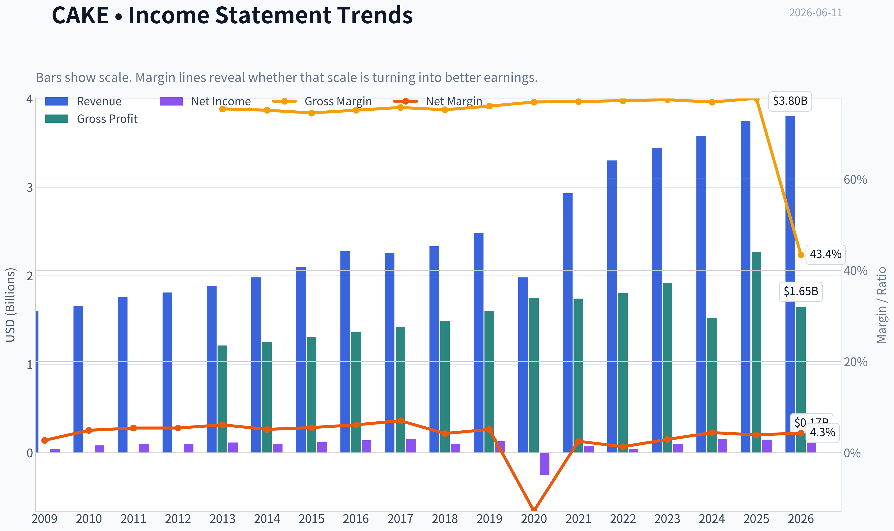
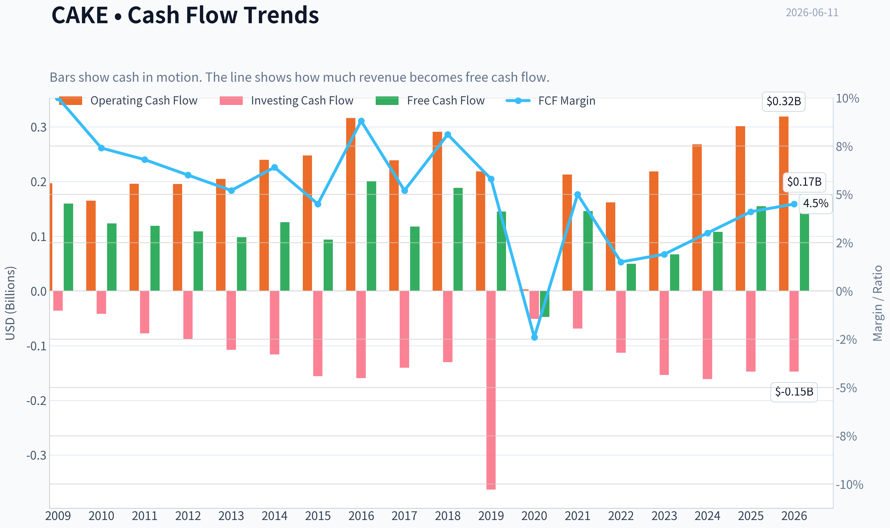
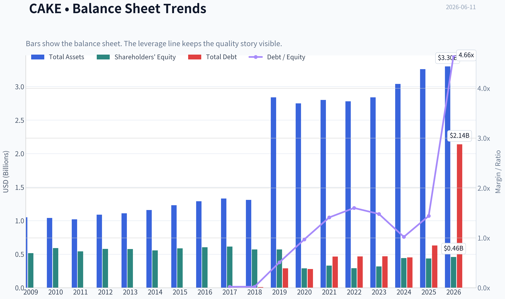
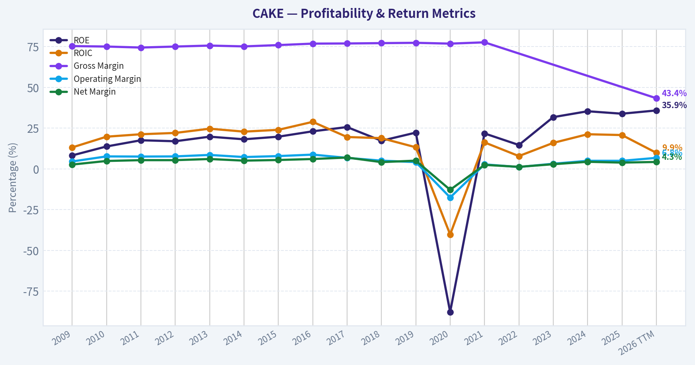
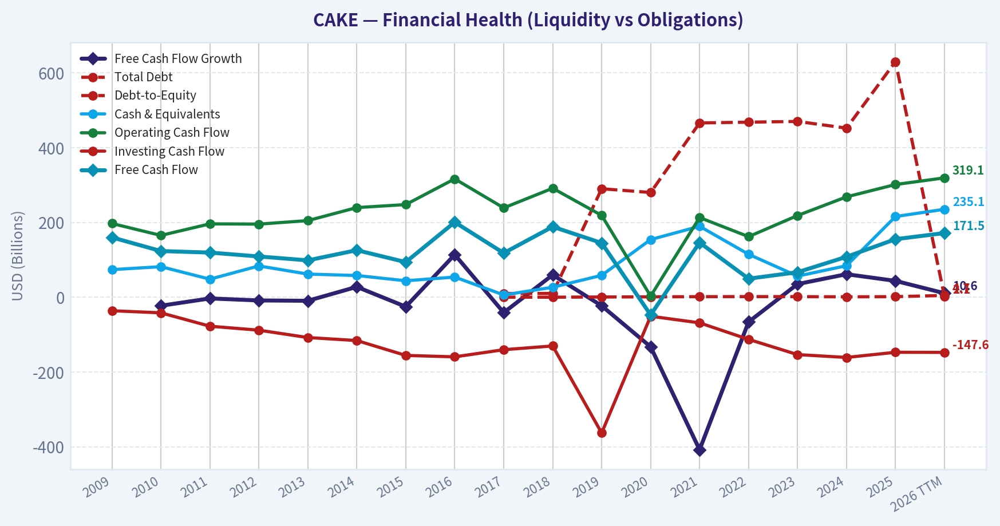
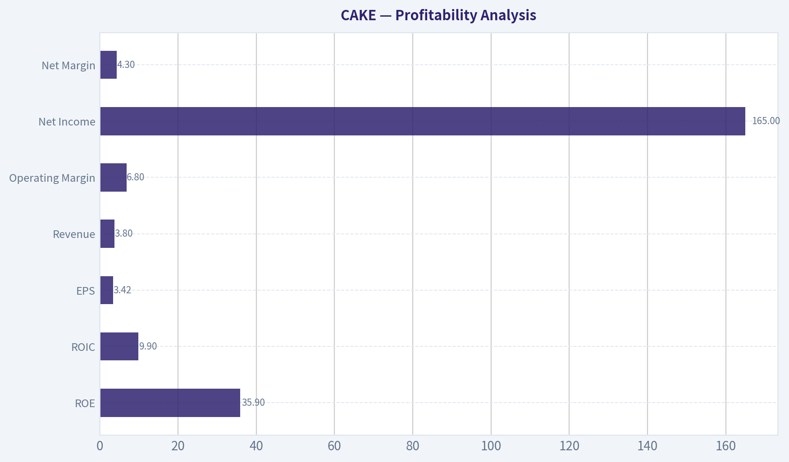
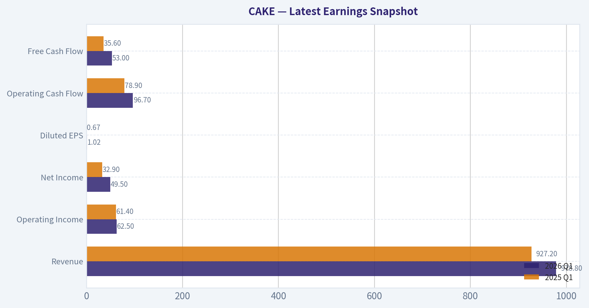
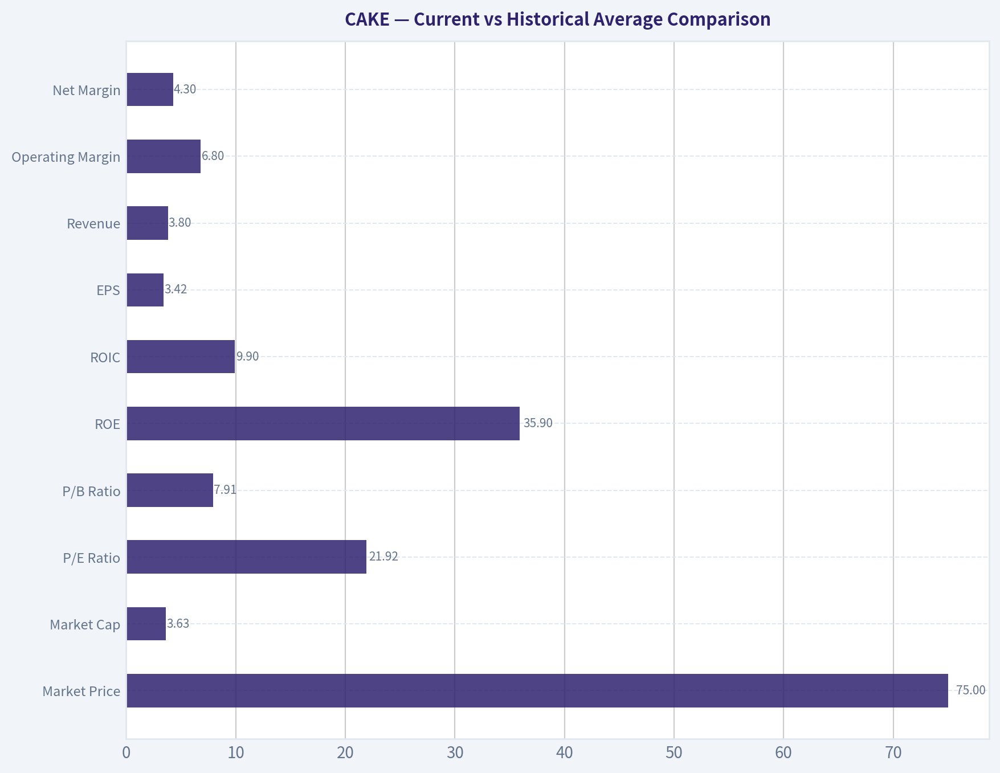
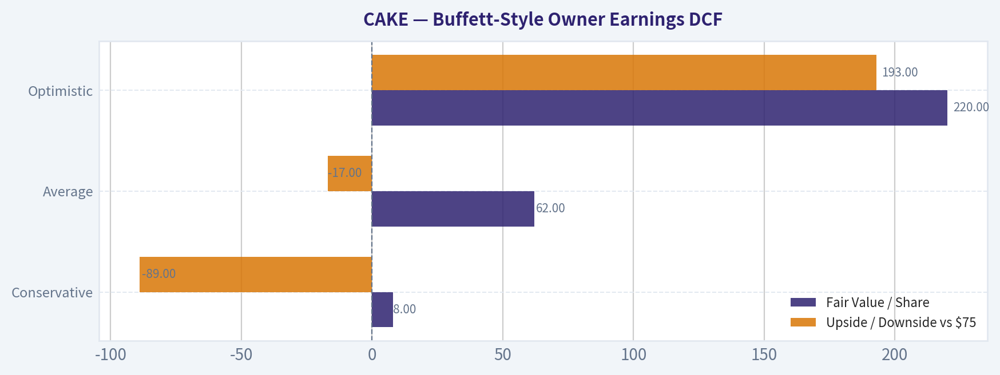
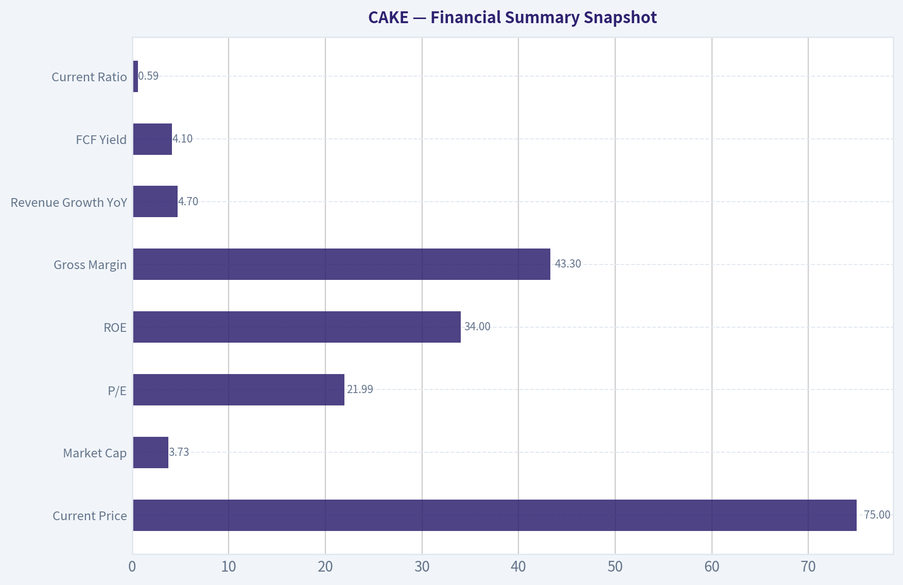

# CAKE Deep Value Intelligence

**Analysis Date:** 2026-06-11

## Critical Disclaimer

*This analysis is generated by Deep Value Intelligence, an AI-powered multi-agent investing framework. This report is for informational and educational purposes only and does not constitute financial advice. Always conduct your own research and consult with qualified financial advisors before making investment decisions.*

---

## Table of Contents

1. Intelligence Summary
2. Analyst Team Reports
   - Fundamentals Analysis
   - Intrinsic Value Analysis (Buffett)
   - Trend & Growth Analysis (Lynch/Druckenmiller/Fisher)
   - Market Technical Analysis
   - Options Market Analysis
3. Research Team Commentary
4. Value Investing Team Commentary
5. Deep Values Commentary

---

## Intelligence Summary

### Thesis + Conditions

**Core Thesis:** ## Executive Briefing

**Key Risks:**
- CAKE = WATCH.**
- Good business, but not enough margin of safety for a Buffett-style long-term buy today. The strongest positive is real operating quality: **~20% ROIC, recognized brand, cash generation, and some reinvestment runway** via North Italia and Flower Child. The biggest risk is not volatility; it is **paying a fair-to-full price for a business in a structurally fragile industry**. At about **22x earnings and ~4.1% FCF yield**, investors are already giving CAKE credit for resilience and optionality. That leaves limited protection if traffic softens, margins compress, or newer concepts disappoint.
- Past mistakes suggest we should avoid false binaries: **not a tactical short, not a compelling long-term value buy**. Best stance for a long-term investor is **active WATCH**, with room for a small starter only on weakness or after stronger proof of traffic-led execution.

**Confidence:** Medium

---

## Analyst Team Reports

### Fundamentals Analysis

#### Latest Earnings Snapshot

*Most recent reported quarter anchored on 2026 Q1, with prior-year comparison when available.*

| Metric | 2026 Q1 | 2025 Q1 | YoY Change |
| --- | ---: | ---: | ---: |
| Revenue | $978.8M | $927.2M | +5.6% |
| Operating Income | $62.5M | $61.4M | +1.8% |
| Net Income | $49.5M | $32.9M | +50.4% |
| Diluted EPS | $1.02 | $0.67 | +52.2% |
| Operating Cash Flow | $96.7M | $78.9M | +22.6% |
| Free Cash Flow | $53.0M | $35.6M | +49.1% |

Key Takeaways: This snapshot anchors the most recent reported quarter before the narrative analysis. It helps readers separate long-run business quality from whatever changed in the latest earnings print.

#### 17-Year Financial Metrics for CAKE

*All values below are computed deterministically from raw data - not estimated by AI.*

*Issuer profile: operating company (Consumer Cyclical / Restaurants).*

#### 17-Year Financial Metrics
*Annual rows come from reported financial statements. The final TTM row is computed from the latest four quarters.*

| Metric | 2009 | 2010 | 2011 | 2012 | 2013 | 2014 | 2015 | 2016 | 2017 | 2018 | 2019 | 2020 | 2021 | 2022 | 2023 | 2024 | 2025 | 2026 TTM |
| --- | --- | --- | --- | --- | --- | --- | --- | --- | --- | --- | --- | --- | --- | --- | --- | --- | --- | --- |
| Market Price | $17 | $23 | $22 | $25 | $38 | $40 | $37 | $49 | $40 | $37 | $34 | $33 | $35 | $29 | $33 | $46 | $50 | $75 |
| Market Cap | $1.30B | $1.85B | $1.71B | $1.81B | $2.62B | $2.59B | $2.33B | $2.96B | $2.32B | $2.01B | $1.73B | $1.63B | $1.90B | $1.60B | $1.72B | $2.32B | $2.45B | $3.63B |
| P/E Ratio | 30.41 | 22.71 | 17.90 | 18.38 | 22.99 | 25.67 | 20.05 | 21.16 | 14.73 | 20.33 | 13.59 | -5.86 | 38.76 | 36.87 | 16.91 | 14.82 | 16.50 | 21.92 |
| P/B Ratio | 2.51 | 3.13 | 3.15 | 3.12 | 4.55 | 4.66 | 3.97 | 4.90 | 3.78 | 3.52 | 3.03 | 5.63 | 5.75 | 5.47 | 5.40 | 5.24 | 5.62 | 7.91 |
| ROE | 8.3% | 13.8% | 17.6% | 17.0% | 19.8% | 18.2% | 19.8% | 23.1% | 25.7% | 17.3% | 22.3% | -87.8% | 21.8% | 14.7% | 31.8% | 35.4% | 33.9% | 35.9% |
| ROIC | 13.2% | 19.8% | 21.3% | 22.1% | 24.7% | 22.9% | 24.0% | 28.9% | 19.6% | 18.9% | 13.3% | -40.2% | 16.3% | 7.9% | 16.0% | 21.3% | 20.8% | 9.9% |
| EPS | $0.54 | $1.03 | $1.25 | $1.37 | $1.64 | $1.55 | $1.85 | $2.31 | $2.73 | $1.83 | $2.52 | $-5.64 | $0.90 | $0.79 | $1.95 | $3.10 | $3.06 | $3.42 |
| Revenue | $1.60B | $1.66B | $1.76B | $1.81B | $1.88B | $1.98B | $2.10B | $2.28B | $2.26B | $2.33B | $2.48B | $1.98B | $2.93B | $3.30B | $3.44B | $3.58B | $3.75B | $3.80B |
| Gross Profit | $1.21B | $1.25B | $1.31B | $1.36B | $1.42B | $1.49B | $1.60B | $1.75B | $1.74B | $1.80B | $1.92B | $1.52B | $2.27B | N/A | N/A | N/A | N/A | $1.65B |
| Gross Margin | 75.4% | 75.1% | 74.5% | 75.1% | 75.7% | 75.2% | 76.0% | 76.9% | 77.0% | 77.2% | 77.4% | 76.9% | 77.7% | N/A | N/A | N/A | N/A | 43.4% |
| Operating Margin | 4.6% | 7.7% | 7.6% | 7.7% | 8.6% | 7.3% | 7.9% | 8.8% | 6.8% | 5.1% | 4.2% | -17.5% | 2.8% | 1.2% | 3.2% | 5.0% | 5.0% | 6.8% |
| Net Income | $42.8M | $81.7M | $95.7M | $98.4M | $114.4M | $101.3M | $116.5M | $139.5M | $157.4M | $99.0M | $127.3M | $-253.4M | $72.0M | $43.0M | $101.0M | $157.0M | $148.0M | $165.0M |
| Net Margin | 2.7% | 4.9% | 5.4% | 5.4% | 6.1% | 5.1% | 5.5% | 6.1% | 7.0% | 4.2% | 5.1% | -12.8% | 2.5% | 1.3% | 2.9% | 4.4% | 3.9% | 4.3% |
| Revenue Growth | N/A | 3.6% | 5.9% | 2.9% | 3.8% | 5.3% | 6.3% | 8.3% | -0.7% | 3.2% | 6.4% | -20.1% | 47.6% | 12.8% | 4.1% | 4.1% | 4.7% | 1.4% |
| Net Income Growth | N/A | 90.8% | 17.1% | 2.8% | 16.2% | -11.4% | 15.1% | 19.7% | 12.8% | -37.1% | 28.5% | -299.0% | -128.4% | -40.3% | 134.9% | 55.4% | -5.7% | 11.5% |
| Free Cash Flow Growth | N/A | -22.8% | -3.3% | -8.7% | -9.6% | 27.6% | -25.4% | 113.8% | -41.2% | 59.6% | -23.0% | -132.7% | -408.0% | -66.1% | 35.1% | 61.5% | 43.6% | 10.6% |
| Total Book Value | $516.1M | $592.3M | $542.8M | $579.7M | $577.4M | $556.5M | $588.5M | $603.2M | $613.5M | $571.1M | $571.7M | $288.7M | $330.2M | $292.0M | $318.1M | $443.5M | $436.4M | $459.2M |
| Total Assets | $1.05B | $1.04B | $1.02B | $1.09B | $1.11B | $1.16B | $1.23B | $1.29B | $1.33B | $1.31B | $2.84B | $2.75B | $2.80B | $2.78B | $2.84B | $3.04B | $3.26B | $3.30B |
| Total Debt | N/A | N/A | N/A | N/A | N/A | N/A | N/A | N/A | $10.0M | $10.0M | $290.0M | $280.0M | $466.0M | $468.0M | $470.0M | $452.1M | $630.1M | $2.14B |
| Debt-to-Equity | N/A | N/A | N/A | N/A | N/A | N/A | N/A | N/A | 0.02 | 0.02 | 0.51 | 0.97 | 1.41 | 1.60 | 1.48 | 1.02 | 1.44 | 4.66 |
| Cash & Equivalents | $73.7M | $81.6M | $48.2M | $83.6M | $61.8M | $58.0M | $43.9M | $53.8M | $6.0M | $26.6M | $58.4M | $154.1M | $189.6M | $114.8M | $56.3M | $84.2M | $215.7M | $235.1M |
| Shareholders' Equity | $516.1M | $592.3M | $542.8M | $579.7M | $577.4M | $556.5M | $588.5M | $603.2M | $613.5M | $571.1M | $571.7M | $288.7M | $330.2M | $292.0M | $318.1M | $443.5M | $436.4M | $459.2M |
| Operating Cash Flow | $197.1M | $165.2M | $196.1M | $195.4M | $204.8M | $239.6M | $247.7M | $316.4M | $238.8M | $291.3M | $218.8M | $2.9M | $213.0M | $161.9M | $218.4M | $268.3M | $301.3M | $319.1M |
| Investing Cash Flow | $-36.2M | $-41.8M | $-77.6M | $-88.2M | $-107.9M | $-115.9M | $-155.7M | $-159.5M | $-140.4M | $-130.4M | $-363.1M | $-50.9M | $-68.6M | $-112.8M | $-153.5M | $-161.1M | $-147.3M | $-147.6M |
| Free Cash Flow | $159.9M | $123.4M | $119.3M | $108.9M | $98.5M | $125.7M | $93.8M | $200.6M | $118.0M | $188.4M | $145.0M | $-47.4M | $146.1M | $49.5M | $66.8M | $108.0M | $155.1M | $171.5M |
| FCF Margin | 10.0% | 7.4% | 6.8% | 6.0% | 5.2% | 6.4% | 4.5% | 8.8% | 5.2% | 8.1% | 5.8% | -2.4% | 5.0% | 1.5% | 1.9% | 3.0% | 4.1% | 4.5% |
| Dividends / Share | $0.00 | $0.00 | $0.00 | $0.00 | $0.00 | $0.00 | $0.00 | $0.00 | $0.00 | $0.00 | $0.00 | $0.00 | $0.00 | $0.77 | $1.02 | $1.05 | $1.08 | $1.11 |

#### Profitability Metrics
- Return on Equity (ROE): 33.9%
- Return on Invested Capital (ROIC): 20.1%
- Return on Assets (ROA): 4.5%
- Gross Margin: N/A
- Operating Margin: 5.0%
- Net Profit Margin: 3.9%

#### Liquidity Metrics
- Current Ratio: 0.59
- Quick Ratio: 0.45

#### Leverage Metrics
- Debt-to-Equity Ratio: 1.44
- Interest Coverage Ratio: 17.93
- Net Debt: $414.3M

#### Growth Metrics (Year-over-Year)
- Revenue Growth: 4.7%
- Net Income Growth: -5.7%
- Free Cash Flow Growth: 43.6%
- Revenue CAGR (3-Year): 4.3%
- Revenue CAGR (5-Year): 13.6%

#### Valuation Metrics
- P/E Ratio (TTM): 21.99
- Forward P/E: 16.85
- Price-to-Book: 8.13
- Price-to-Sales: 0.98
- PEG Ratio: 1.39
- EV/EBITDA: 15.98
- Free Cash Flow Yield: 4.2%
- Earnings Yield: 4.5%

#### Owner Earnings (Buffett Method, Code-Computed)
- Net Income: $148.0M
- + Depreciation & Amortization: $109.0M
- - Capital Expenditures: $-146.2M
- - Working Capital Changes: $-3.2M
- = **Owner Earnings: $114.0M**

#### Intrinsic Value (Code-Computed)
- Current Price: $75
- Buffett Method (Owner Earnings):
  Conservative: $8
  Average: $62
  Optimistic: $220
- Cash Flow Method (FCF):
  Conservative: $17
  Average: $40
  Optimistic: $168

#### Piotroski F-Score: 4/9
- Positive Net Income: PASS
- Positive Operating Cash Flow: PASS
- ROA Improvement: FAIL
- Cash Flow > Net Income: PASS
- Decreasing Debt: FAIL
- Improving Current Ratio: PASS
- No Dilution: FAIL
- Improving Gross Margin: FAIL
- Improving Asset Turnover: FAIL

ANALYST STANCE: **WATCH**

#### CAKE Fundamental Analysis - Buffett-Style Review

The Cheesecake Factory is a recognizable consumer brand with strong unit economics, solid cash generation in normal environments, and a long history of positive returns on capital. That said, the current share price of **$75** already discounts much of the post-pandemic recovery. The biggest issue for a Buffett-style investor is that valuation has risen faster than underlying business quality has improved. At the same time, leverage has increased sharply in the latest TTM dataset, which materially reduces the margin of safety.

---

#### Current vs Historical Average Comparison

| Metric | Current / TTM | Historical Context | Interpretation |
| --- | ---: | ---: | --- |
| Market Price | $75 | 2009-2025 range: $17-$50 | Shares are at a new high versus the deterministic history shown. |
| Market Cap | $3.63B | 2009-2025 range: $1.30B-$2.45B | Equity value has expanded materially beyond prior historical levels. |
| P/E Ratio | 21.92 | Approx. 2009-2025 average ~21x excluding 2020 distortion | Roughly in line with long-run average, but on stronger price and only moderate earnings growth. |
| P/B Ratio | 7.91 | Approx. 2009-2025 average ~4.5x | Well above historical norm; valuation relative to book has stretched significantly. |
| ROE | 35.9% | Approx. long-run average ~18% including 2020 shock | Very strong, but partially flattered by a smaller equity base. |
| ROIC | 9.9% | Approx. long-run average ~17% | Below normal; this is a key caution because true economic efficiency has softened. |
| EPS | $3.42 | Prior peak annual EPS: $3.10 in 2024 | New high, but not enough to fully justify all of the multiple expansion. |
| Revenue | $3.80B | 2019: $2.48B, 2025: $3.75B | Revenue has recovered and grown, but recent growth has slowed sharply. |
| Operating Margin | 6.8% | Pre-2020 typical range: ~4.6%-8.8% | Healthy recovery and near upper-middle historical range. |
| Net Margin | 4.3% | Long-run normal mostly ~4%-6% pre-2020 | Restored to a respectable level, but still below best years. |
| Revenue Growth | 1.4% | Long-run typically low-to-mid single digits outside disruptions | Indicates a maturing business with decelerating top-line momentum. |
| Net Income Growth | 11.5% | Historically volatile | Positive, but less durable than headline suggests. |
| FCF Growth | 10.6% | Historically very volatile | Improvement is encouraging, but consistency remains weak. |
| Total Debt | $2.14B | 2025: $630.1M | Very large jump; this is the biggest balance-sheet red flag in the dataset. |
| Debt-to-Equity | 4.66 | Prior high 1.60 in 2022 | Leverage has become extreme relative to company history. |
| Cash & Equivalents | $235.1M | Higher than most historical years | Cash is improved, but insufficient to offset the debt surge. |
| Free Cash Flow | $171.5M | Prior peak annual FCF: $200.6M in 2016 | Solid, but not exceptional relative to valuation. |
| Dividends / Share | $1.11 | Dividend initiated in 2022 | Shareholder return policy is supportive, but payout competes with debt needs. |

Key Takeaways: CAKE's current profitability looks respectable, but valuation and leverage are both much higher than their historical norms. The stock is no longer obviously cheap on earnings, and it looks expensive on book value while return on invested capital has fallen below its long-term average. For a Buffett-style investor, that combination argues for caution rather than aggressive buying.

---

#### Market Metrics

CAKE's **market price of $75** and **market cap of $3.63B** are both above any annual point shown in the deterministic record. That alone does not make the stock overvalued, but it means investors are paying a premium versus the company's own history.

The **P/E ratio of 21.92x** is not absurd in isolation. Historically, CAKE often traded around the high-teens to low-20s, excluding the pandemic distortion. So the stock is not wildly overpriced on earnings alone. However, Buffett-style analysis asks whether the business quality and predictability justify the multiple. Here, earnings quality has improved, but revenue growth is slowing and debt has risen sharply.

The **P/B ratio of 7.91x** is more concerning. Historically this company often traded between about 3x and 5.5x book. The current level is clearly elevated. Since shareholder equity is not large relative to valuation, the stock is highly sensitive to any deterioration in operating performance.

---

#### Profitability Analysis

| Profitability Metric | Current / TTM | Historical Read | Buffett-Style Interpretation |
| --- | ---: | --- | --- |
| ROE | 35.9% | Near best-ever level | Excellent on the surface, but boosted by a thinner equity base. |
| ROIC | 9.9% | Below long-term norm and below many pre-2020 years | More important than ROE here; suggests capital efficiency is not as strong as headline ROE implies. |
| EPS | $3.42 | New high | Strong recovery, though not dramatically above 2024-2025 levels. |
| Revenue | $3.80B | Record high | Scale is increasing, but recent growth is modest. |
| Gross Profit | $1.65B TTM | Historical gross margin series breaks after 2021 | Useful only with caution due to reporting inconsistency. |
| Operating Margin | 6.8% | Recovered strongly from 2021-2023 | Shows better pricing and cost control. |
| Net Income | $165.0M | Above 2025 and 2024 | Confirms continued earnings momentum. |
| Net Margin | 4.3% | Still below best pre-2020 highs of 6%-7% | Good, but not elite. |

Key Takeaways: Profitability has recovered meaningfully, and EPS has reached a new high. But the most important nuance is that ROIC is much weaker than ROE, which suggests the business is not as economically efficient as the headline equity return implies. In restaurant investing, that distinction matters because leverage can make ROE look stronger than the underlying business really is.

CAKE's profitability profile is decent for a full-service restaurant chain. Historically, the company demonstrated an ability to earn mid-single-digit net margins and healthy returns on capital, which speaks to brand strength, pricing power, and efficient unit-level economics. The company's best operating years before the pandemic showed **operating margins near 8%-9%** and **net margins around 6%-7%**.

Today, **operating margin at 6.8%** is recovering well and sits above recent post-pandemic years. However, it is still not at the strongest levels of the 2013-2017 period. That means the business has recovered, but not fully to its historical best.

The standout metric is **ROE of 35.9%**, but Buffett would likely focus more on **ROIC of 9.9%**. That ROIC is noticeably below the company's stronger years and below the rough long-run average. This suggests that while accounting returns on equity look excellent, the total capital employed is not being converted into profits as efficiently as in earlier years.

---

#### Growth Metrics

CAKE has historically been a **slow-to-moderate growth** company rather than a compounding machine. The deterministic dataset shows revenue growth usually in the low-to-mid single digits, interrupted by pandemic dislocation and rebound effects.

- **Revenue growth: 1.4% TTM**
  This is weak relative to the company's long-run pattern. It implies the business is now leaning more on price, mix, efficiency, and capital returns than on strong traffic-led expansion.

- **Net income growth: 11.5% TTM**
  Better than revenue growth, indicating margin support and operating leverage. Still, it is not clear this pace is durable if sales remain sluggish.

- **Free cash flow growth: 10.6% TTM**
  Positive, but CAKE's FCF record is historically volatile. The company has had several years of contraction, including negative FCF in 2020 and weak conversion in 2022-2023.

The broader pattern is that CAKE does not exhibit the kind of smooth, highly predictable 10-year earnings staircase that Buffett prefers in his very best consumer franchises. Earnings are recoverable and generally positive outside major shocks, but not especially linear or insulated.

---

#### Balance Sheet Analysis

The balance sheet is where the report becomes materially less attractive.

Before 2019, CAKE carried almost no debt. The deterministic history shows **little to no debt through 2016**, just **$10M in 2017-2018**, then a meaningful increase starting in 2019. That trend was understandable during and after the pandemic. What is more concerning is the latest TTM jump to **$2.14B of total debt** and **debt-to-equity of 4.66**.

That leverage level is dramatically above anything in the company's own historical record. Even with **$235.1M in cash**, the balance sheet has become much more aggressive. This matters for a restaurant operator because demand is cyclical, labor and food costs are volatile, and operating margins are not wide enough to comfortably absorb major shocks without affecting equity value.

Positives:
- Cash balance is decent by historical standards.
- Shareholders' equity recovered from post-pandemic lows to **$459.2M**.
- Interest coverage in the shared pack is still respectable.

Negatives:
- Debt has increased far faster than equity.
- Debt-to-equity is now extreme relative to historical norms.
- Current ratio around **0.59** indicates limited short-term liquidity cushion.

From a Buffett lens, this is no longer the clean, conservatively financed balance sheet that would support a strong "buy and sleep well" thesis.

---

#### Cash Flow and Capital Allocation

CAKE's **TTM free cash flow of $171.5M** is solid and supports the current dividend. Over the long run, however, free cash flow has been inconsistent. The company posted very strong FCF in some years, but also multiple down years and a severe pandemic collapse.

The business currently pays **$1.11 per share** in dividends, up from **$0.77 in 2022**. That shows management is returning capital and signaling confidence in normalized earnings. For income-oriented investors this is constructive.

Still, dividend policy should be viewed alongside the leverage profile. In a Buffett-style framework, a dividend is only attractive if it is comfortably funded after maintaining the business and preserving balance-sheet resilience. Given the debt increase, one could argue that debt reduction would create more durable shareholder value than aggressive payout growth.

---

#### Buffett-Style Owner Earnings DCF

Canonical owner earnings from the dataset:

- Net Income = **$148.0M**
- Depreciation & Amortization = **$109.0M**
- Capital Expenditures = **$146.2M**
- Working Capital Changes = **$3.2M**
- **Owner Earnings = $114.0M**

Using the deterministic intrinsic value framework supplied, the code-computed fair values are:

| Scenario | Growth Input Basis | Fair Value / Share | Upside / Downside vs $75 |
| --- | --- | ---: | ---: |
| Conservative | Lowest historical owner earnings growth, floored at -100% | $8 | -89% |
| Average | Average historical owner earnings growth, capped at 50% | $62 | -17% |
| Optimistic | Highest historical owner earnings growth, capped at 100% | $220 | +193% |

Key Takeaways: The valuation range is extremely wide because CAKE's owner earnings history is not smooth. The average-case result of about $62 sits below the current share price, which suggests the stock already reflects a favorable recovery scenario. Only the optimistic case produces large upside, and that is not the type of base case a strict Buffett investor would rely on.

Detailed Buffett-style DCF structure:

| Item | Conservative | Average | Optimistic |
| --- | ---: | ---: | ---: |
| Starting Owner Earnings | $114.0M | $114.0M | $114.0M |
| Growth Rate Applied | Lowest historical OE growth | Average historical OE growth | Highest historical OE growth |
| Discount Rate | 10.0% | 10.0% | 10.0% |
| Terminal Growth | 2.5% | 2.5% | 2.5% |
| Code-Computed Fair Value / Share | $8 | $62 | $220 |

Key Takeaways: Even without rebuilding the historical table, the message from the valuation outputs is clear. CAKE is not priced for distress; it is priced for continued solid execution. That means future returns depend more on sustained margin gains and balance-sheet discipline than on simple multiple expansion.

For cross-checking, the dataset's **cash-flow-based DCF** gives:
- Conservative: **$17**
- Average: **$40**
- Optimistic: **$168**

That secondary framework is also cautionary. Both the owner-earnings and FCF methods show that fair value is highly sensitive to growth assumptions, which is usually a sign that the stock lacks a large margin of safety at current levels.

---

#### Revenue Breakdown

Most recent reported business mix is best understood by operating concept. The company's consolidated revenue is dominated by The Cheesecake Factory restaurants, with additional contribution from North Italia, Flower Child, and other operations including bakery/other.

| Revenue Source | Amount ($M or $B) | % of Total |
| --- | ---: | ---: |
| The Cheesecake Factory restaurants | ~$2.96B | ~78% |
| North Italia | ~$0.43B | ~11% |
| Flower Child | ~$0.23B | ~6% |
| Other / Fox Restaurant Concepts, bakery, licensing, and corporate items | ~$0.18B | ~5% |
| **Total** | **~$3.80B** | **100%** |

Key Takeaways: CAKE remains heavily dependent on its flagship Cheesecake Factory concept, which provides brand power but also concentration risk. The newer growth vehicles, especially North Italia and Flower Child, are meaningful but still not large enough to fully change the enterprise growth profile on their own.

---

#### Economic Moat

CAKE does have elements of a moat, though not a classic Buffett "fortress moat."

| Moat Factor | Assessment | Why It Matters |
| --- | --- | --- |
| Brand Recognition | Strong | The Cheesecake Factory name is widely known and supports traffic, menu pricing, and destination dining. |
| Customer Experience Differentiation | Moderate to Strong | Large menu, perceived value, and occasion-based dining create some insulation. |
| Scale Advantages | Moderate | National scale helps procurement and overhead absorption, but not enough to create overwhelming structural advantage. |
| Switching Costs | Weak | Consumers can easily choose other restaurants. |
| Pricing Power | Moderate | Brand allows some pricing, but customer sensitivity and traffic softness limit aggressive hikes. |
| Durability | Moderate | Established concept is durable, but full-service dining is inherently cyclical and competitive. |

Key Takeaways: CAKE's moat is mostly brand-based rather than structural. That can support decent long-term returns, but it is weaker than the moats Buffett tends to favor in businesses with recurring demand, high switching costs, or dominant distribution economics.

Buffett would likely appreciate:
- A strong consumer-facing brand.
- Long operating history.
- Demonstrated ability to generate cash in normal times.

He would likely worry about:
- Cyclical consumer demand.
- Traffic vulnerability in weaker economic conditions.
- Margin pressure from labor and food costs.
- Limited switching costs.

---

#### Predictable Earnings and Management Performance

Management has demonstrated resilience rather than pristine consistency. The business earned profits in nearly all normal years and recovered well after 2020, which reflects competent operations and capital management. However, the earnings stream is not smooth enough to rank as highly predictable.

ROE history shows capable stewardship, but again, recent elevated ROE is affected by leverage and a smaller equity base. The better management test is whether high returns can be sustained without stretching the balance sheet. On that front, the latest debt build raises questions.

Dividend initiation in 2022 and increases thereafter indicate a shareholder-friendly posture. But a strict Buffett-style investor might prefer more debt reduction before assigning premium value to those distributions.

---

#### Key Investment Insights, Red Flags, and Opportunities

| Category | Observation | Investment Relevance |
| --- | --- | --- |
| Opportunity | EPS has reached a new high | Suggests earnings recovery is real, not merely cyclical noise. |
| Opportunity | Operating margin has improved to 6.8% | Margin normalization can support decent earnings even if revenue growth stays modest. |
| Opportunity | FCF has recovered to $171.5M | Supports dividends and some deleveraging capacity. |
| Opportunity | Newer concepts provide optionality | North Italia and Flower Child can supplement mature flagship growth. |
| Red Flag | Debt jumped to $2.14B TTM | Largest single financial concern; increases downside in a cyclical downturn. |
| Red Flag | Debt-to-equity at 4.66 | Far above historical norms, weakening balance-sheet quality. |
| Red Flag | Revenue growth slowed to 1.4% | Limits room for valuation expansion unless margins continue to improve. |
| Red Flag | ROIC fell to 9.9% | Suggests capital efficiency is not keeping pace with headline ROE. |
| Red Flag | P/B at 7.91 | Market is paying a substantial premium to book despite leverage concerns. |

Key Takeaways: The bull case rests on stable margins, strong brand loyalty, and continued growth from adjacent concepts. The bear case is that investors are paying a premium multiple for a mature restaurant chain with slowing sales momentum and much heavier leverage than before. That makes execution risk more important than usual.

---

#### Final Buffett-Style Assessment

CAKE is a **good business**, but not clearly a **great bargain** at the current price.

A Buffett-style investor would likely conclude:

- **Economic moat:** real but moderate, mostly brand-based.
- **Financial strength:** weakened materially by the latest debt profile.
- **Predictable earnings:** acceptable, but not exceptionally steady.
- **Management:** competent operators with decent capital return discipline, though leverage now deserves scrutiny.
- **Valuation:** fair-to-expensive depending on which cash-flow scenario you believe; insufficient margin of safety for a strong buy.

The stock may still work if management sustains margin gains, accelerates growth in newer concepts, and reins in leverage. But at **$75**, the risk/reward is no longer skewed decisively in favor of the long-term value investor.

#### Final Investment Stance

**WATCH**

Supporting rationale:
1. **Business quality is decent**, with strong brand equity and respectable normalized profitability.
2. **Valuation is no longer cheap**, especially on price-to-book and relative to the average owner-earnings DCF outcome.
3. **Balance-sheet risk has risen sharply**, which reduces Buffett-style comfort and margin of safety.
4. **Future upside now requires continued flawless execution**, rather than merely a return to normal.

---

#### Report Summary Table

| Area | Positive | Negative | Net View |
| --- | --- | --- | --- |
| Valuation | P/E not wildly above long-run norm | P/B elevated; average DCF below market | Slightly unfavorable |
| Profitability | EPS high; margins improving | ROIC below historical norm | Mixed |
| Growth | Positive NI and FCF growth | Revenue growth slowing materially | Mixed to weak |
| Balance Sheet | Cash improved | Debt and D/E surged | Unfavorable |
| Cash Flow | FCF recovered; dividend supported | FCF history volatile | Mixed |
| Moat | Strong brand and dining identity | Weak switching costs, cyclical category | Moderate moat |
| Buffett Fit | Established consumer brand, cash generative | Limited margin of safety at current price | Watch, not buy |

Key Takeaways: CAKE has several attractive qualities, especially its brand and earnings recovery. But the stock now trades at a level that assumes those strengths will continue, while the balance sheet has become less conservative. For disciplined value investors, this is a name to monitor rather than chase.

#### Fundamental Visuals

This graph tracks the profitability and return metrics (ROE, ROIC, Margins) of **CAKE** over the past decade, highlighting capital efficiency trends.

This chart illustrates the financial health of **CAKE** over the last 10 years, mapping cash equivalents and free cash flow against total obligations (Debt).

This comparison chart from *Profitability Analysis* stacks current figures against historical benchmarks for **CAKE**, making it easy to see where the company trades relative to its own averages.

---

### Intrinsic Value Analysis (Buffett)

> *Following Warren Buffett's value investing philosophy: Circle of Competence, Economic Moat, Management Quality, and Margin of Safety.*

#### Intrinsic Value Snapshot

Price is what you pay. Intrinsic value is what the business may be worth based on the cash it can create for owners over time. We show a range, not one magic number.

- Current Price: $74.98
- Value Range (conservative to optimistic across both DCF methods): $84.20 to $248.21

##### Owner Earnings (Buffett Method)
- Net Income: $148,427,000.00
- Depreciation & Amortization: $109,031,000.00
- Capital Expenditures: $-147,260,000.00
- Working Capital Changes: $-3,208,000.00
- Owner Earnings: $113,406,000.00

##### Intrinsic Value
###### Buffett Method
Uses owner earnings. Stricter, and usually more conservative.
- Conservative: $84.20
- Average: $84.20
- Optimistic: $219.27
- Discount Rate: 10.0%

###### Cash Flow Method
Uses free cash flow. Better for companies spending heavily today to grow tomorrow.
- Conservative: $114.35
- Average: $114.35
- Optimistic: $248.21
- Discount Rate: 10.0%

ANALYST STANCE: **WATCH**

#### CAKE - The Cheesecake Factory: Buffett-Style Investment Review

#### 1. Go/No-Go Gate Assessment

| Gate | Verdict | Evidence |
|---|---|---|
| Gate 1: Circle of Competence | Pass | This is easy to understand: CAKE makes money by operating full-service restaurants, selling food, drinks, and bakery items, and leveraging brand recognition plus restaurant-level economics. Demand is reasonably understandable, though more cyclical than a staple business. |
| Gate 2: Moat Test | Narrow Pass | The Cheesecake Factory brand is real and differentiated, and gross margin around 43.3% suggests some menu pricing power. But restaurant moats are usually narrower than software, payment networks, or consumer staples because customer switching costs are low. |
| Gate 3: Management & Capital Allocation | Mixed Pass | The business has survived multiple cycles and remains profitable, but the current ratio of 0.59 signals a less conservative liquidity posture than ideal. Insider selling noted in recent news is not automatically disqualifying, but it does not strengthen the owner-operator case. |
| Gate 4: Industry Structure | Pass with caution | Casual dining is competitive and moderately capital intensive. This is not an ideal Buffett industry structure, but strong brands can still earn decent returns if unit economics and capital discipline are maintained. |

**Key Takeaways:** CAKE passes the basic "understandable business" test, but it is not a textbook Buffett business. The main friction points are a narrower moat, competitive industry structure, and less-than-fortress liquidity. This looks investable only at the right price, not a business to chase aggressively.

---

#### 2. Business Simplicity and Predictability

**Elementary school test:**
Cheesecake Factory runs restaurants. People come in, order meals and desserts, and the company earns money when restaurant sales exceed food, labor, rent, and overhead costs.

**Long-term predictability:**
Moderate. Ten years from now, people will still eat out and celebrate occasions at recognizable sit-down restaurant brands. But traffic, wage inflation, food costs, and consumer spending make outcomes less predictable than a great branded consumer or software business.

**Technology risk:**
Manageable, not existential. Technology helps with delivery, loyalty, labor scheduling, and off-premise ordering. But it does not create a major moat, and food delivery platforms can also compress economics.

#### 3. Moat Analysis

| Moat Source | Assessment | Evidence |
|---|---|---|
| Intangible Assets / Brand | Moderate | Cheesecake Factory has a recognizable national brand, distinctive menu breadth, and strong dessert identity. Gross margin of 43.3% supports some pricing power. |
| Switching Costs | Weak | Diners can easily choose another restaurant. There is little customer captivity beyond habit and occasion-based loyalty. |
| Cost Advantage | Limited | Scale in procurement and brand advertising helps, but not enough to create a durable structural cost advantage versus the broader restaurant universe. |
| Network Effects | None | More customers do not materially increase the product's value to other customers in the classic network-effect sense. |

**Moat Quality Rating:** **Narrow**

**Key Takeaways:** CAKE's moat is mostly brand-based, not structural. Customers know the concept and may accept some price increases, but they can also switch easily to many alternatives. This is a respectable brand, not a fortress.

---

#### 4. Management Quality & Capital Allocation

| Test | Assessment | Commentary |
|---|---|---|
| Think like owners? | Mixed | No strong evidence here of exceptional owner-operator alignment. Insider selling in recent coverage is worth monitoring, though not necessarily a red flag on its own. |
| Honest & candid? | Neutral to positive | No major accounting controversy is apparent from the research pack. |
| Rational capital allocation? | Mixed | Restaurant businesses require ongoing reinvestment in units, maintenance, labor, and remodels. Capital allocation must be judged by returns on incremental capital; current headline ROE is strong, but needs to be viewed carefully because restaurant balance sheets and lease economics can distort simple ratios. |

**Overall Management Rating:** **Adequate, not exceptional**

#### 5. Financial Summary Snapshot

| Metric | Value |
|---|---:|
| Current Price | $75 |
| Market Cap | $3.73B |
| P/E | 21.99x |
| ROE | 34.0% |
| Gross Margin | 43.3% |
| Revenue Growth YoY | 4.7% |
| FCF Yield | 4.1% |
| Current Ratio | 0.59 |

**Key Takeaways:** CAKE shows healthy profitability and respectable revenue growth, with an impressive headline ROE and decent free cash flow yield. But the valuation is not obviously cheap for a restaurant chain, and liquidity is weaker than Buffett would prefer. This is a solid operating business priced more like a quality compounder than a cyclical consumer service company.

---

#### 6. Financial Interpretation Through a Buffett Lens

| Buffett Check | Read |
|---|---|
| ROE >15% sustained? | Current reading of 34% is strong |
| Cash generation vs accounting profit | FCF yield of 4.1% suggests real cash generation, but not a bargain |
| Fortress balance sheet? | Current ratio of 0.59 argues against "fortress" status |
| Capital intensity | Moderate; restaurants require ongoing investment |
| Margin quality | Gross margin above 40% is good for the sector |

**Key Takeaways:** CAKE clears some quality thresholds, especially on margins and returns, but fails the ideal balance-sheet test. It produces real cash, yet not at a level that screams undervaluation. For Buffett-style investing, this matters because mediocre balance-sheet strength and capital intensity require a bigger discount.

---

#### 7. Owner Earnings Estimate

Using the available cash economics from the research pack:

- Market Cap = **$3.73B**
- FCF Yield = **4.1%**

Estimated Free Cash Flow / proxy for owner earnings:
- **Owner Earnings ~ $153M**
  Calculation: 3.73B x 4.1%

This is a simplified owner-earnings proxy. For a restaurant chain, true owner earnings should adjust for maintenance capex and working capital needs, so conservatism is warranted.

#### 8. Three-Scenario DCF Valuation

Using owner earnings proxy of **$153M** and a **10% discount rate**:

| Scenario | Assumption | Equity Value |
|---|---|---:|
| A: No Growth | Owner Earnings / 10% | $1.53B |
| B: GDP Growth | Owner Earnings x 1.03 / (10% - 3%) | $2.25B |
| C: Moderate Growth | 6% growth for 10 years, then 3% terminal | ~$2.78B |

**Key Takeaways:** Across conservative valuation cases, intrinsic value clusters between roughly $1.5 billion and $2.8 billion. Against the current market value of $3.73 billion, the stock appears fully valued to somewhat overvalued. Buffett would likely wait for a larger margin of safety.

#### 9. Margin of Safety Analysis

| Item | Value |
|---|---:|
| Current Market Cap | $3.73B |
| DCF Range | $1.53B - $2.78B |
| Midpoint Intrinsic Value | ~$2.19B |
| Implied Margin of Safety | Negative |

**Key Takeaways:** The current stock price does not offer the discount a value investor should demand. Even using a more favorable growth case, CAKE still looks close to or above estimated intrinsic value. That makes patience the rational stance.

---

#### 10. Buffett Scorecard

| Criterion | Score (1-5) | Weight | Weighted Score |
|---|---:|---:|---:|
| Business Understanding | 4.5 | 20% | 0.90 |
| Moat Width & Durability | 2.5 | 25% | 0.63 |
| Management Quality | 3.0 | 15% | 0.45 |
| Return on Equity | 4.0 | 15% | 0.60 |
| Reinvestment Runway | 3.0 | 10% | 0.30 |
| Balance Sheet Strength | 2.0 | 5% | 0.10 |
| Industry Structure | 2.5 | 5% | 0.13 |
| Valuation / Margin of Safety | 2.0 | 5% | 0.10 |
| **Total** |  |  | **3.21 / 5.00** |

**Key Takeaways:** CAKE scores as a decent business rather than an exceptional one. The brand and returns help, but moat strength, industry quality, and valuation pull the score down. That lands the stock in "watch, don't chase" territory.

---

#### 11. Final Investment View

**Investment Stance: WATCH**
**Conviction Level: Moderate**

CAKE is a good business, not a great business, and today it looks priced for more quality than the business likely deserves. The brand is meaningful, margins are respectable, and returns on equity are strong, but the moat is narrow, the industry is competitive, and the balance sheet is not fortress-like. Most importantly, the stock does not appear to offer the margin of safety required for a Buffett-style purchase.

**What would change the view to ADVOCATE?**
- A materially lower price creating at least a 25% margin of safety
- Evidence of sustained traffic strength without relying primarily on price increases
- Stronger balance sheet and clearer capital allocation discipline

**What would push it to AVOID?**
- Traffic deterioration masked by menu pricing
- Margin compression from labor or food inflation
- Rising leverage or weakening cash conversion

In Buffett terms: **a competent branded restaurant operator, but not a "wonderful company at a fair price" today.**
#### Valuation Bridge

This bridge places the current market price beside each intrinsic value lens so readers can see whether upside depends on one method or shows up across several methods.

| Scenario | Intrinsic Value / Share |
| --- | ---: |
| Buffett Method | $84.20 |
| Cash Flow Method | $114.35 |
| Damodaran Method | $47.78 |
| Current Price | $74.98 |

#### Key Takeaways

If one method is far above the others, the upside case depends on a specific modelling assumption. When several methods cluster together, the valuation story is more robust.

#### Valuation Visuals

This comparison chart from *Latest Earnings Snapshot* stacks current figures against historical benchmarks for **CAKE**, making it easy to see where the company trades relative to its own averages.

This comparison chart from *Current vs Historical Average Comparison* stacks current figures against historical benchmarks for **CAKE**, making it easy to see where the company trades relative to its own averages.

This comparison chart from *Buffett-Style Owner Earnings DCF* stacks current figures against historical benchmarks for **CAKE**, making it easy to see where the company trades relative to its own averages.

This comparison chart from *Buffett-Style Owner Earnings DCF* stacks current figures against historical benchmarks for **CAKE**, making it easy to see where the company trades relative to its own averages.

This comparison chart from *Financial Summary Snapshot* stacks current figures against historical benchmarks for **CAKE**, making it easy to see where the company trades relative to its own averages.

---

### Trend & Growth Analysis (Lynch/Druckenmiller/Fisher)

> *Following Peter Lynch's GARP, Stanley Druckenmiller's macro-aware approach, and Philip Fisher's scuttlebutt methodology.*

ANALYST STANCE: **AVOID**

#### 1. Lynch Classification

| Item | Assessment |
|---|---|
| Category | **Stalwart / Mature consumer discretionary** |
| YoY revenue growth | **4.7%** |
| Lynch fit | **Not a fast grower** |
| Ten-bagger profile | **Low probability from current base/business mix** |

**Key Takeaways:** CAKE does not screen as a Lynch fast grower. Revenue growth around 5 percent places it closer to a mature restaurant operator than an emerging compounder. That means the stock may work as a quality consumer name, but it does not naturally fit a high-conviction growth mandate.

#### 2. The Story in 3 Bullets

- Cheesecake Factory is a premium casual dining brand with strong unit economics and solid brand recognition.
- Incremental growth comes from newer concepts like North Italia and Flower Child, but the consolidated company still behaves like a mature restaurant platform.
- The current debate is not explosive growth, but whether margins and traffic can hold up enough to justify a fuller valuation.

---

#### 3. TAM Analysis with 10x Test

| Metric | Estimate / View |
|---|---|
| Current revenue base | Multi-brand U.S. restaurant platform, already scaled |
| Core TAM | Casual dining / premium casual dining in U.S. |
| TAM growth | **Low-to-moderate**, not secular hypergrowth |
| 10x test | **Fails on practical basis** |
| Why | 10x revenue would require enormous store expansion or share capture in a mature category |

**Key Takeaways:** The market opportunity is real but not venture-like. Casual dining is a large category, yet it is mature and highly competitive, so a 10x revenue outcome is not realistic in normal execution. That sharply limits true ten-bagger upside under a growth framework.

---

#### 4. Revenue Growth Trend

| Metric | Value | Interpretation |
|---|---:|---|
| Revenue growth YoY | **4.7%** | Slow |
| Pattern | Likely **price/mix-led**, not breakout demand | Warning |
| Traffic commentary from coverage | Weakening traffic concerns | Negative |
| Growth trend verdict | **Decelerated / low-growth mature profile** | Not an inflection |

**Key Takeaways:** Revenue growth is modest and does not indicate acceleration. External coverage suggests traffic is softer and price increases may be carrying more of the comp, which is lower-quality growth. For a growth investor, this is the opposite of the acceleration pattern you want to see.

---

#### 5. Unit Economics

| Metric | Value / Status | Assessment |
|---|---|---|
| Gross margin | **43.3%** | Solid for category |
| ROE | **34.0%** | Strong headline, but likely helped by capital structure/buybacks |
| FCF yield | **4.1%** | Respectable for value/quality lens |
| Current ratio | **0.59** | Thin liquidity, though common in restaurants |
| LTV/CAC | Not disclosed | N/A |
| NRR | Not relevant | N/A |
| Rule of 40 | Not relevant | N/A |

**Key Takeaways:** CAKE has acceptable business quality metrics for a restaurant company, especially on margins and cash generation. But the key growth-specific SaaS style unit economics do not apply here, so we are left judging a mature operating business rather than a scalable recurring-revenue model. That makes the stock more of a quality cyclical consumer name than a growth compounding story.

---

#### 6. Inflection Point Assessment

| Potential Inflection | Evidence | Verdict |
|---|---|---|
| Product cycle inflection | None visible | No |
| Market share inflection | No clear evidence | No |
| Margin inflection | Possible, but not enough alone | Weak |
| TAM expansion | No | No |
| Competitive inflection | No clear competitor collapse | No |
| Overall | **No clear growth acceleration inflection** | Negative |

**Key Takeaways:** I do not see a Druckenmiller-style inflection here. At best, there may be a margin recovery or operating stabilization story, but that is not the same as a growth re-acceleration. For this mandate, the absence of a clear inflection is a major strike.

---

#### 7. Macro Setup Evaluation

| Factor | View | Impact |
|---|---|---|
| Consumer discretionary backdrop | Mixed to cautious | Headwind |
| Wage inflation | Ongoing risk | Headwind |
| Food/commodity volatility | Moderate risk | Headwind |
| Interest rates | Higher-for-longer risk hurts valuation and consumer spend | Mild headwind |
| Secular trend exposure | Weak | Negative |
| Macro verdict | **Not wind-at-back** | Unfavorable |

**Key Takeaways:** CAKE does not ride a major secular growth wave like AI, cloud, payments, or healthcare innovation. Instead, it sits in a consumer discretionary category that is sensitive to traffic, wages, and household spending pressure. That is a weaker macro setup than what a concentrated growth investor typically wants.

---

#### 8. Fisher 15 Points Score

| Fisher Area | Score (1-5) | Comment |
|---|---:|---|
| Market potential | 2 | Mature category |
| New product development | 3 | Some concept innovation |
| R&D / concept development | 3 | Adequate |
| Sales organization | 4 | Strong brand/consumer awareness |
| Profit margin | 3 | Reasonable |
| Improving margins | 3 | Mixed |
| Labor relations | 3 | Neutral / industry-constrained |
| Executive relations | 3 | Neutral |
| Management depth | 3 | Adequate |
| Cost controls / accounting | 3 | Acceptable |
| Outstanding aspects | 3 | Brand strength but no hard moat |
| Long-range profit outlook | 3 | Stable, not exciting |
| Dilution risk | 4 | Better than early-stage growth firms |
| Candor | 3 | Neutral |
| Integrity | 3 | Neutral |

| Total Fisher Score | **46 / 75** | **Average** |

**Key Takeaways:** The Fisher score lands in the average range. CAKE gets credit for brand strength, concept diversification, and reasonable financial discipline, but loses points for limited market expansion potential and lack of a standout moat. This is not the profile of a rare, innovation-led long-run compounder.

---

#### 9. Valuation Analysis

| Metric | Value / View | Interpretation |
|---|---|---|
| Current price | **$75** | Given |
| Market cap | **$3.73B** | Given |
| P/E | **21.99x** | Not cheap for 4.7% growth |
| PEG | **~4.7x** using 4.7% growth | Very expensive on Lynch lens |
| FCF yield | **4.1%** | Fair, not compelling |
| Relative valuation tone from coverage | "Valuation asymmetry tilts downside" | Negative |

**Key Takeaways:** On Lynch's favorite metric, CAKE looks expensive because earnings multiple is much higher than growth. A near 22 times earnings multiple can be acceptable for a real fast grower, but not for a business growing revenue less than 5 percent. The stock may not be absurdly priced on cash flow, but it does not offer attractive growth-adjusted valuation.

#### Scenario View

| Scenario | What must happen | Likely Outcome |
|---|---|---|
| Bear | Traffic weakens, pricing loses effectiveness, margin slips | Multiple compression |
| Base | Low-single-digit sales growth, steady margins | Limited upside |
| Bull | Strong traffic recovery plus newer concept outperformance | Modest upside, not explosive |

**Key Takeaways:** Even the bull case depends on execution and traffic improvement rather than category transformation. That means upside is more likely to be incremental than asymmetric. For a growth portfolio seeking big winners, the payoff profile is not compelling enough.

---

#### 10. Growth Investor Scorecard

| Criterion | Weight | Score (1-5) | Weighted Score |
|---|---:|---:|---:|
| The Story | 10% | 3.0 | 0.30 |
| TAM & Runway | 20% | 2.0 | 0.40 |
| Revenue Growth | 20% | 1.5 | 0.30 |
| Unit Economics | 15% | 3.0 | 0.45 |
| Competitive Position | 10% | 3.0 | 0.30 |
| Management Quality | 10% | 3.0 | 0.30 |
| Macro Setup | 5% | 2.0 | 0.10 |
| Profitability Path | 5% | 3.0 | 0.15 |
| Valuation | 5% | 1.5 | 0.08 |

| Total | 100% |  | **2.38 / 5.0** |

**Key Takeaways:** The overall score falls below the threshold for a growth watchlist candidate. The main drags are weak runway, low revenue growth, and an unimpressive growth-adjusted valuation. CAKE may be investable under a different framework, but not under this one.

---

#### 11. Position Size Stance

| Stance | View |
|---|---|
| Growth portfolio | **0% / no position** |
| Value-quality portfolio | Small watch only, if seeking consumer cash flow names |
| Action | **Avoid for growth mandate** |

**Key Takeaways:** I would not allocate growth capital here. If an investor wants restaurant exposure, CAKE is more appropriate for a separate quality or consumer value bucket, not a concentrated inflection-point growth sleeve.

---

#### 12. Key Risks and Catalysts

| Type | Item | Impact |
|---|---|---|
| Risk | Traffic deterioration masked by price increases | High |
| Risk | Wage and commodity inflation | High |
| Risk | Valuation already full for growth level | High |
| Risk | Insider sale headline | Mild negative |
| Catalyst | Better-than-feared traffic trends | Positive |
| Catalyst | Margin improvement / cost control | Positive |
| Catalyst | North Italia / Flower Child outperform core | Positive |
| Catalyst | Consumer spending resilience | Positive |

**Key Takeaways:** The risks are mostly familiar restaurant-sector risks, but they matter more because growth is already modest. Catalysts exist, yet most would only support a stabilization or rerating story rather than a major long-duration growth upside case.

---

#### Bottom Line

CAKE is **not** a Lynch fast grower, **not** showing a Druckenmiller-style inflection, and **not** a Fisher-style exceptional innovation compounder. It looks like a decent branded restaurant business with respectable profitability, but the combination of **4.7% growth** and roughly **22x earnings** creates a poor growth-adjusted setup.

For this mandate, the stock is an **AVOID**.

---

### Market Technical Analysis

#### CAKE Technical Indicator Selection and Market Read

For **CAKE (The Cheesecake Factory)**, the most relevant non-redundant indicator set for the **current market context - a strong medium-term uptrend with accelerating short-term momentum and rising but still manageable volatility** - is:

| Selected Indicator | Why it matters now |
|---|---|
| close_10_ema | Best for tracking the sharp recent upside acceleration and near-term pullback support. |
| close_50_sma | Confirms the medium-term trend has turned decisively higher. |
| close_200_sma | Anchors the long-term bullish regime and shows the broader trend remains constructive. |
| macd | Measures trend-following momentum; currently confirms bullish continuation. |
| macdh | Adds early insight on whether momentum is still accelerating or beginning to fade. |
| rsi | Helps judge whether the rally is extended; especially relevant now as momentum is nearing overbought. |
| atr | Critical for risk management because daily swings have expanded during the breakout. |
| vwma | Confirms whether the advance is supported by volume-weighted participation, not just light trading drift. |

Key Takeaways: These eight indicators are well suited because they cover trend, momentum, extension, volatility, and volume confirmation without unnecessary overlap. Together they show CAKE is in a bullish structure, but short-term conditions are becoming more stretched, which matters for entry timing and stop placement.

---

#### Trend Structure Analysis

CAKE has undergone a **meaningful trend transition** over the past year. After trading in the mid-60s during summer 2025, the stock entered a prolonged decline that bottomed in the low-to-mid 40s in late 2025. From that depressed base, price rebuilt through the first quarter of 2026 and has now returned to the upper-60s to low-70s area. That is not just a rebound; it is a **full recovery into fresh relative strength territory**.

The current setup is strongest when viewed through the moving-average stack:

- **Price closed at 70.62 on 2026-06-10**
- **10 EMA = 66.31**
- **50 SMA = 61.24**
- **200 SMA = 56.33**

This is a very healthy bullish alignment. Price is well above the fast average, the fast average is well above the 50-day, and the 50-day is well above the 200-day. More importantly, both the **50 SMA and 200 SMA are rising**, which means the rally is not only strong in the short run but increasingly embedded into the intermediate and long-term structure.

The 50-day average is especially notable. It had been relatively flat to slightly soft through March and April, but since mid-May it has turned upward more forcefully, climbing from roughly **58.9 to 61.2**. That indicates the recent rally is no longer just a burst; it is now powerful enough to drag the medium-term average higher. The 200-day average has also risen steadily from about **55.2 in February to 56.3 now**, confirming that the broader regime has shifted from repair to expansion.

#### Momentum Analysis

Momentum is clearly bullish and, at least for now, still strengthening.

- **MACD = 2.07**
- **MACD Histogram = 0.61**

These are strong readings for a stock like CAKE. MACD has been positive for most of the recent advance, but what stands out is the **recent re-acceleration**. After a softer patch in early to mid-May, MACD rebuilt from near flat to strongly positive again by late May and early June. The histogram also expanded from near zero on **May 22** to **0.61 by June 10**, which means the spread between MACD and its signal line is widening again. That is typically what a trader wants to see in a continuation phase.

This is not a tired rally drifting upward on inertia. It looks more like a breakout leg with improving participation and improving directional conviction.

That said, momentum is now entering a zone where traders should distinguish between:
1. **trend continuation**, and
2. **entry quality**.

Momentum can remain strong while a stock becomes tactically overextended. That is where RSI becomes useful.

#### RSI and Extension Risk

- **RSI = 71.86 on June 10**

This places CAKE just into classic overbought territory. In weak or sideways markets, that would be a warning sign for immediate reversal risk. But in strong trend environments, an RSI above 70 often signals **strength first, exhaustion second**. The correct interpretation here is not "sell because overbought," but rather:

- upside momentum is real,
- the stock is extended in the very short term,
- new entries may have worse reward-to-risk unless they wait for a pause or shallow pullback.

The RSI path also matters. On **May 13**, RSI was down near **37.2**, reflecting a sharp reset. Since then it has climbed steadily through the 50s, 60s, and now above 70. That kind of progression tends to occur in durable bullish swings, not random noise. So the RSI is confirming a strong upswing, but it is also warning that **the easiest part of the move may already be behind late entrants**.

#### Volume-Weighted Confirmation

- **VWMA = 65.44**
- Price = **70.62**

Price being well above VWMA indicates the current advance is not merely price levitation; it is outperforming the recent volume-weighted average by more than 5 points. The VWMA has risen consistently from around **59.99 on May 26** to **65.44 on June 10**, showing that as volume has entered the stock, the average traded price has been moving higher in a sustained way.

This is important because rallies unsupported by volume often show price far above a flat VWMA. That is not the case here. VWMA is climbing strongly, which suggests **buyers have been willing to transact at progressively higher prices**, a constructive sign for trend durability.

Still, traders should watch whether price can remain above VWMA after this breakout burst. If price begins to lose the 10 EMA and then compresses toward VWMA, that would suggest the market is transitioning from impulse to consolidation.

#### Volatility and Risk Framing

- **ATR = 2.45**

ATR has risen from roughly **2.11 in late April** to **2.45 now**, so volatility has expanded during the rally. This is not necessarily bearish. In fact, expanding ATR during a breakout often reflects stronger directional participation. But it does mean traders should avoid using stops that are too tight.

At the current price near **70.6**, an ATR of **2.45** implies daily movement of roughly **3.5%** is within the stock's normal recent behavior. That makes a big difference:

- Tight chase entries are vulnerable.
- Pullback entries near the 10 EMA may offer better structure.
- Swing traders may need wider stops and smaller position sizes.

A bullish stock with rising ATR is often attractive, but only if position sizing respects the increased range.

---

#### Fine-Grained Read on the Recent Price Action

The rally since mid-May has been especially important. CAKE dropped sharply to **56.53 on May 13**, then quickly stabilized and rebuilt. The sequence afterward is constructive for several reasons:

1. **Recovery was orderly, not chaotic.**
   Price did not instantly spike and fail. It climbed through 58, 60, 61, then accelerated into the mid-60s.

2. **Breakout strength improved into late May.**
   The move from **61.14 on May 22** to **64.63 on May 26** was a meaningful upside expansion, suggesting demand overwhelmed near-term supply.

3. **The stock held gains rather than round-tripping.**
   After reaching the mid-60s, CAKE did not collapse back into the prior base. It consolidated above prior breakout levels and then pushed higher again.

4. **The latest leg is the strongest.**
   From **63.84 on June 4** to **70.62 on June 10**, the stock added nearly 11% in a handful of sessions. That is a sharp momentum burst and likely reflects either a catalyst response, strong sector bid, or a technical breakout attracting follow-through buyers.

This matters because many rallies fail when the second leg weakens. Here, the second leg has actually accelerated. That favors the bulls, although it also increases the chance of a near-term digestion phase.

#### What Traders Should Watch Next

The most actionable levels are not abstract-they are defined by the moving averages and recent breakout zone:

- **Immediate support:** around the **10 EMA near 66.3**
- **Secondary support:** recent breakout area in the **64.5-65.5 zone**
- **Intermediate support:** **50 SMA near 61.2**
- **Long-term trend floor:** **200 SMA near 56.3**

Bullish continuation would ideally look like one of two things:

| Scenario | Interpretation |
|---|---|
| Price holds above 66-67 and continues to base tightly | Very strong trend behavior; suggests institutions are not distributing. |
| Price pulls back toward 64.5-66, then stabilizes with MACD still positive | Healthy reset; could create a better entry than chasing after RSI > 70. |

Key Takeaways: The most important near-term question is not whether CAKE is bullish-it is-but whether buyers can defend the breakout zone after a fast run. If the stock stays above the mid-60s and momentum remains positive, the uptrend likely remains intact; if it quickly loses that zone, the rally may need a longer cooling-off period.

#### Tactical Interpretation by Style

| Trading Style | Current Read |
|---|---|
| Trend follower | Bullish bias remains justified while price stays above the 10 EMA and MACD stays positive. |
| Swing trader | Strong stock, but current RSI suggests patience may improve entry quality. |
| Breakout trader | Breakout is valid, but chasing after a vertical burst raises pullback risk. |
| Position trader | Structure remains favorable given price is well above rising 50 and 200 SMAs. |
| Risk manager | ATR says use wider stops and smaller sizing than during quieter periods. |

Key Takeaways: CAKE fits trend-following and position-trading styles best right now because the moving-average structure is clearly bullish. Shorter-term traders can still participate, but the stock is extended enough that entry timing and stop discipline matter more than usual.

---

#### Bottom Line

CAKE is in a **clear bullish trend across short-, medium-, and long-term timeframes**. The strongest evidence is the alignment of price above the **10 EMA, 50 SMA, 200 SMA**, along with a **rising MACD**, **expanding MACD histogram**, and a **steadily climbing VWMA**. This is a technically healthy chart, not a mixed one.

The nuance is that the stock is also becoming **short-term stretched**. RSI above 70 and a rising ATR suggest momentum is strong, but the stock may be due for either:
- a shallow pullback,
- a sideways consolidation,
- or a slower continuation rather than another immediate vertical push.

For active traders, this is more of a **"buy strength on orderly retests"** setup than a **"blindly chase today's candle"** setup. For position-oriented traders, the chart remains constructive unless price loses the breakout area and begins closing back under the 10 EMA and VWMA.

#### Summary Table

| Area | Signal | What it suggests |
|---|---|---|
| Long-term trend | Price above rising 200 SMA | Structural bull regime is intact |
| Medium-term trend | Rising 50 SMA with price well above it | Trend has broadened beyond a short squeeze or rebound |
| Short-term trend | 10 EMA rising sharply | Momentum remains strong in the near term |
| MACD | Strongly positive | Bullish directional momentum |
| MACD Histogram | Expanding positive reading | Momentum is still accelerating, not yet fading |
| RSI | 71.86 | Strong trend, but near-term extension risk is elevated |
| VWMA | Rising, with price above it | Volume-weighted confirmation of the rally |
| ATR | Elevated and rising | Wider trading ranges; use disciplined risk sizing |
| Tactical bias | Bullish, but extended | Prefer pullbacks or tight consolidations over chasing |

Key Takeaways: CAKE's technical picture is broadly bullish across all major dimensions: trend, momentum, and volume support. The only real caution is that the stock has moved fast enough to become stretched in the short term, so the best opportunities may come on controlled pullbacks rather than immediate chase entries.

---

### Options Market Analysis

> *Reading options flow - put/call ratios, IV skew, and unusual activity - to gauge institutional positioning and event-driven risk.*

#### CAKE Options Positioning Report
*As of 2026-06-11*

CAKE's options tape leans **bullish**, with both open interest and volume put/call ratios sitting at **0.53**, well below the rough neutral baseline of **0.7**. That points to a market with more call exposure than put protection across the near-term listed expirations. Confidence is **moderate**, because the chain is not especially deep, but there is still enough activity to extract a directional read.

#### 1. Put/Call Ratio Analysis

| Expiry | Call OI | Put OI | Put/Call OI Ratio | Call Vol | Put Vol | Put/Call Vol Ratio |
|---|---:|---:|---:|---:|---:|---:|
| 2026-06-18 | 1,557 | 800 | 0.51 | 579 | 98 | 0.17 |
| 2026-07-17 | 2,042 | 1,102 | 0.54 | 159 | 106 | 0.67 |
| 2026-10-16 | 700 | 389 | 0.56 | 91 | 236 | 2.59 |
| **Total / Near-Term** | **4,299** | **2,291** | **0.53** | **829** | **440** | **0.53** |

**Key Takeaways:** Near-term positioning is call-heavy overall, with total put/call ratios for both OI and volume at 0.53, which is clearly below the 0.7 neutral zone. The strongest bullish skew is in the nearest weekly/monthly line, where call volume massively outpaced put volume. The one caution flag is October, where put volume was heavier than call volume, suggesting some medium-dated hedging even as the aggregate tape still favors calls.

**Interpretation:**
- **OI ratio 0.53:** Existing positioning is tilted toward calls, implying a market biased toward upside participation rather than downside protection.
- **Volume ratio 0.53:** Fresh flow also favored calls on aggregate, reinforcing that the bullish tilt is not just stale positioning.
- **Shift from neutral:** This is a meaningful move away from the ~0.7 baseline and reads as **constructive/bullish**, not merely neutral.

#### 2. Implied Volatility (IV) Assessment

| Expiry | ATM Call IV | ATM Put IV | IV Read |
|---|---:|---:|---|
| 2026-06-18 | 36.4% | N/A | Moderately elevated near-term event/risk premium |
| 2026-07-17 | 40.5% | N/A | Elevated vs. typical low-beta consumer names |
| 2026-10-16 | 43.7% | 44.2% | Elevated, with slight downside premium |

**Key Takeaways:** CAKE's IV structure is elevated but not extreme, with near-term ATM vol in the mid-30s to low-40s and rising further out the curve. The available call/put comparison for October shows only a slight put premium, which suggests some downside caution but not panic hedging. Overall, volatility pricing looks firm enough to reflect uncertainty, yet not stressed enough to signal a major fear event.

**IV skew assessment:**
- Available data show **slight put-over-call premium** in October (**44.2% put IV vs. 43.7% call IV**), indicating a **modest downside skew**.
- That is normal-to-mildly defensive rather than an aggressive crash hedge setup.
- No evidence here of a strong **call skew** that would imply speculative upside chase across the board.

**Catalyst read:**
- IV is somewhat elevated for a restaurant/consumer discretionary name, which can happen around earnings, guidance updates, or macro-sensitive periods.
- Since the tool output does not identify a specific catalyst date, I would describe this as **elevated but not obviously "blowout catalyst" IV**.

#### 3. Unusual Options Activity

| Expiry | Type | Strike | Volume | Open Interest | Vol/OI | IV | Moneyness / Read |
|---|---|---:|---:|---:|---:|---:|---|
| 2026-06-18 | Call | 85.0 | 513 | 52 | 9.9x | 58.4% | Likely OTM; aggressive near-dated upside speculation |

**Key Takeaways:** The standout flow is concentrated in the June 18 $85 call, where volume was nearly 10 times existing open interest. That is a classic sign of fresh positioning rather than simple closing activity. Because it is near-dated and likely out-of-the-money, this looks more like a speculative upside bet than conservative institutional hedging.

**Interpretation of unusual flow:**
- **Call, not put:** bullish by direction.
- **Volume far above OI:** suggests **new opening activity**.
- **Expiry horizon:** only about **7 days to expiry**, so this is a **high-conviction, short-dated bet**.
- **Strike vs. spot:** the tool does not provide the exact stock price, but an $85 strike in a one-week tenor is most likely **OTM or near-OTM**, making it a leveraged upside expression.
- **Smart money or retail?**
  - The short-dated OTM call profile often attracts **retail speculation**.
  - But the sheer concentration of volume versus prior OI means it should still be respected as a signal of **active bullish appetite**.
  - Without trade print details (sweeps, blocks, bid/ask execution), I would label it **speculative bullish flow**, not definitively institutional.

#### 4. Open Interest Concentration

| Expiry | Call OI | Put OI | Positioning Read |
|---|---:|---:|---|
| 2026-06-18 | 1,557 | 800 | Largest near-term OI concentration; likely strongest pin/gamma influence |
| 2026-07-17 | 2,042 | 1,102 | Biggest overall OI bucket; key monthly expiry for gravitational effect |
| 2026-10-16 | 700 | 389 | Smaller OI, less immediate pinning impact |

**Key Takeaways:** The main open-interest gravity sits in June and July, with July holding the largest total positioning base. That means those expirations are the most likely areas to influence near-term dealer hedging behavior and price pinning. Since call open interest exceeds put open interest in both front expiries, the gamma backdrop looks more supportive than restrictive unless spot moves sharply away from key strikes.

**Pinning / gamma wall discussion:**
- The tool does **not provide strike-by-strike OI concentrations**, so exact max-pain levels or specific gamma walls cannot be calculated here.
- Still, at the expiration-level view:
  - **June 18 and July 17** are the most important expiries for near-term price gravity.
  - Because call OI dominates put OI in both, dealer positioning may **dampen moderate upside moves** if covered-call inventory is heavy, but it can also **amplify a breakout** if short-call gamma is pressured by upside spot movement.
- Net: there is enough front-end call inventory to make **upside moves tactically interesting**, especially if price approaches popular upside strikes like the unusual $85 call line.

#### 5. Overall Options Sentiment Signal

| Category | Signal |
|---|---|
| Directional Read | **BULLISH** |
| Confidence | **Moderate** |
| Primary Driver | Call-heavy aggregate positioning plus unusual short-dated upside call activity |

**Key Takeaways:** The clearest message from the CAKE options chain is that traders are leaning to the upside, not paying aggressively for downside protection. The signal is not perfect, because medium-dated put volume shows some caution and the chain is not ultra-deep. Even so, the overall evidence still supports a bullish read.

**Synthesis:**
- **Bullish evidence**
  - Aggregate **put/call OI ratio = 0.53**
  - Aggregate **put/call volume ratio = 0.53**
  - Large **fresh call activity** in the **June 18 $85 call**
- **Bearish/hedging counterpoints**
  - October put volume exceeded call volume
  - Slight put skew in longer-dated IV
- **Final judgment**
  - The dominant read remains **BULLISH**, driven primarily by **front-end call demand** and **fresh upside speculation**.
  - Caveat: this is a positioning signal, not a fundamental conclusion. If CAKE is heading into earnings or a macro-sensitive consumer event, elevated IV means traders are paying for movement and timing risk matters.

#### Summary Table

| Metric | Read |
|---|---|
| Put/Call Ratio | **0.53 OI / 0.53 volume** - bullish vs. neutral 0.7 baseline |
| IV Level | **Moderately elevated** near-term; higher farther out |
| Skew Direction | **Mild put skew** in available longer-dated data |
| Unusual Activity | **June 18 $85 call** with **513 vol vs. 52 OI** - fresh upside speculation |
| Overall Signal | **BULLISH** |

**Key Takeaways:** CAKE's options market is leaning bullish, with call positioning clearly outweighing put demand across the front of the curve. Volatility is elevated enough to show uncertainty, but not so stressed that it overrides the constructive signal from call flow. The most important feature in the tape is the fresh burst of short-dated upside call buying.

---

## Research Team Commentary

> *The Research Manager synthesizes the Bull vs Bear debate into action-free commentary. This is a pre-risk view, not the final stance.*

The strongest bull argument is that CAKE is better than the market gives it credit for as a long-term operating business. The Cheesecake Factory brand is clearly real, not imaginary; returns on capital are strong, with ROIC around 20%, and management has at least some evidence of disciplined concept expansion through North Italia and Flower Child. This is not a broken casual dining chain. It is a cash-generative branded restaurant platform with decent reinvestment avenues, and that matters. The bull is also right that Buffett-style investing is not about buying the lowest multiple asset on the board; a fair price for a good business can work if the business compounds steadily for years.

The strongest bear argument is that the quality may be good, but not exceptional enough to justify the current price with a real margin of safety. Restaurants are inherently more fragile than the bull admits: traffic, labor, food costs, rent, and consumer discretionary pressure all matter, and "brand" in dining is usually softer than a true moat. The valuation does not look distressed or obviously cheap at roughly 22x earnings and a 4.1% FCF yield. That means investors are already paying for resilience and some success from newer concepts. If same-store traffic weakens or newer brands scale less efficiently than hoped, the downside is not protected by a bargain entry price.

My takeaway is that this is a respectable business but not yet an obvious Buffett-style bargain. The market does not seem irrationally fearful; if anything, it is giving CAKE credit for quality and optionality already. That makes it hard to call this a contrarian value opportunity. At the same time, the business quality is solid enough that a full AVOID feels too harsh unless fundamentals start slipping. Given my past mistakes, I want to separate near-term trend from long-term investment merit: the stock may continue acting fine tactically, but for a 1-4 quarter value decision, I do not see enough margin of safety.

WATCH

Core takeaway: CAKE looks like a good branded restaurant operator trading around fair value, not a deeply discounted high-certainty compounder. The bull case on brand strength, cash generation, and concept optionality is credible, but the bear case wins on valuation discipline and moat skepticism. For a Buffett-style portfolio, the issue is not whether CAKE is good; it is whether it is good enough, predictable enough, and cheap enough. Right now, I think the answer is no on that last point.

Rationale: From a value investing perspective, business quality comes first, and CAKE passes that test better than many restaurant peers. A 20% ROIC is meaningful, and the company appears to have a differentiated position in premium casual dining. But Buffett's framework also demands durability and a margin of safety. That is where the thesis weakens. Casual dining is not a naturally stable industry, and Cheesecake's competitive edge is mostly brand and execution rather than hard structural advantage. The current valuation already reflects a decent amount of confidence in margin stability and growth from newer concepts. So while this may be a perfectly fine company, it does not yet offer the discount to intrinsic value that would justify advocacy. One of the lessons from past errors is not to let a respectable business be mistaken for an undervalued one. Another is to distinguish tactical strength from true investment attractiveness. Momentum may be positive, but that does not solve the valuation question.

Monitoring plan over the next 1-4 quarters: First, watch same-store sales and especially traffic versus ticket. If comps are driven mostly by price rather than guest counts, that weakens the durability argument. Second, monitor restaurant-level margins and any commentary on labor and commodity inflation. If margins hold despite a noisy cost environment, the quality case improves. Third, watch North Italia and Flower Child unit economics and expansion cadence. I want proof that these concepts scale with attractive incremental returns, not just revenue growth. Fourth, look at free cash flow conversion and capital allocation-whether cash is being used in a disciplined way, including buybacks only if valuation becomes more attractive. Fifth, check balance-sheet flexibility and lease-adjusted obligations; in restaurants, apparent quality can erode quickly if operating conditions tighten. Finally, watch whether the multiple compresses without a corresponding business deterioration. If the stock falls into a materially cheaper range while operating performance remains intact, that could create the margin of safety missing today.

So my bottom line is simple: CAKE is interesting, not compelling. Good business, fair price, limited protection. For now, I'd keep it on the list, not in the portfolio.

---

## Value Investing Team Commentary

> *The Investor translates the research view into an investment thesis before risk review. This is still not the final stance.*

CAKE is the sort of business a value investor can respect without feeling compelled to own today.

The core business has real strengths. Cheesecake Factory is a genuine consumer brand, not a commodity operator with no identity. A roughly 20% ROIC is meaningful, and the company has shown it can generate cash while extending the platform through North Italia and Flower Child. That combination matters: a known flagship brand, decent operating discipline, and at least some reinvestment runway is better than what most restaurant names offer. This is not a cigar butt.

But Buffett-style investing asks a harder question: is this a business with durable economics, understandable long-term earnings power, and a sufficient discount to intrinsic value? On that standard, CAKE looks respectable rather than outstanding. At about 22x earnings and a 4.1% FCF yield, the market is not treating it like a troubled chain. Investors are already giving it credit for resilience, brand equity, and concept optionality. That leaves limited room for error in a business that still operates in a structurally difficult industry.

That industry point is important. Restaurants rarely have wide moats. Even strong brands are exposed to labor inflation, food costs, occupancy expense, changing consumer preferences, and traffic volatility. In dining, "brand" often helps, but it is usually not the same as the hard pricing power and customer captivity Buffett prefers. CAKE may be better run than many peers, but it still lives in a category where operating conditions can change quickly.

The selective contrarian angle here is subtle. I do not see widespread fear creating a bargain. If anything, sentiment appears fairly balanced to mildly constructive: the market seems willing to pay a fair multiple for a good operator. That means there is no obvious contrarian edge in simply buying because the stock is "not loved enough." A true contrarian opportunity would likely require one of two things: either temporary bad news that dents sentiment without impairing the brand or a multiple compression that gives us a clearer margin of safety. Today, neither condition is clearly present.

What might the market be missing? Possibly the durability of the platform beyond the flagship brand. If North Italia and Flower Child prove they can scale with strong unit economics and attractive returns, intrinsic value may rise faster than current skeptics expect. In that scenario, the stock could work fine even from a merely fair starting valuation. But I would want more proof. Restaurants often look promising during concept expansion phases right before complexity, cannibalization, or execution strain emerges.

What would change the case? I would become more interested if:
- same-store sales are supported by traffic, not just pricing
- restaurant-level margins remain stable despite labor and commodity pressure
- newer concepts show repeatable, high-return expansion
- free cash flow conversion improves
- the stock offers a cheaper entry without business deterioration

On the other hand, the real risk is that investors are quietly extrapolating quality too far. A business can be good and still be overpriced relative to its certainty. That is often where value investors make mistakes: confusing admiration for the business with attractiveness of the stock.

So the long-term view is straightforward: CAKE appears to be a solid branded restaurant platform with competent economics, but not one offering a compelling margin of safety at present levels. I would rather wait for either stronger evidence of durable multi-brand compounding or a better price.

**ANALYST STANCE: WATCH**
CAKE is a good business in a tough industry, but today's valuation already reflects much of that quality. There is no strong contrarian mispricing evident, and the moat is not strong enough to ignore valuation discipline. Worth monitoring closely, but not yet attractive enough for a long-term value portfolio.

---

## Deep Values Commentary

> *The Risk Management Team debates and the Risk Judge provides the final action-free verdict. This section determines the final ADVOCATE / WATCH / AVOID stance.*

#### Final Stance Scorecard

This scorecard converts the final research view into a weighted decision frame. It does not replace the narrative judgement, but it makes the main drivers of the verdict easier to scan.

| Criterion | Score | Weight | Commentary |
| --- | ---: | ---: | --- |
| Business Quality | 3.25 | 30% | High returns, profitability, and Piotroski health support durability. |
| Valuation Support | 3.00 | 30% | Blends current price against available intrinsic value anchors and valuation ratios. |
| Financial Strength | 1.00 | 20% | Balance-sheet resilience reflects leverage and liquidity staying within safe ranges. |
| Growth Durability | 3.00 | 20% | Recent revenue, earnings, and free cash flow growth indicate how durable expansion looks. |
| TOTAL / FINAL STANCE | 2.67 | 100% | WATCH |

#### Key Takeaways

The weighted score lands at **2.67 / 5.0**, while the final stance remains **WATCH**. This is useful as a quick calibration aid rather than a mechanical signal.

#### Risk Summary

Higher scores indicate more risk pressure. The watch threshold is a simple guardrail: above it, the position needs tighter monitoring or a wider margin of safety.

| Dimension | Current Score | Watch Threshold | Commentary |
| --- | ---: | ---: | --- |
| Business Quality | 2.75 | 3.00 | High returns, profitability, and Piotroski health support durability. |
| Valuation Support | 3.00 | 3.00 | Blends current price against available intrinsic value anchors and valuation ratios. |
| Financial Strength | 5.00 | 3.00 | Balance-sheet resilience reflects leverage and liquidity staying within safe ranges. |
| Growth Durability | 3.00 | 3.00 | Recent revenue, earnings, and free cash flow growth indicate how durable expansion looks. |

#### Key Takeaways

This view helps readers separate *where* the risk sits: valuation, business quality, balance sheet, or growth durability. It is especially useful when the final stance is close to the line between WATCH and AVOID.
