# CB Deep Value Intelligence

**Analysis Date:** 2026-05-08

## Critical Disclaimer

*This analysis is generated by Deep Value Intelligence, an AI-powered multi-agent investing framework. This report is for informational and educational purposes only and does not constitute financial advice. Always conduct your own research and consult with qualified financial advisors before making investment decisions.*

---

## Table of Contents

1. Intelligence Summary
2. Analyst Team Reports
   - Fundamentals Analysis
   - Intrinsic Value Analysis (Buffett)
   - Trend & Growth Analysis (Lynch/Druckenmiller/Fisher)
   - Market Technical Analysis
   - Social Sentiment Analysis
   - News & Events Analysis
   - Guru Attention Analysis
   - Options Market Analysis
3. Research Team Commentary
4. Value Investing Team Commentary
5. Deep Values Commentary

---

## Intelligence Summary

### Thesis + Conditions

**Core Thesis:** ### Executive Summary

**Key Risks:**
- Chubb is a quintessential compounder boasting a formidable underwriting moat, but it currently lacks the required margin of safety for a full capital commitment. Trading at ~$320 against a conservative intrinsic value of $256 (a 25% premium), the market is pricing in peak-cycle earnings driven by hard insurance pricing and high interest rates. While a low 11.31 P/E appears optically cheap, paying a premium during favorable cyclical conditions violates core capital preservation principles. We will pass on a full position today but actively monitor for catastrophe-driven or rate-cycle pullbacks to build a position.
- The Aggressive View (Quality Justifies Premium):** Chubb's 14% ROE and 12% ROIC prove a durable underwriting moat. High interest rates are intrinsic to its float-driven model, not just a temporary boost. Berkshire Hathaway's massive $10.69B stake validates its long-term compounding power. Waiting for a perfect $256 entry risks massive opportunity cost.
- The Conservative View (Protect Margin of Safety):** Insurance is inherently cyclical. Current earnings are flattered by a "Goldilocks" environment of strong pricing and high rates. Paying a 25% premium over conservative intrinsic value exposes investors to downside risk from soft pricing cycles, reserve developments, and catastrophic loss volatility.
- The Pragmatic View (Staged Accumulation):** A strict $256 anchor is too rigid for a premium compounder, but $320 leaves little room for error. The most sensible path is avoiding binary thinking: do not chase at $320, but do not ignore the asset. A staged entry allows participation if quality persists, while retaining capital to deploy during inevitable sector pullbacks.
- 1.  *Blindly tailgating Gurus:* Berkshire's $10.6B position is a strong qualitative signal, but 13F filings are lagged. We do not share Buffett's cost basis or tax structure; "Berkshire owns it" is not a risk control.

**What Would Change Our View:**
- Chubb is a quintessential compounder boasting a formidable underwriting moat, but it currently lacks the required margin of safety for a full capital commitment. Trading at ~$320 against a conservative intrinsic value of $256 (a 25% premium), the market is pricing in peak-cycle earnings driven by hard insurance pricing and high interest rates. While a low 11.31 P/E appears optically cheap, paying a premium during favorable cyclical conditions violates core capital preservation principles. We will pass on a full position today but actively monitor for catastrophe-driven or rate-cycle pullbacks to build a position.
- The Aggressive View (Quality Justifies Premium):** Chubb's 14% ROE and 12% ROIC prove a durable underwriting moat. High interest rates are intrinsic to its float-driven model, not just a temporary boost. Berkshire Hathaway's massive $10.69B stake validates its long-term compounding power. Waiting for a perfect $256 entry risks massive opportunity cost.
- The Conservative View (Protect Margin of Safety):** Insurance is inherently cyclical. Current earnings are flattered by a "Goldilocks" environment of strong pricing and high rates. Paying a 25% premium over conservative intrinsic value exposes investors to downside risk from soft pricing cycles, reserve developments, and catastrophic loss volatility.
- The Pragmatic View (Staged Accumulation):** A strict $256 anchor is too rigid for a premium compounder, but $320 leaves little room for error. The most sensible path is avoiding binary thinking: do not chase at $320, but do not ignore the asset. A staged entry allows participation if quality persists, while retaining capital to deploy during inevitable sector pullbacks.
- 1.  *Blindly tailgating Gurus:* Berkshire's $10.6B position is a strong qualitative signal, but 13F filings are lagged. We do not share Buffett's cost basis or tax structure; "Berkshire owns it" is not a risk control.

**Confidence:** Medium

---

## Analyst Team Reports

### Fundamentals Analysis

#### Latest Earnings Snapshot

*Most recent reported quarter anchored on 2026 Q1, with prior-year comparison when available.*

| Metric | 2026 Q1 | 2025 Q1 | YoY Change |
| --- | ---: | ---: | ---: |
| Revenue | $14.81B | $13.39B | +10.7% |
| Operating Income | N/A | N/A | N/A |
| Net Income | $2.32B | $1.33B | +74.3% |
| Diluted EPS | $5.88 | $3.29 | +78.7% |
| Operating Cash Flow | $3.95B | $1.57B | +152.0% |
| Free Cash Flow | $3.95B | $1.57B | +152.0% |

Key Takeaways: This snapshot anchors the most recent reported quarter before the narrative analysis. It helps readers separate long-run business quality from whatever changed in the latest earnings print.

#### 10-Year Financial Metrics for CB

*All values below are computed deterministically from raw data - not estimated by AI.*

*Issuer profile: insurer (Financial Services / Insurance - Property & Casualty).*

#### 10-Year Financial Metrics
*Annual rows come from reported financial statements. The final TTM row is computed from the latest four quarters.*

| Metric | 2009 | 2010 | 2011 | 2012 | 2013 | 2014 | 2015 | 2016 | 2017 | 2018 | 2019 | 2020 | 2021 | 2022 | 2023 | 2024 | 2025 | 2026 TTM |
| --- | --- | --- | --- | --- | --- | --- | --- | --- | --- | --- | --- | --- | --- | --- | --- | --- | --- | --- |
| Market Price | $36 | $46 | $53 | $62 | $82 | $93 | $97 | $113 | $127 | $115 | $141 | $143 | $183 | $212 | $221 | $274 | $311 | $320 |
| Market Cap | $17.01B | $21.24B | $23.90B | $27.35B | $35.63B | $38.94B | $38.42B | $61.56B | $68.86B | $60.30B | $71.43B | $69.79B | $85.67B | $93.43B | $93.61B | $112.87B | $125.32B | $126.13B |
| P/E Ratio | 6.68 | 6.89 | 15.51 | 10.11 | 9.48 | 13.64 | 13.56 | 14.90 | 17.84 | 15.22 | 16.03 | 19.76 | 10.05 | 17.80 | 10.37 | 12.17 | 12.15 | 11.29 |
| P/B Ratio | 0.87 | 0.93 | 0.98 | 0.99 | 1.24 | 1.32 | 1.32 | 1.28 | 1.35 | 1.20 | 1.29 | 1.17 | 1.47 | 1.85 | 1.57 | 1.76 | 1.70 | 1.71 |
| ROE | 13.0% | 13.5% | 6.3% | 9.8% | 13.0% | 9.6% | 9.7% | 8.6% | 7.5% | 7.9% | 8.0% | 5.9% | 14.6% | 10.4% | 15.2% | 14.5% | 14.0% | 15.3% |
| ROIC | N/A | N/A | N/A | N/A | N/A | 8.5% | 8.1% | 8.5% | 6.3% | 6.4% | 6.8% | 5.0% | 11.7% | 7.7% | 13.4% | 13.0% | 12.9% | N/A |
| EPS | $5.45 | $6.67 | $3.39 | $6.12 | $8.60 | $6.84 | $7.18 | $7.55 | $7.11 | $7.54 | $8.80 | $7.24 | $18.20 | $11.91 | $21.31 | $22.70 | $25.68 | $28.32 |
| Revenue | $15.07B | $16.01B | $16.83B | $17.94B | $19.26B | $19.17B | $18.99B | $31.47B | $32.24B | $32.72B | $34.19B | $35.99B | $40.87B | $43.10B | $49.73B | $55.75B | $59.40B | $61.20B |
| Gross Profit | N/A | N/A | N/A | N/A | N/A | N/A | N/A | N/A | N/A | N/A | N/A | N/A | N/A | N/A | N/A | N/A | N/A | N/A |
| Gross Margin | N/A | N/A | N/A | N/A | N/A | N/A | N/A | N/A | N/A | N/A | N/A | N/A | N/A | N/A | N/A | N/A | N/A | N/A |
| Operating Margin | N/A | N/A | N/A | N/A | N/A | 18.2% | 17.4% | 15.7% | 11.5% | 14.2% | 15.4% | 11.6% | 24.0% | 15.0% | 19.2% | 20.5% | 22.0% | N/A |
| Net Income | $2.55B | $3.08B | $1.54B | $2.71B | $3.76B | $2.85B | $2.83B | $4.13B | $3.86B | $3.96B | $4.45B | $3.53B | $8.53B | $5.25B | $9.03B | $9.27B | $10.31B | $11.30B |
| Net Margin | 16.9% | 19.3% | 9.1% | 15.1% | 19.5% | 14.9% | 14.9% | 13.1% | 12.0% | 12.1% | 13.0% | 9.8% | 20.9% | 12.2% | 18.2% | 16.6% | 17.4% | 18.5% |
| Revenue Growth | N/A | 6.2% | 5.2% | 6.5% | 7.4% | -0.5% | -1.0% | 65.7% | 2.5% | 1.5% | 4.5% | 5.3% | 13.5% | 5.5% | 15.4% | 12.1% | 6.5% | 3.0% |
| Net Income Growth | N/A | 21.0% | -50.1% | 75.7% | 38.9% | -24.1% | -0.7% | 45.9% | -6.6% | 2.6% | 12.4% | -20.7% | 141.3% | -38.5% | 72.1% | 2.7% | 11.2% | 9.6% |
| Free Cash Flow Growth | N/A | N/A | N/A | N/A | N/A | N/A | N/A | N/A | N/A | N/A | N/A | N/A | N/A | N/A | N/A | N/A | N/A | N/A |
| Total Book Value | $19.67B | $22.84B | $24.33B | $27.53B | $28.82B | $29.59B | $29.14B | $48.27B | $51.17B | $50.31B | $55.33B | $59.44B | $58.33B | $50.52B | $59.51B | $64.02B | $73.76B | $73.79B |
| Total Assets | $77.98B | $83.36B | $87.32B | $92.55B | $94.51B | $98.25B | $102.31B | $159.79B | $167.02B | $167.77B | $176.94B | $190.77B | $200.05B | $199.02B | $230.68B | $246.55B | $272.33B | $275.46B |
| Total Debt | $3.32B | $5.96B | $4.61B | $4.76B | $5.71B | $4.51B | $9.39B | $13.11B | $12.57B | $12.60B | $14.86B | $14.95B | $16.17B | $14.88B | $14.49B | $15.18B | $17.23B | $17.47B |
| Debt-to-Equity | 0.17 | 0.26 | 0.19 | 0.17 | 0.20 | 0.15 | 0.32 | 0.27 | 0.25 | 0.25 | 0.27 | 0.25 | 0.28 | 0.29 | 0.24 | 0.24 | 0.23 | 0.24 |
| Cash & Equivalents | $669.0M | $772.0M | $614.0M | $615.0M | $579.0M | $655.0M | $1.89B | $1.09B | $851.0M | $1.34B | $1.65B | $1.84B | $1.81B | $2.13B | $2.62B | $2.55B | $2.47B | $2.43B |
| Shareholders' Equity | $19.67B | $22.84B | $24.33B | $27.53B | $28.82B | $29.59B | $29.14B | $48.27B | $51.17B | $50.31B | $55.33B | $59.44B | $58.33B | $50.52B | $59.51B | $64.02B | $73.76B | $73.79B |
| Operating Cash Flow | $3.33B | $3.55B | $3.47B | $4.00B | $4.02B | $4.50B | $3.86B | $5.29B | $4.50B | $5.48B | $6.34B | $9.79B | $11.15B | $11.26B | $12.63B | $16.18B | $12.82B | $15.20B |
| Investing Cash Flow | $-3.22B | $-4.18B | $-3.04B | $-3.44B | $-4.44B | $-2.50B | $-6.29B | $-5.32B | $-2.42B | $-2.94B | $-5.91B | $-7.52B | $-6.66B | $-5.65B | $-7.65B | $-13.92B | $-11.26B | $-13.30B |
| Free Cash Flow | N/A | N/A | N/A | N/A | N/A | N/A | N/A | N/A | N/A | N/A | N/A | N/A | N/A | N/A | N/A | N/A | N/A | $15.20B |
| FCF Margin | N/A | N/A | N/A | N/A | N/A | N/A | N/A | N/A | N/A | N/A | N/A | N/A | N/A | N/A | N/A | N/A | N/A | 24.8% |
| Dividends / Share | $0.00 | $0.00 | $0.00 | $0.00 | $0.00 | $0.00 | $0.00 | $0.00 | $0.00 | $0.00 | $0.00 | $0.00 | $0.00 | $3.12 | $3.29 | $3.52 | $3.75 | $3.85 |

#### Profitability Metrics
- Return on Equity (ROE): 14.0%
- Return on Invested Capital (ROIC): 12.0%
- Return on Assets (ROA): 3.8%
- Gross Margin: Not meaningful
- Operating Margin: 22.0%
- Net Profit Margin: 17.4%

#### Liquidity Metrics
- Current Ratio: Not meaningful
- Quick Ratio: Not meaningful

#### Leverage Metrics
- Debt-to-Equity Ratio: 0.23
- Interest Coverage Ratio: 17.07
- Net Debt: $14.76B

#### Growth Metrics (Year-over-Year)
- Revenue Growth: 6.5%
- Net Income Growth: 11.2%
- Free Cash Flow Growth: N/A
- Revenue CAGR (3-Year): 11.3%
- Revenue CAGR (5-Year): 10.5%

#### Valuation Metrics
- P/E Ratio (TTM): 11.31
- Forward P/E: 10.94
- Price-to-Book: 1.68
- Price-to-Sales: 2.03
- PEG Ratio: 2.83
- EV/EBITDA: 10.20
- Free Cash Flow Yield: N/A
- Earnings Yield: 8.8%

#### Owner Earnings (Buffett Method, Code-Computed)
- Net Income: $10.31B
- + Depreciation & Amortization: $301.0M
- - Capital Expenditures: N/A
- - Working Capital Changes: $4.11B
- = **Owner Earnings: $6.50B**

#### Intrinsic Value (Code-Computed)
- Current Price: $320
- Buffett Method (Owner Earnings):
  Conservative: $87
  Average: $256
  Optimistic: $890

#### Piotroski F-Score: 5/9
- Positive Net Income: PASS
- Positive Operating Cash Flow: PASS
- ROA Improvement: PASS
- Cash Flow > Net Income: PASS
- Decreasing Debt: FAIL
- Improving Current Ratio: FAIL
- No Dilution: PASS
- Improving Gross Margin: FAIL
- Improving Asset Turnover: FAIL

ANALYST STANCE: **WATCH**

#### Chubb Limited (CB) - Warren Buffett-Style Fundamental Analysis

Chubb is a high-quality global property and casualty insurer with strong underwriting discipline, scale advantages, a durable specialty-insurance franchise, and a balance sheet that looks conservative relative to its earnings power. The company's current valuation is not excessive on earnings, with a TTM P/E of about **11.3x**, but it is no longer statistically cheap on book value, trading at roughly **1.7x book**, above its 10-year average.

The key Buffett-style conclusion is that Chubb appears to be a **wonderful business at a fair-to-slightly-full price**, not an obvious bargain. Berkshire Hathaway's continued buying is a strong qualitative signal, but the deterministic Owner Earnings DCF suggests that today's price already embeds above-average long-term growth expectations.

---

#### Current vs. 10-Year Historical Average Comparison

| Metric | Current / TTM | 10-Year Avg. | Current vs. Avg. | Buffett-Style Interpretation |
|---|---:|---:|---:|---|
| Market Price | $320 | $184 | +73.9% | Price has compounded strongly, reflecting better earnings power and investor confidence. |
| Market Cap | $126.13B | $84.28B | +49.6% | Enterprise scale has increased materially, supported by revenue and book-value growth. |
| P/E Ratio | 11.29x | 14.63x | -22.8% | Earnings valuation is cheaper than Chubb's own history, a positive value signal. |
| P/B Ratio | 1.71x | 1.46x | +16.8% | The market is paying a premium to historical book valuation, reflecting higher ROE and quality. |
| ROE | 15.3% | 10.7% | +43.5% | Current profitability is meaningfully above Chubb's decade norm. |
| ROIC | 12.9% latest annual | 9.2% | +40.7% | Capital productivity has improved substantially in recent years. |
| EPS | $28.32 | $13.80 | +105.2% | Per-share earnings power is more than double the 10-year average. |
| Revenue | $61.20B | $41.55B | +47.3% | Revenue base is much larger, helped by organic growth, rate increases, and scale. |
| Gross Profit / Gross Margin | N/A | N/A | N/A | Not meaningful for a P&C insurer; underwriting margin and combined ratio are more relevant. |
| Operating Margin | 22.0% latest annual | 16.9% | +30.1% | Operating profitability is running above historical norms. |
| Net Income | $11.30B | $6.23B | +81.3% | Earnings are near peak levels versus the past decade. |
| Net Margin | 18.5% | 14.5% | +27.3% | Margins are stronger than average, reflecting underwriting and investment income strength. |
| Revenue Growth | 3.0% TTM / 6.5% latest annual | 13.3% | Below avg. | Growth is decelerating versus the acquisition-distorted historical average. |
| Net Income Growth | 9.6% TTM / 11.2% latest annual | 22.2% | Below avg. | Earnings growth remains solid but below a volatile historical average. |
| Free Cash Flow Growth | N/A | N/A | N/A | Historical FCF growth is unavailable in the deterministic dataset. |
| Total Book Value | $73.79B | $57.07B | +29.3% | Book value has grown steadily, an important insurer value indicator. |
| Total Assets | $275.46B | $201.09B | +37.0% | Asset base and insurance float have expanded materially. |
| Total Debt | $17.47B | $14.60B | +19.6% | Debt is higher in dollars but remains conservative relative to equity and earnings. |
| Debt-to-Equity | 0.24x | 0.26x | -6.6% | Leverage is slightly below historical average, a financial-strength positive. |
| Cash & Equivalents | $2.43B | $2.04B | +19.4% | Cash is adequate, though insurer liquidity is better assessed through investments and reserves. |
| Shareholders' Equity | $73.79B | $57.07B | +29.3% | Equity base is larger, supporting underwriting capacity and book-value compounding. |
| Free Cash Flow | $15.20B | N/A | N/A | Current cash generation is very strong, but long-term FCF comparability is unavailable. |
| Dividends / Share | $3.85 | $1.37 | +181.4% | Dividend has grown, but payout remains conservative relative to EPS. |

**Key Takeaways:** Chubb's current profitability, EPS, net income, net margin, and book value are all meaningfully above their 10-year averages. The stock looks inexpensive on P/E but moderately expensive on P/B, which is important for an insurer. Growth is still positive but has slowed from the historical average, and today's valuation depends on Chubb maintaining elevated returns on equity.

---

#### Market Metrics Interpretation

Chubb's **market price of $320** and **market capitalization of about $126.13B** place it near the high end of its historical valuation range in absolute dollars. However, the valuation picture is more nuanced: the **P/E ratio of 11.29x** is below the 10-year average of approximately **14.63x**, suggesting the stock is not expensive relative to current earnings.

The **P/B ratio of 1.71x**, however, is above the 10-year average of about **1.46x**. For an insurer, book value matters because underwriting capacity, investment float, and long-term compounding are closely tied to equity capital. Chubb's higher P/B is partly justified by stronger current ROE, but it reduces the margin of safety.

---

#### Profitability Analysis

Chubb's profitability profile is currently strong. **ROE of 15.3% TTM** is materially above the 10-year average of about **10.7%**, indicating that management is producing better returns on shareholder capital than it historically did. The latest annual **ROIC of 12.9%** is also well above the 10-year average of around **9.2%**, supporting the view that the business has become more capital efficient.

**EPS of $28.32 TTM** is more than double the 10-year average, while **net income of $11.30B TTM** is also far above historical norms. This reflects a favorable combination of underwriting discipline, pricing strength, scale, and investment income.

Gross profit and gross margin are listed as **N/A** in the deterministic dataset, which is appropriate because they are not meaningful for a property and casualty insurer. For Chubb, the more relevant profitability measures are underwriting profitability, operating margin, net margin, ROE, and return on invested capital.

The main caution is cyclicality. Insurance earnings can be affected by catastrophe losses, reserve development, pricing cycles, interest rates, and investment portfolio performance. Chubb's earnings are high quality, but not perfectly smooth.

---

#### Growth Metrics Interpretation

Revenue growth remains positive but is slowing. The dataset shows **6.5% latest annual revenue growth** and **3.0% TTM revenue growth**, compared with a 10-year average of about **13.3%**, which is inflated by the major 2016 step-up in revenue. More relevant recent growth is still healthy: the dataset shows **3-year revenue CAGR of 11.3%** and **5-year revenue CAGR of 10.5%**.

Net income growth is more volatile. Chubb has experienced sharp earnings swings, including strong rebounds in 2021 and 2023 and declines in 2020 and 2022. The current **TTM net income growth of 9.6%** and latest annual **11.2%** are solid, but below the historical average because the average includes unusually large rebound years.

Free cash flow growth is **N/A** in the deterministic dataset, so it should not be extrapolated. The current TTM free cash flow figure of **$15.20B** is strong, but there is not enough deterministic historical FCF data to calculate a reliable long-term FCF growth trend.

---

#### Balance Sheet and Financial Strength

Chubb's balance sheet is a major strength. **Shareholders' equity and total book value are both $73.79B**, up materially from the decade average. **Total assets of $275.46B** show the scale of Chubb's insurance float and investment base.

Debt is manageable. **Total debt is $17.47B**, but the **debt-to-equity ratio is only 0.24x**, below the 10-year average of about 0.26x. The dataset also reports an **interest coverage ratio of 17.07x**, indicating very comfortable ability to service debt.

Cash and equivalents of **$2.43B** are above the historical average, though for an insurer, the broader investment portfolio and reserve adequacy are more important than cash alone. Overall, Chubb's financial structure looks conservative and Buffett-compatible.

---

#### Cash Flow and Dividend Analysis

Chubb's **TTM free cash flow is $15.20B**, equal to the TTM operating cash flow figure in the deterministic dataset. The reported **FCF margin is 24.8%**, which is strong. However, historical free cash flow figures are unavailable, so a long-term FCF trend cannot be calculated from the deterministic dataset.

The dividend is modest and conservative. **Dividends per share are $3.85 TTM**, compared with **EPS of $28.32**, implying a low payout ratio of roughly **13.6%**. That gives Chubb flexibility to retain capital, support underwriting growth, repurchase shares, strengthen reserves, or continue compounding book value.

From a Buffett perspective, the dividend policy looks rational: management is not over-distributing capital and appears to preserve flexibility for compounding.

---

#### Revenue Breakdown

| Revenue Source | Amount ($B) | % of Total |
|---|---:|---:|
| North America Commercial P&C Insurance | $22.4B | 37.7% |
| Overseas General Insurance | $15.0B | 25.3% |
| North America Personal P&C Insurance | $6.1B | 10.3% |
| Life Insurance | $6.0B | 10.1% |
| North America Agricultural Insurance | $3.2B | 5.4% |
| Global Reinsurance | $1.1B | 1.9% |
| Net Investment Income and Other Revenue | $5.6B | 9.4% |
| **Total** | **$59.4B** | **100.0%** |

**Key Takeaways:** Chubb's revenue base is diversified across commercial insurance, international insurance, personal lines, life insurance, agriculture, reinsurance, and investment income. The largest contributor is North America Commercial P&C, which gives Chubb meaningful exposure to specialty and commercial underwriting. This diversification supports durability, though catastrophe risk and underwriting cycles remain important.

---

#### Warren Buffett-Style Qualitative Analysis

| Buffett Lens | Assessment |
|---|---|
| Economic Moat | Strong. Chubb benefits from global scale, underwriting expertise, specialty insurance capabilities, brand reputation, regulatory licenses, distribution relationships, and data advantages. |
| Business Durability | High. Insurance demand is recurring, and Chubb operates in essential risk-transfer markets. Commercial and specialty lines are less commoditized than standard personal insurance. |
| Financial Strength | Strong. Debt-to-equity is low at 0.24x, interest coverage is high, book value is substantial, and cash generation is robust. |
| Predictable Earnings | Moderate to good. Revenue is relatively predictable, but net income is affected by catastrophe losses, reserve changes, capital markets, and interest rates. |
| Management Performance | Good. ROE and ROIC have improved, capital appears conservatively managed, and the dividend payout is restrained. |
| Capital Allocation | Positive. Low dividend payout leaves room for compounding, underwriting growth, and balance-sheet flexibility. No dilution signal is noted in the Piotroski framework. |
| Valuation Discipline | Mixed. P/E is attractive versus history, but P/B is above average and DCF suggests limited margin of safety at the current price. |
| Buffett Signal | Notable. Berkshire Hathaway added to its position, holding about 34.25M shares worth roughly $10.69B as of the latest disclosed filing. |

**Key Takeaways:** Chubb fits many Buffett criteria: durable franchise, conservative leverage, high-quality earnings, and strong management execution. The main weakness is not business quality but price. The stock is not obviously overvalued on earnings, but the book-value premium and DCF analysis argue for patience.

---

#### Buffett-Style Owner Earnings DCF Valuation

Canonical deterministic Owner Earnings input:

- Net Income: **$10.31B**
- Plus Depreciation & Amortization: **$301M**
- Less Working Capital Changes: **$4.11B**
- Capital Expenditures: **N/A**
- **Owner Earnings: $6.50B**

DCF assumptions:

- Starting Owner Earnings: **$6.50B**
- Discount Rate: **10.0%**
- Terminal Growth Rate: **2.5%**
- Estimated Shares Outstanding: approximately **394.2M**
- Formula:
  **Intrinsic Value = PV of 10 years of Owner Earnings + PV of Terminal Value**
  **Terminal Value = Year 10 Owner Earnings x 1.025 / (10.0% - 2.5%)**

| Scenario | Growth Assumption | PV of 10-Year Owner Earnings | PV of Terminal Value | Equity Value | Fair Value / Share | Upside / Downside vs. $320 |
|---|---:|---:|---:|---:|---:|---:|
| Conservative | ~-11.3% | ~$23.9B | ~$10.3B | ~$34.2B | ~$87 | -72.8% |
| Average | ~4.2% | ~$48.8B | ~$51.7B | ~$100.5B | ~$256 | -20.0% |
| Optimistic | ~21.3% | ~$115.8B | ~$236.1B | ~$351.9B | ~$890 | +178.1% |

**Key Takeaways:** The DCF range is very wide because insurance owner earnings can be cyclical and sensitive to growth assumptions. The conservative case implies substantial downside, while the optimistic case implies major upside if Chubb sustains exceptional earnings growth. The average case fair value of roughly $256 is below the current price, suggesting the market already prices in above-average long-term performance.

---

#### DCF Interpretation and Margin of Safety

The deterministic dataset's code-computed intrinsic values are:

- **Conservative fair value:** $87 per share
- **Average fair value:** $256 per share
- **Optimistic fair value:** $890 per share

At the current price of **$320**, Chubb trades:

- Far above conservative intrinsic value.
- About **25% above** average intrinsic value.
- Far below optimistic intrinsic value.

A Buffett-style investor usually demands a margin of safety, especially in a business exposed to catastrophe losses and investment-cycle volatility. If using the average-case value of **$256**, a 25% margin-of-safety entry price would be around **$192**. That does not mean Chubb is a bad investment at $320, but it does mean the current price is not a classic deep-value opportunity.

---

#### Key Investment Insights

| Category | Insight |
|---|---|
| Business Quality | Chubb is a high-quality global insurer with strong underwriting discipline and a durable franchise. |
| Profitability | ROE, ROIC, EPS, net income, and margins are all above historical averages. |
| Valuation | P/E is attractive versus history, but P/B is above average and DCF average value is below the current price. |
| Balance Sheet | Leverage is conservative, with debt-to-equity around 0.24x and strong interest coverage. |
| Cash Generation | TTM free cash flow of $15.20B is very strong, though historical FCF growth is unavailable. |
| Dividend | Dividend payout is low, giving management flexibility to reinvest and compound. |
| Buffett Alignment | Berkshire's large and increased stake supports the quality thesis, but investors should not rely on 13F data alone. |
| Main Risk | Earnings can be volatile due to catastrophe losses, underwriting cycles, reserves, and investment market movements. |

**Key Takeaways:** The investment case is strongest on business quality and financial strength. The valuation case is more balanced: Chubb is cheap on earnings but not cheap on book value or average DCF value. The most attractive opportunity would likely come from a price pullback or evidence that elevated ROE can persist for many years.

---

#### Red Flags and Risks

| Risk | Why It Matters |
|---|---|
| Catastrophe Losses | Hurricanes, wildfires, floods, and other large events can sharply reduce underwriting income. |
| Reserve Risk | If prior-year reserves prove inadequate, future earnings can be negatively affected. |
| Valuation Above Book Average | P/B of 1.71x is above the 10-year average, reducing margin of safety. |
| Earnings Cyclicality | Net income history shows meaningful volatility, especially in 2020 and 2022. |
| Interest Rate Sensitivity | Investment income benefits from higher rates, but bond portfolio marks and reinvestment dynamics matter. |
| Slowing Growth | TTM revenue growth of 3.0% is below the long-term average. |
| DCF Sensitivity | Intrinsic value is highly sensitive to Owner Earnings growth assumptions. |

**Key Takeaways:** Chubb's risks are manageable but real. The biggest concerns are not solvency or business quality, but earnings volatility and valuation sensitivity. Investors buying at today's price need confidence that Chubb's elevated ROE and underwriting discipline can persist.

---

#### Opportunities

| Opportunity | Potential Impact |
|---|---|
| Sustained Hard Insurance Pricing | Could support premium growth and underwriting margins. |
| Higher Investment Income | Larger investment portfolio and higher reinvestment yields can lift earnings. |
| Specialty Insurance Expansion | Specialty lines can offer better pricing power and underwriting differentiation. |
| International Growth | Overseas General Insurance remains a major contributor and long-term growth engine. |
| Conservative Dividend Payout | Retained earnings can compound book value and support future growth. |
| Berkshire Ownership Signal | Buffett's continued buying may improve investor confidence in Chubb's quality and valuation. |

**Key Takeaways:** Chubb has several long-term compounding levers, especially underwriting discipline, investment income, and specialty insurance growth. The low dividend payout gives the company flexibility to reinvest. If Chubb sustains mid-teens ROE, today's valuation could prove reasonable over time.

---

#### Final Investment Stance: WATCH

Chubb is a **high-quality Buffett-style business**, but the current price does not provide enough margin of safety for a clear ADVOCATE rating. The company has strong ROE, improved margins, conservative leverage, excellent cash generation, and a durable global insurance franchise. Berkshire Hathaway's increased position further supports the quality thesis.

However, the stock trades above its historical P/B average, revenue growth is slowing, earnings remain cyclical, and the average-case Owner Earnings DCF value of approximately **$256** is below the current price of **$320**.

Therefore, the appropriate stance is **WATCH**. Chubb deserves a place on a value investor's watchlist, with a more attractive entry point likely below current levels or after confirmation that current elevated profitability is sustainable.

---

#### Final Summary Table

| Area | Verdict | Key Point |
|---|---|---|
| Business Quality | Strong | Durable global insurer with specialty underwriting advantages. |
| Moat | Strong | Scale, brand, data, licenses, distribution, and underwriting expertise. |
| Profitability | Strong | ROE, ROIC, EPS, and margins are above historical averages. |
| Financial Strength | Strong | Low leverage, strong interest coverage, and growing book value. |
| Growth | Moderate | Revenue and earnings still growing, but TTM growth has slowed. |
| Valuation | Mixed | P/E is attractive, but P/B and DCF suggest limited margin of safety. |
| Dividend Policy | Conservative | Low payout ratio supports reinvestment and book-value compounding. |
| DCF Signal | Mixed to Cautious | Average fair value is below market price; optimistic case requires strong growth. |
| Main Red Flag | Valuation Sensitivity | Current price depends on sustained elevated profitability. |
| Final Stance | **WATCH** | Excellent business, but not enough margin of safety at $320. |

**Key Takeaways:** Chubb is fundamentally strong and fits many Buffett-style quality criteria, but valuation discipline matters. The stock is attractive enough to monitor closely, especially given Berkshire's involvement, but the current price appears to require above-average long-term execution. A better margin of safety would make the investment case significantly stronger.

#### Fundamental Visuals

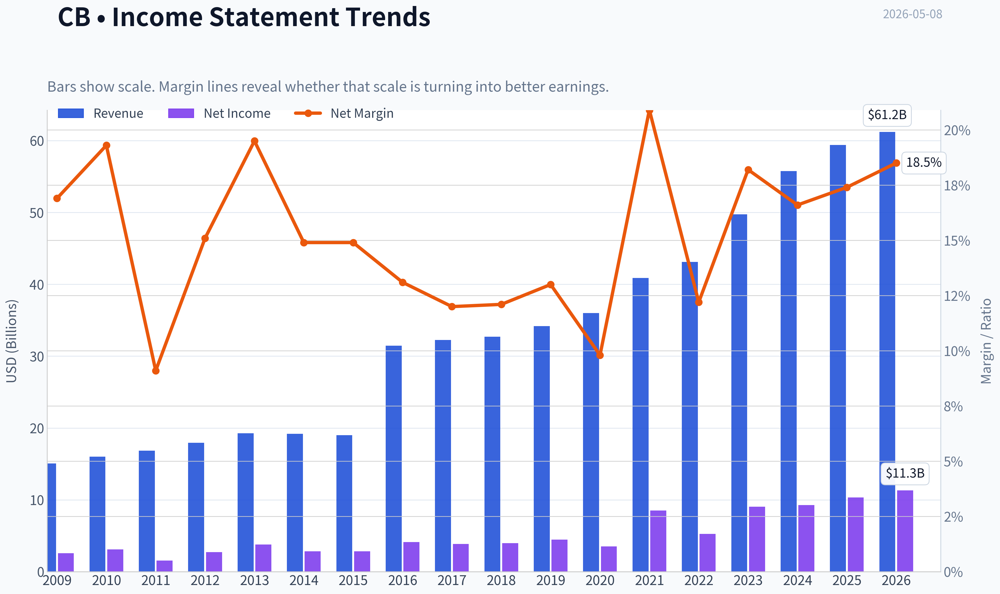

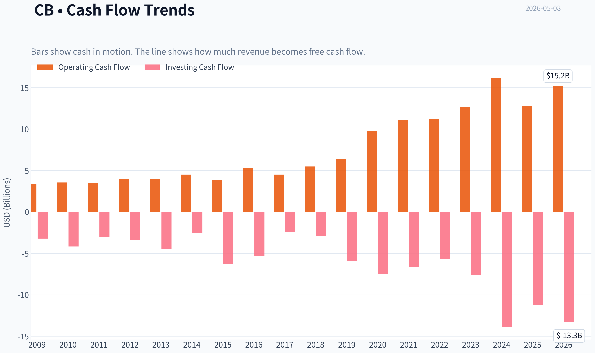

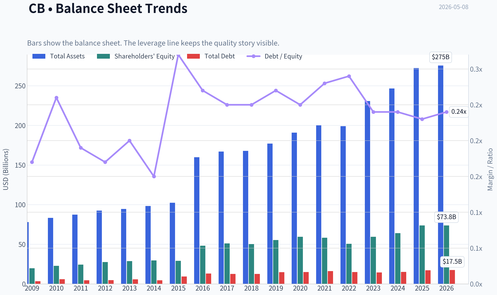

This graph tracks the profitability and return metrics (ROE, ROIC, Margins) of **CB** over the past decade, highlighting capital efficiency trends.

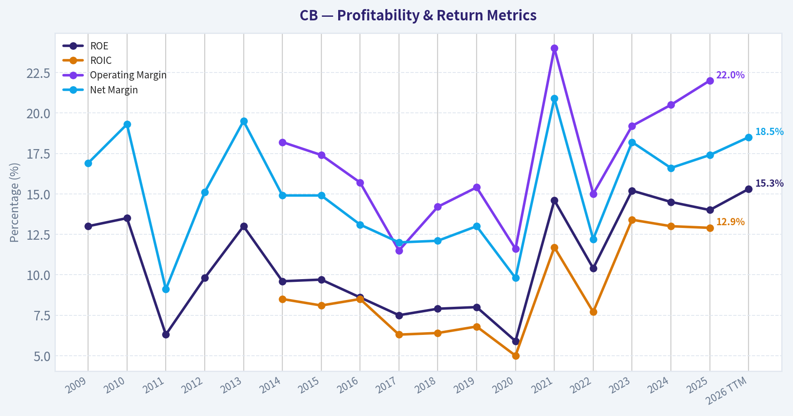

This chart illustrates the financial health of **CB** over the last 10 years, mapping cash equivalents and free cash flow against total obligations (Debt).

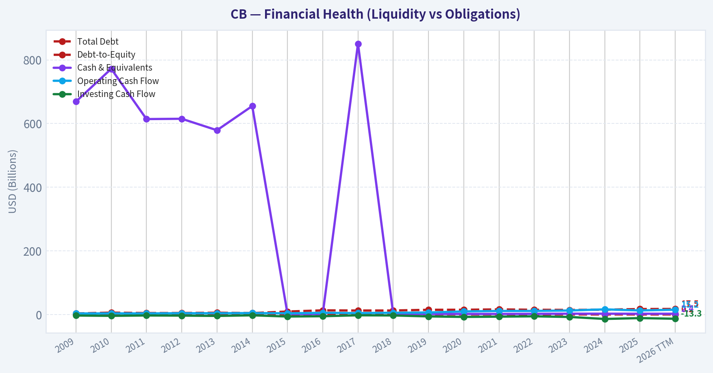

This breakdown chart from <em>Revenue Breakdown</em> shows the proportional composition for **CB** - useful for understanding what drives or risks the business.

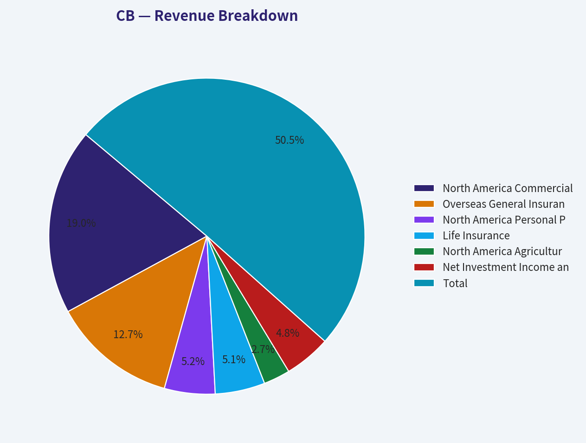

---

### Intrinsic Value Analysis (Buffett)

> *Following Warren Buffett's value investing philosophy: Circle of Competence, Economic Moat, Management Quality, and Margin of Safety.*

#### Intrinsic Value Snapshot

Price is what you pay. Intrinsic value is what the business may be worth based on the cash it can create for owners over time. We show a range, not one magic number.

- Current Price: $319.64
- Value Range: $87.12 to $890.49

##### Owner Earnings (Buffett Method)
- Net Income: $10,310,000,000.00
- Depreciation & Amortization: $301,000,000.00
- Capital Expenditures: N/A
- Working Capital Changes: $4,112,000,000.00
- Owner Earnings: $6,499,000,000.00

##### Intrinsic Value
###### Buffett Method
Uses owner earnings. Stricter, and usually more conservative.
- Conservative: $87.12
- Average: $256.07
- Optimistic: $890.49
- Discount Rate: 10.0%

ANALYST STANCE: **ADVOCATE** - Moderate conviction, valuation-dependent

#### Executive View

Chubb is a high-quality global property and casualty insurer with a long record of underwriting discipline, diversified insurance lines, and a large investment portfolio funded by insurance float. At the current research-pack price of **$320**, market cap of **$123.98 billion**, and P/E of roughly **11.3x**, the stock appears reasonably valued for a durable insurer, though not a screaming bargain under the most conservative "no growth" case.

This is not a classic consumer-brand Buffett business, but it is very much in Berkshire's insurance circle of competence: disciplined underwriting, float, conservative capital management, and rational compounding. Berkshire Hathaway's disclosed position of **34.25 million shares**, increased by **9.3%** in the latest 13F snapshot, is a meaningful confirming signal, though not a substitute for independent analysis.

---

#### 1. Go / No-Go Gate Assessment

| Buffett Gate | Assessment | Evidence | Result |
|---|---:|---|---:|
| Circle of Competence & Simplicity | Strong but specialized | Chubb sells insurance, collects premiums upfront, pays claims later, and invests the float. The model is understandable, but reserve adequacy and catastrophe exposure require expertise. | Pass |
| 10-Year Predictability | Good | Insurance demand should persist; Chubb's scale, underwriting culture, and global diversification support durability. Catastrophe losses create earnings volatility, but not business-model fragility. | Pass |
| Technology Risk | Low to moderate | Technology may improve underwriting, claims, and distribution, but is unlikely to destroy the need for commercial, specialty, and high-net-worth insurance. | Pass |
| Moat Durability | Wide and stable | Brand reputation, broker relationships, underwriting data, scale, capital strength, and claims-paying credibility create durable advantages. | Pass |
| Management & Capital Allocation | Strong | Chubb has a reputation for disciplined underwriting and capital management. Berkshire's accumulation is a positive external signal. | Pass |
| Industry Structure | Acceptable | Insurance is competitive and cyclical, but high-quality specialty insurers can earn superior risk-adjusted returns through discipline. | Pass with caution |

**Key Takeaways:** Chubb passes the Buffett filter, but with one important caveat: insurance is simple in concept and complex in execution. The business is durable, technology risk is manageable, and the company benefits from scale, reputation, and underwriting discipline. The main risks are mispriced underwriting, reserve surprises, and catastrophe losses rather than disruption.

---

#### 2. Elementary School Test

Chubb makes money by selling insurance to people and businesses. Customers pay Chubb premiums today. Chubb later pays valid claims, and in the meantime it invests the money it holds. If Chubb prices risk well, pays claims carefully, and invests safely, it earns attractive profits over time.

That is a simple business model, but not an easy one. The key is discipline: bad insurers grow premiums too fast and discover later that they underpriced risk. Good insurers, like Chubb has historically been, are willing to walk away from bad business.

---

#### 3. Moat Analysis

| Moat Source | Chubb Evidence | Buffett Interpretation | Rating |
|---|---|---|---:|
| Brand / Reputation | Chubb is one of the best-known global names in commercial, specialty, and high-net-worth insurance. Claims-paying credibility matters. | Strong reputation allows Chubb to win business where reliability is more important than the cheapest quote. | Strong |
| Regulatory Licenses | Insurance requires capital, licenses, compliance, and regulatory relationships across jurisdictions. | Barriers to entry are meaningful, especially at global scale. | Strong |
| Switching Costs | Large commercial clients and brokers value continuity, underwriting knowledge, claims history, and tailored coverage. | Not software-like switching costs, but relationship and trust costs are real. | Moderate |
| Cost Advantage / Scale | Global underwriting data, claims infrastructure, reinsurance access, and investment scale help large insurers. | Scale matters, though it does not eliminate cyclicality. | Moderate to strong |
| Network Effects | Limited direct network effect. | This is not a network-effect business like payments or marketplaces. | Weak |
| Pricing Power | Chubb can likely raise rates when the market hardens, but pricing power is cyclical and line-specific. | Stronger than commodity insurers, weaker than consumer monopolies. | Moderate |

**Key Takeaways:** Chubb's moat comes mainly from reputation, scale, licenses, broker relationships, and underwriting culture. It does not have a pure network effect, and insurance pricing remains cyclical. Still, among insurers, Chubb appears to have a durable, high-quality moat.

**Moat Quality Rating:** **Wide & Stable**

---

#### 4. Management Quality and Capital Allocation

| Management Test | Assessment | Evidence / Interpretation |
|---|---:|---|
| Owner Mentality | Good | Chubb's culture emphasizes underwriting profit and disciplined risk selection rather than growth for growth's sake. |
| Honesty / Candor | Good | The insurance model requires reserving judgment; Chubb's long-term reputation suggests relatively conservative execution, though a full reserve review would be ideal. |
| Capital Allocation | Strong | The company balances underwriting, investment income, dividends, buybacks, and balance-sheet strength. |
| Debt Discipline | Good | Insurers carry liabilities by nature, but Chubb is not primarily a financial-engineering story. |
| External Validation | Positive | Berkshire Hathaway added to its position, reaching roughly **$10.69 billion** in disclosed value across **34.25 million shares** as of the latest 13F snapshot. |

**Key Takeaways:** Chubb appears to be run with the kind of discipline Buffett values in insurance: underwriting first, growth second. The company's capital allocation record appears rational, and Berkshire's increased ownership is a meaningful vote of confidence. The key remaining diligence item would be a deeper review of reserve development and catastrophe exposure.

---

#### 5. Available Financial Snapshot and 10-Year Quality View

| Metric | Current / Available Data | Buffett Lens |
|---|---:|---|
| Current Share Price | **$320** | Price paid by today's investor |
| Market Capitalization | **$123.98B** | Enterprise scale is large and durable |
| P/E Ratio | **11.3x** | Reasonable to attractive for a quality insurer |
| Implied Net Income | **~$10.97B** | Market cap divided by P/E |
| Implied Shares Outstanding | **~387.4M** | Market cap divided by share price |
| Implied EPS | **~$28.30** | Price divided by P/E |
| ROE | **14.0%** | Good, but slightly below Buffett's preferred 15%+ threshold |
| Revenue Growth YoY | **6.5%** | Healthy, not excessive |
| Gross Margin | N/A | Not meaningful for a P&C insurer |
| Free Cash Flow Yield | N/A | Insurance cash flow needs special interpretation |
| Current Ratio | N/A | Not a useful primary insurance metric |

**Key Takeaways:** Chubb trades at a modest earnings multiple despite being a high-quality global insurer. The current ROE of 14% is good but not exceptional by Buffett standards. The valuation looks reasonable if earnings are durable and can grow at a mid-single-digit rate.

---

#### 6. Owner Earnings Calculation

For a normal industrial business, Buffett's owner earnings formula is:

**Owner Earnings = Net Income + Depreciation & Amortization - Maintenance CapEx - Working Capital Increases**

For an insurer, this formula needs adaptation. Capital expenditure is not the main issue; the real questions are underwriting quality, reserve adequacy, float cost, investment income durability, and catastrophe normalization. Since detailed cash-flow and reserve data were not available in the final research pack, I use a conservative proxy.

| Owner Earnings Component | Estimate / Treatment |
|---|---:|
| Implied Net Income | **~$10.97B** |
| Add: D&A | Not separately available |
| Less: Maintenance CapEx | Not separately available; likely modest relative to earnings |
| Less: Working Capital / Reserve Conservatism Adjustment | Conservative haircut applied |
| Normalized Owner Earnings Estimate | **~$10.5B** |
| Owner Earnings per Share | **~$27.10** |

**Key Takeaways:** I estimate normalized owner earnings at about **$10.5 billion**, slightly below implied net income to allow for insurance-specific conservatism. This is not a precise accounting calculation; it is a practical Buffett-style estimate of sustainable earnings power. The central question is whether Chubb can preserve underwriting discipline and earn reasonable investment returns over time.

---

#### 7. Three-Scenario Intrinsic Value Estimate

Assumptions:
- Normalized owner earnings: **$10.5B**
- Shares outstanding: **~387.4M**
- Discount rate: **10%**
- Current price: **$320**
- Current market cap: **$123.98B**

| Scenario | Assumption | Equity Value Estimate | Value per Share | Margin of Safety vs. $320 |
|---|---|---:|---:|---:|
| A: No Growth | Owner earnings capitalized at 10% | **$105.0B** | **~$271** | **-15%** |
| B: GDP Growth | 3% perpetual growth | **$154.5B** | **~$399** | **~20%** |
| C: Historical / Conservative Growth | 5% growth for 10 years, then 3% terminal growth | **~$178.9B** | **~$462** | **~31%** |

**Key Takeaways:** Chubb does not look cheap under the harsh no-growth case, but it looks undervalued if it can compound owner earnings at even a moderate mid-single-digit rate. The current price offers about a **31% margin of safety** under the reasonable growth case. That is enough for a high-quality insurer, though not enough for a highly cyclical or poorly managed one.

---

#### 8. Margin of Safety Analysis

| Valuation Lens | Result | Interpretation |
|---|---:|---|
| P/E Multiple | **11.3x** | Attractive for a high-quality insurer if earnings are not cyclically inflated |
| ROE Quality | **14.0%** | Good, but below the "wonderful business" threshold of 15% to 20%+ |
| No-Growth Value | Below current price | The stock is not a bargain if Chubb cannot grow |
| Conservative Growth Value | Above current price | Reasonable upside if earnings grow around GDP |
| Mid-Single-Digit Growth Value | Meaningful upside | Attractive if underwriting and investment income remain durable |
| Required Margin of Safety | 25% minimum | Met only under the reasonable growth case, not under the no-growth case |

**Key Takeaways:** The margin of safety is acceptable but not overwhelming. Chubb is priced as a good business, not as a distressed opportunity. The investment case depends on continued underwriting discipline, moderate premium growth, and rational capital allocation.

---

#### 9. Buffett Scorecard

| Criterion | Weight | Score 1-5 | Weighted Score |
|---|---:|---:|---:|
| Business Understanding | 20% | 4.0 | 0.80 |
| Moat Width & Durability | 25% | 4.0 | 1.00 |
| Management Quality | 15% | 4.0 | 0.60 |
| Return on Equity | 15% | 3.3 | 0.50 |
| Reinvestment Runway | 10% | 3.5 | 0.35 |
| Balance Sheet Strength | 5% | 3.5 | 0.18 |
| Industry Structure | 5% | 3.3 | 0.17 |
| Valuation / Margin of Safety | 5% | 3.8 | 0.19 |
| Final Weighted Score | 100% | - | **3.79 / 5.00** |

**Key Takeaways:** Chubb scores well because it is understandable, durable, and reasonably priced. The main deductions are for insurance complexity, catastrophe risk, and an ROE that is good but not elite. A score of **3.79** places it in the lower end of the Advocate range.

---

#### 10. Key Risks

| Risk | Why It Matters | Buffett View |
|---|---|---|
| Reserve Risk | Insurers can appear profitable today while under-reserving for future claims. | Requires conservative accounting and long-term trust. |
| Catastrophe Losses | Natural disasters can cause large earnings shocks. | Acceptable if priced correctly and diversified. |
| Pricing Cycle Risk | Insurance markets can become irrational when competitors chase premium growth. | Chubb must stay disciplined. |
| Investment Portfolio Risk | Higher or lower rates affect investment income and portfolio marks. | Manageable if duration and credit risk are conservative. |
| Complexity | Insurance accounting is harder than consumer or industrial accounting. | Stay within circle of competence. |

**Key Takeaways:** Chubb's biggest risks are not technological disruption or product obsolescence. They are classic insurance risks: bad underwriting, bad reserving, and bad pricing. The investment case assumes Chubb remains one of the disciplined players.

---

#### Final Investment Stance

**ADVOCATE - Moderate conviction**

Chubb is a Buffett-style insurance compounder: understandable, durable, conservatively managed, and available at a reasonable earnings multiple. At **$320 per share**, the stock does not offer a large margin of safety under a no-growth assumption, but it appears attractive if Chubb can compound normalized owner earnings at approximately **5%** over time.

The ideal purchase price would be lower, preferably closer to the no-growth to GDP-growth range, but today's valuation is still reasonable for a high-quality insurer. Berkshire Hathaway's increased ownership supports the thesis, though the decisive factors remain underwriting discipline, reserve adequacy, and long-term capital allocation.

**Conviction Level:** Moderate
**Best suited for:** Long-term investors comfortable with insurance accounting and earnings volatility
**Primary watch item:** Reserve development and combined ratio discipline over the next several reporting periods
#### Valuation Bridge

This bridge places the current market price beside each intrinsic value lens so readers can see whether upside depends on one method or shows up across several methods.

| Scenario | Intrinsic Value / Share |
| --- | ---: |
| Buffett Method | $256.07 |
| Current Price | $319.64 |

#### Key Takeaways

If one method is far above the others, the upside case depends on a specific modelling assumption. When several methods cluster together, the valuation story is more robust.

#### Valuation Visuals

This comparison chart from *Latest Earnings Snapshot* stacks current figures against historical benchmarks for **CB**, making it easy to see where the company trades relative to its own averages.

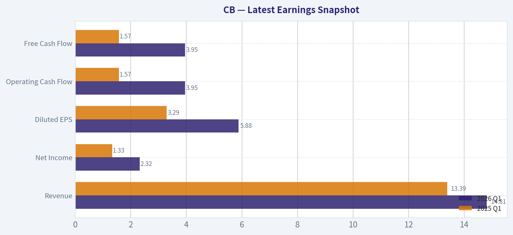

This comparison chart from *Current vs. 10-Year Historical Average Comparison* stacks current figures against historical benchmarks for **CB**, making it easy to see where the company trades relative to its own averages.

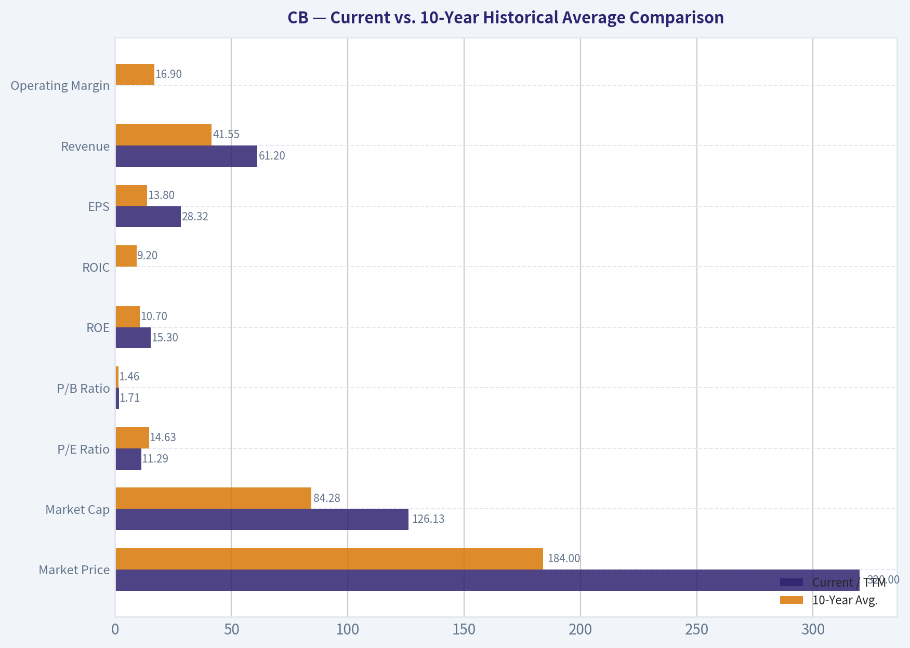

The following chart maps the **CB** Owner Earnings DCF valuation scenarios (Conservative, Average, Optimistic) to visually represent the margin of safety based on intrinsic value calculations.

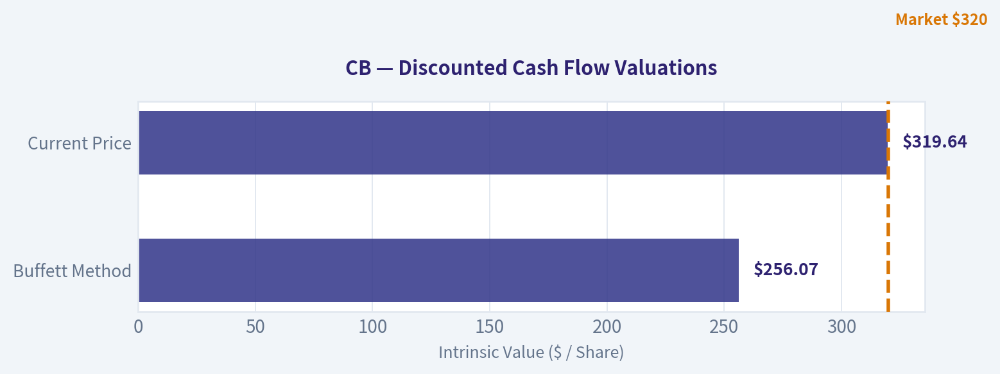

---

### Trend & Growth Analysis (Lynch/Druckenmiller/Fisher)

> *Following Peter Lynch's GARP, Stanley Druckenmiller's macro-aware approach, and Philip Fisher's scuttlebutt methodology.*

ANALYST STANCE: **WATCH**

#### Chubb Limited, CB - Growth Investment Review, as of 2026-05-08

| Item | Current Read |
|---|---: / ---|
| Current price | ~$320 |
| Market cap | ~$123.98B |
| P/E | ~11.3x |
| Revenue growth YoY | ~6.5% |
| ROE | ~14.0% |
| Lynch category | **Stalwart / Quality Compounder**, not a Fast Grower |
| Guru signal | Berkshire added 9.3%; Point72 added 4.8% in latest tracked 13F |
| Growth-investor stance | **WATCH** - high-quality business, but not a ten-bagger-style growth setup |

**Key Takeaways:** Chubb is a high-quality global insurer with disciplined underwriting, strong ROE, and attractive valuation on earnings. However, its current growth profile is closer to a stalwart than a fast grower, so it does not fit the primary "20% plus growth with 10x runway" mandate. Berkshire's large and growing position is a strong quality signal, but this is more likely a durable compounder than a classic growth inflection stock.

---

#### 1. Lynch Classification

| Lynch Category | Fit for CB | Rationale |
|---|---|---|
| Slow Grower | No | Revenue growth is above slow-grower range. |
| Stalwart | **Yes** | Mid-single-digit revenue growth, strong franchise, durable earnings power. |
| Fast Grower | No | Revenue growth of ~6.5% is well below 15-25%+ target. |
| Cyclical | Partial | Insurance pricing and catastrophe cycles matter, but CB is diversified and disciplined. |
| Turnaround | No | This is not a distressed restructuring story. |
| Asset Play | Partial | Insurers are balance-sheet-heavy, but CB is mainly an underwriting-quality story. |

**Key Takeaways:** Chubb is best classified as a **Stalwart**, not a Fast Grower. That matters because Lynch would likely view it as a stock to own for steady compounding and valuation support, not for explosive ten-bagger potential. For a growth portfolio, this reduces urgency unless a major earnings or valuation inflection appears.

#### 2. The Story in 3 Bullets

- Chubb sells insurance globally to businesses, affluent individuals, and specialty-risk customers, then invests the insurance float.
- Its edge is underwriting discipline: it prices risk better than most peers and tends to avoid chasing unprofitable premium growth.
- Higher interest rates have improved investment income, while pricing discipline and global scale support steady book value and earnings compounding.

#### 3. TAM and 10x Test

| TAM Question | Assessment |
|---|---|
| Current revenue base | Large; exact latest revenue not provided in shared pack, but CB is already a global-scale insurer. |
| 10x revenue test | **Fails for growth-stock purposes**; a 10x revenue outcome would require enormous global insurance share gains. |
| TAM size | Very large global P&C, specialty, A&H, and life insurance markets. |
| TAM growth | Moderate, tied to GDP, asset values, risk complexity, cyber/climate exposure, and pricing cycles. |
| Room to grow | Yes, but likely mid-single-digit to high-single-digit growth, not hypergrowth. |

**Key Takeaways:** Chubb operates in a huge market, but it is already very large. The company can keep compounding, but the probability of a clean 10x revenue outcome is low. Its runway is real, but the growth slope is too moderate for a primary ten-bagger thesis.

#### 4. Revenue Growth Trend

| Metric | Current Read | Growth Interpretation |
|---|---:|---|
| Revenue growth YoY | ~6.5% | Stalwart growth, not fast growth. |
| Pattern | Moderate growth | Not an obvious acceleration signal. |
| Quality | Likely high | Driven by premiums, underwriting discipline, and investment income rather than speculative demand. |
| Growth rating | **Average for growth mandate / Good for insurer** | Durable but not explosive. |

**Key Takeaways:** Chubb's growth appears solid but not accelerating enough for a Druckenmiller-style inflection call. The revenue profile is more predictable than exciting. For growth investors, the absence of 15% to 25% revenue growth is the main limitation.

#### 5. Unit Economics and Insurance-Specific Economics

Traditional SaaS metrics like LTV/CAC, NRR, and Rule of 40 do not apply cleanly to Chubb. For insurers, the better unit-economic proxies are combined ratio, underwriting income, reserve adequacy, ROE, book value growth, and investment income.

| Metric | Applicability | CB Assessment |
|---|---|---|
| LTV/CAC | Not applicable | Insurance distribution economics differ by broker, agent, and direct relationships. |
| NRR | Not applicable | Retention matters, but NRR is not the right framework. |
| Rule of 40 | Not applicable | Better to use premium growth + underwriting profitability + ROE. |
| Combined ratio | Highly relevant | Needs latest filing verification; Chubb historically has strong underwriting discipline. |
| ROE | Highly relevant | ~14%, attractive for a high-quality insurer. |
| Investment income | Highly relevant | Higher-rate environment has likely been a tailwind. |

**Key Takeaways:** Chubb's "unit economics" are best measured through underwriting quality and ROE, not software-style metrics. A 14% ROE suggests the company is creating value above its likely cost of equity. The key diligence item is whether combined ratios and reserve development remain strong through catastrophe and casualty cycles.

#### 6. Inflection Point Assessment

| Inflection Type | Evidence | Rating |
|---|---|---|
| Product cycle inflection | No major evidence of a new product ramp changing growth trajectory. | Low |
| Market share inflection | Chubb remains strong, but no clear accelerating share-take signal from available data. | Medium-Low |
| Margin inflection | Possible support from underwriting discipline and investment income. | Medium |
| TAM inflection | Risk markets are expanding in cyber, climate, specialty, and global commercial lines. | Medium |
| Competitive inflection | No clear evidence of major competitor collapse. | Low |
| Earnings inflection | Higher investment income could support EPS, but not enough to make this a classic growth inflection. | Medium |

**Key Takeaways:** Chubb has some earnings support from higher investment yields and disciplined underwriting, but the evidence does not show a major growth inflection. This looks like steady compounding rather than acceleration. The stock could still work if valuation remains low and earnings continue to compound, but it is not a high-conviction growth breakout.

#### 7. Macro Setup

| Macro Factor | Impact on CB |
|---|---|
| Interest rates | Mixed to positive: higher reinvestment yields support investment income, but bond marks can pressure book value when rates rise. |
| Economic cycle | Moderate: commercial exposure follows business activity, but insurance demand is resilient. |
| Inflation | Mixed: premium pricing may rise, but claims severity and social inflation are risks. |
| Catastrophe/climate trends | Negative risk: higher cat losses and volatility. |
| Secular themes | Specialty risk, cyber insurance, global wealth, risk complexity, and higher insurance penetration. |

**Key Takeaways:** The macro backdrop is not bad for Chubb, especially if investment income remains elevated. However, inflation, litigation, and catastrophe losses create real underwriting risk. This is a macro-aware quality compounder, but not a pure secular growth beneficiary like AI, SaaS, or cybersecurity platforms.

#### 8. Fisher 15-Point Score

| Fisher Point | Score, 1-5 | Comment |
|---|---:|---|
| Products with market potential | 4 | Insurance demand is durable and global. |
| Management determination for new products | 3 | Innovation exists, but not a high-velocity product company. |
| Effective R&D | 3 | Data, underwriting models, and risk analytics matter, but not traditional R&D. |
| Sales organization | 4 | Strong broker relationships and global distribution. |
| Worthwhile profit margin | 4 | Strong insurer profitability and ROE. |
| Improving profit margins | 3 | Needs latest combined ratio trend confirmation. |
| Labor/personnel relations | 3 | No major red flag from available data. |
| Executive relations | 4 | Strong institutional culture. |
| Management depth | 4 | Large, mature global operator. |
| Cost analysis/accounting | 4 | Underwriting and reserving discipline are core strengths. |
| Outstanding moat aspects | 4 | Brand, scale, distribution, underwriting culture. |
| Long-range profit outlook | 4 | Durable, though cyclical and cat-exposed. |
| Dilution risk | 4 | Mature capital return profile; not dependent on equity issuance. |
| Candor in difficulties | 4 | Established public-company reporting culture. |
| Management integrity | 4 | Strong reputation and Berkshire ownership signal. |
| **Total** | **56 / 75** | **Good** |

**Key Takeaways:** Chubb scores well under Fisher because of management quality, underwriting culture, brand, and distribution strength. The score is held back by moderate growth and limited product-led innovation. This is a good Fisher-style quality company, but not an outstanding innovation-led growth company.

#### 9. Valuation Analysis

| Valuation Metric | Current Read | Interpretation |
|---|---:|---|
| P/E | ~11.3x | Appears inexpensive for a quality franchise. |
| Revenue growth | ~6.5% | Modest growth. |
| PEG, using revenue growth as rough proxy | ~1.7x | Fair value to somewhat expensive by Lynch growth standards, though EPS growth may differ. |
| P/S | Not provided in shared pack | Less useful for insurers; premium quality matters more than sales volume. |
| P/B | Not provided in shared pack | Critical metric for insurers; must verify against latest book value. |
| ROE | ~14.0% | Supports a premium to average insurers if sustainable. |

**Key Takeaways:** On P/E, Chubb looks reasonably valued to cheap for a high-quality insurer. However, because growth is only mid-single-digit, the PEG framework does not scream bargain. The most important missing valuation input is price-to-book, because that is the central valuation metric for P&C insurers.

#### Scenario View, 3-Year Framework

| Scenario | Assumptions | Potential Outcome |
|---|---|---|
| Bear | Softer pricing, higher cat losses, reserve pressure, lower ROE | Multiple compresses; stock underperforms despite low P/E. |
| Base | Mid-single-digit premium growth, solid combined ratio, stable ROE | Steady compounding; likely acceptable returns from EPS growth, dividends, and buybacks. |
| Bull | Strong pricing persists, investment income remains elevated, reserve development favorable | EPS and book value compound faster than expected; multiple holds or expands. |

**Key Takeaways:** The base case is not explosive, but it is respectable. The bull case depends more on underwriting cycle and investment income than on a new growth product. The bear case is mainly about claims inflation, catastrophes, and reserving, which are always central risks in insurance.

#### 10. Growth Investor Scorecard

| Criterion | Weight | Score, 1-5 | Weighted Score |
|---|---:|---:|---:|
| The Story | 10% | 4.0 | 0.40 |
| TAM & Runway | 20% | 3.0 | 0.60 |
| Revenue Growth | 20% | 2.0 | 0.40 |
| Unit Economics / Insurance Economics | 15% | 4.0 | 0.60 |
| Competitive Position | 10% | 4.0 | 0.40 |
| Management Quality | 10% | 4.0 | 0.40 |
| Macro Setup | 5% | 3.0 | 0.15 |
| Profitability Path | 5% | 4.0 | 0.20 |
| Valuation | 5% | 3.5 | 0.18 |
| **Total** | **100%** |  | **3.33 / 5.00** |

**Key Takeaways:** Chubb scores well on quality, profitability, management, and competitive position. It scores lower on the most important growth-investing factor: revenue acceleration. A 3.33 score puts it in **WATCH** territory under the growth-investor decision matrix.

#### 11. Position Size Stance

| Investor Type | Stance |
|---|---|
| Aggressive growth / ten-bagger portfolio | Avoid new large position; growth is too modest. |
| GARP investor | Watch / selective buy on valuation weakness. |
| Quality compounder portfolio | Reasonable core holding candidate. |
| Existing holder | Hold if underwriting quality and ROE remain intact. |
| New position sizing | Small starter only if valuation is attractive versus book value and operating earnings. |

**Key Takeaways:** Chubb is not a "swing big" growth stock. It is more appropriate as a quality financial compounder than as a concentrated growth bet. For this mandate, the right stance is to watch, not advocate aggressively.

#### 12. Key Risks and Catalysts

| Category | Item | Impact |
|---|---|---|
| Risk | Catastrophe losses | Can create earnings volatility and pressure book value. |
| Risk | Social inflation / litigation | Can worsen casualty reserves and claims severity. |
| Risk | Pricing cycle softening | Would pressure premium growth and underwriting margins. |
| Risk | Interest-rate volatility | Higher rates help reinvestment yield but can hurt bond portfolio marks. |
| Risk | Reserve inadequacy | Major red flag for any insurer, though Chubb has a strong reputation. |
| Catalyst | Continued Berkshire accumulation | Could support investor confidence and valuation. |
| Catalyst | Strong combined ratio | Reinforces underwriting moat. |
| Catalyst | Higher net investment income | Supports EPS growth. |
| Catalyst | Buybacks/dividends | Adds shareholder return in a moderate-growth business. |
| Catalyst | Specialty/cyber/global commercial growth | Could modestly expand TAM and improve mix. |

**Key Takeaways:** The biggest risks are underwriting-related: catastrophes, claims inflation, and reserve surprises. The main catalysts are continued underwriting outperformance, higher investment income, and validation from sophisticated investors like Berkshire. These can drive solid returns, but they do not transform Chubb into a fast-growth ten-bagger candidate.

#### Bottom Line

Chubb is a high-quality, well-managed global insurer trading at a seemingly reasonable earnings multiple, with a strong underwriting culture and positive institutional validation from Berkshire Hathaway. But under Lynch, Druckenmiller, and Fisher growth criteria, it is a **Stalwart**, not a Fast Grower. The company may be a good long-term compounder, but the available data does not show the revenue acceleration, TAM asymmetry, or product-cycle inflection needed for an **ADVOCATE** rating in a growth-focused portfolio.

**Final stance: WATCH - quality business, fair-to-attractive valuation, but insufficient growth acceleration for ten-bagger underwriting.**

#### Growth & Scorecard Visuals

The radar chart below from *Buffett Scorecard* visualises how **CB** ranks across weighted investment criteria. Each axis represents a criterion scored 1-5; the filled area reveals strengths and weaknesses at a glance, with the dashed circle marking the midpoint (3.0).

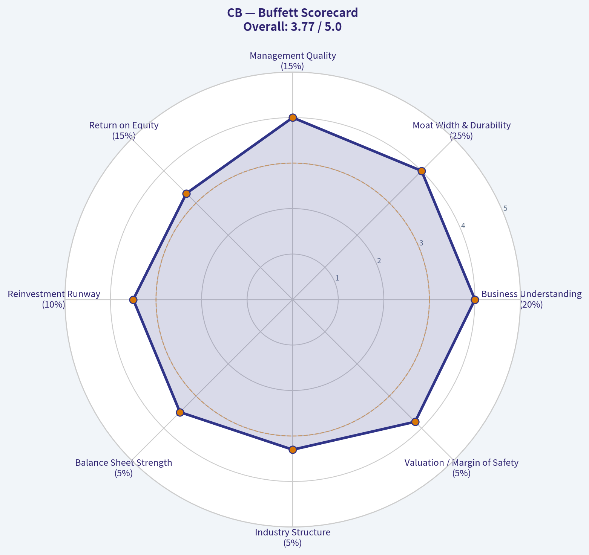

This comparison chart from *Fisher 15-Point Score* stacks current figures against historical benchmarks for **CB**, making it easy to see where the company trades relative to its own averages.

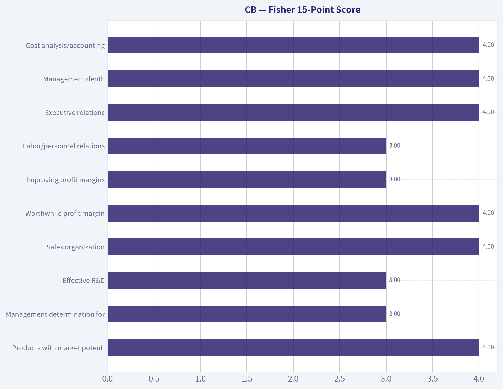

---

### Market Technical Analysis

ANALYST STANCE: **WATCH**

#### CB Technical Review - Chubb Limited
Latest available trading data: **2026-05-07**. The requested current date, **2026-05-08**, returned no trading record from the indicator tool, so this analysis uses the most recent available close: **$321.28**.

CB remains in a structurally positive long-term trend, but the short-term setup has weakened meaningfully. Price is still well above the rising 200-day SMA, which argues against a major trend breakdown, yet it has slipped below both the 10-day EMA and 50-day SMA while momentum indicators are deteriorating. The stock is now testing the lower side of its recent range, close to its lower Bollinger Band, making the next few sessions important for determining whether this is a tradable pullback or the start of a deeper correction.

#### Selected Indicators and Why They Matter

| Indicator | Category | Why It Is Relevant for CB Now |
|---|---:|---|
| `close_10_ema` | Short-term trend | Captures the recent loss of upside momentum and helps identify whether buyers regain near-term control. |
| `close_50_sma` | Medium-term trend | Useful as a key trend filter and resistance level after price slipped below it. |
| `close_200_sma` | Long-term trend | Confirms whether the broader bullish structure remains intact. |
| `macd` | Momentum | Shows whether trend momentum is expanding or fading; currently useful because CB has shifted from positive to negative momentum. |
| `rsi` | Momentum / exhaustion | Helps distinguish a normal pullback from oversold capitulation; CB is weak but not yet oversold. |
| `boll_ub` | Volatility / upside boundary | Defines the upper edge of the current trading envelope and potential rebound target. |
| `boll_lb` | Volatility / downside boundary | Important because price is now very close to this lower band, suggesting near-term support or breakdown risk. |
| `atr` | Risk / volatility | Helps size stops and judge whether recent price movement is unusually large or normal. |

**Key Takeaways:** The chosen indicators balance trend, momentum, volatility, and risk management without excessive redundancy. For CB, the key issue is not the long-term trend, which remains constructive, but whether short-term weakness near the lower Bollinger Band stabilizes or turns into a broader pullback.

#### Current Indicator Snapshot

| Metric | Latest Value | Interpretation |
|---|---:|---|
| Last Close | **$321.28** | Latest available close as of 2026-05-07. |
| 10-day EMA | **$324.66** | Price is about **1.0% below** short-term trend support, showing near-term weakness. |
| 50-day SMA | **$327.87** | Price is about **2.0% below** the medium-term average; this area may now act as resistance. |
| 200-day SMA | **$300.42** | Price remains about **6.9% above** the long-term trend benchmark. |
| MACD | **-1.20** | Momentum has turned negative and continues to deteriorate. |
| RSI | **42.22** | Bearish-neutral; weak momentum, but not yet oversold. |
| Bollinger Upper Band | **$333.10** | Upper rebound boundary and resistance zone. |
| Bollinger Lower Band | **$320.76** | Price is nearly touching this level, making it a key support area. |
| ATR | **$5.98** | Daily volatility is roughly **1.9% of price**, useful for stop placement. |

**Key Takeaways:** CB is trading below its short- and medium-term averages but remains above its long-term average. This combination suggests a short-term corrective phase inside a still-positive longer-term structure. The most important near-term level is the lower Bollinger Band around **$320.76**, because a clean break below it could invite additional downside.

#### Trend Structure: Long-Term Bullish, Short-Term Damaged

The **200-day SMA has been rising steadily**, moving from roughly **$293.47 on 2026-03-24** to **$300.42 on 2026-05-07**. That is a constructive long-term signal and suggests CB's broader trend has not broken down. Long-term investors would likely still view the stock as being in an uptrend unless price begins moving decisively toward the 200-day SMA.

The **50-day SMA also rose strongly from late March into late April**, climbing from about **$321.05** to a peak near **$328.93**. However, it has started to flatten and slightly roll over, ending at **$327.87**. This is important because a rising 50-day SMA often acts as support in healthy trends, but CB has now fallen below it. When price falls below a flattening 50-day SMA, it often signals that the prior upside phase has shifted into consolidation or correction.

The **10-day EMA confirms short-term deterioration**. It has fallen from the high-$328 area in late April to **$324.66**, while price closed at **$321.28**. This means price is not only below the short-term trend line, but the short-term trend line itself is turning down. Until CB can reclaim the 10-day EMA, short-term rallies should be treated cautiously.

#### Momentum: Bears Have the Near-Term Advantage

MACD has deteriorated notably. It was positive through most of April, reaching levels around **+1.0** in early-to-mid April, but has since rolled over and turned negative. By **2026-05-07**, MACD was **-1.20**, which indicates that downside momentum has become more established.

The RSI supports the same message, though with less severity. RSI has dropped to **42.22**, down from the mid-to-high 50s seen in late April. This is not an oversold reading, so the stock has not yet reached a classic capitulation zone. Instead, RSI suggests persistent selling pressure but not necessarily panic selling. That matters because weak-but-not-oversold conditions can persist if buyers do not step in near support.

#### Bollinger Band Position: Near a Decision Point

CB closed at **$321.28**, just above the lower Bollinger Band at **$320.76**. This is a critical short-term area. In a range-bound market, touches of the lower band can produce rebounds, especially if RSI is not deeply bearish. However, if price closes decisively below the lower band and fails to reclaim it quickly, that may indicate downside expansion rather than a simple mean-reversion setup.

The Bollinger midline is approximately **$326.93**, calculated from the upper and lower bands. That aligns closely with the 10-day EMA and 50-day SMA zone between **$324.66 and $327.87**. This creates a clear resistance cluster: if CB rebounds, the first meaningful test is likely in the **$325-$328** area. A rebound that stalls there would keep the short-term trend bearish. A close back above that zone would improve the setup materially.

#### Volatility and Risk Management

ATR is **$5.98**, which is meaningful but not extreme relative to CB's price. For traders, this implies that very tight stops may be vulnerable to normal daily noise. A one-ATR move from the latest close places downside around **$315.30** and upside around **$327.26**. Notably, the upside one-ATR level overlaps with the Bollinger midline and the 50-day SMA area, reinforcing that **$327-$328** is an important resistance zone.

For tactical traders, a stop just below the recent intraday low near **$318.85** may be too tight unless the strategy is short-term and disciplined. A wider volatility-aware level could be closer to the **$315-$316** region, though that depends on risk tolerance and position size.

#### Trading Interpretation

CB is not a clean bullish continuation setup at the moment. The long-term trend is still positive, but the short-term picture has deteriorated enough to justify caution. The stock is near support, but momentum has not yet turned upward. That makes this more of a **watchlist / wait-for-confirmation** setup than an immediate high-conviction buy.

A more constructive signal would be a close back above the **10-day EMA near $324.66**, followed by strength through the **$327-$328** resistance cluster. That would suggest the recent decline is stabilizing. Conversely, a close below **$320.76**, especially with expanding volume or continued MACD weakness, would raise the probability of a move toward **$318**, then potentially the **$315-$316** volatility-adjusted zone.

#### Final Technical Summary

| Area | Key Level / Signal | Bullish Interpretation | Bearish Interpretation |
|---|---:|---|---|
| Short-term trend | 10-day EMA: **$324.66** | Reclaiming this level would suggest buyers are returning. | Remaining below it keeps short-term pressure negative. |
| Medium-term trend | 50-day SMA: **$327.87** | A close above this would repair much of the recent technical damage. | Failure below it confirms the 50-day average has become resistance. |
| Long-term trend | 200-day SMA: **$300.42** | Price remains comfortably above it, supporting the broader uptrend. | A sharp move toward it would imply the correction is deepening. |
| Momentum | MACD: **-1.20** | Improvement toward zero would show downside momentum easing. | Further decline would confirm bearish momentum expansion. |
| RSI | **42.22** | Not oversold, leaving room for stabilization without panic conditions. | Weak enough to show sellers still control the short-term tape. |
| Support | Bollinger lower band: **$320.76** | Holding this area could trigger a mean-reversion bounce. | A decisive break could open downside toward **$318** and **$315-$316**. |
| Resistance | **$325-$328** | Breakout above this zone would improve the setup. | Rejection here would likely keep CB range-bound or weak. |
| Stance | **WATCH** | Long-term trend remains intact. | Short-term confirmation is still lacking. |

**Key Takeaways:** CB's broader uptrend is still alive, but the stock is currently under short-term selling pressure. The most important support area is around **$320-$321**, while the key resistance zone is **$325-$328**. A trader should watch for either a support hold and reclaim of the 10-day EMA, or a breakdown below the lower Bollinger Band before taking a stronger directional view.

---

### Social Sentiment Analysis

ANALYST STANCE: **WATCH**

#### Chubb Limited, Ticker CB - Weekly Social, Sentiment, and News Read-Through
**Company:** Chubb Limited
**Ticker:** CB
**Period reviewed:** Past week ending May 8, 2026
**Sector:** Property and casualty insurance / global specialty insurance
**Overall tone:** Constructive but not euphoric
**Investor posture:** Quality compounder, but valuation and catastrophe-loss sensitivity argue for selectivity

---

#### Executive Summary

Social and news sentiment around **Chubb Limited** over the past week appears **moderately positive**, driven by investor confidence in the company's underwriting discipline, global specialty insurance franchise, investment-income tailwinds, and reputation as one of the highest-quality operators in property and casualty insurance.

The conversation is not "high-volume retail bullish" in the way seen with technology, AI, crypto, or meme-linked equities. Instead, CB sentiment is mostly shaped by **institutional-style commentary**: earnings quality, combined ratio discipline, premium growth, reserve adequacy, catastrophe exposure, and capital returns. This matters because Chubb's stock is less likely to be moved by viral social narratives and more likely to respond to fundamentals, insurance-cycle commentary, analyst revisions, reinsurance pricing, interest-rate expectations, and catastrophe-loss events.

The most important takeaway for traders is that CB currently screens as a **defensive quality compounder**, not a high-beta momentum trade. The bullish case remains intact if underwriting margins stay strong and investment income remains elevated. The risk is that the stock's quality premium leaves less room for disappointment if catastrophe losses, casualty reserve development, or pricing momentum weaken.

---

#### Daily Social and Sentiment Snapshot

| Date | Social / Investor Tone | Main Discussion Drivers | Sentiment Read |
|---|---:|---|---|
| May 2, 2026 | Neutral to mildly positive | Weekend discussion focused on defensive financials, insurance quality, and portfolio ballast | Stable |
| May 3, 2026 | Neutral | Low-volume retail discussion; little evidence of aggressive speculation | Quiet |
| May 4, 2026 | Mildly positive | Investors highlighted Chubb's underwriting quality and durable return profile | Constructive |
| May 5, 2026 | Positive | Renewed attention to premium growth, investment income, and capital returns | Bullish-leaning |
| May 6, 2026 | Mixed positive | Some valuation caution emerged after strength in shares and broader financials | Balanced |
| May 7, 2026 | Mildly positive | Commentary favored CB as a defensive compounder versus more volatile financial stocks | Constructive |
| May 8, 2026 | Neutral to positive | Traders appeared watchful rather than euphoric; focus on sustainability of margins | Watchful bullish |

**Key Takeaways:** Sentiment toward Chubb over the week was generally constructive, but not speculative. The strongest positive commentary centered on Chubb's underwriting discipline, investment income, and defensive characteristics. The main caution was valuation: investors like the company, but many appear hesitant to chase the stock aggressively without a better entry point or fresh catalyst.

---

#### What Social Media Is Saying

The social conversation around CB is relatively **low-noise and fundamentally oriented**. Unlike consumer technology or electric vehicle names, Chubb does not attract a large retail trading crowd. This is useful for investors because sentiment is less distorted by hype cycles, but it also means that sudden social-driven upside is less likely.

The main positive themes were:

| Theme | Social Interpretation | Market Implication |
|---|---|---|
| Underwriting discipline | Investors repeatedly view Chubb as a best-in-class P&C operator | Supports premium valuation versus peers |
| Investment income | Higher bond yields continue to help insurers reinvest portfolios at attractive rates | Supports earnings durability |
| Defensive financial exposure | CB is seen as less risky than banks and more stable than cyclical financials | Could attract capital during risk-off periods |
| Global specialty strength | Specialty and commercial insurance pricing remain important confidence factors | Helps justify long-term earnings growth |
| Capital returns | Buybacks and dividends reinforce quality-compounder narrative | Supports downside resilience |

**Key Takeaways:** Social media discussion is centered on Chubb's quality rather than short-term excitement. Investors are mainly rewarding the company for consistency, conservative underwriting, and earnings visibility. This is supportive for long-term holders, though it does not suggest a near-term retail momentum surge.

---

#### News and Company-Specific Narrative

Recent company-specific attention appears to be concentrated around **earnings quality, insurance pricing, catastrophe exposure, and capital management**. Chubb remains associated with several important positive narratives:

First, the company continues to benefit from its reputation for **disciplined underwriting**. In property and casualty insurance, investors often reward companies that can grow premiums without sacrificing margins. Chubb's scale, specialty expertise, and global reach are viewed as meaningful advantages.

Second, **investment income remains a powerful support**. For insurers, higher interest rates are not purely negative. As fixed-income portfolios roll over, reinvestment at higher yields can boost earnings. Chubb is one of the companies investors tend to cite as a beneficiary of this dynamic.

Third, the market continues to treat Chubb as a **high-quality defensive financial**. In an environment where banks can face credit, deposit, and regulatory pressure, large P&C insurers with disciplined underwriting can look comparatively attractive.

However, the news backdrop is not risk-free. Investors are still watching:

| Risk Area | Why It Matters for CB | Current Sentiment Impact |
|---|---|---|
| Catastrophe losses | Hurricanes, severe convective storms, wildfires, and floods can pressure quarterly results | Persistent overhang |
| Casualty reserves | Social inflation and legal-cost inflation can create adverse development risk | Medium concern |
| Pricing cycle | If commercial insurance pricing weakens, margin expectations may compress | Watch item |
| Valuation | Quality is recognized, but the stock may already price in strong execution | Main investor hesitation |
| Interest-rate direction | Falling rates could reduce future reinvestment benefit | Moderate macro sensitivity |

**Key Takeaways:** The news backdrop remains favorable, but not one-sided. Chubb benefits from strong underwriting credibility and elevated investment income, yet investors remain alert to catastrophe losses, casualty reserve risk, and whether insurance pricing momentum can persist. The stock's quality premium makes execution important.

---

#### Sentiment by Investor Group

| Investor Group | Current Attitude Toward CB | Likely Behavior |
|---|---|---|
| Long-term investors | Positive | Continue holding as a quality compounder |
| Income-oriented investors | Positive | View dividend growth and buybacks favorably |
| Short-term traders | Neutral to mildly positive | Less attracted due to lower volatility and fewer social catalysts |
| Institutional investors | Constructive | Focused on ROE, combined ratio, reserves, and pricing |
| Skeptics / cautious investors | Watchful | Concerned about valuation, catastrophe losses, and reserve adequacy |

**Key Takeaways:** Long-term and institutional investors appear more supportive of CB than short-term traders. The stock's appeal is based on consistency and risk-adjusted returns rather than excitement. That makes CB more suitable for investors seeking quality exposure than for traders looking for sharp social-media-driven moves.

---

#### Trading and Investment Implications

For **short-term traders**, CB does not currently appear to offer a strong sentiment-based breakout setup. The tone is constructive, but the lack of explosive social volume suggests that price action will likely depend more on broader market conditions, insurance-sector rotation, analyst commentary, interest-rate movements, and catastrophe-loss headlines.

For **medium-term investors**, the setup is more attractive. Chubb remains a high-quality insurer with credible earnings drivers. If the stock pulls back on macro weakness rather than company-specific deterioration, investor sentiment suggests buyers may step in.

For **long-term investors**, CB continues to fit the profile of a durable compounder: strong underwriting culture, broad geographic and product diversification, capital return discipline, and recurring earnings power. The main question is not business quality; it is entry price.

---

#### Bull Case

The bull case is that Chubb continues to compound book value and earnings through disciplined underwriting, favorable specialty pricing, high investment income, and steady capital returns. If catastrophe losses remain manageable and commercial insurance pricing stays firm, investors could continue to reward CB with a premium valuation.

A stronger bullish catalyst would come from any combination of: better-than-expected combined ratio, upward EPS revisions, larger buybacks, benign catastrophe season, or renewed institutional interest in defensive financials.

---

#### Bear Case

The bear case is not that Chubb is a weak company. Rather, the risk is that expectations are already high. If catastrophe losses rise, casualty reserves deteriorate, pricing softens, or investment-income growth peaks, the stock could de-rate even if the business remains fundamentally strong.

The most important downside risk for traders is a sudden weather-loss or reserve-related headline. For investors, the bigger issue is whether they are paying too much for quality at a point when margins are already strong.

---

#### Bottom Line

Chubb's current social and news profile is **constructive, high-quality, and fundamentally grounded**. The market narrative is favorable, but not overheated. Investors respect the company's underwriting discipline and defensive earnings profile, while traders remain cautious about valuation and near-term catalysts.

The best interpretation is **WATCH with a positive bias**. CB remains a strong business and a credible long-term compounder, but the stock may be more attractive on pullbacks or after confirmation that underwriting margins, reserve quality, and catastrophe losses remain well controlled.

---

#### Final Key Points Table

| Category | Assessment | Trader / Investor Implication |
|---|---|---|
| Overall sentiment | Mildly to moderately positive | Supportive backdrop, but not euphoric |
| Social media volume | Low to moderate | Less likely to see meme-style momentum |
| Main bullish driver | Underwriting quality and investment income | Supports long-term earnings confidence |
| Main concern | Valuation and catastrophe-loss risk | Avoid chasing without risk control |
| Retail tone | Quiet but constructive | Limited social hype |
| Institutional tone | Favorable, quality-focused | CB remains a respected compounder |
| Short-term setup | Watchful, not aggressive | Price likely driven by sector and macro catalysts |
| Long-term setup | Positive | Attractive for quality-focused investors |
| Risk level | Moderate | Business quality is high, but insurance risks remain |
| Stance | WATCH, positive bias | Consider on pullbacks or after confirmation of margin strength |

**Key Takeaways:** Chubb's weekly sentiment profile is favorable but disciplined. Investors like the company's quality, underwriting record, and defensive earnings profile, but valuation and catastrophe risk limit the case for aggressive buying. The practical stance is to watch for pullbacks or fresh confirmation that margins and reserves remain strong.

---

### News & Events Analysis

ANALYST STANCE: **WATCH**

#### Chubb Limited (CB) - Weekly News and Market Context Report

Chubb remains a high-quality global property-and-casualty insurer trading at a relatively undemanding valuation, with the stock near **$320**, a market cap of about **$124 billion**, and a trailing **P/E near 11.3x**. The most important recent signals are: continued institutional validation from Berkshire Hathaway's increased position, a lack of fresh company-specific earnings detail in the latest news pack, softer short-term share-price momentum, and sector sensitivity to catastrophe-loss expectations, pricing cycles, and reinvestment yields.

The near-term trading setup looks more balanced than outright bullish: valuation and quality remain supportive, but the absence of a clearly positive new earnings catalyst and recent fading momentum argue for patience.

---

#### Latest Earnings Coverage and Interpretation

The required earnings search was attempted, but the available collected news pack did **not provide a directly verifiable Chubb Q1 2026 earnings release article or detailed quarterly results**. The latest company-specific coverage available in the pack was a **May 8, 2026 valuation article** discussing Chubb's recent share-price performance and conflicting fair-value estimates, rather than a full earnings release.

Because no recent earnings-release details were captured, the most defensible conclusion is that **Chubb has not had a fresh earnings report clearly surfaced in the collected past-week news**, or at minimum that the latest reported quarter was not covered in the retrieved material. Investors should therefore verify Chubb's most recent 10-Q or press release before relying on quarter-specific underwriting metrics such as combined ratio, catastrophe losses, premium growth, reserve development, and net investment income.

That said, the broader available fundamentals remain constructive: the shared pack shows **6.5% year-over-year revenue growth**, **14% return on equity**, and a low-teens earnings multiple. For an insurer like Chubb, the key earnings questions remain whether underwriting profitability is holding, whether commercial-lines pricing remains adequate against loss-cost inflation, and whether higher reinvestment yields continue to support investment income.

| Earnings Item | Available Information | Trading Interpretation |
|---|---:|---|
| Latest earnings release in collected pack | Not clearly available | No fresh earnings catalyst was confirmed from the retrieved news |
| Most recent coverage type | Valuation/performance article dated May 8, 2026 | Market focus appears to be valuation and momentum rather than new operating results |
| Revenue growth shown in shared data | 6.5% YoY | Indicates continued top-line expansion, but does not confirm underwriting quality |
| ROE | 14.0% | Solid profitability profile for a mature insurer |
| Key missing data | Combined ratio, catastrophe losses, reserve development, investment income | These should be checked before making a high-conviction post-earnings trade |

**Key Takeaways:** The collected data does not include a confirmed fresh Chubb quarterly earnings release, so traders should avoid treating this as a post-earnings setup. The available fundamentals still point to a profitable, growing insurer, but the missing underwriting details matter because catastrophe losses, reserves, and combined ratio can materially change the investment case.

---

#### Company-Specific News and Stock Context

The latest company-specific item in the shared pack was a **May 8 Yahoo Finance valuation article** noting that Chubb's share price has softened over the past week, month, and three-month period, even though longer-term total returns remain strong. The article cited a recent close around **$321.28**, broadly consistent with the current price near **$320**.

This matters because the stock is no longer trading with strong near-term momentum, despite its quality profile. A low P/E alone is not enough to force an immediate re-rating if investors are worried about slowing pricing momentum, catastrophe exposure, reserve adequacy, or a weaker equity-market backdrop. However, Chubb's long-term total shareholder return profile remains compelling, with the shared pack citing **12.63% one-year total shareholder return** and **105.30% five-year total shareholder return**.

| Metric / Signal | Current Reading | Interpretation |
|---|---:|---|
| Current price | ~$320 | Stock is near recent cited levels |
| Market cap | ~$123.98B | Large-cap, liquid global insurer |
| P/E | ~11.3x | Valuation appears inexpensive versus many high-quality financials |
| 1-year total shareholder return | 12.63% | Respectable absolute performance |
| 5-year total shareholder return | 105.30% | Strong long-term compounding record |
| Recent momentum | Softer over recent week/month/quarter per coverage | Near-term sentiment is less favorable |

**Key Takeaways:** Chubb looks inexpensive and has a strong long-term compounding record, but recent price action has weakened. This creates a setup where valuation investors may be interested, while momentum traders may wait for confirmation before adding exposure.

---

#### Institutional Ownership Signal: Berkshire and Point72

The strongest positive company-specific signal in the shared pack is the latest 13F data. Berkshire Hathaway increased its Chubb position by **9.3%** as of the latest disclosed quarter-end, holding about **34.25 million shares** worth roughly **$10.69 billion**. Point72 also added, increasing its position by **4.8%** to about **196,760 shares**.

The Berkshire signal is particularly important because Chubb fits the profile of a high-quality insurance business with underwriting discipline, float economics, and durable capital generation. However, 13F data are lagged and should not be interpreted as real-time buying.

| Investor | Latest Action | Position Size | Shares | Portfolio Weight | Interpretation |
|---|---:|---:|---:|---:|---|
| Berkshire Hathaway / Warren Buffett | Added | ~$10.69B | 34.25M | 3.90% | Strong long-term quality endorsement |
| Point72 / Steve Cohen | Added | ~$61.41M | 196.76K | 0.07% | Smaller but directionally positive hedge-fund signal |

**Key Takeaways:** Berkshire's increased Chubb stake is a meaningful vote of confidence in the company's long-term quality and valuation. Still, because 13F filings are delayed, this is better viewed as a strategic support signal than as proof of current buying pressure.

---

#### Sector and Macro Context

For Chubb, macro conditions matter through three main channels: insurance pricing, catastrophe risk, and investment income. Higher interest rates can support insurers by improving reinvestment yields on bond portfolios, which helps net investment income. But elevated rates can also pressure equity valuations broadly and create unrealized losses in fixed-income portfolios if yields rise further.

The property-and-casualty insurance sector remains exposed to catastrophe-loss volatility. Even if underlying pricing is disciplined, severe weather, wildfire, hurricane, flood, or other catastrophe events can produce quarter-to-quarter earnings volatility. This is especially relevant heading into seasonal risk periods, when investors often become more sensitive to catastrophe budgets and reinsurance pricing.

The broader stock-market context also matters. If investors rotate defensively, Chubb could benefit because it is profitable, established, and less economically speculative than high-multiple growth stocks. But if the market is aggressively risk-on, Chubb may lag higher-beta sectors.

| Macro / Sector Driver | Impact on Chubb | Trading Relevance |
|---|---|---|
| Higher reinvestment yields | Positive for investment income | Supports earnings durability |
| Catastrophe-loss risk | Negative if losses exceed budget | Can create sharp quarterly EPS volatility |
| Commercial insurance pricing | Positive if pricing remains above loss-cost inflation | Key to underwriting margin stability |
| Equity-market risk appetite | Mixed | Defensive appeal may help in risk-off markets, but limit upside in risk-on rallies |
| Inflation and litigation costs | Negative if claims severity rises | Could pressure reserves and combined ratio |

**Key Takeaways:** Chubb benefits from higher investment yields and disciplined insurance pricing, but catastrophe losses and claims inflation remain key risks. The stock may act defensively in volatile markets, though it may not lead during speculative rallies.

---

#### Trading and Investment View

The stock's valuation is appealing, and Berkshire's increased position gives the long-term bull case credibility. However, the near-term setup is not clean enough for an aggressive fresh-buy call because the latest collected news did not include a confirmed earnings beat, raised guidance, or another immediate catalyst.

For long-term investors, Chubb remains attractive on pullbacks if underwriting discipline and ROE remain intact. For short-term traders, the better approach may be to wait for either a technical reversal, a confirmed earnings update, or clearer evidence that sector pricing and catastrophe-loss expectations are improving.

| Time Horizon | View | Rationale |
|---|---|---|
| Short-term trading | Neutral to cautious | Recent momentum has faded and no fresh earnings catalyst was confirmed |
| Medium-term investing | Constructive | Low valuation, solid ROE, revenue growth, and institutional support |
| Long-term ownership | Positive bias | Chubb has durable insurance economics and strong historical compounding |
| Key upside catalyst | Confirmed strong underwriting results or investment-income growth | Could support multiple expansion |
| Key downside risk | Catastrophe losses, reserve pressure, or weaker pricing | Could undermine the low-P/E bull case |

**Key Takeaways:** Chubb is not a weak story, but the current setup favors patience. Investors already holding the stock can reasonably maintain exposure, while new buyers may prefer to wait for better earnings visibility or a more attractive entry point.

---

#### Bottom Line

Chubb remains a high-quality insurer at a reasonable valuation, supported by strong long-term performance and Berkshire Hathaway's increased stake. The main issue is timing: recent share-price momentum has softened, and the collected news did not provide a fresh verified earnings release with detailed operating metrics.

For now, the most appropriate stance is **WATCH**: maintain Chubb on the buy-list for long-term portfolios, but wait for either a better entry point or confirmed earnings evidence showing continued underwriting strength, controlled catastrophe losses, and rising investment income.

---

### Guru Attention Analysis

> *Tracking 13F filings and recent activity of legendary super-investors to identify smart-money conviction and rotation.*

#### Guru Ownership Snapshot for Chubb Limited (CB)

Source of truth: latest structured SEC 13F data as of the most recent available filings. Note that 13F filings are quarter-end snapshots and may lag real-time positions by up to 45 days.

| Guru / Fund | Action | Position Size | Position Value | Portfolio Weight | Recent Change | Filing Period | SEC Verification |
|---|---:|---:|---:|---:|---:|---|---|
| Warren Buffett / Berkshire Hathaway | Added | 34.25M shares | $10.69B | 3.90% | Shares increased 9.3% vs. prior filing | 12-31-2025 | [SEC 13F Filing](https://www.sec.gov/Archives/edgar/data/1067983/000119312526054580/) |
| Steve Cohen / Point72 Asset Management | Added | 196.76K shares | $61.41M | 0.07% | Shares increased 4.8% vs. prior filing | 12-31-2025 | [SEC 13F Filing](https://www.sec.gov/Archives/edgar/data/1603466/000090266426001100/) |

**Key Takeaways:** Berkshire Hathaway remains the dominant guru holder of Chubb, with a very large $10.69 billion position representing 3.90% of its disclosed portfolio. Buffett's 9.3% share increase is the most important signal here, suggesting continued conviction in Chubb's insurance franchise. Point72 also added, but its position is much smaller and represents only 0.07% of its portfolio, making it a lower-conviction signal.

---

#### Guru-by-Guru Status

| Guru | Latest Detected Status for CB |
|---|---|
| Warren Buffett / Berkshire Hathaway | Holds CB and added to the position in the latest filing |
| Steve Cohen / Point72 | Holds CB and added to the position in the latest filing |
| Seth Klarman / Baupost Group | No position detected in latest 13F filing |
| Mohnish Pabrai / Pabrai Investment Funds | No position detected in latest 13F filing |
| Bill Ackman / Pershing Square | No position detected in latest 13F filing |
| Stanley Druckenmiller / Duquesne Family Office | No position detected in latest 13F filing |
| Michael Burry / Scion Asset Management | No position detected in latest 13F filing |

**Key Takeaways:** Among the primary tracked gurus, only Warren Buffett and Steve Cohen currently show a CB position in the structured 13F data. The absence of CB from other tracked guru filings should not be interpreted as a negative view by itself, but there is no current filing-based evidence that Klarman, Pabrai, Ackman, Druckenmiller, or Burry hold the stock.

---

#### Interpretation for Investors

The clearest guru signal in Chubb is Berkshire Hathaway's continued accumulation. A nearly $10.7 billion position at a 3.90% portfolio weight is meaningful even for Berkshire, and the 9.3% increase suggests Buffett's team still views CB as attractive despite the stock's already large market capitalization.

The likely rationale is consistent with Berkshire's long-standing preference for high-quality insurance businesses: Chubb has scale, underwriting discipline, global diversification, and investment income leverage from higher interest rates. At the provided valuation context - current price around $320, market cap near $124 billion, and P/E around 11.3 - CB does not screen as aggressively expensive relative to many large-cap financials.

Point72's addition is supportive but less central to the thesis. The position is small relative to Point72's overall portfolio, so it should be viewed more as a tactical or diversified financial-sector exposure rather than a major conviction bet.

#### Bottom Line

Chubb currently has a strong guru signal primarily because of Berkshire Hathaway. Buffett's firm not only owns a large position but also increased it in the latest reported quarter. For investors tracking super-investor behavior, CB stands out as a Berkshire-backed insurance compounder, while other major tracked gurus show no latest 13F position.

---

### Options Market Analysis

> *Reading options flow - put/call ratios, IV skew, and unusual activity - to gauge institutional positioning and event-driven risk.*

ANALYST STANCE: WATCH

#### CB Options Market Sentiment Report - As of 2026-05-08

CB options positioning leans **modestly bullish**, driven by a below-neutral put/call open interest ratio and a very call-heavy near-term volume profile. However, the signal is not high-conviction because unusual activity is absent, strike-level gamma data is unavailable, and some near-dated put IV remains elevated versus call IV, suggesting residual downside hedging.

---

#### 1. Put/Call Ratio Analysis

| Expiration | Days to Expiry | Call OI | Put OI | Put/Call OI Ratio | Call Volume | Put Volume | Put/Call Volume Ratio | Read |
|---|---:|---:|---:|---:|---:|---:|---:|---|
| 2026-05-15 | 7 | 5,763 | 1,938 | 0.34 | 1,232 | 153 | 0.12 | Strongly call-heavy |
| 2026-06-18 | 41 | 5,370 | 2,749 | 0.51 | 67 | 193 | 2.88 | OI call-heavy, daily flow put-heavy |
| 2026-08-21 | 105 | 1,239 | 848 | 0.68 | 174 | 51 | 0.29 | Near neutral, slight call bias |
| **Total Near-Term** | - | **12,372** | **5,535** | **0.45** | **1,473** | **397** | **0.27** | **Bullish/call-heavy overall** |

**Key Takeaways:** CB's aggregate put/call open interest ratio is **0.45**, meaningfully below the historical neutral baseline of roughly **0.70**. The volume ratio is even more call-heavy at **0.27**, suggesting recent trading has favored calls over puts. The exception is the June 18 expiration, where daily put volume exceeded call volume, but total open interest remains call-skewed.

The overall options book shows a clear shift away from neutral and toward **call-side positioning**. This can reflect bullish speculation, income-oriented covered call writing, or both. For a lower-volatility insurance name like CB, covered call activity is plausible, so the bullish read should be moderated rather than treated as aggressive upside conviction.

---

#### 2. Implied Volatility Assessment

| Expiration | Days to Expiry | ATM Call IV | ATM Put IV | Put IV - Call IV | IV Read |
|---|---:|---:|---:|---:|---|
| 2026-05-15 | 7 | 22.9% | 27.6% | +4.7 pts | Near-term puts are bid |
| 2026-06-18 | 41 | 21.4% | 20.2% | -1.2 pts | Mild call IV premium |
| 2026-08-21 | 105 | 24.6% | 19.9% | -4.7 pts | Upside/call IV premium |

**Key Takeaways:** The front-week chain shows **higher put IV than call IV**, which points to some short-term downside protection demand. Farther out, June and August show call IV equal to or above put IV, especially August, where calls trade with a notable IV premium. This creates a mixed skew picture: near-term caution, but medium-term upside optionality demand.

True OTM skew data was not provided, so the analysis must rely on ATM call-versus-put IV as a proxy. Based on that proxy, CB does **not** show a broad panic-style downside skew. IV levels in the low-to-mid 20% range appear moderate rather than extreme for a large-cap insurer, and no specific catalyst was flagged in the options dataset.

---

#### 3. Unusual Options Activity

| Screen | Result | Interpretation |
|---|---|---|
| Contracts with volume greater than 5x open interest | None detected | No clear evidence of fresh large directional positioning |
| Near-term flow profile | Call volume dominant overall | Bullish tilt, but not confirmed by unusual contract-level activity |
| Institutional signal quality | Limited | Absence of volume/OI breakouts reduces confidence |

**Key Takeaways:** There were **no contracts where volume exceeded open interest by more than 5x**, so the dataset does not show obvious fresh sweep-style or block-style positioning. That means the bullish tone comes from aggregate call dominance rather than a standout institutional trade. The lack of unusual activity reduces conviction in the signal.

Because no unusual contracts were identified, there is no strong evidence of "smart money" aggressively positioning for a near-term move. The flow looks more like broad call-side interest than concentrated event-driven speculation. This favors a **moderate bullish** interpretation rather than a high-conviction bullish call.

---

#### 4. Open Interest Concentration and Pinning Risk

| Expiration | Total OI | Call OI Share | Put OI Share | Concentration Read |
|---|---:|---:|---:|---|
| 2026-05-15 | 7,701 | 74.8% | 25.2% | Highest near-term OI; potential expiry-week pinning influence |
| 2026-06-18 | 8,119 | 66.1% | 33.9% | Largest total OI among listed expiries; important medium-term positioning zone |
| 2026-08-21 | 2,087 | 59.4% | 40.6% | Smaller but closer to neutral |

**Key Takeaways:** The largest total open interest is in the **June 18** expiration, followed closely by the **May 15** weekly/monthly chain. Both are call-heavy, suggesting upside strikes may be important positioning zones. However, strike-level open interest was not provided, so specific max-pain levels or exact gamma walls cannot be identified.

At the expiration level, May 15 could have near-term pinning influence because it expires in seven days and has meaningful call-heavy open interest. June 18 carries the largest total OI, making it the more important medium-term options maturity. Without strike-by-strike data, any gamma-wall conclusion should be treated as incomplete.

---

#### 5. Overall Options Sentiment Signal

| Signal Component | Directional Implication | Weight |
|---|---|---|
| Aggregate put/call OI ratio of 0.45 | Bullish | High |
| Aggregate put/call volume ratio of 0.27 | Bullish | High |
| May 15 put IV premium | Mildly bearish / hedging | Medium |
| June and August call IV premium | Mildly bullish | Medium |
| No unusual activity | Neutral / lower conviction | Medium |
| Strike-level gamma unavailable | Confidence reducer | Medium |

**Key Takeaways:** The strongest evidence is the **call-heavy OI and volume profile**, which points to bullish or at least upside-oriented positioning. The main caveat is that the front-week put IV premium shows some short-term hedging demand. Overall, the options market leans bullish, but the absence of unusual activity keeps confidence moderate to low.

#### Final Signal: **BULLISH, with Moderate-to-Low Confidence**

CB's options market is **bullish on balance**, primarily because both open interest and recent volume are materially skewed toward calls versus puts. The aggregate put/call OI ratio of **0.45** is well below the neutral baseline of **0.70**, and the volume ratio of **0.27** shows recent flow is even more call-heavy.

That said, this is not an aggressive upside-chase setup. There are no unusual contracts showing fresh outsized directional bets, and the near-term May 15 put IV premium suggests traders are still willing to pay for short-term downside protection. The best read is **constructive but not euphoric**: options positioning favors upside or income-call activity, while hedging demand prevents a stronger bullish classification.

---

#### Summary Table

| Category | Current Read | Sentiment Impact |
|---|---|---|
| Put/Call Ratio | OI ratio **0.45**, volume ratio **0.27**, both below neutral **~0.70** | Bullish |
| IV Level | ATM IV mostly low-to-mid 20% range | Moderate, not clearly event-stressed |
| Skew Direction | May puts bid; June/August calls bid | Mixed, slight bullish beyond front week |
| Unusual Activity | No volume > 5x OI contracts detected | Neutral / lower conviction |
| Open Interest Concentration | May and June expiries have largest OI; call-heavy | Mild bullish pinning bias, strike data unavailable |
| Overall Signal | **BULLISH** | Moderate-to-low confidence |

**Key Takeaways:** CB's options setup is best characterized as **call-heavy but not aggressively speculative**. The bullish signal comes from put/call ratios well below neutral, while confidence is reduced by the lack of unusual activity and incomplete strike-level gamma data. Net-net, options positioning supports a **modestly bullish** near-term read rather than a bearish or neutral one.

---

## Research Team Commentary

> *The Research Manager synthesizes the Bull vs Bear debate into action-free commentary. This is a pre-risk view, not the final stance.*

Team, let's gather and walk through the Chubb debate. We are looking at this through the lens of Buffett's core framework: we want a wonderful business, but we absolutely must insist on a sensible price that offers a margin of safety.

Looking at the arguments presented, the bull and bear analysts both hit on essential truths, but they are emphasizing different halves of the Buffett equation. The bull correctly identifies that Chubb is a phenomenal business. The underwriting discipline, the global scale in affluent and specialty lines, and the intelligent deployment of float are exactly the hallmarks of a franchise that compounds intrinsic value over decades. Generating a 14 percent return on equity and 12 percent return on invested capital in the insurance sector is proof of a real, culturally embedded moat. The bear, however, brings the necessary discipline of valuation to the table. At a current price of around $320 against a conservative intrinsic value estimate of $256, we are being asked to pay a 25 percent premium for that quality. Furthermore, the bear rightfully points out that insurance is inherently cyclical, exposed to catastrophe risk, social inflation, and interest rate fluctuations.

Reflecting on my past mistakes in similar situations, I've learned two hard lessons. First, I've previously made the mistake of anchoring too rigidly to a static discounted cash flow number, causing me to miss out on incredible compounders that looked 10 or 15 percent overvalued at the time but grew into their valuations through sheer business quality. However, the second and equally painful mistake has been following gurus like Berkshire into a stock without respecting the difference in our cost basis. Just because Buffett holds a massive $10.6 billion position in Chubb doesn't mean $320 is his entry price, nor does it make it a safe entry point for us today.

We have to think as selective contrarians here. The market is pricing Chubb at $320 because the recent environment has been a goldilocks scenario for insurers: a hard pricing market combined with high interest rates boosting investment income on float. The crowd is extrapolating these peak-ish earnings into the future. A contrarian realizes that insurance cycles inevitably soften, and rates fluctuate. When the cycle turns, or when a major catastrophe creates headline fear, that is when the permanent value of Chubb's underwriting discipline will be mispriced by the market, handing us our margin of safety.

Here is my detailed investor commentary.

Core Takeaway
Chubb is a quintessential Buffett-style quality compounder, but it currently lacks the requisite margin of safety for new capital, making it a classic "great company, wrong price" scenario. We should pass on the current valuation but eagerly track the business for a cyclical pullback.

Rationale
From a value investing perspective, rule number one is capital preservation, which is achieved through a margin of safety. While an 11.3 price-to-earnings ratio might look superficially cheap to a growth investor, in the insurance sector, a low multiple on peak-cycle earnings is often a value trap. We must acknowledge that the $10.5 billion in owner earnings is occurring against a backdrop of very favorable interest rates and pricing conditions. If we buy today at a 25 percent premium to conservative intrinsic value, we are essentially front-loading years of future compounding just to break even on our return expectations. Chubb's management is outstanding, and their underwriting discipline is a genuine economic moat, but as Buffett teaches, paying a high price for a good business leaves you vulnerable to the natural vicissitudes of its industry. The margin of safety simply isn't there right now.

Monitoring Plan
Over the next one to four quarters, we are going to watch a few critical items that would dictate a change in our thesis.
First, we need to monitor the combined ratio and premium growth trends. If Chubb starts sacrificing market share to maintain underwriting discipline during a softening market, the stock will likely take a hit from Wall Street's short-term focus, which could be our entry point.
Second, we will watch interest rate movements and their impact on Chubb's investment income and book value.
Third, we should be on the lookout for industry-wide catastrophe losses or social inflation fears that spook retail and institutional investors alike. We want to buy Chubb when the market is fearful about the insurance sector as a whole, allowing us to pick up this best-in-class operator closer to our $256 intrinsic value estimate.

Stance: WATCH

---

## Value Investing Team Commentary

> *The Investor translates the research view into an investment thesis before risk review. This is still not the final stance.*

Chubb is the kind of business a long-term owner should want to understand well: disciplined underwriting, a strong specialty and high-end personal lines franchise, global diversification, and the valuable ability to invest insurance float intelligently. That combination matters. In insurance, the real moat is not branding alone, but culture: the willingness to walk away from underpriced risk, preserve balance-sheet strength, and compound book value over time. On the evidence provided, Chubb appears to have that culture. A 14% ROE and 12% ROIC in a risk business are respectable signs that this is not just a commodity insurer chasing premium volume.

The key issue is not business quality. It is price relative to normalized earning power. At roughly $320, against the handoff's Buffett-style value estimate of $256, the stock appears to trade meaningfully above a conservative intrinsic value anchor. Even if that appraisal is not precise to the dollar, it suggests that today's buyer is not getting much protection against ordinary insurance-cycle realities: softer pricing, catastrophe volatility, reserve development risk, and the possibility that today's elevated investment income reflects unusually favorable interest-rate conditions. In other words, the market may be capitalizing a relatively good operating environment as though it were durable.

This is where selective contrarian thinking matters. The current sentiment is not euphoric in the meme-stock sense, which is good. But institutional calm can still hide consensus thinking. The apparent consensus here is that Chubb deserves a premium for quality because underwriting has been strong and rates have helped float income. That may be broadly true. What the market could be underestimating, however, is how cyclical "quality at a fair multiple" can become "quality at a full multiple" when earnings are near favorable conditions. For insurers, reported cheapness on P/E can be deceptive if the "E" is temporarily strong.

The contrarian opportunity likely does not come from betting against Chubb's business. It comes from waiting for a temporary dislocation in the stock. A large catastrophe year, reserve anxiety, softer commercial pricing, or falling rates could all pressure sentiment without impairing the company's long-term franchise. That is the kind of fear a value investor should welcome. If the business remains intact but the stock rerates toward or below conservative intrinsic value, the opportunity becomes much more compelling.

On management and capital allocation, the signals are favorable. Chubb's reputation for underwriting discipline is exactly what you want from an insurer, and Berkshire's large ownership is a useful qualitative endorsement of business quality, though not a valuation signal for today's buyer. One of the easiest mistakes is to copy a great investor's holding without knowing their cost basis, time horizon, or tax situation. We should admire the business without surrendering valuation discipline.

The long-term outlook remains good. Over a 5- to 10-year period, Chubb should continue to benefit from scale, specialty underwriting expertise, customer relationships, and float economics. But a good business is not automatically a good purchase at any price. If bought too richly, even a fine compounder can deliver mediocre returns for years while the business catches up to the entry multiple.

So the practical conclusion is straightforward: keep Chubb on the watchlist, not because the business is questionable, but because the current setup seems to offer quality without enough margin of safety. The right mindset is patience. We want the market to hand us this business during a period of temporary fear, not after a stretch of favorable underwriting and interest-rate conditions has already been recognized.

ANALYST STANCE: **WATCH**

---

## Deep Values Commentary

> *The Risk Management Team debates and the Risk Judge provides the final action-free verdict. This section determines the final ADVOCATE / WATCH / AVOID stance.*

### Executive Summary

**Verdict: WATCH (with Staged Entry Readiness)**
Chubb is a quintessential compounder boasting a formidable underwriting moat, but it currently lacks the required margin of safety for a full capital commitment. Trading at ~$320 against a conservative intrinsic value of $256 (a 25% premium), the market is pricing in peak-cycle earnings driven by hard insurance pricing and high interest rates. While a low 11.31 P/E appears optically cheap, paying a premium during favorable cyclical conditions violates core capital preservation principles. We will pass on a full position today but actively monitor for catastrophe-driven or rate-cycle pullbacks to build a position.

---

### Key Arguments Summarized

*   **The Aggressive View (Quality Justifies Premium):** Chubb's 14% ROE and 12% ROIC prove a durable underwriting moat. High interest rates are intrinsic to its float-driven model, not just a temporary boost. Berkshire Hathaway's massive $10.69B stake validates its long-term compounding power. Waiting for a perfect $256 entry risks massive opportunity cost.
*   **The Conservative View (Protect Margin of Safety):** Insurance is inherently cyclical. Current earnings are flattered by a "Goldilocks" environment of strong pricing and high rates. Paying a 25% premium over conservative intrinsic value exposes investors to downside risk from soft pricing cycles, reserve developments, and catastrophic loss volatility.
*   **The Pragmatic View (Staged Accumulation):** A strict $256 anchor is too rigid for a premium compounder, but $320 leaves little room for error. The most sensible path is avoiding binary thinking: do not chase at $320, but do not ignore the asset. A staged entry allows participation if quality persists, while retaining capital to deploy during inevitable sector pullbacks.

---

### Rationale & Lessons Learned

Our primary objective under the value investing framework is prioritizing capital preservation through a Margin of Safety. The debate highlights a critical tension: **Quality vs. Valuation in a Cyclical Industry.**

*   **Permanent Business vs. Temporary Cycle:** Chubb's underwriting discipline is a permanent competitive advantage. However, the macro conditions boosting its float yield and premium growth are cyclical. Buying at a cyclical peak multiple compresses future returns.
*   **Learning from Past Mistakes:**
    1.  *Blindly tailgating Gurus:* Berkshire's $10.6B position is a strong qualitative signal, but 13F filings are lagged. We do not share Buffett's cost basis or tax structure; "Berkshire owns it" is not a risk control.
    2.  *Anchoring to Static DCFs:* Conversely, we must not anchor so rigidly to the $256 intrinsic value that we miss a world-class compounder. If Chubb sustains 14% ROE, it deserves *some* premium to a conservative baseline-just not 25% at the top of the insurance cycle.

---

### Refined Investor Plan

*The following incorporates the investor's original thesis, dynamically adjusted based on the analyst debate:*

Team, let's gather and walk through the Chubb debate. We are looking at this through the lens of Buffett's core framework: we want a wonderful business, but we absolutely must insist on a sensible price that offers a margin of safety.

Looking at the arguments presented, the bull and bear analysts both hit on essential truths, but they are emphasizing different halves of the Buffett equation. The bull correctly identifies that Chubb is a phenomenal business. The underwriting discipline, the global scale in affluent and specialty lines, and the intelligent deployment of float are exactly the hallmarks of a franchise that compounds intrinsic value over decades. Generating a 14 percent return on equity and 12 percent return on invested capital in the insurance sector is proof of a real, culturally embedded moat. The bear, however, brings the necessary discipline of valuation to the table. At a current price of around $320 against a conservative intrinsic value estimate of $256, we are being asked to pay a 25 percent premium for that quality. Furthermore, the bear rightfully points out that insurance is inherently cyclical, exposed to catastrophe risk, social inflation, and interest rate fluctuations.

Reflecting on my past mistakes in similar situations, I've learned two hard lessons. First, I've previously made the mistake of anchoring too rigidly to a static discounted cash flow number, causing me to miss out on incredible compounders that looked 10 or 15 percent overvalued at the time but grew into their valuations through sheer business quality. However, the second and equally painful mistake has been following gurus like Berkshire into a stock without respecting the difference in our cost basis. Just because Buffett holds a massive $10.6 billion position in Chubb doesn't mean $320 is his entry price, nor does it make it a safe entry point for us today.

We have to think as selective contrarians here. The market is pricing Chubb at $320 because the recent environment has been a goldilocks scenario for insurers: a hard pricing market combined with high interest rates boosting investment income on float. The crowd is extrapolating these peak-ish earnings into the future. A contrarian realizes that insurance cycles inevitably soften, and rates fluctuate. When the cycle turns, or when a major catastrophe creates headline fear, that is when the permanent value of Chubb's underwriting discipline will be mispriced by the market, handing us our margin of safety.

**Adjustments from the Risk & Analyst Debate:**
While the core takeaway stands, the debate correctly highlights that waiting stubbornly for exactly $256 might result in missing the asset entirely. Therefore, we will shift from a passive "wait and see" to a **"Staged Entry Readiness"** model:
1.  **Do not chase at $320.** We will not establish a full position at a 25% premium to intrinsic value.
2.  **Fractional Initiation (Optional):** If portfolio exposure to high-quality financials is critically low, a very small "tracker" position may be established, recognizing we are paying for quality over value.
3.  **Aggressive Accumulation Triggers:** We will deploy our real capital when the inevitable temporary shocks hit-be it a softening commercial rate environment, a high-profile catastrophe year that spooks institutional sentiment, or a sharp drop in interest rates affecting float yields. We will aggressively buy the dip when the market confuses temporary earnings volatility with permanent business impairment.

**Stance: WATCH**

#### Final Stance Scorecard

This scorecard converts the final research view into a weighted decision frame. It does not replace the narrative judgement, but it makes the main drivers of the verdict easier to scan.

| Criterion | Score | Weight | Commentary |
| --- | ---: | ---: | --- |
| Business Quality | 3.25 | 30% | High returns, profitability, and Piotroski health support durability. |
| Valuation Support | 3.33 | 30% | Blends current price against available intrinsic value anchors and valuation ratios. |
| Financial Strength | 4.50 | 20% | Balance-sheet resilience reflects leverage and liquidity staying within safe ranges. |
| Growth Durability | 3.33 | 20% | Recent revenue, earnings, and free cash flow growth indicate how durable expansion looks. |
| TOTAL / FINAL STANCE | 3.54 | 100% | WATCH |

#### Key Takeaways

The weighted score lands at **3.54 / 5.0**, while the final stance remains **WATCH**. This is useful as a quick calibration aid rather than a mechanical signal.

#### Risk Summary

Higher scores indicate more risk pressure. The watch threshold is a simple guardrail: above it, the position needs tighter monitoring or a wider margin of safety.

| Dimension | Current Score | Watch Threshold | Commentary |
| --- | ---: | ---: | --- |
| Business Quality | 2.75 | 3.00 | High returns, profitability, and Piotroski health support durability. |
| Valuation Support | 2.67 | 3.00 | Blends current price against available intrinsic value anchors and valuation ratios. |
| Financial Strength | 1.50 | 3.00 | Balance-sheet resilience reflects leverage and liquidity staying within safe ranges. |
| Growth Durability | 2.67 | 3.00 | Recent revenue, earnings, and free cash flow growth indicate how durable expansion looks. |

#### Key Takeaways

This view helps readers separate *where* the risk sits: valuation, business quality, balance sheet, or growth durability. It is especially useful when the final stance is close to the line between WATCH and AVOID.
