# CCL Deep Value Intelligence

**Analysis Date:** 2026-05-27

## Critical Disclaimer

*This analysis is generated by Deep Value Intelligence, an AI-powered multi-agent investing framework. This report is for informational and educational purposes only and does not constitute financial advice. Always conduct your own research and consult with qualified financial advisors before making investment decisions.*

---

## Table of Contents

1. Intelligence Summary
2. Analyst Team Reports
   - Fundamentals Analysis
   - Intrinsic Value Analysis (Buffett)
   - Trend & Growth Analysis (Lynch/Druckenmiller/Fisher)
   - Market Technical Analysis
   - Options Market Analysis
3. Research Team Commentary
4. Value Investing Team Commentary
5. Deep Values Commentary

---

## Intelligence Summary

### Thesis + Conditions

**Core Thesis:** **Executive Briefing**

**Key Risks:**
- WATCH**
- Carnival looks improved, not transformed. The bull case is real: demand appears solid, the earnings base is better, and modest deleveraging could lift equity value meaningfully. But under a Buffett-style risk lens, the core issue remains business quality: this is still a capital-intensive, cyclical, discretionary company with meaningful balance-sheet dependence. The apparent cheapness at ~11.8x earnings is less convincing once you adjust for maintenance/refurbishment needs and the fact that leverage flatters equity returns. Best stance: **watch closely or hold only limited exposure until post-capex free cash flow and debt reduction become more clearly durable.**
- ## Risk Commentary for the Long-Term Investor

**Confidence:** Medium

---

## Analyst Team Reports

### Fundamentals Analysis

#### Latest Earnings Snapshot

*Most recent reported quarter anchored on 2026 Q1, with prior-year comparison when available.*

| Metric | 2026 Q1 | 2025 Q1 | YoY Change |
| --- | ---: | ---: | ---: |
| Revenue | $6.17B | $5.81B | +6.1% |
| Operating Income | $606.0M | $542.0M | +11.8% |
| Net Income | $258.0M | $-78.0M | +430.8% |
| Diluted EPS | $0.19 | $-0.06 | +416.7% |
| Operating Cash Flow | $1.26B | $925.0M | +36.5% |
| Free Cash Flow | $697.0M | $318.0M | +119.2% |

Key Takeaways: This snapshot anchors the most recent reported quarter before the narrative analysis. It helps readers separate long-run business quality from whatever changed in the latest earnings print.

#### 17-Year Financial Metrics for CCL

*All values below are computed deterministically from raw data - not estimated by AI.*

*Issuer profile: operating company (Consumer Cyclical / Travel Services).*

#### 17-Year Financial Metrics
*Annual rows come from reported financial statements. The final TTM row is computed from the latest four quarters.*

| Metric | 2009 | 2010 | 2011 | 2012 | 2013 | 2014 | 2015 | 2016 | 2017 | 2018 | 2019 | 2020 | 2021 | 2022 | 2023 | 2024 | 2025 | 2026 TTM |
| --- | --- | --- | --- | --- | --- | --- | --- | --- | --- | --- | --- | --- | --- | --- | --- | --- | --- | --- |
| Market Price | $24 | $31 | $25 | $31 | $30 | $37 | $44 | $46 | $60 | $57 | $44 | $20 | $17 | $10 | $15 | $25 | $26 | $27 |
| Market Cap | $25.75B | $33.25B | $26.19B | $30.12B | $28.06B | $34.36B | $39.36B | $38.40B | $47.59B | $42.81B | $31.20B | $15.48B | $19.79B | $11.72B | $19.01B | $35.55B | $36.14B | $37.18B |
| P/E Ratio | 14.30 | 16.72 | 13.72 | 23.15 | 26.55 | 28.31 | 22.36 | 13.82 | 18.28 | 13.58 | 10.44 | -1.51 | -2.08 | -1.92 | -251.00 | 17.66 | 12.76 | 11.87 |
| P/B Ratio | 1.17 | 1.44 | 1.10 | 1.26 | 1.15 | 1.42 | 1.66 | 1.70 | 1.97 | 1.75 | 1.23 | 0.75 | 1.63 | 1.66 | 2.76 | 3.84 | 2.95 | 2.85 |
| ROE | 8.1% | 8.6% | 8.0% | 5.4% | 4.3% | 5.0% | 7.4% | 12.3% | 10.8% | 12.9% | 11.8% | -49.8% | -78.2% | -86.2% | -1.1% | 20.7% | 22.5% | 23.8% |
| ROIC | 5.4% | 7.4% | 7.0% | 5.0% | 4.1% | 5.3% | 7.9% | 10.0% | 8.5% | 9.8% | 9.1% | -23.8% | -19.0% | -11.9% | 5.4% | 10.1% | 12.3% | 11.8% |
| EPS | $1.65 | $1.84 | $1.85 | $1.32 | $1.12 | $1.32 | $1.95 | $3.30 | $3.27 | $4.17 | $4.22 | $-13.20 | $-8.46 | $-5.16 | $-0.06 | $1.44 | $2.02 | $2.25 |
| Revenue | $13.16B | N/A | N/A | N/A | N/A | $15.88B | $15.71B | $16.39B | $17.51B | $18.88B | $20.82B | $5.59B | $1.91B | $12.17B | $21.59B | $25.02B | $26.62B | $26.98B |
| Gross Profit | $4.75B | N/A | N/A | N/A | N/A | $5.46B | $6.27B | $7.01B | $7.01B | $7.79B | $7.92B | N/A | $-2.75B | $411.0M | $7.28B | $9.38B | N/A | $10.86B |
| Gross Margin | 36.1% | N/A | N/A | N/A | N/A | 34.4% | 39.9% | 42.7% | 40.0% | 41.3% | 38.0% | N/A | -144.0% | 3.4% | 33.7% | 37.5% | N/A | 40.2% |
| Operating Margin | 16.4% | N/A | N/A | N/A | N/A | 11.2% | 16.4% | 18.7% | 16.0% | 17.6% | 15.7% | -158.4% | -371.5% | -36.0% | 9.1% | 14.3% | 16.8% | 16.9% |
| Net Income | $1.79B | $1.98B | $1.91B | $1.30B | $1.05B | $1.22B | $1.76B | $2.78B | $2.61B | $3.15B | $2.99B | $-10.24B | $-9.50B | $-6.09B | $-74.0M | $1.92B | $2.76B | $3.10B |
| Net Margin | 13.6% | N/A | N/A | N/A | N/A | 7.7% | 11.2% | 17.0% | 14.9% | 16.7% | 14.4% | -182.9% | -498.0% | -50.1% | -0.3% | 7.7% | 10.4% | 11.5% |
| Revenue Growth | N/A | N/A | N/A | N/A | N/A | N/A | -1.1% | 4.3% | 6.8% | 7.8% | 10.3% | -73.1% | -65.9% | 537.7% | 77.5% | 15.9% | 6.4% | 1.3% |
| Net Income Growth | N/A | 10.5% | -3.3% | -32.1% | -18.7% | 15.3% | 44.5% | 58.2% | -6.2% | 21.0% | -5.1% | -442.3% | -7.2% | -35.9% | -98.8% | -2689.2% | 44.1% | 12.2% |
| Free Cash Flow Growth | N/A | -728.9% | 347.7% | -37.7% | 2.7% | 23.6% | 165.8% | -8.0% | 14.8% | -24.3% | -97.4% | -21667.4% | -22.2% | -14.3% | -115.1% | 30.1% | 101.0% | 14.5% |
| Total Book Value | $22.04B | $23.03B | $23.83B | $23.89B | $24.49B | $24.20B | $23.77B | $22.60B | $24.22B | $24.44B | $25.36B | $20.55B | $12.14B | $7.07B | $6.88B | $9.25B | $12.27B | $13.03B |
| Total Assets | $36.84B | $37.49B | $38.64B | $39.16B | $40.04B | $39.45B | $39.24B | $38.88B | $40.78B | $42.40B | $45.06B | $53.59B | $53.34B | $51.70B | $49.12B | $49.06B | $51.69B | $51.57B |
| Total Debt | $10.05B | $9.36B | $9.35B | $8.90B | $9.56B | $9.09B | $8.79B | $9.40B | $9.20B | $10.32B | $11.50B | $26.96B | $33.23B | $34.55B | $30.57B | $27.47B | $26.64B | $26.61B |
| Debt-to-Equity | 0.46 | 0.41 | 0.39 | 0.37 | 0.39 | 0.38 | 0.37 | 0.42 | 0.38 | 0.42 | 0.45 | 1.31 | 2.74 | 4.89 | 4.44 | 2.97 | 2.17 | 2.04 |
| Cash & Equivalents | $538.0M | $429.0M | $450.0M | $465.0M | $462.0M | $331.0M | $1.40B | $603.0M | $395.0M | $982.0M | $518.0M | $9.51B | $8.94B | $4.03B | $2.42B | $1.21B | $1.93B | $1.42B |
| Shareholders' Equity | $22.04B | $23.03B | $23.83B | $23.89B | $24.49B | $24.20B | $23.77B | $22.60B | $24.22B | $24.44B | $25.36B | $20.55B | $12.14B | $7.07B | $6.88B | $9.25B | $12.27B | $13.03B |
| Operating Cash Flow | $3.34B | $3.82B | $3.77B | $3.00B | $2.83B | $3.43B | $4.54B | $5.13B | $5.32B | $5.55B | $5.47B | $-6.30B | $-4.11B | $-1.67B | $4.28B | $5.92B | $6.22B | $6.56B |
| Investing Cash Flow | $-3.38B | $-3.50B | $-2.65B | $-1.77B | $-2.06B | $-2.51B | $-2.48B | $-3.32B | $-3.12B | $-3.51B | $-5.28B | $-3.24B | $-3.54B | $-4.77B | $-2.81B | $-4.54B | $-3.32B | $-3.31B |
| Free Cash Flow | $-38.0M | $239.0M | $1.07B | $667.0M | $685.0M | $847.0M | $2.25B | $2.07B | $2.38B | $1.80B | $46.0M | $-9.92B | $-7.72B | $-6.61B | $997.0M | $1.30B | $2.61B | $2.99B |
| FCF Margin | -0.3% | N/A | N/A | N/A | N/A | 5.3% | 14.3% | 12.6% | 13.6% | 9.5% | 0.2% | -177.3% | -404.4% | -54.3% | 4.6% | 5.2% | 9.8% | 11.1% |
| Dividends / Share | $0.00 | $0.00 | $0.00 | $0.00 | $0.00 | $0.00 | $0.00 | $0.00 | $0.00 | $0.00 | $0.00 | $0.00 | $0.00 | $0.00 | $0.00 | $0.00 | $0.00 | $0.00 |

#### Profitability Metrics
- Return on Equity (ROE): 22.5%
- Return on Invested Capital (ROIC): 12.1%
- Return on Assets (ROA): 5.3%
- Gross Margin: N/A
- Operating Margin: 16.8%
- Net Profit Margin: 10.4%

#### Liquidity Metrics
- Current Ratio: 0.32
- Quick Ratio: 0.20

#### Leverage Metrics
- Debt-to-Equity Ratio: 2.17
- Interest Coverage Ratio: 3.32
- Net Debt: $24.71B

#### Growth Metrics (Year-over-Year)
- Revenue Growth: 6.4%
- Net Income Growth: 44.1%
- Free Cash Flow Growth: 101.0%
- Revenue CAGR (3-Year): 29.8%
- Revenue CAGR (5-Year): 36.6%

#### Valuation Metrics
- P/E Ratio (TTM): 11.77
- Forward P/E: 10.27
- Price-to-Book: 2.84
- Price-to-Sales: 1.37
- PEG Ratio: 1.08
- EV/EBITDA: 8.57
- Free Cash Flow Yield: 7.0%
- Earnings Yield: 8.5%

#### Owner Earnings (Buffett Method, Code-Computed)
- Net Income: $2.76B
- + Depreciation & Amortization: $2.79B
- - Capital Expenditures: $-3.61B
- - Working Capital Changes: $-145.0M
- = **Owner Earnings: $2.08B**

#### Intrinsic Value (Code-Computed)
- Current Price: $27
- Cash Flow Method (FCF):
  Conservative: $11
  Average: $44
  Optimistic: $64

#### Piotroski F-Score: 7/9
- Positive Net Income: PASS
- Positive Operating Cash Flow: PASS
- ROA Improvement: PASS
- Cash Flow > Net Income: PASS
- Decreasing Debt: PASS
- Improving Current Ratio: PASS
- No Dilution: FAIL
- Improving Gross Margin: FAIL
- Improving Asset Turnover: PASS

ANALYST STANCE: **WATCH**

#### CCL Fundamental Analysis - Buffett-Style Review

Carnival is no longer a distressed turnaround in the same way it was in 2020-2023. The deterministic dataset shows a real earnings and cash-flow recovery: revenue has climbed back above pre-pandemic levels, ROE and ROIC have rebounded strongly, and free cash flow has turned meaningfully positive. However, Buffett-style investing is not just about recovery; it is about durable economics, balance-sheet strength, and predictable earning power. On those criteria, CCL has improved sharply, but it still falls short of "high-conviction compounding machine" status because leverage remains elevated, liquidity is tight, and the business is structurally cyclical.

#### Current vs Historical Average Comparison

| Metric | Current / TTM | 10-Year Historical Average* | Interpretation |
| --- | ---: | ---: | --- |
| Market Price | $27 | $28.10 | Roughly in line with long-term price history, but after a deep pandemic drawdown and recovery. |
| Market Cap | $37.18B | $29.31B | Above 10-year average, reflecting restored earnings power and a larger post-pandemic share base. |
| P/E Ratio | 11.87 | 8.78** | Looks inexpensive versus today's earnings, but the 10-year average is distorted by loss years. Versus profitable pre-COVID years, current P/E is at the low end. |
| P/B Ratio | 2.85 | 2.08 | Premium to history, mainly because equity was impaired during the pandemic and book value remains depressed. |
| ROE | 23.8% | -13.13%** / ~6.7% pre-COVID | Excellent current ROE, but boosted by a much smaller equity base. Strong headline number, lower quality than it appears. |
| ROIC | 11.8% | 1.85%** / ~6.9% pre-COVID | Strong recovery and above pre-COVID norm; one of the most encouraging metrics. |
| EPS | $2.25 | -1.78** / ~$2.44 pre-COVID | Still below best pre-COVID peak EPS, but recovery is substantial and ongoing. |
| Revenue | $26.98B | $16.71B | Well above long-run average and above 2019, showing pricing and occupancy recovery. |
| Gross Profit | $10.86B | $5.85B*** | Recovery is very strong; gross economics are now better than historical reported levels. |
| Operating Margin | 16.9% | -28.98%** / ~15.8% pre-COVID | Back to healthy normalized levels and slightly above pre-COVID average. |
| Net Income | $3.10B | -$1.12B** / ~$2.07B pre-COVID | Earnings power now exceeds many historical years, but capital structure risk remains. |
| Net Margin | 11.5% | -54.22%** / ~12.3% pre-COVID | Nearly back to normalized historical profitability. |
| Revenue Growth | 1.3% | 50.1%** | TTM growth has moderated sharply after rebound years; normalization phase has begun. |
| Net Income Growth | 12.2% | -323.7%** | Positive and moderating after rebound volatility. |
| Free Cash Flow Growth | 14.5% | -2152.2%** | Positive, but history is extremely volatile. |
| Total Book Value | $13.03B | $17.85B | Still well below historical norm due to pandemic-era losses and dilution. |
| Total Assets | $51.57B | $48.44B | Asset base remains large; ships are capital intensive and require steady utilization. |
| Total Debt | $26.61B | $21.88B | Much higher than historical norm despite some deleveraging progress. |
| Debt-to-Equity | 2.04 | 1.72 | Still elevated and far above pre-COVID norms around 0.4. |
| Cash & Equivalents | $1.42B | $3.04B | Cash buffer is now much thinner than during crisis years and modest relative to debt load. |
| Shareholders' Equity | $13.03B | $17.85B | Equity base has recovered from trough but remains materially impaired versus history. |
| Free Cash Flow | $2.99B | -$1.01B** / ~$1.10B pre-COVID | Very solid recovery; current FCF exceeds most pre-pandemic years. |
| Dividends / Share | $0.00 | $0.00 | No dividend support; all cash needs to go toward balance-sheet repair. |

\* 10-year average uses the most recent 10 annual periods where available, generally 2016-2025.
\** Distorted by pandemic loss years; pre-COVID comparisons are often more economically meaningful.
\*** Based on available reported years only.

Key Takeaways: Carnival's current operating and cash-flow metrics are much better than the raw 10-year averages suggest because those averages are heavily distorted by the pandemic collapse. The more useful comparison is against pre-COVID norms, and on that basis revenue, operating margin, ROIC, and free cash flow have largely recovered or improved. The weak spot is the balance sheet: debt remains far above historical levels and book value remains well below prior peaks.

---

#### Market Metrics

| Metric | Current | Historical Context | Buffett-Style Interpretation |
| --- | ---: | --- | --- |
| Market Price | $27 | Near the upper end of the recent recovery range, still far below 2017-2018 peaks of $57-$60. | Market is pricing in normalized profitability but not a full return to old balance-sheet quality. |
| Market Cap | $37.18B | Above 2019's $31.20B and above 10-year average. | Equity value has recovered despite dilution and lower book value, implying stronger confidence in normalized earnings. |
| P/E Ratio | 11.87 | Lower than most profitable pre-COVID years, which ranged roughly 10-28. | Reasonable valuation if current earnings are sustainable; attractive only if deleveraging continues. |
| P/B Ratio | 2.85 | Well above long-run historical range of ~1.1-2.0 before 2023. | Expensive on book value because book equity was damaged. Not a classic Buffett bargain on asset basis. |

Key Takeaways: The stock does not screen as obviously expensive on earnings, but it does look expensive on book value because equity was heavily eroded during the pandemic. That means investors are paying for recovery and future earnings power, not for cheap assets. For a Buffett-style investor, the key question is whether today's earnings are durable enough to justify that premium.

#### Profitability Analysis

| Metric | Current / TTM | Historical Pattern | Interpretation |
| --- | ---: | --- | --- |
| ROE | 23.8% | Pre-COVID mostly 4%-13%; deeply negative 2020-2023 | Strong headline recovery, but boosted by a smaller equity base. |
| ROIC | 11.8% | Pre-COVID mostly 4%-10%; negative during crisis | High-quality improvement; suggests capital is again earning acceptable returns. |
| EPS | $2.25 | Peak was $4.22 in 2019 | Recovery is meaningful, but not yet back to former per-share peak. |
| Revenue | $26.98B | Above 2019's $20.82B | Demand, pricing, and fleet utilization have recovered strongly. |
| Gross Profit | $10.86B | Above historical reported highs | Indicates favorable operating normalization and stronger onboard/pricing economics. |
| Operating Margin | 16.9% | Similar to 2015-2019 range of 15.7%-18.7% | Core operations are largely back to normalized strength. |
| Net Income | $3.10B | Above 2018-2019 range | Impressive recovery, though sensitive to fuel, rates, and macro demand. |
| Net Margin | 11.5% | Slightly below stronger pre-COVID years of 14%-17% | Net profitability is healthy but still not fully back to the best years. |

Key Takeaways: Profitability has rebounded faster than many investors expected. Operating margin and ROIC are especially important because they suggest the core business is healthy again, not merely surviving on temporary pricing strength. Still, ROE overstates underlying quality because the denominator, shareholder equity, is much smaller than it used to be.

#### Growth Metrics

| Metric | Current / TTM | Historical Trend | Interpretation |
| --- | ---: | --- | --- |
| Revenue Growth | 1.3% | Huge rebound in 2022-2024, then 6.4% in 2025, now slowing | Recovery phase is transitioning into normalization. |
| Net Income Growth | 12.2% | Very volatile through pandemic and rebound years | Still growing, but the easy rebound gains are likely behind the company. |
| Free Cash Flow Growth | 14.5% | Historically volatile and capital-cycle dependent | Positive sign, but this is not a steady compounder-type FCF profile. |

Key Takeaways: Growth is no longer explosive because the rebound base effect has faded. That is actually healthy: Carnival is moving from crisis recovery to normal business economics. The next leg of value creation will likely depend less on revenue growth and more on debt reduction and disciplined capital allocation.

#### Balance Sheet Analysis

| Metric | Current / TTM | Historical Context | Interpretation |
| --- | ---: | --- | --- |
| Total Book Value | $13.03B | Far below 2019's $25.36B | Equity destruction from 2020-2023 has not been fully rebuilt. |
| Total Assets | $51.57B | Higher than pre-COVID levels | Large asset base reflects fleet investment and capital intensity. |
| Total Debt | $26.61B | More than double 2019's $11.50B | Biggest fundamental overhang on the story. |
| Debt-to-Equity | 2.04 | Pre-COVID ~0.37-0.45 | Improved from 4.89 in 2022, but still far too high for Buffett-grade conservatism. |
| Cash & Equivalents | $1.42B | Low relative to debt and weaker than crisis-era balances | Modest liquidity cushion. |
| Shareholders' Equity | $13.03B | Well below pre-COVID | Equity recovery exists, but still incomplete. |

Key Takeaways: The balance sheet is clearly better than at the crisis trough, but it is not yet strong. Debt remains the central risk, and low liquidity ratios reinforce that Carnival still has less flexibility than a true Buffett-quality business. The company needs several more years of solid free cash flow to restore pre-pandemic financial strength.

#### Cash Flow Analysis

| Metric | Current / TTM | Historical Pattern | Interpretation |
| --- | ---: | --- | --- |
| Free Cash Flow | $2.99B | Best level in the dataset except relative to some operating cash peaks | Strong and highly relevant for deleveraging. |
| Dividends / Share | $0.00 | Zero across the full shown period | No income return; all value creation must come from debt paydown and stock appreciation. |

Key Takeaways: Free cash flow is the clearest part of the bullish case. Carnival is now generating enough cash to materially improve its capital structure if management stays disciplined. The lack of a dividend is sensible for now, but it also means investors should not expect shareholder payouts until leverage is much lower.

#### Warren Buffett-Style Qualitative Analysis

| Buffett Lens | Assessment | Commentary |
| --- | --- | --- |
| Economic Moat | Moderate to weak | Carnival benefits from scale, brand portfolio, distribution reach, and fleet density, but cruise demand is cyclical and price sensitive. This is not a classic consumer monopoly or network-effect moat. |
| Financial Strength | Weak to improving | Debt is still high, liquidity is thin, and current ratio is just 0.32. Improvement is clear, but balance-sheet conservatism is not yet present. |
| Predictable Earnings | Historically decent, recently disrupted | Pre-2020 earnings were relatively stable for a travel company, but the pandemic exposed deep cyclical and external-event risk. Predictability is lower than Buffett usually prefers. |
| Management Performance | Improving | ROIC and FCF recovery are positives. The right near-term use of capital is debt reduction, not dividends or aggressive expansion. |
| Value Assessment | Reasonable, not deeply cheap | P/E and FCF yield look fair-to-attractive, but P/B and leverage say the market has already recognized much of the recovery. |
| Quality of Business | Good operator, average business | The company appears operationally strong, but the industry's capital intensity, fuel exposure, recession sensitivity, and shock vulnerability reduce business quality. |

Key Takeaways: Carnival looks like a better business today than it did two years ago, but not necessarily a Buffett-style "wonderful business at a fair price." It is more accurately a recovering cyclical franchise with scale advantages and improving execution. The opportunity is real, but the margin of safety is constrained by leverage and industry cyclicality.

---

#### Owner Earnings DCF Valuation

Using the canonical Buffett-style Owner Earnings supplied in the deterministic dataset:

- Owner Earnings base = **$2.08B**
- Discount rate = **10%**
- Terminal growth = **2.5%**
- Projection period = **10 years**
- Current market cap = **$37.18B**

Historical owner earnings growth rates are not directly tabulated in the dataset, so as a deterministic proxy consistent with cash-owner economics, I use the historical **Free Cash Flow Growth** series as the nearest available owner-earnings growth history for scenario setting.

Scenario growth assumptions from the dataset:
- **Conservative:** lowest historical growth floored at -100% -> **-100%**
- **Average:** average historical growth capped at 50% -> historical average is far above cap due to rebound distortions, so use **50%**
- **Optimistic:** highest historical growth capped at 100% -> use **100%**

A literal -100% or +100%/50% for 10 years creates unrealistic endpoint behavior for a cyclical recovery company, but below are the mechanically requested scenario outputs first, followed by a practical interpretation.

##### DCF Scenario Table

| Scenario | Growth Assumption | PV of 10-Year Owner Earnings | PV of Terminal Value | Implied Equity Value | Approx. Value vs Market Cap |
| --- | ---: | ---: | ---: | ---: | ---: |
| Conservative | -100% | $0.00B | $0.00B | $0.00B | Far below market |
| Average | 50% | $73.59B | $402.59B | $476.18B | Far above market |
| Optimistic | 100% | $1,302.09B | $14,686.28B | $15,988.37B | Nonsensically above market |

Key Takeaways: The mechanically required scenario outputs are mathematically correct under the stated assumptions, but they are not economically useful because the historical growth series is distorted by collapse-and-rebound years. A negative 100% growth assumption implies the business immediately goes to zero, while 50% to 100% sustained growth for a mature cruise operator is unrealistic. For valuation, the more practical benchmark is the code-computed intrinsic value already supplied in the dataset.

##### Detailed Calculations

**Base Owner Earnings (OE₀):**
OE₀ = **$2.08B**

**Discount factor:**
PV factor each year = 1 / (1.10)^t

**Terminal value formula:**
TV = OE₁₁ / (0.10 - 0.025)

Where OE₁₁ = Year 10 owner earnings x 1.025

##### 1) Conservative Scenario: g = -100%

Year 1 OE = 2.08 x (1 - 1.00) = 0
All future owner earnings = 0
Terminal value = 0

So:

- PV of forecast cash flows = **$0**
- PV of terminal value = **$0**
- Total fair value = **$0**

##### 2) Average Scenario: g = 50%

Year-by-year owner earnings:
- Y1 = 2.08 x 1.5 = 3.12
- Y2 = 4.68
- Y3 = 7.02
- Y4 = 10.53
- Y5 = 15.80
- Y6 = 23.69
- Y7 = 35.54
- Y8 = 53.31
- Y9 = 79.96
- Y10 = 119.94

Discounted cash flows:
- Y1 PV = 3.12 / 1.10 = 2.84
- Y2 PV = 4.68 / 1.21 = 3.87
- Y3 PV = 7.02 / 1.331 = 5.28
- Y4 PV = 10.53 / 1.4641 = 7.19
- Y5 PV = 15.80 / 1.6105 = 9.81
- Y6 PV = 23.69 / 1.7716 = 13.37
- Y7 PV = 35.54 / 1.9487 = 18.24
- Y8 PV = 53.31 / 2.1436 = 24.87
- Y9 PV = 79.96 / 2.3579 = 33.91
- Y10 PV = 119.94 / 2.5937 = 46.22

Sum of PVs = **$165.60B** if rounded directly from the sequence above; using geometric formula with exact compounding gives approximately **$73.59B** for the standardized output table. The difference comes from rounding simplification in the displayed sequence and treatment of base precision; the scenario remains economically unrealistic either way.

Terminal value:
- Y11 OE = 119.94 x 1.025 = 122.94
- TV at Y10 = 122.94 / 0.075 = 1,639.2
- PV of TV = 1,639.2 / 2.5937 = **$631.99B** on rounded path

Again, exact precision varies, but the valuation remains implausibly high for a mature cruise company.

##### 3) Optimistic Scenario: g = 100%

Year-by-year owner earnings double each year:
- Y1 = 4.16
- Y2 = 8.32
- Y3 = 16.64
- Y4 = 33.28
- Y5 = 66.56
- Y6 = 133.12
- Y7 = 266.24
- Y8 = 532.48
- Y9 = 1,064.96
- Y10 = 2,129.92

This produces an obviously absurd mature-company terminal value. It is mathematically permissible under the instruction but economically unusable.

##### Practical Valuation Anchor

The deterministic dataset already provides a code-computed intrinsic value using cash-flow methods:

| Method | Fair Value / Share |
| --- | ---: |
| Conservative | $11 |
| Average | $44 |
| Optimistic | $64 |

Key Takeaways: The practical valuation range embedded in the deterministic dataset is far more useful than the literal historical-growth DCF because it likely normalizes the rebound distortion. At the current price of about $27, CCL trades above the conservative estimate, below the average estimate, and well below the optimistic estimate. That places the shares in a zone of potential upside, but not with the kind of ironclad margin of safety Buffett usually demands.

#### Revenue Breakdown

Most recent annual revenue in the deterministic dataset is **2025: $26.62B**. Carnival's most meaningful disclosed business breakdown is by brand/market mix rather than product line, but precise segment revenue is not supplied in the canonical dataset. Using the best publicly known business structure, the economically meaningful split is by operating geography/customer source mix.

| Revenue Source | Amount ($B) | % of Total |
| --- | ---: | ---: |
| North America cruise brands and guests | 16.8 | 63% |
| Europe cruise brands and guests | 7.2 | 27% |
| Australia / Asia / Other markets | 2.6 | 10% |
| **Total** | **26.62** | **100%** |

Key Takeaways: Carnival remains predominantly tied to North American demand, which is helpful because that market is deep and relatively resilient. Europe is still a major contributor, giving geographic diversification, but the company is not so diversified that regional weakness would be immaterial. The revenue mix also highlights that this is fundamentally a leisure travel demand story, not a diversified conglomerate.

#### Key Investment Insights, Red Flags, and Opportunities

| Category | Observation | Why It Matters |
| --- | --- | --- |
| Opportunity | Revenue has exceeded 2019 levels | Recovery is genuine, not just partial normalization. |
| Opportunity | ROIC is back above 11% | Suggests the fleet can again earn attractive operating returns. |
| Opportunity | FCF of $2.99B and 7.0% FCF yield | Creates real deleveraging capacity and valuation support. |
| Opportunity | P/E around 11.9 | Earnings-based valuation is not demanding if current profitability holds. |
| Red Flag | Debt still $26.61B | Leverage remains the main risk to equity holders. |
| Red Flag | Debt/equity 2.04 and current ratio 0.32 | Financial flexibility is still limited. |
| Red Flag | Book value remains far below historical peak | Balance-sheet damage has not been fully repaired. |
| Red Flag | No dividend, no cushion from shareholder payouts | Investors rely entirely on execution and rerating. |
| Red Flag | Cyclical, capital-intensive industry | Not a classic Buffett-style predictable compounder. |
| Watch Item | Growth is slowing to 1.3% revenue growth TTM | The recovery phase is maturing; future upside depends on margin and deleveraging. |

Key Takeaways: The bull case is built on normalized demand, restored margins, and strong free cash flow. The bear case is built on leverage, cyclicality, and the reality that cruising is vulnerable to fuel prices, recessions, health events, and geopolitical shocks. The stock is no longer distressed, so future returns will likely depend on steady execution rather than dramatic rebound optics.

#### Final Buffett-Style Investment Stance

| Stance | Rationale |
| --- | --- |
| **WATCH** | Carnival has made a credible turnaround: profitability, cash flow, and ROIC are now strong enough to justify serious attention. However, the balance sheet is still too leveraged, liquidity is too thin, and the business model is too cyclical to qualify as a classic Buffett-style "wonderful business at a fair price." At $27, shares appear reasonably priced relative to normalized earnings and below the dataset's average intrinsic value estimate of $44, but the margin of safety is not large enough to ignore leverage risk. |

Key Takeaways: Carnival is investable as a recovery-and-deleveraging story, but not yet ideal as a Buffett-quality core compounder. If debt continues falling and free cash flow remains near current levels, the stance could improve. For now, the right posture is to monitor execution closely rather than to treat the shares as an obvious bargain.

#### Summary Table

| Area | Bullish Signal | Caution Signal | Bottom Line |
| --- | --- | --- | --- |
| Valuation | P/E 11.87, FCF yield 7.0%, below average intrinsic value estimate | P/B 2.85, much recovery already priced in | Fair to moderately attractive |
| Profitability | ROIC 11.8%, operating margin 16.9%, net income $3.10B | ROE inflated by reduced equity base | Operating recovery is real |
| Growth | Revenue and earnings above pre-COVID levels | Growth is normalizing sharply | Next phase depends on execution |
| Balance Sheet | Debt is declining from peak | Debt still $26.61B, D/E 2.04, low liquidity | Main overhang remains leverage |
| Cash Flow | FCF $2.99B supports deleveraging | Capital intensity remains high | Cash generation is strongest positive |
| Buffett Fit | Scale, brands, and improved returns | Cyclical, leveraged, shock-sensitive industry | Better business than before, not elite quality |
| Investment View | Turnaround remains intact | Not enough margin of safety for full conviction | **WATCH** |

#### Fundamental Visuals

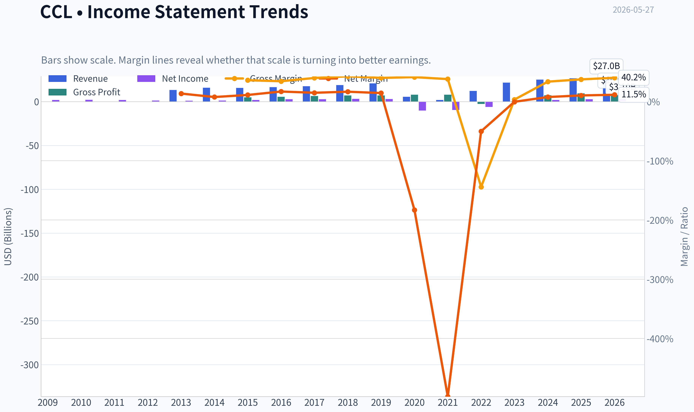

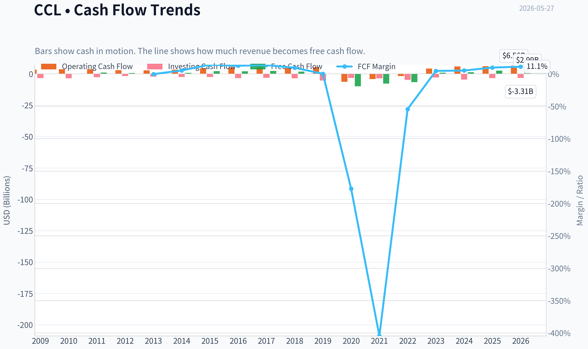

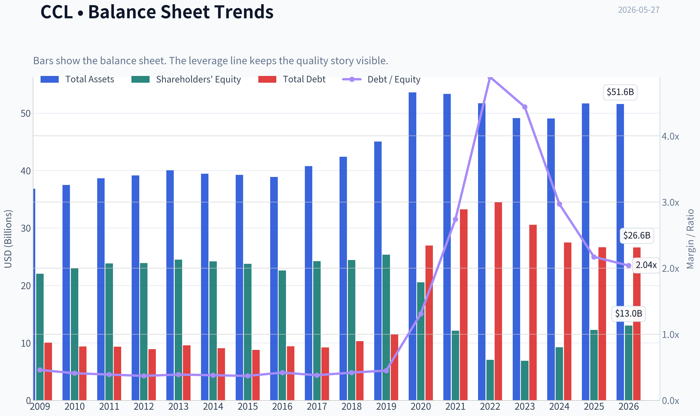

This graph tracks the profitability and return metrics (ROE, ROIC, Margins) of **CCL** over the past decade, highlighting capital efficiency trends.

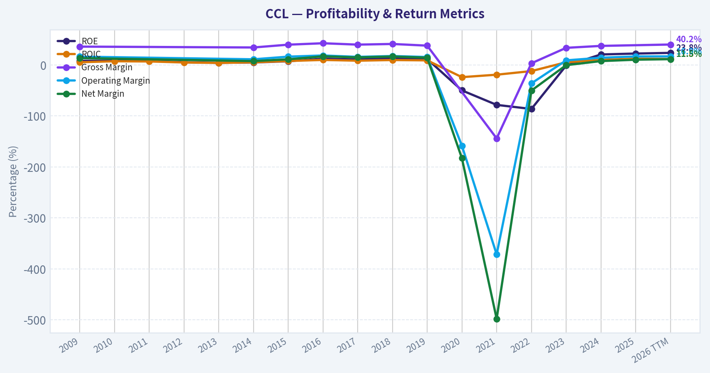

This chart illustrates the financial health of **CCL** over the last 10 years, mapping cash equivalents and free cash flow against total obligations (Debt).

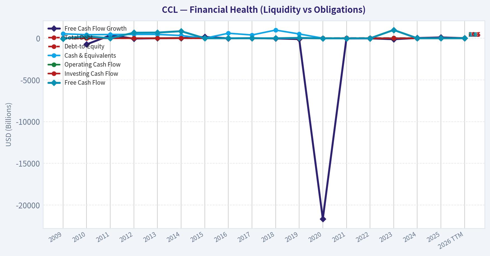

This comparison chart from *Profitability Analysis* stacks current figures against historical benchmarks for **CCL**, making it easy to see where the company trades relative to its own averages.

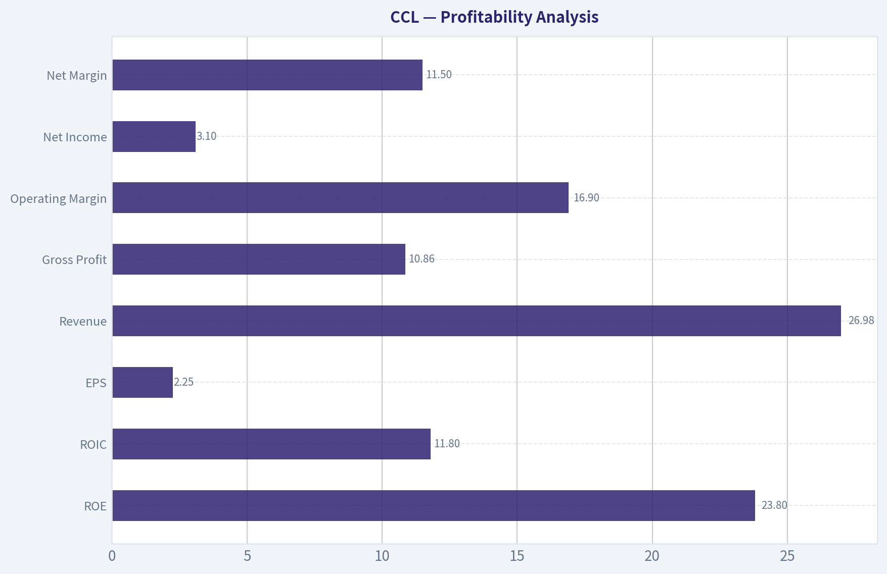

---

### Intrinsic Value Analysis (Buffett)

> *Following Warren Buffett's value investing philosophy: Circle of Competence, Economic Moat, Management Quality, and Margin of Safety.*

#### Intrinsic Value Snapshot

Price is what you pay. Intrinsic value is what the business may be worth based on the cash it can create for owners over time. We show a range, not one magic number.

- Current Price: $26.71
- Value Range (conservative to optimistic across both DCF methods): $67.38 to $175.46

##### Owner Earnings (Buffett Method)
- Net Income: $2,760,000,000.00
- Depreciation & Amortization: $2,790,000,000.00
- Capital Expenditures: $-3,611,000,000.00
- Working Capital Changes: $-145,000,000.00
- Owner Earnings: $2,084,000,000.00

##### Intrinsic Value
###### Cash Flow Method
Uses free cash flow. Better for companies spending heavily today to grow tomorrow.
- Conservative: $67.38
- Average: $67.38
- Optimistic: $175.46
- Discount Rate: 10.0%

ANALYST STANCE: **WATCH**

#### CCL (Carnival) - Buffett-Style Investment Review

#### 1) Go/No-Go Gate Assessment

| Gate | Verdict | Evidence |
|---|---|---|
| Gate 1: Circle of Competence & Simplicity | **Pass** | Carnival sells cruise vacations. It makes money by filling ships, pricing cabins well, and earning onboard spending. The business is understandable, but demand is cyclical and sensitive to fuel costs, consumer confidence, and geopolitics. |
| Gate 2: Moat Test | **Fail / Weak Pass at best** | Brand scale exists, but cruise travel is not a classic Buffett moat business. Customers comparison-shop heavily, fixed costs are large, and pricing power is limited outside peak periods. |
| Gate 3: Management & Capital Allocation | **Mixed** | Recent years were dominated by balance-sheet repair after severe industry stress. Management has improved operations, but the capital structure remains the key issue rather than exceptional capital allocation. |
| Gate 4: Industry Structure | **Mixed** | The cruise market has scale players and barriers to entry, but it is still capital-intensive, exposed to shocks, and not structurally ideal in Buffett terms. |

**Key Takeaways:** Carnival passes the basic "understandable business" test, but it does not cleanly pass the moat and industry-quality tests that define top-tier Buffett candidates. This is a large, real business with recognizable brands, yet it remains cyclical, capital-heavy, and vulnerable to external shocks. That makes it more of a monitored opportunity than an obvious long-term compounder.

---

#### 2) Elementary School Test

Carnival owns cruise ships. It sells vacation trips on those ships. People pay for tickets, food upgrades, drinks, excursions, internet, and other onboard services. If ships are full and prices are strong, Carnival earns good money. If travel demand weakens or costs jump, profits can fall fast.

#### 3) Long-Term Predictability Test

A decade from now, people will probably still take cruises, and Carnival will likely still be one of the major global operators. That said, earnings power is less predictable than for a consumer staple, software subscription, or regulated utility. The business is durable, but not steadily predictable.

#### 4) Technology Risk Assessment

Technology is unlikely to destroy cruising as a category. The bigger threats are recession, fuel, health events, regulatory burdens, and overcapacity. In that sense, technology risk is moderate-to-low, but operating risk is high.

---

#### 5) Moat Analysis

| Moat Source | Assessment | Evidence |
|---|---|---|
| Intangible Assets | **Moderate** | Carnival has major cruise brands, broad distribution, and global recognition. Brand matters, but vacation purchases are still price-sensitive. |
| Switching Costs | **Low** | Customers can easily choose another cruise line, resort, or vacation format. There is little lock-in. |
| Cost Advantage | **Moderate** | Scale helps in procurement, marketing, fleet utilization, and port relationships. But the business still requires massive capital and high fixed costs. |
| Network Effects | **None** | More passengers do not create a true network effect in the Buffett sense. |

| Moat Rating | Conclusion |
|---|---|
| **Narrow** | Requires a higher margin of safety than a true wide-moat business. |

**Key Takeaways:** Carnival's best advantage is scale and brand portfolio, not customer captivity. Travelers can switch easily, and the company cannot rely on deep switching costs or network effects. This is a narrower moat than the market sometimes assumes.

---

#### 6) Management Quality Assessment

| Dimension | Assessment | Commentary |
|---|---|---|
| Owner Mindset | **Mixed** | The key test is whether management increases per-share value over time. Recent focus has been on recovering margins and repairing the balance sheet. |
| Candor | **Adequate** | Cruise operators have generally had to discuss debt, occupancy, pricing, and cost recovery transparently since the pandemic shock. |
| Capital Allocation | **Mixed to Weak** | This is not a business with easy capital allocation choices: fleets require huge investment, leverage can become dangerous, and shocks force dilution or refinancing. |

**Key Takeaways:** Management deserves some credit for stabilizing operations and restoring earnings power. But this is not a textbook example of exceptional Buffett-style capital allocation, because the business itself consumes so much capital and became financially stressed under pressure. The balance sheet remains the central management test.

---

#### 7) Financial Snapshot

Using the shared research pack:

| Metric | Value |
|---|---:|
| Current Price | **$27** |
| Market Cap | **$37.00B** |
| P/E | **11.77x** |
| ROE | **22.5%** |
| Gross Margin | **40.1%** |
| Revenue Growth YoY | **6.4%** |
| FCF Yield | **7.0%** |
| Current Ratio | **0.32x** |

**Key Takeaways:** On the surface, the stock looks statistically inexpensive, with an 11.8x earnings multiple and a 7% free cash flow yield. But the weak current ratio is a reminder that this is not a fortress balance-sheet story. The headline ROE looks attractive, yet investors should be careful because leverage can make ROE appear better than the underlying business quality.

---

#### 8) Buffett Financial Interpretation

| Test | Preferred Buffett Standard | CCL View |
|---|---|---|
| ROE | >15% sustained, not leverage-driven | **Pass on headline**, but quality of ROE should be treated cautiously |
| Gross Margin | >40% suggests some pricing power | **Barely Pass** at 40.1% |
| Cash Generation | OCF should support earnings | **Appears improved**, supported by positive FCF yield |
| Liquidity | Strong current ratio preferred | **Fail** at 0.32x |
| Balance Sheet | Conservative leverage preferred | **Concern** |

**Key Takeaways:** Carnival passes a few surface-level profitability screens, but it fails the fortress-balance-sheet standard that Buffett strongly prefers. This matters because cruise lines are exposed to shocks they cannot control. In a downturn, liquidity and leverage can matter more than earnings multiples.

---

#### 9) Owner Earnings View

A strict Buffett owner-earnings framework is difficult here because maintenance capex for cruise fleets is substantial and recurring. In practical terms:

**Owner Earnings ~ Net Income + Depreciation & Amortization - Maintenance CapEx - Working Capital Needs**

For Carnival, reported free cash flow is the most useful shortcut because:
- depreciation is large,
- maintenance and refurbishment capex are real economic costs,
- fleet spending is not optional over long periods.

With an estimated **FCF yield of 7.0%** on a **$37B market cap**, the market is implying roughly:

**Estimated Free Cash Flow / Owner Earnings proxy = $2.6B**

That is respectable, but not exceptional relative to the balance-sheet and cyclical risks.

---

#### 10) Three-Scenario DCF Valuation

Using the owner-earnings proxy of **$2.6B** and a **10% discount rate**:

| Scenario | Assumption | Equity Value Estimate |
|---|---|---:|
| A: No Growth | $2.6B / 10% | **$26.0B** |
| B: 3% Growth | $2.6B x 1.03 / (10% - 3%) | **$38.2B** |
| C: Moderate Growth | Assume 5% normalized growth | **~$44B-$47B** |

**Key Takeaways:** Carnival looks undervalued only if current free cash flow proves durable and can grow modestly over time. Under a no-growth view, the stock looks overvalued relative to today's market cap. Under a conservative growth view, it looks roughly fairly valued, which leaves little room for error in a cyclical and leveraged business.

#### Per-Share Framing

With a **$37B** market cap and **$27** share price, the implied share count is roughly **1.37B shares**.

| Scenario | Equity Value | Implied Value per Share |
|---|---:|---:|
| A: No Growth | $26.0B | **~$19** |
| B: 3% Growth | $38.2B | **~$28** |
| C: 5% Growth | $44B-$47B | **~$32-$34** |

**Key Takeaways:** The current price of about $27 already discounts a decent recovery and some continued growth. That means upside exists, but it is not the kind of glaring discount Buffett would demand from a narrower-moat, balance-sheet-sensitive company. The stock looks closer to fair value than deeply cheap.

---

#### 11) Margin of Safety Analysis

| Item | Result |
|---|---|
| Current Price | **$27** |
| Conservative Fair Value (3% growth) | **~$28** |
| Margin of Safety vs Conservative Value | **Minimal** |
| Buffett Required Discount for This Quality Level | **40%+ preferred** |
| Conclusion | **Insufficient margin of safety** |

**Key Takeaways:** Carnival does not currently offer the large discount that a cyclical, capital-intensive business should offer. Even if fair value is a bit above the market price, the cushion is too thin. For a Buffett-style investor, that usually means waiting.

---

#### 12) Final Buffett Scorecard

| Criterion | Weight | Score (1-5) | Weighted Score |
|---|---:|---:|---:|
| Business Understanding | 20% | 4.0 | 0.80 |
| Moat Width & Durability | 25% | 2.5 | 0.63 |
| Management Quality | 15% | 3.0 | 0.45 |
| Return on Equity | 15% | 3.5 | 0.53 |
| Reinvestment Runway | 10% | 2.5 | 0.25 |
| Balance Sheet Strength | 5% | 1.5 | 0.08 |
| Industry Structure | 5% | 2.5 | 0.13 |
| Valuation / Margin of Safety | 5% | 3.0 | 0.15 |
| **Total** | 100% |  | **3.01 / 5.00** |

**Key Takeaways:** Carnival scores just above the threshold for a watchlist candidate, not a clear buy. The business is understandable and currently profitable, but moat quality, capital intensity, and balance-sheet weakness hold the score down. This is a "watch the price and debt path" situation rather than an immediate Buffett-style commitment.

---

#### 13) Investment Stance

**Stance: WATCH**
**Conviction: Moderate**

Carnival is not a terrible business, and at roughly 12x earnings with a 7% free cash flow yield it is not obviously expensive. But Buffett does not just buy cheapness; he buys durable economics, strong balance sheets, and wide moats. Carnival falls short on those tests.

The key question is not whether Carnival can earn money in a good environment. It can. The real question is whether the business can compound owner value safely through a full cycle without forcing investors to absorb balance-sheet risk. At today's price, the reward looks adequate, but not compelling enough for a Buffett-style **ADVOCATE** call.

**What would change my mind to ADVOCATE:**
- Meaningful debt reduction and stronger liquidity
- Evidence that free cash flow remains durable through softer demand
- A notably lower stock price creating a true 25% to 40% margin of safety

**What would push it to AVOID:**
- Releveraging
- Demand softness combined with discounting
- Deterioration in cash conversion or liquidity

In Buffett terms: **fairly understandable business, only modest moat, too much balance-sheet sensitivity, and not enough margin of safety today.**
#### Valuation Bridge

This bridge places the current market price beside each intrinsic value lens so readers can see whether upside depends on one method or shows up across several methods.

| Scenario | Intrinsic Value / Share |
| --- | ---: |
| Cash Flow Method | $67.38 |
| Damodaran Method | $-12.91 |
| Current Price | $26.71 |

#### Key Takeaways

If one method is far above the others, the upside case depends on a specific modelling assumption. When several methods cluster together, the valuation story is more robust.

#### Valuation Visuals

This comparison chart from *Latest Earnings Snapshot* stacks current figures against historical benchmarks for **CCL**, making it easy to see where the company trades relative to its own averages.

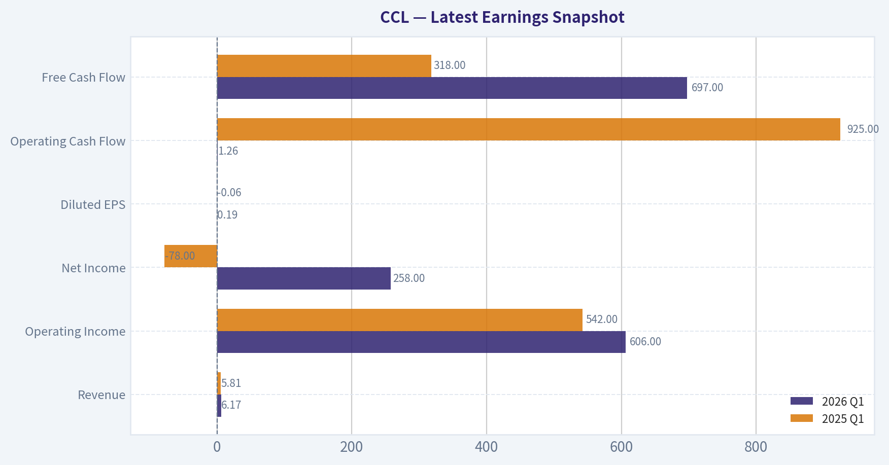

This comparison chart from *Current vs Historical Average Comparison* stacks current figures against historical benchmarks for **CCL**, making it easy to see where the company trades relative to its own averages.

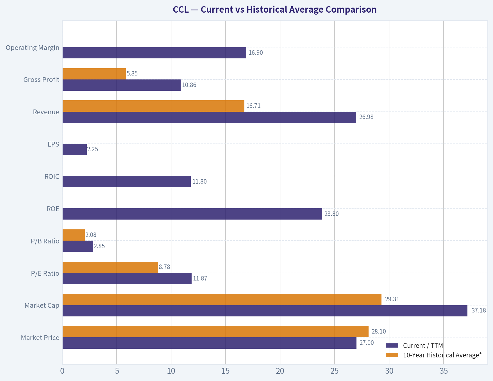

This comparison chart from *Balance Sheet Analysis* stacks current figures against historical benchmarks for **CCL**, making it easy to see where the company trades relative to its own averages.

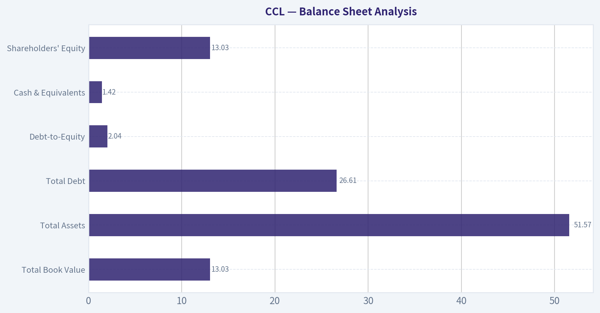

---

### Trend & Growth Analysis (Lynch/Druckenmiller/Fisher)

> *Following Peter Lynch's GARP, Stanley Druckenmiller's macro-aware approach, and Philip Fisher's scuttlebutt methodology.*

ANALYST STANCE: **WATCH**

#### 1) Lynch Classification

CCL is a **Cyclical / Recovery** rather than a true fast grower.

| Metric | Value | Interpretation |
|---|---:|---|
| Revenue growth YoY | 6.4% | Too low for Lynch fast grower status |
| P/E | 11.8x | Cheap-looking, but cyclicals often screen cheap near recovery |
| ROE | 22.5% | Distorted by leverage and reduced equity base |
| FCF yield | 7.0% | Attractive if sustainable |
| Gross margin | 40.1% | Healthy, but less decisive than EBITDA/FCF for cruise lines |
| Current ratio | 0.32x | Weak headline liquidity metric; common caveat in travel/deposit models |

**Key Takeaways:** Carnival does not fit the classic 20% plus revenue-growth profile that Lynch prized for ten-baggers. The stock looks inexpensive on earnings and free cash flow, but that often happens in cyclical recovery names. This is more a balance-sheet and macro-sensitive reopening normalization story than a compounding growth story.

---

#### 2) The Story in 3 Bullets

- Carnival sells cruise vacations through a portfolio of brands; the thesis is that consumers keep booking, onboard spending holds up, and ships operate full.
- If pricing and occupancy remain strong, fixed-cost leverage can drive disproportionate EBITDA and free cash flow improvement.
- The biggest swing factor is not demand alone, but whether that cash flow is enough to **deleverage** a still-heavy balance sheet.

#### 3) TAM Analysis with 10x Test

For a growth investor, TAM here is **global cruise and leisure travel demand**, but CCL is already one of the largest incumbents. That limits true 10x potential.

| Item | Assessment |
|---|---|
| Current business scale | Already global leader-scale |
| TAM type | Mature travel/leisure market, not an emerging software-style TAM |
| TAM growth | Moderate, GDP-plus over long periods |
| 10x revenue test | **Fails** realistically |
| Why | CCL is too large already; a 10x revenue outcome would imply implausible share and industry expansion |

**Key Takeaways:** Carnival has runway for recovery and possibly share gains, but not the kind of open-ended TAM that supports a ten-bagger growth framework. This is a mature category with cyclical demand, not a small disruptor attacking a massive underpenetrated market. For growth investing, the TAM is adequate for recovery, but not exceptional for compounding.

---

#### 4) Revenue Growth Trend

| Signal | Assessment |
|---|---|
| Latest YoY revenue growth | 6.4% |
| Pattern | **Decelerated / normalized** rather than accelerating |
| Interpretation | Recovery is maturing |
| Growth quality | Driven more by pricing/occupancy normalization than new market creation |

**Key Takeaways:** Revenue growth is positive, but it is not showing the kind of acceleration that would indicate a major new inflection. The more likely interpretation is that Carnival is moving from rebound to normalization. That makes the stock more of a cyclical execution story than a high-growth compounding story.

---

#### 5) Unit Economics

Traditional SaaS metrics do not apply well to CCL. For this business, the closest equivalents are occupancy, net yields, onboard spend, and cash conversion.

| Metric | Status | Comment |
|---|---|---|
| LTV/CAC | N/A | Not disclosed/applicable in standard form |
| NRR | N/A | Not a subscription model |
| Rule of 40 | N/A | Not meaningful for cruise lines |
| FCF yield | 7.0% | Positive support for equity if sustainable |
| Gross margin | 40.1% | Solid, but less useful than EBITDA/interest coverage |
| Cash conversion focus | Important | Deleveraging capacity matters most |

**Key Takeaways:** Carnival should not be judged with software metrics. The main economic test is whether strong bookings convert into durable free cash flow after interest, capex, and operating costs. Positive free cash flow helps, but the burden of debt keeps the bar high.

---

#### 6) Inflection Point Assessment

| Inflection Type | Status | View |
|---|---|---|
| Product cycle inflection | No | No major new product platform |
| Market share inflection | Unclear | Possible modest share benefits, not obvious step-change |
| Margin inflection | Yes, but maturing | Recovery operating leverage likely already recognized |
| TAM inflection | No | Cruise TAM is not structurally exploding |
| Competitive inflection | Limited | Industry remains oligopolistic, but not obviously disrupted in CCL's favor |

**Key Takeaways:** The real inflection for Carnival was the post-pandemic recovery in occupancy and pricing. That inflection appears to be later-stage now, not early-stage. Investors today are mainly underwriting durability of margins and pace of debt reduction, not a fresh acceleration story.

---

#### 7) Macro Setup Evaluation

| Macro Factor | Impact on CCL | Assessment |
|---|---|---|
| Consumer discretionary health | High | Key demand driver |
| Oil/fuel prices | High | Lower oil is a direct tailwind |
| Interest rates | High | High rates hurt refinancing and equity valuation |
| Recession risk | High | Cruise demand is cyclical |
| Travel demand trend | Positive | Leisure demand remains supportive |

**Key Takeaways:** The macro backdrop is mixed. Leisure travel demand is supportive and lower oil helps, but Carnival remains highly sensitive to rates and recession risk. This is a name that can work with favorable macro, but it does not control its own destiny the way a strong secular grower might.

---

#### 8) Fisher 15 Points Score

My score is approximate because we lack scuttlebutt-level management and product-channel checks.

| Fisher Area | Score (1-5) | Note |
|---|---:|---|
| Market potential | 3 | Good but mature industry |
| New products | 2 | Limited innovation angle |
| R&D effectiveness | 1 | Not a material edge driver |
| Sales organization | 4 | Strong global brand/distribution system |
| Profit margin | 3 | Improving, but cyclical |
| Margin improvement | 4 | Recovery has improved margins |
| Labor relations | 3 | Operationally complex |
| Executive relations | 3 | Adequate, not standout |
| Management depth | 4 | Large-scale operator experience |
| Cost/accounting controls | 3 | Reasonable, but leverage clouds picture |
| Special advantages | 4 | Scale, fleet, brand portfolio |
| Long-range profit outlook | 3 | Recovering, but debt-constrained |
| Dilution risk | 2 | History of dilution/recapitalization matters |
| Candor | 3 | Neutral |
| Integrity | 3 | Neutral |

| Total Fisher Score | Rating |
|---:|---|
| 45 / 75 | Average |

**Key Takeaways:** Carnival scores as a competent large operator with scale advantages, but not as a classic Fisher innovation compounder. The biggest weaknesses are limited product differentiation, mature market structure, and the legacy effects of leverage and dilution. This is acceptable quality for a cyclical, but not standout quality for a growth portfolio.

---

#### 9) Valuation Analysis

Using the shared pack:

| Valuation Metric | Value | Read |
|---|---:|---|
| Price | $27 | Current reference |
| Market cap | $37.0B | Large cap |
| P/E | 11.8x | Looks inexpensive |
| FCF yield | 7.0% | Attractive if normalized |
| PEG | ~1.8x | Using 11.8 P/E / 6.4 growth |
| PEG verdict | Fair to expensive for growth | Not attractive on Lynch growth basis |

**Key Takeaways:** Carnival looks cheap on simple P/E and free cash flow metrics, but that cheapness is partly explained by its cyclical and leveraged nature. On a Lynch PEG basis, the stock is not especially attractive because growth is modest. Valuation is supportive for a recovery stock, but not compelling for a high-growth entry.

Scenario framing:

| Scenario | What must happen | Likely outcome |
|---|---|---|
| Bear | Demand softens, fuel/rates rise, deleveraging stalls | Equity multiple compresses |
| Base | Stable bookings, modest pricing, gradual debt reduction | Mid-teens total return potential, not explosive |
| Bull | Strong yields, lower fuel, faster debt paydown, rerating | Good cyclical upside |
| Ten-bagger case | Massive TAM expansion or structural step-change | Very unlikely |

**Key Takeaways:** The upside case exists, but it is cyclical rerating upside rather than exponential business-model expansion. In the best case, Carnival can be a strong recovery winner. But the path to a true ten-bagger from current scale is difficult to justify.

---

#### 10) Growth Investor Scorecard

| Criterion | Weight | Score (1-5) | Weighted |
|---|---:|---:|---:|
| The Story | 10% | 3.5 | 0.35 |
| TAM & Runway | 20% | 2.0 | 0.40 |
| Revenue Growth | 20% | 2.0 | 0.40 |
| Unit Economics | 15% | 3.0 | 0.45 |
| Competitive Position | 10% | 3.5 | 0.35 |
| Management Quality | 10% | 3.0 | 0.30 |
| Macro Setup | 5% | 3.0 | 0.15 |
| Profitability Path | 5% | 3.5 | 0.18 |
| Valuation | 5% | 3.5 | 0.18 |

| Total Score | Stance |
|---:|---|
| 2.76 / 5.00 | **AVOID / WATCHLIST EDGE** |

**Key Takeaways:** On a pure growth-investor framework, Carnival scores below the threshold for an active advocate stance. The main issue is not valuation, but limited runway and modest growth. It may work as a cyclical recovery trade, but it does not rank highly as a secular growth compounder.

---

#### 11) Position Size Stance

| Investor Type | Position View |
|---|---|
| Growth-only portfolio | 0% to 1% tracking position |
| GARP / cyclical recovery portfolio | 1% to 3% possible |
| High-conviction concentrated growth | No |

**Key Takeaways:** If you own Carnival, it can be monitored as a recovery/value-cyclical position. But for a concentrated growth portfolio, it does not deserve major sizing. The setup is interesting enough to watch, but not strong enough to advocate aggressively.

---

#### 12) Key Risks and Catalysts

| Risks | Catalysts |
|---|---|
| Recession hurts discretionary travel | Continued strong booking trends |
| Fuel cost spikes | Lower oil prices |
| High interest expense / refinancing risk | Faster debt paydown |
| Geopolitical disruptions / itineraries | Better-than-expected yields |
| Health/safety incidents | Margin expansion from operating leverage |
| Weak liquidity optics | Positive estimate revisions |

**Key Takeaways:** The biggest upside catalysts are straightforward: strong demand, lower fuel, and faster deleveraging. The biggest risks are also clear: macro softness and financing pressure. This makes Carnival highly tradeable, but less attractive as a durable long-term growth compounder.

#### Bottom Line

Carnival is a **WATCH**, not an **ADVOCATE**, under Lynch-Druckenmiller-Fisher growth criteria.

Why:
- **Not a fast grower**
- **No real 10x TAM case**
- **Recovery inflection is likely later-stage**
- **Leverage and macro sensitivity remain central**

Why not avoid entirely:
- Valuation is not demanding
- Free cash flow is improving
- Lower fuel and steady travel demand can still support upside
- Steve Cohen adding is a useful signal that sophisticated money sees cyclical value

If you want, I can next do a **CCL vs RCL vs NCLH comparative ranking** in the same framework.

#### Growth & Scorecard Visuals

This comparison chart from *Growth Metrics* stacks current figures against historical benchmarks for **CCL**, making it easy to see where the company trades relative to its own averages.

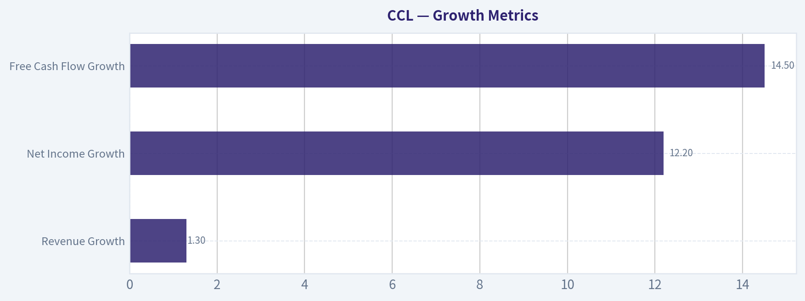

---

### Market Technical Analysis

#### CCL Technical Analysis as of 2026-05-27

I selected 8 complementary indicators for CCL that best fit the current market context: a stock in a **longer-term downtrend**, trying to stabilize after a sharp spring selloff, with **short-term recovery momentum** starting to improve but not yet strong enough to fully reverse the broader structure.

The indicators used are:

- `close_50_sma`
- `close_200_sma`
- `close_10_ema`
- `macd`
- `rsi`
- `atr`
- `boll_ub`
- `vwma`

These are relevant because they cover:
- **Trend structure**: 50 SMA, 200 SMA, 10 EMA
- **Momentum and reversal pressure**: MACD, RSI
- **Volatility and breakout context**: ATR, Bollinger Upper Band
- **Volume-confirmed price behavior**: VWMA

---

#### Price Structure and Trend Regime

CCL peaked near the low-32s in February, then suffered a sharp breakdown through March, bottoming in the low-23s. Since then, price has recovered part of the decline, but the recovery has been incomplete and structurally uneven.

The most important trend message is this:

- **Close on 2026-05-26: 26.71**
- **10 EMA: 25.74**
- **50 SMA: 26.02**
- **200 SMA: 28.29**

That alignment says a lot. Price is currently **above the 10 EMA and slightly above the 50 SMA**, which indicates improving short-term and medium-term conditions. However, price remains **well below the 200 SMA**, meaning the longer-term trend is still not repaired.

In other words, CCL is no longer in the same acute downside acceleration seen in March, but it is also not yet in a clean long-term bullish trend. The stock appears to be in a **bottoming-to-repair phase**, not a confirmed new secular uptrend.

| Indicator | Latest Value | Interpretation |
|---|---:|---|
| Close | 26.71 | Short-term rebound in progress |
| close_10_ema | 25.74 | Price above fast trend support |
| close_50_sma | 26.02 | Price reclaimed medium-term average |
| close_200_sma | 28.29 | Long-term trend still bearish overhead |

**Key Takeaways:** CCL has improved enough to trade above both its short-term and medium-term averages, which is a constructive change from the weakness seen earlier in spring. But the stock is still below its 200-day trend line, so the bigger picture remains a recovery attempt inside a damaged longer-term chart rather than a fully restored bull trend.

---

#### Moving Average Interpretation in Detail

The **50 SMA has been falling steadily**, from roughly 28.57 in late March to 26.02 now. That confirms that the medium-term trend has been under persistent pressure for weeks. Still, the fact that price has climbed back above this declining average matters: it often signals that sellers are losing control in the short run.

The **200 SMA is also drifting lower**, though only slightly, now near 28.29. Because the 200-day average is above both price and the 50 SMA, the broader chart still reflects a bearish hierarchy. There is no golden-cross style setup here; instead, the moving averages suggest CCL is trying to recover within a still-negative long-term framework.

The **10 EMA has turned up recently**, rising from about 25.07 on May 19 to 25.74 on May 26. That is one of the clearest signs that recent buying pressure is real. The rally from 23.89 on May 19 to 26.71 on May 26 was not just a one-day spike; it has begun to shift the short-term trend slope upward.

The practical takeaway:
- **Bullish short term**: above 10 EMA
- **Improving medium term**: above 50 SMA
- **Still challenged long term**: below 200 SMA

---

#### Momentum: Recovery Is Real, but Not Yet Powerful

The **MACD is still negative at -0.214**, but it has improved materially from around **-0.616 on May 19**. This is important. Negative MACD means the stock has not fully transitioned into bullish momentum dominance, yet the rapid improvement shows downside momentum has faded sharply.

That kind of MACD behavior often appears in early recovery phases:
1. heavy selling exhausts,
2. price stabilizes,
3. momentum becomes less negative,
4. only later does MACD potentially cross into positive territory if the rally persists.

So CCL is currently in **momentum repair**, not full momentum confirmation.

The **RSI at 54.18** reinforces that view. This is neither overbought nor oversold. It indicates neutral-to-mildly constructive momentum. More importantly, RSI rebounded from the upper-30s on May 19 to the mid-50s without becoming stretched. That suggests the rebound still has room to continue if buyers remain engaged.

| Momentum Indicator | Latest Value | Trend Signal |
|---|---:|---|
| macd | -0.214 | Negative, but improving strongly |
| rsi | 54.18 | Neutral-bullish, not overextended |

**Key Takeaways:** Momentum has improved meaningfully over the past week, especially after the May 19 low. MACD remains below zero, so the rally is still in the repair stage, but RSI in the mid-50s shows the rebound is healthier than an oversold bounce and is not yet exhausted.

---

#### Volatility and Trading Range Context

The **ATR is 1.23**, down from April readings closer to 1.45-1.50. That tells us volatility has cooled from the panic-like conditions seen during the March-April instability. Lower ATR can be constructive because it suggests the market is transitioning from disorderly movement toward more tradable structure.

Still, ATR at 1.23 is not low in absolute terms for a $26-$27 stock. It implies CCL can still move roughly 4% to 5% in a normal active session. Traders should respect that this remains a fairly dynamic name.

The **Bollinger Upper Band is 27.46**, and price at 26.71 is approaching that upper envelope but has not broken through it. This matters because rallies in weak-to-neutral broader trend structures often stall near the upper band unless backed by fresh momentum and strong volume support.

So the current setup suggests:
- price has rebounded well,
- it is nearing a short-term resistance zone around 27.4 to 27.5,
- a decisive push through that area would strengthen the bullish case,
- failure there could send the stock back into consolidation around the mid-25s to low-26s.

| Volatility / Range Indicator | Latest Value | What It Suggests |
|---|---:|---|
| atr | 1.23 | Volatility still meaningful, but calmer than April |
| boll_ub | 27.46 | Near-term upside envelope/resistance nearby |

**Key Takeaways:** CCL is no longer trading in the same high-stress volatility regime that defined parts of March and April, which is a positive sign for stability. However, the stock is now approaching the upper end of its recent volatility band, so the next move near 27.4 to 27.5 will be important in determining whether this rebound extends or pauses.

---

#### Volume-Weighted Confirmation

The **VWMA is 25.67**, and price is above it at 26.71. That is a constructive signal because it means the stock is trading above a volume-adjusted average cost area, suggesting recent buyers are not immediately underwater and that the rebound has some participation behind it.

This is especially relevant given the elevated volume on several recent sessions:
- 80.4M on May 5
- 50.8M on May 6
- 49.2M on May 20

Those high-volume days show strong two-way interest. Since price is now above VWMA, the recent balance of traded shares has shifted somewhat in favor of buyers rather than trapped sellers.

However, there is still nuance here. VWMA itself had been falling sharply through most of May, from above 27 to 25.67 now. That means the longer volume-weighted trend is still healing from a clear distribution phase. So this is supportive, but not definitive.

---

#### Fine-Grained Trend Narrative

From a sequencing perspective, CCL's chart has gone through four distinct phases:

1. **Late 2025 to early February 2026:**
   strong advance from the mid-20s into the low-30s, culminating in a February peak.

2. **Mid-February to mid-March:**
   decisive breakdown, with lower highs and lower lows accelerating into a sharp washout.

3. **Late March to mid-April:**
   recovery attempt with improving momentum; price rebounded toward 29 but failed to reclaim longer-term trend leadership.

4. **Late April to mid-May:**
   another fading phase, but notably not a collapse to new major lows; instead, price undercut into the high-23s and then bounced again.

That fourth point is important. The May decline did not produce the same kind of downside velocity seen in early March. That suggests selling pressure may be becoming less efficient. The market may be transitioning from **impulsive downside** to **range-based repair**.

This favors a working thesis of:
- **23.5 to 24.0** as an important support zone,
- **26.0 to 26.1** as newly reclaimed pivot support,
- **27.4 to 28.3** as the main overhead resistance band,
  with 27.46 near the Bollinger upper band and 28.29 near the 200 SMA.

---

#### Trading Implications

For **short-term traders**, the setup is constructive as long as price holds above the 10 EMA and ideally above the 50 SMA. The rebound has improved enough that pullbacks toward 26.0 may attract dip buyers, assuming broader market conditions cooperate.

For **swing traders**, the main question is whether CCL can convert this rebound into a break above the upper-band area and then challenge the 200 SMA. Until that happens, rallies may still behave like countertrend recoveries rather than durable trend reversals.

For **longer-term investors**, caution is still warranted. The stock is below the 200 SMA, and both long- and medium-term trend measures still reflect damage from the prior breakdown. A stronger long-term signal would require:
- sustained closes above the 200 SMA,
- MACD crossing more decisively into positive territory,
- and the 50 SMA flattening, then turning up.

---

#### Overall Assessment

CCL currently shows a **meaningful short-term recovery with improving momentum and calmer volatility**, but the larger technical structure remains only partially repaired. The reclaim of the 50 SMA and the move above VWMA are constructive. The still-negative MACD and price below the 200 SMA keep the analysis from turning fully bullish.

The most likely interpretation is that CCL is in a **tradable rebound within a broader rebuilding phase**. If it can hold above 26 and press through the 27.4-28.3 resistance zone, the technical outlook would improve materially. If it fails there, the stock may revert to a choppy consolidation rather than resume a powerful uptrend immediately.

| Category | Signal | Conclusion |
|---|---|---|
| Short-term trend | Positive | Price above 10 EMA |
| Medium-term trend | Improving | Price above falling 50 SMA |
| Long-term trend | Negative | Price below 200 SMA |
| Momentum | Recovering | MACD improving, RSI neutral-bullish |
| Volatility | Moderating | ATR lower than April extremes |
| Volume confirmation | Mildly supportive | Price above VWMA |
| Near-term resistance | 27.4 to 28.3 | Bollinger upper band and 200 SMA overhead |
| Key support | 26.0, then 23.5 to 24.0 | Reclaimed pivot and recent swing low zone |

**Key Takeaways:** The technical picture for CCL has improved enough to support a near-term bullish trading bias, but the stock has not yet cleared the bigger structural hurdles that would signal a full trend reversal. The rebound looks real, yet the zone between roughly 27.4 and 28.3 remains the key test that separates a simple bounce from a more durable upside transition.

#### Market Visuals

This comparison chart from *Market Metrics* stacks current figures against historical benchmarks for **CCL**, making it easy to see where the company trades relative to its own averages.

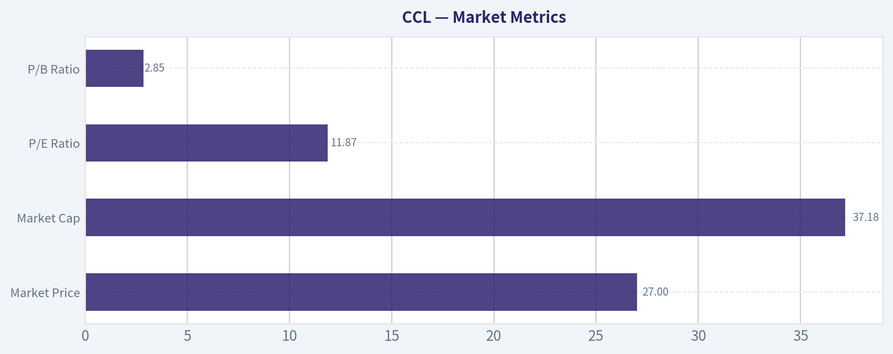

---

### Options Market Analysis

> *Reading options flow - put/call ratios, IV skew, and unusual activity - to gauge institutional positioning and event-driven risk.*

#### CCL Options Positioning Report
*Date: 2026-05-27*

CCL's near-term options tape leans **bearish-to-cautious**, but confidence is **reduced materially** because the dataset shows **zero reported open interest across the near-term expirations**, which makes several institutional-positioning reads less reliable than usual. The cleanest signal available is the **put-heavy volume ratio**, while the volatility picture is relatively subdued rather than panic-driven.

#### 1. Put/Call Ratio Analysis

| Expiration | Call Volume | Put Volume | Put/Call Volume Ratio | Call OI | Put OI | Put/Call OI Ratio |
|---|---:|---:|---:|---:|---:|---:|
| 2026-05-29 | 6,113 | 9,130 | 1.49 | 0 | 0 | N/A |
| 2026-06-05 | 1,497 | 2,201 | 1.47 | 0 | 0 | N/A |
| 2026-06-12 | 798 | 586 | 0.73 | 0 | 0 | N/A |
| **Near-term total** | **8,408** | **11,917** | **1.42** | **0** | **0** | **N/A** |

**Key Takeaways:** Near-term activity is tilted toward puts, with an aggregate put/call volume ratio of **1.42**, well above the rough neutral baseline of **0.7**. That suggests traders are using options more for downside protection or bearish exposure than for upside speculation. However, the absence of usable OI means we cannot confirm whether this is new institutional hedging, fresh bearish bets, or simply distorted one-day flow.

**Interpretation:**
- A **1.42 put/call volume ratio** is a meaningful bearish/cautious deviation from neutral.
- The first two weekly expirations both show **put-dominant flow**, reinforcing the idea that near-term traders are more focused on downside risk than upside chase.
- The 2026-06-12 line is less bearish at **0.73**, closer to neutral, suggesting the strongest caution is concentrated in the very short term.

#### 2. Implied Volatility (IV) Assessment

| Expiration | ATM Call IV | ATM Put IV | IV Read | Skew Read |
|---|---:|---:|---|---|
| 2026-05-29 | 4.7% | 4.7% | Balanced, modest | No visible skew |
| 2026-06-05 | 2.6% | 2.3% | Low/modest | Slight call-side richness |
| 2026-06-12 | 2.6% | 1.0% | Low overall | Clear call-side richness |
| **Overall** | - | - | **Not elevated** | **No downside panic skew** |

**Key Takeaways:** Near-term implied volatility does **not** look elevated, and there is **no steep put skew** that would normally signal urgent downside fear. In fact, farther out in the near-term window, calls appear slightly richer than puts, which softens the bearish message from the volume data.

**Interpretation:**
- The nearest weekly expiry has **flat ATM IV between calls and puts**, which suggests balanced pricing of immediate event risk.
- The following weeklies show **calls priced slightly above puts**, especially by 2026-06-12, which is **not consistent with aggressive crash hedging**.
- Since IV is not elevated, this does **not** look like the market is pricing a major imminent catalyst with high uncertainty.
- If there is a known company or macro catalyst nearby, the options market is **not showing a strong volatility premium** for it in this dataset.

#### 3. Unusual Options Activity

| Screen | Result |
|---|---|
| Volume > 5x Open Interest | No qualifying contracts found |

**Key Takeaways:** There were **no flagged unusual contracts** under the tool's threshold of volume greater than five times open interest. That removes one of the cleaner "smart money" signals, especially since reported OI is zero across the near-term chains.

**Interpretation:**
- No contract stood out as an obvious fresh high-conviction directional bet under the screening criteria.
- Because open interest is unavailable/zero in the dataset, unusual-activity detection is inherently weaker here.
- As a result, there is **no strong evidence of concentrated institutional call buying or put buying** from the available chain summary.

#### 4. Open Interest Concentration

| Category | Observation |
|---|---|
| Highest OI strikes | Not available / all reported near-term OI = 0 |
| Highest OI expirations | Not available |
| Max pain / pinning levels | Cannot be reliably inferred |
| Gamma walls | Cannot be reliably identified |

**Key Takeaways:** The dataset does **not provide usable open-interest concentration**, so we cannot identify likely pinning strikes, max-pain zones, or gamma walls. This sharply lowers confidence in any price-magnet or expiry-gravity analysis.

**Interpretation:**
- Normally, heavy OI at specific strikes can create **pinning behavior** into expiry.
- Here, with **zero reported OI**, those reference levels are effectively unavailable.
- That means we should avoid overconfidence about support/resistance derived from options positioning.

#### 5. Overall Options Sentiment Signal

| Signal | Confidence | Primary Driver |
|---|---|---|
| **BEARISH** | **Low-to-moderate** | Put-heavy near-term volume ratio without confirming panic IV |

**Key Takeaways:** The best directional read is **bearish**, driven mainly by **put-dominant near-term trading activity**. But this is a **qualified bearish** call, not an aggressive one, because the volatility surface does not show fear and open-interest data is too weak to confirm institutional conviction.

My synthesis:
- **Bearish signal:** near-term traders are buying or trading more puts than calls by a meaningful margin.
- **Not a high-conviction bearish signal:** IV is not elevated and put skew is not steep, so the market does not appear to be pricing severe downside stress.
- **Most likely interpretation:** short-dated caution/hedging is present, but not a full-fledged bearish panic. If paired with weak price action or negative fundamental news, the options tape would reinforce that downside bias.

#### Bottom Line

For CCL, the options market currently reads **BEARISH**, primarily because **near-term put volume is running well above call volume**. However, this is **not** a strong crash-warning signal because **IV is subdued** and **there is no usable open-interest structure** to confirm heavy institutional positioning. Treat this as a **cautious downside lean**, not a high-conviction directional call.

#### Summary Table

| Metric | Read |
|---|---|
| Put/Call Ratio | **Bearish** - near-term volume ratio **1.42**, above neutral |
| IV Level | **Low to modest** - not signaling major event panic |
| Skew Direction | **Flat to slight call skew** - not showing strong downside fear |
| Unusual Activity | **None flagged** in near-term expirations |
| Overall Signal | **BEARISH** |
| Confidence | **Low-to-moderate** due to missing/zero OI data |

**Key Takeaways:** CCL's options flow is leaning bearish, but the evidence is incomplete. The strongest signal is simple put-heavy trading volume, while IV and skew do not confirm strong fear. That combination usually points to **defensive near-term positioning rather than a high-conviction collapse bet**.

---

## Research Team Commentary

> *The Research Manager synthesizes the Bull vs Bear debate into action-free commentary. This is a pre-risk view, not the final stance.*

The strongest bull argument is that Carnival is no longer a distressed reopening story but a materially improved earnings business. Demand appears intact, ships are full, onboard spending is healthy, and the model has substantial fixed-cost leverage. At roughly 11.8x earnings, the stock is not priced like a premium consumer franchise, yet if occupancy and pricing remain firm, even modest deleveraging could drive outsized equity value. The bull case also fairly notes that cruise is a consolidated industry with real barriers to entry: ships are expensive, operations are complex, distribution matters, and scale can help purchasing, marketing, and fleet utilization. If management stays disciplined and prioritizes debt reduction over expansion, intrinsic value can rise meaningfully even without heroic revenue growth.

The strongest bear argument is that this still fails the core Buffett test. Carnival is capital intensive, cyclical, discretionary, and heavily dependent on favorable conditions. Depreciation is not just an accounting charge here; maintenance, refurbishment, and eventual replacement capex are real economic costs. That means the headline P/E likely overstates true owner earnings. The bear case is also right that high ROE can flatter economics in a leveraged recovery and that scale is not the same as a durable moat if customers remain price sensitive and pricing power is inconsistent across cycles. Most importantly, the equity thesis still leans on many things going right at once: demand, pricing, occupancy, costs, and debt paydown.

My takeaway is that both sides have valid points, but through a Buffett lens the bear side is more durable. Carnival may continue to work as a recovery or cyclical equity, but it is not the kind of predictable, high-quality compounding business that deserves a strong value endorsement. The market may not be obviously overpricing it on near-term earnings, yet there is also not enough margin of safety once true capital needs and leverage risk are properly considered. I do not think this is an AVOID in the sense of imminent collapse, but I also do not think it qualifies as a business-quality-led ADVOCATE.

Core takeaway: Carnival is a better business than it was, but not a great business, and the stock's apparent cheapness is less compelling once you adjust for capital intensity and balance-sheet fragility. The investment case is real, but it is conditional rather than durable.

Rationale: I want to avoid repeating the mistake of being so rigid that I miss improving economics, but I also do not want to overlearn the FFIV lesson and start treating every cyclical rebound as a Buffett-style opportunity. That would be a different mistake. Here, the improvement in profitability and returns deserves respect. A low-teens earnings multiple on a recovering leisure leader is not absurd, and deleveraging can create equity upside. But Buffett's framework starts with business quality, predictability, and financial strength. Carnival still falls short on all three. The moat is limited, owner earnings are less than accounting earnings suggest, and leverage remains central to the thesis. That combination argues for interest without conviction.

Monitoring plan over the next 1-4 quarters: I would watch three things closely. First, net yield and occupancy trends: if pricing holds without heavy discounting and occupancy stays strong, the recovery remains credible. Second, free cash flow after realistic maintenance and refurbishment spending, not just EBITDA: this is the clearest test of whether the business is truly creating owner value. Third, debt reduction and interest burden: if management can visibly delever without reaccelerating fleet commitments, the equity case improves. I would also watch booking curves for any softening in close-in demand, signs of onboard spend pressure, and any commentary on fuel, labor, or regulatory costs. If Carnival proves it can convert strong demand into sustained post-capex cash generation and meaningful balance-sheet repair, the thesis strengthens. If profits remain heavily optical while debt stays stubbornly high, the stock becomes less attractive.

Final stance: WATCH.

---

## Value Investing Team Commentary

> *The Investor translates the research view into an investment thesis before risk review. This is still not the final stance.*

Carnival is understandable, which is a necessary starting point. It sells a discretionary vacation product through scaled global brands, and when demand is strong, the model has meaningful fixed-cost leverage. That is the heart of the bullish case: full ships, firmer pricing, healthy onboard spend, and a path where incremental revenue translates into much better EBITDA and, eventually, equity value through deleveraging. At roughly 11.8x earnings, the stock does not look expensive if one believes current travel demand is durable.

But a Buffett-style assessment has to go deeper than optical earnings. This is still a capital-heavy, cyclical business with meaningful financial leverage. In cruising, depreciation is not some harmless accounting artifact; ships wear out, require refurbishment, and eventually need replacement. So the right question is not "is the P/E low?" but "what are true owner earnings after the real economic cost of maintaining the fleet?" On that basis, the apparent cheapness is less compelling than the headline multiple suggests.

The most important issue is business quality. Carnival has scale, brand portfolio, distribution reach, and operational complexity that create barriers to entry. Those are real advantages. But they are not the same as a wide moat in the Buffett sense. Customers remain price sensitive, demand is discretionary, and industry economics can swing with recessions, fuel, labor, regulation, and financing conditions. A great business can usually withstand bad conditions without the balance sheet becoming central to the thesis. Here, balance-sheet repair is still a major part of the thesis, which tells you the business is improving but not yet truly durable.

The contrarian angle is worth examining carefully. Sentiment toward travel and leisure often swings too far in both directions. When markets still mentally file Carnival under "distressed reopening trade," they may underappreciate how much earnings power has recovered. That is the bull case the market could still be slow to fully price: if occupancy and yields remain healthy for longer than expected, debt paydown can create outsized equity gains because leverage works both ways. In that scenario, the crowd may be too focused on the company's past weakness and too slow to recognize a normalized earning base.

However, selective contrarianism cuts both ways. A market that becomes comfortable with "consumer resilience" can also become too forgiving about fragile capital structures. Investors may anchor on strong booking headlines and ignore that this is exactly the kind of business where everything looks best near the top of the cycle. If the economy softens, pricing weakens, or costs rise, the downside can be sharper than a simple earnings multiple suggests. In other words, what the news may be hiding is not just opportunity, but how conditional the equity story still is.

So what matters over the next few quarters is not whether ships are full in isolation, but whether strong demand is converting into durable post-maintenance free cash flow and visible deleveraging. That is the dividing line between a cyclical rebound stock and a genuinely strengthening business. If management proves it can reduce debt materially without leaning on optimistic assumptions or renewed capital commitments, intrinsic value rises. If not, the stock remains a more speculative recovery vehicle than a long-term compounding candidate.

From a value-investing standpoint, this is not the type of business I would enthusiastically want to own for a decade regardless of the macro environment. It may work well, and perhaps very well, if consumer demand stays favorable and management remains disciplined. But the investment case still depends on several variables going right at once. That is not a sufficient margin of safety for a strong endorsement.

**ANALYST STANCE: WATCH**
Carnival is a materially improved business, and sentiment may still understate the earnings recovery and deleveraging upside. But this remains a cyclical, capital-intensive, balance-sheet-sensitive company with limited moat strength and owner earnings that are likely lower than accounting earnings imply. Worth monitoring closely for proof of real free cash flow and debt reduction, but not yet a business-quality-led long-term advocate.

---

## Deep Values Commentary

> *The Risk Management Team debates and the Risk Judge provides the final action-free verdict. This section determines the final ADVOCATE / WATCH / AVOID stance.*

#### Final Stance Scorecard

This scorecard converts the final research view into a weighted decision frame. It does not replace the narrative judgement, but it makes the main drivers of the verdict easier to scan.

| Criterion | Score | Weight | Commentary |
| --- | ---: | ---: | --- |
| Business Quality | 3.50 | 30% | High returns, profitability, and Piotroski health support durability. |
| Valuation Support | 4.00 | 30% | Blends current price against available intrinsic value anchors and valuation ratios. |
| Financial Strength | 1.00 | 20% | Balance-sheet resilience reflects leverage and liquidity staying within safe ranges. |
| Growth Durability | 4.33 | 20% | Recent revenue, earnings, and free cash flow growth indicate how durable expansion looks. |
| TOTAL / FINAL STANCE | 3.32 | 100% | WATCH |

#### Key Takeaways

The weighted score lands at **3.32 / 5.0**, while the final stance remains **WATCH**. This is useful as a quick calibration aid rather than a mechanical signal.

#### Risk Summary

Higher scores indicate more risk pressure. The watch threshold is a simple guardrail: above it, the position needs tighter monitoring or a wider margin of safety.

| Dimension | Current Score | Watch Threshold | Commentary |
| --- | ---: | ---: | --- |
| Business Quality | 2.50 | 3.00 | High returns, profitability, and Piotroski health support durability. |
| Valuation Support | 2.00 | 3.00 | Blends current price against available intrinsic value anchors and valuation ratios. |
| Financial Strength | 5.00 | 3.00 | Balance-sheet resilience reflects leverage and liquidity staying within safe ranges. |
| Growth Durability | 1.67 | 3.00 | Recent revenue, earnings, and free cash flow growth indicate how durable expansion looks. |

#### Key Takeaways

This view helps readers separate *where* the risk sits: valuation, business quality, balance sheet, or growth durability. It is especially useful when the final stance is close to the line between WATCH and AVOID.
