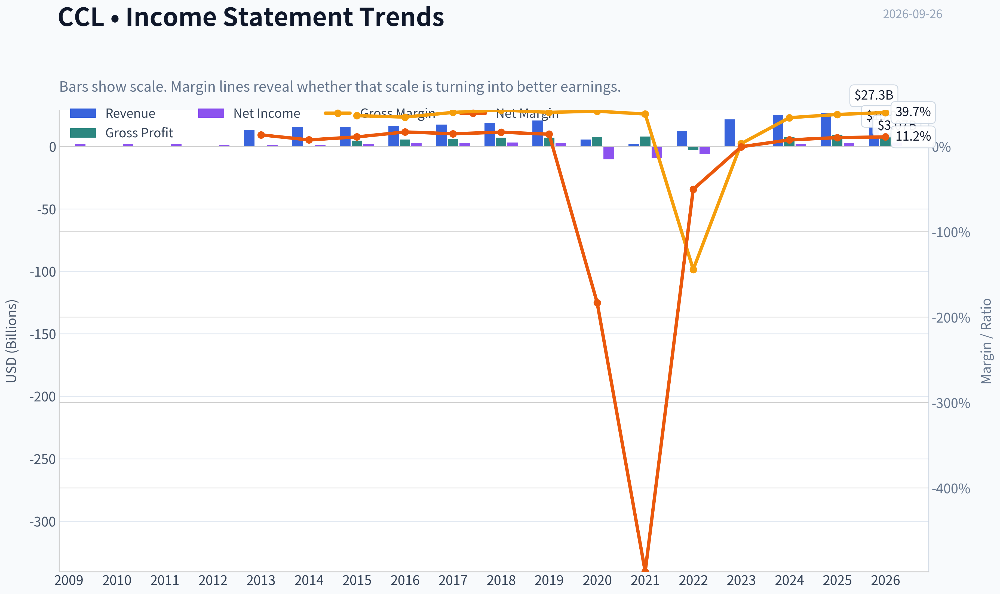
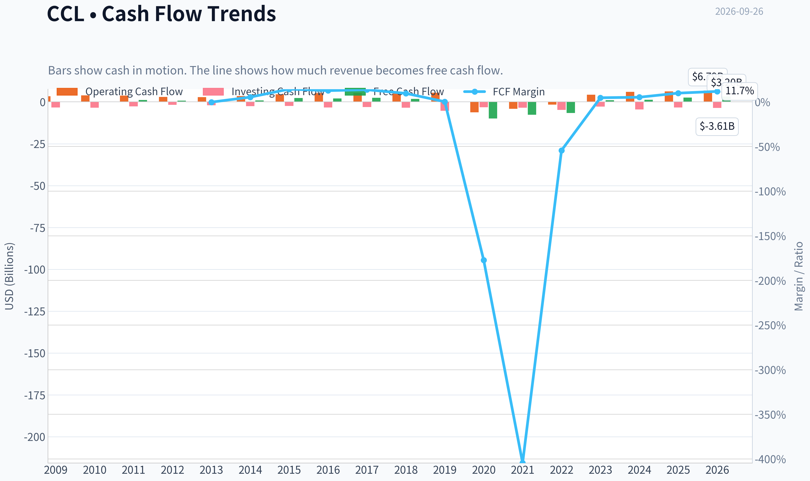
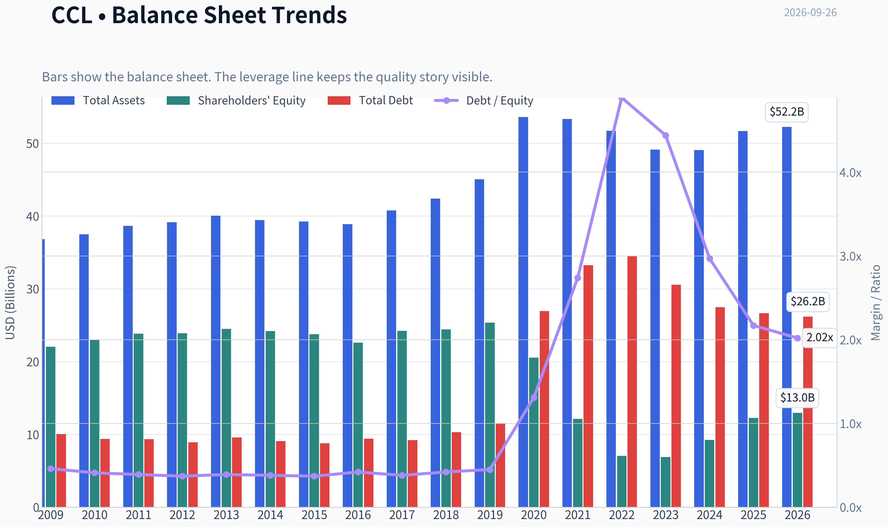
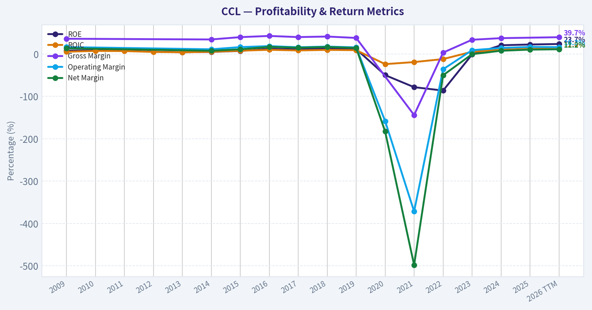
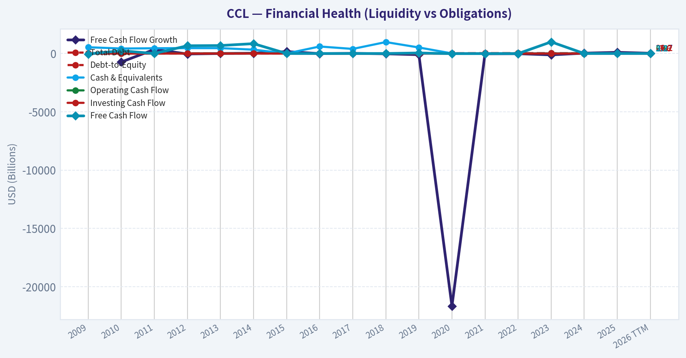
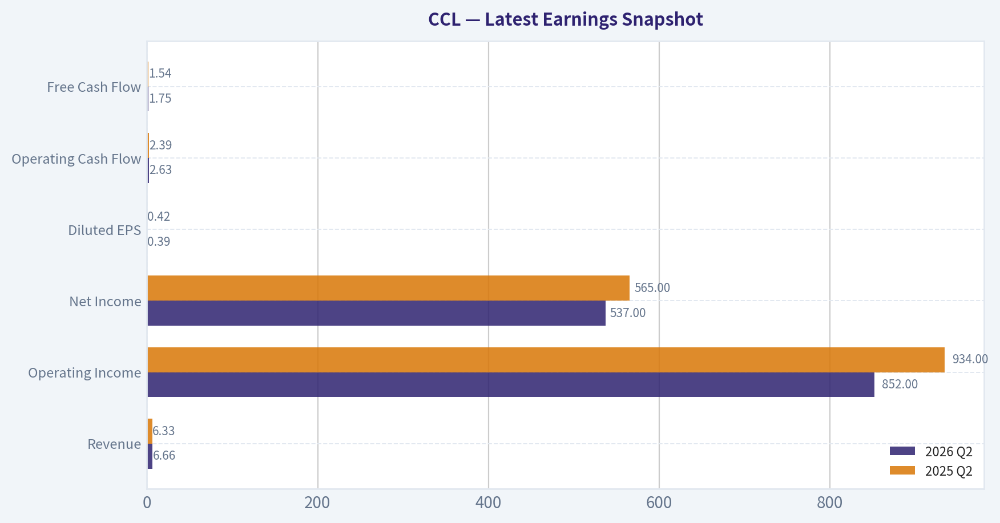
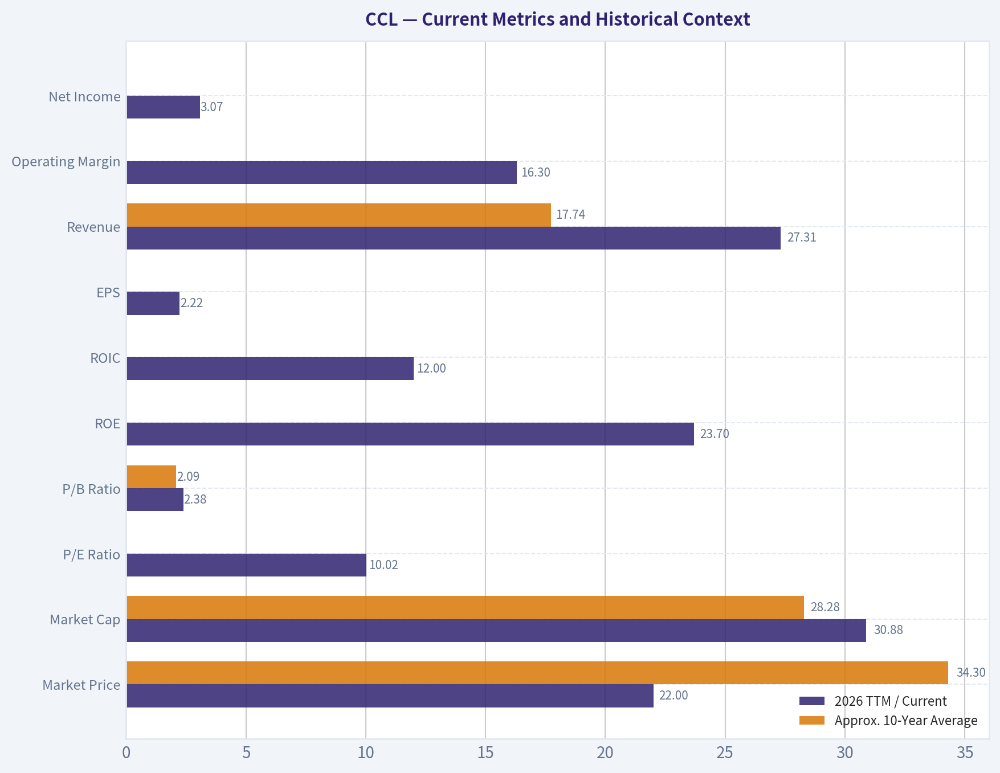
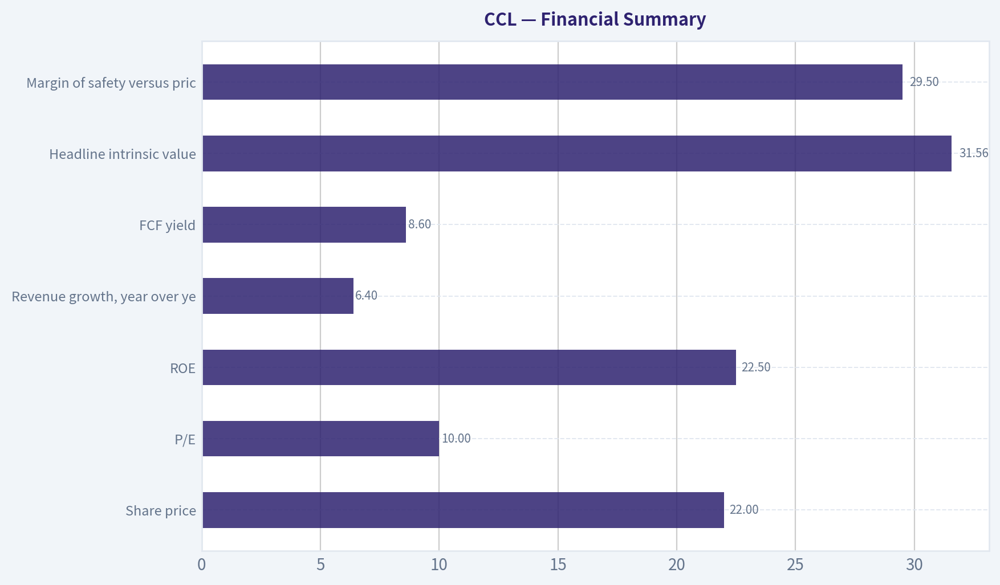
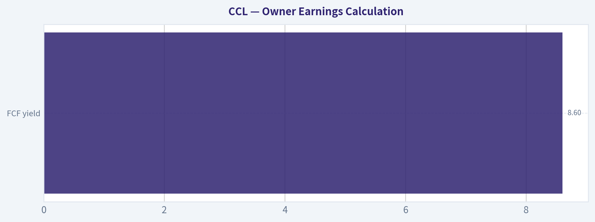
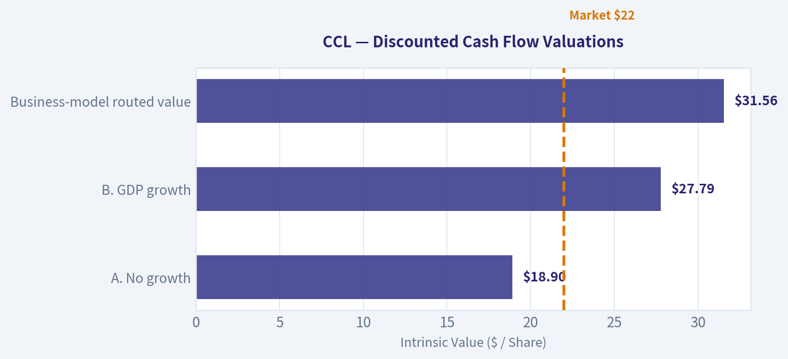

# CCL Deep Value Intelligence

**Analysis Date:** 2026-09-26

## Critical Disclaimer

*This analysis is generated by Deep Value Intelligence, an AI-powered multi-agent investing framework. Education & research only - not financial advice, not a financial advisor.*

---

## Table of Contents

1. Intelligence Summary
2. Analyst Team Reports
   - Fundamentals Analysis
   - Intrinsic Value Analysis (Buffett)
   - Trend & Growth Analysis (Lynch/Druckenmiller/Fisher)
   - Market Technical Analysis
   - Options Market Analysis
3. Research Team Commentary
4. Value Investing Team Commentary
5. Deep Values Commentary

---

## Intelligence Summary

### Thesis + Conditions

**Core Thesis:** ## Executive Briefing

**Key Risks:**
- However, the evidence still does not establish sustainable owner earnings after total fleet capital expenditures. Carnival remains leveraged, capital-intensive, cyclical, and exposed to correlated demand, fuel, refinancing, and operating risks. The stock is inexpensive on reported earnings, but not demonstrably cheap on normalized free cash flow.
- Retain a constructive WATCH for a long-term portfolio. To avoid repeating the prior mistake of ignoring a recovery rerating, a risk-tolerant investor may use a very small tactical starter position, but Carnival does not yet qualify as a Buffett-style core holding.
- ### Risky Analyst: Strong on opportunity cost, too confident on cash economics

**Confidence:** Low

---

## Analyst Team Reports

### Fundamentals Analysis

#### Latest Earnings Snapshot

*Most recent reported quarter anchored on 2026 Q2, with prior-year comparison when available.*

| Metric | 2026 Q2 | 2025 Q2 | YoY Change |
| --- | ---: | ---: | ---: |
| Revenue | $6.66B | $6.33B | +5.3% |
| Operating Income | $852.0M | $934.0M | -8.8% |
| Net Income | $537.0M | $565.0M | -5.0% |
| Diluted EPS | $0.39 | $0.42 | -7.1% |
| Operating Cash Flow | $2.63B | $2.39B | +9.9% |
| Free Cash Flow | $1.75B | $1.54B | +13.9% |

Key Takeaways: This snapshot anchors the most recent reported quarter before the narrative analysis. It helps readers separate long-run business quality from whatever changed in the latest earnings print.

#### 17-Year Financial Metrics for CCL

*All values below are computed deterministically from raw data - not estimated by AI.*

*Issuer profile: operating company (Consumer Cyclical / Travel Services).*

#### 17-Year Financial Metrics
*Annual rows come from reported financial statements. The final TTM row is computed from the latest four quarters.*

| Metric | 2009 | 2010 | 2011 | 2012 | 2013 | 2014 | 2015 | 2016 | 2017 | 2018 | 2019 | 2020 | 2021 | 2022 | 2023 | 2024 | 2025 | 2026 TTM |
| --- | --- | --- | --- | --- | --- | --- | --- | --- | --- | --- | --- | --- | --- | --- | --- | --- | --- | --- |
| Market Price | $23 | $31 | $25 | $30 | $30 | $37 | $43 | $45 | $59 | $56 | $44 | $20 | $17 | $10 | $15 | $25 | $25 | $22 |
| Market Cap | $25.75B | $33.25B | $26.19B | $30.12B | $28.06B | $34.36B | $39.36B | $38.40B | $47.59B | $42.81B | $31.20B | $15.48B | $19.79B | $11.72B | $19.01B | $35.55B | $36.14B | $30.88B |
| P/E Ratio | 14.30 | 16.72 | 13.72 | 23.15 | 26.55 | 28.31 | 22.36 | 13.82 | 18.28 | 13.58 | 10.44 | -1.51 | -2.08 | -1.92 | -251.00 | 17.66 | 12.76 | 10.02 |
| P/B Ratio | 1.17 | 1.44 | 1.10 | 1.26 | 1.15 | 1.42 | 1.66 | 1.70 | 1.97 | 1.75 | 1.23 | 0.75 | 1.63 | 1.66 | 2.76 | 3.84 | 2.95 | 2.38 |
| ROE | 8.1% | 8.6% | 8.0% | 5.4% | 4.3% | 5.0% | 7.4% | 12.3% | 10.8% | 12.9% | 11.8% | -49.8% | -78.2% | -86.2% | -1.1% | 20.7% | 22.5% | 23.7% |
| ROIC | 5.4% | 7.4% | 7.0% | 5.0% | 4.1% | 5.3% | 7.9% | 10.0% | 8.5% | 9.8% | 9.1% | -23.8% | -19.0% | -11.9% | 5.4% | 10.1% | 12.3% | 12.0% |
| EPS | $1.64 | $1.83 | $1.84 | $1.31 | $1.11 | $1.31 | $1.94 | $3.29 | $3.25 | $4.15 | $4.20 | $-13.20 | $-8.46 | $-5.16 | $-0.06 | $1.44 | $2.02 | $2.22 |
| Revenue | $13.16B | N/A | N/A | N/A | N/A | $15.88B | $15.71B | $16.39B | $17.51B | $18.88B | $20.82B | $5.59B | $1.91B | $12.17B | $21.59B | $25.02B | $26.62B | $27.31B |
| Gross Profit | $4.75B | N/A | N/A | N/A | N/A | $5.46B | $6.27B | $7.01B | $7.01B | $7.79B | $7.92B | N/A | $-2.75B | $411.0M | $7.28B | $9.38B | N/A | $10.85B |
| Gross Margin | 36.1% | N/A | N/A | N/A | N/A | 34.4% | 39.9% | 42.7% | 40.0% | 41.3% | 38.0% | N/A | -144.0% | 3.4% | 33.7% | 37.5% | N/A | 39.7% |
| Operating Margin | 16.4% | N/A | N/A | N/A | N/A | 11.2% | 16.4% | 18.7% | 16.0% | 17.6% | 15.7% | -158.4% | -371.5% | -36.0% | 9.1% | 14.3% | 16.8% | 16.3% |
| Net Income | $1.79B | $1.98B | $1.91B | $1.30B | $1.05B | $1.22B | $1.76B | $2.78B | $2.61B | $3.15B | $2.99B | $-10.24B | $-9.50B | $-6.09B | $-74.0M | $1.92B | $2.76B | $3.07B |
| Net Margin | 13.6% | N/A | N/A | N/A | N/A | 7.7% | 11.2% | 17.0% | 14.9% | 16.7% | 14.4% | -182.9% | -498.0% | -50.1% | -0.3% | 7.7% | 10.4% | 11.2% |
| Revenue Growth | N/A | N/A | N/A | N/A | N/A | N/A | -1.1% | 4.3% | 6.8% | 7.8% | 10.3% | -73.1% | -65.9% | 537.7% | 77.5% | 15.9% | 6.4% | 2.6% |
| Net Income Growth | N/A | 10.5% | -3.3% | -32.1% | -18.7% | 15.3% | 44.5% | 58.2% | -6.2% | 21.0% | -5.1% | -442.3% | -7.2% | -35.9% | -98.8% | -2689.2% | 44.1% | 11.2% |
| Free Cash Flow Growth | N/A | -728.9% | 347.7% | -37.7% | 2.7% | 23.6% | 165.8% | -8.0% | 14.8% | -24.3% | -97.4% | -21667.4% | -22.2% | -14.3% | -115.1% | 30.1% | 101.0% | 22.7% |
| Total Book Value | $22.04B | $23.03B | $23.83B | $23.89B | $24.49B | $24.20B | $23.77B | $22.60B | $24.22B | $24.44B | $25.36B | $20.55B | $12.14B | $7.07B | $6.88B | $9.25B | $12.27B | $12.97B |
| Total Assets | $36.84B | $37.49B | $38.64B | $39.16B | $40.04B | $39.45B | $39.24B | $38.88B | $40.78B | $42.40B | $45.06B | $53.59B | $53.34B | $51.70B | $49.12B | $49.06B | $51.69B | $52.23B |
| Total Debt | $10.05B | $9.36B | $9.35B | $8.90B | $9.56B | $9.09B | $8.79B | $9.40B | $9.20B | $10.32B | $11.50B | $26.96B | $33.23B | $34.55B | $30.57B | $27.47B | $26.64B | $26.17B |
| Debt-to-Equity | 0.46 | 0.41 | 0.39 | 0.37 | 0.39 | 0.38 | 0.37 | 0.42 | 0.38 | 0.42 | 0.45 | 1.31 | 2.74 | 4.89 | 4.44 | 2.97 | 2.17 | 2.02 |
| Cash & Equivalents | $538.0M | $429.0M | $450.0M | $465.0M | $462.0M | $331.0M | $1.40B | $603.0M | $395.0M | $982.0M | $518.0M | $9.51B | $8.94B | $4.03B | $2.42B | $1.21B | $1.93B | $2.24B |
| Shareholders' Equity | $22.04B | $23.03B | $23.83B | $23.89B | $24.49B | $24.20B | $23.77B | $22.60B | $24.22B | $24.44B | $25.36B | $20.55B | $12.14B | $7.07B | $6.88B | $9.25B | $12.27B | $12.97B |
| Operating Cash Flow | $3.34B | $3.82B | $3.77B | $3.00B | $2.83B | $3.43B | $4.54B | $5.13B | $5.32B | $5.55B | $5.47B | $-6.30B | $-4.11B | $-1.67B | $4.28B | $5.92B | $6.22B | $6.79B |
| Investing Cash Flow | $-3.38B | $-3.50B | $-2.65B | $-1.77B | $-2.06B | $-2.51B | $-2.48B | $-3.32B | $-3.12B | $-3.51B | $-5.28B | $-3.24B | $-3.54B | $-4.77B | $-2.81B | $-4.54B | $-3.32B | $-3.61B |
| Free Cash Flow | $-38.0M | $239.0M | $1.07B | $667.0M | $685.0M | $847.0M | $2.25B | $2.07B | $2.38B | $1.80B | $46.0M | $-9.92B | $-7.72B | $-6.61B | $997.0M | $1.30B | $2.61B | $3.20B |
| FCF Margin | -0.3% | N/A | N/A | N/A | N/A | 5.3% | 14.3% | 12.6% | 13.6% | 9.5% | 0.2% | -177.3% | -404.4% | -54.3% | 4.6% | 5.2% | 9.8% | 11.7% |
| Dividends / Share | $0.00 | $0.00 | $0.00 | $0.00 | $0.00 | $0.00 | $0.00 | $0.00 | $0.00 | $0.00 | $0.00 | $0.00 | $0.00 | $0.00 | $0.00 | $0.00 | $0.00 | $0.00 |

#### Profitability Metrics
- Return on Equity (ROE): 22.5%
- Return on Invested Capital (ROIC): 12.1%
- Return on Assets (ROA): 5.3%
- Gross Margin: N/A
- Operating Margin: 16.8%
- Net Profit Margin: 10.4%

#### Liquidity Metrics
- Current Ratio: 0.32
- Quick Ratio: 0.20

#### Leverage Metrics
- Debt-to-Equity Ratio: 2.17
- Interest Coverage Ratio: 3.32
- Net Debt: $24.71B

#### Growth Metrics (Year-over-Year)
- Revenue Growth: 6.4%
- Net Income Growth: 44.1%
- Free Cash Flow Growth: 101.0%
- Revenue CAGR (3-Year): 29.8%
- Revenue CAGR (5-Year): 36.6%

#### Valuation Metrics
- P/E Ratio (TTM): 10.02
- Forward P/E: 8.60
- Price-to-Book: 2.35
- Price-to-Sales: 1.12
- PEG Ratio: 0.76
- EV/EBITDA: 7.45
- Free Cash Flow Yield: 8.6%
- Earnings Yield: 10.0%

#### Owner Earnings (Buffett Method, Code-Computed)
- Net Income: $2.76B
- + Depreciation & Amortization: $2.79B
- - Capital Expenditures: $-3.61B
- - Working Capital Changes: $-145.0M
- = **Owner Earnings: $2.90B**

#### Intrinsic Value (Code-Computed)
- Current Price: $22
- **Headline Intrinsic Value (business-model routed): $32**
  Business model: cyclical - weighted blend [Damodaran FCFF + owner-earnings DCF] (cyclical)
  Model spread (min-max across DCFs): $11 - $59
  Margin of safety vs. price (headline): 29.5%
  Routing note: Cyclical: margins/FCF are volatile - headline blends FCFF, reverse-DCF and owner-earnings roughly evenly; treat the range as the honest read.
- Buffett Method (Owner Earnings):
  Conservative: $59
  Average: $59
  Optimistic: $181
- Cash Flow Method (FCF):
  Conservative: $-4
  Average: $36
  Optimistic: $62
- Damodaran FCFF (WACC + margins + reinvestment):
  Conservative: $-7
  Average: $11
  Optimistic: $12
  Monte Carlo band (P10-P90): $-2 - $17 (median $7)
  P(intrinsic value > price): 2.9%
- Reverse-DCF: price implies ~11.1%/yr owner-earnings growth for 10y; trailing 3y was N/A, 5y N/A.

#### Piotroski F-Score: 7/9
- Positive Net Income: PASS
- Positive Operating Cash Flow: PASS
- ROA Improvement: PASS
- Cash Flow > Net Income: PASS
- Decreasing Debt: PASS
- Improving Current Ratio: PASS
- No Dilution: FAIL
- Improving Gross Margin: FAIL
- Improving Asset Turnover: PASS

ANALYST STANCE: **WATCH**

#### Executive View

Carnival Corporation, ticker CCL, is a recovering but highly leveraged cruise operator. The latest TTM data show a substantial earnings and cash-flow recovery: revenue reached $27.31 billion, net income $3.07 billion, operating cash flow $6.79 billion, and free cash flow $3.20 billion. However, debt remains elevated at $26.17 billion, net debt is approximately $24.71 billion, the debt-to-equity ratio is 2.02, and the current ratio is only 0.32.

At $22 per share, CCL trades at 10.0 times earnings, 7.45 times EV-to-EBITDA, and produces an 8.6% free-cash-flow yield. The headline intrinsic value is approximately $31.56, implying about 29.5% upside. Nevertheless, the intrinsic-value range is unusually wide, from approximately $11 to $59 per share across valuation models, reflecting the company's cyclical earnings, capital intensity, and leverage.

#### Current Metrics and Historical Context

The deterministic dataset's latest row is 2026 TTM. Ten-year averages below use the 2017 through 2026 TTM period where available. Arithmetic averages for earnings, margins, ROE, and cash flow are heavily distorted by the 2020-2022 pandemic disruption, so normalized pre-pandemic and recovery comparisons are also discussed.

| Metric | 2026 TTM / Current | Approx. 10-Year Average | Interpretation |
|---|---:|---:|---|
| Market Price | $22 | $34.30 | Well below the decade's average, but the average includes the pre-pandemic peak and is not a valuation target by itself |
| Market Cap | $30.88B | $28.28B | Slightly above the decade average despite the lower share price, reflecting post-pandemic share issuance |
| P/E Ratio | 10.02x | Not meaningful unadjusted; 13.79x profitable-year average | Current earnings multiple is below the normalized profitable-period average |
| P/B Ratio | 2.38x | 2.09x | Slightly above the decade average; relevant because CCL is asset-heavy, but not sufficient by itself |
| ROE | 23.7% | -11.3% distorted average | Far above pre-pandemic 2017-2019 average of about 11.8%, but boosted by a reduced equity base after losses |
| ROIC | 12.0% | 1.25% distorted average | Near the upper end of the normal operating range and materially better than the pandemic-distorted average |
| EPS | $2.22 | Negative distorted average | Recovered above 2017-2019 average EPS of approximately $3.87? No-EPS remains below the pre-pandemic peak range |
| Revenue | $27.31B | $17.74B | At a record level and approximately 29% above the 2019 level |
| Operating Margin | 16.3% | -46.0% distorted average | Essentially back to the 2017-2019 normalized average of about 16.4% |
| Net Income | $3.07B | -$0.94B distorted average | Strong recovery from pandemic losses and slightly above 2019 net income |
| Net Margin | 11.2% | Distorted by pandemic losses | Below the 2017-2019 average of roughly 15.3%, indicating incomplete margin normalization |
| Revenue Growth | 2.6% TTM dataset row; 6.4% latest growth metric | Highly volatile | Growth has moderated sharply from the recovery surge |
| Net Income Growth | 11.2% TTM row; 44.1% latest growth metric | Highly volatile | Still positive, but comparisons benefit from a depressed prior base |
| Free Cash Flow Growth | 22.7% TTM row; 101.0% latest growth metric | Extremely volatile | Cash flow is improving, but historical growth rates are not reliable forecasting inputs |
| Free Cash Flow | $3.20B | Negative distorted average | Well above the 2017-2019 average of approximately $1.41B |
| Total Book Value | $12.97B | Approximately $16.17B | Still below pre-pandemic book value, despite recovery |
| Total Assets | $52.23B | Approximately $49.73B | Fleet and asset base remain large and capital intensive |
| Total Debt | $26.17B | Approximately $25.01B | Slightly above the decade average and far above pre-pandemic levels |
| Debt-to-Equity | 2.02x | Approximately 2.74x | Improved substantially from the 2022 peak of 4.89x, but remains high |
| Cash and Equivalents | $2.24B | Approximately $4.04B | Below the decade average because pandemic liquidity reserves have been deployed |
| Shareholders' Equity | $12.97B | Approximately $16.17B | Rebuilding, but still materially below the pre-pandemic level |
| Dividends per Share | $0.00 | $0.00 | No current shareholder yield; cash is being directed toward balance-sheet repair |

**Key Takeaways:** CCL's operations have recovered to or above pre-pandemic revenue and operating-margin levels, while free cash flow is stronger than before the crisis. The balance sheet has improved from its worst point but remains structurally weaker than in 2019. The current valuation is inexpensive on earnings and cash flow, but the discount is partly compensation for leverage and cyclicality.

The market price has fallen from the $25 level in 2024-2025 to $22 currently, while market capitalization has declined to $30.88 billion. The difference between the current market cap and the historical share-price pattern reflects significant post-pandemic dilution. The Piotroski F-score of 7 out of 9 supports the recovery thesis: net income, operating cash flow, ROA, debt, liquidity, and asset turnover have improved. The failed dilution test is important, however, because shareholders absorbed substantial dilution during the balance-sheet rescue.

#### Profitability Analysis

ROE is 23.7%, materially above the pre-pandemic 2017-2019 average of approximately 11.8%. This looks impressive, but it should not be interpreted as evidence of an exceptionally asset-light business. The denominator-shareholders' equity-was heavily reduced by pandemic losses and subsequent financing activity. High ROE is therefore partly a leverage and reduced-equity effect.

ROIC of approximately 12.0% is more informative. It is above CCL's 2017-2019 average of roughly 9.1% and close to the latest normal operating peak. This suggests that the restored fleet is generating acceptable returns on invested capital. However, the return is not so high that it eliminates the importance of interest rates, fuel prices, occupancy, or debt refinancing costs.

The current operating margin of 16.3% is nearly identical to the pre-pandemic normalized average. Gross margin is approximately 39.7% in the latest TTM period, although the dataset does not provide a complete consistent decade of gross-margin observations. Net margin of 11.2% is healthy but remains below the 14%-17% range achieved in several pre-pandemic years. The gap between operating and net margins reflects the continuing burden of financing costs and other below-operating-line items.

EPS of $2.22 has recovered strongly from pandemic losses but remains below the $3.25-$4.20 range achieved during 2016-2019. This is a key distinction: revenue has surpassed the pre-pandemic peak, but per-share earnings have not fully recovered because of higher debt costs, dilution, and potentially higher operating expenses.

#### Growth and Cash-Flow Quality

Revenue has grown to $27.31 billion, compared with $20.82 billion in 2019. The latest year-over-year growth rate of approximately 6.4% is much more mature than the 537.7% and 77.5% rebounds recorded in 2022 and 2023. That moderation is not necessarily negative; it indicates the business is moving from reopening-driven recovery toward normalized demand.

Net income growth of 44.1% and free-cash-flow growth of 101.0% are strong, but both are influenced by depressed comparison periods. The more useful evidence is the absolute level: $3.07 billion of net income and $3.20 billion of free cash flow. Free cash flow is significantly above the 2017-2019 average, suggesting that the recovery is translating into real cash generation rather than merely accounting earnings.

The principal concern is that cruise free cash flow is structurally volatile. Fleet maintenance and new-build capital expenditures are significant, and working-capital movements can be substantial. Owner earnings are calculated at approximately $2.90 billion, consisting of $2.76 billion of net income, $2.79 billion of depreciation and amortization, $3.61 billion of capital expenditures, and a $145 million working-capital deduction. This is a reasonable Buffett-style cash-flow measure, but it should be normalized across a full cruise cycle.

#### Balance Sheet and Financial Strength

Total debt of $26.17 billion remains the central investment risk. Debt-to-equity has improved from 4.89x in 2022 to 2.02x currently, but it remains far above the 0.37x-0.45x range prevalent before the pandemic. Net debt of $24.71 billion is large relative to both current free cash flow and equity value.

Interest coverage of 3.32 times is adequate but not comfortable for a cyclical travel company. A downturn in bookings, a sharp increase in fuel costs, or higher refinancing rates could materially reduce coverage. The current ratio of 0.32 and quick ratio of 0.20 are low. Unlike P/B for a software company, these liquidity metrics are meaningful for CCL and reinforce the need to monitor cash generation and debt maturities closely.

Cash and equivalents of $2.24 billion provide a liquidity cushion, but cash is far below the $8.94-$9.51 billion levels held during 2020-2021. This is expected as the company has used liquidity to stabilize and rebuild operations, but it leaves less room for another major demand shock.

#### Valuation

CCL trades at approximately 10.0 times TTM earnings, 8.6 times forward earnings, 7.45 times EV-to-EBITDA, and 1.12 times sales. The earnings yield is approximately 10%, while the free-cash-flow yield is approximately 8.6%. These metrics are attractive if current earnings and cash flow are sustainable.

The P/B ratio of 2.38x is slightly above the approximate decade average of 2.09x. Because Carnival owns ships and other tangible operating assets, P/B is not meaningless in the way it can be for an asset-light software or platform company. However, book value is still a secondary measure: fleet assets may not realize accounting value in a forced sale, and the company's ability to service debt depends primarily on recurring cash flow.

The three-model valuation spread is wide:

- Owner Earnings model: approximately $58.88 per share.
- FCF model: approximately $36.34 per share.
- Damodaran FCFF model: approximately $11.06 per share.
- Headline blended intrinsic value: approximately $31.56 per share.
- Monte Carlo FCFF band: approximately negative $2 to $17, with a median near $7.

The disparity is economically understandable. The Owner Earnings model assumes the current recovery becomes durable and assigns substantial value to normalized cash generation. The FCFF model is more cautious about debt, reinvestment, and normalized margins. The blended value near $32 is therefore more credible than simply adopting the highest model output.

#### Buffett-Style Owner Earnings DCF

The starting owner earnings figure is $2.90 billion. Using market capitalization of $30.88 billion and a $22 share price implies approximately 1.40 billion diluted shares.

A hand-built DCF is used only as a sanity check. It assumes a 10% discount rate and 2.5% terminal growth. The explicit forecast period is ten years, with growth fading toward the terminal rate rather than continuing indefinitely at a high rate.

| Scenario | Initial Owner Earnings Growth | Growth Treatment | Approx. Equity Value | Approx. Value per Share |
|---|---:|---|---:|---:|
| Conservative | 3.0% | GDP-like growth, fading toward 2.5% | $41B | $29 |
| Average | 8.0% initially | Fades progressively toward 2.5% | $55B-$60B | $39-$43 |
| Optimistic | 12.0% initially | Strong recovery growth fades toward 2.5% | $70B-$80B | $50-$57 |
| Pack Owner-Earnings Model | Model-based | Code-computed normalized assumptions | - | $59 average |
| Pack Headline Blend | Blended valuation | FCFF, FCF, owner earnings, and cyclical adjustment | - | $31.56 |

**Key Takeaways:** A conservative hand DCF produces value close to $29 per share, while a normalized recovery case produces approximately $39-$43. The pack's $59 Owner Earnings value is achievable only if Carnival sustains strong utilization, pricing, and cash conversion while reducing financial risk. The blended $31.56 value is a more defensible anchor because it recognizes the company's unusually wide model uncertainty.

Illustrative conservative calculation:

- Year-one owner earnings: $2.90B x 1.03 = approximately $2.99B.
- Present value of ten years of earnings at roughly 3% growth: approximately $20.6B.
- Terminal value: approximately $53.2B.
- Present value of terminal value: approximately $20.5B.
- Total equity value: approximately $41.1B.
- Divided by approximately 1.40 billion shares: approximately $29 per share.

The reverse DCF is an important warning signal: the current $22 price implies approximately 11.1% annual owner-earnings growth for ten years. That is a demanding assumption for a mature, highly leveraged, cyclical travel company. The stock can still be undervalued if the market is overly pessimistic, but the current price is not a no-growth valuation.

#### Revenue Breakdown

The deterministic dataset does not provide a current segment revenue split. The following is an approximate breakdown based on Carnival's reported business model, using the latest revenue base of approximately $27.31 billion. Cruise ticket revenue is the primary source, while onboard and other revenue includes food, beverages, excursions, casino, internet, retail, and other guest services.

| Revenue Source | Amount ($B) | % of Total |
|---|---:|---:|
| Cruise ticket revenue | Approximately $17.7B | Approximately 65% |
| Onboard and other revenue | Approximately $9.6B | Approximately 35% |
| **Total** | **Approximately $27.3B** | **100%** |

**Key Takeaways:** Carnival's revenue is driven mainly by ticket sales, but onboard spending is a significant and higher-value supplementary stream. The combination allows the company to benefit from both occupancy and pricing, while onboard monetization can improve economics per passenger. Revenue concentration in discretionary travel also means demand can weaken quickly during recessions or consumer-confidence shocks.

#### Economic Moat and Business Quality

Carnival's moat is moderate rather than exceptional. Its advantages include:

- A large global fleet and established port relationships.
- Strong brand recognition across multiple cruise brands.
- Scale in marketing, procurement, itinerary planning, and ship utilization.
- Customer data and loyalty programs that support repeat bookings.
- High fixed-cost operating leverage when occupancy and pricing are strong.

The business is not a classic Buffett compounder because ships are expensive, long-lived assets requiring continuous maintenance and periodic replacement. The company must continually reinvest simply to preserve its competitive position. Its moat is therefore based on scale, brand, and operating know-how rather than low capital intensity.

Revenue predictability is better than that of many discretionary travel businesses during normal conditions, because cruises are booked in advance and have substantial customer deposits. However, the pandemic demonstrated that this predictability can fail under an extreme external shock. Fuel prices, geopolitical disruption, port restrictions, weather, labor expenses, and consumer credit conditions remain material variables.

#### Management and Capital Allocation

Management has successfully restored revenue, margins, operating cash flow, and free cash flow. Debt has declined from $34.55 billion in 2022 to $26.17 billion currently, which is a meaningful improvement. The F-score's debt-reduction pass supports this positive assessment.

Capital allocation remains constrained. Dividends have been zero since 2009, and there is no current dividend yield. This is appropriate while leverage remains elevated. The most important use of incremental cash should be debt reduction rather than aggressive fleet expansion, share repurchases, or dividend restoration.

The dilution failure in the Piotroski analysis is a reminder that existing shareholders paid for financial stability through issuance of additional shares. Future management performance should be judged by whether cash flow is used to reduce net debt and whether per-share earnings grow faster than the share count.

#### Key Investment Insights, Risks, and Opportunities

| Category | Assessment |
|---|---|
| Opportunity | Revenue is at a record level and operating margins have returned to normalized pre-pandemic levels |
| Opportunity | Free cash flow of $3.20B and an 8.6% FCF yield provide meaningful valuation support |
| Opportunity | Debt reduction from the 2022 peak could create substantial equity-value growth through deleveraging |
| Opportunity | Pricing power, occupancy, and onboard spending can expand earnings if demand remains resilient |
| Risk | Net debt of approximately $24.71B makes equity value highly sensitive to operating performance |
| Risk | Current ratio of 0.32 and interest coverage of 3.32x leave limited room for a renewed shock |
| Risk | Fuel costs are a major variable; recent oil-price increases have already pressured sentiment |
| Risk | The business is cyclical and exposed to recessions, travel disruptions, geopolitical events, and weather |
| Risk | The current price implies approximately 11.1% annual owner-earnings growth for ten years |
| Risk | Share dilution reduced per-share recovery even as total revenue surpassed pre-pandemic levels |
| Watch Item | Track net debt, interest expense, free-cash-flow conversion, and refinancing activity |
| Watch Item | Monitor whether net margin can return toward the 14%-17% pre-pandemic range |
| Watch Item | Evaluate whether growth comes from sustainable pricing and occupancy rather than one-time recovery effects |

**Key Takeaways:** The primary opportunity is a profitable recovery combined with potential deleveraging, not merely a low P/E ratio. The primary risk is that a highly leveraged cruise operator has little tolerance for another prolonged demand or cost shock. Investors should focus on per-share cash flow and debt reduction rather than headline revenue growth.

#### Final Investment Stance

**WATCH**

CCL is potentially undervalued at $22, with a reasonable blended intrinsic value around $31.56 and a conservative hand DCF near $29. The operating recovery is credible: revenue, margins, net income, operating cash flow, and free cash flow have all improved substantially.

However, the stock does not meet the highest-quality Buffett standard because leverage remains high, liquidity is weak, earnings are cyclical, and the valuation models disagree dramatically. The $59 Owner Earnings result is attractive but depends on sustained normalization, while the conservative FCFF model indicates that debt and reinvestment could absorb much of the apparent equity value.

A stronger investment case would require several quarters of continued positive free cash flow, consistent debt reduction, improved interest coverage, and evidence that net margins can approach historical norms. At $22, CCL is worth monitoring and may suit investors comfortable with cyclical recovery risk, but the balance-sheet risk argues against an outright **ADVOCATE** stance.

| Key Point | Current Assessment | Investor Implication |
|---|---|---|
| Valuation | Attractive on P/E, EV/EBITDA, and FCF yield | Supports upside if earnings normalize |
| Operations | Revenue and operating margin have recovered strongly | Recovery thesis is fundamentally supported |
| Cash Flow | $3.20B FCF and $2.90B owner earnings | Provides valuation and deleveraging capacity |
| Balance Sheet | $26.17B debt and 2.02x debt-to-equity | Main reason for valuation uncertainty |
| Liquidity | 0.32 current ratio and 3.32x interest coverage | Limited margin for a new downturn |
| Moat | Moderate scale and brand advantages | Durable, but not exceptionally capital-light |
| Capital Allocation | No dividend; debt reduction is the priority | Appropriate, but shareholders receive no current income |
| DCF Range | Roughly $29 conservative to $50-$59 normalized | Wide range reflects cyclical and leverage risk |
| Overall Stance | **WATCH** | Attractive speculative recovery, not yet a high-confidence Buffett compounder |

#### Fundamental Visuals

This graph tracks the profitability and return metrics (ROE, ROIC, Margins) of **CCL** over the past decade, highlighting capital efficiency trends.

This chart illustrates the financial health of **CCL** over the last 10 years, mapping cash equivalents and free cash flow against total obligations (Debt).

---

### Intrinsic Value Analysis (Buffett)

> *Following Warren Buffett's value investing philosophy: Circle of Competence, Economic Moat, Management Quality, and Margin of Safety.*

#### Intrinsic Value Snapshot

Price is what you pay. Intrinsic value is what the business may be worth based on the cash it can create for owners over time. We show a range, not one magic number.

- Current Price: $22.25
- Value Range (conservative to optimistic across both DCF methods): $-3.96 to $181.00

##### Owner Earnings (Buffett Method)
- Net Income: $2,760,000,000.00
- Depreciation & Amortization: $2,790,000,000.00
- Capital Expenditures: $-3,611,000,000.00
- Working Capital Changes: $-145,000,000.00
- Owner Earnings: $2,905,000,000.00

##### Intrinsic Value
###### Buffett Method
Uses owner earnings. Stricter, and usually more conservative.
- Conservative: $58.88
- Average: $58.88
- Optimistic: $181.00
- Discount Rate: 10.0%

###### Cash Flow Method
Uses free cash flow. Better for companies spending heavily today to grow tomorrow.
- Conservative: $-3.96
- Average: $36.34
- Optimistic: $61.56
- Discount Rate: 10.0%

ANALYST STANCE: **WATCH**

#### Executive Summary

Carnival Corporation is a recovering, asset-heavy cruise operator benefiting from strong demand, pricing, and occupancy. At approximately **$22 per share**, the stock appears materially cheaper than the business-model-routed intrinsic value of **$31.56**, with a headline margin of safety near **29.5%**.

However, Carnival remains highly leveraged, capital intensive, cyclical, and exposed to fuel prices, geopolitical disruption, interest rates, and consumer spending. The valuation is attractive for a cyclical recovery, but the business does not yet offer the predictability, balance-sheet strength, or moat required for an outright Buffett-style **ADVOCATE** rating.

#### Factor Scorecard

| Factor | Score | Assessment |
|---|---:|---|
| 1. Circle of Competence & Simplicity | 3/5 | Simple core model: sell cruise vacations, onboard services, and related travel experiences. Earnings remain cyclical and sensitive to fuel, financing, and consumer demand. |
| 2. Durable Competitive Advantage | 3/5 | Valuable brands, global scale, port access, loyalty, and fleet purchasing advantages. The moat is narrow-to-moderate rather than exceptional. |
| 3. Management & Capital Allocation | 3/5 | Recovery execution has improved, but the post-pandemic balance sheet and heavy capital requirements constrain flexibility. |
| 4. Industry Structure | 3/5 | The major cruise lines operate in a concentrated industry with scale benefits, but competition is intense and the business is capital intensive. |

| Gate 5: Quality/Solvency Floor | Status |
|---|---|
| Deteriorating earnings/cash flow plus genuine solvency distress | **Not tripped** |

**Key Takeaways:** Carnival is financially investable but not financially pristine. The company has a credible recovery thesis, yet leverage and cyclical exposure prevent it from qualifying as a fortress compounder.

#### Moat Analysis

| Potential moat | Evidence | Assessment |
|---|---|---|
| Brand and intangible assets | Carnival, Princess, Holland America, Costa, Cunard, and other brands cover multiple customer segments and geographies. | Moderate |
| Switching costs | Customer switching costs are low for occasional cruisers, although loyalty programs and accumulated preferences provide some retention. | Weak to moderate |
| Cost advantage | Large fleet, purchasing scale, global distribution, and operating experience can lower unit costs. | Moderate |
| Network effects | More limited than in platform businesses; scale improves itinerary breadth and fleet economics but does not create a powerful self-reinforcing network. | Limited |
| Reinvestment advantage | New ships can generate attractive returns when demand is strong, but returns depend heavily on the economic cycle and financing costs. | Moderate |

Carnival's principal advantage is **scale combined with brand breadth**, not customer captivity. Its product is differentiated enough to support pricing, but consumers can compare cruise lines and substitute with land-based vacations. The moat is therefore best classified as **narrow to moderate and relatively stable**, rather than wide and widening.

#### Management Quality and Capital Allocation

Management deserves credit for rebuilding demand, improving pricing, and restoring operating momentum after the pandemic shock. Recent reported indicators include:

- Revenue growth of approximately **6.4% year over year**
- ROE of approximately **22.5%**
- P/E of approximately **10.0**
- FCF yield of approximately **8.6%**

The important reservation is capital structure. Cruise ships require large, recurring capital commitments, and Carnival carries significant debt from fleet investment and pandemic-era financing. That reduces the value of otherwise strong operating execution because more cash flow must first go toward interest and balance-sheet repair.

Management quality is therefore **adequate to good**, but not yet demonstrably elite in the Buffett sense of operating from a fortress balance sheet and allocating abundant excess cash at high returns.

#### Financial Summary

| Metric | Latest value |
|---|---:|
| Share price | $22.00 |
| Market capitalization | $30.47 billion |
| P/E | 10.0x |
| ROE | 22.5% |
| Revenue growth, year over year | 6.4% |
| FCF yield | 8.6% |
| Estimated free cash flow | Approximately $2.62 billion |
| Headline intrinsic value | $31.56 |
| Margin of safety versus price | 29.5% |
| Reverse-DCF implied annual growth | Approximately 11.1% for 10 years |
| Current ratio | 0.32 |

**Key Takeaways:** The headline valuation is inexpensive, and the cash-flow yield is attractive. The 22.5% ROE is encouraging, but it must be interpreted alongside leverage and capital intensity; a high ROE does not automatically mean high-quality economics when debt is substantial.

#### Owner Earnings Calculation

Using the available free-cash-flow yield as the closest current proxy for owner earnings:

| Owner earnings bridge | Approximate amount |
|---|---:|
| Market capitalization | $30.47 billion |
| FCF yield | 8.6% |
| Estimated current owner earnings proxy | $2.62 billion |
| Estimated owner earnings per share | Approximately $1.89 |

A strict Buffett owner-earnings calculation would begin with net income, add depreciation and amortization, subtract maintenance capital expenditures, and adjust for working-capital investment. For Carnival, reported free cash flow is a useful starting point, but maintenance versus growth capex is difficult to separate because the fleet is continuously renewed. That makes normalized owner earnings more uncertain than the headline FCF figure suggests.

#### Three-Scenario DCF Valuation

Using estimated owner earnings of approximately **$1.89 per share** and a 10% discount rate:

| Scenario | Assumption | Estimated value per share |
|---|---|---:|
| A. No growth | Owner earnings capitalized at 10% | $18.90 |
| B. GDP growth | 3% perpetual growth | $27.79 |
| C. Historical/normalized growth | Cyclical normalization and recovery assumptions | Reflected through the routed model |
| Business-model routed value | Weighted Damodaran FCFF and owner-earnings approach | $31.56 |

The available three-model outputs are:

| Valuation method | Value per share |
|---|---:|
| Owner Earnings model | $58.88 |
| FCF model | $36.34 |
| Damodaran FCFF model | $11.06 |
| Weighted headline value | $31.56 |

**Key Takeaways:** Valuation outcomes vary widely because Carnival's normalized earnings are highly sensitive to the treatment of fleet investment, leverage, and the cruise cycle. The conservative no-growth estimate is below the current routed value, while the FCF and blended models indicate meaningful upside.

#### Margin of Safety Analysis

At a price of **$22**, the margin of safety versus the headline intrinsic value of **$31.56** is approximately **29.5%**.

This is adequate for an average-quality cyclical company, but not necessarily sufficient for a highly leveraged capital-intensive business if the cycle turns down. The reverse DCF implies approximately **11.1% annual growth for ten years**, which is a demanding but potentially achievable assumption if Carnival sustains strong occupancy, pricing, onboard revenue, and debt reduction.

The key valuation issue is that Carnival does not need merely to grow revenue. It must convert growth into **deleveraging and durable free cash flow after fleet maintenance**. If oil costs rise, interest costs remain elevated, or consumer demand weakens, the apparent margin of safety can shrink rapidly.

#### Buffett Scorecard

| Criterion | Weight | Score | Weighted contribution |
|---|---:|---:|---:|
| Moat width and durability | 25% | 3.0 | 0.75 |
| Valuation and margin of safety | 20% | 4.0 | 0.80 |
| Capital returns: ROIC versus WACC | 15% | 3.0 | 0.45 |
| Business understanding and predictability | 12% | 3.0 | 0.36 |
| Management quality and capital allocation | 12% | 3.0 | 0.36 |
| Reinvestment runway | 8% | 3.0 | 0.24 |
| Balance-sheet strength | 4% | 2.0 | 0.08 |
| Industry structure | 4% | 3.0 | 0.12 |
| **Total** | **100%** |  | **3.16/5.00** |

**Key Takeaways:** Carnival scores well on valuation but only moderately on moat, predictability, and balance-sheet quality. The overall score supports monitoring or a small cyclical position, not high-conviction ownership as a permanent core compounder.

#### Investment Stance

**WATCH - Moderate conviction.**

Carnival is a potentially attractive **recovery and deleveraging investment** at $22, with estimated intrinsic value around $31.56 and a strong current cash-flow yield. It is not yet an ideal Buffett-style forever holding because its economics depend on capital-intensive fleet investment, consumer cycles, fuel costs, and debt management.

A stronger buy signal would come from:

1. Sustained free cash flow after maintenance fleet spending
2. Consistent debt reduction
3. Interest coverage remaining comfortably strong
4. Stable or improving pricing and occupancy
5. Evidence that returns on new ships remain well above the cost of capital

The stock becomes more compelling below the low-$20s or if balance-sheet improvement materially reduces financial risk. At the current price, Carnival is reasonably valued with upside, but the quality of the business does not justify an **ADVOCATE** rating yet.
#### Valuation Bridge

This bridge places the current market price beside each intrinsic value lens so readers can see whether upside depends on one method or shows up across several methods.

| Scenario | Intrinsic Value / Share |
| --- | ---: |
| Buffett Method | $58.88 |
| Cash Flow Method | $36.34 |
| Damodaran Method | $11.06 |
| Current Price | $22.25 |

#### Key Takeaways

If one method is far above the others, the upside case depends on a specific modelling assumption. When several methods cluster together, the valuation story is more robust.

#### Valuation Visuals

This comparison chart from *Latest Earnings Snapshot* stacks current figures against historical benchmarks for **CCL**, making it easy to see where the company trades relative to its own averages.

This comparison chart from *Current Metrics and Historical Context* stacks current figures against historical benchmarks for **CCL**, making it easy to see where the company trades relative to its own averages.

This comparison chart from *Financial Summary* stacks current figures against historical benchmarks for **CCL**, making it easy to see where the company trades relative to its own averages.

This comparison chart from *Owner Earnings Calculation* stacks current figures against historical benchmarks for **CCL**, making it easy to see where the company trades relative to its own averages.

The following chart maps the **CCL** Owner Earnings DCF valuation scenarios (Conservative, Average, Optimistic) to visually represent the margin of safety based on intrinsic value calculations.

The following chart maps the **CCL** Owner Earnings DCF valuation scenarios (Conservative, Average, Optimistic) to visually represent the margin of safety based on intrinsic value calculations.

---

### Trend & Growth Analysis (Lynch/Druckenmiller/Fisher)

> *Following Peter Lynch's GARP, Stanley Druckenmiller's macro-aware approach, and Philip Fisher's scuttlebutt methodology.*

ANALYST STANCE: **AVOID**

#### 1. Lynch Classification

| Metric | CCL Assessment |
|---|---:|
| Classification | Cyclical / Stalwart recovery |
| Revenue growth | 6.4% year over year |
| P/E | 10.0x |
| PEG | Approximately 1.6 |
| ROE | 22.5% |
| FCF yield | 8.6% |
| Market capitalization | $30.5 billion |

**Key Takeaways:** Carnival is not currently a Lynch fast grower. Revenue growth is in the stalwart range, while the low P/E and high FCF yield suggest a cyclical recovery or value opportunity rather than a ten-bagger setup. The PEG ratio is reasonable but not compelling for a business with significant leverage and macro sensitivity.

#### 2. The Story in Three Bullets

- Carnival is benefiting from resilient demand for cruises, improved pricing, and post-pandemic normalization.
- Operating leverage could improve earnings and free cash flow if occupancy and onboard spending remain strong.
- However, the business is highly cyclical and exposed to fuel prices, economic conditions, geopolitical disruption, and substantial debt.

#### 3. TAM and Runway

| Test | Assessment |
|---|---|
| Current revenue base | Approximately tens of billions of dollars annually |
| 10x revenue test | A 10x increase would likely represent a very large portion of the global cruise market |
| TAM growth | Moderate, not comparable with AI, software, or digital-platform markets |
| Market-share opportunity | Some runway through international penetration, new ships, and premium offerings |
| Long-term growth profile | Likely mid-single-digit to low-double-digit, not reliably 20%+ |

**Key Takeaways:** Carnival has room to grow, but the 10x test is weak. A tenfold revenue increase would likely require a major expansion of the global cruise market, not merely continued share gains. This limits the probability of a ten-bagger outcome.

#### 4. Revenue Growth Trend

| Indicator | Reading | Interpretation |
|---|---:|---|
| Latest revenue growth | 6.4% year over year | Positive but moderate |
| Demand | Resilient | Supports pricing and occupancy |
| Pricing | Generally favorable | Helps revenue quality |
| Near-term earnings setup | Mixed | Fuel and European disruptions are offsets |
| Trend classification | Stable/moderate | No clear acceleration |

**Key Takeaways:** Revenue is growing, but there is no demonstrated acceleration from 20% to 30% or higher. The current setup appears more like normalization after a difficult period than a new structural growth inflection.

#### 5. Unit Economics and Efficiency

| Metric | Available Data | Assessment |
|---|---:|---|
| LTV/CAC | Not disclosed in the available data | Cannot validate |
| Net revenue retention | Not applicable | Not a SaaS model |
| Rule of 40 | Not applicable | Not a subscription software business |
| FCF yield | 8.6% | Attractive if sustainable |
| Current ratio | 0.32 | Weak liquidity indicator |
| ROE | 22.5% | Strong, but leverage may contribute |

**Key Takeaways:** Carnival's relevant economic measures are occupancy, ticket pricing, onboard revenue, fuel cost, and cash generation rather than SaaS-style retention metrics. The strong FCF yield is encouraging, but the very low current ratio highlights balance-sheet and liquidity risk.

#### 6. Inflection Point Assessment

| Potential Inflection | Evidence | Rating |
|---|---|---|
| Demand/product cycle | Cruise demand remains resilient | Positive |
| Pricing and occupancy | Generally supportive | Positive |
| Margin inflection | Possible through operating leverage | Unproven |
| TAM expansion | Limited relative to technology sectors | Weak |
| Competitive position | Scale and brand portfolio are advantages | Moderate |
| Earnings revision risk | Fuel and disruption concerns | Negative |

**Key Takeaways:** The primary possible inflection is margin recovery as ships operate at strong occupancy and pricing. This is a cyclical earnings inflection, not a secular acceleration in the company's growth rate. Recent oil-price pressure and operational disruptions reduce confidence in near-term earnings momentum.

#### 7. Macro Setup

| Macro Factor | Impact on CCL |
|---|---|
| Consumer spending | Positive when employment and confidence are strong |
| Interest rates | Higher rates increase financing pressure |
| Fuel prices | Significant negative risk |
| European disruption | Near-term operational and demand risk |
| Economic cycle | Late-cycle or uncertain |
| Secular theme | Travel recovery and experience spending |

**Key Takeaways:** Carnival's macro exposure is mixed. Consumer demand supports the business, but fuel costs, rates, geopolitics, and the economic cycle can quickly overwhelm operational improvements. This is not the type of macro backdrop Druckenmiller would typically favor for a concentrated growth position.

#### 8. Fisher's 15-Point Assessment

| Fisher Criterion | Score / 5 | Comment |
|---|---:|---|
| Market potential | 3 | Large but mature category |
| New-product determination | 3 | Ships and experiences provide ongoing innovation |
| R&D effectiveness | 2.5 | Not a major technology advantage |
| Sales organization | 3.5 | Global distribution and recognizable brands |
| Profit margins | 3 | Improving but cyclical |
| Margin trend | 3 | Operating leverage possible |
| Labor relations | 2.5 | Labor intensity and operational complexity |
| Executive relations | 3 | No decisive edge established |
| Management depth | 3 | Large global operator |
| Cost accounting | 3 | Adequate, but cost volatility remains |
| Outstanding aspects | 3.5 | Scale, fleet, brands, and route network |
| Long-range profit outlook | 3 | Positive but cyclical |
| Dilution risk | 2.5 | Balance-sheet repair and financing remain relevant |
| Management candor | 3 | Insufficient evidence for a strong score |
| Management integrity | 3.5 | No specific major concern in available data |
| **Total** | **46.5 / 75** | **Average** |

**Key Takeaways:** Carnival scores as an average Fisher company, not an outstanding compounder. Its scale and brands are useful competitive assets, but the business lacks the innovation intensity, recurring economics, and secular growth characteristics Fisher preferred.

#### 9. Valuation Analysis

| Valuation Measure | Result | Interpretation |
|---|---:|---|
| Current price | $22.00 | Reference price |
| P/E | 10.0x | Low absolute valuation |
| PEG | Approximately 1.6 | Fair, not deeply undervalued for growth |
| FCF yield | 8.6% | Attractive if normalized cash flow persists |
| Headline intrinsic value | $31.56 | Approximately 29.5% implied upside |
| Model range | $11.06 to $58.88 | Very wide sensitivity range |
| Reverse DCF implication | Approximately 11.1% annual growth for 10 years | Demanding given cyclicality |

**Key Takeaways:** Carnival appears inexpensive on current earnings and cash flow, with a headline intrinsic value above the share price. However, the wide valuation range shows substantial sensitivity to normalization assumptions, fuel costs, and leverage. Cheap valuation improves downside support but does not create the high-growth runway required for a growth-investor recommendation.

#### 10. Growth Investor Scorecard

| Criterion | Weight | Score / 5 | Weighted Contribution |
|---|---:|---:|---:|
| The Story | 10% | 3.0 | 0.30 |
| TAM and runway | 20% | 2.5 | 0.50 |
| Revenue growth | 20% | 2.5 | 0.50 |
| Unit economics | 15% | 2.0 | 0.30 |
| Competitive position | 10% | 3.5 | 0.35 |
| Management quality | 10% | 3.0 | 0.30 |
| Macro setup | 5% | 2.5 | 0.13 |
| Profitability path | 5% | 3.5 | 0.18 |
| Valuation | 5% | 4.0 | 0.20 |
| **Total** | **100%** |  | **2.76 / 5.0** |

**Key Takeaways:** CCL receives a score of approximately 2.8 out of 5. Valuation and competitive scale are its strongest attributes, while TAM, revenue growth, unit economics, and macro sensitivity hold it back. Under the stated growth-investing framework, this falls into the avoid range.

#### 11. Position Size Stance

| Investor Type | Suggested Stance |
|---|---|
| Ten-bagger growth investor | Avoid |
| Value investor seeking cyclical recovery | Small watch position only |
| Existing shareholder | Hold only with a clear recovery thesis |
| Concentrated portfolio | Do not make a core position |
| Speculative trader | Earnings-event exposure should be sized cautiously |

**Key Takeaways:** CCL may be suitable for a value-oriented cyclical recovery thesis, but it is not attractive as a core growth investment. A position should remain small because earnings, fuel prices, and balance-sheet risk can produce large swings.

#### 12. Key Risks and Catalysts

| Catalysts | Risks |
|---|---|
| Sustained occupancy and ticket-price strength | Oil-price increases |
| Faster-than-expected margin recovery | High leverage and weak current ratio |
| Strong onboard spending | Recession or consumer trade-down |
| Debt reduction and lower interest expense | European or geopolitical disruptions |
| Positive earnings revisions | Earnings disappointment and valuation compression |
| Fleet expansion into higher-return offerings | Environmental, labor, and regulatory costs |

**Key Takeaways:** The bullish case depends on continued demand strength, pricing power, margin recovery, and debt reduction. The bearish case is driven by fuel inflation, macro weakness, and the company's financial leverage. The next earnings report is an important catalyst, but event-driven upside is different from a durable long-term growth inflection.

#### Bottom Line

Carnival is a **cyclical value/recovery candidate**, not a high-quality fast grower. Its valuation is attractive enough to justify monitoring, and the business could generate meaningful upside if margins and debt metrics improve. However, with only 6.4% revenue growth, a limited 10x runway, weak liquidity, and high macro sensitivity, it does not meet the Lynch-Druckenmiller-Fisher standard for a concentrated growth position.

---

### Market Technical Analysis

ANALYST STANCE: **WATCH**

#### CCL technical analysis

CCL's latest available close was **$22.25 on September 25, 2026**. The stock remains in a clearly bearish medium- and long-term structure, although short-term momentum has shown a modest improvement after reaching deeply depressed levels.

Over the past year, CCL declined from approximately **$30.14 to $22.25**, a loss of about **26%**. The decline was not linear: the stock rallied to the low-$33 area in February, then entered a broad sequence of lower highs and lower lows. The most recent phase accelerated downward from roughly $29.50 in early August to a low near **$21.79 on September 24**.

#### Trend structure

The moving-average configuration is decisively bearish:

- The price is marginally below the **10-day EMA at $22.28**, indicating that the latest rebound has not yet established short-term upside control.
- The **50-day SMA is $25.37**, nearly $3.12 above the current price. This is the first important medium-term resistance zone.
- The **200-day SMA is $27.30**, confirming that the longer-term trend remains negative.
- Both the 50-day and 200-day averages are declining, so resistance is not merely static; it is gradually moving lower.

The price is also below the **volume-weighted moving average at $22.37**. This suggests that recent trading activity has occurred at prices modestly above the current close, creating a near-term supply area between approximately $22.35 and $22.40. A sustained move above that zone would be an initial improvement, but it would not by itself reverse the broader trend.

#### Momentum and possible rebound

The MACD remains negative at approximately **-1.02**, which confirms that the underlying momentum trend is still bearish. However, the MACD histogram improved from strongly negative readings earlier in September to **positive 0.087** on September 25. This is a meaningful short-term change: selling pressure has eased, and the recent price action may be forming an oversold rebound.

The improvement should be interpreted cautiously. A positive histogram while the MACD line remains deeply below zero often represents a countertrend bounce rather than a confirmed trend reversal. For the signal to become more constructive, CCL would need to hold above the 10-day EMA, move through the $22.35-$22.40 volume-weighted resistance area, and then reclaim progressively higher levels near $23.20-$23.50.

#### RSI and downside exhaustion

The RSI was **36.6** on September 25, recovering from approximately **30.2** on September 24 and readings below 30 during much of the preceding week. This shows that the stock was recently close to oversold territory and that downside momentum has moderated.

Nevertheless, RSI remains below the neutral 50 level. Therefore, the indicator supports the idea of a possible relief rally, but it does not yet support a durable bullish reversal. A move above 50 would indicate that buyers were gaining broader control; a failure near 40-45 followed by a fresh decline would instead suggest that the bearish trend remains dominant.

#### Volatility and risk management

The 14-day ATR was approximately **$0.77**, equivalent to about **3.5% of the share price**. That is substantial daily volatility for a stock trading near $22. A normal price fluctuation can therefore be close to $0.75, and stops placed too tightly may be triggered by ordinary noise.

ATR has declined from approximately $0.88 at the end of August, indicating that volatility has cooled somewhat from the earlier selloff. However, volatility remains elevated enough that position sizing and stop placement are important. A risk framework based on ATR would generally require wider stops or smaller positions than during a low-volatility consolidation.

#### Volume interpretation

Recent high-volume sessions occurred during the decline, including roughly **40.6 million shares on September 22** and more than **31 million shares on August 31**. This suggests that the downtrend has attracted significant participation rather than occurring on consistently weak volume.

The September 25 rebound to $22.25 occurred on about **22.1 million shares**, which is respectable but below the heavy-volume selling seen earlier in the week. This weakens the evidence for a strong accumulation event. A more convincing reversal would ideally feature expanding volume on advances, particularly if CCL breaks above $22.40 and later $23.20.

#### Key levels and scenarios

The immediate support zone is approximately **$21.80 to $22.00**, based on the recent low and nearby trading range. A decisive break below $21.80 would reopen downside risk and indicate that the recent oversold bounce has failed.

Initial resistance lies near **$22.28 to $22.40**, where the 10-day EMA and VWMA are clustered. Above that, the stock would face potential resistance around **$23.20 to $23.50**, followed by the declining 50-day SMA near $25.37. The $25 area is therefore a much more important trend test than the initial short-term moving-average crossover.

The most constructive scenario is a hold above $21.80, followed by a move above $22.40 on stronger volume and a rising RSI. The bearish continuation scenario is a failure below the short-term averages, especially if RSI turns lower from below 40 and volume expands on another break beneath $21.80.

#### Selected indicators

The selected set is designed to avoid relying on a single signal:

- **10 EMA:** short-term price control and early rebound confirmation.
- **50 SMA:** medium-term trend and resistance.
- **200 SMA:** long-term trend regime.
- **MACD:** directional momentum.
- **MACD Histogram:** changes in momentum intensity and early rebound detection.
- **RSI:** oversold conditions and momentum confirmation.
- **ATR:** volatility-adjusted risk management.
- **VWMA:** price trend confirmation incorporating trading volume.

Overall, CCL is technically **bearish but short-term oversold and attempting to stabilize**. The positive MACD histogram and RSI recovery are early signs that selling pressure may be easing, but price remains below all major trend benchmarks and volume has not yet demonstrated convincing accumulation. The appropriate posture is to watch for confirmation rather than treat the current bounce as a confirmed reversal.

| Indicator / Area | Latest reading | Interpretation | Trading relevance |
|---|---:|---|---|
| Price | $22.25 | Near recent lows and below major trend averages | Bearish structure remains intact |
| 10-day EMA | $22.28 | Price is slightly below short-term average | Reclaiming $22.28-$22.40 would improve short-term tone |
| 50-day SMA | $25.37 | Declining and well above price | Major medium-term resistance |
| 200-day SMA | $27.30 | Declining long-term benchmark | Confirms broader bearish regime |
| MACD | -1.02 | Negative directional momentum | Trend remains bearish |
| MACD Histogram | +0.087 | Improving from deeply negative levels | Possible relief rally, not yet a full reversal |
| RSI | 36.6 | Recovered from near-oversold readings but below neutral | Downside pressure easing; confirmation still lacking |
| ATR | $0.77, about 3.5% | Elevated price movement | Use wider risk allowances or smaller position sizes |
| VWMA | $22.37 | Slightly above current price | Near-term supply and confirmation level |
| Key support | $21.80-$22.00 | Recent low and stabilization zone | Break below would favor bearish continuation |
| Key resistance | $22.40, then $23.20-$23.50 | Short-term averages and prior trading area | Breakouts require stronger volume for credibility |

Key Takeaways: CCL remains below its 10-day, 50-day, and 200-day averages, so the dominant trend is still bearish. Momentum has improved from severely depressed levels, with the MACD histogram turning positive and RSI recovering, but these signals currently favor a possible relief rally rather than a confirmed reversal. The most important near-term test is whether price can reclaim the $22.35-$22.40 area while holding above support near $21.80.

---

### Options Market Analysis

> *Reading options flow - put/call ratios, IV skew, and unusual activity - to gauge institutional positioning and event-driven risk.*

#### CCL Options Market Report

*Data as of September 26, 2026. The supplied dataset covers expirations from October 2 through October 16, 2026. No current share price, strike-level open interest, or known company catalyst was provided.*

#### Put/Call Ratio Analysis

| Expiration | Call OI | Put OI | Put/Call OI | Call Volume | Put Volume | Put/Call Volume |
|---|---:|---:|---:|---:|---:|---:|
| Oct. 2, 2026 | 24,801 | 13,207 | 0.53 | 9,819 | 6,701 | 0.68 |
| Oct. 9, 2026 | 8,116 | 1,600 | 0.20 | 780 | 451 | 0.58 |
| Oct. 16, 2026 | 66,629 | 48,953 | 0.73 | 4,749 | 2,162 | 0.46 |
| **Combined near-term** | **99,546** | **63,760** | **0.64** | **15,348** | **9,314** | **0.61** |

**Key Takeaways:** CCL's combined put/call open-interest ratio is 0.64, below the approximately 0.70 neutral baseline. The 0.61 volume ratio also shows more call activity than put activity, indicating a modestly bullish or call-heavy positioning bias. The strongest call imbalance appears in the October 9 expiration, although that series has relatively light volume.

#### Implied Volatility Assessment

| Expiration | Call ATM IV | Put ATM IV | Call-Put IV Difference | Assessment |
|---|---:|---:|---:|---|
| Oct. 2, 2026 | 69.1% | 63.2% | +5.9 percentage points | Elevated near-term IV; upside volatility priced higher |
| Oct. 9, 2026 | 59.4% | 52.2% | +7.2 points | Elevated, with notable call-side premium |
| Oct. 16, 2026 | 52.2% | 51.4% | +0.8 points | More balanced volatility |
| **Near-term range** | **52.2%-69.1%** | **51.4%-63.2%** | **Calls generally higher** | **Call-skewed rather than put-skewed** |

The available data contains ATM IV, but not explicit out-of-the-money put and call IV by strike. Therefore, a precise traditional OTM skew calculation is unavailable. The ATM comparison nonetheless shows calls carrying a volatility premium over puts, particularly in the October 2 and October 9 expirations.

**Key Takeaways:** Near-term implied volatility is elevated, especially for the October 2 expiration, where call IV is 69.1%. Calls consistently have higher ATM IV than puts, which points to upside-demand or upside-chasing rather than a conventional downside-protection skew. Because no catalyst calendar was provided, the elevated IV cannot be definitively attributed to earnings or another event.

#### Unusual Options Activity

| Finding | Result |
|---|---|
| Contracts with volume greater than 5x open interest | None identified |
| Fresh directional flow | No statistically unusual contracts detected |
| Smart-money versus retail inference | Not possible from the supplied data |

No individual contract met the tool's unusual-activity threshold. Consequently, there is no clear evidence of a large fresh institutional call purchase, put hedge, or directional sweep. The overall call bias appears to come from aggregate positioning rather than a single standout contract.

**Key Takeaways:** There are no contracts with volume exceeding five times open interest, so unusual-flow conviction is limited. The absence of a standout trade reduces confidence that the bullish bias reflects a specific informed institutional bet. It also means retail speculation and routine market-making activity cannot be separated reliably.

#### Open Interest Concentration and Gamma Levels

| Expiration | Call OI | Put OI | Total OI | Relative Importance |
|---|---:|---:|---:|---|
| Oct. 2, 2026 | 24,801 | 13,207 | 38,008 | Active near-term expiry |
| Oct. 9, 2026 | 8,116 | 1,600 | 9,716 | Lightest positioning |
| Oct. 16, 2026 | 66,629 | 48,953 | 115,582 | Dominant OI concentration |
| **Total** | **99,546** | **63,760** | **163,306** | **October 16 is the main positioning hub** |

October 16 contains approximately 71% of the combined open interest in the reported expirations, making it the most important expiry for potential pinning or dealer hedging effects. However, strike-level open interest was not supplied, so specific gravitational strikes, maximum-pain levels, and call or put gamma walls cannot be identified.

**Key Takeaways:** The October 16 expiration is the primary open-interest concentration and is likely to matter most for price behavior as that date approaches. Large aggregate OI can dampen price movement near heavily populated strikes, but it can also amplify moves if price breaks through a major dealer-hedging zone. Without strike data, the exact gamma walls remain unknown.

#### Overall Options Sentiment

**Signal: BULLISH, with moderate-to-low conviction.**

The primary drivers are:

- Combined put/call OI of 0.64, below the 0.70 neutral baseline.
- Combined put/call volume of 0.61, indicating stronger call-side trading.
- ATM call IV above put IV across all three reported expirations, suggesting upside demand or upside speculation.
- Dominant open interest in the October 16 expiration, which provides meaningful positioning but does not reveal direction at specific strikes.
- No unusual contracts, reducing confidence in the presence of a high-conviction institutional directional bet.

The bullish signal should be treated as a modest options-market bias rather than a strong forecast. Elevated near-term IV indicates meaningful event or movement risk, and the lack of strike-level data prevents precise identification of support, resistance, maximum pain, or gamma exposure.

#### Summary

| Category | Assessment |
|---|---|
| Put/Call Ratio | **Bullish-leaning:** 0.64 OI ratio and 0.61 volume ratio, both below the 0.70 neutral baseline |
| IV Level | **Elevated near term:** ATM IV ranges from roughly 52% to 69%, highest for October 2 |
| Skew Direction | **Call-skewed:** ATM call IV exceeds put IV, though explicit OTM skew is unavailable |
| Unusual Activity | **None detected:** No contract exceeded 5x open interest |
| Overall Signal | **BULLISH, moderate-to-low conviction** |

**Key Takeaways:** CCL's options market leans bullish because calls dominate both open interest and volume, while call IV trades above put IV. However, the lack of unusual contract activity and strike-level positioning limits conviction. The signal is best characterized as bullish positioning with elevated volatility risk, not a strong institutional conviction trade.

---

## Research Team Commentary

> *The Research Manager synthesizes the Bull vs Bear debate into action-free commentary. This is a pre-risk view, not the final stance.*

Core takeaway: Carnival's operating recovery is credible, and the stock may be inexpensive on current earnings, but the evidence does not yet establish the conservative owner earnings needed to call it undervalued. At $22.25, the shares offer cyclical upside if demand and deleveraging remain favorable, but not enough demonstrated margin of safety for a leveraged, capital-intensive business. I would keep a constructive WATCH rather than repeat the mistake of dismissing an improving recovery, but I would not yet make it a Buffett-style portfolio holding.

The strongest bull argument is the direction of the business. Revenue is growing 6.4%, pricing and demand remain resilient, and 12.1% ROIC suggests Carnival has moved beyond mere post-pandemic survival. Its brands, fleet scale, distribution, and port relationships create a moderate competitive advantage, while high fixed costs provide substantial operating leverage when occupancy and onboard spending are strong. At roughly 10 times earnings, the market is already applying a meaningful discount for cyclicality and leverage.

Deleveraging also creates real optionality. If free cash flow funds sustained debt reduction, interest expense should decline and a larger share of enterprise value can accrue to equity holders. Carnival does not need Apple-like growth for the stock to work. Stable earnings, modest per-share growth, and a rerating from 10 times to 12 times earnings could plausibly move the shares into the mid-to-high $20s.

The strongest bear argument is that the bull case has not demonstrated the cash flow on which that valuation depends. The proposed 75% earnings-to-FCFE conversion is an assumption, not an observed fact in the supplied evidence. Carnival must fund maintenance, dry-docking, environmental upgrades, newbuild commitments, and cash interest before accounting earnings become owner earnings. A 10 times P/E can therefore be misleading when the denominator reflects favorable utilization and does not capture the full economic cost of maintaining the fleet.

The bull's reverse-DCF conclusion is also too optimistic. A 10% cost of equity appears low for a heavily leveraged discretionary cyclical, and the $1.67 starting FCFE is unverified. At a more appropriate 12%-13% required return and weaker cash conversion, the implied growth hurdle becomes much more demanding. The wide valuation range of approximately $21.50 to $29.50 is itself evidence of uncertainty. A central value near $26 represents only about a 14% discount, well below the 40% or so discount I would normally seek from a leveraged cyclical with uncertain normalized cash flows.

Business quality is mixed rather than poor. Carnival has meaningful scale and brand advantages, but customers face low switching costs, established rivals also possess scale, and the fleet is simultaneously a barrier to entry and a large fixed-cost obligation. The 22.5% ROE is flattered by leverage. The 12.1% ROIC is more informative, but it is not yet comfortably above a properly risk-adjusted through-cycle cost of capital.

The market evidence argues against both aggressive buying and an outright bearish call. CCL is approximately level with its 10-day EMA, but remains materially below its 50-day and 200-day averages. That indicates weak medium- and long-term price control, unlike the more constructive technical-repair setup that the prior cautious CCL call underweighted. Options positioning is bullish, with put/call open interest and volume below neutral and calls carrying higher implied volatility, but that can reflect speculative demand rather than improving intrinsic value. A decisive recovery above the 50-day average around $25.37 would improve the tactical case; reclaiming the 200-day average around $27.30 would be more meaningful.

My rationale is therefore balanced but disciplined. I am giving more credit than before to improving demand, operating leverage, and the direction of the balance sheet. Carnival can be a good recovery stock without being a wonderful business. Nevertheless, Buffett-style value investing requires price protection against adverse scenarios, and current data do not establish that protection. The shares appear reasonably priced for continued recovery rather than clearly mispriced under conservative assumptions.

Over the next one to four quarters, I would monitor free cash flow after total capital expenditures, not just EBITDA or accounting earnings; the split between maintenance, environmental, and growth capital spending; absolute net debt and net leverage; cash interest expense and interest coverage; upcoming maturities and refinancing rates; and dilution or new share issuance. I would also track booking volumes, pricing, occupancy, onboard spending per passenger, fuel and labor costs, and whether ROIC remains above 12% without unusually favorable utilization.

The thesis would strengthen if Carnival produces repeatable free cash flow after realistic fleet spending, reduces net debt each quarter, lowers interest expense, maintains pricing without heavy promotions, and reclaims the 50-day moving average. It would become substantially more investable if conservative owner earnings support an intrinsic value above $28-$30, creating at least a 25%-30% discount at the prevailing price.

The thesis would weaken if reported earnings fail to convert into cash, debt reduction stalls, newbuild commitments absorb the recovery cash flow, pricing or onboard spending deteriorates, or refinancing costs offset operating gains. A recession-driven booking slowdown would be particularly consequential because operating and financial leverage would work against shareholders simultaneously.

Carnival is neither a value trap proven by its debt nor a bargain proven by its P/E. It is an improving, leveraged cyclical whose stock could rally ahead of complete balance-sheet repair, but whose long-term owner earnings remain insufficiently verified. That earns a constructive but patient stance.

WATCH

---

## Value Investing Team Commentary

> *The Investor translates the research view into an investment thesis before risk review. This is still not the final stance.*

### Carnival: Recovery Is Real, but Owner-Earnings Proof Is Still Missing

Carnival's operating direction has improved materially. Revenue growth of 6.4%, resilient pricing, stronger occupancy, and a 12.1% ROIC indicate that this is no longer merely a post-pandemic survival story. The company's brand portfolio, fleet scale, distribution network, and port access provide a moderate moat, while high fixed costs create significant operating leverage as demand normalizes.

However, Carnival remains a leveraged cyclical rather than a high-quality compounder. Customers have limited switching costs, competitors possess comparable scale, and ships require substantial recurring investment. The fleet is both the barrier to entry and the source of the company's capital intensity.

### What the Market May Be Missing

The contrarian opportunity is the potential transfer of enterprise value to shareholders through deleveraging. If Carnival can sustain free cash flow after all necessary fleet expenditures and direct it toward debt reduction, lower interest expense could produce per-share earnings growth even with only modest revenue growth. With implied earnings of roughly $2.22 per share at the supplied price and P/E, a credible normalization to 12 times earnings would imply a price around $26.60.

That upside does not require exceptional growth. It requires durable demand, reasonably stable margins, and consistent debt repayment. Recovery stocks can appreciate before their balance sheets are fully repaired, so waiting for perfect financial statements can mean missing part of the rerating.

The favorable options positioning reinforces this possibility. Put/call ratios below neutral and higher call implied volatility indicate that traders are positioned for upside. Nevertheless, this is evidence of expectations, not evidence of intrinsic value. Call demand may amplify a rally, but it cannot fund dry docks, environmental upgrades, interest payments, or debt maturities.

### What Optimistic Sentiment May Be Overlooking

The headline P/E of approximately 10 is attractive only if reported earnings convert reliably into distributable cash. For Carnival, that conversion cannot be assumed. Maintenance spending, environmental requirements, newbuild commitments, and cash interest all stand between accounting income and owner earnings.

ROE of 22.5% is also less impressive than it appears because leverage reduces the equity base and magnifies the result. ROIC of 12.1% is the more useful measure, but it is not yet clearly superior to an appropriate through-cycle cost of capital for a leveraged discretionary business. A recession, fuel-price shock, geopolitical disruption, or refinancing problem could cause operating and financial leverage to work against shareholders simultaneously.

The most important missing information is therefore not another quarter of EBITDA growth. It is repeatable free cash flow after realistic total fleet spending.

### Valuation and Margin of Safety

The proposed central value near $26 offers only about 14%-15% upside from $22.25. That would be acceptable for a wonderful, predictable business with a wide moat and a strong balance sheet. It is inadequate for a capital-intensive cyclical carrying substantial financial leverage.

Even values of $28 and $30 imply discounts of only approximately 21% and 26%, respectively. A leveraged cyclical ordinarily requires a materially larger margin of safety because normalized cash flow is difficult to estimate. At a 40% discount, an intrinsic value of $30 would support an entry around $18; a central value of $26 would support an entry around $15.60. Alternatively, Carnival would need to demonstrate intrinsic value closer to $37 at the current price to provide that same protection.

This does not mean the stock cannot rally into the mid-to-high $20s. It means that plausible upside and a conservative long-term investment are different propositions. The current price appears to discount continued recovery reasonably rather than offer a clear mispricing under adverse assumptions.

### Technical and Sentiment Context

The shares remain below the 50-day and 200-day moving averages, so market participants have not yet confirmed that the recent weakness has ended. The options market is optimistic, but the underlying price trend remains less constructive than in Carnival's earlier technical-repair setup.

A recovery above approximately $25.37 would strengthen the tactical picture, while reclaiming approximately $27.30 would confirm broader trend repair. These levels should not determine intrinsic value, but they can reveal whether improving fundamentals are gaining market credibility. Conversely, failure to recover the 50-day average despite bullish options positioning would suggest that speculative enthusiasm is running ahead of underlying conviction.

### Evidence Required for an Upgrade

I would become more constructive if Carnival demonstrates:

- Positive and repeatable free cash flow after total capital expenditures
- Quarterly reductions in absolute net debt and net leverage
- Declining cash interest expense and improving interest coverage
- Stable pricing without increasingly aggressive promotions
- Strong occupancy and onboard spending through less favorable conditions
- ROIC sustainably above its risk-adjusted cost of capital
- Limited dilution and manageable refinancing terms
- Conservative intrinsic value above $28-$30, accompanied by a sufficiently discounted entry price

The thesis would weaken if cash conversion disappoints, debt reduction stalls, newbuild spending absorbs most operating cash flow, refinancing costs remain elevated, or bookings and pricing soften. A recession would be especially damaging because fixed operating costs and debt would magnify the decline.

The selective contrarian conclusion is that the market may still underestimate the equity benefit of successful deleveraging-but bullish investors may underestimate how much of that outcome is already required to justify today's price. Carnival is an improving recovery business, not yet a proven long-term compounder. Its low P/E is interesting, but not a substitute for verified owner earnings and an adequate margin of safety.

**ANALYST STANCE: WATCH** - Carnival could deliver meaningful cyclical upside if free cash flow and deleveraging continue, but at $22.25 the valuation does not provide sufficient protection for uncertain cash conversion, substantial debt, and through-cycle volatility. I would wait for either a meaningfully lower price or stronger evidence that normalized owner earnings support materially higher intrinsic value.

---

## Deep Values Commentary

> *The Risk Management Team debates and the Risk Judge provides the final action-free verdict. This section determines the final ADVOCATE / WATCH / AVOID stance.*

#### Final Stance Scorecard

This scorecard converts the final research view into a weighted decision frame. It does not replace the narrative judgement, but it makes the main drivers of the verdict easier to scan.

| Criterion | Score | Weight | Commentary |
| --- | ---: | ---: | --- |
| Business Quality | 3.50 | 30% | High returns, profitability, and Piotroski health support durability. |
| Valuation Support | 5.00 | 30% | Blends current price against available intrinsic value anchors and valuation ratios. |
| Financial Strength | 1.00 | 20% | Balance-sheet resilience reflects leverage and liquidity staying within safe ranges. |
| Growth Durability | 4.33 | 20% | Recent revenue, earnings, and free cash flow growth indicate how durable expansion looks. |
| TOTAL / FINAL STANCE | 3.62 | 100% | WATCH |

#### Key Takeaways

The weighted score lands at **3.62 / 5.0**, while the final stance remains **WATCH**. This is useful as a quick calibration aid rather than a mechanical signal.

#### Risk Summary

Higher scores indicate more risk pressure. The watch threshold is a simple guardrail: above it, the position needs tighter monitoring or a wider margin of safety.

| Dimension | Current Score | Watch Threshold | Commentary |
| --- | ---: | ---: | --- |
| Business Quality | 2.50 | 3.00 | High returns, profitability, and Piotroski health support durability. |
| Valuation Support | 1.00 | 3.00 | Blends current price against available intrinsic value anchors and valuation ratios. |
| Financial Strength | 5.00 | 3.00 | Balance-sheet resilience reflects leverage and liquidity staying within safe ranges. |
| Growth Durability | 1.67 | 3.00 | Recent revenue, earnings, and free cash flow growth indicate how durable expansion looks. |

#### Key Takeaways

This view helps readers separate *where* the risk sits: valuation, business quality, balance sheet, or growth durability. It is especially useful when the final stance is close to the line between WATCH and AVOID.
