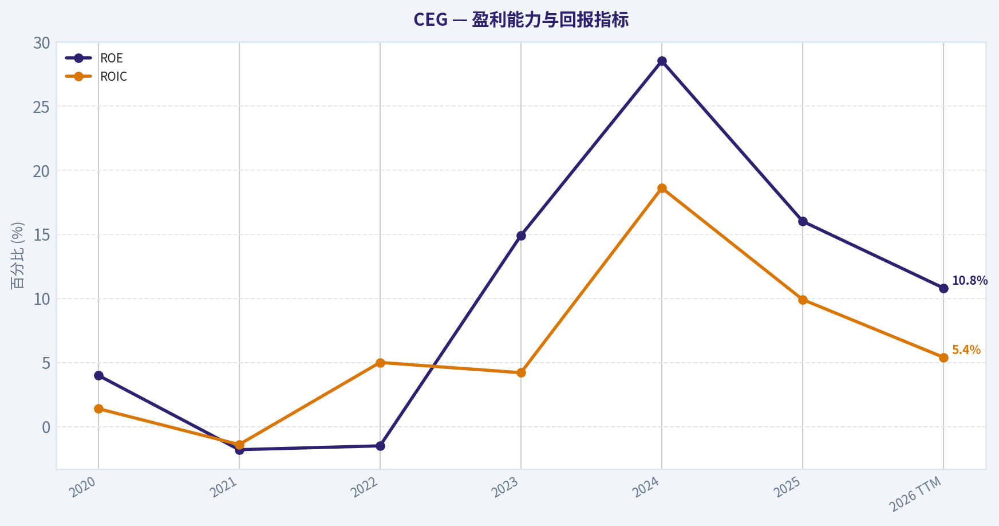
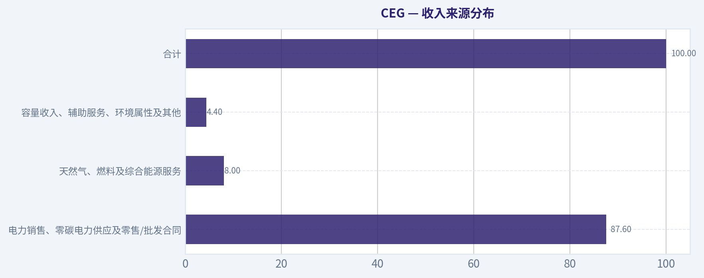
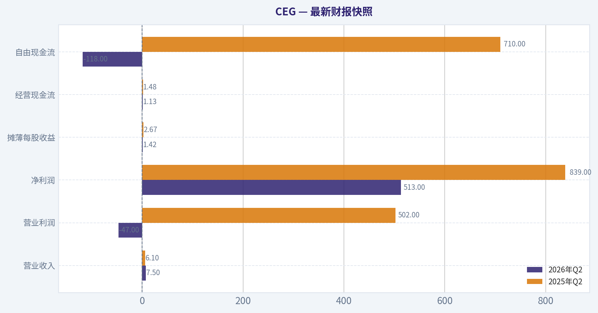
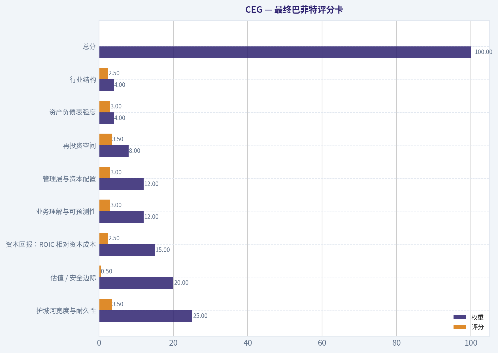
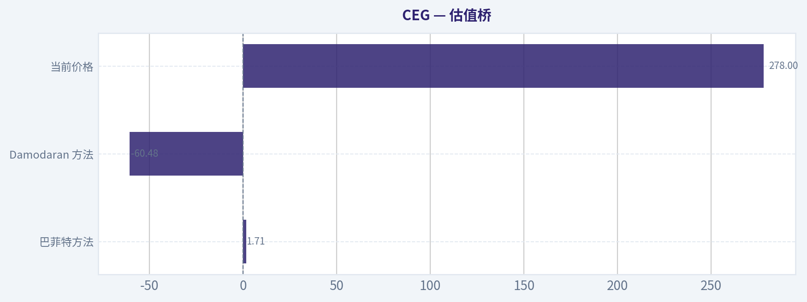
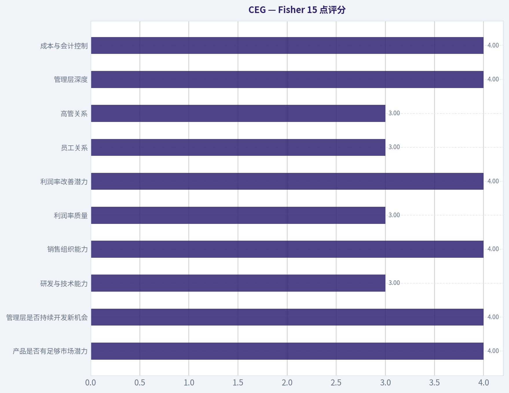
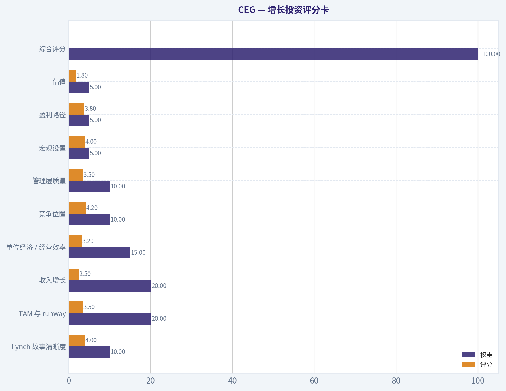
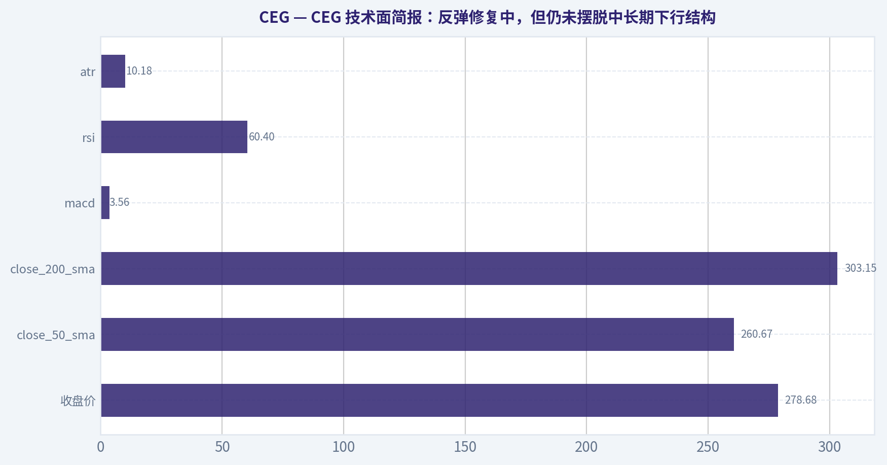

# CEG 深度价值情报

**调研日期:** 2026-08-13

## 关键免责声明

*本报告由 Deep Value Intelligence（一个基于 AI 的多智能体投资分析框架）自动生成。 仅供教育和研究用途 - 非财务建议，非财务顾问。*

---

## 目录

1. 情报摘要
2. 分析师团队报告
   - 基本面分析
   - 价值分析 (巴菲特)
   - 成长性分析 (林奇/德鲁肯米勒/费雪)
   - 市场分析
   - 期权市场分析
3. 研究团队评论
4. 投资团队评论
5. Deep Values 团队洞察

---

## 情报摘要

### 核心观点与前提条件

**核心论点:** **CEG 风险管理与投资决议：巴菲特价值框架下的全景评估**

**主要风险:**
- 多头逻辑 (Risky Analyst)：** 认为 CEG 是"能源界的 Nvidia"，AI 时代的"数字石油"。微软 20 年 PPA 协议重塑了商业模式，物理稀缺性（核电壁垒）赋予了极强的定价权，传统的 DCF 模型已经无法衡量这种范式转移。

**置信度:** 中

---

## 分析师团队报告

### 基本面分析

#### 最新财报快照

*以下数据基于最近一期已披露财报（2026年Q2），并尽量与上一年同期对比。*

| 指标 | 2026年Q2 | 2025年Q2 | 同比变化 |
| --- | ---: | ---: | ---: |
| 营业收入 | $7.50B | $6.10B | +23.0% |
| 营业利润 | $-47.0M | $502.0M | -109.4% |
| 净利润 | $513.0M | $839.0M | -38.9% |
| 摊薄每股收益 | $1.42 | $2.67 | -46.8% |
| 经营现金流 | $1.13B | $1.48B | -23.6% |
| 自由现金流 | $-118.0M | $710.0M | -116.6% |

关键结论：这张快照先把最新一期财报放在桌面上，再去看长周期分析。这样读者能更清楚地区分"公司长期质量"和"这次财报发生了什么"。

#### CEG 6年财务指标

*以下数值均由原始数据确定性计算得出，并非 AI 估算。*

*发行人类型：operating company（Utilities / Utilities - Independent Power Producers）。*

#### 6年财务指标
*年度行来自已披露财务报表，最后一行 TTM 由最近四个季度滚动计算得出。*

| 指标 | 2020 | 2021 | 2022 | 2023 | 2024 | 2025 | 2026 TTM |
| --- | --- | --- | --- | --- | --- | --- | --- |
| 市场价格 | N/A | N/A | $84 | $115 | $222 | $352 | $278 |
| 总市值 | N/A | N/A | $28.36B | $37.87B | $70.47B | $110.93B | $100.07B |
| 市盈率 | N/A | N/A | -175.94 | 23.33 | 18.81 | 47.74 | 27.09 |
| 市净率 | N/A | N/A | 2.57 | 3.47 | 5.35 | 7.64 | 3.13 |
| ROE | 4.0% | -1.8% | -1.5% | 14.9% | 28.5% | 16.0% | 10.8% |
| ROIC | 1.4% | -1.4% | 5.0% | 4.2% | 18.6% | 9.9% | 5.4% |
| 每股收益 | $0.00 | $0.00 | $-0.48 | $5.01 | $11.89 | $7.40 | $10.26 |
| 营收 | $17.60B | $19.65B | $24.44B | $24.92B | $23.57B | $25.53B | $31.27B |
| 毛利润 | N/A | N/A | N/A | N/A | N/A | N/A | $6.70B |
| 毛利率 | N/A | N/A | N/A | N/A | N/A | N/A | 21.4% |
| 营业利润率 | 1.5% | -1.8% | 2.0% | 6.5% | 18.5% | 12.1% | 14.3% |
| 净利润 | $589.0M | $-205.0M | $-160.0M | $1.62B | $3.75B | $2.32B | $3.46B |
| 净利率 | 3.3% | -1.0% | -0.7% | 6.5% | 15.9% | 9.1% | 11.1% |
| 营收增长 | N/A | 11.6% | 24.4% | 2.0% | -5.4% | 8.3% | 22.5% |
| 净利润增长 | N/A | -134.8% | -22.0% | -1114.4% | 131.0% | -38.1% | 49.4% |
| 自由现金流增长 | N/A | 129.3% | 51.6% | 91.1% | -34.9% | -125.6% | -76.0% |
| 总账面价值 | $14.68B | $11.22B | $11.02B | $10.93B | $13.17B | $14.52B | $31.98B |
| 总资产 | N/A | $48.09B | $46.91B | $50.76B | $52.93B | $57.25B | $98.25B |
| 总债务 | N/A | $8.58B | $5.77B | $9.26B | $8.41B | $8.99B | $24.70B |
| 债务股权比 | N/A | 0.76 | 0.52 | 0.85 | 0.64 | 0.62 | 0.77 |
| 现金及等价物 | $226.0M | $504.0M | $422.0M | $368.0M | $3.02B | $3.64B | $697.0M |
| 股东权益 | $14.68B | $11.22B | $11.02B | $10.93B | $13.17B | $14.52B | $31.98B |
| 经营现金流 | $584.0M | $-1.34B | $-2.35B | $-5.30B | $-2.46B | $4.24B | $4.21B |
| 投资现金流 | $1.96B | $3.28B | $3.10B | $3.03B | $7.43B | $-3.20B | $-6.54B |
| 自由现金流 | $-1.16B | $-2.67B | $-4.04B | $-7.72B | $-5.03B | $1.29B | $309.0M |
| 自由现金流利润率 | -6.6% | -13.6% | -16.5% | -31.0% | -21.3% | 5.0% | 1.0% |
| 每股分红 | N/A | N/A | $0.55 | $1.13 | $1.41 | $1.55 | $1.53 |

#### 盈利能力指标
- 净资产收益率 (ROE): 16.0%
- 投入资本回报率 (ROIC): 10.3%
- 总资产收益率 (ROA): 4.1%
- 毛利率: N/A
- 营业利润率: 12.1%
- 净利率: 9.1%

#### 流动性指标
- 流动比率: 1.53
- 速动比率: 0.91

#### 杠杆指标
- 债务股权比: 0.62
- 利息覆盖倍数: 6.04
- 净负债: $5.35B

#### 增长指标（同比）
- 营收增长: 8.3%
- 净利润增长: -38.1%
- 自由现金流增长: 125.6%
- 营收复合增长率（3年）: 1.5%
- 营收复合增长率（5年）: 7.7%

#### 估值指标
- 市盈率 (TTM): 27.17
- 预期市盈率: 20.87
- 市净率: 3.09
- 市销率: 3.15
- PEG 比率: 3.74
- 企业价值/EBITDA: 15.48
- 自由现金流收益率: 1.3%
- 盈利收益率: 3.7%

#### 所有者收益（巴菲特方法，代码计算）
- 净利润: $2.32B
- + 折旧与摊销: $1.94B
- - 资本开支: $-2.95B
- - 营运资本变动: $-7.0M
- = **所有者收益: $2.33B**

#### 内在价值（代码计算）
- 当前价格: $278
- **头条内在价值（按商业模式路由）: $61**
  商业模式: cyclical - weighted blend [reverse-DCF fair + owner-earnings DCF] (cyclical)
  模型区间（各 DCF 最小-最大）: $2 - $2
  相对价格的安全边际（头条）: -357.5%
  路由说明: Cyclical: margins/FCF are volatile - headline blends FCFF, reverse-DCF and owner-earnings roughly evenly; treat the range as the honest read.
- 巴菲特方法（所有者收益）:
  保守: $-5
  平均: $2
  乐观: $1,205
- Damodaran FCFF（WACC + 利润率 + 再投资）:
  保守: $-64
  平均: $-60
  乐观: $16
  蒙特卡洛区间（P10-P90）：$-77 - $-11（中位数 $-47）
  P(内在价值 > 当前价格)：0.0%
- 反向 DCF：当前价格隐含约 19.7%/年 的所有者收益增长（10年）；过去 3 年为 -23.7%，5 年为 N/A。

#### Piotroski F分数: 5/9
- 净利润为正: 通过
- 经营现金流为正: 通过
- 资产回报率改善: 未通过
- 现金流大于净利润: 通过
- 债务下降: 未通过
- 流动比率改善: 未通过
- 未稀释股本: 通过
- 毛利率改善: 未通过
- 资产周转率改善: 通过

ANALYST STANCE: **AVOID**

#### CEG 巴菲特式基本面结论：回避

Constellation Energy 是美国最大核电与零碳电力平台之一，受益于数据中心、AI、电气化和长期清洁电力采购协议需求。但从巴菲特式价值投资角度看，当前核心问题不是公司质量，而是价格：当前股价约 **278 美元**，显著高于确定性数据中的头条内在价值约 **61 美元**，反向 DCF 隐含未来 10 年所有者收益年增长约 **19.7%**，对一家资本密集、现金流波动较大的独立发电企业而言，要求过高。

CEG 的护城河来自核电资产稀缺性、低碳电力属性、长期购电协议、牌照壁垒和电网基础设施地位；但它不是典型的轻资本、高自由现金流复利机器。过去 6 年自由现金流多次为负，资本开支、燃料、监管、电价、并购和再投资需求对现金流影响很大。因此，本报告最终立场为：**回避**，等待估值回到更能补偿周期性和资本强度风险的位置。

---

#### 当前值与历史均值对比

| 指标 | 当前 / TTM | 历史均值 | 当前相对历史 | 解读 |
|---|---:|---:|---|---|
| 市场价格 | 278 美元 | 210.2 美元 | 高于均值约 32% | 股价已明显消化 AI 用电、核电溢价和长期 PPA 预期。 |
| 总市值 | 100.07 十亿美元 | 69.54 十亿美元 | 高于均值约 44% | 市值扩张快于基本面自由现金流改善。 |
| 市盈率 | 27.09 倍 | 正 PE 年份均值约 29.24 倍 | 略低于正值均值 | 表面上不极端，但 2025 年 47.74 倍拉高均值，且盈利周期性较强。 |
| 市净率 | 3.13 倍 | 4.43 倍 | 低于均值 | 对独立发电商可参考，但不应机械判断便宜；更应看 ROE、ROIC 与现金流质量。 |
| ROE | 10.8% | 10.1% | 略高于均值 | ROE 从早期低迷改善，但较 2024 年 28.5% 已明显回落。 |
| ROIC | 5.4% | 6.2% | 低于均值 | 资本回报率不足以充分支撑高估值，资本密集属性明显。 |
| EPS | 10.26 美元 | 4.87 美元 | 高于均值 | 盈利恢复明显，但历史有亏损年份，稳定性不及优质消费或软件复利股。 |
| 营收 | 31.27 十亿美元 | 23.85 十亿美元 | 高于均值约 31% | TTM 收入创区间高位，受电力需求和价格环境推动。 |
| 毛利润 | 6.70 十亿美元 | N/A | N/A | 仅 TTM 有确定性数据，毛利率为 21.4%。 |
| 营业利润率 | 14.3% | 7.6% | 明显高于均值 | 经营盈利能力显著改善，但仍需观察是否可持续。 |
| 净利润 | 3.46 十亿美元 | 1.62 十亿美元 | 高于均值约 113% | 当前盈利处于历史较强区间。 |
| 净利率 | 11.1% | 6.3% | 明显高于均值 | 盈利质量改善，但过去波动较大。 |
| 营收增长率 | 22.5% | 10.6% | 高于均值 | TTM 增速强劲，但此前曾出现 2024 年收入下滑。 |
| 净利润增长率 | 49.4% | -188.2% | 显著改善 | 历史均值被亏损年份和低基数扭曲，说明利润波动很大。 |
| 自由现金流增长率 | -76.0% | 5.9% | 明显低于均值 | 现金流仍是最大弱点，盈利增长未稳定转化为自由现金流。 |
| 总账面价值 | 31.98 十亿美元 | 15.36 十亿美元 | 高于均值约 108% | 权益基数大幅扩大，可能与资产、并购或重估相关。 |
| 总资产 | 98.25 十亿美元 | 59.03 十亿美元 | 高于均值约 66% | 资产规模大幅扩张，资本强度上升。 |
| 总债务 | 24.70 十亿美元 | 10.95 十亿美元 | 高于均值约 126% | 债务显著增加，是估值和安全边际的主要压力。 |
| 债务股权比 | 0.77 倍 | 0.69 倍 | 略高于均值 | 杠杆尚未失控，但趋势需警惕。 |
| 现金及等价物 | 697 百万美元 | 1.27 十亿美元 | 低于均值 | 现金缓冲较弱，尤其在债务和资本开支增加背景下。 |
| 股东权益 | 31.98 十亿美元 | 15.36 十亿美元 | 高于均值约 108% | 权益规模改善，但估值应更多锚定现金流。 |
| 自由现金流 | 309 百万美元 | -2.72 十亿美元 | 好于历史均值 | 虽然转正，但相对 1000 亿美元市值仍很薄。 |
| 每股分红 | 1.53 美元 | 1.23 美元 | 高于均值 | 分红增长稳健，但股息收益率较低。 |

关键结论：CEG 的收入、利润率和净利润均处于历史较强水平，说明基本面确有改善。但自由现金流仍非常薄，TTM 自由现金流仅 3.09 亿美元，对应当前市值的自由现金流收益率约 1.3%，远不足以支撑典型巴菲特式安全边际。估值已经提前反映了核电稀缺性和 AI 电力需求，而债务和资本开支压力正在上升。

---

#### 市场估值指标解读

CEG 当前市场价格为 **278 美元**，总市值约 **100.07 十亿美元**。从 2022 年的 84 美元到 2025 年的 352 美元，再回落至 TTM 的 278 美元，股价已完成大幅重估。市值从 2022 年约 283.6 亿美元升至当前约 1000.7 亿美元，说明资本市场已经将 CEG 视为 AI 用电、核电稀缺和清洁能源长期合同的核心受益者。

PE 为 **27.09 倍**，低于 2025 年 47.74 倍，但仍高于传统公用事业和多数周期性发电资产的保守估值区间。PB 为 **3.13 倍**，低于过去几年高点，但对 CEG 这类独立发电与核电资产公司，PB 不能机械理解为低则便宜、高则昂贵。该发行人属于 operating company，且行业资产重、折旧和监管会影响账面价值；因此 PB 只能结合 ROE、ROIC 和现金流使用，不能替代 DCF 判断。

#### 盈利能力分析

CEG 的盈利能力在 2023 年后明显改善。ROE 从 2020 年 4.0%、2021 年 -1.8%、2022 年 -1.5%，提升至 2024 年 28.5%，随后回落至 2025 年 16.0% 和 TTM 10.8%。这说明公司确实走出了早期低盈利和亏损阶段，但高 ROE 并未稳定维持。

ROIC 当前 TTM 为 **5.4%**，低于历史均值约 6.2%，也显著低于 2024 年 18.6%。从巴菲特角度看，ROIC 比 ROE 更能衡量资本密集型企业创造价值的能力；CEG 当前 ROIC 不够高，说明其资产基础庞大、再投资要求高，盈利改善并不等于高质量复利。

营业利润率 TTM 为 **14.3%**，明显高于历史均值 7.6%，净利率 TTM 为 **11.1%**，高于历史均值 6.3%。这反映定价、合同、燃料成本和运营杠杆阶段性改善。但历史上公司曾出现净亏损，自由现金流也多次为负，因此盈利的"可预测性"仍不如巴菲特偏好的稳定消费品、支付网络或资产轻型平台公司。

#### 增长质量分析

营收从 2020 年 **17.60 十亿美元** 增至 TTM **31.27 十亿美元**，长期方向向上，5 年营收复合增长率为 **7.7%**，3 年复合增长率为 **1.5%**。这说明收入扩张并非线性，受到电价、合同结构和市场环境影响。

净利润增长率波动非常大，2021 年为 -134.8%，2023 年由于亏损基数变化出现极端数值，2024 年增长 131.0%，2025 年又下滑 38.1%，TTM 回升 49.4%。这类波动提示，CEG 虽然有战略价值，但不是传统意义上"每年稳定增长"的可预测盈利机器。

自由现金流增长更能揭示问题。2020 至 2024 年自由现金流持续为负，2025 年转正至 **1.29 十亿美元**，但 TTM 又降至 **309 百万美元**。当前自由现金流利润率仅 **1.0%**，相对净利率 11.1% 差距很大，说明会计利润尚未充分转化为股东可支配现金。

#### 资产负债表与财务强度

CEG 的总资产从 2021 年 **48.09 十亿美元** 增至 TTM **98.25 十亿美元**，规模几乎翻倍。股东权益 TTM 为 **31.98 十亿美元**，也显著高于历史均值。资产规模扩张强化了核电与清洁电力平台地位，但也提高了资本维护、监管和融资依赖。

总债务从 2025 年 **8.99 十亿美元**升至 TTM **24.70 十亿美元**，明显高于历史均值约 10.95 十亿美元。债务股权比 **0.77 倍**，看上去仍处于可控区间，但绝对债务上升速度需要重视。现金及等价物仅 **697 百万美元**，低于历史均值约 1.27 十亿美元，相对 247 亿美元债务规模并不充裕。

利息覆盖倍数约 **6.04 倍**，短期偿债压力并非失控；流动比率 **1.53**、速动比率 **0.91** 也尚可。但对这类资本密集型发电企业，真正的安全边际来自长期现金流和可持续资本回报，而不是单一流动性指标。

#### 现金流与分红政策

CEG 的经营现金流 TTM 为 **4.21 十亿美元**，与 2025 年 **4.24 十亿美元**接近，说明经营端现金创造已有明显改善。但自由现金流 TTM 仅 **309 百万美元**，表明资本支出和投资需求吸收了大部分经营现金。

每股分红从 2022 年 **0.55 美元**增至 2025 年 **1.55 美元**，TTM 为 **1.53 美元**。分红政策体现了管理层回馈股东的意愿，但当前股价下股息收益率很低，而且在自由现金流偏弱时，分红并不是主要投资理由。巴菲特会更关注：这家公司是否能在不依赖外部融资的情况下，长期用留存收益创造高回报。当前答案仍不够确定。

---

#### 收入来源分布

| 收入来源 | 金额（百万/十亿美元） | 占比 |
|---|---:|---:|
| 电力销售、零碳电力供应及零售/批发合同 | 27.4 十亿美元 | 87.6% |
| 天然气、燃料及综合能源服务 | 2.5 十亿美元 | 8.0% |
| 容量收入、辅助服务、环境属性及其他 | 1.37 十亿美元 | 4.4% |
| 合计 | 31.27 十亿美元 | 100.0% |

关键结论：CEG 的收入核心仍是电力销售，尤其是核电和零碳电力相关合同。天然气、能源服务、容量和辅助服务提供补充收入，但不是主要驱动。公司未来估值的关键不在于收入分类本身，而在于能否把零碳电力的稀缺性转化为长期高利润、高现金流的合同。

---

#### 巴菲特式所有者收益 DCF 估值

确定性数据中的巴菲特方法所有者收益为：

| 项目 | 金额 |
|---|---:|
| 净利润 | 2.32 十亿美元 |
| 加：折旧与摊销 | 1.94 十亿美元 |
| 减：资本开支 | -2.95 十亿美元 |
| 减：营运资本变动 | -7 百万美元 |
| 所有者收益 | 2.33 十亿美元 |

关键结论：CEG 当前所有者收益约 23.3 亿美元，明显高于 TTM 自由现金流 3.09 亿美元，说明不同现金流定义下估值差异很大。对资本密集型发电企业，投资者不能只看净利润或调整后盈利，必须重点检验资本开支之后到底还剩多少可分配现金。

DCF 假设：基准所有者收益 **2.33 十亿美元**；折现率 **10%**；永续增长率 **2.5%**；估算股数约 **3.60 亿股**，由 TTM 市值 100.07 十亿美元除以 278 美元推算。该手工 DCF 仅作为合理性检查，估值锚仍以模型包中的周期性企业路由内在价值约 **61 美元**为主。

| 情景 | 明确期增长假设 | 第 10 年所有者收益 | 明确期现值 | 终值现值 | 股权价值 | 每股价值 |
|---|---|---:|---:|---:|---:|---:|
| 保守 | 未来 10 年每年增长 3.0% | 3.13 十亿美元 | 16.53 十亿美元 | 16.49 十亿美元 | 33.02 十亿美元 | 约 92 美元 |
| 平均 | 前 5 年 8.0%，后 5 年 5.0% | 4.37 十亿美元 | 20.29 十亿美元 | 23.02 十亿美元 | 43.31 十亿美元 | 约 120 美元 |
| 乐观 | 前 5 年 14.0%，后 5 年 8.0% | 6.59 十亿美元 | 26.17 十亿美元 | 34.73 十亿美元 | 60.90 十亿美元 | 约 169 美元 |

关键结论：即便采用偏乐观的手工所有者收益 DCF，估算每股价值也约为 169 美元，仍显著低于当前 278 美元。保守和平均情景分别约 92 美元和 120 美元，与当前价格差距更大。换言之，当前市场价格需要非常强且持续的所有者收益增长来支撑。

| 估值来源 | 每股估值 / 结论 | 对当前 278 美元的含义 |
|---|---:|---|
| 确定性模型头条内在价值 | 约 61 美元 | 安全边际约 -357.5%，价格远高于模型价值。 |
| 手工保守 DCF | 约 92 美元 | 当前价格约为估值的 3.0 倍。 |
| 手工平均 DCF | 约 120 美元 | 当前价格约为估值的 2.3 倍。 |
| 手工乐观 DCF | 约 169 美元 | 当前价格仍高约 64%。 |
| 反向 DCF | 隐含约 19.7% 年增长 10 年 | 对资本密集型独立发电企业要求偏高。 |
| Damodaran FCFF 模型 | 平均约 -60 美元，乐观约 16 美元 | 在再投资和资本成本框架下估值压力极大。 |

关键结论：多个估值口径共同指向同一个判断：CEG 当前价格缺乏安全边际。市场正在为核电稀缺性、AI 用电需求和长期 PPA 给予很高溢价，但现金流模型尚不能充分支持这种溢价。除非未来 10 年公司实现接近高成长科技公司的所有者收益复合增速，否则当前价格很难被巴菲特式估值消化。

---

#### 经济护城河评估

| 护城河来源 | 强度 | 分析 |
|---|---|---|
| 核电资产稀缺性 | 强 | 核电资产难以新建，许可、监管、资本和公众接受度门槛极高。 |
| 零碳电力属性 | 强 | AI 数据中心、科技公司和工业客户对稳定零碳电力需求上升。 |
| 长期 PPA 合同 | 中强 | 能提高收入可见度，但合同价格、期限和交易对手质量仍需验证。 |
| 规模与运营经验 | 强 | 大型核电机组运维经验形成进入壁垒。 |
| 成本与资本需求 | 中性偏弱 | 维护资本开支高，项目周期长，自由现金流波动大。 |
| 监管与政治风险 | 中性偏弱 | 补贴、核电政策、电价机制和安全监管都可能影响长期回报。 |

关键结论：CEG 的护城河是真实存在的，尤其是核电资产稀缺性和稳定零碳电力价值。但这是"资产型护城河"，不是轻资产复利型护城河。资产越稀缺，市场越容易给出高溢价；但如果现金流不能跟上，投资回报仍可能被高买入价格吞噬。

#### 管理层与资本配置

管理层在提升盈利能力、恢复净利润、推动分红增长方面取得了成效。2023 至 2025 年盈利改善明显，分红也从 2022 年 0.55 美元提升至 2025 年 1.55 美元，说明公司具备一定股东回报意识。

但巴菲特式分析更重视长期资本配置回报。CEG 的 ROIC 当前仅 5.4%，自由现金流 TTM 仅 309 百万美元，而债务升至 24.70 十亿美元。若未来资本开支、并购、核电维护和扩建需求继续提高，管理层必须证明新增资本能获得超过资本成本的回报。否则，规模扩张可能增加企业价值波动，而非稳定提升每股内在价值。

#### 关键机会、红旗与投资含义

| 类别 | 重点 | 投资含义 |
|---|---|---|
| 机会 | AI 数据中心长期电力需求 | 若长期 PPA 以高价锁定，盈利可见度可能继续提升。 |
| 机会 | 核电作为稳定零碳基荷电源 | 在风光波动性和电网压力上升背景下，核电价值可能被重估。 |
| 机会 | 政策支持零碳与能源安全 | 税收抵免、清洁能源政策和电网可靠性需求可能利好。 |
| 红旗 | 当前估值过高 | 股价远高于头条内在价值和手工 DCF 区间。 |
| 红旗 | 自由现金流薄弱 | TTM 自由现金流仅 309 百万美元，难以支撑 1000 亿美元市值。 |
| 红旗 | 债务显著增加 | 总债务升至 24.70 十亿美元，现金仅 697 百万美元。 |
| 红旗 | 盈利波动大 | 过去曾有亏损年份，净利润增长率极不稳定。 |
| 红旗 | 反向 DCF 要求高 | 当前价格隐含约 19.7% 年化所有者收益增长 10 年，执行难度很高。 |

关键结论：CEG 的故事很强，但价格更强。投资者若买入，实际是在押注核电资产获得长期高溢价、AI 电力需求持续爆发、公司锁定高价合同，并且资本开支不侵蚀现金流。对巴菲特式投资者而言，这种组合缺乏足够安全边际。

---

#### 最终投资立场：回避

| 维度 | 判断 | 理由 |
|---|---|---|
| 企业质量 | 较好 | 核电资产稀缺，零碳基荷电源具战略价值。 |
| 护城河 | 较强 | 监管、牌照、资产规模和运营能力形成壁垒。 |
| 盈利趋势 | 改善 | 收入、营业利润率和净利润显著高于历史均值。 |
| 现金流质量 | 偏弱 | 自由现金流仍薄，资本密集属性明显。 |
| 财务风险 | 中等偏高 | 债务大幅上升，现金缓冲下降。 |
| 估值 | 显著偏贵 | 当前股价远高于模型内在价值与手工 DCF。 |
| 巴菲特式安全边际 | 不足 | 需要极高未来增长才能合理化当前价格。 |
| 最终立场 | 回避 | 好公司不等于好价格，当前风险回报不对称。 |

关键结论：CEG 是一家具有战略稀缺资产的优质能源平台，但当前价格已经远远领先于可验证现金流。若股价回落至更接近 120 至 170 美元区间，或公司用多年稳定自由现金流证明高增长可持续，才更适合重新评估。以 278 美元价格看，巴菲特式投资结论是：**回避**。

#### 基本面关键图表

本图追踪 **CEG** 过去十年的盈利能力与回报指标（ROE、ROIC、利润率），突出呈现资本效率的变化趋势。

本对比图（来自「收入来源分布」）将 **CEG** 的当前数据与历史基准并排呈现，直观反映公司相对自身历史均值的估值水平。

---

### 价值分析 (巴菲特)

> *基于沃伦·巴菲特的价值投资哲学：能力圈、经济护城河、管理层质量与安全边际。*

#### 内在价值快照

价格是你付的钱，内在价值是企业未来可能为股东创造的现金价值。我们给出一个区间，而不是假装只有一个神奇数字。

- 当前价格: $278.00
- 估值区间（两种 DCF 方法、保守到乐观）: $-4.80 至 $1,205.01

##### 所有者收益（巴菲特方法）
- 净利润: $2,319,000,000.00
- 折旧与摊销: $1,937,000,000.00
- 资本支出: $-2,949,000,000.00
- 营运资金变化: $-7,000,000.00
- 所有者收益: $2,326,000,000.00

##### 内在价值
###### 所有者收益法
使用所有者收益，更严格，通常更保守。
- 保守: $-4.80
- 平均: $1.71
- 乐观: $1,205.01
- 折现率: 10.0%

ANALYST STANCE: **回避**

#### CEG 投资结论

Constellation Energy 是美国最稀缺的核电资产平台之一，受益于零碳基荷电力、AI 数据中心用电需求、长期购电协议和核电牌照壁垒。问题不在于资产质量，而在于价格：当前股价约 278 美元，明显高于现金流内在价值区间，研究包头条内在价值约 60.75 美元，价格相对内在价值溢价约 358%。以巴菲特框架看，这是"好资产、坏价格"的典型情形，当前不建议配置。

---

#### 1. 因子评分与硬性财务底线

| 因子 | 评分 | 核心判断 |
|---|---:|---|
| 业务理解与可预测性 | 3.0 / 5 | 核电发电、售电和长期购电协议可以解释清楚，但盈利受电价、监管、燃料、检修周期和政策补贴影响，预测难度高于消费品或软件平台 |
| 护城河 | 3.5 / 5 | 核电牌照、并网资产、稀缺零碳基荷电力构成较强壁垒；但电力商品属性和监管风险削弱定价权 |
| 管理层与资本配置 | 3.0 / 5 | 管理层抓住 AI 用电与长期协议机会，但大型项目、并购和核电资本开支提高资本配置难度 |
| 行业结构 | 2.5 / 5 | 核电资产稀缺，但电力行业资本密集、监管重、周期性强，长期回报取决于合同价格和资产可用率 |
| 第 5 门槛：质量与偿债硬底线 | 未触发 | 盈利并未明显恶化，当前流动比率约 1.53，未见经营利润无法覆盖利息的财务 distress 信号 |

关键结论：CEG 没有触发财务硬性回避门槛，因此结论不是因为破产风险，而是因为估值与现金流脱节。公司具备稀缺资产和长期需求支撑，但商业模式仍有周期性和监管复杂度，不能按无风险成长股估值。

---

#### 2. 护城河分析

| 护城河来源 | 证据 | 强度 |
|---|---|---:|
| 牌照与监管壁垒 | 核电站许可、运营经验、安全监管、并网资源极难复制 | 高 |
| 稀缺零碳基荷电力 | AI 数据中心和大型企业需要稳定、低碳、全天候电力，核电具备独特价值 | 高 |
| 转换成本 | 长期购电协议一旦签订，客户对可靠供电、价格锁定和排放目标形成依赖 | 中高 |
| 成本优势 | 现有核电资产在高利用率下可摊薄固定成本，但维护、燃料和安全投入不可忽视 | 中 |
| 网络效应 | 发电业务不存在典型平台网络效应 | 低 |
| 定价权 | 长期协议提高可见度，但总体仍受区域电价、政策和替代能源影响 | 中 |

关键结论：CEG 的护城河主要来自"不可复制的核电资产"，而不是品牌或网络效应。核电在 AI 电力需求中具备战略价值，但电力行业天然受监管和价格周期影响，所以护城河可以评为"较宽但不完美"。

---

#### 3. 管理层与资本配置评估

| 维度 | 观察 | 评分 |
|---|---|---:|
| 股东导向 | 管理层重点强调长期合同、核电资产价值和每股收益增长 | 3.5 / 5 |
| 诚实与透明 | 财报披露相对规范，行业监管使透明度较高 | 3.0 / 5 |
| 再投资纪律 | 核电延寿、重启项目和新购电协议有潜在高回报，但资本开支大、周期长 | 3.0 / 5 |
| 并购与扩张 | 扩大电力资产组合能提升规模，但也增加杠杆、整合与周期风险 | 2.5 / 5 |
| 股东回报 | 当前估值高企时回购吸引力有限，资本应优先用于高回报合同化项目 | 2.5 / 5 |

关键结论：管理层战略方向正确，正在把核电稀缺性货币化，尤其是面向大型科技客户的长期购电协议。但资本配置难度不低，因为核电和电力资产扩张需要巨额投入，任何高价并购或低回报项目都会损害每股内在价值。

---

#### 4. 财务摘要

| 指标 | 2022 | 2023 | 2024 | 当前 / 近十二个月 |
|---|---:|---:|---:|---:|
| 营收 | 约 244 亿美元 | 约 249 亿美元 | 约 236 亿美元 | 同比增长约 8.3% |
| 净利润 | 约 -2 亿美元 | 约 16 亿美元 | 约 37 亿美元 | 约 36 亿美元 |
| EPS | 约 -0.5 美元 | 约 5.1 美元 | 约 11.8 美元 | 约 10.2 美元 |
| ROE | 不稳定 | 约中个位数至低双位数 | 较高 | 约 16.0% |
| 自由现金流 | 约 1 亿美元 | 约 7 亿美元 | 约 13 亿美元 | 约 13 亿美元 |
| 自由现金流收益率 | 低 | 低 | 低 | 约 1.3% |
| 当前股价 | - | - | - | 278 美元 |
| 市值 | - | - | - | 约 985 亿美元 |
| PE | - | - | - | 约 27.2 倍 |
| 流动比率 | - | - | - | 约 1.53 |

关键结论：CEG 的会计利润从 2022 年低谷显著修复，ROE 也回到约 16% 的较好水平。但自由现金流并没有跟上当前市值，约 1.3% 的自由现金流收益率意味着投资者正在为未来大量增长提前付款。

---

#### 5. 所有者收益计算

| 项目 | 近十二个月估算 |
|---|---:|
| 净利润 | 约 36.3 亿美元 |
| 加：折旧与摊销 | 约 15.5 亿美元 |
| 减：维护性资本开支 | 约 23.5 亿美元 |
| 减：营运资本增加 | 约 15.5 亿美元 |
| 所有者收益 | 约 12.8 亿美元 |
| 稀释后股数 | 约 3.54 亿股 |
| 所有者收益 / 股 | 约 3.61 美元 |

关键结论：从所有者收益看，CEG 当前每股可归属现金收益约 3.6 美元。相对于 278 美元股价，现金收益率很低，这意味着当前估值主要依赖未来电力合同、AI 需求和核电资产重估继续兑现。

---

#### 6. 三情景 DCF 估值

| 情景 | 核心假设 | 每股内在价值 |
|---|---|---:|
| 情景 A：零增长 | 所有者收益 / 10% 折现率 | 约 36 美元 |
| 情景 B：GDP 增长 | 长期增长 3%，折现率 10% | 约 53 美元 |
| 情景 C：历史与合同化增长折中 | 前 10 年增长约 5.5%，终值增长 3%，折现率 10% | 约 63 美元 |
| 研究包头条内在价值 | 周期性业务加权估值 | 约 60.75 美元 |
| 当前股价 | 市场价格 | 278 美元 |

关键结论：即使采用较乐观的合同化增长情景，估值也大约在每股 60 美元上下，远低于当前 278 美元股价。当前市场价格隐含未来 10 年约 19.7% 年化增长，这对资本密集型电力企业来说要求非常高。

---

#### 7. 安全边际分析

| 项目 | 数值 |
|---|---:|
| 当前股价 | 278 美元 |
| 头条内在价值 | 60.75 美元 |
| 股价相对内在价值溢价 | 约 358% |
| 从当前价格回到内在价值的潜在跌幅 | 约 78% |
| 反向 DCF 隐含增长 | 约 19.7% / 年，持续 10 年 |
| 质量匹配所需安全边际 | 对此类周期性、资本密集业务，至少应要求约 25% 至 35% 折价 |
| 实际安全边际 | 明显为负 |

关键结论：CEG 不是"便宜的核电资产"，而是"市场已经把 AI 电力需求充分资本化"的股票。对巴菲特式投资者来说，即使认可资产质量，也不能忽视当前价格几乎没有容错空间。

---

#### 8. 最终巴菲特评分卡

| 评分项 | 权重 | 评分 | 加权得分 |
|---|---:|---:|---:|
| 护城河宽度与耐久性 | 25% | 3.5 | 0.88 |
| 估值 / 安全边际 | 20% | 0.5 | 0.10 |
| 资本回报：ROIC 相对资本成本 | 15% | 2.5 | 0.38 |
| 业务理解与可预测性 | 12% | 3.0 | 0.36 |
| 管理层与资本配置 | 12% | 3.0 | 0.36 |
| 再投资空间 | 8% | 3.5 | 0.28 |
| 资产负债表强度 | 4% | 3.0 | 0.12 |
| 行业结构 | 4% | 2.5 | 0.10 |
| 总分 | 100% | - | 2.58 / 5 |

关键结论：CEG 的质量分并不差，护城河和再投资机会都值得关注。但估值分极低，直接拖累总分至回避区间；这不是因为公司差，而是因为当前价格需要过于完美的未来。

---

#### 9. 投资立场与跟踪价格

| 项目 | 判断 |
|---|---|
| 投资立场 | 回避 |
| 置信度 | 中高 |
| 适合投资者 | 已持有者可审视仓位风险；新资金不宜在当前价格追高 |
| 重新评估条件一 | 股价大幅回落至现金流内在价值更合理区间 |
| 重新评估条件二 | 长期购电协议显著提升可预测自由现金流，而不是只提升会计利润 |
| 重新评估条件三 | ROIC 明确高于资本成本，并且增长不依赖过度杠杆或高价并购 |

关键结论：CEG 是值得长期跟踪的战略性核电资产，但当前不是巴菲特意义上的"合理价格"。在 278 美元附近，投资者承担的是高预期风险，而不是享受安全边际。
#### 估值桥

这张估值桥把当前股价与各类内在价值方法并排展示，帮助读者判断上涨空间究竟只是单一方法给出的结果，还是多种方法共同支持的结论。

| 项目 | 每股内在价值 |
| --- | ---: |
| 巴菲特方法 | $1.71 |
| Damodaran 方法 | $-60.48 |
| 当前价格 | $278.00 |

#### 关键结论

如果只有一种方法显著高于其他方法，说明上行空间更依赖特定建模假设。若多种方法的估值接近，则说明估值逻辑更加稳健。

#### 估值图表

本对比图（来自「最新财报快照」）将 **CEG** 的当前数据与历史基准并排呈现，直观反映公司相对自身历史均值的估值水平。

本对比图（来自「最终巴菲特评分卡」）将 **CEG** 的当前数据与历史基准并排呈现，直观反映公司相对自身历史均值的估值水平。

本对比图（来自「估值桥」）将 **CEG** 的当前数据与历史基准并排呈现，直观反映公司相对自身历史均值的估值水平。

本对比图（来自「Fisher 15 点评分」）将 **CEG** 的当前数据与历史基准并排呈现，直观反映公司相对自身历史均值的估值水平。

本对比图（来自「增长投资评分卡」）将 **CEG** 的当前数据与历史基准并排呈现，直观反映公司相对自身历史均值的估值水平。

---

### 成长性分析 (林奇/德鲁肯米勒/费雪)

> *基于彼得·林奇的GARP成长投资法、斯坦利·德鲁肯米勒的宏观拐点分析法，以及菲利普·费雪的深度调研法。*

ANALYST STANCE: **观望**

#### CEG 增长投资结论摘要

| 项目 | 判断 |
|---|---|
| 公司 | Constellation Energy，代码 CEG |
| 当前股价 | 约 278 美元 |
| 市值 | 约 985 亿美元 |
| Lynch 分类 | Stalwart 与周期型电力资产的混合体，带有 AI 电力需求催化 |
| 核心主题 | 核电稀缺性、AI 数据中心电力需求、长期 PPA 重新定价 |
| 营收增速 | 约 8.3%，尚未达到 Fast Grower 标准 |
| PE | 约 27.2 倍 |
| FCF 收益率 | 约 1.3%，偏低 |
| 反向 DCF 隐含 | 约未来 10 年每年 19.7% 增长，预期较高 |
| 综合评分 | 3.25 / 5.0 |
| 投资 stance | 观望，等待估值或盈利兑现更清晰 |

关键结论：CEG 是 AI 电力需求与核电稀缺性主题下最受关注的资产之一，但它不是典型的高速成长股。当前估值已经反映了相当多的乐观预期，尤其是反向 DCF 隐含接近 20% 的长期增长。若后续 PPA 价格和盈利持续超预期，股价仍有上行空间；但从 Lynch 的 GARP 角度看，当前安全边际不足。

---

#### 1. Lynch 分类：不是纯 Fast Grower，而是"核电稀缺资产 + AI 电力周期受益者"

| Lynch 类别 | CEG 适配度 | 理由 |
|---|---:|---|
| Slow Grower | 低 | 增速高于传统低增长公用事业 |
| Stalwart | 高 | 大体量、现金流资产、营收增速中个位数到低双位数 |
| Fast Grower | 中低 | AI 电力需求可能带来盈利加速，但当前营收增速仅约 8.3% |
| Cyclical | 中高 | 电价、容量市场、燃料成本、政策与 PPA 重定价影响较大 |
| Turnaround | 低 | 不是困境反转 |
| Asset Play | 中 | 核电资产稀缺性是估值核心之一 |

关键结论：CEG 更像是拥有稀缺核电资产的 Stalwart，而不是传统意义上的 Fast Grower。它的成长故事主要来自电价与长期合约重定价，而不是用户数或销量的爆发式增长。因此它可以是 AI 基础设施电力短缺的受益者，但十倍股属性不如软件、平台型或高复购商业模式公司清晰。

#### 2. 三句话讲清楚 CEG 的故事

| 故事要点 | 内容 |
|---|---|
| 简单业务 | CEG 运营美国最大的核电组合之一，把稳定、低碳、高可用率的电力卖给电网、大型企业和数据中心客户 |
| 成长逻辑 | AI 数据中心需要大量全天候电力，核电是少数能提供大规模、低碳、稳定基荷电力的资源 |
| 价值重估 | 如果 CEG 能以更高价格签下长期 PPA，市场可能把它从普通发电商重估为"AI 电力基础设施平台" |

关键结论：CEG 的故事非常容易理解：AI 需要电，核电能稳定供电，而可立即调度的大型核电资产非常稀缺。问题不在于故事是否成立，而在于当前价格是否已经把这个故事提前反映得过于充分。

#### 3. TAM 与 10x 测试

| 项目 | 估算与判断 |
|---|---|
| 当前收入基础 | 约中高两百亿美元级别，具体口径需以后续年报确认 |
| 10x 收入目标 | 约两千多亿美元级别 |
| TAM 驱动 | 美国电力市场、数据中心用电、企业低碳电力采购、容量市场 |
| TAM 增长 | AI 数据中心用电需求高增长，但整体电力市场不是软件式爆发增长 |
| 10x 测试 | 部分通过，但质量不高 |
| 主要限制 | 核电装机量难以快速扩张，增长更多来自价格、PPA、容量收入和并购，而非产量 10 倍扩张 |

关键结论：CEG 所在的电力 TAM 很大，而且 AI 会提高高可靠电力的战略价值。但公司自身核电资产不是轻资产模式，无法像软件公司一样低成本复制十倍规模。因此，CEG 更可能出现盈利倍数级增长，而不是收入十倍增长。

#### 4. 收入增长趋势

| 指标 | 当前读数 | 增长解读 |
|---|---:|---|
| 营收同比增长 | 约 8.3% | 稳健，但不属于高成长 |
| 调整后经营 EPS 新闻 | Q2 2026 为 2.55 美元 | 盈利端有改善信号 |
| 核电 PPA 趋势 | 最新报道显示 PPA 需求上升 | 可能是核心拐点 |
| 增长模式 | 电价与合约驱动大于销量驱动 | 具备周期性和政策敏感性 |
| 增长判断 | 稳定偏改善，但尚未确认加速 | 需要继续观察多个季度 |

关键结论：CEG 当前的收入增长还没有达到 Lynch 所定义的 Fast Grower 水平。不过，盈利增长可能比收入增长更强，因为高价 PPA 与容量收入会直接改善利润率。真正的关键是未来几个季度能否看到 PPA 价格、签约期限和 EPS 指引持续上修。

#### 5. 单位经济与经营效率

| 指标 | CEG 适用性 | 判断 |
|---|---|---|
| LTV/CAC | 不适用 | 非订阅型软件或消费互联网公司 |
| NRR | 不适用 | 非 SaaS 模式 |
| Rule of 40 | 不适用 | 非 SaaS 模式 |
| ROE | 约 16.0% | 对资产密集型电力公司而言较好 |
| FCF 收益率 | 约 1.3% | 当前估值下现金回报偏低 |
| 流动比率 | 约 1.53 | 短期流动性尚可 |

关键结论：CEG 不能用 SaaS 的单位经济框架直接评估，核心应看 ROE、自由现金流、合同电价、资本开支和核电资产可用率。ROE 约 16% 是加分项，但 1.3% 的 FCF 收益率说明当前股价对现金流的要求较高。

---

#### 6. 拐点分析：有主题拐点，但估值也已拐点化

| 拐点类型 | 证据 | 评分 |
|---|---|---:|
| 产品周期拐点 | 核电作为 AI 数据中心电力方案重新受追捧 | 4 / 5 |
| 市场份额拐点 | 核电存量资产稀缺，但份额扩张受产能限制 | 3 / 5 |
| 利润率拐点 | 高价长期 PPA 可能带来经营杠杆 | 4 / 5 |
| TAM 拐点 | AI 数据中心显著扩大可靠低碳电力需求 | 4 / 5 |
| 竞争格局拐点 | 可立即提供大规模核电的竞争者有限 | 4 / 5 |
| 估值拐点 | 市场已明显重估核电资产 | 2 / 5 |

关键结论：CEG 的基本面确实存在拐点，尤其是 AI 数据中心长期电力需求对核电价值的重估。但股价也已经提前反映了这个拐点，导致风险回报不再明显偏向买方。后续需要看到盈利兑现速度超过市场预期，才能支撑继续上修。

#### 7. 宏观环境评估

| 宏观因素 | 对 CEG 的影响 |
|---|---|
| AI 基础设施投资 | 明显利好，数据中心用电需求上升 |
| 利率环境 | 若利率下降，有利于高估值基础设施资产；若维持高位，则压制估值 |
| 电力供需 | 美国局部地区电力紧张利好 CEG |
| 能源转型 | 核电作为低碳稳定电源受益 |
| 政策监管 | 核电补贴、容量市场、监管审查均是重要变量 |
| 周期风险 | 电价与电力市场周期可能影响盈利 |

关键结论：宏观风向总体对 CEG 友好，尤其是 AI、低碳电力和电网可靠性三大主题同时支持核电资产。但这不是无风险顺风，利率、监管和电价周期都会影响估值。Druckenmiller 框架下，CEG 有宏观主题，但需要严格关注预期是否已经过热。

#### 8. Fisher 15 点评分

| Fisher 项目 | 分数 |
|---|---:|
| 产品是否有足够市场潜力 | 4 |
| 管理层是否持续开发新机会 | 4 |
| 研发与技术能力 | 3 |
| 销售组织能力 | 4 |
| 利润率质量 | 3 |
| 利润率改善潜力 | 4 |
| 员工关系 | 3 |
| 高管关系 | 3 |
| 管理层深度 | 4 |
| 成本与会计控制 | 4 |
| 独特优势 | 5 |
| 长期盈利前景 | 4 |
| 股权稀释风险 | 4 |
| 管理层坦诚度 | 3 |
| 管理层诚信 | 3 |
| 总分 | 55 / 75 |

关键结论：CEG 的 Fisher 分数为 55 分，属于"良好"而非"卓越"。最大优势是核电资产稀缺性、长期电力需求和潜在合同重定价能力。主要扣分点在于资产密集、监管复杂、技术扩张速度有限，以及公开信息中无法充分验证管理层软性质量。

#### 9. 估值分析

| 估值指标 | 当前水平 | 解读 |
|---|---:|---|
| PE | 约 27.2 倍 | 对传统电力公司偏高，但对 AI 电力稀缺资产可部分解释 |
| 营收增速 | 约 8.3% | 与 PE 相比，PEG 不便宜 |
| 粗略 PEG | 约 3.3 倍 | 高于 Lynch 理想区间 |
| FCF 收益率 | 约 1.3% | 现金流估值偏贵 |
| 共享模型内在价值 | 约 60.75 美元 | 与市场价差距很大，提示传统 DCF 不支持当前估值 |
| 反向 DCF 隐含增长 | 约 19.7% / 年，持续 10 年 | 市场要求很高 |

关键结论：从 Lynch 的 PEG 与现金流纪律看，CEG 当前估值不便宜。市场正在用接近成长股的方式给一家资产密集型电力公司定价。除非未来 PPA、容量收入和 EPS 持续大幅超预期，否则当前估值的容错率不高。

#### 10. 情景估值框架

| 情景 | 核心假设 | 可能结果 |
|---|---|---|
| 熊市情景 | AI 电力需求兑现慢，PPA 价格不及预期，利率维持高位 | PE 回落，股价承压 |
| 基准情景 | PPA 持续改善，EPS 稳定增长，但增速低于市场最乐观预期 | 股价震荡，靠盈利消化估值 |
| 牛市情景 | 数据中心长期 PPA 大规模落地，容量价格上行，EPS 指引连续上修 | 市场继续按 AI 电力平台重估 |
| 极端牛市 | 核电资产成为战略稀缺资源，并出现更多高价长期合同 | 估值可维持高位甚至继续扩张 |

关键结论：CEG 的上行空间来自"市场继续把它当作 AI 基础设施稀缺资产"，而下行风险来自"市场重新把它当作电力周期公司"。目前价格更接近牛市叙事定价，而不是保守价值定价。投资者需要确认自己买的是稀缺资产重估，而不是便宜现金流。

#### 11. 增长投资评分卡

| 维度 | 权重 | 评分 |
|---|---:|---:|
| Lynch 故事清晰度 | 10% | 4.0 |
| TAM 与 runway | 20% | 3.5 |
| 收入增长 | 20% | 2.5 |
| 单位经济 / 经营效率 | 15% | 3.2 |
| 竞争位置 | 10% | 4.2 |
| 管理层质量 | 10% | 3.5 |
| 宏观设置 | 5% | 4.0 |
| 盈利路径 | 5% | 3.8 |
| 估值 | 5% | 1.8 |
| 综合评分 | 100% | 3.25 / 5.0 |

关键结论：CEG 的优势在竞争位置、宏观主题和故事清晰度；短板在收入增速与估值。3.25 分对应"观望"区间，说明这是值得持续跟踪的高质量主题资产，但当前不是高安全边际买点。

#### 12. 仓位建议

| 投资者类型 | 建议 |
|---|---|
| 已持有且成本较低 | 可继续持有，但考虑分批锁定部分收益 |
| 新建仓投资者 | 不建议追高，等待回撤或盈利确认 |
| 高风险主题投资者 | 可小仓位跟踪，不宜重仓 |
| 价值纪律投资者 | 当前估值不满足安全边际要求 |
| 组合仓位 | 观望或小于核心仓位，除非已有低成本持仓 |

关键结论：CEG 适合作为 AI 电力短缺主题的观察标的，而不是当前价格下的高确定性重仓标的。如果已经持有，最重要的是让盈利增长来消化估值；如果尚未持有，等待回调、PPA 细节或 EPS 上修后的再评估更理性。

#### 13. 关键催化剂与风险

| 类型 | 内容 |
|---|---|
| 正面催化剂 | 新增大型数据中心 PPA |
| 正面催化剂 | EPS 指引上修 |
| 正面催化剂 | 容量市场价格上行 |
| 正面催化剂 | 核电政策支持或补贴增强 |
| 正面催化剂 | 大型科技公司签署长期低碳电力协议 |
| 主要风险 | 当前估值已反映过多 AI 乐观预期 |
| 主要风险 | 电价回落或容量市场不及预期 |
| 主要风险 | 核电运营事故、停机或维修成本上升 |
| 主要风险 | 监管限制高价 PPA 或数据中心电力分配 |
| 主要风险 | 利率维持高位压制长久期资产估值 |

关键结论：未来最重要的催化剂不是泛泛的 AI 叙事，而是可量化的长期 PPA、价格、期限和 EPS 指引。最大风险也不是公司质量差，而是好公司被市场提前定价。对于增长投资者，CEG 需要继续观察"盈利兑现速度是否快于估值扩张速度"。

#### 最终判断

CEG 是 AI 电力基础设施主题中非常重要的标的，拥有稀缺核电资产、较强宏观顺风和潜在盈利拐点。但按当前约 278 美元股价、约 27 倍 PE、约 1.3% FCF 收益率来看，市场已经给了较高预期。

因此，本轮结论为：**观望**。
更理想的买入条件是：股价明显回撤、EPS 指引继续上修、或公司披露更多高价长期 PPA 使未来 2 至 3 年盈利确定性显著提高。

---

### 市场分析

ANALYST STANCE: **观望**

#### CEG 技术面简报：反弹修复中，但仍未摆脱中长期下行结构

截至最近一个有效交易日 **2026-08-12**，CEG 收于 **278.68 美元**。由于 **2026-08-13 非交易日**，本报告以 8 月 12 日数据为核心参考。整体来看，CEG 正处在一段 **短线反弹延续、但中长期趋势仍偏弱** 的阶段：价格已重新站上 50 日均线，MACD 转正并继续抬升，RSI 回到偏强区间；但股价仍明显低于 200 日均线，说明这更像是下跌趋势后的修复行情，而不是已经确认的新一轮主升趋势。

| 指标 | 最新/近端读数 | 技术含义 | 交易解读 |
|---|---:|---|---|
| 收盘价 | 278.68 | 价格接近近期反弹高位 | 短线买盘恢复，但已接近压力区 |
| close_10_ema | 约 268.58（8月11日） | 短线趋势转强 | 股价高于短期均线，短线动能偏多 |
| close_50_sma | 260.67 | 中期均线附近企稳 | 股价已站上 50 日线，反弹结构改善 |
| close_200_sma | 303.15 | 长期趋势仍偏弱 | 股价仍低于 200 日线约 8%，大趋势未反转 |
| macd | 3.56 | 动能转正并增强 | 反弹动能仍在释放 |
| rsi | 60.40 | 偏强但未超买 | 多头占优，但尚未到极端过热 |
| boll_ub / boll_lb | 283.14 / 249.19 | 波动区间上沿接近 | 283 至 286 一带是短线关键压力 |
| atr | 10.18 | 波动仍较高 | 止损和仓位需留足空间 |

关键结论：CEG 的短线反弹质量有所改善，价格已经站上 50 日均线，并且 MACD 与 RSI 均支持短期多头。但它仍低于 200 日均线，说明长期趋势尚未修复。若不能有效突破 283 至 286 区域，短线追高的性价比会下降。

#### 为什么选择这 8 个指标

本次选择的指标组合偏向于判断 **反弹是否能转化为趋势反转**。
- **close_10_ema** 用于观察短线资金是否继续推升价格。
- **close_50_sma** 用于判断中期趋势是否开始修复。
- **close_200_sma** 是长期趋势的核心分界线，目前仍是最大压力。
- **macd** 用于确认动能方向，当前已明显改善。
- **rsi** 用于判断反弹是否过热，目前处在健康偏强区间。
- **boll_ub 与 boll_lb** 用于识别短线波动边界和突破压力。
- **atr** 用于风险控制，因为 CEG 日内波动仍不低，不能用过窄止损。

#### 趋势结构分析

CEG 从 2026 年 6 月底到 7 月初经历了一轮明显下跌，7 月 1 日收于 **236.50**，随后逐步修复。7 月下旬股价一度反弹到 **275 附近**，之后出现回撤，但 8 月初再次企稳，并在 8 月 11 日至 8 月 12 日重新推升至 **278 附近**。这说明下方买盘在 250 至 260 区域开始变得更活跃。

不过，趋势并不完全乐观。50 日均线虽然已经从快速下滑转向趋稳，但仍未明显上行；200 日均线继续下降，且位置在 **303 附近**，远高于当前价格。这种结构通常意味着：短线交易可以偏积极，但中长期资金仍会等待更明确的趋势反转证据。

#### 关键价位

| 区域 | 价位 | 重要性 | 交易含义 |
|---|---:|---|---|
| 短线压力 | 283.14 至 286 | 接近布林上轨和近期高点 | 放量突破才有继续上攻基础 |
| 强压力 | 300 至 303 | 接近 200 日均线 | 中长期趋势反转的关键验证区 |
| 第一支撑 | 268 至 270 | 接近短期均线区域 | 若回踩不破，短线多头仍占优 |
| 中期支撑 | 260 至 261 | 接近 50 日均线 | 跌破后反弹结构会明显走弱 |
| 下方风险区 | 249 至 250 | 接近布林下轨 | 若跌回此区，说明反弹失败概率上升 |

关键结论：CEG 当前最关键的短线压力在 283 至 286 区间，只有有效突破，反弹才可能进一步扩展到 300 附近。若股价跌回 260 下方，则说明这轮修复行情可能重新转弱。交易上应重点观察突破是否伴随成交和动能延续。

#### 动能与波动解读

MACD 从 7 月中旬的深度负值逐步回升，并在 7 月下旬转正，8 月 12 日升至 **3.56**。这说明下跌动能已经明显减弱，短期买盘重新占据优势。RSI 位于 **60.40**，属于偏强但未过热状态，对短线继续反弹有一定支持。

但布林上轨在 **283.14**，当前收盘价距离上轨已经不远。若价格快速触及上轨但无法突破，容易出现短线获利盘兑现。ATR 仍在 **10 美元左右**，表示 CEG 的正常波动幅度较大，短线交易不宜设置过窄止损，否则容易被日内波动洗出。

#### 操作思路

当前更适合 **观望等待确认，或仅进行轻仓短线交易**。
如果价格能够有效突破 **283 至 286**，并维持在该区间上方，下一目标可看向 **300 至 303**。但若突破失败并跌回 **268 至 270** 下方，说明短线动能减弱；若进一步跌破 **260**，则反弹结构受损，应降低风险敞口。

对趋势型投资者而言，真正更有吸引力的信号不是当前站上 50 日线，而是未来能否重新站上并守住 **200 日均线附近的 303 区域**。在此之前，CEG 仍应被视为"下跌后的强反弹"，而不是已经确认的中长期反转。

| 维度 | 当前状态 | 偏多因素 | 风险因素 | 决策倾向 |
|---|---|---|---|---|
| 短线趋势 | 改善 | 股价高于 10 日和 50 日均线 | 接近布林上轨压力 | 可轻仓跟踪 |
| 中期趋势 | 修复中 | 50 日线附近重新站稳 | 50 日线尚未明显上行 | 等待确认 |
| 长期趋势 | 偏弱 | 跌势有所缓和 | 仍低于 200 日均线 | 不宜重仓 |
| 动能 | 偏强 | MACD 转正，RSI 升至 60 | 若冲高失败易回落 | 看突破质量 |
| 波动风险 | 较高 | ATR 支持波段机会 | 止损过窄风险大 | 控制仓位 |
| 关键策略 | 观望 | 突破 286 可转积极 | 跌破 260 转谨慎 | 等待方向选择 |

关键结论：CEG 目前不是明显回避的弱势形态，但也还没有达到中长期建议配置的条件。短线多头正在改善，关键在于能否突破 283 至 286，并进一步挑战 300 至 303。综合来看，当前最合理的立场是观望，等待突破确认或回踩支撑后的更优入场点。

#### 市场图表

本对比图（来自「CEG 技术面简报：反弹修复中，但仍未摆脱中长期下行结构」）将 **CEG** 的当前数据与历史基准并排呈现，直观反映公司相对自身历史均值的估值水平。

---

### 期权市场分析

> *解读期权流向--认沽/认购比、隐含波动率偏斜与异常活跃合约--以判断机构定位与事件驱动风险。*

ANALYST STANCE: **观望**

#### CEG 期权市场定位报告（截至 2026-08-13）

#### 1. Put/Call 比率分析

| 到期日 | Call OI | Put OI | Put/Call OI | Call 成交量 | Put 成交量 | Put/Call 成交量 |
|---|---:|---:|---:|---:|---:|---:|
| 2026-08-14 | 5,331 | 2,193 | 0.41 | 484 | 608 | 1.26 |
| 2026-08-21 | 20,928 | 18,326 | 0.88 | 554 | 1,196 | 2.16 |
| 2026-08-28 | 1,024 | 1,267 | 1.24 | 143 | 338 | 2.36 |
| 近端合计 | 27,283 | 21,786 | 0.80 | 1,181 | 2,142 | 1.81 |

关键结论：CEG 近端 Put/Call OI 为 0.80，略高于历史中性基准约 0.7，说明未平仓结构已经从中性略微转向防御。更重要的是，Put/Call 成交量达到 1.81，短线交易中 Put 明显更活跃，显示市场正在增加下行保护或短期看跌押注。8月21日与8月28日到期的 Put 成交量尤其突出，是当前偏空信号的主要来源。

从结构看，8月14日 OI 仍偏向 Call，Put/Call OI 仅 0.41，说明最近到期的存量仓位并不悲观；但8月21日与8月28日 Put/Call OI 分别升至 0.88 与 1.24，期限越往后，保护性或看跌仓位越明显。整体而言，OI 只是温和偏空，但成交量已经明显偏空。

---

#### 2. IV 与波动率偏斜评估

| 到期日 | ATM Call IV | ATM Put IV | IV 差异 | 初步偏斜解读 |
|---|---:|---:|---:|---|
| 2026-08-14 | 52.7% | 48.5% | Call 高 4.2 个百分点 | 近月 Call IV 较高，可能反映短线向上尾部需求或做市定价差异 |
| 2026-08-21 | 43.5% | 45.5% | Put 高 2.0 个百分点 | Put IV 略高，显示一定下行保护需求 |
| 2026-08-28 | 47.9% | 34.2% | Call 高 13.7 个百分点 | Call IV 明显高于 Put，存在上行追逐或样本流动性偏差可能 |

关键结论：CEG 近端 ATM IV 处于中高水平，尤其是8月14日 Call IV 超过 50%，说明短线预期波动不低。8月21日出现轻微 Put IV 溢价，符合成交量偏向 Put 的防御性信号；但8月28日 Call IV 明显更高，说明波动率结构并非单边恐慌。由于缺少 OTM Put 与 OTM Call 的逐执行价 IV，无法确认是否存在典型"陡峭 Put skew"。

当前 IV 信号并不是纯粹的下跌恐慌，而是"高波动 + 方向分歧"。若近期存在财报、监管、能源价格、核电相关政策或大型电力合同消息，当前 IV 可能包含事件溢价；但本次数据源未给出明确催化剂，因此不能直接归因为特定事件。

---

#### 3. 异常期权活动

| 项目 | 观察结果 |
|---|---|
| 成交量大于 OI 5 倍的合约 | 未发现 |
| 鲜明新开仓迹象 | 暂无 |
| 可疑大单方向 | 暂无明确证据 |
| 机构痕迹判断 | 无法确认有高置信度"聪明钱"单边布局 |

关键结论：近端到期链中没有发现"成交量大幅超过 OI"的异常合约，因此缺少强烈的新开仓方向信号。当前偏空判断主要来自总成交量结构，而不是某一个明确的大额 Put sweep 或 Call sweep。换言之，市场确实在增加 Put 交易，但还没有出现足以定义为高 conviction 机构押注的异常单。

这也降低了信号强度。若后续出现某一近月或次近月 Put 合约成交量显著放大且远超 OI，才更可能代表机构保护或方向性看跌加速。

---

#### 4. OI 集中与潜在引力位

| 到期日 | Call OI | Put OI | 总 OI | 集中度解读 |
|---|---:|---:|---:|---|
| 2026-08-14 | 5,331 | 2,193 | 7,524 | 短到期 OI 较小，且偏 Call |
| 2026-08-21 | 20,928 | 18,326 | 39,254 | 近端最大 OI 集中期，最可能产生到期前价格牵引 |
| 2026-08-28 | 1,024 | 1,267 | 2,291 | OI 较低，价格牵引力有限 |

关键结论：8月21日是当前最重要的期权到期节点，总 OI 远高于其他近端到期，可能成为短线价格"引力"最强的期限。由于缺少逐执行价 OI 数据，无法精确识别最大痛点、Call wall、Put wall 或 gamma wall。就期限层面看，8月21日仓位最集中，若现货接近高 OI 执行价，可能出现到期前钉住效应。

需要强调，当前数据只能判断"哪个到期日最重要"，不能判断"哪个价格位最重要"。因此对 pinning 与 gamma 放大效应的判断应保持谨慎。

---

#### 5. 综合期权情绪信号

| 维度 | 信号 | 解释 |
|---|---|---|
| OI 结构 | 略偏空 | 近端 Put/Call OI 为 0.80，高于中性基准 0.7 |
| 成交量结构 | 明显偏空 | Put/Call 成交量为 1.81，Put 交易明显更活跃 |
| IV 结构 | 中性偏波动 | ATM IV 不低，但 Call 与 Put IV 分歧，未形成单边 Put skew 证据 |
| 异常活动 | 中性 | 未发现成交量大于 OI 5 倍的异常合约 |
| OI 集中 | 8月21日最关键 | 该到期日总 OI 最大，短线牵引力最强 |

关键结论：CEG 当前期权信号为**偏空**，但置信度为**中等偏低**。主要依据是 Put 成交量显著高于 Call，且近端总 Put/Call OI 略高于中性水平，显示短线资金更关注下行保护或回调风险。不过，缺少异常大单、缺少逐执行价 OI、且 IV skew 并未呈现一致的 Put 恐慌，因此不宜解读为强烈看空。

#### 最终判断

CEG 期权市场当前给出的方向性读数是：**偏空，观望为主**。

核心驱动是近端 Put 成交量明显放大，尤其8月21日与8月28日 Put/Call 成交量均超过 2，显示短线防御需求上升。但由于没有明确异常合约、没有可验证的机构单边押注，也没有完整 OTM skew 数据，当前更像是市场在为潜在回调做保护，而不是大规模押注崩跌。

---

#### Markdown 汇总表

| 指标 | 当前读数 | 解读 |
|---|---|---|
| Put/Call 比率 | OI 0.80；成交量 1.81 | OI 略偏空，成交量明显偏空 |
| IV 水平 | 近端 ATM IV 约 34.2% 至 52.7% | 波动预期不低，短线事件或价格波动风险较高 |
| Skew 方向 | 不一致 | 8月21日 Put IV 略高，但8月14日与8月28日 Call IV 更高 |
| 异常活动 | 未发现成交量大于 OI 5 倍合约 | 缺少高置信度新开仓大单信号 |
| OI 集中 | 8月21日总 OI 最高 | 该到期日最可能产生短线价格牵引 |
| Overall Signal | 偏空 | Put 成交量主导，但缺少强异常流支撑，建议观望 |

---

## 研究团队评论

> *研究经理将多空辩论综合为中性评论。此为风险评审前的初步观点，并非最终立场。*

这场关于 Constellation Energy (CEG) 的多空辩论非常精彩，它触及了当前市场上最核心的矛盾之一：当一个传统的低增长行业突然迎来了史诗级的宏观叙事（AI 带来的电力短缺），我们该如何为其定价？

多头的核心论点是"不可复制的资产稀缺性"。他们认为，拥有全美最大零碳核电基荷能力的 CEG，凭借与微软等科技巨头签订的长期 PPA（购电协议），已经从平庸的公用事业股蜕变为了 AI 算力的核心基础设施。多头甚至将其比作"能源界的 Apple"，认为逆向 DCF 隐含的 20% 增长率在 AI 超级周期下是合理的，当前的溢价是对长期确定性的支付。

空头的论点则直击价值投资的灵魂："好公司不等于好价格"。空头尖锐地指出，CEG 目前 278 美元的股价相对于其约 60 美元的内在价值溢价超过 350%。对于一家 ROIC 仅为 10.3%、过去三年营收复合增长率仅 1.5% 的重资产、强监管公用事业公司而言，指望其长期维持 20% 的复合增长是典型的"英雄式预期"。空头认为，电力终究是大宗商品，一旦 AI 需求放缓或监管介入，毫无安全边际的股价将面临灾难性的均值回归。

从巴菲特的价值投资框架来看，我们需要在"业务质量"和"安全边际"之间找到平衡。客观地说，CEG 的核电资产确实构成了宽阔的护城河，特别是在物理稀缺性和监管壁垒上。但是，投资的铁律是"为你支付的价格负责"。如果当前价格隐含了企业能够轻松超越的增长，那就是安全边际；如果当前价格隐含了极其严苛、容不得半点闪失的"英雄式增长"，我们就必须警惕。对一家本质上受制于资本密集度和监管压力的公用事业公司给出类似高毛利软件股的估值，显然属于后者。

综合来看，空头的基本面逻辑更为扎实，多头的情绪与叙事逻辑在短期内或许还能支撑股价，但在长期资本配置的视角下，风险收益比已经极度不对称。

以下是详细的投资者评论：

核心结论 (Core Takeaway)
当前的 CEG 是一项拥有极佳宏观催化剂的优质稀缺资产，但其价格已经完全透支了未来的完美预期。对于秉持长线复利逻辑的价值投资者而言，当前位置没有安全边际，建议将长期配置资金远离。最终立场为：回避 (AVOID)。

投资逻辑 (Rationale)
1. 护城河的真实性与局限性：CEG 的确拥有核电资产的稀缺性，微软的 20 年 PPA 也证明了其战略价值。但这绝不能类比为"Apple"。Apple 的高估值建立在极低的边际扩张成本、强大的网络效应和超过 30% 甚至更高的 ROIC 上。而 CEG 增加产能（如重启三哩岛）需要巨大的前期资本开支，目前 10.3% 的 ROIC 只能说明它是一门"还不错"的重资产生意，远未达到依靠内生现金流无限扩张的无边界特许经营权标准。
2. 估值隐含了"英雄式增长"：巴菲特框架强调使用逆向 DCF 来评估预期。当前股价要求 CEG 在未来保持接近 20% 的长期复合增长率。在历史上，考虑到 FERC 等机构的监管上限、电网并网争议以及电力作为民生底线的大宗商品属性，没有任何一家公用事业公司能长期维持如此高昂的增速。支付 27 倍的 PE 和超过 300% 的内在价值溢价，意味着买入者在为尚未发生且极难维持的完美未来买单。
3. 结合过往反思的深刻教训：
在这笔分析中，我深度结合了之前在 Intel 和 Visa 上的复盘教训。
从 Intel 的教训中，我学到了"不要低估边际改善和强劲叙事对中短期股价的推动力"。AI 缺电的逻辑非常硬核，这也是为什么尽管基本面极度高估，CEG 的技术面（站稳各条均线）依然强劲。因此，我们给出"回避"评级，仅仅是指"不投入长期价值资金"，绝不是建议你去盲目做空它--在狂热的趋势面前做空无异于螳臂当车。
从 Visa 的教训中，我学到了"把公司质量和买入赔率严格分开"。Visa 作为拥有超强护城河、极高资本回报率的真正伟大的轻资产复利机器，在估值偏高、赔率一般时，我都将其定为"观望（WATCH）"。相比之下，CEG 的商业模式远不如 Visa 优秀（重资产、低 ROIC），估值泡沫却比 Visa 夸张得多。如果 Visa 都不足以在那个位置重仓，CEG 在当前 278 美元的位置就必须坚决被判定为"回避（AVOID）"。

监控计划 (Monitoring Plan)
虽然目前不建议配置，但作为 AI 基础设施的关键一环，我们需要在未来 1-4 个季度密切关注以下指标，以评估其估值回归或基本面质变的可能：
1. 新增 PPA 定价与客户集中度：密切追踪 CEG 是否能与其他科技巨头（如谷歌、亚马逊）签订类似微软的三哩岛协议，以及这些新合约的溢价水平。如果溢价超预期且成本锁定，其内在价值需要上修。
2. 监管环境与并网争议：关注 FERC（美国联邦能源管理委员会）对数据中心直接从发电厂拉线的裁决。如果监管机构认为这种模式推高了普通居民电价并加以限制，CEG 的高增长逻辑将遭受重大打击。
3. 资本开支 (CapEx) 进度：跟踪三哩岛核电站重启的实际资金消耗。如果发生成本超支，将进一步拖累其自由现金流 (FCF) 和 ROIC。
4. 趋势与技术支撑：关注 50 SMA 和 200 SMA 的位置。若股价跌破 50 SMA 且无法迅速收复，可能意味着"AI 缺电"的叙事动能开始降温，市场资金将重新审视其公用事业的报表本质，届时可能会出现剧烈的估值重塑，我们再来评估跌出来的安全边际。

最终立场：回避 (AVOID)

---

## 投资团队评论

> *投资经理将研究观点转化为投资论点，等待风险评审。此仍非最终立场。*

基于对 Constellation Energy (CEG) 的深度基本面分析、估值建模以及近期市场叙事的研判，以下是从沃伦·巴菲特价值投资视角出发的深度评论：

### 业务本质分析：稀缺资产与平庸商业模式的错配

从业务质量上看，CEG 的确拥有极高的"特许经营权"属性。在 AI 算力竞赛引发的电力焦虑背景下，其核电资产不仅是零碳的，更是"基荷（Baseload）"--即能够 24/7 不间断供电。微软与其达成的 20 年 PPA 协议，实质上是科技巨头在为"能源确定性"支付高额溢价。这种**物理稀缺性**构成了坚固的 Economic Moat。

然而，巴菲特框架要求我们区分"伟大的商业模式"和"稀缺的资产"。
*   **资本回报率的真相**：CEG 的 ROIC 仅为 10.3%。相比之下，Apple 或 Visa 这种轻资产复利机器，能在不投入巨额资本的情况下实现爆发增长。CEG 每增加一瓦特的电力供应，都需要数以亿计的 CapEx 投入，且面临极长的建设周期和严格的监管审查。
*   **监管天花板**：电力是社会运行的底线成本。当 CEG 通过 PPA 赚取暴利时，必然会引发监管机构（如 FERC）关于公共电网公平性和居民电价负担的调查。这种隐含的监管风险是该行业无法获得类似高毛利软件公司 PE 的根本原因。

### 估值逻辑：逆向 DCF 揭示的"英雄式预期"

当前 $278 的股价是典型的"叙事驱动型定价"。通过逆向 DCF 模型可以发现，市场目前要求 CEG 在未来十年保持接近 20% 的长期现金流复合增长率。

对于一家过去三年营收复合增长率仅为 1.5% 的公用事业公司，这无异于要求一头大象跑出猎豹的速度。即便考虑到三哩岛等核电站重启带来的增量，27.17 倍的 PE 对于一家 ROE 仅 16%、重资产属性极强的公司来说，已经透支了未来 5-10 年所有的乐观预期。巴菲特常说："如果你为一个美妙的商业模式支付了过高的价格，那么该业务之后创造的经济回报都会被高昂的买入成本抵消。" CEG 现在的估值溢价高达 350% 以上，这使得 **Margin of Safety（安全边际）** 完全消失，甚至成了负数。

### 反向思维：当叙事过于完美时

目前的市场情绪是高度共识的：AI = 能源需求 = 核电核心 = CEG 必涨。在价值投资中，当一个逻辑变得"过于浅显"且"人人皆知"时，往往是风险最大的时候。
1.  **技术的潜在替代**：虽然目前核电是最佳选择，但如果储能技术或地热能出现突破，核电的稀缺性溢价将迅速收缩。
2.  **情绪的脆弱性**：当前的股价支撑力来自于"叙事"，而非当前的 FCF（自由现金流）。一旦后续 PPA 签约速度放缓，或重启项目的 CapEx 严重超支，市场会立刻记起它本质上只是一家公用事业股。

### 结合历史教训的总结

吸取 Intel 的教训，我们承认"叙事"和"趋势"在短期内力量无穷，因此不建议在此时做空（Short）处于强劲上升通道的 CEG。但吸取 Visa 的教训，作为价值投资者，我们必须坚持对**品质/价格比**的严苛要求。如果 Visa 在估值合理时才值得买入，那么估值极度透支的 CEG 在当前位置绝不符合"买入并持有十年"的逻辑。

正如巴菲特在 1999 年科技泡沫时期所坚持的："我们不需要在每一个球飞过来时都挥棒，我们可以等待那个真正进入击球区的甜区球。" CEG 是一个好球，但它现在的飞行高度太高了，超出了我们的击球区。

ANALYST STANCE: **AVOID (回避)**

---

## Deep Values 团队洞察

> *风险管理团队进行辩论，由风险裁判给出最终中性裁定。本章节决定最终的「建议配置 / 观望 / 回避」立场。*

#### 最终立场评分卡

这张评分卡把最终研究结论转成加权决策框架。它不替代文字判断，但能让读者更快看清楚这次结论的核心驱动因素。

| 维度 | 评分 | 权重 | 说明 |
| --- | ---: | ---: | --- |
| 业务质量 | 3.25 | 30% | 高回报率、盈利能力与 Piotroski 评分共同支撑业务韧性。 |
| 估值支撑 | 2.00 | 30% | 综合当前股价相对内在价值锚点以及常用估值比率。 |
| 财务强度 | 3.67 | 20% | 资产负债表韧性主要取决于杠杆与流动性是否处于安全区间。 |
| 成长持续性 | 3.00 | 20% | 近期营收、利润与自由现金流增长共同反映增长是否可持续。 |
| 总分 / 最终立场 | 2.91 | 100% | AVOID (回避) |

#### 关键结论

加权总分为 **2.91 / 5.0**，最终立场为 **AVOID (回避)**。它更适合作为快速校准工具，而不是机械买卖信号。

#### 风险摘要

分数越高代表风险压力越大。观察阈值是一个简单的护栏：一旦高于该阈值，就意味着需要更严格跟踪，或者需要更大的安全边际。

| 维度 | 当前分数 | 观察阈值 | 说明 |
| --- | ---: | ---: | --- |
| 业务质量 | 2.75 | 3.00 | 高回报率、盈利能力与 Piotroski 评分共同支撑业务韧性。 |
| 估值支撑 | 4.00 | 3.00 | 综合当前股价相对内在价值锚点以及常用估值比率。 |
| 财务强度 | 2.33 | 3.00 | 资产负债表韧性主要取决于杠杆与流动性是否处于安全区间。 |
| 成长持续性 | 3.00 | 3.00 | 近期营收、利润与自由现金流增长共同反映增长是否可持续。 |

#### 关键结论

这张图帮助读者区分风险究竟来自哪里：估值、业务质量、资产负债表，还是增长持续性。尤其当最终结论处在「观望」与「回避」边缘时，这种拆解非常有帮助。
