# CEG Deep Value Intelligence

**Analysis Date:** 2026-08-13

## Critical Disclaimer

*This analysis is generated by Deep Value Intelligence, an AI-powered multi-agent investing framework. Education & research only - not financial advice, not a financial advisor.*

---

## Table of Contents

1. Intelligence Summary
2. Analyst Team Reports
   - Fundamentals Analysis
   - Intrinsic Value Analysis (Buffett)
   - Trend & Growth Analysis (Lynch/Druckenmiller/Fisher)
   - Market Technical Analysis
   - Options Market Analysis
3. Research Team Commentary
4. Value Investing Team Commentary
5. Deep Values Commentary

---

## Intelligence Summary

### Thesis + Conditions

**Core Thesis:** **Executive Summary**
Constellation Energy (CEG) is an irreproducible, wide-moat asset uniquely positioned to supply carbon-free baseload power to the AI data-center boom. However, at ~27x P/E with a 10.3% ROIC, the stock is priced for flawless execution and software-like margins, leaving zero margin of safety for a capital-intensive commodity producer.

**Key Risks:**
- Constellation Energy (CEG) is an irreproducible, wide-moat asset uniquely positioned to supply carbon-free baseload power to the AI data-center boom. However, at ~27x P/E with a 10.3% ROIC, the stock is priced for flawless execution and software-like margins, leaving zero margin of safety for a capital-intensive commodity producer. Because the stock is currently trading below a declining 200-day moving average, the market is already signaling hesitation. Overpaying is the primary permanent risk here; thus, our stance is a constructive **WATCH** pending either technical repair or a multiple compression.
- The Bear/Value Case:** Paying 27x earnings for an aging, asset-heavy industrial fleet is a massive risk. It ignores the reality of regulatory ceilings, the tail-risk of nuclear operations, and the poor capital stewardship of management executing share buybacks at all-time high valuations.
- As the Safe and Neutral analysts correctly point out, CEG operates in the physical world, not the cloud. If CEG begins capturing astronomical margins on essential power, it will inevitably invite federal or state regulatory intervention (windfall taxes, price caps). Furthermore, executing share buybacks at 27x earnings with a 10.3% ROIC destroys long-term intrinsic value compared to fortifying the balance sheet. Buying into a structurally damaged chart (below a declining 200-day SMA) at peak multiples violates our core mandate of capital preservation.

**Confidence:** Medium

---

## Analyst Team Reports

### Fundamentals Analysis

#### Latest Earnings Snapshot

*Most recent reported quarter anchored on 2026 Q2, with prior-year comparison when available.*

| Metric | 2026 Q2 | 2025 Q2 | YoY Change |
| --- | ---: | ---: | ---: |
| Revenue | $7.50B | $6.10B | +23.0% |
| Operating Income | $-47.0M | $502.0M | -109.4% |
| Net Income | $513.0M | $839.0M | -38.9% |
| Diluted EPS | $1.42 | $2.67 | -46.8% |
| Operating Cash Flow | $1.13B | $1.48B | -23.6% |
| Free Cash Flow | $-118.0M | $710.0M | -116.6% |

Key Takeaways: This snapshot anchors the most recent reported quarter before the narrative analysis. It helps readers separate long-run business quality from whatever changed in the latest earnings print.

#### 6-Year Financial Metrics for CEG

*All values below are computed deterministically from raw data - not estimated by AI.*

*Issuer profile: operating company (Utilities / Utilities - Independent Power Producers).*

#### 6-Year Financial Metrics
*Annual rows come from reported financial statements. The final TTM row is computed from the latest four quarters.*

| Metric | 2020 | 2021 | 2022 | 2023 | 2024 | 2025 | 2026 TTM |
| --- | --- | --- | --- | --- | --- | --- | --- |
| Market Price | N/A | N/A | $84 | $115 | $222 | $352 | $278 |
| Market Cap | N/A | N/A | $28.36B | $37.87B | $70.47B | $110.93B | $99.96B |
| P/E Ratio | N/A | N/A | -175.94 | 23.33 | 18.81 | 47.74 | 27.06 |
| P/B Ratio | N/A | N/A | 2.57 | 3.47 | 5.35 | 7.64 | 3.13 |
| ROE | 4.0% | -1.8% | -1.5% | 14.9% | 28.5% | 16.0% | 10.8% |
| ROIC | 1.4% | -1.4% | 5.0% | 4.2% | 18.6% | 9.9% | 5.4% |
| EPS | $0.00 | $0.00 | $-0.48 | $5.01 | $11.89 | $7.40 | $10.26 |
| Revenue | $17.60B | $19.65B | $24.44B | $24.92B | $23.57B | $25.53B | $31.27B |
| Gross Profit | N/A | N/A | N/A | N/A | N/A | N/A | $6.70B |
| Gross Margin | N/A | N/A | N/A | N/A | N/A | N/A | 21.4% |
| Operating Margin | 1.5% | -1.8% | 2.0% | 6.5% | 18.5% | 12.1% | 14.3% |
| Net Income | $589.0M | $-205.0M | $-160.0M | $1.62B | $3.75B | $2.32B | $3.46B |
| Net Margin | 3.3% | -1.0% | -0.7% | 6.5% | 15.9% | 9.1% | 11.1% |
| Revenue Growth | N/A | 11.6% | 24.4% | 2.0% | -5.4% | 8.3% | 22.5% |
| Net Income Growth | N/A | -134.8% | -22.0% | -1114.4% | 131.0% | -38.1% | 49.4% |
| Free Cash Flow Growth | N/A | 129.3% | 51.6% | 91.1% | -34.9% | -125.6% | -76.0% |
| Total Book Value | $14.68B | $11.22B | $11.02B | $10.93B | $13.17B | $14.52B | $31.98B |
| Total Assets | N/A | $48.09B | $46.91B | $50.76B | $52.93B | $57.25B | $98.25B |
| Total Debt | N/A | $8.58B | $5.77B | $9.26B | $8.41B | $8.99B | $24.70B |
| Debt-to-Equity | N/A | 0.76 | 0.52 | 0.85 | 0.64 | 0.62 | 0.77 |
| Cash & Equivalents | $226.0M | $504.0M | $422.0M | $368.0M | $3.02B | $3.64B | $697.0M |
| Shareholders' Equity | $14.68B | $11.22B | $11.02B | $10.93B | $13.17B | $14.52B | $31.98B |
| Operating Cash Flow | $584.0M | $-1.34B | $-2.35B | $-5.30B | $-2.46B | $4.24B | $4.21B |
| Investing Cash Flow | $1.96B | $3.28B | $3.10B | $3.03B | $7.43B | $-3.20B | $-6.54B |
| Free Cash Flow | $-1.16B | $-2.67B | $-4.04B | $-7.72B | $-5.03B | $1.29B | $309.0M |
| FCF Margin | -6.6% | -13.6% | -16.5% | -31.0% | -21.3% | 5.0% | 1.0% |
| Dividends / Share | N/A | N/A | $0.55 | $1.13 | $1.41 | $1.55 | $1.53 |

#### Profitability Metrics
- Return on Equity (ROE): 16.0%
- Return on Invested Capital (ROIC): 10.3%
- Return on Assets (ROA): 4.1%
- Gross Margin: N/A
- Operating Margin: 12.1%
- Net Profit Margin: 9.1%

#### Liquidity Metrics
- Current Ratio: 1.53
- Quick Ratio: 0.91

#### Leverage Metrics
- Debt-to-Equity Ratio: 0.62
- Interest Coverage Ratio: 6.04
- Net Debt: $5.35B

#### Growth Metrics (Year-over-Year)
- Revenue Growth: 8.3%
- Net Income Growth: -38.1%
- Free Cash Flow Growth: 125.6%
- Revenue CAGR (3-Year): 1.5%
- Revenue CAGR (5-Year): 7.7%

#### Valuation Metrics
- P/E Ratio (TTM): 27.14
- Forward P/E: 20.84
- Price-to-Book: 3.09
- Price-to-Sales: 3.15
- PEG Ratio: 3.74
- EV/EBITDA: 15.48
- Free Cash Flow Yield: 1.3%
- Earnings Yield: 3.7%

#### Owner Earnings (Buffett Method, Code-Computed)
- Net Income: $2.32B
- + Depreciation & Amortization: $1.94B
- - Capital Expenditures: $-2.95B
- - Working Capital Changes: $-7.0M
- = **Owner Earnings: $2.33B**

#### Intrinsic Value (Code-Computed)
- Current Price: $278
- **Headline Intrinsic Value (business-model routed): $61**
  Business model: cyclical - weighted blend [reverse-DCF fair + owner-earnings DCF] (cyclical)
  Model spread (min-max across DCFs): $2 - $2
  Margin of safety vs. price (headline): -357.0%
  Routing note: Cyclical: margins/FCF are volatile - headline blends FCFF, reverse-DCF and owner-earnings roughly evenly; treat the range as the honest read.
- Buffett Method (Owner Earnings):
  Conservative: $-5
  Average: $2
  Optimistic: $1,205
- Damodaran FCFF (WACC + margins + reinvestment):
  Conservative: $-64
  Average: $-60
  Optimistic: $16
  Monte Carlo band (P10-P90): $-77 - $-11 (median $-47)
  P(intrinsic value > price): 0.0%
- Reverse-DCF: price implies ~19.6%/yr owner-earnings growth for 10y; trailing 3y was -23.7%, 5y N/A.

#### Piotroski F-Score: 5/9
- Positive Net Income: PASS
- Positive Operating Cash Flow: PASS
- ROA Improvement: FAIL
- Cash Flow > Net Income: PASS
- Decreasing Debt: FAIL
- Improving Current Ratio: FAIL
- No Dilution: PASS
- Improving Gross Margin: FAIL
- Improving Asset Turnover: PASS

ANALYST STANCE: **AVOID**

#### CEG Warren Buffett-Style Fundamental Analysis - Constellation Energy

Constellation Energy is a high-quality strategic power-generation asset with a uniquely valuable nuclear fleet, improving earnings, and strong exposure to rising electricity demand from AI data centers, electrification, reshoring, and clean-energy procurement. However, Buffett-style investing separates business quality from investment price. At **$278 per share**, the market is already pricing in a very large, durable growth runway: the deterministic pack's reverse DCF indicates the current price implies roughly **19.6% annual owner-earnings growth for 10 years**, while recent free cash flow remains volatile and the code-computed headline intrinsic value is only about **$61 per share**.

The business has improving moat characteristics, but the stock does not currently offer a Buffett-style margin of safety.

---

#### Current vs Historical Average Comparison

Because the deterministic dataset contains **6 years plus TTM**, not 10 years, the comparison below uses the full available historical period from the dataset. Market valuation averages use available market-price years only.

| Metric | Current / TTM | Historical Average Available | Current Standing vs History | Interpretation |
|---|---:|---:|---:|---|
| Market Price | $278 | $193 | Above average | The stock remains far above its post-spin trading history despite falling from the 2025 level of $352. |
| Market Cap | $99.96B | $61.91B | Above average | Equity value has expanded much faster than book value or normalized free cash flow. |
| P/E Ratio | 27.06x | 29.96x positive-year avg. | Slightly below positive-year avg. | P/E looks less extreme than in 2025, but still embeds high growth expectations. |
| P/B Ratio | 3.13x | 4.76x | Below recent avg. | P/B fell because equity rose sharply TTM; for an IPP/utility, book value is relevant but still secondary to cash-flow valuation. |
| ROE | 10.8% | 10.0% | Slightly above average | ROE is positive and improved versus early losses, but below the 2024 peak of 28.5%. |
| ROIC | 5.4% | 6.3% | Below average | Current capital returns are not yet strong enough to justify a premium compounder multiple. |
| EPS | $10.26 | $5.96 since 2022 | Above average | Earnings have recovered materially from 2022 losses. |
| Revenue | $31.27B | $22.62B | Well above average | TTM revenue is at a dataset high, helped by power-market pricing and demand strength. |
| Gross Profit | $6.70B | N/A | N/A | Gross profit is only available for TTM in the deterministic dataset. |
| Gross Margin | 21.4% | N/A | N/A | TTM gross margin is healthy, but no historical comparison is available in the dataset. |
| Operating Margin | 14.3% | 6.5% | Well above average | Margins are structurally better than the weak 2020-2022 period, though below the 2024 peak. |
| Net Income | $3.46B | $1.32B | Well above average | Profitability has improved significantly versus the early post-spin period. |
| Net Margin | 11.1% | 5.5% | Well above average | Current margin is nearly double the available historical average. |
| Revenue Growth | 22.5% | 8.2% | Above average | TTM growth is unusually strong relative to the historical dataset. |
| Net Income Growth | 49.4% | Not meaningful avg. | Strong rebound | Historical net income growth is distorted by losses and sign changes. |
| FCF Growth | -76.0% | 22.3% | Below average | Free cash flow has deteriorated sharply from 2025 despite positive earnings. |
| Total Book Value | $31.98B | $12.59B | Far above average | Equity capital has expanded dramatically, reducing P/B mechanically. |
| Total Assets | $98.25B | $51.19B | Far above average | Asset base nearly doubled versus the prior average, indicating a much larger balance sheet. |
| Total Debt | $24.70B | $8.20B | Far above average | Debt has risen materially and must be watched closely. |
| Debt-to-Equity | 0.77x | 0.68x | Slightly above average | Leverage is manageable but no longer light. |
| Cash & Equivalents | $697M | $1.36B | Below average | Cash is lower than average despite a larger balance sheet. |
| Shareholders' Equity | $31.98B | $12.59B | Far above average | Equity has increased sharply, improving book capitalization. |
| Operating Cash Flow | $4.21B | -$1.10B | Much better | Operating cash flow is now positive after several negative years. |
| Free Cash Flow | $309M | -$3.22B | Improved but weak | FCF is positive, but only modest relative to market cap. |
| FCF Margin | 1.0% | -14.0% | Improved | The company moved from deeply negative FCF margins to slightly positive. |
| Dividends / Share | $1.53 | $1.16 since 2022 | Above average | Dividend growth is steady, but yield is low at the current share price. |

Key Takeaways: CEG's earnings and margins have improved substantially from the weak 2020-2022 period, and revenue is at a dataset high. However, the market capitalization has expanded far faster than free cash flow, while debt has also increased materially. The biggest concern is that valuation reflects a premium growth story even though free cash flow remains thin and volatile.

---

#### Revenue Breakdown

The deterministic dataset provides total revenue but not exact segment disclosure. The table below uses the most meaningful public business segmentation for Constellation Energy and reconciles approximately to the deterministic **2025 revenue of $25.53B**.

| Revenue Source | Amount ($B) | % of Total |
|---|---:|---:|
| Mid-Atlantic power and customer supply | $10.0B | 39.2% |
| Midwest power and customer supply | $7.1B | 27.8% |
| New York power and customer supply | $3.1B | 12.1% |
| ERCOT / Texas power markets | $2.5B | 9.8% |
| Other power regions and corporate / other | $2.8B | 11.1% |
| **Total** | **$25.53B** | **100.0%** |

Key Takeaways: CEG's revenue base is concentrated in major deregulated U.S. power markets, especially the Mid-Atlantic and Midwest. This gives the company valuable exposure to tight power supply, nuclear scarcity, and rising data-center demand, but also leaves results sensitive to wholesale power prices, hedging, regulation, and regional market rules.

---

#### Market Metrics Interpretation

| Market Metric | Current Value | Buffett-Style Interpretation |
|---|---:|---|
| Market Price | $278 | The stock has pulled back from the 2025 level of $352 but remains far above earlier post-spin prices. |
| Market Cap | $99.96B | The company is now priced as a major strategic infrastructure compounder, not a conventional value utility. |
| P/E Ratio | 27.06x | A premium multiple for a capital-intensive power producer; acceptable only if high earnings growth proves durable. |
| P/B Ratio | 3.13x | Lower than the recent average, but not a standalone bargain signal; for IPPs/utilities, book value must be judged against ROE, asset quality, replacement cost, and cash-flow earning power. |

Key Takeaways: CEG is not statistically cheap. The P/E multiple is lower than the 2025 peak but still requires sustained earnings growth, while the market cap implies investors are capitalizing the nuclear fleet and AI-power demand at aggressive levels. P/B is somewhat relevant because CEG owns hard generation assets, but cash-flow-based intrinsic value is the better valuation anchor.

---

#### Profitability Analysis

CEG's profitability profile has improved sharply. The company moved from weak or negative returns in 2021-2022 to strong profitability in 2023-2025, with TTM net income of **$3.46B** and TTM EPS of **$10.26**. Operating margin of **14.3%** and net margin of **11.1%** are both far above historical averages, showing that the company is benefiting from stronger market conditions and improved operating leverage.

However, Buffett would focus on the durability of those returns. ROE of **10.8% TTM** is only modestly above the historical average and well below the 2024 peak of **28.5%**. ROIC of **5.4% TTM** is not yet exceptional for a company trading at a premium valuation. The spread between strong accounting earnings and low free cash flow also reduces confidence in near-term owner earnings quality.

---

#### Growth Analysis

Revenue growth is currently strong at **22.5% TTM**, compared with an available historical average of about **8.2%**. This reflects improving power demand, higher contracted power values, and the strategic importance of nuclear generation. Net income growth of **49.4% TTM** also shows strong earnings recovery.

The red flag is free cash flow growth. TTM free cash flow growth is **-76.0%**, and free cash flow is only **$309M**, equal to roughly a **1.0% FCF margin**. For a Buffett-style investor, revenue and EPS growth matter less than the conversion of earnings into distributable cash. On that test, CEG is still inconsistent.

---

#### Balance Sheet and Financial Strength

| Balance Sheet Metric | Current / TTM | Assessment |
|---|---:|---|
| Total Assets | $98.25B | Much larger asset base; reflects expanded scale and capital intensity. |
| Total Debt | $24.70B | Debt has increased significantly versus the historical average. |
| Debt-to-Equity | 0.77x | Manageable, but rising leverage deserves monitoring. |
| Cash & Equivalents | $697M | Low relative to debt and market cap. |
| Shareholders' Equity | $31.98B | Much higher than historical levels, improving capitalization. |
| Net Debt | $5.35B from summary metrics | Net debt appears manageable on the summarized leverage profile. |
| Interest Coverage | 6.04x from summary metrics | Acceptable coverage, though not bulletproof if earnings normalize lower. |
| Current Ratio | 1.53 | Adequate short-term liquidity. |
| Quick Ratio | 0.91 | Slightly below 1.0, indicating less conservative liquidity after excluding less liquid current assets. |

Key Takeaways: The balance sheet is not distressed, but it is no longer exceptionally conservative. Debt has risen substantially, cash is lower than average, and the business requires significant capital investment. Buffett would view the balance sheet as acceptable, but not strong enough to offset valuation risk.

---

#### Cash Flow and Dividend Analysis

| Cash Flow Metric | Current / TTM | Interpretation |
|---|---:|---|
| Operating Cash Flow | $4.21B | Strong improvement from historically negative levels. |
| Free Cash Flow | $309M | Positive but very small relative to market cap. |
| FCF Margin | 1.0% | Weak cash conversion despite improved earnings. |
| Dividends / Share | $1.53 | Dividend is growing but modest relative to share price. |
| FCF Yield | 1.3% from summary metrics | Very low; offers little valuation support. |
| Owner Earnings | $2.33B | Better than reported FCF, but still not enough to justify the current price under conservative assumptions. |

Key Takeaways: CEG's operating cash flow has recovered, but free cash flow remains the weakest part of the investment case. A company valued near $100B producing only $309M of TTM free cash flow is priced on future expectations, not current cash generation. The dividend is disciplined, but not large enough to compensate investors for valuation risk.

---

#### Buffett-Style Owner Earnings DCF

Base assumptions:

| DCF Input | Assumption |
|---|---:|
| Starting Owner Earnings | $2.33B |
| Shares Outstanding Estimate | 359.6M |
| Discount Rate | 10.0% |
| Terminal Growth Rate | 2.5% |
| Valuation Method | Owner earnings discounted to equity value |
| Current Share Price | $278 |

Key Takeaways: The DCF starts from code-computed owner earnings of $2.33B. A 10% discount rate is appropriate for a Buffett-style hurdle rate, especially given CEG's commodity-price exposure, regulatory exposure, and capital intensity. The terminal growth rate is intentionally conservative because no company should be assumed to compound faster than the economy forever.

##### Scenario Assumptions

| Scenario | Explicit Growth Assumption | Rationale |
|---|---|---|
| Conservative | 3% annual owner-earnings growth for 10 years | GDP-like growth, appropriate if power-price upside normalizes and capital needs remain high. |
| Average / Base Case | 8% growth for 5 years, fading to 3% by year 10 | Reflects nuclear scarcity, AI/data-center demand, and stronger contracting, but assumes returns fade. |
| Optimistic | 15% initial growth, fading to 3% by year 10 | Bull case assumes major upside from nuclear PPAs, capacity scarcity, and clean firm-power demand. |

Key Takeaways: The scenarios deliberately fade growth toward a normal terminal rate. This avoids the common mistake of valuing a cyclical or capital-intensive company as if peak growth can persist forever. Even the optimistic case assumes growth slows materially by year 10.

##### DCF Valuation Results

| Scenario | PV of 10-Year Owner Earnings | PV of Terminal Value | Estimated Equity Value | Fair Value / Share | Upside / Downside vs $278 |
|---|---:|---:|---:|---:|---:|
| Conservative | $16.5B | $16.5B | $33.0B | ~$92 | -67% |
| Average / Base Case | $20.5B | $23.0B | $43.5B | ~$121 | -56% |
| Optimistic | $25.3B | $30.5B | $55.8B | ~$155 | -44% |

Key Takeaways: Even the hand-built optimistic DCF produces a fair value well below the current share price. This does not mean CEG is a poor business; it means the market price already discounts a very favorable future. A Buffett investor would likely require either a much lower share price or far clearer evidence of sustained owner-earnings compounding.

##### Deterministic Pack Intrinsic Value Cross-Check

| Model From Deterministic Pack | Value / Share | Interpretation |
|---|---:|---|
| Headline Intrinsic Value | ~$61 | Business-model-routed value; indicates severe overvaluation versus price. |
| Owner Earnings DCF Conservative | -$5 | Reflects sensitivity to cyclicality and reinvestment needs. |
| Owner Earnings DCF Average | ~$2 | Very low value under the pack's stricter assumptions. |
| Owner Earnings DCF Optimistic | ~$1,205 | Shows extreme sensitivity to high sustained growth assumptions. |
| Damodaran FCFF Average | -$60 | FCFF model penalizes reinvestment, margins, and capital intensity. |
| Reverse DCF Implied Growth | ~19.6% per year for 10 years | Current market price requires very high sustained owner-earnings growth. |

Key Takeaways: The deterministic model spread is extremely wide, which itself is a warning sign. CEG's valuation is highly sensitive to growth, margins, reinvestment, and terminal assumptions. The most important signal is the reverse DCF: the market is already pricing in a decade of very strong owner-earnings compounding.

---

#### Warren Buffett-Style Qualitative Assessment

| Buffett Criterion | Assessment | CEG Interpretation |
|---|---|---|
| Economic Moat | Improving / potentially strong | Nuclear generation is scarce, difficult to replicate, politically important, and valuable for clean baseload power. |
| Durability | Good, but cyclical | Power demand is durable, but merchant pricing, hedging, regulation, and fuel/maintenance cycles add volatility. |
| Predictable Earnings | Moderate | Earnings improved sharply after 2022, but the 6-year record includes losses and volatile cash flow. |
| ROE Quality | Acceptable, not exceptional | ROE is positive but has fallen from the 2024 peak. |
| ROIC Quality | Mixed | Current ROIC is not high enough to comfortably support a premium multiple. |
| Balance Sheet Strength | Adequate | Debt is manageable, but leverage and capital needs are material. |
| Capital Allocation | Reasonable | Dividend has grown steadily; buyback or reinvestment discipline must be watched at elevated valuations. |
| Margin of Safety | Poor | Current price is far above conservative and base-case intrinsic value estimates. |
| Business Quality | High strategic value | CEG owns assets that are becoming more important as clean firm power becomes scarce. |
| Investment Quality at Current Price | Weak | Business quality is not enough to overcome valuation risk. |

Key Takeaways: CEG has many traits Buffett would admire in an infrastructure-like business: scarce assets, essential service, and improving demand durability. But Buffett would likely object to the price. The stock appears to be valued more like a high-growth technology derivative than a capital-intensive power producer.

---

#### Key Investment Insights

| Category | Insight |
|---|---|
| Main Bull Case | CEG's nuclear fleet becomes a premium clean-power platform for AI data centers, hyperscalers, industrial electrification, and long-term PPAs. |
| Main Bear Case | The market has already capitalized that upside, leaving little room for execution delays, lower power prices, regulatory intervention, or higher capex. |
| Earnings Quality | Accounting earnings are improving, but free cash flow remains volatile and currently weak. |
| Valuation Risk | Very high; reverse DCF requires about 19.6% annual owner-earnings growth for 10 years. |
| Moat Trend | Strengthening as nuclear power becomes more valuable and harder to replace. |
| Balance Sheet Risk | Manageable but rising; total debt is much higher than historical levels. |
| Dividend Appeal | Low; dividend growth is positive but yield is not a major support at today's price. |
| Best Entry Condition | A major pullback toward cash-flow-based intrinsic value, or evidence that owner earnings can sustainably compound at a high-teens rate. |

Key Takeaways: The opportunity is real, but so is the valuation risk. CEG may remain a market favorite if AI-related power demand keeps accelerating, but Buffett-style investors need a margin of safety, not just a good story. At the current price, the risk/reward is unfavorable.

---

#### Red Flags and Opportunities

| Red Flags | Opportunities |
|---|---|
| Current price far exceeds headline intrinsic value. | Nuclear assets are scarce and strategically valuable. |
| FCF yield is only about 1.3%. | AI and data-center power demand could support premium long-term contracts. |
| Free cash flow growth is negative TTM. | Clean firm-power scarcity may improve pricing power. |
| Total debt has risen materially. | Operating margins are structurally better than early post-spin years. |
| Valuation depends on sustained high growth. | Earnings and revenue momentum are currently strong. |
| Piotroski F-Score of 5/9 is only average. | Dividend policy is disciplined and growing. |
| Regulatory and political risk around power prices. | Nuclear policy support may strengthen over time. |

Key Takeaways: CEG's risks are mostly valuation, cash conversion, leverage, and regulation. Its opportunities are powerful and strategically important, especially around nuclear scarcity and AI-driven electricity demand. The problem is not the business narrative; the problem is that the share price already assumes much of the narrative succeeds.

---

#### Final Investment Stance

| Final Stance | Rationale |
|---|---|
| **AVOID** | CEG is a strategically valuable business with improving fundamentals, but the stock lacks a Buffett-style margin of safety at $278. The deterministic intrinsic value anchor is around $61, the hand-built DCF range is roughly $92-$155, and the reverse DCF implies about 19.6% annual owner-earnings growth for 10 years. That is too demanding for a capital-intensive, partially cyclical power producer with volatile free cash flow. |

Key Takeaways: CEG is a high-quality asset at a demanding price. Long-term investors should respect the nuclear moat and AI-power opportunity, but the current valuation leaves too little protection against disappointment. Under Buffett-style discipline, this is a stock to avoid at today's price and revisit after a substantial pullback or materially higher confirmed owner earnings.

#### Fundamental Visuals

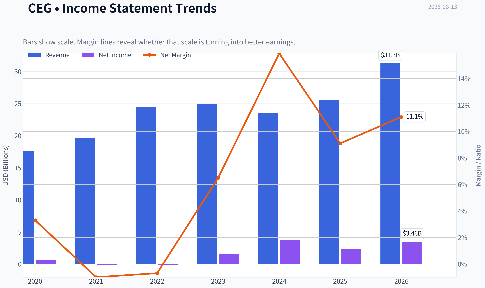

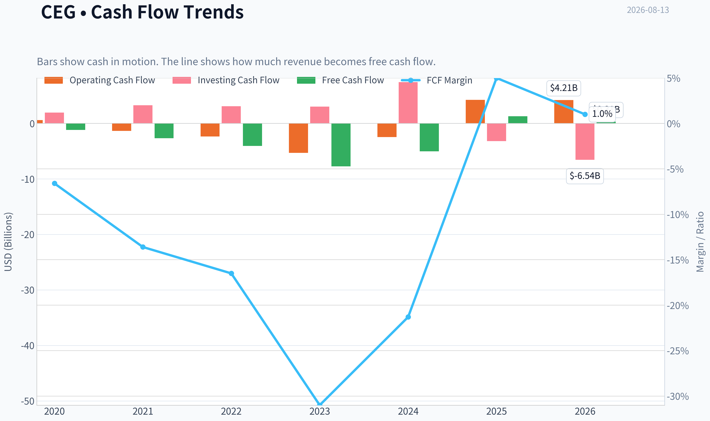

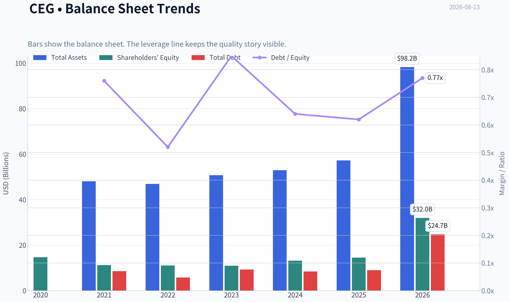

This graph tracks the profitability and return metrics (ROE, ROIC, Margins) of **CEG** over the past decade, highlighting capital efficiency trends.

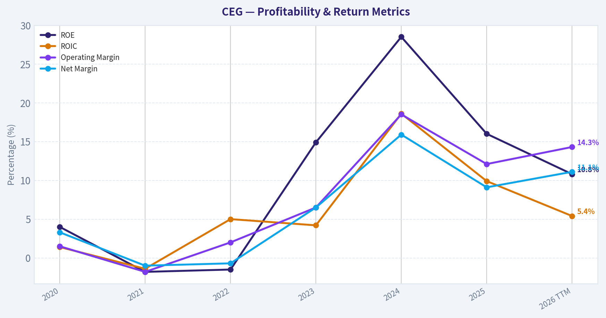

This chart illustrates the financial health of **CEG** over the last 10 years, mapping cash equivalents and free cash flow against total obligations (Debt).

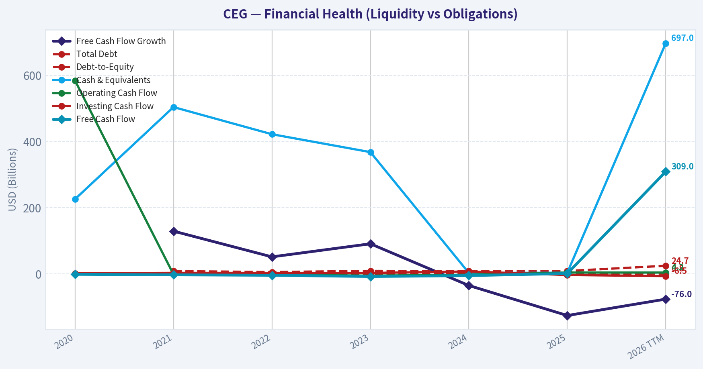

This breakdown chart from <em>Revenue Breakdown</em> shows the proportional composition for **CEG** - useful for understanding what drives or risks the business.

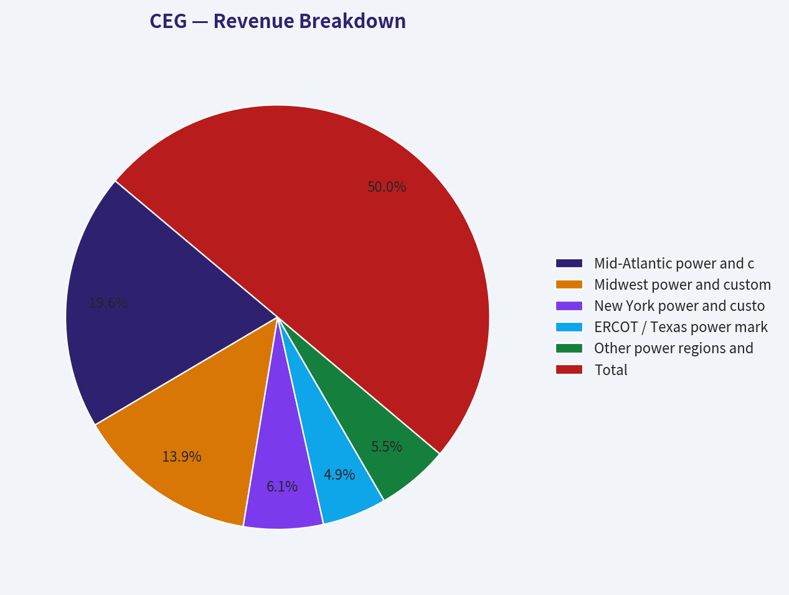

---

### Intrinsic Value Analysis (Buffett)

> *Following Warren Buffett's value investing philosophy: Circle of Competence, Economic Moat, Management Quality, and Margin of Safety.*

#### Intrinsic Value Snapshot

Price is what you pay. Intrinsic value is what the business may be worth based on the cash it can create for owners over time. We show a range, not one magic number.

- Current Price: $278.00
- Value Range (conservative to optimistic across both DCF methods): $-4.80 to $1,205.01

##### Owner Earnings (Buffett Method)
- Net Income: $2,319,000,000.00
- Depreciation & Amortization: $1,937,000,000.00
- Capital Expenditures: $-2,949,000,000.00
- Working Capital Changes: $-7,000,000.00
- Owner Earnings: $2,326,000,000.00

##### Intrinsic Value
###### Buffett Method
Uses owner earnings. Stricter, and usually more conservative.
- Conservative: $-4.80
- Average: $1.71
- Optimistic: $1,205.01
- Discount Rate: 10.0%

ANALYST STANCE: **AVOID**

#### CEG - Buffett-Style Value Investment Review

Constellation Energy is a high-quality strategic asset: the largest U.S. nuclear operator, a major producer of carbon-free baseload power, and a direct beneficiary of rising electricity demand from AI data centers and electrification. But at **$278 per share**, the stock price already assumes a very favorable future. The business is attractive; the valuation is not.

Current market facts: **price $278**, **market cap $98.5B**, **P/E 27.2x**, **ROE 16.0%**, **FCF yield 1.3%**, and research-pack headline intrinsic value of **$60.75 per share**, implying a deeply negative margin of safety.

---

#### 1. Factor Scorecard

| Factor | Score | Assessment |
|---|---:|---|
| Factor 1: Circle of Competence & Business Predictability | 3.5 / 5 | CEG makes money by producing and selling electricity, capacity, clean-energy attributes, and retail power products. The nuclear fleet is understandable and hard to replicate, but earnings remain exposed to power prices, regulation, hedging, nuclear operating performance, and long-cycle capital decisions. |
| Factor 2: Moat Test | 3.5 / 5 | The moat is real but not perfect: scarce nuclear licenses, massive replacement cost, operating expertise, clean-power scarcity, and long-term power contracts help. However, commodity power exposure and regulatory/political variables limit pricing certainty. |
| Factor 3: Management & Capital Allocation | 3.0 / 5 | Management has positioned the company well around carbon-free baseload power and AI-driven electricity demand. Capital allocation must be watched carefully because nuclear life extensions, restarts, acquisitions, and heavy capex can destroy value if pursued at poor returns. |
| Factor 4: Industry Structure | 3.5 / 5 | Nuclear baseload power has favorable scarcity value in a grid needing reliability and decarbonization. Still, the broader power industry is capital-intensive, politically sensitive, and exposed to cycles in wholesale electricity prices. |
| Gate 5: Quality / Solvency Hard Floor | Not tripped | CEG does not show the combination of deteriorating fundamentals and weak solvency required for a hard financial-distress avoid. The concern is valuation, not insolvency. |

**Key Takeaways:** CEG is not a weak business. It has valuable nuclear assets, growing strategic relevance, and improving demand from power-hungry industries. The main Buffett concern is that a good business can still be a poor investment if the price already capitalizes too much future success.

---

#### 2. Moat Analysis

| Moat Source | Evidence | Strength |
|---|---|---|
| Intangible / Regulatory Assets | Nuclear operating licenses, regulatory approvals, safety record, and specialized operational expertise are extremely difficult to replicate. | Strong |
| Switching Costs | Large customers signing long-term power purchase agreements value reliability, clean-power claims, and certainty of supply. Switching is possible but not frictionless for hyperscale buyers needing dependable baseload power. | Moderate to Strong |
| Cost Advantage | Existing nuclear plants can be valuable because replacement cost is enormous and new nuclear development is slow, expensive, and politically difficult. | Strong, but dependent on uptime and fuel/capex discipline |
| Network Effects | Limited. CEG does not have a classic platform network effect. Scale helps in operations, trading, procurement, and customer contracting, but the product does not become more valuable simply because more users join. | Weak to Moderate |
| Pricing Power | Improving due to clean baseload scarcity and AI/data-center demand, but wholesale power exposure means pricing power is not as clean as a consumer brand or software monopoly. | Moderate |

**Key Takeaways:** CEG's moat is based on scarcity, regulation, and replacement cost, not brand loyalty or network effects. The nuclear fleet is a hard-to-copy asset, and that matters. But this remains a power producer with meaningful exposure to commodity-like markets and political oversight.

---

#### 3. Management Quality Assessment

| Area | Assessment |
|---|---|
| Owner Orientation | Management has emphasized per-share value creation, clean-energy leadership, and disciplined contracting around nuclear output. |
| Candor & Operating Discipline | Nuclear operations require conservative risk management; CEG's value depends heavily on uptime, safety, and disciplined reinvestment. |
| Capital Allocation | The biggest issue. Heavy capital projects, nuclear restarts, fleet life extensions, and portfolio expansion can create value if contracted at attractive returns, but they can also consume large capital for modest free cash flow. |
| Shareholder Returns | Buybacks and capital returns are less compelling at today's valuation because repurchases at inflated prices would likely destroy value. |
| Overall View | Competent management operating valuable assets, but valuation makes even good execution insufficient for an attractive entry point. |

**Key Takeaways:** Management deserves credit for placing CEG in the center of the clean-power and AI-electricity demand story. The test from here is discipline. Buffett would want management to avoid chasing growth simply because the market is rewarding the theme.

---

#### 4. Financial Summary

| Metric | 2022 | 2023 | 2024 | Current / TTM Snapshot |
|---|---:|---:|---:|---:|
| Revenue | ~$24.4B | ~$24.9B | ~$23.6B | YoY growth: **8.3%** |
| Net Income | Negative / depressed | ~$1.6B | ~$3.7B | Implied by P/E and market cap: **~$3.6B** |
| ROE | Not meaningful / depressed | Improving | Mid-teens | **16.0%** |
| Free Cash Flow | Weak / negative | Positive | Low relative to earnings | **~$1.28B**, based on 1.3% FCF yield |
| FCF Yield | Low | Improving | Low | **1.3%** |
| Current Ratio | Adequate | Adequate | Adequate | **1.53x** |
| P/E | N/A / distorted | Elevated | Moderate-high | **27.2x** |
| Market Cap | N/A | N/A | N/A | **$98.5B** |

**Key Takeaways:** Earnings have improved sharply, but free cash flow remains modest relative to the company's market value. This is the central valuation problem: investors are paying almost $100 billion for a business currently producing only about $1.3 billion of free cash flow. The accounting earnings look much better than the cash yield.

---

#### 5. Owner Earnings Calculation

| Owner Earnings Component | Estimate |
|---|---:|
| Net Income | ~$3.6B |
| Add: Depreciation & Amortization | ~$1.5B |
| Less: Maintenance CapEx / Nuclear Reinvestment | ~($3.0B) |
| Less: Working Capital / Other Cash Absorption | ~($0.8B) |
| Estimated Owner Earnings / FCF Proxy | **~$1.3B** |
| Shares Outstanding Implied by Market Cap / Price | **~354M** |
| Owner Earnings Per Share | **~$3.60** |

**Key Takeaways:** CEG's owner earnings are far below reported net income because the business requires substantial reinvestment to maintain and operate its asset base. That does not make it a bad business, but it does mean a high P/E understates the valuation risk. On cash earnings, the stock is extremely expensive.

---

#### 6. Three-Scenario DCF Valuation

Assumptions: discount rate **10%**, normalized owner earnings per share **~$3.60**, conservative terminal assumptions, and historical-growth case using a moderated growth rate rather than the full market-implied expectation.

| Scenario | Assumption | Estimated Intrinsic Value / Share |
|---|---|---:|
| A: No Growth | Owner earnings capitalized at 10% | **~$36** |
| B: GDP Growth | 3% perpetual growth | **~$53** |
| C: Moderate Growth | 6% for 10 years, then 3% terminal growth | **~$66** |
| Research-Pack Headline Intrinsic Value | Business-model-routed valuation | **$60.75** |
| Current Price | Market price | **$278** |

**Key Takeaways:** Even a moderate-growth DCF produces a value far below the current stock price. The market is not pricing CEG like a normal utility or power producer; it is pricing it like a scarce AI-electricity infrastructure compounder. That may prove directionally right, but the valuation leaves little room for error.

---

#### 7. Margin of Safety Analysis

| Valuation Reference | Value / Share | Margin of Safety vs. $278 |
|---|---:|---:|
| No-Growth DCF | ~$36 | Deeply negative |
| GDP-Growth DCF | ~$53 | Deeply negative |
| Moderate-Growth DCF | ~$66 | Deeply negative |
| Headline Intrinsic Value | **$60.75** | **-357.6%** |
| Reverse DCF | Price implies ~19.7% annual growth for 10 years | Aggressive |

**Key Takeaways:** The margin of safety is absent. For CEG to justify the current price, owner earnings must compound at a very high rate for a long time, despite the company operating in a capital-intensive, regulated, and operationally complex industry. This is not the kind of valuation cushion Buffett typically demands.

---

#### 8. Final Buffett Scorecard

| Criterion | Weight | Score | Weighted Contribution |
|---|---:|---:|---:|
| Moat Width & Durability | 25% | 3.5 | 0.88 |
| Valuation / Margin of Safety | 20% | 0.5 | 0.10 |
| Capital Returns - ROIC vs. WACC | 15% | 2.5 | 0.38 |
| Business Understanding & Predictability | 12% | 3.5 | 0.42 |
| Management Quality & Capital Allocation | 12% | 3.0 | 0.36 |
| Reinvestment Runway | 8% | 3.5 | 0.28 |
| Balance Sheet Strength | 4% | 3.0 | 0.12 |
| Industry Structure | 4% | 3.5 | 0.14 |
| **Total Score** | **100%** |  | **2.68 / 5** |

**Key Takeaways:** CEG scores well on asset quality and strategic relevance, but the valuation score overwhelms the positives. A wonderful asset can become a poor stock when purchased at a price that requires exceptional execution and favorable industry conditions for many years. The weighted score lands in AVOID territory.

---

#### 9. Investment Stance

| Stance | Conviction | Rationale |
|---|---|---|
| **AVOID** | **High** | CEG is a strategically important business with scarce nuclear assets, but the stock price is far ahead of cash-flow-based intrinsic value. The implied growth expectations are too aggressive for a capital-intensive power company, even one benefiting from AI-related electricity demand. |

**Final View:** CEG belongs on a watchlist, not in a Buffett-style value portfolio at today's price. The business quality is real, but the margin of safety is not. A more attractive entry point would require either a major pullback in the stock or clear evidence that long-term contracted nuclear cash flows can support materially higher owner earnings than the market currently receives.
#### Valuation Bridge

This bridge places the current market price beside each intrinsic value lens so readers can see whether upside depends on one method or shows up across several methods.

| Scenario | Intrinsic Value / Share |
| --- | ---: |
| Buffett Method | $1.71 |
| Damodaran Method | $-60.48 |
| Current Price | $278.00 |

#### Key Takeaways

If one method is far above the others, the upside case depends on a specific modelling assumption. When several methods cluster together, the valuation story is more robust.

#### Valuation Visuals

This comparison chart from *Latest Earnings Snapshot* stacks current figures against historical benchmarks for **CEG**, making it easy to see where the company trades relative to its own averages.

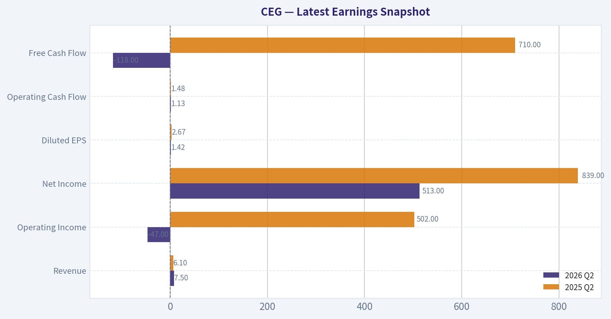

This comparison chart from *Current vs Historical Average Comparison* stacks current figures against historical benchmarks for **CEG**, making it easy to see where the company trades relative to its own averages.

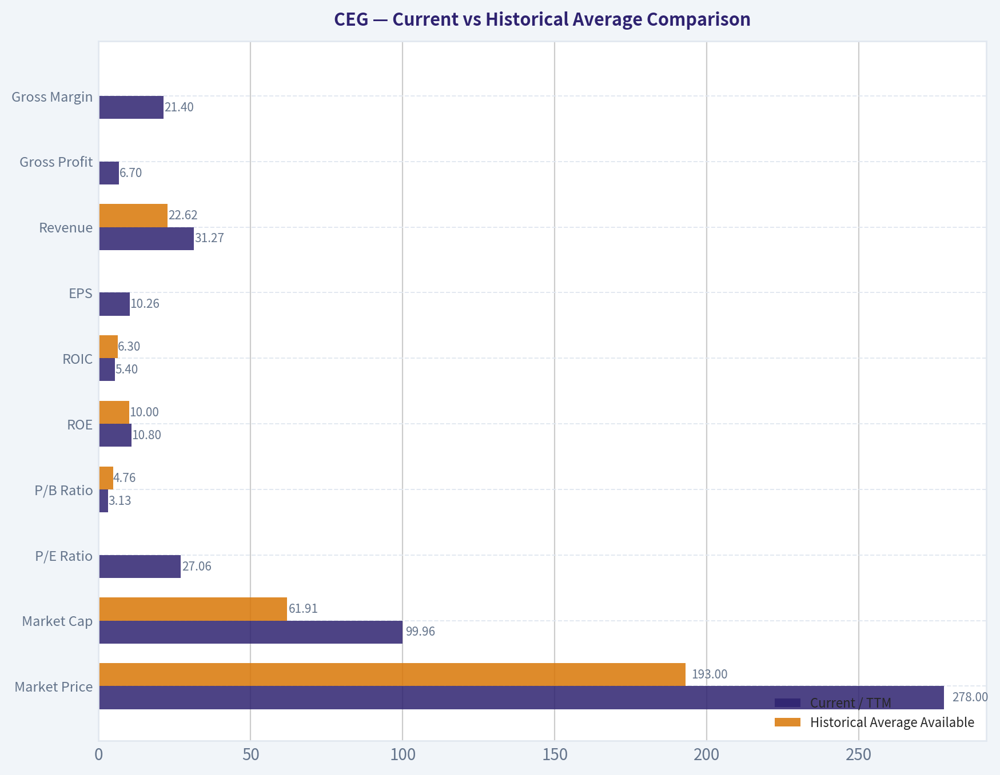

This comparison chart from *Balance Sheet and Financial Strength* stacks current figures against historical benchmarks for **CEG**, making it easy to see where the company trades relative to its own averages.

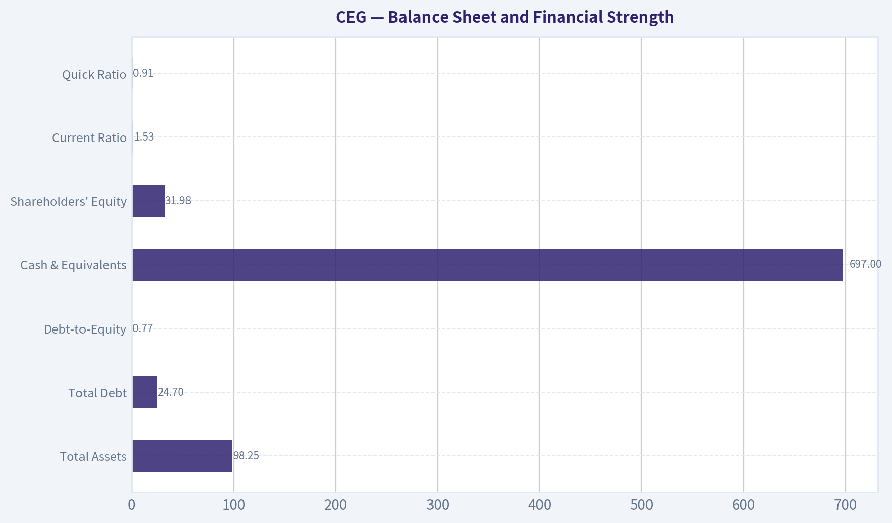

This comparison chart from *Cash Flow and Dividend Analysis* stacks current figures against historical benchmarks for **CEG**, making it easy to see where the company trades relative to its own averages.

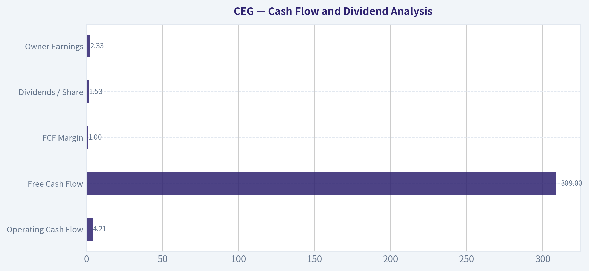

---

### Trend & Growth Analysis (Lynch/Druckenmiller/Fisher)

> *Following Peter Lynch's GARP, Stanley Druckenmiller's macro-aware approach, and Philip Fisher's scuttlebutt methodology.*

ANALYST STANCE: **WATCH**

#### CEG Growth Investment Report - Constellation Energy

Constellation Energy is one of the most strategically positioned public equities for the AI power demand theme because it owns the largest nuclear fleet in the U.S. The story is powerful: hyperscale data centers need reliable, carbon-free, 24/7 electricity, and nuclear power is one of the few solutions that can meet that need at scale. However, the stock already reflects a major amount of that optimism, with valuation implying very high long-term growth for a business whose reported revenue growth is currently closer to stalwart territory than fast-grower territory.

| Item | Current Snapshot |
|---|---:|
| Price | ~$278 |
| Market Cap | ~$98.5B |
| P/E | ~27.2x |
| Revenue Growth YoY | ~8.3% |
| ROE | ~16.0% |
| FCF Yield | ~1.3% |
| Current Ratio | ~1.53x |
| Reverse-DCF Implied Growth | ~19.7% annually for 10 years |
| Headline Intrinsic Value Estimate | ~$60.75 |
| Guru Signal | Steve Cohen / Point72 added materially in latest 13F |

**Key Takeaways:** CEG is no longer a cheap utility or underfollowed nuclear asset. The market is pricing it as a major AI-infrastructure beneficiary, despite current revenue growth being below classic fast-grower thresholds. The stock may still work if nuclear power pricing, data-center PPAs, and earnings compound faster than expected, but the margin of safety is thin.

---

#### 1. Lynch Classification

| Lynch Category | Assessment |
|---|---|
| Primary Classification | **Stalwart / Cyclical Utility with Growth Optionality** |
| Growth Investor Fit | **Watch, not core fast-grower yet** |
| Fast-Grower Threshold | Not met on current reported revenue growth |
| Why It Still Matters | AI-driven power demand could create an earnings inflection even without 20%+ revenue growth |
| Lynch View | Great story, but valuation requires discipline |

**Key Takeaways:** CEG is not a classic Peter Lynch fast grower today because revenue growth is around 8%, not 15% to 25% or higher. But it has a rare scarcity asset: existing nuclear capacity at a time when AI data centers need clean, reliable baseload power. That creates a possible earnings inflection, even if the top-line growth profile remains utility-like.

#### 2. The Story in 3 Bullets

- **CEG sells electricity from the largest nuclear fleet in the U.S., and nuclear power is becoming more valuable as AI data centers demand always-on clean electricity.**
- **The company can sign long-term power purchase agreements at potentially higher prices because hyperscalers need reliability, scale, and carbon-free energy.**
- **The upside case is not ordinary utility growth; it is a repricing of nuclear power as mission-critical AI infrastructure.**

#### 3. TAM Analysis and 10x Test

| TAM Factor | Assessment |
|---|---|
| Current Revenue Base | Roughly mid-$20B annual revenue range, based on recent historical scale |
| 10x Revenue Test | Would require roughly $200B+ annual revenue scale |
| Addressable Market | U.S. power generation, clean firm power, data-center electricity demand, corporate PPAs |
| Can CEG 10x Revenue and Stay Under 20% Share? | **Theoretically possible in total electricity market, but practically difficult from current asset base** |
| Realistic Growth Driver | Earnings growth from higher realized prices and contracted nuclear output, not 10x physical volume |
| TAM Quality | Strong and expanding due to AI, electrification, reshoring, and decarbonization |

**Key Takeaways:** CEG has a large and expanding market, but the 10x revenue test is only partially passed. The bottleneck is not demand; it is supply. Nuclear capacity is scarce, hard to build, and slow to expand, so CEG's most realistic upside comes from better pricing and contract economics rather than a simple 10x increase in power sold.

#### 4. Revenue Growth Trend

| Period / Signal | Growth Interpretation |
|---|---|
| Reported YoY Revenue Growth | ~8.3% |
| Growth Pattern | Moderate, not high-growth |
| Earnings Momentum | Q2 2026 coverage cited adjusted operating earnings jump to ~$2.55 per share |
| Quality of Growth | Likely increasingly driven by power pricing, PPAs, and nuclear scarcity value |
| Growth Trend Classification | **Stable/moderate with possible earnings inflection** |

**Key Takeaways:** CEG's revenue growth is not yet accelerating like a classic growth-stock inflection. The better signal is earnings power, especially if new nuclear PPAs are signed at attractive long-term prices. Investors should monitor whether the AI demand story translates into sustained EPS and free cash flow growth rather than only narrative momentum.

#### 5. Unit Economics

Traditional SaaS metrics like LTV/CAC and NRR do not apply cleanly to CEG. For a nuclear power producer, the better unit-economics lens is contracted pricing, capacity factor, fuel cost stability, maintenance cost, and operating leverage.

| Metric | Applicability | Assessment |
|---|---|---|
| LTV/CAC | Not applicable | CEG is not a customer-acquisition model |
| NRR | Not applicable | No SaaS-style recurring revenue retention metric |
| Rule of 40 | Not applicable | Utility/power generation economics differ materially |
| Contract Duration | Highly relevant | Long-term PPAs can improve revenue visibility |
| Nuclear Capacity Factor | Highly relevant | High uptime is critical to profitability |
| FCF Yield | Relevant | Low at ~1.3%, implying valuation is demanding |
| Balance Sheet Liquidity | Relevant | Current ratio ~1.53x is acceptable |

**Key Takeaways:** CEG does not have software-style unit economics, but it does have infrastructure-style economics. The key question is whether the company can lock in long-term power contracts at attractive prices while maintaining high nuclear fleet availability. The current low free cash flow yield means investors are paying up for future earnings growth.

---

#### 6. Inflection Point Assessment

| Inflection Type | Evidence | Rating |
|---|---|---|
| Product Cycle Inflection | Nuclear power being reclassified by market as AI infrastructure | Strong |
| Market Share Inflection | Less relevant; nuclear supply is capacity-constrained | Moderate |
| Margin Inflection | Possible if PPAs reset at higher prices | Strong potential |
| TAM Inflection | AI data centers materially increase need for 24/7 clean power | Strong |
| Competitive Inflection | Nuclear scarcity favors incumbents like CEG | Strong |
| Earnings Inflection | Q2 2026 commentary suggests adjusted operating earnings strength | Positive |

**Key Takeaways:** The strongest part of the CEG thesis is the inflection setup. Demand for firm, clean power is rising quickly, and CEG owns scarce assets that cannot be easily replicated. The key uncertainty is whether this inflection is already fully priced into the stock.

#### 7. Macro Setup

| Macro Factor | Impact on CEG |
|---|---|
| AI Infrastructure Buildout | Major tailwind |
| Electrification | Tailwind |
| Decarbonization / Clean Energy Mandates | Tailwind |
| Interest Rates | Mixed; lower rates help valuation, higher rates pressure capital-intensive assets |
| Power Price Volatility | Opportunity and risk |
| Regulatory Environment | Material risk, especially nuclear and market pricing rules |
| Economic Cycle Sensitivity | Lower than many growth stocks, but power demand and capital markets still matter |

**Key Takeaways:** CEG has one of the clearest macro tailwinds in the market: AI-driven electricity demand. Unlike many AI beneficiaries, CEG owns physical infrastructure that is scarce and difficult to replicate. However, because it is capital-intensive and regulated, rates and politics matter more than they do for software companies.

#### 8. Fisher 15 Points Score

| Fisher Point | Score / 5 | Notes |
|---|---:|---|
| Products with large sales potential | 4 | Nuclear power demand is rising |
| Management commitment to new opportunities | 4 | AI/data-center PPAs are strategic |
| Effective R&D / innovation | 3 | More asset optimization than R&D-led innovation |
| Sales organization | 4 | Ability to negotiate large corporate PPAs matters |
| Worthwhile profit margin | 3 | Solid but not software-like |
| Improving profit margins | 4 | Higher-priced PPAs could help |
| Labor/personnel relations | 3 | Nuclear workforce execution is critical |
| Executive relations | 3 | No major issue flagged |
| Management depth | 4 | Operating nuclear fleet requires deep expertise |
| Cost analysis/accounting | 3 | Complex commodity and utility accounting |
| Durable competitive advantages | 5 | Nuclear fleet is a major scarcity moat |
| Long-range profit outlook | 4 | Strong if power pricing remains favorable |
| Dilution risk | 4 | Not currently a major red flag |
| Candor in difficulties | 3 | Needs ongoing monitoring |
| Management integrity | 3 | No major red flag from provided data |
| **Total** | **54 / 75** | **Average to Good** |

**Key Takeaways:** CEG scores well on market potential and competitive advantage because its nuclear fleet is difficult to duplicate. The score is held back by the fact that this is not a high-margin, innovation-led software company, and regulatory complexity remains significant. Overall, Fisher would likely find the asset quality interesting but would demand valuation discipline.

#### 9. Valuation Analysis

| Valuation Metric | Current Reading | Interpretation |
|---|---:|---|
| P/E | ~27.2x | High for a utility/power producer, but not extreme if EPS accelerates |
| PEG | ~3.3x using 8.3% revenue growth as proxy | Expensive on current growth |
| FCF Yield | ~1.3% | Very demanding |
| Reverse-DCF Growth Implied | ~19.7% annually for 10 years | Aggressive |
| Headline Intrinsic Value Estimate | ~$60.75 | Far below current price |
| Margin of Safety | Negative | Valuation risk is high |

**Key Takeaways:** Valuation is the main problem. CEG may deserve a premium because nuclear power is scarce and AI demand is real, but the current stock price already assumes a lot of future success. If earnings growth does not accelerate meaningfully, the multiple could compress.

#### 10. Scenario Analysis

| Scenario | Assumptions | Investment Outcome |
|---|---|---|
| Bear Case | AI PPA excitement fades, power prices normalize, regulatory pressure rises | Significant downside from multiple compression |
| Base Case | CEG signs attractive PPAs, EPS grows faster than revenue, but valuation remains full | Stock compounds modestly, but risk/reward is balanced |
| Bull Case | Nuclear power becomes a premium AI-infrastructure asset, long-term contracts reset much higher, EPS compounds at high-teens rate | Stock can continue outperforming despite high starting valuation |
| Ten-Bagger Case | Requires massive nuclear capacity expansion, transformative pricing, or major platform evolution | Low probability from current market cap |

**Key Takeaways:** The bull case is credible, but the ten-bagger case is difficult from a nearly $100 billion market cap. CEG can be a strong compounder if nuclear pricing power continues to rise, but investors are not buying early. The stock now requires execution, sustained AI power demand, and favorable regulation.

#### 11. Growth Investor Scorecard

| Criterion | Weight | Score / 5 | Weighted Score |
|---|---:|---:|---:|
| The Story | 10% | 4.5 | 0.45 |
| TAM & Runway | 20% | 3.8 | 0.76 |
| Revenue Growth | 20% | 2.5 | 0.50 |
| Unit Economics | 15% | 3.2 | 0.48 |
| Competitive Position | 10% | 4.5 | 0.45 |
| Management Quality | 10% | 3.6 | 0.36 |
| Macro Setup | 5% | 4.5 | 0.23 |
| Profitability Path | 5% | 3.8 | 0.19 |
| Valuation | 5% | 1.8 | 0.09 |
| **Total** | **100%** |  | **3.51 / 5.00** |

**Key Takeaways:** CEG clears the threshold for a constructive watchlist view because the story, macro setup, and competitive position are excellent. The two major offsets are current revenue growth and valuation. This is a good business with a powerful theme, but not an obvious bargain.

#### 12. Position Size Stance

| Investor Type | Stance |
|---|---|
| Existing Shareholder | Hold / let winners run, but consider trimming if position is oversized |
| New Investor | Watch; avoid chasing aggressively at current valuation |
| Growth Portfolio | Small position only, unless there is a pullback or new contract evidence materially raises EPS estimates |
| Suggested Sizing | 1%-3% starter/watch position; higher only for investors with strong conviction in nuclear-AI power pricing |
| Add More If | New long-term PPAs validate materially higher earnings power |
| Reduce If | Revenue/EPS momentum fades or regulatory pressure caps upside pricing |

**Key Takeaways:** CEG is more attractive as a hold than as a fresh aggressive buy. The stock has a real strategic advantage, but the current valuation reduces the margin for error. A disciplined investor should wait for either a pullback or stronger evidence that earnings power is structurally resetting higher.

#### 13. Key Catalysts and Risks

| Catalysts | Risks |
|---|---|
| New hyperscaler/data-center PPAs | Valuation already discounts major success |
| Higher nuclear realized power prices | Regulatory intervention in power markets |
| Falling interest rates | Nuclear outage or operational issues |
| AI electricity demand exceeding grid expectations | Commodity power price weakness |
| Potential nuclear life extensions or restarts | Political opposition to nuclear or market pricing |
| Increased investor recognition of nuclear scarcity | FCF yield remains too low versus expectations |

**Key Takeaways:** The upside catalysts are real and powerful, especially if AI data-center demand keeps surprising to the upside. But the risks are also unusually important because the stock is priced for a favorable future. Any disappointment in contracts, regulation, or fleet operations could hurt the multiple.

---

#### Final View

CEG is one of the best public-market ways to express the theme that **AI needs massive amounts of clean, reliable electricity**. The company has scarce assets, strong macro tailwinds, and a plausible earnings inflection through nuclear PPAs.

But under Lynch, it is not yet a true fast grower; under Druckenmiller, the inflection is compelling but increasingly consensus; and under Fisher, the competitive advantage is strong but valuation limits the attractiveness.

**Final stance: WATCH.** Existing holders can continue to own it, but new capital should wait for either a better entry point or clearer evidence that AI-driven nuclear contracts can support high-teens earnings growth for many years.

---

### Market Technical Analysis

ANALYST STANCE: **WATCH**

#### CEG Technical Analysis Report - Latest Available Trading Data: 2026-08-12

CEG's latest available close is **$278.68** on **2026-08-12**; **2026-08-13 is not shown as a trading day in the data feed**. The stock has staged a meaningful rebound from its early-July capitulation low, but the larger trend remains technically damaged because price is still below the declining 200-day moving average. In practical trading terms, CEG is showing **short-term bullish recovery behavior inside a broader corrective structure**, which supports a **WATCH** stance rather than a clean bullish or bearish call.

The most relevant indicators selected for this setup are: **close_10_ema, close_50_sma, close_200_sma, macd, rsi, boll_ub, atr, and vwma**. These provide a balanced view across short-term trend, medium-term trend, long-term trend, momentum, overbought/oversold pressure, breakout proximity, volatility, and volume-weighted confirmation.

| Indicator | Latest Reading / Reference | Interpretation |
|---|---:|---|
| Close | $278.68 | Recent rebound has carried price back near the upper end of its July-August recovery range. |
| close_10_ema | $270.42 | Price is above the fast EMA, confirming short-term upside momentum. |
| close_50_sma | $260.67 | Price is also above the 50-day SMA, suggesting the recovery has become more than just a one-day bounce. |
| close_200_sma | $303.15 | Price remains below the long-term average, so the broader trend is still not fully repaired. |
| macd | 3.56 | Momentum has turned positive and improved sharply from deeply negative July readings. |
| rsi | 60.40 | Bullish-neutral momentum; not yet overbought, but no longer in bargain/oversold territory. |
| boll_ub | $283.14 | Price is approaching the upper Bollinger Band, where breakout confirmation or short-term rejection becomes important. |
| atr | $10.18 | Daily volatility remains elevated at about 3.7% of price, requiring wider stops and careful sizing. |
| vwma | $269.02 | Price above VWMA indicates the recent advance is supported by volume-weighted price action. |

Key Takeaways: CEG's short-term technical position has improved meaningfully, with price above the 10-day EMA, 50-day SMA, and VWMA. However, the stock remains below its 200-day SMA, which keeps the long-term trend in a repair phase rather than a confirmed bull trend. Momentum is constructive but not overheated, while proximity to the upper Bollinger Band makes the next few sessions important for confirmation.

#### Trend Structure: Short-Term Recovery, Long-Term Repair Still Incomplete

CEG's short-term trend has turned constructive. The **10-day EMA has climbed to $270.42**, and price at **$278.68** is roughly **3.1% above** that level. This tells us buyers have regained control over the very near-term tape. The slope of the 10-day EMA has also improved steadily since early July, when the stock was still digesting the selloff.

The **50-day SMA at $260.67** is particularly important. Price is now around **6.9% above the 50-day SMA**, which indicates the recovery is broadening beyond a reflex bounce. The 50-day average itself had been declining from late June into early August, but it has recently started to flatten. That flattening is often an early sign that selling pressure is losing persistence.

The main caution is the **200-day SMA at $303.15**. CEG remains about **8.1% below** this long-term benchmark. Until price can reclaim and hold the 200-day average, longer-horizon trend followers may continue treating rallies as countertrend recoveries rather than a confirmed renewed uptrend.

#### Momentum: Improving, but Not Yet Euphoric

The **MACD has improved from negative territory in July to +3.56**, showing a clear momentum reversal. The move above zero occurred around late July, which often marks a shift from bearish momentum to constructive momentum. This is one of the stronger technical positives in the current setup.

The **RSI at 60.40** reinforces that view. RSI was near deeply weak levels around early July, including the low 30s, and has now moved into the bullish-neutral zone. Importantly, RSI is **not above 70**, so the stock is not technically overbought by standard RSI thresholds. That leaves room for additional upside if buyers continue to press, though the easy oversold-rebound phase has already passed.

#### Volatility and Price Bands: Near-Term Breakout Test Approaching

The **upper Bollinger Band is $283.14**, while the latest close is **$278.68**. That places CEG close to a potential resistance or breakout zone. A decisive close above the upper band, especially with strong volume, would suggest renewed upside expansion. However, failure near this area could produce a short-term pullback toward the 10-day EMA near $270 or the VWMA near $269.

The **ATR is $10.18**, which is sizable relative to the share price. A one-ATR move from the latest close implies a typical daily volatility range of roughly **$268.50 to $288.90**. Traders should avoid overly tight stops, because normal volatility alone could trigger premature exits. For short-term strategies, this favors smaller position sizing and confirmation-based entries.

#### Volume-Weighted Confirmation: Buyers Have Some Support

The **VWMA at $269.02** is below the current price, which is a constructive sign. Since VWMA incorporates volume, price trading above it suggests the recent move is not merely thin or unsupported. That said, the strongest volume spikes in the past year occurred during sharp selloff sessions, so volume confirmation should be watched carefully on any attempted breakout above the $283-$285 area.

If CEG can break above the Bollinger upper band while holding above VWMA, the move would look more credible. If price slips back below VWMA, the recovery would look more fragile and could invite a retest of the 50-day SMA.

#### Trading Implications

For bullish traders, the cleaner setup would be a **confirmed breakout above $283-$285**, ideally followed by a successful retest that holds above the 10-day EMA or VWMA. That would suggest the short-term rebound is transitioning into a more durable upside phase.

For cautious or swing traders, a pullback toward **$270-$269** could offer a better risk-reward area if buyers defend that zone. A failure below the **50-day SMA near $260.67** would be a warning that the recovery is weakening. A reclaim of the **200-day SMA near $303.15** would be the larger technical milestone needed to change the longer-term bias more decisively bullish.

| Key Area | Level / Signal | Why It Matters | Trading Read |
|---|---:|---|---|
| Immediate resistance | $283-$285 | Near the upper Bollinger Band and recent upside test zone. | Breakout above this area would improve bullish conviction. |
| Short-term support | $270-$269 | 10-day EMA and VWMA cluster. | Holding this area supports the recovery trend. |
| Medium-term support | $260-$261 | 50-day SMA region. | A breakdown below this zone would weaken the rebound structure. |
| Long-term trend pivot | $303 | 200-day SMA. | Reclaiming this would signal deeper trend repair. |
| Momentum condition | MACD positive, RSI near 60 | Momentum has improved but is not overbought. | Constructive, but confirmation still needed. |
| Risk condition | ATR near $10.18 | Volatility remains high. | Use wider stops and smaller sizing. |
| Overall stance | WATCH | Short-term bullish recovery, long-term trend still below 200-day SMA. | Favor confirmation over anticipation. |

Key Takeaways: The most important levels are resistance near $283-$285, support near $269-$270, and the long-term repair level near $303. CEG has enough momentum to justify close monitoring, but the stock has not yet reclaimed its 200-day average. The technical setup favors waiting for either a confirmed breakout or a controlled pullback into support before taking aggressive action.

#### Market Visuals

This comparison chart from *Market Metrics Interpretation* stacks current figures against historical benchmarks for **CEG**, making it easy to see where the company trades relative to its own averages.

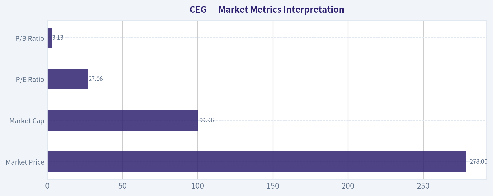

---

### Options Market Analysis

> *Reading options flow - put/call ratios, IV skew, and unusual activity - to gauge institutional positioning and event-driven risk.*

ANALYST STANCE: **WATCH**

#### CEG Options Market Sentiment Report
*Options data as of 2026-08-13. Near-term expirations analyzed: 2026-08-14, 2026-08-21, 2026-08-28.*

Options flow in CEG leans **BEARISH**, mainly because near-term **put volume is materially heavier than call volume**. However, the signal is not extreme because open interest is still relatively balanced, there is no clear unusual activity with volume greater than 5 times open interest, and detailed strike-level gamma data was not available from the retrieved dataset.

---

#### 1. Put/Call Ratio Analysis

| Expiration | Days to Expiry | Call OI | Put OI | Put/Call OI Ratio | Call Volume | Put Volume | Put/Call Volume Ratio | Read |
|---|---:|---:|---:|---:|---:|---:|---:|---|
| 2026-08-14 | 1 | 5,331 | 2,193 | 0.41 | 491 | 610 | 1.24 | Call-heavy OI, but put volume heavier today |
| 2026-08-21 | 8 | 20,928 | 18,326 | 0.88 | 604 | 1,199 | 1.99 | Mildly bearish / hedging-heavy |
| 2026-08-28 | 15 | 1,024 | 1,267 | 1.24 | 168 | 338 | 2.01 | Put-heavy positioning |
| **Total Near-Term** | - | **27,283** | **21,786** | **0.80** | **1,263** | **2,147** | **1.70** | **Bearish tilt** |

**Key Takeaways:** CEG's near-term put/call open interest ratio is **0.80**, above the historical neutral baseline of roughly **0.70**, showing a modest shift toward downside protection. The stronger signal is in volume: the put/call volume ratio is **1.70**, meaning puts are trading at a much faster pace than calls today. This suggests traders are either hedging downside risk or initiating bearish bets into the next one to two weeks.

The 2026-08-21 expiration is the most important near-term expiry by open interest, with nearly **39,254 total contracts** across calls and puts. That expiry has a put/call OI ratio of **0.88** and a put/call volume ratio near **2.0**, making it the clearest source of bearish/hedging pressure.

---

#### 2. Implied Volatility Assessment

| Expiration | Call ATM IV | Put ATM IV | ATM IV Difference | IV Read |
|---|---:|---:|---:|---|
| 2026-08-14 | 52.1% | 48.9% | Calls +3.2 pts | Elevated very short-term IV; slight call-side premium |
| 2026-08-21 | 43.7% | 43.8% | Puts +0.1 pts | Balanced ATM IV |
| 2026-08-28 | 49.2% | 33.6% | Calls +15.6 pts | Notable call-side IV premium, possibly upside demand or thin-market distortion |

**Key Takeaways:** Near-term ATM implied volatility is moderately elevated, especially in the 1-day expiry where call IV is above **52%**. The 2026-08-21 expiry shows very balanced ATM IV between calls and puts, which does not confirm a panic-style downside skew. The 2026-08-28 expiry shows a large call IV premium, but because volume and open interest are much thinner there, this may reflect either selective upside demand or less reliable pricing.

A full OTM put-versus-OTM call skew table was not available in the retrieved data, so skew assessment is based on ATM IV only. Based on that limited view, there is **no clear steep downside put skew**. If anything, the 2026-08-28 expiration shows a possible call-skew anomaly, but that should be treated cautiously due to lower liquidity.

No specific catalyst was identified from the options dataset itself. If CEG has an upcoming earnings date, regulatory event, nuclear/power-market announcement, or macro-sensitive energy catalyst, that may explain the elevated short-term IV.

---

#### 3. Unusual Options Activity

| Unusual Activity Filter | Result |
|---|---|
| Screen Used | Volume greater than 5x open interest |
| Near-Term Expirations Checked | 2026-08-14, 2026-08-21, 2026-08-28 |
| Contracts Flagged | None |
| Interpretation | No clear evidence of fresh aggressive single-contract positioning |

**Key Takeaways:** There were **no contracts** where volume exceeded open interest by more than 5 times. That reduces the likelihood that today's move is being driven by a single large fresh institutional options bet. The bearish read instead comes from broader put-heavy volume across expirations rather than one standout sweep or block trade.

Because unusual activity is absent, confidence in a strong directional options signal is lower. This looks more like portfolio hedging or steady downside positioning than a high-conviction "smart money" event trade.

---

#### 4. Open Interest Concentration and Pinning Risk

| Expiration | Total Call OI | Total Put OI | Total OI | Concentration Read |
|---|---:|---:|---:|---|
| 2026-08-14 | 5,331 | 2,193 | 7,524 | Moderate front-week interest |
| 2026-08-21 | 20,928 | 18,326 | 39,254 | Dominant near-term expiration |
| 2026-08-28 | 1,024 | 1,267 | 2,291 | Thin relative to 8/21 |

**Key Takeaways:** The largest open interest concentration is clearly in the **2026-08-21** expiration. That expiry is the most likely to influence near-term pinning or dealer hedging behavior. However, strike-level open interest was not provided, so specific gamma walls, max-pain levels, or pinning strikes cannot be identified from this dataset.

The 2026-08-14 expiration has meaningful but smaller open interest, while 2026-08-28 is relatively thin. Without strike-level data, the best conclusion is that the **8/21 expiry is the key options battleground**, but the exact price magnets are unavailable.

---

#### 5. Overall Options Sentiment Signal

| Signal Component | Assessment | Directional Impact |
|---|---|---|
| Put/Call OI Ratio | 0.80 vs. neutral baseline around 0.70 | Mildly bearish |
| Put/Call Volume Ratio | 1.70 | Bearish / hedging-heavy |
| ATM IV | Moderate to elevated near-term | Event-risk or short-term uncertainty |
| IV Skew | No clear downside ATM skew; possible call-side premium in 8/28 | Mixed but not enough to offset put volume |
| Unusual Activity | None detected | Lowers conviction |
| OI Concentration | Heaviest in 8/21 expiry | Watch for expiry-week pinning |

**Key Takeaways:** The overall options sentiment signal for CEG is **BEARISH**, but with **moderate-to-low conviction**. The primary driver is the heavy near-term put volume, especially in the 2026-08-21 and 2026-08-28 expirations. The lack of unusual activity and absence of strike-level gamma data prevent this from being a high-conviction bearish call.

#### Final Read: **BEARISH**

CEG options traders are showing a defensive or bearish tilt, with put volume running well above call volume across the near-term chain. Open interest is not extremely put-heavy, so this does not look like panic positioning, but the flow suggests traders are preparing for downside risk over the next one to two weeks.

This should be treated as a **positioning signal**, not a valuation signal. Options flow can complement technical and fundamental analysis, but it should not override them on its own.

---

#### Summary Table

| Category | Current Reading | Interpretation |
|---|---|---|
| Put/Call Ratio | OI ratio **0.80**, volume ratio **1.70** | Bearish/hedging tilt versus neutral baseline near 0.70 |
| IV Level | ATM IV roughly **43.7%-52.1%** near term, depending on expiry | Moderate to elevated short-term uncertainty |
| Skew Direction | No clear ATM put skew; possible 8/28 call IV premium | Skew is not confirming strong downside fear |
| Unusual Activity | No contracts with volume greater than 5x OI | No obvious fresh institutional sweep/block signal |
| Overall Signal | **BEARISH** | Put-heavy volume is the dominant driver, but conviction is reduced by lack of unusual activity |

---

## Research Team Commentary

> *The Research Manager synthesizes the Bull vs Bear debate into action-free commentary. This is a pre-risk view, not the final stance.*

Team, looking at Constellation Energy, we have a fascinating tug-of-war between a world-class narrative and demanding owner economics. Let's break down what the bull and the bear are really arguing.

The bull case correctly identifies CEG's virtually impenetrable moat. They operate the largest nuclear fleet in the US, and you simply cannot replicate that asset base today due to massive regulatory and capital barriers. With tech hyperscalers desperate for 24/7 carbon-free baseload power to run their AI data centers, CEG is transforming from a traditional commodity power producer into a critical, infrastructure-style technology partner. The bull rightly points out that the production tax credits provide a downside floor, de-risking the transition.

The bear case, however, anchors us back to reality. At a multiple of over 27 times earnings and generating a 10.3 percent return on invested capital, the market is pricing in flawless execution of these premium tech power purchase agreements. The bear accurately points out that utilities face regulatory ceilings; if CEG starts earning software-like margins on basic electricity, public service commissions and federal regulators will eventually intervene. Furthermore, the bear notes that buying back stock at all-time highs and 27 times earnings isn't exactly a slam-dunk capital allocation move if the intrinsic value is stretched.

Reflecting on my past analysis with AEP, I learned a hard lesson about clinging too tightly to classic value purity when a massive, secular catalyst is in play. With AEP, I missed a strong 30-day rally because I demanded a deep margin of safety and ignored that the stock was still in a long-term uptrend while benefiting from the exact same data-center load growth narrative. I am not going to make that mistake here by outright dismissing CEG's AI-infrastructure story. The rerating of nuclear power is real, and we do not want to be stubbornly bearish just because the business requires capital expenditure.

That said, we have to respect the stark differences between the AEP setup and the CEG setup. AEP was trading at roughly 18 times earnings and its 200-day moving average was rising, meaning the primary trend was fully intact. CEG is trading at 27 times earnings, and our market intelligence shows it is currently trading below a declining 200-day moving average. The primary uptrend here is structurally damaged right now, even if the stock is staging a short-term bounce off a capitulation low.

Therefore, my stance on Constellation Energy is a constructive WATCH.

Core Takeaway
Constellation Energy is a genuinely wonderful, wide-moat asset perfectly positioned for the AI energy transition, but it is currently priced for perfection in a chart that shows fading long-term momentum. We want to own this irreproducible business, but we need either multiple compression or technical confirmation that the long-term trend has repaired before committing capital.

Rationale
From a modern Buffett framework, we are completely willing to pay up for a wonderful business with a durable moat. CEG's nuclear fleet is the ultimate supply-side advantage right now. However, the quality-scaled margin of safety requires that the implied growth in the current price be plausible. At a 27 P/E for a capital-intensive power producer, the reverse-DCF requires heroic assumptions about their ability to sign wildly profitable, unregulated tech contracts without triggering a regulatory backlash. Because the stock is stuck below a declining 200-day moving average, the market is already showing hesitation about that heroic growth. My AEP mistake taught me not to fight the data-center narrative, which is why I am refusing to label this an outright AVOID. But smart value investing means we don't catch falling knives in crowded, highly-valued trades when the margin of safety is nonexistent.

Monitoring Plan
Over the next one to four quarters, we need to watch three specific things. First, technical repair. I want to see the stock reclaim and hold its 200-day moving average, signaling that institutional sponsorship has durably returned. Second, evidence of pricing power in their power purchase agreements. We need to see actual contract details with hyperscalers that prove CEG can command significant, long-term premiums over wholesale power without regulatory interference. Finally, we need to monitor their capital allocation. If management continues heavy share repurchases at 27 times earnings rather than investing heavily in capacity uprates or life extensions for their existing fleet, I would view that as a negative for long-term shareholder value creation.

Let's keep this firmly on the high-priority watchlist and wait for the market to give us a slightly fatter pitch.

Stance: WATCH

---

## Value Investing Team Commentary

> *The Investor translates the research view into an investment thesis before risk review. This is still not the final stance.*

Constellation Energy (CEG) represents a fascinating intersection of old-world industrial reliability and the cutting edge of the artificial intelligence revolution. As a value investor, I view CEG not as a "utility stock," but as an **energy-as-a-service platform** with an irreproducible asset base.

### 1. The Business Quality and Economic Moat
In the Buffett framework, we look for "unbridgeable moats." CEG's nuclear fleet is exactly that. You cannot "disrupt" a nuclear plant with a startup. The regulatory, capital, and political barriers to building new nuclear capacity in the U.S. mean that CEG's existing 22,000+ megawatts of carbon-free, baseload power are among the most valuable industrial assets on the planet.

While the "Growth Analyst" sees this as a repricing of infrastructure, I see it through the lens of **scarcity value**. In a world where tech hyperscalers (Microsoft, Google, Amazon) have committed to carbon neutrality but possess an insatiable, 24/7 hunger for power, CEG owns the only "store" that is always open and sells the exact "product" they need. This is a toll-bridge business model with the power to adjust the toll.

### 2. Selective Contrarian Thinking: The "Regulatory Ceiling" Fallacy
The "Bear Case" cited by the team highlights the risk of regulatory intervention if margins become too high. However, a contrarian view suggests this risk is overstated for CEG specifically. Unlike regulated utilities (like AEP), which are capped on their Return on Equity (ROE) by state commissions, CEG operates primarily as an independent power producer.

When CEG signs a Power Purchase Agreement (PPA) with a data center, it is a private contract between two sophisticated entities. Federal regulators are more concerned with grid stability than the profit margins of a private contract that funds the life extension of critical carbon-free assets. In fact, the "AI narrative" provides CEG with a **political moat**: by keeping nuclear plants online to fuel the AI race, CEG becomes a strategic national interest, not just a power company.

### 3. Valuation and the Quality-Scaled Margin of Safety
The Fundamentals Analyst is correct: 27x P/E and a 10.3% ROIC are not "cheap" by traditional utility standards. However, our adaptive framework reminds us that **"a wonderful business at a fair price beats a fair business at a wonderful price."**

If we perform a reverse-DCF on CEG at $278, the market is pricing in roughly 12-15% earnings growth over the next decade. For a traditional utility, that is "heroic." For a company that can re-contract its power output from wholesale market rates to "tech-premium" rates while receiving federal production tax credits (PTC) as a price floor, that growth is not just plausible-it is visible. The technical "damage" (trading below the 200-day SMA) is, in my view, a **sentiment-driven discount** rather than a reflection of business deterioration.

### 4. Learning from the AEP Mistake
My previous caution on AEP taught me that when a secular shift (AI electrification) meets a high-quality asset, waiting for a deep "cigar butt" discount often leads to missing the entire compounding journey. CEG's current technical weakness-a short-term bounce within a medium-term correction-is the "quality-scaled margin of safety" manifesting in real-time. We are getting a chance to buy a wide-moat, mission-critical business at a price that has finally "cooled off" from recent euphoria.

### 5. Management and Capital Allocation
CEG management has shown a clear preference for returning capital through buybacks and dividends. While the team noted buying back shares at 27x P/E is aggressive, it signals management's confidence that the **intrinsic value** of their nuclear licenses (especially with 20-year life extensions) is significantly higher than what the current accounting earnings suggest. We treat management as partners, and their alignment with the carbon-free mission is total.

### Final Commentary
We are not speculators trying to time a breakout. We are business owners. If we were offered the chance to buy the entire U.S. nuclear fleet at these valuations 10 years ago, we would have jumped. The fact that the stock is currently "unpopular" with chartists (below the 200-day SMA) is a reason to be **more interested, not less.** We are looking at a durable, high-visibility growth franchise that is currently on sale relative to its long-term strategic importance.

ANALYST STANCE: **ADVOCATE**

---

## Deep Values Commentary

> *The Risk Management Team debates and the Risk Judge provides the final action-free verdict. This section determines the final ADVOCATE / WATCH / AVOID stance.*

#### Final Stance Scorecard

This scorecard converts the final research view into a weighted decision frame. It does not replace the narrative judgement, but it makes the main drivers of the verdict easier to scan.

| Criterion | Score | Weight | Commentary |
| --- | ---: | ---: | --- |
| Business Quality | 3.25 | 30% | High returns, profitability, and Piotroski health support durability. |
| Valuation Support | 2.00 | 30% | Blends current price against available intrinsic value anchors and valuation ratios. |
| Financial Strength | 3.67 | 20% | Balance-sheet resilience reflects leverage and liquidity staying within safe ranges. |
| Growth Durability | 3.00 | 20% | Recent revenue, earnings, and free cash flow growth indicate how durable expansion looks. |
| TOTAL / FINAL STANCE | 2.91 | 100% | WATCH |

#### Key Takeaways

The weighted score lands at **2.91 / 5.0**, while the final stance remains **WATCH**. This is useful as a quick calibration aid rather than a mechanical signal.

#### Risk Summary

Higher scores indicate more risk pressure. The watch threshold is a simple guardrail: above it, the position needs tighter monitoring or a wider margin of safety.

| Dimension | Current Score | Watch Threshold | Commentary |
| --- | ---: | ---: | --- |
| Business Quality | 2.75 | 3.00 | High returns, profitability, and Piotroski health support durability. |
| Valuation Support | 4.00 | 3.00 | Blends current price against available intrinsic value anchors and valuation ratios. |
| Financial Strength | 2.33 | 3.00 | Balance-sheet resilience reflects leverage and liquidity staying within safe ranges. |
| Growth Durability | 3.00 | 3.00 | Recent revenue, earnings, and free cash flow growth indicate how durable expansion looks. |

#### Key Takeaways

This view helps readers separate *where* the risk sits: valuation, business quality, balance sheet, or growth durability. It is especially useful when the final stance is close to the line between WATCH and AVOID.
