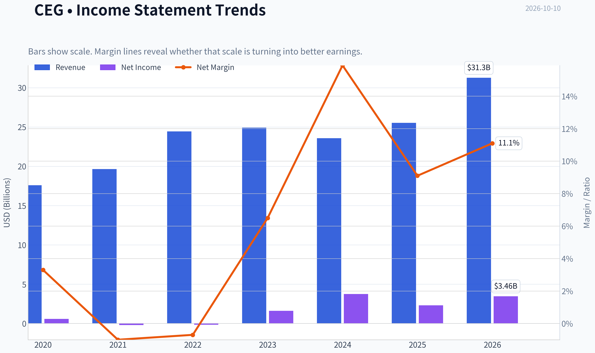
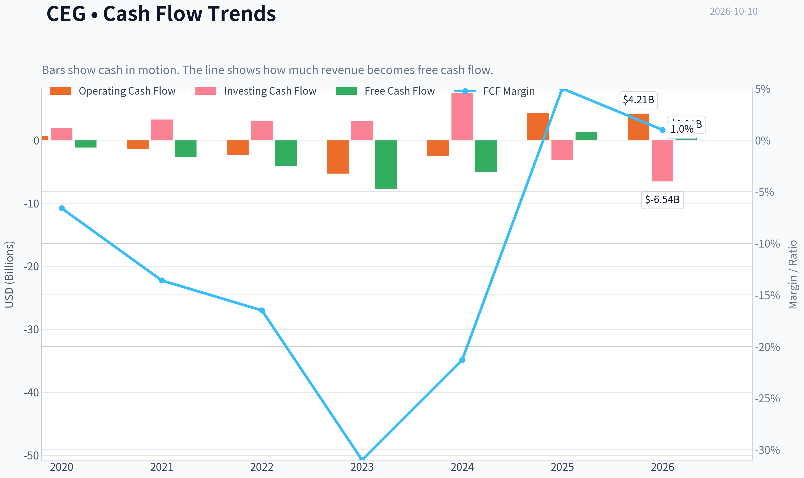
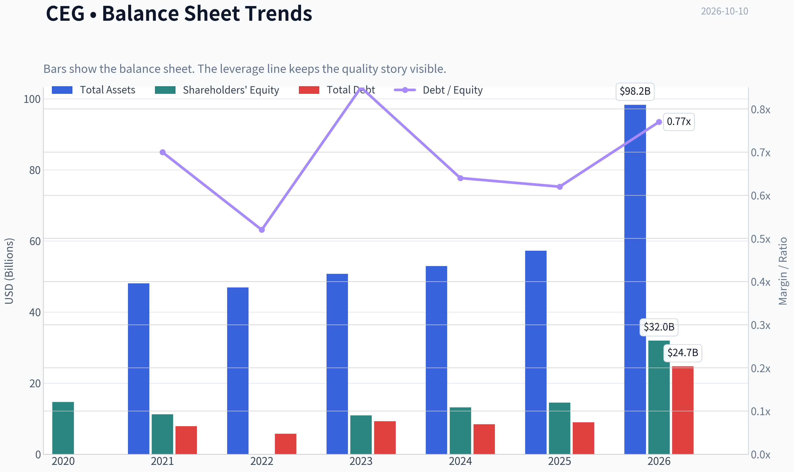
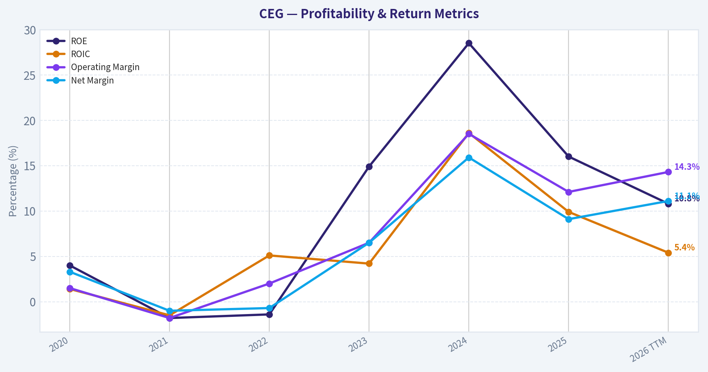
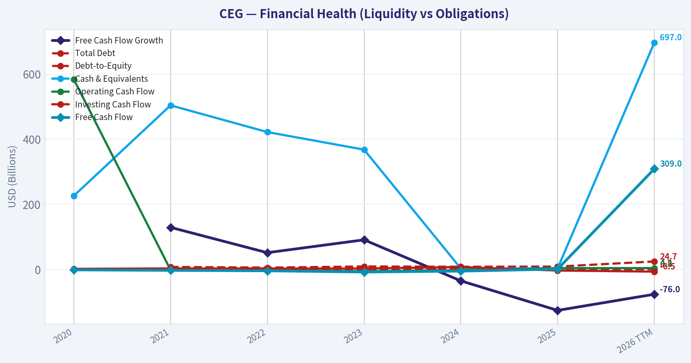
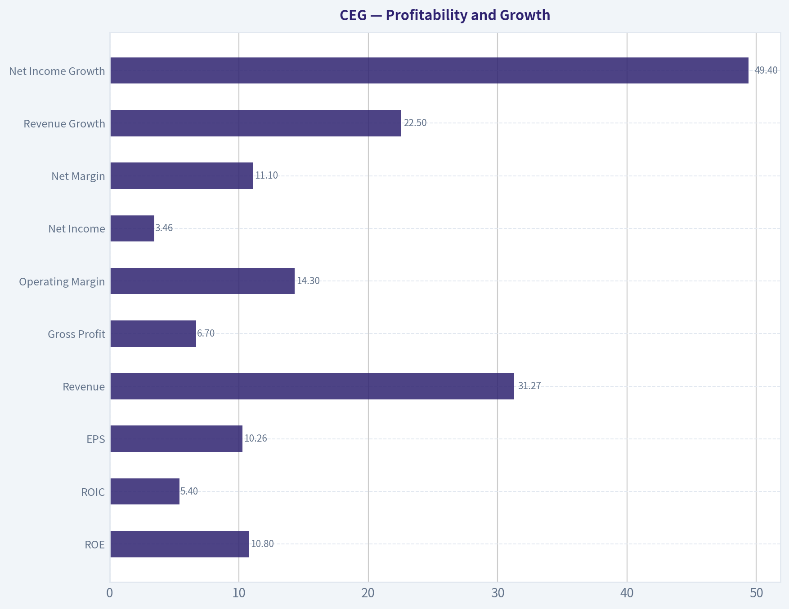
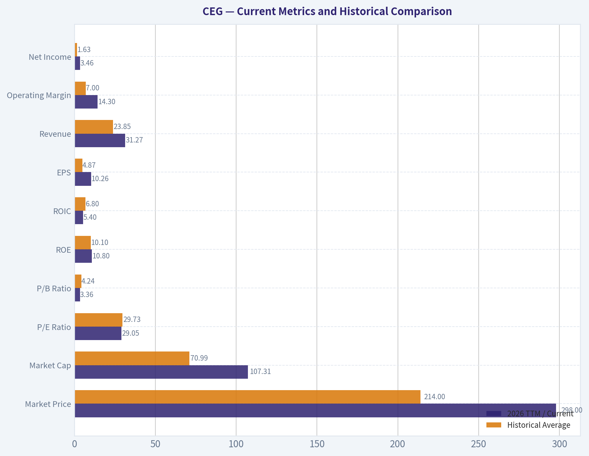
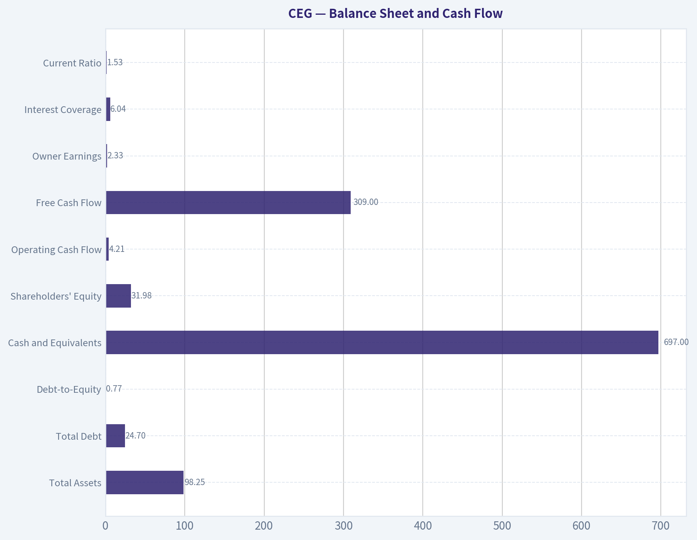
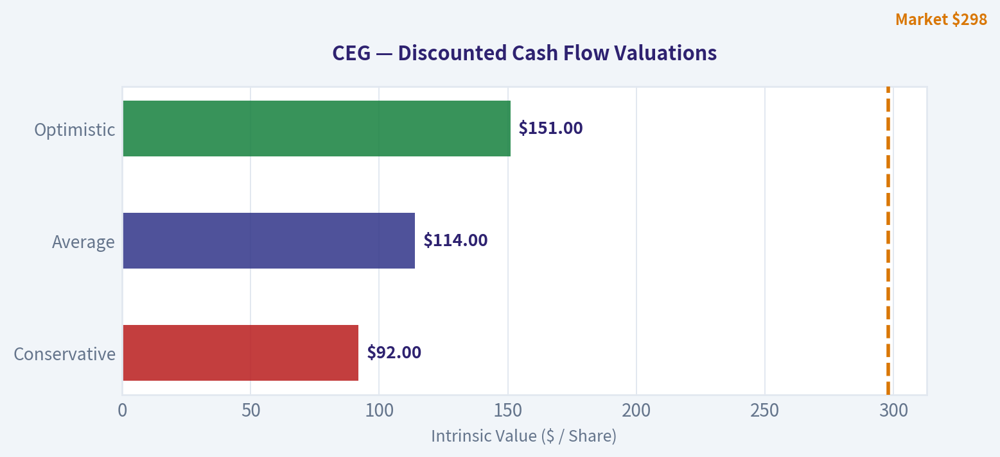
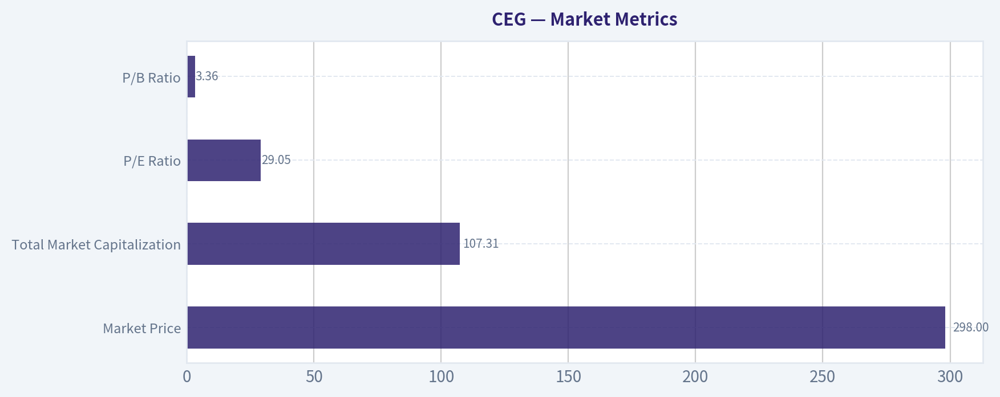

# CEG Deep Value Intelligence

**Analysis Date:** 2026-10-10

## Critical Disclaimer

*This analysis is generated by Deep Value Intelligence, an AI-powered multi-agent investing framework. Education & research only - not financial advice, not a financial advisor.*

---

## Table of Contents

1. Intelligence Summary
2. Analyst Team Reports
   - Fundamentals Analysis
   - Intrinsic Value Analysis (Buffett)
   - Trend & Growth Analysis (Lynch/Druckenmiller/Fisher)
   - Market Technical Analysis
   - Options Market Analysis
3. Research Team Commentary
4. Value Investing Team Commentary
5. Deep Values Commentary

---

## Intelligence Summary

### Thesis + Conditions

**Core Thesis:** # Executive Briefing

**Key Risks:**
- Verdict: WATCH.** Constellation Energy owns a scarce, difficult-to-replicate nuclear franchise positioned for data-center and electrification demand, but much of that opportunity is already reflected at **$298 and 29.1x earnings**.
- The central risk is **overpayment, not business distress**. An approximately **3.4% earnings yield** leaves limited protection if owner-earnings growth disappoints or the valuation normalizes.
- Plan:** Do not establish a full position. Existing holders can retain a risk-controlled allocation. New investors should wait for either stronger owner-earnings evidence or a valuation closer to the **mid-$250s to low-$270s**, recalculated as fundamentals evolve.

**Confidence:** Low

---

## Analyst Team Reports

### Fundamentals Analysis

#### Latest Earnings Snapshot

*Most recent reported quarter anchored on 2026 Q2, with prior-year comparison when available.*

| Metric | 2026 Q2 | 2025 Q2 | YoY Change |
| --- | ---: | ---: | ---: |
| Revenue | $7.50B | $6.10B | +23.0% |
| Operating Income | $-47.0M | $502.0M | -109.4% |
| Net Income | $513.0M | $839.0M | -38.9% |
| Diluted EPS | $1.42 | $2.67 | -46.8% |
| Operating Cash Flow | $1.13B | $1.48B | -23.6% |
| Free Cash Flow | $-118.0M | $710.0M | -116.6% |

Key Takeaways: This snapshot anchors the most recent reported quarter before the narrative analysis. It helps readers separate long-run business quality from whatever changed in the latest earnings print.

#### 6-Year Financial Metrics for CEG

*All values below are computed deterministically from raw data - not estimated by AI.*

*Issuer profile: operating company (Utilities / Utilities - Independent Power Producers).*

#### 6-Year Financial Metrics
*Annual rows come from reported financial statements. The final TTM row is computed from the latest four quarters.*

| Metric | 2020 | 2021 | 2022 | 2023 | 2024 | 2025 | 2026 TTM |
| --- | --- | --- | --- | --- | --- | --- | --- |
| Market Price | N/A | N/A | $84 | $115 | $221 | $352 | $298 |
| Market Cap | N/A | N/A | $28.36B | $37.87B | $70.47B | $110.93B | $107.31B |
| P/E Ratio | N/A | N/A | -175.94 | 23.33 | 18.81 | 47.74 | 29.05 |
| P/B Ratio | N/A | N/A | 1.37 | 3.47 | 5.35 | 7.64 | 3.36 |
| ROE | 4.0% | -1.8% | -1.4% | 14.9% | 28.5% | 16.0% | 10.8% |
| ROIC | 1.4% | -1.5% | 5.1% | 4.2% | 18.6% | 9.9% | 5.4% |
| EPS | $0.00 | $0.00 | $-0.48 | $5.01 | $11.89 | $7.40 | $10.26 |
| Revenue | $17.60B | $19.65B | $24.44B | $24.92B | $23.57B | $25.53B | $31.27B |
| Gross Profit | N/A | N/A | N/A | N/A | N/A | N/A | $6.70B |
| Gross Margin | N/A | N/A | N/A | N/A | N/A | N/A | 21.4% |
| Operating Margin | 1.5% | -1.8% | 2.0% | 6.5% | 18.5% | 12.1% | 14.3% |
| Net Income | $589.0M | $-205.0M | $-160.0M | $1.62B | $3.75B | $2.32B | $3.46B |
| Net Margin | 3.3% | -1.0% | -0.7% | 6.5% | 15.9% | 9.1% | 11.1% |
| Revenue Growth | N/A | 11.6% | 24.4% | 2.0% | -5.4% | 8.3% | 22.5% |
| Net Income Growth | N/A | -134.8% | -22.0% | -1114.4% | 131.0% | -38.1% | 49.4% |
| Free Cash Flow Growth | N/A | 129.3% | 51.6% | 91.1% | -34.9% | -125.6% | -76.0% |
| Total Book Value | $14.68B | $11.22B | $0 | $10.93B | $13.17B | $14.52B | $31.98B |
| Total Assets | N/A | $48.09B | $46.91B | $50.76B | $52.93B | $57.25B | $98.25B |
| Total Debt | N/A | $7.88B | $5.77B | $9.26B | $8.41B | $8.99B | $24.70B |
| Debt-to-Equity | N/A | 0.70 | 0.52 | 0.85 | 0.64 | 0.62 | 0.77 |
| Cash & Equivalents | $226.0M | $504.0M | $422.0M | $368.0M | $3.02B | $3.64B | $697.0M |
| Shareholders' Equity | $14.68B | $11.22B | $0 | $10.93B | $13.17B | $14.52B | $31.98B |
| Operating Cash Flow | $584.0M | $-1.34B | $-2.35B | $-5.30B | $-2.46B | $4.24B | $4.21B |
| Investing Cash Flow | $1.96B | $3.28B | $3.10B | $3.03B | $7.43B | $-3.20B | $-6.54B |
| Free Cash Flow | $-1.16B | $-2.67B | $-4.04B | $-7.72B | $-5.03B | $1.29B | $309.0M |
| FCF Margin | -6.6% | -13.6% | -16.5% | -31.0% | -21.3% | 5.0% | 1.0% |
| Dividends / Share | N/A | N/A | $0.55 | $1.13 | $1.41 | $1.55 | $1.53 |

#### Profitability Metrics
- Return on Equity (ROE): 16.0%
- Return on Invested Capital (ROIC): 10.3%
- Return on Assets (ROA): 4.1%
- Gross Margin: N/A
- Operating Margin: 12.1%
- Net Profit Margin: 9.1%

#### Liquidity Metrics
- Current Ratio: 1.53
- Quick Ratio: 0.91

#### Leverage Metrics
- Debt-to-Equity Ratio: 0.62
- Interest Coverage Ratio: 6.04
- Net Debt: $5.35B

#### Growth Metrics (Year-over-Year)
- Revenue Growth: 8.3%
- Net Income Growth: -38.1%
- Free Cash Flow Growth: 125.6%
- Revenue CAGR (3-Year): 1.5%
- Revenue CAGR (5-Year): 7.7%

#### Valuation Metrics
- P/E Ratio (TTM): 29.14
- Forward P/E: 22.38
- Price-to-Book: 3.31
- Price-to-Sales: 3.38
- PEG Ratio: 3.74
- EV/EBITDA: 16.41
- Free Cash Flow Yield: 1.2%
- Earnings Yield: 3.4%

#### Owner Earnings (Buffett Method, Code-Computed)
- Net Income: $2.32B
- + Depreciation & Amortization: $1.94B
- - Capital Expenditures: $-2.95B
- - Working Capital Changes: $-7.0M
- = **Owner Earnings: $2.33B**

#### Intrinsic Value (Code-Computed)
- Current Price: $298
- **Headline Intrinsic Value (business-model routed): $61**
  Business model: cyclical - weighted blend [reverse-DCF fair + owner-earnings DCF] (cyclical)
  Model spread (min-max across DCFs): $2 - $2
  Margin of safety vs. price (headline): -390.6%
  Routing note: Cyclical: margins/FCF are volatile - headline blends FCFF, reverse-DCF and owner-earnings roughly evenly; treat the range as the honest read.
- Buffett Method (Owner Earnings):
  Conservative: $-5
  Average: $2
  Optimistic: $1,205
- Damodaran FCFF (WACC + margins + reinvestment):
  Conservative: $-64
  Average: $-61
  Optimistic: $13
  Monte Carlo band (P10-P90): $-77 - $-12 (median $-48)
  P(intrinsic value > price): 0.0%
- Reverse-DCF: price implies ~21.3%/yr owner-earnings growth for 10y; trailing 3y was -23.7%, 5y N/A.

#### Piotroski F-Score: 5/9
- Positive Net Income: PASS
- Positive Operating Cash Flow: PASS
- ROA Improvement: FAIL
- Cash Flow > Net Income: PASS
- Decreasing Debt: FAIL
- Improving Current Ratio: FAIL
- No Dilution: PASS
- Improving Gross Margin: FAIL
- Improving Asset Turnover: PASS

ANALYST STANCE: **AVOID**

#### Executive Summary

Constellation Energy Corporation (CEG) is a strategically important nuclear-generation company with potentially durable assets, rising electricity demand from data centers, and improving recent profitability. However, the stock price already discounts an unusually strong long-term outcome.

At $298 per share, CEG trades at approximately 29.1 times trailing earnings, 3.36 times book value, and only a 1.2% free-cash-flow yield. The price implies roughly 21.3% annual owner-earnings growth for ten years, while trailing three-year owner-earnings growth was negative. The company's recent earnings are much stronger than its earlier history, but cash conversion remains weak and debt has increased substantially.

The business may be attractive at a materially lower valuation, but the present risk-reward profile does not provide a sufficient Buffett-style margin of safety.

#### Current Metrics and Historical Comparison

The deterministic dataset provides six annual observations plus 2026 TTM. Historical averages below are calculated from the displayed observations, excluding unavailable values. Growth averages are inherently unreliable where prior-year earnings or cash flow were negative.

| Metric | 2026 TTM / Current | Historical Average | Current vs. Average | Interpretation |
|---|---:|---:|---:|---|
| Market Price | $298 | $214 | 39% above | Stock has appreciated sharply since 2022 |
| Market Cap | $107.31B | $70.99B | 51% above | Valuation expansion has outpaced much of the operating history |
| P/E Ratio | 29.05 | 29.73 | Approximately in line | Not cheap despite being near the displayed average |
| P/B Ratio | 3.36 | 4.24 | Below average | Less elevated than 2024-2025, but book value data are volatile |
| ROE | 10.8% | 10.1% | Slightly above | Positive, but below the 2024 peak of 28.5% |
| ROIC | 5.4% | 6.8% | Below | Recent capital efficiency is modest for a highly capital-intensive business |
| EPS | $10.26 | $4.87 | 111% above | Earnings have improved substantially from 2020-2022 |
| Revenue | $31.27B | $23.85B | 31% above | TTM revenue is the highest in the displayed period |
| Operating Margin | 14.3% | 7.0% | 2x average | Strong improvement, but below the 2024 peak of 18.5% |
| Net Income | $3.46B | $1.63B | 113% above | Current earnings are materially stronger than the historical base |
| Net Margin | 11.1% | 6.3% | 76% above | Recent profitability is substantially better |
| Revenue Growth | 22.5% | 10.6% | Above average | Strong TTM growth follows several volatile years |
| Net Income Growth | 49.4% | Not reliable | Above recent average | Distorted by losses and unusually low prior-year bases |
| Free Cash Flow | $309M | $(3.46)B | Better, but still weak | FCF has improved from persistent deficits but remains small |
| FCF Margin | 1.0% | -14.3% | Improved | Cash conversion is still far below what the valuation requires |
| Total Debt | $24.70B | $14.17B | 74% above | Leverage increased sharply in the TTM period |
| Debt-to-Equity | 0.77 | 0.67 | Above average | Balance-sheet risk is higher than the historical norm |
| Cash & Equivalents | $697M | $1.38B | 49% below | Liquidity cushion has fallen sharply |
| Dividends per Share | $1.53 | $1.29 | 18% above | Dividend has grown, but yield at the current price is low |

**Key Takeaways:** CEG's current revenue, EPS, margins, and net income are well above the six-year averages, confirming a meaningful operating recovery. However, the improvement has not translated into robust free cash flow, while debt is much higher and cash is much lower than average. The stock price has risen faster than the company's demonstrated cash-generating capacity.

#### Market Metrics

| Metric | Current Value | Historical Context |
|---|---:|---|
| Market Price | $298 | Up from $84 in 2022 and $115 in 2023 |
| Total Market Capitalization | $107.31B | Above the displayed historical average of approximately $71B |
| P/E Ratio | 29.05 | Close to the displayed valid-period average of approximately 29.7 |
| P/B Ratio | 3.36 | Below the 2025 level of 7.64, but above 2022 and 2023 |

**Key Takeaways:** CEG is not inexpensive on earnings even though its current P/E is near its historical average. The price increase has been dramatic, and the current valuation requires sustained growth rather than merely a normalization of earnings. Because CEG is an asset-heavy power producer, P/B is more relevant than it would be for an asset-light software company, but the dataset's book value is unusually discontinuous, including zero book value in 2022, so it should not be used in isolation.

#### Profitability and Growth

| Metric | 2026 TTM | Historical Pattern | Assessment |
|---|---:|---|---|
| ROE | 10.8% | From negative ROE in 2021-2022 to 28.5% in 2024 and 16.0% in 2025 | Recovered, but below peak |
| ROIC | 5.4% | Ranged from -1.5% to 18.6% | Below the level typically associated with a consistently superior business |
| EPS | $10.26 | $0 or negative in early years, then $5.01, $11.89, $7.40, $10.26 | Strong recovery but volatile |
| Revenue | $31.27B | Highest displayed result | Positive recent scale growth |
| Gross Profit | $6.70B | Historical gross profit unavailable | TTM gross margin is 21.4% |
| Operating Margin | 14.3% | Improved from 1.5% or lower to a 2024 peak of 18.5% | Strong but cyclical |
| Net Income | $3.46B | Losses in 2021-2022, then strong recovery | Positive current earnings, inconsistent decade profile |
| Net Margin | 11.1% | Historical average approximately 6.3% | Above normal, but not yet proven durable |
| Revenue Growth | 22.5% | Prior years included -5.4%, 2.0%, and 8.3% | Current growth is strong but volatile |
| Net Income Growth | 49.4% | Highly distorted by loss-to-profit comparisons | Not a reliable long-term growth measure |
| FCF Growth | -76.0% | Extremely volatile, with multiple negative years | Major weakness in cash-flow predictability |

**Key Takeaways:** CEG has clearly moved from a weak earnings period into a much more profitable phase. Nevertheless, the decade-long record does not demonstrate stable, predictable compounding: ROIC has fluctuated widely, earnings have included losses, and free cash flow has remained negative in most displayed years. Buffett-style analysis should place more weight on durable owner earnings than on the recent EPS rebound.

#### Balance Sheet and Cash Flow

| Metric | Current | Historical Comparison | Interpretation |
|---|---:|---|---|
| Total Assets | $98.25B | Approximately $47B-$57B in 2021-2025 | Large increase in asset base |
| Total Debt | $24.70B | $5.77B-$9.26B in 2022-2025 | Significant increase |
| Debt-to-Equity | 0.77 | Historical average approximately 0.67 | Leverage is above normal |
| Cash and Equivalents | $697M | $3.02B-$3.64B in 2024-2025 | Substantial decline |
| Shareholders' Equity | $31.98B | $10.93B-$14.52B in 2023-2025 | Increased sharply in the TTM data |
| Operating Cash Flow | $4.21B | Positive in 2020 and 2025-2026, negative in 2021-2024 | Recent improvement, but inconsistent |
| Free Cash Flow | $309M | Negative from 2020 through 2024 | Only modestly positive currently |
| Owner Earnings | $2.33B | Based on the code-computed owner-earnings calculation | More useful than reported FCF, but still produces a low valuation relative to price |
| Interest Coverage | 6.04x | Latest supplemental metric | Adequate, though not exceptionally conservative |
| Current Ratio | 1.53 | Latest supplemental metric | Reasonable short-term liquidity |
| Quick Ratio | 0.91 | Latest supplemental metric | Less than 1.0, indicating limited highly liquid coverage |

**Key Takeaways:** The balance sheet has expanded considerably, but debt has grown much faster than historical levels and cash has declined sharply. Operating cash flow has recently turned positive, yet free cash flow is only $309 million against a $107 billion market capitalization. The principal financial risk is not immediate solvency; it is that large capital requirements and increased leverage prevent accounting earnings from becoming distributable cash.

#### Revenue Breakdown

The deterministic dataset does not provide a segment-level revenue schedule. The most defensible presentation is therefore the reported consolidated revenue base rather than an invented allocation among nuclear generation, fossil generation, energy sales, and ancillary services.

| Revenue Source | Amount ($B) | % of Total |
|---|---:|---:|
| Consolidated electricity generation, energy sales, and related operating revenue | $31.27B | 100% |
| Segment/product split | Not disclosed in dataset | Not calculable |

**Key Takeaways:** CEG's reported revenue is concentrated in its electricity-generation and related energy businesses. The available data do not support a precise percentage split by generation type, geography, or customer category. Investors should obtain the company's latest regulatory and annual filings to assess how much revenue is contracted, merchant, nuclear-related, or exposed to wholesale power prices.

#### Buffett-Style Business Assessment

**Economic moat:** CEG owns a large nuclear-generation fleet and other power assets that can be difficult and expensive to replicate. Nuclear assets benefit from high replacement costs, operating licenses, grid interconnection advantages, and the increasing need for reliable, low-carbon electricity. Long-term power contracts or agreements with large technology customers could improve revenue visibility.

The moat is not absolute. Power prices, regulatory decisions, plant outages, fuel costs, refueling schedules, environmental policy, and contract terms can materially affect economics. The business is also capital intensive, which makes the moat less valuable if returns on new investment are inadequate.

**Financial strength:** The latest interest coverage ratio of 6.04 times is acceptable, and the current ratio of 1.53 suggests reasonable short-term balance-sheet coverage. However, total debt increased to $24.70 billion from single-digit billions in most prior years, while cash fell to $697 million. That combination reduces financial flexibility and increases sensitivity to construction costs, outages, refinancing rates, and commodity conditions.

**Predictable earnings:** The record is not sufficiently predictable for a classic Buffett-quality compounder. Net income was negative in 2021 and 2022, operating cash flow was negative from 2021 through 2024, and free cash flow was negative in every displayed year through 2024. The recent recovery is impressive, but it remains a relatively short track record.

**Management and capital allocation:** Dividend per share increased from $0.55 in 2022 to $1.53 TTM, indicating shareholder distributions have grown. However, the dividend yield at $298 is only about 0.5%. More importantly, capital investment and balance-sheet expansion have not yet produced consistently high free cash flow. The 5/9 Piotroski F-score is neutral rather than strong: positive income and operating cash flow are offset by rising debt, weaker liquidity trends, and a failure to show improving gross-margin characteristics.

**Quality of business:** CEG has strategically valuable assets and improving margins, but the investment case depends on the durability of elevated power demand and pricing. It is better characterized as a high-quality strategic asset owner with cyclical and capital-intensive economics than as a low-risk, steadily compounding consumer or software franchise.

#### Buffett-Style Owner-Earnings DCF

The code-computed owner-earnings base is:

- Net income: $2.32 billion
- Depreciation and amortization: $1.94 billion
- Capital expenditures: $2.95 billion
- Working-capital adjustment: approximately $7 million
- Owner earnings: approximately **$2.33 billion**

Using the deterministic market capitalization of $107.31 billion and price of $298, implied diluted shares are approximately:

\[
107.31B / 298 = 360.1M\ shares
\]

Current owner earnings per share are therefore approximately:

\[
2.33B / 360.1M = \$6.47
\]

The hand DCF below uses a 10% discount rate and a 2.5% terminal growth rate. Forecast growth fades toward the terminal rate rather than continuing indefinitely at a high rate.

| Scenario | Explicit Growth Assumption | Present Value of Years 1-10 | Present Value of Terminal Value | Equity Value | Value per Share |
|---|---|---:|---:|---:|---:|
| Conservative | 3% annually for 10 years, then 2.5% terminal growth | $16.5B | $16.5B | $33.0B | $92 |
| Average | 12%, 12%, 10%, 8%, 6%, then fading through 2.5% | $20.1B | $20.9B | $41.0B | $114 |
| Optimistic | 20%, 17%, 14%, 11%, 8%, then fading through 2.5% | $25.5B | $29.0B | $54.5B | $151 |

**Key Takeaways:** Even the optimistic hand DCF produces a value materially below the $298 share price. The average case assumes a strong multi-year growth profile and still produces only approximately $114 per share. This illustrates that the stock requires substantially more than a normal recovery; it requires exceptional and sustained owner-earnings growth.

The deterministic model pack is even more cautious. Its headline intrinsic value is approximately **$61 per share**, combining reverse-DCF and owner-earnings approaches for a cyclical business. The reported model outputs are approximately $1.71 for owner-earnings value, no FCF model value, and negative $60.73 for the Damodaran FCFF model. These extreme results reflect the instability of CEG's historical cash flows and should not be treated as precise point estimates, but they strongly reinforce the absence of a margin of safety.

The reverse DCF is particularly important: the current price implies approximately **21.3% annual owner-earnings growth for ten years**, despite trailing three-year owner-earnings growth of approximately **-23.7%**. That is a very demanding embedded expectation.

#### Key Investment Insights, Red Flags, and Opportunities

| Category | Key Point | Investment Significance |
|---|---|---|
| Opportunity | Nuclear power has strategic scarcity value | Reliable, low-carbon generation may command stronger demand and pricing |
| Opportunity | Data-center electricity demand | Could support long-term contracts and higher utilization |
| Opportunity | Revenue and margins have recently improved | Current operating performance is well above the early-period baseline |
| Red flag | FCF margin is only 1.0% | Earnings are not yet translating into substantial cash generation |
| Red flag | Debt rose to $24.70B | Higher financial risk and less flexibility |
| Red flag | Cash declined to $697M | Smaller buffer against outages, capex overruns, or market stress |
| Red flag | Earnings history includes losses | Weakens confidence in normalized earnings |
| Red flag | Price implies 21.3% owner-earnings growth | Valuation leaves little room for execution errors |
| Red flag | P/E near 29x and FCF yield near 1.2% | Expensive relative to current cash economics |
| Risk | Merchant power-price exposure | Wholesale price declines could compress margins |
| Risk | Nuclear outages and refueling | A single major outage can affect earnings and cash flow |
| Risk | Regulatory and political exposure | Licensing, subsidies, market rules, and environmental policy matter |
| Risk | Capital intensity | Maintenance and expansion spending can absorb much of operating cash flow |

**Key Takeaways:** The strongest opportunity is the strategic value of dependable nuclear electricity in a power-constrained economy. The strongest objection is valuation: investors are paying for a highly successful future before CEG has established a decade-long record of stable owner earnings. Debt, low cash, and weak cumulative free cash flow make the downside more consequential if growth or power prices disappoint.

#### Final Investment Stance

**AVOID at $298 per share.**

CEG may be a good business with valuable assets, a potentially durable competitive position, and favorable secular demand trends. However, Buffett-style investing requires a margin of safety, and the current valuation does not provide one.

The stock is priced near 29 times earnings, generates only a 1.2% free-cash-flow yield, carries substantially more debt than in prior years, and requires approximately 21.3% annual owner-earnings growth for a decade according to the reverse DCF. Even a favorable hand-built DCF produces a value around $151 per share, while the deterministic model's headline value is approximately $61.

A more disciplined investor should wait for either a substantially lower price, several years of demonstrated free-cash-flow conversion, or clear evidence that contracted nuclear and data-center-related economics can support durable owner-earnings growth.

#### Report Summary

| Area | Assessment |
|---|---|
| Business quality | Strategically valuable, but capital intensive and cyclical |
| Economic moat | Meaningful nuclear-asset and reliability advantages |
| Earnings quality | Improving, but historically volatile |
| Cash-flow quality | Weak relative to reported earnings |
| Balance sheet | Adequate interest coverage, but rising debt and falling cash |
| Valuation | Expensive on earnings and especially on free cash flow |
| DCF conclusion | Current price exceeds conservative, average, and optimistic hand-DCF values |
| Main upside driver | Durable nuclear pricing and data-center electricity demand |
| Main downside driver | Failure to convert elevated earnings into sustainable owner earnings |
| Buffett conclusion | No sufficient margin of safety at the current price |
| Final stance | **AVOID** |

**Key Takeaways:** CEG combines an attractive strategic asset base with an unproven cash-flow record and demanding valuation. The investment could work if exceptionally strong growth persists, but that outcome is already heavily reflected in the share price. From a Buffett-style perspective, capital is better preserved until valuation and cash-flow evidence become more favorable.

#### Fundamental Visuals

This graph tracks the profitability and return metrics (ROE, ROIC, Margins) of **CEG** over the past decade, highlighting capital efficiency trends.

This chart illustrates the financial health of **CEG** over the last 10 years, mapping cash equivalents and free cash flow against total obligations (Debt).

This comparison chart from *Profitability and Growth* stacks current figures against historical benchmarks for **CEG**, making it easy to see where the company trades relative to its own averages.

---

### Intrinsic Value Analysis (Buffett)

> *Following Warren Buffett's value investing philosophy: Circle of Competence, Economic Moat, Management Quality, and Margin of Safety.*

#### Intrinsic Value Snapshot

Price is what you pay. Intrinsic value is what the business may be worth based on the cash it can create for owners over time. We show a range, not one magic number.

- Current Price: $298.07
- Value Range (conservative to optimistic across both DCF methods): $-4.80 to $1,205.01

##### Owner Earnings (Buffett Method)
- Net Income: $2,319,000,000.00
- Depreciation & Amortization: $1,937,000,000.00
- Capital Expenditures: $-2,949,000,000.00
- Working Capital Changes: $-7,000,000.00
- Owner Earnings: $2,326,000,000.00

##### Intrinsic Value
###### Buffett Method
Uses owner earnings. Stricter, and usually more conservative.
- Conservative: $-4.80
- Average: $1.71
- Optimistic: $1,205.01
- Discount Rate: 10.0%

ANALYST STANCE: **AVOID**

#### Executive Conclusion

Constellation Energy is a strategically important nuclear-power owner with scarce generating assets, favorable long-term electricity demand, and potential data-center contracts. The business may possess a meaningful moat, but at **$298 per share** the valuation assumes extraordinary and sustained growth.

The research valuation assigns a headline intrinsic value of **$60.75 per share**, implying approximately **80% downside**. The reverse DCF indicates that the current price requires roughly **21.3% annual growth for ten years**, despite trailing three-year growth of approximately **-23.7%**. This is not an attractive Buffett-style entry price, even if the underlying business is good.

#### 1. Factor Scorecard

| Factor | Score / 5 | Assessment |
|---|---:|---|
| Circle of competence and simplicity | 2.5 | Electricity generation is understandable, but CEG combines nuclear operations, merchant exposure, regulation, power prices, and large capital projects. |
| Durable competitive advantage | 3.5 | Nuclear licenses, operating expertise, scarce existing plants, and grid reliability create meaningful barriers to entry. |
| Management and capital allocation | 3.0 | Management has positioned the company toward long-term nuclear demand, but the investment case depends heavily on capital-intensive projects and favorable contract execution. |
| Industry structure | 3.0 | Nuclear supply is scarce and strategically valuable, but power markets remain cyclical, regulated, and capital intensive. |
| **Gate 5: financial distress** | **Not tripped** | The available data do not establish both deteriorating fundamentals and a solvency red line such as interest coverage below 1x. |

**Key Takeaways:** CEG appears to be a potentially valuable strategic asset rather than a weak business. However, its complexity, cyclicality, and capital requirements reduce predictability. The decisive problem is valuation, not business quality alone.

#### 2. Moat Analysis

| Moat source | Evidence | Rating |
|---|---|---:|
| Intangible assets and regulatory licenses | Nuclear plants require licenses, technical expertise, safety systems, and long operating histories that competitors cannot quickly replicate. | Strong |
| Switching costs | Electricity buyers can change suppliers in competitive markets, so customer captivity is less powerful than in software or payment networks. Long-term contracts can improve visibility. | Moderate |
| Cost advantage | Existing nuclear plants can have attractive economics because replacement generation is expensive and new nuclear construction is slow and difficult. | Moderate to strong |
| Network effects | There is little direct network effect. CEG benefits more from asset scarcity, grid position, and reliability value. | Weak |
| **Overall moat** | Scarce nuclear assets and regulatory barriers provide a **narrow-to-wide moat**, but the moat is exposed to regulation, outages, power prices, and capital requirements. | **3.5 / 5** |

CEG's principal advantage is scarcity. The United States cannot rapidly build an equivalent fleet of reliable, carbon-free baseload generation. Data-center demand and electrification may further increase the value of dependable power.

Nevertheless, this is not an Apple-like ecosystem moat. Nuclear assets can suffer outages, require substantial maintenance, and operate within regulated or volatile power markets. The moat is real, but its economic value depends on contract terms, operating performance, and reinvestment discipline.

#### 3. Management Quality and Capital Allocation

Management's strategic direction is sensible: preserve and monetize nuclear capacity while seeking long-term contracts with large electricity users. The reported Google-related nuclear expansion news supports the possibility that hyperscalers will pay premiums for reliable, carbon-free electricity.

The principal concerns are:

- Nuclear expansion and plant life-extension projects require substantial capital.
- Acquisitions or contracted projects can destroy value if management overestimates future power prices.
- The stock price gives management a strong currency for acquisitions, which increases the risk of overpaying.
- A high share price can encourage growth-oriented capital allocation even when expected returns are inadequate.

The available evidence supports a **middle-of-the-road management score of 3 out of 5**. The strategic opportunity is attractive, but the shareholder outcome will depend on whether management converts scarcity value into high per-share returns rather than simply expanding the asset base.

#### 4. Financial Summary

| Metric | Current / reported value |
|---|---:|
| Share price | $298 |
| Market capitalization | $105.61 billion |
| P/E ratio | 29.1x |
| ROE | 16.0% |
| Year-over-year revenue growth | 8.3% |
| FCF yield | 1.2% |
| Current ratio | 1.53x |
| Trailing three-year growth | -23.7% |
| Reverse-DCF implied annual growth | Approximately 21.3% for ten years |
| Headline intrinsic value | $60.75 per share |

**Key Takeaways:** CEG earns a respectable reported ROE of 16%, but the 1.2% free-cash-flow yield is thin for a capital-intensive utility and power producer. The market price requires a dramatic acceleration from the recent earnings trajectory. Revenue growth of 8.3% is not sufficient to justify a valuation requiring more than 21% annual compounding.

#### 5. Owner Earnings Calculation

The normalized owner-earnings framework implied by the research valuation is:

| Owner-earnings item | Per-share implication |
|---|---:|
| Normalized owner earnings implied by no-growth value at a 10% discount rate | Approximately $6.08 |
| No-growth intrinsic value | Approximately $60.75 |
| Market price | $298 |
| Price / implied owner earnings | Approximately 49.1x |

The calculation follows:

**Owner Earnings = Net Income + Depreciation and Amortization - Maintenance Capital Expenditures - Working Capital Increases**

For CEG, reported accounting earnings may overstate distributable owner earnings because nuclear maintenance, refueling, life-extension spending, and other capital requirements are economically important. The research pack's model outputs also show significant disagreement: the owner-earnings model value is approximately **$1.71 per share**, while the routed headline value is **$60.75**. That dispersion is itself a warning that normalized cash generation is difficult to estimate.

**Key Takeaways:** Even using the more favorable $60.75 headline value, the stock trades at roughly 49 times the owner-earnings level implied by a 10% required return. The capital intensity and model disagreement argue for a substantial margin of safety, not a premium valuation.

#### 6. Three-Scenario DCF Valuation

The valuation scenarios below use approximately **$6.08 per share** of normalized owner earnings as the starting point.

| Scenario | Key assumptions | Estimated value per share |
|---|---|---:|
| A. No growth | 10% discount rate; no long-term growth | $60.75 |
| B. GDP growth | 3% annual growth; 10% discount rate; perpetual terminal growth | Approximately $86.80 |
| C. Illustrative normalized growth | 5% annual growth for ten years; 10% discount rate; 5% terminal growth | Approximately $127 |
| Market price | - | $298 |

Scenario C is deliberately more favorable than the conservative cases, but it still produces a value well below the market price. To justify $298 using a conventional 10% discount rate, CEG would need growth closer to the reverse-DCF requirement of **21.3% annually for a decade**, followed by strong terminal economics.

**Key Takeaways:** Every reasonable DCF scenario falls substantially below the current share price. Even a favorable 5% growth case produces only about $127 per share, less than half the market price. The valuation therefore depends on exceptional execution and sustained growth rather than ordinary normalized economics.

#### 7. Margin of Safety Analysis

| Measure | Result |
|---|---:|
| Headline intrinsic value | $60.75 |
| Current price | $298 |
| Margin of safety versus headline value | Approximately **-390.6%** |
| Downside from price to headline value | Approximately **80%** |
| Reverse-DCF required growth | Approximately 21.3% annually for ten years |
| Quality-adjusted required margin of safety | 10%-15% only for a truly wide-moat compounder |
| Current valuation versus intrinsic value | Fails even the relaxed quality-adjusted standard |

A wide moat can justify paying a fair price, but CEG is not priced at merely fair value. The current quote requires a long period of exceptional growth, successful nuclear expansion, strong contract economics, and minimal operational setbacks.

The stock could continue rising if data-center demand leads to aggressive long-term power contracts or if investors capitalize nuclear assets at even higher valuations. That is a possible trading outcome, but it is not a sufficient margin of safety for a buy-and-hold value investment.

#### 8. Final Buffett Scorecard

| Criterion | Weight | Score / 5 | Weighted contribution |
|---|---:|---:|---:|
| Moat width and durability | 25% | 3.5 | 0.88 |
| Valuation and margin of safety | 20% | 1.0 | 0.20 |
| Capital returns versus WACC | 15% | 3.0 | 0.45 |
| Business understanding and predictability | 12% | 2.5 | 0.30 |
| Management quality and capital allocation | 12% | 3.0 | 0.36 |
| Reinvestment runway | 8% | 4.0 | 0.32 |
| Balance-sheet strength | 4% | 3.0 | 0.12 |
| Industry structure | 4% | 3.0 | 0.12 |
| **Total** | **100%** | - | **2.75 / 5.00** |

**Key Takeaways:** CEG scores well on reinvestment runway and reasonably on moat quality, but valuation overwhelms those positives. The overall score of 2.75 falls in the AVOID range under the decision matrix.

#### 9. Investment Stance

**ANALYST STANCE: AVOID**

- **Business quality:** Potentially good, with strategically scarce nuclear assets.
- **Valuation quality:** Poor; the price implies heroic long-term growth.
- **Financial distress gate:** Not tripped.
- **Conviction:** **High on avoiding at $298; moderate on the long-term business quality.**

CEG becomes more interesting at a materially lower price or after a substantial increase in durable owner earnings. Until then, the stock offers too little margin of safety for a Buffett-style investment.
#### Valuation Bridge

This bridge places the current market price beside each intrinsic value lens so readers can see whether upside depends on one method or shows up across several methods.

| Scenario | Intrinsic Value / Share |
| --- | ---: |
| Buffett Method | $1.71 |
| Damodaran Method | $-60.73 |
| Current Price | $298.07 |

#### Key Takeaways

If one method is far above the others, the upside case depends on a specific modelling assumption. When several methods cluster together, the valuation story is more robust.

#### Valuation Visuals

This comparison chart from *Latest Earnings Snapshot* stacks current figures against historical benchmarks for **CEG**, making it easy to see where the company trades relative to its own averages.

This comparison chart from *Current Metrics and Historical Comparison* stacks current figures against historical benchmarks for **CEG**, making it easy to see where the company trades relative to its own averages.

This comparison chart from *Balance Sheet and Cash Flow* stacks current figures against historical benchmarks for **CEG**, making it easy to see where the company trades relative to its own averages.

The following chart maps the **CEG** Owner Earnings DCF valuation scenarios (Conservative, Average, Optimistic) to visually represent the margin of safety based on intrinsic value calculations.

---

### Trend & Growth Analysis (Lynch/Druckenmiller/Fisher)

> *Following Peter Lynch's GARP, Stanley Druckenmiller's macro-aware approach, and Philip Fisher's scuttlebutt methodology.*

ANALYST STANCE: **AVOID**

#### 1. Lynch Classification

**Cyclical / stalwart hybrid, not currently a fast grower.** CEG has exposure to a potentially powerful secular theme-reliable nuclear electricity for data centers-but reported revenue growth of 8.3% is below the 15-25% threshold for Lynch's fast growers. Its earnings are also sensitive to power prices, contract structures, regulation, outages, and capital intensity.

#### 2. The Story in Three Bullets

- **AI needs reliable electricity:** Data centers require large amounts of round-the-clock power, potentially improving the value of CEG's nuclear fleet.
- **Nuclear supply is scarce:** Long-term power contracts and nuclear life extensions could create pricing power and improve asset utilization.
- **The market is already enthusiastic:** At approximately $106 billion of market capitalization and 29 times earnings, CEG appears priced for substantial future growth rather than merely current operating performance.

#### 3. Core Financial Snapshot

| Metric | CEG |
|---|---:|
| Current price | $298 |
| Market capitalization | $105.6B |
| P/E ratio | 29.1x |
| Revenue growth, year over year | 8.3% |
| ROE | 16.0% |
| FCF yield | 1.2% |
| Current ratio | 1.53 |
| Reverse-DCF implied growth | Approximately 21.3% annually for 10 years |
| Historical three-year revenue trend | Approximately -23.7% |
| Headline intrinsic value | $60.75 |
| Margin of safety versus price | -390.6% |

**Key Takeaways:** CEG combines modest reported growth with a high valuation. The stock price appears to require approximately 21% annual growth for a decade, far above the current 8.3% growth rate and inconsistent with the reported three-year decline. The supplied valuation models indicate substantial downside, although utility cash flows and nuclear asset values can be difficult to capture using standard models.

#### 4. TAM and the 10x Test

| Question | Assessment |
|---|---|
| Primary opportunity | Nuclear generation, power contracts, data-center electricity demand |
| TAM direction | Expanding, particularly for firm low-carbon power |
| TAM growth potential | Potentially high in selected data-center markets, but not yet proven in CEG's reported growth |
| Can revenue grow 10x and remain below 20% market share? | Probably not on the existing nuclear-generation market alone |
| Does the AI-power theme expand the TAM? | Yes, through long-term contracts, uprates, restarts, and potentially new nuclear capacity |
| Main constraint | Large projects, permitting, grid access, financing, and long construction timelines |

**Key Takeaways:** CEG has a meaningful runway if AI-driven electricity demand supports higher nuclear contract prices and new capacity investments. However, a 10x outcome would likely require more than simply operating the existing fleet; it would require major expansion, superior contract economics, or a broader role in the power infrastructure ecosystem.

#### 5. Revenue Growth and Inflection Point

| Indicator | Evidence | Interpretation |
|---|---|---|
| Current growth | 8.3% year over year | Positive, but below fast-grower territory |
| Longer-term trend | Three-year revenue trend reported at -23.7% | Weak historical trajectory |
| Product cycle | No conventional product cycle; asset and contract cycle instead | Potentially positive, but slower-moving |
| Market-share inflection | Data-center demand may improve contract wins | Promising but not yet demonstrated in the supplied data |
| Margin inflection | No gross-margin data supplied; FCF yield only 1.2% | Unproven |
| TAM inflection | Nuclear reliability and AI power demand | Strongest part of the thesis |

**Key Takeaways:** The inflection thesis is credible at the industry level but not yet confirmed by CEG's financial trend. The key evidence to watch is accelerating contracted capacity, higher realized power prices, rising adjusted EBITDA, and improving free cash flow-not merely announcements about nuclear demand.

#### 6. Unit Economics and Profitability

| Metric | Result | Assessment |
|---|---:|---|
| LTV/CAC | Not applicable | CEG is an asset-heavy utility, not a subscription business |
| NRR | Not applicable | Contract renewal economics are more relevant |
| Rule of 40 | Not applicable | Not an appropriate utility metric |
| P/E | 29.1x | Expensive for current growth |
| FCF yield | 1.2% | Low cash-flow yield |
| ROE | 16.0% | Respectable, but leverage and asset structure matter |

**Key Takeaways:** CEG should be evaluated using contracted cash flow, power-price exposure, maintenance and growth capital spending, debt service, and free-cash-flow conversion. The low FCF yield is a major concern because investors are paying heavily today for future nuclear-demand benefits.

#### 7. Macro Setup

| Macro factor | Impact on CEG |
|---|---|
| AI and data-center expansion | Strong positive |
| Demand for reliable baseload power | Positive |
| Nuclear policy support | Positive but politically and regulatorily dependent |
| Interest rates | Higher rates pressure valuation and capital-intensive expansion |
| Power prices | Can materially affect earnings |
| Economic slowdown | Data-center demand may be resilient, but industrial demand can weaken |
| Regulatory and outage risk | Important negative |

**Key Takeaways:** CEG has a strong secular macro narrative, especially from AI electricity demand and decarbonization. The macro setup is less attractive if rates remain high, because CEG requires substantial capital and currently offers only a 1.2% FCF yield.

#### 8. Fisher 15-Point Assessment

| Fisher criterion | Score, 1-5 | Comment |
|---|---:|---|
| Market potential | 4 | Reliable low-carbon power and data centers |
| New-product development | 3 | Expansion is asset and contract driven |
| R&D effectiveness | 3 | Limited evidence supplied |
| Sales organization | 4 | Capable of securing large power contracts |
| Profit margins | 3 | Gross margin unavailable |
| Margin improvement | 3 | Not yet demonstrated |
| Labor relations | 3 | No specific evidence supplied |
| Executive relations | 3 | No specific evidence supplied |
| Management depth | 4 | Large-scale operator |
| Cost accounting | 3 | No detailed evidence supplied |
| Outstanding moat | 4 | Nuclear assets, licenses, grid access |
| Long-range profit outlook | 4 | Attractive industry direction |
| Dilution risk | 3 | Capital-intensive profile warrants monitoring |
| Management candor | 3 | Insufficient evidence |
| Management integrity | 3 | Insufficient evidence |
| **Total** | **50/75** | **Average / incomplete evidence** |

**Key Takeaways:** CEG scores well on asset scarcity, market potential, and long-term industry relevance. It scores lower because the supplied information does not confirm margin expansion, superior capital allocation, or accelerating financial results. The Fisher assessment is therefore average rather than outstanding.

#### 9. Valuation Analysis

| Method | Result | Interpretation |
|---|---:|---|
| PEG ratio | 29.1 ÷ 8.3 = approximately 3.5x | Expensive |
| FCF yield | 1.2% | Expensive relative to current cash generation |
| Reverse DCF | Requires approximately 21.3% annual growth for 10 years | Very demanding |
| Headline intrinsic value | $60.75 | Implies extreme overvaluation |
| Guru activity | Steve Cohen trimmed 30.6% quarter over quarter | Mild negative signal; 13F data is delayed |
| Bear case | Growth remains near 8%, valuation compresses | Significant downside |
| Base case | Growth accelerates moderately and valuation normalizes | Limited upside from current price |
| Bull case | AI demand creates sustained high-price contracts and major expansion | Could justify current price, but execution must be exceptional |

**Key Takeaways:** The PEG ratio is approximately 3.5, well above Lynch's attractive range. Even if the nuclear-AI thesis is correct, the current price appears to discount a highly successful outcome, leaving little margin of safety.

#### 10. Growth Investor Scorecard

| Criterion | Weight | Score, 1-5 | Weighted contribution |
|---|---:|---:|---:|
| Lynch story | 10% | 4.0 | 0.40 |
| TAM and runway | 20% | 4.0 | 0.80 |
| Revenue growth | 20% | 2.0 | 0.40 |
| Unit economics | 15% | 2.5 | 0.38 |
| Competitive position | 10% | 4.0 | 0.40 |
| Management quality | 10% | 3.0 | 0.30 |
| Macro setup | 5% | 4.0 | 0.20 |
| Profitability path | 5% | 3.0 | 0.15 |
| Valuation | 5% | 1.0 | 0.05 |
| **Total** | **100%** |  | **3.08 / 5.00** |

**Key Takeaways:** CEG's score of approximately 3.1 places it in the WATCH range on business quality and theme, but the requested stance is AVOID because valuation and financial acceleration do not currently support a favorable risk-reward trade. The company may become investable if earnings and free cash flow accelerate substantially without a further valuation expansion.

#### 11. Position Size Stance

- **New position:** 0% currently.
- **Existing position:** Hold only if the investor has a high tolerance for valuation risk and treats it as a thematic utility position.
- **Speculative watchlist allocation:** Up to 1-2% only after confirming accelerating contracted revenue, EBITDA, and free cash flow.
- **Preferred entry conditions:** A material valuation reset, or clear evidence that earnings growth is sustainably above 15-20%.

#### 12. Key Catalysts and Risks

| Catalysts | Risks |
|---|---|
| Long-term nuclear contracts with major data-center customers | Valuation compression |
| Higher realized power prices | Data-center demand fails to translate into CEG earnings |
| Nuclear uprates, restarts, or license extensions | Regulatory delays or reactor outages |
| Expanding capacity or strategic acquisitions | High capital spending and financing costs |
| Sustained AI electricity demand | Power-price volatility |
| Improving free-cash-flow conversion | Political opposition or changing energy policy |

**Key Takeaways:** The most important catalyst is not another high-profile partnership announcement; it is measurable acceleration in contracted revenue and free cash flow. The largest risk is that CEG's stock price has already capitalized much of the nuclear-and-AI opportunity before the financial results confirm it.

#### Bottom Line

CEG owns scarce and strategically valuable nuclear assets, and the AI power-demand thesis is compelling. However, Lynch's growth test is not met today: growth is 8.3%, the PEG is approximately 3.5, the FCF yield is only 1.2%, and the valuation requires exceptionally strong long-term execution. **Avoid initiating at $298; monitor for either a valuation reset or clear evidence of accelerating earnings and cash flow.**

---

### Market Technical Analysis

#### CEG technical overview

CEG's latest available close is **$298.07 on October 9, 2026**; October 10 was not a trading day. The chart has undergone a sharp short-term reversal: after declining from approximately $299 in early September to $254.71 on September 18, CEG stabilized near $260-$265 before breaking decisively higher in early October.

The most important event was the **October 6 surge from $267.62 to $300.40**, accompanied by volume of **13.48 million shares**, substantially above the recent typical volume. The following session held near $300, October 8 produced a volatile pullback to $285.07, and October 9 recovered to $298.07. This sequence suggests strong buying interest, but also significant near-term supply and volatility around the $300 area.

#### Trend structure and moving averages

The short-term trend has improved materially:

- The **10-day EMA is $280.52**, placing the current price roughly **6.3% above** this responsive trend measure.
- The **50-day SMA is $273.88**, with price approximately **8.8% above** it.
- The **200-day SMA is $285.45**, and price is about **4.4% above** it.

This alignment is constructive because price is above all three averages. However, the averages tell a more nuanced story. The 10-day EMA has turned sharply upward, and the 50-day SMA has begun rising gradually. In contrast, the 200-day SMA is still declining, from roughly $294.68 in early September to $285.45 currently. Therefore, the recent move represents a meaningful short- and intermediate-term recovery, but the long-term trend has not yet fully transitioned into a sustained uptrend.

The $285-$281 area is an important first support zone, corresponding approximately to the 200-day SMA, the 10-day EMA, and the recent October 8 low. A deeper retracement toward the $274-$275 region would test the 50-day SMA and the volume-weighted average.

#### Momentum and participation

MACD has improved dramatically. It moved from **negative readings near -4.6 in early October** to **+4.34 on October 9**. This indicates that the recent rally has generated a clear bullish momentum reversal. Nevertheless, the speed of the change means some of the MACD improvement reflects the unusually large October 6 price jump; traders should watch whether the MACD remains positive after the initial surge rather than relying solely on the crossover.

The **RSI is 62.2**, up from 42.1 on October 2. This is a bullish momentum reading, but it is not yet above the conventional 70 overbought threshold. RSI therefore supports continued upside potential while warning that the stock has already moved substantially and may be vulnerable to consolidation if it cannot hold above $285-$290.

The **VWMA is $279.55**, well below the current price. Because the VWMA incorporates trading volume, the gap confirms that recent high-volume buying has lifted the effective traded-price center. However, the October 6 volume spike can distort the VWMA upward, so it should be interpreted as confirmation of participation rather than a precise support level.

#### Volatility and risk

ATR has risen to **$14.23**, compared with approximately $9-$10 during much of September. At the current share price, that represents roughly **4.8% of price per average trading day**, indicating that normal price fluctuations are now unusually large. The October 6-9 range confirms this: CEG traded from approximately $280 to $310 within only a few sessions.

This volatility makes tight stops vulnerable to routine intraday noise. A risk framework based on ATR would require wider levels or smaller position sizing. A sustained close below the $285-$281 support band would weaken the immediate bullish setup, while a break below the $274-$275 region would suggest that the early-October breakout is losing follow-through.

#### Bollinger benchmark and potential price zones

The Bollinger middle line, a 20-day moving average, is **$268.10**, substantially below the current price. This wide separation shows that CEG is trading well above its recent average after a rapid upside expansion. Without the upper and lower band values, the middle line cannot establish whether price is statistically near an outer band, but the distance from the middle line still indicates an extended short-term move.

The principal overhead test is the **$300-$310 zone**. CEG reached approximately $309.80 intraday on October 6 and has not yet established a clean closing breakout above that area. A decisive close above $310, ideally with continued strong volume, would improve the case for trend continuation. Conversely, repeated rejection near $300-$310 followed by a close below $285 would create a failed-breakout risk.

#### Trading interpretation

The technical picture is **short-term bullish but tactically extended**. The strongest evidence in favor of continuation is the move above the 10-day EMA, 50-day SMA, and 200-day SMA, the positive MACD reversal, the RSI remaining below overbought territory, and the exceptionally strong volume on the breakout day.

The main caution is that the 200-day SMA is still declining, ATR has expanded sharply, and the stock has not yet convincingly cleared the $300-$310 resistance zone. Momentum-oriented traders may look for either a high-volume close above $310 or a controlled pullback that holds near $285-$281. Chasing a sharp move without confirmation carries elevated risk because a return below the 200-day SMA would undermine the recent bullish transition.

#### Selected indicators

The selected set is designed to avoid excessive redundancy while covering trend, momentum, volatility, and volume:

| Indicator | Latest reading | Role in the analysis | Current implication |
|---|---:|---|---|
| `close_10_ema` | $280.52 | Fast trend and pullback reference | Price is well above it; short-term momentum is strong |
| `close_50_sma` | $273.88 | Intermediate trend and support | Rising gradually; confirms recovery above the medium-term trend |
| `close_200_sma` | $285.45 | Long-term trend filter | Price is above it, but the average is still declining |
| `macd` | 4.34 | Momentum reversal and trend confirmation | Strong improvement from negative readings; bullish momentum |
| `rsi` | 62.17 | Momentum intensity and overextension check | Bullish, but not conventionally overbought |
| `atr` | $14.23 | Volatility and position-risk measurement | Elevated volatility; wider risk ranges are necessary |
| `boll` | $268.10 | Twenty-day mean-reversion benchmark | Price is materially extended above its recent average |
| `vwma` | $279.55 | Volume-confirmed trend reference | High-volume buying has lifted the effective price trend |

Key Takeaways: CEG has shifted into a strong short-term recovery, with price above its 10-day EMA, 50-day SMA, and 200-day SMA, while MACD and RSI support positive momentum. The principal decision point is the $300-$310 resistance area; a confirmed breakout could extend the advance, while failure there followed by a drop below roughly $285 would signal weakening follow-through. Elevated ATR means the setup is bullish but carries substantial day-to-day risk.

#### Market Visuals

This comparison chart from *Market Metrics* stacks current figures against historical benchmarks for **CEG**, making it easy to see where the company trades relative to its own averages.

---

### Options Market Analysis

> *Reading options flow - put/call ratios, IV skew, and unusual activity - to gauge institutional positioning and event-driven risk.*

#### CEG Options Market Report

*Data as of October 10, 2026. The supplied chain covers expirations from October 16 through October 30, 2026.*

#### 1. Put/Call Ratio Analysis

| Expiration | Call OI | Put OI | Put/Call OI | Call Volume | Put Volume | Put/Call Volume |
|---|---:|---:|---:|---:|---:|---:|
| Oct. 16, 2026 | 10,061 | 9,055 | 0.90 | 2,542 | 1,942 | 0.76 |
| Oct. 23, 2026 | 2,059 | 8,569 | 4.16 | 562 | 390 | 0.69 |
| Oct. 30, 2026 | 2,749 | 6,358 | 2.31 | 902 | 177 | 0.20 |
| **Near-term total** | **14,869** | **23,982** | **1.61** | **4,006** | **2,509** | **0.63** |

**Key Takeaways:** CEG's aggregate put/call open-interest ratio of 1.61 is materially above the approximately 0.70 neutral baseline, indicating substantial defensive or bearish positioning in the existing book. However, the volume ratio of 0.63 shows more call trading than put trading during these expirations, producing a modestly bullish near-term flow signal. The strongest imbalance is in open interest for October 23 and October 30, where puts substantially outnumber calls.

#### 2. Implied Volatility Assessment

| Expiration | Call ATM IV | Put ATM IV | Put Minus Call IV | Interpretation |
|---|---:|---:|---:|---|
| Oct. 16, 2026 | 53.9% | 52.2% | -1.7 points | Slight call premium |
| Oct. 23, 2026 | 52.5% | 52.6% | +0.1 points | Essentially balanced |
| Oct. 30, 2026 | 50.8% | 53.7% | +2.9 points | Moderate downside skew |
| **Range** | **50.8%-53.9%** | **52.2%-53.7%** | - | Elevated but mixed |

**Key Takeaways:** Near-term ATM implied volatility is elevated in the low-to-mid 50% range, indicating meaningful expected movement or event risk. The volatility skew is mixed: the nearest expiration has slightly richer call IV, while October 30 shows a more notable put premium, suggesting some demand for downside protection. True out-of-the-money put-versus-call skew was not provided, so the ATM comparison is only a proxy.

No specific earnings, product, regulatory, or macro catalyst was identified in the supplied data. Therefore, the elevated IV cannot be definitively attributed to a known event.

#### 3. Unusual Options Activity

| Finding | Result |
|---|---|
| Contracts with volume greater than 5x open interest | None |
| Fresh directional bets identified | None confirmed |
| Smart-money versus retail distinction | Not possible from the supplied data |
| Largest aggregate volume | Calls, with 4,006 contracts versus 2,509 puts |

**Key Takeaways:** There are no contracts meeting the data set's unusual-activity threshold of volume greater than five times open interest. That limits evidence of fresh institutional directional bets or aggressive speculative positioning. The higher call volume is directionally constructive, but without trade-side data, strikes, or execution details, it should not be treated as confirmed call buying.

#### 4. Open Interest Concentration and Gamma Levels

| Expiration | Highest Available OI Concentration | Total Call OI | Total Put OI | Assessment |
|---|---|---:|---:|---|
| Oct. 16, 2026 | Expiration-level data only | 10,061 | 9,055 | Most balanced and largest near-term pool |
| Oct. 23, 2026 | Expiration-level data only | 2,059 | 8,569 | Strong put concentration |
| Oct. 30, 2026 | Expiration-level data only | 2,749 | 6,358 | Strong put concentration |

**Key Takeaways:** October 16 has the largest combined open interest and is the most relevant near-term expiration for potential pinning or gamma effects. The October 23 and October 30 books are heavily put-weighted, which may represent hedging demand or bearish positioning. Strike-level open interest was not supplied, so specific max-pain levels, gamma walls, and price pinning zones cannot be identified reliably.

#### 5. Overall Options Sentiment

**Overall Signal: NEUTRAL**

The primary reason for the neutral classification is the conflict between the positioning and trading-flow data:

- **Bearish or defensive:** Aggregate put/call open interest is 1.61, well above the 0.70 neutral reference point.
- **Near-term constructive:** Put/call volume is 0.63, meaning call volume exceeds put volume.
- **Limited conviction:** No unusual contracts were identified, and the data does not show whether calls were bought or sold.
- **Risk remains elevated:** ATM IV is around 51% to 54%, with moderate downside skew in the October 30 expiration.

The most reasonable interpretation is that CEG has a defensive existing options structure, while current near-term activity leans modestly bullish. That is not strong enough to justify a bullish signal without evidence of aggressive call buying, unusual volume, or strike-specific upside concentration.

#### Summary

| Category | Assessment |
|---|---|
| Put/Call Ratio | **Bearish/defensive OI:** 1.61 overall, versus approximately 0.70 neutral |
| IV Level | **Elevated:** roughly 51%-54% near-term ATM IV |
| Skew Direction | **Mixed, with moderate downside skew:** October 30 puts carry a 2.9-point ATM IV premium |
| Unusual Activity | **None detected:** no contract exceeded 5x its open interest |
| Overall Signal | **NEUTRAL**, with a modestly bullish near-term volume bias but defensive positioning in aggregate |

**Key Takeaways:** CEG's options market shows more existing put protection than calls, but current trading volume favors calls. With no confirmed unusual activity and no strike-level gamma data, conviction is limited. The directional read is therefore neutral, with a slight bullish tilt in near-term flow and meaningful downside hedging still present.

---

## Research Team Commentary

> *The Research Manager synthesizes the Bull vs Bear debate into action-free commentary. This is a pre-risk view, not the final stance.*

The strongest bull argument is that Constellation Energy owns a genuinely scarce franchise rather than an ordinary collection of commodity power plants. Its nuclear fleet is exceptionally difficult to replicate, produces reliable carbon-free electricity around the clock, and is well aligned with data-center, industrial, and grid-reliability demand. Revenue growth of 8.3%, ROE of 16%, and ROIC of 10.3% provide a credible operating foundation. Long-term contracts, life extensions, uprates, and better pricing could allow earnings to grow faster than revenue. The current technical trend is also constructive: the shares are above their 10-, 50-, and 200-day averages, so there is no evidence that the market's enthusiasm is presently breaking down.

The strongest bear argument is not against the assets; it is against the expectations embedded in the price. At $298 and approximately 29 times earnings, the starting earnings yield is only about 3.4%. Investors therefore need sustained high-single-digit or double-digit growth in per-share owner earnings, not merely electricity demand or reported revenue. That is a demanding requirement for a capital-intensive business with a 10.3% ROIC, uncertain maintenance and life-extension spending, operational risks, and exposure to contract terms, regulation, and power-market economics.

The multiple-compression argument is especially important. If EPS grows 8% annually for five years but the valuation normalizes to 20 times earnings, the resulting share price would be roughly where it is today. Investors can therefore be correct about AI electricity demand and still earn mediocre returns if CEG's premium multiple declines. The bull's own valuation range reinforces this concern: approximately 9%-12% upside to its base-case value of $325-$335 is not clearly enough protection when its conservative range implies 13%-21% downside. The uncertainty around owner-earnings conversion is probably greater than the proposed discount to base-case value.

Core takeaway: CEG appears to be an excellent strategic asset trading at a price that already recognizes much of its excellence. I would not initiate a full position at $298, but I also would not classify the company as a fundamental avoid or a short. The moat is real, growth expectations are plausible rather than fantastical, and the primary price trend remains healthy. The problem is that the prospective return currently depends on several favorable outcomes arriving together: continued load growth, strong contract economics, reliable plant performance, attractive incremental returns, disciplined acquisitions, and preservation of a premium valuation.

That leads me to WATCH rather than ADVOCATE. The bull's estimated 8%-11% reverse-DCF growth hurdle may be achievable, but it has not been demonstrated with sufficiently visible owner cash flow. Comparing one year of 8.3% revenue growth with a decade of required per-share cash growth is too generous. Maintenance capital, nuclear fuel, outages, financing, contract economics, and dilution all stand between revenue and owner earnings. A 10.3% ROIC likely exceeds the cost of capital, but the spread is not wide enough to absorb major execution mistakes while also supporting a 29-times multiple.

At the same time, AVOID would be too categorical based on the available evidence. There is no indication of distress, the asset moat is unusually strong, and contracted clean-power demand could materially improve earnings visibility. If management converts the AI and electrification narrative into high-quality contracts and rising owner cash flow, intrinsic value could grow into or beyond the current quotation. Positive price behavior also argues against treating valuation caution as an imminent downside call.

This balances the lessons from the earlier utility decisions. Ameren showed the danger of confusing a good business with a good entry and of allowing technical support to override unfavorable valuation. AEP showed the opposite danger: demanding a distressed price from a durable business while underweighting an intact primary trend and a credible demand catalyst. For CEG, the proper synthesis is that technical strength reduces the case for bearish timing, but it does not create a margin of safety. The shares deserve close attention, not automatic purchase or reflexive rejection.

Over the next one to four quarters, I would monitor the conversion of demand interest into contracted economics. The most important disclosures are contracted megawatts, commencement dates, contract duration, pricing escalators, customer credit quality, performance obligations, and who bears transmission, congestion, and interconnection costs. Announcements without sufficient economic detail should not automatically be treated as value creation.

I would also compare adjusted earnings with operating cash flow after a realistic allowance for recurring maintenance, refueling, and lifecycle spending. If EPS rises while owner-cash conversion remains weak, the valuation case deteriorates. Capacity factors, unplanned outages, maintenance expense, fuel costs, and life-extension budgets will indicate whether the existing fleet is producing the cash economics implied by the narrative.

Incremental returns matter more than current headline ROE. Evidence that uprates, life extensions, or customer-specific investments can earn returns comfortably above CEG's full cost of capital would strengthen the thesis. Conversely, rising project costs or projected returns only slightly above financing costs would make the 29-times multiple harder to defend.

Capital allocation also deserves close scrutiny. Any acquisition should be assessed for purchase price, financing mix, assumed power prices, leverage, dilution, and expected return per share. A premium stock can be valuable acquisition currency, but it can also encourage management to pursue scale at the expense of intrinsic value per share. Debt growth materially exceeding durable cash-flow growth would be a warning sign.

The thesis would strengthen enough for ADVOCATE if contracted owner earnings become more visible, cash conversion improves, incremental ROIC expands, and management remains disciplined-especially if that evidence arrives without a further valuation expansion. It would also become more attractive after a meaningful price decline unaccompanied by fundamental deterioration. A price in roughly the mid-$250s to low-$270s would provide better protection, although the appropriate entry should be recalculated using updated earnings and contract data rather than treated as a fixed target.

The thesis would weaken toward AVOID if growth settles near 5%-6%, major projects or acquisitions rely on aggressive power-price assumptions, owner-cash conversion disappoints, ROIC moves toward the cost of capital, or the stock appreciates further without a corresponding increase in contracted earnings power.

Final stance: WATCH.

---

## Value Investing Team Commentary

> *The Investor translates the research view into an investment thesis before risk review. This is still not the final stance.*

### Business quality and moat

Constellation Energy owns one of the strongest strategic asset portfolios in the electricity industry. Its nuclear fleet is scarce, difficult to reproduce, and capable of supplying carbon-free baseload power around the clock. That combination is increasingly valuable as data centers and industrial customers seek reliable electricity rather than merely intermittent renewable capacity.

The moat is therefore real, but it is an **asset and regulatory moat**, not a frictionless economic moat. Nuclear plants require substantial maintenance, refueling, life-extension spending, regulatory compliance, and outage management. Their scarcity supports pricing power, but the ultimate shareholder return still depends on contract terms, plant availability, capital requirements, and disciplined financing.

The reported operating metrics are respectable:

- Revenue growth: **8.3%**
- ROE: **16.0%**
- ROIC: **10.3%**
- P/E: **29.1**
- Implied earnings yield: approximately **3.4%**

A 10.3% ROIC suggests that CEG is creating value if its cost of capital remains meaningfully lower. However, the spread does not appear wide enough to make acquisition mistakes or project overruns harmless. This is an excellent collection of assets, but it has not yet demonstrated the exceptionally high incremental returns that would make almost any valuation reasonable.

### What the AI electricity narrative really means

The market is probably correct that AI and data centers will increase demand for reliable power. Nuclear generation is particularly well positioned because customers need power continuously and may value clean-energy attributes.

The more contrarian question is not whether electricity demand will rise. It is:

> How much of the resulting economic value will accrue to CEG shareholders rather than data-center customers, utilities, transmission owners, regulators, fuel suppliers, or project financiers?

A data-center announcement creates value only when the associated economics are attractive. Investors should distinguish between demand headlines and contracts containing:

- Adequate pricing and escalation provisions
- Long duration and creditworthy counterparties
- Protection against inflation and fuel costs
- Clearly allocated transmission and interconnection expenses
- Reasonable performance obligations
- Limited requirements for low-return supporting investment
- Attractive returns after maintenance and lifecycle capital

The crowd may be right about the industry and still be too optimistic about the speed, margins, and capital intensity of monetization. Conversely, dismissing the entire thesis as AI enthusiasm would also be a mistake. CEG owns physical assets that genuinely could become more valuable as dependable generating capacity grows scarcer.

### Valuation and reverse expectations

At $298 and 29.1 times earnings, trailing or current EPS is approximately $10.23. The valuation requires much more than operational stability.

The plan's multiple-compression example is instructive. If EPS compounds at 8% for five years, it reaches approximately $15. If the terminal multiple falls to 20 times earnings, the resulting price is about $301-essentially unchanged from today before dividends. Investors could correctly predict robust earnings growth and still receive an unsatisfactory return.

Even a terminal multiple of 25 would produce a price around $376, equivalent to only about a 4.8% annual price return over five years before dividends. Attractive returns therefore require some combination of:

1. Earnings growth above the high-single-digit range;
2. A premium valuation persisting for years;
3. Strong dividends or repurchases;
4. Better-than-expected contract economics; or
5. A substantial increase in normalized intrinsic value.

The proposed base-case value of $325-$335 represents only approximately 9%-12% upside. That discount can be sufficient for a truly exceptional, highly predictable compounder, but CEG's owner earnings remain sensitive to capital expenditure, outages, project execution, power markets, and contract structure. Given those uncertainties, the current discount is not a sufficient quality-adjusted margin of safety.

The conservative valuation range reportedly implies 13%-21% downside. That unfavorable asymmetry makes a full initial position difficult to justify.

### Capital allocation is the central test

CEG's premium share price is potentially valuable acquisition currency. It can finance transactions with less dilution than a depressed share price would cause. But an elevated valuation can also tempt management to pursue scale and headline growth rather than maximize intrinsic value per share.

Any acquisition or expansion should be judged by:

- Purchase price and financing structure
- Incremental debt and dilution
- Assumed future power prices
- Maintenance and life-extension requirements
- Return on incremental capital
- Cash flow per share rather than adjusted EPS
- Downside economics under lower utilization or pricing

Life extensions and uprates may offer better economics than major acquisitions because CEG already owns and understands the underlying assets. Nevertheless, even internally developed projects can destroy value if costs escalate or if customer contracts fail to compensate shareholders for the risk assumed.

Management deserves credit only when the AI opportunity becomes **durable owner earnings per share**, not merely revenue, adjusted EBITDA, or generating capacity.

### Cash conversion matters more than reported growth

Revenue growth of 8.3% is encouraging, but it does not establish that owner earnings can compound at the rate embedded in the share price. The critical reconciliation is:

**Adjusted earnings -> operating cash flow -> recurring maintenance and refueling expenditures -> lifecycle investment -> distributable owner cash flow.**

If reported EPS expands while maintenance requirements, outages, financing costs, or lifecycle spending consume the cash, the apparent growth will not justify the premium valuation. Investors should therefore monitor:

- Operating cash flow relative to net income
- Recurring maintenance and refueling capital
- Capacity factors and unplanned outages
- Nuclear fuel and labor costs
- Life-extension budgets
- Debt growth relative to durable cash flow
- Repurchases or issuance on a per-share basis

The distinction is especially important in a capital-intensive business. Accounting earnings can improve well before shareholders see corresponding distributable cash.

### Market trend and sentiment

The shares are above the 10-, 50-, and 200-day averages, which indicates constructive current price behavior. That reduces the case for making a bearish timing call. However, the moving-average structure is not uniformly bullish:

- 10-day EMA: **$280.52**
- 50-day SMA: **$273.88**
- 200-day SMA: **$285.45**

Although price is above all three, both the 10-day and 50-day measures remain below the 200-day average. This suggests a strong rebound or recovery rather than a fully aligned long-term momentum structure. Technical strength is evidence of investor enthusiasm; it is not evidence that intrinsic value provides protection.

Options data are similarly mixed. Put/call open interest of 1.61 suggests defensive positioning, but near-term put/call volume of 0.63 shows stronger call activity. Without knowing whether contracts were bought, sold, or used as hedges, this is not a durable directional signal. It may simply indicate that shareholders are maintaining protection while shorter-term traders participate in the rally.

The selective contrarian interpretation is therefore balanced:

- It would be unwise to short a scarce, strategically important asset merely because its multiple looks high.
- It would be equally unwise to buy aggressively because AI-related electricity demand is popular and the shares are above their moving averages.
- The market appears to understand the quality of the assets. The unresolved question is whether it has capitalized too much future success into today's price.

### Practical investment approach

For current shareholders, continued ownership can be reasonable if the position is appropriately sized and the original cost basis provides a margin of safety. The business does not show evidence of distress or moat deterioration.

For a new investor, patience is preferable to initiating a full position at $298. A small tracking position could be defensible only for an investor with a deep understanding of power contracts, nuclear economics, and lifecycle liabilities. Otherwise, the prospective return depends too heavily on favorable assumptions.

The thesis would improve if:

- Contracted megawatts and owner earnings become more visible;
- New contracts demonstrate attractive pricing and risk allocation;
- Cash conversion improves alongside EPS;
- Incremental ROIC rises materially above the cost of capital;
- Management avoids expensive acquisitions;
- Intrinsic value grows without further multiple expansion; or
- The price falls into approximately the mid-$250s to low-$270s without deterioration in operating fundamentals.

The thesis would weaken if:

- Sustainable growth settles around 5%-6%;
- Owner-cash conversion trails reported earnings;
- Outages or lifecycle costs rise materially;
- Acquisitions rely on aggressive power-price assumptions;
- Debt grows faster than durable cash flow;
- Incremental ROIC approaches the cost of capital; or
- The share price rises substantially without a corresponding increase in contracted earnings power.

### ANALYST STANCE: **WATCH**

CEG owns a scarce, strategically valuable nuclear franchise with a credible long-term demand catalyst, so **AVOID** would be too negative. Nevertheless, at $298 and roughly 29 times earnings, the valuation already assumes substantial success in contracting, execution, cash conversion, and capital allocation. The current 9%-12% estimated upside is not enough to offset the uncertainty around owner earnings and multiple compression. Existing shareholders may reasonably hold, but new investors should wait for stronger cash-flow evidence, better contract visibility, or a more attractive entry price.

---

## Deep Values Commentary

> *The Risk Management Team debates and the Risk Judge provides the final action-free verdict. This section determines the final ADVOCATE / WATCH / AVOID stance.*

#### Final Stance Scorecard

This scorecard converts the final research view into a weighted decision frame. It does not replace the narrative judgement, but it makes the main drivers of the verdict easier to scan.

| Criterion | Score | Weight | Commentary |
| --- | ---: | ---: | --- |
| Business Quality | 3.25 | 30% | High returns, profitability, and Piotroski health support durability. |
| Valuation Support | 1.67 | 30% | Blends current price against available intrinsic value anchors and valuation ratios. |
| Financial Strength | 3.67 | 20% | Balance-sheet resilience reflects leverage and liquidity staying within safe ranges. |
| Growth Durability | 3.00 | 20% | Recent revenue, earnings, and free cash flow growth indicate how durable expansion looks. |
| TOTAL / FINAL STANCE | 2.81 | 100% | WATCH |

#### Key Takeaways

The weighted score lands at **2.81 / 5.0**, while the final stance remains **WATCH**. This is useful as a quick calibration aid rather than a mechanical signal.

#### Risk Summary

Higher scores indicate more risk pressure. The watch threshold is a simple guardrail: above it, the position needs tighter monitoring or a wider margin of safety.

| Dimension | Current Score | Watch Threshold | Commentary |
| --- | ---: | ---: | --- |
| Business Quality | 2.75 | 3.00 | High returns, profitability, and Piotroski health support durability. |
| Valuation Support | 4.33 | 3.00 | Blends current price against available intrinsic value anchors and valuation ratios. |
| Financial Strength | 2.33 | 3.00 | Balance-sheet resilience reflects leverage and liquidity staying within safe ranges. |
| Growth Durability | 3.00 | 3.00 | Recent revenue, earnings, and free cash flow growth indicate how durable expansion looks. |

#### Key Takeaways

This view helps readers separate *where* the risk sits: valuation, business quality, balance sheet, or growth durability. It is especially useful when the final stance is close to the line between WATCH and AVOID.
