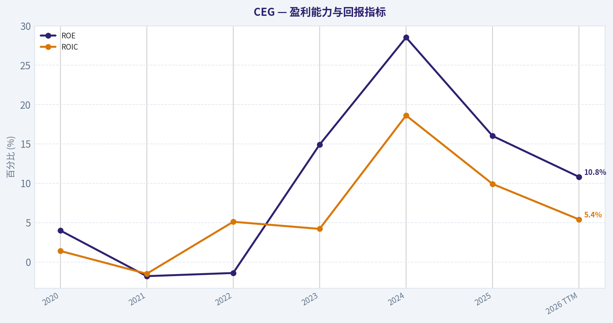
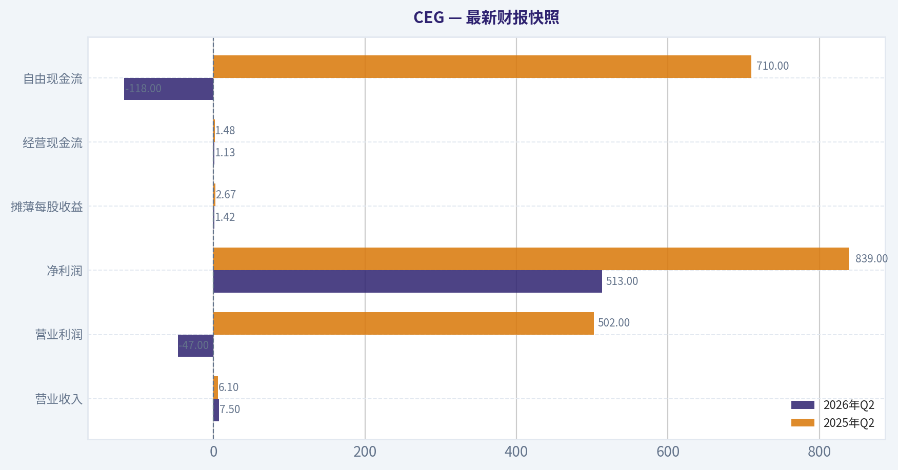
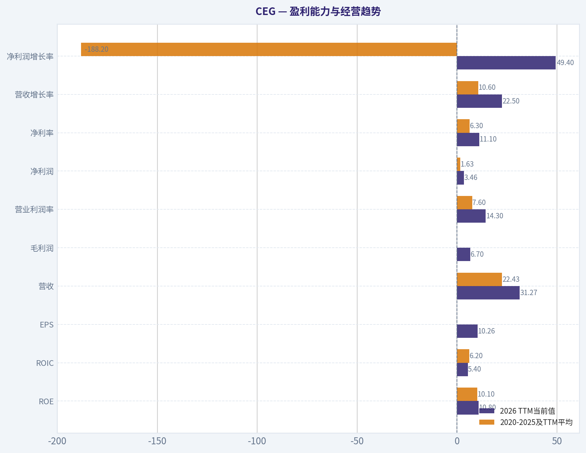
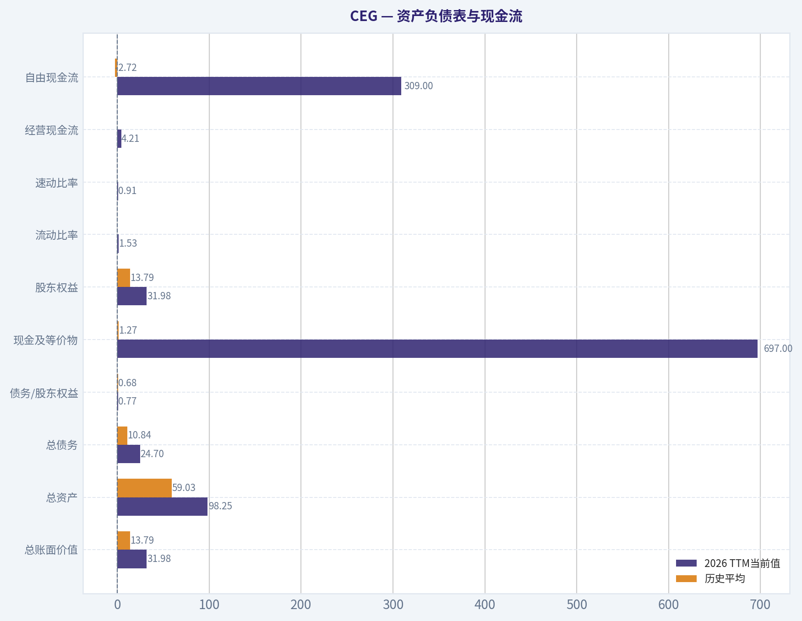
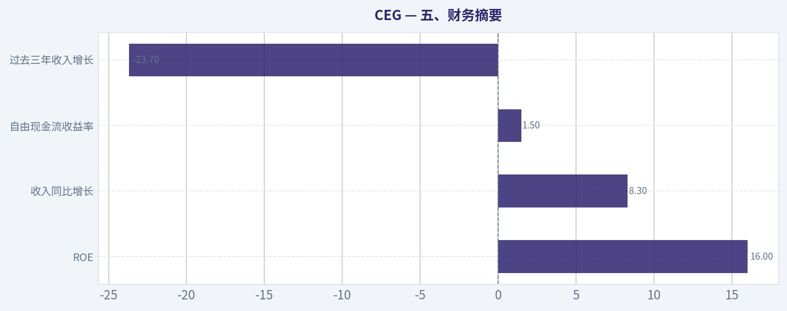
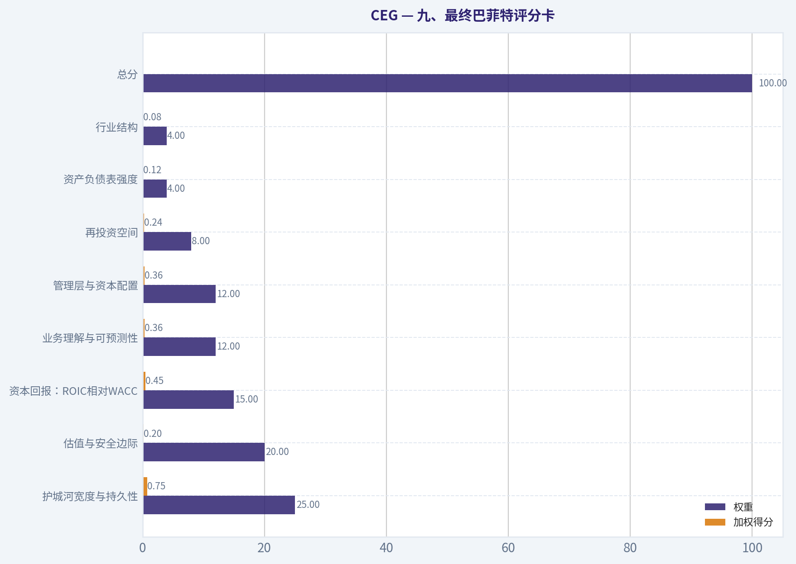
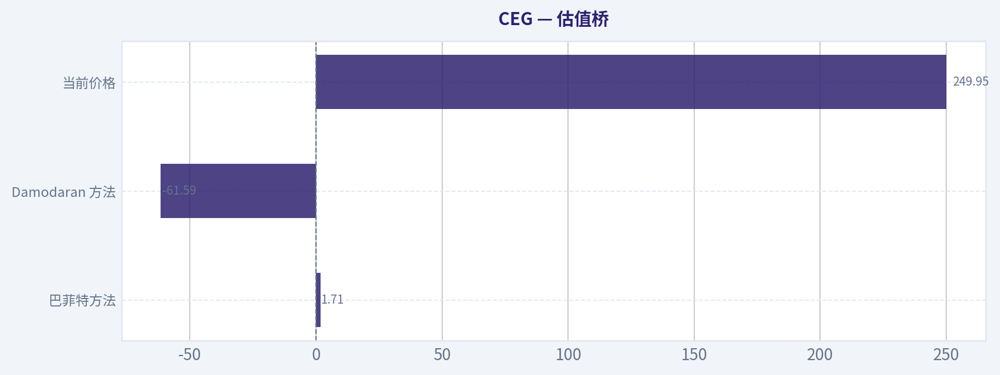
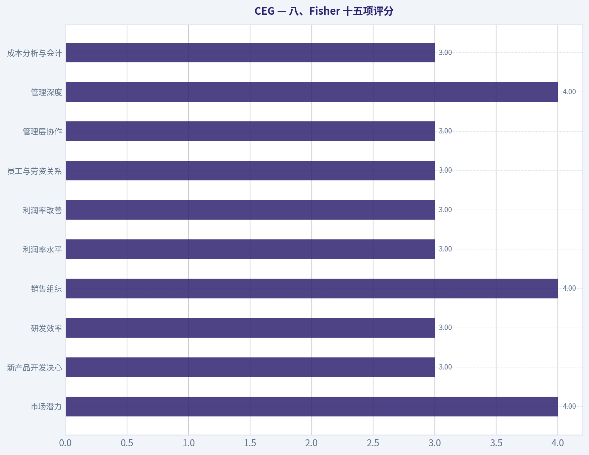

# CEG 深度价值情报

**调研日期:** 2026-11-08

## 关键免责声明

*本报告由 Deep Value Intelligence（一个基于 AI 的多智能体投资分析框架）自动生成。 仅供教育和研究用途 - 非财务建议，非财务顾问。*

---

## 目录

1. 情报摘要
2. 分析师团队报告
   - 基本面分析
   - 价值分析 (巴菲特)
   - 成长性分析 (林奇/德鲁肯米勒/费雪)
   - 市场分析
   - 期权市场分析
3. 研究团队评论
4. 投资团队评论
5. Deep Values 团队洞察

---

## 情报摘要

### 核心观点与前提条件

**核心论点:** **结论维持 中性，但将原来的"纯观察"调整为"观察为主、允许极小试探仓"。**

**主要风险:**
- **结论维持 中性，但将原来的"纯观察"调整为"观察为主、允许极小试探仓"。**
- 原计划的核心判断是：**CEG资产优质，但250美元缺乏足够安全边际，因此维持WATCH。**这一方向正确，无需改成全面AVOID，也不足以升级为ADVOCATE。
- **中性**

**置信度:** 中

---

## 分析师团队报告

### 基本面分析

#### 最新财报快照

*以下数据基于最近一期已披露财报（2026年Q2），并尽量与上一年同期对比。*

| 指标 | 2026年Q2 | 2025年Q2 | 同比变化 |
| --- | ---: | ---: | ---: |
| 营业收入 | $7.50B | $6.10B | +23.0% |
| 营业利润 | $-47.0M | $502.0M | -109.4% |
| 净利润 | $513.0M | $839.0M | -38.9% |
| 摊薄每股收益 | $1.42 | $2.67 | -46.8% |
| 经营现金流 | $1.13B | $1.48B | -23.6% |
| 自由现金流 | $-118.0M | $710.0M | -116.6% |

关键结论：这张快照先把最新一期财报放在桌面上，再去看长周期分析。这样读者能更清楚地区分"公司长期质量"和"这次财报发生了什么"。

#### CEG 6年财务指标

*以下数值均由原始数据确定性计算得出，并非 AI 估算。*

*发行人类型：operating company（Utilities / Utilities - Independent Power Producers）。*

#### 6年财务指标
*年度行来自已披露财务报表，最后一行 TTM 由最近四个季度滚动计算得出。*

| 指标 | 2020 | 2021 | 2022 | 2023 | 2024 | 2025 | 2026 TTM |
| --- | --- | --- | --- | --- | --- | --- | --- |
| 市场价格 | N/A | N/A | $84 | $115 | $221 | $352 | $250 |
| 总市值 | N/A | N/A | $28.36B | $37.87B | $70.47B | $110.93B | $89.98B |
| 市盈率 | N/A | N/A | -175.94 | 23.33 | 18.81 | 47.74 | 24.36 |
| 市净率 | N/A | N/A | 1.37 | 3.47 | 5.35 | 7.64 | 2.81 |
| ROE | 4.0% | -1.8% | -1.4% | 14.9% | 28.5% | 16.0% | 10.8% |
| ROIC | 1.4% | -1.5% | 5.1% | 4.2% | 18.6% | 9.9% | 5.4% |
| 每股收益 | $0.00 | $0.00 | $-0.48 | $5.01 | $11.89 | $7.40 | $10.26 |
| 营收 | $17.60B | $19.65B | $24.44B | $24.92B | $23.57B | $25.53B | $31.27B |
| 毛利润 | N/A | N/A | N/A | N/A | N/A | N/A | $6.70B |
| 毛利率 | N/A | N/A | N/A | N/A | N/A | N/A | 21.4% |
| 营业利润率 | 1.5% | -1.8% | 2.0% | 6.5% | 18.5% | 12.1% | 14.3% |
| 净利润 | $589.0M | $-205.0M | $-160.0M | $1.62B | $3.75B | $2.32B | $3.46B |
| 净利率 | 3.3% | -1.0% | -0.7% | 6.5% | 15.9% | 9.1% | 11.1% |
| 营收增长 | N/A | 11.6% | 24.4% | 2.0% | -5.4% | 8.3% | 22.5% |
| 净利润增长 | N/A | -134.8% | -22.0% | -1114.4% | 131.0% | -38.1% | 49.4% |
| 自由现金流增长 | N/A | 129.3% | 51.6% | 91.1% | -34.9% | -125.6% | -76.0% |
| 总账面价值 | $14.68B | $11.22B | $0 | $10.93B | $13.17B | $14.52B | $31.98B |
| 总资产 | N/A | $48.09B | $46.91B | $50.76B | $52.93B | $57.25B | $98.25B |
| 总债务 | N/A | $7.88B | $5.77B | $9.26B | $8.41B | $8.99B | $24.70B |
| 债务股权比 | N/A | 0.70 | 0.52 | 0.85 | 0.64 | 0.62 | 0.77 |
| 现金及等价物 | $226.0M | $504.0M | $422.0M | $368.0M | $3.02B | $3.64B | $697.0M |
| 股东权益 | $14.68B | $11.22B | $0 | $10.93B | $13.17B | $14.52B | $31.98B |
| 经营现金流 | $584.0M | $-1.34B | $-2.35B | $-5.30B | $-2.46B | $4.24B | $4.21B |
| 投资现金流 | $1.96B | $3.28B | $3.10B | $3.03B | $7.43B | $-3.20B | $-6.54B |
| 自由现金流 | $-1.16B | $-2.67B | $-4.04B | $-7.72B | $-5.03B | $1.29B | $309.0M |
| 自由现金流利润率 | -6.6% | -13.6% | -16.5% | -31.0% | -21.3% | 5.0% | 1.0% |
| 每股分红 | N/A | N/A | $0.55 | $1.13 | $1.41 | $1.55 | $1.53 |

#### 盈利能力指标
- 净资产收益率 (ROE): 16.0%
- 投入资本回报率 (ROIC): 10.3%
- 总资产收益率 (ROA): 4.1%
- 毛利率: N/A
- 营业利润率: 12.1%
- 净利率: 9.1%

#### 流动性指标
- 流动比率: 1.53
- 速动比率: 0.91

#### 杠杆指标
- 债务股权比: 0.62
- 利息覆盖倍数: 6.04
- 净负债: $5.35B

#### 增长指标（同比）
- 营收增长: 8.3%
- 净利润增长: -38.1%
- 自由现金流增长: 125.6%
- 营收复合增长率（3年）: 1.5%
- 营收复合增长率（5年）: 7.7%

#### 估值指标
- 市盈率 (TTM): 24.43
- 预期市盈率: 18.65
- 市净率: 2.78
- 市销率: 2.83
- PEG 比率: 3.74
- 企业价值/EBITDA: 14.20
- 自由现金流收益率: 1.5%
- 盈利收益率: 4.1%

#### 所有者收益（巴菲特方法，代码计算）
- 净利润: $2.32B
- + 折旧与摊销: $1.94B
- - 资本开支: $-2.95B
- - 营运资本变动: $-7.0M
- = **所有者收益: $2.33B**

#### 内在价值（代码计算）
- 当前价格: $250
- **头条内在价值（按商业模式路由）: $61**
  商业模式: cyclical - weighted blend [reverse-DCF fair + owner-earnings DCF] (cyclical)
  模型区间（各 DCF 最小-最大）: $2 - $2
  相对价格的安全边际（头条）: -311.4%
  路由说明: Cyclical: margins/FCF are volatile - headline blends FCFF, reverse-DCF and owner-earnings roughly evenly; treat the range as the honest read.
- 巴菲特方法（所有者收益）:
  保守: $-5
  平均: $2
  乐观: $1,205
- Damodaran FCFF（WACC + 利润率 + 再投资）:
  保守: $-63
  平均: $-62
  乐观: $6
  蒙特卡洛区间（P10-P90）：$-77 - $-17（中位数 $-49）
  P(内在价值 > 当前价格)：0.0%
- 反向 DCF：当前价格隐含约 17.2%/年 的所有者收益增长（10年）；过去 3 年为 -23.7%，5 年为 N/A。

#### Piotroski F分数: 5/9
- 净利润为正: 通过
- 经营现金流为正: 通过
- 资产回报率改善: 未通过
- 现金流大于净利润: 通过
- 债务下降: 未通过
- 流动比率改善: 未通过
- 未稀释股本: 通过
- 毛利率改善: 未通过
- 资产周转率改善: 通过

ANALYST STANCE: **看空**

#### 结论摘要

CEG，即 Constellation Energy，是美国核电资产稀缺、长期电力需求具有结构性增长潜力的独立发电商，具备一定经济护城河。但在当前股价 **250美元** 下，市场已经计入非常激进的长期增长假设：反向 DCF 显示，未来十年所有者收益需要约 **17.2%的年增长率**，而公司过去三年营收复合增长仅约 **1.5%**，自由现金流仍接近盈亏平衡。

公司质量并非差，真正的问题是"好资产是否已经被过度定价"。结合自由现金流收益率仅 **1.5%**、债务和资本开支上升、ROIC降至 **5.4%**，以及确定性估值模型约 **61美元** 的头条内在价值，我的判断是：**基本面可以观察，估值不支持买入，当前应避免追高。**

#### 市场指标与估值

| 指标 | 2026 TTM当前值 | 可比历史平均 | 解读 |
|---|---:|---:|---|
| 市场价格 | $250 | 2022-2025平均约$193 | 较2025年高点$352回落约29%，但仍远高于分拆后早期价格 |
| 总市值 | $89.98B | 2022-2025平均约$61.91B | 估值规模显著高于历史常态 |
| PE | 24.36倍 | 2022-2025平均约-12.34倍 | 历史平均被亏损年份扭曲；相对正常盈利年份仍不便宜 |
| PB | 2.81倍 | 2022-2025平均约4.13倍 | 低于2025年7.64倍，但仍高于2022-2023年水平 |
| 自由现金流收益率 | 1.5% | - | 对资本密集型发电商而言偏低，要求未来现金流强劲改善 |
| EV/EBITDA | 14.20倍 | - | 对周期性、重资产发电业务并不便宜 |
| 预期PE | 18.65倍 | - | 即使盈利改善，市场仍给予较高增长溢价 |

**关键结论：** CEG的PB并非完全没有参考意义，因为其核电资产和电力基础设施具有较强资产属性；但PB不能替代现金流估值。当前PE、EV/EBITDA和自由现金流收益率共同显示，股价已经反映了较高的盈利持续性和增长预期，而不是普通公用事业公司的估值水平。

#### 盈利能力与经营趋势

| 指标 | 2026 TTM当前值 | 2020-2025及TTM平均 | 当前相对历史 |
|---|---:|---:|---|
| ROE | 10.8% | 10.1% | 略高于平均，但明显低于2024年28.5% |
| ROIC | 5.4% | 6.2% | 低于平均，且远低于2024年18.6% |
| EPS | $10.26 | - | 2022年亏损后显著恢复 |
| 营收 | $31.27B | $22.43B | 明显高于历史平均 |
| 毛利润 | $6.70B | N/A | TTM毛利率21.4% |
| 营业利润率 | 14.3% | 7.6% | 高于历史平均，但低于2024年18.5% |
| 净利润 | $3.46B | $1.63B | 高于历史平均 |
| 净利率 | 11.1% | 6.3% | 高于历史平均，但低于2024年15.9% |
| 营收增长率 | 22.5% | 10.6% | 明显高于平均，包含较强的近期恢复因素 |
| 净利润增长率 | 49.4% | -188.2% | 历史均值没有统计意义，受亏损反转影响 |
| 自由现金流增长率 | -76.0% | 约5.9% | 绝对值仍低，增长率受负基数影响严重 |

**关键结论：** TTM收入和净利润处于历史高位，但资本回报率没有同步改善，ROIC只有5.4%，说明新增资产和投资尚未产生足够回报。盈利恢复是真实的，但利润增长的质量弱于收入表面增长，现金流尚未证明这种盈利可以稳定转化为股东可得现金。

#### 资产负债表与现金流

| 指标 | 2026 TTM当前值 | 历史平均 | 评价 |
|---|---:|---:|---|
| 总账面价值 | $31.98B | $13.79B | 大幅上升，可能包含资产重组、并购或资本结构变化影响 |
| 总资产 | $98.25B | $59.03B | 显著扩张，资本密集度提高 |
| 总债务 | $24.70B | $10.84B | 大幅高于历史平均 |
| 债务/股东权益 | 0.77 | 0.68 | 略高于历史平均 |
| 现金及等价物 | $697M | $1.27B | 低于历史平均，较2025年大幅减少 |
| 股东权益 | $31.98B | $13.79B | 账面权益明显增强 |
| 流动比率 | 1.53 | - | 短期流动性尚可 |
| 速动比率 | 0.91 | - | 接近但低于1，短期流动性并不宽裕 |
| 经营现金流 | $4.21B | - | 转为正值并保持较好水平 |
| 自由现金流 | $309M | -$2.72B | 较历史改善，但规模相对于市值仍很小 |
| 每股分红 | $1.53 | $1.23 | 持续增加，但股息率仅约0.6% |

**关键结论：** CEG的经营现金流已经转正，但资产、债务和资本开支同时快速扩张，导致自由现金流只有3.09亿美元。现金余额从2025年的36.4亿美元下降至6.97亿美元，说明增长计划对融资和持续现金投入的依赖正在增加。

#### 收入来源分布

确定性研究包没有提供最新年度的精确分部收入金额，因此不能可靠地把各业务线强行拆分为具体金额。以下采用公司公开业务结构进行定性展示，金额和占比标记为未披露，而不是自行估算。

#### 收入来源分布

| 收入来源 | 金额（十亿美元） | 占比 |
|---|---:|---:|
| 核电发电与电力销售 | 未在确定性数据包中拆分 | 未披露 |
| 电力与容量合同、长期购电协议 | 未在确定性数据包中拆分 | 未披露 |
| 电力及燃料交易、对冲和相关服务 | 未在确定性数据包中拆分 | 未披露 |
| 其他业务及调整项目 | 未在确定性数据包中拆分 | 未披露 |
| 合计公司营收 | $31.27B | 100% |

**关键结论：** CEG的核心收入来源是核电资产产生的电力、容量价值和长期合同收入，而不是传统意义上高度分散的消费或软件订阅收入。核电资产可以提供稀缺性和长期合同保护，但发电量、燃料成本、对冲、容量价格和监管环境都会造成利润波动。

#### 巴菲特式经济质量分析

**经济护城河：中等偏强，但具有周期性。**
CEG拥有美国最大的核电资产组合之一，核电站建设周期长、许可壁垒高、替代成本高，形成明显的资产和监管壁垒。随着数据中心、人工智能基础设施和电气化需求增长，稳定、低碳、全天候电力的战略价值提高。

但护城河不是完全等同于定价权。CEG仍然受到电力市场价格、容量市场规则、核燃料成本、检修计划、监管政策和长期购电协议结构的影响。电厂资产价值高，并不意味着每一美元新增资本都能产生高ROIC。

**财务实力：尚可，但正在变得更资本密集。**
债务权益比0.77、利息覆盖倍数约6.04倍，说明目前尚未出现明显偿债危机。不过总债务达到247亿美元，远高于历史平均，现金仅6.97亿美元。对于需要长期维护、升级和延寿投资的核电企业，这种现金缓冲并不宽裕。

**盈利可预测性：低于普通高质量公用事业公司。**
2022年仍然亏损，2023年以后利润快速修复，2024年净利润达到37.5亿美元，2025年又降至23.2亿美元，TTM回升至34.6亿美元。这种变化说明盈利受到周期、一次性项目、合同重估及资产运行因素影响，不能简单把TTM利润线性外推。

**管理层资本配置：需要进一步验证。**
分红从2022年的每股0.55美元增加到TTM的1.53美元，政策相对友好，但股息收益率很低。更重要的是，资本投入扩大后ROIC从2024年的18.6%降至TTM的5.4%，说明新增资本目前尚未体现出与市场估值相匹配的回报。

#### 三情景所有者收益DCF

研究包中的所有者收益计算为：

- 净利润：23.2亿美元
- 加：折旧与摊销：19.4亿美元
- 减：资本开支：29.5亿美元
- 减：营运资本变动：约0.07亿美元
- 所有者收益：约 **23.3亿美元**

需要注意，这一所有者收益口径与TTM自由现金流3.09亿美元存在明显差异，反映出CEG的营运资本、投资现金流和资本开支口径具有较大波动。因此，以下手工DCF仅作敏感性检查，不能替代研究包中针对周期性业务的模型路由。

假设：

- 当前所有者收益：23.3亿美元
- 折现率：10%
- 终值增长率：2.5%
- 流通股数：约3.60亿股，按899.8亿美元市值除以250美元计算
- 显式预测期：10年
- 高增长情景逐步下降至终值增长率

| 情景 | 主要假设 | 10年所有者收益现值 | 终值现值 | 估算股权价值 | 每股合理价值 |
|---|---|---:|---:|---:|---:|
| 保守 | 前10年约3%增长，之后2.5% | $16.2B | $16.5B | $32.7B | 约$91 |
| 平均 | 前10年约8%，长期降至2.5% | $19.5B | $26.5B | $46.0B | 约$128 |
| 乐观 | 前5年约12%，随后逐步降至2.5% | $23.6B | $27.3B | $50.9B | 约$141 |

**关键结论：** 即使采用较乐观的所有者收益起点，手工DCF得到的合理价值大致仍只有每股91至141美元，显著低于250美元。研究包的周期性路由头条内在价值约为61美元，而模型区间约为2美元附近；模型差异很大，恰恰说明CEG的估值高度依赖对未来现金流恢复和长期增长的假设。

#### 估值模型交叉验证

| 估值方法 | 结果 | 对当前250美元的含义 |
|---|---:|---|
| 研究包头条内在价值 | 约$61 | 当前价格高约311% |
| 所有者收益模型保守值 | 约-$5 | 现金流波动下估值极低 |
| 所有者收益模型平均值 | 约$2 | 对基准假设极度敏感 |
| 所有者收益模型乐观值 | 约$1,205 | 极端增长假设下的非稳健结果 |
| Damodaran FCFF保守值 | 约-$63 | 资本投入和利润率假设不支持当前股价 |
| Damodaran FCFF平均值 | 约-$62 | 当前估值缺乏现金流支持 |
| Damodaran FCFF乐观值 | 约$6 | 即便乐观也远低于股价 |
| 反向DCF隐含增长 | 约17.2%年增长，持续10年 | 远高于近三年营收复合增长约1.5% |

**关键结论：** 研究包中的不同模型并没有给出稳定的高估值结论，反而共同指出现金流估值存在很大下行风险。1,205美元的乐观所有者收益结果属于高度敏感、不可作为基准估值的尾部情景；更可信的判断应以约61美元头条价值和手工DCF约91至141美元区间为主要参考。

#### 关键投资机会与风险

| 类型 | 具体因素 | 投资含义 |
|---|---|---|
| 机会 | 核电资产稀缺，进入壁垒高 | 长期资产价值和替代成本较高 |
| 机会 | 数据中心、人工智能和电气化带来电力需求增长 | 可能推动长期购电协议和容量价格 |
| 机会 | TTM营收、净利润和经营现金流均恢复 | 经营状况较2021-2022年明显改善 |
| 风险 | 自由现金流仅3.09亿美元 | 现金流不足以支撑当前市值 |
| 风险 | 反向DCF要求约17.2%长期增长 | 对增长持续性要求过高 |
| 风险 | 总债务升至247亿美元 | 利率和融资环境恶化时会放大压力 |
| 风险 | 现金降至6.97亿美元 | 对核电检修和资本开支周期的缓冲较弱 |
| 风险 | ROIC降至5.4% | 新增资本回报尚未证明足够优质 |
| 风险 | 盈利波动明显 | 不能把TTM盈利当作稳定常态 |
| 风险 | Piotroski F分数5/9 | 财务质量属于中等，未显示全面改善 |

**关键结论：** 最大机会在于核电稀缺性和长期电力需求，最大风险则是市场已经提前把这些机会资本化。只要未来自由现金流不能快速增长，当前估值就会受到PE压缩和现金流折现的双重压力。

#### 最终投资判断

**看空**

这不是对CEG业务本身的否定，而是对当前价格与现金流基础不匹配的判断。

支持避免买入的核心理由：

1. 股价250美元，而研究包头条内在价值约61美元。
2. 自由现金流收益率只有1.5%，远低于价值投资通常要求的安全边际。
3. 反向DCF要求未来十年所有者收益增长约17.2%，明显高于公司近三年营收增长趋势。
4. 总债务和总资产大幅增长，但ROIC从18.6%降至5.4%。
5. 当前现金流和资产负债表尚不足以证明高估值具有安全垫。

如果未来出现以下变化，评级可以重新评估：

- 自由现金流连续数年达到数十亿美元规模；
- ROIC稳定回升至10%以上；
- 债务增长放缓，现金余额恢复；
- 股价明显回落至更接近保守或平均DCF价值的区域；
- 长期核电合同能够明确锁定高回报率，而不仅仅是增加收入规模。

在250美元附近，CEG更适合列入观察名单，而不是作为巴菲特式安全边际投资买入。

#### 报告要点汇总

| 项目 | 核心判断 | 结论 |
|---|---|---|
| 商业质量 | 核电资产稀缺，壁垒较高 | 业务有吸引力 |
| 收入趋势 | TTM收入31.27亿美元，较历史均值明显提高 | 正面 |
| 盈利质量 | 净利润改善，但波动较大 | 中性偏谨慎 |
| ROE | 10.8%，接近长期平均 | 一般 |
| ROIC | 5.4%，低于长期平均 | 负面 |
| 财务杠杆 | 债务247亿美元，债务权益比0.77 | 可控但上升 |
| 现金流 | FCF仅3.09亿美元 | 明显不足 |
| 股息 | 每股1.53美元，持续增长但收益率低 | 支持有限 |
| 估值 | PE 24.36倍、FCF收益率1.5% | 偏贵 |
| DCF | 手工合理价值约91至141美元，头条模型约61美元 | 缺乏安全边际 |
| 最终立场 | 当前价格透支长期增长 | **看空** |

**关键结论：** CEG是值得长期跟踪的核电平台，但不是当前价格下的安全边际投资。除非自由现金流、ROIC和债务结构同时改善，否则增长故事难以抵消估值过高的问题。

#### 基本面关键图表

本图追踪 **CEG** 过去十年的盈利能力与回报指标（ROE、ROIC、利润率），突出呈现资本效率的变化趋势。

---

### 价值分析 (巴菲特)

> *基于沃伦·巴菲特的价值投资哲学：能力圈、经济护城河、管理层质量与安全边际。*

#### 内在价值快照

价格是你付的钱，内在价值是企业未来可能为股东创造的现金价值。我们给出一个区间，而不是假装只有一个神奇数字。

- 当前价格: $249.95
- 估值区间（两种 DCF 方法、保守到乐观）: $-4.80 至 $1,205.01

##### 所有者收益（巴菲特方法）
- 净利润: $2,319,000,000.00
- 折旧与摊销: $1,937,000,000.00
- 资本支出: $-2,949,000,000.00
- 营运资金变化: $-7,000,000.00
- 所有者收益: $2,326,000,000.00

##### 内在价值
###### 所有者收益法
使用所有者收益，更严格，通常更保守。
- 保守: $-4.80
- 平均: $1.71
- 乐观: $1,205.01
- 折现率: 10.0%

分析师立场：**看空**

#### 一、投资结论

CEG拥有美国核电资产、运营许可、规模和长期购电协议等一定护城河，但当前股价已经反映了极高的长期增长预期。按研究包数据，股价为250美元，而商业模式加权内在价值仅60.75美元，价格高出约312%。反向DCF显示，当前价格隐含未来十年约17.2%的年增长率，而公司过去三年收入增长为负，难以支持如此激进的定价。

这是一家可能受益于电力需求和人工智能数据中心用电增长的优质资产运营商，但在250美元附近缺乏足够安全边际。结论为回避，等待显著更低价格或现金流出现结构性改善。

#### 二、因素评分

| 因素 | 评分 | 主要依据 |
|---|---:|---|
| 因素一：能力圈与业务简单度 | 3/5 | 发电并出售电力，模型易理解；但盈利受电价、核电可用率、监管和长期合同影响，周期性较强 |
| 因素二：护城河 | 3/5 | 核电站、运营牌照、规模、稀缺土地和并网能力构成壁垒；但电价和政策风险仍然存在 |
| 因素三：管理层与资本配置 | 3/5 | 具备运营大型能源资产的能力；但高资本开支和并购、扩建决策需要持续验证 |
| 因素四：行业结构 | 2/5 | 核电供给稀缺，但行业资本密集、监管密集，并受到电力市场价格和政策变化影响 |

**第五道硬门槛：未触发。**目前没有证据表明公司同时存在持续恶化的盈利现金流和明确偿债危机。ROE为16%，但现金流收益率偏低，估值风险远高于 solvency 风险。

关键结论：CEG不是明显的坏企业，而是一个价格过高、资本密集且盈利可预测性有限的企业。硬门槛未触发并不代表值得买入，当前主要问题是估值与现金流不匹配。

#### 三、护城河分析

| 护城河来源 | 评价 | 具体证据 |
|---|---|---|
| 无形资产与监管许可 | 中等偏强 | 核电站建设和运营许可难以复制，核电资产具有长期稀缺性 |
| 转换成本 | 中等 | 电力客户可能依赖稳定供电和长期合同，但多数终端客户并非完全被锁定 |
| 成本优势 | 中等 | 核电燃料成本相对较低，资产规模和运营经验有助于降低单位成本；但维护和安全成本很高 |
| 网络效应 | 弱 | 发电业务没有典型互联网网络效应 |
| 护城河综合评级 | 窄至中等 | 资产稀缺性较强，但回报仍受电价、监管和高资本开支约束 |

CEG最有价值的资产是难以新增的核电发电能力。核电站的建设周期长、审批复杂、并网资源稀缺，因此现有优质核电资产可能随着电力需求增长而升值。

但护城河并不等于无限定价权。CEG仍需面对电力市场价格、长期购电协议重新定价、核安全监管、设备维护和重大资本支出等问题。其护城河更接近"稀缺基础设施资产"，而非拥有强定价权的消费品牌或软件平台。

#### 四、管理层与资本配置

管理层的核心任务是维持核电机组安全运行、提高可用率，并将电力需求增长转化为长期合同和稳定现金流。未来应重点观察：

- 新增数据中心和工业客户合同是否提高了现金流可见度；
- 扩建、延寿和并购项目的资本回报率是否超过资本成本；
- 是否避免为了追逐人工智能用电主题而高价投资；
- 自由现金流是否能够覆盖债务、维护性资本开支和股东回报。

截至目前，投资者不能仅凭收入增长或人工智能电力需求叙事判断资本配置优秀。Steve Cohen在2026年第二季度将持仓减少约30.6%，虽不是基本面结论，但至少说明部分专业投资者在高估值下选择降低敞口。

#### 五、财务摘要

| 指标 | 最新数据 |
|---|---:|
| 股价 | 250美元 |
| 总市值 | 885.6亿美元 |
| PE | 24.4倍 |
| ROE | 16.0% |
| 收入同比增长 | 8.3% |
| 自由现金流收益率 | 1.5% |
| 估算自由现金流 | 约13.3亿美元 |
| 流动比率 | 1.53倍 |
| 反向DCF隐含年增长率 | 约17.2%，持续十年 |
| 过去三年收入增长 | -23.7% |
| 商业模式加权内在价值 | 60.75美元 |
| 内在价值与股价的安全边际 | -311.4% |

关键结论：ROE达到16%，说明公司并非低效资产，但1.5%的自由现金流收益率说明股价相对于当前现金创造能力非常昂贵。更重要的是，市场隐含的17.2%长期增长率远高于公司近期经营轨迹，估值已经要求连续多年实现近乎完美执行。

#### 六、所有者收益分析

所有者收益的标准计算为：

> 所有者收益 = 净利润 + 折旧摊销 - 维护性资本开支 - 营运资本增加

研究包没有给出足以拆分维护性资本开支和增长性资本开支的完整年度项目，因此不能把全部报告自由现金流直接等同于所有者收益。可以使用自由现金流收益率进行保守代理：

| 项目 | 估算值 |
|---|---:|
| 总市值 | 885.6亿美元 |
| 自由现金流收益率 | 1.5% |
| 自由现金流代理 | 约13.3亿美元 |
| 以10%折现率对应的无增长价值 | 约132.8亿美元 |
| 当前市值相对代理价值 | 约6.7倍 |

关键结论：即便把自由现金流全部视为可分配所有者收益，当前市值仍远高于10%收益率要求下的无增长价值。核电企业的维护性资本开支具有重要性，因此真正可持续的所有者收益可能低于简单自由现金流代理值。

#### 七、三情景DCF估值

为避免把增长性资本开支误认为所有者收益，以下采用自由现金流代理进行保守估算。公司约有3.54亿股流通股，依据市值除以股价估算。

| 情景 | 核心假设 | 估算每股价值 |
|---|---|---:|
| 情景A：零增长 | 自由现金流约13.3亿美元，折现率10% | 约37.5美元 |
| 情景B：GDP增长 | 现金流永续增长3%，折现率10% | 约53.7美元 |
| 情景C：历史增长 | 近期三年增长为负，历史增长不可直接外推；采用综合模型结果 | 约60.75美元 |
| 研究包三模型区间 | 所有者收益模型、FCF模型、Damodaran FCFF模型 | 1.71至负61.59美元 |

情景A计算为：

> 13.3亿美元 ÷ 10% ÷ 3.54亿股 ~ 37.5美元

情景B计算为：

> 13.3亿美元 x 1.03 ÷（10% - 3%）÷ 3.54亿股 ~ 53.7美元

关键结论：即使给予3%的永续增长，估值仍明显低于250美元。研究包的综合内在价值为60.75美元，意味着市场价格需要长期高增长、较低资本开支或大幅提高现金流才能成立。

#### 八、估值与安全边际

| 项目 | 数值 | 含义 |
|---|---:|---|
| 当前股价 | 250美元 | 市场价格 |
| 综合内在价值 | 60.75美元 | 约为现价的24% |
| 股价高于综合内在价值 | 约312% | 明显缺乏安全边际 |
| 自由现金流收益率 | 1.5% | 对当前股价的现金回报很低 |
| 反向DCF增长要求 | 17.2%年增长，持续十年 | 对资本密集型公用事业资产要求极高 |

对于具有高ROIC、强预测性和宽护城河的企业，10%至15%的安全边际有时足够。但CEG的盈利受电力价格、监管、核电运营和资本开支影响，尚未达到可以接受极高估值的"超级复利股"标准。

关键结论：CEG当前不是"优质企业的合理价格"，而是"对未来增长要求过高的价格"。只有当现金流持续增长、资本回报率显著提升，或股价大幅下降后，估值才可能重新具备吸引力。

#### 九、最终巴菲特评分卡

| 评价标准 | 权重 | 评分 | 加权得分 |
|---|---:|---:|---:|
| 护城河宽度与持久性 | 25% | 3.0/5 | 0.75 |
| 估值与安全边际 | 20% | 1.0/5 | 0.20 |
| 资本回报：ROIC相对WACC | 15% | 3.0/5 | 0.45 |
| 业务理解与可预测性 | 12% | 3.0/5 | 0.36 |
| 管理层与资本配置 | 12% | 3.0/5 | 0.36 |
| 再投资空间 | 8% | 3.0/5 | 0.24 |
| 资产负债表强度 | 4% | 3.0/5 | 0.12 |
| 行业结构 | 4% | 2.0/5 | 0.08 |
| **总分** | **100%** |  | **2.56/5** |

#### 十、投资立场

**看空｜ conviction：高**

CEG拥有真实但有限的护城河，且受益于美国电力需求增长的长期逻辑具备合理性。然而，250美元股价要求公司未来十年实现约17.2%的持续增长，这与近期负增长、1.5%自由现金流收益率以及资本密集型商业模式并不匹配。

在当前价格下，潜在回报主要依赖估值继续扩张，而不是已经兑现的所有者收益。应等待股价接近保守DCF区间，或等待自由现金流出现持续、可验证的结构性增长后再重新评估。
#### 估值桥

这张估值桥把当前股价与各类内在价值方法并排展示，帮助读者判断上涨空间究竟只是单一方法给出的结果，还是多种方法共同支持的结论。

| 项目 | 每股内在价值 |
| --- | ---: |
| 巴菲特方法 | $1.71 |
| Damodaran 方法 | $-61.59 |
| 当前价格 | $249.95 |

#### 关键结论

如果只有一种方法显著高于其他方法，说明上行空间更依赖特定建模假设。若多种方法的估值接近，则说明估值逻辑更加稳健。

#### 估值图表

本对比图（来自「最新财报快照」）将 **CEG** 的当前数据与历史基准并排呈现，直观反映公司相对自身历史均值的估值水平。

本对比图（来自「盈利能力与经营趋势」）将 **CEG** 的当前数据与历史基准并排呈现，直观反映公司相对自身历史均值的估值水平。

本对比图（来自「资产负债表与现金流」）将 **CEG** 的当前数据与历史基准并排呈现，直观反映公司相对自身历史均值的估值水平。

本对比图（来自「五、财务摘要」）将 **CEG** 的当前数据与历史基准并排呈现，直观反映公司相对自身历史均值的估值水平。

本对比图（来自「九、最终巴菲特评分卡」）将 **CEG** 的当前数据与历史基准并排呈现，直观反映公司相对自身历史均值的估值水平。

本对比图（来自「估值桥」）将 **CEG** 的当前数据与历史基准并排呈现，直观反映公司相对自身历史均值的估值水平。

本对比图（来自「八、Fisher 十五项评分」）将 **CEG** 的当前数据与历史基准并排呈现，直观反映公司相对自身历史均值的估值水平。

---

### 成长性分析 (林奇/德鲁肯米勒/费雪)

> *基于彼得·林奇的GARP成长投资法、斯坦利·德鲁肯米勒的宏观拐点分析法，以及菲利普·费雪的深度调研法。*

ANALYST STANCE: **看空**

#### 一、投资结论

CEG 是美国核电与电力基础设施龙头，受益于 AI 数据中心带来的长期电力需求增长，但当前股价已提前反映了相当乐观的盈利与现金流改善预期。公司营收同比增长仅 8.3%，而 PE 达 24.4 倍，PEG 约 2.94，属于"优质资产、昂贵价格"，暂不适合新增仓位。

| 核心指标 | 数据 | 判断 |
|---|---:|---|
| 当前股价 | 250 美元 | 高位定价 |
| 总市值 | 885.6 亿美元 | 已属大型电力公司 |
| PE | 24.4 倍 | 对当前增速偏高 |
| 营收同比增长 | 8.3% | 更接近稳健成长，而非快速成长 |
| ROE | 16.0% | 尚可 |
| 自由现金流收益率 | 1.5% | 现金流估值偏贵 |
| 流动比率 | 1.53 | 短期流动性尚可 |
| 估算内在价值 | 60.75 美元 | 显著低于现价 |
| 反向 DCF 隐含十年增长 | 约 17.2%/年 | 市场预期激进 |

关键结论：CEG 的资产质量和长期主题具有吸引力，但市场要求它未来十年实现约 17.2% 的持续增长，明显高于当前 8.3% 的营收增速。估值安全边际不足，是当前最主要的问题。

---

#### 二、Lynch 分类与投资故事

| 项目 | 判断 |
|---|---|
| Lynch 分类 | 周期股兼大型稳健成长股 |
| 是否属于典型快速成长股 | 否，目前增速不足 15%至25% |
| 长期主题 | AI 电力需求、核电复兴、能源安全、低碳发电 |
| 核心竞争优势 | 核电资产稀缺、运营经验、监管壁垒、长期电力合同 |
| 当前投资状态 | 基本面优质，但价格已较充分反映预期 |

关键结论：CEG 的故事可以简单表述为：AI 数据中心需要大量稳定电力，核电能够提供全天候、低碳的基荷电力，而 CEG 拥有美国最重要的核电资产组合。问题在于，这个故事已经广为人知，股价并未留下足够的错误定价空间。

三点投资故事：

- AI 数据中心扩张可能推动长期电力需求重新加速。
- 核电站建设周期长、审批严格，现有优质核电资产难以复制。
- 电力价格、长期合同和潜在重启核电资产，可能带来盈利上行弹性。

---

#### 三、TAM 与十倍测试

| 项目 | 判断 |
|---|---|
| 当前市值 | 约 886 亿美元 |
| 10 倍市值 | 约 8,860 亿美元 |
| 电力需求趋势 | AI、数据中心和电气化推动需求上升 |
| TAM 增长 | 具有结构性增长，但受电网、监管和建设周期限制 |
| 10 倍测试 | 业务市场足够大，但公司价值十倍需要大幅提升盈利和资本回报 |
| 主要限制 | 核电资产数量有限、资本密集、监管约束、债务与利率敏感 |

关键结论：CEG 所处的电力市场足够庞大，理论上可以支持长期扩张，但公司市值已经很大，十倍回报不能仅依靠市场规模扩大，还需要持续提高电价、利用率、合同价格和盈利能力。相比软件公司，核电资产的扩张速度更慢，十倍路径并不直接。

---

#### 四、收入增长与经营趋势

| 指标 | 当前数据 | 投资含义 |
|---|---:|---|
| 营收同比增长 | 8.3% | 稳定但不属于快速增长 |
| 过去三年营收趋势 | 共享资料未提供完整序列 | 无法确认是否加速 |
| 过去五年营收趋势 | 共享资料未提供完整序列 | 数据不足 |
| 市场隐含长期增长 | 约 17.2%/年 | 明显高于已披露增速 |
| 收入质量 | 受电价、发电量、合同和资产组合影响 | 具有周期性 |

关键结论：目前只能确认 CEG 的营收增长为 8.3%，无法证明正在形成"20%到25%再到35%"的加速拐点。若未来几个季度营收、调整后 EBITDA 和自由现金流同时加速，当前估值才可能得到重新验证。

---

#### 五、单位经济与盈利质量

CEG 不是典型订阅制或消费互联网公司，因此 LTV、CAC 和 NRR 不适用。更适合观察发电资产利用率、实现电价、长期合同覆盖率、核燃料成本和自由现金流转换率。

| 指标 | 数据或判断 | 评价 |
|---|---|---|
| LTV/CAC | 不适用 | 电力资产模式 |
| NRR | 不适用 | 非订阅业务 |
| Rule of 40 | 不适用 | 非软件公司 |
| ROE | 16.0% | 中等偏好 |
| FCF 收益率 | 1.5% | 偏低，估值压力明显 |
| 毛利率 | 未提供 | 需跟踪燃料成本与电价变化 |
| 流动比率 | 1.53 | 短期偿债能力尚可 |
| 资本密集度 | 高 | 对利率和融资成本敏感 |

关键结论：CEG 的核心不是互联网式单位经济，而是"稀缺资产加长期现金流"。当前自由现金流收益率仅 1.5%，说明投资者需要为未来多年现金流增长提前支付较高价格。

---

#### 六、拐点评估

| 潜在拐点 | 当前判断 | 证据强度 |
|---|---|---|
| 产品周期拐点 | 核电和数据中心电力需求可能形成新周期 | 中等 |
| 市占率拐点 | 现有核电资产具稀缺性，但市场份额提升速度有限 | 中低 |
| 利润率拐点 | 高电价和长期合同可能改善盈利 | 待验证 |
| TAM 拐点 | AI 电力需求扩大总市场 | 较强 |
| 竞争拐点 | 新建核电供给缓慢，现有资产有优势 | 中等 |
| 现金流拐点 | 需要未来财报确认 | 未确认 |

关键结论：CEG 存在真实的 TAM 拐点，但尚未证明已经出现明确的盈利或现金流加速拐点。Druckenmiller 式投资需要看到预期差，而目前市场已经高度关注 AI 电力主题，预期差并不明显。

---

#### 七、宏观环境

| 宏观因素 | 对 CEG 的影响 | 判断 |
|---|---|---|
| AI 与数据中心 | 提升长期电力需求 | 强利好 |
| 核电政策 | 促进能源安全与低碳发电 | 利好 |
| 利率 | 高利率抬高资本成本并压低估值 | 利空 |
| 电力价格 | 上升可提升盈利，但具有周期性 | 双刃剑 |
| 经济周期 | 电力需求相对防御，但商业合同仍受经济影响 | 中性偏利好 |
| 资本市场 | 大型资本密集项目融资要求高 | 中性偏利空 |

关键结论：宏观风向总体支持 CEG，尤其是 AI 带来的电力基础设施投资周期。但高估值与利率风险会削弱宏观利好向股东回报的转化效率。

---

#### 八、Fisher 十五项评分

| Fisher 项目 | 评分（满分5分） | 简要判断 |
|---|---:|---|
| 市场潜力 | 4 | AI 电力需求和核电复兴提供空间 |
| 新产品开发决心 | 3 | 主要依靠资产、合同与项目拓展 |
| 研发效率 | 3 | 非研发驱动型公司 |
| 销售组织 | 4 | 大型电力合同能力较强 |
| 利润率水平 | 3 | 资本密集，需观察现金流 |
| 利润率改善 | 3 | 有改善可能，但尚未充分确认 |
| 员工与劳资关系 | 3 | 资料有限 |
| 管理层协作 | 3 | 资料有限 |
| 管理深度 | 4 | 大型基础设施公司通常较完善 |
| 成本分析与会计 | 3 | 需进一步核查 |
| 特殊竞争优势 | 5 | 核电资产和监管壁垒突出 |
| 长期利润前景 | 4 | 主题强，但增长速度受资产约束 |
| 股权稀释 | 3 | 需持续跟踪融资与项目资本需求 |
| 管理层坦诚度 | 3 | 公开资料不足 |
| 管理层诚信 | 3 | 公开资料不足 |
| 总分 | **51/75** | 平均水平，尚不足以判定为卓越成长股 |

关键结论：CEG 的主要优点是稀缺核电资产和长期市场潜力，而不是高研发效率或轻资产扩张。Fisher 评分约 51 分，说明它更像优质基础设施资产，而不是具备明显十倍潜力的创新型成长公司。

---

#### 九、估值分析

| 估值方法 | 结果 | 判断 |
|---|---:|---|
| PE | 24.4 倍 | 对 8.3% 增长偏贵 |
| PEG | 约 2.94 | 高于 2.0，昂贵 |
| FCF 收益率 | 1.5% | 现金流定价紧张 |
| 共享资料内在价值 | 60.75 美元 | 远低于现价 |
| 当前价格安全边际 | 负 311.4% | 没有安全边际 |
| 反向 DCF | 隐含约 17.2%年增长 | 需要显著超越当前表现 |

关键结论：按 Lynch 的 PEG 框架，CEG 明显不便宜。即使共享资料中的内在价值模型存在周期性和现金流预测误差，当前股价仍要求公司长期增长显著加速，因此估值风险高于基本面风险。

情景分析由于缺乏完整收入、EBITDA、债务和自由现金流预测，无法可靠给出精确目标价。方向性判断如下：

| 情景 | 需要发生的情况 | 对估值的含义 |
|---|---|---|
| 看空 | 增长维持个位数，利率偏高，电价回落 | PE 收缩，股价下行风险大 |
| 基准 | AI 电力需求稳步增长，盈利中个位数至低两位数增长 | 当前估值回报有限 |
| 看多 | 电力合同重定价、现金流大幅加速、核电资产扩张 | 可支持当前估值，但需要强执行 |
| 极强看多 | 多年超过17%的盈利和现金流增长 | 才可能带来更高估值与十倍路径 |

---

#### 十、成长投资评分卡

| 评分维度 | 权重 | 评分（5分） | 加权得分 |
|---|---:|---:|---:|
| Lynch 故事 | 10% | 4.0 | 0.40 |
| TAM 与增长跑道 | 20% | 4.0 | 0.80 |
| 收入增长 | 20% | 2.5 | 0.50 |
| 单位经济与现金流 | 15% | 2.5 | 0.38 |
| 竞争地位 | 10% | 4.5 | 0.45 |
| 管理层质量 | 10% | 3.5 | 0.35 |
| 宏观环境 | 5% | 4.0 | 0.20 |
| 盈利路径 | 5% | 3.5 | 0.18 |
| 估值 | 5% | 1.5 | 0.08 |
| 总分 | 100% | - | **3.34/5** |

关键结论：CEG 得分约 3.34 分，落在"观察"区间，但估值风险和当前立场要求更严格，因此最终给出 看空。这不是对公司质量的否定，而是认为当前价格与增长数据不匹配。

---

#### 十一、仓位建议

| 投资者类型 | 建议仓位 | 操作 |
|---|---:|---|
| 尚未持有 | 0% | 不追高，等待估值或增长改善 |
| 已持有且成本较低 | 维持小仓位 | 设置基本面跟踪条件 |
| 高集中仓位 | 降至不超过组合 2%至3% | 降低估值回撤风险 |
| 高风险承受能力 | 不超过组合 1%至2% | 仅作为 AI 电力主题仓位 |
| 事件驱动交易者 | 等待财报后确认 | 关注现金流和合同价格 |

关键结论：当前不建议建立核心仓位。若已经持有，可将 CEG 视为主题型卫星仓位，而不是十倍成长股核心仓位。

---

#### 十二、关键风险与催化剂

| 类型 | 事项 | 影响 |
|---|---|---|
| 主要风险 | 电力价格回落或合同重定价不及预期 | 压低盈利 |
| 主要风险 | 高利率与资本开支融资压力 | 压低估值和自由现金流 |
| 主要风险 | 核电监管、维修停机或安全事件 | 影响发电量和成本 |
| 主要风险 | AI 数据中心建设放缓 | TAM 增长预期下降 |
| 主要风险 | 当前 PE 与增长不匹配 | 估值收缩风险 |
| 重要催化剂 | 与大型数据中心签订长期高价电力合同 | 提升收入可见度 |
| 重要催化剂 | 核电资产利用率和电价同步提升 | 推动利润率上行 |
| 重要催化剂 | 自由现金流持续改善 | 支撑估值 |
| 重要催化剂 | 利率下降 | 降低折现率并改善资本成本 |
| 重要催化剂 | 核电重启或政策支持扩大 | 提升资产价值 |

关键结论：未来财报最重要的验证点不是单季收入，而是长期合同价格、核电利用率、调整后 EBITDA、自由现金流和资本开支计划。只有这些指标连续改善，CEG 才可能从"主题溢价股"转变为"盈利加速股"。

---

### 市场分析

ANALYST STANCE: **中性**

#### CEG 技术面综合报告

截至最近交易日 **2026年11月6日**，CEG 收于 **249.95美元**。股价目前处于明显的中长期弱势结构中：过去一年从约359美元下跌至约250美元，跌幅接近 **30%**；从10月6日的300.40美元高点计算，最近一个月跌幅约 **16.8%**。11月4日至5日出现放量下跌，11月6日虽反弹约4.3%，但成交量仍高于近期常态，说明市场存在明显的低位换手与多空争夺，尚不足以确认趋势反转。

本次重点采用的八项指标为：**10 EMA、50 SMA、200 SMA、MACD、MACD Histogram、RSI、ATR、VWMA**。它们分别覆盖短中长期趋势、动量、超买超卖、波动率与成交量加权价格，能够较完整地刻画当前"下跌趋势中的弱反弹"环境。

#### 趋势结构：短、中、长期均偏空

11月6日收盘价249.95美元，显著低于：

- 10 EMA：254.53美元；
- 50 SMA：270.02美元；
- 200 SMA：278.15美元；
- VWMA：253.98美元。

价格低于10 EMA，代表最近一轮反弹仍未能修复短线动能；价格低于VWMA，则表明结合成交量后，市场平均持仓成本仍高于当前价格，套牢盘压力尚未消化。

50 SMA和200 SMA都在持续下行。50 SMA从10月初约273.88美元降至270.02美元，200 SMA则从约285.45美元降至278.15美元。长期均线下行说明弱势并非单日事件，而是经历了数周至数月的趋势恶化。与此同时，50 SMA低于200 SMA，形成偏空的中长期均线排列，尚未看到明确的趋势修复信号。

短期关键位置可分为三层：

- **250美元附近**：当前价格附近的心理支撑，也是11月6日反弹后的关键防守位；
- **254至260美元**：10 EMA、VWMA以及最近下跌后的反弹阻力区；
- **270至278美元**：50 SMA至200 SMA构成的中长期密集阻力带。

如果价格无法重新站稳254至260美元，11月6日的反弹更像是超跌后的技术性修复。若跌破249至250美元区域，则可能重新测试11月5日的低点231.30美元；相反，只有持续收复260美元，并进一步突破270美元，才会显著改善中期技术结构。

#### 动量：MACD 仍然偏空，负动能有所反复

11月6日 MACD 为 **-6.31**，较10月9日的4.34明显恶化。MACD在10月中旬由正转负，随后持续处于零轴下方，说明中期动量已经从反弹阶段转为下跌阶段。

MACD Histogram在11月6日为 **-1.77**。虽然较11月5日的-2.10有所收窄，显示下跌动能没有继续快速扩张，但仍然处于零轴下方，不能视为真正的多头反转。更值得注意的是，11月3日柱状图曾收窄至-0.62，但11月4日和5日重新扩大至负值，表明此前的动能改善很快被放量下跌打断。

因此，当前MACD更准确的解读是：**空头动能在短线有所缓和，但尚未完成趋势逆转**。比较可靠的转强信号应包括：MACD Histogram持续收窄并上穿零轴、MACD重新站上信号线，同时股价能够收复10 EMA和VWMA。单日反弹不足以满足这些条件。

#### RSI：脱离低位，但仍处于弱势区间

11月6日 RSI 为 **43.23**。这比11月5日的36.71有所回升，说明短线卖压有所缓解；但RSI仍低于50，表明多头尚未重新掌握主导权。

RSI在10月9日曾达到62.17，随后一路降至11月5日的36.71，反映出市场动能经历了从偏强到明显偏弱的完整转折。目前RSI已经远离超卖区，但尚未达到典型的强势修复区域。若后续RSI只能在40至50之间反复，通常意味着弱势震荡；只有重新突破50至55，并同时伴随价格突破260美元，反弹的可信度才会提高。

需要避免将RSI接近30或低于40简单解读为买入信号。在CEG当前的下降趋势中，RSI可以长时间处于弱势区间，超卖状态可能只带来短暂反弹，而不一定带来趋势反转。

#### 波动率与风险：ATR较高，仓位管理比方向判断更重要

11月6日 ATR 为 **12.93美元**，约相当于收盘价的 **5.2%**。虽然ATR较10月初的14.23美元有所下降，但绝对水平仍然较高，说明CEG依然处于高波动交易环境。

以当前价格计算，一个日均波动区间约为13美元。若交易者将止损设置得过窄，容易被正常波动触发；若止损距离过宽，则单笔风险可能失控。因此，当前更适合采用较小仓位，并以ATR或近期摆动低点为基础设置风险边界，而不是在单日大跌后直接追涨或重仓抄底。

11月4日至5日的下跌伴随成交量明显放大，11月6日反弹时成交量仍达到约556万股，说明市场正在重新定价，但这种高换手既可能代表恐慌抛售后的筑底，也可能代表机构继续减仓。没有后续价格确认时，成交量本身不能单独判定底部成立。

#### VWMA 与成交量：反弹尚未获得成本线确认

11月6日 VWMA 为 **253.98美元**，略高于收盘价。VWMA从10月初约279.55美元持续下降至当前水平，显示成交量加权后的市场成本一直向下移动，反映过去一个月卖方占据优势。

价格若不能站回254美元上方，说明11月6日反弹尚未突破成交量加权成本线。若之后出现"价格突破260美元、成交量维持高于近期均值、VWMA停止下滑并开始拐升"的组合，才更接近有效的底部构筑。反之，如果价格在250美元下方运行且下跌日成交量再次放大，弱势延续的概率会明显上升。

#### 情景分析与交易纪律

**偏空情景：**
若价格跌破249至250美元，并且成交量同步增加，短线支撑可能失效，下一观察区域为240美元附近，随后是231美元左右的近期低点。MACD Histogram若重新扩大负值、RSI跌回35以下，将强化该情景。

**中性筑底情景：**
若价格在245至260美元之间反复震荡，RSI稳定在40至50，MACD负柱逐步收窄，则可能进入底部整理阶段。但这种走势只能说明卖压减弱，不能直接等同于牛市反转。

**偏多修复情景：**
首先需要重新站上254至260美元，并保持数个交易日；随后突破270美元附近的50 SMA，才有机会向278美元附近的200 SMA发起测试。若突破过程没有成交量配合，仍需警惕假突破。

综合来看，CEG当前存在超跌反弹的技术条件，但趋势、均线、MACD和VWMA仍然共同指向偏空，RSI也尚未恢复至强势区间。因此，当前最合理的判断是 **中性（中性观察）**，而不是积极追涨或直接重仓抄底。对于已有仓位者，应重点关注250美元和231美元附近的风险边界；对于等待入场者，优先等待价格重新站稳260美元，并观察MACD与成交量是否同步改善。

| 指标 | 2026年11月6日数值 | 当前信号 | 关键含义 |
|---|---:|---|---|
| 收盘价 | 249.95美元 | 偏弱 | 低于主要均线与VWMA |
| 10 EMA | 254.53美元 | 偏空 | 短线反弹尚未修复 |
| 50 SMA | 270.02美元 | 偏空 | 中期趋势仍向下 |
| 200 SMA | 278.15美元 | 偏空 | 长期趋势仍未扭转 |
| MACD | -6.31 | 偏空 | 位于零轴下方，动量弱 |
| MACD Histogram | -1.77 | 弱势缓和 | 负值收窄但尚未转正 |
| RSI | 43.23 | 中性偏弱 | 脱离低位，但仍低于50 |
| ATR | 12.93美元 | 高波动 | 单日正常波动约为13美元 |
| VWMA | 253.98美元 | 偏空 | 成交量加权成本高于现价 |
| 关键支撑 | 249至250美元、231美元 | 需防守 | 跌破后可能扩大下行 |
| 关键阻力 | 254至260美元、270至278美元 | 需突破 | 收复后才改善趋势结构 |

关键结论：CEG目前处于中长期下降趋势中，11月6日的反弹暂时只显示卖压减弱，并未形成趋势反转。250美元是短线关键防守位，254至260美元是第一阻力区；只有价格重新站稳这些位置，并伴随MACD和成交量改善，技术面才会从中性观察转向更积极。

---

### 期权市场分析

> *解读期权流向--认沽/认购比、隐含波动率偏斜与异常活跃合约--以判断机构定位与事件驱动风险。*

ANALYST STANCE: **看空**

#### CEG 期权市场概览

数据截至 2026 年 11 月 8 日。近期期权显示，CEG 的整体看跌保护需求明显高于历史中性水平，但最短期限的持仓结构相对均衡，信号主要来自 11 月 20 日到期合约的大量看跌期权持仓。

| 到期日 | 距到期时间 | 看涨持仓量 | 看跌持仓量 | 看涨成交量 | 看跌成交量 | 持仓量看跌/看涨比 | 成交量看跌/看涨比 |
|---|---:|---:|---:|---:|---:|---:|---:|
| 2026-11-13 | 5天 | 3,044 | 2,140 | 2,263 | 2,250 | 0.70 | 0.99 |
| 2026-11-20 | 12天 | 17,378 | 33,314 | 1,188 | 3,235 | 1.92 | 2.72 |
| 2026-11-27 | 19天 | 728 | 658 | 156 | 540 | 0.90 | 3.46 |
| 合计 | - | 21,150 | 36,112 | 3,607 | 6,025 | 1.71 | 1.67 |

**关键结论：**整体看跌/看涨持仓量比为 1.71，显著高于约 0.70 的历史中性基准。成交量比为 1.67，说明近期交易中看跌期权同样占优。虽然 11 月 13 日超短期结构接近中性，但 11 月 20 日的看跌持仓和成交量明显集中，构成主要的偏空信号。

#### 隐含波动率与偏斜

| 到期日 | 看涨期权平值隐含波动率 | 看跌期权平值隐含波动率 | 看涨/看跌差异 | 解读 |
|---|---:|---:|---:|---|
| 2026-11-13 | 76.8% | 75.0% | 看涨高1.8个百分点 | 超短期波动率很高，轻微看涨波动率溢价 |
| 2026-11-20 | 64.4% | 64.4% | 持平 | 中短期波动率较高，方向性偏斜不明显 |
| 2026-11-27 | 57.6% | 57.4% | 看涨高0.2个百分点 | 波动率回落，偏斜基本中性 |

**关键结论：**近期期权的平值隐含波动率处于较高水平，尤其是 11 月 13 日到期合约达到约 75%至77%。不过，现有数据只提供平值波动率，未提供远虚值看跌与远虚值看涨的完整波动率曲面，因此无法确认传统意义上的远虚值看跌偏斜是否陡峭。没有提供已知财报、产品发布或宏观事件日历，因此不能明确判断高波动率是否由特定催化剂驱动。

#### 异常期权活动

| 到期日 | 类型 | 行权价 | 成交量 | 未平仓量 | 成交量/未平仓量 | 隐含波动率 | 距到期 | 相对现价位置 | 可能含义 |
|---|---|---:|---:|---:|---:|---:|---:|---|---|
| 2026-11-13 | 看跌期权 | 220美元 | 515 | 36 | 14.3倍 | 79.4% | 5天 | 现价未提供，无法判断实值、平值或虚值 | 新增看跌押注或短期下行保护 |

**关键结论：**220美元看跌期权成交量达到未平仓量的 14.3 倍，属于明显异常活动，较可能包含新建仓位，而非单纯存量仓位平仓。由于缺少成交方向、买卖盘位置和CEG当前股价，无法确认这是主动买入看跌期权、卖出看跌期权，还是保护性交易；结合整体看跌/看涨比偏高，暂时将其视为偏空或防御性信号，但不能单独认定为机构做空。

#### 未平仓量集中与潜在价格影响

| 到期日 | 看涨未平仓量 | 看跌未平仓量 | 总未平仓量 | 集中度判断 |
|---|---:|---:|---:|---|
| 2026-11-13 | 3,044 | 2,140 | 5,184 | 较低，临近到期但规模有限 |
| 2026-11-20 | 17,378 | 33,314 | 50,692 | 最高，是主要持仓与潜在价格吸引区 |
| 2026-11-27 | 728 | 658 | 1,386 | 很低 |
| 合计 | 21,150 | 36,112 | 57,262 | 看跌持仓占比约63.1% |

**关键结论：**11 月 20 日到期合约拥有绝大多数近期期权未平仓量，尤其是看跌期权，因此该到期日最可能形成价格吸引、对冲再平衡或波动放大的核心区域。数据没有提供完整行权价分布、期权希腊值或逐行权价的未平仓量，因此无法可靠确认具体的"伽马墙"、最大痛点或精确支撑阻力位。若220美元附近同时存在大量做市商对冲需求，其影响仍需结合完整链条验证。

#### 综合判断

**总体信号：偏空，信号强度中等。**

主要依据如下：

- 总看跌/看涨未平仓量比为 **1.71**，远高于约 **0.70** 的历史中性基准。
- 11 月 20 日到期看跌期权未平仓量为 **33,314**，接近看涨期权的两倍。
- 看跌期权成交量为看涨期权的 **1.67倍**，表明近期防御或下行押注活跃。
- 220美元看跌期权出现 **14.3倍成交量/未平仓量**，具有新建仓特征。
- 但平值看涨与看跌隐含波动率整体接近，尚未显示极端的看跌波动率偏斜。
- 缺少CEG现价、逐行权价未平仓量、成交方向和完整远虚值波动率数据，因此无法区分保护性买入、看跌投机与现金担保卖沽。

综合而言，期权市场更像是在为CEG短期下行风险进行较积极的保护或押注，而不是强烈追逐上行。由于异常活动样本有限，且关键成交方向不可见，信号应视为中等置信度的偏空判断，而非确定性预测。

#### 汇总表

| 项目 | 市场读数 | 判断 |
|---|---|---|
| 看跌/看涨比 | 持仓量1.71；成交量1.67 | 明显高于0.70中性基准，偏空 |
| 隐含波动率 | 近期期限约57.4%至76.8% | 偏高，短期事件风险或波动预期较强 |
| 波动率偏斜 | 平值看涨与看跌接近 | 平值层面无明显看跌偏斜；远虚值偏斜数据不足 |
| 异常活动 | 11月13日220美元看跌，成交量/未平仓量14.3倍 | 偏空或防御性信号，但成交方向未知 |
| 未平仓量集中 | 11月20日，总未平仓量50,692 | 该到期日可能成为主要价格吸引和对冲区域 |
| 总体信号 | - | **BEARISH（偏空）** |

**关键结论：**CEG 当前期权结构的核心特征是中短期看跌持仓集中，整体信号偏空。高隐含波动率和220美元看跌期权的异常成交进一步提高了下行风险警示，但由于缺少现价、成交方向及完整行权价分布，判断置信度为中等。

---

## 研究团队评论

> *研究经理将多空辩论综合为中性评论。此为风险评审前的初步观点，并非最终立场。*

核心结论

CEG拥有真实且难以复制的核电资产护城河，数据中心对全天候、低碳和高可靠性电力的需求，也可能显著改善其长期议价能力。不过，250美元附近的估值已经要求未来十年每股所有者收益接近10%复合增长，而现有财务数据尚不能证明这一增长具备足够高的确定性。

因此，我既不赞成因为24倍PE就否定这家优质资产，也不赞成把"可能超预期"当作安全边际。当前更合理的选择是继续观察，等待合同经济性、自由现金流转换和增量ROIC得到验证，或者等待价格提供更明确的折价。

最强多头逻辑

CEG最有价值的并不是"AI概念"，而是现有核电资产、许可证、人才体系、并网资源和运营经验的稀缺性。新进入者即使拥有资金，也很难在十年内复制同等规模且稳定运行的资产组合。这是实质性护城河，而不是市场营销叙事。

数据中心需要持续、稳定、低碳的大规模电力，核电恰好能解决可再生能源间歇性带来的部分问题。如果CEG可以与高信用客户签订长期合同，并加入最低采购、成本调整及延期补偿条款，其盈利模式就可能从波动较大的电力生产商，逐步转向现金流更可预测的基础设施平台。

此外，现有核电资产的延寿、增容和合同重定价，理论上不需要复制整座新电站，其增量ROIC可能明显高于公司当前10.3%的平均ROIC。若这些项目先有合同保障、后投入资本，未来每股现金流增长达到两位数并非不可能。

最强空头逻辑

空头最有说服力的并不是短期期权情绪，而是估值与基本面之间的不匹配。

按250美元和24.43倍PE计算，EPS约为10.23美元。即使采用相对积极的85%转换率，初始所有者收益也只有约8.70美元，对应约3.5%的所有者收益率。多头的DCF本身显示，10%增长情景的内在价值约为255美元，现价折价仅约2%，基本处于模型误差范围内。

与此同时，公司三年营收复合增长率只有1.5%，ROIC为10.3%。如果WACC处于8%至9%，现有经济利润利差并不宽。要实现十年10%的所有者收益增长，公司需要显著提价、扩大利润率、完成高回报项目或持续回购，而这些路径都可能消耗资本。

这里还存在一个重要的假设张力：如果公司需要大量再投资才能实现接近10%的增长，就不能同时轻易假设85%的EPS都属于可分配的所有者收益。对核电业务而言，维护、大修、安全升级、延寿、燃料投入和退役责任都可能使完整周期的现金转换低于这一比例。

所以，250美元更接近"执行顺利后的合理价值"，而不是"为执行风险打折后的价格"。

价值投资视角下的判断

CEG的资产护城河可以评为较强，但目前还不能把它视为典型的轻资本、高ROIC、现金流极度可预测的复利企业。其资产稀缺性很强，股东经济性却仍受资本开支、监管、停机、合同结构及电价影响。

这一区别很重要。宽护城河企业可以接受较小的安全边际，但前提是其ROIC、现金转换和盈利可预测性也足够优秀。CEG当前10.3%的ROIC只是良好，并未达到可以忽略执行风险的水平。因此，它更适合采用约20%至30%的安全边际要求，而不是直接套用顶级轻资本复利企业10%至15%的门槛。

如果以255美元作为当前基准价值，250美元没有足够折价；如果采用7%增长对应的203美元估值，当前还有接近19%的下行空间。另一方面，275至297美元的乐观价值也并非荒谬，只是需要11%至12%的长期增长以及良好的资本配置来支持。

这使得当前赔率偏向"等待验证"，而不是立即买入或断言永久回避。

市场情绪的含义

看跌／看涨未平仓量比为1.71，看跌成交量约为看涨的1.67倍，说明短期市场防御情绪明显。260美元和278美元附近的技术阻力，也可能限制近期估值扩张。

但这些信息只能帮助安排观察和建仓节奏，不能决定十年期内在价值。看跌仓位可能来自对冲、事件风险或短期交易，并不证明核电资产价值下降。相反，如果股价因为短期情绪下跌，而合同、现金流和资本回报保持稳定，才可能形成真正的逆向机会。

当前还没有足够证据表明市场恐慌造成了严重错价。更准确地说，市场对长期前景存在分歧，但250美元仍包含相当多的成功预期。

管理层与资本配置

未来最关键的不是管理层能否宣布更多数据中心项目，而是这些项目是否真正增加每股内在价值。

理想的资本配置顺序应当是先锁定高信用客户和有保护条款的长期合同，再投入延寿、增容或重启资本。若公司先投入巨资、后寻找客户，或为了追逐AI用电主题高价收购资产，核电护城河可能被资本配置错误抵消。

回购也必须价格敏感。在约29倍所有者收益下回购，初始收益率并不高。除非管理层掌握的合同和现金流信息能够证明内在价值明显高于当前价格，否则回购未必优于降低债务或保留项目资金。

监测计划

未来1至2个季度，首先关注新增长期合同的具体经济条款，而不只是合同金额或客户名称。需要核实合同期限、最低采购义务、价格调整机制、客户取消权、延期补偿以及建设超支由谁承担。合同存在并不自动意味着合同质量高。

其次，核对经营现金流、维护资本开支和自由现金流。重点不是单季度自由现金流是否漂亮，而是滚动十二个月自由现金流能否稳定接近管理层口径的收益。如果真实所有者收益长期低于EPS的80%至85%，当前DCF基准应当下调。

未来2至4个季度，应追踪延寿、增容、重启和并购项目的实际资本投入、进度以及预期回报。能够强化多头论点的证据，是增量ROIC持续高于WACC至少3至5个百分点，而且即使成本超支或延期，项目仍能创造经济价值。

同时要监测净债务、利息覆盖率、债务到期结构和可用流动性。适度债务并非问题，但如果扩张需要持续加杠杆，而合同现金流尚未开始兑现，股东风险会显著上升。

最后，观察ROIC能否由10.3%稳定上升，而不是依靠一次性利润或会计调整。如果收入增长、自由现金流和ROIC同步改善，说明护城河正在转化为股东回报；如果只有项目公告增加，现金流和ROIC没有跟进，则说明市场叙事跑在经济现实之前。

什么会改变判断

如果长期合同条款优质、自由现金流转换持续达到或超过85%、增量ROIC明显高于WACC，而且资产负债表保持稳健，那么275美元左右的内在价值会更可信。在这种情况下，即使股价仍接近250美元，也可以重新考虑小规模建仓。

如果基本面没有恶化但股价回落至210美元附近，风险收益比会明显改善；接近190至205美元时，安全边际将更有吸引力。

相反，如果项目在缺乏合同保障的情况下大幅投入、自由现金流持续弱于EPS、ROIC回落至资本成本附近，或管理层进行高价并购，那么即使股价下跌，也不能机械地视为机会。

从过去错误中得到的修正

这次需要避免两个相反的错误：一是看到高PE和低历史收入增长就忽略资产护城河；二是看到AI用电趋势正确，就把尚未兑现的增长当作确定现金流。

更可靠的做法是同时检查当前市场条件、完整周期自由现金流、增量ROIC和估值隐含增长。CEG不是低质量企业，也没有明显财务困境；但目前的价格尚未为重资本和执行风险提供充分补偿。因此不宜使用强硬的长期看空结论，也不应因为资产稀缺就提前支付乐观情景的价格。

最终立场：中性

---

## 投资团队评论

> *投资经理将研究观点转化为投资论点，等待风险评审。此仍非最终立场。*

### 核心判断

CEG的长期投资逻辑具有真实的产业基础：现有核电资产稀缺、复制周期漫长、监管壁垒高，并且能够提供数据中心所需要的全天候、低碳、高可靠性电力。这不是纯粹的"AI概念股"叙事，而是一组可能获得更强议价能力的战略资产。

但好资产并不自动等于好价格。按股价约250美元、P/E 24.43倍计算，市场已经预先支付了相当一部分合同重定价、数据中心需求增长和核电资产增值的收益。当前最关键的问题不是CEG能否增长，而是其每股所有者收益能否在高资本投入、维护支出、停机风险和项目延期之后，仍然保持接近10%的长期复合增长。

现有证据不足以支持这一增长具有高度确定性，因此当前更适合观察，而不是追逐。

### 企业质量与护城河

CEG最强的竞争优势来自物理资产与制度壁垒的结合：

- 核电站、许可证、并网权、技术人才和运营经验难以复制；
- 新建大型核电设施资本需求高、建设周期长，审批结果也存在不确定性；
- 数据中心对稳定基础负荷电力的需求，可能提高现有核电资产的战略价值；
- 若长期合同包含最低采购、通胀或成本调整、取消补偿等条款，现金流可见度可能显著提高。

这使CEG优于普通电力生产商，也意味着仅依据历史1.5%的三年营收复合增长率来判断未来，会低估资产重新定价的可能性。

不过，CEG仍不是典型的轻资本复利企业。核电资产需要持续维护、大修、安全投入、燃料采购、延寿资本以及最终退役责任。护城河保护的是资产的稀缺性，却不能消除资本密集度和运营尾部风险。

因此，CEG可以被视为较高质量的战略基础设施企业，但还不能直接套用顶级轻资本平台企业仅需10%至15%折价的估值标准。考虑到当前ROIC为10.3%，较合理的安全边际要求约为20%至25%；若项目风险或杠杆明显上升，则应提高至30%左右。

### 估值与反向DCF

按现有数据：

- 股价约250美元；
- EPS约10.23美元；
- 若按85%的现金转换率估算，所有者收益约8.70美元；
- 对应所有者收益率约3.5%。

3.5%的初始收益率本身并不足以吸引长期价值投资者，除非未来增长具有较高确定性。以255美元作为10%长期增长情景下的估算价值，现价折价只有约2%，不足以覆盖模型误差、项目延期、监管变化或资本开支超预算。

更值得关注的是假设之间的内在张力：若CEG要依靠大规模资本投入实现接近10%的增长，就很难同时长期维持85%的所有者收益转换率。若实际转换率只有70%至75%，当前所有者收益率将进一步下降，估值对高增长的依赖也会更强。

现价大致隐含以下要求：

1. 长期合同能够显著提高单位电力经济性；
2. 延寿、增容或重启项目的增量ROIC明显高于WACC；
3. 维护资本开支不会持续吞噬利润增长；
4. 管理层不会因AI电力需求的热门叙事而高价并购；
5. 每股价值增长不会被加杠杆或低回报扩张稀释。

这些结果并非不可能，但目前价格更接近"执行顺利后的合理价值"，而不是"对执行风险已有充分补偿的价值"。

若采用约203美元的较保守估值，250美元仍有接近19%的回落空间。若公司验证了优质合同、较高现金转换率以及高增量ROIC，275至297美元的价值区间也可能成立。当前价格位于这两个结果之间，赔率并未明显向买方倾斜。

### 选择性逆向思考

期权市场的看跌／看涨未平仓量比达到1.71，看跌成交量约为看涨的1.67倍，说明短期市场正在对冲或押注下行。但这些数据不能证明长期内在价值下降：

- 看跌仓位可能来自事件风险对冲，而非方向性看空；
- 技术阻力只能影响短期交易路径，不能决定未来十年现金流；
- 若股价下跌而长期合同、ROIC和自由现金流保持稳定，悲观情绪反而可能创造机会。

真正值得逆向关注的，不是"看跌仓位很多"，而是市场是否因短期停机、审批延迟或季度现金流波动，错误地否定长期资产价值。

目前尚未出现足够明显的恐慌折价。市场虽然对CEG存在分歧，但250美元仍反映了较积极的长期预期。因此，现在为了反对短期看空情绪而买入，并不是真正的逆向投资；那更接近于用另一种情绪对抗市场情绪。

同样需要警惕多头共识中的偏差：AI数据中心用电需求增长可能是正确趋势，但趋势正确不等于股东回报必然优秀。如果客户拥有较强议价权、项目成本由CEG承担、合同允许便利退出，或者资本投入发生在现金流锁定之前，需求增长也可能无法转化为高回报。

### 管理层与资本配置

未来最重要的判断标准不是项目数量，而是每一美元新增资本能创造多少长期现金流。

理想的资本配置顺序应是：

1. 先取得高信用客户签署的长期合同；
2. 明确最低采购、价格调整、取消补偿和成本超支分担机制；
3. 再投入延寿、增容或重启资本；
4. 仅在股价明显低于内在价值时回购；
5. 避免为了扩大AI电力敞口而进行高溢价并购。

按约3.5%的所有者收益率回购股份，初始回报并不突出。除非管理层拥有尚未被市场充分反映、且高度可信的合同现金流，否则保留项目流动性、降低债务或投资于高ROIC项目可能更合理。

若公司先投入资本、后寻找客户，或者通过高杠杆追逐热门资产，核电护城河可能被资本配置错误抵消。这将是立场转向谨慎甚至看空的重要信号。

### 后续验证指标

未来几个季度应优先检查以下证据：

- 长期合同的期限、最低采购义务和价格调整机制；
- 客户取消权、延期赔偿以及成本超支由谁承担；
- 滚动十二个月经营现金流与EPS的匹配程度；
- 扣除维护资本开支后的真实自由现金流；
- 延寿、增容和重启项目的增量ROIC；
- ROIC能否从10.3%持续上升，而非依靠一次性收益；
- 净债务、利息覆盖率、到期结构和流动性；
- 管理层是否坚持价格敏感的回购与并购纪律。

若自由现金流转换率持续达到或超过85%，增量ROIC高于WACC至少3至5个百分点，同时资产负债表保持稳健，那么250美元附近可以考虑小规模建仓。若基本面保持稳定而股价回落至约210美元，风险收益比会显著改善；190至205美元附近则可能提供更符合重资本企业特征的安全边际。

反之，如果项目缺乏合同保护、资本开支持续上调、自由现金流明显弱于EPS，或者ROIC回落至资本成本附近，即使股价下跌也不能机械地视为便宜。

### 结论

CEG拥有真实且难以复制的核电资产，其长期受益于数据中心电力需求的逻辑具有可信度。但250美元附近已经反映了相当程度的成功预期，而3.5%左右的初始所有者收益率、10.3%的ROIC和有限的历史营收增长，尚不足以证明当前价格具备安全边际。短期看空情绪值得观察，却还没有制造出明显错价。最合理的策略是等待合同经济性、自由现金流转换和增量ROIC得到验证，或者等待价格回落至更有吸引力的区间。

ANALYST STANCE: **中性**。CEG值得进入高优先级观察名单，但当前价格更接近合理价值而非逆向买点；不应因短期悲观情绪永久回避，也不应为尚未兑现的AI用电增长提前支付乐观情景的全部价格。

---

## Deep Values 团队洞察

> *风险管理团队进行辩论，由风险裁判给出最终不含操作建议的裁定。本章节决定最终的「看多 / 中性 / 看空」立场。*

#### 最终立场评分卡

这张评分卡把最终研究结论转成加权决策框架。它不替代文字判断，但能让读者更快看清楚这次结论的核心驱动因素。

| 维度 | 评分 | 权重 | 说明 |
| --- | ---: | ---: | --- |
| 业务质量 | 3.25 | 30% | 高回报率、盈利能力与 Piotroski 评分共同支撑业务韧性。 |
| 估值支撑 | 2.00 | 30% | 综合当前股价相对内在价值锚点以及常用估值比率。 |
| 财务强度 | 3.67 | 20% | 资产负债表韧性主要取决于杠杆与流动性是否处于安全区间。 |
| 成长持续性 | 3.00 | 20% | 近期营收、利润与自由现金流增长共同反映增长是否可持续。 |
| 总分 / 最终立场 | 2.91 | 100% | 中性 |

#### 关键结论

加权总分为 **2.91 / 5.0**，最终立场为 **中性**。它更适合作为快速校准工具，而不是机械买卖信号。

#### 风险摘要

分数越高代表风险压力越大。观察阈值是一个简单的护栏：一旦高于该阈值，就意味着需要更严格跟踪，或者需要更大的安全边际。

| 维度 | 当前分数 | 观察阈值 | 说明 |
| --- | ---: | ---: | --- |
| 业务质量 | 2.75 | 3.00 | 高回报率、盈利能力与 Piotroski 评分共同支撑业务韧性。 |
| 估值支撑 | 4.00 | 3.00 | 综合当前股价相对内在价值锚点以及常用估值比率。 |
| 财务强度 | 2.33 | 3.00 | 资产负债表韧性主要取决于杠杆与流动性是否处于安全区间。 |
| 成长持续性 | 3.00 | 3.00 | 近期营收、利润与自由现金流增长共同反映增长是否可持续。 |

#### 关键结论

这张图帮助读者区分风险究竟来自哪里：估值、业务质量、资产负债表，还是增长持续性。尤其当最终结论处在「观望」与「回避」边缘时，这种拆解非常有帮助。
