# CEG Deep Value Intelligence

**Analysis Date:** 2026-11-08

## Critical Disclaimer

*This analysis is generated by Deep Value Intelligence, an AI-powered multi-agent investing framework. Education & research only - not financial advice, not a financial advisor.*

---

## Table of Contents

1. Intelligence Summary
2. Analyst Team Reports
   - Fundamentals Analysis
   - Intrinsic Value Analysis (Buffett)
   - Trend & Growth Analysis (Lynch/Druckenmiller/Fisher)
   - Market Technical Analysis
   - Options Market Analysis
3. Research Team Commentary
4. Value Investing Team Commentary
5. Deep Values Commentary

---

## Intelligence Summary

### Thesis + Conditions

**Core Thesis:** The problem is price. At **$250 and 24.43x earnings**, investors receive a roughly **4.1% earnings yield** while assuming significant outage, capital-spending, regulatory, and contract-execution risks.

**Key Risks:**
- The problem is price. At **$250 and 24.43x earnings**, investors receive a roughly **4.1% earnings yield** while assuming significant outage, capital-spending, regulatory, and contract-execution risks. The supplied base intrinsic value of approximately **$255-$260 offers almost no margin of safety**, and the optimistic $275-$280 case offers limited upside relative to the conservative value near $160.
- Maintain the original **Neutral** plan, but do not initiate a normal-sized position at $250. Favor either a conditional entry around **$200-$220** with fundamentals intact or a higher price only after evidence materially raises intrinsic value.
- The Risky and Growth Analysts correctly identify a genuine moat:

**Confidence:** Medium

---

## Analyst Team Reports

### Fundamentals Analysis

#### Latest Earnings Snapshot

*Most recent reported quarter anchored on 2026 Q2, with prior-year comparison when available.*

| Metric | 2026 Q2 | 2025 Q2 | YoY Change |
| --- | ---: | ---: | ---: |
| Revenue | $7.50B | $6.10B | +23.0% |
| Operating Income | $-47.0M | $502.0M | -109.4% |
| Net Income | $513.0M | $839.0M | -38.9% |
| Diluted EPS | $1.42 | $2.67 | -46.8% |
| Operating Cash Flow | $1.13B | $1.48B | -23.6% |
| Free Cash Flow | $-118.0M | $710.0M | -116.6% |

Key Takeaways: This snapshot anchors the most recent reported quarter before the narrative analysis. It helps readers separate long-run business quality from whatever changed in the latest earnings print.

#### 6-Year Financial Metrics for CEG

*All values below are computed deterministically from raw data - not estimated by AI.*

*Issuer profile: operating company (Utilities / Utilities - Independent Power Producers).*

#### 6-Year Financial Metrics
*Annual rows come from reported financial statements. The final TTM row is computed from the latest four quarters.*

| Metric | 2020 | 2021 | 2022 | 2023 | 2024 | 2025 | 2026 TTM |
| --- | --- | --- | --- | --- | --- | --- | --- |
| Market Price | N/A | N/A | $84 | $115 | $221 | $352 | $250 |
| Market Cap | N/A | N/A | $28.36B | $37.87B | $70.47B | $110.93B | $89.98B |
| P/E Ratio | N/A | N/A | -175.94 | 23.33 | 18.81 | 47.74 | 24.36 |
| P/B Ratio | N/A | N/A | 1.37 | 3.47 | 5.35 | 7.64 | 2.81 |
| ROE | 4.0% | -1.8% | -1.4% | 14.9% | 28.5% | 16.0% | 10.8% |
| ROIC | 1.4% | -1.5% | 5.1% | 4.2% | 18.6% | 9.9% | 5.4% |
| EPS | $0.00 | $0.00 | $-0.48 | $5.01 | $11.89 | $7.40 | $10.26 |
| Revenue | $17.60B | $19.65B | $24.44B | $24.92B | $23.57B | $25.53B | $31.27B |
| Gross Profit | N/A | N/A | N/A | N/A | N/A | N/A | $6.70B |
| Gross Margin | N/A | N/A | N/A | N/A | N/A | N/A | 21.4% |
| Operating Margin | 1.5% | -1.8% | 2.0% | 6.5% | 18.5% | 12.1% | 14.3% |
| Net Income | $589.0M | $-205.0M | $-160.0M | $1.62B | $3.75B | $2.32B | $3.46B |
| Net Margin | 3.3% | -1.0% | -0.7% | 6.5% | 15.9% | 9.1% | 11.1% |
| Revenue Growth | N/A | 11.6% | 24.4% | 2.0% | -5.4% | 8.3% | 22.5% |
| Net Income Growth | N/A | -134.8% | -22.0% | -1114.4% | 131.0% | -38.1% | 49.4% |
| Free Cash Flow Growth | N/A | 129.3% | 51.6% | 91.1% | -34.9% | -125.6% | -76.0% |
| Total Book Value | $14.68B | $11.22B | $0 | $10.93B | $13.17B | $14.52B | $31.98B |
| Total Assets | N/A | $48.09B | $46.91B | $50.76B | $52.93B | $57.25B | $98.25B |
| Total Debt | N/A | $7.88B | $5.77B | $9.26B | $8.41B | $8.99B | $24.70B |
| Debt-to-Equity | N/A | 0.70 | 0.52 | 0.85 | 0.64 | 0.62 | 0.77 |
| Cash & Equivalents | $226.0M | $504.0M | $422.0M | $368.0M | $3.02B | $3.64B | $697.0M |
| Shareholders' Equity | $14.68B | $11.22B | $0 | $10.93B | $13.17B | $14.52B | $31.98B |
| Operating Cash Flow | $584.0M | $-1.34B | $-2.35B | $-5.30B | $-2.46B | $4.24B | $4.21B |
| Investing Cash Flow | $1.96B | $3.28B | $3.10B | $3.03B | $7.43B | $-3.20B | $-6.54B |
| Free Cash Flow | $-1.16B | $-2.67B | $-4.04B | $-7.72B | $-5.03B | $1.29B | $309.0M |
| FCF Margin | -6.6% | -13.6% | -16.5% | -31.0% | -21.3% | 5.0% | 1.0% |
| Dividends / Share | N/A | N/A | $0.55 | $1.13 | $1.41 | $1.55 | $1.53 |

#### Profitability Metrics
- Return on Equity (ROE): 16.0%
- Return on Invested Capital (ROIC): 10.3%
- Return on Assets (ROA): 4.1%
- Gross Margin: N/A
- Operating Margin: 12.1%
- Net Profit Margin: 9.1%

#### Liquidity Metrics
- Current Ratio: 1.53
- Quick Ratio: 0.91

#### Leverage Metrics
- Debt-to-Equity Ratio: 0.62
- Interest Coverage Ratio: 6.04
- Net Debt: $5.35B

#### Growth Metrics (Year-over-Year)
- Revenue Growth: 8.3%
- Net Income Growth: -38.1%
- Free Cash Flow Growth: 125.6%
- Revenue CAGR (3-Year): 1.5%
- Revenue CAGR (5-Year): 7.7%

#### Valuation Metrics
- P/E Ratio (TTM): 24.43
- Forward P/E: 18.65
- Price-to-Book: 2.78
- Price-to-Sales: 2.83
- PEG Ratio: 3.74
- EV/EBITDA: 14.20
- Free Cash Flow Yield: 1.5%
- Earnings Yield: 4.1%

#### Owner Earnings (Buffett Method, Code-Computed)
- Net Income: $2.32B
- + Depreciation & Amortization: $1.94B
- - Capital Expenditures: $-2.95B
- - Working Capital Changes: $-7.0M
- = **Owner Earnings: $2.33B**

#### Intrinsic Value (Code-Computed)
- Current Price: $250
- **Headline Intrinsic Value (business-model routed): $61**
  Business model: cyclical - weighted blend [reverse-DCF fair + owner-earnings DCF] (cyclical)
  Model spread (min-max across DCFs): $2 - $2
  Margin of safety vs. price (headline): -311.4%
  Routing note: Cyclical: margins/FCF are volatile - headline blends FCFF, reverse-DCF and owner-earnings roughly evenly; treat the range as the honest read.
- Buffett Method (Owner Earnings):
  Conservative: $-5
  Average: $2
  Optimistic: $1,205
- Damodaran FCFF (WACC + margins + reinvestment):
  Conservative: $-63
  Average: $-62
  Optimistic: $6
  Monte Carlo band (P10-P90): $-77 - $-17 (median $-49)
  P(intrinsic value > price): 0.0%
- Reverse-DCF: price implies ~17.2%/yr owner-earnings growth for 10y; trailing 3y was -23.7%, 5y N/A.

#### Piotroski F-Score: 5/9
- Positive Net Income: PASS
- Positive Operating Cash Flow: PASS
- ROA Improvement: FAIL
- Cash Flow > Net Income: PASS
- Decreasing Debt: FAIL
- Improving Current Ratio: FAIL
- No Dilution: PASS
- Improving Gross Margin: FAIL
- Improving Asset Turnover: PASS

ANALYST STANCE: **Bearish**

#### Executive Summary

Constellation Energy Corporation, ticker CEG, is a strategically important nuclear-power operator with a potentially durable asset base and meaningful exposure to rising electricity demand. However, the current valuation requires an exceptionally strong outcome: the market price of **$250 implies approximately 17.2% annual owner-earnings growth for ten years**, while trailing three-year owner-earnings growth was approximately **-23.7%**.

The deterministic dataset shows a business recovering from weak cash generation and losses into stronger profitability, but free cash flow remains thin relative to the market capitalization. The headline intrinsic-value estimate is approximately **$61 per share**, compared with the current price of $250. Even a more generous hand-built DCF produces values materially below the market price. The business may be excellent strategically, but the stock does not currently provide a Buffett-style margin of safety.

#### Current Metrics Versus Historical Averages

The historical averages below are calculated only from the years shown in the deterministic dataset. For metrics with distorted or unavailable historical observations, the comparison should be treated cautiously.

| Metric | Current / TTM | Historical Average | Interpretation |
|---|---:|---:|---|
| Market Price | $250 | $193, available years | 29% above the available-period average, despite being below the 2025 peak of $352 |
| Market Cap | $89.98B | $61.91B, available years | Approximately 45% above the available-period average |
| P/E Ratio | 24.36 | 28.56, profitable years | Below the recent average, but not inexpensive given modest cash conversion |
| P/B Ratio | 2.81 | 4.13, available years | Below the average; meaningful for this operating utility, but book value has been volatile |
| ROE | 10.8% TTM | 10.1% | Near the long-period average, below the 2024 peak of 28.5% |
| ROIC | 5.4% TTM | 6.2% | Slightly below average and well below the 2024 peak of 18.6% |
| Revenue | $31.27B | $23.85B | Record level in the shown period |
| Operating Margin | 14.3% | 7.6% | Well above the historical average, but below 2024's 18.5% |
| Net Margin | 11.1% | 6.3% | Substantially above average |
| Revenue Growth | 22.5% | 10.6%, available years | Strongest shown-period growth, helped by a low or changing base |
| Debt-to-Equity | 0.77 | 0.68 | Higher than average, reflecting substantial investment and financing needs |
| Cash and Equivalents | $697M | approximately $1.27B | Below average and sharply below 2024-2025 levels |
| Free Cash Flow | $309M | approximately -$2.72B | Major improvement, but still low relative to earnings and market value |
| FCF Margin | 1.0% | approximately -12.6% | Improved from deeply negative levels but remains weak |
| Dividend per Share | $1.53 | $1.17, available years | Consistent dividend growth, though the yield is modest |

The current picture is one of operational improvement rather than established compounding superiority. Revenue, margins, and net income are stronger than their historical averages, but ROIC is only moderate, cash has fallen sharply, leverage has risen, and free cash flow remains inadequate for a stock valued at nearly $90 billion.

#### Market Metrics and Valuation

| Market Metric | Current Value | Historical Context |
|---|---:|---|
| Market Price | $250 | Below the 2025 high of $352 but well above the 2022-2024 range |
| Total Market Capitalization | $89.98B | Above the approximately $61.91B average of available historical observations |
| P/E Ratio | 24.36x | Below the available profitable-year average of approximately 28.56x |
| P/B Ratio | 2.81x | Below the available-period average of approximately 4.13x |
| Earnings Yield | 4.1% | Low relative to the risk and capital intensity of the business |
| FCF Yield | 1.5% | Very low and a major valuation concern |
| Forward P/E | 18.65x | More favorable than trailing P/E, but dependent on forecast earnings |
| EV/EBITDA | 14.20x | Requires sustained operating improvement to be attractive |
| PEG Ratio | 3.74x | Indicates valuation is high relative to the reported growth rate |

P/B is not automatically a value signal for CEG because utility asset values, nuclear liabilities, financing structures, and accounting book values can diverge from economic value. Unlike an asset-light software company, however, CEG does own substantial physical generating assets, so P/B is not wholly meaningless. The more important issue is that current cash-flow yield is only 1.5%, which provides little valuation support at the current price.

#### Profitability and Operating Quality

| Profitability Metric | Current / TTM | Historical Assessment |
|---|---:|---|
| ROE | 10.8% TTM; 16.0% latest reported annual summary | Improved substantially from 2020-2022 weakness but below 2024's 28.5% |
| ROIC | 5.4% TTM; 10.3% latest annual summary | Moderate overall; recent returns are below the 2024 peak |
| EPS | $10.26 TTM | Recovered from a loss in 2022 and remains below the 2024 peak of $11.89 |
| Revenue | $31.27B | Highest level in the shown dataset |
| Gross Profit | $6.70B | TTM gross margin is 21.4%; historical gross-profit data are unavailable |
| Operating Margin | 14.3% TTM | Much stronger than the 7.6% historical average |
| Net Income | $3.46B TTM | Strong recovery from losses and above the historical average |
| Net Margin | 11.1% TTM | Above the approximately 6.3% historical average |

CEG's profitability has materially improved since 2021-2022. Nevertheless, the pattern is not yet that of a consistently high-return compounder: ROE was negative in two years, ROIC has fluctuated widely, and current EPS remains below the 2024 peak. The 2026 TTM figures are better than average, but the market price appears to capitalize a long period of continued improvement rather than simply the current earnings base.

#### Growth and Cash-Flow Trends

| Growth or Cash-Flow Metric | Current / TTM | Historical Pattern |
|---|---:|---|
| Revenue Growth | 22.5% | Strongest shown-period rate; prior results ranged from -5.4% to 24.4% |
| Net Income Growth | 49.4% | Strong recovery, but heavily affected by prior-year losses and volatility |
| Free Cash Flow Growth | -76.0% in the deterministic table | Cash flow remains highly volatile; the latest summary separately describes a 125.6% improvement from the prior year |
| Free Cash Flow | $309M | Positive but very small relative to $89.98B market capitalization |
| Owner Earnings | $2.33B, code-computed | Better than reported FCF but still implies a low owner-earnings yield |
| FCF Margin | 1.0% | Improved sharply from negative historical margins, but not yet robust |

The most important quality issue is the divergence between reported earnings and cash generation. CEG produces substantial accounting profit, but capital expenditures and working-capital demands absorb most operating cash flow. A Buffett-style investor should value the cash that can be extracted by owners, not merely the reported earnings. On the current market capitalization, $2.33 billion of owner earnings represents only about a **2.6% owner-earnings yield**.

#### Balance Sheet and Financial Strength

| Balance-Sheet Metric | Current / TTM | Historical Assessment |
|---|---:|---|
| Total Book Value | $31.98B | Up sharply from $14.52B in 2025 |
| Total Assets | $98.25B | Highest shown level; significant expansion in the asset base |
| Total Debt | $24.70B | Nearly triple the 2025 level in the deterministic data |
| Debt-to-Equity | 0.77 | Above the approximately 0.68 historical average |
| Cash and Equivalents | $697M | Down materially from $3.64B in 2025 |
| Shareholders' Equity | $31.98B | Highest shown level |
| Current Ratio | 1.53 | Adequate on a conventional basis |
| Quick Ratio | 0.91 | Below 1.0, showing reliance on operating cash flow and asset liquidity |
| Interest Coverage | 6.04x | Acceptable, but not exceptionally conservative |
| Net Debt | $5.35B | Material but manageable if cash generation remains stable |

The balance sheet is not immediately distressed, but the direction is unfavorable from a conservative value-investing perspective: debt has risen, cash has fallen, and the quick ratio is below 1.0. Large nuclear and generation projects can require substantial capital, so leverage must be evaluated against durable cash generation rather than against accounting equity alone. The Piotroski score of **5 out of 9** reinforces that the financial picture is mixed rather than clearly strengthening.

#### Dividend and Capital Allocation

CEG's dividend increased from $0.55 per share in 2022 to approximately $1.53 per share on the latest TTM basis. This indicates management is returning some capital to shareholders and that the dividend has been growing.

However, the dividend is not the central investment case. At $250 per share, the dividend yield is approximately **0.6%**, so investors are primarily paying for future earnings growth and asset revaluation. That raises the burden on management to execute new investment, maintain nuclear reliability, and convert earnings into free cash flow. A low dividend yield combined with weak current FCF leaves little immediate shareholder return if growth disappoints.

#### Economic Moat and Business Durability

CEG has several potentially meaningful competitive advantages:

- Nuclear plants are difficult and expensive to build, license, and operate.
- Existing nuclear assets can provide reliable low-carbon electricity for long periods.
- Regulatory approvals, specialized personnel, operating history, and safety infrastructure create barriers to entry.
- Data-center and electrification demand could increase the value of reliable baseload power.
- Long-term power contracts and capacity-market participation can improve revenue visibility for selected assets.

The moat is real but not invulnerable. CEG remains exposed to power prices, regulatory decisions, plant outages, maintenance costs, fuel costs, political intervention, interest rates, and large capital requirements. Nuclear assets can be economically valuable for decades, but they can also generate disappointing returns if refurbishment, decommissioning, or operating costs rise faster than contracted revenue.

The company's revenue is more predictable than that of a commodity producer with no contracted output, but it is not as predictable as a regulated utility with a fully rate-based asset base. Merchant power exposure makes earnings and free cash flow cyclical.

#### Revenue Breakdown

The deterministic dataset provides consolidated revenue but does not provide a reliable fiscal-year segment or geographic revenue split. Accordingly, the table below reports the available consolidated source rather than inventing unsupported segment amounts.

| Revenue Source | Amount ($B) | % of Total |
|---|---:|---:|
| Electricity generation, power sales, capacity, and related energy products - consolidated disclosure available in dataset | $31.27B | 100.0% |
| Separately quantified product or geographic segments | Not available | Not determinable |

The available data confirm a $31.27 billion consolidated revenue base, but they do not support a precise allocation among nuclear generation, contracted power, merchant sales, capacity revenues, or geographic markets. This limits the ability to judge concentration risk and the proportion of revenue that is contracted versus exposed to market prices.

#### Buffett-Style Owner-Earnings DCF

The deterministic dataset reports the following code-computed owner-earnings calculation:

| Owner-Earnings Component | Amount |
|---|---:|
| Net income | $2.32B |
| Add: depreciation and amortization | $1.94B |
| Less: capital expenditures | $(2.95B) |
| Less: working-capital changes | Approximately $(0.01B) |
| Computed owner earnings | $2.33B |
| Estimated diluted shares from market capitalization divided by price | Approximately 360M |
| Current owner earnings per share | Approximately $6.47 |

The starting owner-earnings figure is useful but should be treated cautiously because CEG's capital expenditure requirements are cyclical and potentially large. I use a 10% discount rate, a 2.5% terminal growth rate, and growth that fades toward the terminal rate rather than assuming a permanently high growth rate.

| Scenario | Explicit Growth Assumption | Approximate PV of 10-Year Owner Earnings | Approximate PV of Terminal Value | Estimated Equity Value | Estimated Value per Share | Indicative Range |
|---|---|---:|---:|---:|---:|---:|
| Conservative | Starts near 3%, fades to 2.5% | $15B | $18B | $33B | $90 | $75-$105 |
| Average | Starts near 8%, fades to 2.5% | $21B | $22B | $43B | $120 | $100-$140 |
| Optimistic | Starts near 12%, fades to 2.5% | $30B | $29B | $59B | $165 | $140-$190 |

Calculation framework:

- Year-one owner earnings: approximately **$2.33B**.
- Terminal growth rate: **2.5%**.
- Discount rate: **10%**.
- Shares outstanding: approximately **360 million**.
- Each scenario grows owner earnings during the explicit ten-year period, then fades to the 2.5% terminal rate.
- Terminal value is calculated as:
  **Year-10 owner earnings x 1.025 ÷ (10% - 2.5%)**.
- Equity value equals the present value of forecast owner earnings plus the present value of terminal value.

The hand DCF produces a broad range because CEG's value is extremely sensitive to long-term power prices, plant availability, capital expenditure intensity, and the durability of elevated earnings. Even the optimistic estimate of approximately $165 per share remains below the current $250 price.

The deterministic model-based valuation is more severe: headline intrinsic value is approximately **$61**, with a model spread reflecting the instability of cyclical cash flows. The code-computed Buffett-method outputs are themselves highly dispersed, ranging from approximately **-$5 to $1,205 per share**, demonstrating that the valuation model is unstable when applied to volatile owner earnings. The Damodaran FCFF outputs are also unfavorable, ranging from approximately **-$63 to $6 per share**. These extreme outputs should not be interpreted literally, but they do show that the valuation is not robust.

The reverse DCF is the clearest warning: the current $250 price requires approximately **17.2% annual owner-earnings growth for ten years**. That is substantially above the 2.5% terminal growth rate and far above the recent three-year owner-earnings trend. CEG may achieve high growth for several years, but the market price leaves little room for execution errors, outage events, capex overruns, or weaker power prices.

#### Key Investment Insights, Risks, and Opportunities

| Category | Assessment |
|---|---|
| Principal opportunity | Rising electricity demand, data-center load growth, electrification, and the scarcity value of reliable nuclear generation |
| Competitive advantage | Existing nuclear fleet, operating expertise, licenses, infrastructure, and barriers to new entry |
| Earnings opportunity | Continued normalization of power markets and improved utilization could support earnings |
| Balance-sheet concern | Debt increased to $24.70B while cash declined to $697M |
| Cash-flow concern | TTM FCF of $309M is small relative to the $89.98B market capitalization |
| Valuation concern | 1.5% FCF yield and approximately 2.6% owner-earnings yield are not attractive for a capital-intensive business |
| Cyclicality concern | Merchant power prices, capacity prices, outages, weather, and regulation can materially change results |
| Capital-allocation concern | Future growth may require significant capital, limiting distributable cash |
| Dividend concern | Dividend growth is positive, but the approximately 0.6% yield offers little downside protection |
| Technical sentiment risk | The share price has fallen from $352 but remains far above earlier valuation levels, leaving room for multiple compression |
| Governance and execution risk | The investment thesis depends on management converting strategic asset scarcity into durable free cash flow |
| Quality signal | Piotroski F-score of 5/9 indicates a mixed, not strongly improving, financial profile |

The strongest opportunity is the possibility that nuclear generation becomes increasingly valuable as electricity demand rises and dependable low-carbon supply becomes scarce. The principal risk is that investors are already paying for much of that future value. A durable moat does not automatically make a stock a good investment when the purchase price embeds aggressive assumptions.

#### Final Assessment

CEG appears to be a strategically important business with valuable assets, credible barriers to entry, and favorable long-term industry dynamics. Its recent revenue, earnings, and operating margins are above historical averages, and the dividend has grown.

Nevertheless, the Buffett test is not simply whether the company is good; it is whether the company is understandable, financially durable, and available at a meaningful discount to conservative intrinsic value. CEG currently fails the valuation and cash-flow portions of that test:

- Current price: **$250**
- Headline intrinsic value: approximately **$61**
- Hand-built DCF range: approximately **$75-$190**
- Owner-earnings yield: approximately **2.6%**
- FCF yield: approximately **1.5%**
- Implied ten-year owner-earnings growth: approximately **17.2%**
- Debt is rising while cash is falling.
- Cash conversion remains weak relative to reported net income.

Therefore, the appropriate stance is **Bearish at the current price**. A more favorable entry would require either a substantial price decline, a sustained improvement in free cash flow, or clear evidence that owner earnings can compound at rates close to those implied by the market. Existing shareholders may continue to benefit if electricity demand and nuclear scarcity exceed expectations, but new buyers do not have a sufficient margin of safety.

#### Key Points Summary

| Key Point | Conclusion |
|---|---|
| Business quality | Strategically valuable nuclear and power-generation platform with meaningful barriers to entry |
| Earnings trend | Recovered strongly from 2021-2022 weakness, but still cyclical and below peak returns |
| Cash generation | Improved to positive territory but remains weak relative to earnings and valuation |
| Balance sheet | Manageable but less conservative due to higher debt and lower cash |
| Dividend | Growing, but yield is too low to provide meaningful valuation support |
| Valuation | Expensive on FCF, owner earnings, reverse DCF, and conservative intrinsic-value measures |
| Main upside driver | Higher long-term electricity demand and scarcity value for reliable nuclear power |
| Main downside driver | Multiple compression if earnings growth, power prices, or cash conversion disappoint |
| Buffett conclusion | Good strategic business, inadequate margin of safety at $250 |
| Final stance | **Bearish** |

#### Fundamental Visuals

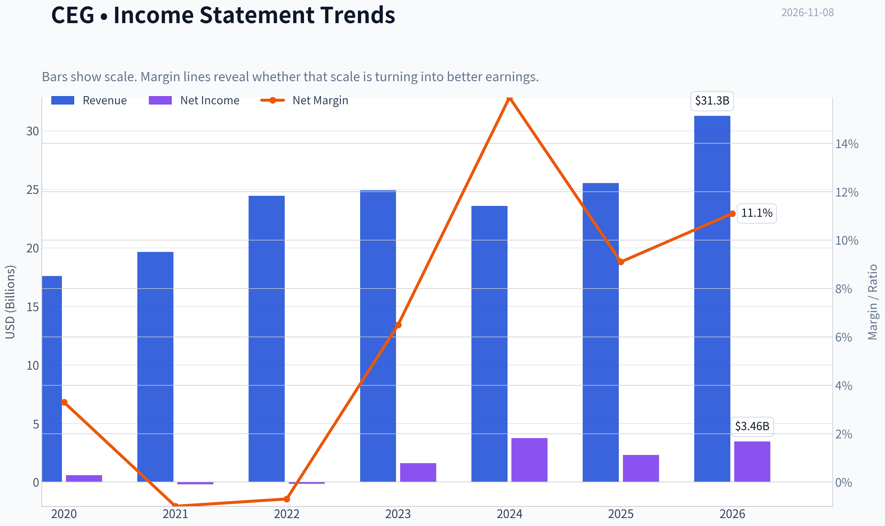

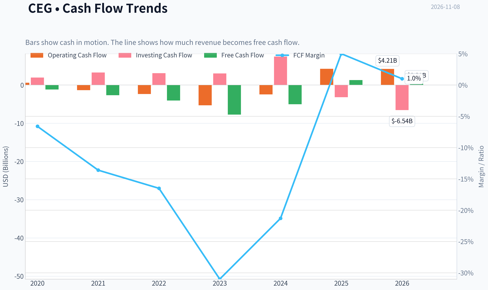

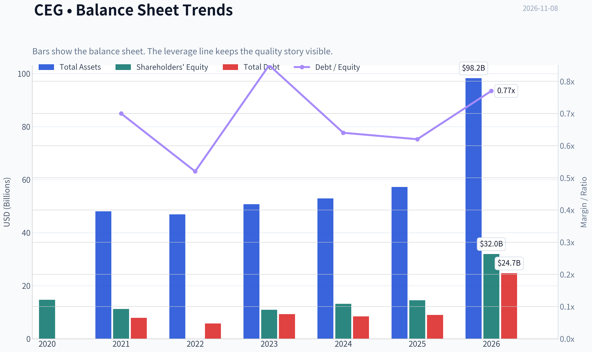

This graph tracks the profitability and return metrics (ROE, ROIC, Margins) of **CEG** over the past decade, highlighting capital efficiency trends.

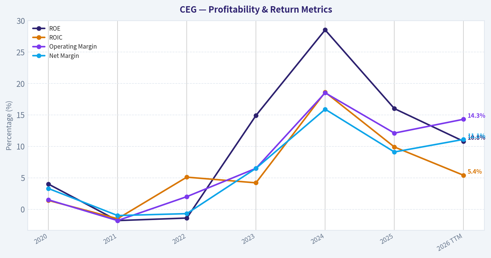

This chart illustrates the financial health of **CEG** over the last 10 years, mapping cash equivalents and free cash flow against total obligations (Debt).

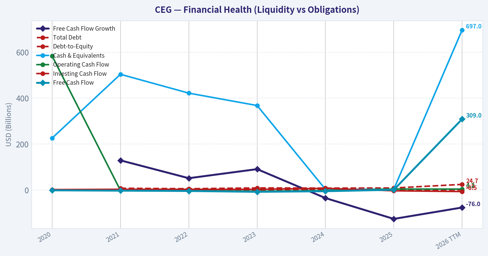

---

### Intrinsic Value Analysis (Buffett)

> *Following Warren Buffett's value investing philosophy: Circle of Competence, Economic Moat, Management Quality, and Margin of Safety.*

#### Intrinsic Value Snapshot

Price is what you pay. Intrinsic value is what the business may be worth based on the cash it can create for owners over time. We show a range, not one magic number.

- Current Price: $249.95
- Value Range (conservative to optimistic across both DCF methods): $-4.80 to $1,205.01

##### Owner Earnings (Buffett Method)
- Net Income: $2,319,000,000.00
- Depreciation & Amortization: $1,937,000,000.00
- Capital Expenditures: $-2,949,000,000.00
- Working Capital Changes: $-7,000,000.00
- Owner Earnings: $2,326,000,000.00

##### Intrinsic Value
###### Buffett Method
Uses owner earnings. Stricter, and usually more conservative.
- Conservative: $-4.80
- Average: $1.71
- Optimistic: $1,205.01
- Discount Rate: 10.0%

ANALYST STANCE: **Bearish**

#### Executive Conclusion

Constellation Energy operates a strategically important fleet of nuclear power plants with potentially valuable long-term electricity demand from data centers and industrial customers. However, at **$250 per share**, the market is already pricing in an exceptionally strong decade of growth.

The research valuation indicates headline intrinsic value of approximately **$60.75 per share**, while the reverse DCF implies roughly **17.2% annual growth for ten years**. That is far above the company's recent operating trajectory and leaves little room for execution mistakes, regulatory setbacks, power-price normalization, or higher capital costs.

This is a potentially good business at an excessively demanding price. The appropriate action is to wait for a substantially better entry point.

#### Factor Scorecard

| Factor | Score | Assessment |
|---|---:|---|
| Circle of Competence & Simplicity | 3/5 | Electricity generation is understandable, but nuclear regulation, power markets, plant economics, and long-term contracts add complexity. |
| Durable Competitive Advantage | 3/5 | Licensed nuclear assets are scarce and difficult to replicate, but earnings remain exposed to power prices, regulation, outages, and capital requirements. |
| Management & Capital Allocation | 3/5 | No clear evidence of exceptional owner-oriented capital allocation sufficient to justify the current valuation. Large projects and reinvestment decisions require careful scrutiny. |
| Industry Structure | 3/5 | Nuclear supply is concentrated and strategically important, but the business is capital-intensive and exposed to commodity-like electricity pricing. |

**Gate 5 hard floor: Not tripped.** There is no evidence here of simultaneous sharply deteriorating cash flows and financial distress, such as sub-1x interest coverage or an identified insolvency condition. The concern is valuation and cyclicality, not immediate solvency.

#### Financial Summary

| Metric | Latest figure |
|---|---:|
| Share price | $250.00 |
| Market capitalization | $88.56 billion |
| Implied shares outstanding | Approximately 354 million |
| P/E ratio | 24.4x |
| Implied earnings per share | Approximately $10.24 |
| Revenue growth, year over year | 8.3% |
| ROE | 16.0% |
| Free-cash-flow yield | 1.5% |
| Approximate trailing free cash flow | $1.33 billion |
| Current ratio | 1.53x |
| Reverse-DCF implied growth | Approximately 17.2% annually for 10 years |
| Trailing three-year growth reference | -23.7% |

**Key Takeaways:** CEG generates a respectable 16% ROE, but the 1.5% free-cash-flow yield is very low for a capital-intensive business. The valuation requires sustained growth far above the recent three-year trend, creating a wide gap between operating evidence and market expectations.

#### Moat Analysis

CEG's strongest potential moat is the scarcity of its nuclear fleet:

- Nuclear plants require substantial capital, specialized expertise, regulatory approvals, and long development timelines.
- Existing licensed reactors can be valuable because replacement capacity is difficult and slow to build.
- Electricity demand from data centers could support higher utilization and premium long-term contracts.
- Nuclear generation can provide reliable, low-carbon baseload power, which is difficult to replicate with intermittent renewable sources alone.

The moat is not absolute. CEG remains exposed to:

- Regulatory and political intervention.
- Extended plant outages or unplanned maintenance.
- Wholesale electricity-price volatility.
- Large maintenance and life-extension expenditures.
- Customer concentration and contract-renewal risk.
- Competition from natural gas, renewables, storage, and future nuclear capacity.

The result is a **narrow-to-moderate moat**, rather than a wide, consumer-platform-style moat. The assets are scarce, but the economics are still influenced by external power markets and heavy capital commitments.

#### Management Quality and Capital Allocation

Management appears to have a meaningful reinvestment opportunity if it can secure attractive long-term power contracts and execute plant upgrades reliably. The data-center power theme could create valuable demand visibility.

However, the investment case requires confidence in several decisions:

1. Whether new contracts are signed at attractive risk-adjusted prices.
2. Whether plant life extensions earn returns above the cost of capital.
3. Whether growth projects avoid excessive leverage or dilution.
4. Whether management resists pursuing growth simply because the market rewards the narrative.

At the current valuation, management must execute extremely well merely to support the existing share price. There is not enough evidence to award a top management score.

#### Owner Earnings Calculation

| Component | Approximate amount |
|---|---:|
| Net income proxy, based on current P/E and market capitalization | $3.63 billion |
| Free cash flow proxy, based on 1.5% FCF yield | $1.33 billion |
| Maintenance capex and working-capital adjustment | Not separately provided |
| Practical owner-earnings proxy | Approximately $1.33 billion |
| Owner-earnings yield at $88.56 billion market value | Approximately 1.5% |

**Key Takeaways:** The practical owner-earnings proxy is much lower than accounting earnings, which is typical for a capital-intensive power producer. The key Buffett question is not whether CEG reports profits, but how much cash remains after the maintenance investment required to keep its nuclear fleet productive. At the current market value, that cash yield is thin.

#### Three-Scenario DCF Valuation

Using the approximately **$1.33 billion owner-earnings proxy**:

| Scenario | Method | Approximate equity value | Approximate value per share |
|---|---|---:|---:|
| A: No growth | Owner earnings divided by 10% | $13.3 billion | $37.60 |
| B: 3% GDP growth | Owner earnings growing at 3%, capitalized at 10% | $19.0 billion | $53.70 |
| C: Research headline valuation | Weighted cyclical reverse-DCF and owner-earnings framework | $21.5 billion | $60.75 |
| Current market valuation | Current price multiplied by implied shares | $88.6 billion | $250.00 |

**Key Takeaways:** Even the research headline valuation of $60.75 per share is far below the current price. The conservative no-growth and GDP-growth cases produce values between roughly $38 and $54 per share, showing that the investment depends heavily on assumptions beyond ordinary economic growth.

#### Margin of Safety Analysis

| Measure | Result |
|---|---:|
| Current price | $250.00 |
| Headline intrinsic value | $60.75 |
| Margin of safety versus headline value | -311.4% |
| Premium of market price to headline value | Approximately 312% |
| Growth implied by current price | Approximately 17.2% annually for 10 years |
| Recent three-year growth reference | -23.7% |

**Key Takeaways:** CEG does not offer a margin of safety at the current price. A wide-moat compounder might justify paying a modest premium to conservative value, but this valuation requires sustained, exceptional growth while the recent three-year growth reference is negative.

#### Buffett Scorecard

| Criterion | Weight | Score | Weighted contribution |
|---|---:|---:|---:|
| Moat width and durability | 25% | 3/5 | 0.75 |
| Valuation and margin of safety | 20% | 1/5 | 0.20 |
| Capital returns versus WACC | 15% | 3/5 | 0.45 |
| Business understanding and predictability | 12% | 3/5 | 0.36 |
| Management quality and capital allocation | 12% | 3/5 | 0.36 |
| Reinvestment runway | 8% | 4/5 | 0.32 |
| Balance-sheet strength | 4% | 3/5 | 0.12 |
| Industry structure | 4% | 3/5 | 0.12 |
| **Total** | **100%** |  | **2.68/5** |

**Key Takeaways:** CEG scores well for strategic asset scarcity and reinvestment potential, but valuation overwhelms those positives. The weighted score falls below the threshold for a compelling Buffett-style purchase because the current price assumes too much success and provides too little protection against adverse outcomes.

#### Investment Stance

**Bearish at $250, with medium-high conviction.**

CEG should remain on a watchlist rather than be purchased at the current valuation. A more attractive opportunity would require either:

- A materially lower share price;
- Evidence that long-term contracted power economics are substantially stronger than current owner-earnings estimates; or
- Several years of demonstrated free-cash-flow growth that validates the market's implied 17% growth rate.

The company may become attractive at a valuation closer to conservative cash-flow value, but today the market is charging a premium for the nuclear and data-center narrative before the economics are sufficiently proven.
#### Valuation Bridge

This bridge places the current market price beside each intrinsic value lens so readers can see whether upside depends on one method or shows up across several methods.

| Scenario | Intrinsic Value / Share |
| --- | ---: |
| Buffett Method | $1.71 |
| Damodaran Method | $-61.59 |
| Current Price | $249.95 |

#### Key Takeaways

If one method is far above the others, the upside case depends on a specific modelling assumption. When several methods cluster together, the valuation story is more robust.

#### Valuation Visuals

This comparison chart from *Latest Earnings Snapshot* stacks current figures against historical benchmarks for **CEG**, making it easy to see where the company trades relative to its own averages.

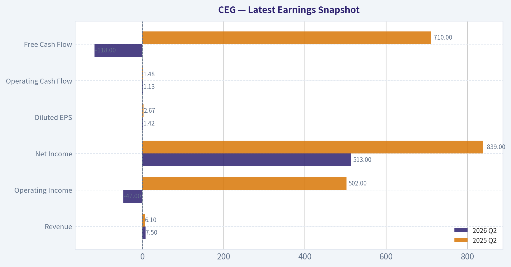

This comparison chart from *Current Metrics Versus Historical Averages* stacks current figures against historical benchmarks for **CEG**, making it easy to see where the company trades relative to its own averages.

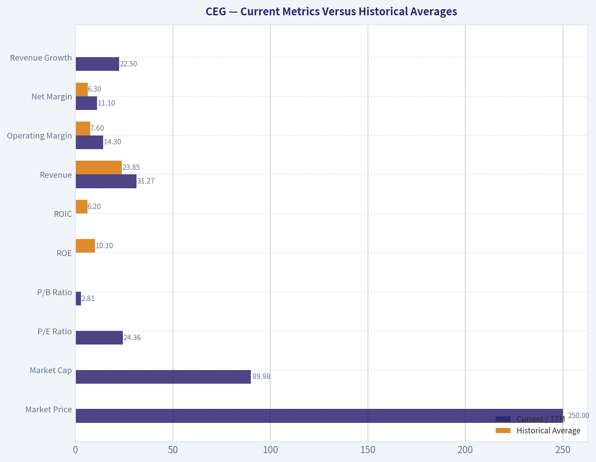

This comparison chart from *Balance Sheet and Financial Strength* stacks current figures against historical benchmarks for **CEG**, making it easy to see where the company trades relative to its own averages.

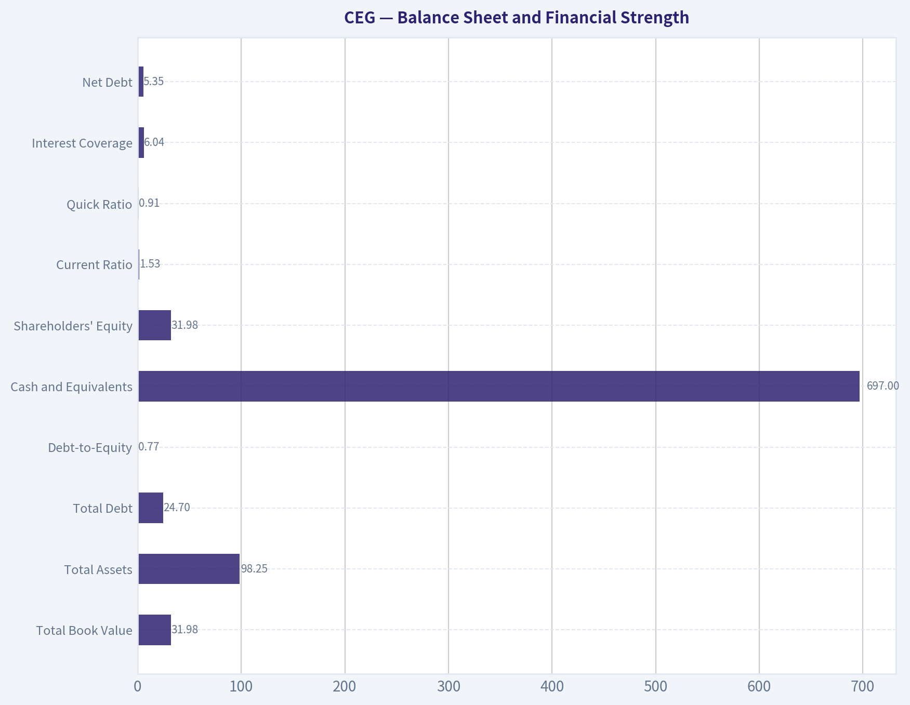

This comparison chart from *Buffett-Style Owner-Earnings DCF* stacks current figures against historical benchmarks for **CEG**, making it easy to see where the company trades relative to its own averages.

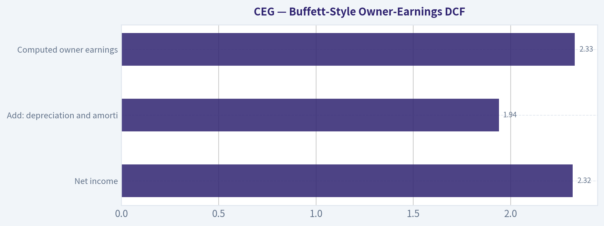

---

### Trend & Growth Analysis (Lynch/Druckenmiller/Fisher)

> *Following Peter Lynch's GARP, Stanley Druckenmiller's macro-aware approach, and Philip Fisher's scuttlebutt methodology.*

ANALYST STANCE: **Bearish**

#### Executive view

Constellation Energy is a high-quality strategic asset with exposure to two powerful themes: rising electricity demand from data centers and the scarcity value of reliable, carbon-free nuclear generation. However, the current setup does not meet a growth-investor hurdle: reported revenue growth is only 8.3%, the implied PEG is approximately 3.0, and the headline intrinsic value of $60.75 is far below the $250 share price.

The company may still produce strong long-term earnings if power prices, data-center contracts, and nuclear capacity expansion develop favorably. At today's valuation, however, the market appears to be discounting a very optimistic outcome.

#### 1. Lynch classification

| Criterion | Assessment |
|---|---|
| Classification | Cyclical / asset-intensive growth story |
| Revenue growth | 8.3% year over year |
| P/E | 24.4x |
| Implied PEG | 2.95 |
| Primary theme | Nuclear power, grid reliability, AI-driven electricity demand |
| Growth-investor fit | Limited at current valuation |

**Key Takeaways:** CEG is not currently a classic Lynch fast grower because revenue growth is below the 15%-25% threshold. It is better viewed as a cyclical power producer with a potentially valuable secular growth option tied to electricity demand and nuclear scarcity.

#### 2. The story in three bullets

- **Electricity demand is entering a potentially powerful new cycle:** AI data centers, manufacturing reshoring, and electrification could increase demand for dependable power.
- **Nuclear assets are scarce and difficult to replicate:** Licensing, safety requirements, operating expertise, and long construction timelines create meaningful barriers to entry.
- **The market already recognizes much of the opportunity:** At approximately $88.6 billion of market capitalization and $250 per share, expectations are elevated.

#### 3. TAM and 10x test

| TAM factor | Assessment |
|---|---|
| Addressable opportunity | U.S. electricity generation, capacity, reliability, and clean-power contracting |
| Secular TAM trend | Potentially strong, especially from data centers and electrification |
| Company's current revenue | Not provided in the shared research pack |
| 10x revenue test | Cannot be completed reliably without a current revenue base |
| 10x equity-value test | A 10x market capitalization would imply approximately $886 billion, requiring extraordinary earnings growth |
| Main constraint | CEG is limited by physical generation capacity, regulation, capital intensity, and power-market conditions |

**Key Takeaways:** The market opportunity is large and likely expanding, but CEG cannot scale like software because new generation capacity requires time, capital, permits, and grid access. The 10x test remains unproven, and the stock price already assumes substantial value from future power demand.

#### 4. Revenue growth trend

| Metric | Result | Interpretation |
|---|---:|---|
| Latest year-over-year revenue growth | 8.3% | Below fast-grower territory |
| Trailing three-year revenue trend | -23.7% stated in reverse-DCF data | Indicates historical cyclicality or volatility |
| Five-year trend | Not available | Insufficient evidence for a durable acceleration |
| Current pattern | Not demonstrably accelerating | No confirmed Druckenmiller-style earnings inflection |

**Key Takeaways:** The available data do not show accelerating revenue. CEG may be approaching an earnings inflection through power pricing and long-term contracts, but that thesis is not yet confirmed by the reported revenue trend.

#### 5. Unit economics and operating quality

| Metric | Assessment |
|---|---|
| LTV/CAC | Not applicable / unavailable for a regulated and merchant power producer |
| Net revenue retention | Not applicable |
| Rule of 40 | Not applicable |
| FCF yield | 1.5% |
| ROE | 16.0% |
| Current ratio | 1.53 |
| Gross margin | Not available |
| Capital intensity | High |
| Key economic driver | Power prices, capacity utilization, contract structure, fuel costs, and operating reliability |

**Key Takeaways:** SaaS-style unit economics are not appropriate for CEG. The more relevant concern is that a 1.5% free-cash-flow yield provides limited valuation support, particularly for a capital-intensive and cyclical business.

#### 6. Inflection-point assessment

| Potential inflection | Evidence | Assessment |
|---|---|---|
| AI/data-center power demand | Strong secular narrative | Positive but still developing |
| Nuclear scarcity value | Existing fleet and operating expertise | Structurally favorable |
| Long-term contracting | Could reduce merchant-price volatility | Needs confirmation from contract economics |
| Revenue acceleration | 8.3% latest growth; historical volatility | Not yet demonstrated |
| Margin inflection | Gross margin unavailable | Unconfirmed |
| Capacity expansion | Requires capital, permitting, and execution | Long-dated and uncertain |
| Competitive position | Nuclear assets are difficult to replace | Strong strategic advantage |

**Key Takeaways:** The strongest inflection is thematic rather than financial: electricity scarcity could increase the value of CEG's nuclear fleet. A high-conviction growth position would require evidence that this theme is translating into accelerating contracted revenue, earnings, and free cash flow.

#### 7. Macro setup

| Macro factor | Impact on CEG |
|---|---|
| AI infrastructure buildout | Positive for power demand |
| Electrification and reshoring | Positive |
| Higher interest rates | Negative due to capital intensity and valuation sensitivity |
| Power-price volatility | Mixed; can boost earnings but increases cyclicality |
| Regulation and nuclear policy | Potentially positive, but policy-dependent |
| Recession | Mixed; power demand is defensive, but industrial demand and prices may weaken |
| Market valuation environment | Risky for a high-expectation stock |

**Key Takeaways:** CEG has a favorable secular macro narrative, but the stock is not insulated from rates, power prices, or capital-market conditions. Druckenmiller's macro framework would favor the theme, but valuation and cyclical exposure argue against aggressive positioning.

#### 8. Fisher 15-point score

This is a provisional score because detailed management, customer, R&D, employee, and capital-allocation research was not available.

| Fisher criterion | Score / 5 | Comment |
|---|---:|---|
| Market potential | 5 | Electricity demand and reliability opportunity are substantial |
| New-product development | 3 | Asset expansion rather than rapid product innovation |
| R&D effectiveness | 3 | Limited evidence available |
| Sales organization | 3 | Contracting capability matters, but data unavailable |
| Profit margins | 3 | Margin data unavailable; power economics are cyclical |
| Improving margins | 3 | Not yet demonstrated |
| Labor relations | 3 | Insufficient evidence |
| Executive relations | 3 | Insufficient evidence |
| Management depth | 4 | Operating nuclear assets requires specialized expertise |
| Cost analysis/accounting | 3 | Insufficient evidence |
| Outstanding moat | 5 | Scarce assets, licensing, expertise, and grid position |
| Long-range profit outlook | 4 | Attractive secular backdrop, but execution-dependent |
| Dilution risk | 3 | Capital intensity creates potential financing risk |
| Management candor | 3 | Insufficient evidence |
| Management integrity | 3 | No specific adverse evidence provided |
| **Total** | **53 / 75** | **Average-to-good, but not outstanding** |

**Key Takeaways:** CEG scores well on market potential and structural barriers, but the available evidence is insufficient to award high scores on margins, capital allocation, innovation, and management quality. The provisional 53 out of 75 score does not support a high-conviction Fisher-style purchase.

#### 9. Valuation analysis

| Valuation measure | Result | Interpretation |
|---|---:|---|
| Share price | $250 | Current reference price |
| Market capitalization | $88.56B | Large valuation already assigned to the theme |
| P/E | 24.4x | Not excessive for quality, but high for 8.3% revenue growth |
| Revenue growth | 8.3% | Produces an implied PEG of approximately 2.95 |
| FCF yield | 1.5% | Limited current cash-flow support |
| Headline intrinsic value | $60.75 | Approximately 76% below current price |
| Reverse-DCF implied growth | Approximately 17.2% annually for 10 years | Very demanding expectation |
| Owner-earnings DCF | $1.71 per shared data | Extremely weak support |
| Damodaran FCFF model | -$61.59 per shared data | Model output is not economically meaningful but signals risk |
| Margin of safety | -311.4% headline figure | No valuation cushion indicated |

**Key Takeaways:** CEG fails the valuation test under the available models. The stock price requires much faster and more durable growth than current revenue data show, while the 1.5% FCF yield leaves little protection if power prices, contracts, or expansion plans disappoint.

**Scenario framework**

| Scenario | Operating assumption | Valuation implication |
|---|---|---|
| Bear | Power demand disappoints, rates remain high, or new capacity is delayed | Significant downside; valuation could compress toward asset-based or lower earnings multiples |
| Base | Nuclear assets benefit from stronger contracts and steady demand, but growth remains moderate | Returns depend heavily on earnings delivery; limited margin of safety |
| Bull | AI-related demand creates sustained power scarcity, premium contracts, and strong cash-flow growth | Material upside is possible, but this outcome appears substantially priced in |

**Key Takeaways:** The bull case is credible, but it is also the case most investors appear to be underwriting. The base case does not provide enough valuation support, while the bear case could cause substantial multiple compression.

#### 10. Growth investor scorecard

| Category | Weight | Score / 5 | Weighted contribution |
|---|---:|---:|---:|
| The story | 10% | 4.0 | 0.40 |
| TAM and runway | 20% | 4.0 | 0.80 |
| Revenue growth | 20% | 2.0 | 0.40 |
| Unit economics | 15% | 2.5 | 0.38 |
| Competitive position | 10% | 4.5 | 0.45 |
| Management quality | 10% | 3.0 | 0.30 |
| Macro setup | 5% | 3.5 | 0.18 |
| Profitability path | 5% | 3.0 | 0.15 |
| Valuation | 5% | 1.0 | 0.05 |
| **Total** | **100%** |  | **3.11 / 5.00** |

**Key Takeaways:** CEG scores well on its story, TAM, and competitive position, but weak revenue acceleration and valuation materially reduce the overall score. A score of 3.11 falls into the Neutral range mechanically, but the extreme valuation risk justifies an Bearish stance for a new growth position.

#### 11. Position-size stance

| Investor situation | Suggested stance |
|---|---|
| New position | Avoid initiating at $250 |
| Existing position with large gains | Consider trimming or holding only a controlled position |
| High-conviction nuclear/power investor | Small speculative allocation may be justified |
| Growth portfolio target | Prefer companies with faster revenue growth and clearer valuation support |
| Re-entry condition | Wait for a major valuation reset or several quarters of accelerating contracted earnings and free cash flow |

**Key Takeaways:** CEG should not be a core new position for a Lynch-style growth portfolio at the current price. Existing holders may retain a smaller position if they have a strong view on nuclear scarcity and data-center power demand, but position sizing should reflect valuation and execution risk.

#### 12. Key catalysts and risks

| Catalysts | Risks |
|---|---|
| New long-term data-center power contracts | AI power-demand expectations prove excessive |
| Higher contracted power prices | Nuclear outages or operational problems |
| Government support for nuclear generation | Regulatory or permitting delays |
| Successful capacity expansion | Heavy capital spending and financing needs |
| Sustained electricity-demand growth | Higher rates compress the valuation multiple |
| Earnings and FCF acceleration | Merchant power-price decline |
| Improved contract visibility | Customer concentration or renegotiation risk |

**Key Takeaways:** The central catalyst is proof that AI and electrification demand are translating into higher, durable cash flows. The central risk is that the stock has already capitalized much of that future, leaving investors exposed to disappointment even if the underlying nuclear business remains strategically attractive.

#### Bottom line

CEG is a compelling **business and theme**, but not a compelling **risk-adjusted purchase at $250** based on the supplied data. The stock has a potentially valuable long-term nuclear and power-demand runway, yet current growth is too modest, the implied PEG is too high, and valuation models show no margin of safety. I would wait for either a substantial price reset or clear evidence of multi-quarter acceleration in contracted revenue, earnings, and free cash flow.

#### Growth & Scorecard Visuals

This comparison chart from *Growth and Cash-Flow Trends* stacks current figures against historical benchmarks for **CEG**, making it easy to see where the company trades relative to its own averages.

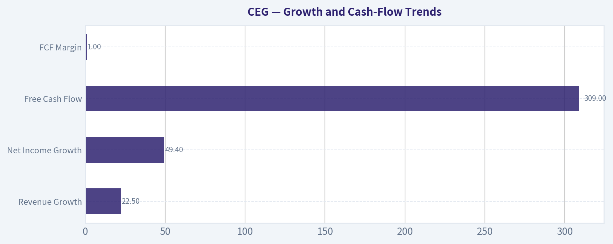

---

### Market Technical Analysis

ANALYST STANCE: **Neutral**

#### CEG technical market report

**Data basis:** The latest trading session in the supplied data is November 6, 2026, when CEG closed at **$249.95**. November 8 is a weekend, so no current-session indicator values are available. The selected indicators are **close_10_ema, close_50_sma, close_200_sma, macd, macdh, rsi, atr, and vwma**. Together, they cover short-, medium-, and long-term trend, momentum, participation-adjusted price direction, and risk.

#### Market regime and price structure

CEG remains in a broad bearish regime. The stock declined from approximately **$359 at the beginning of the supplied one-year period to $249.95**, a loss of roughly **30%**. The decline was not linear: CEG experienced a sharp recovery from the February low near $246 to above $320 in late February and again rallied toward $300 in early October. However, each recovery failed to establish a durable higher-high sequence.

The October advance was particularly important because it briefly carried the stock to approximately **$300.40 on October 6**, accompanied by very high volume. That move failed quickly. By November 5, CEG had fallen to **$239.65**, before rebounding modestly to $249.95 on November 6. This is better interpreted as an attempted stabilization after a sharp breakdown than as a confirmed reversal.

| Price-structure observation | Evidence | Interpretation |
|---|---:|---|
| Latest close | $249.95 | Near the lower portion of the recent trading range |
| One-year change from first supplied close | Approximately -30% | Persistent long-term capital impairment |
| October 6 high | $300.40 | Failed breakout or exhaustion rally |
| November 5 low | $239.65 close; $231.30 intraday low | Important near-term support zone |
| November 6 rebound | +4.30% to $249.95 | Relief bounce, not yet a trend reversal |
| Recent volume | 5.6-7.4 million shares on November 4-6 | Selling and rebound activity materially above ordinary recent turnover |

**Key Takeaways:** CEG is attempting to rebound from a high-volume decline, but the broader price structure still consists of lower highs and lower lows. The November 6 gain is constructive for short-term stabilization, yet confirmation would require a sustained recovery above nearby moving-average resistance.

#### Trend indicators

The trend readings are aligned bearishly:

- The **10-day EMA is $254.53**, placing the latest close about **1.8% below** the short-term average.
- The **50-day SMA is $270.02**, approximately **7.4% above** the close.
- The **200-day SMA is $278.15**, approximately **11.3% above** the close.
- The 50-day SMA is below the 200-day SMA, and both averages are trending downward.

This configuration means that short-term sellers remain in control, while medium- and long-term holders are still facing overhead supply. The 10-day EMA near $254.50 is the first test for the recent rebound. A close above it would improve short-term momentum, but it would not by itself reverse the medium-term trend. The $270 area, corresponding approximately to the 50-day SMA and the declining volume-weighted average, is more meaningful resistance. The $278 area near the 200-day SMA is the principal longer-term trend hurdle.

| Indicator | Latest value | Relationship to $249.95 close | Signal |
|---|---:|---:|---|
| 10-day EMA | $254.53 | Price 1.8% below | Short-term bearish, but close to recovery threshold |
| 50-day SMA | $270.02 | Price 7.4% below | Medium-term overhead resistance |
| 200-day SMA | $278.15 | Price 11.3% below | Long-term bearish trend confirmation |
| VWMA | $253.98 | Price 1.6% below | Recent volume-weighted supply overhead |

**Key Takeaways:** All four trend measures sit above the latest price, so rallies are likely to encounter supply rather than open air. A move above $254-255 would be an initial improvement; reclaiming $270 and then $278 would be necessary to challenge the bearish trend more seriously.

#### Momentum analysis

The MACD readings show that downside momentum has returned after a temporary recovery in October:

- **MACD: -6.31**
- **MACD histogram: -1.77**

The MACD was positive earlier in October, reaching approximately **+6.01 on October 13**, but then deteriorated steadily and turned deeply negative by early November. The histogram also moved from positive territory to negative territory, indicating that the MACD line has fallen below its signal line and that bearish momentum is currently dominant.

There is one nuance: the histogram improved slightly from approximately **-2.10 on November 5 to -1.77 on November 6**. That suggests the rate of downside momentum may have eased during the rebound, but the histogram remains materially negative. This is an early stabilization signal, not a bullish crossover.

The **RSI is 43.23**, recovering from **36.71 on November 5** but remaining below the neutral 50 level. RSI is no longer at an acute oversold reading, and therefore the recent rebound has not yet produced a strong momentum reversal. At the same time, RSI is not overbought, so there is room for a reflex rally if buyers can reclaim the short-term averages.

| Momentum indicator | Latest value | Recent direction | Interpretation |
|---|---:|---|---|
| MACD | -6.31 | Declining from positive October levels | Bearish trend momentum |
| MACD histogram | -1.77 | Slight improvement from -2.10 | Selling pressure easing marginally, but still negative |
| RSI | 43.23 | Rebounded from 36.71 | Weak momentum; not oversold enough to confirm a durable bottom |

**Key Takeaways:** Momentum is bearish but no longer accelerating as sharply as it was during the November 4-5 decline. The RSI rebound indicates some buying interest, yet its position below 50 and the negative MACD histogram argue against treating the move as a confirmed reversal.

#### Volatility, risk, and participation

The latest **ATR is $12.93**, equal to approximately **5.2% of the share price**. This is substantial daily volatility for a stock priced near $250. A normal ATR-sized move can therefore carry CEG toward roughly $237 or $263 before considering any gap or event risk.

ATR declined from approximately **$14.23 on October 9 to $11.82 on November 3**, then rose again to $12.93 by November 6. The renewed increase indicates that volatility expanded during the latest selloff. Risk controls based on tight fixed-dollar stops are vulnerable to being triggered by ordinary price movement.

The **VWMA is $253.98**, almost identical to the 10-day EMA and just above the close. This convergence makes the $254-255 area an important near-term decision zone. Trading volume also increased substantially during the latest breakdown: November 4 and November 5 recorded approximately **6.8 million and 7.4 million shares**, respectively, versus many recent sessions closer to 2-4 million shares. The high volume confirms that the move was significant, although it does not distinguish conclusively between institutional distribution and capitulation followed by accumulation.

| Risk or participation measure | Latest reading | Trading implication |
|---|---:|---|
| ATR | $12.93 | Wide expected daily range; position sizing should be conservative |
| ATR as percentage of price | Approximately 5.2% | High volatility and elevated stop-out risk |
| VWMA | $253.98 | Immediate overhead test for the rebound |
| November 4-6 volume | Approximately 5.6-7.4 million shares | Strong participation around the breakdown and rebound |

**Key Takeaways:** CEG is volatile enough that a $10-13 move can occur within a normal trading range, making risk management particularly important. The elevated volume gives the recent decline technical significance, while the VWMA near $254 creates a clear near-term test for whether buyers can sustain the rebound.

#### Key levels and scenario framework

The most relevant levels are derived from recent price action and the selected indicators:

- **$239-240:** Immediate closing-support area, based on the November 5 close and nearby price action.
- **$231-232:** More important downside support, corresponding to the November 5 intraday low near $231.30.
- **$254-255:** First resistance, defined by the 10-day EMA and VWMA.
- **$263-264:** Intermediate recovery area, near the recent short-term trading structure.
- **$270-272:** Major medium-term resistance, centered on the 50-day SMA.
- **$278-280:** Long-term trend resistance around the 200-day SMA and prior breakdown structure.

A **bullish improvement** would require CEG to reclaim and hold above $254-255, followed by a higher low and a move toward $270. A stronger trend reversal would require sustained trade above $270 and eventual recovery through the $278-280 zone.

A **bearish continuation** would be signaled by failure below $239-240, especially if accompanied by expanding volume and a negative MACD histogram. A decisive break beneath $231-232 would expose the stock to another leg lower and invalidate the current stabilization thesis.

Given the conflicting short-term and long-term signals, the most appropriate classification is **Neutral** rather than an aggressive directional stance. The recent bounce is tradable only with confirmation because the stock remains below every major trend benchmark.

| Area | Level or condition | Significance |
|---|---:|---|
| Near-term support | $239-240 | First level that must hold to preserve stabilization |
| Major support | $231-232 | Breakdown level; failure would renew downside risk |
| First resistance | $254-255 | 10 EMA and VWMA convergence |
| Medium-term resistance | $270-272 | Approximate 50 SMA and supply zone |
| Long-term resistance | $278-280 | Approximate 200 SMA and broader trend hurdle |
| Bullish confirmation | Sustained close above $270, then $278-280 | Would materially improve trend structure |
| Bearish confirmation | Close below $239, especially below $231-232 | Would confirm continuation of the downtrend |

**Key Takeaways:** The immediate technical decision is whether buyers can reclaim $254-255 and then challenge $270. Until that occurs, the rebound remains a countertrend move inside a larger decline; loss of $239 and especially $231-232 would favor renewed downside.

#### Indicator selection summary

| Selected indicator | Role in the analysis | Why it is included |
|---|---|---|
| close_10_ema | Short-term trend | Identifies whether the relief bounce is gaining traction |
| close_50_sma | Medium-term trend | Defines intermediate resistance and trend direction |
| close_200_sma | Long-term trend | Establishes the strategic bullish or bearish regime |
| macd | Momentum and trend transition | Measures the direction and persistence of momentum |
| macdh | Momentum acceleration | Detects whether bearish pressure is strengthening or easing |
| rsi | Momentum balance | Distinguishes weak, neutral, and extreme conditions |
| atr | Volatility and risk | Helps calibrate stops and position size |
| vwma | Volume-adjusted trend | Confirms whether price is reclaiming an area supported by meaningful trading activity |

**Key Takeaways:** The selected set avoids unnecessary redundancy while covering trend, momentum, volatility, and volume-adjusted price behavior. Its combined message is consistent: CEG has modest short-term stabilization potential, but the dominant medium- and long-term trend remains bearish until key resistance levels are reclaimed.

#### Market Visuals

This comparison chart from *Market Metrics and Valuation* stacks current figures against historical benchmarks for **CEG**, making it easy to see where the company trades relative to its own averages.

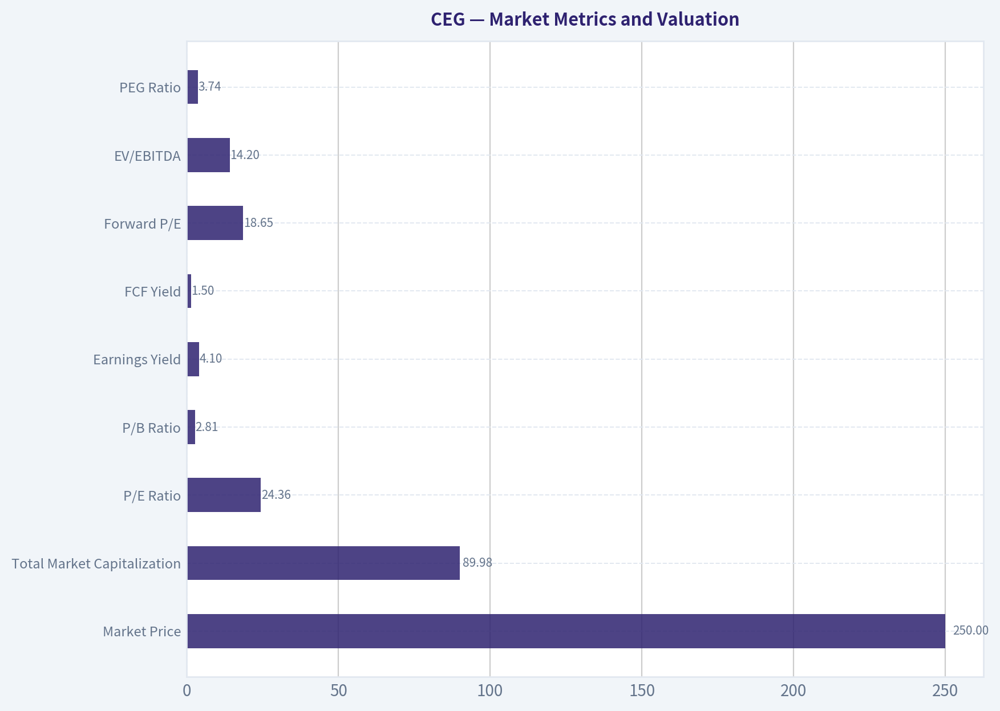

---

### Options Market Analysis

> *Reading options flow - put/call ratios, IV skew, and unusual activity - to gauge institutional positioning and event-driven risk.*

#### CEG Options Market Report

**As of November 8, 2026.** The available chain covers the November 13, November 20, and November 27 expirations. CEG's current share price was not included in the data, so strike moneyness and precise gamma-wall levels cannot be determined.

#### 1. Put/Call Ratio Analysis

| Expiration | Days to Expiry | Call OI | Put OI | Put/Call OI | Call Volume | Put Volume | Put/Call Volume |
|---|---:|---:|---:|---:|---:|---:|---:|
| Nov. 13, 2026 | 5 | 3,044 | 2,140 | 0.70 | 2,263 | 2,250 | 0.99 |
| Nov. 20, 2026 | 12 | 17,378 | 33,314 | 1.92 | 1,188 | 3,235 | 2.72 |
| Nov. 27, 2026 | 19 | 728 | 658 | 0.90 | 156 | 540 | 3.46 |
| **Total** | - | **21,150** | **36,112** | **1.71** | **3,607** | **6,025** | **1.67** |

**Key Takeaways:** CEG's aggregate put/call open-interest ratio of 1.71 is well above the approximately 0.70 neutral baseline, indicating substantial put positioning or downside protection. The November 20 expiration is the main source of this defensive bias, with nearly twice as much put open interest as call open interest and put volume almost three times call volume. The very near-term November 13 expiration is closer to neutral, so the bearish positioning is concentrated primarily in the one- to two-week horizon.

#### 2. Implied Volatility Assessment

| Expiration | Call ATM IV | Put ATM IV | ATM IV Level | Call-Put IV Difference |
|---|---:|---:|---:|---:|
| Nov. 13, 2026 | 76.8% | 75.0% | Very elevated | Calls +1.8 percentage points |
| Nov. 20, 2026 | 64.4% | 64.4% | Elevated | Flat |
| Nov. 27, 2026 | 57.6% | 57.4% | Elevated | Calls +0.2 percentage points |

**Key Takeaways:** Near-term implied volatility is high, especially for the November 13 expiration at roughly 75% to 77%, signaling meaningful event or price-move risk. The supplied data shows ATM IV, not full out-of-the-money skew, so a definitive comparison of OTM put IV versus OTM call IV is unavailable. ATM volatility is not showing a classic downside put skew; however, the heavy put open interest and volume still point to defensive positioning.

The elevated IV may reflect an imminent company-specific or market catalyst, but no confirmed earnings, product, or other event date was supplied. Traders should avoid interpreting high IV as inherently bullish or bearish; it primarily indicates that a large move is being priced.

#### 3. Unusual Options Activity

| Expiration | Contract | Strike | Volume | Open Interest | Volume/OI | IV | Days to Expiry |
|---|---|---:|---:|---:|---:|---:|---:|
| Nov. 13, 2026 | Put | $220 | 515 | 36 | 14.3x | 79.4% | 5 |

**Key Takeaways:** The November 13 $220 put is the clearest fresh-positioning signal, with volume more than 14 times existing open interest. This is consistent with new downside protection or a short-term bearish wager, although trade direction cannot be confirmed without bid/ask execution data. Because the current CEG share price was not provided, the contract cannot be reliably classified as in-the-money, at-the-money, or out-of-the-money.

The unusually high IV of 79.4% suggests traders are paying a significant premium for short-dated downside exposure. The volume is meaningful enough to flag, but one contract alone is insufficient to identify a definitive institutional "smart-money" trade; it could also include speculative retail activity or hedging against an existing stock position.

#### 4. Open Interest Concentration and Potential Gamma Levels

| Expiration | Total Call OI | Total Put OI | Total OI | Concentration Assessment |
|---|---:|---:|---:|---|
| Nov. 13, 2026 | 3,044 | 2,140 | 5,184 | Moderate |
| Nov. 20, 2026 | 17,378 | 33,314 | 50,692 | Dominant |
| Nov. 27, 2026 | 728 | 658 | 1,386 | Low |
| **Total** | **21,150** | **36,112** | **57,262** | - |

**Key Takeaways:** The November 20 expiration contains approximately 89% of the reported near-term open interest, making it the primary potential pinning and hedging horizon. Put open interest dominates that expiration, which could create downside-related dealer hedging if CEG declines toward heavily held put strikes. Exact gamma walls, max-pain levels, and highest-OI strikes cannot be calculated because strike-level open-interest data was not included.

#### 5. Overall Options Sentiment

**Overall Signal: BEARISH**

The primary driver is the combination of a 1.71 aggregate put/call open-interest ratio, a 1.67 put/call volume ratio, and concentrated put positioning in the November 20 expiration. The fresh November 13 $220 put activity reinforces the short-term downside or hedging interpretation.

Confidence is **moderate rather than high** because the data lacks current share price, strike-by-strike open interest, execution-side information, and full OTM volatility skew. The ATM IV structure is relatively balanced between calls and puts, so the bearish signal comes more from positioning and volume than from an outright volatility-skew premium for puts.

| Category | Assessment |
|---|---|
| Put/Call Ratio | Bearish: 1.71 OI ratio and 1.67 volume ratio, both above neutral |
| IV Level | Elevated: approximately 58% to 77% across near-term expirations |
| Skew Direction | Not fully measurable; ATM IV is broadly balanced, with no confirmed OTM put-skew reading |
| Unusual Activity | Bearish/defensive: November 13 $220 put traded at 14.3x open interest |
| Overall Signal | **BEARISH**, with moderate confidence |

**Key Takeaways:** CEG options positioning leans bearish because puts materially outweigh calls, particularly in the November 20 expiration. Elevated volatility and the fresh short-dated $220 put indicate demand for near-term downside exposure or protection. The signal should be tempered because strike-level gamma data, current stock price, and full volatility skew were not available.

---

## Research Team Commentary

> *The Research Manager synthesizes the Bull vs Bear debate into action-free commentary. This is a pre-risk view, not the final stance.*

Core Takeaway: Constellation Energy owns a genuinely scarce and strategically valuable nuclear fleet, but at $250 the valuation leaves too little room for uncertainty about free-cash-flow conversion, contract economics, and incremental returns. The business deserves close attention, yet the shares do not currently offer a sufficient margin of safety. I would keep CEG on the watchlist rather than buy it or issue a hard avoid.

The strongest bull argument is that CEG's operating nuclear assets cannot be replicated quickly or economically. Licensing, specialized expertise, suitable locations, transmission access, and long construction timelines create a real moat. Demand from data centers, reshoring, and electrification could make dependable carbon-free power increasingly valuable. If CEG converts that demand into premium long-term contracts, its cash flows could become both larger and more predictable. In that case, high-single-digit owner-earnings growth over a decade is plausible, and a 24.4-times earnings multiple would not necessarily be excessive.

The strongest bear argument is that this favorable outcome is already embedded in the price. At $250, the earnings yield is only about 4.1%. The reverse DCF requires approximately 7.5%-8% annual growth for ten years if the full $10.23 of EPS represents owner earnings. If normalized owner earnings are closer to $9 after maintenance, refueling, outages, life-extension spending, and environmental obligations, the required growth rises toward 9%-10%. That is a demanding hurdle for a capital-intensive company currently earning a respectable but not exceptional 10.3% ROIC.

The bull's own valuation range reinforces the concern. A base-case value of approximately $255-$260 provides only 2%-4% upside, while the conservative case near $160 implies substantial downside. The $275-$280 bull case offers only about 10%-12% upside and depends on favorable execution. Comparing the stock with the optimistic case does not create a true margin of safety. For a business with commodity exposure, operational concentration, regulatory risk, and incomplete free-cash-flow data, I would require a larger discount than I would for an asset-light, highly predictable compounder.

The nuance is that CEG is not obviously a low-quality or distressed company. Its 16% ROE, 10.3% ROIC, and 8.3% revenue growth are credible, and the structural demand thesis is stronger than a passing market narrative. That is why I would not label it Bearish under a disciplined Buffett framework, which should reserve that stance for clear overvaluation, deteriorating fundamentals, or financial weakness. The present valuation looks demanding rather than indefensible.

Technical weakness does not alter that conclusion. Trading below the 10-day, 50-day, and 200-day averages, together with a 1.71 put/call open-interest ratio, indicates cautious sentiment or hedging. It could improve entry timing, but an 11% decline from the 200-day average does not automatically make the shares undervalued. The market already appears to recognize the AI-power and nuclear-scarcity story.

The key lesson from prior mistakes is to separate an excellent industry thesis from an attractive stock purchase. Rising electricity demand does not automatically become per-share owner-earnings growth. Value could instead accrue to customers, transmission providers, regulators, or suppliers. Likewise, accounting EPS cannot be treated as owner earnings without deducting the capital necessary to preserve the fleet's output and operating licenses. The missing cash-flow and balance-sheet details matter more here than the headline P/E alone.

Over the next one to four quarters, I would monitor five areas. First, reconcile adjusted earnings with free cash flow after recurring maintenance, refueling, and other economically necessary capital expenditures. Consistent owner earnings near or above reported EPS would materially strengthen the thesis.

Second, examine new data-center and other long-term contracts. The important information is pricing, escalation clauses, duration, customer-funded capital, performance guarantees, and expected incremental returns-not merely the announcement of another agreement.

Third, track fleet reliability, capacity factors, planned and unplanned outages, realized power prices, and hedging results. Demand growth has limited value if outages or unfavorable hedges prevent CEG from capturing the economics.

Fourth, watch incremental ROIC and capital allocation. Life extensions, uprates, restarts, acquisitions, and repurchases should earn clearly more than the cost of capital. A sustained ROIC improvement above the current 10.3% would support treating CEG as a higher-quality compounder; expensive expansion or repurchases near full value would weaken the case.

Finally, verify leverage, interest coverage, debt maturities, liquidity, and decommissioning obligations. The available evidence does not indicate distress, but the valuation requires affirmative evidence of financial resilience.

At unchanged fundamentals, a price around $200-$220 would provide a more credible quality-adjusted margin of safety relative to the supplied base valuation. Alternatively, strong evidence that normalized owner earnings exceed $10 per share and can compound at high-single-digit rates with improving ROIC could justify purchasing at a higher price. Until either the proof or the discount improves, patience is the better decision.

Neutral

---

## Value Investing Team Commentary

> *The Investor translates the research view into an investment thesis before risk review. This is still not the final stance.*

### Business Quality and Moat

Constellation Energy owns a strategically valuable collection of operating nuclear plants. These assets are exceptionally difficult to replicate because of licensing requirements, construction costs, specialized operating expertise, transmission access, and long development timelines. Existing reactors should become more valuable if AI data centers, manufacturing reshoring, and electrification create sustained demand for dependable, carbon-free electricity.

This is a genuine moat, but it is an asset-heavy moat rather than an asset-light one. Nuclear plants require recurring refueling, maintenance, life-extension investment, regulatory compliance, and eventual decommissioning expenditures. Consequently, accounting earnings may overstate distributable owner earnings. CEG's 10.3% ROIC is respectable, but not yet high enough to assume that every dollar reinvested will create substantial shareholder value.

The crucial question is not whether electricity demand will rise. It is whether CEG can capture that demand through contracts producing attractive incremental returns after all associated capital requirements.

### Earnings Power and Valuation

At $250 and 24.43 times earnings, implied EPS is approximately $10.23 and the earnings yield is only about 4.1%. That valuation can work if:

- Normalized owner earnings are close to reported EPS.
- Earnings compound at roughly 8% or better for a decade.
- Incremental investments earn returns comfortably above the cost of capital.
- Fleet reliability remains strong.
- Long-term contracts transfer inflation, construction, and performance risks appropriately.

Those assumptions are plausible, but the current evidence does not make them sufficiently certain. If normalized owner earnings are closer to $9 per share after economically necessary expenditures, the valuation requires growth closer to 9%-10%. That is a demanding expectation for a capital-intensive, regulated, and operationally concentrated business with a current ROIC of 10.3%.

The supplied base-case value of $255-$260 offers almost no margin of safety. Even the optimistic value of $275-$280 provides only 10%-12% upside, while the conservative case near $160 indicates materially greater downside. This asymmetry is unattractive.

CEG is not an asset-light, exceptionally predictable compounder that deserves purchase with only a nominal discount. Given its operating, commodity, regulatory, and capital-intensity risks, I would generally seek at least a 20%-30% discount to a conservatively supported intrinsic value. Around $200-$210 could become an initial purchase range, while a price below approximately $190 would provide a more substantial margin of safety absent improved evidence on owner earnings.

### Selective Contrarian View

Sentiment has weakened: the shares are below their 10-day, 50-day, and 200-day averages, while the 1.71 put/call open-interest ratio indicates substantial hedging or bearish positioning. This is potentially constructive, but it is not yet a contrarian buying signal.

First, short-dated options activity says little about CEG's value over the next decade. The elevated put positioning could reflect institutional hedging rather than a fundamental bearish view. Second, an 11% decline from the 200-day average does not make a security inexpensive when the earlier price may have reflected considerable enthusiasm around AI-related electricity demand.

The market may be too pessimistic about short-term outages, contract timing, or power-price volatility. If those are temporary concerns, further weakness could create an opportunity. But the market is not overlooking the central bull thesis: scarce nuclear assets and data-center demand are already widely recognized. The differentiated insight must therefore come from contract economics and free-cash-flow conversion, not merely from predicting higher electricity consumption.

There is also a risk of narrative extrapolation. Data-center customers may possess negotiating leverage, require costly upgrades, or demand performance commitments. Regulators and customers could capture part of the economic benefit. Announced power agreements should not automatically be treated as evidence of high-return growth.

### What Would Change the Assessment

The investment case would strengthen with evidence of:

1. **Owner-earnings conversion:** Free cash flow consistently matching or exceeding reported earnings after recurring maintenance, refueling, and life-extension expenditures.
2. **Attractive contract economics:** Long-duration contracts with strong pricing, inflation escalators, creditworthy counterparties, customer-funded infrastructure, and limited performance liabilities.
3. **Improving incremental ROIC:** Sustained returns above the current 10.3%, particularly on uprates, restarts, and life-extension projects.
4. **Reliable operations:** High capacity factors and limited unplanned outages.
5. **Financial resilience:** Manageable leverage, strong interest coverage, sufficient liquidity, and adequately funded decommissioning obligations.
6. **Disciplined capital allocation:** Repurchases only below intrinsic value and no expansion pursued merely to satisfy the AI-power narrative.

Conversely, weak cash conversion, costly operational problems, aggressive acquisitions, unfavorable contracts, or rising regulatory obligations would justify an Bearish stance.

CEG appears to be a good business benefiting from a credible structural trend, but a compelling industry story is not necessarily a compelling investment at any price. At $250, investors are being asked to pay today for much of the favorable outcome while retaining significant execution and capital-intensity risk. Patience is appropriate until either the price declines materially or the company demonstrates that normalized owner earnings and incremental returns are stronger than the current data establish.

**ANALYST STANCE: Neutral** - CEG's scarce nuclear fleet and long-term demand outlook merit close attention, but the current price offers an inadequate margin of safety. I would consider purchasing near $200-$210, or at a higher price only after clearer proof of durable free-cash-flow conversion, favorable contract economics, and improving ROIC.

---

## Deep Values Commentary

> *The Risk Management Team debates and the Risk Judge provides the final action-free verdict. This section determines the final Bullish / Neutral / Bearish stance.*

#### Final Stance Scorecard

This scorecard converts the final research view into a weighted decision frame. It does not replace the narrative judgement, but it makes the main drivers of the verdict easier to scan.

| Criterion | Score | Weight | Commentary |
| --- | ---: | ---: | --- |
| Business Quality | 3.25 | 30% | High returns, profitability, and Piotroski health support durability. |
| Valuation Support | 2.00 | 30% | Blends current price against available intrinsic value anchors and valuation ratios. |
| Financial Strength | 3.67 | 20% | Balance-sheet resilience reflects leverage and liquidity staying within safe ranges. |
| Growth Durability | 3.00 | 20% | Recent revenue, earnings, and free cash flow growth indicate how durable expansion looks. |
| TOTAL / FINAL STANCE | 2.91 | 100% | Neutral |

#### Key Takeaways

The weighted score lands at **2.91 / 5.0**, while the final stance remains **Neutral**. This is useful as a quick calibration aid rather than a mechanical signal.

#### Risk Summary

Higher scores indicate more risk pressure. The watch threshold is a simple guardrail: above it, the position needs tighter monitoring or a wider margin of safety.

| Dimension | Current Score | Watch Threshold | Commentary |
| --- | ---: | ---: | --- |
| Business Quality | 2.75 | 3.00 | High returns, profitability, and Piotroski health support durability. |
| Valuation Support | 4.00 | 3.00 | Blends current price against available intrinsic value anchors and valuation ratios. |
| Financial Strength | 2.33 | 3.00 | Balance-sheet resilience reflects leverage and liquidity staying within safe ranges. |
| Growth Durability | 3.00 | 3.00 | Recent revenue, earnings, and free cash flow growth indicate how durable expansion looks. |

#### Key Takeaways

This view helps readers separate *where* the risk sits: valuation, business quality, balance sheet, or growth durability. It is especially useful when the final stance is close to the line between Neutral and Bearish.
