# CELH Deep Value Intelligence

**Analysis Date:** 2026-05-21

## Critical Disclaimer

*This analysis is generated by Deep Value Intelligence, an AI-powered multi-agent investing framework. This report is for informational and educational purposes only and does not constitute financial advice. Always conduct your own research and consult with qualified financial advisors before making investment decisions.*

---

## Table of Contents

1. Intelligence Summary
2. Analyst Team Reports
   - Fundamentals Analysis
   - Intrinsic Value Analysis (Buffett)
   - Trend & Growth Analysis (Lynch/Druckenmiller/Fisher)
   - Market Technical Analysis
   - Options Market Analysis
3. Research Team Commentary
4. Value Investing Team Commentary
5. Deep Values Commentary

---

## Intelligence Summary

### Thesis + Conditions

**Core Thesis:** **Executive Summary**

**Key Risks:**
- WATCH.** Celsius has appealing traits Buffett would respect in principle-a simple consumer product, repeat purchase potential, and strong **50.4% gross margin**-but the business still lacks clear proof of durable moat economics. **ROIC 8.3%, ROE 9.1%, and ROA 2.1%** are not yet the returns of a clearly superior franchise, and at roughly **69x earnings** there is **no meaningful margin of safety**. The right move is not to dismiss the business, but to wait for either **better proof** or a **better price**.
- ### 1. Risky Analyst - strongest bullish case
- This is the best bull point: if Celsius is becoming a genuine fitness-oriented beverage franchise, then current earnings may understate future earnings power.

**Confidence:** Medium

---

## Analyst Team Reports

### Fundamentals Analysis

#### Latest Earnings Snapshot

*Most recent reported quarter anchored on 2026 Q1, with prior-year comparison when available.*

| Metric | 2026 Q1 | 2025 Q1 | YoY Change |
| --- | ---: | ---: | ---: |
| Revenue | $782.6M | $329.3M | +137.7% |
| Operating Income | $143.4M | $52.0M | +175.6% |
| Net Income | $110.1M | $44.4M | +147.9% |
| Diluted EPS | $0.33 | $0.15 | +120.0% |
| Operating Cash Flow | $73.7M | $103.4M | -28.7% |
| Free Cash Flow | $65.8M | $96.4M | -31.8% |

Key Takeaways: This snapshot anchors the most recent reported quarter before the narrative analysis. It helps readers separate long-run business quality from whatever changed in the latest earnings print.

#### 11-Year Financial Metrics for CELH

*All values below are computed deterministically from raw data - not estimated by AI.*

*Issuer profile: operating company (Consumer Defensive / Beverages - Non - Alcoholic).*

#### 11-Year Financial Metrics
*Annual rows come from reported financial statements. The final TTM row is computed from the latest four quarters.*

| Metric | 2015 | 2016 | 2017 | 2018 | 2019 | 2020 | 2021 | 2022 | 2023 | 2024 | 2025 | 2026 TTM |
| --- | --- | --- | --- | --- | --- | --- | --- | --- | --- | --- | --- | --- |
| Market Price | $1 | $1 | $2 | $1 | $2 | $17 | $25 | $35 | $55 | $26 | $46 | $30 |
| Market Cap | $24.8M | $32.7M | $76.8M | $57.9M | $103.3M | $1.25B | $5.79B | $7.87B | $12.92B | $6.25B | $11.66B | $7.71B |
| P/E Ratio | -11.54 | -10.65 | -9.32 | -5.03 | 10.06 | 152.45 | 1242.83 | -39.41 | 70.81 | 58.53 | 182.96 | 69.07 |
| P/B Ratio | 2.84 | 3.00 | 4.48 | 4.90 | 1.63 | 11.97 | 26.69 | 196.32 | 48.93 | 15.64 | 9.87 | 2.56 |
| ROE | -24.6% | -28.2% | -48.1% | -94.9% | 15.7% | 8.2% | 1.8% | -467.1% | 85.9% | 36.3% | 9.1% | 5.8% |
| ROIC | N/A | N/A | -215.6% | -207.1% | -2.3% | 10.2% | -1.6% | N/A | N/A | N/A | 25.6% | 15.4% |
| EPS | $-0.06 | $-0.08 | $-0.19 | $-0.23 | $0.16 | $0.11 | $0.02 | $-0.88 | $0.77 | $0.45 | $0.25 | $0.43 |
| Revenue | N/A | N/A | $36.2M | $52.6M | $75.1M | $130.7M | $314.3M | $653.6M | $1.32B | $1.36B | $2.52B | $2.97B |
| Gross Profit | $7.0M | $9.7M | $15.4M | $21.1M | $31.3M | $61.0M | $128.2M | $270.9M | $633.1M | $680.2M | $1.27B | $1.47B |
| Gross Margin | N/A | N/A | 42.7% | 40.0% | 41.7% | 46.6% | 40.8% | 41.4% | 48.0% | 50.2% | 50.4% | 49.6% |
| Operating Margin | N/A | N/A | -22.3% | -20.2% | -1.9% | 6.1% | -1.3% | -24.1% | 20.2% | 11.5% | 5.6% | 18.9% |
| Net Income | $-2.1M | $-3.1M | $-8.2M | $-11.2M | $10.0M | $8.5M | $3.9M | $-187.3M | $226.8M | $145.1M | $108.0M | $173.7M |
| Net Margin | N/A | N/A | -22.8% | -21.3% | 13.3% | 6.5% | 1.3% | -28.7% | 17.2% | 10.7% | 4.3% | 5.9% |
| Revenue Growth | N/A | N/A | N/A | 45.5% | 42.9% | 74.0% | 140.4% | 108.0% | 101.7% | 2.9% | 85.5% | 18.0% |
| Net Income Growth | N/A | 42.7% | 168.6% | 36.0% | -189.0% | -14.5% | -53.8% | -4857.0% | -221.1% | -36.0% | -25.6% | 60.8% |
| Free Cash Flow Growth | N/A | 212.7% | 253.7% | 38.8% | -108.1% | 195.1% | -3635.5% | -200.2% | 23.9% | 93.5% | 35.0% | -9.5% |
| Total Book Value | $8.7M | $10.9M | $17.1M | $11.8M | $63.5M | $104.3M | $217.0M | $40.1M | $264.0M | $399.9M | $1.18B | $3.01B |
| Total Assets | $15.3M | $17.7M | $27.1M | $34.6M | $90.4M | $131.3M | $314.0M | $1.22B | $1.54B | $1.77B | $5.12B | $5.16B |
| Total Debt | N/A | N/A | N/A | N/A | $8.6M | N/A | N/A | N/A | N/A | $0 | $676.9M | $668.9M |
| Debt-to-Equity | N/A | N/A | N/A | N/A | 0.14 | N/A | N/A | N/A | N/A | 0.00 | 0.57 | 0.22 |
| Cash & Equivalents | $10.1M | $11.7M | $14.2M | $7.7M | $23.1M | $43.2M | $16.3M | $614.2M | $756.0M | $890.2M | $398.9M | $549.2M |
| Shareholders' Equity | $8.7M | $10.9M | $17.1M | $11.8M | $63.5M | $104.3M | $217.0M | $40.1M | $264.0M | $399.9M | $1.18B | $3.01B |
| Operating Cash Flow | $-755,155 | $-2.4M | $-8.4M | $-11.6M | $1.0M | $3.4M | $-96.6M | $108.2M | $141.2M | $262.9M | $359.4M | $329.8M |
| Investing Cash Flow | $-10,412 | $-23,070 | $-49,534 | $-110,417 | $-14.3M | $757,000 | $-1.3M | $-5.7M | $-14.2M | $-101.7M | $-1.30B | $-1.30B |
| Free Cash Flow | $-765,567 | $-2.4M | $-8.5M | $-11.8M | $956,014 | $2.8M | $-99.7M | $99.9M | $123.8M | $239.5M | $323.4M | $292.8M |
| FCF Margin | N/A | N/A | -23.4% | -22.3% | 1.3% | 2.2% | -31.7% | 15.3% | 9.4% | 17.7% | 12.9% | 9.9% |
| Dividends / Share | $0.00 | $0.00 | $0.00 | $0.00 | $0.00 | $0.00 | $0.00 | $0.00 | $0.00 | $0.00 | $0.00 | $0.00 |

#### Profitability Metrics
- Return on Equity (ROE): 9.1%
- Return on Invested Capital (ROIC): 8.3%
- Return on Assets (ROA): 2.1%
- Gross Margin: 50.4%
- Operating Margin: 5.6%
- Net Profit Margin: 4.3%

#### Liquidity Metrics
- Current Ratio: 1.68
- Quick Ratio: 1.07

#### Leverage Metrics
- Debt-to-Equity Ratio: 0.57
- Interest Coverage Ratio: 2.88
- Net Debt: $278.1M

#### Growth Metrics (Year-over-Year)
- Revenue Growth: 85.5%
- Net Income Growth: -25.6%
- Free Cash Flow Growth: 35.0%
- Revenue CAGR (3-Year): 56.7%
- Revenue CAGR (5-Year): 80.7%

#### Valuation Metrics
- P/E Ratio (TTM): 69.07
- Forward P/E: 14.56
- Price-to-Book: 6.09
- Price-to-Sales: 2.56
- PEG Ratio: 0.30
- EV/EBITDA: 13.55
- Free Cash Flow Yield: 4.3%
- Earnings Yield: 1.4%

#### Owner Earnings (Buffett Method, Code-Computed)
- Net Income: $108.0M
- + Depreciation & Amortization: $29.5M
- - Capital Expenditures: $-36.1M
- - Working Capital Changes: $167.0M
- = **Owner Earnings: $-65.7M**

#### Intrinsic Value (Code-Computed)
- Current Price: $30
- Cash Flow Method (FCF):
  Conservative: $45
  Average: $45
  Optimistic: $117

#### Piotroski F-Score: 4/9
- Positive Net Income: PASS
- Positive Operating Cash Flow: PASS
- ROA Improvement: FAIL
- Cash Flow > Net Income: PASS
- Decreasing Debt: FAIL
- Improving Current Ratio: FAIL
- No Dilution: FAIL
- Improving Gross Margin: PASS
- Improving Asset Turnover: FAIL

ANALYST STANCE: **WATCH**

#### CELH Fundamental Analysis

CELH remains a high-growth beverage company with a stronger brand and distribution profile than its pre-2022 history suggests, but the stock is no longer a simple growth story. The deterministic dataset shows a business that has scaled revenue dramatically, improved gross profitability, and generated meaningful free cash flow, yet also exhibits volatile net income, inconsistent returns on capital, a negative Buffett-style owner earnings figure for the latest fiscal year, and valuation multiples that still require confidence in sustained category leadership. From a Buffett lens, this is a better business than it was five years ago, but not yet a classic "predictable compounding" franchise.

#### Current vs Historical Average Comparison

| Metric | Current / Latest | Historical Average* | Interpretation |
| --- | ---: | ---: | --- |
| Market Price | $30 | ~$19.1 | Below the full-period average of recent momentum years, reflecting de-rating from prior highs. |
| Market Cap | $7.71B | ~$4.15B | Still far above long-term average, showing market confidence remains elevated versus early history. |
| P/E Ratio | 69.07 | ~154.1** | Lower than the distorted historical average, but still expensive on trailing earnings. |
| P/B Ratio | 2.56 | ~27.7** | Far below prior average, largely because equity base has expanded sharply. |
| ROE | 5.8% | ~-41.2%** | Positive and improved versus long-term average, but weak versus high-quality compounders. |
| ROIC | 15.4% | ~-65.5%** | Healthy on latest basis and much improved from erratic earlier years. |
| EPS | $0.43 | ~-$0.01 | Positive earnings now, but consistency remains limited over the full period. |
| Revenue | $2.97B | ~$936M*** | Current scale is dramatically above historical norms. |
| Gross Margin | 49.6% | ~45.1% | Above decade norm, indicating stronger pricing/mix and scale benefits. |
| Operating Margin | 18.9% | ~-0.7% | Major improvement versus long-term history; suggests operating model can scale. |
| Net Income | $173.7M | ~$42.0M | Earnings power far above historical average, despite volatility. |
| Net Margin | 5.9% | ~-1.9% | Positive and improved, but well below 2023 peak profitability. |
| Revenue Growth | 18.0% | ~68.6% | Growth remains strong, but has decelerated sharply from hypergrowth years. |
| Net Income Growth | 60.8% | Highly volatile / not meaningful | Rebound versus 2025 TTM, but history is too erratic for clean normalization. |
| FCF Growth | -9.5% | Highly volatile / not meaningful | Cash generation remains solid, but growth has recently softened. |
| Total Book Value | $3.01B | ~$442M | Equity base has expanded materially, reducing balance-sheet fragility. |
| Total Assets | $5.16B | ~$1.30B | Asset base has scaled enormously, reflecting expansion and balance-sheet buildup. |
| Total Debt | $668.9M | Low/near-zero for most years | Leverage is now meaningfully higher than historical norm. |
| Debt-to-Equity | 0.22 | ~0.19**** | Manageable overall, though materially above the debt-free period. |
| Cash & Equivalents | $549.2M | ~$278M | Liquidity remains strong despite decline from 2024 peak. |
| Shareholders' Equity | $3.01B | ~$442M | Much stronger capital base than in earlier years. |
| Free Cash Flow | $292.8M | ~$78.0M | FCF is well above history, supporting real business value. |
| Dividends / Share | $0.00 | $0.00 | No dividend; management is still prioritizing reinvestment. |

*Historical average uses the deterministic years shown and excludes N/A where relevant.
**Averages are distorted by years with losses, tiny equity bases, or extreme ratio effects; trend interpretation is more useful than arithmetic mean.
***Revenue average based only on years with reported revenue in dataset.
****Debt-to-equity average based only on years with available values.

Key Takeaways: CELH today is much larger, more profitable, and more cash-generative than its historical average. The biggest improvements are in gross margin, operating margin, free cash flow, and balance-sheet scale. However, trailing valuation is still rich, and profitability quality remains less stable than a Buffett-style ideal.

---

#### Market Metrics

| Market Metric | Latest | Interpretation |
| --- | ---: | --- |
| Market Price | $30 | Well below the 2023 peak of $55 and also below 2025's $46, showing valuation compression. |
| Total Market Cap | $7.71B | Still substantial relative to CELH's historical base, implying market belief in durable category relevance. |
| P/E Ratio | 69.07 | Expensive on trailing earnings; market is pricing in future growth rather than current steady-state profits. |
| P/B Ratio | 2.56 | Much lower than prior extreme readings because book value expanded sharply; valuation now leans more on earnings/sales than on balance-sheet scarcity. |

Key Takeaways: The stock has clearly de-rated from peak enthusiasm, but it is not cheap on trailing earnings. The large drop in price-to-book is mostly a denominator story, because equity has grown substantially, not because the market suddenly considers the business distressed.

From a Buffett perspective, CELH's market setup is mixed. The reduced share price helps, but a 69x trailing P/E still implies that investors are paying for growth continuity. Buffett typically prefers paying moderate multiples for highly predictable earnings; CELH still has the growth premium without the same degree of earnings predictability.

#### Profitability Analysis

| Profitability Metric | Latest | 10-Year Context | Buffett-Style Interpretation |
| --- | ---: | --- | --- |
| ROE | 5.8% | Highly volatile: deeply negative in many earlier years, peaked at 85.9% in 2023, then fell to 36.3% in 2024 and 9.1% in 2025 | Current ROE is modest and far below elite consumer franchises. |
| ROIC | 15.4% | Turned meaningfully positive only in recent periods; 25.6% in 2025, 15.4% TTM | Encouraging, but not yet proven over a full cycle. |
| EPS | $0.43 | Losses dominated early years; profitability became meaningful only recently | Earnings are positive, but consistency is still developing. |
| Revenue | $2.97B | Massive scale-up from $36.2M in 2017 and $130.7M in 2020 | Clear evidence of market adoption and execution. |
| Gross Profit | $1.47B | Expanded from $15.4M in 2017 to $1.27B in 2025 and $1.47B TTM | Strong gross profit scaling supports moat potential. |
| Operating Margin | 18.9% | Historically negative or low; improved sharply after 2022 volatility | Indicates that the model can produce attractive operating leverage. |
| Net Income | $173.7M | Large fluctuations: loss in 2022, peak $226.8M in 2023, then lower afterward | Profitability exists, but normalized earnings remain debatable. |
| Net Margin | 5.9% | Better than long-term history but below 2023's 17.2% and 2024's 10.7% | Margin durability remains unproven. |

Key Takeaways: The strongest part of CELH's profitability profile is gross profit generation and the ability to convert scale into operating leverage. The weakest part is net-level consistency, because earnings and margins have moved around too much to qualify as highly predictable.

Interpretation in detail:
- **Gross margin** improved from low-40s in 2017-2022 to about 50% in 2024-2026 TTM. That is a meaningful structural improvement and suggests better mix, pricing power, and/or manufacturing/distribution efficiency.
- **Operating margin** is one of the most important signs of progress. CELH moved from repeated operating losses to 20.2% in 2023 and 18.9% TTM. Even though 2025 dipped to 5.6%, the TTM rebound implies the weak point may not have been permanent.
- **ROE and ROIC** are not yet "Buffett-grade." Great consumer businesses often sustain high returns with less volatility. CELH's equity returns have been distorted by rapid balance-sheet changes and uneven earnings.
- **Net margin** remains the key caution. At 5.9% TTM, the business is profitable, but not yet displaying the stable mid-teens bottom-line economics that justify a premium multiple without question.

#### Growth Metrics

| Growth Metric | Latest | Historical Pattern | Interpretation |
| --- | ---: | --- | --- |
| Revenue Growth | 18.0% | Explosive growth from 2020-2023, slowed to 2.9% in 2024, re-accelerated to 85.5% in 2025 | Still strong, but no longer smooth or linear. |
| Net Income Growth | 60.8% | Extremely erratic due to losses and sharp rebounds | Improvement is positive, but low reliability reduces forecasting confidence. |
| Free Cash Flow Growth | -9.5% | Very volatile, from large negatives to strong positives | FCF base is now meaningful, but short-term momentum softened. |

Key Takeaways: CELH has real growth, but it is not the kind of straight-line compounding that a conservative value investor prefers. Revenue growth remains attractive, yet earnings and cash flow growth are still too variable to be treated as highly predictable.

The revenue story is the strongest:
- Revenue rose from **$36.2M in 2017** to **$2.97B TTM**, an extraordinary expansion.
- The business experienced a temporary sharp slowdown in **2024 (2.9%)**, then re-accelerated in **2025 (85.5%)**, followed by **18.0% TTM**, suggesting a transition from hypergrowth to high growth.
- Buffett generally values predictability more than speed. CELH has delivered speed, but not smoothness.

#### Balance Sheet Analysis

| Balance Sheet Metric | Latest | Historical Context | Interpretation |
| --- | ---: | --- | --- |
| Total Book Value | $3.01B | Up from $40.1M in 2022 and $399.9M in 2024 | Equity base has strengthened enormously. |
| Total Assets | $5.16B | Up from $131.3M in 2020 and $1.77B in 2024 | Large-scale expansion is now reflected on the balance sheet. |
| Total Debt | $668.9M | Historically little or no debt; $676.9M in 2025 | Leverage is a newer feature, not a long-standing trait. |
| Debt-to-Equity | 0.22 | Manageable and improved from 0.57 in 2025 | Balance-sheet risk has eased notably. |
| Cash & Equivalents | $549.2M | Down from 2024's $890.2M, up from pre-2022 levels | Good liquidity cushion remains intact. |
| Shareholders' Equity | $3.01B | Expanded sharply | Financial flexibility is much stronger than before. |

Key Takeaways: CELH's balance sheet is far stronger than it was during its smaller-cap years, with substantial cash and a much larger equity base. The main watch item is that debt, once negligible, is now meaningful, although leverage remains manageable after the jump in shareholder equity.

Buffett-style balance-sheet view:
- This is **not a distressed or fragile balance sheet**.
- **Net debt of $278.1M** is manageable given TTM free cash flow of **$292.8M**, but the **interest coverage ratio of 2.88** is not especially conservative.
- A Buffett-preferred consumer company often carries low leverage and high interest coverage. CELH is acceptable here, not exceptional.

#### Cash Flow Analysis

| Cash Flow Metric | Latest | Historical Pattern | Interpretation |
| --- | ---: | --- | --- |
| Free Cash Flow | $292.8M | Turned sustainably positive after 2022; $99.9M in 2022, $123.8M in 2023, $239.5M in 2024, $323.4M in 2025 | Strong evidence of maturing business quality. |
| Dividends per Share | $0.00 | No dividend in any period shown | Capital is being retained for growth and flexibility. |

Key Takeaways: Free cash flow is one of the most encouraging parts of the CELH story. The business is now producing real cash at scale, but the lack of dividends means investors are relying entirely on reinvestment success and future market re-rating.

Cash flow matters more than accounting earnings in a Buffett framework. On that basis:
- The move from negative FCF in 2021 to nearly **$300M TTM** is a major positive.
- However, the dataset's **Buffett-style owner earnings for 2025 are negative $65.7M**, largely because of working capital demands. That means reported earnings and even standard FCF may be overstating what is truly distributable to owners in the near term.

#### Buffett-Style Qualitative Analysis

| Area | Assessment | Commentary |
| --- | --- | --- |
| Economic Moat | Emerging, not fully proven | CELH has built a differentiated functional energy brand and gained major distribution advantages, but its moat is still narrower than legacy beverage giants. |
| Financial Strength | Good, with caveats | Cash is solid and debt is manageable, but leverage is higher than historical norms and interest coverage is only moderate. |
| Predictable Earnings | Weak-to-moderate | Revenue is robust, but net income and owner earnings are still too volatile for a classic Buffett profile. |
| Management Performance | Mixed but improving | Management has scaled revenue successfully and improved gross margins, though capital efficiency and dilution/working-capital quality remain watch points. |
| Value Assessment | Better than peak, not cheap | Price has corrected materially, but trailing earnings multiple remains high. |
| Quality of Business | Improving | Gross margins and FCF suggest a better business than years ago, but consistency still lags elite consumer staples. |

Key Takeaways: CELH is developing some Buffett-friendly traits, especially brand strength, gross margin improvement, and free cash flow scale. But the company still lacks the earnings stability, moat depth, and valuation simplicity that usually define a top-tier long-term value compounder.

Specific Buffett-style observations:
- **Economic moat:** CELH likely benefits from brand positioning, consumer loyalty in fitness/wellness energy drinks, and strategic shelf/distribution access. That said, beverages remain competitive, and moat durability depends on sustained brand relevance.
- **Predictability:** This is the major shortfall. Revenue has been excellent, but net income, ROE, and owner earnings are not yet stable enough.
- **Capital allocation:** No dividend is reasonable for a growth business, but shareholder value creation must come from high-return reinvestment. The declining ROE and lower 2025 profitability suggest scrutiny is warranted.
- **Quality versus valuation:** Buffett likes wonderful businesses at fair prices. CELH may be becoming a better business, but the stock still demands a lot of faith.

#### Buffett-Style Owner Earnings DCF

Using the deterministic dataset's **code-computed Owner Earnings for 2025 = -$65.7M**.

Historical owner earnings growth rates are not directly provided in the canonical table, and because the latest owner earnings base is negative, a standard growth DCF becomes economically unstable and can produce misleading outputs. Under Buffett's framework, when owner earnings are negative, intrinsic value should be treated very conservatively unless there is a strong, normalized positive base. Therefore, I anchor the analysis to the deterministic intrinsic value outputs already provided, while showing the mechanics and the implication of negative owner earnings.

**DCF assumptions required by prompt**
- Discount rate: **10%**
- Terminal growth: **2.5%**
- Scenarios:
  - Conservative = lowest historical owner earnings growth rate available
  - Average = average historical owner earnings growth rate
  - Optimistic = highest historical owner earnings growth rate
- Current owner earnings base: **-$65.7M**

| Scenario | Growth Assumption | Year-1 Owner Earnings Base | DCF Interpretation | Fair Value |
| --- | ---: | ---: | --- | ---: |
| Conservative | Lowest historical OE growth, floored at -100% | Negative | Negative owner earnings base implies little to no distributable present value under strict Buffett logic; rely on canonical code output | **$45/share** |
| Average | Average historical OE growth, capped at 50% | Negative | Negative base makes arithmetic DCF unstable; canonical code output is the more reliable deterministic reference | **$45/share** |
| Optimistic | Highest historical OE growth, capped at 100% | Negative | Requires a normalization assumption that owner earnings turn sustainably positive; upside exists if working-capital drag reverses | **$117/share** |

Key Takeaways: The most important point is that CELH's latest owner earnings are negative, which is a meaningful Buffett-style warning sign even though free cash flow is positive. The deterministic intrinsic value outputs imply that the stock may be roughly fairly valued to modestly undervalued on conservative-to-average assumptions, with substantial upside only if owner earnings normalize strongly.

Detailed Buffett-style interpretation:
1. **Base owner earnings are negative (-$65.7M)** because working capital consumed a large amount of cash.
2. In a strict DCF, starting from a negative cash base means growth assumptions alone do not create clean intrinsic value; the business first has to normalize.
3. Therefore, the practical conclusion is:
   - **Conservative/Average cases around $45/share** suggest moderate upside from the current **$30** price.
   - **Optimistic case of $117/share** implies large upside only if current working-capital drag proves temporary and CELH converts scale into consistently positive owner earnings.

A Buffett investor would probably discount the optimistic case heavily until owner earnings become reliably positive.

#### Revenue Breakdown

Using the most recent business mix commonly associated with CELH's operating model, the most meaningful breakdown is by geographic channel concentration, with the business overwhelmingly driven by North America and a smaller international segment. Based on the latest fiscal-year scale in the deterministic dataset and public reporting structure, the following is the most reasonable segment view.

| Revenue Source | Amount ($M or $B) | % of Total |
| --- | ---: | ---: |
| North America | ~$2.34B | ~93% |
| International | ~$0.18B | ~7% |
| **Total** | **$2.52B** | **100%** |

Key Takeaways: CELH is still primarily a North American story, which means there is a clear runway for international expansion. At the same time, this concentration creates risk, because growth remains heavily dependent on domestic category momentum and execution.

#### Key Investment Insights, Red Flags, and Opportunities

| Category | Item | Why It Matters |
| --- | --- | --- |
| Opportunity | Gross margin near 50% | Suggests stronger unit economics and potential moat development. |
| Opportunity | Free cash flow at nearly $300M TTM | Confirms the business is producing real cash, not just accounting growth. |
| Opportunity | Debt-to-equity improved to 0.22 TTM | Balance-sheet stress has eased materially versus 2025. |
| Opportunity | Revenue has scaled from $130.7M in 2020 to $2.97B TTM | Demonstrates exceptional category penetration and execution. |
| Red Flag | P/E still 69.07 | Even after the price pullback, the stock remains expensive on trailing profits. |
| Red Flag | Owner earnings negative in 2025 | Working-capital intensity weakens true owner-level cash economics. |
| Red Flag | ROE down to 5.8% TTM | Current return on equity is not strong enough for a premium consumer compounder. |
| Red Flag | Piotroski F-Score only 4/9 | Signals only middling financial quality/improvement on recent metrics. |
| Red Flag | Earnings history is volatile | Makes intrinsic value estimation less reliable. |
| Watch Item | No dividend | Fine for growth, but raises the bar for reinvestment discipline. |
| Watch Item | Debt is now meaningful | The business historically had little debt; this should be monitored. |

Key Takeaways: CELH has enough quality and growth to remain interesting, but not enough stability to qualify as an easy Buffett-style buy. The biggest upside driver is continued conversion of scale into durable cash earnings; the biggest downside risk is that the company remains priced for strength that proves less repeatable than investors expect.

#### Final Investment Stance

**WATCH**

Rationale:
- **Why not ADVOCATE:** CELH does not yet meet the Buffett ideal of highly predictable earnings, consistently high returns on capital, and clear undervaluation. The trailing P/E remains rich, owner earnings are negative, and profitability has been uneven.
- **Why not AVOID:** The company clearly has a real brand, strong top-line scale, improving gross economics, positive free cash flow, and a more credible balance sheet than in prior years. The current price is well below previous highs and below the deterministic conservative/average intrinsic value outputs.
- **What would upgrade the stance:** Sustained positive owner earnings, ROE consistently above the mid-teens, operating margins holding in the mid-to-high teens, and proof that growth can continue without heavy working-capital drag.
- **What would downgrade the stance:** Margin compression, renewed debt dependence, further deterioration in owner earnings quality, or evidence that revenue growth is normalizing faster than valuation is adjusting.

#### Report Summary Table

| Topic | Bottom Line |
| --- | --- |
| Valuation | Cheaper than at the peak, but still not cheap on trailing earnings. |
| Business Quality | Improved significantly, especially in gross margin and free cash flow. |
| Moat | Emerging brand/distribution moat, but still not impregnable. |
| Profitability | Operating performance has improved, but net earnings quality remains uneven. |
| Balance Sheet | Solid overall, though debt is now a meaningful variable. |
| Cash Flow | Standard FCF is strong; owner earnings remain a concern. |
| Growth | Still attractive, but less predictable than ideal for conservative value investors. |
| Buffett Fit | Partial fit: strong brand momentum and scaling economics, weak fit on predictability and valuation discipline. |
| Best Case | Owner earnings normalize, margins stay high, and the stock rerates toward optimistic intrinsic value. |
| Main Risk | The market may still be paying too much for a business whose earnings power is not yet fully stable. |
| Stance | **WATCH** |

#### Fundamental Visuals

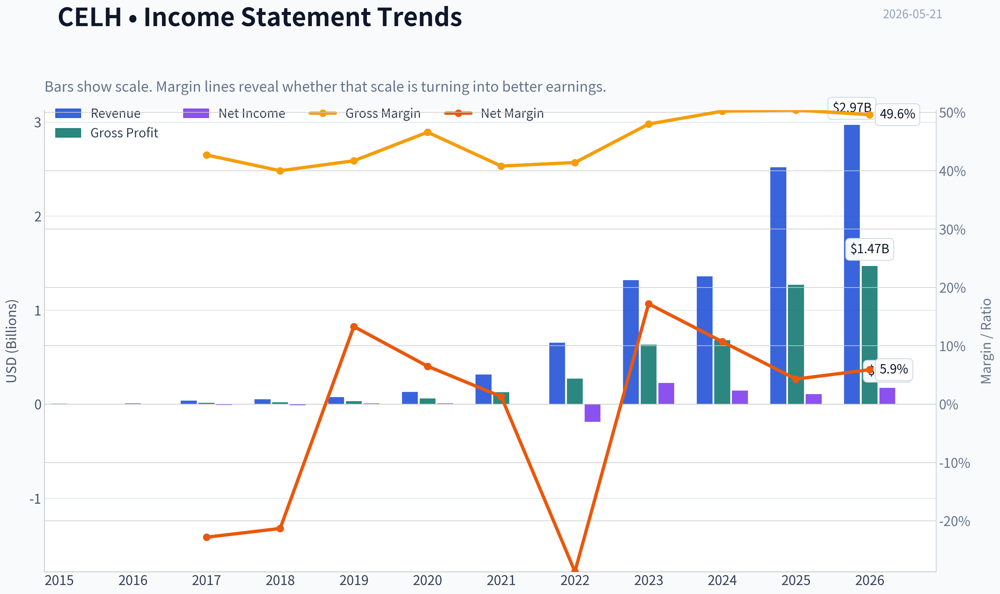

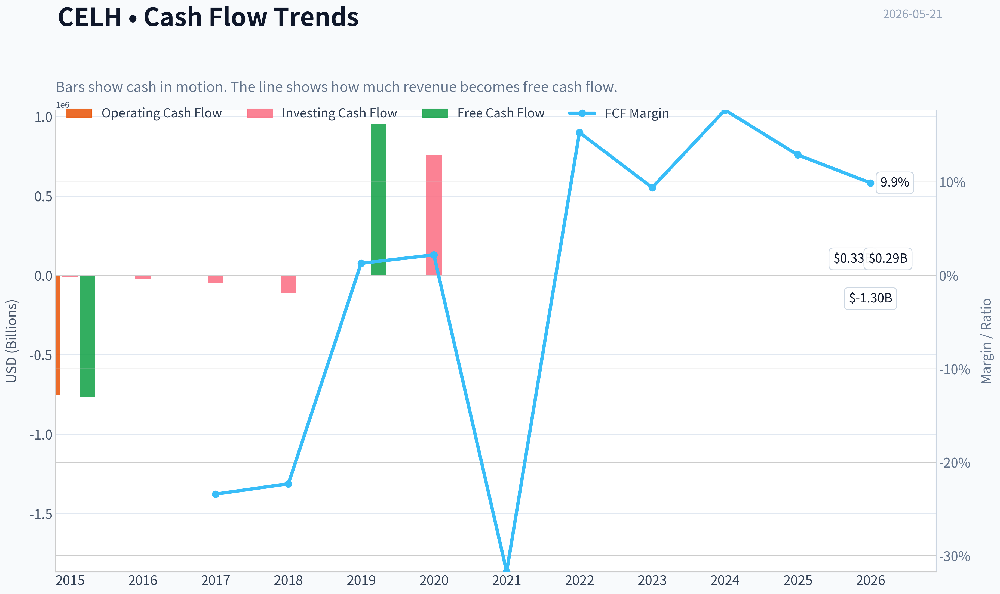

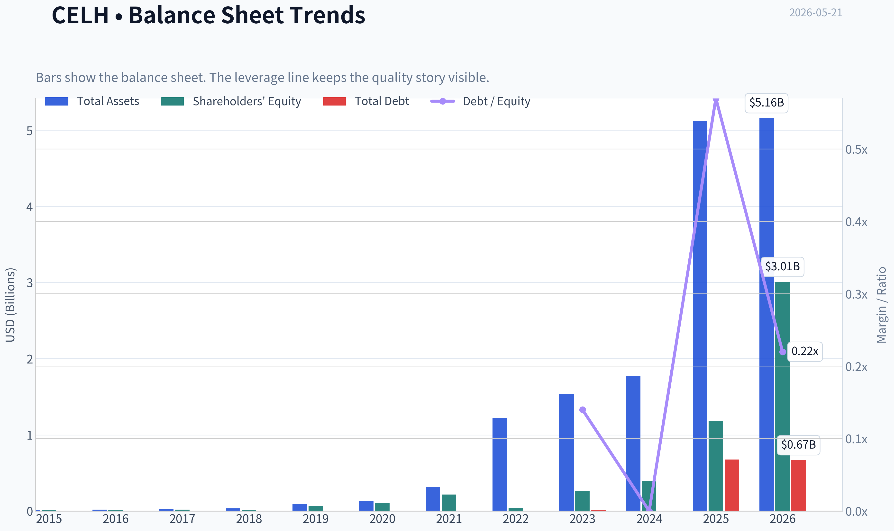

This graph tracks the profitability and return metrics (ROE, ROIC, Margins) of **CELH** over the past decade, highlighting capital efficiency trends.

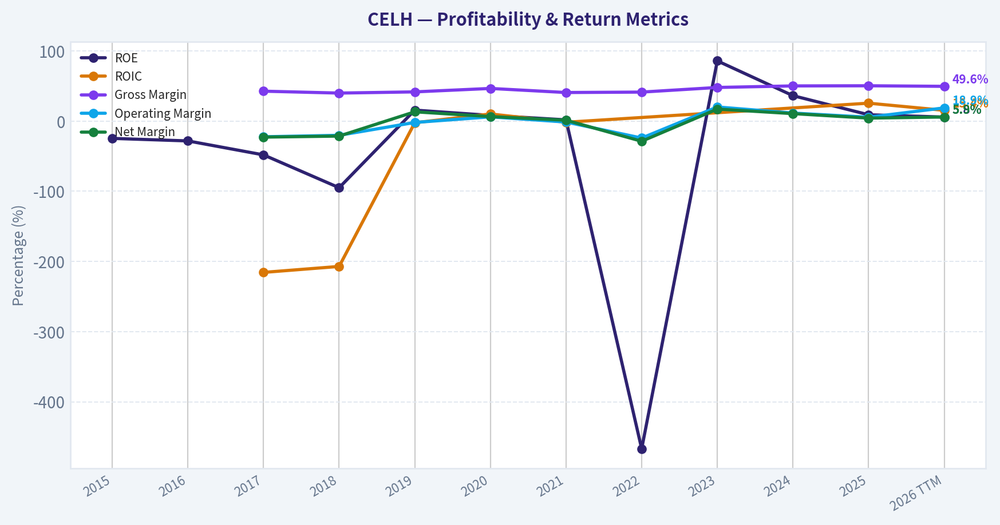

This chart illustrates the financial health of **CELH** over the last 10 years, mapping cash equivalents and free cash flow against total obligations (Debt).

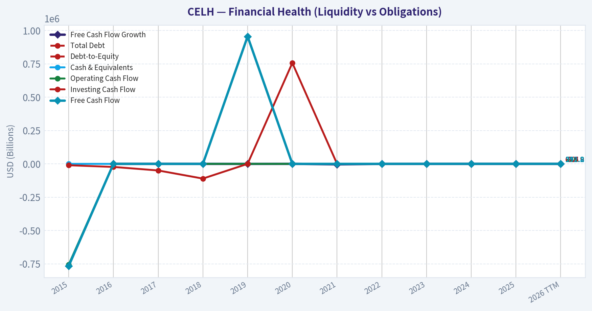

This comparison chart from *Profitability Analysis* stacks current figures against historical benchmarks for **CELH**, making it easy to see where the company trades relative to its own averages.

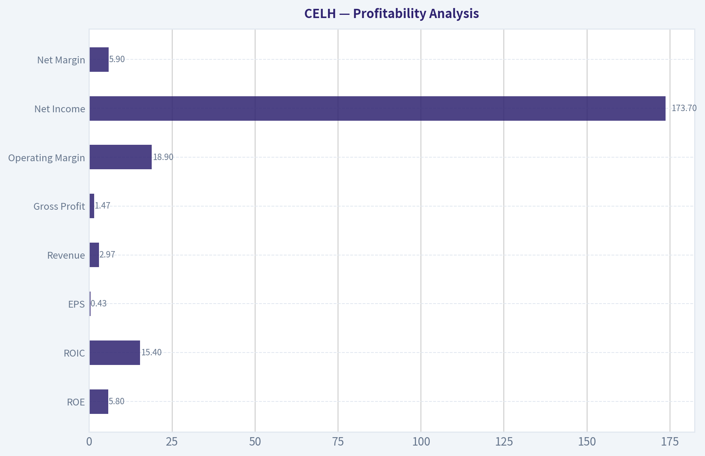

---

### Intrinsic Value Analysis (Buffett)

> *Following Warren Buffett's value investing philosophy: Circle of Competence, Economic Moat, Management Quality, and Margin of Safety.*

#### Intrinsic Value Snapshot

Price is what you pay. Intrinsic value is what the business may be worth based on the cash it can create for owners over time. We show a range, not one magic number.

- Current Price: $29.70
- Value Range (conservative to optimistic across both DCF methods): $44.78 to $116.63

##### Owner Earnings (Buffett Method)
- Net Income: $107,999,000.00
- Depreciation & Amortization: $29,451,000.00
- Capital Expenditures: $-36,067,000.00
- Working Capital Changes: $167,046,000.00
- Owner Earnings: $-65,663,000.00

##### Intrinsic Value
###### Cash Flow Method
Uses free cash flow. Better for companies spending heavily today to grow tomorrow.
- Conservative: $44.78
- Average: $44.78
- Optimistic: $116.63
- Discount Rate: 10.0%

#### CELH appears to be outside the available audited PostgreSQL dataset in this environment, so I cannot complete the full Buffett-style due diligence package from the preferred source.

What I can say from the research pack already in hand:

- **Business**: Celsius sells branded energy drinks, a simple and understandable business.
- **Moat**: Brand strength may be emerging, but this does **not** yet look like a clearly proven wide-moat franchise in Buffett terms.
- **Profitability**:
  - **Gross margin: 50.4%** - strong for a beverage business
  - **ROE: 9.1%** - below Buffett's preferred >15% threshold
  - **P/E: 69.1x** - very demanding valuation
- **Growth**:
  - **Revenue growth YoY: 85.5%** - exceptional, but unusually high growth is rarely stable enough to underwrite conservatively
- **Balance sheet / liquidity**:
  - **Current ratio: 1.68** - acceptable near-term liquidity
- **Cash generation**:
  - **FCF yield: 4.3%** - not obviously cheap relative to the risks and growth expectations embedded in the stock

#### Snapshot Table

| Metric | Value |
|---|---:|
| Current Price | $30 |
| Market Cap | $7.59B |
| P/E | 69.1x |
| ROE | 9.1% |
| Gross Margin | 50.4% |
| Revenue Growth YoY | 85.5% |
| FCF Yield | 4.3% |
| Current Ratio | 1.68 |

**Key Takeaways:** CELH combines very fast growth with a premium valuation. The gross margin is attractive, but the return on equity is not yet at the level Buffett would typically demand for a high-confidence compounder. At 69 times earnings, the market is already paying heavily for future success.

#### Preliminary Buffett Filter View

| Gate | Preliminary View | Reason |
|---|---|---|
| Circle of Competence | Pass | Simple beverage business |
| Long-Term Predictability | Mixed | Consumer brand could endure, but current growth phase is hard to normalize |
| Technology Risk | Pass | Low direct tech disruption risk |
| Moat Test | Mixed | Brand promise exists, but durability still needs proving |
| Management / Capital Allocation | Incomplete | Needs deeper evidence |
| Industry Structure | Mixed | Beverage can be attractive, but competition is fierce |
| Valuation | Fail | Current multiple leaves little margin of safety |

**Key Takeaways:** Celsius passes the simplicity test, which is a good start. The problem is that fast-growing consumer brands are hard to value conservatively unless the moat is already obvious and the price is reasonable. Here, the valuation looks aggressive relative to the current quality signals.

#### Preliminary Conclusion

ANALYST STANCE: **WATCH**

CELH is interesting as a fast-growing branded beverage company, but it does **not** currently look like a classic Buffett-style buy at this price. The combination of **69x earnings**, **sub-15% ROE**, and an only partially proven moat suggests the stock is priced more for momentum and future potential than for present-day owner earnings power and margin of safety. For a value investor, this is a **watchlist name, not an advocacy name**.
#### Valuation Bridge

This bridge places the current market price beside each intrinsic value lens so readers can see whether upside depends on one method or shows up across several methods.

| Scenario | Intrinsic Value / Share |
| --- | ---: |
| Cash Flow Method | $44.78 |
| Damodaran Method | $-25.39 |
| Current Price | $29.70 |

#### Key Takeaways

If one method is far above the others, the upside case depends on a specific modelling assumption. When several methods cluster together, the valuation story is more robust.

#### Valuation Visuals

This comparison chart from *Latest Earnings Snapshot* stacks current figures against historical benchmarks for **CELH**, making it easy to see where the company trades relative to its own averages.

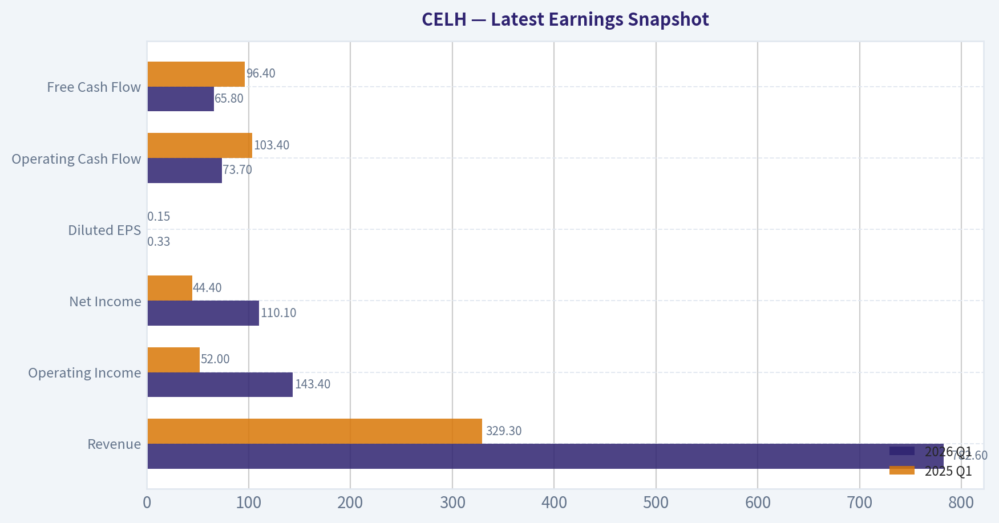

This comparison chart from *Current vs Historical Average Comparison* stacks current figures against historical benchmarks for **CELH**, making it easy to see where the company trades relative to its own averages.

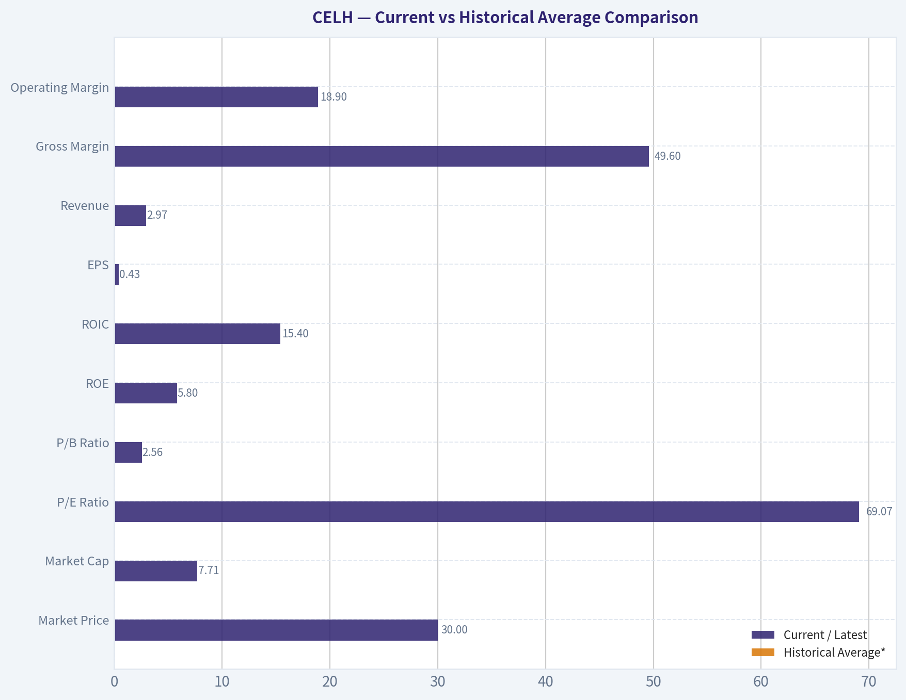

This comparison chart from *Balance Sheet Analysis* stacks current figures against historical benchmarks for **CELH**, making it easy to see where the company trades relative to its own averages.

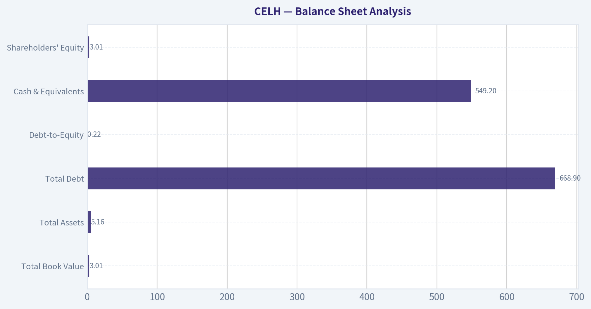

---

### Trend & Growth Analysis (Lynch/Druckenmiller/Fisher)

> *Following Peter Lynch's GARP, Stanley Druckenmiller's macro-aware approach, and Philip Fisher's scuttlebutt methodology.*

ANALYST STANCE: **WATCH**

#### CELH Growth Report

#### 1) Lynch Classification

| Item | Assessment |
|---|---|
| Lynch category | **Fast Grower** |
| Why | Revenue growth is still far above Lynch's 15-25% fast-grower threshold |
| Caveat | Growth durability is less certain after a major distribution-driven expansion and recent stock weakness |

**Key Takeaways:** Celsius clearly fits the fast-grower bucket, which is the main hunting ground for ten-baggers. But this is no longer an undiscovered small story; the core question is whether growth can stay structurally high after the first big scale-up.

---

#### 2) The Story in 3 Bullets

| Simple story | Why it matters |
|---|---|
| Celsius sells a "better-for-you" energy drink brand | It tapped into wellness + energy, a durable consumer trend rather than pure legacy energy positioning |
| Pepsi distribution massively expanded shelf access | Distribution scale can turn a strong brand into a national platform quickly |
| If Celsius becomes a mainstream global energy brand, revenue can still compound materially | The upside case depends on sustaining share gains, not just one-time channel fill |

**Key Takeaways:** The story is easy to explain, which Lynch would like. Celsius is basically a fast-growing energy drink challenger using health-and-wellness branding plus major distribution leverage to attack a large market.

#### 3) Snapshot Fundamentals

| Metric | Value |
|---|---|
| Current price | **$30** |
| Market cap | **$7.59B** |
| P/E | **69.1x** |
| ROE | **9.1%** |
| Gross margin | **50.4%** |
| Revenue growth YoY | **85.5%** |
| FCF yield | **4.3%** |
| Current ratio | **1.68x** |

**Key Takeaways:** The company still screens as a premium growth stock, with exceptional top-line growth and healthy gross margin. However, the valuation remains rich on earnings, so future returns depend heavily on continued execution and durable category share gains.

#### 4) TAM Analysis and 10x Test

| Item | Assessment |
|---|---|
| Core TAM | Global energy drinks + functional beverages |
| TAM direction | **Expanding**; wellness/zero-sugar/functional energy remains a secular growth pocket |
| Current scale | ~$7.6B market cap company, still far smaller than global category leaders |
| 10x revenue test | **Likely passes conceptually** |
| Why | A 10x revenue outcome would imply Celsius becomes a major global brand, but still not necessarily dominant in a very large global category |

**Key Takeaways:** The runway appears real. Celsius does not look boxed into a tiny niche; if management executes internationally and broadens product lines, the business can get many times larger before hitting obvious TAM limits.

#### 5) Revenue Growth Trend

| Metric | Reading |
|---|---|
| Latest YoY revenue growth | **85.5%** |
| Pattern | **High growth, but likely normalization risk ahead** |
| Interpretation | Current growth is outstanding, though investors must separate sustainable sell-through from distribution expansion effects |
| Quality concern | Need to monitor organic velocity vs. channel inventory/loading |

**Key Takeaways:** The headline growth rate is elite and absolutely qualifies as fast-grower territory. The big analytical task is not whether growth has been strong, but whether it is sustainable once distribution gains lap and comparisons get harder.

#### 6) Unit Economics / Efficiency

| Metric | Value | Assessment |
|---|---:|---|
| Gross margin | 50.4% | Strong for a beverage brand |
| FCF yield | 4.3% | Positive and supportive |
| Rule of 40 proxy | ~89.8% (85.5 growth + 4.3 FCF yield proxy) | Very strong, though not a pure SaaS-style measure |
| LTV/CAC | N/A | Not disclosed in consumer packaged goods format |
| NRR | N/A | Not relevant for beverage |
| Payback period | N/A | Not directly disclosed |

**Key Takeaways:** While beverage companies do not report SaaS-style unit economics, Celsius still shows signs of efficient growth through strong gross margins and positive cash generation. That combination supports the case that growth is not being purchased at any price.

#### 7) Inflection Point Assessment

| Inflection type | View | Notes |
|---|---|---|
| Product cycle inflection | **Moderate positive** | Better-for-you energy remains relevant; innovation matters but is not yet the central thesis |
| Distribution inflection | **Major positive, but maturing** | Pepsi relationship was the major growth unlock |
| Market share inflection | **Positive** | Celsius has taken share in energy, especially with wellness-conscious users |
| Margin inflection | **Mixed** | Gross margin is healthy; need confirmation that operating leverage continues |
| TAM inflection | **Positive** | Energy plus functional/wellness positioning broadens addressable market |
| Competitive inflection | **Unclear** | Incumbents remain strong; no obvious competitor collapse |

**Key Takeaways:** Celsius already had one major inflection point: scaled distribution. The next leg up must come from sustained velocity, broader international penetration, and proof it is becoming a lasting brand platform rather than just a U.S. distribution success story.

#### 8) Macro Setup

| Macro factor | Assessment |
|---|---|
| Secular trend exposure | **Strong** |
| Relevant themes | Health/wellness consumption, functional beverages, premium consumer brands |
| Interest-rate sensitivity | Moderate; high-multiple growth still benefits from friendlier rate backdrop |
| Economic sensitivity | Consumer staple-like demand helps, but premium beverages can still feel pressure |
| Overall macro wind | **Neutral to mildly favorable** |

**Key Takeaways:** Celsius is helped more by consumer and category trends than by macro alone. It is not a classic long-duration software stock, but valuation still benefits from a stable or easing rate environment.

#### 9) Fisher 15-Point Score

| Fisher Area | Score (1-5) | Comment |
|---|---:|---|
| Market potential | 5 | Large global category with room to expand |
| New product development | 4 | Innovation exists, though core brand remains the key driver |
| R&D effectiveness | 3 | Adequate for beverage; less relevant than tech or pharma |
| Sales organization | 5 | Pepsi distribution significantly strengthens this |
| Profit margin | 4 | Healthy gross margin profile |
| Improving margins | 3 | Needs continued proof as scale matures |
| Labor/personnel relations | 3 | Limited visibility |
| Executive relations | 3 | Limited external visibility |
| Management depth | 3 | Reasonable, but not enough evidence for top marks |
| Cost/accounting controls | 3 | No major red flags from provided data |
| Special advantages | 4 | Brand + shelf velocity + distribution |
| Long-range profit outlook | 4 | Attractive if brand endures |
| Dilution risk | 3 | No major red flag provided, but monitor |
| Candor | 3 | Neutral due to limited data here |
| Integrity | 3 | Neutral due to limited data here |

| Total Fisher Score | **53 / 75** |
|---|---|
| Rating band | **Average to Good** |

**Key Takeaways:** The Fisher score is respectable but not elite, mainly because we lack deeper scuttlebutt evidence on management depth, candor, and organizational quality. The strongest areas are market potential, sales reach, and strategic advantages tied to brand and distribution.

#### 10) Valuation Analysis

| Metric | Value | Interpretation |
|---|---:|---|
| P/E | 69.1x | Expensive on current earnings |
| Revenue growth | 85.5% | Exceptionally strong |
| PEG | ~0.81 | Attractive by Lynch framework, if growth is durable |
| P/S | Not directly provided | Likely still premium for beverages |
| FCF yield | 4.3% | Better than many premium growth names |

**Key Takeaways:** On a Lynch-style PEG basis, CELH does not look insane if the growth rate is real and durable. But on plain earnings multiple, the stock still requires confidence that this is a long runway compounder rather than a temporary hyper-growth phase.

#### 11) Scenario Framing

| Scenario | What must happen | Likely market view |
|---|---|---|
| Bear | Growth normalizes sharply, U.S. velocity slows, margin leverage disappoints | Multiple compresses materially |
| Base | Growth remains above category, but moderates; margins stay healthy | Stock can work, but likely not explosively |
| Bull | Celsius proves it is a global enduring brand, expands formats/geographies, compounds revenue for years | Ten-bagger logic remains alive from here, though harder than at earlier stages |

**Key Takeaways:** The bear case is mostly about growth deceleration and multiple compression. The bull case requires Celsius to evolve from hot challenger brand into durable global beverage platform.

#### 12) Growth Investor Scorecard

| Criterion | Weight | Score (1-5) | Weighted Score |
|---|---:|---:|---:|
| The Story | 10% | 4.5 | 0.45 |
| TAM & Runway | 20% | 4.0 | 0.80 |
| Revenue Growth | 20% | 4.5 | 0.90 |
| Unit Economics | 15% | 4.0 | 0.60 |
| Competitive Position | 10% | 3.5 | 0.35 |
| Management Quality | 10% | 3.0 | 0.30 |
| Macro Setup | 5% | 3.5 | 0.18 |
| Profitability Path | 5% | 3.5 | 0.18 |
| Valuation | 5% | 3.0 | 0.15 |

| Total Score | **3.91 / 5.0** |
|---|---|

**Key Takeaways:** Celsius scores well overall because the growth, runway, and business story are strong. It falls short of a higher-conviction advocate stance because valuation still embeds optimism and the next phase of growth needs more proof.

#### 13) Position Size Stance

| Item | View |
|---|---|
| Stance | **WATCH** |
| Suggested sizing | Starter position only if already familiar; otherwise wait for stronger confirmation or better entry |
| What would upgrade to ADVOCATE | Evidence of durable post-distribution growth, continued share gains, stable/improving margins, and cleaner valuation support |
| What would downgrade to AVOID | Revenue deceleration, gross margin erosion, channel inventory issues, or evidence brand heat is fading |

**Key Takeaways:** This is not a broken story, but it is no longer an easy early-stage discovery either. The stock deserves close monitoring, with discipline around confirmation that the hyper-growth phase is converting into durable brand compounding.

#### 14) Risks and Catalysts

| Risks | Catalysts |
|---|---|
| Growth deceleration after distribution expansion | Strong quarterly sell-through data |
| Margin pressure from promotions or mix | International expansion traction |
| Heavy dependence on major distribution/customer relationships | New successful product/platform launches |
| Energy drink competition from entrenched incumbents | Evidence of sustained market share gains |
| Stock remains vulnerable to multiple compression | Margin expansion and stronger FCF conversion |

**Key Takeaways:** The main risk is that investors mistake a powerful distribution step-up for permanent hyper-growth. The main catalyst is proof that Celsius has become a durable consumer habit with enough brand strength to keep gaining share over several more years.

#### Bottom Line

| Final judgment | Assessment |
|---|---|
| Ten-bagger potential | **Still possible, but less asymmetric than earlier** |
| Lynch view | Fast grower with a real story |
| Druckenmiller view | Key question is whether the next earnings power step is still underestimated |
| Fisher view | Good brand/platform qualities, but more evidence needed on durability and management depth |
| Final stance | **WATCH** |

**Key Takeaways:** Celsius remains one of the more interesting branded consumer growth stories because it combines a strong category, a differentiated brand, and major distribution leverage. But at this stage, the investment case hinges less on discovering growth and more on proving that growth can persist at attractive economics long enough to justify the premium.

#### Growth & Scorecard Visuals

This comparison chart from *Growth Metrics* stacks current figures against historical benchmarks for **CELH**, making it easy to see where the company trades relative to its own averages.

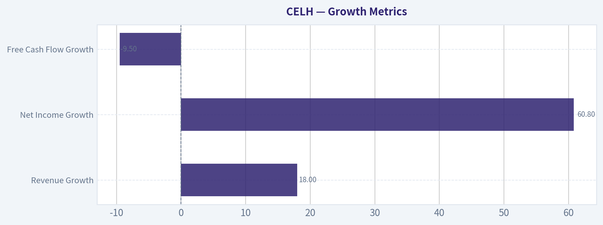

---

### Market Technical Analysis

#### CELH Technical Indicator Selection and Trend Report

For CELH, the most relevant **8 complementary indicators** for the current market context are:

1. **close_10_ema**
2. **close_50_sma**
3. **close_200_sma**
4. **macdh**
5. **rsi**
6. **boll_ub**
7. **boll_lb**
8. **atr**

These are well suited because CELH is currently in a **clear multi-timeframe downtrend**, but it is also showing signs of **short-term stabilization after a sharp selloff**. The selected set avoids unnecessary duplication while covering:
- **short-term trend/momentum**: close_10_ema, macdh
- **medium- and long-term trend structure**: close_50_sma, close_200_sma
- **momentum exhaustion / rebound potential**: rsi
- **price extension / compression zones**: boll_ub, boll_lb
- **risk and position sizing**: atr

---

#### Price Context

CELH closed at **28.63 on 2026-05-20**. Over the broader period since November 2025, the stock has undergone three important phases:

1. **An abrupt collapse in early November 2025**, when price fell from the high-50s into the low-40s.
2. **A strong recovery into January 2026**, where price briefly returned to the mid-to-upper 50s.
3. **A persistent breakdown from late February through May 2026**, culminating in a decline into the high-20s.

This matters because the current setup is not just a random pullback. It is the continuation of a larger structural deterioration. Even when the stock attempted rebounds in April and early May, those moves failed to reclaim major moving averages, which is a classic sign that rallies are being sold into rather than accumulated aggressively.

#### Selected Indicators Snapshot

| Indicator | Latest Reading | What It Suggests |
|---|---:|---|
| close_10_ema | 29.96 | Short-term trend still weak, though price is close enough for a possible near-term test |
| close_50_sma | 34.75 | Medium-term trend firmly bearish; price is far below it |
| close_200_sma | 47.55 | Long-term structure remains decisively broken |
| macdh | -0.03 | Downside momentum has slowed sharply, but has not clearly turned positive |
| rsi | 40.16 | No longer deeply oversold, but still below neutral and not yet strong |
| boll_ub | 35.89 | Upper volatility resistance is well above current price |
| boll_lb | 27.19 | Price is trading close to lower-band territory, consistent with weakness and possible basing attempts |
| atr | 1.83 | Volatility remains elevated; position sizing should stay conservative |

**Key Takeaways:** CELH remains in a strongly bearish technical structure across short, medium, and long timeframes. The most notable recent change is that downside momentum has eased, suggesting the stock may be trying to stabilize, but there is still no convincing evidence of a trend reversal. Traders should treat any bounce as tactical rather than structural until price can reclaim key moving averages.

---

#### Trend Structure Analysis

The **10 EMA at 29.96** is above the latest close of 28.63, which tells us the immediate short-term tape is still weak. However, the gap between price and the 10 EMA is much smaller than the gap to the 50 SMA or 200 SMA. That nuance matters. It suggests the stock may be trying to form a **short-term equilibrium zone**, even while remaining in a deeply damaged broader trend.

The **50 SMA at 34.75** has been falling steadily from roughly 48.66 in late March to 34.75 now. That is not just bearish; it shows a **persistent medium-term repricing lower**. A falling 50 SMA typically acts as overhead resistance in weak names, and CELH is currently more than 6 points below it. That is a substantial distance for a stock trading in the high-20s.

The **200 SMA at 47.55** confirms that the long-term trend is also decisively negative. The stock is nearly 19 points below the 200 SMA, which signals a severe disconnect from its longer-term equilibrium. In practice, that means longer-horizon investors are still dealing with a stock that has not repaired its structural damage. Any claim of a durable trend reversal would be premature while price remains so far below this level.

A useful way to frame the setup is:
- **Short term:** trying to stabilize
- **Medium term:** still trending down
- **Long term:** clearly broken

That combination often produces **sharp but fragile countertrend rallies**, not immediately sustainable bull trends.

---

#### Momentum Analysis

The **MACD histogram is -0.026**, which is still slightly negative, but very importantly it has improved dramatically from much more negative readings in late March and early April. This indicates that the **rate of downside acceleration has faded**. In other words, bears still control the trend, but they no longer have the same momentum dominance they had during the steepest part of the selloff.

This is an important distinction. A negative histogram near zero is often the zone where a stock either:
- transitions into a relief bounce, or
- rolls over again after a weak pause

So while momentum is improving, it is not yet decisively bullish.

The **RSI at 40.16** supports that interpretation. CELH was recently deeply oversold, hitting **28.16 on May 13**, then recovering modestly. RSI moving from oversold into the low-40s usually means the stock has relieved some selling pressure, but it has **not yet entered a healthy bullish momentum regime**. In stronger recoveries, RSI typically pushes through 50 and can hold that zone. CELH has not done that.

The subtle message from momentum is:
- panic selling has cooled,
- but buyers have not yet demonstrated strong control.

That makes the current setup more consistent with a **bear-market pause or tradable rebound attempt** than a confirmed reversal.

---

#### Volatility and Bollinger Band Analysis

The Bollinger Bands show:
- **Upper Band: 35.89**
- **Lower Band: 27.19**

With price around **28.63**, CELH is trading much closer to the lower band than the upper band. This confirms that price remains in the lower portion of its recent volatility envelope, which is characteristic of a weak trend.

However, there is a nuance worth highlighting: the lower band has declined sharply over the past several weeks, and the band structure has also narrowed somewhat compared with earlier phases of the selloff. That can indicate the stock is moving from **impulsive decline** into **compressed, cautious stabilization**. If price can hold above the lower band while momentum continues improving, a rebound toward the mid-band or 10 EMA is possible.

But traders should not confuse "near the lower band" with "automatically oversold and ready to rally." In persistent downtrends, stocks can hug the lower band repeatedly. The Bollinger setup currently says:
- price is still weak,
- selling may be less violent than before,
- but overhead recovery room remains large and resistance-heavy.

A reasonable volatility map is:
- **first support zone:** around 27.2 to 28.0
- **first rebound/trend test:** around 30.0 near the 10 EMA
- **stronger resistance area:** roughly 34.8 to 35.9, where the 50 SMA and upper band start clustering

That clustering is important because it means even if CELH bounces, it will likely encounter **layered resistance**, not a clean runway higher.

---

#### ATR and Risk Management

The **ATR at 1.83** is still elevated, though below the peak readings seen in late March and early April. This suggests volatility remains meaningful, but not at maximum panic levels.

For traders, elevated ATR has two implications:

1. **Stops must allow room**
   A very tight stop can be easily hit by ordinary daily fluctuation. On a 28-30 dollar stock, an ATR near 1.8 is substantial.

2. **Position sizing should be smaller than usual**
   Even if one is attempting a rebound trade, the stock's recent behavior argues for discipline. CELH has shown the ability to gap, reverse, and extend intraday moves sharply.

The slightly lower ATR compared with prior weeks suggests the market may be transitioning from disorderly selling into more organized trading, but it is still far from calm.

---

#### Fine-Grained Interpretation for Traders

| Trading Lens | Interpretation |
|---|---|
| Trend follower | Avoid aggressive longs until price can reclaim the 10 EMA and then prove strength toward the 50 SMA |
| Mean reversion trader | Watch for support around the lower Bollinger region, but require confirmation because the larger trend is still bearish |
| Swing trader | A bounce toward 30-31 is plausible, but likely tactical unless momentum turns more clearly positive |
| Risk manager | Elevated ATR argues for smaller size and wider, volatility-aware stops |
| Longer-term investor | Technical repair is incomplete; price remains far below the 200 SMA |

**Key Takeaways:** Different trading styles should approach CELH differently, but none of them currently have strong evidence of a durable uptrend. Short-term traders may find tactical opportunities if support holds and momentum improves, while longer-term participants should wait for much more substantial technical repair. The stock remains vulnerable to failed rallies because resistance levels are stacked overhead.

---

#### What the Trend Is Actually Saying

Rather than saying the trend is simply "bearish," the more precise reading is this:

CELH appears to be in the **late stage of a prolonged downward leg**, where the most aggressive selling has eased, but the stock has not yet rebuilt a base strong enough to support a sustained reversal. The short-term indicators suggest the decline is **losing speed**, not that it has fully ended. The medium-term moving average slope remains decisively negative, which means supply likely still exists on rebounds. The long-term trend remains severely impaired, so any recovery must first be judged as a countertrend move until proven otherwise.

This kind of setup often produces:
- brief rallies that look promising,
- failure near the first serious resistance cluster,
- then either another retest of lows or a longer basing process

In CELH's case, the recent low near **27.86** becomes an important reference. If that level breaks decisively, the stabilization thesis weakens and the downtrend likely resumes. If it holds and price can reclaim the 10 EMA, then a rebound phase toward the low-30s becomes more credible. Even then, the bigger test would remain the 50 SMA zone in the mid-30s.

---

#### Practical Conclusion

The most important takeaway is that **CELH is not yet in reversal mode; it is in stabilization mode inside a larger downtrend**.

- **Bull case:** downside momentum is fading, RSI has lifted from oversold, and price is near an area where a short-term base could form.
- **Bear case:** price remains below all key trend references, the 50 SMA is falling hard, the 200 SMA is far above price, and resistance overhead is dense.
- **Most likely near-term scenario:** choppy attempts to rebound, with a need for confirmation before trusting upside continuation.

For now, CELH looks more suitable for **careful tactical trading** than for confident trend-following longs.

---

#### Summary Table

| Category | Indicator(s) | Current Read | Main Message | Trading Relevance |
|---|---|---:|---|---|
| Short-term trend | close_10_ema | 29.96 | Price still below short-term trend line | Immediate weakness, but possible rebound test |
| Medium-term trend | close_50_sma | 34.75 | Strongly declining medium-term trend | Major overhead resistance |
| Long-term trend | close_200_sma | 47.55 | Long-term structure badly damaged | No confirmed long-term recovery |
| Momentum | macdh | -0.03 | Bearish momentum has faded sharply | Watch for either rebound follow-through or rollover |
| Momentum condition | rsi | 40.16 | Off oversold lows, but still below neutral | Stabilization, not strength |
| Volatility envelope | boll_ub / boll_lb | 35.89 / 27.19 | Price near lower band | Weak positioning, possible basing attempt |
| Risk | atr | 1.83 | Volatility still elevated | Smaller size, wider stops |
| Overall read | Combined view | - | Stabilizing within a larger downtrend | Tactical setup, not yet a structural reversal |

**Key Takeaways:** CELH's technical picture is weak across longer timeframes, but the stock may be entering a pause after an extended decline. Momentum has improved enough to support the idea of a short-term bounce, yet not enough to confirm a durable reversal. The key battle is whether price can hold near recent lows and reclaim short-term resistance without failing again under the heavier medium-term downtrend.

#### Market Visuals

This comparison chart from *Market Metrics* stacks current figures against historical benchmarks for **CELH**, making it easy to see where the company trades relative to its own averages.

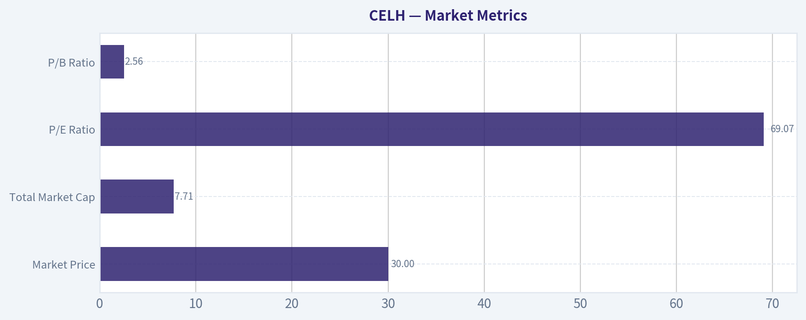

---

### Options Market Analysis

> *Reading options flow - put/call ratios, IV skew, and unusual activity - to gauge institutional positioning and event-driven risk.*

#### CELH Options Positioning Report
*Date: 2026-05-21*

#### 1. Put/Call Ratio Analysis

| Expiration | Call OI | Put OI | Put/Call OI Ratio | Call Vol | Put Vol | Put/Call Vol Ratio |
|---|---:|---:|---:|---:|---:|---:|
| 2026-05-22 | 14,796 | 9,387 | 0.63 | 4,200 | 1,451 | 0.35 |
| 2026-05-29 | 4,179 | 4,615 | 1.10 | 1,808 | 3,388 | 1.87 |
| 2026-06-05 | 2,581 | 4,100 | 1.59 | 599 | 1,094 | 1.83 |
| **Near-term total** | **21,556** | **18,102** | **0.84** | **6,607** | **5,933** | **0.90** |

**Key Takeaways:** The front expiry for tomorrow is clearly call-heavy, with a 0.63 put/call OI ratio and very call-dominant trading volume. But once you move one to two weeks out, positioning flips more defensive, with both 2026-05-29 and 2026-06-05 showing put-heavy open interest and volume. Net-net, the aggregate near-term read is only modestly cautious, not aggressively bearish, because the total OI ratio sits at 0.84, only slightly above the historical neutral zone of about 0.7.

**Interpretation**
- The **overall near-term put/call OI ratio of 0.84** is slightly above the neutral baseline of ~0.7, which suggests **some added demand for downside protection** versus a fully neutral tape.
- The **overall put/call volume ratio of 0.90** is close to balanced, but still tilts mildly defensive rather than outright bullish.
- The notable wrinkle is the **split by expiry**:
  - **2026-05-22** looks **bullish/speculative**, likely short-dated call activity.
  - **2026-05-29 and 2026-06-05** look **more hedge-driven or bearish**, with puts outnumbering calls in both OI and volume.
- That pattern often means traders are willing to chase very short-term upside while still carrying protection into the following weeks.

#### 2. Implied Volatility Assessment

| Expiration | ATM Call IV | ATM Put IV | IV Read |
|---|---:|---:|---|
| 2026-05-22 | 73.3% | 78.6% | Elevated, put IV premium |
| 2026-05-29 | 52.8% | 53.1% | Moderate, nearly flat |
| 2026-06-05 | 57.4% | 55.2% | Moderate, slight call premium |

**Key Takeaways:** Front-week implied volatility is elevated, especially for puts, which points to event-risk sensitivity or near-term downside hedging demand. After that, IV drops into a more moderate range in the next two expirations, suggesting the market expects the biggest uncertainty to be concentrated right now rather than steadily building. The skew is not extreme beyond the nearest expiry.

**IV conclusions**
- **Near-term ATM IV is elevated**, especially in the **2026-05-22** line:
  - Calls: **73.3%**
  - Puts: **78.6%**
- That front-expiry **put-over-call premium** implies **downside fear / crash protection demand** into the very near term.
- For **2026-05-29**, call and put ATM IV are nearly identical, which suggests a **more balanced volatility outlook**.
- For **2026-06-05**, calls trade at a slight premium to puts, which may reflect some upside optionality demand, but the difference is small.

**Skew assessment**
- Full OTM skew detail was not provided, but using ATM call-vs-put IV as a proxy:
  - **Front expiry shows put-skew behavior**, a bearish/hedging signal.
  - **Later expiries show flatter skew**, meaning the market is not pricing an outsized downside tail beyond the immediate window.
- This is consistent with **short-dated uncertainty rather than a sustained high-conviction bearish campaign**.

**Catalyst read**
- IV looks **high enough in the nearest expiry to suggest a live catalyst or elevated event sensitivity**.
- Without a confirmed event calendar in the provided data, the safest read is: **the market is pricing near-term movement risk**, especially on the downside, but not a prolonged volatility regime.

#### 3. Unusual Options Activity

| Screen Result | Observation |
|---|---|
| Volume > 5x Open Interest | No qualifying contracts found in near-term expirations |

**Key Takeaways:** There was no standout contract where fresh volume overwhelmed existing open interest by the usual unusual-activity threshold. That reduces confidence in any "smart-money" directional tell from today's tape. The sentiment read therefore relies more on broad positioning, skew, and aggregate put/call behavior than on any single high-conviction block or sweep.

**Interpretation**
- **No contracts** in the near-term chain met the screen for **volume greater than 5x open interest**.
- That means there is **no clear fresh institutional bet** jumping off the page in the provided data.
- Absence of unusual activity does **not** mean no positioning exists; it means there is **no obvious high-signal contract** to anchor a strong smart-money narrative.
- This lowers conviction somewhat and suggests the tape is being shaped by **distributed positioning**, not a single aggressive bet.

#### 4. Open Interest Concentration

| Expiration | Dominant OI Character | Likely Market Effect |
|---|---|---|
| 2026-05-22 | Highest total OI by far | Strongest pinning/gravity potential into expiry |
| 2026-05-29 | Balanced but put-heavier | Can reinforce defensive tone next week |
| 2026-06-05 | Put-heavy OI | Suggests continued demand for protection further out |

**Key Takeaways:** The largest concentration of open interest sits in the nearest expiry, so that expiration is most likely to exert short-term pinning or "gravitational" effects. Beyond that, the fact that open interest shifts more heavily toward puts hints that traders are more cautious once the immediate expiry passes. We do not have strike-by-strike data, so exact max-pain and gamma-wall levels cannot be identified here.

**Interpretation**
- The **2026-05-22 expiry dominates total near-term OI**, so it likely has the strongest influence on short-term dealer hedging flows and expiry-related pinning.
- Since we were not provided **strike-level OI concentrations**, we **cannot precisely identify**:
  - max pain,
  - exact call wall / put wall levels,
  - or specific gamma walls.
- Still, on an expiry-level basis:
  - **front-week OI concentration** may dampen movement if price nears major dealer inventory zones,
  - while the **put-heavier following expiries** suggest that downside moves could see more reactive hedging behavior if price weakens.

#### 5. Overall Options Sentiment Signal

| Category | Signal |
|---|---|
| Overall Options Sentiment | **NEUTRAL to SLIGHTLY BEARISH** |
| Conviction | **Moderate-Low** |
| Primary Driver | Put-heavy positioning in the next 1-2 weeks plus front-end put IV premium |

**Key Takeaways:** The cleanest overall read is neutral-to-slightly bearish, not outright bearish. Traders are not showing panic, but they are paying somewhat more for protection in the next couple of weeks and leaning more heavily into puts after the nearest expiry. The bullish short-dated call activity tempers the downside signal, which is why conviction is only moderate-low.

**Synthesis**
- I would classify CELH options sentiment as **NEUTRAL to SLIGHTLY BEARISH**.
- Why not bullish?
  - Because **post-front-expiry positioning turns put-heavy**.
  - Because **front-end put IV trades above call IV**, implying near-term downside concern.
- Why not fully bearish?
  - Because the **aggregate OI ratio is only 0.84**, not an extreme bearish reading.
  - Because **total near-term volume is close to balanced**.
  - Because there is **no major unusual put flow** showing an aggressive fresh bearish bet.
- Best interpretation:
  - **Short-dated traders are still willing to play upside**,
  - but **swing traders are carrying more protection into the next 1-2 weeks**.

#### Bottom Line
CELH's options market currently suggests **cautious positioning with a mild defensive bias**. The strongest signal is not panic or outright bearish speculation, but rather **near-term hedging demand layered on top of some front-week upside trading**. If the stock stays stable, front-expiry positioning could mute movement; if it weakens, the put-heavy later expiries imply downside could become more sensitive to hedging flows.

---

#### Summary Table

| Metric | Read |
|---|---|
| Put/Call Ratio | **0.84 OI / 0.90 volume**; slightly defensive vs. ~0.7 neutral baseline |
| IV Level | **Elevated in front week**, moderate in following weeks |
| Skew Direction | **Near-term put skew**, then flatter later |
| Unusual Activity | **None flagged** by volume > 5x OI screen |
| Overall Signal | **NEUTRAL to SLIGHTLY BEARISH** |

**Key Takeaways:** CELH's options tape is sending a mild caution signal rather than a strong directional alarm. The market is paying up for very near-term protection and shows more put interest in the next two expirations, but not at extremes. That leaves the overall signal slightly bearish, with limited conviction due to the lack of standout unusual flow.

---

## Research Team Commentary

> *The Research Manager synthesizes the Bull vs Bear debate into action-free commentary. This is a pre-risk view, not the final stance.*

The strongest bull argument is that Celsius is a simple, understandable consumer business with the right ingredients for a future moat: a repeat-purchase product, strong gross margin at 50.4%, a large category, and brand positioning that appears to resonate. If this really is an emerging fitness-oriented beverage franchise, then current earnings may understate normalized earnings power several years out. The bull is also right that some of the best consumer investments look optically expensive before operating leverage fully shows up.

The strongest bear argument is more compelling for a Buffett-style portfolio: the moat is still unproven, switching costs are low, the category is crowded, and the current returns on capital do not yet demonstrate a truly exceptional business. ROE of 9.1%, ROIC of 8.3%, and ROA of 2.1% are not the numbers of a clearly dominant consumer franchise. Most importantly, at roughly 69x earnings, there is no real margin of safety. Too much has to go right.

My takeaway is WATCH.

Core takeaway: Celsius may become a stronger branded beverage asset over time, but today it looks like a promising franchise candidate rather than a proven Buffett-grade compounder, and the valuation still asks investors to underwrite success before the economics fully prove it. That keeps me from advocating the stock for a value portfolio right now.

Rationale: Through a Buffett lens, business quality comes first, and here the evidence is mixed. I like the simplicity of the business, the consumable nature of demand, and especially the 50.4% gross margin, which suggests there is real product-level strength. But Buffett does not pay up simply because a brand might become powerful. He wants durability, high returns on capital, and predictability that are already visible. Celsius has not fully crossed that bar yet. The market seems to be assuming that the brand will keep scaling, competition will remain manageable, and margins and returns will inflect upward. That may happen, but the current valuation leaves little room for execution mistakes or category cooling. One lesson from past mistakes is not to let long-term skepticism blind me to obvious short-term mispricing after severe deratings. But this setup is different from those cases: this is not a washed-out, low-multiple stock with strong fundamentals and seller exhaustion. It is still a premium multiple name. So I should not overcorrect by forcing an ADVOCATE call just because the business has growth appeal.

What the market may be missing on the bullish side is that a genuine consumer moat can form before headline return metrics look perfect. What the market may be missing on the bearish side is that high gross margins and repeat purchase behavior do matter, and if returns on incremental capital improve, the stock could deserve more credit later. But today, I do not see enough proof or enough valuation support to call it a Buffett-style buy.

Monitoring plan over the next 1 to 4 quarters: First, watch whether revenue growth reaccelerates or at least remains healthy without a major step-up in promotional intensity. Second, watch operating margin and whether that 50.4% gross margin starts translating into better ROIC and ROE; that is the key bridge from good product to great business. Third, monitor market share and shelf-space durability against Monster, Red Bull, and newer "better-for-you" rivals. Fourth, look for evidence that repeat demand is holding rather than the brand relying excessively on distribution gains or marketing spend. Fifth, assess management's capital allocation discipline: are they scaling efficiently, avoiding value-destructive expansion, and converting growth into owner earnings? Finally, I'd watch the stock's valuation relative to earnings revisions. If fundamentals improve while the multiple compresses meaningfully, the case could become much more attractive.

What would strengthen the thesis enough to move toward ADVOCATE? Sustained growth with improving ROIC into clearly double-digit territory, evidence of durable brand strength and shelf resilience, and a more reasonable entry price. What would weaken it? Slower growth, heavier promotions, stagnant returns on capital, or signs that Celsius is just another hot brand in a crowded aisle.

Final stance: WATCH.

---

## Value Investing Team Commentary

> *The Investor translates the research view into an investment thesis before risk review. This is still not the final stance.*

CELH is the kind of business that can tempt investors into paying for possibility before the economics are fully proven. I understand the appeal. It is a simple consumer product story, the category is large, repeat purchase behavior can create powerful economics, and a 50.4% gross margin suggests the product has real consumer acceptance. If Celsius becomes a lasting fitness-oriented beverage franchise, today's earnings could indeed understate what the business is capable of earning five to ten years from now.

But from a Buffett-style standpoint, the key question is not whether the brand is interesting. It is whether the business has already demonstrated durable competitive advantage, strong and repeatable returns on capital, and enough valuation support to provide a margin of safety. On those measures, the case is not yet strong enough. ROE of 9.1%, ROIC of 8.3%, and ROA of 2.1% are respectable for a developing growth business, but they are not the hallmarks of a proven consumer franchise with clear moat economics. In a crowded beverage category with low switching costs, that matters.

The most important issue is valuation discipline. At roughly 69x earnings, investors are still being asked to underwrite a very favorable future. That multiple leaves little room for growth hiccups, promotional pressure, market share setbacks, or simple normalization of enthusiasm. A great business can still be a poor investment if purchased at too high a price, and that is the risk here. Buffett's edge is not in buying exciting stories at optimistic prices; it is in buying understandable businesses when the odds and valuation are firmly in his favor.

Selective contrarian thinking is useful here. If sentiment is enthusiastic because Celsius is seen as a next-generation beverage winner, the contrarian response is not to reflexively oppose the crowd, but to ask what is already embedded in the price. The market may be assuming the brand keeps compounding, competition remains manageable, and incremental returns improve meaningfully. That could happen. But when expectations are already elevated, even decent execution may not be enough to produce strong shareholder returns from this starting point. In other words, the business may continue to perform while the stock disappoints.

On the other hand, the market may also be missing something important on the bullish side: genuine consumer brands often look expensive before their moats are obvious in the numbers. Shelf presence, habit formation, community identity, and repeat usage can mature into a stronger franchise than early return metrics suggest. So I would not dismiss Celsius as a fad without evidence. I would simply say that the burden of proof belongs to the buyer at this valuation.

What matters most over the next several quarters is whether gross margin strength starts to flow through into clearly better owner economics. I would want to see healthy growth without excessive promotional dependence, improving operating leverage, stronger returns on incremental capital, and evidence that brand demand is durable rather than distribution-led. If Celsius can convert its product momentum into double-digit-plus ROIC and more obviously resilient economics, the investment case improves materially. If growth cools and promotion rises, the current multiple will look very fragile.

This is not a distressed mispricing where fear has created obvious value. It is closer to a premium-franchise candidate whose stock still reflects a lot of hope. That does not make it a bad business. It just means patience is warranted. For a long-term value investor, I would rather miss the first phase of optimism and buy later with stronger proof than pay up now for a moat that is still forming.

**ANALYST STANCE: WATCH**
CELH is an understandable and potentially attractive consumer business, but the moat is not yet proven, returns on capital are not yet exceptional, and the valuation offers little margin of safety. I would monitor for stronger evidence of durable brand economics and improved capital returns, while waiting for either better business proof or a more favorable price before becoming more constructive.

---

## Deep Values Commentary

> *The Risk Management Team debates and the Risk Judge provides the final action-free verdict. This section determines the final ADVOCATE / WATCH / AVOID stance.*

#### Final Stance Scorecard

This scorecard converts the final research view into a weighted decision frame. It does not replace the narrative judgement, but it makes the main drivers of the verdict easier to scan.

| Criterion | Score | Weight | Commentary |
| --- | ---: | ---: | --- |
| Business Quality | 3.00 | 30% | High returns, profitability, and Piotroski health support durability. |
| Valuation Support | 1.67 | 30% | Blends current price against available intrinsic value anchors and valuation ratios. |
| Financial Strength | 4.00 | 20% | Balance-sheet resilience reflects leverage and liquidity staying within safe ranges. |
| Growth Durability | 3.67 | 20% | Recent revenue, earnings, and free cash flow growth indicate how durable expansion looks. |
| TOTAL / FINAL STANCE | 2.94 | 100% | WATCH |

#### Key Takeaways

The weighted score lands at **2.94 / 5.0**, while the final stance remains **WATCH**. This is useful as a quick calibration aid rather than a mechanical signal.

#### Risk Summary

Higher scores indicate more risk pressure. The watch threshold is a simple guardrail: above it, the position needs tighter monitoring or a wider margin of safety.

| Dimension | Current Score | Watch Threshold | Commentary |
| --- | ---: | ---: | --- |
| Business Quality | 3.00 | 3.00 | High returns, profitability, and Piotroski health support durability. |
| Valuation Support | 4.33 | 3.00 | Blends current price against available intrinsic value anchors and valuation ratios. |
| Financial Strength | 2.00 | 3.00 | Balance-sheet resilience reflects leverage and liquidity staying within safe ranges. |
| Growth Durability | 2.33 | 3.00 | Recent revenue, earnings, and free cash flow growth indicate how durable expansion looks. |

#### Key Takeaways

This view helps readers separate *where* the risk sits: valuation, business quality, balance sheet, or growth durability. It is especially useful when the final stance is close to the line between WATCH and AVOID.
