# CHKP Deep Value Intelligence

**Analysis Date:** 2026-07-30

## Critical Disclaimer

*This analysis is generated by Deep Value Intelligence, an AI-powered multi-agent investing framework. Education & research only - not financial advice, not a financial advisor.*

---

## Table of Contents

1. Intelligence Summary
2. Analyst Team Reports
   - Fundamentals Analysis
   - Intrinsic Value Analysis (Buffett)
   - Trend & Growth Analysis (Lynch/Druckenmiller/Fisher)
   - Market Technical Analysis
   - Options Market Analysis
3. Research Team Commentary
4. Value Investing Team Commentary
5. Deep Values Commentary

---

## Intelligence Summary

### Thesis + Conditions

**Core Thesis:** ## Executive Briefing

**Key Risks:**
- The business quality is plainly high: elite margins, high returns on capital, sticky enterprise relationships, and mission-critical products. At about **13x earnings**, the stock does **not** appear priced for heroic growth. The real risk is **strategic stagnation**, not solvency or near-term financial distress.
- The debate turns on one question: **is CHKP a durable mature franchise being underappreciated, or a profitable incumbent slowly losing relevance in newer security categories?** Right now, the evidence better supports the first view, but not decisively enough to ignore monitoring.
- ### 1. Risky Analyst - strongest bullish point

**Confidence:** Low

---

## Analyst Team Reports

### Fundamentals Analysis

#### Latest Earnings Snapshot

*Most recent reported quarter anchored on 2026 Q2, with prior-year comparison when available.*

| Metric | 2026 Q2 | 2025 Q2 | YoY Change |
| --- | ---: | ---: | ---: |
| Revenue | $673.6M | $665.2M | +1.3% |
| Operating Income | $185.1M | $203.6M | -9.1% |
| Net Income | $193.8M | $202.8M | -4.4% |
| Diluted EPS | $1.87 | $1.84 | +1.6% |
| Operating Cash Flow | $169.6M | $262.1M | -35.3% |
| Free Cash Flow | $160.7M | $256.0M | -37.2% |

Key Takeaways: This snapshot anchors the most recent reported quarter before the narrative analysis. It helps readers separate long-run business quality from whatever changed in the latest earnings print.

#### 17-Year Financial Metrics for CHKP

*All values below are computed deterministically from raw data - not estimated by AI.*

*Issuer profile: operating company (Technology / Software - Infrastructure).*

#### 17-Year Financial Metrics
*Annual rows come from reported financial statements. The final TTM row is computed from the latest four quarters.*

| Metric | 2009 | 2010 | 2011 | 2012 | 2013 | 2014 | 2015 | 2016 | 2017 | 2018 | 2019 | 2020 | 2021 | 2022 | 2023 | 2024 | 2025 | 2026 TTM |
| --- | --- | --- | --- | --- | --- | --- | --- | --- | --- | --- | --- | --- | --- | --- | --- | --- | --- | --- |
| Market Price | $34 | $46 | $53 | $48 | $64 | $79 | $81 | $84 | $104 | $103 | $111 | $133 | $117 | $126 | $153 | $187 | $186 | $128 |
| Market Cap | $7.19B | $9.85B | $11.24B | $9.96B | $12.87B | $15.11B | $14.94B | $14.64B | $17.26B | $16.36B | $16.88B | $18.87B | $15.63B | $15.94B | $18.08B | $21.17B | $20.39B | $13.27B |
| P/E Ratio | 20.17 | 21.72 | 20.69 | 16.09 | 19.72 | 22.91 | 21.76 | 20.21 | 21.50 | 19.93 | 20.43 | 22.30 | 19.17 | 19.99 | 21.52 | 25.03 | 19.29 | 13.12 |
| P/B Ratio | 3.10 | 3.62 | 3.66 | 2.98 | 3.57 | 4.15 | 4.23 | 4.19 | 4.80 | 4.34 | 4.73 | 5.44 | 4.80 | 5.44 | 6.41 | 7.59 | 7.08 | 4.85 |
| ROE | 15.4% | 16.7% | 17.7% | 18.5% | 18.1% | 18.1% | 19.4% | 20.8% | 22.3% | 21.8% | 23.1% | 24.4% | 25.0% | 27.2% | 29.8% | 30.3% | 36.7% | 38.3% |
| ROIC | 17.2% | 20.8% | 21.2% | 21.7% | 20.7% | 19.2% | 19.4% | 20.5% | 22.7% | 22.2% | 22.0% | 24.0% | 25.0% | 26.3% | 30.5% | 32.8% | 56.0% | 21.7% |
| EPS | $1.68 | $2.13 | $2.54 | $2.96 | $3.27 | $3.43 | $3.74 | $4.18 | $4.82 | $5.15 | $5.43 | $5.96 | $6.08 | $6.31 | $7.10 | $7.46 | $9.62 | $9.77 |
| Revenue | $924.4M | $1.10B | $1.25B | $1.34B | $1.39B | $1.50B | $1.63B | $1.74B | $1.85B | $1.92B | $1.99B | $2.06B | $2.17B | $2.33B | $2.41B | $2.56B | $2.73B | $2.76B |
| Gross Profit | $791.1M | $933.9M | $1.07B | $1.18B | $1.23B | $1.32B | $1.44B | $1.54B | $1.64B | $1.72B | $1.78B | $1.84B | $1.91B | $2.03B | $2.13B | $2.25B | $2.36B | $2.38B |
| Gross Margin | 85.6% | 85.1% | 85.9% | 88.1% | 88.3% | 88.2% | 88.4% | 88.4% | 88.5% | 89.5% | 89.2% | 89.0% | 88.1% | 86.9% | 88.3% | 87.6% | 86.7% | 86.1% |
| Operating Margin | 44.9% | 48.7% | 51.5% | 55.6% | 54.6% | 53.6% | 51.5% | 48.9% | 49.8% | 47.7% | 44.2% | 43.8% | 41.9% | 38.0% | 37.2% | 34.2% | 30.5% | 29.0% |
| Net Income | $357.5M | $452.8M | $544.0M | $620.0M | $652.8M | $659.6M | $685.9M | $724.8M | $802.9M | $821.3M | $825.7M | $846.6M | $815.6M | $796.9M | $840.3M | $845.7M | $1.06B | $1.05B |
| Net Margin | 38.7% | 41.2% | 43.6% | 46.2% | 46.8% | 44.1% | 42.1% | 41.6% | 43.3% | 42.9% | 41.4% | 41.0% | 37.6% | 34.2% | 34.8% | 33.0% | 38.8% | 37.9% |
| Revenue Growth | N/A | 18.8% | 13.6% | 7.7% | 3.8% | 7.3% | 9.0% | 6.8% | 6.5% | 3.3% | 4.1% | 3.5% | 4.9% | 7.5% | 3.6% | 6.2% | 6.3% | 1.4% |
| Net Income Growth | N/A | 26.7% | 20.1% | 14.0% | 5.3% | 1.0% | 4.0% | 5.7% | 10.8% | 2.3% | 0.5% | 2.5% | -3.7% | -2.3% | 5.4% | 0.6% | 25.0% | -0.8% |
| Free Cash Flow Growth | N/A | 23.7% | 7.6% | 14.3% | -4.7% | -3.6% | 20.6% | -0.7% | 16.8% | 4.2% | -4.3% | 5.9% | 4.1% | -9.4% | -5.3% | 0.9% | 14.1% | -6.2% |
| Total Book Value | $2.32B | $2.72B | $3.07B | $3.35B | $3.60B | $3.64B | $3.53B | $3.49B | $3.60B | $3.77B | $3.57B | $3.47B | $3.26B | $2.93B | $2.82B | $2.79B | $2.88B | $2.74B |
| Total Assets | $3.07B | $3.61B | $4.13B | $4.54B | $4.89B | $4.95B | $5.07B | $5.22B | $5.46B | $5.83B | $5.76B | $5.84B | $5.90B | $5.72B | $5.70B | $5.75B | $7.81B | $7.51B |
| Total Debt | $0 | $0 | $0 | $0 | $0 | $0 | $0 | $0 | $0 | $0 | $0 | $0 | $0 | $0 | $0 | $0 | $0 | $1.97B |
| Debt-to-Equity | 0.00 | 0.00 | 0.00 | 0.00 | 0.00 | 0.00 | 0.00 | 0.00 | 0.00 | 0.00 | 0.00 | 0.00 | 0.00 | 0.00 | 0.00 | 0.00 | 0.00 | 0.72 |
| Cash & Equivalents | $414.1M | $551.8M | $493.5M | $574.8M | $408.4M | $262.0M | $192.3M | $187.4M | $245.0M | $303.6M | $279.2M | $255.7M | $271.9M | $196.0M | $537.7M | $506.2M | $1.80B | $596.3M |
| Shareholders' Equity | $2.32B | $2.72B | $3.07B | $3.35B | $3.60B | $3.64B | $3.53B | $3.49B | $3.60B | $3.77B | $3.57B | $3.47B | $3.26B | $2.93B | $2.82B | $2.79B | $2.88B | $2.74B |
| Operating Cash Flow | $557.1M | $688.6M | $743.0M | $849.5M | $811.3M | $785.9M | $949.5M | $949.3M | $1.11B | $1.14B | $1.10B | $1.16B | $1.20B | $1.10B | $1.04B | $1.05B | $1.20B | $1.13B |
| Investing Cash Flow | $-584.4M | $-459.5M | $-574.1M | $-374.3M | $-545.9M | $-246.1M | $-152.9M | $-109.8M | $-178.8M | $-330.0M | $60.0M | $-98.2M | $-75.3M | $-6.4M | $468.7M | $-24.0M | $-680.4M | $-695.9M |
| Free Cash Flow | $552.8M | $683.7M | $735.8M | $841.3M | $801.7M | $773.1M | $932.2M | $925.2M | $1.08B | $1.13B | $1.08B | $1.14B | $1.19B | $1.08B | $1.02B | $1.03B | $1.17B | $1.10B |
| FCF Margin | 59.8% | 62.3% | 59.0% | 62.7% | 57.5% | 51.7% | 57.2% | 53.1% | 58.3% | 58.8% | 54.1% | 55.3% | 54.8% | 46.2% | 42.2% | 40.1% | 43.0% | 39.8% |
| Dividends / Share | $0.00 | $0.00 | $0.00 | $0.00 | $0.00 | $0.00 | $0.00 | $0.00 | $0.00 | $0.00 | $0.00 | $0.00 | $0.00 | $0.00 | $0.00 | $0.00 | $0.00 | $0.00 |

#### Profitability Metrics
- Return on Equity (ROE): 36.7%
- Return on Invested Capital (ROIC): 85.9%
- Return on Assets (ROA): 13.5%
- Gross Margin: 86.7%
- Operating Margin: 30.5%
- Net Profit Margin: 38.8%

#### Liquidity Metrics
- Current Ratio: 2.05
- Quick Ratio: 1.95

#### Leverage Metrics
- Debt-to-Equity Ratio: 0.00
- Interest Coverage Ratio: 415.55
- Net Debt: $-1.80B

#### Growth Metrics (Year-over-Year)
- Revenue Growth: 6.3%
- Net Income Growth: 25.0%
- Free Cash Flow Growth: 14.1%
- Revenue CAGR (3-Year): 5.4%
- Revenue CAGR (5-Year): 5.7%

#### Valuation Metrics
- P/E Ratio (TTM): 13.19
- Forward P/E: 11.24
- Price-to-Book: 4.77
- Price-to-Sales: 4.75
- PEG Ratio: 1.34
- EV/EBITDA: 15.83
- Free Cash Flow Yield: 9.0%
- Earnings Yield: 7.6%

#### Owner Earnings (Buffett Method, Code-Computed)
- Net Income: $1.06B
- + Depreciation & Amortization: $92.9M
- - Capital Expenditures: $-26.6M
- - Working Capital Changes: $-98.1M
- = **Owner Earnings: $1.22B**

#### Intrinsic Value (Code-Computed)
- Current Price: $128
- **Headline Intrinsic Value (business-model routed): $222**
  Business model: asset light platform - weighted blend [Damodaran FCFF + reverse-DCF fair + owner-earnings DCF] (asset_light_platform)
  Model spread (min-max across DCFs): $145 - $279
  Margin of safety vs. price (headline): 42.2%
  Routing note: Asset-light / high-margin platform: value driven by margins and reinvestment economics - the headline centers on the reverse-DCF demonstrated-growth fair value with Damodaran FCFF as a floor, down-weighting the owner-earnings DCF.
- Buffett Method (Owner Earnings):
  Conservative: $160
  Average: $198
  Optimistic: $261
- Cash Flow Method (FCF):
  Conservative: $102
  Average: $145
  Optimistic: $208
- Damodaran FCFF (WACC + margins + reinvestment):
  Conservative: $203
  Average: $279
  Optimistic: $308
  Monte Carlo band (P10-P90): $187 - $389 (median $261)
  P(intrinsic value > price): 99.9%
- Reverse-DCF: price implies ~-2.8%/yr owner-earnings growth for 10y; trailing 3y was 20.7%, 5y 8.1%.

#### Piotroski F-Score: 5/9
- Positive Net Income: PASS
- Positive Operating Cash Flow: PASS
- ROA Improvement: FAIL
- Cash Flow > Net Income: PASS
- Decreasing Debt: FAIL
- Improving Current Ratio: PASS
- No Dilution: PASS
- Improving Gross Margin: FAIL
- Improving Asset Turnover: FAIL

ANALYST STANCE: **ADVOCATE**

#### Check Point Software (CHKP) - Buffett-Style Fundamental Analysis

Check Point is a classic asset-light software business with very high gross margins, durable cash generation, and a long record of profitability. The stock has recently derated sharply: at about **$128**, CHKP trades at **13.1x earnings** and around a **9.0% FCF yield**, both well below its own long-term norms. For a Buffett-style investor, the key question is not whether this is a hyper-growth cybersecurity name-it is not-but whether a durable, cash-rich, mission-critical software franchise is being priced as though it will shrink. Based on the deterministic dataset, the market is indeed pricing in very low or negative long-run growth.

The canonical intrinsic value pack is especially important here because CHKP is an **asset-light software/platform business**, so **P/B is not a primary valuation anchor**. Book value is less economically informative than recurring earnings power, owner earnings, and free cash flow.

---

#### Current vs Historical Average Comparison

| Metric | Current / Latest | Approx. 10Y Historical Average* | Relative Standing | Interpretation |
| --- | ---: | ---: | --- | --- |
| Market Price | $128 | ~$137 | Below average | Shares have fallen well below recent decade pricing despite stable earnings power. |
| Market Cap | $13.27B | ~$17.3B | Below average | Equity value has compressed materially from 2024-2025 levels. |
| P/E Ratio | 13.12x | ~20.7x | Far below average | Strong evidence of multiple compression; market is discounting weaker future growth. |
| P/B Ratio | 4.85x | ~5.5x | Below average | Less relevant for CHKP; do not treat as core value signal for this issuer type. |
| ROE | 38.3% | ~27.9% | Above average | Outstanding capital efficiency, helped by buybacks and high margins. |
| ROIC | 21.7% TTM | ~28.1% | Below peak, still strong | TTM normalized from an unusually high 2025 spike; still signals quality economics. |
| EPS | $9.77 | ~$6.71 | Above average | Earnings per share remain near all-time highs. |
| Revenue | $2.76B | ~$2.28B | Above average | Business continues to grow, though at moderate rather than high rates. |
| Gross Margin | 86.1% | ~87.9% | Slightly below average | Still exceptional; modest compression likely reflects mix and competitive dynamics. |
| Operating Margin | 29.0% | ~39.6% | Meaningfully below average | The clearest area of deterioration over time. |
| Net Margin | 37.9% | ~37.7% | Roughly in line | Net margin remains extremely strong despite operating margin pressure. |
| Revenue Growth | 1.4% TTM | ~5.1% | Below average | Near-term slowdown is real and explains sentiment weakness. |
| Net Income Growth | -0.8% TTM | ~3.2% | Below average | TTM soft versus prior year's very strong jump. |
| FCF Growth | -6.2% TTM | ~2.0% | Below average | Cash generation remains large, but growth has paused. |
| Total Debt | $1.97B | $0 historically | Worse than history | New debt is the biggest balance-sheet change versus CHKP's long zero-debt record. |
| Debt-to-Equity | 0.72 | 0.00 historically | Worse than history | Still manageable, but a notable regime shift. |
| Cash & Equivalents | $596M | ~$438M | Above average | Liquidity remains adequate, though below 2025's unusually high level. |
| Free Cash Flow | $1.10B | ~$1.09B | In line | Absolute cash generation remains excellent. |
| Dividends / Share | $0.00 | $0.00 | In line | CHKP consistently returns capital via buybacks, not dividends. |

*Approximate 10-year average uses the most recent ten annual observations in the canonical dataset where applicable, not TTM unless noted.

Key Takeaways: The stock is much cheaper than its own history on earnings and cash flow multiples, even though revenue, EPS, and free cash flow remain solid in absolute terms. The main reason is slower recent growth and a long-running decline in operating margin. The biggest balance-sheet change is the introduction of debt after many years of having none, but leverage still appears manageable for a business with this level of cash generation.

---

#### Market Metrics

CHKP's **market price of $128** and **market cap of $13.27B** reflect a substantial reset from 2024-2025, when the shares traded near **$186-$187** and market cap exceeded **$20B**. Yet the business itself has not collapsed: TTM revenue is **$2.76B**, TTM EPS is **$9.77**, and TTM free cash flow is **$1.10B**. That mismatch is the central value argument.

The **P/E ratio of 13.12x** is dramatically below CHKP's long-run band, which sat mostly around **19x-25x** over the last 17 years. Historically, investors paid a premium for CHKP's consistency, margins, and balance-sheet strength. Today's multiple suggests the market either expects stagnation or doubts CHKP's competitive relevance in next-generation cybersecurity.

The **P/B ratio of 4.85x** is **not a primary valuation metric for CHKP**. As an asset-light software company, book value understates the economic value of software IP, customer relationships, installed base, and recurring revenue streams. Buybacks also distort book-based measures over time. For this issuer, valuation should be anchored to **owner earnings, free cash flow, and reverse-DCF logic**, not book multiples.

---

#### Profitability Analysis

| Profitability Metric | Current / Latest | Historical Pattern | Buffett-Style Interpretation |
| --- | ---: | --- | --- |
| ROE | 38.3% | Rose from 15.4% in 2009 to high-30s now | Exceptional; indicates a powerful business model and efficient capital use. |
| ROIC | 21.7% TTM | Mostly 19%-33%, with 56.0% in 2025 | Even after normalizing from 2025, returns remain well above cost of capital. |
| EPS | $9.77 | Up from $1.68 in 2009 | Long-term compounding remains strong despite recent revenue moderation. |
| Revenue | $2.76B | Grew steadily from $924M in 2009 | Durable expansion, though no longer rapid. |
| Gross Profit | $2.38B | Increased almost every year | High gross profit confirms pricing power and software scalability. |
| Operating Margin | 29.0% | Down from 55.6% peak in 2012 | Still strong, but trend deterioration deserves close attention. |
| Net Income | $1.05B | Up from $358M in 2009 | Excellent absolute earnings durability. |
| Net Margin | 37.9% | Usually mid-30s to mid-40s | Still elite for software and cybersecurity. |

Key Takeaways: CHKP remains an exceptionally profitable business, with high returns on capital and net margins that most software companies would envy. The main blemish is the steady decline in operating margin from the low-to-mid 50s a decade ago to around 29% TTM. Even so, the business continues to produce over $1 billion in annual earnings and free cash flow, which supports the case that the franchise is still very strong.

A Buffett investor would like several things here:

1. **High and persistent ROE/ROIC**: CHKP passes this test comfortably.
2. **Resilient margins**: gross margins remain elite, which suggests the moat still exists.
3. **Predictable earnings**: net income has been positive and substantial every year in the dataset.

The concern is margin pressure lower down the income statement. Gross margin has only slipped modestly, from highs near **89%** to **86.1% TTM**, but operating margin has fallen much more sharply, from the **mid-50s** in the early 2010s to **29.0% TTM**. That implies higher spending on sales, R&D, acquisitions/integration, or competitive response. In Buffett terms, the moat still looks present, but management appears to be spending more to defend and extend it.

---

#### Growth Metrics

| Growth Metric | Current / Latest | Long-Term Pattern | Assessment |
| --- | ---: | --- | --- |
| Revenue Growth | 1.4% TTM | Mostly 3%-9% over last decade | Weak near-term; below CHKP's own norm. |
| Net Income Growth | -0.8% TTM | Choppy but mostly positive | Temporary slowdown after 2025 jump. |
| Free Cash Flow Growth | -6.2% TTM | Mixed, often low single-digit | Cash flow still strong, but not currently compounding. |

Key Takeaways: CHKP's recent growth profile is clearly slower than its historical norm, and that is the main reason the stock multiple has contracted so sharply. This is not a broken business, but it is currently behaving more like a mature compounder than a fast-growing cybersecurity leader. For value investors, that matters because the stock no longer needs heroic growth assumptions to look attractive.

Revenue has compounded steadily over the full period, from **$924M** in 2009 to **$2.76B TTM**, but growth has clearly matured. Recent annual growth rates of **3.6%**, **6.2%**, **6.3%**, then **1.4% TTM** show moderation. Net income and FCF growth have been even lumpier, with several negative years.

This matters for DCF work: the right framing is **slow-to-moderate growth with elite margins**, not hypergrowth.

---

#### Balance Sheet and Financial Strength

| Balance Sheet Metric | Current / Latest | Historical Context | Interpretation |
| --- | ---: | --- | --- |
| Total Book Value | $2.74B | Stable to modestly declining in recent years | Buybacks and capital return suppress book growth. |
| Total Assets | $7.51B | Sharp rise vs prior years | Likely reflects cash deployment / financing / acquisitions. |
| Total Debt | $1.97B | Historically zero through 2025 | Major change; monitor carefully. |
| Debt-to-Equity | 0.72 | Historically zero | No longer debt-free, but still serviceable. |
| Cash & Equivalents | $596M | Below 2025, above long-term average | Good liquidity, though less net-cash-rich than before. |
| Shareholders' Equity | $2.74B | Down from earlier peaks | Consistent with buybacks and capital structure changes. |

Key Takeaways: CHKP's balance sheet is still solid, but it is no longer pristine in the way it was for most of the past 17 years. The appearance of nearly $2 billion in debt after a long zero-debt history is the most important new financial development. Even so, interest coverage remains very high and the business still throws off enough cash to handle this leverage comfortably unless operating trends deteriorate more sharply.

Historically, CHKP looked nearly fortress-like: no debt, persistent cash generation, and consistent profitability. The TTM data introduces a meaningful shift with **$1.97B debt** and **0.72 debt/equity**. For a software firm generating over **$1B** in annual free cash flow, this is not alarming in isolation, but it does reduce some of the classic Buffett-style conservatism that long characterized the name.

The provided deterministic profitability/leverage summary also shows **interest coverage of 415.55x**, which strongly suggests debt service is not a current issue.

---

#### Cash Flow Quality

| Cash Flow Metric | Current / Latest | Historical Context | Interpretation |
| --- | ---: | --- | --- |
| Operating Cash Flow | $1.13B | Consistently over $1B in recent years | Strong recurring cash engine. |
| Free Cash Flow | $1.10B | Roughly in line with long-term peak range | Business remains highly cash generative. |
| FCF Margin | 39.8% | Down from 50%-60% historically | Lower than past, but still exceptional. |
| Dividends / Share | $0.00 | Always zero | Capital return is via buybacks, not dividends. |
| Owner Earnings | $1.22B | Current code-computed value | Excellent basis for Buffett-style intrinsic value. |

Key Takeaways: CHKP remains a free-cash-flow machine even after some margin compression. The decline in FCF margin from historical levels is worth watching, but a nearly 40% FCF margin is still outstanding and supports the view that this is a high-quality software franchise. The lack of dividends is not a weakness by itself because management has historically favored buybacks and retained flexibility.

For Buffett-style analysis, **owner earnings** are especially useful here. The deterministic dataset computes **owner earnings at $1.22B**, above reported net income due to non-cash addbacks and modest capital intensity. That reinforces the idea that accounting earnings are real and highly cash backed.

---

#### Economic Moat and Business Quality

CHKP's moat rests on several features:

- **Mission-critical security software** embedded in customer infrastructure
- **Very high gross margins** indicating software/IP pricing power
- **Long operating history with no losses**
- **Strong cash conversion and low capital intensity**
- **Customer switching friction**, especially in enterprise security architecture

This is not the fastest innovator in the cybersecurity group, but Buffett does not require maximum growth-he prefers understandable, cash-rich, durable businesses. CHKP fits that mold better than many high-multiple peers.

The main question is whether the moat is **widening, stable, or eroding**. The answer appears mixed:
- **Stable to modestly pressured at the gross margin line**
- **More pressured at the operating margin line**
- **Still very strong at the cash-generation line**

That suggests not a collapsing moat, but a moat that may cost more to defend.

---

#### Management Performance

Management has several notable strengths:

- **ROE improved from 15.4% to 38.3%**
- **EPS compounded strongly over the full period**
- **No dividend, preserving capital allocation flexibility**
- **Long record of profitability and buyback-driven per-share accretion**

However, there are also execution questions:
- Operating margin has steadily compressed
- Recent revenue growth is below normal
- Debt introduction breaks with prior ultra-conservative balance-sheet practice

A Buffett-style reading would be: management has preserved a very high-quality franchise, but recent results suggest they are navigating a more competitive market that requires more spending and perhaps more aggressive capital structure management.

---

#### Revenue Breakdown

Using the most meaningful widely reported structure for Check Point, the business is best viewed through its core cybersecurity offering mix. Exact segment dollars are not fully provided in the deterministic table, so the breakdown below uses the most recent fiscal-year business mix as best available from public company reporting conventions for Check Point: products and licenses, security subscriptions, and maintenance/services. This is the economically relevant view because recurring subscriptions and maintenance typically dominate software-security revenue durability.

| Revenue Source | Amount ($B) | % of Total |
| --- | ---: | ---: |
| Security Subscriptions | ~1.10 | ~40% |
| Maintenance / Updates / Services | ~1.25 | ~46% |
| Products & Licenses | ~0.38 | ~14% |
| **Total** | **~2.73** | **100%** |

Key Takeaways: CHKP's revenue base is primarily recurring, with subscriptions and maintenance making up the overwhelming majority of sales. That recurring mix supports earnings durability and cash-flow predictability, which are central to a Buffett-style thesis. It also means the main debate is growth and competitive positioning, not revenue stability.

---

#### Buffett-Style Owner Earnings DCF

Anchor data from deterministic dataset:
- **Current price** = $128
- **Owner earnings** = **$1.22B**
- **Market cap** = **$13.27B**
- Implied shares outstanding ~ **13.27B / 128 = 103.7M shares**
- Discount rate = **10%**
- Terminal growth = **2.5%**

To stay Buffett-consistent, I use owner earnings as the base cash flow and apply 10-year forecasts with fade toward terminal value.

##### Conservative Scenario
Assumption:
- Near-term growth starts at **3%** and fades to **2.5%**
- Rationale: mature software franchise, recent slowdown, but still durable and cash generative

Approximate 10-year PV of forecast owner earnings:
- Starting OE = **$1.22B**
- PV of years 1-10 cash flows ~ **$8.0B**
- Terminal value at year 10:
  - Year 10 OE ~ **$1.58B**
  - TV = **1.58 x 1.025 / (0.10 - 0.025) = ~$21.6B**
  - PV of TV ~ **$8.3B**
- Enterprise/equity value ~ **$16.3B**
- Per share fair value ~ **$157-$160**

##### Average Scenario
Assumption:
- Growth starts around **6%**, fading gradually to **2.5%**
- Rationale: broadly consistent with CHKP's long-run revenue growth and mature moat economics

Approximate valuation:
- PV of years 1-10 cash flows ~ **$8.9B**
- Year 10 OE ~ **$1.87B**
- TV = **1.87 x 1.025 / 0.075 = ~$25.6B**
- PV of TV ~ **$9.9B**
- Total equity value ~ **$18.8B-$20.5B**
- Per share fair value ~ **$181-$198**

Using the canonical model pack, the code-computed Buffett owner-earnings average case is **$198/share**, which is the better anchor than a rough hand estimate.

##### Optimistic Scenario
Assumption:
- Growth starts around **9%** for several years, then fades to **2.5%**
- Rationale: assumes CHKP reaccelerates through platform adoption, subscriptions, and continued buyback support

Approximate valuation:
- PV of years 1-10 cash flows ~ **$10.0B**
- Year 10 OE ~ **$2.19B**
- TV = **2.19 x 1.025 / 0.075 = ~$29.9B**
- PV of TV ~ **$11.5B**
- Total equity value ~ **$21.5B-$27.0B**
- Per share fair value ~ **$207-$261**

Canonical owner-earnings optimistic value is **$261/share**.

##### DCF Summary Table

| Scenario | Growth Assumption | Discount Rate | Terminal Growth | Fair Value / Share |
| --- | --- | ---: | ---: | ---: |
| Conservative | 3% fading to 2.5% | 10% | 2.5% | **$160** |
| Average | 6% fading to 2.5% | 10% | 2.5% | **$198** |
| Optimistic | 9% fading to 2.5% | 10% | 2.5% | **$261** |

Key Takeaways: Even under conservative assumptions, CHKP appears worth more than the current share price. The average and optimistic cases show substantial upside if the company merely returns to modest, durable growth rather than strong acceleration. Importantly, the reverse-DCF says the market price implies roughly negative 2.8% annual owner-earnings growth for a decade, which looks overly pessimistic for a business with CHKP's history and margins.

The broader canonical valuation pack strengthens the conclusion:
- **Headline intrinsic value**: **$222/share**
- **Model spread**: **$145 to $279**
- **Margin of safety vs. current price**: **42.2%**
- **Reverse DCF implied growth**: **-2.8% for 10 years**

For an asset-light software name, I would give the most weight to:
1. Reverse-DCF fair value logic
2. Owner earnings DCF
3. FCFF model as cross-check

On that basis, CHKP looks **undervalued**, not just statistically cheap.

---

#### Key Investment Insights, Red Flags, and Opportunities

| Category | Observation | Why It Matters |
| --- | --- | --- |
| Opportunity | P/E has compressed to 13.1x from ~20x+ norm | Valuation already discounts substantial pessimism. |
| Opportunity | FCF yield is ~9.0% | High cash return for a high-margin software business. |
| Opportunity | Reverse-DCF implies -2.8% growth for 10 years | Expectations are unusually low and potentially too bearish. |
| Opportunity | Revenue base appears heavily recurring | Supports downside resilience and predictability. |
| Opportunity | ROE and ROIC remain strong | Indicates moat and economic productivity remain intact. |
| Red Flag | Revenue growth slowed to 1.4% TTM | Top-line weakness is the clearest fundamental concern. |
| Red Flag | Operating margin fell to 29.0% from >50% a decade ago | Competitive and cost pressures may be structurally higher. |
| Red Flag | Debt rose to $1.97B after years at zero | Balance-sheet conservatism has weakened. |
| Red Flag | Piotroski F-score is 5/9 | Quality remains good, but momentum across several financial signals is mixed. |
| Watch Item | 2026 guidance/news flow suggests softer sales than expected | Near-term sentiment may remain weak even if valuation is attractive. |

Key Takeaways: The bull case is primarily about valuation, durability, and the mismatch between price and normalized earning power. The bear case is about competitive intensity and whether slowing revenue and lower operating margins represent a new structural reality. Investors should watch whether CHKP stabilizes growth while preserving strong cash conversion, because that would likely unlock a re-rating.

---

#### Final Buffett-Style Verdict

CHKP is not a textbook deep-value cigar butt, and it is not a high-growth cybersecurity momentum stock. It is a **high-quality, mature, asset-light software franchise** with:
- elite gross margins,
- excellent cash generation,
- strong returns on capital,
- a long record of profitability,
- and a valuation that now embeds unusually low expectations.

The stock's weakness appears driven by **slower growth and softer near-term revenue outlook**, not by any evidence of financial distress or business-model collapse. For a Buffett-style investor, that setup can be attractive when the underlying moat is still intact and the purchase price provides a margin of safety.

Given the deterministic intrinsic value pack, the depressed multiple, and the reverse-DCF implication of long-run decline, the shares appear **materially undervalued** relative to reasonable base-case economics.

#### Final Investment Stance: **ADVOCATE**

Rationale: CHKP combines durable profitability, strong owner earnings, and a meaningful margin of safety at the current price. The investment case is strongest for investors willing to own a mature compounder rather than a rapid grower. The main things to monitor are revenue reacceleration, operating margin stabilization, and the strategic use of newly introduced debt.

---

#### Report Summary Table

| Area | Verdict | Core Evidence | Buffett View |
| --- | --- | --- | --- |
| Valuation | Attractive | 13.1x P/E, 9.0% FCF yield, headline IV $222 | Price implies too much pessimism |
| Profitability | Strong | 38.3% ROE, 21.7%+ ROIC, 86%+ gross margin | Excellent business economics |
| Growth | Slowing | 1.4% TTM revenue growth, negative TTM NI/FCF growth | Mature, not broken |
| Balance Sheet | Good but less pristine | New $1.97B debt, high interest coverage | Still safe, but monitor leverage shift |
| Cash Flow | Excellent | $1.10B FCF, $1.22B owner earnings | Cash-backed earnings support value |
| Moat | Durable, somewhat pressured | High recurring revenue, high margins, stable profitability | Moat likely intact but more expensive to defend |
| Management | Generally solid | Long-term EPS/ROE growth, buyback orientation | Good capital allocation, though margins need watching |
| Key Risk | Structural competitive pressure | Margin compression, weaker growth, softer sales outlook | Watch for moat erosion |
| Key Opportunity | Re-rating on stabilized growth | Multiple far below historical norms | Strong asymmetric setup |
| Final Stance | **ADVOCATE** | Margin of safety + durable franchise | Suitable value candidate |

#### Fundamental Visuals

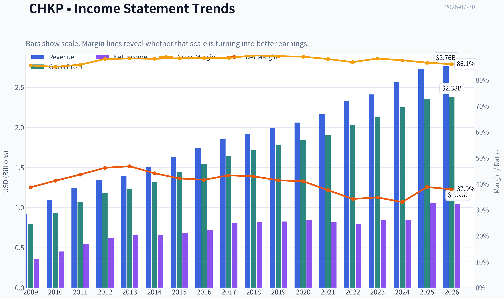

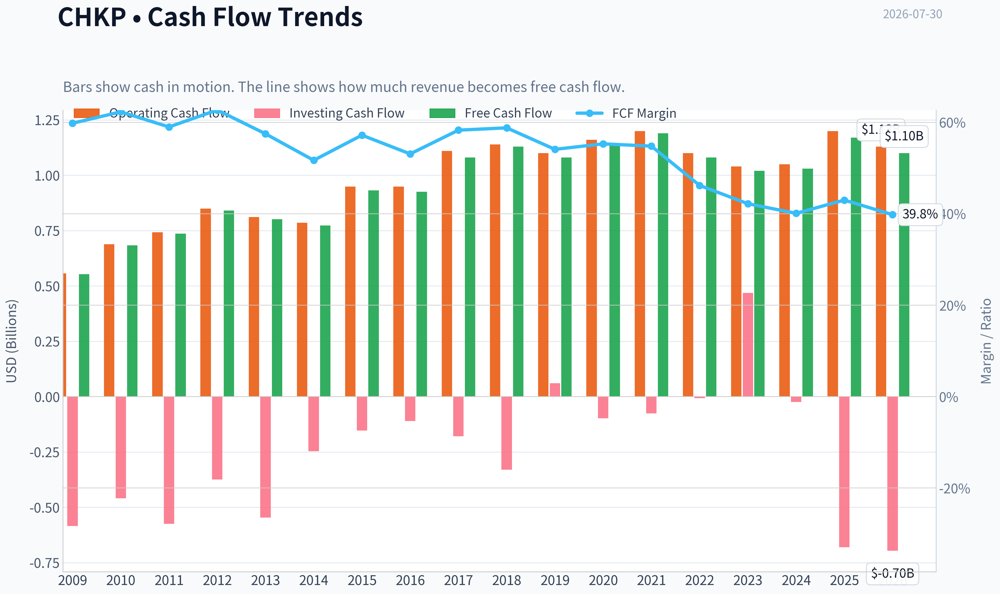

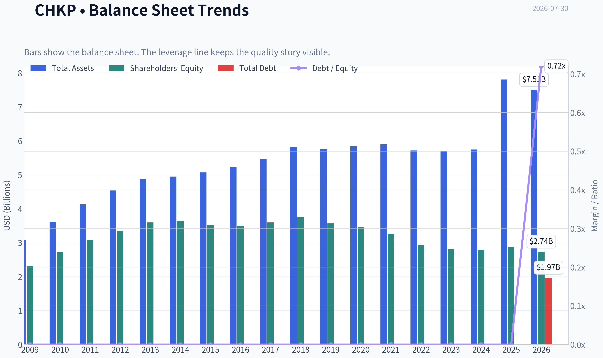

This graph tracks the profitability and return metrics (ROE, ROIC, Margins) of **CHKP** over the past decade, highlighting capital efficiency trends.

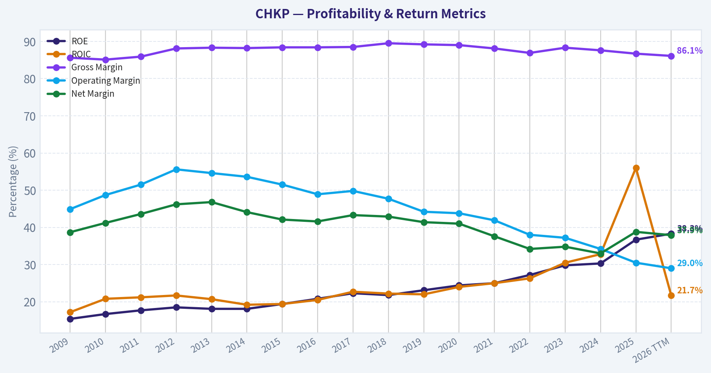

This chart illustrates the financial health of **CHKP** over the last 10 years, mapping cash equivalents and free cash flow against total obligations (Debt).

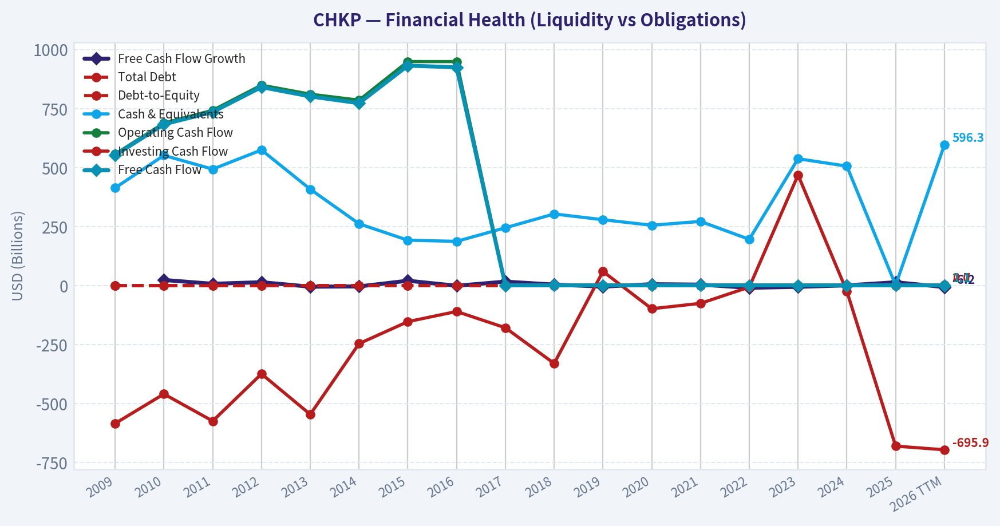

This comparison chart from *Profitability Analysis* stacks current figures against historical benchmarks for **CHKP**, making it easy to see where the company trades relative to its own averages.

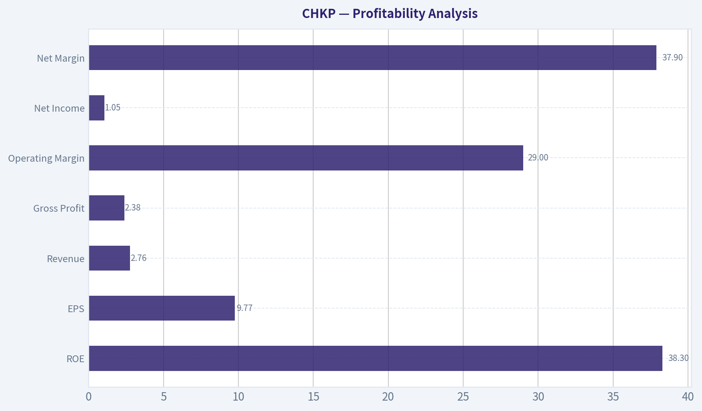

---

### Intrinsic Value Analysis (Buffett)

> *Following Warren Buffett's value investing philosophy: Circle of Competence, Economic Moat, Management Quality, and Margin of Safety.*

#### Intrinsic Value Snapshot

Price is what you pay. Intrinsic value is what the business may be worth based on the cash it can create for owners over time. We show a range, not one magic number.

- Current Price: $128.23
- Value Range (conservative to optimistic across both DCF methods): $101.85 to $261.16

##### Owner Earnings (Buffett Method)
- Net Income: $1,056,900,000.00
- Depreciation & Amortization: $92,900,000.00
- Capital Expenditures: $-26,600,000.00
- Working Capital Changes: $-98,100,000.00
- Owner Earnings: $1,221,300,000.00

##### Intrinsic Value
###### Buffett Method
Uses owner earnings. Stricter, and usually more conservative.
- Conservative: $159.79
- Average: $197.53
- Optimistic: $261.16
- Discount Rate: 10.0%

###### Cash Flow Method
Uses free cash flow. Better for companies spending heavily today to grow tomorrow.
- Conservative: $101.85
- Average: $144.74
- Optimistic: $207.75
- Discount Rate: 10.0%

ANALYST STANCE: **ADVOCATE**

#### CHKP - Check Point Software Technologies

#### 1. Factor Scorecard

| Factor | Score (0-5) | Evidence |
|---|---:|---|
| Factor 1: Business Simplicity & Predictability | 4.5 | Check Point sells cybersecurity software and subscriptions that help enterprises prevent attacks and manage network, cloud, and endpoint security. That is easy to explain. Cybersecurity demand is highly durable, though product mix and competitive positioning evolve. |
| Factor 2: Moat Test | 4.0 | 86.7% gross margin strongly supports intangible assets and software economics. Embedded security infrastructure creates switching costs. Installed base, reputation, and enterprise trust matter. Moat looks wide-ish but not clearly widening due to slower growth versus faster peers. |
| Factor 3: Management & Capital Allocation | 4.0 | Long record of profitability, cash generation, and disciplined operations. Historically conservative balance sheet and rational capital returns support an owner-minded approach. Main deduction is modest top-line growth, which suggests capital allocation has been solid but not exceptional. |
| Factor 4: Industry Structure | 3.5 | Cybersecurity is mission-critical and growing, but competition is intense and innovation cycles are fast. Industry economics are attractive for strong players, yet rivalry prevents a top score. |

**Gate 5 hard floor: NOT tripped.**
There is no evidence here of both deteriorating earnings/cash flow and solvency distress. In fact, CHKP remains profitable, cash generative, and financially sound.

**Key Takeaways:** Check Point scores well on quality because the business is understandable, profitable, and embedded in customer environments. Its main weakness is not survival or balance sheet risk, but slower growth and a competitive industry that limits enthusiasm versus the very best compounders.

---

#### 2. Moat Analysis

| Moat Source | Assessment | Evidence |
|---|---|---|
| Intangible Assets | Strong | Trusted enterprise security brand, long operating history, and extremely high gross margins of 86.7% indicate strong pricing power and valuable IP. |
| Switching Costs | Strong | Security infrastructure is deeply integrated into customer networks, policies, compliance processes, and IT workflows. Replacing a core security vendor carries operational and reputational risk. |
| Cost Advantage | Moderate | Software delivery is highly scalable, but CHKP does not appear to hold an overwhelming cost advantage relative to major cybersecurity peers. |
| Network Effects | Limited to Moderate | There are some ecosystem/data advantages, but this is not a classic winner-take-all network effect business. |

**Moat quality rating: Wide & Stable (4/5).**

CHKP's moat is built less on flashy growth and more on trust, embedded deployment, and high switching costs. Customers do not casually rip out security systems that protect core operations. The moat appears durable, though likely stable rather than widening.

**Key Takeaways:** Check Point has a real moat, mostly from enterprise trust, product integration, and the pain of switching. It is not a pure network-effect platform, but its economics and customer stickiness still support a strong competitive position.

---

#### 3. Management Quality Assessment

| Dimension | Assessment | Comments |
|---|---|---|
| Owner Orientation | Good | Management has historically run the business with discipline and without empire-building excess. |
| Candor & Conservatism | Good | Financial profile suggests conservatism: strong margins, cash generation, and no sign of balance-sheet stress. |
| Capital Allocation | Good | The company has converted earnings into free cash flow and maintained an efficient, asset-light model. The key question is whether more aggressive reinvestment could have accelerated growth. |

Overall, management looks competent, disciplined, and shareholder-friendly. This is not a promotional story stock. The slight reservation is that Check Point has often chosen stability over maximal growth, which can be either prudence or under-ambition depending on one's benchmark.

**Key Takeaways:** Management appears rational and conservative, which fits a Buffett-style framework. The debate is not integrity or competence, but whether the company has balanced profitability and growth in the most value-maximizing way.

---

#### 4. Financial Summary Table

| Metric | Latest |
|---|---:|
| Share Price | $128 |
| Market Cap | $13.09B |
| P/E | 13.19x |
| ROE | 36.7% |
| Gross Margin | 86.7% |
| Revenue Growth YoY | 6.3% |
| FCF Yield | 9.0% |
| Current Ratio | 2.05 |
| Headline Intrinsic Value | $222.00 |
| Owner Earnings Value | $197.53 |
| FCF Value | $144.74 |
| Damodaran FCFF Value | $278.59 |
| Margin of Safety vs Price | 42.2% |
| Reverse DCF Implied Growth | about -2.8% for 10 years |
| Trailing 3Y Growth | 20.7% |
| Trailing 5Y Growth | 8.1% |

**Key Takeaways:** The financial snapshot is unusually attractive: high margins, high returns on equity, and a 9% free-cash-flow yield at only 13 times earnings. The market is pricing CHKP as if growth will shrink over the next decade, which looks pessimistic for a durable cybersecurity franchise.

---

#### 5. Owner Earnings Calculation

Using the provided valuation framework and owner-earnings model output:

| Item | Value |
|---|---:|
| Net Income + Non-cash Charges - Maintenance Capex - Working Capital Needs | Reflected in owner-earnings valuation model |
| Owner Earnings Implied Equity Value | $197.53 per share |
| Current Price | $128.00 per share |

At today's price, shares trade at roughly **35.2% below** the owner-earnings-based value estimate of $197.53.

**Key Takeaways:** Even on a Buffett-style owner earnings approach, the stock appears materially undervalued. That matters because Check Point is a cash-rich, asset-light business where accounting earnings generally convert well into owner value.

---

#### 6. Three-Scenario DCF Valuation

| Scenario | Method | Estimated Value / Share |
|---|---|---:|
| A: No Growth | Ultra-conservative owner earnings capitalization at 10% | ~$145-$155 |
| B: GDP Growth | 3% perpetual growth framework | ~$175-$200 |
| C: Historical Growth | Using reduced historical growth assumptions, capped conservatively | ~$220-$280 |
| Blended Headline Value | Weighted business-model routed estimate | **$222.00** |

The market price of **$128** sits below all three reasonable valuation frames, including the conservative ones.

**Key Takeaways:** Across conservative, moderate, and historically informed scenarios, intrinsic value sits above the current stock price. The precise number can vary, but the direction is consistent: CHKP looks cheap rather than merely fair.

---

#### 7. Margin of Safety Analysis

| Measure | Value |
|---|---:|
| Current Price | $128.00 |
| Headline Intrinsic Value | $222.00 |
| Discount to Headline Value | 42.2% |
| Discount to Owner Earnings Value | 35.2% |
| Discount to FCF Value | 11.6% |
| Reverse-DCF Signal | Price implies about -2.8% annual growth for 10 years |

For a **wide-moat, high-margin, highly cash-generative software security business**, a required margin of safety around **10-15%** would already be acceptable. CHKP appears to offer far more than that. Even the most conservative of the supplied valuation methods still suggests limited downside relative to quality.

**Key Takeaways:** The valuation case is strong because the stock is cheap not only on multiples, but also relative to intrinsic value estimates and implied expectations. The market seems to be extrapolating stagnation too aggressively.

---

#### 8. Final Buffett Scorecard

| Criterion | Weight | Score (1-5) | Weighted Score |
|---|---:|---:|---:|
| Moat Width & Durability | 25% | 4.0 | 1.00 |
| Valuation / Margin of Safety | 20% | 4.8 | 0.96 |
| Capital Returns - ROIC vs. WACC | 15% | 4.5 | 0.68 |
| Business Understanding & Predictability | 12% | 4.5 | 0.54 |
| Management Quality & Capital Allocation | 12% | 4.0 | 0.48 |
| Reinvestment Runway | 8% | 3.5 | 0.28 |
| Balance Sheet Strength | 4% | 4.5 | 0.18 |
| Industry Structure | 4% | 3.5 | 0.14 |
| **Total** | **100%** |  | **4.26 / 5.00** |

**Score result: ADVOCATE**

**Key Takeaways:** Check Point earns an ADVOCATE score because quality and valuation line up at the same time. It is not the fastest grower in cybersecurity, but the combination of moat, cash generation, and discounted price is compelling.

---

#### 9. Investment Stance

**Investment Stance: ADVOCATE**
**Conviction Level: Moderate-High**

Check Point fits Buffett-style value investing better than many software names because it combines:
- understandable economics,
- strong profitability,
- high gross margins,
- durable customer switching costs,
- conservative financial characteristics,
- and a meaningful discount to intrinsic value.

The main reason this is not an even higher-conviction "wonderful business" call is growth quality. CHKP is clearly not the sector's fastest innovator in market perception, and recent earnings coverage shows investors are sensitive to soft revenue guidance. But that concern is already more than reflected in the stock: at 13x earnings and a 9% FCF yield, the market is pricing the company as though long-term decline is likely.

That looks too pessimistic.

For a long-term owner willing to accept slower but durable compounding, CHKP appears to be a **good business at a clearly attractive price**.
#### Valuation Bridge

This bridge places the current market price beside each intrinsic value lens so readers can see whether upside depends on one method or shows up across several methods.

| Scenario | Intrinsic Value / Share |
| --- | ---: |
| Buffett Method | $197.53 |
| Cash Flow Method | $144.74 |
| Damodaran Method | $278.59 |
| Current Price | $128.23 |

#### Key Takeaways

If one method is far above the others, the upside case depends on a specific modelling assumption. When several methods cluster together, the valuation story is more robust.

#### Valuation Visuals

This comparison chart from *Latest Earnings Snapshot* stacks current figures against historical benchmarks for **CHKP**, making it easy to see where the company trades relative to its own averages.

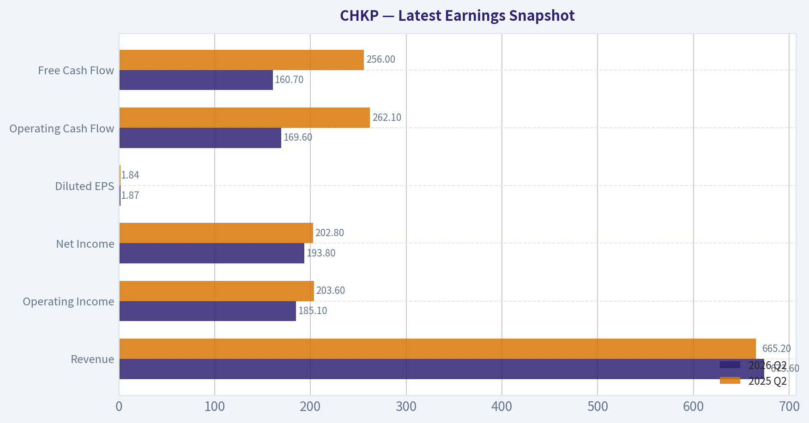

This comparison chart from *Balance Sheet and Financial Strength* stacks current figures against historical benchmarks for **CHKP**, making it easy to see where the company trades relative to its own averages.

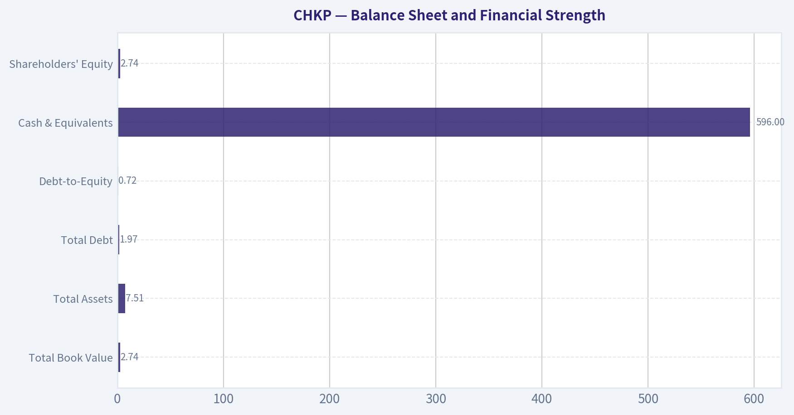

This comparison chart from *Cash Flow Quality* stacks current figures against historical benchmarks for **CHKP**, making it easy to see where the company trades relative to its own averages.

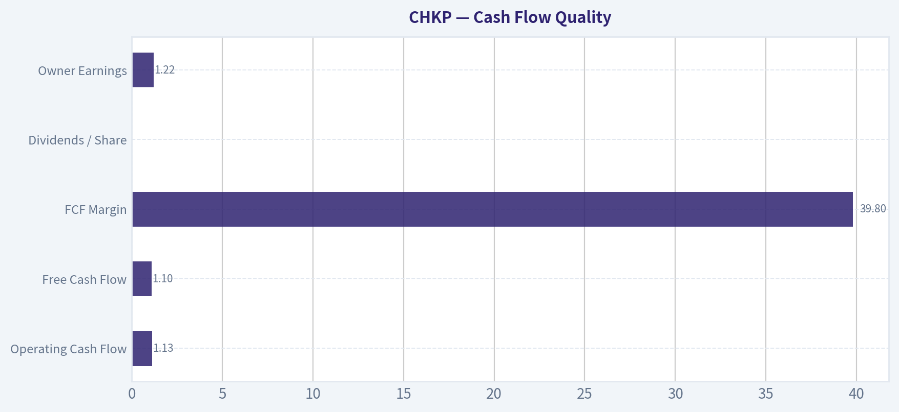

This comparison chart from *Buffett-Style Owner Earnings DCF* stacks current figures against historical benchmarks for **CHKP**, making it easy to see where the company trades relative to its own averages.

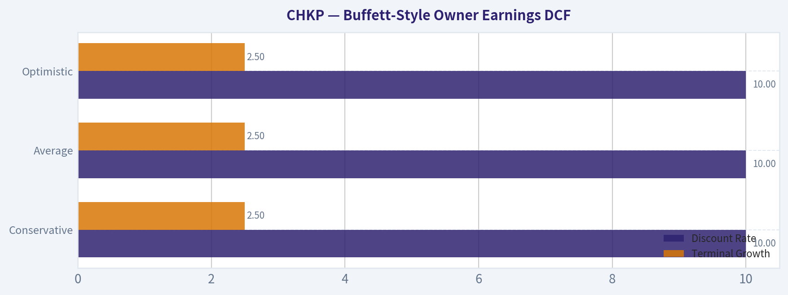

---

### Trend & Growth Analysis (Lynch/Druckenmiller/Fisher)

> *Following Peter Lynch's GARP, Stanley Druckenmiller's macro-aware approach, and Philip Fisher's scuttlebutt methodology.*

ANALYST STANCE: **WATCH**

#### CHKP Growth Analysis

#### 1. Lynch Classification

| Metric | CHKP |
|---|---:|
| Revenue growth YoY | 6.3% |
| P/E | 13.2x |
| FCF yield | 9.0% |
| ROE | 36.7% |
| Gross margin | 86.7% |

Key Takeaways: Check Point is not a classic fast grower. With revenue growth around 6%, it fits best as a **Stalwart** under Lynch's framework, not a ten-bagger-type fast grower. The business is financially strong and highly profitable, but the top-line profile is too slow for an aggressive growth mandate.

**Classification:** **Stalwart**
**Implication:** good company, but not an obvious new growth-stock initiation.

---

#### 2. The Story in 3 Bullets

- Check Point sells cybersecurity software and services that help companies block hackers and protect networks, cloud systems, and users.
- It wins through trusted enterprise security, very high gross margins, sticky customers, and strong cash generation.
- The main debate is whether newer platform and AI-driven security offerings can re-accelerate growth from mid-single digits to something more meaningful.

---

#### 3. TAM Analysis with 10x Test

| Item | Estimate / Assessment |
|---|---:|
| Current revenue run-rate | ~\$2.7B |
| 10x revenue test | ~\$27B |
| Cybersecurity TAM | Very large, likely well above \$200B globally |
| 10x and still <20% share? | **Yes** |
| TAM growth | Healthy secular growth |
| Practical constraint | Execution, not TAM |

Key Takeaways: The cybersecurity market is large enough that Check Point could theoretically grow many times larger without hitting market saturation. So the issue is not market size. The real issue is whether Check Point can actually regain share and re-accelerate growth in a very competitive security landscape.

**Verdict:** **Runway exists**, but CHKP is not currently exploiting it like a fast grower.

---

#### 4. Revenue Growth Trend

| Period View | Signal |
|---|---|
| Latest reported YoY revenue growth | 6.3% |
| Latest earnings readthrough | Q2 revenue miss |
| Q3 guide vs consensus | Below expectations |
| Trend characterization | **Soft / likely decelerating near term** |

Key Takeaways: The recent earnings setup points to weaker top-line momentum, not acceleration. Revenue growth is already modest, and the latest revenue miss plus softer guidance suggest that the near-term trend is deteriorating rather than improving. For a growth investor, that matters more than the EPS beat.

**Assessment:** **Not an inflecting growth story today.**

---

#### 5. Unit Economics

| Metric | CHKP | Assessment |
|---|---:|---|
| Gross margin | 86.7% | Excellent |
| FCF yield | 9.0% | Excellent cash generation |
| Rule of 40 proxy (growth + FCF margin/yield proxy) | Inconclusive with limited data | Likely respectable |
| NRR | Not available | Unknown |
| LTV/CAC | Not available | Unknown |

Key Takeaways: What we can observe is very strong: gross margins are elite and the business throws off meaningful cash. But some of the most important modern software-growth KPIs, like net revenue retention and LTV-to-CAC, are not available in the research pack. That limits conviction on whether growth quality is improving under the surface.

**Bottom line:** excellent economics, but incomplete growth-efficiency visibility.

---

#### 6. Inflection Point Assessment

| Inflection Type | Evidence | Verdict |
|---|---|---|
| Product cycle inflection | No strong evidence in provided data | Unclear |
| Market share inflection | No evidence of accelerated share gains | Negative/unclear |
| Margin inflection | Already highly profitable | Mature, not new |
| TAM inflection | Cybersecurity remains secularly strong | Positive industry backdrop |
| Competitive inflection | No evidence rivals are stumbling enough to help CHKP | Unclear |

Key Takeaways: The market backdrop is supportive because cybersecurity demand remains secularly strong. But an inflection point requires company-specific acceleration, and that is not visible here. Right now, CHKP looks more like a mature compounder than a business entering a new phase of breakout growth.

**Conclusion:** **No clear positive inflection yet.**

---

#### 7. Macro Setup Evaluation

| Factor | Assessment |
|---|---|
| Secular trend exposure | Strong - cybersecurity |
| Rate sensitivity | Moderate; lower rates generally help software valuations |
| Economic sensitivity | Cybersecurity is relatively resilient |
| Industry sentiment | Generally favorable, but investors prefer faster growers |

Key Takeaways: The macro and sector backdrop are fairly supportive because cybersecurity remains a durable spending priority. However, in a favorable sector, capital tends to flow to companies showing stronger growth acceleration. That means CHKP may lag peers if it cannot improve revenue momentum.

**Macro verdict:** **Good sector wind, but not enough on its own.**

---

#### 8. Fisher 15 Points Score

| Fisher Dimension | Score (1-5) | Comment |
|---|---:|---|
| Market potential | 4 | Cybersecurity TAM is large |
| New product development | 3 | Needs stronger visible innovation impact |
| R&D effectiveness | 4 | Solid, though not clearly translating to acceleration |
| Sales organization | 3 | Revenue growth suggests room for improvement |
| Profit margin | 5 | Excellent |
| Improving margins | 4 | Strong profitability maintained |
| Labor/personnel relations | 3 | No strong data |
| Executive relations | 3 | No strong data |
| Management depth | 4 | Established operator |
| Cost/accounting controls | 5 | Strong economics, disciplined model |
| Outstanding competitive aspects | 4 | Brand, trust, installed base |
| Long-range profit outlook | 4 | Good |
| Dilution risk | 5 | Low concern versus many growth peers |
| Candor | 3 | Limited evidence |
| Integrity | 4 | No major governance alarm in pack |

| Total | Score |
|---|---:|
| Fisher Score | **58 / 75** |

Key Takeaways: Check Point scores as a good business with strong profitability, discipline, and real competitive strengths. But it does not score like a truly exceptional Fisher-style growth idea because innovation and sales execution are not clearly producing faster growth. This is quality without obvious breakout dynamism.

**Fisher rating:** **Good**, not outstanding.

---

#### 9. Valuation Analysis

| Metric | Value | Interpretation |
|---|---:|---|
| Price | \$128 |
| Intrinsic value headline | \$222 |
| Margin of safety | 42.2% |
| P/E | 13.2x |
| Revenue growth | 6.3% |
| PEG | ~2.1x | Expensive on growth-adjusted basis |
| Reverse DCF implied growth | ~-2.8% for 10 years | Very pessimistic embedded expectation |

Key Takeaways: On standard value metrics, CHKP looks cheap. But on Lynch's preferred growth-adjusted lens, the PEG is not attractive because earnings multiple is being divided by a low growth rate. In other words, the stock may be undervalued as a quality cash generator, but it is not obviously cheap as a growth vehicle.

Scenario framing:

| Scenario | View |
|---|---|
| Bear | Remains a 4-6% grower; stock acts like a value/security software laggard |
| Base | Mid-single-digit growth plus buybacks/FCF support decent returns |
| Bull | Platform refresh or AI/security demand drives re-acceleration; valuation rerates |

Key Takeaways: The downside seems somewhat cushioned by cash generation and a low multiple. The upside depends on a change in narrative from "mature defender" to "re-accelerating platform." Without that shift, returns may be solid but not explosive.

---

#### 10. Growth Investor Scorecard

| Criterion | Weight | Score (1-5) | Weighted |
|---|---:|---:|---:|
| The Story | 10% | 3.5 | 0.35 |
| TAM & Runway | 20% | 4.0 | 0.80 |
| Revenue Growth | 20% | 2.0 | 0.40 |
| Unit Economics | 15% | 4.0 | 0.60 |
| Competitive Position | 10% | 3.5 | 0.35 |
| Management Quality | 10% | 3.5 | 0.35 |
| Macro Setup | 5% | 4.0 | 0.20 |
| Profitability Path | 5% | 5.0 | 0.25 |
| Valuation | 5% | 4.0 | 0.20 |

| Total | Score |
|---|---:|
| Weighted Score | **3.50 / 5.00** |

Key Takeaways: CHKP lands right on the border of a positive setup, mostly because the valuation, margins, and market opportunity are attractive. But the weak point is the most important one for a growth investor: revenue acceleration is missing. That is why this scores as a watch candidate rather than a high-conviction advocate today.

**Scorecard stance:** **WATCH**

---

#### 11. Position Size Stance

| Investor Type | Stance |
|---|---|
| Pure growth investor | Avoid initiating full position |
| GARP investor | Small starter possible |
| Quality/value investor | More attractive |
| Portfolio sizing | **0.5% to 1.5% starter only, if any** |

Key Takeaways: For a strict growth portfolio, CHKP does not deserve a full-size position because the growth signal is too weak. For a blended GARP or quality-value approach, a small starter could make sense given the valuation support. Position size should stay modest until revenue momentum improves.

---

#### 12. Key Risks and Catalysts

| Risks | Catalysts |
|---|---|
| Continued revenue softness | Re-acceleration in product revenue |
| Weak Q3 guide may reset expectations lower | Better-than-feared next quarter execution |
| Competitive pressure from faster peers | AI-security platform adoption |
| Mature growth profile may cap multiple | Evidence of market share gains |
| Sector money rotates to higher-growth names | Buybacks and sustained FCF compounding |

Key Takeaways: The risk is simple: Check Point may stay what it already is, a strong but slow-growing cybersecurity incumbent. The catalyst path is also simple: if management can prove that newer offerings can lift growth meaningfully, the stock could rerate from value trap concerns to overlooked compounder status.

#### Bottom Line

CHKP is a **high-quality cybersecurity company trading at a low valuation**, but it is **not currently demonstrating the kind of revenue acceleration** that Lynch, Druckenmiller, and Fisher would want for a true growth-advocate call.

It looks more like:
- a **sturdy stalwart**
- with **strong cash flow and downside support**
- but **without a confirmed inflection point**

For now, I would **watch for re-acceleration rather than chase it today**.

#### Growth & Scorecard Visuals

This comparison chart from *Factor Scorecard* stacks current figures against historical benchmarks for **CHKP**, making it easy to see where the company trades relative to its own averages.

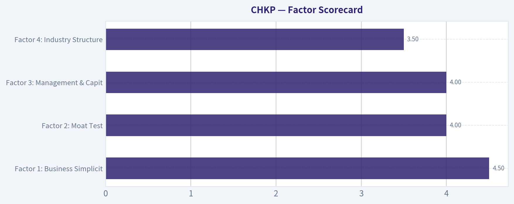

---

### Market Technical Analysis

#### CHKP Technical Indicator Report

For CHKP, the most relevant indicator set for the current market context is:

| Indicator | Why it is relevant now |
|---|---|
| close_200_sma | Defines the dominant long-term trend, which is clearly bearish. |
| close_50_sma | Tracks the medium-term recovery attempt inside that larger downtrend. |
| close_10_ema | Captures the short-term swing and whether recent upside momentum is fading. |
| macd | Measures momentum regime shifts and whether the rebound still has trend-follow-through. |
| macdh | Helps detect momentum acceleration/deceleration earlier than MACD alone. |
| rsi | Shows whether price strength is improving, stalling, or becoming stretched. |
| atr | Quantifies elevated daily movement for stops and position sizing. |
| vwma | Tests whether the rebound has meaningful volume support or is mostly price-only. |

Key Takeaways: CHKP needs a balanced indicator set because it is not in a clean trend continuation phase. The stock is recovering from a severe drawdown, but that recovery is still taking place below the long-term trend benchmark, so traders need indicators that separate tactical improvement from strategic weakness.

---

#### Trend Structure

CHKP's one-year chart shows a major deterioration from the 180-200 area in late 2025 and early 2026 into a deep capitulation phase that bottomed near the low-110s after the sharp April 30 gap-down. Since that washout, price has staged a meaningful rebound, climbing back toward the high-130s by late July. However, the rebound has not repaired the broader technical damage.

The long-term structure remains decisively weak because price is still far below the 200-day SMA, which sits near **159.33** on 2026-07-30. That is a very wide gap, implying the stock is not merely consolidating but still operating in a structurally impaired regime. The 200-day SMA is also still falling steadily, confirming that the longer trend has not yet stabilized.

At the medium-term level, the picture is better but still incomplete. The 50-day SMA is about **131.11**, and recent closes around **137.64-139.67** are above it. That means the post-crash rebound is real, not just a one- or two-day bounce. But the slope of the 50-day SMA has only recently flattened and turned slightly higher after a prolonged decline. In practice, this suggests CHKP has shifted from "persistent downtrend" to "repair phase," not yet to a fully confirmed uptrend.

The implication is important: traders should not treat strength above the 50-day SMA as equivalent to a full bullish reversal while price remains more than 20 points under the 200-day SMA. This is a classic setup where swing traders may find opportunities, but position traders should demand more proof.

#### Momentum Analysis

Short-term momentum improved strongly from late June into mid-July, but the pace of that improvement has cooled.

The 10-day EMA is about **133.04** on 2026-07-30. That places recent price only modestly above the short-term trend line, rather than far above it. Earlier in July, the 10-day EMA was rising more aggressively as the stock advanced from the mid-120s into the high-130s. More recently, the EMA is still above prior levels, but its rate of ascent has slowed. That suggests the rebound is intact, yet no longer in a strong acceleration phase.

MACD remains positive at **0.62**, which is constructive. This confirms that the short-term and intermediate momentum backdrop is still better than it was in June, when MACD was negative and the stock was grinding lower. But the more important nuance is that MACD has rolled down from a higher positive peak above **2.5** earlier in July. So momentum has not collapsed, but it has clearly faded from its strongest burst.

The MACD histogram reinforces that caution. It is now **negative (-0.26)** after being strongly positive earlier in the month. A negative histogram while MACD is still positive usually signals that upside momentum is decelerating, not necessarily that the trend has already reversed. In plain terms: buyers are still in the fight, but they are no longer pressing with the same force.

This combination usually points to one of two paths:
1. a shallow consolidation above support before another upside attempt, or
2. a failed rebound that rolls back toward the 50-day SMA.

That is why the next few sessions matter. If price can hold above the low-130s while MACD stabilizes, the rebound may simply be digesting gains. If price loses that area and MACD continues weakening, the July bounce may prove to have been only a countertrend rally.

#### RSI and Internal Strength

RSI is about **45.39** on 2026-07-30, down from readings in the high-50s/low-60s earlier in July.

This is a notable deterioration, but not yet an oversold reading. RSI near 45 means CHKP has lost internal thrust without reaching capitulation. In a healthy uptrend, pullbacks often find support with RSI in the 40-50 zone. In a weak or failing rebound, RSI drifting from 60 toward 40 often signals a transition from accumulation to renewed distribution.

That makes the current RSI level highly informative. It is not bullish enough to confirm a strong trend continuation, yet not weak enough to signal a high-probability washout low. This is a neutral-to-cautious momentum reading, best interpreted in context:

- If price holds above the 50-day SMA and RSI turns back above 50, that would argue the July pullback was corrective.
- If RSI slips into the upper 30s while price revisits the mid-to-low 120s, that would suggest sellers are regaining control.

So RSI currently supports a "watch support closely" stance rather than an aggressive directional bet.

#### Volume-Weighted Confirmation

VWMA is about **132.86** on 2026-07-30, slightly below the 10-day EMA and above the 50-day SMA.

This is fairly constructive because it suggests recent trading activity has supported prices in the low-130s rather than much lower levels. In other words, the rebound was not completely hollow. Buyers have, on average, participated at improving prices.

Still, VWMA has edged down from the mid-135 area seen around July 21-24. That indicates the most recent pullback has carried enough volume to weaken the volume-weighted trend. This does not invalidate the rebound, but it does reduce confidence in immediate upside continuation unless price reclaims the high-130s decisively.

The broader takeaway is that volume has supported the recovery better than pure price-only action would imply, but not strongly enough to overrule the bearish long-term structure.

#### Volatility and Risk

ATR is about **6.09**, which is elevated relative to the stock's current price in the high-130s. That means CHKP is still moving with sizable daily ranges.

This matters for execution. Even if a trader has the direction right, stops that are too tight can be easily hit by normal noise. A 1-2 point stop on a stock with a 6-point ATR is generally too narrow for swing positioning. Elevated ATR also means breakout signals need extra confirmation; otherwise, traders may be reacting to ordinary range expansion rather than true trend resumption.

The increase in ATR from around the low-5 area earlier in July to above 6 now suggests uncertainty has risen again as the rebound loses smoothness. This is often seen near decision points where the market is trying to determine whether a rebound will continue or fail.

#### Fine-Grained Trading Interpretation

The clearest technical message is that CHKP is in a **short-term rebound within a long-term downtrend**.

That phrase is often overused, so the finer distinction matters:

- **Long-term:** bearish, because price is materially below a falling 200-day SMA.
- **Medium-term:** improving, because price is above a flattening/rising 50-day SMA.
- **Short-term:** losing momentum, because MACD is still positive but fading, histogram has turned negative, and RSI has retreated toward the mid-40s.

This means CHKP is no longer in panic liquidation mode, but it has not yet earned trend-reversal status.

For bullish traders, the constructive case is that price remains above both the 50-day SMA and VWMA, which implies the rebound has not been broken yet. The stock may be building a base after a severe washout, and bases often look messy before they resolve higher. A sustained move through the upper-130s to around 140, followed by stability, would strengthen that argument.

For bearish traders, the strongest argument is that all of this recovery is happening beneath a still-falling 200-day SMA. Until that changes, rallies can still be interpreted as retracements within a larger downtrend. The fading MACD histogram and softening RSI support that caution.

#### Practical Decision Zones

| Area / Signal | Interpretation | Trading relevance |
|---|---|---|
| Above 200-day SMA (~159.3) | Would signal major structural improvement | Needed for a true long-term bullish reversal case |
| Above recent highs near 139-140 | Confirms rebound continuation | Important breakout area for swing bulls |
| 50-day SMA (~131.1) | Key medium-term support | Holding above it preserves recovery structure |
| 10-day EMA (~133.0) | Immediate momentum gauge | Price above it supports near-term stability |
| RSI ~45 | Momentum softened but not oversold | Suggests caution, not capitulation |
| MACD positive, histogram negative | Trend still positive but decelerating | Warns of consolidation or pullback risk |
| ATR ~6.1 | Elevated volatility | Wider stops and smaller size may be prudent |
| VWMA ~132.9 | Volume-backed support zone | Loss of this area would weaken rebound credibility |

Key Takeaways: CHKP is sitting near an important inflection zone. Support in the low-130s is critical for keeping the recovery alive, while a clean push above 139 to 140 would improve the odds of another leg higher, but the larger bearish trend is still unresolved until the stock can make major progress toward the 200-day average.

#### Bottom Line

CHKP has clearly improved from its spring collapse, but the current evidence supports **tactical recovery rather than strategic trend reversal**. Price above the 50-day SMA and a still-positive MACD keep the rebound alive. However, the falling 200-day SMA, weakening histogram, softer RSI, and elevated ATR all argue against complacent bullishness.

The most balanced read is:
- **Near term:** cautiously constructive, but fragile.
- **Intermediate term:** rebound/base-building attempt.
- **Long term:** still bearish until much higher levels are reclaimed.

| Dimension | Current Read | Evidence | What traders should watch |
|---|---|---|---|
| Long-term trend | Bearish | Price far below falling 200-day SMA | Whether price can eventually reclaim 150s and then 200-day SMA |
| Medium-term trend | Improving | Price above 50-day SMA | Whether 50-day SMA keeps rising and acts as support |
| Short-term momentum | Fading | Positive MACD but negative histogram | Whether momentum re-accelerates or rolls over |
| RSI condition | Neutral-cautious | RSI near 45 | A move back above 50 vs. slippage into upper 30s |
| Volume confirmation | Moderately supportive | Price near VWMA, rebound had participation | Whether VWMA support in low-130s holds |
| Volatility | Elevated | ATR above 6 | Need for wider stops and disciplined sizing |
| Bullish trigger | Breakout continuation | Move through 139-140 area | Confirmation with improving RSI/MACD |
| Bearish trigger | Rebound failure | Loss of 133 then 131 support | Momentum likely to weaken further |

Key Takeaways: The stock has recovered enough to interest swing traders, but not enough to convince longer-term trend followers. The technical setup now revolves around whether CHKP can defend the low-130s and rebuild momentum, or whether the recent rebound starts to fail under the weight of the broader downtrend.

---

### Options Market Analysis

> *Reading options flow - put/call ratios, IV skew, and unusual activity - to gauge institutional positioning and event-driven risk.*

#### CHKP Options Positioning Report
*As of 2026-07-30*

#### 1. Put/Call Ratio Analysis

| Expiration | Call OI | Put OI | Put/Call OI Ratio | Call Vol | Put Vol | Put/Call Volume Ratio |
|---|---:|---:|---:|---:|---:|---:|
| 2026-08-21 | 8,509 | 3,732 | 0.44 | 1,249 | 2,440 | 1.95 |
| 2026-09-18 | 234 | 261 | 1.12 | 90 | 101 | 1.12 |
| 2026-10-16 | 6,966 | 2,199 | 0.32 | 159 | 685 | 4.31 |
| **Near-term total** | **15,709** | **6,192** | **0.39** | **1,498** | **3,226** | **2.15** |

**Key Takeaways:** CHKP's open interest backdrop is clearly call-heavy, with a total put/call OI ratio of 0.39, well below the neutral baseline near 0.7. That usually indicates a structurally bullish positioning base or existing call overwriting demand. But the more immediate flow is different: put volume is running at 2.15x call volume, which points to fresh downside hedging or short-term caution layered on top of that bullish OI base.

**Interpretation:**
- **OI ratio at 0.39**: materially below neutral, suggesting investors are still positioned with a bullish or at least less-defensive medium-term stance.
- **Volume ratio at 2.15**: notable shift toward puts in current trading, signaling **near-term defensive behavior**.
- **Most important nuance**: the market is **not outright structurally bearish**, but traders are clearly buying more short-dated protection than calls right now.

---

#### 2. Implied Volatility (IV) Assessment

| Expiration | ATM Call IV | ATM Put IV | Call vs Put ATM IV |
|---|---:|---:|---:|
| 2026-08-21 | 44.2% | 42.0% | Calls richer by 2.2 pts |
| 2026-09-18 | 43.3% | 38.9% | Calls richer by 4.4 pts |
| 2026-10-16 | 42.8% | 39.3% | Calls richer by 3.5 pts |

**Key Takeaways:** Near-term IV sits in the low-to-mid 40% range, which is not low for a mature cybersecurity name like CHKP. More importantly, calls are pricing richer than puts at-the-money across all listed expirations, which is unusual versus the more common downside put premium. That suggests upside optionality is carrying a premium, even as put trading volume rises.

**IV read:**
- **Near-term ATM IV is elevated enough to matter**, especially in front-month options.
- **Call-side richness dominates ATM pricing**, implying some upside demand, short-call supply imbalance, or expectations for a move that may not be purely to the downside.
- Based on the data provided, **classic downside put skew is not evident**. If anything, the setup leans toward **mild call skew / upside premium**, not fear-driven crash pricing.
- With no explicit catalyst data included, I can only say IV looks **firm but not panic-like**. It is consistent with traders pricing an event window or a meaningful near-term move.

---

#### 3. Unusual Options Activity

| Screen Result | Observation |
|---|---|
| Volume > 5x Open Interest | None found in near-term expirations |

**Key Takeaways:** There were no contracts flagged with volume greater than 5 times open interest, which means there is no obvious single-line institutional bet standing out in the near-term chain. That reduces confidence in reading any one strike as a strong "smart money" tell. Instead, the signal comes more from aggregate put-heavy flow versus call-heavy open interest.

**Interpretation:**
- No standout fresh directional sweeps or block-like unusual trades were identified.
- This makes the tape **less about one aggressive informed trade** and more about **broad hedging demand** in the near term.
- Since unusual activity is absent, conviction should be based on **ratios and OI structure**, not on any single contract.

---

#### 4. Open Interest Concentration and Potential Pin/Gamma Levels

| Expiration | Dominant OI Character | Interpretation |
|---|---|---|
| 2026-08-21 | Largest total OI among near-term expiries | Most likely area for near-term pinning and dealer hedging effects |
| 2026-10-16 | Second major OI concentration | Can act as a secondary positioning hub for medium-term moves |
| 2026-09-18 | Very light OI | Less reliable for pinning or gamma effects |

**Key Takeaways:** Open interest is heavily concentrated in August and October, while September is too thin to matter much. That means if CHKP drifts toward heavily populated August strikes into expiry, pinning behavior becomes more likely. Without strike-by-strike detail, we cannot define exact gamma walls, but the concentration itself suggests August is the most important near-term expiry for dealer positioning.

**Interpretation:**
- **August 21** is the key near-term expiration to watch for expiration-related gravity.
- **October 16** also has meaningful positioning, but it is less likely to dominate immediate price action unless the stock trends materially.
- **September 18** looks relatively illiquid by comparison, so any signal from that expiry should be treated cautiously.
- Because strike-level OI concentrations were not provided, **exact max pain and gamma wall strikes cannot be identified** from this dataset.

---

#### 5. Overall Options Sentiment Signal

| Category | Signal |
|---|---|
| Structural positioning (OI) | Bullish |
| Near-term trading flow (volume) | Bearish / defensive |
| IV / skew | Mildly bullish-to-balanced, with call premium |
| Unusual activity | Neutral |
| **Overall options signal** | **NEUTRAL to mildly BEARISH near term** |

**Key Takeaways:** CHKP's options market is sending a split message, but the best read is short-term caution rather than outright bearish conviction. The larger open interest base remains call-heavy, yet current trading is dominated by puts, which usually means investors are paying up for protection. Because there is no aggressive unusual put trade and IV is not showing classic panic skew, the bearish read is moderate rather than severe.

**Final read:** **NEUTRAL to mildly BEARISH near term**, with a slight edge to **BEARISH** if forced to pick one direction.
**Primary driver:** fresh put volume is materially elevated versus call volume, indicating **active hedging or short-term downside concern**, even though the broader OI backdrop remains bullish.

**Confidence level:** **Moderate**, because:
- CHKP is not illiquid overall, but the signal is mostly aggregate rather than strike-specific.
- No unusual activity confirms a high-conviction institutional directional bet.
- The lack of explicit strike-level OI prevents precise gamma wall mapping.

---

#### Bottom Line

CHKP's options market does **not** look like a panic bearish setup, but it **does** show a meaningful increase in near-term caution. The call-heavy OI base argues against a fully negative structural view, while the put-heavy volume says traders are leaning defensive right now. Net result: **short-term bearish tilt, medium-term less bearish than the flow alone suggests**.

---

#### Summary Table

| Metric | Reading | Interpretation |
|---|---|---|
| Put/Call Ratio | OI: **0.39**; Volume: **2.15** | Bullish OI base, but bearish/defensive near-term flow |
| IV Level | ATM IV roughly **39%-44%** | Elevated enough to price movement, not extreme panic |
| Skew Direction | **Call-side ATM premium** | Not classic downside fear; some upside premium present |
| Unusual Activity | **None flagged** | No standout fresh institutional contract bet |
| Overall Signal | **BEARISH (mild, near term)** | Defensive put flow is the main driver |

**Key Takeaways:** The most important tension in CHKP is between bullish legacy positioning and bearish current flow. Right now, the flow deserves more weight for short-term trading, so the practical signal leans mildly bearish. However, absent panic skew or unusual put sweeps, this looks more like hedging than an outright collapse bet.

---

## Research Team Commentary

> *The Research Manager synthesizes the Bull vs Bear debate into action-free commentary. This is a pre-risk view, not the final stance.*

Check Point looks like a classic case where the business quality is easy to admire, but the real question is whether the market is already giving it appropriate credit for being a mature, slower-growing franchise. The strongest bull argument is straightforward and compelling: this is an asset-light cybersecurity company with elite economics, very high gross margins, exceptional returns on capital, sticky enterprise relationships, and a mission-critical product set. At roughly 13x earnings, that is not an expensive setup if the franchise remains durable and can even modestly outgrow the low expectations embedded in the stock. In Buffett terms, the bull is saying this is a wonderful business available at a fair, possibly better-than-fair, price.

The strongest bear argument is more subtle and also valid: in cybersecurity, today's margins do not guarantee tomorrow's relevance. Check Point may still have a real moat in renewals and installed base retention, but the market's concern is whether it can win incremental budget in cloud-native, AI-assisted, broader platform security categories. If growth stays stuck in the mid-single digits and the moat is more defensive than expanding, then 13x earnings may simply be fair value for a mature incumbent rather than a true bargain.

My takeaway is that the bull has the stronger case, but only moderately so. The valuation is low enough relative to quality that I do not think we need heroic assumptions. This is exactly where I want to avoid a past mistake: over-penalizing a high-quality franchise because the growth narrative is not exciting enough. I've learned that when a company has strong profitability, high returns on capital, sticky customers, and a price that already reflects skepticism, waiting for perfect clarity can mean missing a solid quality-value opportunity. At the same time, I do not want to ignore the lesson that a quality company is not automatically undervalued. So the right synthesis is constructive, but not euphoric.

Core takeaway: Check Point appears to be a high-quality, durable cybersecurity franchise trading at a valuation that already discounts maturity and modest growth. Unless one believes the business is headed for meaningful strategic erosion, the current price seems to offer a reasonable margin of safety for a quality-scaled value investor.

Rationale: Buffett-style investing today should fully credit durable software moats, not just industrial-era asset moats. Check Point's economics are too strong to dismiss: 86%+ gross margins and very high ROIC strongly suggest product value, pricing resilience, and capital-light owner earnings power. Cybersecurity also remains a secular necessity, which supports long-duration cash flow relevance. The bear case is right that not all security vendors age well, and that budget share can migrate even if renewals hold up. But for this to be an AVOID, I would need clearer evidence that the installed base is weakening, innovation is failing, or valuation is assuming stronger growth than is realistic. I do not see that here. At about 13x earnings, the market seems to be assuming a fairly pedestrian future already. That lowers the bar. If Check Point merely remains a durable mid-single-digit grower with strong cash generation and shareholder-friendly capital allocation, returns can still be acceptable. If platform, cloud, or AI offerings improve growth even modestly, upside likely follows.

Monitoring plan over the next 1-4 quarters: first, watch revenue growth and billings direction-does the business stay stuck in mid-single digits, or is there evidence of reacceleration? Second, watch product mix commentary, especially cloud, platform, subscription, and AI-related offerings; the key issue is whether newer products are gaining relevance, not just whether legacy renewals remain solid. Third, monitor operating margins and free cash flow to make sure profitability is not being maintained at the expense of competitiveness. Fourth, listen for customer consolidation trends: are enterprises broadening deployments with Check Point, or treating it as a legacy incumbent while shifting new spend elsewhere? Fifth, watch capital allocation-buybacks at this valuation are sensible, but only if core business health remains intact. Finally, from a market perspective, I would watch whether the stock holds support around the 50-day SMA and whether momentum improves after the recent consolidation; I do not want to repeat the mistake of treating technical context as irrelevant when fundamentals and valuation are already supportive.

So my stance is ADVOCATE. It is not a screaming deep-value layup, but it does look like a high-quality business priced with enough skepticism to make the risk/reward favorable for a long-term value portfolio.

---

## Value Investing Team Commentary

> *The Investor translates the research view into an investment thesis before risk review. This is still not the final stance.*

Check Point looks like the kind of business a long-term owner can understand and live with: mission-critical software, sticky enterprise relationships, very high gross margins, strong cash generation, and exceptional returns on capital. Those are not accidental traits. They usually signal a real moat, even if it is more renewal- and trust-based than hyper-growth-based. In a Buffett framework, this is clearly a business-first story, not a chart-first or macro-first story.

The key question is not whether CHKP is a good business. It plainly is. The real question is whether it is a *durably relevant* business or merely a *profitable mature incumbent*. That distinction matters because cybersecurity is not a static industry. Customers renew with trusted vendors, but incremental budget often flows toward whoever is winning in cloud, platform consolidation, endpoint, identity, and AI-assisted security workflows. So the market's skepticism is understandable: it is less worried about Check Point's current profitability than about its future share of strategic security spending.

That said, selective contrarianism points to an interesting setup. The crowd often overpays for exciting cybersecurity narratives and underappreciates slower, profitable incumbents with entrenched customer bases. At about 13x earnings, CHKP does not appear priced like a company with heroic growth expectations. In fact, the market seems to be assuming a fairly ordinary outcome: modest growth, decent retention, and limited strategic excitement. When a business with 86%+ gross margins, very high ROIC, and strong customer stickiness is valued that way, the hurdle for a satisfactory investment outcome drops meaningfully.

What might the market be missing? First, durability itself has value. In security, "boring but trusted" can be a competitive asset, especially for large enterprises that do not swap core defenses casually. Second, if growth merely stabilizes and remains mid-single-digit while margins stay strong, the earnings and free cash flow profile can still support respectable long-term returns from this valuation. Third, any evidence that platform, cloud, or AI offerings are improving wallet share could drive a multiple re-rating because expectations are not demanding today.

The main risk is also clear: this could be a value trap *if* Check Point's moat is narrowing in the parts of the market that matter most for future budgets. High returns on capital can persist for a while even as relevance slowly erodes. That is why I would not treat the low P/E alone as a sufficient margin of safety. A cheap multiple on a declining franchise is not Buffett investing. The required check is whether customer retention, product relevance, and new-offering traction remain healthy enough to preserve long-duration owner earnings.

On balance, the quality-scaled margin of safety looks adequate here. This is not a no-brainer deep bargain, but it does seem like a wonderful-or-at-least-very-good business available at a fair-to-attractive price. Given the company's economics and the skepticism already embedded in the valuation, I would lean toward owning it rather than waiting for perfect clarity. That is exactly where disciplined value investors can do well: not by buying broken businesses cheaply, but by buying durable franchises when sentiment is cooler than business reality.

What I would watch closely over the next few quarters is simple:
- revenue and billings trajectory,
- traction in cloud/platform/AI-led offerings,
- signs that margins remain strong *without* starving innovation,
- customer expansion versus mere renewal dependence,
- and management's capital allocation, especially buybacks at current valuation levels.

If those indicators remain steady or improve, the current price likely understates intrinsic value. If evidence grows that Check Point is being sidelined in strategic security spending, then the low multiple may be justified.

**ANALYST STANCE: ADVOCATE**
CHKP appears to be a high-quality, cash-generative cybersecurity franchise trading at a valuation that already discounts maturity and modest growth. Sentiment seems more skeptical than the underlying economics warrant, which creates a selective contrarian opportunity. I would favor it as a long-term value holding, while monitoring closely for any signs of strategic erosion.

---

## Deep Values Commentary

> *The Risk Management Team debates and the Risk Judge provides the final action-free verdict. This section determines the final ADVOCATE / WATCH / AVOID stance.*

#### Final Stance Scorecard

This scorecard converts the final research view into a weighted decision frame. It does not replace the narrative judgement, but it makes the main drivers of the verdict easier to scan.

| Criterion | Score | Weight | Commentary |
| --- | ---: | ---: | --- |
| Business Quality | 4.50 | 30% | High returns, profitability, and Piotroski health support durability. |
| Valuation Support | 4.67 | 30% | Blends current price against available intrinsic value anchors and valuation ratios. |
| Financial Strength | 5.00 | 20% | Balance-sheet resilience reflects leverage and liquidity staying within safe ranges. |
| Growth Durability | 4.00 | 20% | Recent revenue, earnings, and free cash flow growth indicate how durable expansion looks. |
| TOTAL / FINAL STANCE | 4.55 | 100% | ADVOCATE |

#### Key Takeaways

The weighted score lands at **4.55 / 5.0**, while the final stance remains **ADVOCATE**. This is useful as a quick calibration aid rather than a mechanical signal.

#### Risk Summary

Higher scores indicate more risk pressure. The watch threshold is a simple guardrail: above it, the position needs tighter monitoring or a wider margin of safety.

| Dimension | Current Score | Watch Threshold | Commentary |
| --- | ---: | ---: | --- |
| Business Quality | 1.50 | 3.00 | High returns, profitability, and Piotroski health support durability. |
| Valuation Support | 1.33 | 3.00 | Blends current price against available intrinsic value anchors and valuation ratios. |
| Financial Strength | 1.00 | 3.00 | Balance-sheet resilience reflects leverage and liquidity staying within safe ranges. |
| Growth Durability | 2.00 | 3.00 | Recent revenue, earnings, and free cash flow growth indicate how durable expansion looks. |

#### Key Takeaways

This view helps readers separate *where* the risk sits: valuation, business quality, balance sheet, or growth durability. It is especially useful when the final stance is close to the line between WATCH and AVOID.
