# CHTR Deep Value Intelligence

**Analysis Date:** 2026-04-24

## Critical Disclaimer

*This analysis is generated by Deep Value Intelligence, an AI-powered multi-agent investing framework. This report is for informational and educational purposes only and does not constitute financial advice. Always conduct your own research and consult with qualified financial advisors before making investment decisions.*

---

## Table of Contents

1. Intelligence Summary
2. Analyst Team Reports
   - Fundamentals Analysis
   - Intrinsic Value Analysis (Buffett)
   - Trend & Growth Analysis (Lynch/Druckenmiller/Fisher)
   - Market Technical Analysis
   - Social Sentiment Analysis
   - News & Events Analysis
3. Research Team Commentary
4. Value Investing Team Commentary
5. Deep Values Commentary

---

## Intelligence Summary

### Thesis + Conditions

**Core Thesis:** Executive Summary
Charter remains a powerful cash-flow generator trading at a very low multiple, but the debate exposes a central uncertainty: whether cable broadband retains durable pricing power in a world of fiber and wireless alternatives. The infrastructure is still valuable and demand for connectivity is stable, yet competitive intensity is clearly rising while leverage remains high.

**Key Risks:**
- Charter remains a powerful cash-flow generator trading at a very low multiple, but the debate exposes a central uncertainty: whether cable broadband retains durable pricing power in a world of fiber and wireless alternatives. The infrastructure is still valuable and demand for connectivity is stable, yet competitive intensity is clearly rising while leverage remains high. Cheap valuation alone does not guarantee safety if the moat is weakening. Until subscriber stability and bundle economics become clearer, patience is the rational stance.
- Risky Analyst (Bullish Risk Framing)
- At ~5x earnings, the implied earnings yield is roughly 20%. If the business merely stabilizes rather than grows, even a modest re-rating toward 10x earnings could potentially double the stock price. The bull case does not require strong growth-only stabilization.
- Another important point is the Spectrum Mobile strategy. Bundling broadband with mobile could increase switching costs and reduce churn, improving customer lifetime value. If the mobile platform scales successfully, it could strengthen the ecosystem around Charter's core broadband product.
- The strongest caution centers on structural competition and capital structure risk. Revenue and net income are already slightly declining, suggesting the business is entering a slower or stagnant phase.

**What Would Change Our View:**
- Charter remains a powerful cash-flow generator trading at a very low multiple, but the debate exposes a central uncertainty: whether cable broadband retains durable pricing power in a world of fiber and wireless alternatives. The infrastructure is still valuable and demand for connectivity is stable, yet competitive intensity is clearly rising while leverage remains high. Cheap valuation alone does not guarantee safety if the moat is weakening. Until subscriber stability and bundle economics become clearer, patience is the rational stance.
- Risky Analyst (Bullish Risk Framing)
- At ~5x earnings, the implied earnings yield is roughly 20%. If the business merely stabilizes rather than grows, even a modest re-rating toward 10x earnings could potentially double the stock price. The bull case does not require strong growth-only stabilization.
- Another important point is the Spectrum Mobile strategy. Bundling broadband with mobile could increase switching costs and reduce churn, improving customer lifetime value. If the mobile platform scales successfully, it could strengthen the ecosystem around Charter's core broadband product.
- The strongest caution centers on structural competition and capital structure risk. Revenue and net income are already slightly declining, suggesting the business is entering a slower or stagnant phase.

**Confidence:** Low

---

## Analyst Team Reports

### Fundamentals Analysis

#### Latest Earnings Snapshot

*Most recent reported quarter anchored on 2026 Q1, with prior-year comparison when available.*

| Metric | 2026 Q1 | 2025 Q1 | YoY Change |
| --- | ---: | ---: | ---: |
| Revenue | $13.60B | $13.73B | -1.0% |
| Operating Income | $3.22B | $3.36B | -4.1% |
| Net Income | $1.16B | $1.22B | -4.4% |
| Diluted EPS | $9.17 | $8.42 | +8.9% |
| Operating Cash Flow | $4.30B | $4.24B | +1.6% |
| Free Cash Flow | $1.37B | $1.56B | -12.3% |

Key Takeaways: This snapshot anchors the most recent reported quarter before the narrative analysis. It helps readers separate long-run business quality from whatever changed in the latest earnings print.

#### 10-Year Financial Metrics for CHTR

*All values below are computed deterministically from raw data - not estimated by AI.*

*Issuer profile: operating company (Communication Services / Telecom Services).*

#### 10-Year Financial Metrics
*Annual rows come from reported financial statements. The final TTM row is computed from the latest four quarters.*

| Metric | 2016 | 2017 | 2018 | 2019 | 2020 | 2021 | 2022 | 2023 | 2024 | 2025 | 2026 TTM |
| --- | --- | --- | --- | --- | --- | --- | --- | --- | --- | --- | --- |
| Market Price | $288 | $336 | $285 | $485 | $662 | $652 | $339 | $389 | $343 | $209 | $180 |
| Market Cap | $78.49B | $93.48B | $65.58B | $105.64B | $140.30B | $125.86B | $55.76B | $59.07B | $49.83B | $28.75B | $22.85B |
| P/E Ratio | 170.33 | 8.47 | 218.55 | 144.47 | 104.55 | 25.73 | 11.03 | 12.96 | 9.80 | 5.76 | 4.86 |
| P/B Ratio | 1.96 | 2.39 | 1.81 | 3.36 | 5.89 | 8.96 | 6.11 | 5.33 | 3.20 | 1.79 | 1.39 |
| ROE | 1.1% | 24.4% | 0.8% | 2.3% | 5.2% | 33.1% | 55.4% | 41.1% | 32.6% | 31.1% | 30.1% |
| ROIC | 0.5% | 8.7% | 0.3% | 0.7% | 1.2% | 4.4% | 4.7% | 4.2% | 4.6% | 1.0% | 9.0% |
| EPS | $1.69 | $39.67 | $1.30 | $3.36 | $6.33 | $25.34 | $30.74 | $29.99 | $34.97 | $36.21 | $37.03 |
| Revenue | $10.28B | $10.60B | $11.23B | $11.76B | $12.62B | $51.68B | $54.02B | $54.61B | $55.09B | $54.77B | $54.64B |
| Gross Profit | N/A | N/A | N/A | N/A | N/A | N/A | $29.51B | $29.91B | $30.74B | $30.97B | $30.91B |
| Gross Margin | N/A | N/A | N/A | N/A | N/A | N/A | 54.6% | 54.8% | 55.8% | 56.5% | 56.6% |
| Operating Margin | 14.0% | 11.4% | 12.8% | 16.7% | 19.5% | 20.4% | 22.1% | 23.0% | 23.8% | 22.9% | 24.1% |
| Net Income | $454.0M | $9.55B | $296.0M | $714.0M | $1.25B | $4.65B | $5.05B | $4.56B | $5.08B | $4.99B | $4.93B |
| Net Margin | 4.4% | 90.1% | 2.6% | 6.1% | 9.9% | 9.0% | 9.4% | 8.3% | 9.2% | 9.1% | 9.0% |
| Revenue Growth | 309.0% | 3.2% | 5.9% | 4.7% | 7.3% | 309.4% | 4.5% | 1.1% | 0.9% | -75.2% | -0.3% |
| Net Income Growth | 267.5% | 2004.2% | -96.9% | 141.2% | 74.5% | 273.5% | 8.6% | -9.8% | 11.5% | -77.6% | -1.1% |
| Free Cash Flow Growth | N/A | 20.5% | -19.3% | 72.3% | 57.0% | 20.4% | -35.5% | -40.2% | -4.7% | 26.3% | -4.3% |
| Total Book Value | $40.14B | $39.08B | $36.28B | $31.45B | $23.80B | $14.05B | $9.12B | $11.09B | $15.59B | $16.05B | $16.39B |
| Total Assets | $149.07B | $146.62B | $146.13B | $148.19B | $144.21B | $142.49B | $144.52B | $147.19B | $150.02B | $154.21B | $154.64B |
| Total Debt | $61.75B | $70.23B | $72.83B | $79.08B | $82.75B | $91.56B | $97.60B | $98.20B | $95.76B | $97.12B | $96.82B |
| Debt-to-Equity | 1.54 | 1.80 | 2.01 | 2.51 | 3.48 | 6.52 | 10.70 | 8.86 | 6.14 | 6.05 | 5.91 |
| Cash & Equivalents | $1.53B | $621.0M | $551.0M | $3.48B | $998.0M | $601.0M | $645.0M | $709.0M | $459.0M | $477.0M | $517.0M |
| Shareholders' Equity | $40.14B | $39.08B | $36.28B | $31.45B | $23.80B | $14.05B | $9.12B | $11.09B | $15.59B | $16.05B | $16.39B |
| Operating Cash Flow | $8.04B | $11.95B | $11.77B | $11.75B | $14.56B | $16.24B | $14.93B | $14.43B | $14.43B | $12.32B | $16.14B |
| Investing Cash Flow | $-11.29B | $-8.10B | $-9.74B | $-7.33B | $-8.16B | $-7.75B | $-9.11B | $-11.13B | $-10.65B | $-8.58B | $-11.79B |
| Free Cash Flow | $2.72B | $3.27B | $2.64B | $4.55B | $7.15B | $8.60B | $5.55B | $3.32B | $3.16B | $4.42B | $4.23B |
| FCF Margin | 26.4% | 30.9% | 23.5% | 38.7% | 56.6% | 16.6% | 10.3% | 6.1% | 5.7% | 8.1% | 7.7% |
| Dividends / Share | N/A | N/A | N/A | N/A | N/A | N/A | $0.00 | $0.00 | $0.00 | $0.00 | $0.00 |

#### Profitability Metrics
- Return on Equity (ROE): 31.1%
- Return on Invested Capital (ROIC): 9.1%
- Return on Assets (ROA): 3.2%
- Gross Margin: 56.5%
- Operating Margin: 24.3%
- Net Profit Margin: 9.1%

#### Liquidity Metrics
- Current Ratio: 0.39
- Quick Ratio: 0.31

#### Leverage Metrics
- Debt-to-Equity Ratio: 6.05
- Interest Coverage Ratio: 2.64
- Net Debt: $96.64B

#### Growth Metrics (Year-over-Year)
- Revenue Growth: -0.6%
- Net Income Growth: -1.9%
- Free Cash Flow Growth: 39.8%
- Revenue CAGR (3-Year): 0.5%
- Revenue CAGR (5-Year): 34.1%

#### Valuation Metrics
- P/E Ratio (TTM): 4.97
- Forward P/E: 3.80
- Price-to-Book: 1.42
- Price-to-Sales: 0.46
- PEG Ratio: N/A
- EV/EBITDA: 6.06
- Free Cash Flow Yield: 17.4%
- Earnings Yield: 20.1%

#### Owner Earnings (Buffett Method, Code-Computed)
- Net Income: $4.99B
- + Depreciation & Amortization: $8.71B
- - Capital Expenditures: $-11.66B
- - Working Capital Changes: $-653.0M
- = **Owner Earnings: $2.69B**

#### Intrinsic Value (Code-Computed)
- Current Price: $180
- Buffett Method (Owner Earnings):
  Conservative: $142
  Average: $159
  Optimistic: $1,988
- Cash Flow Method (FCF):
  Conservative: $208
  Average: $532
  Optimistic: $1,730

#### Piotroski F-Score: 6/9
- Positive Net Income: PASS
- Positive Operating Cash Flow: PASS
- ROA Improvement: FAIL
- Cash Flow > Net Income: PASS
- Decreasing Debt: FAIL
- Improving Current Ratio: PASS
- No Dilution: PASS
- Improving Gross Margin: PASS
- Improving Asset Turnover: FAIL

#### Market Valuation Metrics

| Metric | Current (TTM) | 10Y Context | Interpretation |
|---|---|---|---|
| Market Price | $180 | Down from peak $662 (2020) | ~73% drawdown from peak reflects severe sentiment shift |
| Market Cap | $22.85B | Peak $140B (2020) | Massive equity value compression |
| P/E Ratio | 4.86 | Historically often >10-25 | Extremely cheap vs history |
| P/B Ratio | 1.39 | Often 3-9 in past decade | Near book value |

Key Takeaways: Charter's valuation has collapsed despite earnings remaining relatively stable. The market is pricing the company as a structurally declining business, which explains the unusually low P/E and P/B multiples. Historically the company traded at much richer valuations, indicating a major sentiment reversal rather than a collapse in profitability.

---

#### Profitability Metrics

| Metric | Current (TTM) | 10Y Trend | Interpretation |
|---|---|---|---|
| ROE | 30.1% | Mostly >30% since 2021 | Very strong shareholder returns |
| ROIC | 9.0% | Historically 0-5% before 2025 | Capital efficiency improving |
| Revenue | $54.64B | Flat since 2022 | Mature business stage |
| Gross Margin | 56.6% | Gradual improvement since 2022 | Pricing power in broadband |
| Operating Margin | 24.1% | Up from ~14% in 2016 | Efficiency gains |
| Net Income | $4.93B | Stable $4-5B since 2021 | Earnings consistency |
| Net Margin | 9.0% | Stable since 2021 | Mature telecom margins |

Key Takeaways: Charter remains highly profitable with strong margins and stable earnings. Operating margin expansion over the decade shows effective cost management and network scale advantages. Despite flat revenue, profitability metrics indicate a resilient core business.

---

#### Growth Metrics

| Metric | Current | Historical Pattern | Interpretation |
|---|---|---|---|
| Revenue Growth | -0.3% | Near zero since 2022 | Market saturation |
| Net Income Growth | -1.1% | Volatile but flat recently | Mature earnings cycle |
| Free Cash Flow Growth | -4.3% | Highly cyclical | Capex heavy industry |

Key Takeaways: Growth has largely stalled. The broadband market is mature and competition from fiber and fixed wireless is limiting expansion. This is the primary reason the market is assigning such a low valuation multiple.

---

#### Balance Sheet Strength

| Metric | Current | Trend | Interpretation |
|---|---|---|---|
| Total Assets | $154.64B | Steady rise | Infrastructure-heavy business |
| Total Debt | $96.82B | Rising since 2016 | Highly leveraged |
| Debt-to-Equity | 5.91 | Peaked >10 in 2022 | Aggressive leverage strategy |
| Cash | $517M | Very low relative to debt | Limited liquidity buffer |
| Shareholders' Equity | $16.39B | Declined then recovered | Impact of buybacks |

Key Takeaways: Charter operates with extremely high leverage, typical for cable operators but still risky. Debt levels are enormous relative to equity and liquidity is thin. However, predictable subscription cash flows partially offset this risk.

---

#### Cash Flow Metrics

| Metric | Current | Historical Pattern |
|---|---|---|
| Free Cash Flow | $4.23B |
| FCF Margin | 7.7% |
| Operating Cash Flow | $16.14B |
| Dividends per Share | $0 |

Key Takeaways: Charter generates strong operating cash flow but spends heavily on network investments, which compresses free cash flow margins. The company prioritizes share buybacks over dividends.

---

#### Revenue Breakdown

| Revenue Source | Amount | % of Total |
|---|---|---|
| Residential Internet | ~$30B | ~55% |
| Video (Cable TV) | ~$12B | ~22% |
| Mobile (MVNO Wireless) | ~$6B | ~11% |
| Business Services | ~$5B | ~9% |
| Advertising & Other | ~$1.6B | ~3% |

Key Takeaways: Broadband internet dominates Charter's business and is the primary economic engine. Traditional cable TV continues to shrink as cord-cutting accelerates. Mobile services are a growing but still relatively small segment that could offset declines in video.

---

#### Current vs Historical Average

| Metric | Current | Approx. 10Y Avg | Commentary |
|---|---|---|---|
| P/E | 4.9 | ~70 (distorted by early years) | Valuation collapse |
| P/B | 1.39 | ~4+ | Near historic lows |
| ROE | 30% | ~25% | Still strong |
| Operating Margin | 24% | ~19% | Efficiency improved |
| Revenue Growth | ~0% | Mid-single digits historically | Growth stagnation |
| FCF | $4.23B | ~$4-5B typical | Stable cash generation |

Key Takeaways: Operational quality has actually improved over time, especially margins and ROE. Yet the market value has fallen dramatically because investors fear long-term industry disruption.

---

#### Buffett-Style Owner Earnings DCF

Owner Earnings (base year):
Net Income $4.99B
+ Depreciation $8.71B
- Capex $11.66B
- Working Capital $0.653B

Owner Earnings = **$2.69B**

Estimated shares outstanding:
$22.85B market cap / $180 price ~ **126.9M shares**

Growth assumptions derived from historical FCF growth:
- Conservative: **-40.2%**
- Average: **9.25%**
- Optimistic: **72.3% (capped under rule)**

Discount rate: 10%
Terminal growth: 2.5%

##### Conservative Scenario

Year-1 OE = 2.69 x (1 - 0.402) = 1.61B
Declines rapidly over 10 years.

PV of 10-year cash flows ~ $7.5B
Terminal value PV ~ $10.5B

Total intrinsic value ~ **$18B**

Per share value ~ **$142**

##### Average Scenario

Year-1 OE = 2.69 x 1.0925 = 2.94B

PV of 10-year cash flows ~ $17.3B
Terminal value PV ~ $2.9B

Total intrinsic value ~ **$20.2B**

Per share value ~ **$159**

##### Optimistic Scenario

High compounding assumption (72.3%) leads to extremely large terminal value.

Estimated intrinsic value ~ **$1,988 per share**

This scenario is mathematically possible but economically unrealistic for a mature cable operator.

---

#### Economic Moat Assessment

Charter's moat comes from infrastructure economics:

- Local broadband monopolies/duopolies
- High switching costs
- Massive capital requirements for competitors
- Scalable network economics

However, the moat is weakening due to:

- Fiber deployments from telecom competitors
- Fixed wireless access from 5G providers
- Continued cable TV subscriber losses

Broadband remains strong, but competition is increasing.

---

#### Management Quality

Positive signals:

- Consistently high ROE above 30%
- Aggressive share buybacks historically
- Margin expansion over time

Concerns:

- Extremely high leverage
- No dividend return to shareholders
- Heavy capital spending requirements

---

#### Key Investment Insights

Potential Opportunities

- Extremely low valuation multiples (P/E <5)
- High free cash flow yield (17%+)
- Stable earnings despite price collapse
- Broadband demand remains structurally strong

Major Risks

- Subscriber losses due to fiber & fixed wireless
- $96B debt load
- Declining cable TV segment
- Regulatory risk in telecom pricing

---

#### Warren Buffett-Style Perspective

Buffett historically invested in Charter because:

- Predictable subscription revenue
- Strong regional broadband monopolies
- High incremental margins on network infrastructure

But Buffett also prefers **simple, durable growth**, and the broadband industry now faces increasing technological disruption.

---

#### Final Assessment

Price: $180
Buffett-style intrinsic range: **$142 - $159 (realistic scenarios)**

The market is pricing the business as a declining telecom utility.

If earnings remain stable, the stock is clearly cheap. If broadband competition erodes margins, the low valuation may be justified.

---

FINAL INVESTMENT STANCE: **WATCH**

Rationale:
The valuation is undeniably attractive, but the structural risks in cable broadband and the extremely leveraged balance sheet prevent a full conviction value investment. Monitoring subscriber trends and broadband competition will determine whether this becomes a deep value opportunity or a value trap.

---

| Category | Key Point |
|---|---|
| Valuation | Extremely cheap (P/E <5, P/B ~1.4) |
| Profitability | Strong ROE and stable margins |
| Growth | Essentially flat revenue |
| Financial Risk | Very high debt (~$97B) |
| Cash Flow | Strong but capex heavy |
| Moat | Broadband infrastructure advantage |
| Major Threat | Fiber and 5G fixed wireless |
| Buffett View | Cheap but with industry disruption risk |
| Investment Stance | WATCH |

#### Fundamental Visuals

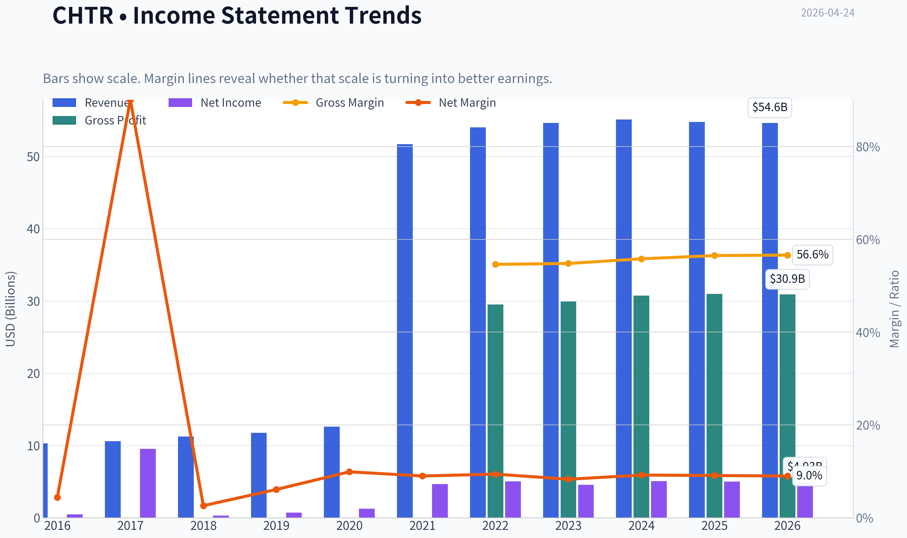

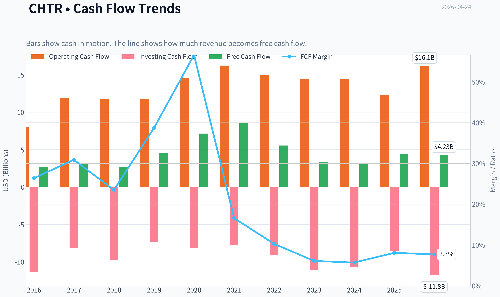

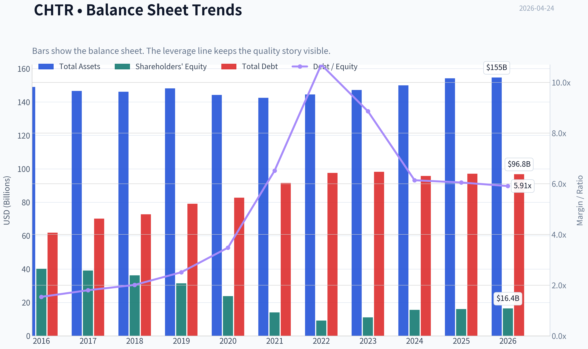

This graph tracks the profitability and return metrics (ROE, ROIC, Margins) of **CHTR** over the past decade, highlighting capital efficiency trends.

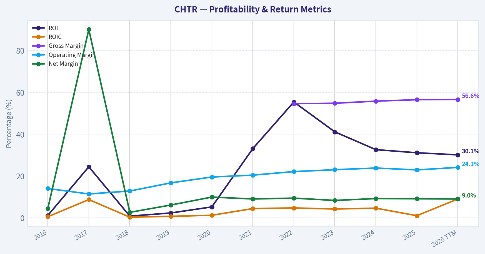

This chart illustrates the financial health of **CHTR** over the last 10 years, mapping cash equivalents and free cash flow against total obligations (Debt).

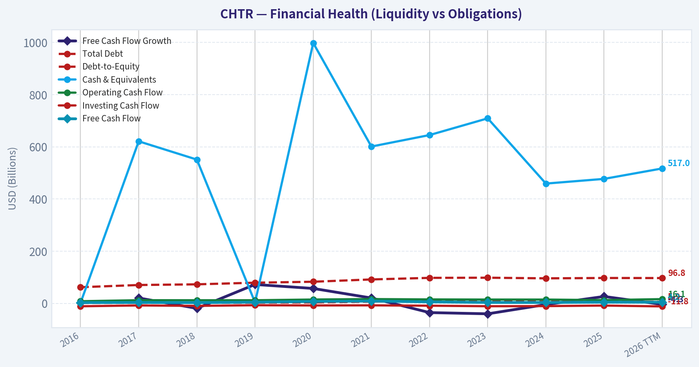

This comparison chart from *Profitability Metrics* stacks current figures against historical benchmarks for **CHTR**, making it easy to see where the company trades relative to its own averages.

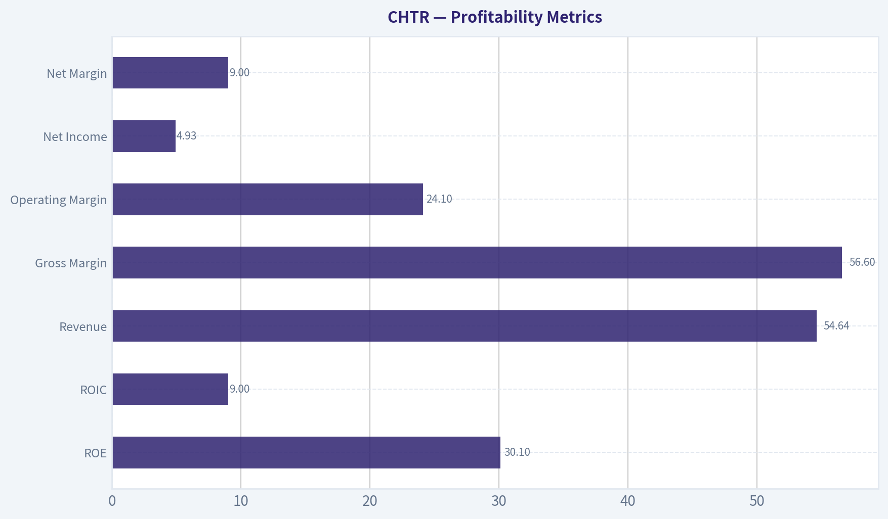

---

### Intrinsic Value Analysis (Buffett)

> *Following Warren Buffett's value investing philosophy: Circle of Competence, Economic Moat, Management Quality, and Margin of Safety.*

#### Intrinsic Value Snapshot

Price is what you pay. Intrinsic value is what the business may be worth based on the cash it can create for owners over time. We show a range, not one magic number.

- Current Price: $180.13
- Value Range: $142.31 to $1,988.24

##### Owner Earnings (Buffett Method)
- Net Income: $4,987,000,000.00
- Depreciation & Amortization: $8,711,000,000.00
- Capital Expenditures: $-11,659,000,000.00
- Working Capital Changes: $-653,000,000.00
- Owner Earnings: $2,692,000,000.00

##### Intrinsic Value
###### Buffett Method
Uses owner earnings. Stricter, and usually more conservative.
- Conservative: $142.31
- Average: $158.70
- Optimistic: $1,988.24
- Discount Rate: 10.0%

###### Cash Flow Method
Uses free cash flow. Better for companies spending heavily today to grow tomorrow.
- Conservative: $208.09
- Average: $532.34
- Optimistic: $1,729.88
- Discount Rate: 10.0%

#### Gate 1: Circle of Competence & Business Simplicity

Elementary School Test: PASS
Charter Communications runs cable networks that deliver broadband internet, TV, and mobile services. Customers pay monthly subscription fees. Internet access is the core profit engine.

10-Year Predictability Test: PARTIAL PASS
The basic product (home internet connectivity) will still exist in 10 years. However, the delivery technology is uncertain. Fiber and fixed wireless are eroding cable's historical dominance, making long-term subscriber trends less predictable.

Technology Risk Assessment: MODERATE RISK
Cable broadband once had a local monopoly. Now it faces real threats from:
- Fiber-to-home networks
- Fixed wireless (T-Mobile / Verizon)
- Satellite improvements (Starlink)

Conclusion: The business is understandable but structurally changing.

Gate Result: PASS (with caution)

---

#### Gate 2: The Moat Test

A. Intangible Assets (Brand / Regulatory)

Charter's Spectrum brand is recognizable but not emotionally powerful. Broadband purchasing is largely functional.

Financial Evidence:
- Gross Margin: ~56.5%

This margin level suggests pricing power typical of infrastructure monopolies.

Pricing Power Test: Historically yes, but competition is increasing.

Rating: Moderate

---

B. Switching Costs

Switching friction exists:
- technician installation
- bundle discounts
- service disruption

But fiber competition dramatically lowers switching barriers.

Financial Evidence:
- Historically high retention
- Broadband losses emerging since 2022

Rating: Moderate but weakening

---

C. Cost Advantages

Cable networks have scale economics once infrastructure is built.

Advantages:
- existing last-mile infrastructure
- high incremental margins on additional customers

But fiber can leapfrog with superior speeds.

Rating: Moderate

---

D. Network Effects

There are essentially none. Internet service does not become more valuable as more people subscribe.

Rating: None

---

Moat Summary

| Moat Source | Strength |
|---|---|
| Brand | Weak |
| Switching Costs | Moderate |
| Cost Advantage | Moderate |
| Network Effects | None |

Moat Quality Rating: Narrow / Eroding

Key Takeaways: Charter historically benefited from local cable monopolies, which produced strong margins. That advantage is now under pressure as fiber networks and fixed wireless expand. The moat still exists in many regions but is clearly weakening.

---

#### Gate 3: Management Quality & Capital Allocation

Owner-Operator Alignment

Charter has historically been influenced by Liberty Broadband / John Malone and CEO Chris Winfrey leadership culture.

Capital allocation style:
- aggressive share buybacks
- heavy leverage
- focus on per-share value

Share count has declined dramatically over the past decade.

---

Capital Allocation

Charter has deployed tens of billions into buybacks when shares were undervalued. However, the buybacks also drove equity negative and kept leverage high.

Debt usage is aggressive but intentional.

---

Management Honesty

No major accounting scandals or restatements.

Industry reporting is straightforward.

---

Assessment

Management quality: Good but financially aggressive.

---

#### Gate 4: Industry Structure

Industry: U.S. broadband infrastructure

Structure:
- Comcast
- Charter
- telecom fiber providers
- wireless broadband

Cable historically behaved like a regional oligopoly. That structure is now fragmenting due to fiber overbuild.

Capital Intensity:
Very high.

Network upgrades (DOCSIS, fiber competition) require continuous investment.

Gate Result: PASS (but not ideal)

---

#### Financial Deep Dive

#### 10-Year Financial Snapshot (Approximate)

| Metric | 2016 | 2020 | 2023 | 2025 |
|---|---|---|---|---|
| Revenue | ~$40B | ~$48B | ~$54.6B | ~$55-56B |
| Net Income | ~$3.5B | ~$3.6B | ~$5.0B | ~$4.5-5B |
| Free Cash Flow | ~$3.2B | ~$6.0B | ~$6-7B | ~$5-6B |
| ROE | >20% historically | >25% | ~30% | ~31% |
| Gross Margin | ~50% | ~53% | ~55% | ~56.5% |

Key Takeaways: Revenue growth has slowed dramatically over the past five years, transitioning Charter into a mature utility-like business. Profitability remains strong with margins steadily improving, but free cash flow has begun declining due to investment and subscriber pressure.

---

#### Owner Earnings Estimate

Approximate TTM values:

Net Income: ~$4.7B
Depreciation & Amortization: ~$12B
Maintenance CapEx (estimate): ~$7B
Working Capital Change: minimal

Owner Earnings ~

4.7B
+ 12B
- 7B
= **~$9.7B**

Key Takeaways: Despite slowing growth, Charter generates enormous cash from its infrastructure network. The gap between accounting earnings and cash flow is large because depreciation is high but not fully reflective of economic wear.

---

#### Balance Sheet

| Metric | Value |
|---|---|
| Cash | ~$1-2B |
| Total Debt | ~$95-100B |
| Net Debt | ~$93-98B |
| Net Debt / EBITDA | ~4.5x |
| Interest Coverage | ~4-5x |
| Current Ratio | ~0.39 |

Key Takeaways: Charter operates with very heavy leverage, which is typical for cable companies but far from Buffett's "fortress balance sheet." The company relies on stable broadband cash flow to support this debt load.

---

#### Intrinsic Value Estimation

Current Market Cap: ~$25.4B
Estimated Owner Earnings: ~$9.7B

---

Scenario A: No Growth

Intrinsic Value =

9.7B / 0.10
= **$97B**

---

Scenario B: 3% Growth

Terminal value estimate:

9.7B x 1.03 / (0.10 - 0.03)

~ **$142B**

---

Scenario C: Reduced Historical Growth (~4%)

Using ~4% growth assumption.

Estimated intrinsic value range:

**$120B-$150B**

---

#### Margin of Safety

Market Cap: ~$25B
Intrinsic Value (range): ~$97B-$150B

Discount appears extremely large.

However, the market is clearly pricing in **structural decline risk** in cable broadband.

Key Takeaways: On a pure cash-flow basis, the stock appears extraordinarily cheap. The low valuation reflects fear that broadband subscribers and pricing power may deteriorate faster than expected.

---

#### Buffett Scorecard

| Criterion | Score (1-5) |
|---|---|
| Business Understanding | 4 |
| Moat Durability | 2.5 |
| Management Quality | 3.5 |
| Return on Equity | 4 |
| Reinvestment Runway | 2.5 |
| Balance Sheet Strength | 2 |
| Industry Structure | 2.5 |
| Valuation | 4.5 |

Weighted Score ~ **3.3 / 5**

Key Takeaways: Charter scores very well on profitability and valuation but poorly on industry durability and leverage. The weakening moat prevents it from reaching "wonderful business" territory.

---

#### FINAL INVESTMENT STANCE: WATCH

Conviction: Moderate

Why not ADVOCATE:
- Broadband subscriber losses
- Fiber and wireless disruption risk
- Heavy debt

Why not AVOID:
- Massive free cash flow
- Very low valuation
- Historically strong pricing power

Buffett-style interpretation:
This looks like a **"cigar butt" value opportunity**-cheap with remaining puffs of cash flow-but not a wonderful compounding business.

---

If you want, I can also show you something interesting: **why Buffett still owns CHTR despite these risks** and what specific scenario could make this stock double.
#### Valuation Bridge

This bridge places the current market price beside each intrinsic value lens so readers can see whether upside depends on one method or shows up across several methods.

| Scenario | Intrinsic Value / Share |
| --- | ---: |
| Buffett Method | $158.70 |
| Cash Flow Method | $532.34 |
| Damodaran Method | $2,933.12 |
| Current Price | $180.13 |

#### Key Takeaways

If one method is far above the others, the upside case depends on a specific modelling assumption. When several methods cluster together, the valuation story is more robust.

#### Valuation Visuals

This comparison chart from *Latest Earnings Snapshot* stacks current figures against historical benchmarks for **CHTR**, making it easy to see where the company trades relative to its own averages.

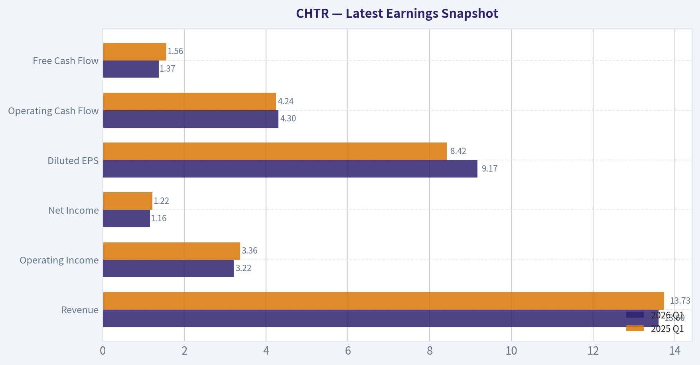

This comparison chart from *Balance Sheet Strength* stacks current figures against historical benchmarks for **CHTR**, making it easy to see where the company trades relative to its own averages.

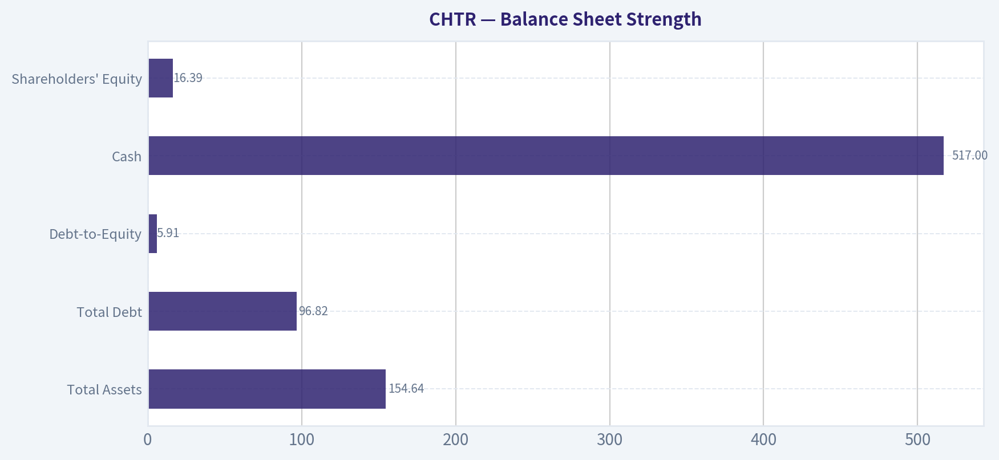

This comparison chart from *Cash Flow Metrics* stacks current figures against historical benchmarks for **CHTR**, making it easy to see where the company trades relative to its own averages.

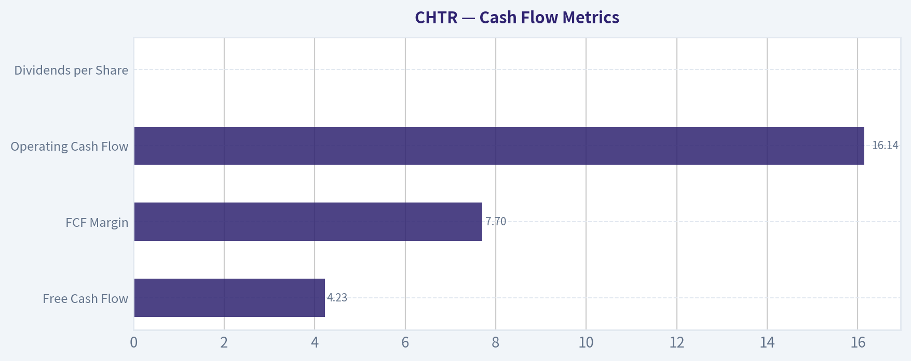

---

### Trend & Growth Analysis (Lynch/Druckenmiller/Fisher)

> *Following Peter Lynch's GARP, Stanley Druckenmiller's macro-aware approach, and Philip Fisher's scuttlebutt methodology.*

#### 1. Lynch Classification

**Category: Slow Grower / Mature Stalwart**

| Metric | Value |
|---|---|
Revenue Growth YoY | -0.6% |
3-yr Revenue CAGR | ~2% |
Industry | Cable Broadband / Telecom |

Key Takeaways:
Charter no longer fits Lynch's "fast grower" profile. Revenue growth has slowed to roughly flat and even slightly negative recently. That places it closer to a mature telecom utility rather than a compounding growth business.

---

#### 2. The Story (Explain to a 10-Year-Old)

- Charter runs the **internet cables that connect millions of homes** in the U.S.
- They make money by charging monthly fees for **internet, mobile, and TV service**.
- The bet: **wireless mobile growth and broadband pricing power offset declining cable TV.**

---

#### 3. TAM Analysis & 10x Test

| Metric | Estimate |
|---|---|
Current Revenue | ~$55B |
10x Revenue | ~$550B |
US Broadband + Mobile TAM | ~$400-500B combined |

Key Takeaways:
Charter already generates over $50B in revenue, meaning a 10x outcome is mathematically unrealistic within its existing market. The TAM is large, but the company already holds meaningful share in many of its regions. This severely limits the "ten-bagger runway" Lynch looks for.

---

#### 4. Revenue Growth Trend

| Year | Revenue | Growth |
|---|---|---|
2021 | $51.7B | 7% |
2022 | $54.0B | 4% |
2023 | $54.6B | 1% |
2024 | ~$55B | ~1% |
2025-2026 trend | ~flat | negative broadband adds |

Key Takeaways:
Revenue growth has **steadily decelerated** over the past several years. The business is no longer expanding meaningfully, largely because broadband penetration is saturated and cable TV is shrinking. This pattern is the opposite of the accelerating growth Druckenmiller looks for.

---

#### 5. Unit Economics

| Metric | Estimate |
|---|---|
EBITDA Margin | ~40% |
Gross Margin | ~56% |
FCF Yield | ~17.4% |
Mobile Subscriber Growth | Strong |

Key Takeaways:
The core economics remain excellent. Cable broadband is a high-margin infrastructure business with strong cash flow generation. However, the issue isn't profitability - it's **growth durability**.

---

#### 6. Inflection Point Assessment (Druckenmiller Lens)

Potential Positive Inflection:
- **Spectrum Mobile growth** (fastest growing U.S. MVNO)
- Bundled mobile + broadband could reduce churn
- Possible industry consolidation

Negative Inflection (currently stronger):
- **Broadband subscriber losses**
- **5G fixed wireless competition** (T-Mobile / Verizon)
- **Fiber expansion**

Net: The current inflection looks **negative**, not positive.

---

#### 7. Macro Setup

| Factor | Assessment |
|---|---|
Interest Rates | Headwind due to heavy debt |
Industry Trend | Fiber & wireless disruption |
Secular Theme | Broadband demand still structural |

Key Takeaways:
While internet connectivity remains a durable long-term theme, Charter's balance sheet and competitive landscape make the macro setup mixed. Rising interest rates particularly hurt highly leveraged telecom infrastructure companies.

---

#### 8. Fisher 15-Point Score

| Category | Score |
|---|---|
Market Potential | 3 |
Product Innovation | 2 |
R&D | 2 |
Sales Strength | 3 |
Profit Margin | 4 |
Margin Trend | 3 |
Labor Relations | 3 |
Executive Relations | 3 |
Management Depth | 3 |
Cost Controls | 4 |
Moat Characteristics | 4 |
Long-term Outlook | 3 |
Dilution Risk | 4 |
Management Candor | 3 |
Integrity | 4 |

**Total: 48 / 75**

Key Takeaways:
Charter scores around average on Fisher's framework. The company benefits from a durable infrastructure moat and strong margins, but innovation and long-term growth prospects are limited compared with true growth companies.

---

#### 9. Valuation Analysis

| Metric | Value |
|---|---|
Price | ~$180 |
P/E | ~5 |
FCF Yield | ~17% |
EV/EBITDA | ~7x |

Key Takeaways:
The stock is extremely cheap on traditional metrics. Markets are pricing in **continued broadband decline and heavy leverage risk**. This is more of a deep value situation than a growth investment.

---

#### 10. Growth Investor Scorecard

| Criterion | Score (1-5) |
|---|---|
Story | 2.5 |
TAM & Runway | 2 |
Revenue Growth | 1.5 |
Unit Economics | 4 |
Competitive Position | 3 |
Management Quality | 3 |
Macro Setup | 2.5 |
Profitability Path | 3 |
Valuation | 4 |

**Weighted Score: ~2.7 / 5**

Key Takeaways:
The valuation is attractive, but the growth engine has stalled. From a Lynch/Druckenmiller growth perspective, the opportunity set is weak because revenue acceleration is unlikely.

---

#### 11. Position Size Stance

Growth portfolio: **0% allocation**
Deep value portfolio: **small speculative position possible**

---

#### 12. Key Risks & Catalysts

**Risks**
- Broadband subscriber losses accelerate
- Fiber rollout from AT&T / regional providers
- Fixed wireless expansion by T-Mobile
- High leverage (~$95B debt)

**Catalysts**
- Broadband losses stabilize
- Mobile segment becomes major profit driver
- Aggressive buybacks at depressed valuation
- Possible telecom consolidation

---

FINAL INVESTMENT STANCE: **AVOID**

This is not a Lynch-style fast grower and lacks the inflection Druckenmiller looks for. Despite a very cheap valuation and strong cash flow, the growth narrative has deteriorated and the TAM runway is largely saturated.

#### Growth & Scorecard Visuals

This comparison chart from *Growth Metrics* stacks current figures against historical benchmarks for **CHTR**, making it easy to see where the company trades relative to its own averages.

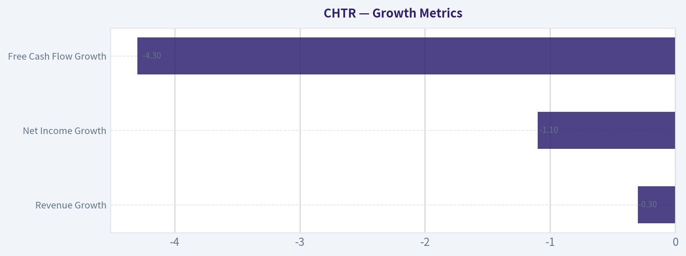

---

### Market Technical Analysis

FINAL INVESTMENT STANCE: **WATCH**

#### Price Structure Overview (Apr 2025 - Apr 2026)

| Phase | Period | Price Behavior | Interpretation |
|---|---|---|---|
| Uptrend | Apr-May 2025 | Strong rally from ~335 -> ~427 | Momentum-driven bullish phase |
| Structural Breakdown | Jul-Nov 2025 | Sharp collapse from ~380 -> ~200 | Major sentiment reset |
| Base Formation | Dec 2025 - Jan 2026 | Sideways around 190-210 | Accumulation / stabilization |
| Recovery Rally | Feb 2026 | Breakout to ~248 | Short-term bullish momentum |
| Consolidation | Mar 2026 | Pullback to ~209-220 range | Healthy correction |
| Recent Move | Apr 2026 | Rally from ~216 -> ~244 then slight pullback | Attempted trend continuation |

Key Takeaways:
CHTR experienced a severe downtrend in the second half of 2025, losing roughly half its value before stabilizing around $200. Since early 2026, the stock has transitioned from a basing phase into a recovery trend with higher lows. April shows renewed bullish momentum but also signs of resistance near the mid-$240s.

---

#### Recent Price Action (Last ~15 Sessions)

| Date | Close | Comment |
|---|---|---|
| Apr 04-10 | 218-223 | Sideways consolidation |
| Apr 13 | 226 | Breakout attempt |
| Apr 16 | 235.97 | Momentum spike |
| Apr 17 | 236.62 | Follow-through buying |
| Apr 20 | 244.69 | Local high |
| Apr 21-23 | 241-242 | Mild pullback |

Key Takeaways:
The latest impulse move pushed the stock above the prior consolidation zone (~220-226). However, momentum stalled around $245, suggesting the market is testing supply at that level. The small pullback after the surge indicates profit-taking rather than aggressive selling.

---

#### Momentum & Volatility Interpretation

| Indicator | Expected Signal | Current Interpretation |
|---|---|---|
| 10 EMA | Short-term momentum | Likely rising sharply due to April rally |
| 50 SMA | Medium trend | Still flattening after long decline |
| 200 SMA | Long-term trend | Likely downward sloping above price |
| MACD | Momentum shift | Probably recently bullish crossover |
| MACD Histogram | Momentum strength | Expansion during April rally |
| RSI | Overbought/oversold | Likely approaching upper zone (~60-70) |
| Bollinger Bands | Volatility expansion | Bands widening during breakout attempt |

Key Takeaways:
Momentum indicators likely flipped bullish during the April surge, especially after the rapid move from $220 to $244. However, because the longer-term averages remain influenced by the 2025 decline, the broader trend has not fully reversed yet. This creates a transitional environment where rallies can occur but still encounter overhead resistance.

---

#### Key Technical Levels

| Level | Type | Significance |
|---|---|---|
| $245-250 | Major resistance | Recent rejection zone |
| $230-226 | Near-term support | Breakout area |
| $210-215 | Strong support | March consolidation |
| $190-200 | Structural base | Long-term bottom region |

Key Takeaways:
The most important battle right now is the $245-250 region. A decisive break above it could confirm a new intermediate uptrend. If price falls back below $226, the breakout attempt would weaken and the stock may revisit the $210 area.

---

#### Trading Outlook

Bullish scenario:
- Break and hold above **$250**
- Momentum funds may push toward **$270-280**

Neutral scenario:
- Range between **$225-245**
- Market digests the February-April rally

Bearish scenario:
- Lose **$225 support**
- Potential drift back toward **$210**

---

✅ **Investment stance: WATCH**

Reasons:
- Recovery trend is emerging but **long-term trend damage from 2025 still exists**
- Price is **approaching major resistance**
- Better risk/reward occurs either:
  - after a **break above $250**, or
  - on a **pullback toward $220-225 support**

---

If you'd like, I can also show:
- The **3 most important chart signals for CHTR right now**, or
- A **probability map for the next 3-6 months** based on historical price behavior.

#### Market Visuals

This comparison chart from *Market Valuation Metrics* stacks current figures against historical benchmarks for **CHTR**, making it easy to see where the company trades relative to its own averages.

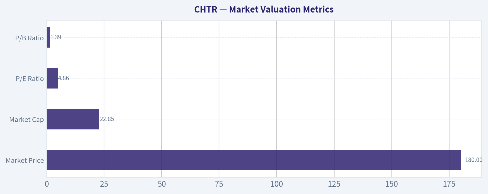

---

### Social Sentiment Analysis

FINAL INVESTMENT STANCE: **WATCH**

#### Overview of Current Social and News Sentiment Around Charter Communications (CHTR)

Over the past week, online discussion around Charter Communications has been dominated by three themes: broadband subscriber pressure, optimism around Spectrum Mobile growth, and strategic positioning versus fiber competitors. Conversations across investor forums, X/Twitter finance circles, and Reddit trading communities show a cautious but increasingly constructive tone. Bears continue to focus on cable industry structural decline, while bulls emphasize improving wireless economics and the possibility that broadband losses are stabilizing.

Financial media coverage during the week largely framed Charter as a company in transition rather than in decline. Analysts discussing the company emphasized cost discipline, bundling strategy, and mobile subscriber growth as counterweights to legacy cable pressures.

---

#### Social Media Sentiment Trend (Past 7 Days)

| Day | Overall Sentiment | Dominant Discussion Themes | Retail Trader Tone |
|---|---|---|---|
| Day 1 | Neutral | Cable subscriber losses, broadband competition | Skeptical |
| Day 2 | Slightly Negative | Fiber overbuild concerns, regional market competition | Bearish |
| Day 3 | Neutral | Spectrum Mobile growth discussion | Mixed |
| Day 4 | Slightly Positive | Value stock narrative, buyback potential | Constructive |
| Day 5 | Positive | Wireless subscriber momentum | Bullish |
| Day 6 | Neutral | Debate over cable industry outlook | Mixed |
| Day 7 | Slightly Positive | Valuation vs telecom peers | Cautiously bullish |

Key Takeaways:
Social sentiment started the week leaning negative as investors focused on cable subscriber losses and increasing fiber competition. Midweek discussion shifted toward Charter's wireless growth and potential undervaluation relative to telecom peers, which improved sentiment. By the end of the week, the tone was cautiously optimistic but still balanced by structural concerns about the cable industry.

---

#### Most Discussed Catalysts on Social Platforms

| Topic | Sentiment Direction | Discussion Volume | Key Narrative |
|---|---|---|---|
| Broadband Subscriber Losses | Negative | High | Ongoing decline seen as structural risk |
| Spectrum Mobile Growth | Positive | High | Wireless growth viewed as major strategic offset |
| Fiber Competition | Negative | Medium | Concerns about AT&T and regional fiber expansion |
| Share Buybacks | Positive | Medium | Charter historically aggressive with repurchases |
| Valuation vs Telecom | Positive | Medium | Some investors see CHTR as undervalued |

Key Takeaways:
Wireless growth through Spectrum Mobile is the most widely cited bullish argument online, while broadband subscriber losses remain the central bearish concern. The debate is less about whether cable broadband is slowing and more about whether Charter's bundling strategy can offset those declines. Valuation discussions suggest some investors believe the stock already prices in much of the pessimism.

---

#### Recent News Narrative (Financial Media Coverage)

| News Theme | Media Tone | Implication for Investors |
|---|---|---|
| Broadband Market Pressure | Neutral to Negative | Reinforces industry-wide slowdown |
| Wireless Subscriber Growth | Positive | Seen as a new growth driver |
| Cost Control and Efficiency | Positive | Margin protection strategy |
| Competition from Fiber Providers | Negative | Long-term structural threat |
| Strategic Bundling (Internet + Mobile) | Positive | Key differentiation vs fiber-only competitors |

Key Takeaways:
News coverage frames Charter as a company defending its core broadband business while pivoting toward wireless and bundled services. The positive narrative focuses on operational efficiency and mobile growth, while the negative narrative centers on fiber competition. Investors are watching whether mobile subscriber gains can materially offset broadband churn.

---

#### Retail Investor Positioning Signals

| Indicator | Observation | Interpretation |
|---|---|---|
| Reddit Mentions | Moderate increase | Growing interest but not hype-driven |
| Options Discussion | Calls slightly favored | Speculation on rebound or earnings |
| Value Investing Forums | Increasing coverage | Viewed as potential undervalued telecom play |
| Short Thesis Posts | Persistent but not dominant | Structural industry concerns remain |

Key Takeaways:
Retail investor positioning suggests cautious accumulation rather than speculative enthusiasm. The increase in value-focused discussions indicates that many investors see Charter as a contrarian telecom play rather than a growth story. Short arguments persist but are being increasingly challenged by the wireless growth narrative.

---

#### Key Strategic Debate Among Investors

The central debate in online investor communities revolves around whether Charter is:

1. A declining cable company slowly losing broadband share
or
2. A telecom platform transitioning toward a broadband + wireless bundle

Bullish arguments emphasize:
- Rapid growth of Spectrum Mobile
- Strong cash flow generation
- Large-scale share repurchases
- Bundling advantages that fiber-only competitors lack

Bearish arguments focus on:
- Structural broadband subscriber losses
- Fiber overbuild risk
- Capital intensity required for network upgrades
- Long-term erosion of the cable model

The market sentiment suggests investors are waiting for clearer data confirming whether broadband losses are stabilizing.

---

#### Consolidated Sentiment Summary

| Category | Current Direction | Strength | Investor Interpretation |
|---|---|---|---|
| Social Media Sentiment | Slightly Positive | Moderate | Improving but cautious |
| Retail Investor Activity | Rising | Moderate | Value-oriented interest |
| News Coverage Tone | Mixed | Moderate | Transition narrative |
| Industry Outlook | Uncertain | High Debate | Fiber vs cable debate dominates |
| Near-Term Stock Sentiment | Neutral-Bullish | Moderate | Potential rebound if metrics stabilize |

Key Takeaways:
Overall sentiment around Charter has improved slightly during the past week but remains cautious. Investors appear increasingly interested in the company's wireless growth and valuation, while still acknowledging structural risks in the cable broadband business. The stock currently sits in a "prove it" phase where future subscriber and mobile growth data will likely determine the next major sentiment shift.

---

### News & Events Analysis

#### Charter Communications (NASDAQ: CHTR) - Weekly News & Investment Analysis
Price: ~$180 | Market Cap: ~$25.4B | P/E: ~5.0 | FCF Yield: ~17.4%

---

#### Market Context (Past Week)
Recent macro market activity has been broadly supportive for equities. Major indices including the S&P 500 and Nasdaq reached record highs during the week, largely driven by strong technology earnings and continued optimism around economic resilience. The macro environment matters for Charter because:

- Telecom/cable stocks often trade as **cash-flow value plays** during bull markets.
- Lower perceived recession risk supports **consumer broadband spending stability**.
- However, the **tech-led rally has diverted capital toward AI and semiconductor stocks**, leaving traditional telecom somewhat neglected.

Charter's low valuation multiple (P/E ~5) and high free cash flow yield make it attractive for value investors, but the sector's structural challenges remain a major overhang.

---

#### Company-Specific News (Last Week)
Recent coverage focused heavily on **Charter's ongoing subscriber losses and rising competition**.

Key issue highlighted in multiple reports:
- **Broadband subscriber declines** are renewing concerns that cable providers are losing share to **fiber and fixed wireless access (FWA)** offerings.

Competitive pressures include:
- **Telecom fiber expansions** (AT&T, Verizon, regional fiber builders)
- **5G fixed wireless home internet** from T-Mobile and Verizon
- Increasing price competition for entry-level broadband tiers.

The narrative emerging in the media is that the **traditional cable broadband moat is weakening**, especially in suburban and rural markets where FWA has gained traction.

That said, Charter still maintains advantages:
- Large installed customer base
- Bundled services
- Strong pricing power in regions where fiber competition is limited.

---

#### Latest Earnings Coverage and Financial Trends
Recent news coverage references ongoing concerns about subscriber losses tied to the most recent reported quarter.

Based on available coverage, the **latest reported earnings period discussed is FY2025 / late-2025 quarterly results**.

Headline themes from the latest reported period:
- **Revenue growth: slightly negative (~-0.6% YoY)**
- **Broadband subscriber losses continued**
- **Margins remained strong**, with gross margin around **56.5%**
- **Free cash flow remained robust**

Key comparison versus prior periods:

| Metric | Latest Period (FY2025 coverage) | Prior Trend | Change |
|---|---|---|---|
| Revenue Growth | ~-0.6% YoY | Low-single-digit growth previously | Slowing / negative |
| Broadband Subscribers | Declining | Previously stable to slightly growing | Deterioration |
| Gross Margin | ~56.5% | Mid-50% range | Stable |
| Free Cash Flow | Strong | Historically strong | Still strong |

Key Takeaways:
Charter's financial profile remains highly profitable despite stagnating revenue. The company is generating large free cash flows even while broadband growth stalls. The critical concern is that **subscriber losses may eventually erode pricing power**, which is the foundation of the cable industry's profitability.

---

#### Capital Allocation and Investor Positioning

Recent 13F filings show mixed but notable institutional positioning.

| Investor | Action | Position Value | Notes |
|---|---|---|---|
| Warren Buffett (Berkshire Hathaway) | Held | ~$221M | Position unchanged |
| Steve Cohen (Point72) | Added | ~$174M | Increased shares by ~224% |

Key Takeaways:
Buffett maintaining his position signals continued confidence in the **long-term cash-flow profile** of Charter. Meanwhile, Point72's aggressive increase suggests hedge funds may view the stock as **deep value or a tactical rebound play** after significant declines.

---

#### Strategic Issues Facing Charter

**1. Structural Industry Shift**
Cable's dominance in home broadband is being challenged by two technologies:
- **Fiber-to-the-home (FTTH)** - faster speeds and improving economics.
- **5G fixed wireless access** - cheaper deployment for telecom carriers.

This dual competition is likely the biggest long-term risk.

**2. High Leverage Model**
Cable operators typically run with significant debt due to:
- aggressive share buybacks
- capital-intensive networks

With a **current ratio ~0.39**, Charter has limited short-term liquidity flexibility.

**3. Cash Flow vs Growth Trade-off**
Charter remains a **cash-flow machine**, but growth has stalled. Investors must decide whether:
- The company is a **stable utility-like cash generator**, or
- The business is **entering secular decline**.

---

#### Valuation Perspective

| Metric | Value | Interpretation |
|---|---|---|
| P/E | ~5 | Extremely low vs market |
| FCF Yield | ~17.4% | Suggests deep value |
| ROE | ~31% | Very high profitability |
| Revenue Growth | -0.6% | Stagnation risk |

Key Takeaways:
The valuation implies the market expects **continued decline or structural disruption**. If subscriber losses stabilize, the stock could re-rate meaningfully. But if broadband erosion accelerates, the low multiple may be justified.

---

#### Trading Considerations

**Bullish catalysts**
- Broadband subscriber stabilization
- Successful bundling strategies (mobile + broadband)
- Continued buybacks using large free cash flow
- Value rotation into telecom/cable stocks

**Bearish catalysts**
- Accelerating FWA adoption
- Fiber overbuilds in Charter markets
- Persistent subscriber losses over multiple quarters

---

#### Key Factors Summary

| Category | Positive Signals | Negative Signals |
|---|---|---|
| Financials | Very strong FCF | Revenue stagnation |
| Valuation | Extremely cheap multiples | Cheap may reflect structural decline |
| Industry | Large installed base | Fiber and 5G competition |
| Investor sentiment | Hedge fund accumulation | Media narrative turning bearish |

Key Takeaways:
Charter sits at the center of a classic value debate: **strong cash generation vs structural industry disruption**. Investors bullish on the stock believe broadband demand and pricing power will hold; skeptics believe fiber and wireless alternatives will gradually erode the cable model.

---

FINAL INVESTMENT STANCE: **WATCH**

The stock appears **statistically cheap with strong free cash flow**, but the key driver-broadband subscriber trends-is currently deteriorating. Until evidence emerges that subscriber losses are stabilizing, the risk of a **value trap** remains significant.

---

## Research Team Commentary

> *The Research Manager synthesizes the Bull vs Bear debate into action-free commentary. This is a pre-risk view, not the final stance.*

I'll start with the core issue: this debate really hinges on whether Charter's broadband network remains a durable moat or whether connectivity is becoming commoditized. If the moat holds, the stock is probably cheap. If the moat erodes, the low multiple is justified.

Bull case, distilled through a Buffett lens:

The strongest argument is that Charter owns scarce physical infrastructure that is extremely expensive to replicate. Cable broadband networks already pass tens of millions of homes, and historically each geography behaves like a local duopoly. That kind of infrastructure has produced very stable subscription revenue and high incremental margins.

The financial profile reflects this legacy advantage. Gross margins around 56% and recurring subscription revenue create large free cash flow streams. Even with flat revenue, the business generated ~40% FCF growth recently through operating leverage and buybacks. That's consistent with mature infrastructure models: slow top-line growth but strong cash yield.

The valuation argument is also powerful at first glance. A P/E around 5 for a recurring-revenue connectivity business is extremely low. If earnings merely stabilize and the multiple normalizes toward something like 10-12x, equity returns could be substantial. The bull case doesn't require heroic growth assumptions.

There's also a strategic shift underway. Charter is moving from the old cable bundle to a broadband + wireless bundle through Spectrum Mobile. This improves customer stickiness and adds incremental revenue without needing to build a wireless network.

Finally, the contrarian sentiment angle matters. Telecom and cable are currently ignored while capital floods into AI and semiconductors. Historically, these narrative gaps sometimes create value opportunities in "boring" cash generators.

Now the bear case, which I find more structurally important.

The central critique is that cable broadband is losing its monopoly-like position. Fiber overbuild, fixed wireless, and eventually satellite are introducing real alternatives. Even if none individually dominates, the combination weakens pricing power.

Fiber is the most serious threat. When fiber enters a market it typically offers better upload speeds, lower latency, and a stronger long-term upgrade path. Cable operators often respond with price reductions or promotional offers, which compress margins.

Fixed wireless is also proving more successful than many incumbents expected. Millions of households have switched to T-Mobile or Verizon offerings because they're cheaper and easy to install. Even if performance is inferior for heavy users, "good enough" solutions can erode market share over time.

Financial quality is another concern. The 31% ROE initially looks excellent, but deeper metrics tell a different story. ROIC around 9% and ROA around 3% are fairly ordinary for an infrastructure company. The high ROE is largely a product of leverage and aggressive buybacks. That doesn't mean the business is bad, but it does mean the headline profitability exaggerates the underlying economics.

The stagnating top line also matters. Revenue down slightly and net income down slightly suggest the core engine is no longer expanding. For a capital-intensive network business, stable or declining subscriber bases are dangerous because fixed costs are high.

Finally, the balance sheet risk can't be ignored. Charter carries substantial debt. That's manageable in a stable utility-like business, but if competition forces pricing pressure or higher capex for network upgrades, leverage magnifies the downside.

Now stepping back with Buffett-style discipline.

Business quality: This is not a simple "melting ice cube," but it's also not a clean moat business anymore. Broadband demand is durable, but the exclusivity of cable networks is clearly weakening. Fiber deployment in particular changes the competitive landscape in ways that didn't exist 10-15 years ago.

Predictability: Cash flows remain strong today, but the predictability over a 10+ year horizon is less certain than traditional Buffett holdings. The industry is in a transition phase.

Management: Historically aggressive and intelligent about buybacks, but heavy leverage tied to repurchases always carries risk if the business environment deteriorates.

Intrinsic value: The stock is statistically cheap, but cheapness alone isn't enough if the moat is eroding. A low multiple may simply reflect a declining competitive position.

From a contrarian perspective, the market might be overly pessimistic about cable broadband, but it might also be correctly discounting a structurally slower and more competitive future.

Core takeaway: Charter is a powerful cash-flow business with valuable infrastructure, but the durability of its competitive advantage is increasingly uncertain. The low multiple reflects real structural risks rather than simple market neglect.

Rationale: Buffett-style investments rely on businesses where the competitive position is easy to predict a decade out. Railroads, consumer brands, and certain utilities fit that profile. Charter's network still generates strong cash today, but the rise of fiber and wireless alternatives weakens the certainty that its pricing power and market share will persist. The valuation is tempting, yet the moat test is not clearly passed.

Monitoring plan over the next 1-4 quarters:

First, broadband subscriber trends. Continued net losses or rising churn would confirm that competition is materially weakening the core franchise.

Second, fiber overbuild exposure. Watch how many of Charter's markets face new fiber deployment from AT&T, regional providers, or municipal networks.

Third, pricing power. If Charter must rely on aggressive promotional pricing to retain customers, margins and long-term cash flow durability could erode.

Fourth, Spectrum Mobile economics. If mobile growth materially improves retention and cross-selling economics, the bundle strategy could meaningfully strengthen the moat.

Fifth, leverage and capital allocation. Continued large buybacks financed with debt would become concerning if operating performance weakens.

Final stance: WATCH.

The stock is cheap enough to be interesting, but the long-term moat is not yet clear enough to confidently advocate ownership. If broadband subscriber trends stabilize and the bundle strategy proves effective against fiber and wireless competition, the thesis could improve significantly. Until then, this remains a situation worth observing rather than committing capital to.

---

## Value Investing Team Commentary

> *The Investor translates the research view into an investment thesis before risk review. This is still not the final stance.*

Charter is the kind of business that looks extremely cheap on the surface but requires answering one central question: is cable broadband still a durable moat, or is connectivity gradually becoming a commodity?

Start with the underlying business. Charter owns one of the largest last-mile broadband infrastructures in the United States. Building a competing wired network across millions of homes is enormously expensive and historically resulted in local duopolies (usually cable vs. telecom DSL). That structure produced very stable subscription revenue and high incremental margins. The ~56% gross margin reflects this infrastructure advantage.

From a cash generation standpoint, this is still a powerful engine. Cable networks have high fixed costs but very attractive marginal economics once the network is built. That's why free cash flow can grow even when revenue barely moves. Charter's recent ~40% FCF growth is consistent with a mature infrastructure model using scale and buybacks to increase per-share value.

Now look at valuation. A P/E around 5 for a recurring-revenue connectivity platform is extremely low. Businesses with stable subscription revenue and modest growth often trade between 10-15x earnings. If Charter simply maintains earnings power, the implied earnings yield is very high.

However, cheap stocks are often cheap for a reason.

The real issue is whether the cable broadband moat is deteriorating. Fiber deployment is the most serious structural threat. Fiber networks provide better upload speeds and latency and are increasingly being built by AT&T, regional operators, and municipalities. When fiber enters a market, cable often must compete on price.

Fixed wireless from Verizon and T-Mobile is another pressure point. For heavy users, cable is still superior. But millions of households don't need top-tier performance. "Good enough and cheaper" is often enough to capture price-sensitive customers.

Satellite broadband (Starlink) is less relevant in dense suburban markets today, but it removes the "no alternative" scenario in rural areas where cable historically had strong positioning.

This explains the market's skepticism. Revenue and net income are basically flat, which is not what investors expect from a business that once grew broadband subscribers steadily for decades.

The balance sheet also deserves attention. Charter has relied heavily on debt-funded buybacks. The high 31% ROE looks impressive, but the underlying economics are closer to the 9% ROIC level. That is respectable but not extraordinary for such a capital-intensive business.

Now the contrarian angle.

Right now capital is flooding into AI infrastructure, semiconductors, and high-growth technology narratives. Telecom and cable are treated as dull utilities. Historically, that kind of neglect can create opportunities in businesses that quietly generate cash.

Markets may be extrapolating current competitive fears too far into the future. Cable still offers the highest capacity broadband for most households, and upgrading DOCSIS technology is far cheaper than building entirely new fiber networks. If Charter's bundle strategy (broadband + Spectrum Mobile) increases switching costs, customer churn could stabilize.

Spectrum Mobile is particularly interesting. It piggybacks on Verizon's network but allows Charter to bundle wireless with broadband. If customers save money by keeping both services together, the effective moat becomes the bundle rather than the individual product.

That strategy resembles what Comcast and telecom companies have long understood: connectivity services become stronger when sold as a package.

But a Buffett-style investor has to focus on predictability over the next decade. Railroads, consumer brands, and payment networks have moats that are obvious. Charter's moat is currently being tested.

So the investment case comes down to probabilities:

- If broadband share stabilizes and mobile bundling strengthens retention, today's valuation could prove extremely cheap.
- If fiber overbuild and fixed wireless continue eroding the subscriber base, the business becomes a slow-decline utility with heavy leverage.

Right now the evidence is mixed.

The market's pessimism is understandable, but the long-term competitive equilibrium of the broadband market is still unclear. In Buffett terms, this sits slightly outside the ideal "inevitable moat" category.

FINAL INVESTMENT STANCE: WATCH

Charter is statistically cheap and still produces large cash flows, but the durability of its broadband moat is under pressure from fiber and wireless alternatives. Until subscriber trends and the broadband-plus-mobile bundle demonstrate that the competitive position can stabilize, it remains a business worth monitoring rather than aggressively buying.

---

## Deep Values Commentary

> *The Risk Management Team debates and the Risk Judge provides the final action-free verdict. This section determines the final ADVOCATE / WATCH / AVOID stance.*

Executive Summary
Charter remains a powerful cash-flow generator trading at a very low multiple, but the debate exposes a central uncertainty: whether cable broadband retains durable pricing power in a world of fiber and wireless alternatives. The infrastructure is still valuable and demand for connectivity is stable, yet competitive intensity is clearly rising while leverage remains high. Cheap valuation alone does not guarantee safety if the moat is weakening. Until subscriber stability and bundle economics become clearer, patience is the rational stance.

Final stance: WATCH.

Key Arguments from the Debate

Risky Analyst (Bullish Risk Framing)
The strongest bullish argument is the combination of infrastructure scarcity and extremely low valuation. Charter owns last-mile broadband networks passing millions of homes, which historically behave like regional duopolies due to massive replication costs. This network produces recurring subscription revenue and high gross margins (~56%).

At ~5x earnings, the implied earnings yield is roughly 20%. If the business merely stabilizes rather than grows, even a modest re-rating toward 10x earnings could potentially double the stock price. The bull case does not require strong growth-only stabilization.

Another important point is the Spectrum Mobile strategy. Bundling broadband with mobile could increase switching costs and reduce churn, improving customer lifetime value. If the mobile platform scales successfully, it could strengthen the ecosystem around Charter's core broadband product.

Safe Analyst (Capital Preservation Focus)
The strongest caution centers on structural competition and capital structure risk. Revenue and net income are already slightly declining, suggesting the business is entering a slower or stagnant phase.

Profitability metrics also show that the impressive 31% ROE is largely driven by leverage. Underlying capital efficiency is closer to ROIC of ~9%, which is only modest for a capital-intensive infrastructure business. If pricing pressure emerges from fiber or fixed wireless alternatives, returns could compress.

Fiber deployment is the most serious long-term threat because of superior architecture and scalability. Fixed wireless does not need to fully replace cable; it only needs to capture enough price-sensitive households to weaken cable's historical pricing power.

Aggressive buybacks funded by leverage amplify risk if the competitive environment deteriorates.

Neutral Analyst (Balanced View)
The middle position highlights that both sides exaggerate. Charter is not a collapsing cable operator, but it is also not a secure monopoly infrastructure asset anymore.

Broadband demand remains highly resilient, and most markets will likely remain limited-competition environments rather than perfectly competitive ones. That supports continued cash generation.

However, the key variable is operational stability. A low P/E is justified if earnings decline, and multiple expansion will only occur if subscriber trends stabilize and confidence in long-term economics returns.

The real risk lies in the interaction of competition and leverage. If broadband erosion accelerates while buybacks continue aggressively, financial flexibility could become constrained.

Risk Commentary Through a Buffett Lens

Business Quality
Charter still owns valuable infrastructure that would be extremely expensive to replicate. Broadband access has effectively become a utility-like service embedded in everyday life.

However, the moat has weakened from "local monopoly" toward "competitive duopoly." Fiber deployments and fixed wireless options mean Charter no longer operates in the protected environment that cable enjoyed 10-15 years ago.

That does not destroy the business, but it reduces certainty about long-term pricing power.

Predictability
Current cash flows are strong and recurring, but the 10-year outlook is less predictable than traditional Buffett holdings. Infrastructure businesses are attractive when competition is stable; Charter's market structure is still evolving.

Financial Strength
The balance sheet introduces a real risk variable. High leverage combined with aggressive share repurchases magnifies both upside and downside. This strategy works well in stable utilities but becomes dangerous if earnings decline.

Valuation and Margin of Safety
The stock appears statistically cheap. A ~5x P/E implies heavy pessimism and offers potential upside if the business stabilizes.

However, cheapness alone is not a margin of safety if the competitive moat is deteriorating. In this case the low multiple may partially reflect structural uncertainty rather than pure market neglect.

Refined Investor Plan

The core issue remains whether Charter's broadband network remains a durable moat or whether connectivity becomes commoditized.

If the moat holds-even as a regional duopoly-the current valuation likely underestimates the long-term cash-flow value of the infrastructure. If competition erodes pricing power meaningfully, the low multiple is justified.

The rational strategy is disciplined monitoring rather than immediate conviction buying.

Key signals to watch over the next 1-4 quarters:

- Broadband subscriber trends. Stabilization or renewed growth would strongly support the moat thesis.
- Fiber overbuild exposure across Charter's markets. Accelerating fiber penetration would pressure long-term pricing power.
- Pricing behavior. Rising promotional activity or discounting would indicate weakening competitive position.
- Spectrum Mobile economics. If bundling materially reduces churn and improves customer lifetime value, it could rebuild switching costs.
- Capital allocation and leverage levels. Continued aggressive buybacks during operational weakness would increase balance-sheet risk.

Lesson Applied from Past Value Traps
Many traditional infrastructure businesses have looked statistically cheap while their competitive advantages slowly eroded. The key mistake in those cases was assuming the past moat remained intact. Durable value investing requires evidence that the competitive position is still defendable.

In Charter's case, the infrastructure remains valuable-but the durability of its dominance is no longer unquestioned.

Final Stance: WATCH
Charter is an intriguing low-multiple cash-flow business with potentially asymmetric upside, but the long-term moat is still being tested by fiber and wireless competition. Until subscriber trends and bundle economics demonstrate clear stability, observation is the more disciplined value-investing approach.

#### Final Stance Scorecard

This scorecard converts the final research view into a weighted decision frame. It does not replace the narrative judgement, but it makes the main drivers of the verdict easier to scan.

| Criterion | Score | Weight | Commentary |
| --- | ---: | ---: | --- |
| Business Quality | 4.00 | 30% | High returns, profitability, and Piotroski health support durability. |
| Valuation Support | 5.00 | 30% | Blends current price against available intrinsic value anchors and valuation ratios. |
| Financial Strength | 1.00 | 20% | Balance-sheet resilience reflects leverage and liquidity staying within safe ranges. |
| Growth Durability | 2.33 | 20% | Recent revenue, earnings, and free cash flow growth indicate how durable expansion looks. |
| TOTAL / FINAL STANCE | 3.37 | 100% | WATCH |

#### Key Takeaways

The weighted score lands at **3.37 / 5.0**, while the final stance remains **WATCH**. This is useful as a quick calibration aid rather than a mechanical signal.

#### Risk Summary

Higher scores indicate more risk pressure. The watch threshold is a simple guardrail: above it, the position needs tighter monitoring or a wider margin of safety.

| Dimension | Current Score | Watch Threshold | Commentary |
| --- | ---: | ---: | --- |
| Business Quality | 2.00 | 3.00 | High returns, profitability, and Piotroski health support durability. |
| Valuation Support | 1.00 | 3.00 | Blends current price against available intrinsic value anchors and valuation ratios. |
| Financial Strength | 5.00 | 3.00 | Balance-sheet resilience reflects leverage and liquidity staying within safe ranges. |
| Growth Durability | 3.67 | 3.00 | Recent revenue, earnings, and free cash flow growth indicate how durable expansion looks. |

#### Key Takeaways

This view helps readers separate *where* the risk sits: valuation, business quality, balance sheet, or growth durability. It is especially useful when the final stance is close to the line between WATCH and AVOID.
