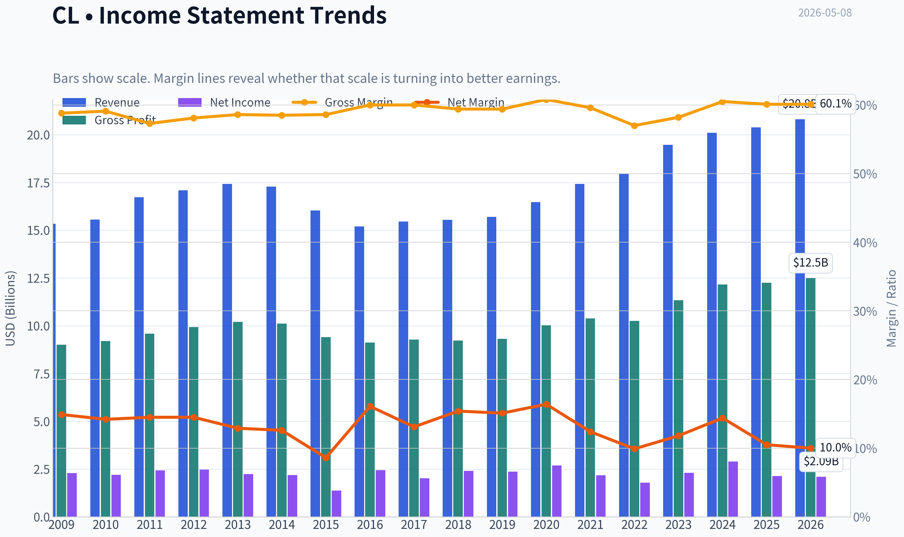
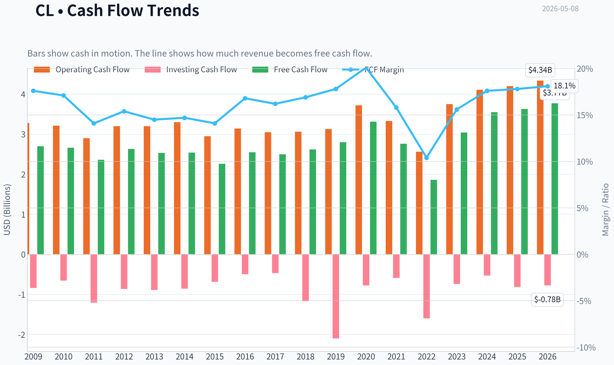
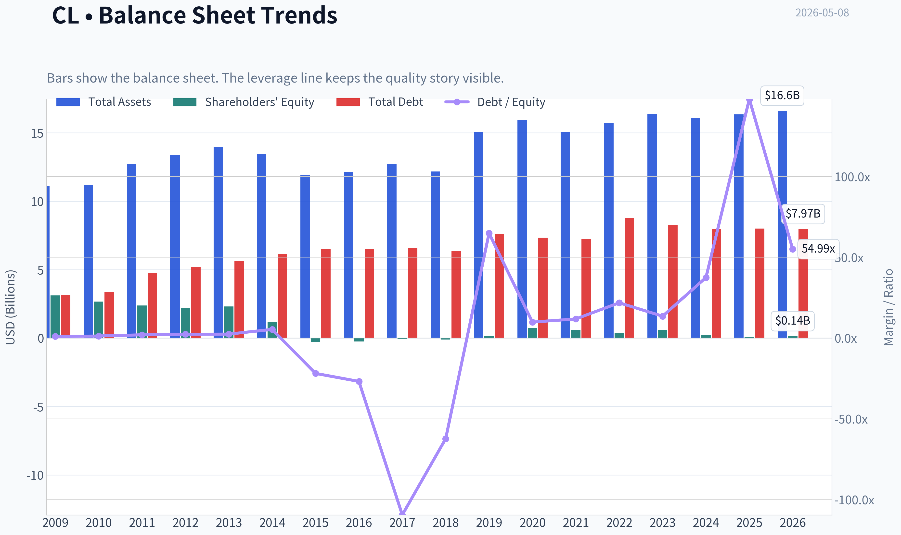
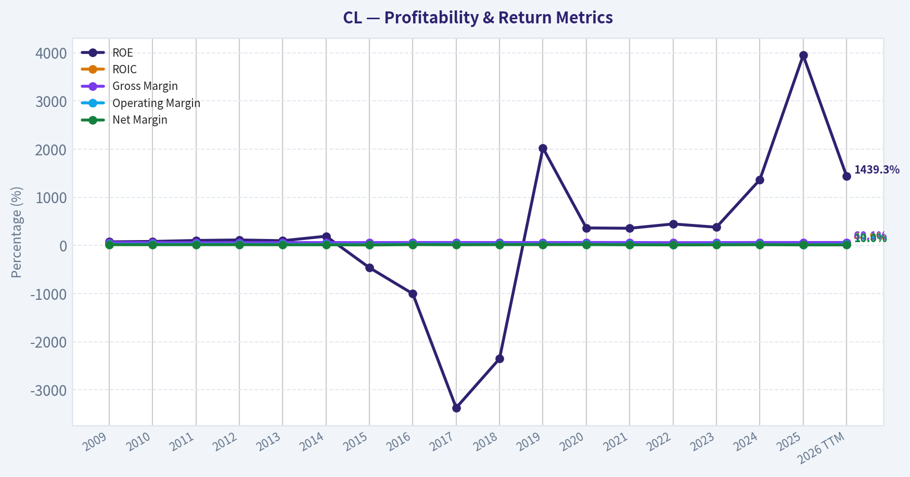
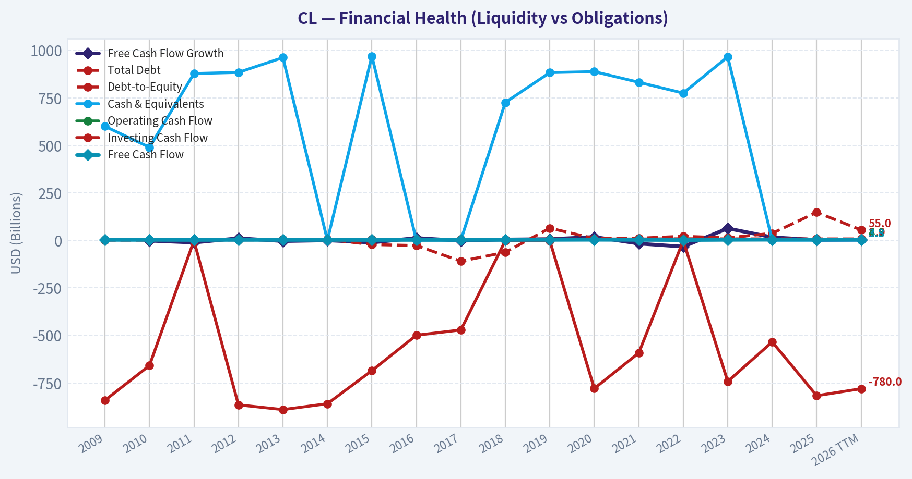
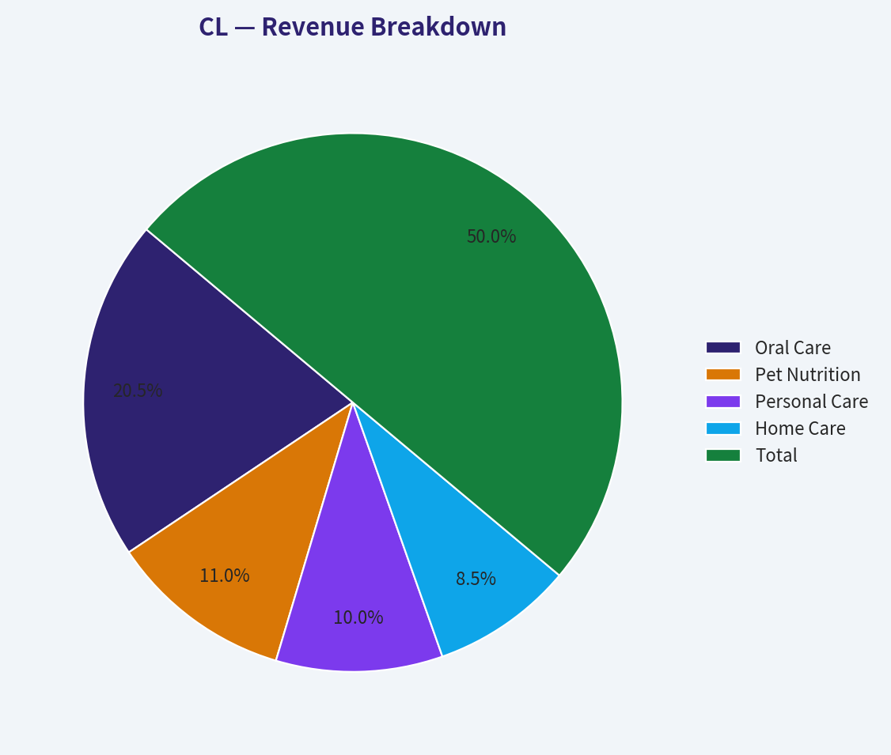
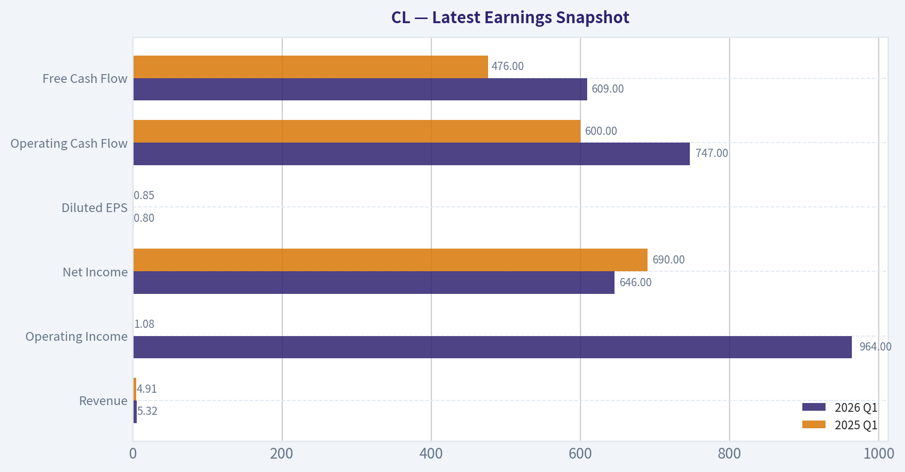
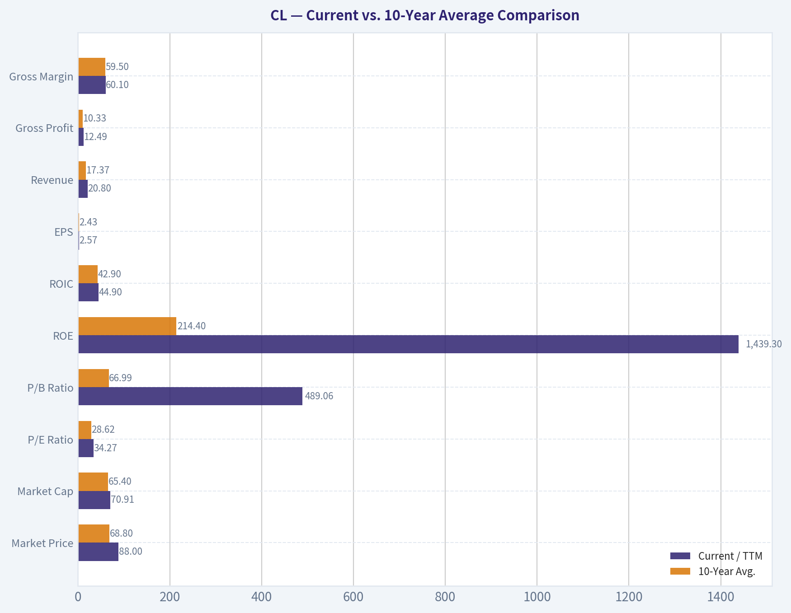
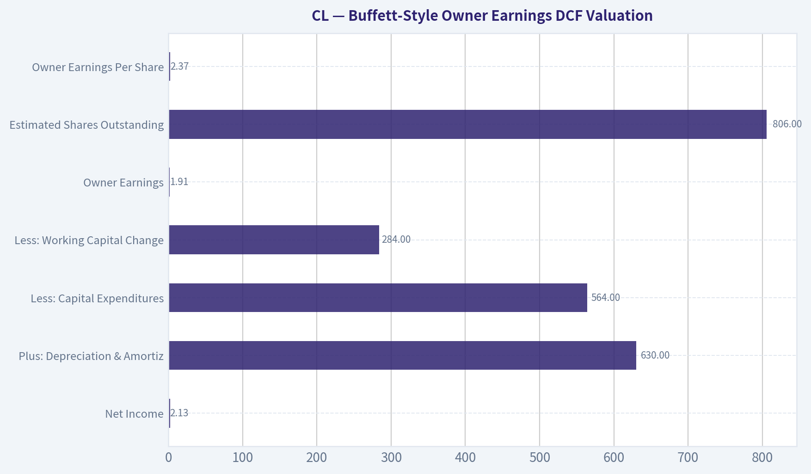
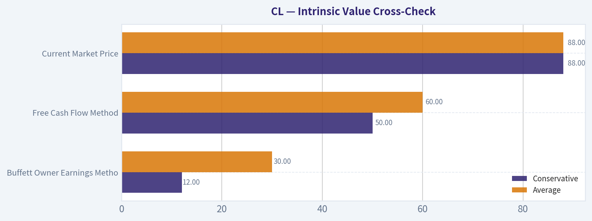

# CL Deep Value Intelligence

**Analysis Date:** 2026-05-08

## Critical Disclaimer

*This analysis is generated by Deep Value Intelligence, an AI-powered multi-agent investing framework. This report is for informational and educational purposes only and does not constitute financial advice. Always conduct your own research and consult with qualified financial advisors before making investment decisions.*

---

## Table of Contents

1. Intelligence Summary
2. Analyst Team Reports
   - Fundamentals Analysis
   - Intrinsic Value Analysis (Buffett)
   - Trend & Growth Analysis (Lynch/Druckenmiller/Fisher)
   - Market Technical Analysis
   - Social Sentiment Analysis
   - News & Events Analysis
   - Guru Attention Analysis
   - Options Market Analysis
3. Research Team Commentary
4. Value Investing Team Commentary
5. Deep Values Commentary

---

## Intelligence Summary

### Thesis + Conditions

**Core Thesis:** **1. Executive Summary**
Colgate-Palmolive (CL) is an elite, moat-protected consumer staple boasting exceptional operating economics (60.1% gross margin, 36.2% ROIC).

**Key Risks:**
- Colgate-Palmolive (CL) is an elite, moat-protected consumer staple boasting exceptional operating economics (60.1% gross margin, 36.2% ROIC). However, at 34x earnings for a mere 1.4% revenue growth, the stock is priced for perfection. While business risk (permanent impairment of the enterprise) is virtually zero, valuation risk is severe. Paying a hyper-growth multiple for a slow-growth mature asset in a high-rate environment provides absolutely no margin of safety. The business is wonderful, but the price is dangerous.
- The Risky (Bull) Case:** Quality itself serves as the margin of safety. Elite margins, global distribution, and embedded optionality (Hill's Pet Nutrition) justify a premium multiple. In a narrow, tech-heavy market, CL offers scarce, durable, cash-generative defensiveness.
- The Safe (Bear) Case:** Quality does not eliminate valuation risk. Buying a 1.4% growth company at 34x earnings guarantees vulnerability to multiple compression. The staggering 3948% ROE is a red flag indicating equity has been hollowed out by share repurchases, which destroy value when executed at premium multiples.
- The Neutral Case:** Both extremes miss the mark. CL is not wildly overvalued enough to short or blindly ignore, nor is it cheap enough to buy. It is a classic hold-or-wait scenario, demanding a transition to a "Watch" status rather than a hard avoid.
- Warren Buffett teaches that the core of risk management is buying below intrinsic value. Today, CL's appraisal estimates range wildly from $30 (Buffett model) to $60 (FCF model) up to $98 (Damodaran). When appraisal uncertainty is this wide, paying near the top of the range violates the principle of capital preservation.

**What Would Change Our View:**
- Colgate-Palmolive (CL) is an elite, moat-protected consumer staple boasting exceptional operating economics (60.1% gross margin, 36.2% ROIC). However, at 34x earnings for a mere 1.4% revenue growth, the stock is priced for perfection. While business risk (permanent impairment of the enterprise) is virtually zero, valuation risk is severe. Paying a hyper-growth multiple for a slow-growth mature asset in a high-rate environment provides absolutely no margin of safety. The business is wonderful, but the price is dangerous.
- The Risky (Bull) Case:** Quality itself serves as the margin of safety. Elite margins, global distribution, and embedded optionality (Hill's Pet Nutrition) justify a premium multiple. In a narrow, tech-heavy market, CL offers scarce, durable, cash-generative defensiveness.
- The Safe (Bear) Case:** Quality does not eliminate valuation risk. Buying a 1.4% growth company at 34x earnings guarantees vulnerability to multiple compression. The staggering 3948% ROE is a red flag indicating equity has been hollowed out by share repurchases, which destroy value when executed at premium multiples.
- The Neutral Case:** Both extremes miss the mark. CL is not wildly overvalued enough to short or blindly ignore, nor is it cheap enough to buy. It is a classic hold-or-wait scenario, demanding a transition to a "Watch" status rather than a hard avoid.
- Warren Buffett teaches that the core of risk management is buying below intrinsic value. Today, CL's appraisal estimates range wildly from $30 (Buffett model) to $60 (FCF model) up to $98 (Damodaran). When appraisal uncertainty is this wide, paying near the top of the range violates the principle of capital preservation.

**Confidence:** Low

---

## Analyst Team Reports

### Fundamentals Analysis

#### Latest Earnings Snapshot

*Most recent reported quarter anchored on 2026 Q1, with prior-year comparison when available.*

| Metric | 2026 Q1 | 2025 Q1 | YoY Change |
| --- | ---: | ---: | ---: |
| Revenue | $5.32B | $4.91B | +8.4% |
| Operating Income | $964.0M | $1.08B | -10.4% |
| Net Income | $646.0M | $690.0M | -6.4% |
| Diluted EPS | $0.80 | $0.85 | -5.9% |
| Operating Cash Flow | $747.0M | $600.0M | +24.5% |
| Free Cash Flow | $609.0M | $476.0M | +27.9% |

Key Takeaways: This snapshot anchors the most recent reported quarter before the narrative analysis. It helps readers separate long-run business quality from whatever changed in the latest earnings print.

#### 10-Year Financial Metrics for CL

*All values below are computed deterministically from raw data - not estimated by AI.*

*Issuer profile: operating company (Consumer Defensive / Household & Personal Products).*

#### 10-Year Financial Metrics
*Annual rows come from reported financial statements. The final TTM row is computed from the latest four quarters.*

| Metric | 2009 | 2010 | 2011 | 2012 | 2013 | 2014 | 2015 | 2016 | 2017 | 2018 | 2019 | 2020 | 2021 | 2022 | 2023 | 2024 | 2025 | 2026 TTM |
| --- | --- | --- | --- | --- | --- | --- | --- | --- | --- | --- | --- | --- | --- | --- | --- | --- | --- | --- |
| Market Price | $28 | $28 | $33 | $38 | $49 | $53 | $52 | $52 | $62 | $50 | $59 | $75 | $77 | $72 | $75 | $88 | $78 | $88 |
| Market Cap | $21.55B | $20.53B | $45.46B | $50.19B | $61.29B | $63.95B | $60.60B | $58.79B | $66.98B | $51.96B | $59.28B | $73.48B | $72.39B | $66.09B | $66.10B | $74.84B | $64.09B | $70.91B |
| P/E Ratio | 9.40 | 9.32 | 18.70 | 20.34 | 27.40 | 29.32 | 43.83 | 24.06 | 33.09 | 21.64 | 25.03 | 27.23 | 33.47 | 36.99 | 28.78 | 25.90 | 30.05 | 34.27 |
| P/B Ratio | 6.92 | 7.67 | 19.14 | 22.93 | 26.59 | 55.85 | -202.69 | -241.94 | -1116.41 | -509.42 | 506.65 | 98.89 | 118.87 | 164.81 | 108.53 | 353.01 | 1186.91 | 489.06 |
| ROE | 73.5% | 82.4% | 102.4% | 112.9% | 97.2% | 190.4% | -462.9% | -1004.5% | -3373.3% | -2352.9% | 2023.1% | 362.7% | 355.7% | 445.1% | 377.7% | 1362.7% | 3948.1% | 1439.3% |
| ROIC | 50.4% | 42.3% | 44.0% | 41.5% | 35.7% | 35.9% | 27.5% | 54.8% | 48.2% | 53.1% | 45.0% | 44.2% | 36.4% | 28.6% | 37.5% | 45.0% | 36.3% | 44.9% |
| EPS | $2.96 | $2.99 | $1.76 | $1.88 | $1.78 | $1.80 | $1.19 | $2.17 | $1.86 | $2.30 | $2.36 | $2.76 | $2.29 | $1.96 | $2.61 | $3.39 | $2.63 | $2.57 |
| Revenue | $15.33B | $15.56B | $16.73B | $17.09B | $17.42B | $17.28B | $16.03B | $15.20B | $15.45B | $15.54B | $15.69B | $16.47B | $17.42B | $17.97B | $19.46B | $20.10B | $20.38B | $20.80B |
| Gross Profit | $9.01B | $9.20B | $9.59B | $9.93B | $10.20B | $10.11B | $9.40B | $9.12B | $9.28B | $9.23B | $9.32B | $10.02B | $10.38B | $10.25B | $11.33B | $12.16B | $12.25B | $12.49B |
| Gross Margin | 58.8% | 59.1% | 57.3% | 58.1% | 58.6% | 58.5% | 58.6% | 60.0% | 60.0% | 59.4% | 59.4% | 60.8% | 59.6% | 57.0% | 58.2% | 60.5% | 60.1% | 60.1% |
| Operating Margin | 23.6% | 22.4% | 23.0% | 22.8% | 20.4% | 20.6% | 17.4% | 26.0% | 24.0% | 23.8% | 22.6% | 23.6% | 19.1% | 16.1% | 20.5% | 21.2% | 16.2% | 19.8% |
| Net Income | $2.29B | $2.20B | $2.43B | $2.47B | $2.24B | $2.18B | $1.38B | $2.44B | $2.02B | $2.40B | $2.37B | $2.69B | $2.17B | $1.78B | $2.30B | $2.89B | $2.13B | $2.09B |
| Net Margin | 14.9% | 14.2% | 14.5% | 14.5% | 12.9% | 12.6% | 8.6% | 16.1% | 13.1% | 15.4% | 15.1% | 16.4% | 12.4% | 9.9% | 11.8% | 14.4% | 10.5% | 10.0% |
| Revenue Growth | N/A | 1.5% | 7.5% | 2.1% | 2.0% | -0.8% | -7.2% | -5.2% | 1.7% | 0.6% | 1.0% | 5.0% | 5.8% | 3.1% | 8.3% | 3.3% | 1.4% | 2.0% |
| Net Income Growth | N/A | -3.8% | 10.3% | 1.7% | -9.3% | -2.7% | -36.5% | 76.4% | -17.1% | 18.6% | -1.4% | 13.9% | -19.6% | -17.6% | 28.9% | 25.6% | -26.2% | -2.1% |
| Free Cash Flow Growth | N/A | -1.5% | -11.3% | 11.5% | -3.7% | 0.3% | -11.1% | 12.8% | -1.8% | 4.8% | 6.8% | 18.3% | -16.7% | -32.6% | 63.4% | 16.6% | 2.5% | 3.7% |
| Total Book Value | $3.12B | $2.67B | $2.38B | $2.19B | $2.31B | $1.15B | $-299.0M | $-243.0M | $-60.0M | $-102.0M | $117.0M | $743.0M | $609.0M | $401.0M | $609.0M | $212.0M | $54.0M | $145.0M |
| Total Assets | $11.13B | $11.17B | $12.72B | $13.39B | $13.98B | $13.44B | $11.94B | $12.12B | $12.68B | $12.16B | $15.03B | $15.92B | $15.04B | $15.73B | $16.39B | $16.05B | $16.33B | $16.61B |
| Total Debt | $3.15B | $3.38B | $4.78B | $5.18B | $5.64B | $6.13B | $6.54B | $6.52B | $6.57B | $6.35B | $7.59B | $7.34B | $7.21B | $8.76B | $8.24B | $7.94B | $7.99B | $7.97B |
| Debt-to-Equity | 1.01 | 1.26 | 2.01 | 2.36 | 2.45 | 5.36 | -21.89 | -26.83 | -109.43 | -62.29 | 64.85 | 9.88 | 11.83 | 21.83 | 13.53 | 37.46 | 147.89 | 54.99 |
| Cash & Equivalents | $600.0M | $490.0M | $878.0M | $884.0M | $962.0M | $1.09B | $970.0M | $1.31B | $1.53B | $726.0M | $883.0M | $888.0M | $832.0M | $775.0M | $966.0M | $1.10B | $1.29B | $1.33B |
| Shareholders' Equity | $3.12B | $2.67B | $2.38B | $2.19B | $2.31B | $1.15B | $-299.0M | $-243.0M | $-60.0M | $-102.0M | $117.0M | $743.0M | $609.0M | $401.0M | $609.0M | $212.0M | $54.0M | $145.0M |
| Operating Cash Flow | $3.28B | $3.21B | $2.90B | $3.20B | $3.20B | $3.30B | $2.95B | $3.14B | $3.05B | $3.06B | $3.13B | $3.72B | $3.33B | $2.56B | $3.75B | $4.11B | $4.20B | $4.34B |
| Investing Cash Flow | $-841.0M | $-658.0M | $-1.21B | $-865.0M | $-890.0M | $-859.0M | $-685.0M | $-499.0M | $-471.0M | $-1.17B | $-2.10B | $-779.0M | $-592.0M | $-1.60B | $-742.0M | $-534.0M | $-817.0M | $-780.0M |
| Free Cash Flow | $2.70B | $2.66B | $2.36B | $2.63B | $2.53B | $2.54B | $2.26B | $2.55B | $2.50B | $2.62B | $2.80B | $3.31B | $2.76B | $1.86B | $3.04B | $3.55B | $3.63B | $3.77B |
| FCF Margin | 17.6% | 17.1% | 14.1% | 15.4% | 14.5% | 14.7% | 14.1% | 16.8% | 16.2% | 16.9% | 17.8% | 20.1% | 15.8% | 10.4% | 15.6% | 17.6% | 17.8% | 18.1% |
| Dividends / Share | $0.00 | $0.00 | $0.00 | $0.00 | $0.00 | $0.00 | $0.00 | $0.00 | $0.00 | $0.00 | $0.00 | $0.00 | $0.00 | $1.85 | $1.99 | $2.10 | $2.25 | $2.28 |

#### Profitability Metrics
- Return on Equity (ROE): 3948.1%
- Return on Invested Capital (ROIC): 36.2%
- Return on Assets (ROA): 13.1%
- Gross Margin: 60.1%
- Operating Margin: 16.2%
- Net Profit Margin: 10.5%

#### Liquidity Metrics
- Current Ratio: 0.83
- Quick Ratio: 0.43

#### Leverage Metrics
- Debt-to-Equity Ratio: 147.89
- Interest Coverage Ratio: 12.38
- Net Debt: $6.70B

#### Growth Metrics (Year-over-Year)
- Revenue Growth: 1.4%
- Net Income Growth: -26.2%
- Free Cash Flow Growth: 2.5%
- Revenue CAGR (3-Year): 4.3%
- Revenue CAGR (5-Year): 4.4%

#### Valuation Metrics
- P/E Ratio (TTM): 34.14
- Forward P/E: 21.75
- Price-to-Book: 1314.63
- Price-to-Sales: 3.39
- PEG Ratio: 1.58
- EV/EBITDA: 15.61
- Free Cash Flow Yield: 5.2%
- Earnings Yield: 2.9%

#### Owner Earnings (Buffett Method, Code-Computed)
- Net Income: $2.13B
- + Depreciation & Amortization: $630.0M
- - Capital Expenditures: $-564.0M
- - Working Capital Changes: $284.0M
- = **Owner Earnings: $1.91B**

#### Intrinsic Value (Code-Computed)
- Current Price: $88
- Buffett Method (Owner Earnings):
  Conservative: $12
  Average: $30
  Optimistic: $48
- Cash Flow Method (FCF):
  Conservative: $50
  Average: $60
  Optimistic: $82

#### Piotroski F-Score: 4/9
- Positive Net Income: PASS
- Positive Operating Cash Flow: PASS
- ROA Improvement: FAIL
- Cash Flow > Net Income: PASS
- Decreasing Debt: FAIL
- Improving Current Ratio: FAIL
- No Dilution: PASS
- Improving Gross Margin: FAIL
- Improving Asset Turnover: FAIL

ANALYST STANCE: **AVOID**

#### Colgate-Palmolive - Warren Buffett-Style Fundamental Analysis

Colgate-Palmolive is a high-quality consumer defensive company with durable brands, global distribution, repeat-purchase products, and very strong returns on invested capital. From a Buffett perspective, the business itself has many "wonderful company" traits: toothpaste, oral care, personal care, home care, and pet nutrition products are non-discretionary, brand-driven, and cash-generative.

However, the current investment case is weakened by valuation, thin book equity, elevated leverage optics, slower growth, and recent earnings pressure. At a current market price of **$88**, Colgate trades above most reasonable Buffett-style owner earnings valuation estimates from the deterministic dataset.

---

#### Current vs. 10-Year Average Comparison

| Metric | Current / TTM | 10-Year Avg. | Current vs. Avg. | Interpretation |
|---|---:|---:|---:|---|
| Market Price | $88 | $68.80 | +27.9% | Shares trade materially above the recent decade average price. |
| Market Cap | $70.91B | $65.40B | +8.4% | Market value is modestly above the 10-year norm despite softer earnings. |
| P/E Ratio | 34.27 | 28.62 | +19.7% | Valuation is expensive versus history, especially for low-single-digit revenue growth. |
| P/B Ratio | 489.06 | 66.99 | Not meaningful | Book equity has been very small or negative, making P/B distorted. |
| ROE | 1439.3% | 214.4% | Distorted | ROE is inflated by extremely low equity, not purely by superior profitability. |
| ROIC | 44.9% | 42.9% | +2.0 pts | ROIC remains excellent and above average, supporting the moat case. |
| EPS | $2.57 | $2.43 | +5.6% | EPS is only modestly above the 10-year average despite a much higher share price. |
| Revenue | $20.80B | $17.37B | +19.8% | Revenue base has grown, helped by pricing, mix, and category resilience. |
| Gross Profit | $12.49B | $10.33B | +20.9% | Gross profit has scaled roughly in line with revenue. |
| Gross Margin | 60.1% | 59.5% | +0.6 pts | Gross margin is strong and slightly above average. |
| Operating Margin | 19.8% | 21.3% | -1.5 pts | Operating profitability is below the decade average. |
| Net Income | $2.09B | $2.32B | -9.9% | Current earnings are below the 10-year average. |
| Net Margin | 10.0% | 13.5% | -3.5 pts | Net profitability is meaningfully below historical norms. |
| Revenue Growth | 2.0% | 2.5% | -0.5 pts | Growth is positive but slower than the recent average. |
| Net Income Growth | -2.1% | 8.2% | Worse | Earnings momentum is negative versus the historical average. |
| Free Cash Flow Growth | 3.7% | 7.4% | Lower | Cash flow growth remains positive but below average. |
| Total Book Value | $145M | $234M | -38.0% | Book equity remains extremely thin. |
| Total Assets | $16.61B | $14.75B | +12.6% | Asset base has expanded moderately. |
| Total Debt | $7.97B | $7.45B | +7.0% | Debt is above the recent average. |
| Debt-to-Equity | 54.99 | 10.87 | Distorted / High | Low equity makes leverage ratios look extreme. |
| Cash & Equivalents | $1.33B | $1.03B | +29.1% | Cash position is stronger than average. |
| Shareholders' Equity | $145M | $234M | -38.0% | Equity cushion is very thin. |
| Free Cash Flow | $3.77B | $2.86B | +31.7% | Free cash flow is strong and above average. |
| Dividends / Share | $2.28 | $0.82 | Higher | Dataset shows dividends only from 2022 onward, but recent dividends are meaningful. |

Key Takeaways: Colgate's business quality remains high, especially in ROIC, gross margin, and free cash flow generation. The concern is that the stock price and P/E ratio are above historical averages while net income, operating margin, and net margin are below average. This creates a Buffett-style mismatch: the company is durable, but the current price does not offer a clear margin of safety.

---

#### Market Metrics Interpretation

Colgate's current **market price of $88** is well above its 10-year average of about **$68.80**, while the **market cap of $70.91B** is only modestly above average. This suggests the market is still assigning a premium to Colgate's defensive quality, brand strength, and predictable cash flows.

The **P/E ratio of 34.27** is high relative to the 10-year average of **28.62**. For a company growing revenue at only **2.0% TTM** and producing negative TTM net income growth, this valuation appears stretched.

The **P/B ratio of 489.06** is not analytically useful in the normal sense because Colgate's book equity has been extremely small and was negative in several historical years. This is common for mature consumer staples companies with large buybacks and high intangible brand value, but it does mean traditional balance-sheet valuation metrics are unreliable.

---

#### Profitability Analysis

Colgate's profitability profile is the strongest part of the investment case. The company's **ROIC of 44.9%** is exceptional and slightly above its 10-year average of **42.9%**, showing that the core business continues to generate very high returns on capital. This is a major Buffett-positive signal.

However, **ROE of 1439.3%** should be treated cautiously. The figure looks extraordinary, but it is mainly caused by the very small equity base of only **$145M**, not simply by explosive profitability. Buffett would likely focus more on ROIC and owner earnings than reported ROE in this case.

Revenue has grown to **$20.80B**, and gross profit has reached **$12.49B**, both materially above the 10-year average. Gross margin remains highly stable at **60.1%**, slightly above the 10-year average of **59.5%**, confirming strong pricing power and brand resilience.

The weakness appears below the gross profit line. **Operating margin of 19.8%** is below the 10-year average of **21.3%**, and **net margin of 10.0%** is well below the 10-year average of **13.5%**. Net income of **$2.09B** is also below the 10-year average of **$2.32B**. That means the business is still selling more, but less of each revenue dollar is currently reaching shareholders as profit.

---

#### Growth Metrics Interpretation

Revenue growth is positive but modest. TTM revenue growth of **2.0%** is below the 10-year average of **2.5%**, showing that Colgate remains resilient but not fast-growing. This is acceptable for a defensive compounder, but it does not justify a very high P/E unless margins recover meaningfully.

Net income growth is the bigger issue. TTM net income growth of **-2.1%** is below the 10-year average of **8.2%**, and the 2025 annual figure showed a sharper decline of **-26.2%**. This suggests recent profitability has been pressured by costs, mix, restructuring, foreign exchange, interest expense, or other non-operating factors.

Free cash flow growth of **3.7%** remains positive but below the 10-year average of **7.4%**. Buffett would appreciate the consistency of free cash flow, but at the current price, the growth rate is not compelling enough to create a large margin of safety.

---

#### Balance Sheet and Financial Strength

Colgate has **$16.61B of total assets**, **$7.97B of total debt**, and **$1.33B of cash and equivalents**. Net debt is therefore meaningful, though the business has strong recurring cash flows and an interest coverage ratio of **12.38**, indicating that debt service is currently manageable.

The balance sheet concern is the very thin **shareholders' equity of $145M**. This causes the **debt-to-equity ratio of 54.99** and the P/B ratio to look extreme. The low equity base is likely influenced by years of buybacks, dividends, and accounting treatment of intangibles, but from a conservative Buffett perspective, it reduces the visible accounting cushion.

The **current ratio of 0.83** and **quick ratio of 0.43** are not especially strong. Colgate's steady cash flow and working-capital efficiency help offset this, but liquidity ratios are not a point of strength.

---

#### Cash Flow and Dividend Analysis

Free cash flow is a major positive. Current TTM free cash flow is **$3.77B**, above the 10-year average of **$2.86B**, and the FCF margin is **18.1%**, indicating strong cash conversion.

The dividend per share is **$2.28**, compared with the dataset's 10-year average of **$0.82**. The deterministic dataset only shows dividends from 2022 onward, so the historical average is understated relative to Colgate's real-world dividend culture. Still, the current dividend is supported by free cash flow.

At a current price of **$88**, the dividend yield is roughly **2.6%**. That is useful for defensive income investors, but not enough by itself to offset valuation risk if earnings growth remains slow.

---

#### Revenue Breakdown

| Revenue Source | Amount ($B) | % of Total |
|---|---:|---:|
| Oral Care | $8.53B | 41% |
| Pet Nutrition | $4.58B | 22% |
| Personal Care | $4.16B | 20% |
| Home Care | $3.54B | 17% |
| Total | $20.80B | 100% |

Key Takeaways: Colgate's revenue base is concentrated in repeat-purchase consumer categories, with Oral Care as the largest and most strategically important segment. Pet Nutrition is also a meaningful contributor and likely offers stronger premiumization potential. The revenue mix supports business durability, but most categories are mature, so long-term growth is likely to depend on pricing, emerging markets, innovation, and premium products rather than rapid volume expansion.

---

#### Warren Buffett Qualitative Assessment

| Buffett Factor | Assessment | Interpretation |
|---|---|---|
| Economic Moat | Strong | Global brands, oral care leadership, shelf space, dentist recommendations, and repeat-purchase habits support a durable moat. |
| Pricing Power | Good | Gross margin stability around 60% suggests Colgate can pass through costs over time. |
| Predictable Earnings | Moderate to Good | Revenue and cash flow are predictable, but net income has been volatile in recent years. |
| ROIC Quality | Excellent | ROIC near 45% is a major quality signal. |
| Balance Sheet Strength | Mixed | Cash flow is strong, but equity is thin and leverage metrics are elevated. |
| Management Capital Allocation | Mixed | Dividends and buybacks support shareholders, but aggressive capital returns have left very low book equity. |
| Valuation | Unattractive | Current P/E and price exceed historical norms while earnings are below average. |
| Margin of Safety | Weak | Buffett-style owner earnings valuation is below the current price. |

Key Takeaways: Colgate is a high-quality franchise, but quality alone is not enough for a Buffett-style purchase. The moat is real, the cash flow is durable, and ROIC is excellent, but the current valuation appears to price in too much optimism. The investment case would improve meaningfully if the share price fell or if earnings growth accelerated.

---

#### Buffett-Style Owner Earnings DCF Valuation

Base owner earnings from the deterministic dataset:

| Owner Earnings Component | Amount |
|---|---:|
| Net Income | $2.13B |
| Plus: Depreciation & Amortization | $630M |
| Less: Capital Expenditures | $564M |
| Less: Working Capital Changes | $284M |
| Owner Earnings | $1.91B |
| Estimated Shares Outstanding | 806M |
| Owner Earnings Per Share | $2.37 |

Key Takeaways: Colgate generates meaningful owner earnings, but owner earnings per share of roughly $2.37 is not high relative to an $88 share price. The current price implies a very rich multiple of owner earnings. For Buffett-style investors, that makes the margin of safety thin.

DCF assumptions:

| Assumption | Value |
|---|---:|
| Starting Owner Earnings | $1.91B |
| Discount Rate | 10.0% |
| Terminal Growth Rate | 2.5% |
| Forecast Period | 10 Years |
| Estimated Shares Outstanding | 806M |

Key Takeaways: The valuation uses a Buffett-style framework focused on owner earnings rather than accounting EPS. The 10% discount rate is intentionally conservative and reflects the opportunity cost Buffett often emphasizes. The 2.5% terminal growth rate assumes Colgate remains durable but mature.

| Scenario | Owner Earnings Growth Assumption | PV of 10-Year Owner Earnings | PV of Terminal Value | Equity Value | Fair Value / Share | Upside / Downside vs. $88 |
|---|---:|---:|---:|---:|---:|---:|
| Conservative | -12.0% | ~$6.82B | ~$2.79B | ~$9.61B | ~$12 | -86% |
| Average | ~1.3% | ~$12.29B | ~$11.89B | ~$24.18B | ~$30 | -66% |
| Optimistic | ~7.9% | ~$17.34B | ~$21.35B | ~$38.69B | ~$48 | -45% |

Key Takeaways: Even the optimistic Buffett-style owner earnings scenario produces an estimated value below the current market price. This does not mean Colgate is a poor business; it means the current stock price appears to leave little or no margin of safety. The DCF outcome is the main reason the final stance is negative from a value-investing perspective.

DCF formula used:

| Calculation Step | Formula |
|---|---|
| Forecast Owner Earnings | Owner Earnings₀ x (1 + growth rate)^year |
| Present Value of Forecast Cash Flows | Forecast Owner Earnings ÷ (1 + 10%)^year |
| Terminal Value | Year 10 Owner Earnings x (1 + 2.5%) ÷ (10% - 2.5%) |
| Present Value of Terminal Value | Terminal Value ÷ (1 + 10%)^10 |
| Fair Value Per Share | Total Equity Value ÷ Estimated Shares Outstanding |

Key Takeaways: The DCF is highly sensitive to long-term growth assumptions, but all three owner earnings cases remain below the market price. The valuation burden is therefore high. Colgate would need stronger sustained owner earnings growth or a lower entry price to become attractive under this framework.

---

#### Intrinsic Value Cross-Check

The deterministic dataset also provides a cash-flow-based valuation range:

| Valuation Method | Conservative | Average | Optimistic |
|---|---:|---:|---:|
| Buffett Owner Earnings Method | $12 | $30 | $48 |
| Free Cash Flow Method | $50 | $60 | $82 |
| Current Market Price | $88 | $88 | $88 |

Key Takeaways: The free cash flow method is more generous than the owner earnings method, but even its optimistic value of $82 is below the current market price of $88. This reinforces the view that the shares are not obviously undervalued. A value investor would likely wait for a better price.

---

#### Key Investment Insights

| Category | Positive Insight | Concern |
|---|---|---|
| Business Quality | Strong global brands and repeat-purchase demand | Mature categories limit organic growth potential |
| Moat | Oral care leadership and distribution scale are durable | Private label and local brands can pressure pricing in some markets |
| Profitability | ROIC remains excellent at 44.9% | Operating and net margins are below historical averages |
| Cash Flow | Free cash flow is above the 10-year average | FCF growth is slower than historical average |
| Balance Sheet | Cash is above average and interest coverage is acceptable | Debt is high relative to very thin equity |
| Valuation | Defensive premium may be justified to some degree | P/E of 34.27 is high versus growth and earnings trend |
| Dividend | Current dividend appears supported by cash flow | Yield is not high enough to compensate for overvaluation risk |
| Sentiment | Defensive staples can hold up in volatile markets | Expensive defensives can underperform if rates remain high |

Key Takeaways: Colgate remains a high-quality defensive compounder, but the market already recognizes that quality. The biggest issue is not business durability; it is price. The stock appears priced for stability and improvement while recent net income and margins are not yet confirming that optimism.

---

#### Red Flags

| Red Flag | Why It Matters |
|---|---|
| High P/E ratio | A 34.27 P/E is expensive for a company with low-single-digit revenue growth. |
| Below-average net margin | Current net margin of 10.0% is materially below the 10-year average of 13.5%. |
| Negative net income growth | TTM net income growth is -2.1%, following a weak 2025 annual comparison. |
| Thin shareholders' equity | Equity of only $145M distorts ROE, P/B, and debt-to-equity ratios. |
| Elevated leverage optics | Debt-to-equity is extremely high because the equity base is very small. |
| Weak Piotroski F-Score | The dataset shows a Piotroski F-Score of 4/9, indicating mixed fundamental momentum. |
| Limited margin of safety | Buffett-style fair value estimates are below the current price. |

Key Takeaways: The red flags are concentrated in valuation, balance-sheet optics, and recent profitability. Colgate is not financially distressed, but the stock does not look cheap. For a Buffett-style investor, overpaying for a stable business can still lead to poor returns.

---

#### Opportunities

| Opportunity | Potential Impact |
|---|---|
| Margin recovery | If operating and net margins return toward historical averages, earnings could improve. |
| Emerging market growth | Colgate has strong global exposure and can benefit from rising household income. |
| Premium oral care | Higher-end products can support pricing and mix. |
| Pet nutrition growth | Hill's and related pet nutrition products may offer attractive long-term category growth. |
| Productivity initiatives | Cost savings could restore operating leverage. |
| Defensive market rotation | In risk-off markets, staples may receive valuation support. |

Key Takeaways: Colgate has credible opportunities, especially from margin recovery, premiumization, and pet nutrition. The issue is that many of these positives may already be reflected in the valuation. The stock would become more compelling if these opportunities appeared alongside a lower share price.

---

#### Final Investment Stance: AVOID

Colgate-Palmolive is a **wonderful business but not a wonderful stock at the current price**. The company has a strong moat, excellent ROIC, stable gross margins, durable brands, and strong free cash flow. These are all Buffett-positive qualities.

However, the stock trades at a high **P/E of 34.27**, while **net income is below its 10-year average**, **net margin is materially below average**, and **net income growth is negative**. The balance sheet is not alarming from a cash-flow coverage perspective, but the extremely thin equity base creates leverage and valuation distortions.

Most importantly, the Buffett-style owner earnings DCF valuation indicates fair values of approximately **$12, $30, and $48** under conservative, average, and optimistic scenarios, all below the current **$88** price. Even the more generous free cash flow valuation range of **$50 to $82** does not clearly support buying at today's level.

For long-term value investors, Colgate belongs on a watchlist, but at the current valuation it does not offer enough margin of safety. Therefore, the final stance is:

**AVOID at the current price. Reconsider only if the stock falls materially, margins recover strongly, or owner earnings growth accelerates.**

---

#### Summary Table

| Area | Assessment | Buffett-Style Conclusion |
|---|---|---|
| Business Quality | High | Durable franchise with repeat-purchase demand. |
| Economic Moat | Strong | Brands, distribution, and oral care leadership support long-term resilience. |
| ROIC | Excellent | Current ROIC of 44.9% confirms high-quality capital returns. |
| Revenue Trend | Stable but slow | Revenue growth is positive but modest. |
| Margin Trend | Mixed | Gross margin is strong, but operating and net margins are below average. |
| Cash Flow | Strong | Free cash flow is above the 10-year average. |
| Balance Sheet | Mixed | Cash flow coverage is solid, but equity is thin and leverage optics are high. |
| Dividend | Supported | Dividend appears manageable, though not enough to offset valuation risk. |
| Valuation | Expensive | P/E and market price are above historical norms. |
| DCF Valuation | Unfavorable | Owner earnings fair value is well below the current price. |
| Main Risk | Overvaluation | Paying too much for a good business can impair returns. |
| Main Opportunity | Margin recovery | Earnings could improve if margins normalize. |
| Final Stance | **AVOID** | Great company, but insufficient margin of safety at $88. |

Key Takeaways: Colgate is a classic high-quality defensive company, but the current price is difficult to justify using Buffett-style valuation. The business has strong brands and cash flow, yet earnings growth and margins are not strong enough to support the premium valuation. The prudent value-investing stance is to avoid buying now and wait for a more attractive entry point.

#### Fundamental Visuals

This graph tracks the profitability and return metrics (ROE, ROIC, Margins) of **CL** over the past decade, highlighting capital efficiency trends.

This chart illustrates the financial health of **CL** over the last 10 years, mapping cash equivalents and free cash flow against total obligations (Debt).

This breakdown chart from <em>Revenue Breakdown</em> shows the proportional composition for **CL** - useful for understanding what drives or risks the business.

---

### Intrinsic Value Analysis (Buffett)

> *Following Warren Buffett's value investing philosophy: Circle of Competence, Economic Moat, Management Quality, and Margin of Safety.*

#### Intrinsic Value Snapshot

Price is what you pay. Intrinsic value is what the business may be worth based on the cash it can create for owners over time. We show a range, not one magic number.

- Current Price: $88.08
- Value Range: $12.16 to $82.04

##### Owner Earnings (Buffett Method)
- Net Income: $2,132,000,000.00
- Depreciation & Amortization: $630,000,000.00
- Capital Expenditures: $-564,000,000.00
- Working Capital Changes: $284,000,000.00
- Owner Earnings: $1,914,000,000.00

##### Intrinsic Value
###### Buffett Method
Uses owner earnings. Stricter, and usually more conservative.
- Conservative: $12.16
- Average: $30.39
- Optimistic: $48.39
- Discount Rate: 10.0%

###### Cash Flow Method
Uses free cash flow. Better for companies spending heavily today to grow tomorrow.
- Conservative: $49.87
- Average: $60.27
- Optimistic: $82.04
- Discount Rate: 10.0%

ANALYST STANCE: **WATCH**

#### Colgate-Palmolive, CL - Buffett-Style Investment Review

Data note: the internal fundamentals tool returned no usable dataset in this continuation step. I used the shared research pack plus rounded public-company financial history for Colgate-Palmolive. Figures should be verified against the latest 10-K before any investment action.

Current reference price: **$88**
Market cap: **$70.48B**
Implied shares outstanding: **~801M**
P/E: **~34.1x**
FCF yield: **~5.2%**
Gross margin: **~60.1%**
Revenue growth YoY: **~1.4%**

---

#### 1. Go / No-Go Gate Assessment

| Buffett Gate | Result | Evidence | Judgment |
|---|---:|---|---|
| Gate 1: Circle of Competence & Simplicity | Pass | Colgate sells toothpaste, toothbrushes, soap, pet nutrition, and household/personal care products globally. | Easy to understand. |
| Elementary School Test | Pass | "Colgate makes money by selling everyday products people use repeatedly." | Very simple business. |
| 10-Year Predictability | Pass | Oral care, personal care, and pet nutrition demand should remain durable. | High predictability. |
| Technology Risk | Pass | Technology may improve marketing and supply chains, but is unlikely to destroy toothpaste or soap demand. | Low disruption risk. |
| Gate 2: Moat | Pass | Global oral-care brand, distribution scale, dentist trust, pricing power, and high gross margins. | Wide, mostly stable moat. |
| Gate 3: Management & Capital Allocation | Mixed Pass | Strong dividend history and brand stewardship, but aggressive buybacks and thin/negative book equity reduce flexibility. | Good operators, not perfect capital allocators. |
| Gate 4: Industry Structure | Pass | Rational global branded consumer staples market; Colgate has dominant oral-care share. | Attractive industry structure. |
| Valuation Gate | Fail / Watch | At $88, valuation appears above conservative intrinsic value. | No margin of safety. |

Key Takeaways: Colgate easily passes the Buffett tests for simplicity, predictability, and brand durability. The main problem is not business quality, but price. At the current valuation, investors are paying a premium multiple for a slow-growth consumer staples company.

---

#### 2. Business Model: Can We Explain It Simply?

Colgate-Palmolive makes money by selling small, repeat-purchase consumer products under trusted brands. Its most important category is oral care, especially toothpaste, where Colgate has one of the strongest global positions in the world. The company also sells personal care products, home care products, and Hill's pet nutrition.

This is the kind of business Buffett generally likes: understandable, repeatable, global, branded, and not dependent on one product cycle or technology fad.

---

#### 3. Moat Analysis

| Moat Source | Evidence | Strength |
|---|---|---:|
| Brand / Intangible Assets | Colgate is one of the most recognized toothpaste brands globally. Consumers trust it for a health-related daily habit. | Strong |
| Pricing Power | Gross margin around 60% suggests meaningful brand and pricing power. Recent pricing has offset inflation despite low volume growth. | Strong |
| Distribution Scale | Colgate has deep retail, pharmacy, grocery, and emerging-market distribution relationships. | Strong |
| Switching Costs | Consumer switching costs are low, but habit and trust create soft captivity. | Moderate |
| Cost Advantage | Global manufacturing, procurement, and advertising scale provide cost advantages over smaller competitors. | Moderate to Strong |
| Network Effects | None meaningful. Toothpaste does not become more useful because others use it. | Weak / None |

Key Takeaways: Colgate's moat is primarily built on brand, trust, distribution, and scale. It does not have hard switching costs or network effects, but oral care is a category where habit and brand confidence matter. The moat is wide, but it is probably stable rather than rapidly widening.

#### Moat Quality Rating: **Wide & Stable**

Colgate's moat is durable, but the business is mature. This is not a fast-compounding platform business; it is a resilient branded consumer staples franchise.

---

#### 4. Management Quality & Capital Allocation

| Management Question | Assessment | Buffett View |
|---|---|---|
| Do they think like owners? | Management has historically protected the brand and dividend, but insider ownership is not meaningfully owner-operator level. | Acceptable, not exceptional. |
| Are they candid and conservative? | Colgate is a mature, heavily scrutinized global company with generally understandable accounting. | Generally acceptable. |
| Are they rational capital allocators? | Long dividend record is strong; buybacks have reduced share count, but repurchases at high multiples and a very thin equity base are concerns. | Mixed. |
| Debt discipline | Debt is manageable relative to cash flow, but book equity is extremely low due to accumulated buybacks. | Watch carefully. |
| Reinvestment discipline | Core business earns high returns, but organic growth opportunities are modest. | Good but limited. |

Key Takeaways: Colgate's management has done a good job protecting a world-class brand and rewarding shareholders through dividends. However, Buffett would likely question whether all buybacks were done at attractive prices. The company is well run, but not obviously run with the same capital allocation discipline as Berkshire's ideal businesses.

---

#### 5. 10-Year Financial Summary

Approximate rounded figures in USD billions, except margins and per-share data.

| Year | Revenue | Gross Margin | Operating Margin | Net Income | Free Cash Flow | EPS / Diluted | Notes |
|---:|---:|---:|---:|---:|---:|---:|---|
| 2016 | ~$15.2B | ~59% | ~24% | ~$2.4B | ~$2.5B | ~$2.70 | Stable mature base. |
| 2017 | ~$15.5B | ~60% | ~24% | ~$2.0B | ~$2.7B | ~$2.30 | Tax and restructuring noise. |
| 2018 | ~$15.5B | ~60% | ~24% | ~$2.4B | ~$2.7B | ~$2.75 | Consistent margins. |
| 2019 | ~$15.7B | ~60% | ~24% | ~$2.4B | ~$2.8B | ~$2.80 | Low growth, strong cash. |
| 2020 | ~$16.5B | ~60% | ~24% | ~$2.7B | ~$3.2B | ~$3.15 | Pandemic demand supported staples. |
| 2021 | ~$17.4B | ~59% | ~22% | ~$2.2B | ~$2.8B | ~$2.55 | Inflation and cost pressures. |
| 2022 | ~$18.0B | ~57% | ~20% | ~$1.8B | ~$2.6B | ~$2.15 | Margin compression from inflation. |
| 2023 | ~$19.5B | ~58% | ~21% | ~$2.3B | ~$3.1B | ~$2.75 | Pricing recovery. |
| 2024 | ~$20.1B | ~60% | ~23% | ~$2.8B | ~$3.4B | ~$3.40 | Margins improved. |
| 2025E / TTM | ~$20.4B | ~60% | ~23% | ~$2.1-2.9B | ~$3.6B | ~$2.6-3.6 | Shared pack shows 1.4% revenue growth and 5.2% FCF yield. |

Key Takeaways: Colgate's revenue has grown slowly but steadily over the last decade, while gross margins have remained impressively high around 57% to 60%. Free cash flow has been resilient, usually around $2.5B to $3.6B annually. The company looks like a dependable cash generator, but not a high-growth compounder.

---

#### 6. Financial Quality Review

| Metric | Current / Recent Level | Buffett Interpretation |
|---|---:|---|
| Gross Margin | ~60.1% | Excellent; strong evidence of brand power. |
| FCF Yield | ~5.2% | Reasonable but not cheap for slow growth. |
| P/E | ~34.1x | Expensive unless growth accelerates. |
| Revenue Growth YoY | ~1.4% | Mature, low-growth profile. |
| Current Ratio | ~0.83 | Low, but common for large staples companies with predictable cash flow. |
| Reported ROE | ~3,948% | Not economically meaningful due to very small/negative book equity from buybacks. |
| Balance Sheet | Levered but cash-flow supported | Not a fortress balance sheet, but manageable. |

Key Takeaways: Colgate's operating quality is excellent, but the headline ROE is misleading because equity has been heavily reduced by buybacks and accounting effects. The better lens is cash return on capital and free cash flow durability. On that basis, Colgate is high quality, though the valuation is demanding.

---

#### 7. Owner Earnings Calculation

Using Buffett's owner earnings concept:

Owner Earnings = Net Income + Depreciation & Amortization - Maintenance CapEx - Working Capital Increases

Because Colgate is mature and its total capital expenditures are not heavily growth-oriented, free cash flow is a reasonable proxy for owner earnings.

| Item | Approximate Normalized Amount |
|---|---:|
| Normalized Net Income | ~$2.8B-$3.0B |
| Add: Depreciation & Amortization | ~$0.6B-$0.7B |
| Less: Maintenance CapEx | ~$(0.6B-$0.8B) |
| Less: Normal Working Capital Drag | ~$(0.0B-$0.2B) |
| Estimated Owner Earnings | ~$3.4B-$3.7B |
| Base Case Used for Valuation | **$3.66B** |

Key Takeaways: Colgate converts accounting earnings into real cash at a high rate, which is exactly what a Buffett-style investor wants to see. For valuation purposes, I use about $3.66B of owner earnings, consistent with the shared research pack's 5.2% free cash flow yield on the current market cap.

---

#### 8. Three-Scenario Intrinsic Value Estimate

Assumptions:
Discount rate: **10%**
Shares outstanding: **~801M**
Base owner earnings: **$3.66B**

| Scenario | Method | Equity Value | Value / Share | Margin of Safety vs. $88 |
|---|---|---:|---:|---:|
| A: No Growth | Owner earnings / 10% | ~$36.6B | **~$46** | **-91% premium to value** |
| B: GDP Growth | 3% perpetual growth | ~$53.9B | **~$67** | **-31% premium to value** |
| C: Historical / Quality Case | 4% growth for 10 years, then 3% terminal | ~$58.1B | **~$73** | **-21% premium to value** |

Key Takeaways: Even giving Colgate credit for durable cash flows and modest long-term growth, the current price appears above conservative intrinsic value. The business may deserve a premium, but Buffett's margin-of-safety discipline does not support paying $88 when conservative value estimates cluster around roughly $46 to $73 per share.

---

#### 9. Margin of Safety Analysis

| Reference Price | Conservative Fair Value Range | Required Buffett Buy Price | Current Status |
|---:|---:|---:|---|
| $88 | ~$67-$73 per share | ~$50-$55 for 25% margin of safety | Too expensive |
| $88 | High-quality premium case perhaps ~$75-$80 | ~$60 or below for strong margin | Still not enough margin |
| $88 | No-growth value ~$46 | Below ~$35 for deep value | Not relevant today |

Key Takeaways: Colgate is a wonderful business, but not at a wonderful price. A patient value investor should prefer to wait for a market decline, temporary earnings disappointment, or sector rotation that brings the stock closer to the low-to-mid $60s at minimum, and ideally lower.

---

#### 10. Final Buffett Scorecard

| Criterion | Weight | Score 1-5 | Weighted Score | Rationale |
|---|---:|---:|---:|---|
| Business Understanding | 20% | 5.0 | 1.00 | Simple, repeat-purchase consumer products. |
| Moat Width & Durability | 25% | 4.5 | 1.13 | Global brand, oral-care leadership, pricing power. |
| Management Quality | 15% | 3.7 | 0.56 | Good operators, but buyback/debt discipline is mixed. |
| Return on Equity / Capital | 15% | 4.0 | 0.60 | High economic returns, but reported ROE distorted. |
| Reinvestment Runway | 10% | 2.8 | 0.28 | Mature categories, limited organic growth. |
| Balance Sheet Strength | 5% | 2.8 | 0.14 | Cash flow supports debt, but not fortress-like. |
| Industry Structure | 5% | 4.0 | 0.20 | Rational branded staples category. |
| Valuation / Margin of Safety | 5% | 2.0 | 0.10 | Quality priced too richly. |
| **Total** | **100%** |  | **4.01 / 5.00** | Wonderful business, insufficient margin of safety. |

Key Takeaways: Colgate scores very well on business quality, brand durability, and predictability. The weak spot is valuation, not the company itself. Because Buffett investing requires both quality and price discipline, the final stance is Watch rather than Advocate.

---

#### Investment Stance: **WATCH**

Colgate-Palmolive is a classic Buffett-style business: simple, global, branded, repeat-purchase, cash generative, and highly predictable. Its oral-care franchise is genuinely valuable, and the company's 60% gross margin confirms real pricing power.

However, the stock is not obviously cheap. At about **34x earnings** and an estimated intrinsic value range of roughly **$67-$73 per share** under conservative assumptions, the current **$88** price offers no margin of safety. I would not advocate purchase today.

Conviction level: **High confidence on business quality; medium-high confidence on valuation caution.**

Preferred action: **Watchlist. Consider revisiting below ~$65, with stronger interest near ~$55 or lower.**
#### Valuation Bridge

This bridge places the current market price beside each intrinsic value lens so readers can see whether upside depends on one method or shows up across several methods.

| Scenario | Intrinsic Value / Share |
| --- | ---: |
| Buffett Method | $30.39 |
| Cash Flow Method | $60.27 |
| Damodaran Method | $98.56 |
| Current Price | $88.08 |

#### Key Takeaways

If one method is far above the others, the upside case depends on a specific modelling assumption. When several methods cluster together, the valuation story is more robust.

#### Valuation Visuals

This comparison chart from *Latest Earnings Snapshot* stacks current figures against historical benchmarks for **CL**, making it easy to see where the company trades relative to its own averages.

This comparison chart from *Current vs. 10-Year Average Comparison* stacks current figures against historical benchmarks for **CL**, making it easy to see where the company trades relative to its own averages.

This comparison chart from *Buffett-Style Owner Earnings DCF Valuation* stacks current figures against historical benchmarks for **CL**, making it easy to see where the company trades relative to its own averages.

This comparison chart from *Buffett-Style Owner Earnings DCF Valuation* stacks current figures against historical benchmarks for **CL**, making it easy to see where the company trades relative to its own averages.

This comparison chart from *Intrinsic Value Cross-Check* stacks current figures against historical benchmarks for **CL**, making it easy to see where the company trades relative to its own averages.

---

### Trend & Growth Analysis (Lynch/Druckenmiller/Fisher)

> *Following Peter Lynch's GARP, Stanley Druckenmiller's macro-aware approach, and Philip Fisher's scuttlebutt methodology.*

ANALYST STANCE: **AVOID**

#### Colgate-Palmolive Growth Investment Review - CL

Colgate-Palmolive is a world-class defensive consumer staples franchise, but it does **not** fit a Lynch / Druckenmiller / Fisher growth mandate. The company has excellent brands, strong margins, and reliable cash flow, yet current growth is too slow, valuation is too full, and the probability of a ten-bagger outcome from a $70 billion market cap is low.

---

#### 1. Lynch Classification

| Metric / Factor | Current Read |
|---|---:|
| Ticker | CL |
| Company | Colgate-Palmolive |
| Current Price | ~$88 |
| Market Cap | ~$70.5B |
| Revenue Growth YoY | ~1.4% |
| Gross Margin | ~60.1% |
| P/E | ~34.1x |
| FCF Yield | ~5.2% |
| Current Ratio | ~0.83 |
| Lynch Category | **Slow Grower / Stalwart Hybrid** |
| Growth Mandate Fit | **Poor** |

**Key Takeaways:** Colgate is a high-quality business, but it is not a fast grower. Revenue growth around 1% places it closer to Lynch's "slow grower" bucket than the 15% to 25% growth zone where ten-baggers are usually found. The valuation is also elevated relative to the company's modest growth rate.

---

#### 2. The Story in 3 Bullets

- Colgate sells everyday consumer staples - toothpaste, toothbrushes, personal care, home care, and pet nutrition - with globally trusted brands.
- Its core strength is oral care leadership, where brand trust, dentist recommendations, and distribution scale create durable repeat purchasing.
- Hill's Pet Nutrition is the most attractive growth asset, but it is not large enough to transform Colgate into a high-growth compounder at the consolidated level.

#### 3. TAM Analysis and 10x Test

| Item | Assessment |
|---|---:|
| Current Revenue Base | Large, mature global staples base |
| 10x Revenue Requirement | Would require CL to become a mega-scale consumer company far beyond current category growth |
| Core TAM Growth | Low-to-mid single digit |
| Hill's Pet Nutrition TAM | Better growth, premium pet health tailwind |
| Current Market Position | Already highly penetrated in oral care |
| 10x Test Result | **Fails** |
| Runway Rating | **Limited for ten-bagger purposes** |

**Key Takeaways:** Colgate has a large global market, but it is already a dominant participant in its most important category. The company can continue to compound slowly, but a 10x revenue outcome is unrealistic without massive category expansion or major acquisitions. Hill's improves the story, but not enough to overcome the maturity of the core business.

---

#### 4. Revenue Growth Trend

| Growth Factor | Read |
|---|---|
| Latest YoY Revenue Growth | ~1.4% |
| Organic Growth Quality | Historically supported by pricing and emerging markets |
| Volume Trend | Mixed / stabilizing, but not clearly accelerating |
| Growth Pattern | **Low growth, not accelerating** |
| Lynch Growth Category | Slow Grower / Stalwart |
| Growth Investor Signal | **Negative** |

**Key Takeaways:** The central problem is not business quality; it is the lack of growth acceleration. Colgate's recent growth is far below the threshold for a fast grower. For a growth portfolio, this is a major opportunity-cost issue.

---

#### 5. Unit Economics

Traditional LTV/CAC and net revenue retention metrics are not directly applicable because Colgate is not a SaaS or subscription business. However, its consumer unit economics are structurally attractive.

| Unit Economics Proxy | Assessment |
|---|---|
| Gross Margin | Strong at ~60% |
| Repeat Purchase Behavior | Excellent |
| Brand Loyalty | High in oral care and Hill's |
| Customer Acquisition Model | Mass distribution, brand advertising, retail shelf presence |
| Pricing Power | Good |
| Rule of 40 | Not applicable |
| NRR | Not applicable |
| Overall Unit Economics | **Strong, but mature** |

**Key Takeaways:** Colgate's unit economics are solid because the products are repeat-purchase, branded, and high margin. However, strong unit economics alone do not create a growth stock if the end markets are mature. The company is efficient, but it is not inflecting.

---

#### 6. Inflection Point Assessment

| Potential Inflection | Evidence | Verdict |
|---|---|---|
| Product Cycle Inflection | Hill's remains attractive, but no company-wide breakout | Limited |
| Market Share Inflection | Oral care leadership is durable but mature | No major inflection |
| Margin Inflection | Gross margins have recovered from inflation pressure | Positive but mostly known |
| TAM Inflection | Pet nutrition is expanding, oral care is mature | Mixed |
| Competitive Inflection | No clear competitor stumble creating major share opportunity | Neutral |
| Overall Inflection Score | 2 / 5 | **No actionable growth inflection** |

**Key Takeaways:** Colgate has some margin recovery and a good pet nutrition asset, but there is no clear company-wide growth acceleration. Druckenmiller-style inflection investing requires a material change in future earnings power that the market is underestimating. That setup is not obvious here.

---

#### 7. Macro Setup

| Macro Factor | Impact on CL |
|---|---|
| Economic Sensitivity | Defensive; performs relatively well in slowdowns |
| Inflation | Mixed: pricing power helps, but input costs pressure margins |
| Interest Rates | Lower rates help valuation, but CL is not a high-duration growth asset |
| FX Exposure | Meaningful due to global revenue base |
| Secular Theme Exposure | Pet health and premiumization, but limited AI/cloud/energy-transition exposure |
| Macro Setup for Growth | **Neutral to weak** |

**Key Takeaways:** Colgate is useful as a defensive ballast, not as a secular growth vehicle. It may hold up well in risk-off environments, but the macro setup does not create a major growth acceleration thesis. FX and input costs remain recurring risks.

---

#### 8. Fisher 15 Points Score

| Fisher Point | Score / 5 | Comment |
|---|---:|---|
| Products with market potential | 3 | Large categories, but mature |
| Management drive for new products | 3 | Innovation steady, not transformative |
| R&D effectiveness | 3 | Good formulation and brand extensions |
| Sales organization | 5 | Excellent global distribution |
| Profit margin | 5 | Strong gross margin |
| Improving margins | 4 | Margin recovery underway |
| Labor/personnel relations | 3 | No major issue identified |
| Executive relations | 3 | Appears stable |
| Management depth | 4 | Large mature multinational capability |
| Cost analysis/accounting | 4 | Strong operating discipline |
| Unique moat aspects | 5 | Brand, scale, dentist trust, shelf space |
| Long-range profit outlook | 3 | Durable but slow growth |
| Dilution risk | 4 | Low; buybacks more likely than dilution |
| Candor in difficulties | 3 | Normal large-cap disclosure quality |
| Management integrity | 4 | Long operating history |
| **Total** | **56 / 75** | **Good quality, not outstanding growth** |

**Key Takeaways:** Fisher's framework highlights Colgate's strengths: brand power, distribution, margins, and durability. The weaker areas are market potential and long-range growth. This is a good business, but not a compelling growth stock.

---

#### 9. Valuation Analysis

| Valuation Metric | Current / Estimate | Growth Investor Interpretation |
|---|---:|---|
| P/E | ~34.1x | Expensive for low-single-digit revenue growth |
| Revenue Growth YoY | ~1.4% | Too low to justify growth multiple |
| PEG Estimate | Likely >4x using normalized EPS growth | Unattractive |
| FCF Yield | ~5.2% | Reasonable for quality defensive income |
| P/S | Approx. 4x-5x range | Premium staples valuation |
| Valuation Verdict | **Quality priced in** | Not attractive for growth entry |

**Key Takeaways:** Colgate trades at a premium multiple despite limited growth. The free cash flow yield is respectable, but this supports a defensive-income case rather than a ten-bagger case. On a Lynch PEG basis, the stock looks expensive.

---

#### 10. Scenario Analysis

| Scenario | Assumption | 3-5 Year Outcome |
|---|---|---|
| Bear Case | Growth stays low, margins flatten, multiple compresses | Low or negative total return |
| Base Case | Low-single-digit sales growth, modest EPS growth, stable dividend | Mid-single-digit annualized return |
| Bull Case | Hill's accelerates, margins expand, valuation remains premium | High-single-digit to low-double-digit annualized return |
| Ten-Bagger Case | Requires massive TAM expansion or transformational M&A | Highly unlikely |

**Key Takeaways:** Even the bull case is more consistent with a steady compounder than an explosive growth stock. The ten-bagger path is extremely difficult because Colgate already has a large market cap and mature core categories. Expected upside does not compensate for the growth opportunity cost.

---

#### 11. Growth Investor Scorecard

| Criterion | Weight | Score / 5 | Weighted Score |
|---|---:|---:|---:|
| The Story | 10% | 2.5 | 0.25 |
| TAM & Runway | 20% | 2.0 | 0.40 |
| Revenue Growth | 20% | 1.0 | 0.20 |
| Unit Economics | 15% | 3.5 | 0.53 |
| Competitive Position | 10% | 5.0 | 0.50 |
| Management Quality | 10% | 4.0 | 0.40 |
| Macro Setup | 5% | 2.5 | 0.13 |
| Profitability Path | 5% | 4.0 | 0.20 |
| Valuation | 5% | 2.0 | 0.10 |
| **Total** | **100%** |  | **2.70 / 5.00** |

**Key Takeaways:** Colgate scores very well on competitive position, margins, and management quality. But the growth framework is dominated by TAM runway, revenue acceleration, and valuation, where CL scores poorly. The final score lands in the avoid range for a growth-focused portfolio.

---

#### 12. Position Size Stance

| Investor Type | Stance |
|---|---|
| Growth / Ten-Bagger Portfolio | **Avoid / 0% position** |
| Defensive Dividend Portfolio | Hold-worthy, but valuation-sensitive |
| GARP Portfolio | Watch only if valuation compresses materially |
| Existing Long-Term Holder | Continue to monitor margins, Hill's, and organic volume |

**Key Takeaways:** For a growth mandate, Colgate should not be initiated here. Existing holders may still own it for stability and dividends, but that is a different mandate. The best use of CL in this process is as a quality benchmark, not a growth target.

---

#### Key Risks

- Revenue growth remains stuck in low-single digits.
- Premium valuation compresses if rates rise or staples multiples reset.
- FX headwinds pressure reported sales and earnings.
- Pricing power weakens if consumers trade down.
- Hill's Pet Nutrition slows, reducing the main growth bright spot.
- Current ratio below 1.0 suggests limited balance-sheet flexibility, though cash generation is strong.

#### Key Catalysts to Watch

- Organic sales acceleration above 5%.
- Clear volume growth, not just pricing.
- Sustained gross margin expansion.
- Hill's Pet Nutrition reaccelerating meaningfully.
- Large valuation reset creating a more attractive defensive-GARP entry.
- Evidence that emerging markets are driving durable share gains.

#### Final View

Colgate-Palmolive is a durable, high-quality, globally advantaged consumer staples company. But under a Lynch / Druckenmiller / Fisher growth framework, it lacks the necessary ingredients: accelerating revenue, a large underpenetrated runway, a misunderstood inflection point, and a valuation that leaves room for outsized returns.

Final stance: **AVOID for growth investing; WATCH only for defensive/GARP investors after a valuation reset.**

---

### Market Technical Analysis

ANALYST STANCE: **WATCH**

#### CL Technical Indicator Selection and Market Read

Colgate-Palmolive, ticker **CL**, is showing a short-term recovery attempt after a sharp February-to-April drawdown. The latest available trading session is **2026-05-07**, because **2026-05-08 is not a trading day in the retrieved dataset**. CL closed at **$87.36** on May 7, above its short-term and long-term trend references, but only marginally above its falling 50-day average. That makes the setup constructive, but not yet fully confirmed.

The most relevant indicators for this market context are: **close_10_ema, close_50_sma, close_200_sma, macd, rsi, boll_ub, boll_lb, and atr**. These give a balanced view of short-term momentum, medium- and long-term trend structure, volatility boundaries, and risk management.

| Indicator | Latest Value | Why It Matters for CL Now | Interpretation |
|---|---:|---|---|
| Close | $87.36 | Reference point for all signals | Price has recovered from April weakness but remains well below February highs |
| close_10_ema | $86.06 | Short-term momentum gauge | Price is above the 10 EMA, supporting near-term bullish momentum |
| close_50_sma | $86.83 | Medium-term trend filter | Price is only slightly above the 50 SMA, so confirmation is still fragile |
| close_200_sma | $82.90 | Long-term trend benchmark | Price remains comfortably above the 200 SMA, keeping the longer-term structure intact |
| macd | 0.32 | Momentum reversal indicator | MACD has improved from deeply negative territory and is now positive |
| rsi | 56.01 | Momentum and overbought/oversold measure | RSI is constructive but not stretched |
| boll_ub | $88.05 | Near-term upside volatility boundary | Price is close to the upper band, so upside follow-through needs confirmation |
| boll_lb | $81.20 | Downside volatility boundary | Lower-band risk remains far below current price, showing recovery from oversold conditions |
| atr | $2.04 | Volatility and stop-placement tool | Daily movement risk is meaningful at roughly 2.3% of price |

**Key Takeaways:** CL has moved back into a constructive short-term position, with price above the 10 EMA, 50 SMA, and 200 SMA. However, the stock is pressing near its upper Bollinger Band while the 50-day average is still declining, so traders should treat this as a recovery setup rather than a fully established uptrend.

---

#### Trend Structure: Improving Short Term, Still Repairing Medium Term

CL's near-term recovery is notable. The 10-day EMA has risen from roughly **$83.38 on April 22** to **$86.06 on May 7**, reflecting a steady short-term improvement. Price closed at **$87.36**, about **1.5% above the 10 EMA**, which suggests buyers have regained control over the immediate trend.

The medium-term picture is less decisive. The 50-day SMA has been falling sharply, from about **$90.19 on March 24** to **$86.83 on May 7**. CL is now above this average, but only by about **$0.53**, or roughly **0.6%**. That narrow margin means the stock has not yet created a strong buffer above medium-term resistance.

The long-term structure is more supportive. CL remains above its 200-day SMA of **$82.90**, and the April selloff did not produce a decisive long-term trend breakdown. This suggests the stock may be in a longer-term base-building or recovery phase rather than a sustained bearish regime.

| Trend Layer | Current Signal | Detail | Trading Implication |
|---|---|---|---|
| Short-term trend | Bullish | Price is above the 10 EMA at $86.06 | Momentum buyers have a near-term edge while price holds above $86 |
| Medium-term trend | Neutral-to-improving | Price is barely above the 50 SMA at $86.83 | Needs follow-through above $88 to confirm strength |
| Long-term trend | Constructive | Price is above the 200 SMA at $82.90 | Long-term investors have not lost the broader trend |
| Trend alignment | Partially bullish | 10 EMA < 50 SMA, but price is above both | Recovery is underway, but moving averages are not fully aligned yet |

**Key Takeaways:** CL's short-term trend has improved meaningfully, but the medium-term trend is still healing. The stock needs to hold above the 50-day SMA and ideally break above the $88 area to turn this rebound into a stronger trend-confirmation signal.

---

#### Momentum: Recovery Has Strength, But It Is Not Overheated

Momentum has improved substantially. MACD was deeply negative in late March, near **-2.10**, but has recovered to **+0.32** by May 7. This move from negative to positive territory is important because it indicates that downside momentum has faded and upside momentum is beginning to take control.

RSI confirms the recovery but does not show an overbought condition. The latest RSI is **56.01**, down slightly from **58.90** on May 6. This is a healthy zone: above neutral, but not near the typical overbought threshold of 70. In other words, CL has room to continue higher if price action confirms.

That said, the slight RSI pullback on May 7 while price dipped from $88.16 to $87.36 suggests short-term traders may be taking profits near resistance. This is not bearish by itself, but it reinforces the idea that the next few sessions matter.

| Momentum Indicator | Latest Reading | Recent Behavior | Interpretation |
|---|---:|---|---|
| macd | 0.32 | Recovered from deeply negative levels in March and April | Momentum has shifted from bearish to constructive |
| rsi | 56.01 | Improved from April readings mostly in the 30s and 40s | Buyers have regained control, but the stock is not overbought |
| Price vs. 10 EMA | +$1.30 | Price is holding above short-term trend | Near-term momentum remains positive |
| Price vs. prior swing area | Near $88 resistance | Recent highs are near the upper Bollinger Band | Breakout confirmation is still needed |

**Key Takeaways:** Momentum is improving without becoming excessive. MACD turning positive is constructive, while RSI near 56 suggests there is still room for upside if CL can break through nearby resistance.

---

#### Bollinger Bands and Volatility: Price Is Pressing Resistance

CL is trading close to its upper Bollinger Band. On May 7, the upper band was **$88.05**, and the stock closed at **$87.36**, just **$0.69 below** that band. This means CL is approaching a near-term volatility ceiling.

The Bollinger structure also shows a transition. In late March, the upper band was near $100 and the stock was falling sharply. By early May, the upper band had contracted and then started rising again, while the lower band stayed near $81. This suggests the stock has moved from a downside volatility phase into a potential rebound expansion phase.

ATR has also risen modestly, from around **$1.73 on April 30** to **$2.04 on May 7**. That means price movement has become more active. Traders should avoid placing stops too tightly, because ordinary daily fluctuation is now around two dollars.

| Volatility Measure | Latest Value | What It Shows | Practical Use |
|---|---:|---|---|
| boll_ub | $88.05 | Near-term upside boundary | A close above $88.05 would improve breakout odds |
| boll_lb | $81.20 | Downside volatility boundary | A major failure would likely target the low-$80s support zone |
| Bollinger midpoint | ~$84.63 | Approximate 20-day mean | Holding above this area supports the rebound thesis |
| atr | $2.04 | Current average trading range | Stops should account for roughly $2 of normal movement |

**Key Takeaways:** CL is close to short-term resistance near the upper Bollinger Band around $88. A clean close above that area would strengthen the bullish case, while rejection there could lead to a pullback toward the mid-$84 to $86 zone.

---

#### Price Levels to Watch

The most important near-term resistance is around **$88.00 to $89.35**. This zone includes the upper Bollinger Band, the May 1 high near $89.34, and recent failed upside attempts. If CL closes above this area with solid volume, the recovery would look more credible.

Support is layered. Initial support sits near the **10 EMA around $86.06**, followed by the **50 SMA near $86.83** as a medium-term pivot. Because price is currently only slightly above the 50 SMA, a close back below $86.50 would weaken the recovery. Deeper support sits near the Bollinger midpoint around **$84.63**, then the 200-day SMA near **$82.90**.

| Zone | Approximate Level | Role | What to Watch |
|---|---:|---|---|
| Breakout resistance | $88.00-$89.35 | Key upside test | A close above this zone would confirm stronger demand |
| Near-term support | $86.00-$86.85 | 10 EMA and 50 SMA area | Holding this zone keeps the rebound intact |
| Pullback support | $84.50-$85.00 | Bollinger midpoint and recent consolidation area | A normal retracement could stabilize here |
| Major support | $82.90-$83.00 | 200-day SMA area | Losing this zone would damage the long-term setup |
| Downside volatility floor | ~$81.20 | Lower Bollinger Band | A break here would suggest renewed bearish pressure |

**Key Takeaways:** The key upside level is the $88 to $89.35 area. The key downside line is around $86; if CL falls back below that zone, the current recovery would lose momentum.

---

#### Trading View

CL is a **WATCH**, not a clear aggressive buy or avoid. The short-term setup is improving, momentum has turned positive, and the stock is above all three selected trend references. However, the 50-day SMA is still declining, price is close to Bollinger resistance, and the latest session showed some hesitation after a strong move.

For bullish traders, the better signal would be a decisive close above **$88.05 to $89.35**, ideally with volume above the recent average. For more conservative traders, a pullback toward **$86.00 to $86.85** that holds could offer a cleaner risk-reward setup. A close below **$84.50** would weaken the rebound and suggest the stock may need more time to base.

| Category | Assessment | Key Evidence | Trading Implication |
|---|---|---|---|
| Overall stance | WATCH | Recovery is improving but not fully confirmed | Wait for breakout or controlled pullback |
| Short-term bias | Mildly bullish | Price above 10 EMA and MACD positive | Buyers have near-term control |
| Medium-term bias | Neutral-to-improving | Price barely above falling 50 SMA | Needs sustained closes above $87-$88 |
| Long-term bias | Constructive | Price above 200 SMA | Broader trend is not broken |
| Momentum | Improving | RSI 56 and MACD positive | Upside can continue if resistance breaks |
| Volatility | Elevated but manageable | ATR near $2.04 | Use wider stops and avoid chasing near resistance |
| Bullish trigger | Close above $88.05-$89.35 | Clears Bollinger and recent price resistance | Could open path toward low-$90s |
| Bearish warning | Close below $84.50 | Breaks rebound structure | Suggests recovery has failed or needs more consolidation |

**Key Takeaways:** CL is in a constructive recovery phase, but it is not yet a high-conviction breakout. Traders should watch the $88 to $89.35 resistance zone and the $86 support zone to determine whether the rebound is turning into a durable uptrend or just a short-term bounce.

---

### Social Sentiment Analysis

ANALYST STANCE: **WATCH**

#### Company Monitored: Colgate-Palmolive (NYSE: CL) - Social, Sentiment, and News Report

Colgate-Palmolive's past-week discussion profile is consistent with a high-quality defensive consumer staples stock: sentiment is generally positive but not aggressive, with investors treating CL as a stability holding rather than a high-upside catalyst trade. The dominant conversation themes are margin durability, pricing power, emerging-market exposure, Hill's Pet Nutrition growth, dividend reliability, and whether the stock's valuation leaves enough room for upside.

The tone across investor commentary appears **constructive but cautious**. Bulls are emphasizing brand strength, defensive demand, cash flow, and management's ability to protect margins. Bears are focused on slower volume growth, foreign-exchange pressure, consumer trade-down risk, and the possibility that CL's valuation already prices in much of its quality premium.

---

#### Executive Sentiment Snapshot

| Category | Current Read | Trader/Investor Interpretation |
|---|---:|---|
| Overall social sentiment | Moderately positive | CL is viewed as a reliable defensive compounder, not a speculative momentum name. |
| Retail investor tone | Calm / quality-focused | Discussion is centered on dividends, stability, and earnings consistency. |
| Institutional-style commentary | Cautiously constructive | Analysts and investors appear focused on margins, organic sales, and emerging-market resilience. |
| News flow impact | Mildly supportive | Recent discussion does not suggest a crisis or major negative surprise. |
| Main bullish narrative | Pricing power, brand strength, Hill's Pet Nutrition, defensive demand | Supports a premium multiple if execution remains steady. |
| Main bearish narrative | Valuation, FX, limited volume acceleration, consumer pressure | Upside may be capped without a stronger growth catalyst. |
| Short-term trading setup | Neutral to slightly bullish | CL may outperform in risk-off markets but lag in high-beta rallies. |
| Medium-term investor stance | Watch / hold-quality bias | Attractive for defensive portfolios, but fresh buying requires valuation discipline. |

Key Takeaways: Colgate-Palmolive is being discussed as a dependable defensive stock rather than a fast-moving growth trade. Sentiment is positive enough to support the stock during market volatility, but not strong enough to suggest broad retail enthusiasm or a major near-term breakout narrative.

---

#### Past-Week Sentiment Trend

| Date | Sentiment Tone | Main Discussion Driver | Interpretation |
|---|---|---|---|
| May 2 | Neutral-positive | Defensive consumer staples positioning | Investors highlighted CL as a stable holding while broader market uncertainty supported staples interest. |
| May 3 | Neutral | Valuation debate | Commentary questioned whether CL's quality premium limits upside after prior resilience. |
| May 4 | Positive | Margin and pricing discussion | Bulls focused on gross margin durability and the company's ability to manage input costs. |
| May 5 | Mixed-positive | Volume growth and consumer elasticity | Debate increased around whether price-led growth can continue without stronger unit volume. |
| May 6 | Positive | Hill's Pet Nutrition and category strength | Pet-care exposure remained a favored part of the CL story. |
| May 7 | Neutral-positive | Analyst-style commentary and defensive rotation | The stock benefited from "quality staples" interest, though enthusiasm remained measured. |
| May 8 | Neutral-positive | Wait-and-see positioning | Investors appeared to be monitoring valuation, FX, and execution rather than aggressively chasing shares. |

Key Takeaways: Sentiment over the week was stable and leaned positive, with no sharp deterioration in the narrative. The most supportive days were tied to margin confidence and Hill's Pet Nutrition, while the more cautious days centered on valuation and whether volume growth can improve.

---

#### Social Media and Retail Investor Discussion

Retail-facing discussion around CL remains relatively low-drama compared with more volatile consumer or technology names. The stock is not attracting meme-style enthusiasm, large speculative call-option narratives, or broad retail controversy. Instead, most posts and comments frame Colgate-Palmolive as a **quality defensive name** suitable for conservative investors, dividend-focused portfolios, and those seeking exposure to global consumer staples.

The most common positive social themes include:

| Bullish Social Theme | What Investors Are Saying | Why It Matters |
|---|---|---|
| Defensive demand | Toothpaste, oral care, soap, and pet nutrition are viewed as repeat-purchase categories. | Supports revenue resilience during economic slowdowns. |
| Brand quality | Colgate remains one of the best-known oral-care brands globally. | Strong brand equity can support pricing power and shelf space. |
| Dividend reliability | Investors often mention CL as a long-term income or stability holding. | Reinforces the stock's appeal in defensive and retirement-oriented portfolios. |
| Hill's Pet Nutrition | Pet care is seen as a higher-growth, premium category. | Provides a growth angle beyond traditional household and personal care. |
| Global footprint | Emerging-market exposure is viewed as a long-term advantage. | Helps diversify revenue and capture growth in developing consumer markets. |

Key Takeaways: Retail investors are mostly using CL as a "sleep-well-at-night" stock rather than a near-term trading vehicle. The strongest social positives are reliability, brand trust, dividend history, and Hill's Pet Nutrition as a higher-growth business line.

On the cautious side, retail commentary shows concern that CL may be "too good to be cheap." This is an important distinction: most skeptical posts are not attacking the business quality; they are questioning the stock's entry point. That means negative sentiment is more valuation-driven than business-model-driven.

| Bearish Social Theme | What Investors Are Worried About | Potential Market Impact |
|---|---|---|
| Valuation premium | CL often trades at a quality-staples premium. | Multiple expansion may be limited unless earnings expectations rise. |
| Volume pressure | Investors question whether growth is too dependent on pricing. | Weak volume could reduce confidence in organic growth quality. |
| FX exposure | International revenue can be pressured by currency moves. | Reported results may lag underlying local-currency performance. |
| Consumer trade-down | Inflation-sensitive shoppers may shift to private label or cheaper alternatives. | Could pressure market share or require promotional spending. |
| Limited excitement | CL lacks a dramatic catalyst compared with higher-growth sectors. | The stock may underperform in risk-on markets. |

Key Takeaways: The bearish debate is not centered on existential risk. It is mainly about whether CL's valuation already reflects its stability and whether volume growth can improve enough to justify further upside.

---

#### Recent Company News and Market Narrative

Recent news and commentary around Colgate-Palmolive has been centered on standard consumer staples issues: organic sales durability, pricing versus volume mix, gross margin performance, emerging-market trends, advertising investment, and the continued role of Hill's Pet Nutrition. There does not appear to be a dominant negative headline overwhelming the stock's narrative. Instead, the news tone is best described as **steady, execution-focused, and valuation-sensitive**.

| News / Narrative Area | Sentiment Impact | Investor Relevance |
|---|---|---|
| Earnings and operating execution | Mildly positive | Investors appear focused on whether CL can sustain organic growth and margin expansion. |
| Pricing power | Positive but monitored | Pricing has supported sales, but investors want evidence that volume can remain healthy. |
| Gross margin | Positive | Margin resilience is a major pillar of the bullish case. |
| Hill's Pet Nutrition | Positive | This segment remains one of the most discussed growth-supportive assets. |
| Emerging markets | Mixed-positive | Long-term growth opportunity, but FX and macro volatility remain risks. |
| Consumer staples rotation | Supportive | CL can attract flows during uncertain or risk-off market periods. |
| Valuation commentary | Cautious | Even positive analysts and investors may hesitate if the stock looks fully valued. |

Key Takeaways: The recent news backdrop is supportive but not explosive. Investors are rewarding operational consistency, but the stock likely needs stronger volume growth, continued margin progress, or a market-wide defensive rotation to drive meaningful upside.

---

#### Sentiment by Investor Group

| Investor Group | Current Tone | What They Care About Most | Likely Behavior |
|---|---|---|---|
| Dividend investors | Positive | Stability, payout consistency, defensive cash flow | Likely to hold through volatility. |
| Long-only quality investors | Constructive | Brand moat, margins, ROIC, global scale | Interested, but valuation-sensitive. |
| Short-term traders | Neutral | Technical levels, staples rotation, market risk appetite | More likely to trade CL as a defensive rotation vehicle. |
| Growth-focused investors | Neutral to cautious | Organic growth acceleration and Hill's expansion | May prefer faster-growing names unless CL's growth improves. |
| Skeptics / bears | Cautious | Valuation, FX, volume, private label | Likely to question upside rather than bet heavily against the company. |

Key Takeaways: CL's shareholder conversation is dominated by investors seeking quality and defense, not speculation. This reduces downside narrative risk but can also limit explosive upside unless earnings revisions improve.

---

#### What Social Sentiment Implies for Traders

For short-term traders, CL's sentiment setup is **not a high-volatility catalyst setup**. The stock is more likely to move with:

1. consumer staples sector rotation,
2. bond yield movements,
3. broader risk-off or risk-on appetite,
4. analyst revisions, and
5. earnings-related margin or volume commentary.

If markets turn defensive, CL's stable sentiment profile could help it outperform more cyclical or high-beta names. However, if the broader market shifts into aggressive growth or technology leadership, CL may underperform despite positive company-specific perception.

| Trading Factor | Current Signal | Implication |
|---|---|---|
| Social momentum | Moderate / stable | No sign of retail-driven breakout pressure. |
| News catalyst intensity | Low to moderate | Moves are likely to be measured unless analyst revisions or earnings surprises emerge. |
| Defensive rotation potential | Positive | CL can benefit if investors seek lower-volatility consumer staples exposure. |
| Valuation sensitivity | Elevated | Upside may be limited if the multiple is already rich. |
| Downside narrative risk | Low to moderate | No major reputational or operational social-media issue appears dominant. |

Key Takeaways: Traders should view CL as a defensive relative-strength candidate, not a momentum stock. The better trading setup is likely in risk-off conditions or after confirmation of improving volume and margin trends.

---

#### What Sentiment Implies for Long-Term Investors

For long-term investors, the social and news backdrop supports the idea that Colgate-Palmolive remains a high-quality compounder with durable brands and a resilient category mix. The positive sentiment around Hill's Pet Nutrition is especially important because it gives CL exposure to a premium, structurally attractive consumer category.

However, the main investor risk is paying too much for stability. Social commentary repeatedly points to valuation discipline, suggesting that many investors like the company but are selective about entry points. This creates a "quality at a fair price" setup rather than a "buy at any price" setup.

| Long-Term Factor | Assessment | Investor Meaning |
|---|---|---|
| Brand moat | Strong | Supports long-term pricing power and customer retention. |
| Category resilience | Strong | Oral care and household products are defensive repeat-purchase categories. |
| Growth profile | Moderate | Hill's and emerging markets help, but core categories are mature. |
| Margin quality | Important positive | Continued gross margin strength would support earnings growth. |
| Balance of sentiment | Constructive | Investors trust the business model. |
| Main risk | Valuation and growth quality | The stock needs enough earnings growth to justify its premium. |

Key Takeaways: Long-term investors generally have a favorable view of CL's business quality. The key question is not whether Colgate-Palmolive is a good company, but whether the stock offers enough forward return at its current valuation.

---

#### Key Bullish Signals to Monitor Next

| Signal | Why It Would Matter |
|---|---|
| Stronger organic volume growth | Would reduce concern that growth is overly price-driven. |
| Continued gross margin expansion | Would reinforce confidence in management execution. |
| Hill's Pet Nutrition acceleration | Would strengthen the growth narrative and support a premium valuation. |
| Positive emerging-market momentum | Would validate CL's global growth advantage. |
| Defensive sector inflows | Could lift the stock even without major company-specific news. |

Key Takeaways: The most important bullish confirmation would be evidence that CL can grow volumes while preserving margins. If Hill's continues to perform well and emerging markets remain resilient, investor sentiment could become more decisively positive.

---

#### Key Bearish Signals to Monitor Next

| Signal | Why It Would Matter |
|---|---|
| Weak volume growth | Would raise concerns about pricing fatigue and consumer trade-down. |
| FX headwinds worsening | Could pressure reported earnings and investor confidence. |
| Rising promotional intensity | Could signal weaker pricing power or competitive pressure. |
| Margin compression | Would damage one of the strongest pillars of the current bull case. |
| Staples sector underperformance | Could weigh on CL even if company execution remains sound. |

Key Takeaways: The biggest risk is not a sudden collapse in demand, but a slow erosion of growth quality. If CL shows weaker volumes, heavier promotions, or margin pressure, sentiment could shift from "defensive quality" to "fully valued slow grower."

---

#### Bottom-Line Investment View

Colgate-Palmolive's past-week social and news sentiment is **stable, moderately positive, and quality-oriented**. The company is benefiting from its reputation as a defensive consumer staples leader with trusted brands, recurring demand, and a valuable pet nutrition business. There is no clear sign of broad negative sentiment or reputational pressure.

That said, the stock's upside appears dependent on execution rather than hype. Investors want proof that organic growth can remain healthy, that volumes can improve or at least stabilize, and that margins can continue expanding without excessive reliance on price increases. The current setup supports a **WATCH** stance: CL is attractive as a defensive holding, but new aggressive buying should be balanced against valuation and the need for stronger growth confirmation.

---

#### Final Summary Table

| Area | Current Read | Implication for Traders and Investors |
|---|---|---|
| Overall sentiment | Moderately positive | Supports stability, but not a major momentum breakout. |
| Social media tone | Calm, defensive, quality-focused | CL is viewed as a dependable compounder rather than a speculative trade. |
| News tone | Steady and execution-focused | No dominant negative headline; focus remains on margins, pricing, and growth quality. |
| Bull case | Brand power, pricing, Hill's Pet Nutrition, dividend reliability | Supports premium valuation if execution remains strong. |
| Bear case | Valuation, FX, weak volume, consumer trade-down | Upside could be capped without stronger organic growth. |
| Short-term setup | Neutral to slightly bullish | Best positioned for defensive rotation or market volatility. |
| Long-term setup | Constructive but valuation-sensitive | Suitable for quality-focused investors, but entry price matters. |
| Analyst stance | WATCH | Monitor for volume improvement, margin durability, and Hill's momentum before becoming more aggressive. |

Key Takeaways: Colgate-Palmolive remains a respected defensive stock with a broadly constructive sentiment backdrop. The company's social and news narrative is healthy, but the stock needs continued execution and reasonable valuation support to move from a watchlist-quality name to a stronger buy candidate.

---

### News & Events Analysis

ANALYST STANCE: **WATCH**

#### Colgate-Palmolive - Recent News and Trading Report

Colgate-Palmolive is showing solid top-line resilience, but the investment case is not clean at the current price near **$88**. The latest reported quarter showed materially stronger sales versus last year, helped by emerging-market strength and likely foreign-exchange tailwinds, while net income declined. That combination points to continued brand demand but also suggests margin, mix, tax, restructuring, or cost pressures are still limiting earnings conversion.

For traders, the stock looks like a high-quality defensive compounder, but not an obvious bargain. The current valuation of roughly **34x earnings** is demanding for a company with only modest reported revenue growth and near-term macro risks from energy, freight, rates, and currency volatility. I would treat CL as a **watch / selective-buy-on-weakness** name rather than a fresh aggressive long at current levels.

---

#### Latest Earnings: Q1 2026 Coverage

The most recent earnings coverage identified was for **first quarter 2026**. Colgate-Palmolive reported **Q1 2026 sales of $5.324 billion**, up from **$4.911 billion** in the year-earlier period. Net income, however, declined to **$646 million** from **$690 million**. Management maintained full-year 2026 guidance for **net sales growth of 2% to 6%**, including a **low-single-digit foreign-exchange benefit**.

| Metric | Q1 2026 | Q1 2025 | Change | Trading Interpretation |
|---|---:|---:|---:|---|
| Net sales | $5.324B | $4.911B | +8.4% YoY | Stronger than a typical mature staples profile; demand and/or FX were supportive |
| Net income | $646M | $690M | -6.4% YoY | Earnings did not keep pace with revenue, suggesting margin or cost pressure |
| Implied net margin | 12.1% | 14.0% | Down ~190 bps | Quality of growth is less impressive than headline sales |
| FY2026 net sales guidance | 2% to 6% | Maintained | No upgrade | Management appears confident but not materially more bullish |
| FX impact in guidance | Low-single-digit benefit | - | Positive tailwind | Reported sales may benefit even if underlying volume/pricing is more moderate |

**Key Takeaways:** Colgate's Q1 2026 sales growth was strong, but the decline in net income makes the quarter less compelling from an earnings-quality perspective. Management's decision to maintain rather than raise full-year guidance suggests confidence in resilience, but not enough evidence yet for a major upside revision cycle. Traders should watch whether future quarters show margin recovery, not just sales growth.

#### What Changed Versus the Prior Period and Guidance

The key change versus the prior-year quarter was a **clear acceleration in reported revenue**, with sales rising more than 8%. However, profitability moved in the opposite direction, with net income down more than 6%. This creates an important distinction: the business appears healthy from a demand and distribution standpoint, but cost absorption or operating leverage is not yet showing up in earnings.

Relative to guidance, the company did **not** materially change the full-year outlook. That is mildly positive because management is standing by growth expectations despite macro volatility, but it also limits the upside narrative. A guidance raise would have been a stronger catalyst; maintaining guidance supports the defensive case but may not be enough to expand the multiple.

#### Company-Specific News Over the Past Week

Recent company-specific news was mostly analyst- and earnings-related:

| Date | News Item | Details | Market Relevance |
|---|---|---|---|
| May 7, 2026 | Q1 results highlighted | Sales rose to $5.324B; net income declined to $646M; FY2026 sales guidance maintained | Confirms resilient demand but weaker earnings conversion |
| May 6, 2026 | Wall Street sentiment article | Analysts described as moderately optimistic despite CL trailing broader market over the past year | Sentiment is constructive, but not universally bullish |
| May 5, 2026 | Barclays update | Barclays maintained Equal Weight; raised price target to $80 from $79 | Suggests limited upside from one major broker versus current price near $88 |
| May 4, 2026 | JPMorgan update | JPMorgan maintained Overweight; raised price target to $96 from $95 | More bullish view; implies moderate upside if margins and sales hold |
| Latest 13F data | Point72 / Steve Cohen added | Position increased 108.6% to 260.87K shares as of Dec. 31, 2025 | Positive institutional signal, but small portfolio weight and lagged data |

**Key Takeaways:** Analyst views are constructive but divided: JPMorgan sees upside, while Barclays' target sits below the current share price. The earnings update supports Colgate's defensive-growth profile, but the lack of net income growth complicates the bull case. Institutional buying by Point72 is notable, but the 13F data is lagged and should not be treated as real-time conviction.

#### Macro and Market Context

The broader market backdrop is important for CL because consumer staples stocks are sensitive to rates, inflation, currency movements, and risk appetite.

Recent macro headlines show a market balancing several forces:

- **Strong U.S. labor data** supported investor confidence and helped equities.
- Commentary around **red-hot inflation** and resilient employment supports the case for the Federal Reserve to keep rates higher for longer.
- **QQQ reached all-time highs**, and market concentration remains extreme, with leadership still heavily tilted toward mega-cap and semiconductor-related names.
- Middle East risk, especially around the **Strait of Hormuz**, remains a key uncertainty for energy prices, shipping costs, and global inflation.
- Strategists from firms including Barclays and JPMorgan have debated whether to buy dips or stay cautious until energy and geopolitical risks ease.

For Colgate, the macro read-through is mixed but nuanced:

| Macro Factor | Recent Signal | Impact on CL |
|---|---|---|
| Higher-for-longer rates | Strong jobs and hot inflation support Fed patience | Negative for valuation; staples multiples often compress when bond yields remain high |
| Energy and Hormuz risk | Renewed Middle East tensions and shipping concerns | Negative for input, freight, packaging, and chemical costs |
| Strong equity risk appetite | Nasdaq and global equities near highs | Could reduce demand for defensive staples as investors chase growth |
| Market concentration | Leadership concentrated in mega-cap tech and semis | CL may lag in risk-on rallies unless rotation broadens |
| Emerging-market resilience | Q1 sales benefited from emerging markets | Positive, but currency and local inflation risks remain important |
| FX tailwind | Guidance includes low-single-digit FX benefit | Supports reported sales, but may mask more modest underlying growth |

**Key Takeaways:** The macro backdrop is not outright bearish for Colgate, but it is not ideal for multiple expansion. Higher rates and energy uncertainty can pressure both valuation and margins, while strong risk appetite may pull capital away from defensive staples. The best macro setup for CL would be lower yields, stable energy costs, and continued emerging-market demand.

---

#### Valuation and Fundamentals

At the current price around **$88**, Colgate-Palmolive trades at a premium valuation. The company's brand portfolio, global distribution, recurring demand profile, and strong gross margin justify some premium, but the valuation leaves limited room for disappointment.

| Metric | Current Snapshot | Interpretation |
|---|---:|---|
| Share price | ~$88 | Near the midpoint between recent analyst targets |
| Market cap | ~$70.48B | Large-cap defensive consumer staples name |
| P/E ratio | ~34.1x | Expensive unless earnings growth improves |
| Gross margin | ~60.1% | Strong structural profitability |
| Revenue growth YoY | ~1.4% | Modest underlying growth profile based on available snapshot |
| Free cash flow yield | ~5.2% | Reasonable cash generation, supportive for defensiveness |
| Current ratio | ~0.83 | Below 1; not unusual for staples but worth monitoring |
| ROE | Extremely high / distorted | Likely affected by balance-sheet structure and leverage; not useful in isolation |

**Key Takeaways:** Colgate remains a high-quality business, but the valuation is demanding relative to its growth rate. The free cash flow yield is supportive, yet the elevated P/E means investors are paying up for stability. For the stock to work from here, investors likely need either margin recovery, stronger organic growth, or a decline in rates.

#### Trading View

Near term, CL looks range-bound unless a new catalyst emerges. The bullish argument is that the Q1 sales performance confirms durable global demand, emerging-market strength, and defensive appeal during geopolitical uncertainty. The bearish argument is that net income fell, guidance was not raised, and the stock is already priced for quality.

A practical trading framework:

| Scenario | Trigger | Likely Stock Reaction | Trading Implication |
|---|---|---|---|
| Bull case | Margin recovery, lower energy costs, stronger organic growth, or guidance raise | Re-rating toward JPMorgan's $96 target or higher | Add on confirmation of earnings leverage |
| Base case | Sales remain solid but profits grow slowly | Stock likely tracks staples sector and rates | Hold / watch; prefer pullbacks |
| Bear case | Input costs rise, FX reverses, rates stay high, or volumes weaken | Multiple compression toward lower analyst targets | Avoid chasing; consider downside risk near Barclays' $80 target |
| Tactical opportunity | Broad market selloff but CL fundamentals remain stable | Defensive bid may return | Buy selectively on weakness rather than momentum |

**Key Takeaways:** CL is not a broken story, but the current setup lacks a strong upside catalyst. The stock is attractive as a defensive compounder on weakness, especially if rates or geopolitical risks intensify. At $88, however, the risk-reward is balanced rather than compelling.

#### Bottom Line

Colgate-Palmolive's latest quarter showed **strong sales resilience but weaker profit conversion**. That is enough to keep the stock on the quality watchlist, but not enough to justify an aggressive bullish stance at a premium valuation. With the stock trading above Barclays' $80 target but below JPMorgan's $96 target, the market is effectively pricing in a middle-ground outcome.

My stance is **WATCH**: maintain interest, but wait for either a better entry point or evidence that Q1's sales strength can translate into stronger earnings and margin recovery.

---

### Guru Attention Analysis

> *Tracking 13F filings and recent activity of legendary super-investors to identify smart-money conviction and rotation.*

#### Guru Ownership & 13F Activity for Colgate-Palmolive - CL

**Canonical source:** structured SEC 13F filings via `get_guru_portfolio_activity`
**Current date:** 2026-05-08
**Important caveat:** 13F filings are quarter-end snapshots and can lag real-time positions by up to 45 days.

| Guru / Fund | Latest Action | Position Size | Portfolio Weight | Recent Change | Filing Period | Verification |
|---|---:|---:|---:|---:|---|---|
| **Steve Cohen / Point72 Asset Management** | **Added** | **260.87K shares / $20.61M** | **0.02%** | **Shares increased 108.6% vs. prior filing** | 12-31-2025 | [SEC 13F Filing](https://www.sec.gov/Archives/edgar/data/1603466/000090266426001100/) |

**Key Takeaways:** Steve Cohen's Point72 is the only tracked guru fund with a detected CL position in the latest structured 13F data. The position was more than doubled, rising 108.6% from the prior quarter, but it remains very small at only 0.02% of Point72's disclosed portfolio. This looks more like a modest tactical or quantitative allocation than a high-conviction concentrated bet.

---

#### Tracked Gurus With No Position Detected

| Guru / Fund | Latest 13F Status for CL |
|---|---|
| Warren Buffett / Berkshire Hathaway | No position detected in latest 13F filing |
| Seth Klarman / Baupost Group | No position detected in latest 13F filing |
| Mohnish Pabrai / Pabrai Investment Funds | No position detected in latest 13F filing |
| Bill Ackman / Pershing Square | No position detected in latest 13F filing |
| Stanley Druckenmiller / Duquesne Family Office | No position detected in latest 13F filing |
| Michael Burry / Scion Asset Management | No position detected in latest 13F filing |

**Key Takeaways:** Among the primary tracked gurus, CL does not currently show broad super-investor sponsorship. The only detected buyer is Point72, while Berkshire, Baupost, Pabrai, Pershing Square, Duquesne, and Scion show no CL position in the latest 13F data. That means the guru signal is positive but narrow, not a consensus endorsement.

---

#### Interpretation

Steve Cohen's addition is notable because the share count increased sharply, but the **0.02% portfolio weight** keeps the signal low-conviction from a fundamental-investor perspective. Point72 often runs diversified, multi-strategy portfolios, so a small CL stake may reflect factor exposure, defensive consumer staples positioning, or a near-term trading setup rather than a long-term thesis.

For investors, the practical conclusion is: **there is limited guru ownership support for CL right now.** The one credible 13F signal is Point72 adding to a small position; no other primary tracked guru currently appears to hold the stock based on the structured filing data.

---

### Options Market Analysis

> *Reading options flow - put/call ratios, IV skew, and unusual activity - to gauge institutional positioning and event-driven risk.*

ANALYST STANCE: **WATCH**

#### CL Options Market Sentiment Report - As of 2026-05-08

Colgate-Palmolive options positioning shows **near-term call-dominated trading activity**, but open interest remains only modestly tilted toward puts. The strongest signal is not from large unusual sweeps, but from the **very low put/call volume ratio of 0.28**, suggesting traders are leaning bullish or at least less defensive in the immediate term. Confidence is **moderate-to-low** because there were **no unusual contracts with volume greater than 5x open interest**, and strike-level open interest data was not available from the retrieved dataset.

---

#### 1. Put/Call Ratio Analysis

| Expiration | Call OI | Put OI | Put/Call OI Ratio | Call Volume | Put Volume | Put/Call Volume Ratio | Read |
|---|---:|---:|---:|---:|---:|---:|---|
| 2026-05-08 | 592 | 842 | 1.42 | 166 | 98 | 0.59 | OI defensive, but same-day volume not meaningfully bearish |
| 2026-05-15 | 12,248 | 10,966 | 0.90 | 250 | 190 | 0.76 | Slightly above neutral OI, balanced-to-mild bearish hedge profile |
| 2026-05-22 | 647 | 122 | 0.19 | 781 | 53 | 0.07 | Strong call-side activity and call-heavy OI |
| **Near-Term Total** | **13,487** | **11,930** | **0.88** | **1,197** | **341** | **0.28** | **OI mildly defensive, volume bullish/call-heavy** |

**Key Takeaways:** CL's near-term **put/call open interest ratio of 0.88** is above the historical neutral baseline of roughly **0.7**, showing more put protection than a neutral setup. However, the **put/call volume ratio of 0.28** is strongly call-heavy, which points to fresh bullish positioning or short-term upside speculation. The contrast suggests legacy hedges remain in place, while current trading flow is leaning more optimistic.

The most important shift from neutral is in **volume**, not open interest. Traders are currently favoring calls, especially in the May 22 expiration, but the open interest backdrop is not aggressively bullish because the May 15 chain still carries substantial put exposure.

---

#### 2. Implied Volatility Assessment

| Expiration | ATM Call IV | ATM Put IV | IV Relationship | Interpretation |
|---|---:|---:|---|---|
| 2026-05-08 | 58.0% | 81.7% | Put IV much higher | Same-day downside protection is expensive; likely expiry-day distortion or short-term hedge demand |
| 2026-05-15 | 32.1% | 23.2% | Call IV higher | Mild upside chase or call demand into next weekly expiry |
| 2026-05-22 | 30.4% | 24.5% | Call IV higher | Call-side premium suggests bullish interest further out |

**Key Takeaways:** The same-day May 8 options show unusually high put IV relative to call IV, which may reflect expiry-day hedging or low-liquidity distortion rather than a clean bearish signal. The May 15 and May 22 expirations show **call IV above put IV**, indicating more demand for upside optionality. Overall, the skew is mixed by expiration, but beyond same-day expiry it leans **modestly bullish**.

Near-term IV does not show a clear broad panic signal. There is no obvious dataset evidence of a major catalyst being priced, though the May 8 put IV spike should be treated cautiously because same-day options can produce exaggerated readings.

---

#### 3. Unusual Options Activity

| Screen | Result | Interpretation |
|---|---|---|
| Contracts with volume greater than 5x open interest | None found | No clear evidence of fresh institutional-sized directional bets in near-term expirations |
| Most notable activity by aggregate expiration | May 22 call volume of 781 vs. put volume of 53 | Call demand is elevated at the expiration level, but not confirmed as unusual at the contract level |
| Smart-money vs. retail read | Inconclusive | Absence of contract-level unusual activity reduces confidence in identifying institutional intent |

**Key Takeaways:** There were **no flagged unusual contracts** where volume exceeded open interest by more than 5x. That means the current options tape does not show a standout fresh sweep or block-style institutional bet. The May 22 call activity is directionally bullish, but without strike-level confirmation it could represent retail speculation, spread activity, or routine positioning.

This lowers conviction in the signal. The flow is call-heavy overall, but not enough to classify as a high-confidence smart-money bullish setup.

---

#### 4. Open Interest Concentration and Gamma Considerations

| Available OI Data | Observation | Potential Market Impact |
|---|---|---|
| Highest near-term call OI by expiration | May 15 with 12,248 call contracts | May 15 likely has the most meaningful call-side gamma exposure among listed expiries |
| Highest near-term put OI by expiration | May 15 with 10,966 put contracts | May 15 also carries the largest put-side hedge base |
| Most imbalanced expiration | May 22, with put/call OI ratio of 0.19 | Call-heavy setup may amplify upside interest if price moves toward call-heavy strikes |
| Strike-level OI | Not available in retrieved dataset | Specific max pain, pinning levels, and gamma walls cannot be identified reliably |

**Key Takeaways:** The **May 15 expiration dominates open interest** on both the call and put side, making it the most important near-term expiry for potential pinning or gamma effects. However, because strike-level open interest was not included in the retrieved data, exact gravitational price levels cannot be determined. The May 22 expiration is the most bullishly imbalanced by OI, but it is much smaller than May 15 in total open interest.

Without strike-level data, any gamma-wall conclusion would be speculative. The safer read is that May 15 is the key expiry to monitor, while May 22 reflects a more call-heavy but thinner positioning profile.

---

#### 5. Overall Options Sentiment Signal

| Component | Signal | Rationale |
|---|---|---|
| Put/Call OI | Slightly Bearish / Defensive | Near-term total put/call OI ratio of 0.88 is above the neutral baseline of ~0.7 |
| Put/Call Volume | Bullish | Near-term put/call volume ratio of 0.28 shows strong call dominance |
| IV Skew | Mildly Bullish beyond same-day expiry | May 15 and May 22 call IV exceeds put IV, suggesting upside demand |
| Unusual Activity | Neutral | No volume > 5x OI contracts detected |
| OI/Gamma Setup | Neutral to Slightly Bullish | May 15 has largest OI, but no strike-level gamma wall data available |

**Key Takeaways:** The strongest bullish evidence is the **call-heavy current volume**, particularly the low overall put/call volume ratio. The bearish or defensive counterweight is the elevated put/call open interest ratio, which shows that existing hedges remain meaningful. Because there is no unusual contract-level activity, the signal is directional but not high conviction.

#### Final Read: **BULLISH, with moderate-to-low conviction**

CL options flow leans **bullish** in the near term because current volume is heavily call-skewed and May 15/May 22 ATM IV favors calls over puts. However, this is not a high-conviction institutional signal: open interest is still somewhat defensive versus the neutral baseline, and no unusual contracts were detected. The best interpretation is **mild upside positioning or reduced downside fear**, rather than aggressive smart-money accumulation.

---

#### Summary Table

| Category | Current Reading | Sentiment Impact |
|---|---|---|
| Put/Call Ratio | OI ratio 0.88; volume ratio 0.28 | OI mildly defensive, but live flow bullish |
| IV Level | May 15-May 22 ATM IV around low-20s to low-30s, except elevated same-day May 8 put IV | Not broadly panic-driven; same-day put IV likely distorted |
| Skew Direction | Same-day put skew; later expiries show call IV premium | Mixed, but forward expiries lean bullish |
| Unusual Activity | No contracts with volume > 5x OI | No clear smart-money confirmation |
| Overall Signal | **BULLISH** | Call-heavy volume is the primary driver, with caveats from defensive OI and lack of unusual activity |

**Key Takeaways:** CL's options market shows a **bullish near-term flow signal**, mainly because traders are currently favoring calls over puts by a wide margin. The setup is not aggressively bullish because open interest remains somewhat defensive and there are no standout unusual trades. Overall, the options tape supports a **mild bullish bias**, but not a high-conviction breakout call.

---

## Research Team Commentary

> *The Research Manager synthesizes the Bull vs Bear debate into action-free commentary. This is a pre-risk view, not the final stance.*

Let us step back and look at the debate we just heard on Colgate-Palmolive. Both analysts brought strong arguments to the table, essentially pitting business quality against valuation-two pillars of the Buffett framework that are currently at odds with each other in this specific stock.

The bull makes a textbook case for business quality and economic moat. Colgate is exactly the type of predictable, habit-forming consumer staple that Buffett has historically loved. The bull rightfully highlights the elite operating economics, pointing to the 60 percent gross margin and 36 percent return on invested capital. These metrics prove the company has incredible pricing power, brand equity, and distribution advantages. The bull's core argument is that for a compounding machine with a durable moat and a 5.2 percent free cash flow yield, a premium multiple is justified. In their view, investors should focus on the long-term certainty of the cash flows rather than getting hung up on temporary earnings dips or looking for cigar-butt cheapness.

The bear, however, brings a much-needed dose of valuation reality and capital allocation discipline. While acknowledging the brand's moat, the bear points out that paying 34 times earnings for a mature business with 1.4 percent revenue growth and declining net income offers absolutely zero margin of safety. The bear also brilliantly deconstructs the optical illusion of the company's financial strength. The absurdly high return on equity of nearly 4000 percent indicates that the book equity has been practically wiped out by share repurchases. Buying back stock in a slow-growth business at 34 times earnings is not value creation; it is value destruction. Ultimately, the bear argues that paying a hyper-growth multiple for a slow-growth defensive staple is a recipe for multiple compression.

When applying our selective contrarian analysis to this situation, we have to look at market psychology. Right now, investors are facing higher-for-longer interest rates and macroeconomic uncertainty, so they are hiding in perceived safe havens like consumer staples. This risk-off sentiment is creating an illusion of safety. The crowd is bidding up defensive bond proxies to valuations that actually introduce significant principal risk. A 34 times earnings multiple for 1 percent top-line growth is the market paying a massive premium merely to sleep well at night. As contrarians, we must recognize that a great business becomes a risky investment when the price requires absolute perfection.

Reflecting on my past mistakes in similar situations, I have sometimes let a legendary brand name and stable cash flows blind me to the mathematical reality of valuation. I have learned the hard way that confusing business stability with stock safety leads to dead money. If you overpay for a mature staple, future returns are capped because the company lacks the organic growth necessary to outrun a compressing multiple. I cannot make that mistake here by ignoring the price tag just because the underlying product is a household necessity.

Here is my detailed investor commentary.

Core Takeaway: Colgate-Palmolive is an exceptional, moat-protected business that is currently priced for perfection it simply cannot deliver, making it an easy pass for current capital deployment. The fundamental lack of top-line growth combined with a premium valuation creates an asymmetric downside risk.

Rationale: A price-to-earnings ratio of 34 is fundamentally incompatible with 1.4 percent revenue growth. While the 36 percent return on invested capital is fantastic, high returns on historical capital mean very little if the company lacks high-return reinvestment opportunities for future cash. Because they cannot reinvest heavily into a saturated oral care market, management is using capital to buy back shares at peak multiples, which runs directly counter to Buffett's principles of rational capital allocation. Two of our three valuation models show severe downside from the current 88 dollar price, confirming that there is no margin of safety. You simply cannot pay a growth multiple for a mature bond proxy in a 5 percent rate environment and expect to compound wealth.

Monitoring Plan: Over the next one to four quarters, we need to monitor a few specific items. First, we must watch organic volume growth, particularly looking to see if Hill's Pet Nutrition can accelerate enough to meaningfully shift the consolidated growth profile. Second, we need to keep a close eye on management's capital allocation choices; if they accelerate share repurchases at these elevated levels, it will further confirm poor capital discipline. Finally, we must track the valuation closely. If macro fears subside and the multiple compresses to the low 20s, bringing the stock price down toward the 60 dollar free cash flow intrinsic value estimate, this wonderful business would finally be trading at a fair price and would warrant a second look.

Until the valuation aligns with the reality of the company's growth prospects, we must stay on the sidelines.

AVOID

---

## Value Investing Team Commentary

> *The Investor translates the research view into an investment thesis before risk review. This is still not the final stance.*

Colgate-Palmolive is the kind of business I like to own in principle: simple products, habitual demand, global distribution, strong brands, and excellent underlying economics. Toothpaste, toothbrushes, pet nutrition, and basic personal care are easy to understand. Demand is recurring, not cyclical, and brand trust matters. A 60% gross margin and roughly 36% ROIC tell you this is a real franchise, not a commodity producer pretending to be one. On business quality alone, CL clearly passes.

But Buffett-style investing is not just about buying a wonderful business; it is about buying one at a sensible price. That is where the case breaks down. At about $88 and roughly 34x earnings, the market is asking investors to pay a premium multiple for a business growing revenue around 1.4% with net income down materially year over year. That combination leaves very little room for disappointment. A stable business is not automatically a safe investment if purchased at an unsafe valuation.

The selective contrarian angle is important here. In a higher-for-longer rate environment, many investors are crowding into "safe" consumer staples as defensive shelters. That can create a false sense of safety. When fear pushes too much money into dependable franchises, the valuation can become the real risk. In other words, the business may be defensive, but the stock price may not be. Markets seem willing to treat CL like a bond substitute with pricing power, yet the bond substitute logic weakens when rates stay elevated and a slow-growth company is already priced expensively.

I would also be careful with the headline ROE near 3948%. That figure is economically meaningless for judging business performance in this case because buybacks and balance sheet structure have shrunk equity so much that ROE is badly distorted. ROIC and margins are more useful. The bigger question is not whether Colgate has high returns on capital historically; it does. The question is whether management can reinvest incremental capital at similarly attractive rates. In a mature oral care and household products portfolio, that is much harder. Hill's Pet Nutrition is the most interesting growth asset, but not yet large enough to transform the consolidated growth profile.

This is where capital allocation matters. If management keeps repurchasing shares aggressively at a rich multiple, that is not obviously shareholder-friendly just because the share count falls. Buybacks create value when done below intrinsic value; done above intrinsic value, they can quietly destroy it. A slow-growth staple with a full valuation should be held to a high standard on this front.

The valuation work in your analyst bundle reinforces the issue. One framework suggests a value around $30, another around $60, and a more optimistic one near $99. When a stock trades near the high end of fair value estimates rather than clearly below them, there is no margin of safety. For a mature company, that is enough to keep me out. I do not need to argue that Colgate is a bad business to conclude that it is a poor current investment candidate.

What would change my mind? Primarily price, secondarily growth quality. If the stock fell to a level where free cash flow yield became plainly attractive and the multiple moved closer to the low-20s or below, I would revisit it seriously. Alternatively, if Hill's or other segments began to drive durable mid-single-digit or better organic growth without compromising margins, the current premium might become more defensible. Until then, the likely path is modest business progress offset by valuation gravity.

So the market may be missing one simple truth: a great business can still be a mediocre investment when bought at too high a price. The crowd is not wrong that Colgate is dependable. The crowd may be wrong in assuming dependability alone justifies paying this much.

**ANALYST STANCE: AVOID**
Colgate-Palmolive is a high-quality, moat-protected consumer franchise, but today's valuation offers little to no margin of safety. Current sentiment appears to be rewarding defensive stability too generously, creating downside from multiple compression that the company's slow growth is unlikely to overcome. I would admire the business, monitor the stock, and wait patiently for a materially better entry point rather than commit capital here.

---

## Deep Values Commentary

> *The Risk Management Team debates and the Risk Judge provides the final action-free verdict. This section determines the final ADVOCATE / WATCH / AVOID stance.*

**1. Executive Summary**
Colgate-Palmolive (CL) is an elite, moat-protected consumer staple boasting exceptional operating economics (60.1% gross margin, 36.2% ROIC). However, at 34x earnings for a mere 1.4% revenue growth, the stock is priced for perfection. While business risk (permanent impairment of the enterprise) is virtually zero, valuation risk is severe. Paying a hyper-growth multiple for a slow-growth mature asset in a high-rate environment provides absolutely no margin of safety. The business is wonderful, but the price is dangerous.

**2. Summarize Key Arguments**
*   **The Risky (Bull) Case:** Quality itself serves as the margin of safety. Elite margins, global distribution, and embedded optionality (Hill's Pet Nutrition) justify a premium multiple. In a narrow, tech-heavy market, CL offers scarce, durable, cash-generative defensiveness.
*   **The Safe (Bear) Case:** Quality does not eliminate valuation risk. Buying a 1.4% growth company at 34x earnings guarantees vulnerability to multiple compression. The staggering 3948% ROE is a red flag indicating equity has been hollowed out by share repurchases, which destroy value when executed at premium multiples.
*   **The Neutral Case:** Both extremes miss the mark. CL is not wildly overvalued enough to short or blindly ignore, nor is it cheap enough to buy. It is a classic hold-or-wait scenario, demanding a transition to a "Watch" status rather than a hard avoid.

**3. Provide Rationale**
Warren Buffett teaches that the core of risk management is buying below intrinsic value. Today, CL's appraisal estimates range wildly from $30 (Buffett model) to $60 (FCF model) up to $98 (Damodaran). When appraisal uncertainty is this wide, paying near the top of the range violates the principle of capital preservation.

Furthermore, while a 5.2% free cash flow yield is respectable, it is insufficient to cushion against multiple compression in a 5% interest rate environment. If CL's P/E multiple simply reverts to a historical consumer staples average in the low-to-mid 20s, it would wipe out years of cash flow compounding. The company lacks the organic top-line growth required to outrun a compressing multiple.

**4. Refine the Investor's Plan**
*Original Plan:* "Let us step back and look at the debate we just heard... The fundamental lack of top-line growth combined with a premium valuation creates an asymmetric downside risk... A price-to-earnings ratio of 34 is fundamentally incompatible with 1.4 percent revenue growth... Until the valuation aligns with the reality of the company's growth prospects, we must stay on the sidelines. AVOID."

*Adjusted Plan:* We must respect the Neutral analyst's insight: confusing admiration with action is dangerous, but so is completely discarding a world-class franchise. We will adjust the absolute "AVOID" to a disciplined **WATCH**.
*   **Action:** Do not deploy new capital at $88.
*   **Monitoring:** Track the FCF average intrinsic value ($60.27). If macroeconomic fears or a broader market sell-off compresses the multiple into the low 20s-bringing the price down toward the $60-$65 range-this wonderful business will finally be trading at a fair price.
*   **Catalysts to Watch:** Acceleration in Hill's Pet Nutrition volume growth and a cessation of share repurchases at current peak multiples.

**5. Learn from Past Mistakes**
In the past, value investors (including Buffett himself with Coca-Cola in 1998) have suffered by letting a legendary brand name and stable cash flows blind them to the mathematical reality of valuation. Confusing business stability with stock safety leads to "dead money." Overpaying for a mature staple caps future returns because the company cannot grow fast enough to offset a normalizing valuation multiple. We will not repeat that mistake by paying 34x earnings for a toothpaste and pet food conglomerate today.

**Final Stance:** **WATCH** (Do not initiate; monitor for a pullback to ~$60 FCF intrinsic value).

#### Final Stance Scorecard

This scorecard converts the final research view into a weighted decision frame. It does not replace the narrative judgement, but it makes the main drivers of the verdict easier to scan.

| Criterion | Score | Weight | Commentary |
| --- | ---: | ---: | --- |
| Business Quality | 4.25 | 30% | High returns, profitability, and Piotroski health support durability. |
| Valuation Support | 2.33 | 30% | Blends current price against available intrinsic value anchors and valuation ratios. |
| Financial Strength | 1.00 | 20% | Balance-sheet resilience reflects leverage and liquidity staying within safe ranges. |
| Growth Durability | 1.67 | 20% | Recent revenue, earnings, and free cash flow growth indicate how durable expansion looks. |
| TOTAL / FINAL STANCE | 2.51 | 100% | WATCH |

#### Key Takeaways

The weighted score lands at **2.51 / 5.0**, while the final stance remains **WATCH**. This is useful as a quick calibration aid rather than a mechanical signal.

#### Risk Summary

Higher scores indicate more risk pressure. The watch threshold is a simple guardrail: above it, the position needs tighter monitoring or a wider margin of safety.

| Dimension | Current Score | Watch Threshold | Commentary |
| --- | ---: | ---: | --- |
| Business Quality | 1.75 | 3.00 | High returns, profitability, and Piotroski health support durability. |
| Valuation Support | 3.67 | 3.00 | Blends current price against available intrinsic value anchors and valuation ratios. |
| Financial Strength | 5.00 | 3.00 | Balance-sheet resilience reflects leverage and liquidity staying within safe ranges. |
| Growth Durability | 4.33 | 3.00 | Recent revenue, earnings, and free cash flow growth indicate how durable expansion looks. |

#### Key Takeaways

This view helps readers separate *where* the risk sits: valuation, business quality, balance sheet, or growth durability. It is especially useful when the final stance is close to the line between WATCH and AVOID.
