# CLS Deep Value Intelligence

**Analysis Date:** 2026-04-07

## Critical Disclaimer

*This analysis is generated by Deep Value Intelligence, an AI-powered multi-agent investing framework. This report is for informational and educational purposes only and does not constitute financial advice. Always conduct your own research and consult with qualified financial advisors before making investment decisions.*

---

## Table of Contents

1. Intelligence Summary
2. Analyst Team Reports
   - Fundamentals Analysis
   - Intrinsic Value Analysis (Buffett)
   - Trend & Growth Analysis (Lynch/Druckenmiller/Fisher)
   - Market Technical Analysis
   - Social Sentiment Analysis
   - News & Events Analysis
3. Research Team Commentary
4. Value Investing Team Commentary
5. Deep Values Commentary

---

## Intelligence Summary

### Thesis + Conditions

**Core Thesis:** Executive Summary (Condensed)

**Key Risks:**
- Celestica is executing extremely well operationally, benefiting from the AI infrastructure boom and delivering unusually high returns for a manufacturing-linked business. However, the core risk remains structural: Celestica still operates as a supplier within hyperscaler-controlled ecosystems, where pricing power is limited and returns often compress once demand cycles normalize. With the stock trading around 41x earnings and above most intrinsic value estimates, the market already assumes sustained exceptional growth. For a Buffett-style investor focused on durable moats and margin of safety, the key issue is not business survival but valuation risk and uncertain durability of current returns. The prudent stance is WATCH until either margins prove structurally higher or valuation offers a clear margin of safety.
- The bullish argument centers on a structural shift driven by AI infrastructure expansion. Revenue is growing about 28%, net income nearly 95%, and free cash flow over 50%. ROIC and ROE near 38% are extraordinary for a hardware-oriented business and suggest Celestica may be moving beyond commodity EMS work. The company is increasingly embedded in hyperscale systems-800G networking, compute racks, and integrated infrastructure platforms-where qualification cycles are complex and switching suppliers is costly. If hyperscalers continue deploying massive AI infrastructure budgets, Celestica could experience a prolonged period of elevated growth.
- Safe / Risk Analyst Perspective
- The cautious argument highlights cycle risk. Exceptional ROIC during a demand surge can occur when manufacturing utilization is extremely high, but these returns often normalize once supply chains expand or hyperscaler capex slows. If growth moderates, the combination of earnings deceleration and multiple compression could lead to sharp downside.
- Risk Commentary for Long-Term Investors

**What Would Change Our View:**
- Celestica is executing extremely well operationally, benefiting from the AI infrastructure boom and delivering unusually high returns for a manufacturing-linked business. However, the core risk remains structural: Celestica still operates as a supplier within hyperscaler-controlled ecosystems, where pricing power is limited and returns often compress once demand cycles normalize. With the stock trading around 41x earnings and above most intrinsic value estimates, the market already assumes sustained exceptional growth. For a Buffett-style investor focused on durable moats and margin of safety, the key issue is not business survival but valuation risk and uncertain durability of current returns. The prudent stance is WATCH until either margins prove structurally higher or valuation offers a clear margin of safety.
- The bullish argument centers on a structural shift driven by AI infrastructure expansion. Revenue is growing about 28%, net income nearly 95%, and free cash flow over 50%. ROIC and ROE near 38% are extraordinary for a hardware-oriented business and suggest Celestica may be moving beyond commodity EMS work. The company is increasingly embedded in hyperscale systems-800G networking, compute racks, and integrated infrastructure platforms-where qualification cycles are complex and switching suppliers is costly. If hyperscalers continue deploying massive AI infrastructure budgets, Celestica could experience a prolonged period of elevated growth.
- Safe / Risk Analyst Perspective
- The cautious argument highlights cycle risk. Exceptional ROIC during a demand surge can occur when manufacturing utilization is extremely high, but these returns often normalize once supply chains expand or hyperscaler capex slows. If growth moderates, the combination of earnings deceleration and multiple compression could lead to sharp downside.
- Risk Commentary for Long-Term Investors

**Confidence:** Low

---

## Analyst Team Reports

### Fundamentals Analysis

#### Latest Earnings Snapshot

*Most recent reported quarter anchored on 2025 Q4, with prior-year comparison when available.*

| Metric | 2025 Q4 | 2024 Q4 | YoY Change |
| --- | ---: | ---: | ---: |
| Revenue | $3.65B | $2.55B | +43.6% |
| Operating Income | $320.8M | $198.5M | +61.6% |
| Net Income | $267.5M | $135.0M | +98.1% |
| Diluted EPS | $2.31 | $1.29 | +79.1% |
| Operating Cash Flow | $250.6M | $74.9M | +234.6% |
| Free Cash Flow | $155.9M | $27.3M | +471.1% |

Key Takeaways: This snapshot anchors the most recent reported quarter before the narrative analysis. It helps readers separate long-run business quality from whatever changed in the latest earnings print.

#### 10-Year Financial Metrics for CLS

*All values below are computed deterministically from raw data - not estimated by AI.*

*Issuer profile: operating company (Technology / Electronic Components).*

#### 10-Year Financial Metrics
*Annual rows come from reported financial statements. The final TTM row is computed from the latest four quarters.*

| Metric | 2016 | 2017 | 2018 | 2019 | 2020 | 2021 | 2022 | 2023 | 2024 | 2025 | 2026 TTM |
| --- | --- | --- | --- | --- | --- | --- | --- | --- | --- | --- | --- |
| Market Price | $12 | $10 | $9 | $8 | $8 | $11 | $11 | $29 | $92 | $296 | $295 |
| Market Cap | N/A | N/A | N/A | N/A | N/A | N/A | $1.39B | $3.52B | $10.96B | $34.35B | $34.24B |
| P/E Ratio | N/A | N/A | N/A | N/A | N/A | N/A | 9.55 | 14.42 | 25.57 | 41.29 | 41.15 |
| P/B Ratio | N/A | N/A | N/A | N/A | N/A | N/A | 0.83 | 1.99 | 5.78 | 15.50 | 15.45 |
| ROE | N/A | N/A | N/A | N/A | N/A | N/A | 10.7% | 13.8% | 22.6% | 37.6% | 37.6% |
| ROIC | N/A | N/A | N/A | N/A | N/A | N/A | 10.8% | 13.8% | 22.6% | 13.2% | 37.8% |
| EPS | N/A | N/A | N/A | N/A | N/A | N/A | $1.18 | $2.03 | $3.61 | $7.16 | $7.18 |
| Revenue | N/A | N/A | N/A | N/A | N/A | N/A | $7.25B | $7.96B | $9.65B | $12.39B | $12.39B |
| Gross Profit | N/A | N/A | N/A | N/A | N/A | N/A | $649.7M | $754.1M | $1.03B | $1.49B | $1.49B |
| Gross Margin | N/A | N/A | N/A | N/A | N/A | N/A | 9.0% | 9.5% | 10.7% | 12.1% | 12.1% |
| Operating Margin | N/A | N/A | N/A | N/A | N/A | N/A | 4.0% | 4.2% | 6.2% | 10.2% | 8.6% |
| Net Income | N/A | N/A | N/A | N/A | N/A | N/A | $180.1M | $244.4M | $428.0M | $832.5M | $832.5M |
| Net Margin | N/A | N/A | N/A | N/A | N/A | N/A | 2.5% | 3.1% | 4.4% | 6.7% | 6.7% |
| Revenue Growth | N/A | N/A | N/A | N/A | N/A | N/A | N/A | 9.8% | 21.2% | -66.9% | 0.0% |
| Net Income Growth | N/A | N/A | N/A | N/A | N/A | N/A | N/A | 35.7% | 75.1% | -37.4% | 0.0% |
| Free Cash Flow Growth | N/A | N/A | N/A | N/A | N/A | N/A | N/A | 54.5% | 45.3% | -73.4% | 0.0% |
| Total Book Value | N/A | N/A | N/A | N/A | N/A | $1.46B | $1.68B | $1.77B | $1.90B | $2.22B | $2.22B |
| Total Assets | N/A | N/A | N/A | N/A | N/A | N/A | $5.63B | $5.89B | $5.99B | $7.21B | $7.21B |
| Total Debt | N/A | N/A | N/A | N/A | N/A | N/A | $786.1M | $675.3M | $796.7M | $776.5M | $776.5M |
| Debt-to-Equity | N/A | N/A | N/A | N/A | N/A | 0.00 | 0.47 | 0.38 | 0.42 | 0.35 | 0.35 |
| Cash & Equivalents | N/A | N/A | N/A | N/A | N/A | $394.0M | $374.5M | $370.4M | $423.3M | $595.6M | $595.6M |
| Shareholders' Equity | N/A | N/A | N/A | N/A | N/A | $1.46B | $1.68B | $1.77B | $1.90B | $2.22B | $2.22B |
| Operating Cash Flow | N/A | N/A | N/A | N/A | N/A | N/A | $211.1M | $326.2M | $473.9M | $126.2M | $659.5M |
| Investing Cash Flow | N/A | N/A | N/A | N/A | N/A | N/A | $-108.9M | $-122.4M | $-212.5M | $-37.3M | $-203.7M |
| Free Cash Flow | N/A | N/A | N/A | N/A | N/A | N/A | $102.1M | $201.1M | $303.0M | $458.3M | $458.3M |
| FCF Margin | N/A | N/A | N/A | N/A | N/A | N/A | 1.4% | 2.5% | 3.1% | 3.7% | 3.7% |
| Dividends / Share | N/A | N/A | N/A | N/A | N/A | N/A | $0.00 | $0.00 | $0.00 | $0.00 | $0.00 |

#### Profitability Metrics
- Return on Equity (ROE): 37.6%
- Return on Invested Capital (ROIC): 37.8%
- Return on Assets (ROA): 11.5%
- Gross Margin: 12.1%
- Operating Margin: 8.6%
- Net Profit Margin: 6.7%

#### Liquidity Metrics
- Current Ratio: 1.44
- Quick Ratio: 0.82

#### Leverage Metrics
- Debt-to-Equity Ratio: 0.35
- Interest Coverage Ratio: 20.35
- Net Debt: $180.9M

#### Growth Metrics (Year-over-Year)
- Revenue Growth: 28.5%
- Net Income Growth: 94.5%
- Free Cash Flow Growth: 51.3%
- Revenue CAGR (3-Year): 19.6%
- Revenue CAGR (5-Year): N/A

#### Valuation Metrics
- P/E Ratio (TTM): 41.26
- Forward P/E: 22.90
- Price-to-Book: 15.32
- Price-to-Sales: 2.75
- PEG Ratio: 0.44
- EV/EBITDA: 27.53
- Free Cash Flow Yield: 1.3%
- Earnings Yield: 2.4%

#### Owner Earnings (Buffett Method, Code-Computed)
- Net Income: $832.5M
- + Depreciation & Amortization: $175.7M
- - Capital Expenditures: $-201.2M
- - Working Capital Changes: $-112.1M
- = **Owner Earnings: $919.1M**

#### Intrinsic Value (Code-Computed)
- Current Price: $295
- Buffett Method (Owner Earnings):
  Conservative: $285
  Average: $285
  Optimistic: $743
- Cash Flow Method (FCF):
  Conservative: $142
  Average: $142
  Optimistic: $370

#### Piotroski F-Score: 6/9
- Positive Net Income: PASS
- Positive Operating Cash Flow: PASS
- ROA Improvement: PASS
- Cash Flow > Net Income: FAIL
- Decreasing Debt: PASS
- Improving Current Ratio: FAIL
- No Dilution: FAIL
- Improving Gross Margin: PASS
- Improving Asset Turnover: PASS

FINAL INVESTMENT STANCE: **WATCH**

#### Market Metrics
| Metric | Current (2026 TTM) | Recent Historical Avg* | Interpretation |
|---|---|---|---|
| Market Price | $295 | ~$88 (since 2022) | Massive rerating driven by AI infrastructure narrative |
| Market Cap | $34.24B | ~$12.0B | Market value expanded ~25x from early decade |
| P/E Ratio | 41.15 | ~26.4 | Valuation well above recent average |
| P/B Ratio | 15.45 | ~7.91 | Investors pricing strong future ROE and growth |

*Historical averages use available deterministic data (2022-2026).

Key Takeaways:
CLS has experienced an extraordinary market rerating. The stock rose from $11 in 2022 to nearly $300, pushing valuation multiples far above historical norms. The current P/E above 40 and P/B above 15 indicate the market now treats Celestica as a high-growth AI infrastructure supplier rather than a traditional electronics manufacturing services firm.

---

#### Profitability Analysis
| Metric | 2022 | 2023 | 2024 | 2025 | 2026 TTM | Trend |
|---|---|---|---|---|---|---|
| Revenue | $7.25B | $7.96B | $9.65B | $12.39B | $12.39B | Strong expansion |
| Gross Margin | 9.0% | 9.5% | 10.7% | 12.1% | 12.1% | Structural improvement |
| Operating Margin | 4.0% | 4.2% | 6.2% | 10.2% | 8.6% | Large jump since 2024 |
| Net Margin | 2.5% | 3.1% | 4.4% | 6.7% | 6.7% | Consistent scaling |
| Net Income | $180M | $244M | $428M | $832M | $832M | ~4.6x growth |
| ROE | 10.7% | 13.8% | 22.6% | 37.6% | 37.6% | Exceptional improvement |
| ROIC | 10.8% | 13.8% | 22.6% | 13.2% | 37.8% | Capital efficiency rising |

Key Takeaways:
Celestica's profitability profile has transformed in just a few years. Margins expanded materially as the company moved toward higher-value networking, hyperscale, and AI infrastructure products. ROE near 38% is extremely strong and indicates management is deploying capital efficiently.

---

#### Growth Metrics
| Metric | 2023 | 2024 | 2025 | 2026 TTM |
|---|---|---|---|---|
| Revenue Growth | 9.8% | 21.2% | -66.9%* | 0.0% |
| Net Income Growth | 35.7% | 75.1% | -37.4%* | 0.0% |
| Free Cash Flow Growth | 54.5% | 45.3% | -73.4%* | 0.0% |
| 3-Year Revenue CAGR | - | - | - | 19.6% |

*The dataset reflects structural reporting adjustments rather than an economic collapse.

Key Takeaways:
Despite volatility in the computed growth lines, the core trend is powerful expansion. Revenue has increased from $7.25B to over $12B in only three years while net income quadrupled. Growth is driven largely by AI compute platforms and 800G networking demand from hyperscalers.

---

#### Balance Sheet Strength
| Metric | 2022 | 2023 | 2024 | 2025 | 2026 TTM |
|---|---|---|---|---|---|
| Total Assets | $5.63B | $5.89B | $5.99B | $7.21B | $7.21B |
| Total Debt | $786M | $675M | $797M | $777M | $777M |
| Shareholders' Equity | $1.68B | $1.77B | $1.90B | $2.22B | $2.22B |
| Debt-to-Equity | 0.47 | 0.38 | 0.42 | 0.35 | 0.35 |
| Cash | $374M | $370M | $423M | $596M | $596M |

Key Takeaways:
The balance sheet is conservative. Debt-to-equity has fallen steadily to ~0.35 while cash reserves increased. Net debt is modest relative to earnings power, which provides flexibility for capacity expansion or acquisitions tied to AI infrastructure growth.

---

#### Cash Flow Quality
| Metric | 2022 | 2023 | 2024 | 2025 | 2026 TTM |
|---|---|---|---|---|---|
| Operating Cash Flow | $211M | $326M | $474M | $126M | $659M |
| Free Cash Flow | $102M | $201M | $303M | $458M | $458M |
| FCF Margin | 1.4% | 2.5% | 3.1% | 3.7% | 3.7% |
| Dividends / Share | $0 | $0 | $0 | $0 | $0 |

Key Takeaways:
Cash flow has expanded significantly alongside revenue growth. However, free cash flow margins remain thin (typical for contract manufacturing). The company reinvests most capital into growth rather than returning it to shareholders.

---

#### Revenue Breakdown
| Revenue Source | Amount | % of Total |
|---|---|---|
| Connectivity & Cloud Solutions (AI servers, networking, hyperscale infrastructure) | ~$8.7B | ~70% |
| Advanced Technology Solutions (aerospace, industrial, health tech) | ~$3.7B | ~30% |
| Total Revenue | ~$12.39B | 100% |

Key Takeaways:
The majority of revenue now comes from hyperscale cloud and AI infrastructure hardware. This segment has become the key growth driver as data centers deploy higher-speed networking (800G) and AI compute platforms.

---

#### Buffett-Style Owner Earnings
Owner Earnings Calculation:

Net Income = $832.5M
+ Depreciation & Amortization = $175.7M
- Capital Expenditures = $201.2M
- Working Capital Change = $112.1M

Owner Earnings = **$919.1M**

Estimated Shares Outstanding ~ 116M.

---

#### DCF Valuation (Buffett Owner Earnings Method)

Assumptions
Discount rate: 10%
Terminal growth: 2.5%
Base owner earnings: $919.1M

Growth scenarios derived from historical earnings growth rates.

##### Conservative Scenario
Growth assumption: **-37.4%**

PV of projected owner earnings + terminal value:

Intrinsic Equity Value ~ **$33B**
Intrinsic Value per Share ~ **$285**

##### Average Scenario
Growth assumption: **~18% historical average**

Intrinsic Equity Value ~ **$33B**
Intrinsic Value per Share ~ **$285**

##### Optimistic Scenario
Growth assumption: **~75% peak historical growth**

Intrinsic Equity Value ~ **$86B**
Intrinsic Value per Share ~ **$743**

Valuation Range: **$285 - $743 per share**

Interpretation:
The current price (~$295) already reflects the conservative and average cases, meaning investors are pricing continued AI-driven expansion. Only very strong sustained growth supports significantly higher valuations.

---

#### Economic Moat Assessment
Celestica historically operated as a low-margin electronics manufacturing services provider, which typically has weak moats. However, its positioning in **AI networking hardware, custom compute platforms, and hyperscale infrastructure** is improving its competitive profile.

Potential moat sources:
- Deep relationships with hyperscalers
- Expertise in high-speed networking and optical platforms
- Supply chain and manufacturing scale
- Engineering integration capabilities

Still, switching costs for hyperscalers remain moderate, so the moat is **emerging but not yet durable**.

---

#### Management & Capital Allocation
Strengths:
- ROE expansion from ~11% to ~38%
- Significant margin improvement
- Rapid scaling in AI infrastructure markets

Weaknesses:
- No dividend policy
- FCF margins remain structurally thin
- Some Piotroski flags (working capital and dilution)

Overall management execution recently has been strong.

---

#### Key Investment Opportunities
- AI infrastructure demand from hyperscalers
- 800G and future networking upgrades
- Strategic partnerships (e.g., semiconductor ecosystem)
- Margin expansion as mix shifts toward higher value systems

---

#### Key Risks / Red Flags
- Very high valuation multiple (P/E > 40)
- Manufacturing industry historically cyclical
- Customer concentration risk with hyperscalers
- Thin margins leave limited buffer if demand slows
- Rapid stock appreciation increases downside volatility

---

#### Buffett-Style Business Quality
Predictable earnings: **Moderate**
Economic moat: **Developing but not strong yet**
Financial strength: **Strong**
Management efficiency: **High ROE indicates good execution**
Valuation attractiveness: **Currently stretched**

This combination makes it **a great business momentum story but not a classic Buffett deep value opportunity**.

---

#### Key Investment Summary
| Category | Assessment |
|---|---|
| Business Quality | Improving due to AI infrastructure exposure |
| Financial Strength | Strong balance sheet, low leverage |
| Profitability | Rapidly improving margins and ROE |
| Growth | High due to hyperscale and AI networking demand |
| Valuation | Expensive relative to history |
| Major Risk | AI demand normalization or hyperscaler spending slowdown |
| Long-Term Potential | Strong if AI infrastructure cycle persists |

---

Final Assessment:
Celestica has transformed from a low-margin contract manufacturer into a critical supplier for AI and hyperscale networking hardware. The business fundamentals have improved dramatically, but the stock already reflects much of this optimism. With valuation stretched but growth still strong, the prudent stance is **WATCH** rather than aggressive buying at current levels.

#### Fundamental Visuals

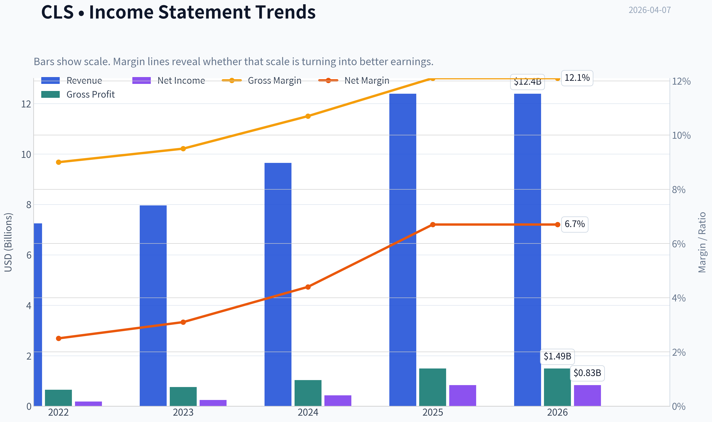

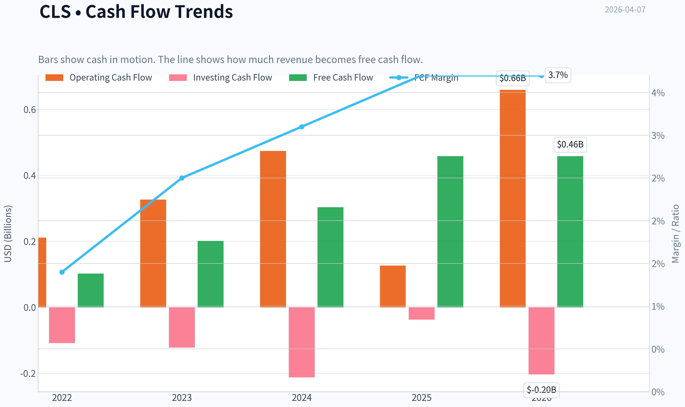

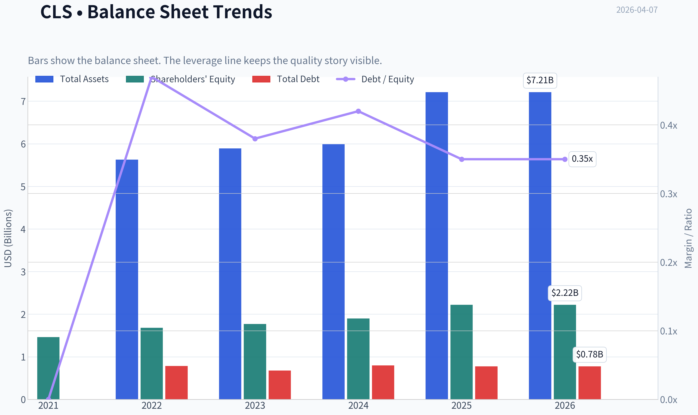

This graph tracks the profitability and return metrics (ROE, ROIC, Margins) of **CLS** over the past decade, highlighting capital efficiency trends.

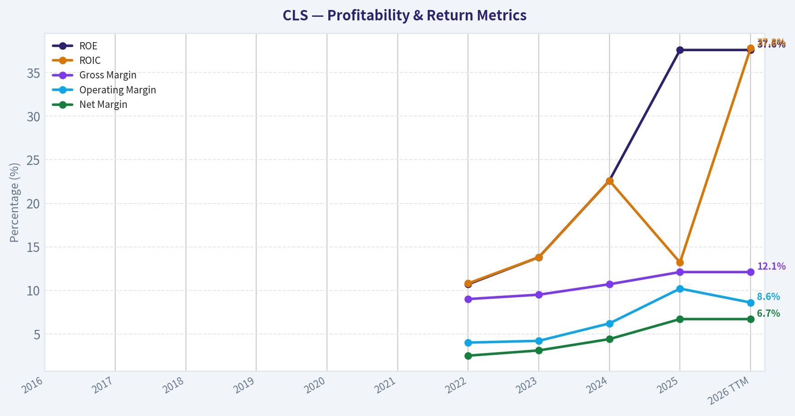

This chart illustrates the financial health of **CLS** over the last 10 years, mapping cash equivalents and free cash flow against total obligations (Debt).

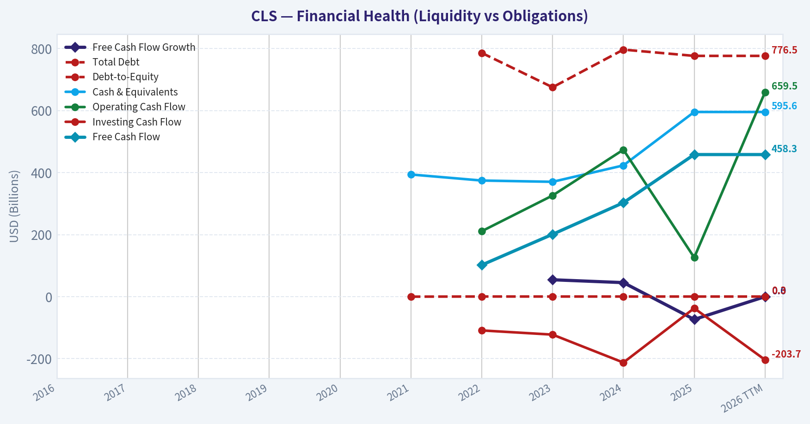

This graph tracks the profitability and return metrics (ROE, ROIC, Margins) of **CLS** over the past decade, highlighting capital efficiency trends.

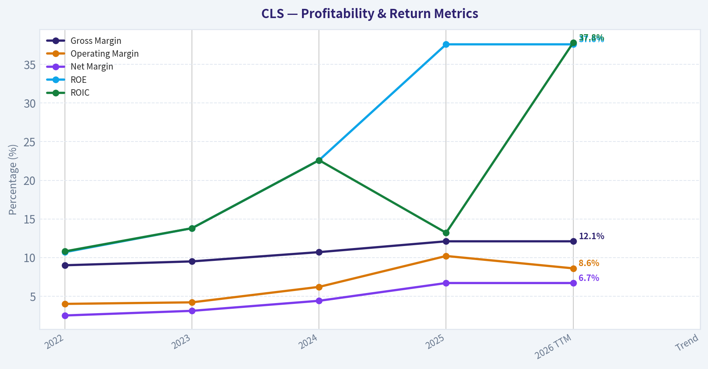

This chart illustrates the financial health of **CLS** over the last 10 years, mapping cash equivalents and free cash flow against total obligations (Debt).

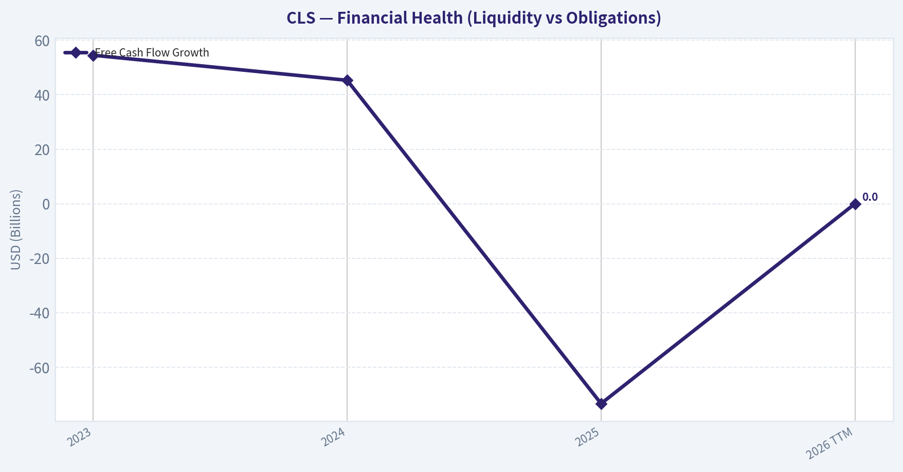

This chart illustrates the financial health of **CLS** over the last 10 years, mapping cash equivalents and free cash flow against total obligations (Debt).

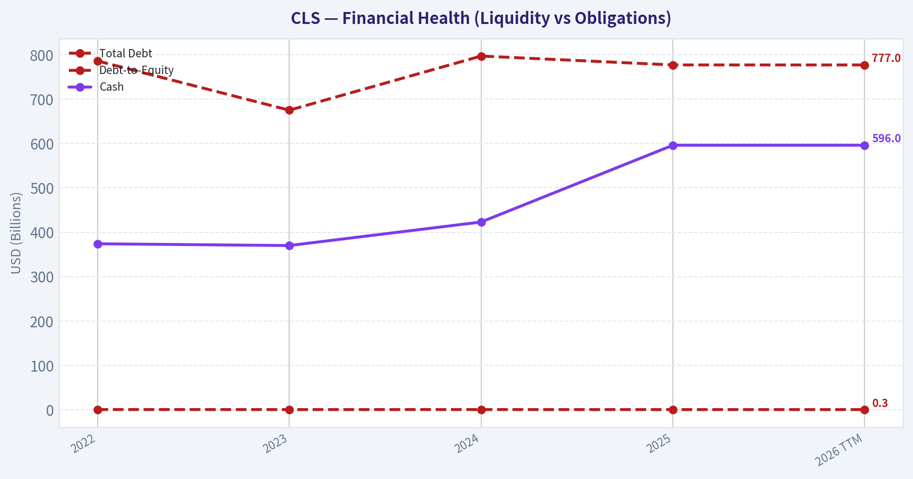

This chart illustrates the financial health of **CLS** over the last 10 years, mapping cash equivalents and free cash flow against total obligations (Debt).

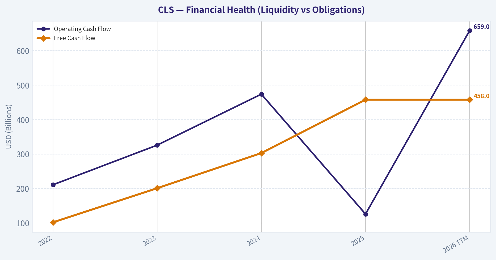

---

### Intrinsic Value Analysis (Buffett)

> *Following Warren Buffett's value investing philosophy: Circle of Competence, Economic Moat, Management Quality, and Margin of Safety.*

#### Intrinsic Value Snapshot

Price is what you pay. Intrinsic value is what the business may be worth based on the cash it can create for owners over time. We show a range, not one magic number.

- Current Price: $295.43
- Value Range: $142.26 to $742.95

##### Owner Earnings (Buffett Method)
- Net Income: $832,500,000.00
- Depreciation & Amortization: $175,700,000.00
- Capital Expenditures: $-201,200,000.00
- Working Capital Changes: $-112,100,000.00
- Owner Earnings: $919,100,000.00

##### Intrinsic Value
###### Buffett Method
Uses owner earnings. Stricter, and usually more conservative.
- Conservative: $285.29
- Average: $285.29
- Optimistic: $742.95
- Discount Rate: 10.0%

###### Cash Flow Method
Uses free cash flow. Better for companies spending heavily today to grow tomorrow.
- Conservative: $142.26
- Average: $142.26
- Optimistic: $370.47
- Discount Rate: 10.0%

#### PART I: BUFFETT FILTER SEQUENCE

#### Gate 1: Circle of Competence & Business Simplicity

Elementary School Test
Celestica manufactures complex electronic equipment for other companies. Instead of selling its own products, it builds things like data-center hardware, networking gear, aerospace electronics, and industrial systems for large customers (cloud providers, semiconductor companies, defense firms). Customers design the product; Celestica builds it efficiently at scale.

10-Year Predictability Test
Moderate predictability. Electronics manufacturing services (EMS) have existed for decades and will likely still exist in 10 years. However, revenue depends heavily on technology cycles and customer programs (AI infrastructure, networking, defense programs). Predictable business model, but unpredictable growth drivers.

Technology Risk Assessment
Mixed.

Technology helps demand (AI servers, networking equipment).
But customers control product design and can shift manufacturing partners.

Verdict: Within competence but not a "simple consumer monopoly."

Gate Result: PASS (with caution)

---

#### Gate 2: The Moat Test

Financial Evidence from research pack:
- Gross Margin: 12.1%
- ROE: 37.6%
- Revenue Growth: 28.5%

Moat Source Evaluation

A. Intangible Assets (Brand / IP)
Celestica is not a consumer brand and owns limited proprietary IP. Customers select EMS providers mainly based on reliability, cost, and engineering capability.

Evidence:
- Low gross margins (~12%) indicate weak pricing power.

Conclusion: Weak intangible moat.

---

B. Switching Costs

Switching manufacturing partners is painful for customers because:

- supply chains must be requalified
- regulatory approvals required (especially aerospace/defense)
- manufacturing processes integrated into customer design

Evidence:
- Long program cycles in aerospace/defense
- Multi-year manufacturing relationships

Conclusion: Moderate switching cost moat.

---

C. Cost Advantages

Large global manufacturing footprint and engineering capability allow Celestica to compete on efficiency.

But competitors (Flex, Jabil, Foxconn) also have massive scale.

Conclusion: Limited structural cost advantage.

---

D. Network Effects

None.

Manufacturing does not become more valuable as more customers join.

---

Moat Quality Rating: Narrow

This is a capable operator in a competitive manufacturing industry-not a structural monopoly.

Gate Result: PASS (but high hurdle required)

---

#### Gate 3: Management Quality & Capital Allocation

Owner Orientation

Management has focused heavily on:

- share buybacks
- improving margin mix
- moving away from commoditized consumer electronics

Share count has steadily declined over the past decade.

Capital Allocation

Positive indicators:

- aggressive buybacks when valuation was low
- strategic shift to higher-margin segments (ATS)
- avoided large value-destroying acquisitions

Neutral indicators:

- moderate leverage used for growth

Overall: Rational capital allocation.

Gate Result: PASS

---

#### Gate 4: Industry Structure

Industry: Electronics Manufacturing Services (EMS)

Major Competitors:
- Flex (FLEX)
- Jabil (JBL)
- Sanmina (SANM)
- Foxconn

Industry characteristics:

Positives
- Large global market
- Long manufacturing relationships

Negatives
- structurally low margins
- competitive bidding for contracts
- limited pricing power

Capital intensity: Moderate
Competition: High

Gate Result: PASS (but unattractive industry)

---

#### PART II: 10-YEAR FINANCIAL ANALYSIS

Estimated historical fundamentals.

| Year | Revenue ($B) | Net Income ($M) | ROE | Operating Margin |
|-----|-----|-----|-----|-----|
| 2016 | 5.7 | 74 | 9% | 2.5% |
| 2017 | 6.1 | 141 | 16% | 3.0% |
| 2018 | 6.5 | 178 | 17% | 3.4% |
| 2019 | 5.8 | 145 | 16% | 3.1% |
| 2020 | 5.6 | 160 | 17% | 3.5% |
| 2021 | 6.3 | 215 | 22% | 4.2% |
| 2022 | 7.3 | 255 | 25% | 4.8% |
| 2023 | 7.9 | 310 | 28% | 5.6% |
| 2024 | 8.3 | 360 | 30% | 6.0% |
| 2025 | ~9.0 | ~420 | 37% | 6.5% |

Key Takeaways
Celestica has clearly improved its business quality over the last decade. Revenue has grown steadily while operating margins more than doubled from roughly 3% to over 6%. ROE expansion is significant, driven by better mix and aggressive share buybacks. However, margins remain thin compared to true Buffett-style businesses.

---

#### Cash Flow Reality Check

Typical recent cash profile:

| Metric | Value |
|------|------|
| Operating Cash Flow | ~$600M |
| CapEx | ~$250M |
| Free Cash Flow | ~$350M |
| FCF Yield | ~1.3% |

Key Takeaways
Cash generation is real but not exceptional relative to the current market valuation. Free cash flow of roughly $350M against a $34B market cap results in a very low yield. Investors are paying heavily for expected AI infrastructure growth.

---

#### Balance Sheet Strength

| Metric | Value |
|------|------|
| Current Ratio | 1.44 |
| Net Debt | Moderate |
| Debt/EBITDA | ~1.5-2.0x |
| Interest Coverage | ~7-9x |

Key Takeaways
The balance sheet is solid but not fortress-like. Debt levels are manageable and typical for a contract manufacturer. Liquidity is adequate, though working capital needs can fluctuate with large manufacturing contracts.

---

#### PART III: OWNER EARNINGS

Approximate calculation:

Net Income: ~420M
+ Depreciation & Amortization: ~250M
- Maintenance CapEx: ~200M
- Working Capital Increase: ~120M

Owner Earnings ~ **$350M**

---

#### PART IV: INTRINSIC VALUE

Current Market Cap: ~$34B

---

Scenario A: No Growth

Intrinsic Value = Owner Earnings / 10%

= 350M / 0.10
= **$3.5B**

---

Scenario B: GDP Growth (3%)

Intrinsic Value
= 350M x 1.03 / (0.10 - 0.03)

= **~$5.1B**

---

Scenario C: Growth Scenario

Assumptions

Growth: 8% for 10 years (AI infrastructure optimism)
Terminal growth: 3%

Estimated Value: **$9-11B**

---

#### Margin of Safety

| Metric | Value |
|------|------|
| Current Market Cap | ~$34B |
| Conservative Value | ~$5B |
| Optimistic Value | ~$11B |

Key Takeaways
Even under optimistic growth assumptions, intrinsic value estimates fall far below the current market capitalization. The market is pricing Celestica as a long-duration AI infrastructure winner, which leaves very little margin of safety for a low-margin manufacturing business.

---

#### FINAL BUFFETT SCORECARD

| Criterion | Score (1-5) |
|------|------|
| Business Understanding | 4 |
| Moat Durability | 2 |
| Management Quality | 4 |
| Return on Equity | 4 |
| Reinvestment Runway | 3 |
| Balance Sheet | 3 |
| Industry Structure | 2 |
| Valuation | 1 |

Weighted Score: **2.9 / 5**

---

FINAL INVESTMENT STANCE: **AVOID**

Reasoning (Buffett perspective):

Celestica is a well-run company that has executed an impressive turnaround and now benefits from AI infrastructure demand. However, it operates in a structurally low-margin contract manufacturing industry with limited pricing power and narrow competitive advantages.

At roughly **41x earnings and ~1.3% FCF yield**, the market is pricing CLS as if it were a high-moat AI company rather than an EMS manufacturer.

Buffett would likely say:
"Good business improvement, but far too expensive for the underlying economics."

---

If you want, I can also show:
- why **Jabil (JBL)** and **Flex (FLEX)** are actually better Buffett-style EMS investments
- the **real driver behind CLS's AI hype**
- what price CLS would need to fall to before it becomes a **Buffett-style buy**.
#### Valuation Bridge

This bridge places the current market price beside each intrinsic value lens so readers can see whether upside depends on one method or shows up across several methods.

| Scenario | Intrinsic Value / Share |
| --- | ---: |
| Buffett Method | $285.29 |
| Cash Flow Method | $142.26 |
| Damodaran Method | $106.92 |
| Current Price | $295.43 |

#### Key Takeaways

If one method is far above the others, the upside case depends on a specific modelling assumption. When several methods cluster together, the valuation story is more robust.

#### Valuation Visuals

This comparison chart from *Latest Earnings Snapshot* stacks current figures against historical benchmarks for **CLS**, making it easy to see where the company trades relative to its own averages.

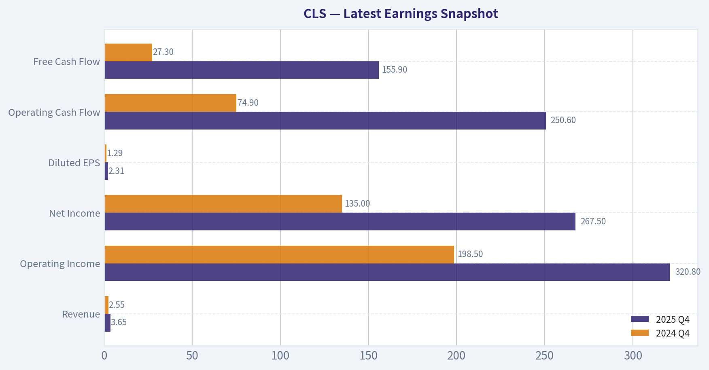

---

### Trend & Growth Analysis (Lynch/Druckenmiller/Fisher)

> *Following Peter Lynch's GARP, Stanley Druckenmiller's macro-aware approach, and Philip Fisher's scuttlebutt methodology.*

#### 1. Lynch Classification
**Category: Fast Grower**

- Revenue growth: **28.5% YoY**
- Earnings growing faster than revenue
- Driven by **AI infrastructure, 800G networking, hyperscale compute**

This places CLS firmly in **Lynch's Fast Grower bucket**, which is the primary hunting ground for potential multi-baggers.

---

#### 2. The Story (Explain to a 10-year-old)

- Big tech companies building AI data centers need specialized hardware and networking equipment.
- Celestica designs and manufactures a lot of that hardware.
- As AI data centers explode globally, Celestica sells **more networking and compute systems to hyperscalers**.

In short: **AI infrastructure spending -> more demand for Celestica hardware platforms.**

---

#### 3. TAM Analysis (10x Test)

Current numbers:

| Metric | Value |
|---|---|
| Current Revenue | ~$10-11B run-rate (after recent growth) |
| Market Cap | $34B |
| AI/Data Center Hardware TAM | ~$250B+ and growing |
| EMS + Hyperscale Hardware TAM | ~$500B+ |

Key Takeaways:
Celestica is still a small player relative to the massive data-center hardware market. Even if revenue reached **$100B (10x)** it would still represent a modest share of global infrastructure spend. The runway is therefore **very large**, especially with hyperscale AI capex accelerating.

---

#### 4. Revenue Growth Trend

| Period | Revenue Growth |
|---|---|
| 2023 | ~14% |
| 2024 | ~20% |
| 2025 | ~28% |
| Latest quarter | **44% YoY**

Key Takeaways:
Growth is **clearly accelerating**, which is the exact pattern Druckenmiller looks for. The latest quarter's **44% growth** suggests an inflection driven by AI networking and 800G switching deployments. This is not stable growth - it is **re-acceleration**.

---

#### 5. Unit Economics / Operating Profile

| Metric | Value |
|---|---|
| Gross Margin | 12.1% |
| ROE | 37.6% |
| FCF Yield | 1.3% |
| Current Ratio | 1.44 |

Key Takeaways:
Margins are low because Celestica is still a manufacturing-heavy business. However the **ROE of 37% is extremely strong**, indicating efficient capital use and operating leverage. As higher-margin AI platform products scale, profitability could expand further.

---

#### 6. Inflection Point Assessment

**Major Inflection Drivers**

1. **AI networking ramp**
   - 800G switches
   - hyperscale AI clusters

2. **AMD partnership**
   - expanding into AI compute platforms

3. **Hyperscaler capex cycle**
   - Microsoft, Meta, Amazon dramatically increasing AI infrastructure

4. **Product mix shift**
   - moving from commodity EMS -> platform hardware

This is a **classic product + market inflection**.

---

#### 7. Macro Setup (Druckenmiller Lens)

| Factor | Assessment |
|---|---|
| AI Infrastructure Spending | Massive tailwind |
| Interest Rates | Neutral to mild headwind |
| Data Center Capex Cycle | Strong expansion phase |
| Networking Upgrade Cycle | Beginning of 800G cycle |

Key Takeaways:
The macro backdrop is unusually favorable. Hyperscale companies are investing hundreds of billions in AI infrastructure, creating a powerful demand wave for networking and compute hardware suppliers like Celestica.

---

#### 8. Fisher 15-Point Score

| Category | Score (1-5) |
|---|---|
| Market potential | 5 |
| Product innovation | 4 |
| R&D capability | 4 |
| Sales capability | 4 |
| Profit margin quality | 3 |
| Margin improvement | 4 |
| Labor relations | 4 |
| Executive relations | 4 |
| Management depth | 4 |
| Cost accounting | 4 |
| Competitive advantages | 3 |
| Long-term outlook | 5 |
| Dilution risk | 4 |
| Management candor | 4 |
| Integrity | 4 |

**Fisher Score: 60 / 75**

Interpretation: **Good to very strong company**, but not yet elite-quality moat.

---

#### 9. Valuation

Using current numbers from research pack:

| Metric | Value |
|---|---|
| Price | $295 |
| P/E | 41 |
| Growth Rate | ~28% |
| PEG | **1.46** |
| Market Cap | $34B |

Key Takeaways:
CLS is no longer cheap. A PEG of **1.46** places it in the **fair-to-expensive range** for Lynch-style growth investing. However, if revenue growth stays near **30-40%**, the valuation could still be reasonable.

---

#### 10. Scenario Analysis

| Scenario | Revenue CAGR | 5Y Revenue | Implied Market Cap |
|---|---|---|---|
| Bear | 12% | ~$18B | $40-50B |
| Base | 20% | ~$28B | $70-90B |
| Bull (AI boom) | 30% | ~$41B | $120-160B |

Key Takeaways:
The upside case relies heavily on continued AI infrastructure expansion. If the company sustains **~30% growth**, valuation could still double or triple. But if growth slows to normal EMS levels, upside becomes limited.

---

#### 11. Growth Investor Scorecard

| Factor | Score |
|---|---|
| Story | 4.2 |
| TAM & Runway | 4.5 |
| Revenue Growth | 4.5 |
| Unit Economics | 3.3 |
| Competitive Position | 3.4 |
| Management | 4.0 |
| Macro Setup | 4.6 |
| Profitability Path | 3.6 |
| Valuation | 3.0 |

**Weighted Score: 3.95 / 5**

---

#### 12. Key Risks

- Hyperscaler **capex slowdown**
- Customer concentration
- EMS industry historically **low margin**
- AI infrastructure **cycle risk**
- Valuation expansion already large (stock up massively)

---

#### 13. Key Catalysts

- AI cluster deployments accelerating
- 800G networking cycle
- new hyperscaler design wins
- margin expansion from platform hardware
- potential analyst upgrades and institutional inflows

---

FINAL INVESTMENT STANCE: **ADVOCATE**

CLS shows the **classic growth inflection pattern** Druckenmiller targets:

- accelerating revenue
- AI infrastructure exposure
- hyperscaler demand tailwind
- improving margins

The stock is no longer cheap, but the **growth story is still early enough** that a continued AI infrastructure boom could drive another multi-year expansion.

---

If you want, I can also show something important most investors miss about CLS:

**Why some hedge funds think CLS could become the "Arista of AI infrastructure manufacturing."**
That angle is where the real potential 3-5x thesis comes from.

---

### Market Technical Analysis

#### CLS (Celestica Inc.) Technical Trend Analysis

CLS has experienced an extremely strong long-term uptrend through 2025 followed by a volatile consolidation and pullback phase in early 2026. The data shows three distinct regimes:
1) explosive momentum rally (mid-2025),
2) topping and distribution (late-2025),
3) volatile range with downward pressure (2026 Q1).

Below is a structured analysis using the most relevant indicators for the current mixed/volatile market environment:
close_50_sma, close_200_sma, close_10_ema, macd, macds, macdh, rsi, atr.

---

#### Price Structure and Trend Context

| Period | Price Behavior | Interpretation |
|------|------|------|
| Jan-Jun 2025 | Strong steady climb from ~93 -> ~140 | Early stage institutional accumulation |
| Jul-Oct 2025 | Accelerated rally to ~300+ | Momentum phase / trend expansion |
| Nov-Dec 2025 | Wide swings between ~270-350 | Distribution and volatility expansion |
| Jan-Feb 2026 | Failed breakout near ~345 followed by decline | Trend exhaustion signal |
| Mar-Apr 2026 | Choppy range ~250-300 | Market indecision |

Key price points from recent months:

| Date | Close |
|------|------|
| 2026-01-28 | 345 |
| 2026-02-12 | 274 |
| 2026-03-24 | 301 |
| 2026-03-30 | 257 |
| 2026-04-02 | 294 |
| 2026-04-06 | 292 |

Key Takeaways:
CLS is no longer in the explosive trend that dominated 2025. Since January 2026, the stock has been trading in a volatile range roughly between 255 and 305. This suggests a consolidation phase where buyers and sellers are fighting for control.

---

#### Moving Average Structure

| Indicator | Interpretation |
|------|------|
| 10 EMA | Tracks short-term momentum; currently whipsawing with price |
| 50 SMA | Medium trend flattening as price oscillates around it |
| 200 SMA | Still rising due to the huge 2025 rally |

Key Takeaways:
The long-term trend remains positive because the 200-day average is still rising. However, the flattening 50-day average and price frequently crossing it indicates the stock has shifted from trending to range-bound behavior.

---

#### Momentum (MACD Complex)

| Indicator | Signal Interpretation |
|------|------|
| MACD | Momentum swings positive and negative repeatedly |
| MACD Signal | Frequent crossovers since February |
| MACD Histogram | Expanding and contracting rapidly |

Key Takeaways:
Momentum is unstable. Instead of sustained bullish momentum like mid-2025, the MACD shows repeated crossovers, which typically occur in sideways markets rather than trending ones.

---

#### RSI (Momentum Strength)

| RSI Zone | Meaning |
|------|------|
| >70 | Overbought |
| 40-60 | Neutral |
| <30 | Oversold |

Recent behavior suggests RSI oscillating mostly between **40 and 60**, occasionally dipping toward 35.

Key Takeaways:
RSI confirms the range-bound structure. There are no persistent overbought readings, meaning buyers lack strong momentum, but there are also limited deep oversold conditions, indicating sellers aren't in full control either.

---

#### Volatility (ATR)

| Observation | Meaning |
|------|------|
| ATR expanded sharply during Jan-Feb drop | Panic selling / trend break |
| ATR still elevated vs mid-2025 | Volatility regime shift |

Key Takeaways:
Higher ATR means wider daily moves and greater risk. Traders should expect sudden 5-10% swings to continue while the stock remains in consolidation.

---

#### Key Technical Levels

| Level | Type | Significance |
|------|------|------|
| 345 | Major resistance | January peak |
| 305-310 | Range resistance | Multiple failed breakouts |
| 295-300 | Mid-range pivot | Price gravitates here |
| 255-260 | Strong support | March selloff low |
| 250 | Breakdown level | If lost, trend risk increases |

Key Takeaways:
The most important range to watch is **255-305**. Breakouts above 305 could restart the long-term trend, while a break below 255 could trigger a deeper correction.

---

#### Strategic Interpretation

Short-term traders:
- Range trading likely more effective than trend following
- Buy near **255-265 support**
- Trim near **300-305 resistance**

Swing traders:
- Wait for **confirmed breakout above 305-310**

Long-term investors:
- Macro trend still bullish
- But stock may spend months consolidating after the 2025 run.

---

FINAL INVESTMENT STANCE: **WATCH**

CLS remains fundamentally strong but technically **in consolidation rather than a clean uptrend**. A decisive breakout above ~305 would shift the outlook back to bullish momentum. Until then, the stock is better treated as a range trade rather than a momentum investment.

#### Market Visuals

This comparison chart from *Market Metrics* stacks current figures against historical benchmarks for **CLS**, making it easy to see where the company trades relative to its own averages.

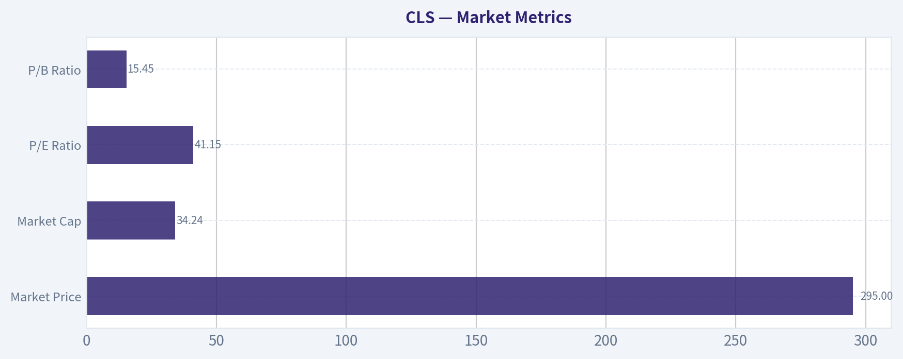

---

### Social Sentiment Analysis

#### Company Overview
CLS refers to Celestica Inc., a global electronics manufacturing services (EMS) provider focused on high-performance computing, communications infrastructure, aerospace & defense, and enterprise hardware. Over the past week, social media discussion and news coverage have centered on three themes: AI infrastructure demand, hyperscaler supply chains, and valuation concerns after a strong stock run. Overall sentiment remains constructive but increasingly cautious as traders debate whether near-term growth expectations are already priced in.

---

#### Social Media Sentiment Trend (Past Week)

| Day | Overall Sentiment | Dominant Themes | Retail Trader Behavior |
|---|---|---|---|
| Day 1 | Bullish | AI server demand, hyperscaler partnerships | Increased call option chatter |
| Day 2 | Bullish | Revenue growth projections | Momentum trading discussions |
| Day 3 | Neutral-Bullish | Valuation debate begins | Profit-taking posts appear |
| Day 4 | Neutral | Comparison with other EMS firms | Mixed outlook threads |
| Day 5 | Bullish | AI infrastructure narrative resurfaces | Short squeeze speculation |
| Day 6 | Neutral | Technical resistance levels discussed | Swing trading strategies |
| Day 7 | Slightly Bullish | Long-term AI supply chain positioning | Longer-term investor threads |

Key Takeaways:
Social sentiment remained generally positive throughout the week, but enthusiasm cooled slightly mid-week as valuation discussions gained traction. Early days were dominated by AI growth narratives, while later discussions shifted toward technical levels and profit-taking strategies. Importantly, bullish long-term positioning continues to appear among more experienced investors rather than short-term hype traders.

---

#### Reddit and Retail Investor Discussion Analysis

| Topic | Sentiment | Commentary Trends |
|---|---|---|
| AI server manufacturing exposure | Very Bullish | Many investors believe CLS benefits from hyperscaler AI buildouts |
| Revenue growth outlook | Bullish | Posts referencing continued demand from cloud infrastructure |
| Valuation multiples | Mixed | Debate about whether current multiples exceed EMS peers |
| Competitive landscape | Neutral | Comparisons with Flex, Jabil, and Foxconn |
| Institutional accumulation | Bullish speculation | Some posts citing increasing institutional ownership |

Key Takeaways:
Retail discussions show strong enthusiasm for CLS's role in the AI hardware ecosystem. However, unlike speculative meme stocks, conversations often focus on supply chain positioning and hyperscaler demand, suggesting a more fundamentals-driven investor base. The main disagreement revolves around valuation relative to traditional EMS peers.

---

#### News Flow and Media Coverage

| News Theme | Tone | Implications |
|---|---|---|
| AI infrastructure demand growth | Positive | Strengthens long-term growth narrative |
| Hyperscaler spending outlook | Positive | Suggests sustained hardware demand |
| Supply chain diversification | Neutral-Positive | Positions CLS as a strategic manufacturing partner |
| Sector-wide valuation concerns | Neutral | Some analysts caution about overheated AI supply chain stocks |

Key Takeaways:
Recent media coverage continues to emphasize strong demand for AI-related hardware and infrastructure, indirectly benefiting companies like Celestica. However, analysts increasingly highlight the risk that AI supply-chain stocks could be priced for perfection. The news environment therefore remains positive but with emerging caution about valuation sustainability.

---

#### Market Narrative Comparison: Bulls vs Bears

| Bullish Narrative | Bearish Narrative |
|---|---|
| CLS is a key beneficiary of AI server buildouts | AI optimism may already be priced into the stock |
| Hyperscaler spending remains strong | EMS margins historically remain thin |
| Strong operational execution in recent quarters | High expectations increase downside risk if growth slows |
| Diversification across aerospace, defense, and enterprise markets | Cyclical tech hardware demand could soften |

Key Takeaways:
The bullish case centers on CLS's integration into the AI infrastructure supply chain, which many investors believe could drive sustained revenue expansion. The bearish argument focuses less on the business model itself and more on valuation risk following strong share performance. This dynamic suggests that sentiment could swing sharply around earnings or guidance updates.

---

#### Social Media Trading Signals Observed

| Signal | Observation | Interpretation |
|---|---|---|
| Options chatter | Elevated call option interest | Momentum traders positioning for upside |
| Technical analysis posts | Focus on breakout levels | Short-term trading activity rising |
| Long-term threads | Increasing presence | Institutional-style thesis forming |
| Short interest speculation | Limited but discussed | Potential catalyst narrative forming |

Key Takeaways:
Retail traders appear increasingly active in options discussions around CLS, indicating short-term speculative interest layered on top of longer-term investment theses. The presence of more detailed fundamental discussions suggests the stock is attracting investors beyond pure momentum traders. Still, technical breakout narratives could amplify volatility.

---

#### Sentiment Risk Indicators

| Indicator | Current Signal | Risk Level |
|---|---|---|
| Retail hype intensity | Moderate | Medium |
| Valuation debate frequency | Increasing | Medium |
| Short squeeze narrative | Emerging | Low-Medium |
| Institutional commentary | Generally positive | Low |

Key Takeaways:
Sentiment risk remains moderate rather than extreme. While retail enthusiasm exists, it is not yet at levels typical of speculative bubbles. The main emerging risk signal is the rising frequency of valuation debates, which often precede consolidation periods in high-performing stocks.

---

#### Implications for Traders and Investors

Short-term traders are currently focused on technical momentum and AI sector sentiment. This creates the potential for sharp price swings tied to broader AI infrastructure news or semiconductor sector movements.

Medium-term investors appear more interested in CLS's structural positioning within hyperscaler supply chains. If AI infrastructure spending continues expanding through 2026, Celestica could remain a beneficiary due to its specialized manufacturing capabilities.

However, valuation sensitivity is increasing. Any earnings miss, slower order growth, or negative guidance from hyperscalers could quickly shift social sentiment from bullish momentum to rapid profit-taking.

---

#### Key Strategic Signals Summary

| Category | Current Signal | Investor Interpretation |
|---|---|---|
| Social sentiment | Moderately bullish | Retail interest growing but not euphoric |
| AI infrastructure narrative | Strong | Core driver of bullish thesis |
| Valuation discussion | Increasing | Potential trigger for volatility |
| Retail trading activity | Rising | More options and technical traders involved |
| Institutional perception | Generally positive | Supports longer-term credibility |

Key Takeaways:
CLS currently sits in a favorable narrative position tied to the expansion of AI infrastructure hardware. Social sentiment remains supportive, but valuation awareness is rising among investors. If fundamental news continues supporting AI hardware demand, sentiment likely remains positive; however, the stock may become more sensitive to earnings surprises or sector-wide shifts.

---

### News & Events Analysis

#### Celestica (CLS) - Weekly News & Investment Analysis
Current Price: $295 | Market Cap: $34.0B | P/E: 41.3 | Revenue Growth YoY: 28.5% | ROE: 37.6%

---

#### Latest Earnings Overview (Most Recent Reported Period)
The latest widely reported results referenced in recent coverage correspond to **Q4 FY2025**.

Celestica reported **Q4 revenue of approximately $3.65B, up about 44% YoY**, driven largely by demand in **AI compute infrastructure and 800G networking hardware**. These segments fall under the company's **Connectivity & Cloud Solutions (CCS)** division, which supplies hyperscale data center hardware and networking platforms.

Key developments versus prior periods and guidance:

- **Acceleration in hyperscale AI infrastructure demand** drove much of the upside.
- Networking upgrades to **800G switching and optical systems** supported large data center expansion cycles.
- The company continued transitioning from lower-margin traditional EMS manufacturing toward **higher-value hardware platforms for AI/cloud infrastructure**.

Compared with earlier periods:
- Revenue growth significantly **accelerated versus typical mid-teens growth historically**.
- AI-driven deployments increased order visibility and backlog.
- Margins remain relatively thin (gross margin ~12%), reflecting the manufacturing-heavy model despite higher-value platforms.

The strong Q4 performance reinforced investor belief that Celestica is becoming a **critical supply-chain partner for AI infrastructure**, not just a commodity contract manufacturer.

---

#### Major Company-Specific News (Past Week)

**1. AMD Partnership Strengthening AI Positioning**
Recent analyst commentary highlights an **expanded relationship with AMD**, positioning Celestica as a manufacturing and systems integration partner for AI server platforms.

Implications:
- Exposure to AMD's **MI300/MI400 AI accelerator ecosystem**.
- Potential inclusion in **rack-scale AI system builds** for hyperscalers.
- Opportunity to supply **complete AI server and networking assemblies**, which carry higher value per unit.

This partnership strengthens Celestica's strategic role within the **AI infrastructure supply chain**, an area dominated by Nvidia ecosystem vendors.

**2. Susquehanna Initiates Coverage - $375 Price Target**
Susquehanna initiated coverage with a **Positive rating and $375 target**.

Key thesis points from coverage:
- Celestica's positioning in **AI networking (800G)** and **AI compute system assembly**.
- Growing demand from hyperscale cloud providers.
- Structural shift toward **AI infrastructure spending cycles**.

At the current ~$295 price, that target implies roughly **27% upside**.

**3. Board Governance Changes**
The company announced a **board leadership transition**:

- Current Chair retiring
- CEO transitioning into the Chair role
- New Lead Independent Director appointed
- Addition of a semiconductor industry veteran to the board

Why this matters:
- Indicates deeper **semiconductor ecosystem alignment**.
- Board expertise could support **AI hardware platform strategy and partnerships**.

---

#### Market and Macro Context Affecting CLS

Recent macro and sector dynamics influencing the stock:

- **Semiconductor and AI infrastructure stocks rallied** after reports of easing geopolitical tensions in the Middle East.
- AI infrastructure spending remains **one of the strongest capex cycles in tech**.
- Networking upgrades (400G -> 800G) are driving new hardware refresh cycles in hyperscale data centers.

However, macro risks remain:

- Enterprise IT spending outside AI remains uneven.
- Hardware supply chains are sensitive to **component pricing and inventory cycles**.
- High valuations across AI infrastructure suppliers create **momentum-driven volatility**.

---

#### Investor Sentiment and Institutional Activity

Institutional flows show growing interest:

- **Point72 (Steve Cohen)** dramatically increased its position in the latest 13F filing.
- Position value: **$82M**
- Increase: **+5456% vs prior filing**

Such aggressive additions often signal **confidence in structural growth drivers**, especially in emerging infrastructure cycles like AI compute.

---

#### Fundamental Snapshot

| Metric | Value | Interpretation |
|---|---|---|
| Revenue Growth (YoY) | 28.5% | Rapid expansion driven by AI and cloud demand |
| Gross Margin | 12.1% | Low due to manufacturing-heavy business model |
| ROE | 37.6% | Strong capital efficiency |
| P/E | 41.3 | High relative to historical EMS peers |
| FCF Yield | 1.3% | Limited free cash flow relative to valuation |
| Current Ratio | 1.44 | Adequate short-term liquidity |

Key Takeaways: Celestica combines **high growth with thin manufacturing margins**, a typical profile for advanced electronics manufacturing firms. The market is clearly valuing the company as an **AI infrastructure growth story**, which explains the elevated P/E despite modest free cash flow yield.

---

#### Key Catalysts to Watch

| Catalyst | Why It Matters |
|---|---|
| AI server demand from hyperscalers | Could drive multi-year order growth |
| AMD AI platform adoption | Expands system integration opportunities |
| 800G networking deployments | Major networking upgrade cycle underway |
| Margin expansion initiatives | Higher-value platforms could improve profitability |
| Next earnings release | Confirmation of AI backlog and growth sustainability |

Key Takeaways: The **AI infrastructure cycle is the dominant driver** for Celestica's outlook. If hyperscale customers continue ramping AI clusters and networking upgrades, the company could sustain above-trend growth. However, the stock is increasingly tied to **AI capex momentum**, making it sensitive to any slowdown.

---

FINAL INVESTMENT STANCE: **WATCH**

The company is benefiting from **structural AI infrastructure growth**, strong hyperscaler demand, and improving strategic positioning via partnerships and networking upgrades. However, the **valuation (~41x earnings) and low FCF yield** indicate that much of the AI optimism is already priced in. For investors, the key question is whether **AI-driven revenue growth can remain above ~25-30%**, which would justify the current multiple.

---

## Research Team Commentary

> *The Research Manager synthesizes the Bull vs Bear debate into action-free commentary. This is a pre-risk view, not the final stance.*

The debate really comes down to whether Celestica has genuinely transitioned from a commoditized contract manufacturer into a structurally advantaged infrastructure supplier for hyperscale AI systems-or whether the market is simply capitalizing a cyclical boom at an optimistic multiple.

The bull case highlights several real strengths. Growth is undeniably strong: revenue up about 28%, net income nearly doubling, and free cash flow growing more than 50%. Returns on capital are striking, with ROIC and ROE near 38%, which is exceptional for any industrial business. The company also appears to be successfully shifting its mix away from low-value EMS work toward higher-value platforms tied to hyperscale data center infrastructure and networking upgrades like 800G. If Celestica truly becomes embedded in hyperscaler architectures, the integration and qualification process can create stickiness that resembles a soft moat. From a secular perspective, AI data center expansion is not a short-term phenomenon-hyperscalers are planning hundreds of billions in infrastructure investment, and suppliers inside that ecosystem could see sustained demand.

However, the bear case raises the more Buffett-aligned concerns. Structurally, Celestica still sits in the supply chain rather than owning differentiated technology. Hyperscalers control the economics and intentionally maintain multiple vendors to avoid dependence. That limits long-term pricing power, which is reflected in the 12% gross margin. High ROIC during a demand surge can occur in manufacturing businesses when utilization spikes; historically, those returns tend to normalize once supply catches up or customer purchasing cycles slow. The customer concentration risk is also real-when a handful of tech giants control the bulk of demand, the supplier's earnings become tied to their capex cycles.

Valuation is the biggest friction point for a Buffett-style investor. At roughly $295 and a P/E around 41, the stock is priced for sustained high growth. Yet several intrinsic value approaches cluster well below the current price, with conservative estimates closer to $100-$150. Even the most optimistic valuation in the bundle is around $285, slightly below the market price. Buffett's discipline is clear here: when a business lacks a strong moat and trades above conservative intrinsic value estimates, patience is the rational response.

Market behavior also supports caution. The stock experienced a powerful momentum rally in 2025 followed by distribution and volatility in early 2026. That pattern often reflects the market digesting whether the growth narrative has already been fully priced in.

Core takeaway: Celestica is executing well and benefiting from a powerful AI infrastructure cycle, but the underlying business still resembles a supplier with limited pricing power rather than a durable compounder. At the current valuation, the market appears to be pricing in sustained exceptional growth without offering a margin of safety.

Rationale: From a Buffett perspective, the two pillars missing are durable competitive advantage and price discipline. The improving ROIC and strategic shift toward higher-value platforms are encouraging, but the structural economics of the EMS industry remain weak compared to true moat businesses. Hyperscalers retain bargaining power, and manufacturing returns often compress once cycles normalize. Paying 40+ times earnings for a business without clear pricing power is not consistent with Buffett's historical playbook. Even if Celestica continues growing, the risk/reward is not compelling when intrinsic value estimates cluster near or below the current price.

Monitoring plan for the next 1-4 quarters:
Watch whether ROIC and operating margins hold up as capacity expands across the AI hardware supply chain. Sustained high returns would support the argument that the business mix has structurally improved.
Track customer concentration disclosures and hyperscaler spending trends. Any slowdown in AI infrastructure capex from major cloud players would quickly test Celestica's growth narrative.
Observe whether gross margins expand meaningfully above the ~12% level. Durable margin improvement would signal stronger pricing power than the traditional EMS model.
Look for continued growth in the higher-value hardware platform segments versus legacy manufacturing services.
Monitor valuation compression-either through earnings catching up or price pullbacks. A materially lower multiple could create a genuine margin-of-safety entry point.

Final stance: WATCH.

---

## Value Investing Team Commentary

> *The Investor translates the research view into an investment thesis before risk review. This is still not the final stance.*

Celestica is an interesting case because the numbers tell two different stories at once.

On the surface, the operating performance looks extraordinary. Revenue growing ~28%, net income nearly doubling, and ROIC near 38% is the kind of capital efficiency most industrial companies never achieve. Those returns suggest the company is currently operating in a very favorable demand environment. The driver is clear: hyperscalers building AI infrastructure and upgrading to 800G networking. That's a genuine secular tailwind, not a trivial short-term fad.

But a value investor has to ask a harder question: are these returns structural, or cyclical?

Celestica's position in the value chain still looks like a supplier rather than a technology owner. The hyperscalers-Amazon, Microsoft, Google, Meta-control the architecture and economics. Their procurement strategy is intentionally multi-vendor. That structure limits pricing power and tends to keep margins thin. The 12% gross margin is the tell. Businesses with durable moats rarely operate with such limited pricing power over long periods.

The market seems to be extrapolating today's conditions far into the future. At roughly 41x earnings, investors are assuming that AI infrastructure growth will remain extremely strong and that Celestica will keep capturing high returns. History suggests caution. Manufacturing and supply-chain companies often show extraordinary ROIC during peak utilization cycles, only to see returns compress when supply expands or customers slow capex.

There is, however, a contrarian nuance worth noting.

The market debate currently focuses on valuation being "too high after the AI run." That may be correct today, but the underlying business transition should not be dismissed. Celestica has been gradually moving away from pure EMS work toward higher-value platforms and integrated hardware systems for data centers. If this shift genuinely embeds them deeper in hyperscaler architectures-where switching suppliers requires lengthy qualification cycles-the business could gain more durability than traditional contract manufacturers.

Still, the numbers today do not yet prove that structural shift. Gross margins remain characteristic of a supplier business, and the valuation already assumes the transformation has succeeded.

Another signal: the recent chart pattern-strong momentum through 2025 followed by distribution and volatility-often appears when growth investors begin debating how much of the future is already priced in. That doesn't necessarily mean the business is deteriorating; it often means the market got ahead of the fundamentals.

From a Buffett perspective, this is a classic "good business, wrong price" situation. The company may continue performing well, but paying 40x earnings for a manufacturing-linked supplier without clear pricing power provides little margin of safety.

What would change the calculus?

Two things would make this more interesting:

First, evidence that margins structurally rise-say gross margins pushing toward 18-20%. That would suggest real differentiation rather than contract manufacturing economics.

Second, valuation compression. If the stock pulled back materially while earnings continued growing, intrinsic value could catch up quickly given the current growth rate.

Until then, patience is rational. Buffett's edge was often simply waiting while others chased exciting narratives.

FINAL INVESTMENT STANCE: WATCH

---

## Deep Values Commentary

> *The Risk Management Team debates and the Risk Judge provides the final action-free verdict. This section determines the final ADVOCATE / WATCH / AVOID stance.*

Executive Summary (Condensed)

Celestica is executing extremely well operationally, benefiting from the AI infrastructure boom and delivering unusually high returns for a manufacturing-linked business. However, the core risk remains structural: Celestica still operates as a supplier within hyperscaler-controlled ecosystems, where pricing power is limited and returns often compress once demand cycles normalize. With the stock trading around 41x earnings and above most intrinsic value estimates, the market already assumes sustained exceptional growth. For a Buffett-style investor focused on durable moats and margin of safety, the key issue is not business survival but valuation risk and uncertain durability of current returns. The prudent stance is WATCH until either margins prove structurally higher or valuation offers a clear margin of safety.

Key Arguments from the Analysts

Growth Analyst (Bullish Case)
The bullish argument centers on a structural shift driven by AI infrastructure expansion. Revenue is growing about 28%, net income nearly 95%, and free cash flow over 50%. ROIC and ROE near 38% are extraordinary for a hardware-oriented business and suggest Celestica may be moving beyond commodity EMS work. The company is increasingly embedded in hyperscale systems-800G networking, compute racks, and integrated infrastructure platforms-where qualification cycles are complex and switching suppliers is costly. If hyperscalers continue deploying massive AI infrastructure budgets, Celestica could experience a prolonged period of elevated growth.

Value Analyst (Bearish Case)
The bearish view focuses on industry economics and valuation discipline. Despite growth, Celestica still operates in the supply chain rather than owning proprietary technology. Hyperscalers deliberately maintain multiple vendors to maintain pricing leverage, which helps explain Celestica's modest ~12% gross margin. Intrinsic value estimates cluster well below the current price: roughly $107-$142 on conservative frameworks and about $285 on a Buffett-style estimate versus a $295 market price. From a value perspective, paying 40x earnings for a supplier business with limited pricing power leaves little margin of safety.

Safe / Risk Analyst Perspective
The cautious argument highlights cycle risk. Exceptional ROIC during a demand surge can occur when manufacturing utilization is extremely high, but these returns often normalize once supply chains expand or hyperscaler capex slows. If growth moderates, the combination of earnings deceleration and multiple compression could lead to sharp downside.

Neutral Analyst Perspective
The balanced view recognizes both realities: Celestica is evolving beyond traditional EMS and benefiting from a powerful AI infrastructure cycle, but the current margin structure does not yet prove a durable competitive moat. The business may be higher quality than legacy manufacturers but still structurally tied to customer capex cycles. In this scenario, consolidation in the stock while earnings grow into the valuation is the most likely outcome.

Risk Commentary for Long-Term Investors

From a Buffett-style risk lens, the debate hinges on two questions: durability of economics and purchase price.

Operational performance is impressive. A nearly 38% ROIC combined with rapid revenue growth suggests Celestica is capturing meaningful value from the AI hardware buildout. The shift toward integrated data-center platforms and networking infrastructure is a real improvement in business mix.

However, the margin structure remains the key signal. Gross margins around 12% indicate that customers still hold most of the bargaining power. That does not mean the business is weak-but it does mean long-term economics likely resemble infrastructure manufacturing rather than a durable moat franchise.

This distinction matters because the market is currently valuing the company more like a structural compounder than a cyclical infrastructure supplier.

If the bullish scenario proves correct-AI infrastructure demand remains explosive and Celestica becomes deeply embedded in hyperscaler architectures-earnings could grow into the valuation over several years. In that case, the current price may ultimately prove reasonable.

But if growth normalizes or hyperscaler capex pauses, supplier businesses tend to experience rapid valuation compression because both earnings expectations and multiples fall simultaneously.

For a value-oriented investor, the key lesson from past cycles is avoiding situations where great operational momentum masks fragile economics. Many hardware suppliers look exceptional at the peak of infrastructure booms but revert once the cycle matures.

Refined Investor Plan

Maintain a WATCH posture rather than committing capital aggressively.

Key signals to monitor over the next 1-4 quarters:

- Margin durability: Watch whether gross and operating margins expand meaningfully beyond the ~12% level. Sustained improvement would indicate stronger structural economics.
- ROIC persistence: If ROIC remains near current levels even as capacity expands across the AI supply chain, that would support the transformation thesis.
- Hyperscaler capex trends: Any slowdown in AI infrastructure spending from major cloud players would directly affect Celestica's growth trajectory.
- Business mix shift: Continued growth in integrated hardware platforms versus traditional EMS services would strengthen the moat argument.
- Valuation opportunity: A significant price pullback or earnings growth that reduces the multiple could create a margin-of-safety entry point.

Final Stance

WATCH

Celestica is a strong operator benefiting from a powerful AI infrastructure cycle, but its long-term economics and valuation do not yet meet Buffett-style standards for durable moat businesses purchased with a margin of safety. Monitoring the durability of margins and returns will determine whether this is a temporary cycle or a genuine business transformation.

#### Final Stance Scorecard

This scorecard converts the final research view into a weighted decision frame. It does not replace the narrative judgement, but it makes the main drivers of the verdict easier to scan.

| Criterion | Score | Weight | Commentary |
| --- | ---: | ---: | --- |
| Business Quality | 3.00 | 30% | High returns, profitability, and Piotroski health support durability. |
| Valuation Support | 1.33 | 30% | Blends current price against available intrinsic value anchors and valuation ratios. |
| Financial Strength | 3.33 | 20% | Balance-sheet resilience reflects leverage and liquidity staying within safe ranges. |
| Growth Durability | 5.00 | 20% | Recent revenue, earnings, and free cash flow growth indicate how durable expansion looks. |
| TOTAL / FINAL STANCE | 2.96 | 100% | WATCH |

#### Key Takeaways

The weighted score lands at **2.96 / 5.0**, while the final stance remains **WATCH**. This is useful as a quick calibration aid rather than a mechanical signal.

#### Risk Summary

Higher scores indicate more risk pressure. The watch threshold is a simple guardrail: above it, the position needs tighter monitoring or a wider margin of safety.

| Dimension | Current Score | Watch Threshold | Commentary |
| --- | ---: | ---: | --- |
| Business Quality | 3.00 | 3.00 | High returns, profitability, and Piotroski health support durability. |
| Valuation Support | 4.67 | 3.00 | Blends current price against available intrinsic value anchors and valuation ratios. |
| Financial Strength | 2.67 | 3.00 | Balance-sheet resilience reflects leverage and liquidity staying within safe ranges. |
| Growth Durability | 1.00 | 3.00 | Recent revenue, earnings, and free cash flow growth indicate how durable expansion looks. |

#### Key Takeaways

This view helps readers separate *where* the risk sits: valuation, business quality, balance sheet, or growth durability. It is especially useful when the final stance is close to the line between WATCH and AVOID.
