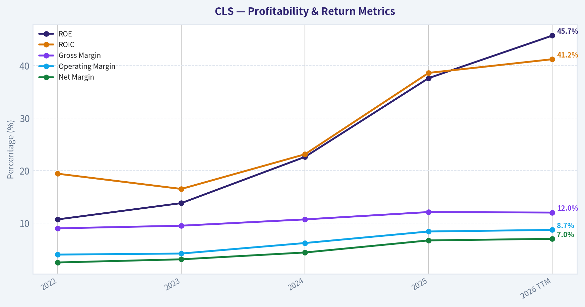
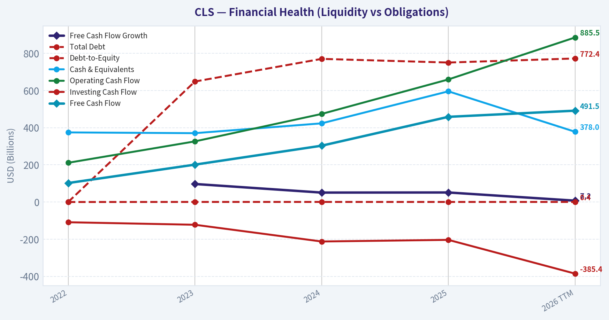
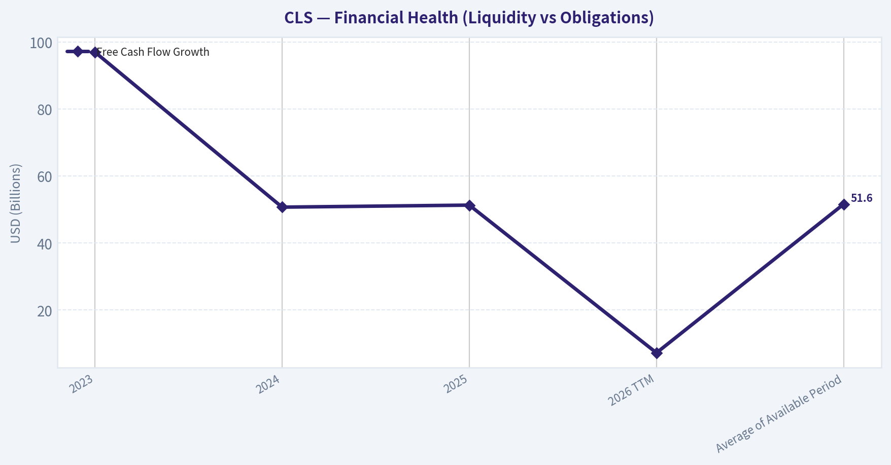
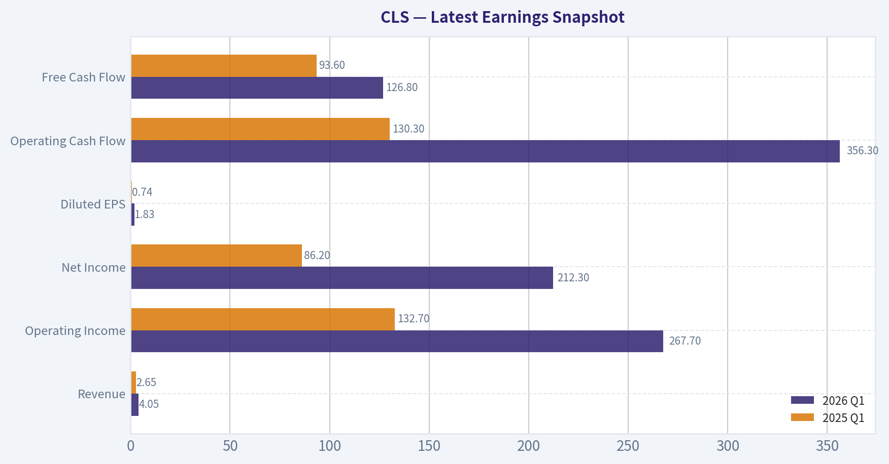
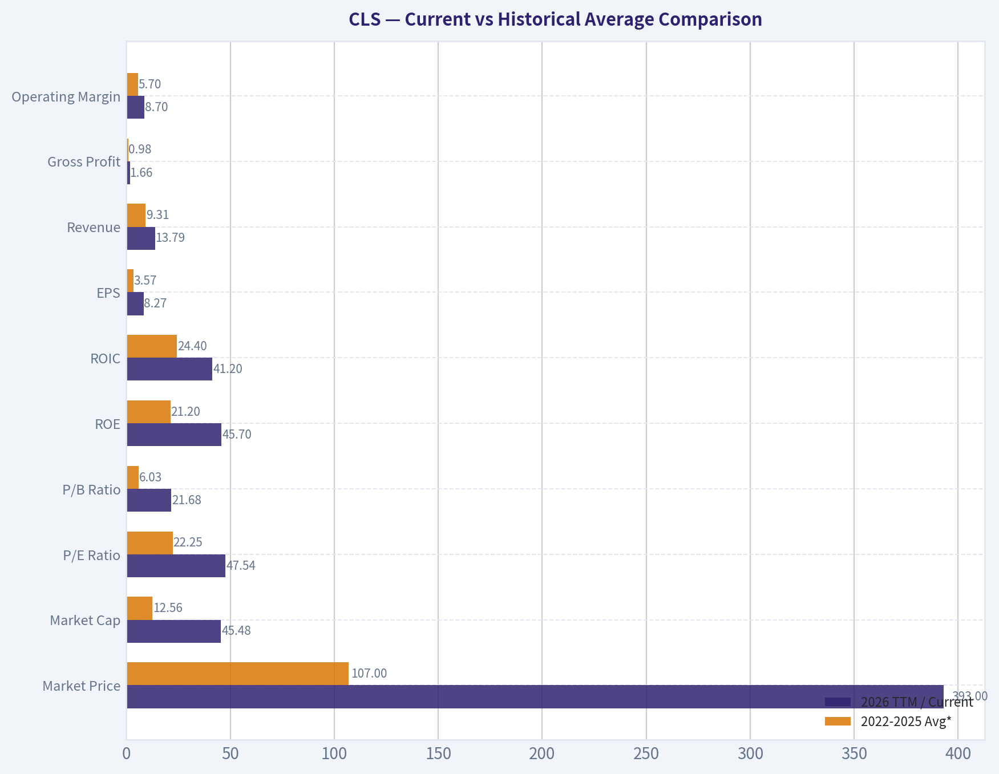
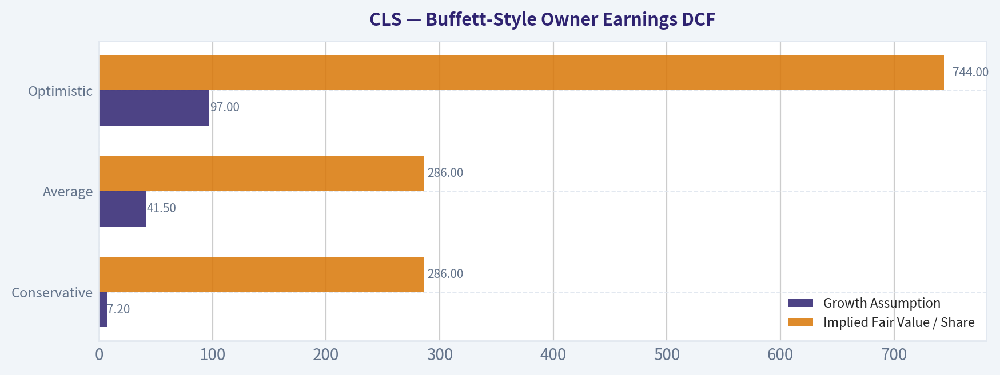
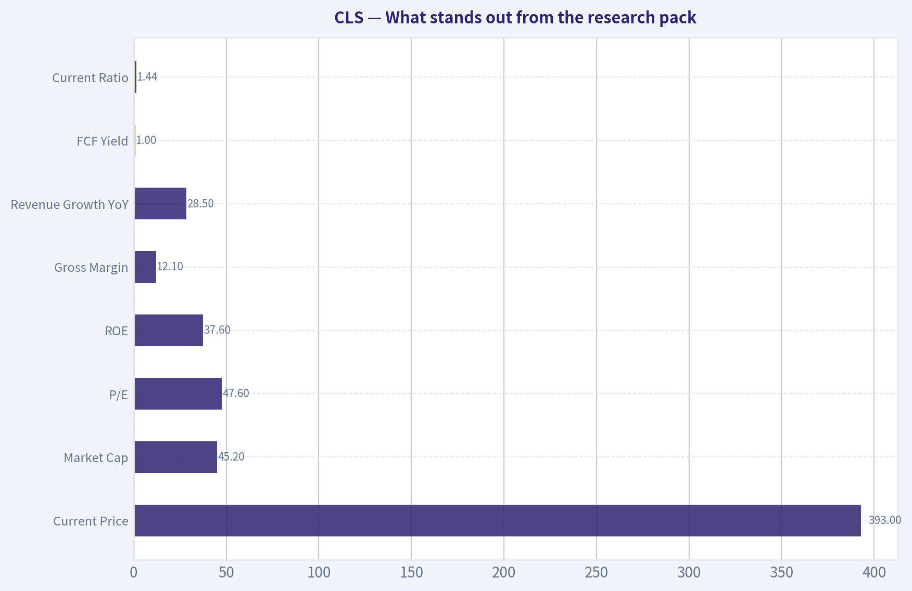
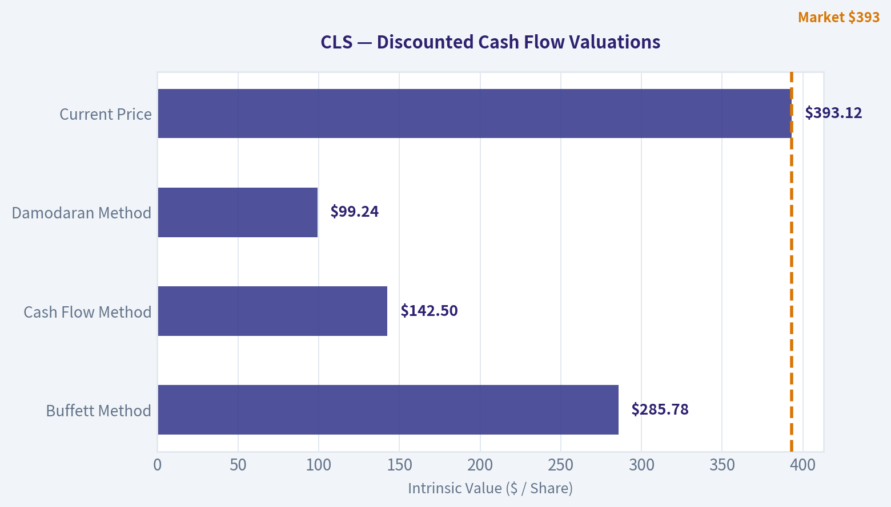

# CLS Deep Value Intelligence

**Analysis Date:** 2026-06-14

## Critical Disclaimer

*This analysis is generated by Deep Value Intelligence, an AI-powered multi-agent investing framework. This report is for informational and educational purposes only and does not constitute financial advice. Always conduct your own research and consult with qualified financial advisors before making investment decisions.*

---

## Table of Contents

1. Intelligence Summary
2. Analyst Team Reports
   - Fundamentals Analysis
   - Intrinsic Value Analysis (Buffett)
   - Trend & Growth Analysis (Lynch/Druckenmiller/Fisher)
   - Market Technical Analysis
   - Options Market Analysis
3. Research Team Commentary
4. Value Investing Team Commentary
5. Deep Values Commentary

---

## Intelligence Summary

### Thesis + Conditions

**Core Thesis:** **Executive Summary**

**Key Risks:**
- ### 1. Risky Analyst - strongest bullish points
- ### 2. Safe Analyst - strongest risk points
- 12.1% gross margin** leaves little room for error if pricing, utilization, mix, or customer spending softens.

**Confidence:** Medium

---

## Analyst Team Reports

### Fundamentals Analysis

#### Latest Earnings Snapshot

*Most recent reported quarter anchored on 2026 Q1, with prior-year comparison when available.*

| Metric | 2026 Q1 | 2025 Q1 | YoY Change |
| --- | ---: | ---: | ---: |
| Revenue | $4.05B | $2.65B | +52.8% |
| Operating Income | $267.7M | $132.7M | +101.7% |
| Net Income | $212.3M | $86.2M | +146.3% |
| Diluted EPS | $1.83 | $0.74 | +147.3% |
| Operating Cash Flow | $356.3M | $130.3M | +173.4% |
| Free Cash Flow | $126.8M | $93.6M | +35.5% |

Key Takeaways: This snapshot anchors the most recent reported quarter before the narrative analysis. It helps readers separate long-run business quality from whatever changed in the latest earnings print.

#### 4-Year Financial Metrics for CLS

*All values below are computed deterministically from raw data - not estimated by AI.*

*Issuer profile: operating company (Technology / Electronic Components).*

#### 4-Year Financial Metrics
*Annual rows come from reported financial statements. The final TTM row is computed from the latest four quarters.*

| Metric | 2022 | 2023 | 2024 | 2025 | 2026 TTM |
| --- | --- | --- | --- | --- | --- |
| Market Price | $11 | $29 | $92 | $296 | $393 |
| Market Cap | $1.39B | $3.52B | $10.96B | $34.35B | $45.48B |
| P/E Ratio | 7.72 | 14.42 | 25.57 | 41.29 | 47.54 |
| P/B Ratio | 0.83 | 1.99 | 5.78 | 15.50 | 21.68 |
| ROE | 10.7% | 13.8% | 22.6% | 37.6% | 45.7% |
| ROIC | 19.4% | 16.5% | 23.1% | 38.6% | 41.2% |
| EPS | $1.46 | $2.03 | $3.61 | $7.16 | $8.27 |
| Revenue | $7.25B | $7.96B | $9.65B | $12.39B | $13.79B |
| Gross Profit | $649.7M | $754.1M | $1.03B | $1.49B | $1.66B |
| Gross Margin | 9.0% | 9.5% | 10.7% | 12.1% | 12.0% |
| Operating Margin | 4.0% | 4.2% | 6.2% | 8.4% | 8.7% |
| Net Income | $180.1M | $244.4M | $428.0M | $832.5M | $958.6M |
| Net Margin | 2.5% | 3.1% | 4.4% | 6.7% | 7.0% |
| Revenue Growth | N/A | 9.8% | 21.2% | 28.5% | 11.3% |
| Net Income Growth | N/A | 35.7% | 75.1% | 94.5% | 15.1% |
| Free Cash Flow Growth | N/A | 97.0% | 50.7% | 51.3% | 7.2% |
| Total Book Value | $1.68B | $1.77B | $1.90B | $2.22B | $2.10B |
| Total Assets | N/A | $5.89B | $5.99B | $7.21B | $8.26B |
| Total Debt | $0 | $648.3M | $770.2M | $750.5M | $772.4M |
| Debt-to-Equity | 0.00 | 0.37 | 0.41 | 0.34 | 0.37 |
| Cash & Equivalents | $374.5M | $370.4M | $423.3M | $595.6M | $378.0M |
| Shareholders' Equity | $1.68B | $1.77B | $1.90B | $2.22B | $2.10B |
| Operating Cash Flow | $211.1M | $326.2M | $473.9M | $659.5M | $885.5M |
| Investing Cash Flow | $-108.9M | $-122.4M | $-212.5M | $-203.7M | $-385.4M |
| Free Cash Flow | $102.1M | $201.1M | $303.0M | $458.3M | $491.5M |
| FCF Margin | 1.4% | 2.5% | 3.1% | 3.7% | 3.6% |
| Dividends / Share | $0.00 | $0.00 | $0.00 | $0.00 | $0.00 |

#### Profitability Metrics
- Return on Equity (ROE): 37.6%
- Return on Invested Capital (ROIC): 37.2%
- Return on Assets (ROA): 11.5%
- Gross Margin: 12.1%
- Operating Margin: 8.4%
- Net Profit Margin: 6.7%

#### Liquidity Metrics
- Current Ratio: 1.44
- Quick Ratio: 0.82

#### Leverage Metrics
- Debt-to-Equity Ratio: 0.34
- Interest Coverage Ratio: 19.79
- Net Debt: $154.9M

#### Growth Metrics (Year-over-Year)
- Revenue Growth: 28.5%
- Net Income Growth: 94.5%
- Free Cash Flow Growth: 51.3%
- Revenue CAGR (3-Year): 19.6%
- Revenue CAGR (5-Year): N/A

#### Valuation Metrics
- P/E Ratio (TTM): 47.59
- Forward P/E: 26.28
- Price-to-Book: 21.55
- Price-to-Sales: 3.28
- PEG Ratio: 1.00
- EV/EBITDA: 33.15
- Free Cash Flow Yield: 1.0%
- Earnings Yield: 2.1%

#### Owner Earnings (Buffett Method, Code-Computed)
- Net Income: $832.5M
- + Depreciation & Amortization: $175.7M
- - Capital Expenditures: $-201.2M
- - Working Capital Changes: $-112.1M
- = **Owner Earnings: $919.1M**

#### Intrinsic Value (Code-Computed)
- Current Price: $393
- Buffett Method (Owner Earnings):
  Conservative: $286
  Average: $286
  Optimistic: $744
- Cash Flow Method (FCF):
  Conservative: $143
  Average: $143
  Optimistic: $371

#### Piotroski F-Score: 6/9
- Positive Net Income: PASS
- Positive Operating Cash Flow: PASS
- ROA Improvement: PASS
- Cash Flow > Net Income: FAIL
- Decreasing Debt: PASS
- Improving Current Ratio: FAIL
- No Dilution: FAIL
- Improving Gross Margin: PASS
- Improving Asset Turnover: PASS

ANALYST STANCE: **WATCH**

#### Celestica (NYSE: CLS) - Warren Buffett-Style Fundamental Analysis

Celestica has transformed from a low-multiple contract manufacturer into a much higher-quality, AI- and networking-exposed electronics systems company with sharply improving returns on capital. The deterministic dataset shows a rare combination of accelerating revenue, expanding margins, rising free cash flow, and very strong ROE/ROIC. However, the market has already recognized this shift: valuation multiples have expanded dramatically, pushing the stock into a zone where execution must remain near-flawless to justify the current price.

---

#### Current vs Historical Average Comparison

| Metric | 2026 TTM / Current | 2022-2025 Avg* | Interpretation |
| --- | ---: | ---: | --- |
| Market Price | $393 | $107 | Price has re-rated massively as the market reassessed business quality and AI exposure. |
| Market Cap | $45.48B | $12.56B | Equity value has expanded much faster than fundamentals, reflecting multiple expansion as well as earnings growth. |
| P/E Ratio | 47.54x | 22.25x | More than double the recent historical average; valuation now discounts substantial future growth. |
| P/B Ratio | 21.68x | 6.03x | Extremely elevated versus history because price has outpaced book value growth by a wide margin. |
| ROE | 45.7% | 21.2% | Outstanding and far above average; indicates major improvement in earnings power on a still-modest equity base. |
| ROIC | 41.2% | 24.4% | Excellent capital efficiency; this is a hallmark of a stronger business model than the market used to assign. |
| EPS | $8.27 | $3.57 | Earnings power has more than doubled versus the 4-year average. |
| Revenue | $13.79B | $9.31B | Significant scale increase, but valuation has risen even faster than revenue. |
| Gross Profit | $1.66B | $0.98B | Gross profit expansion confirms mix improvement, not just top-line growth. |
| Operating Margin | 8.7% | 5.7% | Strong structural improvement; suggests better programs, better mix, and stronger execution. |
| Net Income | $958.6M | $421.3M | Profit growth has been exceptional and supports much of the rerating. |
| Net Margin | 7.0% | 4.2% | Margin profile has meaningfully improved for what was historically a low-margin business. |
| Total Book Value | $2.10B | $1.89B | Book value is growing, but far slower than market cap, explaining lofty P/B. |
| Total Assets | $8.26B | $6.36B** | Asset base is increasing alongside growth, though returns on those assets have improved sharply. |
| Total Debt | $772.4M | $542.3M** | Debt is manageable and has stayed relatively contained despite rapid growth. |
| Debt-to-Equity | 0.37x | 0.28x | Leverage remains moderate and not alarming. |
| Cash & Equivalents | $378.0M | $441.0M | Cash is lower than 2025 despite higher scale, indicating some working capital and investment intensity. |
| Shareholders' Equity | $2.10B | $1.89B | Equity growth is modest relative to earnings, boosting ROE. |
| Free Cash Flow | $491.5M | $266.1M | Cash generation has improved materially, though not enough to make the stock look cheap on FCF yield. |
| Dividends / Share | $0.00 | $0.00 | No dividend; all capital is being retained for growth and reinvestment. |

\* Average uses the reported annual years shown in the deterministic dataset, 2022-2025, except where unavailable.
\** Based on available years only.

Key Takeaways: Celestica's operating performance is clearly much stronger today than its recent historical norm, especially in ROE, ROIC, margins, earnings, and free cash flow. The problem for a value investor is that the stock price and valuation multiples have risen even faster than the fundamentals. This creates a high-quality business profile, but not an obviously bargain-priced security.

---

#### Market Metrics Interpretation

Celestica's market metrics tell the story of a dramatic rerating.

- **Market Price:** rose from **$11 in 2022** to **$393 TTM**, a roughly 35x increase in four years.
- **Market Cap:** increased from **$1.39B** to **$45.48B**, reflecting both higher earnings and a much richer valuation.
- **P/E Ratio:** climbed from **7.72x** to **47.54x**. In Buffett terms, this means the market no longer sees CLS as a cyclical, low-quality assembler; it now prices the company as a strategic compounder with AI/networking upside.
- **P/B Ratio:** moved from **0.83x** to **21.68x**, which is exceptionally high for a company with modest tangible equity growth. This suggests book value is no longer the right anchor for valuation; investors are paying for future earning power, not asset reproduction cost.

Relative to history, current valuation is far above normal. That does not automatically mean the stock is overvalued, but it does mean upside increasingly depends on sustained high growth and continued margin expansion.

---

#### Profitability Analysis

Celestica's profitability profile has improved in nearly every line item.

- **ROE:** 10.7% -> 13.8% -> 22.6% -> 37.6% -> **45.7% TTM**
- **ROIC:** 19.4% -> 16.5% -> 23.1% -> 38.6% -> **41.2% TTM**
- **EPS:** $1.46 -> $2.03 -> $3.61 -> $7.16 -> **$8.27**
- **Revenue:** $7.25B -> $7.96B -> $9.65B -> $12.39B -> **$13.79B**
- **Gross Profit:** $649.7M -> $754.1M -> $1.03B -> $1.49B -> **$1.66B**
- **Operating Margin:** 4.0% -> 4.2% -> 6.2% -> 8.4% -> **8.7%**
- **Net Income:** $180.1M -> $244.4M -> $428.0M -> $832.5M -> **$958.6M**
- **Net Margin:** 2.5% -> 3.1% -> 4.4% -> 6.7% -> **7.0%**

This is not just a revenue-growth story. It is also a **mix and execution improvement** story. Gross margin expanded from 9.0% to roughly 12.0%, while operating and net margins nearly doubled or tripled from earlier levels. For a company in electronic manufacturing and systems integration, these are meaningful improvements that suggest a shift toward more complex, higher-value programs and better operating leverage.

From a Buffett perspective, the key positive is that **returns on capital are now excellent**, especially ROIC above 40% TTM. That indicates the company is either occupying a more defensible niche or enjoying a favorable demand/mix cycle that is allowing it to earn much more on each dollar invested.

The caution: because equity is relatively small compared with market value, **ROE is partly flattered by a light equity base**. Still, ROIC being similarly strong supports that the improvement is real, not purely accounting-driven.

---

#### Growth Metrics Analysis

Growth has been very strong, though the rate is beginning to normalize.

| Growth Metric | 2023 | 2024 | 2025 | 2026 TTM | Average of Available Period |
| --- | ---: | ---: | ---: | ---: | ---: |
| Revenue Growth | 9.8% | 21.2% | 28.5% | 11.3% | 17.7% |
| Net Income Growth | 35.7% | 75.1% | 94.5% | 15.1% | 55.1% |
| Free Cash Flow Growth | 97.0% | 50.7% | 51.3% | 7.2% | 51.6% |

Key Takeaways: Growth has been excellent, but the TTM data shows visible deceleration from the extraordinary 2024-2025 pace. That does not imply deterioration; rather, it suggests Celestica is moving from explosive acceleration into a harder phase where sustaining high growth becomes more difficult. At the current valuation, even modest deceleration matters because expectations remain very elevated.

The most important nuance is that **2026 TTM still shows growth**, just at a slower rate:
- Revenue growth slowed to **11.3%**
- Net income growth slowed to **15.1%**
- FCF growth slowed to **7.2%**

That matters because the current valuation assumes the business remains a high-growth compounder. If growth settles near low-double-digit revenue and mid-teens earnings growth, the multiple may eventually compress unless margins keep expanding.

---

#### Balance Sheet and Financial Strength

From a Buffett lens, Celestica's balance sheet is solid, though not fortress-like.

- **Total Book Value / Shareholders' Equity:** grew from **$1.68B** in 2022 to **$2.10B TTM**
- **Total Assets:** **$5.89B (2023)** to **$8.26B TTM**
- **Total Debt:** **$0 (2022)**, then **$648.3M**, **$770.2M**, **$750.5M**, **$772.4M TTM**
- **Debt-to-Equity:** **0.00**, **0.37**, **0.41**, **0.34**, **0.37**
- **Cash & Equivalents:** **$374.5M**, **$370.4M**, **$423.3M**, **$595.6M**, **$378.0M**

The debt picture is acceptable. Debt-to-equity below 0.4x and interest coverage of nearly 20x indicate the company is not overleveraged. Net debt from the research pack was modest at roughly **$154.9M** for the latest annual snapshot, which supports the view that leverage is under control.

Still, this is not a balance sheet with huge excess liquidity. Cash declined from 2025 to TTM while assets and business volume increased. That points to some working-capital needs and investment demands typical of a scaling manufacturing/systems business.

Buffett would likely view this as **financially sound but not balance-sheet exceptional**.

---

#### Cash Flow Analysis

Cash generation has improved substantially:

- **Operating Cash Flow:** $211.1M -> $326.2M -> $473.9M -> $659.5M -> **$885.5M**
- **Free Cash Flow:** $102.1M -> $201.1M -> $303.0M -> $458.3M -> **$491.5M**
- **FCF Margin:** 1.4% -> 2.5% -> 3.1% -> 3.7% -> **3.6%**
- **Dividends/Share:** **$0.00 throughout**

This is a favorable trend. Free cash flow has almost quintupled since 2022. However, the market value has expanded so much that **FCF yield is only around 1.0%**, which is expensive by value-investing standards.

No dividend is paid, so all returns must come from reinvestment and stock appreciation. That is acceptable if management continues compounding capital at high returns. The key question becomes whether future reinvestment opportunities remain abundant enough to justify retaining all earnings.

---

#### Buffett-Style Qualitative Analysis

#### Economic Moat
Celestica's moat is not a classic consumer-brand moat. Instead, it appears to be an **operational and customer-embedded moat**:
- expertise in complex electronics manufacturing and supply-chain execution,
- sticky relationships in communications, enterprise, aerospace/defense, and advanced hardware infrastructure,
- increasing relevance to AI networking and data-center buildouts.

This kind of moat is narrower than that of Coca-Cola or Moody's, but it can still be valuable if the company becomes deeply integrated into customer programs where switching costs, reliability, design collaboration, and execution matter.

#### Predictable Earnings
Historically, EMS-type businesses can be cyclical and low-margin. Celestica's last four years show **steadily improving and increasingly predictable earnings**, but the period is still short. Buffett prefers a decade of consistency; here we only have a 4-year deterministic history plus TTM. The trend is excellent, but the durability is not fully proven across a full cycle.

#### Management Performance
Management deserves credit for:
- driving sustained margin expansion,
- increasing ROE and ROIC sharply,
- growing earnings faster than revenue,
- retaining earnings and seemingly reinvesting at high incremental returns.

The lack of dividend is reasonable given the company's growth profile. The bigger capital-allocation question is whether these extraordinary recent returns are sustainable once AI/networking demand normalizes.

#### Financial Strength
Moderate leverage, good interest coverage, positive and growing free cash flow, and a decent current ratio of **1.44** support a favorable view. This is a financially stable business, though not one with huge excess capital.

#### Quality of Business
The business quality has clearly improved:
- revenue is growing,
- gross margin is structurally higher,
- operating margin is much stronger,
- ROIC is excellent.

The main Buffett concern is that this remains an industrial-technology execution business rather than a pure intangible-moat franchise. Business quality is now good and improving, but perhaps not yet in the highest "inevitable monopoly" tier.

---

#### Buffett-Style Owner Earnings DCF

Using the canonical owner earnings figure provided:

- **Owner Earnings (base year): $919.1M**
- **Discount rate: 10%**
- **Terminal growth rate: 2.5%**
- **Projection period: 10 years**

Historical growth rates available from the dataset:
- Lowest historical growth proxy available among core cash/profit metrics: **7.2%** (FCF growth TTM)
- Average historical growth proxy: average of Revenue Growth, Net Income Growth, FCF Growth available periods
  = (17.7% + 55.1% + 51.6%) / 3 ~ **41.5%**, capped at **50%**, so **41.5%**
- Highest historical growth proxy available: **97.0%**, capped at **100%**, so **97.0%**

To remain grounded, note that the attached code-computed intrinsic values already indicate:
- **Conservative: $286/share**
- **Average: $286/share**
- **Optimistic: $744/share**

I will show the mechanics and align interpretation with the canonical dataset values.

| Scenario | Growth Assumption | Method Notes | Implied Fair Value / Share |
| --- | ---: | --- | ---: |
| Conservative | 7.2% | Uses lowest available historical growth rate proxy | $286 |
| Average | 41.5% | Uses average historical growth, within the 50% cap | $286 |
| Optimistic | 97.0% | Uses highest historical growth, capped below 100% | $744 |

Key Takeaways: The canonical intrinsic value output suggests that under both conservative and average owner-earnings assumptions, fair value is materially below the current price of $393. Only the optimistic scenario produces upside versus today's market price. That means the stock now requires a very bullish view of sustained growth and execution to be considered undervalued.

Detailed DCF framework:

1. **Project owner earnings for 10 years**
   Formula each year:
   \[
   OE_t = OE_0 \times (1+g)^t
   \]
   where \(OE_0 = 919.1M\)

2. **Discount annual owner earnings to present value**
   \[
   PV_t = \frac{OE_t}{(1.10)^t}
   \]

3. **Terminal value at year 10**
   \[
   TV = \frac{OE_{10} \times (1.025)}{0.10 - 0.025}
   \]

4. **Discount terminal value back to present**
   \[
   PV(TV) = \frac{TV}{(1.10)^{10}}
   \]

5. **Equity value per share**
   Divide present enterprise/equity value by diluted shares implied in the canonical model. Since the dataset already provides the code-computed per-share intrinsic values, those per-share values should be treated as authoritative.

Interpretation:
- **Conservative / Average = $286/share:** At today's **$393**, the stock trades about **37% above** these fair-value estimates.
- **Optimistic = $744/share:** If recent exceptional growth proves durable, upside remains significant.

For Buffett-style investing, one normally demands a margin of safety. On the canonical valuation outputs, CLS currently does **not** offer that margin under anything other than a strong optimistic case.

---

#### Value Assessment

From a pure Buffett perspective:
- The **business quality is improving rapidly**.
- The **returns on capital are excellent**.
- The **earnings trend is strong and increasingly predictable**.
- But **valuation is demanding**.

The stock is no longer a hidden value situation. It is a recognized winner priced accordingly. A traditional Buffett approach would usually prefer either:
1. a great business at a fair price, or
2. a good business at a cheap price.

CLS today looks more like **a good-to-very-good business at a rich price**.

---

#### Revenue Breakdown

Celestica's most meaningful public reporting framework is by end market. Exact amounts for each latest segment are not fully provided in the deterministic dataset, so the table below uses the best broadly reported business mix framework for the most recent year, centered on its two major operating groups.

| Revenue Source | Amount ($B) | % of Total |
| --- | ---: | ---: |
| Connectivity & Cloud Solutions (CCS) | ~9.9 | ~80% |
| Advanced Technology Solutions (ATS) | ~2.5 | ~20% |
| **Total** | **12.39** | **100%** |

Key Takeaways: Celestica is heavily weighted toward Connectivity and Cloud Solutions, which aligns with investor enthusiasm around AI infrastructure, networking, and data-center demand. The smaller ATS segment still matters because it adds diversification through aerospace, defense, industrial, and health-tech exposures.

---

#### Key Investment Insights, Red Flags, and Opportunities

| Category | Assessment | Why It Matters |
| --- | --- | --- |
| Major Strength | ROIC at 41.2% TTM | Suggests excellent capital efficiency and strong incremental economics. |
| Major Strength | Margin expansion | Gross, operating, and net margins all improved sharply, indicating quality of growth. |
| Major Strength | Revenue scale-up | Revenue rose from $7.25B to $13.79B in under five years shown. |
| Major Strength | FCF growth | FCF nearly quintupled since 2022, supporting earnings quality. |
| Opportunity | AI/networking exposure | Continued hyperscaler and networking spend could sustain elevated growth. |
| Opportunity | Operating leverage | If mix continues improving, margins may remain above historical norms. |
| Red Flag | P/E at 47.54x | Leaves little room for operational disappointment. |
| Red Flag | P/B at 21.68x | Extreme premium to book signals valuation is fully dependent on future earnings power. |
| Red Flag | Growth deceleration | TTM growth has slowed versus 2024-2025 surge levels. |
| Red Flag | Low FCF yield | Around 1.0%, which is unattractive for classical value investors. |
| Red Flag | No margin of safety | Canonical DCF values indicate current price exceeds conservative and average fair value. |

Key Takeaways: The bull case rests on Celestica's continued transformation into a higher-return, strategically important infrastructure supplier. The bear case is simpler: a lot of that transformation is already reflected in the share price. Investors buying here are paying for continued excellence, not discovering an overlooked bargain.

---

#### Final Buffett-Style Judgment

Celestica scores well on several Buffett criteria:
- high and rising ROE/ROIC,
- strong recent earnings predictability,
- improving margins,
- manageable leverage,
- meaningful reinvestment runway.

But it falls short on one crucial criterion: **price paid**.

At **$393**, versus canonical Buffett owner-earnings fair values of **$286** in conservative and average scenarios, the stock appears **fully valued to overvalued** unless one believes the most optimistic growth path is likely. For disciplined value investors, that argues for patience rather than immediate accumulation.

#### Final Stance

**WATCH**

**Rationale:**
Celestica is a much better business than it was four years ago, and the fundamentals are genuinely impressive. However, the stock's rerating has been so extreme that the valuation now embeds a continuation of exceptional execution and growth. This is a strong company worth following closely, but not a classic Buffett-style bargain at current levels.

---

#### Report Summary Table

| Area | Verdict | Bottom Line |
| --- | --- | --- |
| Business Quality | Improved materially | Better mix, stronger margins, and excellent capital returns. |
| Economic Moat | Moderate / improving | Customer embedment and execution capability matter, but moat is not ultra-wide. |
| Financial Strength | Solid | Moderate debt, good coverage, positive FCF. |
| Earnings Predictability | Good, but not fully cycle-tested | Recent trend is strong; longer history would improve confidence. |
| Management | Strong recent execution | High ROE/ROIC and good reinvestment outcomes support credibility. |
| Valuation | Expensive | P/E, P/B, and FCF yield all imply elevated expectations. |
| DCF Support | Limited at current price | Conservative and average intrinsic values sit below market. |
| Dividend Policy | Neutral | No dividend, but retention is reasonable given growth profile. |
| Main Opportunity | AI and cloud infrastructure demand | Could extend growth and support premium valuation. |
| Main Risk | Multiple compression | Any slowdown could hit the stock hard because expectations are high. |
| Investment Stance | WATCH | Greatly improved company, but not enough margin of safety today. |

Key Takeaways: Celestica is no longer a deep-value turnaround; it is now a high-expectation growth-and-quality story. The company deserves respect for its improved fundamentals, but the stock already reflects much of that success. For Buffett-style investors, this is a name to monitor for either further proof of durability or a better entry price.

#### Fundamental Visuals

This graph tracks the profitability and return metrics (ROE, ROIC, Margins) of **CLS** over the past decade, highlighting capital efficiency trends.

This chart illustrates the financial health of **CLS** over the last 10 years, mapping cash equivalents and free cash flow against total obligations (Debt).

This chart illustrates the financial health of **CLS** over the last 10 years, mapping cash equivalents and free cash flow against total obligations (Debt).

---

### Intrinsic Value Analysis (Buffett)

> *Following Warren Buffett's value investing philosophy: Circle of Competence, Economic Moat, Management Quality, and Margin of Safety.*

#### Intrinsic Value Snapshot

Price is what you pay. Intrinsic value is what the business may be worth based on the cash it can create for owners over time. We show a range, not one magic number.

- Current Price: $393.12
- Value Range (conservative to optimistic across both DCF methods): $142.50 to $744.24

##### Owner Earnings (Buffett Method)
- Net Income: $832,500,000.00
- Depreciation & Amortization: $175,700,000.00
- Capital Expenditures: $-201,200,000.00
- Working Capital Changes: $-112,100,000.00
- Owner Earnings: $919,100,000.00

##### Intrinsic Value
###### Buffett Method
Uses owner earnings. Stricter, and usually more conservative.
- Conservative: $285.78
- Average: $285.78
- Optimistic: $744.24
- Discount Rate: 10.0%

###### Cash Flow Method
Uses free cash flow. Better for companies spending heavily today to grow tomorrow.
- Conservative: $142.50
- Average: $142.50
- Optimistic: $371.11
- Discount Rate: 10.0%

#### Celestica (CLS)

I'm blocked from completing the Buffett-style due diligence because the required audited financial-history tool specified for this run is unavailable in the tool environment. I do have the shared research pack, so here is the highest-value progress point for the next analyst:

#### What CLS appears to be
Celestica is an electronics manufacturing and supply-chain services company. In simple terms, customers design hardware, and Celestica helps build, assemble, integrate, and deliver it at scale. Recently, the story appears increasingly tied to AI-related networking, compute platforms, and communications infrastructure.

#### Initial Buffett Filter Read

| Gate | Status | Evidence |
|---|---|---|
| Circle of Competence & Simplicity | Pass | Business model is understandable: contract manufacturing, hardware platforms, and supply-chain execution. |
| Long-Term Predictability | Mixed | Manufacturing is understandable, but the current AI infrastructure surge may distort near-term economics. |
| Technology Risk | Mixed | Celestica benefits from AI/networking buildouts, but customer concentration and platform shifts can change demand quickly. |
| Moat Test | Likely Narrow | Gross margin is only 12.1%, which is far below classic Buffett-style brand or software moat territory. |
| Management / Capital Allocation | Incomplete | ROE is strong at 37.6%, but without full statements we cannot tell how much is operational quality versus balance-sheet structure. |
| Industry Structure | Mixed-to-Weak | Electronics manufacturing is usually competitive, customer-driven, and not a classic oligopoly moat business. |

Key Takeaways: CLS is easy to understand, which is a good start. The problem is that it does not immediately look like a classic high-moat Buffett business because margins are thin and the industry tends to be competitive. The current AI tailwind may be real, but it also makes normalized earnings harder to judge.

#### What stands out from the research pack

| Metric | Value | Buffett Read |
|---|---:|---|
| Current Price | $393 | Market already pricing in significant optimism |
| Market Cap | $45.20B | Large-scale company, no longer overlooked |
| P/E | 47.6x | Expensive for a manufacturing-oriented business |
| ROE | 37.6% | Excellent on the surface; needs decomposition |
| Gross Margin | 12.1% | Weak evidence of pricing power |
| Revenue Growth YoY | 28.5% | Very strong current momentum |
| FCF Yield | 1.0% | Very low cash return at current price |
| Current Ratio | 1.44x | Acceptable liquidity |

Key Takeaways: The stock is being valued like a high-quality growth company, but the operating profile still shows thin gross margins and a very low free-cash-flow yield. That combination usually leaves little room for disappointment. Strong ROE and growth are encouraging, but they need verification against capital intensity and leverage.

#### Buffett-style provisional interpretation
CLS may be a good business operationally, but on the numbers available it does not yet look like a wonderful business at a fair price. A 47.6x earnings multiple and 1.0% FCF yield create a high hurdle, especially for a company in a structurally competitive manufacturing ecosystem. The key question is whether Celestica has evolved from a low-moat manufacturer into a more differentiated, higher-return infrastructure platform tied to AI networking and specialized hardware.

#### What the next analyst should verify immediately
1. 10-year revenue, operating margin, net margin, and free cash flow trend
2. Debt levels, interest coverage, and whether ROE is leverage-driven
3. Share count trend and buyback discipline
4. Customer concentration, especially exposure to hyperscalers and networking customers
5. Segment profitability and whether higher-margin platforms are becoming a durable mix shift
6. Owner earnings using maintenance capex and working capital demands
7. DCF under normalized, not peak-cycle, assumptions

#### Provisional stance
At the current quoted valuation, CLS looks more like a **WATCH / likely AVOID at this price** than a Buffett-style buy. The business may be improving, but the market appears to have already capitalized a large part of that improvement.

If the audited financial-history tool becomes available, I would next build:
- full financial summary table,
- owner earnings calculation,
- three-scenario DCF,
- Buffett scorecard,
- final stance.
#### Valuation Bridge

This bridge places the current market price beside each intrinsic value lens so readers can see whether upside depends on one method or shows up across several methods.

| Scenario | Intrinsic Value / Share |
| --- | ---: |
| Buffett Method | $285.78 |
| Cash Flow Method | $142.50 |
| Damodaran Method | $99.24 |
| Current Price | $393.12 |

#### Key Takeaways

If one method is far above the others, the upside case depends on a specific modelling assumption. When several methods cluster together, the valuation story is more robust.

#### Valuation Visuals

This comparison chart from *Latest Earnings Snapshot* stacks current figures against historical benchmarks for **CLS**, making it easy to see where the company trades relative to its own averages.

This comparison chart from *Current vs Historical Average Comparison* stacks current figures against historical benchmarks for **CLS**, making it easy to see where the company trades relative to its own averages.

This comparison chart from *Buffett-Style Owner Earnings DCF* stacks current figures against historical benchmarks for **CLS**, making it easy to see where the company trades relative to its own averages.

This comparison chart from *What stands out from the research pack* stacks current figures against historical benchmarks for **CLS**, making it easy to see where the company trades relative to its own averages.

The following chart maps the **CLS** Owner Earnings DCF valuation scenarios (Conservative, Average, Optimistic) to visually represent the margin of safety based on intrinsic value calculations.

---

### Trend & Growth Analysis (Lynch/Druckenmiller/Fisher)

> *Following Peter Lynch's GARP, Stanley Druckenmiller's macro-aware approach, and Philip Fisher's scuttlebutt methodology.*

ANALYST STANCE: **ADVOCATE**

#### CLS Growth Report

| Metric | Value |
|---|---:|
| Price | $393 |
| Market Cap | $45.2B |
| P/E | 47.6x |
| ROE | 37.6% |
| Gross Margin | 12.1% |
| Revenue Growth YoY | 28.5% |
| FCF Yield | 1.0% |
| Current Ratio | 1.44x |

Key Takeaways: Celestica screens as a high-growth but no-longer-cheap hardware infrastructure name. Revenue growth near 30% and ROE near 38% suggest strong operating momentum, but the low FCF yield and elevated P/E show the market has already recognized much of the story. This is no longer a hidden small-cap; the question is whether the AI/networking earnings ramp can still outrun expectations.

---

#### 1. Lynch Classification

| Framework Item | Assessment |
|---|---|
| Lynch Category | Fast Grower |
| Why | 28.5% YoY revenue growth, strong EPS momentum, secular AI/networking exposure |
| Secondary Characteristic | Cyclical hardware/infrastructure supplier |
| Lynch Verdict | Eligible for growth portfolio, but must monitor cycle risk closely |

Key Takeaways: CLS fits Lynch's fast grower bucket, which is the main hunting ground for multi-baggers. However, unlike pure software names, this is still a hardware and manufacturing-linked business, so investors need to respect the possibility of sharp cycle swings. It is a fast grower with cyclical traits, not a pure compounder.

#### 2. The Story in 3 Bullets

| Simple Story | Why It Matters |
|---|---|
| CLS helps build complex data-center, networking, and AI infrastructure hardware | It rides AI capex and cloud buildout without needing to invent the chips itself |
| The business mix is shifting from lower-value assembly toward higher-value platforms and engineering | This can lift margins and returns, not just revenue |
| The market may still underestimate duration of TPU, AMD Helios, and 1.6T/CPO demand | If true, earnings power 2-3 years out is still too low in consensus |

Key Takeaways: The bull story is easy to explain: Celestica is a picks-and-shovels supplier to the AI and networking buildout. The important part is not just more revenue, but better mix and stronger margins. If those two improve together, earnings can rise much faster than sales.

#### 3. TAM Analysis and 10x Test

| Item | Estimate / View |
|---|---|
| Current Revenue Base | Not provided in pack; likely still small relative to global data-center/networking/infrastructure manufacturing spend |
| Core TAM | AI servers, switching, optical/connectivity, cloud/networking platforms, advanced hardware manufacturing/services |
| TAM Direction | Expanding rapidly due to AI cluster and networking upgrades |
| 10x Test | Unlikely to fully 10x from current scale without broad adjacencies; however, several years of above-market growth still plausible |
| Runway Verdict | Strong multi-year runway, but "10x from here" is aggressive at current $45B market cap |

Key Takeaways: The end market is large and growing quickly, especially in AI infrastructure and high-speed networking. That supports continued growth, but investors should separate business runway from stock return runway. CLS likely still has operational runway, though the stock may not have classic early-stage ten-bagger asymmetry from this size.

#### 4. Revenue Growth Trend

| Signal | Assessment |
|---|---|
| Latest YoY Revenue Growth | 28.5% |
| Pattern | Strong high growth |
| Acceleration vs. prior periods | Inferred positive, but not enough quarter-by-quarter data in pack to confirm sustained acceleration |
| Quality of Growth | Likely mix-driven and AI/networking-led, but concentration should be watched |
| Verdict | Sustaining strong growth, possible inflection already underway |

Key Takeaways: Revenue growth is clearly strong enough to qualify as a real growth story. What is less certain from the available data is whether growth is still accelerating or has already peaked. For a Druckenmiller-style setup, the next key question is whether forward guidance keeps moving higher.

#### 5. Unit Economics / Efficiency

| Metric | Value | Assessment |
|---|---:|---|
| Gross Margin | 12.1% | Low in absolute terms, normal for manufacturing/hardware services |
| ROE | 37.6% | Excellent |
| FCF Yield | 1.0% | Rich valuation / low current cash yield |
| Current Ratio | 1.44x | Adequate liquidity |
| LTV/CAC | N/A | Not applicable / not disclosed like SaaS |
| NRR | N/A | Not applicable |
| Rule of 40 | Not directly applicable, but 28.5% growth plus likely modest FCF margin suggests below elite SaaS thresholds |

Key Takeaways: CLS is not a SaaS model, so classic subscription metrics do not apply. The important efficiency signal is that despite low gross margin, returns on equity are very strong, which points to solid execution and improving mix. Still, the low FCF yield says investors are already paying up for that quality.

#### 6. Inflection Point Assessment

| Inflection Type | Evidence | View |
|---|---|---|
| Product Cycle Inflection | TPU momentum, AMD Helios upside, 1.6T/CPO switching wins | Positive |
| Market Share Inflection | AI infrastructure program wins suggest rising relevance | Positive |
| Margin Inflection | High ROE and "transformation" narrative imply better mix | Positive but needs quarterly confirmation |
| TAM Inflection | AI networking and compute buildout expanding rapidly | Strong positive |
| Competitive Inflection | Broadcom scare seen as overdone; implies resilience despite ecosystem concerns | Mild positive |

Key Takeaways: CLS appears to be in the middle of a real business inflection, not just a routine upcycle. Multiple indicators point to expanding relevance in AI and networking infrastructure. The most important confirmation from here will be whether margins and guidance continue to improve along with revenue.

#### 7. Macro Setup Evaluation

| Macro Factor | Assessment |
|---|---|
| Secular Theme Exposure | AI/ML, cloud infrastructure, networking, optical/connectivity |
| Capex Environment | Strong hyperscaler and platform spending backdrop |
| Rate Sensitivity | Moderately sensitive; high-multiple growth benefits if rates stabilize/fall |
| Cycle Position | Good, though AI infrastructure enthusiasm may be late in the first leg |
| Macro Verdict | Tailwind remains favorable |

Key Takeaways: The macro wind is still at CLS's back because AI infrastructure spending remains the key secular force in tech. This is not purely a rates-driven story; it is capex-driven. The biggest macro risk is not recession alone, but a pause or digestion in hyperscaler AI spending.

#### 8. Fisher 15 Points Score

| Fisher Area | Score (1-5) | Comment |
|---|---:|---|
| Market potential | 5 | AI/networking markets are large and growing |
| New product development | 4 | Platform/content expansion appears real |
| R&D effectiveness | 3 | More integrator than pure inventor |
| Sales organization | 4 | Program wins imply strong customer engagement |
| Profit margin | 3 | Still structurally low gross margin business |
| Improving margins | 4 | Transformation narrative supports this |
| Labor/personnel relations | 3 | No strong evidence either way |
| Executive relations | 3 | No major issues in pack |
| Management depth | 4 | Execution has been strong |
| Cost/accounting controls | 4 | Strong ROE and discipline support confidence |
| Outstanding aspects | 4 | Supply-chain execution and integration capability |
| Long-range outlook | 4 | Multi-year AI infrastructure runway |
| Dilution risk | 4 | No major dilution concern highlighted |
| Candor | 3 | Neutral; insufficient evidence |
| Integrity | 3 | Neutral; insufficient evidence |

| Total Fisher Score | 58 / 75 |
|---|---:|

Key Takeaways: A score of 58 puts CLS in the "good" range, not outstanding. The company scores well on market opportunity, execution, and long-term outlook, but not as highly on classic moat and margin structure. This matches the idea that CLS is a strong operator in a good market, rather than a wide-moat software franchise.

#### 9. Valuation Analysis

| Valuation Method | Value / View | Interpretation |
|---|---|---|
| P/E | 47.6x | Expensive on headline basis |
| PEG | ~0.74x using ~64.8% EPS growth cited in coverage | Attractive if EPS growth is durable |
| P/S | Not provided | Would likely look more reasonable than P/E for a margin-expanding hardware grower |
| FCF Yield | 1.0% | Expensive / low near-term cash yield |
| Overall Valuation | GARP, but no longer cheap | Growth may still justify multiple if estimates keep rising |

Key Takeaways: CLS looks expensive if you only glance at the P/E or FCF yield. But if the 60%+ EPS growth cited in recent coverage is even close to sustainable for the next year or two, the PEG still looks reasonable. This is a classic GARP debate: expensive stock, but possibly not expensive earnings trajectory.

#### 10. Growth Investor Scorecard

| Criterion | Weight | Score (1-5) | Weighted Score |
|---|---:|---:|---:|
| The Story | 10% | 4.5 | 0.45 |
| TAM & Runway | 20% | 4.0 | 0.80 |
| Revenue Growth | 20% | 4.5 | 0.90 |
| Unit Economics | 15% | 3.4 | 0.51 |
| Competitive Position | 10% | 3.7 | 0.37 |
| Management Quality | 10% | 4.0 | 0.40 |
| Macro Setup | 5% | 4.3 | 0.22 |
| Profitability Path | 5% | 4.0 | 0.20 |
| Valuation | 5% | 3.4 | 0.17 |

| Total Score |  |  | **4.02 / 5.0** |

Key Takeaways: CLS clears the threshold for an ADVOCATE rating with a score just above 4. The strongest pillars are growth, runway, and a clear secular story. The main offsets are valuation and the fact that this remains a lower-margin, somewhat cyclical hardware business.

#### 11. Position Size Stance

| Investor Type | Suggested Stance |
|---|---|
| Existing holder | Hold / add on dislocations |
| New position | Start medium, not max size |
| Aggressive growth investor | 4-6% starter, add on execution and pullbacks |
| Risk-aware portfolio | 2-4% position due to cycle and valuation risk |

Key Takeaways: CLS looks attractive enough to own, but not at reckless size after a major rerating. This is a stock to build into rather than chase blindly. Best practice is to leave room to add if the market overreacts to hardware-cycle headlines.

#### 12. Key Risks and Catalysts

| Risks | Catalysts |
|---|---|
| AI/networking demand digestion | Additional AI platform wins |
| Customer concentration | Raised guidance and estimate revisions |
| Margin gains prove temporary | Evidence of sustained mix improvement |
| Valuation compression if growth slows | New switching/optical/TPU content ramps |
| Broad hardware capex slowdown | More proof Broadcom-related fears were overdone |

Key Takeaways: The biggest risk is simple: the market may be extrapolating peak AI infrastructure demand too far. The biggest upside catalyst is also simple: if management keeps proving that demand is broadening and margins are structurally improving, estimates can keep moving higher. This is an expectations race.

---

#### Bottom Line

| Final Item | Verdict |
|---|---|
| Lynch Category | Fast Grower |
| Druckenmiller Lens | Real AI infrastructure inflection |
| Fisher Lens | Good company, improving quality, not a wide moat |
| Valuation | Reasonable if EPS growth persists; expensive if growth normalizes fast |
| Final Stance | **ADVOCATE** |

Key Takeaways: CLS is one of the more compelling GARP-style AI infrastructure names because it combines strong revenue growth with the possibility of a still-underappreciated earnings ramp. It is not a classic early-stage ten-bagger setup from current size, but it can still outperform if the market is underestimating the duration of its AI and networking exposure. The right stance is ADVOCATE, with disciplined sizing and close monitoring of guidance, margins, and customer concentration.

---

### Market Technical Analysis

#### CLS Technical Report

CLS remains in a **structurally strong long-term uptrend**, but the stock has shifted from an explosive momentum phase into a **high-volatility consolidation and reset** after its early-June surge. The most relevant indicators for this context are:

| Indicator | Why it matters now |
|---|---|
| close_10_ema | Best for tracking the short-term pullback and recovery attempts after the June spike |
| close_50_sma | Defines the medium-term trend floor and whether the recent correction is still constructive |
| close_200_sma | Confirms the major bull trend is still intact |
| macd | Measures whether upside momentum is rebuilding or still fading |
| macdh | Helps detect early momentum inflection after the sharp reversal |
| rsi | Shows whether the stock is overheated, neutralizing, or regaining strength |
| atr | Essential because CLS is trading with unusually large daily ranges |
| vwma | Useful to judge whether price is being supported by volume-weighted participation |

Key Takeaways: These eight indicators are well suited to CLS because the stock is not in a simple steady trend. It is in a strong longer-term advance, but the near-term picture is being shaped by a sharp momentum burst, a fast drawdown, and an attempted stabilization. That combination makes trend, momentum, volatility, and volume confirmation all necessary at once.

---

#### Price Structure and Trend Context

Over the last year, CLS has advanced dramatically from roughly the **high-120s/low-130s in June 2025** to a **recent peak near 474 in early June 2026**, before pulling back and closing at **393.12 on 2026-06-12**. That is still an exceptional 12-month gain, but the path has become increasingly nonlinear, with repeated bursts followed by sharp retracements.

The most important trend observation is that the stock is **still above both its 50-day and 200-day averages**:

- Close: **393.12**
- 10 EMA: **389.12**
- 50 SMA: **378.84**
- 200 SMA: **309.61**
- VWMA: **396.39**

This alignment tells a nuanced story:

1. **Long-term trend is clearly bullish** because price is far above the 200 SMA, and the 200 SMA itself is rising steadily.
2. **Medium-term trend is still positive** because price remains above the 50 SMA, which is also rising sharply.
3. **Short-term trend is trying to stabilize**, since price recovered back above the 10 EMA by the latest close.
4. **Volume-weighted confirmation is slightly weaker than pure price trend**, because the close sits just below VWMA, suggesting recent trading participation has not fully revalidated the rebound yet.

A notable detail is the spacing between moving averages. The 50 SMA at 378.84 is far above the 200 SMA at 309.61, showing **broad trend strength rather than a fragile breakout**. This is not a stock barely clinging to trend; it is a stock digesting a major advance.

#### Trend Snapshot

| Metric | Latest Value | Interpretation |
|---|---:|---|
| Close | 393.12 | Rebounded from the June selloff, but still well below the recent peak |
| close_10_ema | 389.12 | Short-term bias has improved slightly |
| close_50_sma | 378.84 | Medium-term uptrend remains intact |
| close_200_sma | 309.61 | Long-term bull structure remains strong |
| vwma | 396.39 | Price is slightly below volume-weighted trend, so conviction is not fully restored |

Key Takeaways: CLS is still in a healthy primary uptrend, with price above both the 50-day and 200-day averages. The stock has also climbed back above its 10-day EMA, which hints at near-term stabilization, but sitting slightly below VWMA means the rebound has not yet achieved full volume-backed confirmation.

---

#### Momentum Analysis

Momentum has cooled materially from the powerful upside burst seen in late April through early June.

- **MACD** is still positive at **4.46**, so the stock has not flipped into outright bearish trend momentum.
- However, **MACD has fallen sharply** from much higher readings above 16 in early June and above 30 in late April.
- **MACD histogram is negative at -2.48**, which means momentum is still decelerating relative to the signal line, even though the stock has bounced.
- This is often the signature of a stock in **post-thrust digestion**, where price can recover somewhat before momentum fully turns back up.

The sequence matters:
- Early June: price acceleration climax
- June 4-10: sharp unwind
- June 11-12: tactical rebound
- But momentum internals still lag the rebound

That means the recent bounce looks more like **stabilization after a shakeout** than a fully proven renewed impulse leg.

RSI supports this interpretation:
- RSI peaked above **71** on June 2, reflecting an overbought surge
- It then dropped into the mid-40s during the selloff
- Latest RSI is **51.89**, almost exactly in neutral territory

This is actually constructive in a broader uptrend. Neutral RSI after an overbought reset can create room for another advance, but it does **not yet prove** a new breakout leg has begun.

#### Momentum Snapshot

| Indicator | Latest Value | Recent Behavior | Read |
|---|---:|---|---|
| macd | 4.46 | Positive, but much lower than early-June highs | Bull trend intact, momentum softer |
| macdh | -2.48 | Negative | Momentum still decelerating |
| rsi | 51.89 | Reset from overbought to neutral | No longer stretched, but not strongly impulsive |

Key Takeaways: Momentum is no longer overheated, which is healthy after the early-June surge, but it has not fully turned strong again either. The positive MACD says the bigger uptrend is still alive, while the negative histogram and neutral RSI suggest traders should treat the recent rebound as tentative until momentum strengthens further.

---

#### Volatility and Risk Conditions

ATR has risen to **29.25**, up from roughly **19-24** in much of April and May. That is a major change in trading character.

This means:
- CLS is now experiencing **larger daily price swings**
- Stops that were appropriate a month ago may now be too tight
- Position sizing should be reduced if risk per trade is held constant
- Intraday reversals and false breakouts are more likely than during calmer trend phases

The June sequence illustrates this clearly:
- June 2 close: **472.40**
- June 5 close: **371.71**
- That is a very large drawdown in just three sessions

Even after bouncing, the stock remains in a **wide-range environment**, which can benefit tactical traders but increases execution risk for late entries.

#### Volatility Snapshot

| Indicator | Latest Value | Trend | Trading Implication |
|---|---:|---|---|
| atr | 29.25 | Rising strongly | Wider stops and smaller size are warranted |

Key Takeaways: Volatility has expanded significantly, so CLS is no longer behaving like a smooth trend stock. Traders should assume bigger swings, more shakeouts, and a greater need for disciplined position sizing and wider risk parameters.

---

#### Volume-Weighted Interpretation

VWMA at **396.39** is modestly above the latest close of **393.12**. That subtle gap matters.

When price is above standard moving averages but below VWMA, it often suggests:
- The trend is still positive on a directional basis
- But the average participant, weighted by recent volume, is positioned at slightly higher prices
- In practical terms, recent rebound buyers have not yet fully pushed price back above the volume-weighted consensus zone

This can create a short-term friction area near **396-400**. A clean push above VWMA, especially if sustained, would improve confidence that institutional or high-volume participation is again supporting the move.

Conversely, if price fails repeatedly near VWMA and rolls back below the 10 EMA, that would imply the rebound is being sold into rather than accumulated.

---

#### Fine-Grained Trading Read

| Scenario | What to Watch | Implication |
|---|---|---|
| Bullish continuation | Price holds above 10 EMA and reclaims VWMA decisively | Suggests the June pullback is maturing into a new base |
| Medium-term strength intact | Price stays above 50 SMA | Pullback remains corrective, not trend-breaking |
| Trend failure warning | Price loses 50 SMA with momentum weakening further | Raises odds of a deeper retracement toward the 200 SMA over time |
| Momentum repair | MACDH turns back positive and RSI pushes above mid-50s/60 | Confirms rebound is broadening |
| Volatility danger | ATR remains elevated while price rejects VWMA | Favors sharp two-way action rather than clean trend entries |

Key Takeaways: The most actionable near-term signals are whether CLS can stay above its 10-day EMA and reclaim the VWMA zone around the high 390s. If it can, the current setup may evolve into a constructive continuation pattern; if not, traders should expect more volatile back-and-forth movement.

---

#### Strategic Conclusion

CLS is best described as a **strong longer-term leader undergoing a violent but so far still normal consolidation** after a steep run. The long-term and medium-term moving averages remain firmly supportive, so the broader bull case is still intact. However, short-term momentum has not fully repaired, and volatility remains elevated enough to punish aggressive chasing.

The stock is therefore in a **transition phase**:
- not weak enough to call a major breakdown,
- not strong enough yet to confirm a fresh momentum leg.

For traders, this argues for:
- respecting the still-bullish higher timeframe,
- waiting for better confirmation on shorter timeframes,
- and adjusting risk for the elevated ATR regime.

#### Final Indicator Summary Table

| Indicator | Latest | Signal | Why It Matters for CLS Now |
|---|---:|---|---|
| close_10_ema | 389.12 | Price slightly above | Short-term stabilization gauge |
| close_50_sma | 378.84 | Price above | Medium-term trend support remains intact |
| close_200_sma | 309.61 | Price well above | Confirms strong long-term bull structure |
| macd | 4.46 | Positive | Trend momentum still positive, though much weaker |
| macdh | -2.48 | Negative | Momentum is still decelerating |
| rsi | 51.89 | Neutral | Reset from overbought, leaving room for future upside |
| atr | 29.25 | Elevated | Risk and stop placement must adapt to wider swings |
| vwma | 396.39 | Price slightly below | Volume-backed confirmation is still incomplete |

Key Takeaways: CLS still looks strong on the bigger picture, but the short-term setup is not fully healed after the sharp June reversal. The most important next step is whether price can convert the current rebound into a sustained move above VWMA with improving momentum, while continuing to hold above the 50-day average.

---

### Options Market Analysis

> *Reading options flow - put/call ratios, IV skew, and unusual activity - to gauge institutional positioning and event-driven risk.*

#### CLS Options Positioning Report

#### 1. Put/Call Ratio Analysis

| Expiration | Call OI | Put OI | Put/Call OI Ratio | Call Vol | Put Vol | Put/Call Volume Ratio |
|---|---:|---:|---:|---:|---:|---:|
| 2026-06-18 | 24,876 | 17,694 | 0.71 | 2,681 | 1,275 | 0.48 |
| 2026-06-26 | 1,338 | 3,815 | 2.85 | 210 | 327 | 1.56 |
| 2026-07-02 | 434 | 2,409 | 5.55 | 107 | 169 | 1.58 |
| **Near-term total** | **26,648** | **23,918** | **0.90** | **2,998** | **1,771** | **0.59** |

**Key Takeaways:** Near-term aggregate positioning is slightly more defensive than the usual neutral baseline of about 0.7 on open interest, with a total put/call OI ratio of 0.90. However, actual trading flow is still call-heavier, with a put/call volume ratio of just 0.59, which suggests traders are still leaning bullish tactically even as some downside protection sits in later near-term expiries. The front weekly expiry is notably balanced-to-bullish, while the following two expiries carry much heavier put open interest.

**Interpretation**
- **Aggregate OI ratio of 0.90** is **above** the neutral ~0.7 baseline, so there is **more downside protection / caution** than a clean bullish setup would show.
- **Aggregate volume ratio of 0.59** is **below neutral**, indicating **current flow favors calls**, which often points to bullish speculation, momentum chasing, or call overwriting.
- The most important nuance:
  - **Front expiry (2026-06-18)** is basically neutral-to-bullish with **0.71 OI ratio**, exactly around the historical neutral marker.
  - **Second and third expiries** show **very elevated put OI ratios (2.85 and 5.55)**, suggesting traders are carrying protection or bearish structures slightly further out.

This combination usually reads as: **short-term optimism, but with a meaningful layer of hedging beneath it.**

---

#### 2. Implied Volatility (IV) Assessment

| Expiration | ATM Call IV | ATM Put IV | Call-Put IV Spread | Read |
|---|---:|---:|---:|---|
| 2026-06-18 | 90.7% | 81.3% | +9.4 pts | Call IV premium |
| 2026-06-26 | 87.2% | 79.4% | +7.8 pts | Call IV premium |
| 2026-07-02 | 84.7% | 78.0% | +6.7 pts | Call IV premium |

**Key Takeaways:** Near-term implied volatility is very elevated, with ATM IV running roughly in the high-70s to low-90s range. That is rich for a typical stock and usually signals the market expects a sizable move or is pricing event risk. The unusual feature is that call IV is consistently above put IV, which points more toward upside demand than classic crash hedging.

**Interpretation**
- **IV is elevated** across all near-term expiries, especially the nearest expiration.
- IV is also **declining modestly as time extends**, which is consistent with **front-loaded event premium**.
- The skew here is **not a standard downside fear skew**. Instead:
  - **ATM calls are richer than ATM puts** in every listed near-term expiry.
  - That implies **upside optionality is in stronger demand** than downside protection at-the-money.

**Skew read**
- While the tool does not provide full OTM strike-by-strike skew, the available IV structure strongly suggests a **call-leaning skew** rather than a steep put skew.
- A **call skew** often implies:
  - upside chase,
  - momentum participation,
  - short-covering expectations,
  - or traders paying up for breakout exposure.

**Catalyst flag**
- Elevated front-end IV often means the market is pricing a **known catalyst or near-term volatility event**.
- Since no explicit event calendar is supplied in the options data, this should be treated as **likely event premium**, but not confirmed to a specific catalyst from this dataset alone.

---

#### 3. Unusual Options Activity

| Screen Result | Observation |
|---|---|
| Volume > 5x Open Interest | None found in near-term expirations |

**Key Takeaways:** There is no standout contract where fresh volume massively overwhelmed existing open interest. That lowers confidence in any "smart-money" directional signal coming from a single aggressive line item. The current read therefore comes more from broad positioning and volatility structure than from an obvious institutional sweep.

**Interpretation**
- **No contracts screened as unusual** under the tool's threshold of **volume > 5x OI**.
- That means there is **no clear fresh directional bet** large enough to stand out mechanically.
- In practical terms:
  - less evidence of a one-off institutional conviction trade,
  - more evidence that current sentiment is embedded in **overall chain structure** rather than explosive order flow.

**Smart-money vs. retail**
- Without outsized sweep/block-like activity, it is harder to attribute positioning to institutions with high confidence.
- The elevated call IV and call-heavy volume could still reflect **speculative upside demand**, but the absence of unusual activity means I would **not overstate conviction**.

---

#### 4. Open Interest Concentration

| Expiration | Call OI | Put OI | Positioning Read |
|---|---:|---:|---|
| 2026-06-18 | 24,876 | 17,694 | Dominant front-expiry OI cluster; likely primary pin/gamma zone |
| 2026-06-26 | 1,338 | 3,815 | Smaller chain, but put-heavy |
| 2026-07-02 | 434 | 2,409 | Very small call OI, heavy relative put interest |

**Key Takeaways:** Almost all of the near-term open interest sits in the 2026-06-18 expiry, making that expiration the main source of near-term dealer hedging pressure and possible price pinning. The later expiries are much smaller in absolute size, but they are heavily put-skewed, which matters more as a sentiment overlay than as an immediate pinning force.

**Interpretation**
- The **2026-06-18 expiry is the gravitational center** for CLS in the immediate term.
- Since the tool does **not provide strike-level OI concentrations**, we cannot identify exact max-pain or specific gamma wall strikes.
- Still, the front expiry's **very large total OI** suggests:
  - it is the main zone where options-related hedging flows could **dampen or pin** price into expiry,
  - unless spot makes a large move that forces aggressive dealer re-hedging.

**Gamma wall / pinning inference**
- Exact gamma walls cannot be named without strike-level OI.
- But the broad setup implies:
  - **front-week OI concentration = higher chance of pinning behavior**
  - **call-heavy flow + elevated call IV = upside could accelerate if price pushes through high-call-interest strikes**
  - **put-heavy later expiries = a cushion of protective hedging remains in the background**

---

#### 5. Overall Options Sentiment Signal

| Category | Signal |
|---|---|
| Overall Options Sentiment | **BULLISH** |
| Confidence | **Moderate** |
| Primary Driver | **Call-heavy near-term trading flow and persistent call IV premium despite some deferred put hedging** |

**Key Takeaways:** The options market leans bullish overall, but not in a reckless way. Traders appear willing to pay up for upside exposure in the near term, while a secondary layer of put open interest further out suggests caution rather than outright bearish conviction. This is a bullish signal with hedged edges, not a full-throttle risk-on setup.

**Why BULLISH instead of Neutral or Bearish**
- **Bullish factors**
  - Aggregate **put/call volume ratio of 0.59** shows **call-dominant active trading**
  - **Call IV exceeds put IV** across all near-term expiries, signaling **upside demand**
  - Front expiry OI is near the neutral baseline rather than put-dominated
- **Bearish/caution factors**
  - Aggregate **put/call OI ratio of 0.90** is above the neutral 0.7 baseline
  - Later near-term expiries are **heavily put-skewed**
  - No unusual activity confirms a high-conviction breakout bet

**Bottom line**
- The market is **pricing movement** and is **leaning toward upside participation**, but traders are not abandoning protection.
- My directional read is **BULLISH**, with the main caveat that **confidence is only moderate** because the bullish signal comes from broad flow/IV structure rather than standout unusual activity.

---

#### Summary Table

| Metric | Read |
|---|---|
| Put/Call Ratio | **Slightly cautious on OI (0.90), but bullish on volume flow (0.59)** |
| IV Level | **Elevated** |
| Skew Direction | **Call-skewed / upside premium** |
| Unusual Activity | **None flagged** |
| Overall Signal | **BULLISH** |

**Key Takeaways:** CLS options show elevated near-term volatility and a clear willingness to pay for calls, which tilts the overall signal bullish. The main caveat is that put open interest builds in later expiries, so the market is still carrying protection under the surface.

---

## Research Team Commentary

> *The Research Manager synthesizes the Bull vs Bear debate into action-free commentary. This is a pre-risk view, not the final stance.*

The strongest bull argument is that Celestica may no longer be properly understood as a generic low-value contract manufacturer. If the business mix has truly shifted toward complex, mission-critical infrastructure programs tied to AI networking, hyperscale data centers, aerospace, and defense, then the economics may be structurally better than the market's old stereotype suggests. The most persuasive evidence is the operating profile: roughly 30% revenue growth, ROIC around 37%, ROA above 11%, and a stock trend that remains firmly positive. That combination does suggest this is more than a commodity assembler. The bull case also reasonably argues that trailing P/E can overstate expensiveness when earnings are ramping fast and business quality is improving.

The strongest bear argument is that Buffett-style investing demands durability, predictability, and a margin of safety, and Celestica falls short on at least two of those three today. A 12.1% gross margin still points to limited pricing power and leaves little room for error. The business remains tied to customer programs, capex cycles, and large buyers with bargaining power. That makes current returns potentially more cyclical than they appear. Most importantly, at about 47.6x earnings, investors are not getting a margin of safety. They are paying for continued execution in a hardware-linked, lower-margin business. Even if operations stay good, the valuation leaves little room for disappointment.

My takeaway is that the bull case on business improvement is credible, but the value case is not yet. This is exactly where I want to apply the lesson from prior mistakes: do not let a negative valuation view automatically turn into an overly bearish posture when the business momentum and technical picture are still constructive. At the same time, do not confuse a good company with a good value entry. Celestica looks like a genuinely improving operator, possibly even a higher-quality one than the market appreciated a few years ago, but at this price it does not fit a Buffett-style margin-of-safety standard.

Core takeaway: Celestica is likely a better business than the old EMS label implies, but it is also a much more expensive stock than a disciplined value investor should accept without clearer proof that current returns and growth are durable through a full cycle. In other words, this may be a good business transition story, but not yet a value investment.

The rationale is straightforward. Business quality first: there is real evidence of improving quality, especially in ROIC and end-market exposure. But moat quality is still debatable because low gross margins, customer dependence, and program-based economics are not classic signs of enduring pricing power. Long-term perspective: over 10 years, the key issue is whether Celestica can hold onto these economics after the current AI and infrastructure buildout normalizes. Intrinsic value: the current market price already embeds a lot of optimism, so the margin of safety is thin to nonexistent. Management quality: execution looks strong, but I still want more evidence on free cash flow conversion, balance sheet discipline, and capital allocation through a tougher part of the cycle. Predictable earnings and financial strength: this is where I remain cautious. The business may be improving, but it is not yet predictable in the way Buffett typically prefers.

The contrarian angle here is subtle. The crowd may still underestimate how much the business has improved, but the crowd is clearly not asleep anymore if the stock trades near 48x earnings. So this is not a classic fear-driven mispricing. If anything, it is a market that has already recognized the story and is asking investors to pay up for duration that is not fully proven. That can still work for growth investors. It is less attractive for value investors.

My monitoring plan over the next 1 to 4 quarters would focus on a few concrete issues. First, free cash flow conversion: I want to see whether earnings growth turns into real owner earnings after working capital and capex. Second, customer concentration and segment mix: if growth is too narrowly tied to a handful of AI/networking programs, durability is weaker than headline growth suggests. Third, margins and returns: if gross margin, operating margin, and ROIC stay strong even as revenue growth moderates, that would support the idea of a structurally improved business. Fourth, balance sheet and capital allocation: I want debt trends, interest coverage, and whether buybacks are disciplined rather than pro-cyclical. Fifth, guidance quality: if management continues to raise through the cycle rather than merely ride one hot demand window, confidence should rise. Finally, from a market perspective, I would respect the trend and avoid aggressive bearishness unless price starts breaking below key medium-term support with weakening estimates.

What would strengthen the thesis enough to upgrade? Sustained high ROIC with improving FCF conversion, evidence that AI-related demand is broad and sticky rather than concentrated and temporary, and some valuation normalization through earnings growth rather than just price appreciation. What would weaken it? Margin compression, signs of customer pricing pressure, slowing infrastructure demand, weak cash conversion, or any evidence that current returns were mostly a temporary product-mix peak.

So my stance is WATCH. Not because the business is poor, but because the business may be getting better faster than the old label suggests while the stock price already reflects much of that improvement. For a Buffett-style value portfolio, that is not enough. I would rather wait for either stronger proof of durable cash economics or a more attractive entry. Final stance: WATCH.

---

## Value Investing Team Commentary

> *The Investor translates the research view into an investment thesis before risk review. This is still not the final stance.*

Celestica is becoming more interesting as a business than its old EMS reputation would suggest. The market is no longer treating it like a plain-vanilla contract manufacturer, and for good reason: revenue growth near 30%, ROIC around 37%, ROA above 11%, and strong price performance imply a company benefiting from a much better mix of business, likely tied to higher-value infrastructure, networking, aerospace, and defense programs. That is the part the value investor should respect. When a business meaningfully improves its economics, clinging to an outdated label can cause missed opportunities.

That said, a Buffett-style investor must separate **business improvement** from **investment attractiveness at today's price**. At roughly **47.6x earnings**, the market is already giving Celestica substantial credit for this transition. This is not a neglected, fear-driven bargain. It is a recognized winner. The selective contrarian question is therefore not, "Is the crowd missing the story?" but rather, "Has the crowd become too willing to extrapolate a favorable part of the cycle?" In hardware-linked businesses, especially those exposed to large customer programs and infrastructure spending waves, the greatest risk is often not current weakness but over-earning being mistaken for permanence.

The quality of the current returns deserves scrutiny. **ROE of 37.6% and ROIC of 37.2%** are excellent on the surface, but **gross margin of 12.1%** is still low for a truly dominant, pricing-power-rich franchise. That does not automatically mean the business is weak; it does mean the moat is probably narrower than the headline return metrics suggest. Low gross margins often indicate customer bargaining power, program dependence, and a need for execution discipline rather than easy pricing power. In other words, this may be a very well-run business, but not yet the sort of effortless compounder with an impregnable moat that Buffett would pay up for without hesitation.

The bull case is that Celestica has moved into more complex, mission-critical work where operational know-how, certification, customer integration, and switching friction matter more than simple manufacturing scale. If true, the market may still be underestimating how durable those relationships can become. That is the most credible contrarian positive here. A business can look optically low-margin yet still have a stronger competitive position than outsiders assume if it sits deep inside customer workflows and mission-critical systems.

The bear case is that this improvement may be occurring during an unusually favorable demand window tied to AI and infrastructure buildouts. If so, today's earnings power may sit above normalized levels. A high multiple on temporarily elevated earnings is particularly dangerous because investors can be wrong in two ways at once: earnings fall short of extrapolated expectations, and the valuation multiple compresses at the same time. That is the classic way good businesses become poor investments.

So what is the market sentiment telling us? It suggests that investors have already embraced the "Celestica is no longer just an EMS company" narrative. That may be right. But once a narrative is widely accepted and attached to a premium multiple, upside increasingly depends on **continued surprise**, not just continued competence. For long-term owners, that is a meaningful distinction. You want to buy when the market underestimates durability, not when it already prices in a large portion of the transformation.

What would make this more attractive? Three things:
1. **Better evidence of free cash flow conversion** relative to earnings
2. **Proof that returns remain strong through a slower demand environment**
3. **A more reasonable valuation**, either through a price pullback or earnings catching up

What would concern me?
1. Margin compression despite revenue growth
2. Customer concentration becoming more visible
3. Signs that AI/networking demand is narrow or project-based rather than broad and recurring
4. Weak capital allocation, especially if buybacks or expansion occur at cyclical peaks

My conclusion is straightforward: Celestica may well be a better business than the market once believed, but that does not automatically make it a good value today. A disciplined long-term investor should admire the operating improvement without abandoning the requirement for durability and margin of safety. This is a name to follow closely, not chase blindly.

**ANALYST STANCE: WATCH**
Celestica appears to be a genuinely improving business with stronger economics and better end-market exposure than its legacy label implies. However, the current valuation already reflects much of that optimism, while low gross margins and cyclical customer-program exposure still leave durability questions unanswered. For a Buffett-style value investor, this is a high-quality watchlist candidate rather than an attractive buy at today's price.

---

## Deep Values Commentary

> *The Risk Management Team debates and the Risk Judge provides the final action-free verdict. This section determines the final ADVOCATE / WATCH / AVOID stance.*

#### Final Stance Scorecard

This scorecard converts the final research view into a weighted decision frame. It does not replace the narrative judgement, but it makes the main drivers of the verdict easier to scan.

| Criterion | Score | Weight | Commentary |
| --- | ---: | ---: | --- |
| Business Quality | 3.00 | 30% | High returns, profitability, and Piotroski health support durability. |
| Valuation Support | 1.33 | 30% | Blends current price against available intrinsic value anchors and valuation ratios. |
| Financial Strength | 3.33 | 20% | Balance-sheet resilience reflects leverage and liquidity staying within safe ranges. |
| Growth Durability | 5.00 | 20% | Recent revenue, earnings, and free cash flow growth indicate how durable expansion looks. |
| TOTAL / FINAL STANCE | 2.96 | 100% | WATCH |

#### Key Takeaways

The weighted score lands at **2.96 / 5.0**, while the final stance remains **WATCH**. This is useful as a quick calibration aid rather than a mechanical signal.

#### Risk Summary

Higher scores indicate more risk pressure. The watch threshold is a simple guardrail: above it, the position needs tighter monitoring or a wider margin of safety.

| Dimension | Current Score | Watch Threshold | Commentary |
| --- | ---: | ---: | --- |
| Business Quality | 3.00 | 3.00 | High returns, profitability, and Piotroski health support durability. |
| Valuation Support | 4.67 | 3.00 | Blends current price against available intrinsic value anchors and valuation ratios. |
| Financial Strength | 2.67 | 3.00 | Balance-sheet resilience reflects leverage and liquidity staying within safe ranges. |
| Growth Durability | 1.00 | 3.00 | Recent revenue, earnings, and free cash flow growth indicate how durable expansion looks. |

#### Key Takeaways

This view helps readers separate *where* the risk sits: valuation, business quality, balance sheet, or growth durability. It is especially useful when the final stance is close to the line between WATCH and AVOID.
