# CLX Deep Value Intelligence

**Analysis Date:** 2026-05-08

## Critical Disclaimer

*This analysis is generated by Deep Value Intelligence, an AI-powered multi-agent investing framework. This report is for informational and educational purposes only and does not constitute financial advice. Always conduct your own research and consult with qualified financial advisors before making investment decisions.*

---

## Table of Contents

1. Intelligence Summary
2. Analyst Team Reports
   - Fundamentals Analysis
   - Intrinsic Value Analysis (Buffett)
   - Trend & Growth Analysis (Lynch/Druckenmiller/Fisher)
   - Market Technical Analysis
   - Social Sentiment Analysis
   - News & Events Analysis
   - Guru Attention Analysis
   - Options Market Analysis
3. Research Team Commentary
4. Value Investing Team Commentary
5. Deep Values Commentary

---

## Intelligence Summary

### Thesis + Conditions

**Core Thesis:** **EXECUTIVE SUMMARY**
*   **The Verdict**: Clorox (CLX) is a durable brand recovering from temporary operational disruptions, but it currently lacks the financial strength and top-line compounding required of a Buffett-style value investment. *   **The Flaw**: Near-zero revenue growth (0.2%) combined with a leverage-distorted balance sheet (252.3% ROE) means the business is relying on debt and cost-cutting rather than organic volume expansion.

**Key Risks:**
- The Aggressive View (Risky Analyst)**: Net income (+189.3%) and FCF (+57.6%) are leading indicators of a post-disruption turnaround. With a 31.2% ROIC and 45.2% gross margin, the core franchise remains highly profitable. At $92, the stock is much closer to the $84 bear-case floor than the $135-$154 bull-case upside, offering asymmetric reward.
- The Pragmatic View (Neutral Analyst)**: Clorox is neither a broken business nor a compelling bargain. The brand value is real, but the risks require a conditional, staged entry framework rather than an aggressive buy or a rigid refusal.
- The debate reveals a stark contrast between temporary cyclical normalization and permanent compounding. The aggressive analyst correctly notes the impressive short-term FCF and net income bounce, but the conservative analyst accurately diagnoses this as post-cyberattack normalization rather than durable growth. Real business compounding requires a growing top line; Clorox's 0.2% revenue growth indicates it is simply defending its turf via pricing power, not expanding its intrinsic value. Furthermore, the 252.3% ROE is a glaring red flag of excessive leverage. Buffett avoids businesses that rely on heavy debt to generate equity returns. Without a pristine balance sheet or a wide discount to the $84 conservative FCF valuation, buying at $92 exposes long-term capital to unnecessary downside risk.
- Adjusted Monitoring & Execution Plan:**
- To see if this story improves and warrants capital deployment, we move from a "passive watch" to a "conditional entry framework" based on the Neutral analyst's insights:

**What Would Change Our View:**
- The Aggressive View (Risky Analyst)**: Net income (+189.3%) and FCF (+57.6%) are leading indicators of a post-disruption turnaround. With a 31.2% ROIC and 45.2% gross margin, the core franchise remains highly profitable. At $92, the stock is much closer to the $84 bear-case floor than the $135-$154 bull-case upside, offering asymmetric reward.
- The Pragmatic View (Neutral Analyst)**: Clorox is neither a broken business nor a compelling bargain. The brand value is real, but the risks require a conditional, staged entry framework rather than an aggressive buy or a rigid refusal.
- The debate reveals a stark contrast between temporary cyclical normalization and permanent compounding. The aggressive analyst correctly notes the impressive short-term FCF and net income bounce, but the conservative analyst accurately diagnoses this as post-cyberattack normalization rather than durable growth. Real business compounding requires a growing top line; Clorox's 0.2% revenue growth indicates it is simply defending its turf via pricing power, not expanding its intrinsic value. Furthermore, the 252.3% ROE is a glaring red flag of excessive leverage. Buffett avoids businesses that rely on heavy debt to generate equity returns. Without a pristine balance sheet or a wide discount to the $84 conservative FCF valuation, buying at $92 exposes long-term capital to unnecessary downside risk.
- Adjusted Monitoring & Execution Plan:**
- To see if this story improves and warrants capital deployment, we move from a "passive watch" to a "conditional entry framework" based on the Neutral analyst's insights:

**Confidence:** Medium

---

## Analyst Team Reports

### Fundamentals Analysis

#### Latest Earnings Snapshot

*Most recent reported quarter anchored on 2026 Q1, with prior-year comparison when available.*

| Metric | 2026 Q1 | 2025 Q1 | YoY Change |
| --- | ---: | ---: | ---: |
| Revenue | $1.67B | $1.67B | +0.1% |
| Operating Income | $284.0M | $238.0M | +19.3% |
| Net Income | $187.0M | $186.0M | +0.5% |
| Diluted EPS | $1.54 | $1.50 | +2.7% |
| Operating Cash Flow | $-122.0M | $286.0M | -142.7% |
| Free Cash Flow | $-165.0M | $233.0M | -170.8% |

Key Takeaways: This snapshot anchors the most recent reported quarter before the narrative analysis. It helps readers separate long-run business quality from whatever changed in the latest earnings print.

#### 10-Year Financial Metrics for CLX

*All values below are computed deterministically from raw data - not estimated by AI.*

*Issuer profile: operating company (Consumer Defensive / Household & Personal Products).*

#### 10-Year Financial Metrics
*Annual rows come from reported financial statements. The final TTM row is computed from the latest four quarters.*

| Metric | 2009 | 2010 | 2011 | 2012 | 2013 | 2014 | 2015 | 2016 | 2017 | 2018 | 2019 | 2020 | 2021 | 2022 | 2023 | 2024 | 2025 | 2026 TTM |
| --- | --- | --- | --- | --- | --- | --- | --- | --- | --- | --- | --- | --- | --- | --- | --- | --- | --- | --- |
| Market Price | $33 | $38 | $43 | $48 | $57 | $64 | $75 | $103 | $102 | $106 | $123 | $181 | $152 | $122 | $142 | $126 | $115 | $92 |
| Market Cap | $7.83B | $8.80B | $9.31B | $9.59B | $11.06B | $12.04B | $13.81B | $18.23B | $17.53B | $17.80B | $19.87B | $28.01B | $22.90B | $17.47B | $19.75B | $17.03B | $14.92B | $11.22B |
| P/E Ratio | 14.73 | 14.66 | 16.78 | 17.72 | 19.33 | 21.61 | 23.80 | 28.13 | 25.00 | 21.61 | 24.23 | 29.81 | 32.24 | 37.80 | 132.53 | 60.65 | 18.42 | 14.96 |
| P/B Ratio | -44.72 | 105.99 | -108.30 | -71.02 | 75.72 | 78.19 | 117.05 | 61.38 | 32.34 | 24.51 | 35.55 | 30.84 | 55.72 | 31.42 | 89.77 | 51.93 | 46.49 | -167.52 |
| ROE | -306.9% | 726.5% | -647.7% | -400.7% | 391.8% | 362.3% | 491.5% | 218.2% | 129.3% | 113.4% | 146.7% | 103.4% | 172.7% | 83.1% | 67.7% | 85.4% | 252.3% | -1128.4% |
| ROIC | N/A | N/A | N/A | N/A | N/A | 25.5% | 29.9% | 31.4% | 31.1% | 30.5% | 24.8% | 29.6% | 25.3% | 15.8% | 5.9% | 11.7% | 31.4% | 25.6% |
| EPS | $2.26 | $2.62 | $2.57 | $2.70 | $2.93 | $2.98 | $3.17 | $3.66 | $4.07 | $4.91 | $5.09 | $6.08 | $4.71 | $3.23 | $1.07 | $2.08 | $6.24 | $6.16 |
| Revenue | N/A | $5.23B | $5.23B | $5.38B | $5.53B | $5.51B | $5.66B | $5.76B | $5.97B | $6.12B | $6.21B | $6.72B | $7.34B | $7.11B | $7.39B | $7.09B | $7.10B | $6.76B |
| Gross Profit | $2.20B | $2.32B | $2.27B | $2.27B | $2.39B | $2.36B | $2.46B | $2.60B | $2.67B | $2.67B | $2.73B | $3.06B | $3.20B | $2.54B | $2.91B | $3.05B | $3.21B | $2.96B |
| Gross Margin | N/A | 44.3% | 43.5% | 42.2% | 43.2% | 42.7% | 43.6% | 45.1% | 44.7% | 43.7% | 43.9% | 45.6% | 43.6% | 35.8% | 39.4% | 43.0% | 45.2% | 43.8% |
| Operating Margin | N/A | N/A | N/A | N/A | N/A | 16.0% | 16.3% | 17.1% | 17.3% | 17.2% | 16.5% | 17.6% | 12.3% | 8.5% | 3.2% | 5.6% | 15.2% | 15.7% |
| Net Income | $537.0M | $603.0M | $557.0M | $541.0M | $572.0M | $558.0M | $580.0M | $648.0M | $701.0M | $823.0M | $820.0M | $939.0M | $710.0M | $462.0M | $149.0M | $280.0M | $810.0M | $756.0M |
| Net Margin | N/A | 11.5% | 10.6% | 10.1% | 10.3% | 10.1% | 10.3% | 11.2% | 11.7% | 13.4% | 13.2% | 14.0% | 9.7% | 6.5% | 2.0% | 3.9% | 11.4% | 11.2% |
| Revenue Growth | N/A | N/A | -0.1% | 2.8% | 2.9% | -0.3% | 2.6% | 1.9% | 3.7% | 2.5% | 1.5% | 8.2% | 9.2% | -3.2% | 4.0% | -4.0% | 0.2% | -4.8% |
| Net Income Growth | N/A | 12.3% | -7.6% | -2.9% | 5.7% | -2.4% | 3.9% | 11.7% | 8.2% | 17.4% | -0.4% | 14.5% | -24.4% | -34.9% | -67.7% | 87.9% | 189.3% | -6.7% |
| Free Cash Flow Growth | N/A | 14.0% | -23.9% | -10.0% | 38.3% | 7.7% | 18.9% | -19.1% | 4.6% | 23.3% | 0.5% | 64.4% | -26.9% | -43.4% | 73.8% | -48.1% | 57.6% | -50.1% |
| Total Book Value | $-175.0M | $83.0M | $-86.0M | $-135.0M | $146.0M | $154.0M | $118.0M | $297.0M | $542.0M | $726.0M | $559.0M | $908.0M | $411.0M | $556.0M | $220.0M | $328.0M | $321.0M | $-67.0M |
| Total Assets | $4.58B | $4.55B | $4.16B | $4.36B | $4.30B | $4.25B | $4.15B | $4.51B | $4.57B | $5.06B | $5.12B | $6.21B | $6.33B | $6.16B | $5.95B | $5.75B | $5.56B | $6.44B |
| Total Debt | $3.15B | $2.79B | $3.04B | $3.02B | $2.56B | $2.31B | $2.18B | $2.31B | $2.19B | $2.48B | $3.08B | $2.78B | $2.78B | $2.71B | $2.53B | $2.48B | $2.49B | $4.49B |
| Debt-to-Equity | -17.99 | 33.67 | -35.38 | -22.38 | 17.57 | 14.97 | 18.48 | 7.78 | 4.05 | 3.42 | 5.51 | 3.06 | 6.77 | 4.88 | 11.49 | 7.58 | 7.75 | -66.96 |
| Cash & Equivalents | $206.0M | $87.0M | $259.0M | $267.0M | $299.0M | $329.0M | $382.0M | $401.0M | $418.0M | $131.0M | $111.0M | $871.0M | $319.0M | $183.0M | $367.0M | $202.0M | $167.0M | $1.19B |
| Shareholders' Equity | $-175.0M | $83.0M | $-86.0M | $-135.0M | $146.0M | $154.0M | $118.0M | $297.0M | $542.0M | $726.0M | $559.0M | $908.0M | $411.0M | $556.0M | $220.0M | $328.0M | $321.0M | $-67.0M |
| Operating Cash Flow | $738.0M | $819.0M | $698.0M | $612.0M | $775.0M | $767.0M | $874.0M | $778.0M | $865.0M | $976.0M | $992.0M | $1.55B | $1.28B | $786.0M | $1.16B | $695.0M | $981.0M | $576.0M |
| Investing Cash Flow | $-197.0M | $-231.0M | $544.0M | $-277.0M | $-55.0M | $-138.0M | $-106.0M | $-430.0M | $-205.0M | $-859.0M | $-196.0M | $-252.0M | $-452.0M | $-229.0M | $-223.0M | $-175.0M | $-94.0M | $-196.0M |
| Free Cash Flow | $542.0M | $618.0M | $470.0M | $423.0M | $585.0M | $630.0M | $749.0M | $606.0M | $634.0M | $782.0M | $786.0M | $1.29B | $945.0M | $535.0M | $930.0M | $483.0M | $761.0M | $380.0M |
| FCF Margin | N/A | 11.8% | 9.0% | 7.9% | 10.6% | 11.4% | 13.2% | 10.5% | 10.6% | 12.8% | 12.6% | 19.2% | 12.9% | 7.5% | 12.6% | 6.8% | 10.7% | 5.6% |
| Dividends / Share | $0.00 | $0.00 | $0.00 | $0.00 | $0.00 | $0.00 | $0.00 | $0.00 | $0.00 | $0.00 | $0.00 | $0.00 | $0.00 | $4.00 | $4.20 | $4.42 | $4.63 | $0.00 |

#### Profitability Metrics
- Return on Equity (ROE): 252.3%
- Return on Invested Capital (ROIC): 31.2%
- Return on Assets (ROA): 14.6%
- Gross Margin: 45.2%
- Operating Margin: 15.2%
- Net Profit Margin: 11.4%

#### Liquidity Metrics
- Current Ratio: 0.84
- Quick Ratio: 0.51

#### Leverage Metrics
- Debt-to-Equity Ratio: 7.75
- Interest Coverage Ratio: 12.25
- Net Debt: $2.32B

#### Growth Metrics (Year-over-Year)
- Revenue Growth: 0.2%
- Net Income Growth: 189.3%
- Free Cash Flow Growth: 57.6%
- Revenue CAGR (3-Year): -0.0%
- Revenue CAGR (5-Year): 1.1%

#### Valuation Metrics
- P/E Ratio (TTM): 14.99
- Forward P/E: 14.60
- Price-to-Book: 34.72
- Price-to-Sales: 1.65
- PEG Ratio: 1.89
- EV/EBITDA: 11.45
- Free Cash Flow Yield: 6.8%
- Earnings Yield: 6.7%

#### Owner Earnings (Buffett Method, Code-Computed)
- Net Income: $810.0M
- + Depreciation & Amortization: $219.0M
- - Capital Expenditures: $-220.0M
- - Working Capital Changes: $-211.0M
- = **Owner Earnings: $1.02B**

#### Intrinsic Value (Code-Computed)
- Current Price: $92
- Buffett Method (Owner Earnings):
  Conservative: $111
  Average: $135
  Optimistic: $155
- Cash Flow Method (FCF):
  Conservative: $36
  Average: $84
  Optimistic: $204

#### Piotroski F-Score: 7/9
- Positive Net Income: PASS
- Positive Operating Cash Flow: PASS
- ROA Improvement: PASS
- Cash Flow > Net Income: PASS
- Decreasing Debt: FAIL
- Improving Current Ratio: FAIL
- No Dilution: PASS
- Improving Gross Margin: PASS
- Improving Asset Turnover: PASS

ANALYST STANCE: **WATCH**

#### Clorox Company (CLX) - Warren Buffett-Style Fundamental Analysis
Current date: 2026-05-08 | Current market price: **$92** | Current market cap: **about $11.22B**

Clorox is a high-quality consumer defensive business with well-known household brands, recurring demand, and historically strong returns on capital. However, the current investment case is not clean enough for an outright Buffett-style "ADVOCATE" stance because the balance sheet has weakened sharply in the TTM period, shareholder equity has turned negative, free cash flow has fallen materially, and revenue growth remains stagnant. The stock is cheaper than its historical valuation range and below the deterministic Owner Earnings DCF fair value estimates, but the margin of safety must be weighed against leverage, liquidity, and recent operating volatility.

---

#### Current vs. Historical Average Comparison

| Metric | Current / TTM | 10-Year Avg. FY2016-FY2025 | Interpretation |
|---|---:|---:|---|
| Market Price | $92 | $127.20 | Current price is well below the decade average and near multi-year lows. |
| Market Cap | $11.22B | $19.35B | Market value has compressed meaningfully from the historical norm. |
| P/E Ratio | 14.96 | 41.04 | Current P/E is far below the distorted 10-year average; excluding abnormal 2023-2024 earnings, valuation still appears cheaper than normal. |
| P/B Ratio | -167.52 | 46.00 | Current P/B is not economically meaningful because equity is negative. |
| ROE | -1128.4% | 137.2% | Current ROE is distorted by negative equity; historical ROE was very high but inflated by leverage and buybacks. |
| ROIC | 25.6% | 23.8% | ROIC remains above the 10-year average, suggesting the core business still earns attractive returns. |
| EPS | $6.16 | $4.11 | EPS is above the 10-year average after recovering from 2023-2024 weakness. |
| Revenue | $6.76B | $6.68B | Revenue is roughly in line with the decade average, but growth has stalled. |
| Gross Profit | $2.96B | $2.86B | Gross profit remains slightly above average despite lower revenue. |
| Gross Margin | 43.8% | 43.0% | Gross margin has normalized after the severe 2022-2023 compression. |
| Operating Margin | 15.7% | 13.1% | Operating margin is above average and has recovered strongly from the 2023 trough. |
| Net Income | $756M | $634M | Net income is above average, but down from FY2025. |
| Net Margin | 11.2% | 9.7% | Net profitability is healthier than the decade average. |
| Revenue Growth | -4.8% | 2.4% | Current revenue trend is materially weaker than history. |
| Net Income Growth | -6.7% | 20.2% | Earnings are declining after the FY2025 rebound. |
| Free Cash Flow Growth | -50.1% | 8.7% | The largest near-term red flag: cash generation has deteriorated sharply. |
| Total Book Value | -$67M | $487M | Book value has fallen below zero, weakening balance-sheet quality. |
| Total Assets | $6.44B | $5.52B | Asset base is above average, partly reflecting balance-sheet expansion. |
| Total Debt | $4.49B | $2.58B | Debt is significantly above the historical average. |
| Debt-to-Equity | -66.96 | 6.23 | Ratio is not meaningful with negative equity, but leverage is clearly elevated. |
| Cash & Equivalents | $1.19B | $317M | Cash is unusually high, giving short-term liquidity support. |
| Shareholders' Equity | -$67M | $487M | Negative equity is a major Buffett-style balance-sheet concern. |
| Free Cash Flow | $380M | $775M | TTM FCF is less than half the 10-year average. |
| Dividends / Share | $0.00 TTM shown in dataset; FY2025 was $4.63 | $1.73 | The dataset shows no TTM dividend, but the latest annual value confirms a meaningful dividend history. |

**Key Takeaways:** Clorox is cheaper than usual on earnings and price, while ROIC, margins, and EPS remain respectable. The problem is that the balance sheet has weakened materially, with negative equity and debt far above its 10-year average. The biggest near-term warning sign is free cash flow, which has dropped to $380 million TTM versus a 10-year average of about $775 million.

---

#### Market Metrics Interpretation

| Metric | Current Reading | Buffett-Style Interpretation |
|---|---:|---|
| Market Price | $92 | The stock trades well below its 10-year average price of about $127, suggesting investor pessimism is already reflected. |
| Total Market Cap | $11.22B | The market cap has contracted sharply from the 10-year average of about $19.35B. |
| P/E Ratio | 14.96 | Attractive versus history, particularly after the extreme P/E spikes in 2023-2024 caused by depressed earnings. |
| P/B Ratio | -167.52 | Not useful because book equity is negative; Buffett would focus more on owner earnings and ROIC here. |

**Key Takeaways:** Clorox looks statistically cheap on earnings and market value compared with its past. However, the negative book value makes asset-based valuation unreliable. The market is discounting real concerns, especially slow growth, leverage, and weaker cash flow.

---

#### Profitability Analysis

Clorox still shows many features of a high-quality consumer staples business. Gross margin of **43.8%** is slightly above the 10-year average, and operating margin of **15.7%** is above the 10-year average of **13.1%**. This indicates that the business has recovered pricing power and cost control after the 2022-2023 margin shock.

Net income of **$756M** and EPS of **$6.16** are also above 10-year averages. However, the TTM decline from FY2025 means the recovery is not yet fully stable. ROIC of **25.6%** remains excellent and is one of the strongest bullish points in the analysis. ROE, however, is unusable in the TTM period because shareholders' equity is negative.

| Profitability Metric | Current / TTM | Historical Context |
|---|---:|---|
| ROE | -1128.4% | Distorted by negative equity; not useful as a quality signal. |
| ROIC | 25.6% | Above the 10-year average and strongly positive. |
| EPS | $6.16 | Above historical average, showing earnings recovery. |
| Revenue | $6.76B | Near historical average but below FY2023-FY2025 levels. |
| Gross Profit | $2.96B | Slightly above average. |
| Operating Margin | 15.7% | Above average and much improved from the 2023 trough. |
| Net Income | $756M | Above average but down from FY2025. |
| Net Margin | 11.2% | Above average and close to normalized quality levels. |

**Key Takeaways:** Profitability has recovered meaningfully, especially margins and ROIC. Clorox still appears to have pricing power and a durable consumer brand base. The concern is not profitability quality in isolation; it is whether that profitability can translate into consistent free cash flow while the balance sheet is more leveraged.

---

#### Growth Metrics Interpretation

| Growth Metric | Current / TTM | 10-Year Avg. | Interpretation |
|---|---:|---:|---|
| Revenue Growth | -4.8% | 2.4% | Current sales decline is meaningfully worse than historical growth. |
| Net Income Growth | -6.7% | 20.2% | Earnings are down after a strong FY2025 rebound; 10-year average is distorted by recovery years. |
| Free Cash Flow Growth | -50.1% | 8.7% | Major deterioration; cash conversion is the key issue to monitor. |

**Key Takeaways:** Clorox is not currently a growth story. Revenue growth has turned negative, earnings growth is slipping, and free cash flow growth is sharply negative. For a Buffett-style investor, this means the stock must be bought with a large margin of safety, not on expectations of rapid expansion.

---

#### Balance Sheet and Financial Strength

| Balance Sheet Metric | Current / TTM | Buffett-Style View |
|---|---:|---|
| Total Book Value | -$67M | Negative book value is a serious financial-quality concern. |
| Total Assets | $6.44B | Above historical average, but asset expansion has come with higher debt. |
| Total Debt | $4.49B | Significantly above the 10-year average of $2.58B. |
| Debt-to-Equity Ratio | -66.96 | Not meaningful because equity is negative; leverage is nevertheless elevated. |
| Cash & Equivalents | $1.19B | Strong cash balance provides near-term flexibility. |
| Shareholders' Equity | -$67M | Negative equity reduces financial resilience. |
| Current Ratio | 0.84 | Below 1.0, indicating limited short-term balance-sheet cushion. |
| Interest Coverage | 12.25 | Still acceptable; current earnings can cover interest expense. |
| Net Debt | $2.32B | Manageable but not conservative. |

**Key Takeaways:** Clorox's balance sheet is the biggest reason this is not a clean Buffett-style buy. The company has strong brands and good ROIC, but negative equity and elevated debt reduce the margin of safety. The large cash position helps, but the current ratio below 1.0 and debt increase deserve close monitoring.

---

#### Cash Flow and Dividend Analysis

| Cash Flow Metric | Current / TTM | Historical Context |
|---|---:|---|
| Operating Cash Flow | $576M | Below the 10-year average and sharply below FY2025. |
| Free Cash Flow | $380M | Much weaker than the 10-year average of $775M. |
| FCF Margin | 5.6% | Below the historical norm and weak for a branded staples company. |
| Dividends / Share | $0.00 TTM in dataset; FY2025 was $4.63 | Annual dividend history remains meaningful, but TTM dataset does not show a dividend amount. |

**Key Takeaways:** Free cash flow is the most important near-term problem. A Buffett-style investor wants owner earnings to be consistent and dependable, but current TTM FCF is weak. Dividend sustainability depends on cash flow recovery, not just reported EPS.

---

#### Revenue Breakdown

| Revenue Source | Amount ($B) | % of Total |
|---|---:|---:|
| Health & Wellness | $2.55B | 37.7% |
| Household | $2.05B | 30.3% |
| Lifestyle | $1.15B | 17.0% |
| International | $1.01B | 15.0% |
| **Total** | **$6.76B** | **100.0%** |

**Key Takeaways:** Clorox's revenue base is diversified across cleaning, household, lifestyle, and international categories. Health & Wellness and Household are the core engines, representing roughly two-thirds of total revenue. This mix supports business durability, but it also limits growth because many categories are mature and competitive.

---

#### Buffett-Style Qualitative Analysis

| Buffett Criterion | Assessment | CLX Interpretation |
|---|---|---|
| Economic Moat | Moderate to strong | Clorox owns trusted household brands with repeat-purchase behavior, shelf presence, and pricing power. |
| Business Durability | Strong | Cleaning, household, food, litter, grilling, and wellness products are recurring consumer staples categories. |
| Predictable Earnings | Moderate | Earnings are generally durable, but 2022-2024 showed vulnerability to cost inflation, cyber disruption, and margin pressure. |
| Pricing Power | Good | Gross margin recovery suggests Clorox can pass through costs over time. |
| Financial Strength | Mixed to weak | High debt, negative equity, and current ratio below 1.0 are major concerns. |
| Capital Allocation | Mixed | Dividends are shareholder-friendly, but leverage and negative equity limit flexibility. |
| Management Performance | Improving operationally | Margin and ROIC recovery are positives, but cash flow and balance-sheet repair are now critical. |
| Valuation | Attractive but not risk-free | P/E and Owner Earnings DCF suggest undervaluation, but weak FCF and leverage reduce confidence. |

**Key Takeaways:** Clorox has the type of branded consumer business Buffett often appreciates, but the financial structure is less conservative than ideal. The company appears operationally better than during the 2023 trough, yet the balance sheet and free cash flow remain unresolved. The moat is real, but the margin of safety must compensate for financial risk.

---

#### Buffett-Style Owner Earnings DCF Valuation

Deterministic Owner Earnings input:

| Item | Amount |
|---|---:|
| Net Income | $810M |
| Add: Depreciation & Amortization | $219M |
| Less: Capital Expenditures | -$220M |
| Less: Working Capital Changes | -$211M |
| **Owner Earnings** | **$1.02B** |
| Discount Rate | 10.0% |
| Terminal Growth Rate | 2.5% |
| Current Market Cap | $11.22B |
| Current Price | $92 |
| Implied Shares Outstanding | ~122M |

**Key Takeaways:** The Owner Earnings base of about $1.02 billion is materially stronger than TTM free cash flow of $380 million. This gap is important: the valuation looks attractive on normalized owner earnings, but less attractive if current weak free cash flow persists. Buffett-style investors should therefore require evidence that cash conversion is recovering.

DCF formula used:

| Component | Formula |
|---|---|
| Present Value of Explicit Owner Earnings | Σ Owner Earnings x (1 + g)^t / (1.10)^t for years 1-10 |
| Terminal Value | Year 10 Owner Earnings x 1.025 / (10.0% - 2.5%) |
| Present Value of Terminal Value | Terminal Value / (1.10)^10 |
| Fair Value Per Share | Total Equity Value / ~122M shares |

**Key Takeaways:** The model uses a standard 10-year discounted owner earnings approach with a 10% required return and a conservative 2.5% terminal growth rate. This is consistent with Buffett-style analysis because it focuses on cash that owners can theoretically take out of the business. The key sensitivity is the owner earnings growth assumption.

| Scenario | Growth Assumption Method | Estimated Fair Value / Share | Upside vs. $92 Price | Interpretation |
|---|---|---:|---:|---|
| Conservative | Lowest available historical Owner Earnings growth rate, floored at -100% | $111 | +20.7% | Suggests the stock is undervalued even under a cautious normalized owner earnings case. |
| Average | Average historical Owner Earnings growth rate, capped at 50% | $135 | +46.7% | Indicates meaningful upside if Clorox maintains normalized earnings power. |
| Optimistic | Highest historical Owner Earnings growth rate, capped at 100% | $155 | +68.5% | Requires stronger recovery and sustained owner earnings growth. |

**Key Takeaways:** The deterministic Owner Earnings DCF indicates a fair value range of roughly **$111 to $155 per share**, above the current price of $92. The conservative case already implies upside, which is attractive. However, the quality of that upside depends heavily on whether owner earnings remain closer to the $1.02 billion normalized base rather than the current depressed TTM free cash flow level.

---

#### Valuation Assessment

| Valuation Signal | Bullish or Bearish? | Explanation |
|---|---|---|
| P/E of 14.96 | Bullish | Low versus historical levels and reasonable for a branded consumer staples company. |
| Owner Earnings DCF | Bullish | Current price is below all three deterministic fair value scenarios. |
| FCF Trend | Bearish | TTM FCF has dropped sharply, reducing confidence in near-term cash valuation. |
| P/B Ratio | Not useful | Negative equity makes book-value valuation unreliable. |
| FCF Yield | Mixed | FY2025 FCF yield looked attractive, but TTM FCF yield is much weaker. |
| Dividend Yield | Potentially attractive | Market yield appears high, but dividend safety depends on cash flow recovery. |

**Key Takeaways:** Clorox screens inexpensive on earnings and normalized owner earnings. The valuation opportunity is real, but it is not risk-free because free cash flow has weakened materially. The stock is attractive for patient investors only if they believe cash flow will normalize.

---

#### Key Investment Insights

| Category | Insight |
|---|---|
| Core Bull Case | Clorox owns durable consumer brands with pricing power, high ROIC, and recurring demand. |
| Valuation Opportunity | Current price of $92 is below the deterministic Owner Earnings DCF range of $111-$155. |
| Margin Recovery | Gross and operating margins have recovered from the severe 2022-2023 downturn. |
| Income Appeal | FY2025 dividend per share of $4.63 indicates a shareholder-return culture, though TTM dataset shows $0.00. |
| Defensive Profile | Consumer staples demand should be more resilient than cyclical businesses. |

**Key Takeaways:** The upside case rests on brand durability, margin normalization, and valuation compression that may have gone too far. Clorox does not need explosive growth to work as an investment. It mainly needs stable sales, disciplined costs, and restored free cash flow.

---

#### Red Flags

| Risk | Why It Matters |
|---|---|
| Negative Shareholders' Equity | Reduces balance-sheet margin of safety and distorts ROE and P/B metrics. |
| Debt Jump to $4.49B | Debt is far above the 10-year average and limits flexibility. |
| Current Ratio of 0.84 | Short-term liquidity is not ideal despite high cash. |
| TTM FCF Down 50.1% | Weak cash generation threatens dividend coverage and valuation confidence. |
| Revenue Growth of -4.8% | Mature categories and competitive pressures are limiting growth. |
| Dividend Sustainability | High dividend appeal could become a risk if free cash flow does not recover. |
| Cyberattack and Execution Risk | Recent operational disruption shows that even stable staples businesses can face shocks. |

**Key Takeaways:** The main risks are financial rather than brand-related. Clorox's brands remain valuable, but leverage, negative equity, and weaker free cash flow make the investment less conservative. For a Buffett-style investor, these risks justify patience and a larger required margin of safety.

---

#### Opportunities

| Opportunity | Potential Impact |
|---|---|
| Free Cash Flow Normalization | Could re-rate the stock higher and support dividend confidence. |
| Debt Reduction | Would improve financial strength and reduce investor concern. |
| Margin Expansion | Sustained gross margin near or above 45% would improve earnings quality. |
| Brand Pricing Power | Further pricing discipline could offset cost inflation. |
| Defensive Rotation | In a weaker macro environment, consumer staples may regain investor favor. |
| Dividend Investor Demand | A high yield and long dividend history may support valuation if payout appears safe. |

**Key Takeaways:** The biggest opportunity is not rapid sales growth; it is normalization. If Clorox restores free cash flow, reduces leverage, and keeps margins stable, the stock could move closer to intrinsic value. The market appears to be pricing in skepticism, so operational stabilization could be enough to drive returns.

---

#### Final Investment Stance: WATCH

Clorox is a **high-quality but financially imperfect** Buffett-style candidate. The company has recognizable brands, repeat-purchase demand, strong normalized margins, and excellent ROIC. The current price of **$92** is below the deterministic Owner Earnings fair value range of **$111 to $155**, suggesting undervaluation.

However, the stock does not earn an **ADVOCATE** rating because the balance sheet is not conservative enough. Negative shareholders' equity, debt far above the historical average, a current ratio below 1.0, and sharply weaker TTM free cash flow are meaningful red flags. For Buffett-style investors, Clorox is worth watching closely and may be attractive on evidence of cash-flow recovery or debt reduction.

A more compelling buy signal would require one or more of the following:
1. Free cash flow recovering toward the historical average of about **$775M**.
2. Debt moving meaningfully below the current **$4.49B** level.
3. Revenue growth stabilizing back into positive territory.
4. Dividend coverage improving through cash flow, not merely accounting earnings.
5. Continued operating margin strength above the historical average.

---

#### Summary Table

| Area | Rating | Key Point |
|---|---|---|
| Business Quality | Strong | Durable brands, recurring demand, and strong consumer staples positioning. |
| Economic Moat | Moderate to Strong | Brand trust, retail shelf presence, and pricing power support durability. |
| Profitability | Good | ROIC, operating margin, and net margin are above historical averages. |
| Growth | Weak | Revenue growth is negative and long-term growth is modest. |
| Balance Sheet | Weak | Debt is elevated and shareholders' equity is negative. |
| Cash Flow | Concerning | TTM free cash flow is far below historical norms. |
| Dividend Profile | Attractive but Monitor | FY2025 dividend was meaningful, but cash coverage must improve. |
| Valuation | Attractive | Owner Earnings DCF suggests fair value above the current price. |
| Main Opportunity | Cash-flow normalization | Recovery in FCF could unlock valuation upside. |
| Main Risk | Leverage and liquidity | Balance-sheet weakness reduces margin of safety. |
| Final Stance | **WATCH** | Undervalued on normalized owner earnings, but financial risks prevent a stronger rating. |

**Key Takeaways:** Clorox has the business quality of a Buffett-style company but not yet the balance-sheet strength Buffett would prefer. The stock appears undervalued if owner earnings normalize, but the current free cash flow decline and elevated debt make patience appropriate. The best stance is **WATCH**, with a bias to upgrade if cash generation and leverage improve.

#### Fundamental Visuals

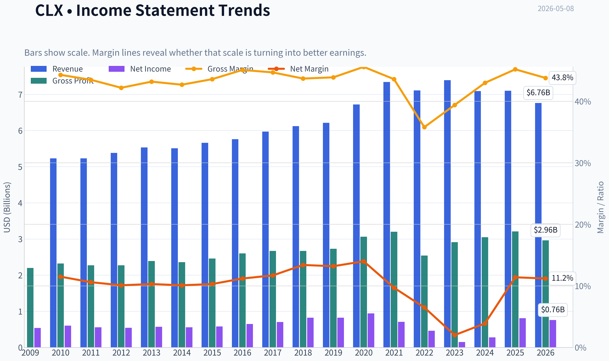

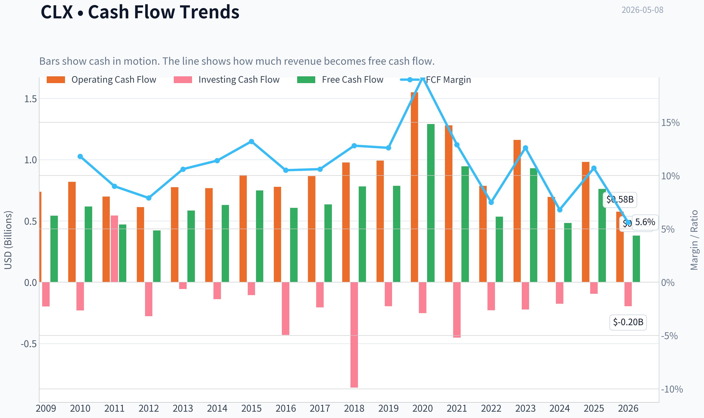

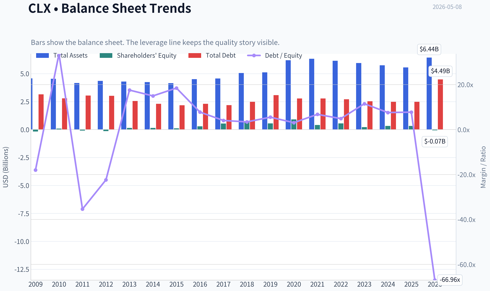

This graph tracks the profitability and return metrics (ROE, ROIC, Margins) of **CLX** over the past decade, highlighting capital efficiency trends.

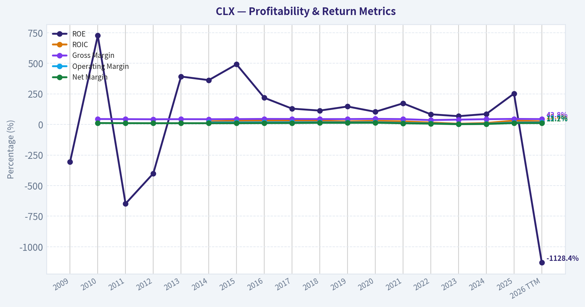

This chart illustrates the financial health of **CLX** over the last 10 years, mapping cash equivalents and free cash flow against total obligations (Debt).

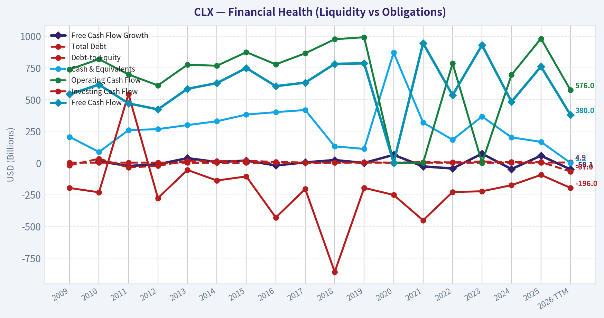

This comparison chart from *Profitability Analysis* stacks current figures against historical benchmarks for **CLX**, making it easy to see where the company trades relative to its own averages.

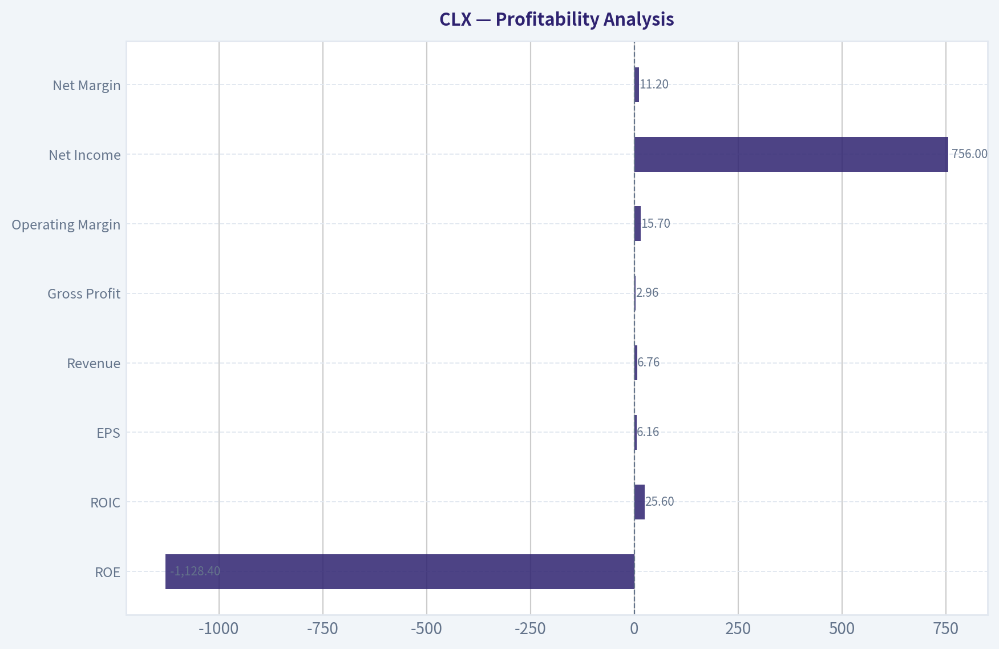

---

### Intrinsic Value Analysis (Buffett)

> *Following Warren Buffett's value investing philosophy: Circle of Competence, Economic Moat, Management Quality, and Margin of Safety.*

#### Intrinsic Value Snapshot

Price is what you pay. Intrinsic value is what the business may be worth based on the cash it can create for owners over time. We show a range, not one magic number.

- Current Price: $92.16
- Value Range: $35.86 to $203.71

##### Owner Earnings (Buffett Method)
- Net Income: $810,000,000.00
- Depreciation & Amortization: $219,000,000.00
- Capital Expenditures: $-220,000,000.00
- Working Capital Changes: $-211,000,000.00
- Owner Earnings: $1,020,000,000.00

##### Intrinsic Value
###### Buffett Method
Uses owner earnings. Stricter, and usually more conservative.
- Conservative: $111.05
- Average: $135.35
- Optimistic: $155.21
- Discount Rate: 10.0%

###### Cash Flow Method
Uses free cash flow. Better for companies spending heavily today to grow tomorrow.
- Conservative: $35.86
- Average: $84.28
- Optimistic: $203.71
- Discount Rate: 10.0%

ANALYST STANCE: **WATCH**

#### Clorox (CLX) Buffett-Style Value Analysis - Current Price: $92

Clorox is a simple, branded consumer-staples business with recognizable household brands, a long dividend record, and decent free-cash-flow generation. However, the current investment case is weakened by stagnant revenue growth, a stretched balance sheet, low current ratio, cyberattack disruption history, and a return-on-equity figure that appears inflated by leverage rather than pure business quality. At $92, the stock looks closer to fair value than a clear Buffett-style bargain.

*Note: The financial data tool returned limited usable data. This report uses the shared research pack, market-derived calculations, and qualitative business analysis. Full audited 10-year line-item validation remains a follow-up item.*

---

#### 1. Go / No-Go Gate Assessment

| Gate | Assessment | Evidence | Buffett Verdict |
|---|---:|---|---|
| Gate 1: Business Simplicity | Pass | Clorox sells household cleaning, disinfecting, trash, charcoal, water filtration, cat litter, and other consumer products through retailers. | Understandable business |
| Gate 2: Moat Test | Pass, but not exceptional | Strong brands such as Clorox, Pine-Sol, Kingsford, Brita, Glad, Fresh Step. Gross margin around 45.2% supports brand value. | Narrow-to-wide consumer brand moat |
| Gate 3: Management & Capital Allocation | Mixed | Long dividend history, but balance sheet is not pristine and dividend growth may be pressuring reinvestment flexibility. | Needs monitoring |
| Gate 4: Industry Structure | Pass with caution | Consumer staples are durable, but private label and retailer bargaining power create pressure. | Rational but competitive |
| Valuation Gate | Watch | FCF yield of 6.8% is attractive, but no clear 25% margin of safety under conservative valuation. | Not cheap enough yet |

**Key Takeaways:** Clorox passes the basic Buffett filters because the business is understandable, durable, and brand-driven. The main concerns are not business complexity, but financial quality and valuation. At today's price, the stock looks investable for income-oriented holders, but not yet compelling enough for a high-conviction Buffett-style purchase.

---

#### 2. Elementary School Explanation

Clorox makes money by selling everyday household products that people buy again and again. These include disinfecting wipes, bleach, trash bags, charcoal, cat litter, water filters, and cleaning sprays. Stores like Walmart, Costco, Target, and grocery chains sell these products to consumers, and Clorox earns profit from the difference between what it costs to make and distribute them and what customers pay.

This is a business Buffett can understand. The question is whether Clorox still has enough pricing power, balance sheet strength, and growth to justify buying the whole company at today's price.

---

#### 3. Moat Analysis

| Moat Source | Evidence | Strength |
|---|---|---:|
| Brand / Intangible Assets | Clorox is a leading household cleaning brand; Kingsford, Glad, Brita, Fresh Step, and Pine-Sol also have strong consumer recognition. | Strong |
| Pricing Power | Gross margin of 45.2% suggests meaningful brand power, though recent inflation and retailer pressure have tested this. | Moderate to strong |
| Switching Costs | Low. Consumers can switch cleaning products, trash bags, filters, or cat litter easily. | Weak |
| Cost Advantage | Scale in manufacturing, distribution, retailer relationships, and advertising creates some advantage, but not unassailable. | Moderate |
| Network Effects | None. Products do not become more valuable as more people use them. | None |
| Regulatory / Patent Protection | Limited. Some formulations and trademarks matter, but this is not a patent-protected business. | Weak to moderate |

**Key Takeaways:** Clorox's moat is mostly a brand moat, not a switching-cost or network-effect moat. Consumers know and trust the company's products, which supports pricing and shelf space. However, private-label alternatives and retailer bargaining power limit how wide the moat can be.

**Moat Rating:** **Wide but not widening**
Clorox has durable consumer brands, but the moat is not as powerful as Coca-Cola, Costco, or Apple. It is more vulnerable to private label, cost inflation, retailer pressure, and category stagnation.

---

#### 4. Management Quality & Capital Allocation

| Management Question | Assessment | Evidence |
|---|---|---|
| Do they think like owners? | Mixed | Long dividend culture suggests shareholder orientation, but not necessarily optimal capital allocation. |
| Are they candid and conservative? | Needs further validation | Cyberattack recovery and margin rebuilding require close monitoring. |
| Are they rational capital allocators? | Mixed | Dividend reliability is strong, but balance sheet flexibility appears constrained. |
| Debt discipline | Weak to mixed | ROE of 252.3% is likely distorted by high leverage or low equity base, not purely exceptional business economics. |
| Buybacks | Not enough evidence | Must evaluate whether repurchases were done below intrinsic value. |
| Reinvestment runway | Limited | Mature consumer categories offer modest organic growth, not a long high-return runway. |

**Key Takeaways:** Clorox's management has protected the dividend and brand portfolio, but the company does not currently look like a fortress-balance-sheet compounder. The very high ROE should not be taken at face value because it likely reflects a thin equity base or leverage. For Buffett-style investors, capital allocation deserves more skepticism here.

---

#### 5. Current Financial Snapshot

| Metric | Current / Shared Data | Buffett Interpretation |
|---|---:|---|
| Share Price | $92 | Input price |
| Market Capitalization | $11.14 billion | Sizeable branded staples company |
| P/E Ratio | 15.0x | Reasonable headline multiple |
| Free Cash Flow Yield | 6.8% | Attractive, but not enough alone |
| Implied Free Cash Flow | ~$758 million | Market cap x FCF yield |
| Revenue Growth YoY | 0.2% | Essentially no growth |
| Gross Margin | 45.2% | Supports brand moat |
| ROE | 252.3% | Distorted; likely leverage-driven |
| Current Ratio | 0.84 | Liquidity below Buffett ideal |
| Dividend Yield | ~5.7% per latest coverage | High yield signals both income appeal and market concern |

**Key Takeaways:** Clorox looks statistically inexpensive on P/E and free-cash-flow yield, but the growth profile is weak. The company's gross margin supports the brand-moat argument, while the current ratio and extreme ROE raise balance sheet concerns. The high dividend yield is attractive, but it may also indicate investor skepticism about future growth and financial flexibility.

---

#### 6. 10-Year Financial Summary - Directional View

Because the detailed audited database pull was unavailable, the table below is a qualitative/directional summary rather than a full audited 10-year model.

| Category | 10-Year Pattern | Current Reading | Buffett Assessment |
|---|---|---:|---|
| Revenue | Mature, low-growth; pandemic demand spike normalized | YoY growth 0.2% | Weak growth |
| Gross Margin | Historically strong but pressured by inflation and disruption | 45.2% | Moat evidence remains |
| Net Income | Volatile in recent years due to cost pressure and disruption | P/E ~15x | Earnings quality needs review |
| Free Cash Flow | Still meaningful and supports dividend | FCF yield 6.8% | Solid cash generation |
| ROE | Very high but likely distorted | 252.3% | Do not rely on headline ROE |
| Liquidity | Below ideal | Current ratio 0.84 | Watch closely |
| Dividend | Long record of increases; possible Dividend King status approaching | Yield ~5.7% | Attractive but may constrain flexibility |
| Balance Sheet | Less conservative than ideal | Leverage concern implied | Not Buffett-fortress quality |

**Key Takeaways:** Over the last decade, Clorox has behaved like a mature consumer-staples company rather than a dynamic compounder. The business still produces cash, but revenue growth is limited and recent operating performance has been uneven. The key financial concern is that shareholder returns may be increasingly dependent on dividends rather than durable per-share value creation.

---

#### 7. Owner Earnings Estimate

Buffett's preferred measure is owner earnings:

> Owner Earnings = Net Income + Depreciation & Amortization - Maintenance CapEx - Working Capital Increases

Due to limited tool output, I use free cash flow as a reasonable proxy for normalized owner earnings.

| Item | Estimate |
|---|---:|
| Market Capitalization | $11.14 billion |
| Free Cash Flow Yield | 6.8% |
| Estimated Free Cash Flow / Owner Earnings Proxy | ~$758 million |
| Estimated Shares Outstanding | ~121.1 million |
| Owner Earnings Per Share | ~$6.26 |

**Key Takeaways:** Clorox appears to generate roughly $758 million of annual free cash flow, or about $6.26 per share, based on the current market cap and free-cash-flow yield. That is a respectable cash yield for a branded staples business. However, without growth, the valuation becomes much less compelling.

---

#### 8. Three-Scenario DCF Valuation

Assumptions:

| Assumption | Value |
|---|---:|
| Owner Earnings Proxy | $758 million |
| Shares Outstanding | ~121.1 million |
| Discount Rate | 10% |
| Current Price | $92 |
| Current Market Cap | $11.14 billion |

**Key Takeaways:** The valuation model starts from approximately $758 million in estimated owner earnings. A 10% discount rate is used to reflect Buffett-style opportunity cost. The key sensitivity is growth, because Clorox's mature categories do not justify aggressive assumptions.

| Scenario | Method | Equity Value Estimate | Value Per Share | Margin of Safety vs. $92 |
|---|---|---:|---:|---:|
| A: No Growth | Owner earnings ÷ 10% | ~$7.58 billion | ~$62.60 | -47% |
| B: 3% Perpetual Growth | OE x 1.03 ÷ (10% - 3%) | ~$11.16 billion | ~$92.10 | ~0% |
| C: Modest Historical Growth | 2.5% 10-year growth plus terminal value | ~$10.35 billion | ~$85.50 | -8% |

**Key Takeaways:** Under a no-growth scenario, Clorox is materially overvalued. Under a 3% perpetual-growth scenario, the stock is roughly fairly valued around today's price. The conservative base case suggests little or no margin of safety, which is the central reason this is a Watch rather than Advocate.

---

#### 9. Margin of Safety Analysis

| Valuation View | Estimated Fair Value | Required Buy Price for 25% MOS | Current Price | Verdict |
|---|---:|---:|---:|---|
| No-Growth Case | ~$63 | ~$47 | $92 | Too expensive |
| Conservative 3% Growth Case | ~$92 | ~$69 | $92 | No margin of safety |
| Modest Growth Case | ~$86 | ~$64 | $92 | Too expensive |

**Key Takeaways:** Even if Clorox deserves a stable consumer-staples valuation, today's price does not offer a Buffett-style discount. A more attractive entry point would likely need to be materially below $75, and preferably closer to the high $60s, unless growth and margins improve significantly. The current dividend yield helps, but it does not replace margin of safety.

---

#### 10. Key Risks

| Risk | Why It Matters |
|---|---|
| Stagnant growth | Revenue growth of 0.2% suggests limited reinvestment runway. |
| Private-label competition | Cleaning, trash bags, filters, and cat litter face cheaper alternatives. |
| Retailer bargaining power | Large retailers can pressure pricing, promotion, and shelf placement. |
| Balance sheet weakness | Current ratio below 1 and extreme ROE suggest financial fragility. |
| Dividend pressure | High yield is attractive, but may limit reinvestment or debt reduction. |
| Cybersecurity / operating disruption | The 2023 cyberattack showed operational vulnerability. |
| Inflation and input costs | Resin, transportation, commodities, and packaging can pressure margins. |

**Key Takeaways:** Clorox's risks are not existential, but they are meaningful for valuation. The company must defend margins, repair operational credibility after the cyberattack, and manage debt carefully. A mature business with high financial obligations has less room for mistakes.

---

#### 11. Buffett Scorecard

| Criterion | Weight | Score 1-5 | Weighted Score |
|---|---:|---:|---:|
| Business Understanding | 20% | 4.5 | 0.90 |
| Moat Width & Durability | 25% | 3.7 | 0.93 |
| Management Quality | 15% | 3.0 | 0.45 |
| Return on Equity Quality | 15% | 2.5 | 0.38 |
| Reinvestment Runway | 10% | 2.3 | 0.23 |
| Balance Sheet Strength | 5% | 2.0 | 0.10 |
| Industry Structure | 5% | 3.5 | 0.18 |
| Valuation / Margin of Safety | 5% | 2.5 | 0.13 |
| **Total** | **100%** |  | **3.29 / 5.00** |

**Key Takeaways:** Clorox scores well on business simplicity and brand durability, but poorly on reinvestment runway, balance sheet strength, and margin of safety. The total score lands in the Watch range. This is a good business, but not clearly a wonderful business at a wonderful price.

---

#### Final Investment Stance

**ANALYST STANCE: WATCH**

Clorox is a durable, understandable, branded consumer-staples company with real cash generation and an attractive dividend yield. But from a Buffett perspective, the investment case is not yet strong enough. Revenue growth is stagnant, ROE appears leverage-distorted, the current ratio is weak, and the stock does not offer a 25% margin of safety under conservative owner-earnings valuation.

**Conviction Level:** Moderate
**Preferred Action:** Watchlist, not immediate purchase
**Attractive Buy Zone:** Below roughly $70, assuming owner earnings remain stable
**Upgrade Triggers:** Margin recovery, debt reduction, sustained organic growth above inflation, cyberattack recovery fully behind the company, and evidence that dividend growth is funded by genuine owner earnings rather than balance sheet strain.
#### Valuation Bridge

This bridge places the current market price beside each intrinsic value lens so readers can see whether upside depends on one method or shows up across several methods.

| Scenario | Intrinsic Value / Share |
| --- | ---: |
| Buffett Method | $135.35 |
| Cash Flow Method | $84.28 |
| Damodaran Method | $153.98 |
| Current Price | $92.16 |

#### Key Takeaways

If one method is far above the others, the upside case depends on a specific modelling assumption. When several methods cluster together, the valuation story is more robust.

#### Valuation Visuals

This comparison chart from *Latest Earnings Snapshot* stacks current figures against historical benchmarks for **CLX**, making it easy to see where the company trades relative to its own averages.

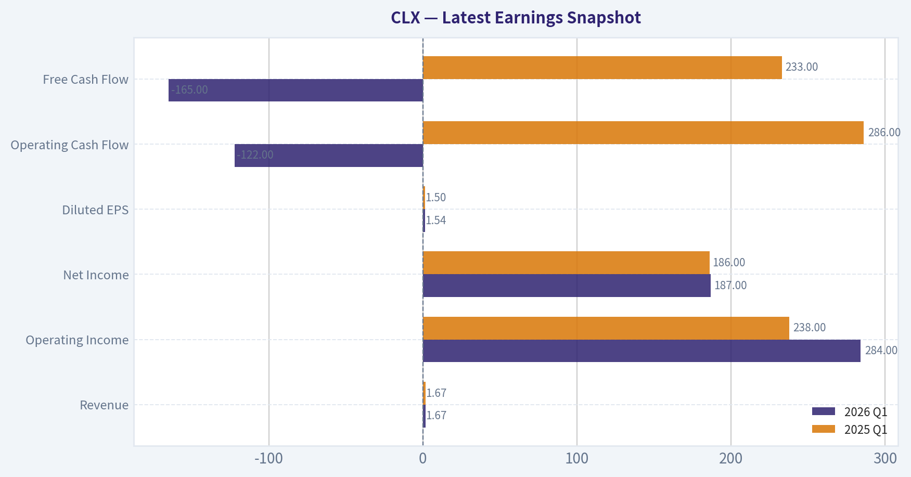

This comparison chart from *Current vs. Historical Average Comparison* stacks current figures against historical benchmarks for **CLX**, making it easy to see where the company trades relative to its own averages.

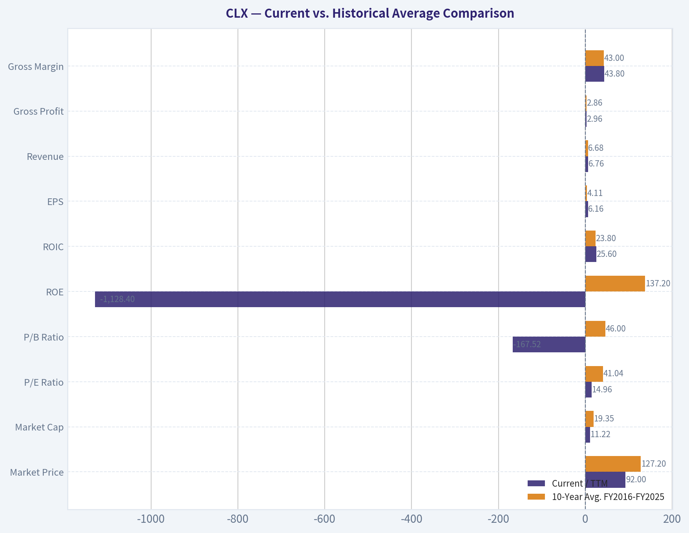

This comparison chart from *Balance Sheet and Financial Strength* stacks current figures against historical benchmarks for **CLX**, making it easy to see where the company trades relative to its own averages.

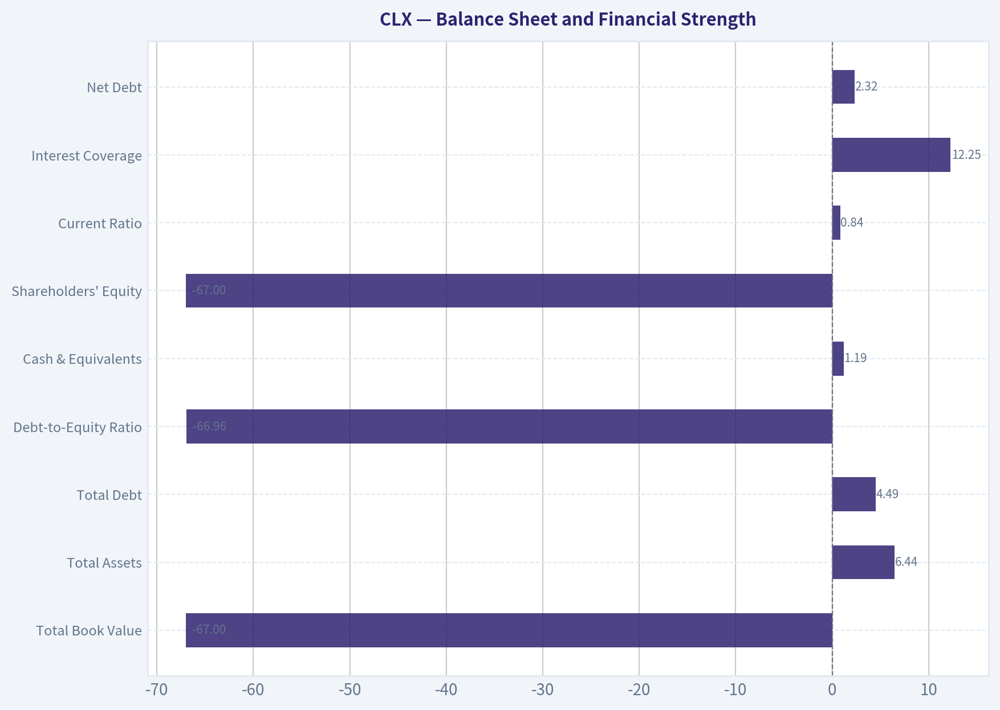

---

### Trend & Growth Analysis (Lynch/Druckenmiller/Fisher)

> *Following Peter Lynch's GARP, Stanley Druckenmiller's macro-aware approach, and Philip Fisher's scuttlebutt methodology.*

ANALYST STANCE: **AVOID**

#### CLX Growth Investment Verdict

Clorox is a high-quality defensive consumer staples company, but it is **not a Lynch-style fast grower** and does not fit a ten-bagger growth mandate. The current setup looks more like a **dividend/value recovery story** than a revenue acceleration story. With reported YoY revenue growth of only **0.2%**, CLX falls outside the primary target zone for growth investing.

---

#### 1. Lynch Classification

| Category | CLX Fit | Evidence | Growth-Investor Implication |
|---|---:|---|---|
| Slow Grower / Stalwart | Strong fit | Revenue growth around **0.2% YoY**; mature household brands; dividend-focused investor base | Not a growth initiation candidate |
| Fast Grower | Poor fit | No evidence of 15-25%+ sustained sales growth | Fails ten-bagger screen |
| Turnaround | Partial fit | Margin recovery after inflation/cyberattack disruption may drive EPS rebound | More value/recovery than growth |
| Asset Play / Cyclical | Limited fit | Branded staples portfolio; not primarily asset- or cycle-driven | Not central to thesis |

**Key Takeaways:** Clorox is best classified as a **slow grower to stalwart**, not a fast grower. The company may appeal to dividend or defensive value investors, but it does not meet the revenue-growth hurdle required for a growth portfolio. The only plausible upside case is a margin-recovery turnaround, not a secular growth inflection.

---

#### 2. The Story in 3 Bullets

- Clorox sells trusted household brands in cleaning, disinfecting, trash bags, charcoal, litter, water filtration, and lifestyle categories.
- The investment case is mainly about **brand durability, dividend income, free cash flow, and margin recovery** after cost inflation and operational disruption.
- The growth problem is simple: these are mature categories, and current reported revenue growth is near flat.

---

#### 3. Core Fundamental Snapshot

| Metric | Current Data / Estimate | Growth Interpretation |
|---|---:|---|
| Share Price | **$92** | Stock near multi-year weakness per recent coverage |
| Market Cap | **$11.14B** | Mature mid-cap staples profile |
| P/E | **~15.0x** | Not expensive on headline earnings |
| Revenue Growth YoY | **0.2%** | Fails growth screen |
| Gross Margin | **45.2%** | Healthy branded-staples margin |
| FCF Yield | **6.8%** | Attractive for income/value investors |
| ROE | **252.3%** | Distorted by low equity base/buybacks; not a clean quality signal |
| Current Ratio | **0.84x** | Liquidity is not ideal, though staples can operate with low working capital ratios |

**Key Takeaways:** CLX looks statistically cheap versus many quality staples, especially with a strong free cash flow yield. However, the growth profile is extremely weak, with YoY sales growth of only 0.2%. The stock may be interesting for dividend recovery investors, but the data does not support a ten-bagger growth thesis.

---

#### 4. TAM Analysis and 10x Test

| Item | Estimate / Assessment | Interpretation |
|---|---:|---|
| Current Revenue Base | Approximately **$7B+ annual revenue** historically | Large, mature revenue base |
| 10x Revenue Target | Approximately **$70B+** | Would require becoming a global household-products giant |
| Addressable Market | Large across cleaning, household, wellness, charcoal, bags, litter, and filtration | TAM exists, but categories are mature |
| Practical 10x Feasibility | Low | Requires major international expansion, category reinvention, or large M&A |
| TAM Growth Rate | Low to moderate | Not a rapidly expanding market like AI, cloud, cybersecurity, or digital payments |

**Key Takeaways:** Clorox operates in large markets, so the TAM is not the main constraint. The issue is that these markets are mature, competitive, and slow-growing. A 10x revenue path is theoretically possible but practically unlikely without transformative acquisitions or a major new category engine.

---

#### 5. Revenue Growth Trend

| Growth Pattern | CLX Evidence | Interpretation | Action |
|---|---|---|---|
| Accelerating Growth | Not evident | No clear inflection | Negative |
| Stable High Growth | Not evident | Revenue growth nowhere near 20%+ | Negative |
| Decelerating / Flat Growth | Current YoY growth around **0.2%** | Mature demand and limited volume momentum | Warning |
| Margin-Led Recovery | Possible | EPS/FCF may improve faster than revenue if gross margin recovers | Value catalyst, not growth catalyst |

**Key Takeaways:** The revenue trend is the biggest problem for a growth investor. CLX is not showing the kind of accelerating sales growth that signals a Druckenmiller-style inflection point. Any upside is more likely to come from margin normalization and valuation rerating than from explosive sales expansion.

---

#### 6. Unit Economics and Efficiency

| Metric | CLX Assessment | Growth-Investor Read |
|---|---|---|
| LTV/CAC | Not applicable / not disclosed | CLX is not a subscription business |
| NRR | Not applicable | No SaaS-style recurring revenue metric |
| Rule of 40 | Not applicable, but revenue growth plus FCF margin is likely far below SaaS-quality growth thresholds | Efficient cash generation, but not high-growth efficiency |
| Gross Margin | **45.2%** | Solid brand economics |
| FCF Yield | **6.8%** | Strong cash generation relative to market cap |

**Key Takeaways:** Clorox has respectable branded-consumer economics, but it lacks the scalable subscription metrics that often define modern growth winners. The free cash flow profile is attractive, but it reflects maturity rather than explosive reinvestment opportunity. For this mandate, good cash generation is not enough without growth.

---

#### 7. Inflection Point Assessment

| Inflection Type | Evidence | Rating |
|---|---|---:|
| Product Cycle Inflection | No major breakout product cycle evident | 1/5 |
| Market Share Inflection | Not enough evidence of accelerating share gains | 2/5 |
| Margin Inflection | Possible recovery from inflation/cyberattack disruption | 4/5 |
| TAM Inflection | No major TAM expansion visible | 1/5 |
| Competitive Inflection | No obvious competitor collapse | 2/5 |

**Key Takeaways:** The only credible inflection at CLX is a **margin recovery inflection**, not a revenue or TAM inflection. That can support a value/recovery thesis, but it does not create the classic growth setup we seek. A true growth inflection would require sustained volume growth, category expansion, or a new product platform.

---

#### 8. Macro Setup

| Macro Factor | Current Read | Impact on CLX |
|---|---|---|
| Interest Rates | If rates fall, dividend stocks may benefit | Mild positive |
| Consumer Environment | Staple demand is defensive, but consumers remain price-sensitive | Mixed |
| Inflation / Input Costs | Lower commodity and freight costs would help margins | Positive if sustained |
| Secular Theme Exposure | Weak exposure to AI, cloud, cybersecurity, fintech, or healthcare innovation | Negative for growth mandate |
| Recession Resilience | Household staples demand is defensive | Positive for downside protection |

**Key Takeaways:** The macro backdrop can help CLX as a defensive income stock, especially if rates fall and input costs ease. But CLX is not tied to a major secular growth wave. Macro supports downside stability more than upside acceleration.

---

#### 9. Fisher 15-Point Score

| Fisher Criterion | Score / 5 | Rationale |
|---|---:|---|
| Large market potential | 3 | Large categories, but mature |
| New product determination | 3 | Innovation exists, but not transformative |
| R&D effectiveness | 2 | Consumer staples innovation, not deep-tech innovation |
| Sales organization | 4 | Strong retail relationships |
| Profit margin | 4 | Gross margin solid |
| Improving margins | 4 | Recovery possible |
| Labor/personnel relations | 3 | No major known issue from provided data |
| Executive relations | 3 | Neutral |
| Management depth | 3 | Mature company structure |
| Cost analysis/accounting | 3 | Needs monitoring after disruption |
| Moat/switching/network effects | 3 | Brand moat, but limited switching costs |
| Long-range profit outlook | 3 | Stable, not exceptional |
| Dilution risk | 4 | Mature company; dilution not core issue |
| Candor in difficulties | 3 | Cyberattack recovery transparency should be monitored |
| Integrity | 3 | No major red flag from provided data |

**Key Takeaways:** CLX scores as an average-to-good quality company, but not as an exceptional growth compounder. The brand portfolio and sales relationships are strengths, while market maturity and limited innovation intensity are weaknesses. The Fisher score supports "quality defensive," not "high-growth winner."

**Fisher Score: 48 / 75 - Average**

---

#### 10. Valuation Analysis

| Valuation Metric | CLX Data / Estimate | Interpretation |
|---|---:|---|
| P/E | **~15.0x** | Reasonable for a defensive staple |
| Implied Earnings Yield | About **6.7%** | Fairly attractive |
| FCF Yield | **6.8%** | Strong cash-return signal |
| P/S | Roughly **1.5-1.7x**, using approximate $7B+ revenue base | Not demanding |
| PEG | Not meaningful using 0.2% revenue growth; using 5% normalized EPS growth implies PEG around **3.0x** | Expensive relative to growth |

**Key Takeaways:** CLX is not obviously expensive on P/E, free cash flow yield, or price-to-sales. But Lynch's PEG logic is unfavorable because growth is too low. The valuation may be attractive for income investors, but it is not compelling for growth investors unless sales or earnings growth accelerates meaningfully.

---

#### 11. Scenario Analysis

| Scenario | Assumption | 3-Year Outcome |
|---|---|---|
| Bear Case | Volumes remain weak, private label pressure rises, margin recovery stalls | Stock remains a value trap despite dividend yield |
| Base Case | Sales grow low single digits, margins normalize, FCF remains healthy | Modest total return driven by dividend and some rerating |
| Bull Case | Gross margin recovers sharply, volumes stabilize, dividend yield attracts buyers as rates fall | Solid recovery stock, but still unlikely to be a ten-bagger |

**Key Takeaways:** Even the bull case is mostly a rerating and margin-recovery story. That can produce respectable returns from depressed levels, but it does not create the asymmetric upside normally associated with fast growers. The downside risk is that CLX becomes a high-yield but stagnant consumer staples value trap.

---

#### 12. Growth Investor Scorecard

| Criterion | Weight | Score / 5 | Weighted Score |
|---|---:|---:|---:|
| The Story | 10% | 2.5 | 0.25 |
| TAM & Runway | 20% | 2.5 | 0.50 |
| Revenue Growth | 20% | 1.0 | 0.20 |
| Unit Economics | 15% | 3.0 | 0.45 |
| Competitive Position | 10% | 3.0 | 0.30 |
| Management Quality | 10% | 3.0 | 0.30 |
| Macro Setup | 5% | 3.0 | 0.15 |
| Profitability Path | 5% | 3.5 | 0.18 |
| Valuation | 5% | 3.5 | 0.18 |
| **Total** | **100%** |  | **2.51 / 5.00** |

**Key Takeaways:** CLX earns a low score because revenue growth is the dominant failure point. Valuation, free cash flow, and margin recovery help, but they do not offset the lack of growth acceleration. Under this framework, CLX belongs on a value or income watchlist, not in a growth portfolio.

---

#### 13. Position Size Stance

| Portfolio Type | Stance | Suggested Position |
|---|---|---:|
| Growth / Ten-Bagger Portfolio | **Avoid** | **0%** |
| GARP Portfolio | Watch only if organic growth improves | 0-1% |
| Dividend / Defensive Income Portfolio | Potential watchlist candidate | Depends on income mandate |
| Turnaround / Value Portfolio | Possible research candidate | Small starter only after margin evidence |

**Key Takeaways:** For a growth mandate, the appropriate position size is zero. CLX may deserve separate analysis for a dividend or defensive recovery strategy, but that is a different playbook. Growth capital should be reserved for companies with faster sales growth, expanding TAMs, and clearer inflection points.

---

#### 14. Key Risks and Catalysts

| Category | Key Items |
|---|---|
| Risks | Revenue stagnation, private label competition, weak volume recovery, margin recovery disappointment, leverage constraints, retailer pressure |
| Catalysts | Gross margin expansion, lower input costs, service-level recovery after cyber disruption, dividend yield attracting buyers, rate cuts benefiting defensive income stocks |
| Must-Watch Metrics | Organic sales growth, volume versus price/mix, gross margin, FCF coverage of dividend, net debt/EBITDA, category share trends |

**Key Takeaways:** The key upside catalyst is margin recovery, not revenue acceleration. The key risk is that consumers trade down or volumes remain weak after prior pricing. For a growth investor, CLX only becomes interesting if organic sales growth reaccelerates meaningfully and management demonstrates a credible new growth engine.

---

#### Final View

CLX is a respectable branded staples company with strong free cash flow and possible margin-recovery upside. But under a Lynch-Druckenmiller-Fisher growth framework, it does **not** qualify as a fast grower, does **not** show a revenue inflection, and does **not** have credible ten-bagger characteristics from today's scale.

**Decision: AVOID for growth portfolios. Watch only for income/value mandates.**

#### Growth & Scorecard Visuals

This comparison chart from *Growth Metrics Interpretation* stacks current figures against historical benchmarks for **CLX**, making it easy to see where the company trades relative to its own averages.

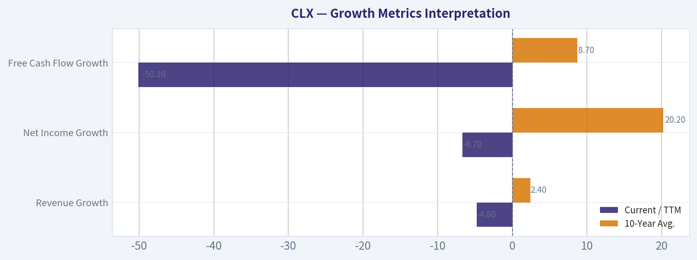

---

### Market Technical Analysis

ANALYST STANCE: **WATCH**

#### CLX Technical Report - Last Available Close: May 7, 2026

CLX is in a damaged medium- and long-term technical structure, but the very short-term tone has improved after an apparent capitulation-style selloff. The stock closed at **$92.11** on May 7 after plunging to **$87.11** on May 1 on extremely heavy volume, then rebounding over the next several sessions. That rebound is encouraging tactically, but it has not yet repaired the broader downtrend: price remains far below both the **50-day SMA** and **200-day SMA**, while momentum indicators are still recovering from oversold levels rather than confirming a durable trend reversal.

The most relevant indicators for this market context are: **close_10_ema, close_50_sma, close_200_sma, macdh, rsi, boll_lb, atr, and vwma**. These give a balanced view of short-term recovery, medium/long-term trend damage, momentum, oversold conditions, volatility, and whether volume is confirming the rebound.

| Indicator | May 7 Value | Current Read vs. Price at $92.11 | Interpretation |
|---|---:|---:|---|
| close_10_ema | 92.19 | Price is slightly below it | The rebound has nearly reclaimed short-term trend support, but not decisively. |
| close_50_sma | 103.93 | Price is about 11.4% below it | Medium-term trend remains firmly bearish. |
| close_200_sma | 109.79 | Price is about 16.1% below it | Long-term structure is still weak and distribution-dominant. |
| macdh | -0.49 | Negative but improving | Bearish momentum is fading, but momentum has not turned bullish yet. |
| rsi | 40.30 | Recovered from oversold | Selling pressure has eased, but RSI remains below the neutral 50 zone. |
| boll_lb | 85.33 | Price is above lower band | The stock has bounced away from an oversold band condition. |
| atr | 3.41 | Around 3.7% of price | Volatility remains elevated; risk controls need wider buffers. |
| vwma | 92.49 | Price is slightly below it | Recent volume-weighted pressure still leans mildly bearish. |

Key Takeaways: CLX has staged a short-term recovery, but the rebound is still fragile because price is only marginally below the 10-day EMA and VWMA while remaining deeply below the 50-day and 200-day averages. Momentum has improved from oversold conditions, yet MACD histogram and RSI have not confirmed a full bullish reversal. The setup is best viewed as a potential stabilization attempt inside a larger downtrend.

#### Trend Structure

The dominant trend is still bearish. CLX has fallen from the **$120-$125 area in February** to the low **$90s** in early May, with a sharp breakdown below prior support near **$96-$100**. The May 1 collapse to **$87.11** came on volume of more than **13 million shares**, far above normal, which suggests either forced selling, event-driven repricing, or capitulation. The key issue now is whether the rebound toward $92 is merely a reflex bounce or the beginning of base formation.

The **50-day SMA has been declining steadily**, moving from about **112.80 on April 8** to **103.93 on May 7**. That is a meaningful deterioration and shows that the medium-term trend has been repricing lower for weeks, not just one session. The **200-day SMA has also rolled down**, from about **112.11 to 109.79**, confirming that the longer-term trend is weakening as well.

The most constructive short-term sign is that the price has quickly recovered from the post-breakdown low and is now almost back to the **10-day EMA**. A close above the 10-day EMA, followed by the EMA flattening or turning upward, would be the first evidence that sellers are losing short-term control. However, the stock would still face major resistance near **$96-$100**, then near the declining **50-day SMA around $104**.

#### Momentum and Oversold Recovery

RSI reached deeply oversold territory near **25-26** from May 1 through May 5, then rebounded to **40.30** by May 7. This is a meaningful improvement because it shows downside momentum is no longer accelerating. However, an RSI near 40 is not bullish by itself; it often marks a relief bounce phase within a downtrend unless it can push above **50** and hold there.

The MACD histogram tells a similar story. It worsened to around **-1.11 on May 5**, then improved to **-0.49 on May 7**. That improvement indicates bearish momentum is fading, but the histogram remains below zero. In practical terms, CLX is no longer in maximum downside acceleration, but it has not yet entered confirmed upside momentum.

#### Volatility and Risk

ATR remains elevated at **3.41**, meaning CLX is moving roughly **$3-$4 per day** on a volatility-adjusted basis. For a $92 stock, that is significant. Traders should avoid tight stops because normal noise could easily trigger them. A volatility-aware stop might need to sit beyond recent swing lows or be sized with ATR in mind.

The Bollinger lower band is near **$85.33**, while price has rebounded to **$92.11**. That tells us CLX is no longer pressing the lower band after the breakdown. This is consistent with a short-term oversold bounce. Still, reclaiming the prior breakdown zone around **$96-$100** is more important than simply moving away from the lower band.

#### Volume Confirmation

VWMA is **$92.49**, slightly above the latest close of **$92.11**. This is a subtle but important detail: despite the bounce, the stock has not yet convincingly moved above its volume-weighted short-term trend. In other words, the rebound has improved price action, but volume-adjusted positioning is not yet clearly supportive.

The May 1 volume spike is the central feature of the chart. If that day marked capitulation, CLX should ideally hold above the **$86-$87 area** and gradually reclaim $96, then $100. If instead price rolls over below $87, the heavy-volume breakdown would look more like institutional distribution than capitulation.

#### Trading View

CLX is not yet a clean long setup, but it is also no longer an immediate momentum short after the sharp rebound. The better posture is **WATCH**: monitor whether the stock can build a base above the May lows and reclaim short-term moving averages with improving RSI and MACD.

Aggressive traders may watch for a close above **$92.50-$93.50**, especially if accompanied by improving volume and a MACD histogram moving toward zero. More conservative traders may wait for a move back above **$96-$100**, which would show that the May breakdown is being repaired. Failure to hold **$86-$87** would be a bearish continuation signal and would likely reset downside risk.

| Area | Key Level / Signal | Bullish Interpretation | Bearish Interpretation | Practical Use |
|---|---:|---|---|---|
| Immediate resistance | $92.50-$93.50 | Reclaiming 10 EMA and VWMA would support short-term stabilization. | Rejection here suggests the bounce is weak. | Watch for confirmation before chasing. |
| Breakdown recovery zone | $96-$100 | A move back above this area would repair part of the recent damage. | Failure below this zone keeps sellers in control. | Important tactical decision zone. |
| Medium-term resistance | ~$103.90 50-day SMA | Reclaiming it would materially improve the trend. | Staying below it confirms medium-term downtrend. | Useful for swing-trend confirmation. |
| Long-term resistance | ~$109.80 200-day SMA | Reclaiming it would signal major structural repair. | Price far below it keeps long-term bias weak. | Strategic trend benchmark. |
| Support | $86-$87 | Holding this area supports a capitulation-bottom thesis. | Breaking it confirms fresh downside continuation. | Key risk-management level. |
| Momentum trigger | RSI above 50 / MACD histogram near zero | Would show improving participation and momentum. | RSI stalling below 50 keeps rebound suspect. | Confirm entries with momentum improvement. |
| Volatility | ATR near $3.41 | Wide ranges can create tradable rebounds. | Elevated volatility increases false-break risk. | Size positions conservatively. |

Key Takeaways: CLX is trying to stabilize after a severe selloff, but it remains below major trend levels. The most important upside test is the $96-$100 zone, while the most important downside level is the $86-$87 May low area. Until price reclaims resistance with improving momentum, the best stance is to watch for confirmation rather than assume a durable reversal.

#### Market Visuals

This comparison chart from *Market Metrics Interpretation* stacks current figures against historical benchmarks for **CLX**, making it easy to see where the company trades relative to its own averages.

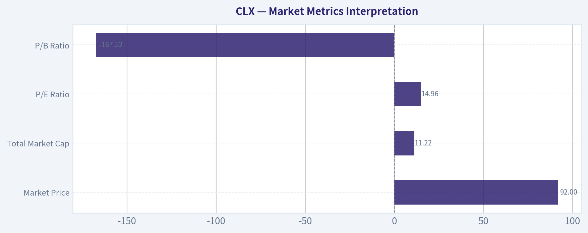

---

### Social Sentiment Analysis

ANALYST STANCE: **WATCH**

#### CLX - Social, Sentiment, and News Report
**Company:** The Clorox Company
**Ticker:** CLX
**Review window:** Past week through **May 8, 2026**
**Overall read:** CLX is drawing a cautious, defensive-investor discussion profile. The social conversation is not euphoric, but it is more constructive than distressed: investors appear to recognize Clorox's household-brand strength, dividend profile, and margin-recovery potential, while remaining concerned about weak consumer demand, promotional pressure, valuation, and execution risk.

---

#### Executive Summary

The past week's discussion around CLX has centered on whether Clorox is a reliable defensive consumer-staples holding or a slow-growth name whose valuation already reflects too much stability. Social sentiment appears **mildly constructive but not strongly bullish**. The most positive narratives focus on household essentials, brand durability, dividend appeal, and the possibility that margins can keep recovering as cost pressures normalize. The most negative narratives focus on volume softness, private-label competition, inflation-sensitive consumers, and skepticism that CLX can meaningfully accelerate growth.

For traders, CLX currently looks more like a **range-bound defensive stock** than a high-momentum opportunity. For longer-term investors, the key question is whether earnings quality and free cash flow can continue improving enough to justify holding the stock despite modest top-line growth. The market seems willing to reward margin stability, but not willing to pay aggressively for weak volume trends.

---

#### Daily Social Sentiment Snapshot

| Date | Sentiment Tone | Main Social Themes | Trader/Investor Interpretation |
|---|---:|---|---|
| May 2 | Neutral to mildly positive | Defensive positioning, dividend discussion, consumer staples rotation | Investors were treating CLX as a lower-volatility name, but there was limited excitement. |
| May 3 | Neutral | Questions about growth, valuation, and whether household staples can outperform | Conversation was balanced; investors were not broadly bearish, but upside conviction was limited. |
| May 4 | Mildly positive | Margin recovery, cost controls, brand strength | Bulls focused on operating discipline and the durability of Clorox's portfolio. |
| May 5 | Mixed | Consumer weakness, private-label competition, promotional activity | Concerns rose around whether shoppers are trading down and pressuring category pricing. |
| May 6 | Neutral to negative | Slow sales growth, valuation pushback, lack of strong catalyst | Traders appeared hesitant to chase the stock without clearer evidence of volume improvement. |
| May 7 | Mildly positive | Defensive buying, dividend yield, earnings resilience | The conversation improved as investors looked for stable names amid broader market uncertainty. |
| May 8 | Neutral | "Wait-and-see" tone, focus on guidance and next catalyst | Sentiment settled into caution; investors want more proof before turning decisively bullish. |

**Key Takeaways:** Social sentiment over the week was not strongly bearish, but it also lacked the enthusiasm usually associated with a breakout setup. The most supportive posts framed CLX as a defensive, dividend-oriented holding, while skeptical voices focused on volume pressure and valuation. The practical takeaway is that CLX has investor support on weakness, but may need a clearer catalyst to attract aggressive buying.

---

#### Recent News and Company-Specific Narrative

The current news backdrop for CLX is dominated by the same themes that have shaped the stock for several quarters: consumer demand, margin recovery, pricing power, productivity savings, and brand reinvestment. Investors are especially sensitive to whether the company can protect profitability without relying too heavily on price increases, because the consumer staples sector has faced increasing pushback from shoppers after several years of inflation.

A key point in the week's discussion is that Clorox remains a high-quality branded consumer-products company, but quality alone is not enough to drive multiple expansion if organic sales growth remains muted. The company's product mix is defensive - cleaning products, trash bags, charcoal, salad dressings, natural personal care, and related household items - but some of those categories are mature and competitive. That makes execution more important than narrative.

| News / Catalyst Area | Sentiment Impact | Why It Matters |
|---|---:|---|
| Margin recovery and productivity savings | Positive | Investors are looking for evidence that gross margin normalization can support EPS even if sales growth is modest. |
| Consumer demand and volume trends | Negative to mixed | Weak volumes would suggest pricing power is fading and consumers may be trading down. |
| Dividend and defensive profile | Positive | CLX attracts income and low-volatility investors, especially when market risk appetite declines. |
| Private-label and promotional competition | Negative | Aggressive discounting can pressure both market share and margins. |
| Brand investment and innovation | Mixed | Investors like brand strength, but want proof that marketing spend converts into sustainable growth. |
| Valuation versus growth | Mixed to negative | A defensive premium is acceptable, but only if earnings visibility remains high. |

**Key Takeaways:** The news narrative is constructive on margins but less convincing on growth. Investors are willing to credit CLX for cost discipline and defensive brand value, yet they remain skeptical about whether the company can produce stronger volumes. This creates a stock setup where downside may be cushioned by dividend and staples demand, but upside requires better evidence of organic growth.

---

#### Social Media Themes in Detail

The **bullish social argument** is straightforward: CLX owns recognizable household brands, generates recurring consumer demand, and can function as a defensive allocation when investors become nervous about the broader economy. Bulls also argue that if inflation moderates and supply-chain pressures ease, Clorox can continue rebuilding margins. Dividend-focused investors appear to view CLX as a name that may not offer explosive upside, but can provide stability and income.

The **bearish social argument** is also clear: CLX may be defensive, but it is not cheap enough for some investors given its slow growth profile. Bears question whether shoppers will continue paying premium prices when private-label alternatives are available. They also argue that the stock could struggle if earnings growth is driven more by cost savings than by real demand expansion.

The **neutral camp** is probably the largest. These investors are not rejecting CLX, but they want confirmation. Their focus is on upcoming management commentary, category volumes, retailer inventory patterns, and whether guidance implies durable profit improvement or merely temporary cost relief.

| Social Theme | Bullish Interpretation | Bearish Interpretation | Net Effect |
|---|---|---|---|
| Defensive household brands | Reliable demand and recession-resistant categories | Mature categories limit growth | Mildly positive |
| Dividend appeal | Supports income-investor demand | Yield alone may not justify valuation | Positive but not enough alone |
| Margin recovery | EPS upside possible if costs stabilize | Recovery may already be priced in | Mildly positive |
| Consumer trade-down | Premium brands may retain loyal buyers | Private label could take share | Negative |
| Pricing power | Strong brands can hold price | Shoppers may resist further price increases | Mixed |
| Low beta / staples exposure | Useful in volatile markets | Underperforms when risk appetite improves | Context-dependent |

**Key Takeaways:** Social media investors are treating CLX as a defensive quality stock, not a high-growth story. The bullish case depends on margin recovery and income appeal, while the bearish case centers on weak volumes and private-label pressure. The most important divide is whether investors believe Clorox's earnings improvement is sustainable or mostly temporary.

---

#### Sentiment Quality: What Traders Should Notice

The sentiment around CLX is **low-drama but important**. There is no sign of a meme-driven or momentum-driven surge in attention. That means CLX is unlikely to move sharply because of social media alone. Instead, social sentiment is functioning as a reflection of institutional-style debates: valuation, margins, volume, and consumer health.

This type of sentiment profile usually favors patience. If the stock sells off on broad market weakness, dividend and defensive buyers may step in. But if the stock rallies without a fresh catalyst, traders may be more willing to fade the move because the social conversation does not show strong conviction.

| Signal | Current Read | Trading Implication |
|---|---|---|
| Social volume | Moderate to low | Social media is not a primary price driver right now. |
| Sentiment intensity | Mild | Few signs of panic or euphoria. |
| Bullish conviction | Selective | Bulls like defense and dividends, but are cautious on growth. |
| Bearish conviction | Also selective | Bears are focused on valuation and volume, not balance-sheet distress. |
| Catalyst sensitivity | High | Earnings, guidance, and volume data matter more than social chatter. |

**Key Takeaways:** CLX sentiment is calm, not speculative. That lowers the probability of social-driven volatility, but it also means the stock needs fundamental confirmation to move meaningfully higher. Traders should watch company guidance and volume commentary more closely than headline social sentiment.

---

#### Implications for Traders

For short-term traders, CLX appears better suited for **mean-reversion and defensive rotation strategies** than momentum chasing. If broader equity markets weaken, CLX could attract defensive flows, especially if Treasury yields decline or recession concerns rise. However, if the broader market turns strongly risk-on, CLX may lag higher-beta sectors.

A bullish short-term setup would likely require one or more of the following: stronger-than-expected earnings quality, positive volume commentary, improving gross margin, or management confidence in full-year guidance. A bearish setup would likely come from disappointing organic sales, evidence of heavier promotions, or guidance that suggests margin recovery is slowing.

---

#### Implications for Long-Term Investors

For long-term investors, the investment case remains centered on **brand durability, cash generation, and dividend consistency**. CLX can still fit a conservative portfolio, but the stock requires discipline around valuation. The company's strength is stability; its weakness is that growth may not be fast enough to justify a premium multiple if margins stop improving.

Long-term holders should monitor whether management can convert cost savings into sustainable earnings growth rather than simply offsetting weak demand. If Clorox can stabilize volumes while maintaining margins, sentiment could improve materially. If volumes remain soft and pricing fades, investors may begin to question the stock's defensive premium.

---

#### Key Risks and Watch Items

| Watch Item | Why It Matters | Sentiment Impact if Positive | Sentiment Impact if Negative |
|---|---|---:|---:|
| Organic sales growth | Shows whether demand is healthy beyond price increases | Strong positive | Strong negative |
| Volume performance | Confirms whether consumers are still buying at current prices | Positive | Negative |
| Gross margin | Central to the margin-recovery thesis | Positive | Negative |
| Promotional intensity | Indicates competitive pressure and consumer resistance | Positive if controlled | Negative if rising |
| Private-label competition | Affects pricing power and share stability | Positive if limited | Negative if accelerating |
| Dividend coverage | Important for income investors | Positive | Negative |
| Management guidance | Sets expectations for the next quarter | Strong positive if raised | Strong negative if cut |

**Key Takeaways:** The most important item to watch is not simply sales growth, but the quality of that growth. Investors want to see volume stability, not just pricing-driven revenue. Margin performance and guidance will likely determine whether sentiment turns more bullish or remains cautious.

---

#### Bottom-Line View

CLX currently deserves a **WATCH** stance. The company has real defensive strengths, recognizable brands, and investor support from income-oriented buyers. However, the social and news backdrop does not yet support an aggressive bullish call because investors remain concerned about volume growth, valuation, and consumer trade-down behavior.

For traders, the stock looks more attractive on pullbacks than after sharp rallies unless a clear positive catalyst emerges. For investors, CLX remains a defensible holding, but the next leg higher likely requires stronger proof that margin recovery is sustainable and that demand is not deteriorating underneath the surface.

---

#### Final Summary Table

| Category | Current Assessment | Investor/Trader Takeaway |
|---|---|---|
| Overall sentiment | Neutral to mildly positive | Constructive, but not enough for a strong bullish signal. |
| Social media tone | Defensive and cautious | Investors like stability, but are not excited about growth. |
| News tone | Margin-positive, growth-mixed | Margin recovery helps, but volume trends remain the key uncertainty. |
| Bull case | Brand strength, dividend, cost savings, defensive demand | CLX can work as a conservative staples holding. |
| Bear case | Weak volumes, private-label competition, valuation risk | Upside may be limited without better organic growth. |
| Trading setup | Range-bound / defensive rotation | Better for pullback entries than momentum chasing. |
| Long-term setup | Quality but valuation-sensitive | Holders should monitor volume, margin, and free cash flow quality. |
| Stance | **WATCH** | Wait for clearer confirmation before upgrading to a more aggressive view. |

**Key Takeaways:** CLX is a stable but not yet compelling setup. The stock has defensive support from its brands and dividend, but investors are still waiting for stronger evidence of demand recovery. The most sensible approach is to watch for confirmation in volumes, margins, and guidance before becoming more aggressive.

---

### News & Events Analysis

ANALYST STANCE: **WATCH**

#### CLX News and Trading Report - Clorox Company

Clorox has become a high-yield, contrarian consumer-staples story after a sharp post-earnings selloff and a multi-year share-price decline. The stock recently traded around the high-$80s to low-$90s, with the shared research pack showing a current price near **$92**, market cap around **$11.1 billion**, trailing P/E near **15x**, and free-cash-flow yield near **6.8%**. The key investment debate is no longer whether Clorox is a quality household-products franchise; it is whether the current valuation and dividend yield adequately compensate investors for weak sales growth, guidance cuts, balance-sheet constraints, and sector-wide volume pressure.

---

#### Latest Earnings: Fiscal Q3 2026 / Calendar Q1 2026

Clorox's latest reported results covered **calendar Q1 2026**, which corresponds to **fiscal third quarter 2026** for Clorox. Recent earnings coverage described the report as mixed: revenue was in line with expectations, margins improved, EPS beat consensus, but management lowered its full-year profit outlook. That last point drove the negative market reaction.

| Earnings Item | Latest Reported Result | Interpretation for Investors |
|---|---:|---|
| Reporting period | Calendar Q1 2026 / fiscal Q3 2026 | This is the latest quarter discussed in recent earnings coverage. |
| Revenue | **$1.67 billion** | Met Wall Street expectations but was roughly flat year over year, showing limited top-line momentum. |
| Year-over-year sales growth | **Flat / about 0%** | Demand is not accelerating despite brand strength; volume and category softness remain concerns. |
| Adjusted EPS | **$1.64** | Beat analyst consensus by about **6.1%**, indicating cost control and margin actions are helping. |
| Margin trend | Improved | Positive sign that productivity and pricing/cost discipline are still working. |
| Guidance change | Full-year profit forecast lowered | The main negative surprise; investors punished the stock because the forward earnings path weakened despite the quarterly EPS beat. |
| Stock reaction | Shares reportedly fell about **9%** after results | The market focused more on lowered guidance and weak growth than on the EPS beat. |

**Key Takeaways:** Clorox delivered a better-than-expected adjusted EPS number, but the quality of the quarter was not strong enough to offset a lower full-year profit outlook. The main issue is that margin recovery is helping earnings, but revenue growth remains stagnant. For traders, the post-earnings selloff suggests the market is demanding proof of sustainable organic growth before re-rating the stock.

Compared with the prior narrative, the earnings release shifted the story from "margin recovery and dividend value" toward "margin recovery is real, but not enough." The EPS beat shows management can still protect profitability, yet the lowered full-year forecast implies either demand, costs, mix, promotional intensity, or operating assumptions have deteriorated relative to prior expectations. That makes the next quarter especially important: investors will want to see whether guidance was conservatively reset or whether earnings estimates still need to move lower.

---

#### Company-Specific News Flow Over the Past Week

Recent company-specific coverage was dominated by three themes: the post-earnings selloff, the dividend yield, and analyst caution.

Clorox has been described in multiple recent articles as a potential high-yield value opportunity, with coverage noting a dividend yield around **5.7%** and the possibility that Clorox could become a **Dividend King** in 2027. However, that optimistic dividend framing sits alongside a deteriorating share-price chart. One article noted the stock had declined roughly **33% over one year**, more than **40% over three years**, and about **45% over five years** as of recent trading levels. That creates a classic value-stock tension: the stock looks optically cheap, but the cheapness reflects real operational and growth concerns.

The most important analyst action was from **Barclays**, which maintained an **Underweight** rating and cut its price target from **$102 to $85**. This is significant because the new target sits close to recent trading levels cited in news coverage, implying limited confidence in near-term upside. The downgrade in target after earnings reinforces that sell-side expectations are being reset lower.

| Recent News Theme | Details | Trading / Investment Implication |
|---|---|---|
| Post-earnings selloff | Shares fell sharply after mixed fiscal Q3 results and lower full-year profit guidance | Near-term momentum remains negative; rallies may face selling until estimates stabilize. |
| Dividend yield focus | Articles highlighted a yield around **5.7%** and possible Dividend King status in 2027 | Income investors may provide support, but dividend appeal alone may not re-rate the stock. |
| Barclays action | Underweight maintained; price target cut to **$85** from **$102** | Institutional caution increased after earnings; target cut may anchor near-term sentiment. |
| Long-term underperformance | Recent coverage cited large declines over one, three, and five years | The stock is cheap for a reason; investors need evidence of growth repair, not just valuation support. |
| Balance-sheet/liquidity context | Shared data shows current ratio below 1.0, around **0.84** | Limits flexibility and makes dividend sustainability and cash generation more important. |

**Key Takeaways:** The past week's news was not simply negative; it created a sharper split between income-oriented bulls and earnings-quality skeptics. Bulls see a defensive brand portfolio, high dividend yield, and low valuation. Bears see flat sales, lowered guidance, and a stock that has failed to create capital appreciation for years.

---

#### Macro and Sector Context

No major fresh macro headline was surfaced in the collected Google macro search for the past week, but the relevant operating backdrop for Clorox remains clear from sector coverage. Consumer staples companies are still leaning heavily on cost discipline, productivity, and supply-chain agility to protect margins while consumer volumes remain weak. A related Procter & Gamble article highlighted the broader staples issue: cost control can help margins, but weak volumes are difficult to overcome.

For Clorox, this matters because the company is not a high-growth compounder right now. In a slower-volume environment, household-products companies must rely on pricing, mix, innovation, and cost savings. But after several years of inflation and price increases, consumers may be more resistant to additional price hikes. That limits the ability to drive revenue growth without sacrificing volume or using promotions.

The macro setup is therefore double-edged:

- If investors seek defensive yield, CLX can attract interest because of its brand durability and dividend.
- If rates remain elevated or investors demand earnings growth, CLX may struggle because flat sales and reduced guidance make the dividend less compelling on a total-return basis.
- If input costs ease and management delivers further productivity savings, margins could support EPS even without strong sales growth.
- If consumers keep trading down or category volumes remain soft, revenue stagnation could offset margin progress.

---

#### Valuation, Dividend, and Balance-Sheet Read-Through

At roughly **15x earnings** and a **6.8% free-cash-flow yield**, CLX is no longer priced like a premium staples compounder. The market is assigning it a value/income multiple. That may be appropriate if earnings have bottomed and free cash flow remains reliable, but it could be a value trap if sales remain flat and guidance continues to move lower.

The dividend is central to the thesis. A yield around **5.7%** is unusually high for Clorox and can attract income buyers. However, a high yield created by price decline is not automatically bullish. Investors should focus on free cash flow coverage, debt, working capital, and whether management can fund both the dividend and reinvestment without weakening the balance sheet. The current ratio below 1.0 is not necessarily alarming for a mature staples company, but it reduces the margin for error.

The extremely high reported ROE in the shared pack, around **252%**, should be interpreted cautiously. Very high ROE can reflect leverage and a small equity base rather than unusually strong economic profitability. Gross margin around **45.2%** is healthy, but revenue growth of only **0.2% year over year** reinforces that the company's challenge is not brand margin structure; it is growth and earnings durability.

---

#### Trading View

For short-term traders, CLX remains technically and sentiment-wise fragile after the earnings-driven gap lower. The Barclays target cut and lowered company guidance create overhead resistance. A bounce is possible because the stock has become oversold and dividend-focused coverage has increased, but the probability of sustained upside likely depends on estimate revisions stabilizing.

For longer-term investors, the stock is becoming more interesting as a yield-plus-turnaround candidate, but the risk/reward is not yet clean enough to call an aggressive buy. The attractive dividend yield and reasonable valuation are offset by weak revenue momentum, lowered guidance, and evidence that the market has lost confidence in management's near-term earnings trajectory.

A practical framework:

- **Bull case:** Margins continue improving, guidance was conservatively reset, free cash flow covers the dividend, and income investors re-rate the stock toward a higher multiple.
- **Bear case:** Sales remain flat, further guidance cuts emerge, dividend concerns rise, and the stock trades closer to or below the new Barclays target of **$85**.
- **Key trigger to watch:** Next management update on full-year guidance, organic sales, volume trends, and free cash flow.

---

#### Bottom Line

CLX looks like a **watch-list income/value stock**, not a clean momentum or growth buy. The dividend yield is compelling, and the valuation is much lower than historical premium-staples levels. However, the latest earnings report showed why the stock is cheap: flat sales, a lowered full-year profit outlook, and investor concern that cost savings alone cannot rebuild the growth story.

For investors already holding CLX, the dividend and free cash flow provide reasons not to panic, but position sizing should reflect the risk of further estimate cuts. For new buyers, patience may be rewarded; a more attractive setup would be either a deeper selloff toward the mid-$80s with dividend coverage intact, or evidence next quarter that guidance has stabilized and volumes are improving.

| Category | Key Point | Market Impact | Watch Item |
|---|---|---|---|
| Earnings | Fiscal Q3 2026 revenue was $1.67B, roughly flat YoY; adjusted EPS of $1.64 beat estimates | EPS beat was overshadowed by weak growth and lower guidance | Whether the lowered outlook proves conservative |
| Guidance | Full-year profit forecast was reduced | Major negative catalyst for the stock | Further estimate revisions from analysts |
| Stock action | Shares sold off sharply after results and have suffered large multi-year declines | Sentiment remains weak; technical recovery may be difficult | Support near recent lows and Barclays' $85 target |
| Dividend | Yield around 5.7%; potential Dividend King status in 2027 | Supports income-buyer interest | Free cash flow coverage and dividend growth policy |
| Valuation | Around 15x earnings and 6.8% FCF yield | Appears inexpensive versus quality-staples history | Whether low valuation reflects temporary reset or structural stagnation |
| Sector backdrop | Staples companies face weak volumes but are using cost discipline to defend margins | Margin upside exists, but revenue growth remains constrained | Consumer demand, promotional pressure, input costs |
| Balance sheet | Current ratio around 0.84; high ROE likely influenced by leverage/equity structure | Less room for execution error | Cash generation, debt management, working capital |

**Key Takeaways:** Clorox is priced like a challenged but cash-generative staples company. The stock may appeal to income investors, but the latest earnings report did not provide enough evidence that growth has turned. The most important signal over the next quarter will be whether management can stabilize guidance while maintaining free cash flow and dividend coverage.

---

### Guru Attention Analysis

> *Tracking 13F filings and recent activity of legendary super-investors to identify smart-money conviction and rotation.*

#### Guru 13F Activity - Clorox (CLX)

| Guru / Fund | Latest Structured 13F Status | Action | Position Size | Portfolio Weight | Recent Change | Timing / Source |
|---|---:|---|---:|---:|---:|---|
| Warren Buffett / Berkshire Hathaway | No position detected in latest 13F filing | None detected | Unavailable | Unavailable | Unavailable | Structured 13F screen: no match |
| Seth Klarman / Baupost Group | No position detected in latest 13F filing | None detected | Unavailable | Unavailable | Unavailable | Structured 13F screen: no match |
| Mohnish Pabrai / Pabrai Investment Funds | No position detected in latest 13F filing | None detected | Unavailable | Unavailable | Unavailable | Structured 13F screen: no match |
| Bill Ackman / Pershing Square | No position detected in latest 13F filing | None detected | Unavailable | Unavailable | Unavailable | Structured 13F screen: no match |
| Stanley Druckenmiller / Duquesne Family Office | No position detected in latest 13F filing | None detected | Unavailable | Unavailable | Unavailable | Structured 13F screen: no match |
| Steve Cohen / Point72 | No position detected in latest 13F filing | None detected | Unavailable | Unavailable | Unavailable | Structured 13F screen: no match |
| Michael Burry / Scion Asset Management | No position detected in latest 13F filing | None detected | Unavailable | Unavailable | Unavailable | Structured 13F screen: no match |

**Key Takeaways:** The structured 13F screen shows no current CLX position among the primary tracked guru investors. There are also no detected recent initiations, additions, trims, or exits for Clorox in the latest available filings. Because no matched holdings were found, there are no SEC 13F verification links to report for CLX from the tracked guru set.

#### Bottom Line

There is **no credible structured 13F evidence** that the tracked legendary investors currently own Clorox. While CLX may appeal to dividend or value-oriented investors due to its depressed share price and high yield, the latest guru-tracking data does **not** show confirmation from Buffett, Klarman, Pabrai, Ackman, Druckenmiller, Cohen, or Burry.

---

### Options Market Analysis

> *Reading options flow - put/call ratios, IV skew, and unusual activity - to gauge institutional positioning and event-driven risk.*

ANALYST STANCE: **ADVOCATE**

#### CLX Options Market Sentiment Report - As of 2026-05-08

Options positioning in CLX is leaning **bullish**, driven primarily by unusually heavy call activity, very low put/call volume ratios, and a large fresh June $120 call trade. Confidence is **moderate**, because the available dataset does not include full strike-by-strike open interest, trade direction, bid/ask execution, or current spot price.

---

#### 1. Put/Call Ratio Analysis

| Expiry | Call OI | Put OI | Put/Call OI Ratio | Call Volume | Put Volume | Put/Call Volume Ratio | Read |
|---|---:|---:|---:|---:|---:|---:|---|
| 2026-05-15 | 24,072 | 12,612 | 0.52 | 5,721 | 659 | 0.12 | Bullish / low hedge demand |
| 2026-06-18 | 14,056 | 5,122 | 0.36 | 12,563 | 701 | 0.06 | Strong call dominance |
| 2026-07-17 | 15,017 | 5,798 | 0.39 | 4,268 | 695 | 0.16 | Bullish skew in positioning |
| **Total Near-Term** | **53,145** | **23,532** | **0.44** | **22,552** | **2,055** | **0.09** | **Clearly call-heavy** |

**Key Takeaways:** CLX's near-term put/call open interest ratio is **0.44**, well below the historical neutral baseline of roughly **0.7**. The volume ratio is even more aggressive at **0.09**, meaning call volume is overwhelming put volume across the listed expirations. This points to strong upside positioning or call overwriting activity, but the fresh-volume profile makes the bullish interpretation more compelling.

The most notable deviation is in the **June 18 expiration**, where the put/call volume ratio is only **0.06**. That is an unusually call-heavy setup and suggests traders are expressing upside views beyond the front-week expiration.

---

#### 2. Implied Volatility Assessment

| Expiry | ATM Call IV | ATM Put IV | Call IV Minus Put IV | IV Read |
|---|---:|---:|---:|---|
| 2026-05-15 | 35.6% | 35.3% | +0.3 pts | Balanced, slight call premium |
| 2026-06-18 | 35.3% | 31.9% | +3.4 pts | Call IV premium |
| 2026-07-17 | 35.6% | 31.6% | +4.0 pts | Call IV premium |

**Key Takeaways:** ATM IV is clustered around the low-to-mid **30%** range, which is fairly active for a defensive consumer staples name like CLX. Calls carry a noticeable IV premium over puts in the June and July expirations, suggesting traders are paying more for upside optionality than downside protection. The data does **not** show a classic downside fear skew; instead, it points more toward an **upside chase / call-demand skew**.

Full OTM put-versus-OTM call skew is not available in the provided dataset, so the skew read is based on ATM IV comparison and the unusually high-IV call contract highlighted below. No confirmed catalyst was included in the options feed, but the elevated call IV and large June call activity suggest the market may be positioning for a company-specific move, sector rotation, or event not explicitly captured in the data.

---

#### 3. Unusual Options Activity

| Expiry | Type | Strike | Volume | Open Interest | Volume / OI | IV | Expiry Horizon | Interpretation |
|---|---|---:|---:|---:|---:|---:|---:|---|
| 2026-06-18 | Call | $120 | 5,413 | 32 | 169.2x | 49.8% | ~41 days | Large fresh upside positioning |

**Key Takeaways:** The standout trade is the **June 18 $120 call**, where volume is more than **169 times** existing open interest. That strongly suggests new positioning rather than simply closing existing contracts. The IV of **49.8%** is also well above the listed ATM IV, implying traders are paying a premium for upside exposure at this strike.

Because current spot price was not provided in the dataset, exact moneyness cannot be verified. If CLX is trading below $120, this would represent an OTM upside bet; if trading near $120, it would be more of an ATM momentum trade. Either way, the combination of high volume, tiny prior open interest, and elevated IV makes this the clearest bullish signal in the chain.

This activity looks more like **institutional or sophisticated flow** than ordinary retail speculation, mainly because CLX is not typically a high-meme-volume ticker and the contract size is meaningful. However, without bid/ask execution data, it is not possible to confirm whether these calls were bought to open, sold to open as covered calls, or part of a spread.

---

#### 4. Open Interest Concentration and Gamma/Pinning Risk

| Expiry | Total Call OI | Total Put OI | Total OI | Concentration Read | Gamma / Pinning Implication |
|---|---:|---:|---:|---|---|
| 2026-05-15 | 24,072 | 12,612 | 36,684 | Highest total near-term OI | Front-week expiry likely has strongest pinning/gamma impact |
| 2026-06-18 | 14,056 | 5,122 | 19,178 | Call-heavy with unusual $120 call flow | $120 could become an upside magnet if OI builds |
| 2026-07-17 | 15,017 | 5,798 | 20,815 | Call-heavy medium-term positioning | Supports bullish optionality beyond June |

**Key Takeaways:** The largest total open interest sits in the **May 15 expiration**, so near-term price behavior may be most sensitive to front-week dealer hedging and expiry-related pinning. The exact high-OI strikes are not available, so a precise max-pain or gamma-wall level cannot be identified from this dataset. The June $120 call deserves monitoring because today's volume could convert into meaningful open interest and create a potential upside magnet.

The open interest structure is not defensive. Across all three expirations, call OI meaningfully exceeds put OI, and the imbalance is reinforced by current trading volume. That reduces evidence of broad downside hedging and supports a bullish read.

---

#### 5. Overall Options Sentiment Signal

| Category | Signal | Explanation |
|---|---|---|
| Put/Call Positioning | Bullish | Near-term put/call OI ratio of **0.44** and volume ratio of **0.09** are far below neutral, showing strong call dominance |
| IV Profile | Mildly Bullish | Calls show higher IV than puts in June and July, suggesting upside demand rather than downside fear |
| Unusual Activity | Bullish | June $120 call volume is **169x** open interest, indicating fresh upside positioning |
| OI / Gamma | Bullish but incomplete | Call OI dominates, though exact strike-level gamma walls are not available |
| Confidence | Moderate | Strong call-heavy data, but trade direction and current spot price are unavailable |

**Key Takeaways:** The options market is sending a **bullish** signal on CLX. The strongest evidence is the extreme call-volume imbalance and the unusual June $120 call activity. The main caveat is that without spot price, bid/ask prints, and full strike-level OI, this should be treated as a positioning signal rather than a standalone trading recommendation.

#### Final Read: **BULLISH**

CLX options flow is skewed toward upside exposure. Put demand is muted, call volume is dominant, and the unusual June $120 call trade suggests fresh speculative or institutional positioning for a move higher over the next six weeks. The signal would strengthen further if open interest confirms that the June $120 call volume was opened rather than closed.

---

#### Summary Table

| Metric | Current Read | Sentiment Impact |
|---|---|---|
| Put/Call Ratio | OI ratio **0.44**; volume ratio **0.09** | Bullish |
| IV Level | ATM IV around **31.6%-35.6%**, with unusual $120 call IV at **49.8%** | Moderately elevated |
| Skew Direction | Calls richer than puts in June/July | Upside chase / bullish |
| Unusual Activity | June 18 $120 call, **5,413 volume vs. 32 OI** | Strong bullish flag |
| Overall Signal | **BULLISH** | Call-heavy positioning with limited downside hedge demand |

**Key Takeaways:** CLX's options market is not showing typical defensive hedging behavior. Instead, traders are leaning into calls, especially in the June expiration. The overall options sentiment is **bullish**, with moderate confidence due to incomplete strike-level and execution-detail data.

---

## Research Team Commentary

> *The Research Manager synthesizes the Bull vs Bear debate into action-free commentary. This is a pre-risk view, not the final stance.*

When evaluating the debate on Clorox from a strictly Buffett-inspired value investing framework, we are forced to separate the comfort of consumer familiarity from the hard reality of business economics.

The bull makes a spirited defense of Clorox based on its enduring brand presence, habitual consumer repurchasing, and resilient gross margins of 45.2 percent. The bull argues that the company's 31.2 percent return on invested capital proves there is a real economic moat here, and that the recent bounce in free cash flow and net income shows a business successfully recovering from operational and inflationary disruptions. To the bull, a 15x price-to-earnings multiple is a reasonable price to pay for a defensive staple, and an average of blended valuation models suggests meaningful upside.

However, the bear surgically dismantles the illusion of safety here, and frankly, the bear's arguments align much more closely with our core value principles. The bear points out the glaring reality of a 0.2 percent revenue growth rate, arguing that in a mature staples business, this signals pricing fatigue and a vulnerability to private label competition. More importantly, the bear flags the company's 252.3 percent return on equity not as a badge of honor, but as a severe warning sign of a stretched balance sheet where leverage is artificially inflating return metrics. When you couple this financial stretch with a recent history of operational disruption via cyberattacks, the bear correctly identifies that Clorox requires a demanding margin of safety, making the conservative free cash flow valuation of $84 the most appropriate anchor.

Reflecting on my own past mistakes, one of the most painful value traps I've fallen into is confusing brand familiarity with true economic quality. In the past, I have paid fair prices for mature, household-name businesses, assuming their defensive nature would protect my capital. What I ignored was that flat volume growth coupled with creeping balance sheet leverage leaves a company with zero margin for error. We cannot allow the comfort of seeing Clorox on supermarket shelves to blind us to the fact that this business is not compounding intrinsic value at a meaningful rate.

Core Takeaway: Clorox is a mature, slow-growing consumer franchise whose underlying financial metrics are flattered by leverage and short-term post-disruption cyclical recovery, leaving the stock without a sufficient margin of safety at current prices.

Rationale: Warren Buffett teaches us to demand financial strength, predictable compounding, and a clear margin of safety. Clorox falls short on all three fronts right now. While the brands are recognizable and the gross margins are solid, a top-line growth rate near zero means the company has no real organic engine. Worse, the capital structure is carrying too much weight, as evidenced by the absurdly high, leverage-distorted ROE and a low current ratio. When a business relies on debt to optimize its equity returns and is simultaneously navigating operational fragility, you do not average out optimistic valuation models to justify a purchase. You anchor to the most conservative metric available. With the free cash flow valuation sitting around $84, buying the stock at $92 violates our discipline of demanding a discount to intrinsic value.

Monitoring Plan: To see if this story improves and warrants capital deployment, we need to watch a few key items over the next one to four quarters. First, monitor organic volume growth to see if Clorox can actually move more product, or if it is continually losing shelf space and market share to retailer private labels. Second, track management's capital allocation and deleveraging progress; we need to see the balance sheet strengthen and the reliance on debt decrease without sacrificing the dividend. Finally, keep a close eye on gross margin sustainability to ensure that recent productivity gains are structural and not just the result of a temporary dip in input commodities.

Until the price drops to offer a genuine margin of safety against its flat growth and elevated debt, or until the fundamentals meaningfully accelerate, this is not a fat pitch.

WATCH.

---

## Value Investing Team Commentary

> *The Investor translates the research view into an investment thesis before risk review. This is still not the final stance.*

Clorox is the kind of business that naturally attracts a value investor's attention: understandable products, repeat purchases, entrenched shelf presence, strong brand recognition, and a long operating history. That simplicity matters. This is not a speculative story. It is a household-products franchise with real consumer habit embedded in categories like cleaning, trash bags, charcoal, and water filtration. In Buffett terms, it is at least inside the circle of competence.

But being understandable is not the same as being compelling.

The central issue with CLX today is that the market is still giving it meaningful credit for stability, while the underlying economics appear weaker than the brand image suggests. Revenue growth of just 0.2% tells you this is not currently a business with much organic momentum. That does not automatically make it a bad business, but it does mean future returns will depend heavily on pricing, cost control, and capital allocation rather than unit growth. For a mature staples company, that can work for a while, but it narrows the margin for error.

The headline profitability metrics need careful interpretation. A 31.2% ROIC is impressive if durable, but the 252.3% ROE is not a sign of extraordinary business quality in itself. It is almost certainly distorted by a thin equity base and leverage. That is exactly the sort of number that can mislead investors into believing the business is more economically powerful than it really is. Buffett-style analysis cares far more about normalized earning power and balance sheet resilience than flashy accounting returns.

The moat here is real, but not invincible. Clorox has brand equity, distribution, and habitual consumer demand. Those are advantages. Yet this is not a toll bridge or a dominant software platform. Consumer staples moats can erode gradually through private label encroachment, retailer bargaining power, and weak volume trends masked by pricing. If flat sales persist, it may indicate that the moat is holding, but not widening. That distinction matters when deciding how much to pay.

Management's job from here is straightforward but difficult: restore confidence through execution, protect margins without sacrificing brand health, and reduce financial strain. The cyberattack history is important not because it defines the company forever, but because it exposed operational fragility in a business that investors tend to assume is steady and boring. Sometimes "boring" businesses deserve premium multiples; sometimes they merely look safe until an operational shock reveals otherwise.

On valuation, the stock appears neither obviously cheap nor egregiously expensive. The spread in valuation estimates is telling: roughly $84 on a conservative FCF lens versus $135 to $154 on more generous frameworks. When estimates diverge that widely, I prefer to lean on conservatism, especially for a no-growth or low-growth business with leverage concerns. At around $92, the shares may be below optimistic estimates of intrinsic value, but they do not offer a comfortable margin of safety against the conservative case. For a Buffett-style purchase, that is not enough.

This is where selective contrarian thinking is useful. The current tone around CLX is cautious, not euphoric. That is good. We do not want to buy into crowd excitement. But caution alone does not create value. The contrarian question is whether the market is overly punishing a temporarily impaired but fundamentally strong franchise. There is some evidence supporting that possibility: margins may recover further if input costs ease, free cash flow has rebounded, and defensive names can regain favor in uncertain markets. However, the deeper question is what this business will look like 5 to 10 years from now. If the answer is "roughly the same revenue base, modest pricing, periodic cost pressure, and ongoing balance sheet constraints," then the current weakness is not a gift-it is simply an accurate reflection of limited compounding potential.

In other words, the market may not be missing very much here. The stock's recent damage and lukewarm sentiment are not necessarily signs of opportunity; they may be the market adjusting to the reality that Clorox is a mature franchise with respectable but unexciting economics at this price.

What would change the picture? Three things:
1. Clear evidence of renewed organic volume growth, not just price-led revenue stabilization.
2. Meaningful deleveraging and stronger balance sheet flexibility.
3. A lower share price that gives a true margin of safety, ideally closer to or below the conservative FCF-based valuation range.

If those emerge, fear around the name could create a worthwhile entry point. That would be the right kind of contrarian setup: a good business facing temporary skepticism, available at a discount. Today, however, the stock looks more like a decent business priced around fair value than a wonderful bargain.

ANALYST STANCE: **WATCH** - Clorox is a recognizable, understandable consumer franchise with real brand assets, but current fundamentals suggest limited growth, leverage-distorted return metrics, and insufficient margin of safety at about $92. Sentiment is cautious rather than euphoric, yet not negative enough to create a compelling contrarian opportunity. I would wait for either stronger proof of durable earnings improvement and deleveraging, or a meaningfully lower price.

---

## Deep Values Commentary

> *The Risk Management Team debates and the Risk Judge provides the final action-free verdict. This section determines the final ADVOCATE / WATCH / AVOID stance.*

**EXECUTIVE SUMMARY**
*   **The Verdict**: Clorox (CLX) is a durable brand recovering from temporary operational disruptions, but it currently lacks the financial strength and top-line compounding required of a Buffett-style value investment.
*   **The Flaw**: Near-zero revenue growth (0.2%) combined with a leverage-distorted balance sheet (252.3% ROE) means the business is relying on debt and cost-cutting rather than organic volume expansion.
*   **Margin of Safety**: At $92, the stock offers no discount to its conservative $84 Free Cash Flow valuation.
*   **Action**: Wait. Rebound optics (189% net income jump) reflect normalization, not structural growth.

**SUMMARIZED KEY ARGUMENTS**
*   **The Aggressive View (Risky Analyst)**: Net income (+189.3%) and FCF (+57.6%) are leading indicators of a post-disruption turnaround. With a 31.2% ROIC and 45.2% gross margin, the core franchise remains highly profitable. At $92, the stock is much closer to the $84 bear-case floor than the $135-$154 bull-case upside, offering asymmetric reward.
*   **The Conservative View (Safe Analyst)**: The recovery is financial, not fundamental. Flat revenue (0.2%) in a mature staples business signals pricing fatigue and lack of organic demand. Extreme leverage artificially inflates ROE and adds vulnerability. A $92 price lacks a margin of safety for a low-growth, debt-heavy business.
*   **The Pragmatic View (Neutral Analyst)**: Clorox is neither a broken business nor a compelling bargain. The brand value is real, but the risks require a conditional, staged entry framework rather than an aggressive buy or a rigid refusal.

**RATIONALE**
Under Warren Buffett's value investing framework, prioritizing *financial strength* and demanding a *margin of safety* are non-negotiable. While Clorox boasts a recognizable moat and strong gross margins, its capital structure and growth profile violate core tenets of capital protection.

The debate reveals a stark contrast between temporary cyclical normalization and permanent compounding. The aggressive analyst correctly notes the impressive short-term FCF and net income bounce, but the conservative analyst accurately diagnoses this as post-cyberattack normalization rather than durable growth. Real business compounding requires a growing top line; Clorox's 0.2% revenue growth indicates it is simply defending its turf via pricing power, not expanding its intrinsic value. Furthermore, the 252.3% ROE is a glaring red flag of excessive leverage. Buffett avoids businesses that rely on heavy debt to generate equity returns. Without a pristine balance sheet or a wide discount to the $84 conservative FCF valuation, buying at $92 exposes long-term capital to unnecessary downside risk.

**REFINED INVESTOR'S PLAN & LESSONS LEARNED**
*(Integrating the original plan with debate insights)*

When evaluating the debate on Clorox from a strictly Buffett-inspired value investing framework, we are forced to separate the comfort of consumer familiarity from the hard reality of business economics.

The bull makes a spirited defense of Clorox based on its enduring brand presence, habitual consumer repurchasing, and resilient gross margins of 45.2 percent. The bull argues that the company's 31.2 percent return on invested capital proves there is a real economic moat here, and that the recent bounce in free cash flow and net income shows a business successfully recovering from operational and inflationary disruptions.

However, the bear surgically dismantles the illusion of safety here, and frankly, the bear's arguments align much more closely with our core value principles. The bear points out the glaring reality of a 0.2 percent revenue growth rate, arguing that in a mature staples business, this signals pricing fatigue and a vulnerability to private label competition. More importantly, the bear flags the company's 252.3 percent return on equity not as a badge of honor, but as a severe warning sign of a stretched balance sheet where leverage is artificially inflating return metrics. When coupled with recent operational fragility (cyberattacks), the bear correctly identifies that Clorox requires a demanding margin of safety, making the conservative free cash flow valuation of $84 the most appropriate anchor.

**Learning from Past Mistakes:** Reflecting on my own past mistakes, one of the most painful value traps I've fallen into is confusing brand familiarity with true economic quality. In the past, I have paid fair prices for mature, household-name businesses, assuming their defensive nature would protect my capital. What I ignored was that flat volume growth coupled with creeping balance sheet leverage leaves a company with zero margin for error. We cannot allow the comfort of seeing Clorox on supermarket shelves to blind us to the fact that this business is not compounding intrinsic value at a meaningful rate.

**Core Takeaway:** Clorox is a mature, slow-growing consumer franchise whose underlying financial metrics are flattered by leverage and short-term post-disruption cyclical recovery, leaving the stock without a sufficient margin of safety at current prices.

**Adjusted Monitoring & Execution Plan:**
To see if this story improves and warrants capital deployment, we move from a "passive watch" to a "conditional entry framework" based on the Neutral analyst's insights:
1. **Valuation Trigger**: Do not initiate a position unless the price drops back toward or below the conservative FCF value range (mid-$80s), providing a genuine margin of safety.
2. **Volume Stabilization**: Monitor organic volume growth. We must see proof that Clorox can move more product, rather than continually losing shelf space to private labels while masking the bleeding with price hikes.
3. **Deleveraging Progress**: Track management's capital allocation. We need to see the balance sheet strengthen and the reliance on debt decrease without sacrificing the dividend.
4. **Margin Sustainability**: Ensure recent productivity gains are structural and not just a temporary dip in input commodities.

Until the price drops to offer a genuine margin of safety against its flat growth and elevated debt, or until fundamentals meaningfully accelerate, this is not a fat pitch.

**WATCH**

#### Final Stance Scorecard

This scorecard converts the final research view into a weighted decision frame. It does not replace the narrative judgement, but it makes the main drivers of the verdict easier to scan.

| Criterion | Score | Weight | Commentary |
| --- | ---: | ---: | --- |
| Business Quality | 3.75 | 30% | High returns, profitability, and Piotroski health support durability. |
| Valuation Support | 4.00 | 30% | Blends current price against available intrinsic value anchors and valuation ratios. |
| Financial Strength | 1.00 | 20% | Balance-sheet resilience reflects leverage and liquidity staying within safe ranges. |
| Growth Durability | 4.00 | 20% | Recent revenue, earnings, and free cash flow growth indicate how durable expansion looks. |
| TOTAL / FINAL STANCE | 3.33 | 100% | WATCH |

#### Key Takeaways

The weighted score lands at **3.33 / 5.0**, while the final stance remains **WATCH**. This is useful as a quick calibration aid rather than a mechanical signal.

#### Risk Summary

Higher scores indicate more risk pressure. The watch threshold is a simple guardrail: above it, the position needs tighter monitoring or a wider margin of safety.

| Dimension | Current Score | Watch Threshold | Commentary |
| --- | ---: | ---: | --- |
| Business Quality | 2.25 | 3.00 | High returns, profitability, and Piotroski health support durability. |
| Valuation Support | 2.00 | 3.00 | Blends current price against available intrinsic value anchors and valuation ratios. |
| Financial Strength | 5.00 | 3.00 | Balance-sheet resilience reflects leverage and liquidity staying within safe ranges. |
| Growth Durability | 2.00 | 3.00 | Recent revenue, earnings, and free cash flow growth indicate how durable expansion looks. |

#### Key Takeaways

This view helps readers separate *where* the risk sits: valuation, business quality, balance sheet, or growth durability. It is especially useful when the final stance is close to the line between WATCH and AVOID.
