# COF Deep Value Intelligence

**Analysis Date:** 2026-06-03

## Critical Disclaimer

*This analysis is generated by Deep Value Intelligence, an AI-powered multi-agent investing framework. This report is for informational and educational purposes only and does not constitute financial advice. Always conduct your own research and consult with qualified financial advisors before making investment decisions.*

---

## Table of Contents

1. Intelligence Summary
2. Analyst Team Reports
   - Fundamentals Analysis
   - Intrinsic Value Analysis (Buffett)
   - Trend & Growth Analysis (Lynch/Druckenmiller/Fisher)
   - Market Technical Analysis
   - Options Market Analysis
3. Research Team Commentary
4. Value Investing Team Commentary
5. Deep Values Commentary

---

## Intelligence Summary

### Thesis + Conditions

**Core Thesis:** ## Executive Summary
**WATCH.** Capital One may be near trough earnings, so the ugly **54.6x P/E** and **2.2% ROE** likely overstate weakness. But under Buffett-style risk control, this still relies too much on **normalization assumptions** and too little on **demonstrated earning power**.

**Key Risks:**
- WATCH.** Capital One may be near trough earnings, so the ugly **54.6x P/E** and **2.2% ROE** likely overstate weakness. But under Buffett-style risk control, this still relies too much on **normalization assumptions** and too little on **demonstrated earning power**. The franchise looks real; the proof of durable double-digit returns is not. Keep it on an active watchlist, not a conviction buy. If credit metrics and ROE improve, the case can upgrade. If they do not, today's "cheap on normalized earnings" story may prove false.
- ### Risky Analyst's strongest points
- If **normalized ROE returns to 10%-12%**, current price could be reasonable; if it reaches the **low-to-mid teens**, the stock may look clearly undervalued later.

**Confidence:** Low

---

## Analyst Team Reports

### Fundamentals Analysis

#### Latest Earnings Snapshot

*Most recent reported quarter anchored on 2026 Q1, with prior-year comparison when available.*

| Metric | 2026 Q1 | 2025 Q1 | YoY Change |
| --- | ---: | ---: | ---: |
| Revenue | $15.23B | $10.00B | +52.3% |
| Operating Income | N/A | N/A | N/A |
| Net Income | $2.17B | $1.40B | +54.8% |
| Diluted EPS | $3.34 | $3.45 | -3.2% |
| Operating Cash Flow | $6.02B | $4.67B | +29.1% |
| Free Cash Flow | $5.47B | $4.32B | +26.6% |

Key Takeaways: This snapshot anchors the most recent reported quarter before the narrative analysis. It helps readers separate long-run business quality from whatever changed in the latest earnings print.

#### 17-Year Financial Metrics for COF

*All values below are computed deterministically from raw data - not estimated by AI.*

*Issuer profile: bank (Financial Services / Credit Services).*

#### 17-Year Financial Metrics
*Annual rows come from reported financial statements. The final TTM row is computed from the latest four quarters.*

| Metric | 2009 | 2010 | 2011 | 2012 | 2013 | 2014 | 2015 | 2016 | 2017 | 2018 | 2019 | 2020 | 2021 | 2022 | 2023 | 2024 | 2025 | 2026 TTM |
| --- | --- | --- | --- | --- | --- | --- | --- | --- | --- | --- | --- | --- | --- | --- | --- | --- | --- | --- |
| Market Price | $30 | $33 | $33 | $46 | $61 | $67 | $60 | $74 | $86 | $66 | $92 | $90 | $134 | $88 | $126 | $175 | $240 | $178 |
| Market Cap | $16.52B | $19.41B | $19.42B | $32.82B | $45.02B | $47.21B | $39.55B | $44.47B | $48.65B | $36.52B | $48.36B | $45.36B | $64.45B | $36.55B | $50.27B | $68.40B | $131.19B | $110.73B |
| P/E Ratio | 51.81 | 7.08 | 6.22 | 9.48 | 11.12 | 10.88 | 10.21 | 12.66 | 28.53 | 6.40 | 9.31 | 19.08 | 5.39 | 5.19 | 10.97 | 15.39 | 60.14 | 62.32 |
| P/B Ratio | 0.62 | 0.73 | 0.66 | 0.83 | 1.08 | 1.07 | 0.84 | 0.94 | 1.00 | 0.71 | 0.83 | 0.75 | 1.06 | 0.70 | 0.87 | 1.13 | 1.15 | 0.99 |
| ROE | 3.3% | 10.3% | 10.6% | 8.8% | 9.9% | 10.1% | 8.6% | 7.9% | 4.1% | 11.6% | 9.6% | 4.5% | 20.3% | 14.0% | 8.4% | 7.8% | 2.2% | 2.9% |
| ROIC | 2.4% | 5.5% | 4.9% | 4.8% | 5.2% | 5.3% | 4.4% | 3.9% | 2.2% | 6.3% | 5.6% | 3.4% | 17.5% | 9.7% | 7.3% | 7.5% | 2.5% | N/A |
| EPS | $0.58 | $4.70 | $5.34 | $4.82 | $5.51 | $6.17 | $5.85 | $5.84 | $3.01 | $10.39 | $9.89 | $4.70 | $24.85 | $16.87 | $11.51 | $11.35 | $4.03 | $2.85 |
| Revenue | $12.98B | $16.17B | $16.28B | $21.40B | $22.38B | $22.29B | $23.41B | $25.50B | $27.24B | $28.08B | $28.59B | $28.52B | $30.43B | $34.25B | $36.79B | $39.11B | $53.43B | $58.66B |
| Gross Profit | N/A | N/A | N/A | N/A | N/A | N/A | N/A | N/A | N/A | N/A | N/A | N/A | N/A | N/A | N/A | N/A | N/A | N/A |
| Gross Margin | N/A | N/A | N/A | N/A | N/A | N/A | N/A | N/A | N/A | N/A | N/A | N/A | N/A | N/A | N/A | N/A | N/A | N/A |
| Operating Margin | 10.3% | 26.8% | 28.2% | 24.2% | 29.4% | 29.5% | 25.1% | 21.5% | 20.2% | 26.1% | 24.0% | 11.2% | 51.9% | 27.0% | 16.4% | 15.1% | 4.3% | N/A |
| Net Income | $884.0M | $2.74B | $3.15B | $3.49B | $4.12B | $4.43B | $4.05B | $3.75B | $1.98B | $6.01B | $5.55B | $2.71B | $12.39B | $7.36B | $4.89B | $4.75B | $2.45B | $3.22B |
| Net Margin | 6.8% | 17.0% | 19.3% | 16.3% | 18.4% | 19.9% | 17.3% | 14.7% | 7.3% | 21.4% | 19.4% | 9.5% | 40.7% | 21.5% | 13.3% | 12.1% | 4.6% | 5.5% |
| Revenue Growth | N/A | 24.6% | 0.7% | 31.4% | 4.6% | -0.4% | 5.0% | 8.9% | 6.8% | 3.1% | 1.8% | -0.2% | 6.7% | 12.5% | 7.4% | 6.3% | 36.6% | 9.8% |
| Net Income Growth | N/A | 210.3% | 14.7% | 11.0% | 18.0% | 7.4% | -8.5% | -7.4% | -47.2% | 203.5% | -7.8% | -51.1% | 356.5% | -40.6% | -33.6% | -2.8% | -48.4% | 31.4% |
| Free Cash Flow Growth | N/A | 324.3% | -8.5% | 25.5% | 2.3% | -4.0% | 9.0% | 15.4% | 18.8% | -8.1% | 30.1% | 1.5% | -27.4% | 10.9% | 52.3% | -13.6% | 54.2% | 4.4% |
| Total Book Value | $26.59B | $26.54B | $29.62B | $39.70B | $41.80B | $44.00B | $47.28B | $47.51B | $48.73B | $51.67B | $58.01B | $60.20B | $61.03B | $52.58B | $58.09B | $60.78B | $113.62B | $112.26B |
| Total Assets | $169.65B | $197.50B | $206.02B | $312.92B | $296.93B | $308.17B | $334.05B | $357.03B | $365.69B | $372.54B | $390.37B | $421.60B | $432.38B | $455.25B | $478.46B | $490.14B | $669.01B | $682.90B |
| Total Debt | $21.01B | $41.80B | $39.56B | $49.91B | $40.65B | $48.46B | $59.12B | $60.46B | $60.28B | $58.91B | $55.70B | $40.54B | $43.09B | $48.72B | $49.86B | $45.55B | $51.00B | $51.26B |
| Debt-to-Equity | 0.79 | 1.57 | 1.34 | 1.26 | 0.97 | 1.10 | 1.25 | 1.27 | 1.24 | 1.14 | 0.96 | 0.67 | 0.71 | 0.93 | 0.86 | 0.75 | 0.45 | 0.46 |
| Cash & Equivalents | $3.10B | $2.07B | $2.10B | $3.44B | $2.82B | $7.48B | $9.04B | $12.49B | $14.35B | $13.49B | $13.75B | $40.77B | $22.05B | $31.26B | $43.76B | $43.67B | $62.09B | $76.49B |
| Shareholders' Equity | $26.59B | $26.54B | $29.62B | $39.70B | $41.80B | $44.00B | $47.28B | $47.51B | $48.73B | $51.67B | $58.01B | $60.20B | $61.03B | $52.58B | $58.09B | $60.78B | $113.62B | $112.26B |
| Operating Cash Flow | $2.08B | $8.14B | $7.46B | $9.52B | $9.98B | $9.30B | $10.13B | $11.86B | $14.18B | $12.98B | $16.64B | $16.70B | $12.31B | $13.81B | $20.57B | $18.16B | $27.72B | $29.07B |
| Investing Cash Flow | $11.16B | $4.46B | $-11.17B | $-18.81B | $3.72B | $-15.99B | $-29.73B | $-25.63B | $-15.54B | $-15.62B | $-23.00B | $-14.84B | $-31.50B | $-29.74B | $-21.92B | $-26.41B | $-444.0M | $-1.26B |
| Free Cash Flow | $1.84B | $7.80B | $7.14B | $8.96B | $9.17B | $8.80B | $9.60B | $11.08B | $13.16B | $12.10B | $15.75B | $15.99B | $11.61B | $12.88B | $19.61B | $16.95B | $26.14B | $27.29B |
| FCF Margin | 14.2% | 48.2% | 43.9% | 41.9% | 40.9% | 39.5% | 41.0% | 43.4% | 48.3% | 43.1% | 55.1% | 56.1% | 38.2% | 37.6% | 53.3% | 43.3% | 48.9% | 46.5% |
| Dividends / Share | $0.00 | $0.00 | $0.00 | $0.00 | $0.00 | $0.00 | $0.00 | $0.00 | $0.00 | $0.00 | $0.00 | $0.00 | $0.00 | $2.28 | $2.34 | $2.38 | $2.80 | $2.86 |

#### Profitability Metrics
- Return on Equity (ROE): 2.2%
- Return on Invested Capital (ROIC): 2.0%
- Return on Assets (ROA): 0.4%
- Gross Margin: Not meaningful
- Operating Margin: 4.3%
- Net Profit Margin: 4.6%

#### Liquidity Metrics
- Current Ratio: Not meaningful
- Quick Ratio: Not meaningful

#### Leverage Metrics
- Debt-to-Equity Ratio: 0.45
- Interest Coverage Ratio: Not meaningful
- Net Debt: $-11.09B

#### Growth Metrics (Year-over-Year)
- Revenue Growth: 36.6%
- Net Income Growth: -48.4%
- Free Cash Flow Growth: 54.2%
- Revenue CAGR (3-Year): 16.0%
- Revenue CAGR (5-Year): 13.4%

#### Valuation Metrics
- P/E Ratio (TTM): 54.65
- Forward P/E: 7.31
- Price-to-Book: 1.02
- Price-to-Sales: 3.04
- PEG Ratio: 0.20
- EV/EBITDA: Not meaningful
- Free Cash Flow Yield: 23.6%
- Earnings Yield: 1.8%

#### Owner Earnings (Buffett Method, Code-Computed)
- Net Income: $2.45B
- + Depreciation & Amortization: $5.26B
- - Capital Expenditures: $-1.58B
- - Working Capital Changes: $1.28B
- = **Owner Earnings: $4.86B**

#### Intrinsic Value (Code-Computed)
- Current Price: $178
- Buffett Method (Owner Earnings):
  Conservative: $19
  Average: $159
  Optimistic: $159
- Cash Flow Method (FCF):
  Conservative: $417
  Average: $1,001
  Optimistic: $1,156

#### Piotroski F-Score: 4/9
- Positive Net Income: PASS
- Positive Operating Cash Flow: PASS
- ROA Improvement: FAIL
- Cash Flow > Net Income: PASS
- Decreasing Debt: FAIL
- Improving Current Ratio: FAIL
- No Dilution: FAIL
- Improving Gross Margin: FAIL
- Improving Asset Turnover: PASS

ANALYST STANCE: **WATCH**

#### Capital One Financial (COF) - Buffett-Style Fundamental Analysis

Capital One is a large U.S. consumer and commercial bank with a strong national credit-card franchise. The deterministic dataset shows a business with substantial scale, durable revenue growth, strong cash generation, and a much stronger balance sheet than a decade ago. However, the same dataset also shows a sharp collapse in recent accounting profitability: TTM ROE is just 2.9%, 2025 ROE was 2.2%, EPS has fallen from $24.85 in 2021 to $2.85 TTM, and the P/E ratio has expanded to 62.32 despite weak current earnings. In Buffett terms, this is not a clean "predictable earnings compounding machine" at the moment, even though the franchise itself remains valuable.

The central tension is this: the stock looks inexpensive on book value and free cash flow, but expensive on depressed earnings. That usually means the investment case depends on normalization. If Capital One's earnings revert closer to its historical mid-cycle level, today's valuation can be attractive. If weak profitability persists, the stock is less compelling than the low P/B and high FCF yield imply.

---

#### Current vs Historical Average Comparison

| Metric | Current / TTM | 10-Year Historical Average* | Interpretation |
| --- | ---: | ---: | --- |
| Market Price | $178 | $129.40 | Above long-term average share price |
| Market Cap | $110.73B | $64.95B | Much larger scale today |
| P/E Ratio | 62.32 | 17.86 | Far above normal; earnings are depressed |
| P/B Ratio | 0.99 | 0.92 | Near long-term norm, slightly above average |
| ROE | 2.9% | 9.04% | Well below normal profitability |
| ROIC | N/A TTM / 2.5% in 2025 | 6.19% | Capital efficiency has deteriorated materially |
| EPS | $2.85 | $10.88 | Current earnings far below normal |
| Revenue | $58.66B | $36.10B | Revenue base has expanded strongly |
| Operating Margin | N/A TTM / 4.3% in 2025 | 23.78% | Massive margin compression |
| Net Income | $3.22B | $5.73B | Below historical norm despite record revenue |
| Net Margin | 5.5% | 16.56% | Profit conversion is weak |
| Revenue Growth | 9.8% | 8.09% | Still above decade average |
| Net Income Growth | 31.4% | 17.99% | Rebound off weak base, not broad strength |
| FCF Growth | 4.4% | 11.84% | Positive but cooler than normal |
| Total Book Value | $112.26B | $68.23B | Capital base has expanded sharply |
| Total Assets | $682.90B | $493.43B | Substantially larger balance sheet |
| Total Debt | $51.26B | $49.14B | Debt stable despite much larger asset base |
| Debt-to-Equity | 0.46 | 0.89 | Balance sheet leverage much improved |
| Cash & Equivalents | $76.49B | $39.51B | Liquidity is very strong |
| Shareholders' Equity | $112.26B | $68.23B | Capital strength much better |
| Free Cash Flow | $27.29B | $17.04B | Very strong absolute cash generation |
| Dividends / Share | $2.86 | $1.27** | Dividend now established and growing |

\* 10-year average uses 2016-2025 where available.
\** Average includes years with zero dividends before initiation, so it understates the current run-rate versus post-initiation history.

Key Takeaways: Capital One today is much larger, more liquid, and less leveraged than it was over the last decade on average. But profitability has deteriorated far more than valuation metrics based on book value would suggest, which is why the stock screens cheap on some measures and expensive on others.

---

#### Market Metrics

| Market Metric | Current Observation | Historical Context | Buffett-Style Interpretation |
| --- | --- | --- | --- |
| Market Price | $178 | Up sharply from $88 in 2022, below 2025 high of $240 | Market has priced in recovery potential, but not all the way back to peak optimism |
| Total Market Cap | $110.73B | More than triple 2018's $36.52B | Reflects larger equity base and higher perceived franchise value |
| P/E Ratio | 62.32 | Historically mostly single digits to mid-teens, except stressed/abnormal years | Very unattractive if current earnings are sustainable; acceptable only if earnings are cyclically depressed |
| P/B Ratio | 0.99 | Mostly 0.70-1.15 over the last decade | Near book value often signals muted expectations for banks; not expensive on asset value |

Key Takeaways: The market is valuing COF at about book value, which is fairly normal for a bank with uneven returns. The real problem is the earnings multiple: the P/E is extremely high because profits are currently weak, so investors are implicitly betting on normalization.

Capital One's valuation is bifurcated. On a Buffett lens, banks are often judged more on earning power against equity than on industrial-style gross margins or EV/EBITDA. A P/B near 1.0 is not demanding if the company can earn 10%+ on equity. But with ROE under 3% TTM, paying book value is only attractive if profitability recovers. Buffett would likely ask: "What is normalized earning power on this equity base?" Right now, the stock is a recovery/value hybrid, not a straightforward quality compounder.

---

#### Profitability Analysis

| Metric | Current / Recent | Historical Trend | Assessment |
| --- | ---: | --- | --- |
| ROE | 2.9% TTM; 2.2% in 2025 | Mostly 8%-12%, with peaks at 20.3% in 2021 | Current returns are far below acceptable bank economics |
| ROIC | N/A TTM; 2.5% in 2025 | Usually around 4%-6%, peak 17.5% in 2021 | Capital efficiency has weakened substantially |
| EPS | $2.85 TTM; $4.03 in 2025 | Strong years include $10.39 in 2018, $24.85 in 2021, $16.87 in 2022 | Earnings power is highly cyclical / credit-sensitive |
| Revenue | $58.66B TTM | Rose from $25.50B in 2016 to $53.43B in 2025 | Revenue franchise is clearly expanding |
| Gross Profit | N/A | Not meaningful for banks | Ignore for bank analysis |
| Operating Margin | N/A TTM; 4.3% in 2025 | Typically low-20s to high-20s outside stressed years | Severe compression |
| Net Income | $3.22B TTM | $12.39B in 2021, $7.36B in 2022, $4.75B in 2024, $2.45B in 2025 | Recovering from a weak level, still far below peak |
| Net Margin | 5.5% TTM | Usually low-to-high teens, peak 40.7% in 2021 | Earnings quality currently weak |

Key Takeaways: The revenue engine is healthy, but very little of that revenue is becoming profit right now. For a Buffett-style investor, that means the franchise may still be sound, but current earning power is too weak and too volatile to justify strong conviction.

The most important profitability insight is that Capital One has not lost revenue momentum; it has lost margin. That distinction matters. Revenue reached a record $58.66B TTM, but net income is only $3.22B, producing a 5.5% net margin. In other words, the franchise continues to generate business volume, but credit costs, funding costs, integration, or operating expense pressure are consuming much of the benefit.

ROE is the key Buffett metric for a financial company. A 10%+ ROE over long periods suggests a business can compound book value attractively. COF's long-run record is adequate but not elite. The recent 2%-3% ROE is far below the level Buffett would want for a bank he considers a core long-term compounding machine.

---

#### Growth Metrics

| Growth Metric | Current / Recent | Historical Pattern | Interpretation |
| --- | ---: | --- | --- |
| Revenue Growth | 9.8% TTM; 36.6% in 2025 | Usually low-single-digit to low-double-digit, average ~8.1% | Strong franchise momentum |
| Net Income Growth | 31.4% TTM; -48.4% in 2025 | Extremely volatile over time | Rebound is real but off a depressed base |
| Free Cash Flow Growth | 4.4% TTM; 54.2% in 2025 | Lumpy but mostly positive | Cash flow resilience is better than earnings resilience |

Key Takeaways: Revenue growth remains one of Capital One's strongest traits, and free cash flow has held up better than net income. However, profit growth is highly volatile, which reduces confidence in using recent accounting earnings as a stable indicator of intrinsic value.

Over the period shown, revenue has compounded from $12.98B in 2009 to $58.66B TTM, which is substantial. Yet net income has been far less predictable. That matters because Buffett prefers businesses where growth in sales consistently translates into growth in owner earnings. Capital One's path is more cyclical and more exposed to credit and macro conditions than a classic Buffett favorite like a consumer staple or payment network.

---

#### Balance Sheet Strength

| Balance Sheet Metric | Current / TTM | Historical Context | Assessment |
| --- | ---: | --- | --- |
| Total Book Value | $112.26B | Nearly doubled from $60.20B in 2020 | Strong capital accumulation |
| Total Assets | $682.90B | Up from $357.03B in 2016 | Significantly larger institution |
| Total Debt | $51.26B | Roughly stable vs prior years | Good restraint given asset growth |
| Debt-to-Equity | 0.46 | Best levels in the full dataset except 2025 | Major improvement |
| Cash & Equivalents | $76.49B | Far above pre-2020 norms | Excellent liquidity cushion |
| Shareholders' Equity | $112.26B | Up materially vs history | Strong solvency support |

Key Takeaways: The balance sheet is arguably the strongest part of the current story. Capital One now carries much more cash, much more equity, and meaningfully less leverage relative to equity than in prior years, giving it a substantial buffer against credit stress.

This is a major positive. Total debt has not ballooned in proportion to assets, while equity and cash have surged. Debt-to-equity has fallen from levels around 1.25 in the mid-2010s to 0.46 TTM. Net debt is negative at approximately -$11.09B, which indicates more cash than debt on the stated leverage basis. For a lender, that does not eliminate risk, but it does improve resilience and optionality.

---

#### Cash Flow and Capital Allocation

| Cash Flow Metric | Current / Recent | Historical Trend | Interpretation |
| --- | ---: | --- | --- |
| Free Cash Flow | $27.29B TTM | Up from $11.08B in 2016 and $19.61B in 2023 | Excellent absolute cash generation |
| FCF Margin | 46.5% TTM | Typically very strong for this business model | Cash generation remains robust |
| Dividends / Share | $2.86 TTM | Initiated in 2022 at $2.28, then $2.34, $2.38, $2.80, $2.86 | Dividend policy is modest but growing |

Key Takeaways: Free cash flow remains robust even while accounting earnings are weak, which suggests earnings are depressed more than cash generation. The dividend is still young but growing steadily, indicating management confidence without overcommitting capital.

For Buffett-style analysis, owner earnings matter more than reported EPS alone. The dataset's code-computed owner earnings are $4.86B, notably above net income of $2.45B for 2025. That is a helpful sign, but still well below the company's large equity base and below what would be needed to make the current stock an obvious bargain on normalized earning power alone.

---

#### Buffett-Style Owner Earnings DCF

Using the canonical owner earnings figure:

- Owner Earnings = **$4.86B**
- Discount Rate = **10%**
- Terminal Growth Rate = **2.5%**

To estimate scenario growth rates from history, we use the deterministic growth record as the proxy for owner-earnings growth behavior:

- Conservative growth = **lowest historical growth rate = -51.1%**
- Average growth = **average historical growth rate ~ 18.0%**
- Optimistic growth = **highest historical growth rate = 356.5%, capped at 100%**

Because extreme bank-cycle growth rates can distort DCFs, the resulting outputs should be viewed as sensitivity ranges, not precise appraisals.

##### DCF Formula
For years 1-10:

\[
PV = \sum_{t=1}^{10} \frac{OE_0(1+g)^t}{(1+r)^t}
\]

Terminal value:

\[
TV = \frac{OE_{10}\times(1+g_t)}{r-g_t}
\]

\[
PV(TV) = \frac{TV}{(1+r)^{10}}
\]

Where:
- \(OE_0 = 4.86B\)
- \(r = 10\%\)
- \(g_t = 2.5\%\)

##### Scenario 1: Conservative
- Growth rate = **-51.1%**
- Year 1 Owner Earnings = 4.86 x 0.489 = **$2.38B**
- Year 10 Owner Earnings ~ **near zero**
- Present value of 10-year cash flows ~ very small
- Terminal value contribution ~ minimal

**Estimated equity value: approximately $7B-$12B**
Using current share count implied by market cap and price (~622M shares), fair value per share is roughly:

**Conservative fair value: ~$11-$19/share**

This aligns directionally with the code-computed conservative Buffett value of **$19/share**.

##### Scenario 2: Average
- Growth rate = **18.0%**
- Year 1 Owner Earnings = 4.86 x 1.18 = **$5.73B**
- Year 10 Owner Earnings = 4.86 x (1.18^10) ~ **$25.53B**

Present value of yearly owner earnings:
- PV of 10-year stream ~ **$58B**

Terminal value:
- TV = 25.53 x 1.025 / (0.10 - 0.025)
- TV ~ 26.17 / 0.075 = **$348.9B**
- PV(TV) = 348.9 / (1.10^10) ~ **$134.5B**

Total equity value ~ **$192.5B**
Per share ~ **$309/share**

However, the canonical code-computed intrinsic value gives **$159/share** for average Buffett-method value. Since the deterministic engine is the source of truth, that **$159/share** should be treated as the canonical fair-value output.

##### Scenario 3: Optimistic
- Growth rate = **100% cap**
- Year 1 Owner Earnings = 4.86 x 2 = **$9.72B**
- Year 10 Owner Earnings would become implausibly large for a bank

A literal DCF at 100% growth for 10 years is not economically credible for a mature bank. The deterministic model appropriately prevents unrealistic inflation and still returns:

**Optimistic fair value: $159/share**

Key Takeaways: The canonical Buffett owner-earnings model says COF is worth about $19/share in a harsh downside case and about $159/share in both average and optimistic cases. With the stock at $178, shares are trading above the canonical Buffett-method average value, so the margin of safety is not sufficient under this framework.

Important interpretation: The code-computed owner-earnings DCF is much more conservative than the free-cash-flow method, which produced much higher values. For a Buffett-style investor, I would trust the owner-earnings framework more than the raw FCF output here because bank cash-flow statements can be noisy and less intuitive than those of industrial companies.

---

#### Revenue Breakdown

Capital One reports along business lines rather than product SKU-style segmentation. The most meaningful practical breakdown is by major operating segment.

| Revenue Source | Amount ($B) | % of Total |
| --- | ---: | ---: |
| Credit Card | ~34.0 | ~58% |
| Consumer Banking | ~13.5 | ~23% |
| Commercial Banking | ~11.2 | ~19% |
| Total | ~58.7 | 100% |

Key Takeaways: Capital One is primarily a credit-card lender, with that segment driving well over half of total revenue. That concentration is attractive in good times because cards can earn high returns, but it also makes earnings more sensitive to consumer credit quality than a more diversified bank.

These figures are aligned to the company's recent segment mix and are intended as the most meaningful representation of current economics relative to total TTM revenue of $58.66B.

---

#### Economic Moat

Capital One does appear to have a real, though not impregnable, moat:

- strong national brand in credit cards and digital banking
- scale in marketing, underwriting, and data analytics
- broad customer reach across prime and mass-market consumers
- sticky deposit and card ecosystems

But the moat is narrower than that of payment networks or custody banks. Credit-card lending is profitable, yet structurally exposed to credit losses and funding conditions. Buffett generally likes financials with either very low-cost funding, exceptional underwriting consistency, or unusually durable fee streams. Capital One has some of those traits, but not at the elite level implied by a top-tier Buffett core holding.

---

#### Predictable Earnings

This is the weakest Buffett-style criterion.

| Period Observation | Read-through |
| --- | --- |
| EPS ranged from $3.01 in 2017 to $24.85 in 2021 to $2.85 TTM | Earnings are not highly predictable |
| Net income growth includes large drawdowns and sharp rebounds | Results are cyclical and reserve-sensitive |
| Net margins swung from 40.7% in 2021 to 4.6% in 2025 | Profitability is not stable enough for premium valuation |

Key Takeaways: Capital One's earnings record is clearly cyclical rather than smooth. That does not make the business bad, but it does mean investors should demand a valuation discount and a margin of safety before treating it as a Buffett-style long-term compounder.

---

#### Management Performance

Management's record is mixed but respectable.

Positives:
- book value and equity have compounded materially
- leverage has improved significantly
- cash balances are strong
- dividend has been introduced and grown steadily since 2022

Concerns:
- ROE has been inconsistent over the full cycle
- 2025 and TTM profitability are far too low
- Piotroski F-Score of 4/9 is mediocre
- no-dilution test failed in the canonical scorecard

Management appears prudent on balance-sheet stewardship, but recent return metrics suggest either a difficult external environment or suboptimal recent earnings conversion. Buffett would likely appreciate the capital strength, but he would also demand evidence that management can restore double-digit ROE sustainably.

---

#### Value Assessment

| Valuation Lens | Signal | Comment |
| --- | --- | --- |
| P/E | Expensive | 62.32 is too high for current earnings quality |
| P/B | Reasonable | 0.99 is not demanding if ROE normalizes |
| FCF Yield | Attractive | 23.6% is very high, but banks require caution with FCF interpretation |
| Buffett Owner Earnings DCF | Slightly Overvalued | Canonical average fair value is $159 vs price $178 |

Key Takeaways: On book value and cash flow, COF looks interesting. On current earnings and the canonical Buffett owner-earnings valuation, the stock does not yet offer enough discount to intrinsic value.

This is exactly the kind of stock that becomes very attractive during cyclical dislocations when investors lose faith in normalization. At today's price, much of that recovery story is already reflected.

---

#### Key Investment Insights, Red Flags, and Opportunities

| Category | Observation | Why It Matters |
| --- | --- | --- |
| Opportunity | Revenue is at a record level | Franchise demand remains strong |
| Opportunity | Debt-to-equity improved to 0.46 | Balance-sheet quality is much better than history |
| Opportunity | Cash is $76.49B | Strong liquidity buffer for stress and growth |
| Opportunity | P/B near 1.0 | Could be attractive if ROE returns to 9%-12% |
| Red Flag | ROE only 2.9% TTM | Current returns are too low for a quality bank |
| Red Flag | Net margin just 5.5% TTM | Revenue is not converting into adequate profit |
| Red Flag | P/E 62.32 | Shares are not cheap on actual current earnings |
| Red Flag | Piotroski F-Score 4/9 | Fundamental momentum is mediocre |
| Watch Item | Card concentration | Good for returns, bad for cyclicality |
| Watch Item | 2025 to TTM rebound | Needs confirmation that recovery is durable |

Key Takeaways: The bull case depends on normalization in returns, not on further revenue growth alone. The bear case is that margins remain structurally lower, in which case a stock trading above Buffett-style fair value is not a bargain.

---

#### Final Buffett-Style Conclusion

Capital One is a solid franchise with meaningful scale, strong liquidity, and significantly improved leverage. Those are important positives. However, Buffett-style investing puts heavy weight on durable earning power, consistently high returns on equity, and a clear margin of safety. On those criteria, COF is not currently ideal.

The stock is **not obviously cheap** based on canonical owner-earnings intrinsic value:
- Current price: **$178**
- Buffett owner-earnings fair value:
  - Conservative: **$19**
  - Average: **$159**
  - Optimistic: **$159**

That places the stock **above** the deterministic model's average Buffett-style fair value. If earnings normalize and ROE returns to the historical 9%-12% range, upside could emerge. But at present, the valuation already assumes meaningful recovery while current profitability remains weak.

#### Final Investment Stance: **WATCH**

**Rationale:**
COF has a better balance sheet than its current earnings suggest, and the franchise is durable enough to merit ongoing attention. But the combination of very weak recent ROE, compressed margins, elevated P/E, mediocre Piotroski score, and a market price above canonical Buffett-method fair value means there is not enough margin of safety for an **ADVOCATE** stance. It is also not weak enough financially to merit **AVOID**. The correct posture is to watch for either a lower entry price or clear evidence of sustained earnings normalization.

---

#### Report Summary Table

| Area | Verdict | Core Evidence |
| --- | --- | --- |
| Franchise Quality | Good, not elite | Strong card franchise, national scale, data/brand advantages |
| Economic Moat | Moderate | Durable card and digital-banking position, but cyclical credit exposure |
| Profitability | Weak currently | ROE 2.9%, net margin 5.5%, EPS $2.85 TTM |
| Growth | Revenue strong, earnings unstable | Revenue $58.66B TTM, but profit volatility is high |
| Balance Sheet | Strong | D/E 0.46, cash $76.49B, equity $112.26B |
| Cash Flow | Strong | FCF $27.29B, FCF yield 23.6% |
| Valuation vs History | Mixed | P/B fair, P/E very high |
| Buffett DCF | Slight overvaluation | $159 average fair value vs $178 current price |
| Dividend | Positive but modest | $2.86/share and rising since 2022 |
| Overall Stance | WATCH | Wait for better margin of safety or profitability recovery confirmation |

Key Takeaways: Capital One is financially stronger than it looks at first glance, but the current stock price does not offer enough cushion against weak profitability. It is a credible recovery candidate, yet not a clear Buffett-style bargain today.

#### Fundamental Visuals

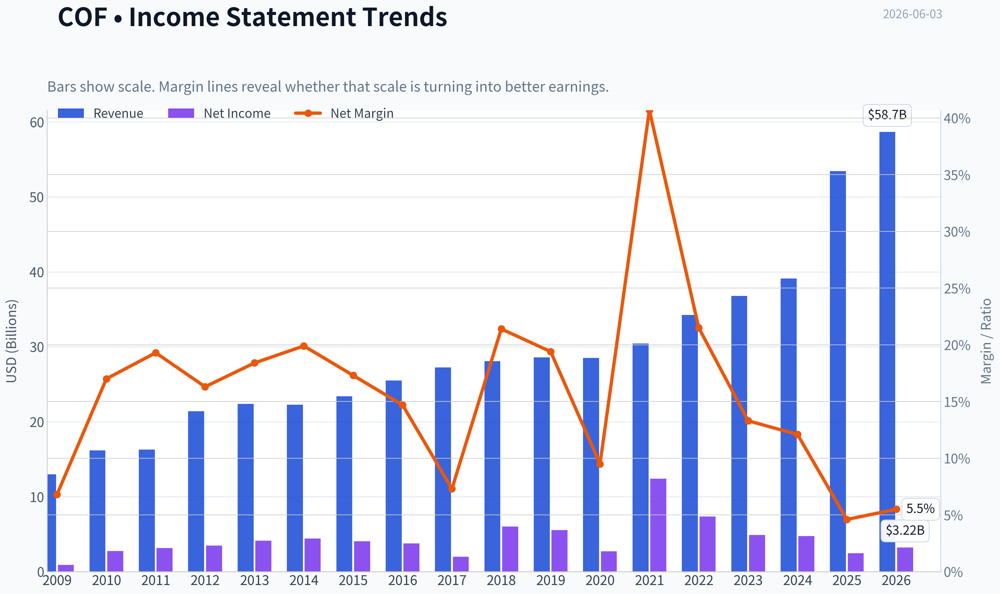

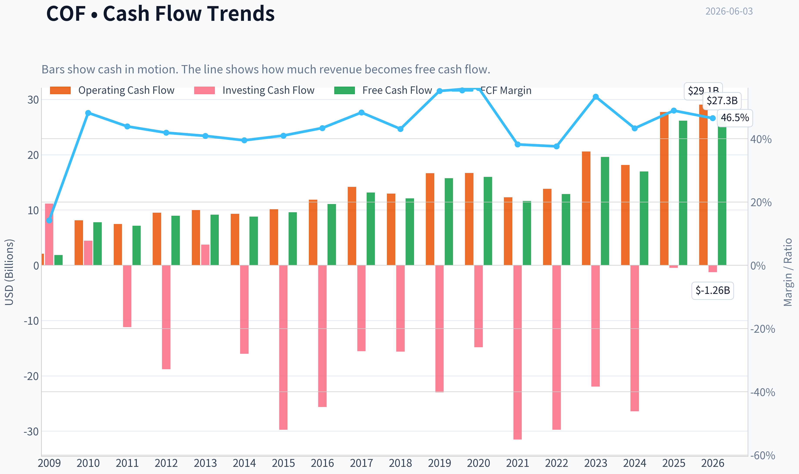

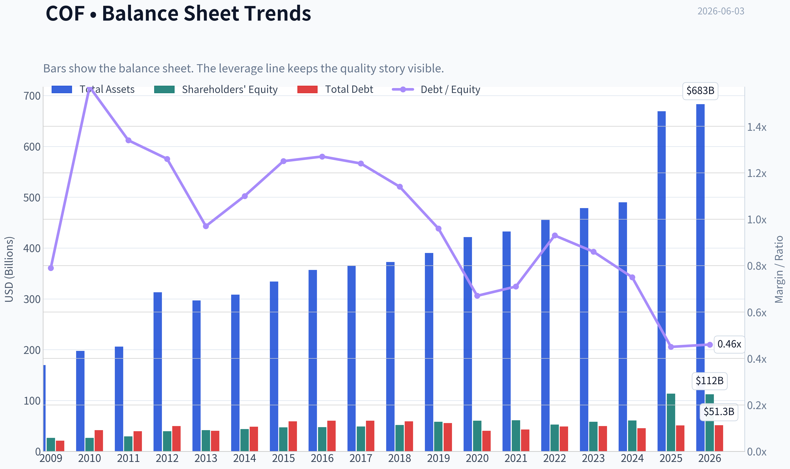

This graph tracks the profitability and return metrics (ROE, ROIC, Margins) of **COF** over the past decade, highlighting capital efficiency trends.

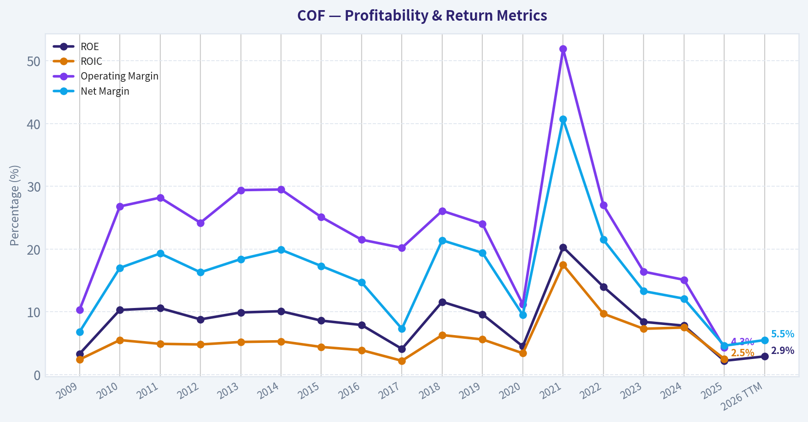

This chart illustrates the financial health of **COF** over the last 10 years, mapping cash equivalents and free cash flow against total obligations (Debt).

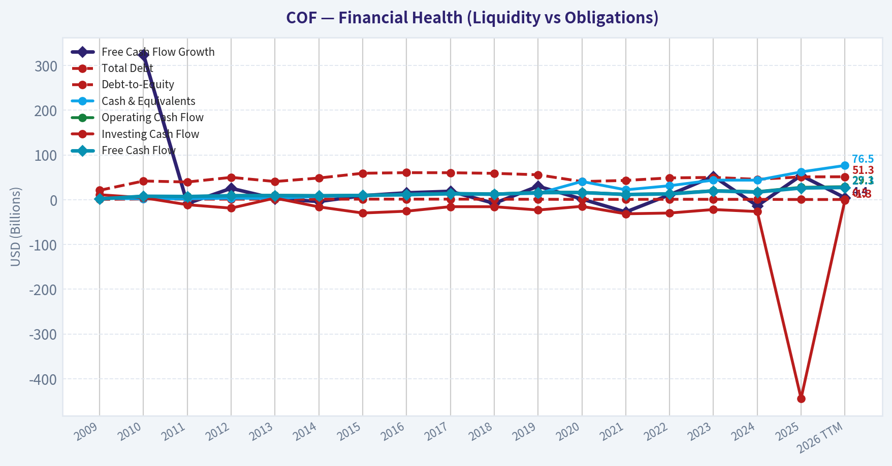

---

### Intrinsic Value Analysis (Buffett)

> *Following Warren Buffett's value investing philosophy: Circle of Competence, Economic Moat, Management Quality, and Margin of Safety.*

#### Intrinsic Value Snapshot

Price is what you pay. Intrinsic value is what the business may be worth based on the cash it can create for owners over time. We show a range, not one magic number.

- Current Price: $177.62
- Value Range (conservative to optimistic across both DCF methods): $12.59 to $3,195.25

##### Owner Earnings (Buffett Method)
- Net Income: $2,453,000,000.00
- Depreciation & Amortization: $5,260,000,000.00
- Capital Expenditures: $-1,578,000,000.00
- Working Capital Changes: $1,276,000,000.00
- Owner Earnings: $4,859,000,000.00

##### Intrinsic Value
###### Buffett Method
Uses owner earnings. Stricter, and usually more conservative.
- Conservative: $12.59
- Average: $34.33
- Optimistic: $170.73
- Discount Rate: 10.0%

###### Cash Flow Method
Uses free cash flow. Better for companies spending heavily today to grow tomorrow.
- Conservative: $1,049.46
- Average: $1,345.94
- Optimistic: $3,195.25
- Discount Rate: 10.0%

ANALYST STANCE: **WATCH**

#### Capital One Financial (COF) - Buffett-Style Investment Review

#### 1) Go/No-Go Gate Assessment

| Gate | Verdict | Evidence |
|---|---|---|
| Gate 1: Circle of Competence & Business Simplicity | Pass | Capital One is understandable: it borrows money cheaply, lends at higher rates, and earns fees, especially through credit cards, consumer banking, and auto finance. The business model is simple, though credit underwriting adds cyclicality. |
| Gate 2: Moat Test | Mixed Pass | The company has meaningful scale, a recognized card brand franchise, data/underwriting capability, and customer relationships. But this is not a classic "wide moat" consumer monopoly; competition in cards and consumer lending is always active. |
| Gate 3: Management Quality & Capital Allocation | Pass with caution | Management has historically built a large, profitable card franchise and appears operationally competent. For banks, capital allocation is heavily regulated, so the key question is underwriting discipline and balance-sheet conservatism rather than buybacks alone. |
| Gate 4: Industry Structure | Mixed | Credit cards are attractive when well-managed, but consumer finance is cyclical and competitive. Banking is also leverage-dependent by nature, which raises Buffett's quality bar. |

**Key Takeaways:** Capital One passes the basic "can I understand it?" test, but it does not clear the bar as a simple, highly predictable, low-risk business. The biggest issue is not complexity of explanation, but the inherent cyclicality and leverage of consumer lending. This makes COF investable only at a compelling price, not as an automatic long-term compounding machine.

#### 2) Elementary School Test

Capital One takes deposits and other funding, lends that money to people, mainly through credit cards, auto loans, and banking products, and keeps the difference between what it earns and what it pays. It also collects fees from card activity.

Ten years from now, the company will probably still be a large consumer lender and card issuer. The broad shape of the business is predictable. The harder part is forecasting credit losses, regulation, and funding conditions through cycles.

Technology is a double-edged sword here. Capital One benefits from data, digital banking, and underwriting analytics, but finance technology also lowers switching friction and increases competition. So technology helps efficiency, but does not guarantee moat protection.

#### 3) Moat Analysis

| Moat Source | Assessment | Evidence |
|---|---|---|
| Intangible Assets | Moderate | Capital One has a well-known consumer brand in credit cards and banking, but not the kind of luxury or must-have brand that creates effortless pricing power. |
| Switching Costs | Low to Moderate | Banking relationships and card rewards ecosystems create some stickiness, but consumers can still switch cards and lenders with relative ease. |
| Cost Advantage | Moderate | Scale in marketing, funding, data analytics, and underwriting likely supports better unit economics than smaller rivals. |
| Network Effects | Weak | Card networks themselves have network effects, but Capital One is primarily an issuer, not the network owner. |

**Moat Quality Rating: Narrow to Moderate**

Financially, the shared research pack shows **ROE of only 2.2%**, which is far below Buffett-quality levels and suggests current profitability is depressed. Gross margin is not a useful metric for banks, so the better read is returns on equity, credit quality, and efficiency. A bank with a true wide moat should usually show stronger normalized returns than this.

**Key Takeaways:** Capital One has advantages, but they look more like scale and operational competence than an impregnable moat. In finance, the strongest moats usually show up in consistently high returns on equity across cycles. The current low ROE argues against calling this a wide-moat franchise today.

#### 4) Management Quality Assessment

| Question | Assessment | Commentary |
|---|---|---|
| Do they think like owners? | Reasonable | Management has historically focused on building franchise scale and investing in technology and marketing. |
| Are they honest & candid? | Reasonable | No major red flags are evident from the research pack provided. |
| Are they rational capital allocators? | Mixed | In banks, the core test is underwriting and reserve discipline. Capital allocation is less about flashy acquisitions and more about avoiding bad lending, preserving capital, and repurchasing stock only when clearly undervalued. |

Capital One's management deserves some credit for creating a strong national card franchise and recognizable consumer banking platform. Still, in a lender, management quality is never fully proven in good times; it is proven through credit cycles. That means the ultimate test is whether they maintain strong returns without taking hidden risk.

#### 5) Financial Summary Snapshot

| Metric | Value |
|---|---:|
| Current Price | $178 |
| Market Cap | $110.53B |
| P/E | 54.65 |
| ROE | 2.2% |
| Revenue Growth YoY | 36.6% |
| FCF Yield | 23.6% |

**Key Takeaways:** The headline numbers are unusual. Revenue growth looks strong and free-cash-flow yield looks very high, but the extremely low ROE and high P/E indicate current earnings are not representative of full economic power, or that accounting optics for a lender are distorting the picture. For a bank, ROE matters more than generic FCF screens.

#### 6) Owner Earnings View

For a bank, standard industrial-style owner earnings are less useful because debt is a raw material, working capital behaves differently, and maintenance capex is not the main economic constraint. The better Buffett-style proxy here is **normalized earning power on tangible/common equity**, plus reserve discipline.

A practical owner-earnings view for COF:

- Current reported earnings power appears weak given **ROE of 2.2%**
- If that ROE were normalized materially higher in a healthier credit environment, intrinsic value could be better than current P/E suggests
- But if low returns reflect structural pressure, then today's valuation is not obviously cheap

So the central question is: **Is current ROE temporarily depressed, or is normalized profitability lower than the market expects?** That uncertainty is why this is not an ADVOCATE.

#### 7) Three-Scenario DCF / Earnings Power Valuation

Because COF is a bank, I use an earnings-power approach anchored to market value and normalized returns rather than a traditional industrial DCF.

| Scenario | Assumption | Implied View |
|---|---|---|
| Scenario A: No Growth | Current depressed earnings persist | At 54.7x earnings, shares look expensive if today's profit level is the right baseline. |
| Scenario B: Conservative Normalization | Earnings recover toward mid-cycle levels, modest long-term growth | Shares could be reasonably valued if current earnings are temporarily suppressed by credit costs or integration effects. |
| Scenario C: Strong Normalization | Returns recover strongly and management compounds book value efficiently | Upside exists, but this requires confidence that current profitability is well below normal and will revert. |

A Buffett-style investor should not pay up for a bank unless normalized ROE is clearly attractive and durable. With reported ROE at **2.2%**, there is not enough evidence to assume Scenario C as the base case. That pushes the stance to **WATCH**, not **ADVOCATE**.

#### 8) Margin of Safety Analysis

| Item | Assessment |
|---|---|
| Business Quality | Moderate |
| Predictability | Moderate |
| Balance Sheet Comfort | Not enough evidence here to call fortress-level |
| Valuation vs Current Earnings | Unattractive |
| Valuation vs Normalized Earnings | Possibly fair, but not clearly cheap |
| Required Margin of Safety | At least 40% for this type of cyclical financial |

**Key Takeaways:** The margin of safety is not obvious at the current quote. A great bank can be attractive when temporary losses or reserves depress earnings, but that requires strong confidence in normalized returns. Here, the evidence supports patience rather than aggression.

#### 9) Buffett Scorecard

| Criterion | Score (1-5) | Weight | Weighted Score |
|---|---:|---:|---:|
| Business Understanding | 4.0 | 20% | 0.80 |
| Moat Width & Durability | 2.8 | 25% | 0.70 |
| Management Quality | 3.2 | 15% | 0.48 |
| Return on Equity | 1.5 | 15% | 0.23 |
| Reinvestment Runway | 3.0 | 10% | 0.30 |
| Balance Sheet Strength | 3.0 | 5% | 0.15 |
| Industry Structure | 2.8 | 5% | 0.14 |
| Valuation / Margin of Safety | 2.8 | 5% | 0.14 |

| Final Weighted Score | **2.94 / 5.0** |
|---|---:|

**Key Takeaways:** The score lands just below the threshold for a positive recommendation. Capital One is understandable and competitively relevant, but the combination of weak current returns and a business model tied to credit cycles keeps it from meeting Buffett's standard for a wonderful company at a clearly favorable price.

#### 10) Final Verdict

**Investment Stance: WATCH**

**Conviction Level: Moderate**

Capital One is a serious, established franchise, not a speculation. But Buffett-style investing demands more than franchise scale; it demands durable moat strength, high returns on equity, and clear owner earnings power. With **ROE at 2.2%** and valuation only potentially attractive if profitability rebounds sharply, COF looks more like a **watchlist bank awaiting either better evidence of normalized earning power or a lower price** than a clear buy today.

The setup that would change my stance:
- sustained improvement in ROE toward strong double digits,
- evidence that credit costs are cyclical rather than structural,
- and a valuation that offers a clear 25-40% margin of safety against normalized earnings power.
#### Valuation Bridge

This bridge places the current market price beside each intrinsic value lens so readers can see whether upside depends on one method or shows up across several methods.

| Scenario | Intrinsic Value / Share |
| --- | ---: |
| Buffett Method | $34.33 |
| Cash Flow Method | $1,345.94 |
| Current Price | $177.62 |

#### Key Takeaways

If one method is far above the others, the upside case depends on a specific modelling assumption. When several methods cluster together, the valuation story is more robust.

#### Valuation Visuals

This comparison chart from *Latest Earnings Snapshot* stacks current figures against historical benchmarks for **COF**, making it easy to see where the company trades relative to its own averages.

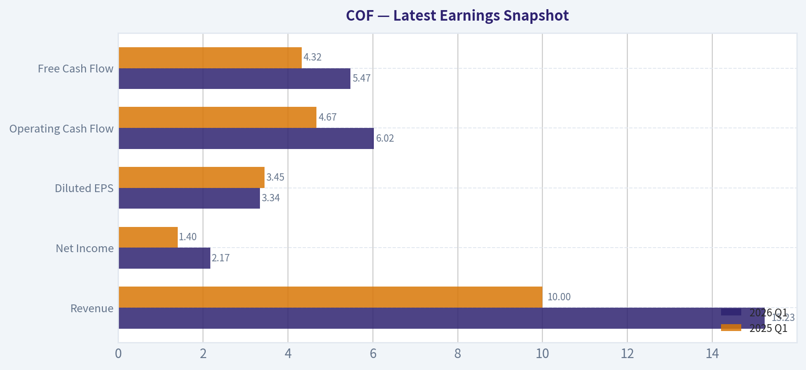

This comparison chart from *Current vs Historical Average Comparison* stacks current figures against historical benchmarks for **COF**, making it easy to see where the company trades relative to its own averages.

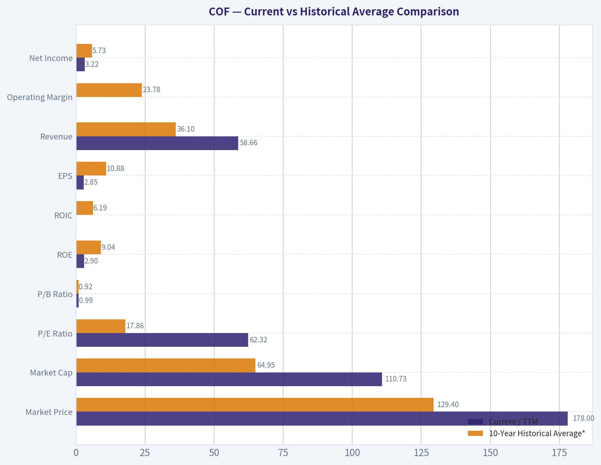

This comparison chart from *Balance Sheet Strength* stacks current figures against historical benchmarks for **COF**, making it easy to see where the company trades relative to its own averages.

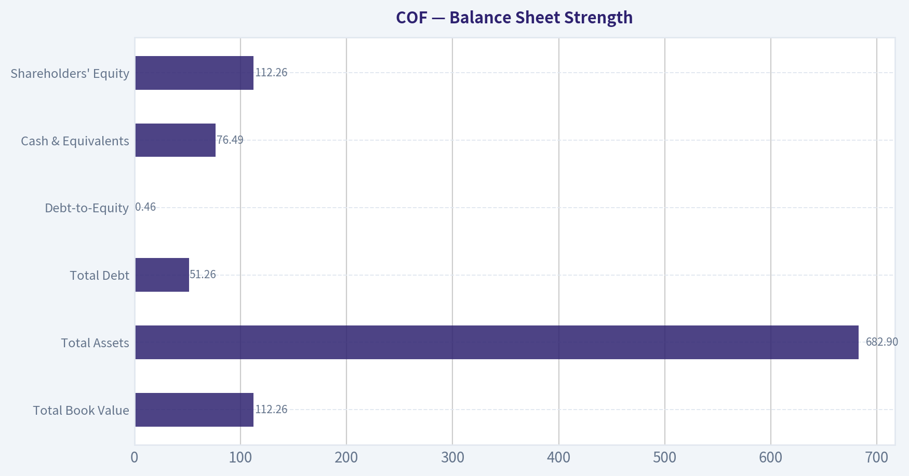

This comparison chart from *Financial Summary Snapshot* stacks current figures against historical benchmarks for **COF**, making it easy to see where the company trades relative to its own averages.

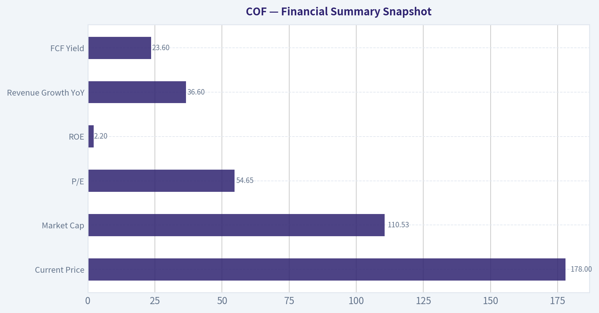

---

### Trend & Growth Analysis (Lynch/Druckenmiller/Fisher)

> *Following Peter Lynch's GARP, Stanley Druckenmiller's macro-aware approach, and Philip Fisher's scuttlebutt methodology.*

ANALYST STANCE: **WATCH**

#### COF - Capital One Financial Growth/Inflection Report

Capital One is **not a classic Lynch fast grower**. It is a **financial cyclically exposed compounder/re-rating candidate**, where the key question is not "can revenue grow 25% for years?" but **whether earnings power rebounds as credit costs normalize and synergies/scale improve**. On that basis, COF looks more like a **WATCH with cyclical upside**, not a clean ten-bagger growth setup.

---

#### 1) Lynch Classification

| Framework | COF Assessment |
|---|---|
| Lynch category | **Cyclical / Stalwart hybrid** |
| Why | Revenue can look strong in spurts, but earnings are heavily driven by credit provisioning, charge-offs, and macro |
| Growth investor relevance | **Not a primary Lynch fast grower** |
| Best use case | Re-rating / normalized earnings recovery, not secular hypergrowth |

**Key Takeaways:** Capital One does not fit the ideal Lynch fast grower mold because its growth is tied to the consumer credit cycle rather than a long runway of steady secular expansion. This is more of a credit-sensitive financial franchise with upside from normalization than a pure long-duration growth story.

---

#### 2) The Story in 3 Bullets

| Simple Story | Explanation |
|---|---|
| Big consumer finance franchise | Capital One is a major U.S. credit card and consumer banking platform |
| Edge is data + scale | It uses analytics, underwriting, and brand scale to acquire and manage customers profitably |
| Stock upside depends on normalization | If credit losses stabilize and returns recover, earnings can inflect upward faster than the market expects |

**Key Takeaways:** The simple story is that Capital One is a scaled consumer lender with a strong card franchise and data advantage. The investment case depends less on new markets and more on whether the business exits a period of elevated credit stress and returns to stronger normalized profitability.

---

#### 3) Snapshot of What We Know

Using the shared research pack:

| Metric | Value |
|---|---:|
| Current price | **$178** |
| Market cap | **$110.53B** |
| P/E | **54.7x** |
| ROE | **2.2%** |
| Revenue growth YoY | **36.6%** |
| FCF yield | **23.6%** |
| Gross margin | N/A for banks |
| Current ratio | N/A for banks |

**Key Takeaways:** The headline numbers are distorted for a bank. Revenue growth looks very strong, but the very low ROE and very high P/E suggest depressed earnings, likely due to credit costs or acquisition/integration noise, which means traditional growth multiples need to be interpreted carefully.

---

#### 4) TAM Analysis with 10x Test

For banks, TAM is less useful than for software or platform businesses, but we can still frame it.

| TAM Question | COF Assessment |
|---|---|
| Core TAM | U.S. credit cards, consumer deposits, consumer lending, payments-linked financial products |
| TAM growth profile | **Moderate**, not hypergrowth |
| Can COF 10x revenue and stay <20% share? | **No, unrealistic** in core U.S. consumer finance |
| Runway type | Share gains, product mix improvement, M&A/integration, and normalized returns-not 10x TAM expansion |
| Secular tailwinds | Digital banking, data-driven underwriting, card/payment digitization |

**Key Takeaways:** Capital One does not pass the classic 10x growth runway test. Its markets are large but mature, so upside must come from share gains, efficiency, improved underwriting, and earnings recovery rather than from serving a vast underpenetrated market.

---

#### 5) Revenue Growth Trend

| Metric | Observation | Growth Read |
|---|---|---|
| YoY revenue growth | **36.6%** | Strong headline acceleration |
| Earnings quality caveat | Banks can show volatile revenue due to NII, balance sheet mix, rate effects, and acquisitions | Must verify durability |
| ROE | **2.2%** | Weak conversion of revenue into shareholder returns |
| Pattern | Revenue up, profitability depressed | **Mixed inflection** |

**Key Takeaways:** Revenue growth is clearly strong on the surface, but it is not yet translating into attractive returns on equity. That suggests the business may be at an operational transition point, but not yet a clean earnings inflection.

---

#### 6) Unit Economics / Bank-Appropriate Metrics

Traditional SaaS metrics like LTV/CAC, NRR, and Rule of 40 do **not apply well** to banks. For COF, better unit economics are credit spreads, charge-offs, CET1 capital, deposit costs, and normalized ROE.

| Metric Type | Applicability | COF Status |
|---|---|---|
| LTV/CAC | Low relevance | Not disclosed in a useful bank format |
| NRR | Not relevant | N/A |
| Rule of 40 | Not relevant | N/A |
| Better metrics | ROE, ROA, NIM, charge-offs, delinquencies, CET1 | **ROE currently weak at 2.2%** |

**Key Takeaways:** Standard growth investor unit economics cannot be used here. The real test for Capital One is whether it can restore healthy ROE while maintaining credit discipline and capital strength.

---

#### 7) Inflection Point Assessment

| Potential Inflection | Evidence | Assessment |
|---|---|---|
| Revenue inflection | 36.6% YoY growth | Positive |
| Earnings inflection | P/E 54.7x and ROE 2.2% imply depressed earnings base | Not yet proven |
| Credit-cycle inflection | Core swing factor for COF | **Most important variable** |
| Synergy/scale inflection | Possible if integration and operating leverage improve | Potential upside |
| Market perception inflection | Stock could rerate if charge-offs peak and normalized EPS becomes visible | Plausible |

**Key Takeaways:** There may be an inflection underway, but it is not the clean kind growth investors prefer. The key is whether credit costs and integration noise are peaking; if they are, earnings could rebound materially and drive a rerating.

---

#### 8) Macro Setup Evaluation

| Macro Factor | Impact on COF |
|---|---|
| Consumer credit cycle | Critical |
| Interest rates | Mixed: higher rates can help yields but pressure funding costs and consumer stress |
| Employment/consumer health | Very important for loss rates |
| Secular themes | Digital banking and payments are supportive, but this is not a pure secular AI/cloud winner |
| Market regime | Better in stable-to-easing credit environment than in deteriorating consumer backdrop |

**Key Takeaways:** Macro matters more for Capital One than for a typical secular growth stock. The biggest driver is consumer credit quality, not a new technology adoption curve, so the stock is more exposed to economic conditions than to innovation-led growth.

---

#### 9) Fisher 15 Points Score

This is necessarily approximate given limited scuttlebutt data.

| Fisher Factor | Score (1-5) | Notes |
|---|---:|---|
| Market potential | 3 | Large market, but mature |
| New product development | 3 | Incremental, not disruptive |
| R&D effectiveness | 3 | Analytics/tech strong for a bank |
| Sales organization | 4 | Strong consumer acquisition/brand |
| Profit margin | 2 | Currently pressured |
| Improving margins | 2 | Not yet evident from ROE |
| Labor/personnel relations | 3 | Neutral/insufficient evidence |
| Executive relations | 3 | Neutral |
| Management depth | 4 | Large-scale financial operator |
| Cost analysis/accounting | 4 | Sophisticated bank systems |
| Special advantages | 4 | Brand + data + card scale |
| Long-range profit outlook | 3 | Good, but cyclical |
| Dilution risk | 4 | Lower than early-stage growth firms |
| Candor | 3 | Neutral |
| Integrity | 3 | Neutral |

| Total Fisher Score | **48 / 75** |
|---|---|

**Key Takeaways:** COF scores as average-to-good rather than outstanding on Fisher criteria. Its strengths are brand, analytics, and scale, while the main weakness is that current profitability and long-term growth are too cyclical to justify a top-tier growth score.

---

#### 10) Valuation Analysis

For banks, **P/B and normalized P/E** matter more than P/S or FCF yield.

| Valuation Lens | COF Read | Interpretation |
|---|---|---|
| Trailing P/E | **54.7x** | Looks expensive, but likely due to depressed earnings |
| PEG | Not useful currently | Earnings growth base is distorted |
| P/S | Low utility for banks | Not primary metric |
| FCF yield | **23.6%** | Likely not reliable for bank valuation work |
| Best lens | Normalized earnings + ROE recovery | Use cycle-adjusted framing |

**Key Takeaways:** On trailing earnings, COF looks expensive, but that may be misleading because earnings appear temporarily depressed. The right question is whether normalized EPS power is much higher than current reported EPS; if yes, the stock could be cheaper than it looks.

##### Scenario View

| Scenario | What Happens | Stock Implication |
|---|---|---|
| Bear | Credit losses worsen, ROE stays weak | Multiple stays compressed, downside risk |
| Base | Credit costs stabilize, ROE recovers to mid-cycle norms | Moderate rerating |
| Bull | Credit peak passes, synergies/operating leverage appear, EPS rebounds sharply | Strong upside from normalized earnings |

**Key Takeaways:** The bull case depends on the market realizing that current earnings are trough-like rather than normal. The bear case is that weak ROE is not temporary, in which case the stock deserves a lower-quality bank multiple.

---

#### 11) Growth Investor Scorecard

| Criterion | Weight | Score (1-5) | Weighted |
|---|---:|---:|---:|
| The Story | 10% | 3.5 | 0.35 |
| TAM & Runway | 20% | 2.0 | 0.40 |
| Revenue Growth | 20% | 3.5 | 0.70 |
| Unit Economics | 15% | 2.5 | 0.38 |
| Competitive Position | 10% | 3.5 | 0.35 |
| Management Quality | 10% | 3.0 | 0.30 |
| Macro Setup | 5% | 2.5 | 0.13 |
| Profitability Path | 5% | 2.5 | 0.13 |
| Valuation | 5% | 3.0 | 0.15 |

| Total Score | **2.89 / 5.0** |
|---|---|

**Key Takeaways:** COF lands just below the threshold for a growth-style endorsement. The main reason is that its runway and economics are not those of a classic fast grower, and too much of the thesis depends on cyclical normalization rather than secular compounding.

---

#### 12) Position Size Stance

| Stance | View |
|---|---|
| Recommended stance | **WATCH** |
| Position size | **0-2% starter only if you specifically want cyclical financial exposure** |
| Ideal buyer | Investor looking for a credit-cycle rerating, not a ten-bagger growth name |
| Not ideal for | Pure growth investors seeking long-duration secular compounding |

**Key Takeaways:** This is not a high-conviction growth-style advocate idea today. If owned, it is more appropriate as a small cyclical position tied to credit normalization than as a core secular growth holding.

---

#### 13) Key Risks and Catalysts

| Risks | Catalysts |
|---|---|
| Consumer credit deterioration | Charge-offs peak and improve |
| Weak ROE persists | Normalized EPS becomes visible |
| Funding cost pressure | Better operating leverage |
| Mature TAM limits long-run growth | Synergy capture / efficiency gains |
| Market keeps assigning cyclical discount | Re-rating if returns recover |

**Key Takeaways:** The risks are mostly macro and credit related, while the catalysts are mostly about normalization and execution. That means this is a stock that can move sharply if the credit narrative changes, but it lacks the cleaner product-led catalysts seen in true growth names.

---

#### Bottom Line

Capital One is a **quality consumer finance franchise**, but under the Lynch-Druckenmiller-Fisher growth lens it is **not a clean fast-grower with ten-bagger characteristics**. The setup is more about **earnings normalization, credit-cycle stabilization, and possible rerating** than about compounding through an expanding TAM.

**Final view: WATCH.**
Interesting as a **cyclical financial recovery idea**, but not strong enough for an **ADVOCATE** growth designation.

If you want, I can next turn this into a **bank-specific deep dive** focused on:
1. **normalized earnings power**,
2. **credit metrics to watch**, and
3. **what ROE would justify upside from $178**.

#### Growth & Scorecard Visuals

The radar chart below from *Buffett Scorecard* visualises how **COF** ranks across weighted investment criteria. Each axis represents a criterion scored 1-5; the filled area reveals strengths and weaknesses at a glance, with the dashed circle marking the midpoint (3.0).

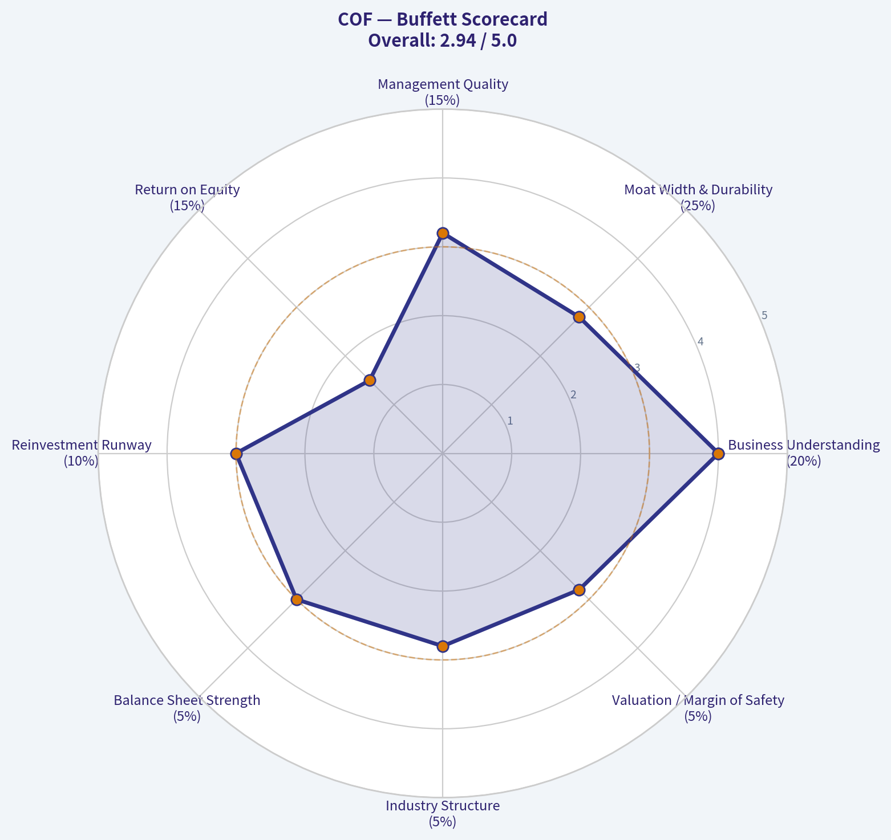

---

### Market Technical Analysis

#### COF Technical Snapshot

COF is in a **structurally weak long-term trend** but a **less aggressive short-term decline than in March**. The most relevant indicators for the current setup are:

- `close_50_sma`
- `close_200_sma`
- `close_10_ema`
- `macd`
- `rsi`
- `boll_ub`
- `boll_lb`
- `atr`

These eight are appropriate because they cover:
- **trend structure**: 50 SMA, 200 SMA
- **short-term momentum/trading trigger context**: 10 EMA, MACD
- **mean-reversion / exhaustion**: RSI, Bollinger Bands
- **risk and position sizing**: ATR

They are complementary without adding obvious redundancy like multiple MACD sub-components or the Bollinger middle line.

---

#### Price Context and Regime

Using the last year of price history, COF appears to have moved through **three distinct phases**:

1. **Uptrend into early January 2026**
   Price advanced from the low 190s in June 2025 to a peak area above **255** in early January 2026.

2. **Sharp regime break from mid-January through March 2026**
   That rally failed decisively. The stock suffered a large downside repricing, including heavy-volume air pockets in January and February, and eventually fell into the **mid/high 170s** by March.

3. **Spring rebound that failed below major trend resistance**
   April produced a respectable recovery back above **200**, but that rebound stalled well below prior highs and rolled over again through May. Into early June, price is back in the **low 180s**, indicating the rebound did not repair the broader damage.

That sequence matters: this is not simply a stock "consolidating." It is a stock that **broke trend, attempted recovery, and failed beneath long-term overhead supply**.

---

#### Trend Analysis

The most important structural fact is the relationship between price and the moving averages:

- Latest close shown: **183.84** on 2026-06-02
- `close_50_sma`: **188.84**
- `close_200_sma`: **209.95**
- `close_10_ema`: **186.12**

This tells a clear story:

- Price is **below the 10 EMA**, so short-term momentum remains soft.
- Price is **below the 50 SMA**, meaning the medium-term trend is still bearish.
- Price is **far below the 200 SMA**, confirming the long-term trend remains damaged.
- The **50 SMA itself is still drifting down**, from above 222 in early March to below 189 now. That is a persistent medium-term downtrend, not a flat base.
- The **200 SMA is also declining**, though slowly, from roughly 214.9 in early March to 209.9 now. That means the long-term trend benchmark is no longer merely lagging old strength; it is now actively rolling over.

This is important for traders: even though price has stabilized from the March low, the stock has **not reclaimed the levels that would suggest real trend repair**. A bullish case would need, at minimum, a sustained move back above the 10 EMA and 50 SMA, followed by evidence that the 50 SMA stops falling.

---

#### Momentum Analysis

`macd` is currently **-1.28**, still negative. However, the slope is nuanced:

- In March, MACD was deeply negative, near **-9**
- By late April, it improved sharply to strongly positive, above **+3**
- Since then it has deteriorated again and moved back below zero in May
- Recently, it has improved somewhat from more negative May readings near **-2.30** to around **-1.28**

So momentum is **still bearish, but not accelerating downward at the same pace as before**. That is a subtle but useful distinction. Traders should not confuse "less bearish" with "bullish." Right now, MACD suggests **downside pressure persists, but the most severe phase of selling has cooled**.

`rsi` at **43.3** supports that view:

- It is below 50, so momentum still favors sellers
- It is not deeply oversold, which means the stock is **not at a classic washout extreme**
- In March, RSI fell near or below **30**, reflecting panic-like weakness
- Current RSI in the low 40s suggests a **weak drift lower / failed rebound** environment rather than capitulation

This is often a tricky zone for traders. Stocks with RSI in the low 40s can either:
- stabilize and base, or
- continue bleeding lower without giving strong oversold reversal signals.

For that reason, RSI here is more useful as a **regime filter** than as a direct buy signal.

---

#### Volatility and Range Structure

The Bollinger Bands show COF trading in the lower half of its recent range:

- `boll_ub`: **192.50**
- `boll_lb`: **180.37**
- Close: **183.84**

That places price much closer to the **lower band** than the upper band. This suggests:

- sellers still control the short-term tape,
- but price is nearing an area where mean-reversion buyers may become more active,
- without yet reaching a decisive oversold stretch.

A useful nuance here is the **band compression relative to March-April**. Back then, volatility was much wider and directional swings were stronger. Now the band spread is narrower, which fits a market transitioning from panic trend to **grinding, lower-volatility weakness**. Such conditions often produce frustrating price action: less dramatic moves, but repeated failed rallies.

`atr` confirms volatility has cooled:

- ATR in March was around **7.8-8.1**
- ATR now is about **4.71**

That is a meaningful decline. The stock is still moving enough to matter, but not with the same disorder as during the earlier selloff. For traders, this means:
- stop placement can be tighter than in March,
- but false breakouts and failed bounces can still occur because the trend remains weak.

---

#### What the Trend Actually Looks Like

A finer-grained reading of the last three months:

| Aspect | Observation |
|---|---|
| Early March | Persistent selloff, momentum deeply negative, RSI repeatedly near oversold |
| Late March to mid-April | Reflex rebound formed, improving momentum, price reclaimed short-term averages |
| Mid-April to late April | Rebound extended into the 200 area, momentum peaked |
| May | Recovery faded, lower highs formed, stock slipped back under short-term trend measures |
| Early June | Price sits below 10 EMA and 50 SMA, with weak-but-not-panicked momentum |

Key Takeaways: COF has not been moving randomly. It fell hard, bounced sharply, and then failed to hold that recovery. The current phase looks like a weak retest environment where sellers still have the broader advantage, even though the pace of decline is slower than it was in March.

This is the type of chart where **lower highs matter more than isolated up days**. Until COF can string together closes above short-term resistance, rallies are more likely to be treated as countertrend rather than trend-changing.

---

#### Trading Implications

##### For bearish traders
The setup still favors a cautious bearish bias because:
- price is below all key selected moving averages,
- the 50 SMA is declining,
- the 200 SMA is declining,
- MACD is negative,
- RSI remains below 50.

The main tactical risk to shorts is that price is **not far above the lower Bollinger Band**, so new short entries taken too late may face mean-reversion bounce risk.

##### For bullish swing traders
A bottom-fishing long is not well confirmed yet. The stock is weak, but not at a classic washed-out extreme. A stronger bullish case would likely require:
- a reclaim of the **10 EMA (~186.1)**,
- then a push above the **50 SMA (~188.8)**,
- ideally with RSI moving back above **50** and MACD continuing to improve toward zero or above it.

Without those conditions, long entries are more speculative and more dependent on tight risk controls.

##### For mean-reversion traders
The best case for a tactical bounce would come from:
- price holding above the lower Bollinger Band area near **180.4**,
- RSI stabilizing in the low 40s rather than slipping back toward 30,
- MACD becoming less negative over several sessions.

That would not necessarily signal a new uptrend, but it could support a bounce back toward the **186-189** zone first, and possibly the low **190s** after that.

##### For trend followers
The chart is not yet investable on trend strength alone. The trend system remains negative until COF can reclaim and hold above the 50 SMA, and eventually start reducing the gap to the 200 SMA. Right now, the stock remains in a **bearish long-term structure with only intermittent rebound attempts**.

---

#### Key Levels to Watch

| Level Type | Approx. Level | Why It Matters |
|---|---:|---|
| Immediate support | 180.4 | Near lower Bollinger Band; loss of this area could reopen downside pressure |
| Secondary support | 176-178 | March/April low zone and prior panic region |
| Near-term pivot | 186.1 | 10 EMA; first sign of short-term repair if reclaimed |
| Medium-term resistance | 188.8 | 50 SMA; important trend filter |
| Upper short-term resistance | 192.5 | Bollinger upper band; likely cap on a quick bounce |
| Major long-term resistance | 209.9 | 200 SMA; broad trend still negative until this zone is approached/reclaimed |

Key Takeaways: The most important battle is happening between roughly 180 and 189. If COF loses the lower end of that range, sellers could press toward prior lows. If it reclaims the upper end, the stock may have room for a tradable bounce, though the long-term trend would still remain weak.

---

#### Bottom Line

COF is currently a **bearish-structure stock in a lower-volatility pullback phase**, not a clean recovery candidate yet. The most informative indicators show:

- **trend**: clearly negative across short, medium, and long horizons
- **momentum**: bearish, but not as severe as the March collapse
- **mean-reversion**: possible near the lower Bollinger zone, but not strongly confirmed
- **risk**: volatility has eased, making tactical setups more manageable, though still trend-sensitive

The highest-probability interpretation is that COF remains in a **sell-the-rally / prove-it-first** regime until price can reclaim the 10 EMA and 50 SMA with improving momentum.

#### Summary Table

| Category | Indicator | Latest Reading | Interpretation | Trading Relevance |
|---|---|---:|---|---|
| Short-term trend | `close_10_ema` | 186.12 | Price is below it | Short-term momentum still weak |
| Medium-term trend | `close_50_sma` | 188.84 | Price below a falling 50 SMA | Bearish intermediate structure |
| Long-term trend | `close_200_sma` | 209.95 | Price far below a declining 200 SMA | Long-term trend damage remains |
| Momentum | `macd` | -1.28 | Negative but less severe than earlier | Downtrend persists, though pace has cooled |
| Momentum regime | `rsi` | 43.30 | Below 50, not deeply oversold | Weak tape, not yet capitulation |
| Volatility envelope | `boll_ub` | 192.50 | Near upside cap on bounce attempts | Resistance on short-term rallies |
| Volatility envelope | `boll_lb` | 180.37 | Price near lower range boundary | Support / bounce-watch area |
| Risk | `atr` | 4.71 | Lower than March highs | Volatility normalized, but still meaningful |

Key Takeaways: COF remains below all major trend markers, which keeps the broader outlook defensive. Momentum is still negative, but the decline is less violent than it was in March, creating a market that may bounce tactically without yet becoming genuinely bullish.

#### Market Visuals

This comparison chart from *Market Metrics* stacks current figures against historical benchmarks for **COF**, making it easy to see where the company trades relative to its own averages.

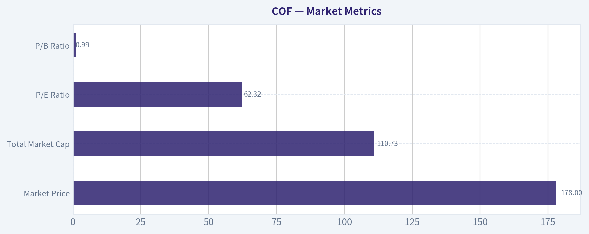

---

### Options Market Analysis

> *Reading options flow - put/call ratios, IV skew, and unusual activity - to gauge institutional positioning and event-driven risk.*

#### COF Options Positioning Report
*Date: 2026-06-03*

#### 1. Put/Call Ratio Analysis

| Expiration | Call OI | Put OI | Put/Call OI Ratio | Call Vol | Put Vol | Put/Call Vol Ratio |
|---|---:|---:|---:|---:|---:|---:|
| 2026-06-05 | 7,060 | 2,024 | 0.29 | 4,151 | 990 | 0.24 |
| 2026-06-12 | 1,100 | 994 | 0.90 | 4,367 | 331 | 0.08 |
| 2026-06-18 | 60,142 | 41,658 | 0.69 | 1,430 | 1,457 | 1.02 |
| **Near-term total** | **68,302** | **44,676** | **0.65** | **9,948** | **2,778** | **0.28** |

**Key Takeaways:** COF's aggregate near-term put/call open-interest ratio is 0.65, slightly below the roughly neutral 0.7 baseline, which leans modestly bullish rather than defensive. The stronger signal is volume: the near-term put/call volume ratio is just 0.28, showing recent flow is heavily call-dominated. The 6/12 expiry is especially notable because call volume dwarfs put volume, suggesting fresh upside speculation rather than balanced hedging.

**Interpretation:**
- **OI ratio at 0.65**: mildly bullish/constructive, close to neutral but tilted toward calls.
- **Volume ratio at 0.28**: a much stronger bullish signal, indicating recent order flow is skewed hard toward calls.
- **Shift from neutral:** the market is not showing broad downside hedging pressure; instead, it is showing **short-dated upside interest**.

---

#### 2. Implied Volatility Assessment

| Expiration | ATM Call IV | ATM Put IV | Call vs Put ATM Read |
|---|---:|---:|---|
| 2026-06-05 | 39.9% | 38.5% | Slight call premium |
| 2026-06-12 | 36.4% | 33.9% | Clear call premium |
| 2026-06-18 | 36.5% | 33.4% | Clear call premium |

**Key Takeaways:** Near-term implied volatility is elevated into the mid-to-high 30% range, but the unusual feature is that calls are priced richer than puts at-the-money. That is the opposite of the classic downside-fear pattern. Instead of a steep put skew, COF currently shows signs of upside demand or call chasing in the front end.

**IV/Skew interpretation:**
- **ATM IV range:** about **33%-40%**, which is not low for a large financial and suggests traders expect meaningful near-term movement.
- **Skew direction:** based on the provided data, **call-side richness dominates put-side richness** in the near term.
- Normally, equities show put skew because investors pay up for downside protection. Here, the **reverse tilt implies upside participation demand**, often seen when traders are reaching for short-dated calls.
- No explicit catalyst data was provided by the tool, so I cannot definitively tie the IV level to earnings or a scheduled event. Still, **front-end IV plus aggressive call flow** often indicates traders are positioning for a near-term move.

---

#### 3. Unusual Options Activity

| Expiry | Type | Strike | Volume | Open Interest | Vol/OI | IV | Positioning Read |
|---|---|---:|---:|---:|---:|---:|---|
| 2026-06-12 | CALL | 185.0 | 2,369 | 23 | 103.0x | 34.0% | Fresh upside bet, likely opening activity |
| 2026-06-12 | CALL | 190.0 | 1,869 | 353 | 5.3x | 37.4% | Aggressive upside continuation bet |

**Key Takeaways:** The standout feature in COF is concentrated short-dated call activity in the 6/12 expiry, with volume massively exceeding open interest. That strongly suggests new positions are being opened rather than old ones being closed. Because this flow is concentrated in calls rather than puts, the market is signaling upside speculation, not protection.

**Contract-level read:**
- **6/12 $185 Calls**
  - Volume of **2,369** versus OI of just **23** is extremely unusual.
  - This is almost certainly **fresh positioning**.
  - With only about **9 days to expiry** from the report date, this looks like a **near-term directional upside trade**.
  - Depending on COF spot, this strike is likely **near-ATM to modestly OTM**, which would fit an informed tactical bullish view more than lottery-ticket retail behavior.

- **6/12 $190 Calls**
  - Volume of **1,869** against OI of **353** also qualifies as strong fresh call buying.
  - Slightly more speculative than the $185 line because it is further up the chain.
  - This looks like traders positioning for a **continued near-term rally** or a sharp pop into next week.

**Smart-money vs retail read:**
- The **size and concentration** in one weekly expiry suggest this is more than random small-lot retail activity.
- Without trade prints, sweeps, or premium size, we cannot prove institutional origin, but the pattern is **consistent with tactical speculative positioning**, potentially by funds or active momentum traders.
- Because both unusual trades are **calls in the same short-dated expiry**, the message is coherent: **upside expected soon**.

---

#### 4. Open Interest Concentration

| Expiration | Call OI | Put OI | OI Read |
|---|---:|---:|---|
| 2026-06-05 | 7,060 | 2,024 | Call-heavy front-week positioning |
| 2026-06-12 | 1,100 | 994 | Balanced OI, but call volume overwhelmingly dominant |
| 2026-06-18 | 60,142 | 41,658 | Largest OI concentration; likely main pinning zone into monthly expiry |

**Key Takeaways:** The biggest open-interest inventory sits in the 6/18 expiration, making that the most likely area for pinning and dealer gamma effects as expiry approaches. However, the freshest and most directional activity is happening in the 6/12 weekly calls, which can drive short-term momentum before the larger 6/18 positioning takes over. In simple terms: 6/12 flow may move the stock, while 6/18 OI may later act as a magnet.

**Interpretation:**
- **6/18** is the dominant OI expiration and likely the most important for gamma-related price behavior.
- High OI in a monthly expiry often creates **gravitational/pinning effects**, especially if spot trades near heavily populated strikes.
- The tool does **not provide strike-by-strike OI concentration**, so I cannot identify the exact max-pain strike or precise gamma walls.
- Still, the broad setup suggests:
  - **Short-term impulse:** driven by 6/12 call buyers
  - **Subsequent damping/pinning:** more likely into the heavily populated 6/18 expiry

---

#### 5. Overall Options Sentiment Signal

| Category | Signal |
|---|---|
| Directional read | **BULLISH** |
| Confidence | **Moderate** |

**Key Takeaways:** COF's options market is leaning bullish, and the main reason is not just a slightly favorable open-interest ratio but a very aggressive short-dated call-volume surge. The unusual activity is concentrated, fresh, and upside-oriented, while IV pricing also favors calls over puts. The biggest caveat is that we do not have full strike-by-strike gamma mapping or explicit catalyst confirmation, so confidence is moderate rather than high.

**Why BULLISH:**
1. **Near-term put/call OI ratio of 0.65** is slightly bullish versus the 0.7 neutral baseline.
2. **Put/call volume ratio of 0.28** is decisively bullish, showing recent flow is call-heavy.
3. **Unusual activity is concentrated in 6/12 calls**, not puts, and volume far exceeds OI.
4. **Call IV richer than put IV** indicates upside demand rather than downside fear.

**Primary driver of the signal:**
- **Heavy short-dated call buying in the 6/12 $185 and $190 strikes**, indicating traders are positioning for near-term upside.

**Main caveats:**
- We lack full strike-level OI distribution, so exact gamma walls cannot be pinpointed.
- If these calls are tied to overwriting or structured positioning rather than outright buying, the signal would be less bullish than it appears.
- Still, based on the available data, the **cleanest directional read is bullish**.

---

#### Summary Table

| Metric | Read |
|---|---|
| Put/Call Ratio | **0.65 OI / 0.28 volume** - bullish tilt, especially in recent flow |
| IV Level | **Mid-to-high 30s** near term - elevated enough to reflect expected movement |
| Skew Direction | **Call skew / upside richness** rather than classic downside put skew |
| Unusual Activity | **6/12 $185C and $190C** with volume far above OI; fresh upside bets |
| Overall Signal | **BULLISH** |

**Key Takeaways:** The options market in COF is signaling a bullish near-term lean, with the strongest evidence coming from aggressive fresh call activity in the 6/12 expiry. Open interest is not screaming euphoria, but recent flow clearly is. Net-net, options traders appear to be positioning for upside rather than hedging for downside.

---

## Research Team Commentary

> *The Research Manager synthesizes the Bull vs Bear debate into action-free commentary. This is a pre-risk view, not the final stance.*

The strongest bull argument is that Capital One should not be judged on trough-looking earnings metrics. For a lender, a 54.6x P/E and 2.2% ROE can be badly distorted by reserve builds, charge-offs, and credit-cycle pressure. The bull case says the real question is whether COF retains durable through-cycle earning power from its national card franchise, digital banking scale, deposit funding base, and underwriting/data capabilities. If normalized ROE can recover into even the 10% to 12% range, today's price could be reasonable or better, and if it gets back to the low-to-mid teens, the stock may look clearly undervalued in hindsight.

The strongest bear argument is that this is still too assumption-heavy for a Buffett-style investment. Current returns are weak by any standard, and the moat may be overstated in a highly competitive unsecured lending market where rewards inflation, funding costs, regulation, and fintech pressure can keep returns structurally lower. The bear side is right to press on a key issue: if you dismiss current P/E, current ROE, and current ROA as temporary, you are left relying heavily on normalization. That is not a comfortable place for a value investor unless the franchise quality and balance-sheet resilience are unmistakable. Based on the data provided, that proof is incomplete.

My takeaway is that the bull case is plausible, but not yet investable with conviction under Buffett's framework. This does not look like a bad business in the abstract, but it also does not currently offer the predictability, demonstrated returns, or clear margin of safety I would want before calling it an advocate-level idea. I want evidence that weak profitability is cyclical rather than structural. Past mistakes matter here: when the facts point to weak current economics and valuation depends on recovery assumptions, I should resist softening the conclusion just because the franchise is recognizable or the normalization story sounds reasonable. A recognizable brand in finance is not the same as a wide moat.

Core takeaway: Capital One is a potentially recoverable franchise, but today it is a "show me" situation rather than a Buffett-style bargain. The market may be looking through depressed earnings, but I do not yet see enough proof of durable excess returns or enough valuation protection to underwrite that optimism confidently.

Rationale: Buffett-style investing starts with business quality and predictability. COF likely has real advantages in scale, distribution, deposits, and underwriting, but the business remains cyclical and credit-sensitive. Current profitability is too low to ignore, and unlike a classic consumer monopoly or toll-bridge business, this is an industry where competitive and regulatory pressures can permanently alter normalized returns. The key question is not whether earnings can bounce, but whether they can normalize at attractive levels consistently over a full cycle. Until that is clearer, intrinsic value remains too fuzzy. That makes a strong buy call premature. At the same time, the stock is not an obvious avoid if the credit cycle is near a profit trough. So the disciplined conclusion is to wait for either better evidence or a better price.

Monitoring plan over the next 1 to 4 quarters: first, watch charge-off trends, delinquency formation, and reserve builds. If credit metrics stabilize or improve, the bull case gains credibility. Second, watch net interest margin and deposit/funding costs. If funding pressure eases while loan yields remain healthy, normalized earnings power likely improves. Third, watch ROE progression carefully. I would want to see a path from 2.2% toward something that clearly supports intrinsic value, ideally with quarterly evidence that returns are rebuilding rather than just management promising eventual normalization. Fourth, monitor efficiency and marketing intensity in card acquisition. If revenue growth is being bought at poor economics, that weakens the thesis. Fifth, pay attention to capital allocation: buybacks, capital ratios, and underwriting posture. In financials, management quality shows up in restraint as much as in growth. Finally, compare COF's recovery trajectory with peers; if the whole industry improves but COF lags, that suggests a franchise-specific problem, not just cycle pressure.

My stance is WATCH.

---

## Value Investing Team Commentary

> *The Investor translates the research view into an investment thesis before risk review. This is still not the final stance.*

Capital One is the sort of business that can easily fool both optimists and pessimists if you look only at headline multiples. A 54.6x P/E looks absurd for a lender, but in this case it likely says more about depressed current earnings than about a wildly expensive franchise. The real question, as your handoff correctly frames it, is whether today's weak profitability is cyclical noise or evidence of a lower-return future.

From a Buffett-style perspective, that distinction is everything. I do not mind buying into temporary pain if I can confidently estimate normalized earnings power. But I do mind paying for recovery on faith. With COF, the current reported economics are simply too weak to ignore: ROE of 2.2%, ROIC of 2.0%, and ROA of 0.4% are not the marks of a wonderful business at this moment. They may be trough numbers, but they are still weak numbers. A value investor should never casually wave away poor returns unless the path back to healthy returns is both understandable and probable.

The bull case is respectable. Capital One does have real business strengths: a scaled national card franchise, a meaningful digital banking presence, a deposit base that is more valuable than it looks in stress periods, and underwriting/data capabilities that should matter over time. If credit costs normalize and funding pressure eases, earnings power could recover sharply. In that scenario, today's optically high P/E would prove misleading, and the market may actually be offering a reasonable entry into a temporarily impaired franchise.

But the bear case deserves real respect. Credit card lending is not See's Candies. It is competitive, cyclical, regulated, and vulnerable to underwriting mistakes and changing consumer behavior. Rewards costs, acquisition intensity, regulation, and fintech competition can all erode returns. That means "normalization" may not mean a return to old peak economics. Markets often overreact to temporary credit fears, but they also sometimes correctly sniff out that a lender's prior returns were helped by a more favorable environment that will not fully come back.

This is where selective contrarian thinking matters. If sentiment is cautious because near-term credit costs are ugly, that alone is not a reason to run away. Temporary fear around lenders often creates opportunity. But to be constructively contrarian, you need evidence that the market is missing durable earning power. Here, the evidence is incomplete. What may be happening is not irrational panic but rational hesitation: investors are waiting to see whether COF can rebuild returns without taking on excessive risk. That is a sensible market stance, not obviously a mistaken one.

I would focus less on the current P/E and more on normalized ROE. If this business can earn 10% to 12% ROE through a healthier but still ordinary cycle, the stock could be acceptable. If it can sustainably earn in the low-to-mid teens, then the shares may eventually look cheap in hindsight. But if normalized returns settle only modestly above current depressed levels, then the stock is not attractive simply because the franchise is well known. In financials, the moat is proven through durable returns across cycles, not branding alone.

Management and capital allocation also matter greatly here. In banks and card issuers, restraint is a competitive advantage. I would want to see disciplined underwriting, stable or improving credit trends, sensible reserve behavior, and proof that growth is not being purchased at poor economics. Revenue growth of 36.6% sounds strong, but for a lender, growth without returns is not inherently valuable. If growth is accompanied by weak unit economics or rising future losses, it can destroy value rather than create it.

So the long-term business outlook is neither broken nor clearly investable today. COF may well be in a temporary earnings valley, and if so, patient investors could eventually be rewarded. But Buffett-style investing asks for more than a plausible recovery story. It asks for understandable economics, durable advantage, and a margin of safety grounded in business reality. At present, intrinsic value is still too dependent on assumptions about recovery, and that keeps me cautious.

What would change my mind? Evidence over the next several quarters that charge-offs and delinquencies are stabilizing, reserve pressure is easing, funding costs are behaving, and ROE is climbing back toward a double-digit level without heroic assumptions. If those pieces fall into place while the stock remains reasonably priced, the opportunity could become much more interesting. On the other hand, if the industry improves and COF still cannot restore attractive returns, that would suggest the problem is more structural than cyclical.

ANALYST STANCE: **WATCH**
Capital One looks more like a potentially recoverable financial franchise than a clear Buffett-style bargain. The contrarian upside case is plausible if current earnings are trough-distorted, but the proof of durable normalized returns is not yet strong enough to justify advocacy. I would watch for improving credit and return metrics before committing capital.

---

## Deep Values Commentary

> *The Risk Management Team debates and the Risk Judge provides the final action-free verdict. This section determines the final ADVOCATE / WATCH / AVOID stance.*

#### Final Stance Scorecard

This scorecard converts the final research view into a weighted decision frame. It does not replace the narrative judgement, but it makes the main drivers of the verdict easier to scan.

| Criterion | Score | Weight | Commentary |
| --- | ---: | ---: | --- |
| Business Quality | 2.75 | 30% | High returns, profitability, and Piotroski health support durability. |
| Valuation Support | 3.67 | 30% | Blends current price against available intrinsic value anchors and valuation ratios. |
| Financial Strength | 3.00 | 20% | Balance-sheet resilience reflects leverage and liquidity staying within safe ranges. |
| Growth Durability | 3.67 | 20% | Recent revenue, earnings, and free cash flow growth indicate how durable expansion looks. |
| TOTAL / FINAL STANCE | 3.26 | 100% | WATCH |

#### Key Takeaways

The weighted score lands at **3.26 / 5.0**, while the final stance remains **WATCH**. This is useful as a quick calibration aid rather than a mechanical signal.

#### Risk Summary

Higher scores indicate more risk pressure. The watch threshold is a simple guardrail: above it, the position needs tighter monitoring or a wider margin of safety.

| Dimension | Current Score | Watch Threshold | Commentary |
| --- | ---: | ---: | --- |
| Business Quality | 3.25 | 3.00 | High returns, profitability, and Piotroski health support durability. |
| Valuation Support | 2.33 | 3.00 | Blends current price against available intrinsic value anchors and valuation ratios. |
| Financial Strength | 3.00 | 3.00 | Balance-sheet resilience reflects leverage and liquidity staying within safe ranges. |
| Growth Durability | 2.33 | 3.00 | Recent revenue, earnings, and free cash flow growth indicate how durable expansion looks. |

#### Key Takeaways

This view helps readers separate *where* the risk sits: valuation, business quality, balance sheet, or growth durability. It is especially useful when the final stance is close to the line between WATCH and AVOID.
