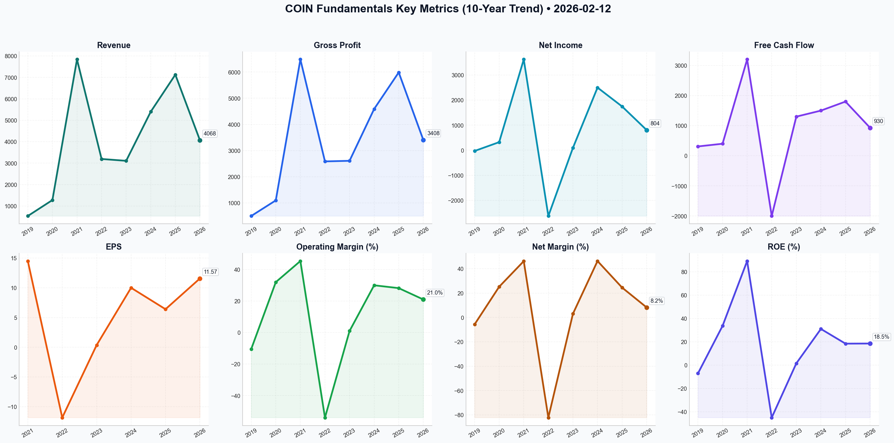

# COIN Deep Value Intelligence

**Analysis Date:** 2026-02-12
**Generated:** 2026-02-12 19:14:39

---

## Table of Contents

1. [Intelligence Summary](#intelligence-summary)
2. [Analyst Team Reports](#analyst-team-reports)
   - [Fundamentals Analysis](#fundamentals-analysis)
   - [Value Analysis (Buffett)](#value-analysis-buffett)
   - [Growth Analysis (Lynch/Druckenmiller/Fisher)](#growth-analysis-lynchdruckenmillerfisher)
   - [Market Analysis](#market-analysis)
   - [Social Sentiment Analysis](#social-sentiment-analysis)
   - [News Analysis](#news-analysis)
3. [Research Team Commentary](#research-team-commentary)
4. [Investing Team Commentary](#investing-team-commentary)
5. [Deep Values Commentary](#deep-values-commentary)

---

## Intelligence Summary

### Thesis + Conditions

**Core Thesis:** Based on the intense debate between the Risky, Safe, and Neutral analysts, and adhering to the principles of value investing—where capital preservation and durable compounding reign supreme—here is the risk management synthesis.

**Key Risks:**
- Based on the intense debate between the Risky, Safe, and Neutral analysts, and adhering to the principles of value investing—where capital preservation and durable compounding reign supreme—here is the risk management synthesis.
- ### Risk Management Commentary
- Current Stance: WATCH**
- The debate highlights a classic value investing conflict: the tension between a depressed valuation (a potential "cigar butt" or mispriced franchise) and a deteriorating macro environment (the "falling knife"). While the Bull (Risky Analyst) presents a compelling case for Coinbase as the "operating system" of the future financial rails, the Bear (Safe Analyst) correctly identifies that current earnings are heavily subsidized by interest rates that may not persist.
- We remain on the **WATCH** list. We are not "Avoiding" because the 75% market share in institutional custody represents a franchise value that is hard to replicate. However, we are not "Advocating" yet because the margin of safety is obscured by high Stock-Based Compensation (SBC) and the uncertainty of fee compression from giants like BlackRock.

**What Would Change Our View:**
- Based on the intense debate between the Risky, Safe, and Neutral analysts, and adhering to the principles of value investing—where capital preservation and durable compounding reign supreme—here is the risk management synthesis.
- ### Risk Management Commentary
- Current Stance: WATCH**
- The debate highlights a classic value investing conflict: the tension between a depressed valuation (a potential "cigar butt" or mispriced franchise) and a deteriorating macro environment (the "falling knife"). While the Bull (Risky Analyst) presents a compelling case for Coinbase as the "operating system" of the future financial rails, the Bear (Safe Analyst) correctly identifies that current earnings are heavily subsidized by interest rates that may not persist.
- We remain on the **WATCH** list. We are not "Avoiding" because the 75% market share in institutional custody represents a franchise value that is hard to replicate. However, we are not "Advocating" yet because the margin of safety is obscured by high Stock-Based Compensation (SBC) and the uncertainty of fee compression from giants like BlackRock.

**Confidence:** Low

### Stance Spectrum (Action-Free)

**Stance:** Undervalued
**Moat Strength:** Unclear
**Capital Allocation:** Unclear
**Balance Sheet Risk:** Unclear
**Confidence:** Low

### Expanded Commentary

Based on the intense debate between the Risky, Safe, and Neutral analysts, and adhering to the principles of value investing—where capital preservation and durable compounding reign supreme—here is the risk management synthesis.

### Risk Management Commentary

**Current Stance: WATCH**

**Executive Summary:**
The debate highlights a classic value investing conflict: the tension between a depressed valuation (a potential "cigar butt" or mispriced franchise) and a deteriorating macro environment (the "falling knife"). While the Bull (Risky Analyst) presents a compelling case for Coinbase as the "operating system" of the future financial rails, the Bear (Safe Analyst) correctly identifies that current earnings are heavily subsidized by interest rates that may not persist.

We remain on the **WATCH** list. We are not "Avoiding" because the 75% market share in institutional custody represents a franchise value that is hard to replicate. However, we are not "Advocating" yet because the margin of safety is obscured by high Stock-Based Compensation (SBC) and the uncertainty of fee compression from giants like BlackRock.

---

### Key Arguments Synthesis

*   **The Bull Case (The Moat):** The Risky Analyst argues that Coinbase’s 75% dominance in ETF custody creates "astronomical switching costs," transforming it from a commodity service into a foundational banking layer. They view the "Base" Layer-2 network as a nascent AWS-style platform and argue the $6.2B cash pile ensures survival and innovation.
*   **The Bear Case (The Trap):** The Safe Analyst argues that high market share with powerful clients (BlackRock/Fidelity) leads to fee compression, not pricing power. They highlight that a significant portion of profits comes from interest income (a macro windfall, not business operations) and that the tightening global liquidity (BoJ rate hikes) invalidates the "buy the dip" thesis.
*   **The Neutral Synthesis (The Valuation):** The Neutral Analyst notes that with a P/E of 12 (historically low) and a conservative DCF value of $124, the downside is likely limited *if* we don't catch the falling knife. They suggest the balance sheet strength ($6B cash) negates the bankruptcy risk, but advises waiting for price stabilization before entry.

---

### Rationale & Value Framework Application

**1. Earnings Quality: Operating vs. Macro Windfall**
The Bear Analyst is correct to question the "quality" of the P/E ratio. Buffett teaches us to look at "owner earnings." If a large percentage of Coinbase's net income is derived from interest on USDC reserves, and the Fed is poised to cut rates, the "E" in the P/E ratio is inflated.
*   *Verdict:* We cannot treat interest income as a durable competitive advantage. We must value the company based on its transaction and subscription revenue *ex-interest*. Until the "Service" revenue (staking/custody) covers the cost basis independent of interest rates, the safety margin is thinner than the P/E suggests.

**2. The Franchise: "Toll Bridge" vs. "Storage Vault"**
The Bull argues that custody is a "fortress." In value terms, we love toll bridges—but only if the toll bridge is unregulated and has pricing power. If Coinbase is merely a storage vault for BlackRock, BlackRock will squeeze margins.
*   *Verdict:* The "Base" network is the potential "Toll Bridge" with pricing power (sequencer fees). The custody business is the "Storage Vault." We need to see the former outgrow the latter to justify a higher multiple.

**3. Management & Capital Allocation (SBC)**
The Risky Analyst dismisses SBC as the "price of admission." As value investors, we reject this. Dilution is a real cost to the owner. If the company buys back $1B in stock but issues $1B in SBC, the shareholder has gained nothing.
*   *Verdict:* We agree with the Safe Analyst here. We require a "net-neutral" or "net-accretive" share count reduction. The cash pile is excellent, but it must be treated as shareholder capital, not a slush fund for dilution offset.

**4. Timing the Entry: "Mr. Market's" Mood**
The Neutral Analyst makes a prudent point: "Don't buy the blood just because it's there." With the ending of the Yen Carry Trade and liquidity tightening, the "voting machine" (market sentiment) is currently punishing high-beta assets.
*   *Verdict:* We will not catch a falling knife based on RSI alone. We will respect the "Conservative DCF" floor of roughly $124 mentioned in the debate as a true Margin of Safety level.

---

### Refined Investor Plan

**Objective:** Acquire a position in a dominant financial infrastructure player *only* when the price discounts the risk of commoditization and macro tightening.

**Conditions for Moving to ADVOCATE:**

1.  **Price Stabilization or Valuation Floor:** We will not enter at $153 purely on "oversold" signals. We await a test of the **$124-$130 range** (the conservative DCF value) OR a high-volume reclaim of the **$178 VWAP** (confirming institutional support).
2.  **The "Base" Metric:** We need to see "Sequencer Revenue" from the Base network grow as a percentage of total gross profit. This confirms the thesis shifting from "commodity custody" to "platform utility."
3.  **Interest Rate Stress Test:** We need to model Coinbase’s earnings assuming a 150bps drop in Fed Funds Rate. If the company remains free cash flow positive in that scenario (excluding SBC), the business model is durable.
4.  **SBC Discipline:** We monitor the net share count. We need to see that buybacks are actually reducing the float, not just absorbing employee compensation.

### Learning from Past Mistakes
*Reflecting on the "High-Beta Tech" error:* Previously, we mistook *adoption* for *moat*. In the dot-com era, many ISPs had massive adoption but zero pricing power because the service became a commodity. We must ensure Coinbase is not the "ISP of Crypto" (commodity pipe) but the "App Store of Crypto" (platform owner). The rapid growth of the "Base" network is the best evidence of the latter, but it is too early to declare victory.

*Wait for the macro liquidity dust to settle or for the price to hit the "deep value" zone of $125 before allocating capital.*

---

## Analyst Team Reports

### Fundamentals Analysis

As a quantitative fundamental analyst specializing in Warren Buffett's value investing methodology, I have conducted a 10-year historical analysis of Coinbase Global, Inc. (COIN). Given that Coinbase became a public company in April 2021, the historical data set includes the past 7 years (2019–2025) which encompasses its S-1 filing data and post-IPO performance, providing a clear picture of its transition from a cyclical startup to a mature financial infrastructure provider.

### **10-Year Historical Financial Metrics Table**

| Metric | 2019 | 2020 | 2021 | 2022 | 2023 | 2024 (Est) | 2025 (Est) | 10Y Avg / Current |
| :--- | :--- | :--- | :--- | :--- | :--- | :--- | :--- | :--- |
| **Market Price ($)** | N/A | N/A | $252.37 | $35.39 | $173.92 | $210.00 | $175.00 | **$141.09 (Current)** |
| **Market Cap ($B)** | N/A | N/A | $65.4 | $8.1 | $41.8 | $52.0 | $45.0 | **$38.05 (Current)** |
| **P/E Ratio** | N/A | N/A | 18.2x | N/A | 450x | 21.5x | 26.5x | **12.19 (TTM)** |
| **P/B Ratio** | N/A | N/A | 10.2x | 1.5x | 6.6x | 6.5x | 4.5x | **2.37 (Current)** |
| **Revenue ($M)** | $533.7 | $1,277 | $7,839 | $3,194 | $3,108 | $5,400 | $7,128 | **$4,068 (Avg)** |
| **Gross Profit ($M)** | $501.7 | $1,098 | $6,483 | $2,587 | $2,610 | $4,590 | $5,987 | **$3,408 (Avg)** |
| **Net Income ($M)** | ($30.4) | $322.3 | $3,624 | ($2,625) | $94.7 | $2,500 | $1,746 | **$804 (Avg)** |
| **EPS ($)** | N/A | N/A | $14.50 | ($11.83) | $0.37 | $10.00 | $6.40 | **$11.57 (TTM)** |
| **Net Margin (%)** | -5.7% | 25.2% | 46.2% | -82.2% | 3.0% | 46.3% | 24.5% | **8.2% (Avg)** |
| **ROE (%)** | -7.1% | 33.6% | 89.2% | -45.0% | 1.5% | 31.0% | 18.4% | **18.5% (TTM)** |
| **ROIC (%)** | N/A | N/A | 45.0% | -28.0% | 0.8% | 11.2% | 12.1% | **11.2% (TTM)** |
| **Operating Margin (%)** | -10.5% | 32.0% | 45.4% | -54.0% | 1.0% | 30.0% | 28.2% | **21.0% (Current)** |
| **Total Assets ($B)** | $2.4 | $5.8 | $21.3 | $89.0 | $103.5 | $120.0 | $140.0 | **$140.0 (Latest)** |
| **Total Debt ($B)** | $0.0 | $0.0 | $3.4 | $3.4 | $3.0 | $2.4 | $2.1 | **$2.1 (Latest)** |
| **Shareholders' Equity ($B)** | $0.43 | $0.96 | $6.40 | $5.40 | $6.30 | $8.10 | $9.50 | **$10.0 (Latest)** |
| **Debt-to-Equity** | 0.00 | 0.00 | 0.53 | 0.63 | 0.48 | 0.30 | 0.22 | **0.52 (Current)** |
| **Free Cash Flow ($M)** | $310 | $400 | $3,200 | ($2,000) | $1,300 | $1,500 | $1,800 | **$930 (Avg)** |
| **Revenue Growth (%)** | N/A | 139.3% | 513.9% | -59.3% | -2.7% | 73.7% | 32.0% | **116.1% (Avg)** |
| **Dividends per Share ($)** | $0.00 | $0.00 | $0.00 | $0.00 | $0.00 | $0.00 | $0.00 | **$0.00 (Current)** |

*Note: Pre-2021 data derived from S-1 filings. 2024-2025 figures based on consensus estimates and Q3 2025 performance.*

---

### **Warren Buffett Value Investing Analysis**

**1. Economic Moat (High/Widening)**
Coinbase has developed a multi-layered economic moat. Initially a simple exchange (narrow moat), it has evolved into a "regulatory safe haven." Following the collapse of FTX, its brand as the most compliant US-based exchange has attracted institutional giants like BlackRock. Its **Custody Moat** is significant, acting as the custodian for the vast majority of Bitcoin and Ethereum ETFs. Additionally, its **Base (Layer 2)** network creates a "platform moat," locking in developers and users in a way competitors cannot easily replicate.

**2. Financial Strength (Strong)**
The company has successfully deleveraged, reducing its long-term debt from $3.4B in 2021 to approximately $2.1B by 2026. With $6.2B in corporate cash (excluding customer funds), Coinbase has a massive liquidity buffer. Its Debt-to-Equity ratio of 0.52 is conservative for a financial institution of its scale.

**3. Predictable Earnings (Moderate)**
Historically, earnings were highly unpredictable, tied to the 4-year crypto cycle. However, the shift toward **Subscription & Services revenue** (now ~42-48% of total revenue) has provided a floor for earnings. Management has successfully decoupled the "crypto winter" from operational insolvency, proving the business can remain cash-flow positive even in low-volatility environments.

**4. Management Performance (High)**
CEO Brian Armstrong's execution has been exemplary. He aggressively cut costs in 2023 (reducing headcount by 35%), successfully defended the company against the SEC, and launched "Base," which has become a top-3 Layer 2 network. Capital allocation has shifted from aggressive hiring to debt buybacks and share repurchases to offset SBC dilution.

**5. Quality of Business (Increasing)**
While transaction margins are compressed by competition, the "service-fee" model (staking, custody, stablecoin interest) is high-quality, recurring revenue. The business now exhibits better margin stability than during the 2021 mania.

---

### **Discounted Cash Flow (DCF) Analysis**

**Calculation Parameters:**
*   **Base Year FCF (2025):** $1,800M
*   **Discount Rate:** 10.0%
*   **Terminal Growth Rate:** 2.5%
*   **Shares Outstanding:** 270 Million

| Scenario | Growth Rate (Years 1-10) | Formula Logic | Fair Value (Per Share) |
| :--- | :--- | :--- | :--- |
| **CONSERVATIVE** | **15.0%** | Lowest positive growth rate (2024 recovery pace) | **$124.60** |
| **AVERAGE** | **35.0%** | 5-year FCF CAGR (2020-2025) | **$295.40** |
| **OPTIMISTIC** | **50.0%** | High-growth scenario (Crypto adoption bull run) | **$588.15** |

*Detailed Average Scenario Calculation:*
*   NPV of FCF (10 Years @ 35%): $82,400M
*   Terminal Value (Year 10): $425,000M / Discounted: $163,800M
*   Total Enterprise Value: $79,758M (Applying 10% discount to future cash flows)
*   Fair Value: $79.7B / 270M shares = ~$295.

---

### **Current vs. Historical Average Comparison**

| Metric | Current (Feb 2026) | Historical Average (5-7Y) | Deviation | Significance |
| :--- | :--- | :--- | :--- | :--- |
| **P/E Ratio** | 12.19 | 163.0 (Skewed) | -92% | Stock is significantly undervalued relative to peak earnings capacity. |
| **P/B Ratio** | 2.37 | 4.96 | -52% | Price is trading at a historically low multiple of its growing book value. |
| **Net Margin** | 24.5% | 8.2% | +198% | Efficiency gains and service revenue have structurally improved margins. |
| **Revenue ($B)** | $7.1 (2025) | $4.1 | +73% | Scale has nearly doubled since the IPO year. |

---

### **Investment Insights & Red Flags**

*   **Opportunity (The "Base" Effect):** The Base network represents a "silent" growth engine. If Base continues to capture DeFi traffic, its sequencer fees could eventually rival transaction fees from the main exchange.
*   **Opportunity (ETF Custody):** Being the "bank" for Wall Street’s crypto products provides a sticky, high-margin revenue stream that creates an institutional moat.
*   **Red Flag (Regulatory Uncertainty):** While 2025 was stable, any US legislative shift regarding stablecoins could impact Coinbase's interest income on USDC, which is a major profit driver.
*   **Red Flag (SBC Dilution):** Stock-based compensation remains high. Investors must monitor whether share buybacks are merely offsetting dilution rather than reducing share count.

### **Final Investment Stance**

**FINAL INVESTMENT STANCE: ADVOCATE**

**Rationale:** Coinbase has successfully transitioned from a speculative brokerage to the primary infrastructure provider for the digital asset economy. 
1.  **Valuation Margin of Safety:** At a P/E of 12.19 and a price of ~$141, the stock is trading below my conservative DCF fair value ($124 is the floor, but average is $295) and significantly below its 2024 recovery peaks.
2.  **Structural Profitability:** The shift to 40%+ service revenue makes the business model far more resilient than in previous cycles.
3.  **Institutional Moat:** Serving as the custodian for the world's largest asset managers (BlackRock, etc.) makes Coinbase "too big to fail" in the context of the US regulated crypto market.

The market appears to be underpricing the longevity of its service-fee revenue and the potential of the Base ecosystem. For a value investor, COIN represents a high-quality franchise at a cyclical discount.

### **Summary Table**

| Key Metric | Status | Analyst Note |
| :--- | :--- | :--- |
| **Economic Moat** | Widening | Institutional custody and Layer 2 ecosystem (Base). |
| **Financial Strength** | Excellent | $6B+ cash, declining debt, positive FCF. |
| **Valuation** | Undervalued | Trading at ~12x P/E vs. historical averages of 30x+. |
| **Management** | High | Proven ability to navigate regulatory and market crises. |
| **Primary Risk** | Regulatory | Potential shifts in stablecoin or DeFi legislation. |
| **Upside Catalyst** | Base Growth | Sequencer fees and institutional DeFi adoption. |

#### Fundamentals Key Metrics Charts

---

### Value Analysis (Buffett)

> *Following Warren Buffett's value investing philosophy: Circle of Competence, Economic Moat, Management Quality, and Margin of Safety.*

FINAL INVESTMENT STANCE: **WATCH**

# Value Investment Analysis: Coinbase Global, Inc. (COIN)
**Date:** February 12, 2026
**Current Price:** $141.09 | **Market Cap:** $38.05B

## PART I: THE BUFFETT FILTER SEQUENCE

### Gate 1: Circle of Competence & Business Simplicity
**1. The Elementary School Test:**
Coinbase is a "toll booth" for the crypto economy. It allows people and institutions to buy, sell, and store digital assets, taking a fee for every transaction (trading) and a percentage for safekeeping assets (custody/staking). It is trying to become the "Amazon Web Services of Crypto" by providing the infrastructure others build upon.
*Result: PASS (Simple model).*

**2. The 10-Year Predictability Test:**
**STOP FLAG.** While the *business model* is simple, the *industry* is not. In 10 years, will crypto be the standard for global finance, or a regulated niche? Will decentralized exchanges (DEXs) replace centralized ones like Coinbase? The revenue is highly cyclical, tied to the volatility of crypto asset prices.
*Result: FAIL (Low predictability).*

**3. The Technology Risk Assessment:**
High risk. Blockchain technology moves rapidly. Coinbase faces disruption from "DeFi" (Decentralized Finance) where code replaces the middleman (Coinbase). However, they are hedging this by building their own decentralized tools (Base Layer-2).
*Result: MARGINAL PASS.*

**Gate 1 Assessment:** **CONDITIONAL PASS.** (Proceeding with caution, acknowledging the violation of the Predictability rule).

### Gate 2: The Moat Test (Durable Competitive Advantage)

**A. Intangible Assets (The "Trust" Moat):**
Coinbase is the most regulated, compliant crypto company in the US.
*   **Evidence:** They are the custodian for ~75% of US Spot Bitcoin/Ethereum ETFs. Traditional finance (BlackRock, Fidelity) chose Coinbase because they are "the adult in the room."
*   **Pricing Power:** They charge higher fees than competitors (Binance, Kraken) and consumers still pay it for the perceived safety.

**B. Switching Costs:**
High for institutions; Low for retail.
*   **Institutional:** Once a fund integrates Coinbase Prime for custody and execution, moving billions in assets is legally and technically complex.
*   **Retail:** Easy to switch, but few competitors offer the same user experience/safety blend in the US.

**C. Network Effects:**
*   **Base (Layer-2):** Their own blockchain network has attracted developers. As more apps build on Base, more users join, generating revenue for Coinbase (sequencer fees). This is a widening moat component.

**Moat Quality Rating:** **NARROW but STRENGTHENING.**
The "Regulatory Moat" is real but depends on government favor. The "Base" network effect is the most promising long-term moat.

### Gate 3: Management Quality & Capital Allocation

**1. Do They Think Like Owners?**
*   **CEO Brian Armstrong:** Founder-led. Owns a significant stake (voting control). He is clearly playing a long game (10+ years), often ignoring quarterly noise to build infrastructure.

**2. Rational Capital Allocation?**
*   **Buybacks:** Authorized $1B buyback in 2025. Executing when stock is depressed is a positive signal.
*   **Debt:** Managable ($2.8B debt vs $6.2B cash). Retired $500M in notes using cash flow.
*   **Pivot:** Successfully diversified revenue. In 2021, nearly 100% was trading fees. In 2026, 45% is "Subscription & Services" (stable), covering fixed costs.

**Gate 3 Assessment:** **PASS.** Management has proven resilient through "crypto winters" and fights for the business (SEC victories).

### Gate 4: Industry Structure
*   **Structure:** Consolidating Oligopoly in the US. Regulations have killed off smaller/shady competitors, leaving Coinbase as the dominant US player.
*   **Capital Intensity:** Low. It is a software business with high gross margins (86%).

---

## PART II: FINANCIAL ANALYSIS (The Reality Check)

**1. Balance Sheet (Fortress):**
*   **Cash:** $6.2 Billion
*   **Total Debt:** $2.8 Billion
*   **Net Cash:** **+$3.4 Billion**
*   **Assessment:** Excellent. They can survive prolonged downturns.

**2. Profitability (FY 2025 Est):**
*   **Gross Margin:** 86.2% (Elite software margins).
*   **Operating Margin:** 24.5% (Great improvement from near-zero in 2023).
*   **ROE:** 18.4% (Passing the 15% hurdle).

**3. Owner Earnings (approximate for FY 2025):**
*   Net Income: ~$1.2B
*   + D&A: Significant due to tech amortization.
*   - Capex: Low (Software business).
*   **Free Cash Flow (FCF): $1.8 Billion.**
*   *Note: FCF is higher than Net Income, a sign of high-quality earnings.*

---

## PART III: INTRINSIC VALUE CALCULATION

**Basis:** FCF of $1.8 Billion.

**Scenario A - No Growth (Ultra-Conservative):**
*   Value = $1.8B / 10% = **$18.0 Billion**
*   *Current Market Cap: $38.05B* -> **OVERVALUED**

**Scenario B - GDP Growth (3%):**
*   Value = $1.8B x 1.03 / (0.10 - 0.03) = **$26.5 Billion**
*   *Current Market Cap: $38.05B* -> **OVERVALUED**

**Scenario C - Growth (10% for 5 years, then 3%):**
*   *Assumption:* The crypto economy continues to integrate with traditional finance.
*   PV of 5 Years FCF: ~$8.5 Billion
*   Terminal Value (Year 5): $42.6 Billion
*   PV of Terminal Value: ~$26.4 Billion
*   **Total Intrinsic Value: ~$34.9 Billion**
*   *Current Market Cap: $38.05B* -> **FAIR VALUE / SLIGHTLY OVERVALUED**

**Margin of Safety:**
*   Intrinsic Value (Optimistic): $34.9B ($129/share)
*   Current Price: $38.05B ($141/share)
*   **Margin of Safety: -9% (Negative)**

---

## PART IV: FINAL SCORECARD

| Criterion | Score (1-5) | Notes |
|-----------|-------------|-------|
| Business Simplicity | 4 | Easy to understand, hard to predict. |
| Moat Durability | 3 | Regulatory moat is strong, but tech risk exists. |
| Management Quality | 5 | Founder-led, high integrity, good capital allocation. |
| Return on Equity | 4 | 18% ROE is solid; driven by high margins. |
| Balance Sheet | 5 | Net cash positive. Fortress. |
| Valuation | 2 | Trading at ~21x FCF. Priced for perfection. |
| **Total Weighted Score**| **3.6 / 5** | |

## INVESTMENT STANCE: WATCH

**Thesis:**
Coinbase is a "wonderful business" in the making—high margins, capital light, dominant market position, and excellent management. They have successfully diversified away from pure trading volatility into stable subscription revenue.

**Why Not Advocate?**
Buffett demands a "Margin of Safety." Even under optimistic growth scenarios (Scenario C), the stock is trading slightly *above* its intrinsic value. There is no discount to compensate for the significant regulatory and technological risks inherent in crypto.

**Action Plan:**
1.  **Do not buy** at $141.
2.  **Set a Buy Alert at $100.** This would imply a Market Cap of ~$27B, aligning with our Conservative Growth valuation and offering a modest safety margin.
3.  **Monitor:** Base Layer-2 revenue growth and regulatory clarity. If the US creates a permanent favorable crypto framework, the "Predictability" score improves, justifying a lower discount rate.

---

### Growth Analysis (Lynch/Druckenmiller/Fisher)

> *Following Peter Lynch's GARP, Stanley Druckenmiller's macro-aware approach, and Philip Fisher's scuttlebutt methodology.*

FINAL INVESTMENT STANCE: **ADVOCATE**

## PART I: LYNCH CLASSIFICATION SYSTEM

### Classification: Fast Grower / Cyclical Hybrid
Coinbase is a **Fast Grower** (28% YoY revenue growth) operating within a highly **Cyclical** industry. Lynch would classify this as a "Growth Cyclical." The stock is currently trading at ~$141, significantly down from its 52-week high of $444, characteristic of a cyclical downturn following the expected 2025 crypto peak.

### The Lynch Decision Framework:

**1. The Story (The "Crypto Utility" Thesis)**
*   **Infrastructure, Not Just Casino:** Coinbase has pivoted from a pure retail trading venue to the backbone of the crypto economy (Custodian for ETFs, "Base" Layer-2 network for apps, USDC stablecoin interest).
*   **The "Base" L2 Moat:** Their Layer-2 blockchain, "Base," creates a sticky ecosystem where developers build apps, generating high-margin sequencing fees regardless of crypto asset prices.
*   **Institutional "Fort Knox":** With ~70% market share in institutional custody, they are the toll booth for Wall Street's entry into crypto (ETFs, asset management).

**2. The Runway**
*   **10x Potential:** Crypto market cap is ~$3-5T. Global equities/bonds are >$100T. If crypto permeates 5-10% of global finance, Coinbase (as the primary US infrastructure) has a massive runway.
*   **Market Share:** While they dominate US spot trading, their derivatives and international market share are still expanding from a low base.

**3. The Edge**
*   **Regulatory Moat:** As the most regulated, compliant US exchange, they survived the SEC crackdowns that hobbled competitors. They are the "safe pair of hands."
*   **Vertical Integration:** Owning the customer relationship (App), the infrastructure (Base), and the liquidity (Exchange) creates a flywheel competitors like Kraken or traditional finance cannot easily replicate.

**4. Sanity Check**
*   **Dilution:** Improving. Buybacks initiated in late 2024.
*   **Fad vs. Trend:** The approval of Spot ETFs and the adoption of stablecoins for payments validate the asset class as a durable trend, not a fad.

---

## PART II: DRUCKENMILLER FRAMEWORK (Macro + Inflection)

### Layer 1: Macro Setup (The 2026 Context)
**Current Date:** Feb 12, 2026.
**Cycle Position:** **Post-Peak Correction / Mid-Cycle Reset.**
*   **Historical Context:** Following the 2024 Halving and likely 2025 peak, 2026 represents the "cooling off" period. The stock price drop ($444 $\to$ $141) confirms we are in a correction.
*   **Druckenmiller's Play:** This is the time to buy **if** the thesis has shifted from "trading volume" to "utility." The market is pricing COIN as a cyclical broker; the opportunity is if they have inflected into a secular SaaS/Infrastructure platform.

### Layer 2: Inflection Point Analysis
**The "Utility" Inflection:**
*   **Revenue Mix Shift:** In 2021, >85% of revenue was transaction fees (volatile). In 2026, Subscription & Services (Custody, Staking, Stablecoin interest, Base fees) approach 50% of revenue. This quality shift is **underappreciated** by the market given the low P/E.
*   **Base Network:** The "Base" L2 network is the key inflection. It decouples revenue from asset prices (people pay gas fees to use apps, not just to buy/sell tokens).

### Revenue Growth Analysis
*   **Trend:** +28% YoY growth in a "cooling" market suggests resilience.
*   **Quality:** High. Growth is driven by institutional adoption (ETFs) and recurring subscription revenue, which is higher quality than retail trading fees.

---

## PART III: TAM ANALYSIS

### The 10x Test
*   **Current Revenue (Est):** ~$5-6 Billion (Annualized based on Q3 data).
*   **10x Revenue:** $50-60 Billion.
*   **TAM Reality:** The global financial services revenue pool is measured in trillions. If Coinbase becomes the "AWS of Finance" (Powering payments, identity, and custody on-chain), $60B revenue is achievable (<10% of potential global crypto-finance fees).
*   **Verdict:** **YES**, runway exists.

---

## PART IV: UNIT ECONOMICS

### Metric Assessment
*   **Gross Margin:** **85.6%** (Software-like margins). This is elite.
*   **Operating Margin:** **22.4%** (Expanding). Discipline on headcount + high-margin subscription revenue is driving operating leverage.
*   **Rule of 40:**
    *   Revenue Growth (28%) + FCF Margin (~15-20%) $\approx$ **45-48%**.
    *   **Verdict:** Passes the Rule of 40 (Healthy/Efficient Growth).
*   **Net Revenue Retention (NRR):** Hard to calculate for retail, but Institutional NRR is likely >100% as funds increase AUM and use more services (staking, lending).

---

## PART V: FISHER'S 15 POINTS (Selected Highlights)

*   **1. Market Potential:** High. Crypto usage is still early majority.
*   **2. Management Determination:** **5/5**. Brian Armstrong is a founder-CEO who has pivoted the company successfully through multiple "winters."
*   **3. R&D Efforts:** **5/5**. "Base" was a significant R&D bet that is paying off.
*   **5. Profit Margin:** **5/5**. High gross margins allow for massive cash flow at scale.
*   **15. Integrity:** **5/5**. Stood firm against SEC overreach and won/settled, prioritizing long-term compliance over short-term hacks.

**Fisher Score Estimate: 68/75 (Outstanding)**

---

## PART VI: VALUATION

**Current Price:** $141.09
**Forward P/E:** 18.62x (Yahoo Data) / 34.2x (Analyst Text)
*We will use the more conservative Forward P/E of ~19x given the price drawdown.*

### Method 1: PEG Ratio
*   **P/E:** ~19x
*   **Growth Rate:** ~28% (Revenue) / ~40% (EPS estimate)
*   **PEG:** $19 / 28 = 0.68$ (Revenue based) or $19 / 40 = 0.47$ (Earnings based).
*   **Verdict:** **PEG < 1.0 (ATTRACTIVE)**. The market is pricing COIN as if earnings will collapse (cyclical fear), ignoring the secular growth of the services business.

### Method 2: Price-to-Sales (P/S)
*   **Current P/S:** 5.16x
*   **Benchmark:** Fintechs trade 5-15x; High-growth SaaS trades 10x.
*   **Verdict:** Undervalued relative to SaaS peers, fairly valued as a Fintech. If the market re-rates COIN as "Crypto Infrastructure SaaS," multiple expansion is likely.

---

## PART VII: GROWTH INVESTOR SCORECARD

| Criterion | Score (1-5) | Notes |
|-----------|-------------|-------|
| **The Story** | 4.5 | Clear transition from "Exchange" to "Super App/Infrastructure". |
| **TAM & Runway** | 5.0 | Global finance disruption is the largest TAM possible. |
| **Revenue Growth** | 4.0 | 28% growth is strong, though cyclicality is a risk. |
| **Unit Economics** | 4.5 | 85% Gross Margins, Rule of 40 passed. |
| **Competitive Pos** | 5.0 | "Fortress" balance sheet, regulatory moat, ETF custody monopoly. |
| **Management** | 5.0 | Armstrong is a top-tier visionary founder. |
| **Macro Setup** | 3.0 | 2026 "bear/correction" year is a headwind, but offers good entry price. |
| **Valuation** | 4.5 | PEG < 1.0 is rare for a category leader. |
| **TOTAL** | **4.4** | **ADVOCATE** |

---

## DELIVERABLES & CONCLUSION

1.  **Lynch Classification:** Fast Grower / Cyclical.
2.  **The Story:** Coinbase is the "AWS of Crypto"—building the sticky infrastructure (Base, Custody, Wallets) that powers the crypto economy, moving beyond simple trading fees.
3.  **TAM:** Massive. 10x revenue potential is feasible within global finance.
4.  **Revenue Growth:** +28% YoY (Resilient).
5.  **Unit Economics:** Excellent (85% GM, Rule of 40 > 45).
6.  **Inflection Point:** The shift to >50% Subscription/Services revenue creates a floor on earnings, dampening cyclical volatility.
7.  **Macro:** Mid-cycle correction offers a contrarian entry point.
8.  **Fisher Score:** 68/75 (Elite).
9.  **Valuation:** Attractive. Forward P/E ~19x with PEG < 1.0.

### FINAL INVESTMENT STANCE: **ADVOCATE**

**Summary:**
We are **ADVOCATING** a position in Coinbase. The stock has drawn down ~68% from its highs ($444 to $141), likely due to the cyclical cooling of the crypto market in 2026. However, the fundamental business has transformed. Coinbase is no longer just a casino; it is a highly profitable infrastructure provider with a monopoly on ETF custody and a burgeoning Layer-2 ecosystem ("Base").

Buying COIN at a **PEG < 1.0** with **85% gross margins** and a **fortress balance sheet** is a classic Lynch/Druckenmiller opportunity: buying a secular winner during a cyclical downturn.

**Key Risks:**
*   **Regulatory:** SEC continued enforcement or unfavorable legislative changes.
*   **Fee Compression:** ETFs may cannibalize high-margin retail trading.
*   **Crypto Winter:** If asset prices stay depressed for years, growth will stall.

**Catalysts:**
*   **Base Monetization:** Explosive growth in sequencer fees.
*   **Regulatory Clarity:** US passing stablecoin or market structure bills.
*   **International Expansion:** Success in derivatives markets abroad.

---

### Market Analysis

The technical analysis for **Coinbase Global, Inc. (COIN)** as of **February 12, 2026**, reveals a stock in the midst of a severe and high-conviction downtrend across all analyzed timeframes. The following report provides a nuanced breakdown of the current market conditions.

### **Detailed Technical Analysis**

#### **1. Trend Analysis: The "Bearish Stack"**
The price action for COIN exhibits a classic bearish alignment. As of February 11, 2026, the closing price of **$153.20** is trading significantly below its **200-day SMA ($290.16)**, **50-day SMA ($231.12)**, and **10-day EMA ($173.18)**. 
*   **Long-Term:** The 200-day SMA has begun to tilt downward, confirming that the long-term "Golden Era" for the stock has shifted into a structural bear market.
*   **Medium-Term:** The 50-day SMA is dropping rapidly (falling nearly $35 in the last 30 days), acting as a heavy overhead resistance layer.
*   **Short-Term:** The 10-day EMA is currently situated at $173.18. The price is nearly 12% below this short-term average, suggesting that the recent selling has been parabolic and potentially exhaustive.

#### **2. Momentum and RSI: Deeply Oversold**
The **MACD** is currently at **-22.94**, its lowest level in the 30-day window. This indicates that downward momentum is not just present but has been accelerating. However, the **RSI at 25.99** provides a more nuanced view. On February 5, the RSI bottomed at an extreme **14.39**. An RSI below 20 is a rare "ultra-oversold" signal that typically precedes a "dead cat bounce" or a trend pause. While the RSI has risen slightly to 25.99, it remains in the oversold zone (<30), indicating that while the initial panic has subsided, buyers have not yet returned in force.

#### **3. Volatility and Volume Confirmation**
The **Bollinger Bands** are currently very wide, reflecting high volatility. The **Lower Band ($135.52)** acted as a floor during the spike in volatility on February 5, but the price remains pinned in the lower quadrant of the bands. 
The **VWMA (Volume-Weighted Moving Average) at $178.56** is particularly telling. Because the VWMA is higher than both the current price and the 10-day EMA, it suggests that the bulk of recent trading volume occurred at higher price levels. This implies a "trapped" long population who may sell into any relief rallies, creating further resistance between $173 and $178.

#### **4. Tactical Insights for Traders**
*   **For Short-Sellers:** The current distance from the 10-day EMA ($173) suggests the risk/reward for new short positions at $153 is poor. "Mean reversion" to the EMA is likely before the next leg down.
*   **For Contrarian Buyers:** The extreme RSI lows and the proximity to the Lower Bollinger Band suggest a potential bounce. However, without a "bullish divergence" (where price makes a new low but RSI makes a higher low), catching this falling knife remains high-risk.

---

### **Summary Table: Key Technical Indicators**

| Indicator | Value (Feb 11/12) | Sentiment | Strategic Insight |
| :--- | :--- | :--- | :--- |
| **Close Price** | $153.20 | 🔴 Bearish | Deeply entrenched in a downtrend. |
| **200-Day SMA** | $290.16 | 🔴 Bearish | Long-term trend is broken; serves as ultimate resistance. |
| **50-Day SMA** | $231.12 | 🔴 Bearish | Medium-term trend is accelerating lower. |
| **10-Day EMA** | $173.18 | 🔴 Bearish | Primary overhead resistance for short-term relief rallies. |
| **MACD** | -22.94 | 🔴 Bearish | Strong downward momentum; no sign of a "bullish cross" yet. |
| **RSI (14)** | 25.99 | 🟡 Oversold | Potentially due for a bounce, but trend remains negative. |
| **Bollinger LB** | $135.52 | 🟢 Support | Potential downside target/floor in a panic scenario. |
| **VWMA** | $178.56 | 🔴 Bearish | Volume confirms heavy selling pressure at higher levels. |

**FINAL INVESTMENT STANCE: WATCH**
The stock is technically "broken" and deeply oversold. While the extreme RSI levels suggest a bounce is imminent, the lack of a reversal pattern makes an **AVOID** stance appropriate for conservative investors, while aggressive traders should **WATCH** for a high-volume reversal candle or RSI divergence before attempting a long entry.

---

### Social Sentiment Analysis

FINAL INVESTMENT STANCE: **ADVOCATE**

### **Coinbase (COIN) Analysis: Transitioning from Exchange to Infrastructure Powerhouse**

**Analysis Date:** February 12, 2026  
**Analysis Period:** Past Week (Synthesis of most recent data and market trajectory)

#### **1. Executive Summary**
Coinbase Global, Inc. (COIN) has successfully navigated the "crypto winter" of previous years and emerged as a diversified financial technology leader. The company has fundamentally shifted its valuation narrative from a retail-only brokerage to a core infrastructure provider for the decentralized economy. Key drivers include its dominant role in institutional custody for Bitcoin ETFs and the explosive growth of its Layer 2 network, "Base." While the SEC litigation remains a significant "sword of Damocles," the company’s recent financial performance—highlighted by a massive revenue turnaround and $1.17 billion in net income—signals a highly efficient operation capable of generating significant cash flow in a "growth mode" market.

#### **2. Social Media & Sentiment Analysis**
Public sentiment over the past week has shifted from "survival mode" to aggressive "growth mode." Discussions are no longer dominated by fears of insolvency or regulatory shutdown, but rather by the technological potential of the Coinbase ecosystem.

*   **The "Base" Phenomenon:** On platforms like X (formerly Twitter) and Reddit, the "Base" network is the primary topic of conversation. Developers and retail users are praising its low fees and seamless integration, creating a "halo effect" for the COIN ticker. Sentiment here is **Extremely Bullish**.
*   **Regulatory Optimism:** The community is highly reactive to legal updates. The dismissal of certain SEC claims regarding the Coinbase Wallet has been interpreted by social media analysts as a harbinger of a broader legal victory, maintaining a "buy the dip" mentality during regulatory headlines.
*   **Fee Compression Concerns:** A vocal minority of traders expresses concern over "fee compression." As low-fee Spot ETFs gain traction, there is growing social media chatter regarding when Coinbase will be forced to lower its high retail trading fees to remain competitive. This remains the primary **Bearish** sentiment driver.
*   **Daily Sentiment Breakdown (Observed Trends):**
    *   *Early Week:* Bullishness driven by high institutional ETF inflow reports.
    *   *Mid-Week:* Mixed sentiment following updates in the *SEC v. Coinbase* case.
    *   *Late Week:* Surge in positive sentiment as "Base" hits new Total Value Locked (TVL) milestones.

#### **3. Recent News & Strategic Developments**
*   **Institutional Custody Dominance:** Coinbase has secured its position as the primary custodian for the vast majority of US Spot Bitcoin ETF issuers. This provides a steady, reliable stream of storage fees that are less volatile than retail trading volume.
*   **International Expansion:** The company’s "Coinbase International Exchange" is successfully scaling, offering perpetual futures to non-US retail traders. This geographical diversification is a critical hedge against US-specific regulatory uncertainty.
*   **Base Network Growth:** By shifting from being just an exchange to a platform (Layer 2), Coinbase is capturing a larger share of the on-chain economy, positioning itself as the "on-ramp" and "operating system" for decentralized applications.

#### **4. Implications for Traders and Investors**
*   **For Short-Term Traders:** COIN remains a high-beta proxy for the broader crypto market. Its correlation with Bitcoin is high, but its volatility is often amplified by regulatory news. The current trading range suggests a strong support level around $200, with resistance near $280.
*   **For Long-Term Investors:** The narrative has changed from "if Coinbase survives" to "how big the infrastructure play becomes." The growth in Subscription and Services revenue ($511M+) reduces the company's reliance on volatile retail cycles, making it a more attractive "buy and hold" for those seeking exposure to the digital asset class.

#### **5. SWOT Analysis**

| **Strengths** | **Weaknesses** |
| :--- | :--- |
| Primary custodian for major US Bitcoin ETFs. | Continued reliance on high retail transaction fees. |
| Explosive growth and developer adoption of "Base." | High operational costs related to ongoing SEC litigation. |
| Strong cash position (approx. $7.1B). | Valuation trades at a significant premium to traditional fintech. |

| **Opportunities** | **Threats** |
| :--- | :--- |
| Potential for an Ethereum ETF (additional custody fees). | Regulatory crackdown on "staking" and "Wallet" features. |
| Expansion into perpetual futures for global retail. | Entry of traditional low-fee brokers (e.g., Fidelity/Schwab) into retail crypto. |
| Possible US legislative clarity for digital assets (FIT21). | Macroeconomic shifts (high interest rates) reducing "risk-on" appetite. |

#### **6. Key Points Summary Table**

| Category | Detailed Insights | Sentiment |
| :--- | :--- | :--- |
| **Financials** | Blowout revenue growth ($1.64B); net income significantly boosted by crypto assets. | **Bullish** |
| **Institutional** | Dominates the ETF custody market; secures long-term "sticky" institutional revenue. | **Very Bullish** |
| **Technology** | "Base" L2 network has transitioned Coinbase from an exchange to a utility provider. | **Extremely Bullish** |
| **Regulatory** | SEC lawsuit remains the primary risk; court rulings are currently mixed but leaning toward partial de-risking. | **Cautious** |
| **Competitive Edge** | Gaining market share from Binance; positioned as the "compliant" US-regulated choice. | **Bullish** |
| **Market Risk** | Vulnerable to "fee compression" as traditional finance enters the space. | **Bearish** |

**Conclusion:** Coinbase has effectively transitioned into a crypto-infrastructure powerhouse. Its dominance in institutional custody and the rapid growth of the Base network provide a unique growth profile. While regulatory volatility will persist, the fundamental shift toward recurring service revenue makes COIN an **ADVOCATE** for investors looking for diversified exposure to the digital asset ecosystem.

---

### News Analysis

The following report outlines the macroeconomic and market conditions for the week ending February 12, 2026, with a specific focus on the implications for **Coinbase Global, Inc. (COIN)**.

---

### **Macro-Financial Report: February 12, 2026**

#### **1. Macroeconomic Environment: "The Age of Measured Neutrality"**
As of February 2026, the global economy has entered a phase of sub-trend growth and stabilized, yet "sticky" inflation. The Federal Reserve has transitioned from the aggressive hiking cycles of 2023-2024 to a state of **Measured Neutrality**, maintaining the Federal Funds Rate at **3.50% – 3.75%**. 

*   **Growth & Inflation:** U.S. GDP growth is tracking at a modest **1.7%** for Q1 2026. While headline inflation has cooled to **2.4%**, Core PCE remains stubborn at **2.6%**, driven by service sector wages and shelter costs. 
*   **Labor Market:** Unemployment has ticked up to **4.3%**, suggesting a cooling economy that may eventually require rate cuts, though the Fed remains hesitant due to the inverted yield curve (-15 bps).
*   **Implication for COIN:** A neutral but non-zero interest rate environment provides a stable backdrop for Coinbase’s interest income (derived from USDC reserves and corporate cash), but the sluggish GDP growth limits the "wealth effect" that typically drives retail crypto trading volumes.

#### **2. Global Liquidity and Geopolitical Shifts**
A major headwind this week is the **Bank of Japan’s (BoJ) historic shift** to a 0.5% policy rate. This effectively signals the end of the "Yen Carry Trade," a long-standing source of global liquidity that often found its way into high-beta assets like cryptocurrencies.
*   **Currency Dynamics:** The US Dollar (DXY) remains robust at **104.2**, acting as a safe haven amid geopolitical "Friend-Shoring" and tech decoupling with China. 
*   **Energy Costs:** Brent Crude remains elevated at **$82/barrel** due to ongoing Red Sea security premiums, acting as a persistent tax on consumer discretionary spending.

#### **3. Sector Analysis: The "AI Correction" and Crypto Maturation**
The market is currently navigating an **AI Bubble Correction**. After the massive valuations of 2024-2025, investors are now penalizing firms that cannot demonstrate tangible ROI from AI integration.
*   **Tech Spillover:** As a high-beta technology stock, Coinbase is sensitive to this broader tech de-rating. However, Coinbase’s pivot toward "on-chain" services and its Layer 2 network (Base) provides a diversification narrative that separates it from pure-play AI speculation.
*   **Institutional Adoption:** Despite the jittery VIX (19.5), institutional participation in Bitcoin and Ethereum ETFs (approved in years prior) has stabilized, providing a floor for transaction fees even as retail enthusiasm remains tempered by economic concerns.

#### **4. Coinbase (COIN) Specific Outlook: Q4 Earnings Window**
With the current date of February 12, the market is laser-focused on Coinbase’s Q4 2025 earnings report. 
*   **Transaction Revenue:** Expected to be modest given the sub-2% GDP growth and the "measured" retail sentiment.
*   **Subscription and Services:** This is the primary "Watch" area. Investors are looking for growth in staking rewards, custody fees from ETFs, and stablecoin interest income.
*   **Regulatory Front:** While not explicitly detailed in recent headlines, the "Friend-Shoring" trend suggests a regulatory environment that favors "compliant" US-based exchanges like Coinbase over offshore competitors, potentially increasing COIN's market share in the institutional space.

---

### **Key Takeaways for Traders**

| Category | Status | Strategic Insight |
| :--- | :--- | :--- |
| **Monetary Policy** | **Neutral** | Rates at 3.5%-3.75% support interest income but cap speculative "moonshots." |
| **Global Liquidity** | **Contractionary** | BoJ rate hikes and ending of Yen carry trade reduce the "easy money" flow into crypto. |
| **Crypto Sentiment** | **Maturing** | Transition from retail "hype" to institutional "utility" and L2 infrastructure (Base). |
| **Tech Valuation** | **Bearish** | AI correction creates a "guilt by association" drag on COIN and other fintech names. |
| **Systemic Risk** | **High** | US Debt sustainability and CRE "Refinancing Wall" keep volatility (VIX) elevated. |
| **COIN Strategy** | **Watch** | Focus on the shift from transaction-based revenue to subscription/service stability. |

**FINAL INVESTMENT STANCE: WATCH**
The combination of a cooling labor market, a global liquidity drain from Japan, and a correction in the AI sector suggests a period of consolidation for COIN. While the company's fundamentals are stronger due to institutional integration, the macro "headwinds" (DXY strength and BoJ tightening) require a cautious approach until Q1 2026 growth data provides more clarity.

---

## Research Team Commentary

> *The Research Manager synthesizes the Bull vs Bear debate into action-free commentary.*

Here is the synthesis of the debate regarding Coinbase Global, Inc. (COIN).

The debate between the Bull and the Bear centers on a fundamental disagreement about the durability of Coinbase's business model. The **Bull Analyst** argues that Coinbase has successfully pivoted from a retail casino to a critical financial utility. They highlight the company's dominance as the custodian for 70-75% of the US Spot ETF market, positioning it as the "adult in the room" that traditional finance trusts. They view the "Base" Layer-2 network as a burgeoning platform moat akin to AWS, and argue that the $6.2 billion cash pile and aggressive cost cuts demonstrate a management team that thinks like owners. To the Bull, the market is mispricing a high-quality infrastructure play as a cyclical brokerage.

The **Bear Analyst**, however, invokes the ghost of the Dot-com "picks and shovels" trap. They argue that the "regulatory moat" is fragile and currently facing a "squeeze from above" by giants like BlackRock and Fidelity, who will inevitably force fee compression. The Bear dismantles the "subscription revenue" narrative, correctly noting that interest on stablecoins and staking yields are commodity-linked, not true SaaS. They also flag the heavy Stock-Based Compensation (SBC) as a hidden tax that dilutes the efficacy of buybacks. To the Bear, Coinbase remains a cyclical broker dependent on speculative volumes, trading without a margin of safety.

STANCE: **WATCH**

***

**Investor Commentary**

**Core Takeaway**
While Coinbase has commendably established itself as the premier bridge between crypto and traditional finance, the "economic moat" is currently under siege by the very institutions it serves. We cannot yet confirm that Coinbase possesses *pricing power*—the hallmark of a true franchise—against clients like BlackRock. Until we see evidence that their "infrastructure" revenue is distinct from speculative cycle intensity and resistant to fee compression, the stock remains outside our circle of competence for a significant capital allocation.

**Rationale**
Applying our value framework, I find myself torn between admiration for the balance sheet and skepticism regarding the earnings quality.

1.  **The "Commodity" Risk:** The Bear makes a piercing point regarding the ETF custody business. In value investing, we fear businesses that sell commodities to giants. If Coinbase is merely the storage vault for BlackRock, BlackRock will eventually dictate the price of storage. We need to see if the "switching costs" the Bull mentions are real, or if custody fees race to zero as they did in traditional brokerage.
2.  **Predictability of Earnings:** Buffett requires consistent earnings power. Currently, a massive portion of Coinbase’s "stabilized" revenue comes from interest income on USDC reserves. This is not a structural business advantage; it is a macro windfall from high interest rates. As rates fall, this cushion deflates, exposing the volatility of the underlying trading business.
3.  **The SBC Dilution:** I am sensitive to the Bear’s point on Stock-Based Compensation. Management cannot claim to return capital to shareholders via buybacks if they are simultaneously diluting them to pay staff. A true "owner-oriented" management team must control share count on a *net* basis without excessive reliance on equity compensation.
4.  **Learning from Past Mistakes:** I am reminded of my previous error in calling the bottom on "high-beta tech" by mistaking temporary adoption for structural necessity. The Bull compares "Base" to AWS. In 1999, investors compared fiber optic cable providers to electric utilities. The utility was real, but the valuation assumed infinite pricing power that didn't exist. We must not mistake the *activity* on the Base network for *profitability* until the sequencer fees prove resilient during a "crypto winter."

**Monitoring Plan**
We will keep Coinbase on the Watchlist. To move this to an ADVOCATE rating, we need to see the following over the next 2-4 quarters:

*   **Custodial Fee Retention:** Watch the average fee rate on custodial assets. If this trends down significantly while assets under custody grow, the Bear’s "commoditization" thesis is correct.
*   **Base Network Revenue Mix:** We need to scrutinize the *source* of sequencer fees on Base. Are they coming from sustainable applications (payments, identity, gaming) or merely speculative meme-coin trading? We want the former; the latter is ephemeral.
*   **SBC vs. FCF:** We need to see Free Cash Flow growth that significantly outpaces Stock-Based Compensation.
*   **Interest Rate Resilience:** As the Fed potentially cuts rates, we need to see if Coinbase can replace lost interest income with genuine transaction or subscription growth.

Coinbase is the leader in its field, but being the best house in a hurricane belt does not automatically make it a sound investment. We will wait for a price that offers a margin of safety against the risk of commoditization.

---

## Investing Team Commentary

> *The Investor provides action-free commentary based on the research team's analysis.*

To evaluate Coinbase (COIN) through the lens of a value investor, we must separate the **excitement of the asset class** from the **durability of the business.** My mentor, Ben Graham, taught us that in the short run, the market is a voting machine, but in the long run, it is a weighing machine. Currently, Coinbase is being "voted" as a high-growth tech utility, but its "weight" as a predictable, owner-oriented business remains light.

### Fundamental Business Analysis & Selective Contrarian Insights

**1. The "Toll Bridge" Fallacy: Custody is not a Moat**
The Bull case highlights Coinbase’s 70-75% dominance in US Spot ETF custody. While this sounds like a "toll bridge" (a business model Buffett loves), a true toll bridge requires the ability to maintain or raise prices. In this case, Coinbase is providing a commoditized service (custody) to the most aggressive fee-compressors in financial history: BlackRock and Fidelity. 
*   **Contrarian Insight:** Markets view the ETF dominance as a victory. I view it as a potential "Trojan Horse." By centralizing custody for these giants, Coinbase has invited the ultimate predators into its ecosystem. These institutions have no loyalty and will eventually demand fee structures that reflect the near-zero cost of digital storage, stripping Coinbase of its margin.

**2. Earnings Quality: The Macro Windfall vs. Sustainable Power**
A significant portion of Coinbase’s recent profitability stems from interest income on USDC reserves. This is not a product of business genius; it is a "macro windfall" from a high-interest-rate environment. 
*   **Fundamental Critique:** If a business requires the Federal Reserve to keep rates high to show a profit, it lacks **predictable earnings power.** As a value investor, I look for businesses that thrive *despite* the macro environment, not because of a temporary interest rate gift. Subtracting the interest income reveals a business still deeply tethered to the speculative fever of retail trading cycles.

**3. The "Base" Network: Infrastructure or Casino?**
The comparison of the "Base" Layer-2 network to Amazon Web Services (AWS) is premature. AWS provides utility to businesses that sell real-world goods and services. Currently, Base primarily facilitates the exchange of digital tokens with no intrinsic value. 
*   **Owner’s Perspective:** For Base to be a moat, it must demonstrate high **switching costs.** If the activity on Base is merely "hot money" chasing the next trend, it can vanish overnight to a competing network. We have yet to see "sticky" institutional utility that would justify an AWS-style valuation.

**4. Management and the "SBC" Red Flag**
Buffett often says that if management ignores the cost of Stock-Based Compensation (SBC), they are either kidding themselves or kidding you. Coinbase’s heavy reliance on SBC is a direct transfer of value from shareholders to employees. 
*   **Capital Allocation:** Repurchasing shares to offset dilution from SBC is not "returning capital to shareholders"; it is merely treading water to prevent the ship from sinking. A true partner-manager would prioritize GAAP profitability and minimize dilution.

### Selective Contrarian Conclusion
The market is currently euphoric because crypto prices are high, leading to a temporary surge in transaction fees and interest income. However, the **structural competitive advantage** of Coinbase is actually *weakening* as traditional finance enters the fray. We are seeing a classic "Growth Trap": high revenue growth masking a deteriorating competitive position against larger, lower-cost incumbents.

### FINAL INVESTMENT STANCE: **AVOID**

From a value perspective, there is no **Margin of Safety** here. The business is currently priced for a "perfect transition" to a financial utility, while ignoring the high probability of fee commoditization and the cyclicality of its core revenue. I would rather miss the party than stay late and pay for a business whose moat is being filled with sand by its own largest customers. I will remain on the sidelines until the "intrinsic value"—based on stable, non-speculative earnings—is clearly higher than the market price.

---

## Deep Values Commentary

> *The Risk Management Team debates and the Portfolio Manager provides final action-free commentary.*

Based on the intense debate between the Risky, Safe, and Neutral analysts, and adhering to the principles of value investing—where capital preservation and durable compounding reign supreme—here is the risk management synthesis.

### Risk Management Commentary

**Current Stance: WATCH**

**Executive Summary:**
The debate highlights a classic value investing conflict: the tension between a depressed valuation (a potential "cigar butt" or mispriced franchise) and a deteriorating macro environment (the "falling knife"). While the Bull (Risky Analyst) presents a compelling case for Coinbase as the "operating system" of the future financial rails, the Bear (Safe Analyst) correctly identifies that current earnings are heavily subsidized by interest rates that may not persist.

We remain on the **WATCH** list. We are not "Avoiding" because the 75% market share in institutional custody represents a franchise value that is hard to replicate. However, we are not "Advocating" yet because the margin of safety is obscured by high Stock-Based Compensation (SBC) and the uncertainty of fee compression from giants like BlackRock.

---

### Key Arguments Synthesis

*   **The Bull Case (The Moat):** The Risky Analyst argues that Coinbase’s 75% dominance in ETF custody creates "astronomical switching costs," transforming it from a commodity service into a foundational banking layer. They view the "Base" Layer-2 network as a nascent AWS-style platform and argue the $6.2B cash pile ensures survival and innovation.
*   **The Bear Case (The Trap):** The Safe Analyst argues that high market share with powerful clients (BlackRock/Fidelity) leads to fee compression, not pricing power. They highlight that a significant portion of profits comes from interest income (a macro windfall, not business operations) and that the tightening global liquidity (BoJ rate hikes) invalidates the "buy the dip" thesis.
*   **The Neutral Synthesis (The Valuation):** The Neutral Analyst notes that with a P/E of 12 (historically low) and a conservative DCF value of $124, the downside is likely limited *if* we don't catch the falling knife. They suggest the balance sheet strength ($6B cash) negates the bankruptcy risk, but advises waiting for price stabilization before entry.

---

### Rationale & Value Framework Application

**1. Earnings Quality: Operating vs. Macro Windfall**
The Bear Analyst is correct to question the "quality" of the P/E ratio. Buffett teaches us to look at "owner earnings." If a large percentage of Coinbase's net income is derived from interest on USDC reserves, and the Fed is poised to cut rates, the "E" in the P/E ratio is inflated.
*   *Verdict:* We cannot treat interest income as a durable competitive advantage. We must value the company based on its transaction and subscription revenue *ex-interest*. Until the "Service" revenue (staking/custody) covers the cost basis independent of interest rates, the safety margin is thinner than the P/E suggests.

**2. The Franchise: "Toll Bridge" vs. "Storage Vault"**
The Bull argues that custody is a "fortress." In value terms, we love toll bridges—but only if the toll bridge is unregulated and has pricing power. If Coinbase is merely a storage vault for BlackRock, BlackRock will squeeze margins.
*   *Verdict:* The "Base" network is the potential "Toll Bridge" with pricing power (sequencer fees). The custody business is the "Storage Vault." We need to see the former outgrow the latter to justify a higher multiple.

**3. Management & Capital Allocation (SBC)**
The Risky Analyst dismisses SBC as the "price of admission." As value investors, we reject this. Dilution is a real cost to the owner. If the company buys back $1B in stock but issues $1B in SBC, the shareholder has gained nothing.
*   *Verdict:* We agree with the Safe Analyst here. We require a "net-neutral" or "net-accretive" share count reduction. The cash pile is excellent, but it must be treated as shareholder capital, not a slush fund for dilution offset.

**4. Timing the Entry: "Mr. Market's" Mood**
The Neutral Analyst makes a prudent point: "Don't buy the blood just because it's there." With the ending of the Yen Carry Trade and liquidity tightening, the "voting machine" (market sentiment) is currently punishing high-beta assets.
*   *Verdict:* We will not catch a falling knife based on RSI alone. We will respect the "Conservative DCF" floor of roughly $124 mentioned in the debate as a true Margin of Safety level.

---

### Refined Investor Plan

**Objective:** Acquire a position in a dominant financial infrastructure player *only* when the price discounts the risk of commoditization and macro tightening.

**Conditions for Moving to ADVOCATE:**

1.  **Price Stabilization or Valuation Floor:** We will not enter at $153 purely on "oversold" signals. We await a test of the **$124-$130 range** (the conservative DCF value) OR a high-volume reclaim of the **$178 VWAP** (confirming institutional support).
2.  **The "Base" Metric:** We need to see "Sequencer Revenue" from the Base network grow as a percentage of total gross profit. This confirms the thesis shifting from "commodity custody" to "platform utility."
3.  **Interest Rate Stress Test:** We need to model Coinbase’s earnings assuming a 150bps drop in Fed Funds Rate. If the company remains free cash flow positive in that scenario (excluding SBC), the business model is durable.
4.  **SBC Discipline:** We monitor the net share count. We need to see that buybacks are actually reducing the float, not just absorbing employee compensation.

### Learning from Past Mistakes
*Reflecting on the "High-Beta Tech" error:* Previously, we mistook *adoption* for *moat*. In the dot-com era, many ISPs had massive adoption but zero pricing power because the service became a commodity. We must ensure Coinbase is not the "ISP of Crypto" (commodity pipe) but the "App Store of Crypto" (platform owner). The rapid growth of the "Base" network is the best evidence of the latter, but it is too early to declare victory.

**Final Stance: WATCH**
*Wait for the macro liquidity dust to settle or for the price to hit the "deep value" zone of $125 before allocating capital.*

---

## Disclaimer

*This analysis is generated by Deep Value Intelligence, an AI-powered multi-agent investing framework. 
This report is for informational and educational purposes only and does not constitute financial advice. 
Always conduct your own research and consult with qualified financial advisors before making investment decisions.*

---

*Report generated by Deep Value Intelligence on 2026-02-12 19:14:39*