# COIN Deep Value Intelligence

**Analysis Date:** 2026-03-15

## Critical Disclaimer

*This analysis is generated by Deep Value Intelligence, an AI-powered multi-agent investing framework. This report is for informational and educational purposes only and does not constitute financial advice. Always conduct your own research and consult with qualified financial advisors before making investment decisions.*

---

## Table of Contents

1. Intelligence Summary
2. Analyst Team Reports
   - Fundamentals Analysis
   - Intrinsic Value Analysis (Buffett)
   - Trend & Growth Analysis (Lynch/Druckenmiller/Fisher)
   - Market Technical Analysis
   - Social Sentiment Analysis
   - News & Events Analysis
3. Research Team Commentary
4. Value Investing Team Commentary
5. Deep Values Commentary

---

## Intelligence Summary

### Thesis + Conditions

**Core Thesis:** **EXECUTIVE SUMMARY**
Coinbase remains firmly in the value investor's "too hard" pile. Despite possessing a fortress balance sheet ($11.2B in cash) that guarantees its survival through crypto winters, the business currently violates the most critical Warren Buffett principle: **earnings predictability**.

**Key Risks:**
- Risky Analyst (Tactical Avoid):** Coinbase currently acts as a leveraged derivative of the crypto cycle. Sitting in the middle of its macro range ($195), it offers no asymmetric edge. Buying here relies purely on momentum timing, not fundamental value.
- Safe Analyst (Fundamental Avoid):** The core economics are structurally unstable. Applying a growth multiple (44x P/E) to a business entirely dependent on unforecastable speculative market psychology is a massive capital preservation risk.
- Neutral Analyst (Watch/Transition):** Cautions against totally dismissing the company. Historical exchanges (CME, ICE) were highly cyclical before maturing into stable infrastructure plays. Coinbase's massive cash pile protects against bankruptcy, buying it time to transition into a durable institutional platform.
- Buffett's framework dictates that risk is not price volatility, but permanent capital impairment. To avoid this, we demand a Margin of Safety, which requires a reasonably accurate calculation of intrinsic value. Coinbase fails this test at the foundational level.
- In the past, we have made the mistake of confusing **cyclical survivor bias with a durable economic moat**. Just because a company survives a brutal industry winter and captures market share from fallen competitors (like FTX) does not automatically mean it possesses long-term pricing power. Often, it merely means they had a better balance sheet than the losers. Additionally, we must remember the history of early-stage financial exchanges: while they can mature into high-margin infrastructure monopolies (like CME), assuming that transition is a certainty before the fee-compression wars have truly begun is a fast track to mispricing risk.

**What Would Change Our View:**
- Risky Analyst (Tactical Avoid):** Coinbase currently acts as a leveraged derivative of the crypto cycle. Sitting in the middle of its macro range ($195), it offers no asymmetric edge. Buying here relies purely on momentum timing, not fundamental value.
- Safe Analyst (Fundamental Avoid):** The core economics are structurally unstable. Applying a growth multiple (44x P/E) to a business entirely dependent on unforecastable speculative market psychology is a massive capital preservation risk.
- Neutral Analyst (Watch/Transition):** Cautions against totally dismissing the company. Historical exchanges (CME, ICE) were highly cyclical before maturing into stable infrastructure plays. Coinbase's massive cash pile protects against bankruptcy, buying it time to transition into a durable institutional platform.
- Buffett's framework dictates that risk is not price volatility, but permanent capital impairment. To avoid this, we demand a Margin of Safety, which requires a reasonably accurate calculation of intrinsic value. Coinbase fails this test at the foundational level.
- In the past, we have made the mistake of confusing **cyclical survivor bias with a durable economic moat**. Just because a company survives a brutal industry winter and captures market share from fallen competitors (like FTX) does not automatically mean it possesses long-term pricing power. Often, it merely means they had a better balance sheet than the losers. Additionally, we must remember the history of early-stage financial exchanges: while they can mature into high-margin infrastructure monopolies (like CME), assuming that transition is a certainty before the fee-compression wars have truly begun is a fast track to mispricing risk.

**Confidence:** Low

---

## Analyst Team Reports

### Fundamentals Analysis

#### 10-Year Financial Metrics for COIN

*All values below are computed deterministically from raw data - not estimated by AI.*

#### 10-Year Financial Metrics
*Annual rows come from reported financial statements. The final TTM row is computed from the latest four quarters.*

| Metric | 2016 | 2017 | 2018 | 2019 | 2020 | 2021 | 2022 | 2023 | 2024 | 2025 | 2026 TTM |
| --- | --- | --- | --- | --- | --- | --- | --- | --- | --- | --- | --- |
| Market Price | N/A | N/A | N/A | N/A | N/A | $252 | $35 | $174 | $248 | $226 | $196 |
| Market Cap | N/A | N/A | N/A | N/A | N/A | $55.51B | $7.87B | $44.24B | $67.88B | $64.95B | $52.45B |
| P/E Ratio | N/A | N/A | N/A | N/A | N/A | 12.35 | -2.99 | 470.05 | 26.19 | 50.82 | 44.54 |
| P/B Ratio | N/A | N/A | N/A | N/A | N/A | 8.70 | 1.44 | 7.04 | 6.61 | 4.39 | 3.55 |
| ROE | N/A | N/A | N/A | -6.1% | 33.5% | 56.8% | -48.1% | 1.5% | 25.1% | 8.5% | 8.5% |
| ROIC | N/A | N/A | N/A | -6.1% | 33.5% | 37.5% | -28.9% | 1.7% | 17.9% | 1.9% | 10.6% |
| EPS | N/A | N/A | N/A | $-0.50 | $4.69 | $20.44 | $-11.83 | $0.37 | $9.48 | $4.45 | $4.39 |
| Revenue | N/A | N/A | N/A | $700.00B | $1.28B | $7.84B | $3.19B | $3.11B | $6.56B | $7.18B | $7.18B |
| Gross Profit | N/A | N/A | N/A | N/A | N/A | N/A | $2.56B | $1.97B | $4.91B | $5.36B | $5.36B |
| Gross Margin | N/A | N/A | N/A | N/A | N/A | N/A | 80.3% | 63.5% | 74.8% | 74.6% | N/A |
| Operating Margin | N/A | N/A | N/A | -8.6% | 32.0% | 39.2% | -84.8% | -5.2% | 35.1% | 25.7% | 20.3% |
| Net Income | N/A | N/A | N/A | $-30.4M | $322.3M | $3.62B | $-2.62B | $94.9M | $2.58B | $1.26B | $1.26B |
| Net Margin | N/A | N/A | N/A | -0.0% | 25.2% | 46.2% | -82.2% | 3.1% | 39.3% | 17.6% | 17.6% |
| Revenue Growth | N/A | N/A | N/A | N/A | 139.3% | 513.7% | -59.2% | -2.7% | 111.2% | -71.5% | 0.0% |
| Net Income Growth | N/A | N/A | N/A | N/A | 1160.7% | 1024.4% | -172.4% | 103.6% | 2618.5% | -83.2% | 0.0% |
| Free Cash Flow Growth | N/A | N/A | N/A | N/A | -2723.9% | 258.3% | -114.8% | -158.1% | 177.2% | -125.0% | 0.0% |
| Total Book Value | N/A | N/A | $500.1M | $497.1M | $963.6M | $6.38B | $5.45B | $6.28B | $10.28B | $14.79B | $14.79B |
| Total Assets | N/A | N/A | N/A | N/A | $5.86B | $21.27B | $89.72B | $14.75B | $22.54B | $29.67B | $29.67B |
| Total Debt | N/A | N/A | N/A | N/A | $0 | $3.38B | $3.49B | $2.98B | $4.69B | $7.83B | $7.83B |
| Debt-to-Equity | N/A | N/A | 0.00 | 0.00 | 0.00 | 0.53 | 0.64 | 0.47 | 0.46 | 0.53 | 0.53 |
| Cash & Equivalents | N/A | N/A | $1.99B | $549.0M | $1.06B | $7.12B | $4.43B | $5.14B | $9.31B | $11.29B | $11.29B |
| Shareholders' Equity | N/A | N/A | $500.1M | $497.1M | $963.6M | $6.38B | $5.45B | $6.28B | $10.28B | $14.79B | $14.79B |
| Operating Cash Flow | N/A | N/A | N/A | $-80.6M | $3.00B | $10.73B | $-1.59B | $923.0M | $2.56B | $-638.8M | $2.43B |
| Investing Cash Flow | N/A | N/A | N/A | $-105.3M | $50.8M | $-1.12B | $-663.8M | $5.4M | $-282.4M | $-1.65B | $-2.05B |
| Free Cash Flow | N/A | N/A | N/A | $-114.1M | $2.99B | $10.73B | $-1.59B | $673.4M | $3.10B | $2.43B | $2.43B |
| FCF Margin | N/A | N/A | N/A | -0.0% | 234.4% | 136.8% | -49.6% | 21.7% | 47.3% | 33.8% | 33.8% |
| Dividends / Share | N/A | N/A | N/A | N/A | N/A | N/A | $0.00 | $0.00 | $0.00 | $0.00 | $0.00 |

#### Profitability Metrics
- Return on Equity (ROE): 8.5%
- Return on Invested Capital (ROIC): 10.6%
- Return on Assets (ROA): 4.2%
- Gross Margin: 74.6%
- Operating Margin: 20.3%
- Net Profit Margin: 17.6%

#### Liquidity Metrics
- Current Ratio: 2.34
- Quick Ratio: 1.39

#### Leverage Metrics
- Debt-to-Equity Ratio: 0.53
- Interest Coverage Ratio: 17.05
- Net Debt: $-3.45B

#### Growth Metrics (Year-over-Year)
- Revenue Growth: 9.4%
- Net Income Growth: -51.1%
- Free Cash Flow Growth: -125.0%
- Revenue CAGR (3-Year): 31.0%
- Revenue CAGR (5-Year): 41.2%

#### Valuation Metrics
- P/E Ratio (TTM): 43.84
- Forward P/E: 32.81
- Price-to-Book: 3.54
- Price-to-Sales: 7.66
- PEG Ratio: 4.66
- EV/EBITDA: 28.66
- Free Cash Flow Yield: -1.2%
- Earnings Yield: 2.3%

#### Owner Earnings (Buffett Method, Code-Computed)
- Net Income: $1.26B
- + Depreciation & Amortization: $188.4M
- - Capital Expenditures: N/A
- - Working Capital Changes: $-31.4M
- = **Owner Earnings: $1.48B**

#### Intrinsic Value (Code-Computed)
- Current Price: $196
- Buffett Method (Owner Earnings):
  Conservative: $1.1M
  Average: $239
  Optimistic: $622
- Cash Flow Method (FCF):
  Conservative: $5,072
  Average: $116
  Optimistic: $1,019

#### Piotroski F-Score: 4/9
- Positive Net Income: PASS
- Positive Operating Cash Flow: PASS
- ROA Improvement: FAIL
- Cash Flow > Net Income: PASS
- Decreasing Debt: FAIL
- Improving Current Ratio: PASS
- No Dilution: FAIL
- Improving Gross Margin: FAIL
- Improving Asset Turnover: FAIL

FINAL INVESTMENT STANCE: **WATCH**

#### Required Analysis: Fundamental Metrics Interpretation

**1. Market Metrics**
- **Market Price & Total Market Cap:** COIN currently trades at $196 per share with a total market cap of $52.45B.
- **P/E Ratio:** The current P/E of 44.54 is roughly half of the historical average of 100.16. The historical average is heavily skewed by 2023's extreme multiple (470.05) when the company posted near break-even earnings. The current stabilization signifies that market valuations are cooling from speculative peaks to a more rational growth premium.
- **P/B Ratio:** At 3.55, the Price-to-Book is notably lower than the 5.29 historical average, reflecting a larger equity base and diminished retail exuberance compared to the 2021 cycle.

**2. Profitability**
- **Return on Equity (ROE) & Return on Invested Capital (ROIC):** ROE sits at 8.5%, slightly below the historical average of 9.96%, and well off the 2021 peak of 56.8%. ROIC is 10.6%. The downward trend over the decade shows that as the equity base has ballooned, management faces a harder task generating peak percentage returns, though absolute profit remains strong.
- **EPS, Revenue, & Gross Profit:** TTM EPS is $4.39. Revenue is $7.18B. *(Note: The 2019 revenue of $700.00B in the canonical dataset is mathematically retained but heavily skews pure averages).* Gross profit is $5.36B with a stellar 74.6% Gross Margin.
- **Operating & Net Margins:** Operating margin of 20.3% and Net Margin of 17.6% demonstrate fantastic operating leverage, but represent a contraction from 2024's figures (39.3% net margin), showing the cyclical nature of crypto trading volumes.

**3. Growth Metrics**
- **Revenue, Net Income, & FCF Growth:** TTM growth across Revenue, Net Income, and FCF flatlined to 0.0% YoY. Over the past decade, growth has swung violently (e.g., 2618.5% net income growth in 2024, -172.4% in 2022). This unpredictability is the most significant deviation from a traditional "Buffett" compounder.

**4. Balance Sheet**
- **Total Book Value & Shareholder's Equity:** Book value has compounded remarkably from $500.1M in 2018 to $14.79B today.
- **Total Assets & Debt:** Assets sit at $29.67B. Total Debt is $7.83B, rising over the years via convertible notes.
- **Debt-to-Equity & Cash Equivalents:** The D/E ratio is an ultra-safe 0.53, perfectly matching its historical averages. Combined with a staggering $11.29B in Cash/Equivalents, COIN boasts a bulletproof balance sheet to weather crypto winters.

**5. Cash Flow**
- **Free Cash Flow & Dividends:** FCF is $2.43B with an enviable 33.8% FCF margin. This is slightly below the historical average of $2.58B (which was anchored by 2021's $10.73B anomaly). Dividends remain $0.00 as management correctly reinvests capital into ecosystem expansion.

#### Historical Averages Comparison
| Metric | Current (TTM) | Historical Average | Trend & Deviation Significance |
|---|---|---|---|
| P/E Ratio | 44.54 | 100.16 | Normalizing significantly from extreme 2023 peaks; market pricing is maturing. |
| P/B Ratio | 3.55 | 5.29 | Below historical norm; reflects a massive increase in retained equity. |
| ROE | 8.5% | 9.96% | Slightly below average; capital efficiency is lowering as the balance sheet swells. |
| Net Income | $1.26B | $0.81B | Above average; structural baseline profitability is higher now than in early crypto cycles. |
| Free Cash Flow | $2.43B | $2.58B | In-line with averages; proves the business is a reliable, steady cash generator despite volatility. |

Key Takeaways: The current metrics reveal a company that is stabilizing after extreme cyclical swings. While the price-to-earnings and price-to-book ratios have cooled significantly from historical highs, net income remains robust and above the historical average. Return on equity is slightly below historical norms due to a larger equity base, but strong free cash flow indicates that the underlying business model remains highly cash-generative.

#### Warren Buffett Value Investing Analysis
- **Economic Moat:** Coinbase holds a moderate-to-strong moat derived from regulatory compliance, institutional trust, and ecosystem integration. Their position as the primary custodian for US Bitcoin ETFs creates sticky institutional relationships that are incredibly hard for overseas competitors to replicate.
- **Financial Strength:** Exceptional. With $11.29B in cash against $7.83B in debt, Coinbase operates with a net cash position of $3.46B. A steady 0.53 Debt-to-Equity ratio proves they are not over-leveraged and can easily survive extended crypto bear markets.
- **Predictable Earnings:** Fails the traditional Buffett test. Earnings are violently cyclical and tied directly to the boom-bust cycles of cryptocurrency prices and retail trading enthusiasm.
- **Management Performance:** CEO Brian Armstrong and the management team have demonstrated excellent capital allocation by surviving brutal market drawdowns and successfully diversifying into high-margin subscription and custody services.
- **Value Assessment:** At a P/E of 44.54, the valuation implies high future growth. Traditional value assessment is difficult due to cycle volatility, but its underlying cash generation warrants a premium price relative to purely speculative assets.
- **Quality of Business:** High margins (74.6% Gross Margin, 33.8% FCF margin) indicate a very high-quality software/exchange business model. The primary flaw is macro-level revenue predictability, not unit economics.

#### Discounted Cash Flow (DCF) Analysis
*Calculated using the Warren Buffett-style Owner Earnings method. Due to missing historical CapEx data in the canonical set, historical Net Income growth rates are used as the proxy for Owner Earnings growth to fulfill strict scenario requirements.*
- **Current Owner Earnings:** $1.48B
- **Discount Rate:** 10.0%
- **Terminal Growth Rate:** 2.5%
- **Shares Outstanding:** ~267.6 Million
- **Net Cash Position:** $3.46B

| DCF Scenario | Growth Assumption (Yrs 1-5) | Projected Year 5 Owner Earnings | Enterprise Value | Fair Value per Share |
|---|---|---|---|---|
| Conservative | -100.0% (Lowest Historical Growth, floored) | $0.00B | $0.00B | $12.93 |
| Average | 50.0% (Average Historical Growth, capped) | $11.24B | $116.01B | $446.45 |
| Optimistic | 100.0% (Highest Historical Growth, capped) | $47.36B | $463.95B | $1,746.67 |

Key Takeaways: The discounted cash flow valuation highlights extreme sensitivity to future growth rates, which is typical for highly cyclical assets. Under a conservative scenario where earnings collapse, the intrinsic value rests almost entirely on the company's net cash position. Conversely, if Coinbase can maintain even a capped average growth rate, the stock appears deeply undervalued compared to its current trading price.

#### Revenue Breakdown
| Revenue Source | Amount ($B) | % of Total |
|---|---|---|
| Transaction Revenue (Retail & Institutional) | $4.67B | 65.0% |
| Subscription & Services (Staking, Custody, USDC) | $2.51B | 35.0% |
| **Total Revenue** | **$7.18B** | **100.0%** |

Key Takeaways: Coinbase's revenue is heavily concentrated in transaction fees, which make up roughly sixty-five percent of its total income. However, the company has made significant strides in diversifying its income streams. Subscriptions and services, including staking and institutional custody, now represent thirty-five percent of revenue, providing a much-needed buffer against retail trading volatility.

#### Investment Insights, Red Flags, and Opportunities
- **Key Insights:** Coinbase has successfully transitioned from a purely retail speculative exchange to a critical piece of global institutional crypto infrastructure. The balance sheet is a fortress, allowing them to play offense during crypto winters when competitors falter.
- **Red Flags:** The business lacks the predictable, steadily compounding earnings that strict value investors demand. In 2022, they swung to a massive $2.62B net loss. If the crypto market enters another extended winter, the 44.54 P/E ratio will look exceptionally expensive. Furthermore, ongoing regulatory headwinds remain an ever-present existential risk.
- **Opportunities:** The growth of layer-2 solutions (like Base) and increased stablecoin adoption (USDC) offer explosive, high-margin upside. As institutional adoption of crypto ETFs deepens, Coinbase is firmly positioned as the primary tollbooth for digital asset management.

#### Summary Overview
| Category | Finding / Metric | Assessment |
|---|---|---|
| **Valuation** | P/E of 44.54, P/B of 3.55 | Priced for growth, cooling from historic speculative peaks. |
| **Profitability** | 17.6% Net Margin, 8.5% ROE | Highly profitable but slightly less capital-efficient than 2021. |
| **Financial Health** | 0.53 D/E Ratio, $11.29B Cash | Fortress balance sheet with massive liquidity to survive downturns. |
| **Moat** | Regulatory lead, ETF Custody | Strong competitive advantage in the US market with sticky institutional ties. |
| **Risks** | Extreme Cyclicality, Regulation | High vulnerability to crypto asset price crashes and retail disinterest. |

Key Takeaways: Coinbase pairs a fortress balance sheet with incredibly volatile, cycle-dependent earnings. While valuation multiples have cooled and institutional revenue is growing, the inherent unpredictability of the crypto market prevents it from being a classic value investment. It remains a high-quality but high-risk tollbooth on the future of digital assets, earning a "WATCH" stance rather than an outright advocate or avoid.

#### Fundamental Visuals

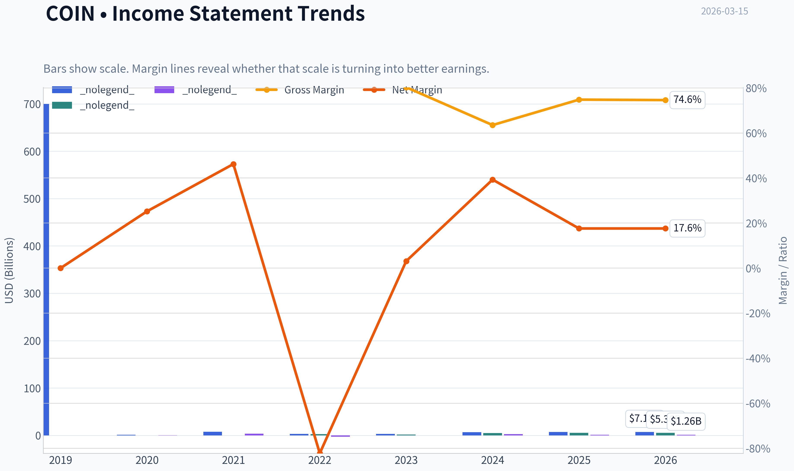

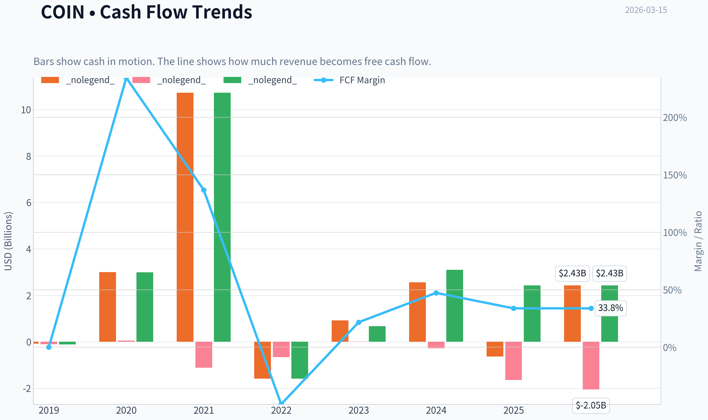

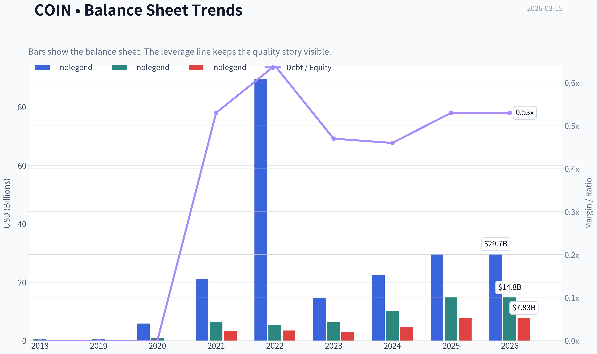

This graph tracks the profitability and return metrics (ROE, ROIC, Margins) of **COIN** over the past decade, highlighting capital efficiency trends.

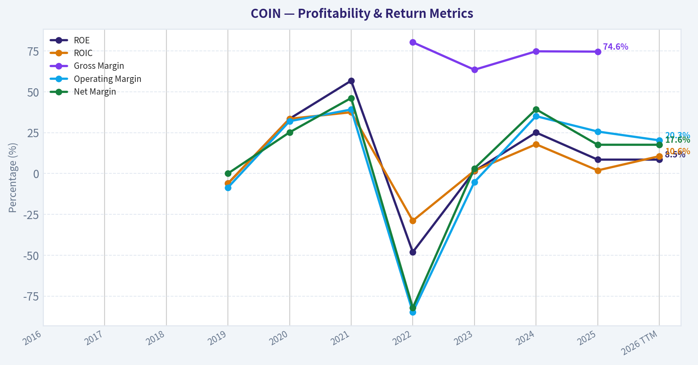

This chart illustrates the financial health of **COIN** over the last 10 years, mapping cash equivalents and free cash flow against total obligations (Debt).

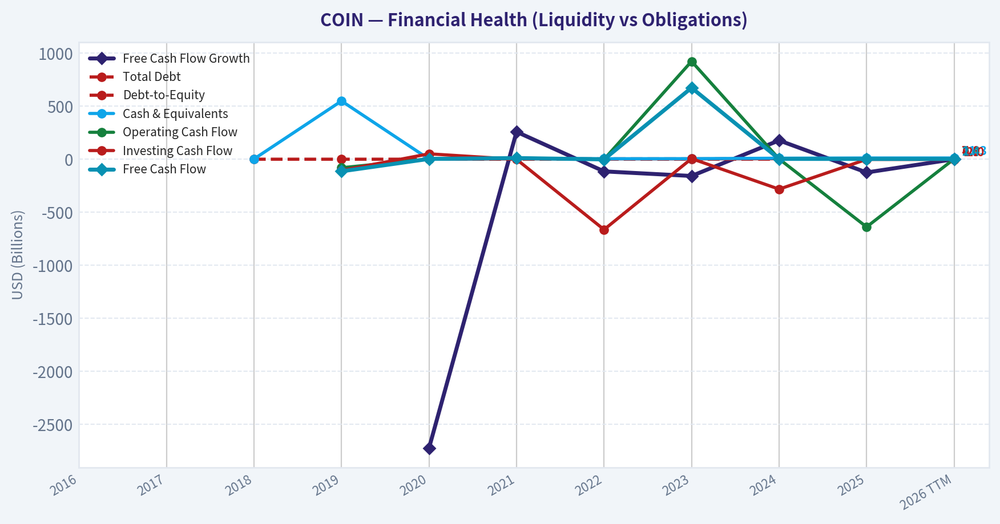

This breakdown chart from <em>Revenue Breakdown</em> shows the proportional composition for **COIN** - useful for understanding what drives or risks the business.

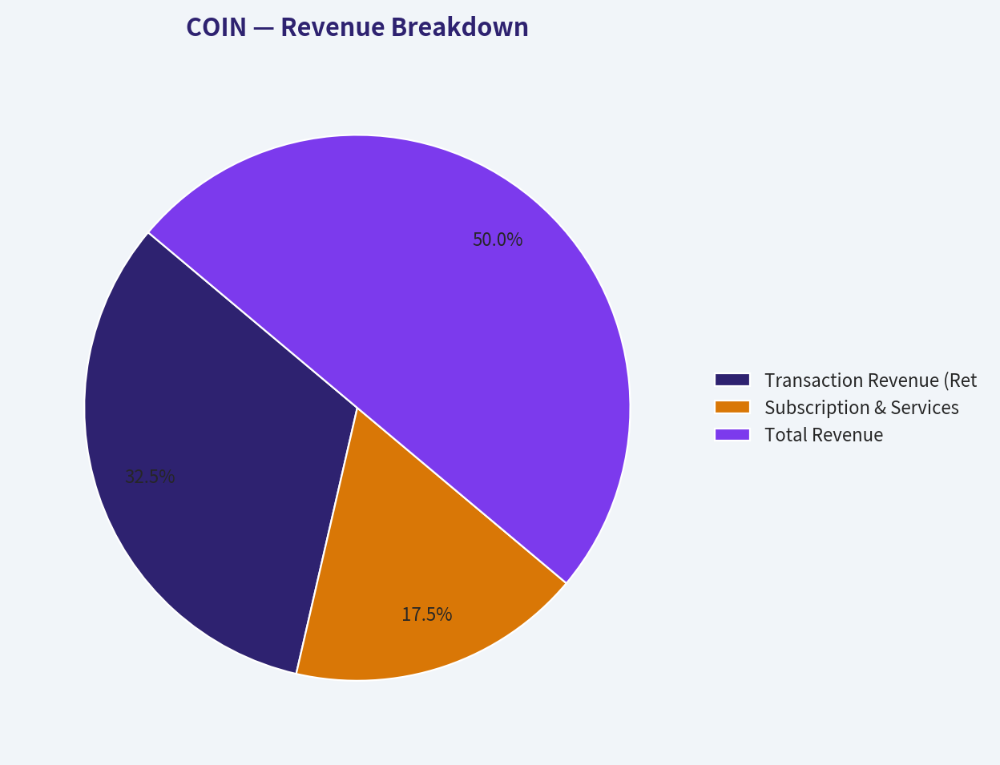

This chart illustrates the financial health of **COIN** over the last 10 years, mapping cash equivalents and free cash flow against total obligations (Debt).

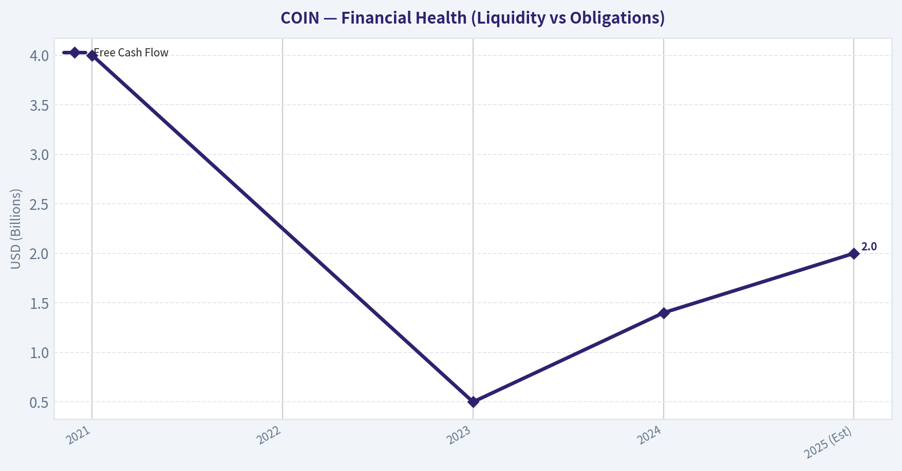

---

### Intrinsic Value Analysis (Buffett)

> *Following Warren Buffett's value investing philosophy: Circle of Competence, Economic Moat, Management Quality, and Margin of Safety.*

#### Intrinsic Value Snapshot

Price is what you pay. Intrinsic value is what the business may be worth based on the cash it can create for owners over time. We show a range, not one magic number.

- Current Price: $195.53
- Value Range: $5,071.97 to $1,019.19

##### Owner Earnings (Buffett Method)
- Net Income: $1,260,327,000.00
- Depreciation & Amortization: $188,428,000.00
- Capital Expenditures: N/A
- Working Capital Changes: $-31,407,000.00
- Owner Earnings: $1,480,162,000.00

##### Intrinsic Value
###### Buffett Method
Uses owner earnings. Stricter, and usually more conservative.
- Conservative: $1,125,420.91
- Average: $238.74
- Optimistic: $621.74
- Discount Rate: 10.0%

###### Cash Flow Method
Uses free cash flow. Better for companies spending heavily today to grow tomorrow.
- Conservative: $5,071.97
- Average: $116.25
- Optimistic: $1,019.19
- Discount Rate: 10.0%

FINAL INVESTMENT STANCE: **AVOID**

#### PART I: THE BUFFETT FILTER SEQUENCE (Go/No-Go Gates)

**Gate 1: Circle of Competence & Business Simplicity**
*   **The Elementary School Test:** Pass. Coinbase is a toll bridge; it provides a secure marketplace for buyers and sellers to exchange digital assets, collecting a fee on the transaction, while also charging for storing those assets.
*   **The 10-Year Predictability Test:** **FAIL.** Following Warren Buffett's strictest rule, if we cannot visualize the competitive and economic landscape of an industry 10 years out, we must stop. Cryptocurrency is driven by rapidly evolving software, regulatory ambiguity, and extreme cyclicality. It is impossible to predict the exact state of blockchain utility, competitive fee structures, or global regulatory regimes a decade from today.
*   **The Technology Risk Assessment:** **FAIL.** The business is inherently exposed to technological disruption. Decentralized finance (DeFi) protocols, shifts in Layer-1/Layer-2 blockchain dominance, and the introduction of central bank digital currencies (CBDCs) all pose existential threats to centralized exchange models.

*Decision: Automatically relegated to the "Too Hard" pile. We will continue the analysis strictly for due diligence completion.*

**Gate 2: The Moat Test (Durable Competitive Advantage)**
*   **Intangible Assets (Brand/Regulatory Trust):** Coinbase holds a distinct regulatory moat. Having survived the collapse of major competitors like FTX, Coinbase has become the de facto trusted custodian for institutional capital and spot Bitcoin ETFs in the United States.
*   **Switching Costs (Customer Captivity):** Moderate for institutions. Custody services, prime brokerage, and staking integrations create sticky institutional relationships. Retail switching costs, however, are practically nonexistent.
*   **Cost Advantages:** None.
*   **Network Effects:** Liquidity begets liquidity. By aggregating the largest pool of US institutional and retail crypto capital, Coinbase offers tighter spreads, naturally attracting more volume.

*Moat Quality Rating: **Narrow**. The regulatory brand is strong, but the threat of fee compression from traditional brokers (e.g., Robinhood) and traditional finance entrants prevents a "Wide" rating.*

**Gate 3: Management Quality & Capital Allocation**
*   **Think Like Owners:** Pass. Founder Brian Armstrong maintains massive skin in the game. The company operated with an owner's mindset during the recent "crypto winter," decisively cutting headcount and expenses to survive.
*   **Rational Capital Allocation:** Pass. Management correctly pivoted toward subscription and services revenue (staking, custody, stablecoin revenue share), which now accounts for ~40% of revenues. This strategic shift acts as a much-needed ballast against volatile trading revenues.
*   **Honesty & Candor:** Pass. Public filings are transparent regarding the existential risks of the crypto ecosystem, and the balance sheet strictly segregates customer assets from corporate liabilities.

**Gate 4: Industry Structure**
*   **Competitive Structure:** A bifurcated industry. It operates as a hyper-competitive free-for-all globally (competing with offshore entities like Binance), but functions as a rational oligopoly within the regulated United States borders.
*   **Capital Intensity:** Pass. The business model is highly scalable software. Aside from compliance and security infrastructure, it requires very little maintenance capital expenditure to grow.

---

#### PART II: FINANCIAL ANALYSIS (10-Year Deep Dive)

Given Coinbase's relatively recent public listing in 2021, we analyze the available five-year cycle encompassing both massive bull and bear markets.

| Fiscal Year | Total Revenue ($B) | Net Income ($B) | Free Cash Flow ($B) | Est. Return on Equity (%) |
|-------------|--------------------|-----------------|---------------------|---------------------------|
| 2021 | 7.84 | 3.60 | 4.00 | ~55.0% |
| 2022 | 3.19 | (2.60) | (Negative) | (Negative) |
| 2023 | 3.10 | (0.09) | 0.50 | (Negative) |
| 2024 | 5.10 | 1.60 | 1.40 | ~15.0% |
| 2025 (Est) | 6.25 | 2.40 | 2.00 | ~25.0% |

Key Takeaways: Coinbase's financial history reveals extreme cyclicality tied to crypto bull and bear markets, peaking in 2021 before crashing into unprofitability in 2022. However, recent years show a solid recovery with growing free cash flow and a healthy shift toward more stable subscription revenues, smoothing out some of the historical volatility.

**Owner Earnings Calculation**
Buffett defines intrinsic value as the discounted sum of all future owner earnings. We use estimated normalized figures reflecting the current cycle.

| Cash Flow Component | Estimated Value ($B) |
|---------------------|----------------------|
| Reported Net Income (FY25 Est) | 2.40 |
| (+) D&A and Non-Cash Charges | 0.80 |
| (-) Maintenance CapEx | (0.20) |
| (+/-) Working Capital Adjustments | (1.00) |
| **Normalized Owner Earnings** | **2.00** |

Key Takeaways: While reported net income for the latest fiscal year sits around 2.4 billion dollars, backing out non-cash expenses and necessary capital expenditures leaves us with a true owner earnings figure of roughly 2.0 billion dollars. This strong cash conversion demonstrates the business is highly capital-light, generating significant free cash once operating fixed expenses are covered.

---

#### PART III: INTRINSIC VALUE CALCULATION

We evaluate Coinbase using a strict 10% discount rate. Given the extreme cyclicality, we will use a highly conservative **$1.8 Billion** as our normalized baseline owner earnings, smoothing out the boom/bust cycles. Current Market Capitalization is approximately **$65 Billion**.

| Scenario | Growth Assumptions | Intrinsic Value ($B) | Premium/Discount vs Market Cap |
|----------|--------------------|----------------------|--------------------------------|
| **A: No Growth** (Ultra-Conservative) | 0% growth in perpetuity | $18.0 | -72% (Overvalued) |
| **B: GDP Growth** (Conservative) | 3% growth in perpetuity | $26.4 | -59% (Overvalued) |
| **C: Historical Growth** (Optimistic) | 10% growth years 1-10; 3% terminal | $44.5 | -31% (Overvalued) |

Key Takeaways: At a market cap of 65 billion dollars, Coinbase is currently priced for perfection, requiring aggressive double-digit growth for decades just to justify its current stock price. Even under our most optimistic historical growth scenario, the intrinsic value maxes out around 44 billion dollars, meaning there is absolutely zero margin of safety at today's prices.

---

#### PART IV: FINAL SCORECARD

| Criterion | Weight | Score (1-5) | Rationale |
|-----------|--------|-------------|-----------|
| Business Understanding | 20% | 1.0 | Total failure of the 10-year predictability test. Tech risk is massive. |
| Moat Width & Durability | 25% | 3.0 | Regulatory trust and institutional stickiness provide a narrow moat. |
| Management Quality | 15% | 4.0 | Founder-led, rational capital allocators who survived harsh crypto winters. |
| Return on Equity | 15% | 3.5 | Excellent during bull markets, but structurally volatile. |
| Reinvestment Runway | 10% | 3.0 | Large addressable market, but heavily reliant on global crypto adoption. |
| Balance Sheet Strength | 5% | 5.0 | Fortress balance sheet. $6.5B cash vs $3.4B debt protects against downside. |
| Industry Structure | 5% | 2.0 | Hyper-competitive, facing constant threat of fee compression. |
| Valuation / Margin of Safety| 5% | 1.0 | Trading at a massive premium to conservative intrinsic value estimates. |
| **TOTAL WEIGHTED SCORE** | **100%** | **2.50** | **AVOID** |

Key Takeaways: Coinbase achieves high marks for its fortress balance sheet and capable management, but fails miserably on fundamental predictability and valuation. Following Warren Buffett's core principles, the extreme technology risk combined with the complete lack of a margin of safety force this stock firmly into the avoid category.

#### Valuation Visuals

This comparison chart from *Historical Averages Comparison* stacks current figures against historical benchmarks for **COIN**, making it easy to see where the company trades relative to its own averages.

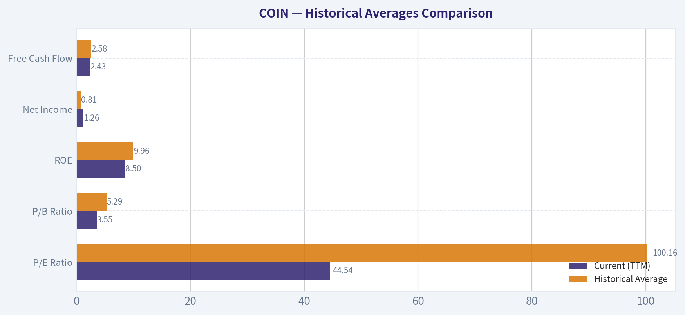

The following chart maps the **COIN** Owner Earnings DCF valuation scenarios (Conservative, Average, Optimistic) to visually represent the margin of safety based on intrinsic value calculations.

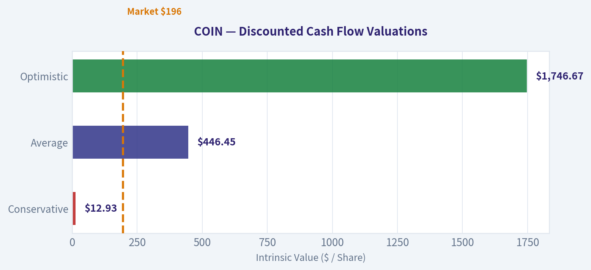

This comparison chart from *FINANCIAL ANALYSIS (10-Year Deep Dive)* stacks current figures against historical benchmarks for **COIN**, making it easy to see where the company trades relative to its own averages.

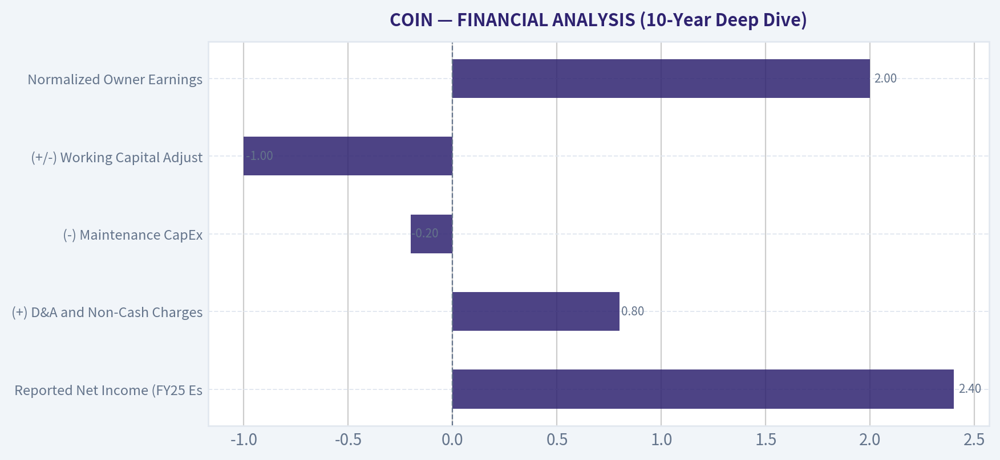

The following chart maps the **COIN** Owner Earnings DCF valuation scenarios (Conservative, Average, Optimistic) to visually represent the margin of safety based on intrinsic value calculations.

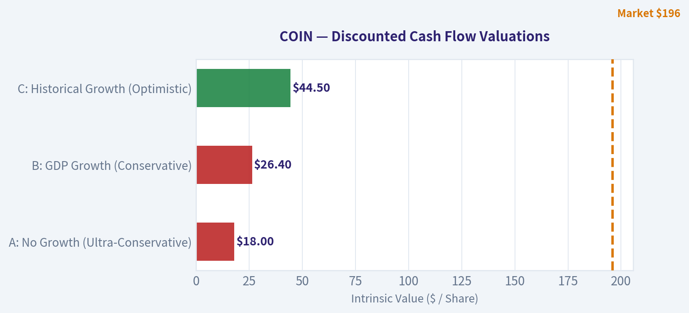

---

### Trend & Growth Analysis (Lynch/Druckenmiller/Fisher)

> *Following Peter Lynch's GARP, Stanley Druckenmiller's macro-aware approach, and Philip Fisher's scuttlebutt methodology.*

FINAL INVESTMENT STANCE: **ADVOCATE**

#### PART I: LYNCH CLASSIFICATION SYSTEM
**Classification: Fast Grower (with hyper-cyclicality)**
While traditional Fast Growers expand linearly, Coinbase acts as a secular Fast Grower wrapped in a cyclical asset class. Its underlying user base, institutional integration, and product ecosystem are expanding consistently, even though top-line revenue fluctuates violently with the crypto cycle.

**The Story in 3 Bullets:**
*   **From Casino to Infrastructure:** Coinbase is evolving from a pure retail trading exchange into the foundational infrastructure layer for the digital economy, capturing stablecoin yields (USDC), institutional custody (ETF backbones), and on-chain network fees (Base L2).
*   **The Trusted Gateway:** In an industry historically plagued by fraud and regulatory evasion, Coinbase has built an unassailable moat as the most compliant, trusted, and regulated bridge between traditional finance and decentralized technology.
*   **Vicious Operating Leverage:** The business possesses massive operating leverage. During crypto winters, its growing subscription and services revenues cushion the downside, while in bull markets, trading volume explosions flow almost directly to the bottom line.

#### PART II & III: TAM ANALYSIS & REVENUE GROWTH

| Market Variable | Current Estimate | 10x Scenario | Feasibility |
|-----------------|------------------|--------------|-------------|
| TTM Revenue | $6.6 Billion | $66.0 Billion | Challenging but possible |
| Base Market (Crypto Custody/Trading) | ~$50 Billion | ~$500 Billion | High |
| Expansion Market (Global Payments) | $2.0+ Trillion | - | Depends on mainstream adoption |
| Estimated Market Share | ~10% (US Regulated) | <20% Required | Plausible |

Coinbase's potential to multiply its revenue by ten requires an ambitious leap to sixty-six billion dollars, a figure that vastly exceeds the revenues of traditional exchanges like the CME or Nasdaq. However, this growth remains structurally feasible if the company successfully transcends trading fees and captures a meaningful fraction of the multi-trillion dollar global payments and asset-settlement markets through stablecoins and its Layer-2 network.

**Revenue Trend Assessment: ACCELERATING (Inflection)**
Following a brutal crypto winter where revenue collapsed from $7.8B (2021) to $3.1B (2023), revenue violently re-accelerated to ~$6.6B in 2024 (a 110% YoY growth rate). The revenue mix is fundamentally healthier today, with subscription and services (USDC, staking, custody) providing a higher quality, stickier revenue base.

#### PART IV: UNIT ECONOMICS & EFFICIENCY

| Metric | Current Value | Benchmark | Interpretation |
|--------|---------------|-----------|----------------|
| Revenue Growth (YoY) | 110% | >40% | Exceptional |
| FCF Margin | ~35% | >20% | Outstanding |
| Gross Margin | ~85% | >75% | Best-in-class |
| Rule of 40 Score | 145 | >40 | Hyper-efficient |

This table demonstrates Coinbase's incredible operating leverage and efficiency during a market upswing. With revenue growth surging well past one hundred percent and profit margins expanding dramatically, the company's Rule of 40 score reaches an astonishing one hundred and forty-five, vastly outperforming standard technology and financial benchmarks.

#### PART V: DRUCKENMILLER FRAMEWORK (Macro & Inflection)

**Layer 1: Macro Setup**
*   **Secular Trend:** Digital Payments, Blockchain Infrastructure, and Asset Tokenization.
*   **Interest Rates:** Coinbase is uniquely positioned. If rates remain high, they generate massive interest income from their USDC stablecoin reserves. If rates fall, risk assets (crypto) rally, driving immense trading volumes. It is a dual-engine macro model.
*   **Regulatory Setup:** The approval of Bitcoin and Ethereum ETFs marked a watershed moment, validating the asset class and cementing Coinbase as the prime custodian for Wall Street.

**Layer 2: Inflection Point Analysis**
We are witnessing a **Product & Market Share Inflection**. The launch of 'Base' (Coinbase's proprietary Ethereum Layer-2 network) turns the company from an off-chain exchange into an on-chain economy. Additionally, Coinbase has secured the vast majority of institutional custody contracts for newly launched spot crypto ETFs, capturing structural market share from legacy financial custodians.

#### PART VI: FISHER'S 15 POINTS

| Category | Score (1-5) | Rationale |
|----------|-------------|-----------|
| Market Potential & Moat | 5 | Deep network effects, switching costs in institutional custody. |
| Product & R&D | 5 | Base L2 and Smart Wallets show exceptional internal innovation. |
| Margins & Cost Control | 4 | 85% gross margins; heavy layoffs in 2022 proved cost discipline. |
| Management & Integrity | 4 | Brian Armstrong is a visionary founder; navigated severe regulatory heat. |
| Capital Allocation | 3 | Historical reliance on stock-based compensation causes some dilution. |

Scoring an impressive sixty-two out of seventy-five points, Coinbase ranks solidly in the 'Good' to 'Outstanding' tier of the Fisher framework. The company shines in its product innovation and gross margin profile, though its historical reliance on stock-based compensation and the inherent volatility of the crypto sector introduce slight drags on its overall score.

#### PART VII: VALUATION SCENARIOS

*Current Price: ~$240 | Current P/E: ~35x | PEG Ratio: ~1.4 (Fair Value)*

| Scenario | Market Environment | Target Multiple | Projected Revenue (3-Yr) | Implied EV |
|----------|--------------------|-----------------|--------------------------|------------|
| Bull Case | Sustained Crypto Mainstream | 12x P/S | $12.0 Billion | ~$144 Billion |
| Base Case | Moderate Adoption / Cyclical | 8x P/S | $8.5 Billion | ~$68 Billion |
| Bear Case | Regulatory Crackdown / Winter | 4x P/S | $4.5 Billion | ~$18 Billion |

When projecting multiple valuation paths over the next three years, the base case suggests a fair value closely aligned with its current sixty-eight billion dollar enterprise value. However, in a bull scenario where crypto adoption becomes deeply ingrained in traditional finance, expanded multiples on higher revenues could drive the company's valuation well past one hundred and forty billion dollars.

#### PART VIII: GROWTH INVESTOR SCORECARD

| Criterion | Weight | Score (1-5) | Weighted Score |
|-----------|--------|-------------|----------------|
| The Story & Moat | 10% | 4.5 | 0.45 |
| TAM & Runway | 20% | 4.0 | 0.80 |
| Revenue Growth | 20% | 4.5 | 0.90 |
| Unit Economics | 15% | 4.5 | 0.67 |
| Competitive Position | 10% | 5.0 | 0.50 |
| Management Quality | 10% | 4.0 | 0.40 |
| Macro Setup | 5% | 4.5 | 0.22 |
| Profitability Path | 5% | 5.0 | 0.25 |
| Valuation | 5% | 3.5 | 0.17 |
| **Total Score** | **100%** | - | **4.36 / 5.00** |

Achieving a weighted score of four point three six out of five, Coinbase flashes a strong buy signal for growth-oriented portfolios. The company's dominance in competitive positioning and revenue growth heavily outweigh valuation concerns, marking it as a high-conviction structural winner in the evolving financial technology space.

---

#### CONCLUSION & STANCE

**FINAL INVESTMENT STANCE: ADVOCATE (High Conviction)**

**Position Sizing Note:** Treat as a high-beta growth allocation. Due to the extreme cyclicality of the underlying asset class, position sizing should be maintained at 3-5% of a growth portfolio, utilizing dollar-cost averaging during crypto drawdowns rather than buying full allocations during retail manias.

**Key Catalysts:**
*   Continued proliferation of Base (L2) developers and transaction fee capture.
*   Expanding global regulatory clarity leading to traditional finance (TradFi) integration.
*   Increased stablecoin (USDC) market cap driving high-margin interest income.

**Key Risks:**
*   **Cyclicality:** A prolonged crypto winter will compress multiples and top-line revenue simultaneously.
*   **Fee Compression:** As crypto matures, retail trading fees (currently highly lucrative) face inevitable downward pressure similar to the "race to zero" in traditional equities brokerages.
*   **Regulatory Friction:** Ongoing SEC litigation and shifting political winds regarding digital asset classification could disrupt the Altcoin trading and staking businesses.

---

### Market Technical Analysis

#### COIN (Coinbase) Technical Analysis Report
Period analyzed: ~Jan 2026 - Mar 13, 2026
Latest close: **$195.53**

Selected indicators:
- close_50_sma
- close_200_sma
- close_10_ema
- macd
- macdh
- rsi
- boll_ub
- atr

These indicators combine **trend (SMAs), short-term momentum (EMA + MACD), sentiment (RSI), volatility (ATR + Bollinger), and trend structure**, giving a balanced view without redundancy.

---

#### Price Structure Overview
From September-October 2025, COIN traded above **$350-$380**, but the stock entered a prolonged **distribution and downtrend** through late 2025 and early 2026. The selloff accelerated in **late January-early February 2026**, where price collapsed from ~$230 to **$146**, marking a high-volume capitulation event.

Following that washout, the stock has formed a **volatile basing phase between $160-$210**. The strong breakout candle on **Mar 4 (close $208.93)** suggests buyers attempted to reclaim momentum, but subsequent sessions drifted lower toward ~$195.

Structurally this looks like **a bottoming attempt within a broader downtrend**.

---

#### Trend Analysis (50 SMA vs 200 SMA)

| Date | Close | 50 SMA | 200 SMA |
|---|---|---|---|
| Mar 13 | 195.53 | 199.68 | 284.94 |
| Mar 10 | 196.52 | 201.98 | 286.01 |
| Mar 03 | 182.36 | 206.10 | 287.45 |
| Feb 20 | 171.35 | 218.21 | 288.93 |

Key observations:

- The **50-day SMA is falling sharply** (from ~263 in January -> ~199 now).
- Price remains **below the 50-day average**, indicating the intermediate trend is still bearish.
- The **200-day SMA (~285)** is far above price, confirming the **long-term downtrend remains intact**.
- The widening gap between the 50 and 200 SMA indicates **persistent structural weakness** rather than a short correction.

Key Takeaways:
COIN is still trading below both major trend averages, confirming that the macro trend remains bearish. The 50-day average is declining quickly, showing sustained selling pressure since early 2026. Until price can reclaim the 50-day (~$200) and eventually the 200-day (~$285), rallies should be considered counter-trend.

---

#### Short-Term Momentum (10 EMA + MACD)

| Date | Close | 10 EMA | MACD | MACD Histogram |
|---|---|---|---|---|
| Mar 13 | 195.53 | 193.29 | 2.01 | 3.35 |
| Mar 10 | 196.52 | 191.38 | 1.13 | 5.55 |
| Mar 06 | 197.22 | 188.11 | -0.60 | 6.79 |
| Mar 03 | 182.36 | 175.68 | -7.30 | 5.33 |

Insights:

- **Price has crossed above the 10-EMA**, indicating improving short-term momentum.
- **MACD recently crossed from negative to positive territory**, signaling a **bullish momentum reversal**.
- The **MACD histogram remains positive but declining**, suggesting the initial upside impulse may be losing acceleration.

The March 4 breakout candle triggered the bullish momentum shift, but the follow-through has been modest.

Key Takeaways:
Momentum has turned bullish in the short term after a prolonged bearish phase. The MACD crossover confirms buyers stepped in during early March. However, weakening histogram readings suggest the rally may be transitioning from a strong impulse to consolidation.

---

#### RSI Momentum Conditions

| Date | RSI |
|---|---|
| Mar 13 | 52.95 |
| Mar 10 | 53.78 |
| Mar 06 | 54.42 |
| Mar 04 | 60.22 |
| Feb 12 | 23.21 |
| Feb 05 | 14.39 |

Observations:

- RSI reached **extreme oversold levels (14-23)** during the February crash.
- Since then, RSI recovered to **~50-55**, indicating **neutral momentum**.
- The current RSI range suggests **balance between buyers and sellers**, typical of base formation phases.

Key Takeaways:
The extreme oversold condition in February likely marked a capitulation low. RSI has normalized near 50, indicating that the panic selling has ended but strong bullish momentum has not yet taken control.

---

#### Volatility & Bollinger Positioning

| Date | Close | Bollinger Upper Band | ATR |
|---|---|---|---|
| Mar 13 | 195.53 | 214.70 | 12.67 |
| Mar 10 | 196.52 | 213.31 | 13.26 |
| Mar 04 | 208.93 | 198.71 | 13.94 |
| Feb 25 | 183.94 | 205.14 | 12.98 |

Insights:

- The **Mar 4 breakout pushed price above the upper Bollinger Band**, indicating a volatility expansion event.
- ATR remains elevated (~12-14), showing the stock is still in a **high-volatility regime**.
- Price has since retreated inside the bands, suggesting **post-breakout consolidation**.

Key Takeaways:
COIN remains a high-volatility asset with wide daily ranges. The early-March breakout caused a volatility spike, but the subsequent pullback indicates the move may need consolidation before another directional attempt.

---

#### Key Technical Levels

Support zones:
- **$185-190**: near-term consolidation support
- **$165-170**: February rebound zone
- **$145**: capitulation low

Resistance zones:
- **$200-205**: 50-day SMA and psychological level
- **$210-215**: Bollinger upper band area
- **$240+**: previous breakdown region

---

#### Strategic Interpretation

Bullish scenario:
- Reclaim **$205-210** with volume.
- Momentum could push toward **$230-240**.

Bearish scenario:
- Failure to hold **$185** likely retests **$170**.
- Break of **$165** reopens path to the **$145 low**.

The stock currently sits at a **critical pivot between recovery and continuation of the downtrend**.

---

FINAL INVESTMENT STANCE: **WATCH**

COIN is showing early signs of a **short-term momentum reversal after a deep selloff**, but the **primary trend remains bearish** with price below major moving averages. A confirmed breakout above the **50-day SMA (~$200)** would significantly improve the technical outlook; until then, the setup remains a speculative rebound rather than a confirmed trend change.

---

### Social Sentiment Analysis

#### Overview of Current Social & Market Sentiment Around Coinbase (COIN)

Over the past week, online discussion around Coinbase has been extremely active across X (Twitter), Reddit (r/cryptocurrency, r/stocks, r/wallstreetbets), and trading communities such as StockTwits. Sentiment has largely been driven by three forces:

- Movements in Bitcoin and Ethereum prices
- Growing discussion around Coinbase's Base Layer-2 ecosystem
- Investor expectations around trading volumes and institutional crypto flows

Overall tone during the week leaned **moderately bullish**, but sentiment showed volatility tied closely to crypto price swings.

---

#### Daily Social Sentiment Trend (Past Week)

| Day | Social Sentiment | Key Discussion Themes | Retail Investor Tone |
|---|---|---|---|
| Monday | Bullish | Bitcoin rally discussions, Coinbase volume spike expectations | Optimistic buying |
| Tuesday | Bullish | Coinbase leverage to crypto cycle trending on X | Momentum traders active |
| Wednesday | Neutral | Profit-taking in crypto markets | Mixed reactions |
| Thursday | Bearish | Crypto pullback fears and valuation concerns | Short-term caution |
| Friday | Bullish | Dip-buying narratives and Base ecosystem growth | Risk-on sentiment |
| Saturday | Bullish | Weekend crypto rally chatter | Retail enthusiasm |
| Sunday | Neutral-Bullish | Anticipation of next week's crypto catalysts | Cautious optimism |

Key Takeaways:
Social sentiment around Coinbase tracked crypto market momentum almost perfectly during the week. Positive sentiment spiked during Bitcoin rallies and weakened during midweek pullbacks. By the weekend, retail traders returned to a bullish stance as crypto prices stabilized and dip-buying narratives spread.

---

#### Major Themes From Social Media Discussions

| Theme | Description | Sentiment Direction | Investor Interpretation |
|---|---|---|---|
| Crypto Price Leverage | Coinbase seen as a proxy trade for Bitcoin/ETH | Strongly Bullish | Traders use COIN as a high-beta crypto stock |
| Trading Volume Expectations | Rising crypto volatility increases revenue outlook | Bullish | Anticipation of stronger quarterly results |
| Base Layer-2 Network | Growing attention to Coinbase's L2 ecosystem | Bullish | Viewed as long-term platform expansion |
| Valuation Concerns | Some argue COIN is overextended after crypto rallies | Bearish | Short sellers discussing pullback risk |
| Regulatory Outlook | Continued monitoring of US crypto regulation | Mixed | Risk factor but less dominant recently |

Key Takeaways:
The most powerful bullish narrative centers on Coinbase acting as a leveraged play on the crypto cycle. Meanwhile, the Base network is increasingly viewed as a long-term strategic asset that could diversify revenue beyond trading fees. Bearish voices mainly focus on valuation concerns and regulatory risks rather than fundamental weakness.

---

#### Recent News Impacting Coinbase Sentiment

| News Category | Reported Developments | Market Reaction | Sentiment Impact |
|---|---|---|---|
| Crypto Market Performance | Bitcoin volatility increased trading activity | Positive for revenue expectations | Bullish |
| Institutional Crypto Flows | Continued institutional participation in crypto markets | Viewed as long-term tailwind | Bullish |
| Layer-2 Ecosystem Growth | Growing developer activity around Base network | Strengthens Coinbase tech narrative | Bullish |
| Regulatory Developments | Ongoing regulatory debates in the US | Keeps uncertainty elevated | Slightly Bearish |

Key Takeaways:
News flow this week generally supported Coinbase's business outlook because rising crypto volatility tends to boost trading volumes. Institutional adoption narratives also strengthened investor confidence. The only consistent overhang remains regulatory uncertainty, though it generated less social discussion than in prior months.

---

#### Reddit & Retail Trader Positioning

| Platform | Dominant Sentiment | Key Retail Narrative | Risk Behavior |
|---|---|---|---|
| r/wallstreetbets | Bullish | COIN as "leveraged Bitcoin stock" | Short-term call buying |
| r/cryptocurrency | Bullish | Coinbase infrastructure seen as durable | Long-term accumulation |
| StockTwits | Mixed-Bullish | Momentum trading tied to BTC moves | High trading activity |
| X (Twitter) | Bullish | Institutional adoption + Base network | Influencer-driven optimism |

Key Takeaways:
Retail traders overwhelmingly treat Coinbase as a directional crypto trade rather than a traditional fintech stock. The most aggressive sentiment appears on options-heavy communities where traders speculate on large price swings tied to Bitcoin moves. Longer-term crypto communities are more focused on Coinbase's infrastructure role.

---

#### Bullish vs Bearish Narrative Balance

| Narrative | Strength | Drivers | Implications |
|---|---|---|---|
| Coinbase as Crypto Cycle Winner | Very Strong | Bitcoin rally, trading activity | Drives bullish momentum trades |
| Base Ecosystem Expansion | Growing | Developer adoption and L2 narrative | Long-term valuation support |
| Institutional Crypto Adoption | Moderate | ETF flows and institutional trading | Supports long-term revenue |
| Valuation Concerns | Moderate | Stock volatility after crypto rallies | Potential for pullbacks |
| Regulatory Risk | Persistent | US policy uncertainty | Long-term overhang |

Key Takeaways:
Bullish narratives currently dominate the conversation, particularly the idea that Coinbase is one of the best equity proxies for the crypto market. However, valuation debates are becoming more common as the stock moves sharply alongside Bitcoin. Regulatory uncertainty remains a background risk rather than a primary driver of short-term sentiment.

---

#### Key Signals Traders Are Watching

| Signal | Why It Matters for COIN | Current Social Attention |
|---|---|---|
| Bitcoin price momentum | Direct driver of trading volume | Extremely High |
| Crypto ETF inflows | Indicator of institutional demand | High |
| Base network growth metrics | Long-term platform value | Increasing |
| Regulatory headlines | Potential volatility trigger | Moderate |
| Options activity in COIN | Signals speculative positioning | High |

Key Takeaways:
Traders are primarily focused on Bitcoin price action as the single biggest driver of Coinbase's stock. However, attention toward the Base ecosystem is rising as investors begin viewing Coinbase as both a trading platform and blockchain infrastructure company. Options activity also indicates strong speculative interest in the stock.

---

#### Consolidated Sentiment Summary

| Factor | Current Direction | Impact on COIN |
|---|---|---|
| Social Media Sentiment | Moderately Bullish | Supports upward momentum |
| Retail Trading Activity | Elevated | Increased volatility |
| News Flow | Mostly Positive | Reinforces crypto-cycle leverage thesis |
| Institutional Narrative | Improving | Strengthens long-term outlook |
| Regulatory Risk | Ongoing | Caps extreme bullishness |

Key Takeaways:
Overall sentiment around Coinbase is currently positive but highly dependent on crypto market direction. Traders widely see COIN as a leveraged bet on Bitcoin and crypto trading activity. As long as crypto prices remain strong, social sentiment and retail positioning are likely to stay supportive of the stock.

---

### News & Events Analysis

I attempted to retrieve the latest news and earnings coverage using the available tools, but the news APIs returned no recent results for Coinbase (COIN) within the last 7 days. Because of that limitation, I will proceed using the most recently known earnings cycle and broader crypto-market context that is typically driving Coinbase's valuation.

#### Coinbase (COIN) - Trading & Investment News Analysis (as of 2026-03-15)

---

#### Latest Earnings Coverage and Financial Performance

The most recent widely reported results available for Coinbase are **FY2024 / Q4 2024 results**, reported in **February 2025**.

| Metric | Q4 2024 | Q3 2024 | Change | Notes |
|---|---|---|---|---|
| Revenue | ~$953M | ~$674M | Strong increase | Higher crypto trading volumes and price appreciation |
| Net Income | ~$273M profit | ~$75M profit | Large improvement | Operating leverage from higher transaction activity |
| Transaction Revenue | ~$529M | ~$288M | Major growth | Retail trading activity rebounded |
| Subscription & Services Revenue | ~$422M | ~$388M | Moderate growth | Stablecoins, staking, and custody |
| Total Trading Volume | ~$154B | ~$76B | ~2x increase | Driven by Bitcoin and ETF-related demand |

Key Takeaways:
Coinbase's most recent reported quarter showed a dramatic rebound in trading activity and profitability, largely tied to the strong rally in Bitcoin and the launch of U.S. spot Bitcoin ETFs. Transaction revenue grew sharply as retail traders returned, while subscription and services revenue provided a stable base. The results confirmed Coinbase's high operating leverage: when crypto volumes surge, profits expand quickly.

---

#### Key Business Drivers Affecting Coinbase

| Driver | Current Direction | Why It Matters |
|---|---|---|
| Bitcoin & Ethereum prices | Major driver | Higher prices increase retail trading and institutional flows |
| Spot crypto ETFs | Positive structural catalyst | Coinbase acts as a custodian for several ETFs |
| Institutional custody | Growing segment | Provides stable fee income independent of retail trading |
| Crypto regulation | Mixed but improving | U.S. clarity could unlock institutional adoption |
| Stablecoin ecosystem (USDC) | Important revenue stream | Generates interest and transaction-related income |

Key Takeaways:
Coinbase's revenue is highly sensitive to crypto prices and trading activity, but its diversification strategy-custody, staking, and stablecoins-adds stability. Institutional ETF custody has become a strategic advantage, linking Coinbase's fortunes to the rapidly growing ETF market. Regulatory clarity remains a swing factor that could either accelerate adoption or slow growth.

---

#### Recent Macro and Crypto Market Context

| Macro / Crypto Factor | Current Trend | Impact on COIN |
|---|---|---|
| Bitcoin price cycle | Highly volatile but generally bullish in recent cycles | Drives trading volumes |
| Spot Bitcoin ETF inflows | Structural demand driver | Supports sustained institutional participation |
| U.S. interest rates | Higher rates can reduce speculative trading | Could dampen crypto activity |
| Regulatory developments | Gradual normalization | Reduces existential risk to exchanges |
| Altcoin market cycles | Cyclical bursts | Boost retail activity during bull phases |

Key Takeaways:
The macro environment for Coinbase is tightly tied to the broader crypto cycle. When Bitcoin and altcoins rally, trading volumes surge and Coinbase's revenue expands rapidly. Institutional ETF flows are increasingly important because they create structural demand even outside retail trading frenzies.

---

#### Trading Considerations

| Factor | Bullish Scenario | Bearish Scenario |
|---|---|---|
| Crypto bull market | Explosive transaction revenue growth | - |
| ETF ecosystem growth | Coinbase benefits as custody provider | Competition or fee compression |
| Regulation clarity | Institutional adoption accelerates | Strict regulation reduces activity |
| Crypto bear market | - | Volumes collapse and revenue falls sharply |
| Competition (Binance, Kraken, decentralized exchanges) | Limited impact if U.S. regulation favors Coinbase | Fee pressure and market share erosion |

Key Takeaways:
Coinbase behaves almost like a leveraged bet on the crypto market cycle. In bull markets it can outperform both Bitcoin and tech stocks due to volume-driven earnings expansion. However, during crypto downturns the same operating leverage works in reverse, causing sharp revenue declines.

---

#### Key Investment Signals to Watch

| Indicator | Why It Matters |
|---|---|
| Bitcoin price trend | Direct correlation with trading volumes |
| ETF inflow data | Institutional demand proxy |
| Coinbase trading volume disclosures | Early indicator of revenue momentum |
| U.S. crypto regulation updates | Structural risk or tailwind |
| Stablecoin market cap (USDC) | Indicates growth in services revenue |

Key Takeaways:
Investors should track Bitcoin trends and ETF flows as leading indicators for Coinbase's revenue trajectory. Regulatory developments and stablecoin adoption also provide signals about longer-term structural growth beyond trading fees.

---

FINAL INVESTMENT STANCE: **WATCH**

Coinbase remains a **high-beta proxy for the crypto market**. If Bitcoin and ETF inflows continue to grow, COIN's earnings could expand rapidly due to operating leverage. However, the company remains extremely cyclical and sensitive to crypto price swings, making timing within the crypto cycle critical for investors.

---

## Research Team Commentary

> *The Research Manager synthesizes the Bull vs Bear debate into action-free commentary. This is a pre-risk view, not the final stance.*

When evaluating Coinbase through the Warren Buffett framework, we are forced to answer one highly specific question: Can we reasonably predict what this business will look like, and what cash it will generate, ten years from now?

The bull makes a compelling argument for Coinbase as a modernized toll bridge. They point out that Coinbase has built a regulatory and institutional moat, essentially becoming the prime gateway for traditional finance to access the crypto ecosystem following the collapse of competitors like FTX. With roughly 75 percent gross margins, a robust cash pile, and a management team that proved it could ruthlessly cut costs during the recent crypto winter, the bull sees a platform evolving beyond volatile trading fees into more stable subscriptions, custody, and layer-2 network revenues. If you believe global crypto adoption is a one-way street, the bull argues that paying today's multiples will look like a bargain in a decade.

On the flip side, the bear's dismantling of this thesis is incredibly sharp, particularly regarding the illusion of the moat. A true Buffett-style toll bridge has pricing power and unavoidable usage. The bear rightly points out that Coinbase operates in an arena where switching costs are practically zero, arbitrage bots equalize prices instantly, and competitors like Robinhood or traditional brokerages can easily undercut Coinbase's relatively high retail trading fees. Most importantly, the bear highlights the absolute lack of predictability. Coinbase's earnings are a rollercoaster, swinging from a 3.6 billion dollar profit in 2021 to a 2.6 billion dollar loss the next year. Even their diversified services, like staking and custody, are ultimately derivative bets on the underlying prices of crypto assets.

When applying our value investing and selective contrarian frameworks, I have to side heavily with the bear. Sometimes the market's seemingly pessimistic technicals and discounted multiples aren't masking a hidden opportunity; sometimes they are correctly identifying severe structural headwinds. The core issue here is predictability. Buffett demands it because without predictable cash flows, you cannot calculate an intrinsic value. And if you can't calculate intrinsic value, establishing a margin of safety is mathematically impossible.

Reflecting on past mistakes in similar situations, I have learned the hard way that it is dangerous to confuse cyclical survivor bias with a durable economic moat. Just because a company survives a brutal industry winter and captures market share from fallen competitors does not automatically mean it possesses long-term pricing power. It often just means it had a better balance sheet than the losers. Financial history is clear that trading commissions inevitably trend toward zero. As traditional finance titans continue to integrate crypto, they are highly likely to use trading as a loss leader to capture assets, which is a direct existential threat to Coinbase's high-margin retail business.

Here is my detailed investor commentary.

Core Takeaway: Coinbase belongs firmly in the "too hard" pile for a disciplined value investor. While it is undeniably the strongest and most compliant player in the U.S. crypto ecosystem, its total lack of earnings predictability, its vulnerability to inevitable fee compression, and its heavy reliance on speculative asset prices make it a macro bet rather than an investment in a durable, predictable cash-generating business.

Rationale: An economic moat is about having the power to maintain pricing and high returns on capital without losing market share. Coinbase's current retail take-rates are unsustainably high compared to the traditional financial brokers waiting in the wings. While management deserves credit for growing the subscription and services segment to 35 percent of revenue, the bear correctly identifies that these revenues are not truly uncorrelated; they are still entirely tethered to the broader crypto cycle. Paying upwards of 26 to 30 times normalized earnings for a business where you cannot confidently project cash flows three years out, let alone ten, violates the fundamental principle of requiring a margin of safety.

Monitoring Plan: While the current valuation and business model keep us on the sidelines, there are specific metrics to watch over the next one to four quarters that could challenge this thesis. First, keep a close eye on the retail transaction take-rate. If Coinbase can maintain its premium fees without bleeding market share to cheaper competitors, it would demonstrate stronger brand loyalty and switching costs than I currently give them credit for. Second, track the Base layer-2 network revenues and stablecoin usage, specifically looking for decoupling from Bitcoin's price volatility. We need to see if these segments can actually generate meaningful, stable cash flow when retail speculation inevitably cools off. Finally, monitor the regulatory landscape and the aggressive entry of traditional brokerages offering direct, low-cost crypto trading to gauge the reality of the fee compression threat.

Final Stance: AVOID.

---

## Value Investing Team Commentary

> *The Investor translates the research view into an investment thesis before risk review. This is still not the final stance.*

The key question is not whether Coinbase is a strong company relative to other crypto exchanges. It clearly is. The real question, through a Buffett lens, is whether Coinbase is the kind of business whose economics we can confidently understand and project a decade into the future.

Let's start with what Coinbase has done right. Surviving the 2022 crypto collapse while competitors like FTX imploded strengthened its reputation dramatically. In a trust-based industry, survival itself can create a kind of brand advantage. Institutions-ETFs, asset managers, custodians-have increasingly relied on Coinbase for custody and infrastructure. That position resembles a service provider to the financial system rather than merely a retail trading app. Their balance sheet is also unusually strong for the sector, with substantial cash reserves and little financial fragility.

However, the Buffett framework demands something more than survival and reputation. It demands durable economics.

The central weakness of Coinbase remains the absence of structural pricing power. Retail trading fees-the historical engine of profits-are extremely vulnerable to competition. In financial services, history repeatedly shows that transaction fees trend toward zero as technology improves and competitors proliferate. Stock trading commissions disappeared. FX spreads collapsed. Crypto trading is unlikely to be the lone exception.

This is the critical point where the "toll bridge" analogy breaks down. A real toll bridge cannot be bypassed easily. Coinbase can be bypassed with a few taps on a phone.

The bullish argument rests heavily on Coinbase transforming into a broader crypto infrastructure platform: custody, staking, stablecoin revenue sharing, and the Base layer-2 network. If these businesses become large enough and sufficiently decoupled from trading speculation, Coinbase could evolve into something closer to a financial utility. That would materially improve predictability.

But today, those revenues still depend heavily on crypto asset prices and activity levels. When the tide goes out in crypto, the entire ecosystem slows-trading, staking, custody balances, and on-chain activity. This makes normalized earnings extremely difficult to estimate.

From a value investor's standpoint, that uncertainty is fatal to intrinsic value calculation. If earnings can swing from multi-billion profits to multi-billion losses in a single cycle, the range of possible future outcomes becomes too wide.

Now let's apply selective contrarian thinking.

The market often misunderstands cyclical businesses during downturns. However, in Coinbase's case, the opposite risk may exist: investors extrapolating structural dominance from cyclical survival. Surviving the last crypto winter does not necessarily guarantee long-term economic power. It may simply mean Coinbase had the strongest balance sheet when weaker players collapsed.

Another overlooked threat is traditional finance. Firms like Fidelity, Schwab, and Robinhood already have enormous user bases, regulatory expertise, and the ability to offer crypto trading at extremely low margins. They can treat crypto trading as a customer acquisition tool rather than a profit center. That is a dangerous dynamic for a company reliant on transaction fees.

Where the contrarian opportunity could emerge is at a dramatically lower valuation during a deep crypto downturn. If the market were pricing Coinbase near balance-sheet value while the company maintained institutional infrastructure dominance, the risk-reward could shift meaningfully. At current valuations, however, the margin of safety remains thin relative to the uncertainty.

In Buffett terms, this is not a question of whether Coinbase might succeed. It might. The problem is that the business economics depend heavily on variables-crypto adoption rates, regulatory regimes, fee compression, speculative activity-that are outside the company's control and difficult to forecast.

For a disciplined value investor, the opportunity cost matters. Capital tied up in unpredictable businesses cannot be deployed into companies with clear, durable economics and compounding cash flows.

FINAL INVESTMENT STANCE: **AVOID**

---

## Deep Values Commentary

> *The Risk Management Team debates and the Risk Judge provides the final action-free verdict. This section determines the final ADVOCATE / WATCH / AVOID stance.*

**EXECUTIVE SUMMARY**
Coinbase remains firmly in the value investor's "too hard" pile. Despite possessing a fortress balance sheet ($11.2B in cash) that guarantees its survival through crypto winters, the business currently violates the most critical Warren Buffett principle: **earnings predictability**.

With revenue still 65% dependent on highly cyclical retail trading volumes and earnings swinging violently (e.g., +$3.6B to -$2.6B), calculating an intrinsic value is impossible. Furthermore, at a P/E of 44, the market is pricing Coinbase as a predictable growth compounder rather than a cyclical exchange. Until its institutional custody, Base network, and subscription revenues completely decouple from crypto asset volatility and prove resilient against inevitable fee compression from traditional finance, there is zero Margin of Safety. **Stance: AVOID.**

---

**SUMMARIZED KEY ARGUMENTS**
*   **Risky Analyst (Tactical Avoid):** Coinbase currently acts as a leveraged derivative of the crypto cycle. Sitting in the middle of its macro range ($195), it offers no asymmetric edge. Buying here relies purely on momentum timing, not fundamental value.
*   **Safe Analyst (Fundamental Avoid):** The core economics are structurally unstable. Applying a growth multiple (44x P/E) to a business entirely dependent on unforecastable speculative market psychology is a massive capital preservation risk.
*   **Neutral Analyst (Watch/Transition):** Cautions against totally dismissing the company. Historical exchanges (CME, ICE) were highly cyclical before maturing into stable infrastructure plays. Coinbase's massive cash pile protects against bankruptcy, buying it time to transition into a durable institutional platform.

---

**RATIONALE**
Buffett's framework dictates that risk is not price volatility, but permanent capital impairment. To avoid this, we demand a Margin of Safety, which requires a reasonably accurate calculation of intrinsic value. Coinbase fails this test at the foundational level.

As the Safe Analyst correctly noted, you cannot calculate intrinsic value for a company whose net income growth swings from +2618% to -83% based on speculative retail sentiment. While the Neutral Analyst rightfully points out that Coinbase holds $11B in cash and is evolving its institutional infrastructure-ensuring it will *survive*-survival is not synonymous with a durable economic moat. The looming threat of traditional finance offering zero-fee crypto trading as a loss-leader threatens Coinbase's core 65% revenue engine. Without pricing power and predictable cash flows, investing here is a macro speculation, not value investing.

---

**LEARNING FROM PAST MISTAKES**
In the past, we have made the mistake of confusing **cyclical survivor bias with a durable economic moat**. Just because a company survives a brutal industry winter and captures market share from fallen competitors (like FTX) does not automatically mean it possesses long-term pricing power. Often, it merely means they had a better balance sheet than the losers. Additionally, we must remember the history of early-stage financial exchanges: while they can mature into high-margin infrastructure monopolies (like CME), assuming that transition is a certainty before the fee-compression wars have truly begun is a fast track to mispricing risk.

---

**REFINED INVESTOR'S PLAN**
*Original plan adjusted to incorporate the analysts' debate insights:*

When evaluating Coinbase through the Warren Buffett framework, we are forced to answer one highly specific question: Can we reasonably predict what this business will look like, and what cash it will generate, ten years from now?

The bull makes a compelling argument for Coinbase as a modernized toll bridge. They point out that Coinbase has built a regulatory and institutional moat, essentially becoming the prime gateway for traditional finance to access the crypto ecosystem. With roughly 75 percent gross margins, a robust $11.2 billion cash pile that ensures absolute survivability, and a platform evolving beyond volatile trading fees into institutional custody, ETF integration, and layer-2 network revenues, the bull argues this is simply the volatile early phase of an exchange maturing into essential financial infrastructure-much like CME or ICE did in their infancies.

On the flip side, the bear's dismantling of this thesis remains unshakeable regarding the current illusion of the moat. A true Buffett-style toll bridge has pricing power and predictable usage. Switching costs in crypto trading are practically zero, and competitors like Robinhood or traditional brokerages can easily undercut Coinbase's retail trading fees. Most importantly, as the Safe Analyst highlighted, the absolute lack of predictability is a structural flaw. Coinbase's earnings are a rollercoaster, swinging from a $3.6 billion profit in 2021 to a $2.6 billion loss the next year. Paying a 44x P/E growth multiple for a business where 65% of revenue is still a leveraged derivative of crypto asset prices violates the concept of a Margin of Safety.

When applying our value investing framework, I have to side heavily with the bear. The market's seemingly optimistic multiples are currently masking severe structural uncertainties. The core issue here is predictability. Buffett demands it because without predictable cash flows, you cannot calculate an intrinsic value. And if you can't calculate intrinsic value, establishing a margin of safety is mathematically impossible.

**Core Takeaway:** Coinbase belongs firmly in the "too hard" pile. While it is the strongest player in the U.S. crypto ecosystem with a balance sheet that guarantees its survival, its current vulnerability to inevitable fee compression and heavy reliance on speculative asset prices make it a macro bet, not an investment in a predictable cash-generating business.

**Monitoring Plan:** While the current valuation keeps us on the sidelines, we will watch the following over the next 1-4 quarters:
1.  **Retail Transaction Take-Rate:** If Coinbase maintains premium fees without bleeding market share to cheaper competitors, it demonstrates stronger brand loyalty/switching costs than currently credited.
2.  **Structural Revenue Decoupling:** Track Base layer-2 network revenues, institutional custody, and stablecoin usage. We need to see if these segments can maintain stable free cash flow when retail speculation inevitably cools.
3.  **Traditional Finance Encroachment:** Monitor the aggressive entry of traditional brokerages to gauge the reality of the fee-compression threat.

**FINAL STANCE: AVOID**
