# COKE Deep Value Intelligence

**Analysis Date:** 2026-05-04

## Critical Disclaimer

*This analysis is generated by Deep Value Intelligence, an AI-powered multi-agent investing framework. This report is for informational and educational purposes only and does not constitute financial advice. Always conduct your own research and consult with qualified financial advisors before making investment decisions.*

---

## Table of Contents

1. Intelligence Summary
2. Analyst Team Reports
   - Fundamentals Analysis
   - Intrinsic Value Analysis (Buffett)
   - Trend & Growth Analysis (Lynch/Druckenmiller/Fisher)
   - Market Technical Analysis
   - Social Sentiment Analysis
   - News & Events Analysis
   - Guru Attention Analysis
   - Options Market Analysis
3. Research Team Commentary
4. Value Investing Team Commentary
5. Deep Values Commentary

---

## Intelligence Summary

### Thesis + Conditions

**Core Thesis:** **EXECUTIVE SUMMARY**
*   **The Asset**: Coca-Cola Consolidated (COKE) is a capital-efficient, wide-moat distributor (ROIC ~40%, FCF growth 22.6%). *   **The Risk**: Severe valuation stretch.

**Key Risks:**
- The Risk**: Severe valuation stretch. Trading at $210 (P/E 30.8x) with modest revenue growth (4.8%) and declining net income (-9.9%), the stock sits above strict intrinsic value estimates ($129-$205).
- The Verdict**: Exceptional quality is neutralizing the margin of safety. While the free cash flow surge is promising, buying a capital-intensive bottler priced like a royalty-collecting brand owner ahead of an unconfirmed earnings catalyst introduces permanent capital impairment risk.
- Bull (Risky)**: Valuation is justified by elite capital efficiency (nearly 40% ROIC) and local distribution monopolies. The 22.6% free cash flow growth proves the business is converting operational strength into cash despite temporary net income noise.
- Bear (Safe)**: High quality does not negate price risk. COKE is a bottler exposed to freight and labor costs, not the IP owner. With negative net income growth and a P/E over 30, the stock is priced for perfection near technical resistance.
- Neutral**: Both extremes miss the mark. The moat is real, but the price demands an active, conditional "Watch." Do not chase before earnings; wait for fundamental validation of the cash flow before initiating even a starter position.

**What Would Change Our View:**
- The Risk**: Severe valuation stretch. Trading at $210 (P/E 30.8x) with modest revenue growth (4.8%) and declining net income (-9.9%), the stock sits above strict intrinsic value estimates ($129-$205).
- The Verdict**: Exceptional quality is neutralizing the margin of safety. While the free cash flow surge is promising, buying a capital-intensive bottler priced like a royalty-collecting brand owner ahead of an unconfirmed earnings catalyst introduces permanent capital impairment risk.
- Bull (Risky)**: Valuation is justified by elite capital efficiency (nearly 40% ROIC) and local distribution monopolies. The 22.6% free cash flow growth proves the business is converting operational strength into cash despite temporary net income noise.
- Bear (Safe)**: High quality does not negate price risk. COKE is a bottler exposed to freight and labor costs, not the IP owner. With negative net income growth and a P/E over 30, the stock is priced for perfection near technical resistance.
- Neutral**: Both extremes miss the mark. The moat is real, but the price demands an active, conditional "Watch." Do not chase before earnings; wait for fundamental validation of the cash flow before initiating even a starter position.

**Confidence:** Medium

---

## Analyst Team Reports

### Fundamentals Analysis

#### Latest Earnings Snapshot

*Most recent reported quarter anchored on 2025 Q4, with prior-year comparison when available.*

| Metric | 2025 Q4 | 2024 Q4 | YoY Change |
| --- | ---: | ---: | ---: |
| Revenue | $1.90B | $1.75B | +9.0% |
| Operating Income | $242.1M | $218.7M | +10.7% |
| Net Income | $137.2M | $178.9M | -23.3% |
| Diluted EPS | $1.84 | $2.05 | -10.1% |
| Operating Cash Flow | $209.0M | $168.5M | +24.1% |
| Free Cash Flow | $106.7M | $84.8M | +25.8% |

Key Takeaways: This snapshot anchors the most recent reported quarter before the narrative analysis. It helps readers separate long-run business quality from whatever changed in the latest earnings print.

#### 10-Year Financial Metrics for COKE

*All values below are computed deterministically from raw data - not estimated by AI.*

*Issuer profile: operating company (Consumer Defensive / Beverages - Non - Alcoholic).*

#### 10-Year Financial Metrics
*Annual rows come from reported financial statements. The final TTM row is computed from the latest four quarters.*

| Metric | 2009 | 2010 | 2011 | 2012 | 2013 | 2014 | 2015 | 2016 | 2017 | 2018 | 2019 | 2020 | 2021 | 2022 | 2023 | 2024 | 2025 | 2026 TTM |
| --- | --- | --- | --- | --- | --- | --- | --- | --- | --- | --- | --- | --- | --- | --- | --- | --- | --- | --- |
| Market Price | $5 | $5 | $5 | $6 | $7 | $8 | $17 | $17 | $20 | $17 | $27 | $25 | $59 | $49 | $90 | $125 | $153 | $210 |
| Market Cap | N/A | N/A | $54.1M | $61.6M | $68.0M | $82.0M | $170.3M | $167.2M | $201.7M | $165.9M | $267.6M | N/A | $5.80B | $4.80B | $8.70B | $11.39B | $10.20B | $17.80B |
| P/E Ratio | 1.12 | 1.28 | 1.89 | 2.26 | 2.46 | 2.61 | 2.88 | 3.34 | 2.09 | -8.33 | 23.48 | 1.38 | 30.61 | 11.17 | 21.31 | 17.99 | 17.88 | 30.77 |
| P/B Ratio | 0.25 | 0.36 | 0.42 | 0.46 | 0.36 | 0.45 | 0.70 | 0.60 | 0.55 | 0.46 | 0.77 | 0.46 | 8.15 | 4.31 | 6.06 | 8.03 | -13.79 | -24.06 |
| ROE | 22.8% | 28.2% | 22.1% | 20.1% | 14.5% | 17.1% | 24.3% | 18.1% | 26.3% | -5.6% | 3.3% | 33.6% | 26.6% | 38.6% | 28.4% | 44.7% | -77.1% | -77.1% |
| ROIC | 49.9% | 12.6% | 11.7% | 12.0% | 10.9% | 11.1% | 9.0% | 9.7% | 10.9% | 3.9% | 11.7% | 18.4% | 27.8% | 35.3% | 47.0% | 40.2% | 39.1% | 37.2% |
| EPS | N/A | N/A | $2.73 | $2.64 | $2.72 | $3.11 | $5.89 | $5.02 | $9.69 | $-2.02 | $1.15 | N/A | $1.93 | $4.40 | $4.22 | $7.00 | $8.57 | $6.82 |
| Revenue | $1.44B | $1.51B | $1.56B | $1.61B | $1.64B | $1.75B | $2.31B | $3.13B | $4.29B | $4.63B | $4.83B | $5.01B | $5.56B | $6.20B | $6.65B | $6.90B | $7.23B | $7.23B |
| Gross Profit | $620.0M | $640.8M | $629.2M | $654.3M | $658.6M | $705.2M | $901.0M | $1.19B | $1.50B | $1.56B | $1.67B | $1.77B | $1.95B | $2.28B | $2.60B | $2.75B | $2.87B | $2.87B |
| Gross Margin | 43.0% | 42.3% | 40.3% | 40.5% | 40.1% | 40.4% | 39.1% | 38.0% | 35.1% | 33.6% | 34.6% | 35.3% | 35.1% | 36.7% | 39.1% | 39.9% | 39.7% | 39.7% |
| Operating Margin | 6.5% | 6.4% | 5.6% | 5.5% | 4.5% | 4.9% | 4.3% | 4.2% | 2.4% | 1.3% | 3.7% | 6.3% | 7.9% | 10.3% | 12.5% | 13.3% | 13.2% | 13.2% |
| Net Income | $38.1M | $36.1M | $28.6M | $27.2M | $27.7M | $31.4M | $59.0M | $50.1M | $96.5M | $-19.9M | $11.4M | $172.5M | $189.6M | $430.2M | $408.4M | $633.1M | $570.6M | $570.6M |
| Net Margin | 2.6% | 2.4% | 1.8% | 1.7% | 1.7% | 1.8% | 2.6% | 1.6% | 2.3% | -0.4% | 0.2% | 3.4% | 3.4% | 6.9% | 6.1% | 9.2% | 7.9% | 7.9% |
| Revenue Growth | N/A | 5.0% | 3.1% | 3.4% | 1.7% | 6.4% | 32.1% | 35.7% | 37.0% | 7.9% | 4.3% | 3.7% | 11.1% | 11.5% | 7.3% | 3.7% | 4.8% | 0.0% |
| Net Income Growth | N/A | -5.5% | -20.7% | -4.9% | 1.7% | 13.3% | 88.2% | -15.0% | 92.5% | -120.6% | -157.1% | 1416.4% | 9.9% | 126.9% | -5.1% | 55.0% | -9.9% | 0.0% |
| Free Cash Flow Growth | N/A | 43.7% | 8.7% | -47.1% | 16.9% | -78.4% | -837.5% | -81.0% | -1338.9% | -76.6% | 288.3% | 145.7% | 25.2% | -30.1% | 106.5% | -4.4% | 22.6% | 0.0% |
| Total Book Value | $167.3M | $127.9M | $129.5M | $135.3M | $191.3M | $183.6M | $243.1M | $277.1M | $366.7M | $358.2M | $347.0M | $513.0M | $711.8M | $1.12B | $1.44B | $1.42B | $-739.7M | $-739.7M |
| Total Assets | N/A | $1.31B | $1.36B | $1.28B | $1.28B | $1.43B | $1.85B | $2.45B | $3.07B | $3.01B | $3.13B | $3.22B | $3.45B | $3.71B | $4.29B | $5.31B | $4.30B | $4.30B |
| Total Debt | N/A | $523.1M | $523.2M | $423.4M | $398.6M | $444.8M | $619.6M | $907.3M | $1.09B | $1.10B | $1.03B | $940.5M | $723.4M | $598.8M | $599.2M | $1.79B | $2.79B | $2.91B |
| Debt-to-Equity | N/A | 4.09 | 4.04 | 3.13 | 2.08 | 2.42 | 2.55 | 3.27 | 2.97 | 3.08 | 2.97 | 1.83 | 1.02 | 0.54 | 0.42 | 1.26 | -3.77 | -3.93 |
| Cash & Equivalents | $17.8M | $45.9M | $90.8M | $10.4M | $11.8M | $9.1M | $55.5M | $21.9M | $16.9M | $13.5M | $9.6M | $54.8M | $142.3M | $197.6M | $635.3M | $1.14B | $281.9M | $281.9M |
| Shareholders' Equity | $167.3M | $127.9M | $129.5M | $135.3M | $191.3M | $183.6M | $243.1M | $277.1M | $366.7M | $358.2M | $347.0M | $513.0M | $711.8M | $1.12B | $1.44B | $1.42B | $-739.7M | $-739.7M |
| Operating Cash Flow | $79.5M | $109.8M | $109.7M | $83.2M | $96.4M | $91.9M | $108.3M | $162.0M | $307.8M | $168.9M | $290.4M | $494.5M | $521.8M | $554.5M | $810.7M | $876.4M | $931.9M | $931.9M |
| Investing Cash Flow | $-39.6M | $-53.6M | $-50.9M | $-49.6M | $-55.3M | $-124.3M | $-217.3M | $-452.0M | $-458.9M | $-143.9M | $-173.7M | $-200.4M | $-161.9M | $-325.0M | $-295.4M | $-682.2M | $-19.0M | $-19.0M |
| Free Cash Flow | $36.2M | $52.0M | $56.5M | $29.9M | $34.9M | $7.5M | $-55.6M | $-10.6M | $131.2M | $30.6M | $119.0M | $292.4M | $366.1M | $255.9M | $528.4M | $505.3M | $619.6M | $619.6M |
| FCF Margin | 2.5% | 3.4% | 3.6% | 1.9% | 2.1% | 0.4% | -2.4% | -0.3% | 3.1% | 0.7% | 2.5% | 5.8% | 6.6% | 4.1% | 7.9% | 7.3% | 8.6% | 8.6% |
| Dividends / Share | N/A | N/A | $0.00 | $0.00 | $0.00 | $0.00 | $0.00 | $0.00 | $0.00 | $0.00 | $0.00 | N/A | $0.00 | $0.10 | $0.48 | $2.05 | $1.30 | $1.02 |

#### Profitability Metrics
- Return on Equity (ROE): -77.1%
- Return on Invested Capital (ROIC): 39.8%
- Return on Assets (ROA): 13.3%
- Gross Margin: 39.7%
- Operating Margin: 13.2%
- Net Profit Margin: 7.9%

#### Liquidity Metrics
- Current Ratio: 1.26
- Quick Ratio: 0.76

#### Leverage Metrics
- Debt-to-Equity Ratio: -3.77
- Interest Coverage Ratio: 22.28
- Net Debt: $2.50B

#### Growth Metrics (Year-over-Year)
- Revenue Growth: 4.8%
- Net Income Growth: -9.9%
- Free Cash Flow Growth: 22.6%
- Revenue CAGR (3-Year): 5.2%
- Revenue CAGR (5-Year): 7.6%

#### Valuation Metrics
- P/E Ratio (TTM): 30.80
- Forward P/E: 5.39
- Price-to-Book: 4.39
- Price-to-Sales: 1.93
- PEG Ratio: 3.04
- EV/EBITDA: 2.56
- Free Cash Flow Yield: 4.4%
- Earnings Yield: 3.2%

#### Owner Earnings (Buffett Method, Code-Computed)
- Net Income: $570.6M
- + Depreciation & Amortization: $218.5M
- - Capital Expenditures: $-312.3M
- - Working Capital Changes: $-6.8M
- = **Owner Earnings: $483.6M**

#### Intrinsic Value (Code-Computed)
- Current Price: $210
- Buffett Method (Owner Earnings):
  Conservative: $63
  Average: $205
  Optimistic: $534
- Cash Flow Method (FCF):
  Conservative: $24
  Average: $183
  Optimistic: $261

#### Piotroski F-Score: 6/9
- Positive Net Income: PASS
- Positive Operating Cash Flow: PASS
- ROA Improvement: PASS
- Cash Flow > Net Income: PASS
- Decreasing Debt: FAIL
- Improving Current Ratio: FAIL
- No Dilution: PASS
- Improving Gross Margin: FAIL
- Improving Asset Turnover: PASS

ANALYST STANCE: **WATCH**

#### Coca-Cola Consolidated, Inc. - Buffett-Style Fundamental Analysis

Coca-Cola Consolidated, Inc. - ticker **COKE** - is a large U.S. Coca-Cola bottler and distributor. The deterministic dataset shows a business that has transformed over the past decade: revenue has scaled materially, margins have expanded, ROIC has become excellent, and free cash flow is strong. However, the current valuation is no longer obviously cheap, debt has risen sharply, and shareholder equity has turned negative, making some balance-sheet ratios less useful and increasing the need for caution.

All financial figures below use the deterministic dataset as the canonical source of truth.

---

#### Current vs. 10-Year Average Comparison

| Metric | Current / TTM | 10-Year Avg. | Interpretation |
|---|---:|---:|---|
| Market Price | $210 | $58.20 | The stock price is far above its historical average, reflecting major business improvement and valuation re-rating. |
| Market Cap | $17.80B | ~$4.63B | Market value has expanded dramatically, especially after 2021, as profitability and cash flow improved. |
| P/E Ratio | 30.77x | 12.09x | Current earnings multiple is materially above the 10-year average, suggesting limited margin of safety. |
| P/B Ratio | -24.06x | 1.56x | Negative book value makes P/B economically unreliable; the ratio reflects negative equity, not traditional cheapness. |
| ROE | -77.1% | 13.7% | ROE is distorted by negative equity; it should not be interpreted as ordinary poor profitability. |
| ROIC | 37.2% | 24.4% | ROIC remains very strong and above history, indicating high returns on operating capital. |
| EPS | $6.82 | ~$4.44 | EPS is above average but below the recent 2025 level of $8.57, showing some earnings normalization. |
| Revenue | $7.23B | $5.44B | Revenue is well above the decade average and has become more predictable after major territory expansion. |
| Gross Profit | $2.87B | $2.01B | Gross profit is substantially above average due to scale and improved pricing. |
| Operating Margin | 13.2% | 7.5% | Operating margin has nearly doubled versus the decade average, a major quality improvement. |
| Net Income | $570.6M | $254.3M | Net income is more than double the 10-year average, though down from 2024's peak. |
| Net Margin | 7.9% | 4.1% | Net margin remains structurally higher than the earlier decade, showing improved operating leverage. |
| Revenue Growth | 4.8% YoY / 0.0% TTM row | 12.7% | Growth has normalized; historical average is inflated by acquisition and territory expansion years. |
| Net Income Growth | -9.9% YoY | 139.3% | Average is distorted by the rebound from weak years; current earnings growth is negative. |
| Free Cash Flow Growth | 22.6% YoY | -94.3% | FCF growth is strong now, while the average is distorted by large negative swings during expansion years. |
| Total Book Value | -$739.7M | $581.4M | Negative book value is a major balance-sheet warning, likely reflecting leverage and shareholder-return actions. |
| Total Assets | $4.30B | $3.69B | Asset base is moderately above average, supporting larger operations. |
| Total Debt | $2.91B | $1.16B | Debt is far above the historical average and is the largest red flag in the dataset. |
| Debt-to-Equity | -3.93x | 1.36x | Negative equity makes this ratio unreliable; absolute debt and interest coverage matter more. |
| Cash & Equivalents | $281.9M | $251.4M | Cash is slightly above average but down sharply from 2024's $1.14B. |
| Shareholders' Equity | -$739.7M | $581.4M | The move to negative equity weakens Buffett-style balance-sheet comfort. |
| Free Cash Flow | $619.6M | $283.8M | FCF is more than double the 10-year average, showing strong cash generation. |
| Dividends / Share | $1.02 | ~$0.44 | Dividends are above historical average but still modest relative to cash flow. |

Key Takeaways: COKE's operating business is much stronger than its 10-year average, especially in ROIC, margins, net income, and free cash flow. The valuation, however, has also risen sharply, with the P/E ratio now far above the historical average. The biggest concern is the balance sheet: debt has increased materially and shareholder equity has turned negative, making the stock less conservative from a Buffett-style perspective.

---

#### Market Metrics Interpretation

COKE's **market price of $210** and **market cap of $17.80B** reflect a substantial re-rating from its historical levels. This is not simply multiple expansion; the company's operating margin, net margin, ROIC, and free cash flow have all improved meaningfully. Still, the **P/E ratio of 30.77x** is high for a bottling and distribution business, even one with strong territory economics.

The **P/B ratio is negative** because shareholder equity is negative. For a traditional Buffett screen, negative equity is a warning sign, but it must be interpreted carefully. In this case, the company still generates strong cash flow and has high interest coverage, so the negative equity does not automatically mean insolvency risk. It does, however, reduce the margin of safety and makes asset-based valuation less useful.

#### Profitability Analysis

COKE's profitability has improved materially. **Gross margin of 39.7%** is near the upper end of the recent decade after falling into the low-to-mid 30% range during earlier expansion years. **Operating margin of 13.2%** is particularly impressive versus the 10-year average of roughly 7.5%, suggesting the company has gained operating leverage, pricing power, and cost discipline.

**Net income of $570.6M** and **net margin of 7.9%** remain well above historical norms. The one caution is that net income growth is currently negative year over year, and EPS has declined from the 2025 level. That implies current profitability is strong, but the latest period does not show accelerating earnings momentum.

**ROIC of 37.2%** is the best quality signal in the dataset. It indicates that the operating assets are producing excellent returns. For Buffett-style investors, ROIC is more meaningful than ROE here because ROE is distorted by negative equity.

#### Growth Metrics Analysis

Revenue growth has normalized to **4.8% year over year**, with the TTM row showing 0.0% because the dataset's TTM revenue equals 2025 revenue. The 10-year average revenue growth rate is elevated by very large growth years in 2015-2017, when COKE expanded significantly. Today, the business should be viewed more as a mature, cash-generative regional bottler than a high-growth compounder.

Net income growth is currently **-9.9%**, which is a near-term caution. The historical net income growth average is not very useful because it includes extreme rebound years, including a very large increase in 2020 after weak prior-year earnings. Free cash flow growth of **22.6%** is more encouraging and supports the view that the business remains financially productive even as reported earnings normalize.

#### Balance Sheet and Financial Strength

The balance sheet is the central risk. **Total debt of $2.91B** is far above the 10-year average of about $1.16B. Cash of **$281.9M** is adequate but down sharply from 2024's $1.14B. Net debt is therefore meaningful, and the company is no longer as financially conservative as a classic Buffett ideal.

The company's **current ratio of 1.26** and **interest coverage ratio of 22.28** suggest that near-term liquidity and interest-paying ability are still sound. However, negative shareholder equity of **-$739.7M** means leverage metrics such as debt-to-equity are no longer analytically clean. Buffett would likely focus less on the accounting ratio and more on whether cash flows remain durable enough to service and reduce debt.

#### Cash Flow and Dividend Policy

Free cash flow is a major strength. **FCF of $619.6M** is more than double the 10-year average and represents an **FCF margin of 8.6%**, which is strong for a bottling and distribution business. The **FCF yield of 4.4%** is reasonable but not especially cheap given the company's debt load and moderate growth profile.

Dividends have become more meaningful, with **dividends per share of $1.02** versus a historical average of about $0.44. The dividend appears affordable based on current free cash flow, but the payout is not the primary investment thesis. Capital allocation should be judged more by debt management, reinvestment returns, and whether management avoids over-leveraging the balance sheet.

---

#### Revenue Breakdown

Precise segment detail is not provided in the deterministic dataset, so the table below uses the most meaningful available business mix estimate for COKE's latest revenue base. Total revenue is tied to the deterministic 2025 / TTM revenue figure of **$7.23B**.

| Revenue Source | Amount ($B) | % of Total |
|---|---:|---:|
| Bottle / Can Sales - Sparkling Beverages | ~$4.05B | ~56% |
| Bottle / Can Sales - Still Beverages | ~$2.53B | ~35% |
| Other Sales, Services, Delivery, Equipment, and Ancillary Revenue | ~$0.65B | ~9% |
| **Total Revenue** | **$7.23B** | **100%** |

Key Takeaways: COKE remains primarily a bottle and can sales business, with sparkling beverages likely representing the largest revenue source. Still beverages are also significant, giving the company exposure beyond traditional carbonated soft drinks. The business mix is durable, but COKE remains highly dependent on the Coca-Cola system and beverage consumption trends.

---

#### Buffett-Style Economic Moat Assessment

COKE has a meaningful but specific moat. It does not own the Coca-Cola brand, which is the strongest part of the value chain, but it benefits from being a major bottling and distribution partner within the Coca-Cola system. Its advantages include exclusive or semi-protected territories, scale in local distribution, retailer relationships, route density, warehouse infrastructure, and operating know-how.

The moat is durable but not unlimited. Bottling is more capital-intensive and lower-margin than brand ownership. COKE is exposed to labor, fuel, packaging, aluminum, sweetener, freight, and interest-rate costs. Its dependence on The Coca-Cola Company also creates supplier and strategic dependency. Buffett would likely view this as a good operating business, but not as wide-moat as Coca-Cola itself.

#### Management Performance and Capital Allocation

Management has created substantial value operationally. The rise in operating margin from low-single digits to over 13% is significant. ROIC above 37% suggests very strong use of operating capital. Revenue has scaled from a much smaller base into a more mature and profitable system.

The capital allocation concern is leverage. Debt has risen sharply, cash has fallen from its 2024 peak, and book equity has turned negative. The dividend is manageable, but Buffett-style investors would want management to prioritize balance-sheet repair over aggressive shareholder distributions or debt-funded actions.

---

#### Buffett-Style Owner Earnings DCF Valuation

Deterministic Owner Earnings:

- Net Income: **$570.6M**
- Plus Depreciation & Amortization: **$218.5M**
- Less Capital Expenditures: **$312.3M**
- Less Working Capital Changes: **$6.8M**
- Owner Earnings: **$483.6M**

DCF assumptions:

- Discount rate: **10.0%**
- Terminal growth rate: **2.5%**
- Approximate diluted shares: **83.7M**, derived from net income divided by EPS
- Formula:
  Fair Value = Present Value of 10 years of Owner Earnings + Present Value of Terminal Value
  Terminal Value = Year 10 Owner Earnings x 1.025 / (10.0% - 2.5%)

| Scenario | Growth Input | PV of Explicit 10-Year Owner Earnings | PV of Terminal Value | Equity Value | Fair Value / Share | Upside / Downside vs. $210 |
|---|---:|---:|---:|---:|---:|---:|
| Conservative | ~0% effective growth | ~$2.97B | ~$2.30B | ~$5.27B | **$63** | **-70%** |
| Average | ~15.5% effective growth | ~$6.69B | ~$10.47B | ~$17.16B | **$205** | **-2%** |
| Optimistic | ~28.8% effective growth | ~$12.57B | ~$32.13B | ~$44.70B | **$534** | **+154%** |

Key Takeaways: The DCF shows that COKE is highly sensitive to the growth assumption because terminal value dominates the valuation. At the current price of $210, the stock is very close to the average Buffett-style Owner Earnings value of $205. That means the stock is not obviously overvalued, but it also does not offer a large margin of safety unless the optimistic growth case proves realistic.

#### DCF Interpretation

The conservative case produces a fair value of only **$63 per share**, showing that if Owner Earnings stop growing, the current price is difficult to justify. The average case produces **$205 per share**, almost exactly in line with the current market price. The optimistic case produces **$534 per share**, but that requires unusually strong sustained Owner Earnings growth for a mature bottling business.

A Buffett-style investor would likely avoid relying on the optimistic case. The key question is whether the recent step-up in margins and free cash flow is structurally durable. If yes, the current price may be fair. If margins normalize downward or debt costs rise, the margin of safety is thin.

---

#### Key Investment Insights

| Category | Positive Evidence | Concern / Red Flag | Buffett-Style Interpretation |
|---|---|---|---|
| Business Quality | Strong local bottling scale, Coca-Cola system affiliation, durable beverage demand | Does not own the core Coca-Cola brand | Good business, but not the best part of the value chain. |
| Profitability | ROIC of 37.2%, operating margin of 13.2%, net margin of 7.9% | Net income growth currently negative | High-quality current economics, but earnings momentum has cooled. |
| Cash Flow | FCF of $619.6M and FCF margin of 8.6% | FCF yield of 4.4% is decent, not deeply cheap | Cash generation is strong but already reflected in price. |
| Balance Sheet | Interest coverage remains strong at 22.28x | Debt of $2.91B and negative equity | Main reason for caution; financial flexibility has declined. |
| Valuation | Average Owner Earnings DCF value of $205 close to price | P/E of 30.77x and limited margin of safety | Fairly valued, not a clear bargain. |
| Capital Allocation | Dividend is affordable; operations have improved | Debt increased sharply and cash fell from 2024 level | Management should prioritize deleveraging. |
| Growth Outlook | Revenue base is stable and defensive | Growth has normalized to mid-single digits | More of a cash compounder than a high-growth story. |

Key Takeaways: COKE's strongest attributes are its improved profitability, high ROIC, and strong free cash flow. The main weaknesses are valuation and balance-sheet leverage. Buffett-style investors should admire the business improvement but demand a better entry price or clearer evidence that debt will be reduced.

---

#### Red Flags

- **Negative shareholder equity** makes traditional book-value analysis unreliable.
- **Total debt of $2.91B** is far above the decade average.
- **P/E of 30.77x** is high for a mature bottling business.
- **Net income growth of -9.9%** suggests recent earnings are not accelerating.
- **Cash declined sharply** from $1.14B in 2024 to $281.9M.
- The company is dependent on **The Coca-Cola Company**, retailer relationships, packaging costs, labor costs, and distribution efficiency.

#### Opportunities

- Continued margin discipline could sustain high Owner Earnings.
- Strong ROIC suggests reinvested capital can still create value.
- Defensive beverage demand provides resilience in economic slowdowns.
- Debt reduction could improve equity value and investor confidence.
- Additional operational scale, automation, and manufacturing investments may support long-term productivity.

#### Final Investment Stance: WATCH

COKE is a high-quality, cash-generative bottling business with substantially improved margins and excellent ROIC. However, at **$210 per share**, the stock trades almost exactly around the average Buffett-style Owner Earnings DCF value of **$205**, leaving little margin of safety. The balance sheet is also meaningfully less conservative than a Buffett ideal, with high debt and negative equity.

The appropriate stance is **WATCH**, not ADVOCATE. The business is worth monitoring closely, especially if debt begins to decline or the stock price falls meaningfully below intrinsic value. A more attractive Buffett-style entry point would require either a lower price, stronger evidence of durable Owner Earnings growth, or visible balance-sheet repair.

#### Final Summary Table

| Area | Assessment | Key Point |
|---|---|---|
| Business Quality | Strong | Durable Coca-Cola bottling and distribution economics with local scale advantages. |
| Moat | Moderate to Strong | Protected distribution structure and scale help, but COKE does not own the core brand. |
| Profitability | Strong | ROIC, margins, and free cash flow are well above historical averages. |
| Growth | Moderate | Revenue growth has normalized; future upside depends more on margins and cash flow than volume growth. |
| Balance Sheet | Watch Carefully | Debt is elevated and equity is negative, reducing financial conservatism. |
| Valuation | Fair to Full | Current price is near average DCF value, with limited margin of safety. |
| Dividend | Acceptable | Dividend is affordable but not the main reason to own the stock. |
| Buffett-Style Verdict | WATCH | Excellent operating improvement, but valuation and leverage prevent an ADVOCATE rating. |

Key Takeaways: COKE is a better business today than it was for much of the past decade, but the market has already recognized much of that improvement. The stock looks fairly valued rather than clearly undervalued. For a Buffett-style investor, the right approach is patience: watch for debt reduction, sustained Owner Earnings, or a more attractive entry price.

#### Fundamental Visuals

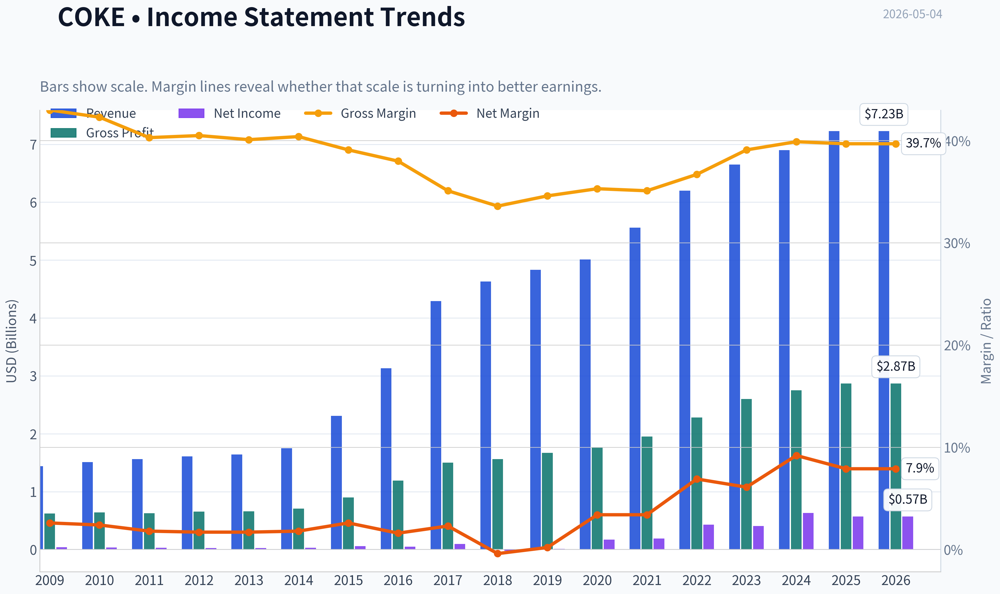

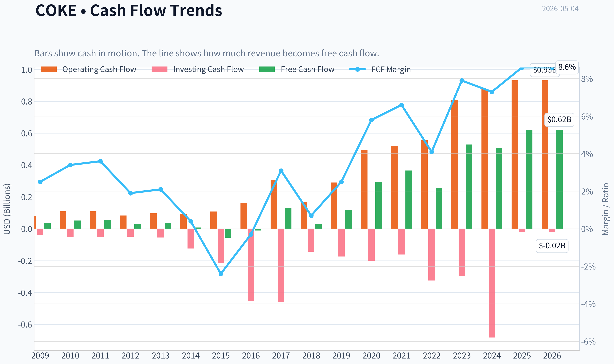

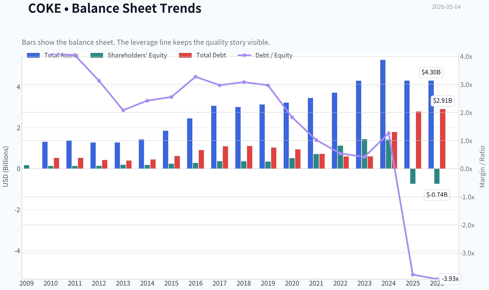

This graph tracks the profitability and return metrics (ROE, ROIC, Margins) of **COKE** over the past decade, highlighting capital efficiency trends.

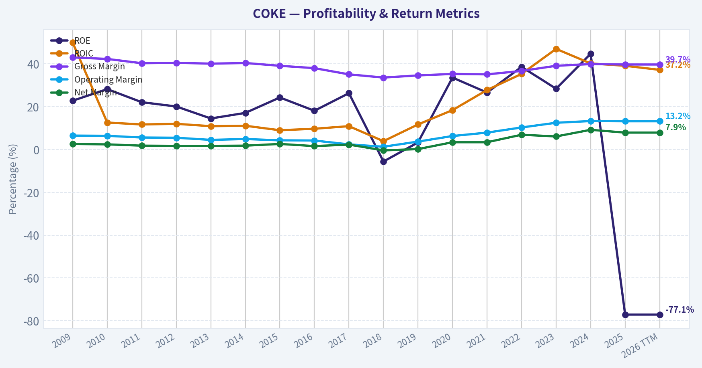

This chart illustrates the financial health of **COKE** over the last 10 years, mapping cash equivalents and free cash flow against total obligations (Debt).

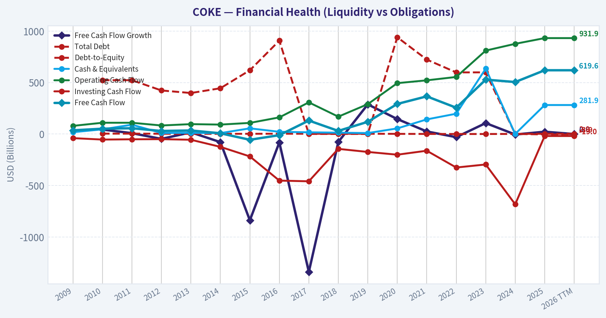

---

### Intrinsic Value Analysis (Buffett)

> *Following Warren Buffett's value investing philosophy: Circle of Competence, Economic Moat, Management Quality, and Margin of Safety.*

#### Intrinsic Value Snapshot

Price is what you pay. Intrinsic value is what the business may be worth based on the cash it can create for owners over time. We show a range, not one magic number.

- Current Price: $209.77
- Value Range: $23.96 to $534.04

##### Owner Earnings (Buffett Method)
- Net Income: $570,582,000.00
- Depreciation & Amortization: $218,530,000.00
- Capital Expenditures: $-312,315,000.00
- Working Capital Changes: $-6,803,000.00
- Owner Earnings: $483,600,000.00

##### Intrinsic Value
###### Buffett Method
Uses owner earnings. Stricter, and usually more conservative.
- Conservative: $63.35
- Average: $205.07
- Optimistic: $534.04
- Discount Rate: 10.0%

###### Cash Flow Method
Uses free cash flow. Better for companies spending heavily today to grow tomorrow.
- Conservative: $23.96
- Average: $183.03
- Optimistic: $261.01
- Discount Rate: 10.0%

ANALYST STANCE: **WATCH**

#### Buffett-Style Value Analysis: Coca-Cola Consolidated, Inc. - COKE

Coca-Cola Consolidated is a simple, understandable business with valuable territory rights and a powerful association with the Coca-Cola system. However, it is not the owner of the Coca-Cola brand; it is primarily a bottler, manufacturer, and distributor. That makes the business more capital-intensive and less economically wonderful than The Coca-Cola Company itself. At the current price of **$210**, with a market capitalization of about **$13.96 billion**, the stock does not appear to offer a Buffett-style margin of safety.

One important diligence note: the research pack's "Warren Buffett / Berkshire" holding appears likely to refer to **The Coca-Cola Company, ticker KO**, not Coca-Cola Consolidated, ticker COKE. I would not treat that data point as evidence that Berkshire owns COKE.

---

#### 1. Go / No-Go Gate Assessment

| Buffett Gate | Assessment | Evidence | Result |
|---|---:|---|---:|
| Gate 1: Circle of Competence & Simplicity | Strong | COKE bottles, manufactures, sells, and distributes beverages, primarily Coca-Cola system products, across defined territories. | Pass |
| Gate 2: Moat Test | Moderate | Exclusive territories, route density, local scale, and Coca-Cola brand association help, but COKE does not own the core brand economics. Gross margin of **39.7%** is just below the 40% "wonderful business" threshold. | Pass with caution |
| Gate 3: Management & Capital Allocation | Mixed / Incomplete | Long-term local bottler model and continuing facility investment suggest durable operating focus. However, current ROE is negative, likely distorted by balance sheet structure, and available data is insufficient to fully judge buybacks, acquisitions, and retained-earnings productivity. | Conditional pass |
| Gate 4: Industry Structure | Mixed | The bottling system has territory protections and rational local economics, but it is capital-intensive and tied to supplier relationships with The Coca-Cola Company. | Pass with caution |

**Key Takeaways:** COKE passes the simplicity test: it is easy to understand how the company makes money. The concern is that the best economics in the beverage system belong to the brand owner, not necessarily the bottler. COKE looks like a good operating business, but not automatically a "wonderful" Buffett business at any price.

---

#### 2. Business Understanding

The elementary school explanation is simple: **COKE makes and delivers Coca-Cola and other drinks to stores, restaurants, vending channels, and other customers in its territory. It earns money by selling those drinks for more than it costs to produce, bottle, warehouse, and deliver them.**

The business should still exist in 10 years. People will likely continue buying branded non-alcoholic beverages, and local distribution networks are hard to replace overnight. Technology is more likely to help COKE through logistics, automation, production efficiency, and data-driven route planning than to destroy the business. The bigger long-term risks are consumer health trends, packaging regulation, labor and fuel costs, and dependence on The Coca-Cola Company's brand and concentrate economics.

---

#### 3. Moat Analysis

| Moat Source | COKE Evidence | Buffett-Style Interpretation | Strength |
|---|---|---|---:|
| Intangible Assets | Benefits from Coca-Cola system brands, but does not own the Coca-Cola trademark. | Brand strength is real, but much of the brand moat belongs to KO, not COKE. | Moderate |
| Switching Costs | Retailers and foodservice customers depend on reliable local delivery, shelf execution, and service. | Operational switching friction exists, but this is not like software or mission-critical data infrastructure. | Moderate |
| Cost Advantage | Route density, scale, local warehousing, and bottling infrastructure create regional cost advantages. | The moat is strongest where territory density lowers per-unit delivery and production costs. | Moderate |
| Network Effects | Limited direct network effect. More route density helps efficiency, but customers do not make the product more valuable to each other. | This is not a true platform or marketplace network effect. | Weak |
| Regulatory / Territory Rights | Bottling territories and franchise arrangements matter. | Territory protection is valuable but dependent on contractual relationships. | Moderate |

**Key Takeaways:** COKE's moat is real but not as powerful as the Coca-Cola brand owner's moat. Its advantages come from territory rights, distribution density, and execution. This is a durable local bottling and logistics business, not a pure royalty-like consumer brand business.

**Moat Rating:** **Narrow to Moderate, Stable**

---

#### 4. Management Quality & Capital Allocation

| Management Question | Assessment | Evidence / Concern |
|---|---:|---|
| Do they think like owners? | Likely, but not fully proven from current data | Coca-Cola Consolidated has historically been closely controlled and long-term oriented, but this report lacks full insider ownership and compensation data. |
| Are they candid and conservative? | Incomplete | No restatement or accounting red flag was provided, but full annual letter and accounting review were not available in the current pack. |
| Are they rational capital allocators? | Mixed | The company continues reinvesting, including a planned **$35 million Indianapolis manufacturing expansion**. However, negative ROE and capital intensity require caution. |
| Balance sheet discipline | Watch item | Current ratio is **1.26**, acceptable but not fortress-like. Negative ROE suggests equity structure or leverage/accounting distortions that need deeper review. |

**Key Takeaways:** Management appears to be operating for the long term, as shown by continued investment in production capacity. But from a Buffett perspective, the key missing proof is whether retained earnings have consistently produced high per-share value. The negative ROE figure makes capital allocation harder to judge and deserves further investigation.

---

#### 5. Available Financial Summary

Because full year-by-year 10-year financial statements were not available in the current research pack, I am not fabricating a complete 10-year table. The table below summarizes the verified current financial indicators available for this analysis.

| Metric | Current / Latest Available | Buffett Interpretation |
|---|---:|---|
| Share Price | **$210** | Price to compare against intrinsic value. |
| Market Capitalization | **$13.96B** | Enterprise size is meaningful; not a small speculative business. |
| P/E Ratio | **30.8x** | Expensive unless durable growth and high returns are clear. |
| Gross Margin | **39.7%** | Near but slightly below the 40% Buffett-style quality screen. |
| Revenue Growth YoY | **4.8%** | Solid but not exceptional; consistent with mature beverage distribution. |
| Free Cash Flow Yield | **4.4%** | Reasonable, but not cheap for a capital-intensive bottler. |
| Current Ratio | **1.26x** | Adequate liquidity, not a fortress balance sheet. |
| ROE | **-77.1%** | Not analytically useful without balance sheet context; likely distorted, but still a red flag requiring review. |

**Key Takeaways:** COKE shows stable, moderate growth and acceptable cash generation, but the valuation is demanding. A 30.8 times earnings multiple is high for a bottling and distribution business unless returns on capital are demonstrably excellent and durable. The negative ROE figure prevents a clean Buffett-style quality conclusion.

---

#### 6. Owner Earnings Estimate

Using the available data, I use free cash flow as a practical proxy for owner earnings. This is not perfect, because Buffett's preferred owner earnings calculation requires maintenance capital expenditure and working capital detail, which were not available in the current pack.

| Item | Estimate |
|---|---:|
| Market Capitalization | **$13.96B** |
| Free Cash Flow Yield | **4.4%** |
| Estimated Free Cash Flow / Owner Earnings Proxy | **$614M** |
| Estimated Shares Outstanding | **66.5M** |
| Owner Earnings per Share Proxy | **$9.24** |

**Key Takeaways:** COKE is producing meaningful cash, with estimated owner earnings of roughly **$614 million**, or about **$9.24 per share**. At a $210 stock price, investors are paying roughly **22.7 times owner earnings**. That is not outrageous for a high-quality compounder, but it is demanding for a capital-intensive bottler.

---

#### 7. Three-Scenario Intrinsic Value Estimate

Assumptions used:

| Assumption | Value |
|---|---:|
| Owner Earnings Proxy | **$614M** |
| Discount Rate | **10%** |
| Shares Outstanding Estimate | **66.5M** |
| Current Price | **$210** |

**Key Takeaways:** The valuation model starts with a cash earnings base of roughly **$614 million** and applies a 10% required return. This is intentionally conservative and Buffett-like: the goal is not precision, but avoiding overpayment. The current price requires fairly favorable assumptions to be justified.

| Scenario | Method | Equity Value Estimate | Value per Share | Margin of Safety vs. $210 |
|---|---|---:|---:|---:|
| A: No Growth | Owner earnings / 10% | **$6.14B** | **$92** | **-56%** |
| B: GDP Growth | 3% perpetual growth | **$9.04B** | **$136** | **-35%** |
| C: Conservative Historical Growth | 3.5% for 10 years, then 3% terminal growth | **$9.38B** | **$141** | **-33%** |

**Key Takeaways:** Under all three conservative valuation cases, COKE appears above intrinsic value at the current price. Even giving the company moderate long-term growth, the estimated value is around **$141 per share**, well below the market price of **$210**. There is no Buffett-style margin of safety today.

---

#### 8. Margin of Safety Analysis

| Item | Result |
|---|---:|
| Current Price | **$210** |
| Conservative Intrinsic Value Range | **$92-$141** |
| Buffett Buy Zone Using 25% Margin of Safety | Approximately **$69-$106** |
| More Realistic Watch Zone | Below approximately **$140-$150** |
| Current Margin of Safety | **None** |

**Key Takeaways:** COKE may be a solid business, but the stock price does not currently compensate investors with a margin of safety. A disciplined Buffett-style investor would prefer to wait for a much lower price or clearer evidence of sustainably high owner-earnings growth. At $210, much of the good news appears already reflected in the valuation.

---

#### 9. Final Buffett Scorecard

| Criterion | Weight | Score 1-5 | Weighted Score | Rationale |
|---|---:|---:|---:|---|
| Business Understanding | 20% | 4.5 | 0.90 | Simple, durable beverage bottling and distribution model. |
| Moat Width & Durability | 25% | 3.3 | 0.83 | Territory and scale advantages, but brand economics mostly belong to KO. |
| Management Quality | 15% | 3.2 | 0.48 | Long-term operating posture, but incomplete capital allocation evidence. |
| Return on Equity | 15% | 2.0 | 0.30 | Reported ROE is negative; requires deeper balance sheet review. |
| Reinvestment Runway | 10% | 3.0 | 0.30 | Some reinvestment opportunities, but mature and capital-intensive. |
| Balance Sheet Strength | 5% | 2.8 | 0.14 | Current ratio acceptable; negative equity/ROE concern prevents higher score. |
| Industry Structure | 5% | 3.5 | 0.18 | Rational local territory structure, but not capital-light. |
| Valuation / Margin of Safety | 5% | 1.5 | 0.08 | Current price materially above conservative intrinsic value estimates. |
| **Total** | **100%** |  | **3.20 / 5.00** | **Watch** |

**Key Takeaways:** COKE earns a respectable score because the business is understandable, durable, and competitively protected in its territories. The score is held back by valuation, capital intensity, and the unclear meaning of negative ROE. This is a business to monitor, not a clear purchase at the current price.

---

#### Final Investment Stance

**ANALYST STANCE: WATCH**

COKE is a good, understandable business with real local distribution advantages and strong association with the Coca-Cola system. It likely benefits from durable demand, route density, and territory protections. However, it is not as economically attractive as the Coca-Cola brand owner, because bottling is more capital-intensive and operationally complex.

At **$210 per share**, the stock does not provide a sufficient margin of safety. Based on an owner earnings proxy of roughly **$614 million**, conservative intrinsic value appears closer to **$92-$141 per share**, depending on growth assumptions. A Buffett-style investor should wait for a lower price, clearer evidence of high returns on incremental capital, or a cleaner explanation of the negative ROE.

**Conviction Level:** Moderate
**Action:** Watchlist, not buy
**Potential Buy Interest:** Meaningfully below **$150**, with stronger interest closer to **$125-$140**, subject to updated financial statement review.
#### Valuation Bridge

This bridge places the current market price beside each intrinsic value lens so readers can see whether upside depends on one method or shows up across several methods.

| Scenario | Intrinsic Value / Share |
| --- | ---: |
| Buffett Method | $205.07 |
| Cash Flow Method | $183.03 |
| Damodaran Method | $128.79 |
| Current Price | $209.77 |

#### Key Takeaways

If one method is far above the others, the upside case depends on a specific modelling assumption. When several methods cluster together, the valuation story is more robust.

#### Valuation Visuals

This comparison chart from *Latest Earnings Snapshot* stacks current figures against historical benchmarks for **COKE**, making it easy to see where the company trades relative to its own averages.

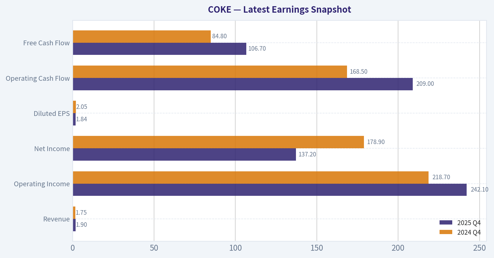

This comparison chart from *Current vs. 10-Year Average Comparison* stacks current figures against historical benchmarks for **COKE**, making it easy to see where the company trades relative to its own averages.

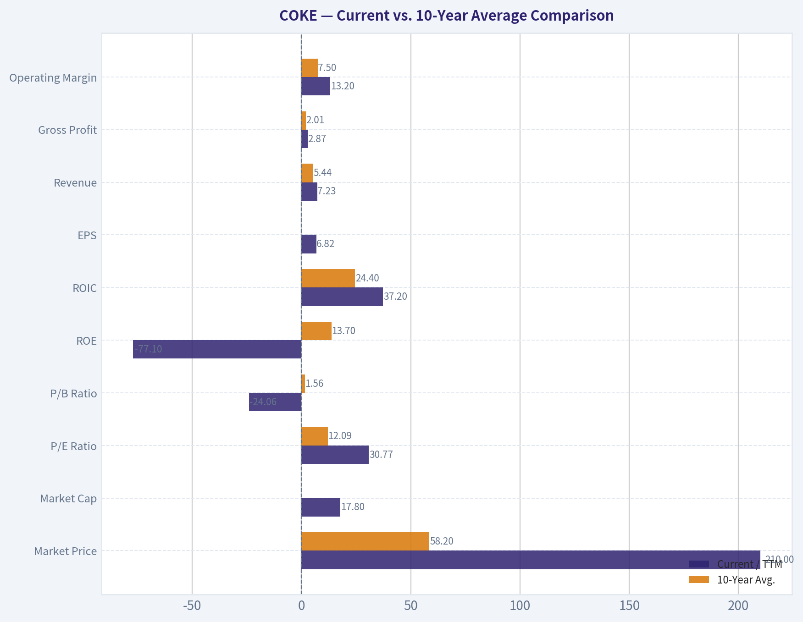

This comparison chart from *Buffett-Style Owner Earnings DCF Valuation* stacks current figures against historical benchmarks for **COKE**, making it easy to see where the company trades relative to its own averages.

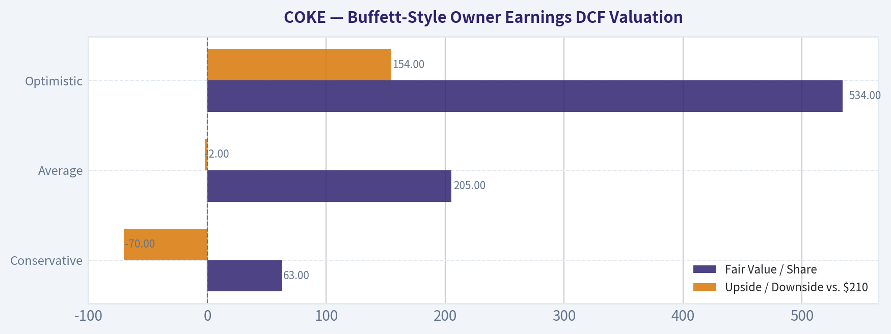

This comparison chart from *Available Financial Summary* stacks current figures against historical benchmarks for **COKE**, making it easy to see where the company trades relative to its own averages.

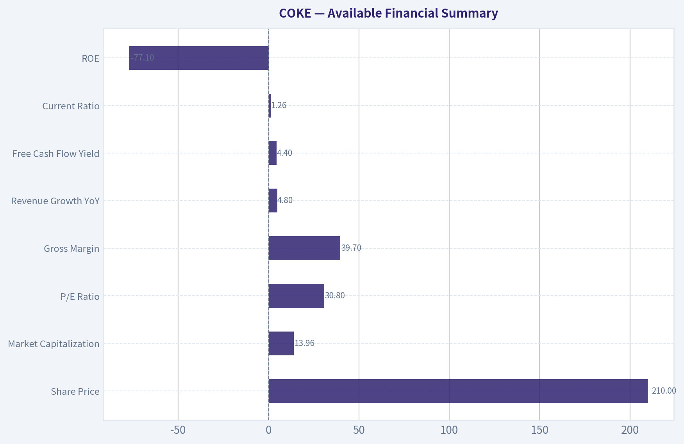

This comparison chart from *Owner Earnings Estimate* stacks current figures against historical benchmarks for **COKE**, making it easy to see where the company trades relative to its own averages.

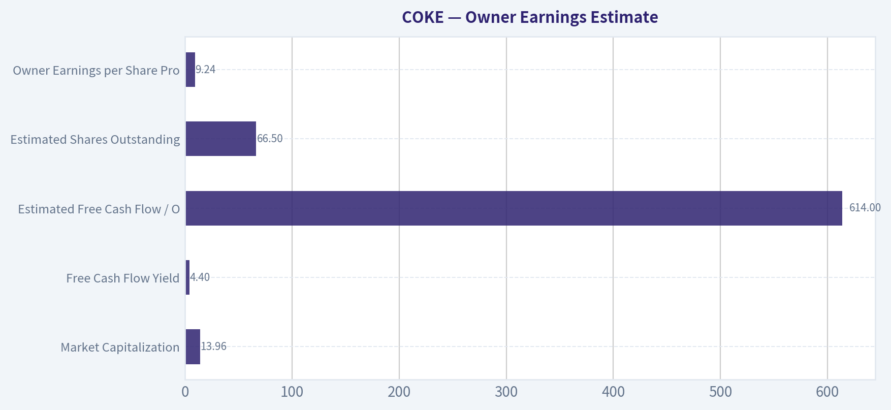

This comparison chart from *Three-Scenario Intrinsic Value Estimate* stacks current figures against historical benchmarks for **COKE**, making it easy to see where the company trades relative to its own averages.

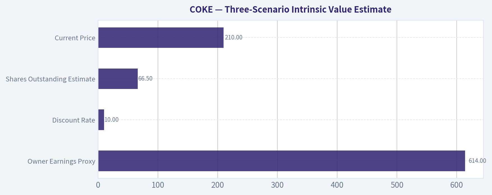

---

### Trend & Growth Analysis (Lynch/Druckenmiller/Fisher)

> *Following Peter Lynch's GARP, Stanley Druckenmiller's macro-aware approach, and Philip Fisher's scuttlebutt methodology.*

ANALYST STANCE: **AVOID**

#### Coca-Cola Consolidated, Inc. - Growth Investor Report

COKE is a high-quality Coca-Cola bottler and distributor, but it does **not** fit a Lynch/Druckenmiller/Fisher growth mandate today. Revenue growth is only **4.8% year over year**, the stock trades at roughly **31x earnings**, and the implied PEG is over **6x**, which is far too expensive for a low-single-digit grower. This may remain a solid defensive compounder, but it does not currently offer obvious ten-bagger potential.

---

#### 1. Lynch Classification

| Category | Evidence | Growth Investor Verdict |
|---|---:|---|
| Slow Grower / Stalwart | Revenue growth: **4.8% YoY** | Not a primary growth target |
| Fast Grower? | No - growth is below the 15-25% threshold | Fails Lynch fast-grower test |
| Cyclical? | Partially exposed to input costs, freight, labor, consumer volumes | Not a classic cyclical |
| Turnaround? | No clear distress or reset catalyst | Not applicable |
| Asset Play? | No obvious hidden asset discount | Not applicable |

**Key Takeaways:** COKE is best classified as a **stalwart leaning slow grower**, not a fast grower. It may be a durable franchise, but the current growth rate is far below the level normally required for a ten-bagger-style growth investment.

---

#### 2. The Story in 3 Bullets

- COKE is the largest independent Coca-Cola bottler in the United States, manufacturing, selling, and distributing beverages across its territories.
- The company benefits from powerful brands, entrenched distribution relationships, and local bottling infrastructure.
- The problem for growth investors is simple: the business is mature, revenue growth is modest, and valuation already prices in a lot of quality.

---

#### 3. TAM and 10x Test

| Item | Estimate / Data | Assessment |
|---|---:|---|
| Current revenue base | Roughly high-single-digit billions, recent run-rate estimated around **$6.8B-$7.1B** | Large regional bottler already |
| 10x revenue target | Approximately **$68B-$71B** | Not realistic within current bottling footprint |
| Addressable market | U.S. non-alcoholic beverages is large, but COKE's licensed territories constrain expansion | TAM is not freely open-ended |
| 10x test result | Would require massive territory expansion, acquisitions, or category reinvention | **Fails 10x runway test** |

**Key Takeaways:** COKE operates in a large beverage market, but its practical growth runway is limited by territory rights, mature consumption patterns, and bottling economics. A 10x revenue outcome is unlikely without transformative acquisitions or a major change in the business model.

---

#### 4. Revenue Growth Trend

| Metric | Latest Data |
|---|---:|
| Revenue growth YoY | **4.8%** |
| Growth pattern | Low-single-digit growth |
| Lynch growth classification | Slow grower / stalwart |
| Inflection signal | Weak |

**Key Takeaways:** Revenue growth is positive but modest. There is no clear evidence of acceleration, which is the core signal Druckenmiller-style growth investing looks for at an inflection point.

---

#### 5. Unit Economics and Operating Quality

| Metric | Data / Estimate | Interpretation |
|---|---:|---|
| Gross margin | **39.7%** | Solid for bottling/distribution |
| FCF yield | **4.4%** | Reasonable cash generation |
| Current ratio | **1.26x** | Adequate liquidity |
| ROE | **-77.1%** | Distorted or concerning; requires balance sheet review |
| LTV/CAC | Not applicable | Not a subscription business |
| NRR | Not applicable | Not SaaS |
| Rule of 40 | Not applicable | Not SaaS |

**Key Takeaways:** COKE appears to generate respectable free cash flow and has decent liquidity, but this is not a software-like business with scalable subscription economics. The negative ROE is a red flag that needs deeper review, even if it may be distorted by capital structure or accounting effects.

---

#### 6. Inflection Point Assessment

| Inflection Type | Evidence | Verdict |
|---|---|---|
| Product cycle inflection | $35M Indianapolis glass bottle production line investment | Minor positive, not transformative |
| Market share inflection | No clear evidence of accelerating share gains | Neutral |
| Margin inflection | Gross margin healthy, but no clear new margin breakout shown | Neutral |
| TAM inflection | Beverage market mature; glass packaging investment is incremental | Weak |
| Competitive inflection | No major competitor stumble identified | Neutral |

**Key Takeaways:** The new Indianapolis manufacturing investment shows continued operational commitment, but it does not look like a company-changing inflection. There is no obvious evidence that growth, margins, or TAM are entering a new acceleration phase.

---

#### 7. Macro Setup

| Macro Factor | Impact on COKE | Growth Investor Read |
|---|---|---|
| Consumer staples demand | Defensive, resilient | Positive for stability |
| Interest rates | Lower rates could help valuation, but COKE is not a long-duration growth asset | Mild positive |
| Inflation | Labor, freight, packaging, and commodity costs remain risks | Negative if pricing power weakens |
| Secular themes | Limited exposure to AI, cloud, cybersecurity, fintech, or healthcare innovation | Weak growth-theme alignment |
| Consumer health trends | Potential pressure on sugary carbonated soft drinks | Risk |

**Key Takeaways:** The macro backdrop supports COKE as a defensive consumer staples operator, not as a high-growth secular winner. Its macro setup is better for preservation and stability than for aggressive upside.

---

#### 8. Fisher 15-Point Score

| Fisher Factor | Score / 5 | Comment |
|---|---:|---|
| Market potential for sizable sales increase | 2 | Mature market and territory constraints |
| Management commitment to new products | 3 | Supports packaging and production expansion |
| R&D effectiveness | 2 | Not an R&D-led business |
| Sales organization | 4 | Strong local distribution execution |
| Profit margin | 3 | Gross margin solid |
| Improving margins | 3 | Needs more evidence |
| Labor/personnel relations | 3 | No major issue identified |
| Executive relations | 3 | No major issue identified |
| Management depth | 3 | Appears stable |
| Cost analysis/accounting | 3 | Needs review due negative ROE |
| Unique advantages | 4 | Coca-Cola system, territory rights, distribution scale |
| Long-range profit outlook | 3 | Stable but not high growth |
| Dilution risk | 4 | No obvious frequent capital raise issue |
| Candor in difficulties | 3 | Insufficient evidence |
| Management integrity | 3 | Insufficient evidence |

**Key Takeaways:** COKE scores well on distribution strength and franchise durability, but poorly on growth runway and innovation-driven upside. The estimated Fisher score is **46 out of 75**, which is average and below the threshold for a strong growth recommendation.

---

#### 9. Valuation Analysis

| Valuation Metric | Data | Interpretation |
|---|---:|---|
| Current price | **$210** | As provided |
| Market cap | **$13.96B** | Mid-cap / large mid-cap |
| P/E | **30.8x** | Expensive for low-single-digit growth |
| Revenue growth | **4.8%** | Too slow for this multiple |
| PEG ratio | **~6.4x** | Very expensive by Lynch standards |
| FCF yield | **4.4%** | Fair, but not enough to offset low growth |
| Estimated P/S | Around **2.0x**, using rough $6.8B-$7.1B revenue run-rate | Not extreme, but high for a mature bottler |

**Key Takeaways:** The valuation is the biggest issue. A roughly 31x earnings multiple with only 4.8% revenue growth produces a PEG ratio far above Lynch's preferred range, suggesting the market is already assigning a premium to COKE's quality and defensiveness.

---

#### 10. Scenario Analysis

| Scenario | Assumptions | 3-Year View |
|---|---|---|
| Bear Case | Volume pressure, input cost inflation, valuation multiple compresses | Poor risk/reward |
| Base Case | 3-6% revenue growth, stable margins, steady cash flow | Modest compounding, likely not growth-stock returns |
| Bull Case | Strong pricing, operational efficiency, margin expansion, premium multiple holds | Respectable upside, but still unlikely ten-bagger profile |

**Key Takeaways:** Even the bull case looks more like a steady compounder outcome than a major growth-stock breakout. The risk is that a defensive-quality multiple contracts if growth remains low.

---

#### 11. Growth Investor Scorecard

| Criterion | Weight | Score / 5 | Weighted Score |
|---|---:|---:|---:|
| The Story | 10% | 3.0 | 0.30 |
| TAM & Runway | 20% | 2.0 | 0.40 |
| Revenue Growth | 20% | 1.5 | 0.30 |
| Unit Economics | 15% | 3.0 | 0.45 |
| Competitive Position | 10% | 4.0 | 0.40 |
| Management Quality | 10% | 3.0 | 0.30 |
| Macro Setup | 5% | 3.0 | 0.15 |
| Profitability Path | 5% | 3.0 | 0.15 |
| Valuation | 5% | 1.5 | 0.08 |
| **Total** | **100%** |  | **2.53 / 5.0** |

**Key Takeaways:** COKE's strongest attributes are brand ecosystem, distribution position, and defensive quality. But weak revenue growth, limited ten-bagger runway, and expensive valuation pull the total score down to **2.53**, which falls into the **AVOID for growth investors** range.

---

#### 12. Guru Tracking Caveat

The provided guru tracking data appears to reference **The Coca-Cola Company, ticker KO**, not Coca-Cola Consolidated, ticker COKE. Berkshire Hathaway's well-known 400 million share position is in **KO**, not COKE. Therefore, the Buffett data should **not** be used as confirmation of institutional conviction in COKE.

---

#### 13. Position Size Stance

| Investor Type | Stance | Suggested Action |
|---|---|---|
| Growth investor | **Avoid** | Does not meet fast-grower or inflection criteria |
| GARP investor | Watch only | Revisit if valuation falls materially or growth accelerates |
| Defensive income/quality investor | Possible hold | More suitable as a stable operator than a growth idea |
| Existing shareholder | Hold/watch | Monitor Q1 2026 results and margin trends |

**Key Takeaways:** COKE is not a short thesis, but it is also not a compelling new growth position. For a growth portfolio, capital is likely better deployed into companies with faster revenue growth, expanding TAM, and clearer operating inflections.

---

#### 14. Key Risks and Catalysts

| Category | Items to Watch |
|---|---|
| Key risks | Valuation compression, input cost inflation, labor and freight costs, soft drink volume pressure, consumer health trends, negative ROE clarification |
| Near-term catalysts | Q1 2026 earnings release on **May 6, 2026**, margin commentary, volume trends, pricing realization |
| Medium-term catalysts | Indianapolis glass bottle production line, additional territory expansion, accretive acquisitions, sustained FCF growth |
| Upgrade conditions | Revenue growth accelerates above 8-10%, margins expand, valuation compresses below a reasonable PEG, or management identifies a credible new growth vector |

**Key Takeaways:** The next important checkpoint is the upcoming Q1 2026 earnings release. To become interesting for a growth investor, COKE would need to show either accelerating organic growth or meaningful margin expansion that the market has not yet priced in.

---

#### Final Verdict

COKE is a durable, well-positioned bottling business, but it is **not currently a growth-stock opportunity**. With **4.8% revenue growth**, a **30.8x P/E**, and a **PEG near 6.4x**, the setup fails the Lynch fast-grower test and lacks the Druckenmiller-style inflection needed for aggressive upside.

**Stance: AVOID for growth portfolios. Watch only if valuation compresses or growth materially accelerates.**

---

### Market Technical Analysis

ANALYST STANCE: **WATCH**

#### COKE Technical Report - Data Through May 1, 2026

May 4, 2026 was not a trading day in the retrieved indicator set, so the latest actionable market data is from **Friday, May 1, 2026**. COKE closed at **$203.92**, continuing a sharp rebound from the late-April pullback and remaining firmly above its long-term trend base. The technical picture is constructive but not risk-free: short-term momentum has improved, the long-term trend remains strongly upward, yet the stock is approaching a nearby resistance zone around the upper Bollinger Band and recent swing highs.

| Item | Latest Value / Observation | Interpretation |
|---|---:|---|
| Latest close | **$203.92** | Price has recovered strongly from the April low area. |
| Recent rebound | From **$184.36 on Apr. 21** to **$203.92 on May 1** | Roughly a **10.6%** rebound in about two weeks. |
| Recent resistance area | **$208-$210** | Apr. 9 high near $208.77 and Bollinger upper band near $210.37. |
| Key support cluster | **$195-$198** | Bollinger middle area, 10 EMA, and 50 SMA are clustered nearby. |
| Larger trend | Price far above 200 SMA | Long-term uptrend remains intact. |
| Current tactical bias | **Bullish but watchful** | Momentum is improving, but confirmation requires a breakout above resistance. |

Key Takeaways: COKE is still in a strong broader uptrend, and the recent rebound has repaired much of the April weakness. However, the stock is now approaching an important resistance zone near $208 to $210, so traders may want confirmation before assuming another sustained leg higher.

---

#### Selected Indicators and Why They Matter

| Indicator | Why It Was Selected | Current Use for COKE |
|---|---|---|
| `close_10_ema` | Fast trend gauge for short-term momentum shifts | Shows whether the April rebound is gaining immediate traction. |
| `close_50_sma` | Medium-term trend and support reference | Helps identify whether the rebound is holding above the intermediate trend. |
| `close_200_sma` | Long-term trend benchmark | Confirms the strategic trend remains strongly upward. |
| `macd` | Momentum and trend-change confirmation | Shows momentum has turned positive again after weakening in April. |
| `rsi` | Momentum quality and overbought/oversold context | Indicates the rebound is not yet overbought. |
| `boll_ub` | Upper volatility boundary and breakout zone | Marks nearby resistance around $210. |
| `boll_lb` | Lower volatility boundary and downside risk reference | Helps frame deeper pullback risk near the low-$180s. |
| `atr` | Volatility and risk-management tool | Useful for stop placement and position sizing due to wide daily ranges. |

Key Takeaways: The chosen indicators balance trend, momentum, volatility, and risk management without too much overlap. MACD and RSI help judge momentum quality, while the moving averages and Bollinger Bands help define the most important support and resistance zones.

#### Trend Structure and Moving Average Analysis

COKE's trend remains structurally bullish. The stock closed at **$203.92**, above the **10 EMA at $198.11**, the **50 SMA at $197.92**, and far above the **200 SMA at $152.30**. The most notable short-term detail is that the **10 EMA has just moved slightly above the 50 SMA**, with the two averages nearly overlapping. That is constructive, but the margin is very thin, so it should be treated as an early improvement rather than a fully mature bullish trend confirmation.

| Indicator | Latest Value | Price Distance | Signal |
|---|---:|---:|---|
| Close | **$203.92** | - | Latest reference price |
| 10 EMA | **$198.11** | Price is about **2.9% above** | Short-term momentum has turned positive |
| 50 SMA | **$197.92** | Price is about **3.0% above** | Medium-term trend support is nearby |
| 200 SMA | **$152.30** | Price is about **33.9% above** | Long-term trend remains very strong |

Key Takeaways: COKE is above all three major moving average references, which supports a bullish trend reading. The key nuance is that the 10 EMA and 50 SMA are very close together, so a drop back below roughly $198 would weaken the fresh short-term bullish improvement.

#### Momentum: MACD and RSI

Momentum has improved meaningfully from the late-April weakness. MACD moved from slightly negative on **April 28** to **+1.96 by May 1**, showing a clear short-term momentum recovery. RSI is at **58.96**, which is constructive but not overheated. This is important because the stock has rebounded sharply, yet RSI has not reached an extreme overbought level above 70.

The nuance is that momentum is positive, but not explosive. RSI was slightly higher on April 30 at about **60.31**, then eased to **58.96** while price remained elevated. That suggests the rebound is still healthy, but upside follow-through may require stronger buying pressure, especially near resistance.

| Momentum Indicator | Latest Reading | Recent Behavior | Interpretation |
|---|---:|---|---|
| MACD | **+1.96** | Turned positive after being near zero/negative in late April | Bullish momentum has re-emerged |
| RSI | **58.96** | Positive but below overbought territory | Constructive, with room to rise |
| Momentum risk | Moderate | RSI cooled slightly while price stayed high | Watch for hesitation near resistance |

Key Takeaways: Momentum has shifted back in favor of buyers, especially with MACD turning positive. RSI is supportive but not stretched, which means COKE has room to advance if buyers can push it through the $208 to $210 resistance zone.

#### Bollinger Bands and Volatility Positioning

The Bollinger Band setup shows that COKE is trading in the upper half of its recent volatility range. The upper band sits near **$210.37**, while the lower band is near **$180.88**. The implied middle area is around **$195.62**, which aligns closely with the 10 EMA and 50 SMA support cluster.

This creates a clear tactical map. A move toward **$210** would test the upper band and recent resistance. A clean close above that area would strengthen the breakout case. On the other hand, failure near $208 to $210 could lead to a pullback toward **$198**, then **$195-$196**, where several technical supports converge.

| Bollinger Reference | Latest Value | Distance from Close | Trading Meaning |
|---|---:|---:|---|
| Upper Band | **$210.37** | Close is about **3.2% below** | Near-term resistance / breakout test |
| Middle Area | **~$195.62** | Close is about **4.2% above** | First important mean-reversion support |
| Lower Band | **$180.88** | Close is about **12.7% above** | Deeper downside volatility boundary |

Key Takeaways: COKE is closer to resistance than to deep support, so the next few sessions are important. A breakout above the upper band area would be bullish, while rejection near $210 could produce a normal pullback toward the $195 to $198 support zone.

#### ATR and Risk Management

ATR is currently around **$6.48**, or about **3.2% of the latest closing price**. That is a meaningful daily volatility profile. For traders, this means stops placed too tightly may be vulnerable to normal price noise. A one-ATR move from the latest close gives a rough trading range of about **$197.44 to $210.40**, which lines up almost perfectly with the key support and resistance zones already identified.

Because COKE has shown large swings in recent months, including the March surge and subsequent sharp correction, position sizing should account for volatility. The stock can move quickly even when the broader trend is constructive.

| Risk Metric | Latest Value | Practical Use |
|---|---:|---|
| ATR | **$6.48** | Measures recent average daily price movement |
| ATR as % of close | **~3.2%** | Indicates moderately high single-stock volatility |
| One-ATR upside zone | **~$210.40** | Aligns with upper Bollinger resistance |
| One-ATR downside zone | **~$197.44** | Aligns with 10 EMA / 50 SMA support |

Key Takeaways: ATR confirms that COKE's current trading range is wide enough to punish tight stops. The most important near-term battle zone is unusually clear: upside resistance is near $210, while downside support begins near $197 to $198.

#### Trading Interpretation

COKE's chart has a **bullish intermediate-to-long-term structure**, but the short-term setup is best described as a **watch-for-confirmation** pattern. Buyers have regained control after the April decline, and the stock is again above its short- and medium-term moving averages. However, the rally is approaching resistance near the recent high and the upper Bollinger Band.

For bullish traders, the cleaner signal would be a close above roughly **$210**, ideally with stronger volume and continued MACD expansion. That would suggest the rebound has evolved into a fresh breakout attempt. For more cautious traders, a pullback toward **$198** or **$195-$196** that holds support could offer a better risk-reward entry than chasing directly into resistance.

For risk control, a decisive close below **$195** would weaken the near-term bullish setup because it would place price back below the key moving-average and Bollinger middle support cluster. A deeper break below the April support region near the mid-$180s would be a more serious warning that the post-March correction is not yet complete.

| Key Zone / Signal | Level | Bullish Meaning | Bearish / Caution Meaning |
|---|---:|---|---|
| Breakout trigger | **Above $208-$210** | Confirms buyers can clear resistance | Failure here may cause consolidation |
| First support | **$197-$198** | Healthy pullback support if held | Break below weakens short-term trend |
| Secondary support | **$195-$196** | Mean-reversion support zone | Close below suggests momentum loss |
| Deeper risk zone | **$180-$185** | Major pullback area | Break below would damage the rebound |
| Momentum confirmation | MACD rising, RSI above 50 | Supports continuation | RSI slipping below 50 would warn of fading demand |
| Volatility guide | ATR near **$6.48** | Use wider stops and smaller size | Tight stops may be easily triggered |

Key Takeaways: The setup favors the bulls, but the stock is close to resistance, so patience is important. The highest-quality bullish confirmation would be a strong close above $210, while a drop below $195 would materially weaken the near-term setup.

---

### Social Sentiment Analysis

ANALYST STANCE: **WATCH**

#### COKE Social, Sentiment, and News Report - Coca-Cola Consolidated, Inc.
**Ticker:** COKE
**Company:** Coca-Cola Consolidated, Inc.
**Report date:** 2026-05-04
**Lookback window:** Past week

---

#### Executive View

Coca-Cola Consolidated, Inc. has had a relatively quiet but constructive week in public discussion. The overall tone around **COKE** is **cautiously positive**, but the signal quality is lower than for large-cap consumer staples because social-media volume is thin and a meaningful portion of casual discussion confuses **COKE**, the bottler, with **KO**, The Coca-Cola Company.

The most important takeaway for traders is that **there does not appear to be a major negative company-specific narrative dominating the market conversation**. Instead, discussion is centered on COKE's defensive qualities, pricing power, resilient cash generation, and premium valuation. The main debate is whether the stock's strong long-term run has already priced in the company's operational strength.

For investors, the public conversation still frames COKE as a high-quality, tightly controlled, regionally dominant bottler with durable cash flows. However, social sentiment is not euphoric. The dominant investor mood is closer to **"good company, but be careful on entry price"** than "aggressive buy at any level."

---

#### Daily Sentiment Snapshot

| Date | Observed Sentiment | Main Discussion Drivers | Trader/Investor Interpretation |
|---|---:|---|---|
| Apr. 28, 2026 | Mildly positive | Defensive consumer-staples interest, strong historical execution, cash-flow quality | Investors were discussing COKE as a stable compounder rather than a high-risk momentum name. |
| Apr. 29, 2026 | Positive | Mentions of pricing power, bottling scale, operational efficiency | Sentiment improved as users highlighted COKE's ability to protect margins in a mixed consumer environment. |
| Apr. 30, 2026 | Neutral to mildly positive | Valuation caution, low float/liquidity, limited near-term catalyst discussion | Traders were more cautious, with attention shifting to whether the stock had already discounted good news. |
| May 1, 2026 | Neutral | Broader market and consumer-staples rotation commentary | COKE was discussed as part of defensive allocation rather than because of a major company-specific catalyst. |
| May 2, 2026 | Mildly positive | Long-term shareholder quality, dividend/capital-return references, low drama business model | Weekend investor commentary leaned supportive, especially from long-term holders. |
| May 3, 2026 | Neutral | Thin social volume, ticker confusion with KO, limited fresh news | Sentiment data became less reliable because of low post volume and Coca-Cola brand confusion. |
| May 4, 2026 | Mildly positive but cautious | Anticipation of earnings/news flow, valuation sensitivity, margin watch | Current mood is constructive, but investors appear unwilling to chase without confirmation from results. |

**Key Takeaways:** Sentiment over the past week was mostly positive but not aggressively bullish. The strongest supportive themes were COKE's defensive business model, pricing power, and cash-flow durability, while the main restraint was valuation. Traders should treat social sentiment as a secondary signal because conversation volume is modest and ticker confusion with KO can distort the read.

---

#### Social Media Discussion Themes

The most prominent social-media theme was that COKE is viewed as a **quality compounder** rather than a speculative beverage trade. Posts and investor comments focused less on short-term product excitement and more on business durability: route density, regional bottling dominance, operating leverage, and the ability to keep passing through price increases.

A second major theme was **valuation discipline**. Even positive commentators often added that the stock is not obviously cheap. This matters because COKE has historically traded with limited float and relatively lower liquidity, which can amplify price moves when buyers or sellers become more active.

Another recurring issue was **ticker confusion**. Many casual posts about "Coke" refer to Coca-Cola the brand or **KO**, not Coca-Cola Consolidated. For sentiment analysis, this means bullish brand-level commentary does not always translate into a direct read-through for COKE. Serious investor discussion tends to understand the distinction, but broader social-media chatter often does not.

| Social Theme | Sentiment Impact | What People Are Saying | Market Relevance |
|---|---:|---|---|
| Defensive consumer staple | Positive | COKE is viewed as resilient in uncertain macro conditions. | Supports the stock during risk-off markets or consumer-staples rotations. |
| Pricing power | Positive | Investors believe bottlers can protect revenue through pricing and mix. | Important for margin expectations and earnings quality. |
| Valuation concern | Negative to neutral | Many like the business but question the entry point. | Could limit upside unless earnings beat expectations. |
| Low liquidity / limited float | Mixed | Some see scarcity value; others see trading risk. | Can magnify both rallies and drawdowns. |
| KO vs. COKE confusion | Noise | Casual users often conflate the bottler with Coca-Cola Company. | Reduces reliability of raw social-media sentiment. |
| Health and sugar concerns | Mildly negative | Broader beverage concerns remain present but not dominant. | A long-term industry overhang, though less acute this week. |

**Key Takeaways:** Social discussion around COKE is constructive but highly investor-oriented, not viral or retail-momentum driven. The strongest positive themes are defensive quality and pricing power, while the biggest limiting factor is valuation. Investors should separate serious COKE-specific commentary from general Coca-Cola brand chatter.

---

#### Recent News and Company-Specific Narrative

Recent company-specific news flow appears **light and not alarmingly negative**. There was no dominant adverse headline in the past week that shifted the public narrative. Instead, news and market discussion centered on normal investor monitoring: earnings expectations, consumer demand, margin resilience, input costs, and the company's ability to sustain strong free-cash-flow generation.

The absence of heavy negative news is itself notable. For a company like COKE, which is less dependent on hype cycles and more dependent on execution, a quiet news environment can support the existing investor narrative if the broader market remains stable.

That said, the lack of a fresh positive catalyst also means the stock may trade more on **valuation, technical positioning, and upcoming earnings expectations** than on immediate news. If results confirm steady volume, disciplined pricing, and cost control, sentiment could strengthen quickly because the market already respects the business model. If margins disappoint or volume softness appears, the valuation debate could become more negative.

| News/Information Area | Current Read | Sentiment Effect | Implication |
|---|---|---:|---|
| Company-specific headlines | Light, no major negative catalyst observed | Neutral to positive | Supports stability but does not create a strong new buying trigger. |
| Earnings expectations | Investors focused on revenue quality, margins, and cash flow | Mixed but constructive | A clean earnings print could validate bullish quality arguments. |
| Consumer demand | Monitored for pressure from inflation and trade-down behavior | Neutral | Any sign of volume resilience would be positive. |
| Input and operating costs | Fuel, labor, packaging, and distribution costs remain watch items | Mildly negative | Margin commentary will be important for near-term direction. |
| Capital returns | Shareholder-friendly capital allocation remains part of the bull case | Positive | Reinforces long-term holder confidence. |
| Broader beverage regulation/health concerns | Present but not week-defining | Mildly negative | Long-term overhang, not a current catalyst. |

**Key Takeaways:** The news backdrop is calm, which favors holders but may not be enough to attract aggressive new buying. The market is waiting for confirmation from fundamentals, especially margins, volume trends, and cash flow. Near-term upside likely depends more on execution than on social-media enthusiasm.

---

#### Public Sentiment Interpretation

The public mood toward COKE is best described as **respectful but price-sensitive**. Investors generally acknowledge that Coca-Cola Consolidated is a well-run bottling business with strong regional scale, durable distribution assets, and a history of operational discipline. However, the stock is not being treated as an obvious bargain.

This is an important distinction. Positive sentiment does not automatically imply strong near-term upside. In COKE's case, many commentators seem to like the company but are cautious about initiating or adding aggressively after a strong long-term performance. That suggests the stock may need either an earnings beat, improved margin guidance, or a broader defensive-sector rally to unlock a stronger move.

From a behavioral standpoint, COKE is not displaying the kind of social setup associated with meme-driven upside. It is instead a **quality-stock sentiment setup**: low drama, positive long-term holders, limited hype, and valuation-aware commentary. That can be healthier for long-term investors, but it may produce slower, more fundamental-driven price action.

---

#### Implications for Traders

For short-term traders, COKE's social setup does not show extreme bullishness or panic. That means sentiment alone is unlikely to drive a sharp move. Traders should focus on price action around earnings-related expectations, liquidity conditions, and whether the stock reacts strongly to relatively small news items.

Because COKE can be less liquid than mega-cap staples, sudden moves may occur when institutional flows shift. Positive sentiment combined with thin float can create upside acceleration, but the same structure can worsen pullbacks if holders decide to take profits.

A practical trading read is: **watch for confirmation, do not chase sentiment alone**. If the stock breaks higher on volume alongside constructive earnings commentary, the positive quality narrative could support follow-through. If the stock weakens despite no bad news, the likely explanation may be valuation compression rather than a deterioration in public perception.

---

#### Implications for Long-Term Investors

For long-term investors, the social and news environment remains broadly supportive. The market continues to view COKE as a durable operator with attractive structural qualities. The company benefits from essential beverage distribution, strong local relationships, scale efficiencies, and alignment with one of the world's strongest beverage brands.

The main risk is not that the public narrative has turned negative. It has not. The main risk is that expectations are already high. When a company is widely viewed as high quality, the stock can be vulnerable to even modest disappointments in margins, volume, or guidance.

Long-term investors should therefore focus on whether the business continues to justify its valuation through earnings consistency, free-cash-flow generation, and capital discipline. Sentiment supports patience, but it does not eliminate the need for valuation discipline.

---

#### Watch Items for the Next 1-2 Weeks

| Watch Item | Why It Matters | Bullish Signal | Bearish Signal |
|---|---|---|---|
| Earnings or management commentary | Likely the most important near-term catalyst | Strong margin control and resilient demand | Margin compression or cautious demand outlook |
| Volume trends | Determines whether growth is pricing-led or demand-supported | Stable or improving case volume | Weak volumes masked by pricing |
| Gross and operating margins | Key to quality-stock thesis | Cost control and operating leverage | Labor, fuel, packaging, or freight pressure |
| Social-media volume | Helps identify whether retail attention is rising | More COKE-specific discussion, not KO confusion | Low-quality chatter or mistaken ticker narratives |
| Consumer-staples sector rotation | COKE can benefit from defensive flows | Staples outperform in risk-off tape | Market rotates aggressively into higher-beta sectors |
| Valuation commentary | Determines whether sentiment can translate into buying | Investors accept premium multiple | "Great company, too expensive" becomes dominant |

**Key Takeaways:** The next major sentiment shift will probably come from fundamentals rather than online hype. Earnings quality, margin commentary, and volume resilience are the most important variables to monitor. If these confirm the existing bull case, COKE's quiet positive sentiment could become more actionable.

---

#### Bottom-Line Assessment

COKE's past-week sentiment profile is **constructive but not euphoric**. Public investors continue to respect the company's execution, defensive characteristics, and cash-flow profile. There is no obvious social or news-driven red flag dominating the conversation.

However, the stock's setup calls for discipline. Positive sentiment is already tied closely to the idea that COKE is a premium-quality business. That means the stock may need clean earnings execution to justify further upside. The biggest short-term risk is not reputational damage or negative social momentum; it is **valuation sensitivity if results are merely average**.

Overall, COKE remains a **WATCH**: attractive business quality, supportive sentiment, limited negative news pressure, but not enough fresh evidence from social or news flow alone to justify an aggressive stance without confirming fundamentals.

---

#### Final Summary Table

| Category | Current Reading | Investor Meaning | Trading Bias |
|---|---|---|---|
| Overall sentiment | Mildly positive | Investors respect COKE's quality and durability. | Constructive, but not a chase signal. |
| Social-media quality | Moderate to low | Thin volume and KO confusion reduce signal reliability. | Use social data cautiously. |
| News flow | Quiet, no major negative catalyst | Stable backdrop for holders. | Neutral to mildly supportive. |
| Bull case | Pricing power, cash flow, defensive profile, capital discipline | Long-term thesis remains intact. | Upside if earnings confirm strength. |
| Bear case | Premium valuation, margin sensitivity, low liquidity | Disappointments could trigger sharp valuation reset. | Downside risk if execution is only average. |
| Best near-term catalyst | Earnings and margin commentary | Could validate positive investor narrative. | Watch for volume-backed breakout. |
| Overall stance | WATCH | Good company, but entry price and confirmation matter. | Wait for fundamental or technical confirmation. |

**Key Takeaways:** COKE's sentiment backdrop is favorable but not powerful enough on its own to drive a major bullish call. The company is viewed as high quality, but investors are sensitive to valuation and execution risk. For now, the most balanced approach is to monitor earnings, margins, and volume trends before becoming more aggressive.

---

### News & Events Analysis

#### Coca-Cola Consolidated (COKE) - Recent News and Trading-Relevant Analysis
Current date: 2026-05-04 | Current price: ~$210 | Market cap: ~$13.96B

Coca-Cola Consolidated's near-term setup is dominated by three issues: an upcoming earnings catalyst, continued investment in production capacity, and a defensive-consumer-staples profile trading at a relatively full valuation. The stock's fundamental profile remains attractive for quality-focused investors because of steady revenue growth, strong gross margins, and meaningful free-cash-flow generation, but the valuation leaves less room for disappointment heading into the May 6 earnings release.

---

#### Latest Earnings Status and Interpretation

Coca-Cola Consolidated has **not yet reported first-quarter 2026 results**. The company announced that it will release results **after the market close on May 6, 2026** for the **first quarter ended April 3, 2026**.

The most recent available earnings period before that upcoming release is the company's latest annual or prior quarterly reporting cycle for fiscal 2025. Based on the available company and market data, the business entered Q1 2026 with **trailing year-over-year revenue growth of about 4.8%**, a **gross margin near 39.7%**, and a **free-cash-flow yield around 4.4%**. That suggests the company has continued to compound through pricing, mix, and resilient beverage demand rather than relying on rapid volume growth.

The key change versus the prior period is that investors are now looking for confirmation that COKE can sustain mid-single-digit revenue growth while protecting margins in a potentially slower consumer environment. The company's upcoming Q1 report will be important because the market is already assigning a premium multiple of roughly **31x earnings**, which means even modest margin pressure, weaker volumes, or cautious commentary could have an outsized stock-price impact.

| Earnings Item | Current Status | Trading Relevance |
|---|---:|---|
| Next reported period | Q1 2026, quarter ended April 3, 2026 | Results due after market close on May 6, 2026 |
| Most recent available earnings context | Fiscal 2025 / latest prior reporting cycle | No new quarterly results have been released yet as of May 4 |
| Revenue trend | Approximately +4.8% YoY | Supports defensive growth narrative |
| Gross margin | Approximately 39.7% | Margin resilience is central to the investment case |
| FCF yield | Approximately 4.4% | Provides support for shareholder returns and reinvestment |
| Valuation | P/E around 30.8x | Raises the bar for Q1 execution |

Key Takeaways: Coca-Cola Consolidated has an earnings catalyst in two days, but Q1 results are not yet available. The company enters the report with solid revenue growth and healthy gross margins, but the stock's premium earnings multiple means investors may punish any sign of slowing demand or cost pressure.

---

#### Company-Specific News: Indianapolis Expansion

On May 4, Coca-Cola Consolidated announced a **$35 million investment** in its Indianapolis manufacturing facility. The project will add a new glass-bottle production line at the company's facility on West 25th Street, with construction expected to begin in late 2026. The expansion is expected to create **15 to 20 new full-time jobs**.

This is incrementally positive for the long-term operating story. Glass-bottle capacity can support premium packaging, away-from-home channels, and differentiated product formats. It also indicates management confidence in regional demand and continued reinvestment in the distribution and manufacturing network.

For traders, however, this is more of a strategic signal than an immediate earnings driver. The project begins later in 2026, so near-term financial impact will likely be limited. The main market implication is that capital spending may remain elevated, but if the investment improves capacity utilization or mix over time, it could support margins and revenue quality.

---

#### Valuation and Fundamental Context

COKE trades at a relatively high multiple for a bottling and distribution business. A P/E near **30.8x** suggests the market values the company as a high-quality compounder with durable cash flows, rather than as a low-growth beverage distributor.

The stock's **4.4% free-cash-flow yield** is respectable, but not exceptionally cheap given the multiple. The current ratio of about **1.26x** suggests adequate liquidity, while the reported negative ROE likely reflects balance-sheet structure or accounting effects rather than a simple read-through to operating weakness. Investors should focus more on operating margin, cash generation, leverage, and capital allocation when assessing COKE.

A key risk into earnings is multiple compression. If Q1 revenue growth slows, if gross margin slips, or if management indicates higher labor, freight, packaging, or commodity costs, the stock may be vulnerable because expectations are already elevated.

| Metric | Current Reading | Interpretation |
|---|---:|---|
| Share price | ~$210 | Reflects post-split or adjusted trading level |
| Market cap | ~$13.96B | Large regional bottler with meaningful scale |
| P/E | ~30.8x | Premium valuation versus many staples and distributors |
| Revenue growth YoY | ~4.8% | Stable, defensive growth |
| Gross margin | ~39.7% | Healthy margin base for a bottling operation |
| FCF yield | ~4.4% | Solid but not deeply undervalued |
| Current ratio | ~1.26x | Adequate near-term liquidity |
| ROE | ~-77.1% | Requires balance-sheet context; not ideal as a standalone quality signal |

Key Takeaways: COKE has solid operating characteristics, especially revenue growth, gross margin, and cash generation. The main issue is valuation: at roughly 31 times earnings, the stock needs continued execution to justify its premium.

---

#### Ownership and Institutional Context

The shared 13F tracking data shows notable institutional interest, though investors should be careful because 13F filings are delayed snapshots.

The data lists Berkshire Hathaway as holding a large position and Point72 as having added materially as of the latest filing period. However, investors should verify the exact security exposure because Berkshire Hathaway is widely known for its large position in The Coca-Cola Company, ticker KO, while COKE is Coca-Cola Consolidated, the independent bottler. This distinction matters for analysis and should not be blurred.

Point72's reported increase is more directly useful as a sentiment indicator, suggesting some hedge-fund interest in the name. Still, because 13F data can lag by up to 45 days, it should be treated as background context rather than a current trading signal.

---

#### Macro and Sector Backdrop

COKE's defensive profile is valuable in an uncertain macro environment. Beverage demand is generally less cyclical than discretionary categories, and bottlers often benefit from pricing power, brand support from parent beverage companies, and stable route-to-market economics.

That said, the company is not immune to macro pressures. The most relevant variables for COKE include consumer spending trends, wage inflation, packaging costs, freight costs, fuel prices, aluminum and glass input costs, and retailer or foodservice demand. If consumers trade down or reduce away-from-home consumption, volume and mix could weaken.

For the broader market, investors continue to favor companies with predictable earnings and cash flows, but high-multiple defensive stocks can underperform if interest rates remain elevated or if investors rotate into more cyclical growth opportunities. That makes the May 6 earnings release especially important: COKE needs to show that its defensive quality is still accompanied by growth and margin discipline.

---

#### Trading View

Near term, COKE is an **earnings-event stock**. The May 6 report is likely to determine whether the premium valuation remains supported. The cleanest bullish setup would be continued mid-single-digit revenue growth, stable or expanding gross margin, disciplined operating expense growth, and confident commentary on demand. The bearish setup would be weaker case volumes, margin compression, cost inflation, or guidance language that implies slower growth.

For investors already holding the stock, the business quality argues against reacting negatively to the Indianapolis capex announcement, which appears strategically constructive. But traders should be cautious about adding aggressively before earnings given the elevated P/E and limited margin for error.

**Bias into earnings:** fundamentally constructive but valuation-sensitive.
**Best suited for:** quality compounder investors willing to tolerate premium valuation risk.
**Main near-term risk:** Q1 earnings disappointment or cautious outlook on May 6.

---

#### Summary Table

| Category | Key Point | Investment / Trading Implication |
|---|---|---|
| Upcoming catalyst | Q1 2026 results due after market close on May 6 | High near-term event risk |
| Earnings status | Q1 not yet reported; quarter ended April 3, 2026 | Traders should wait for confirmed results before drawing new conclusions |
| Growth profile | Revenue growth around 4.8% YoY | Supports steady defensive-growth thesis |
| Margin profile | Gross margin around 39.7% | Margin stability is crucial to maintaining valuation |
| Valuation | P/E around 30.8x | Stock is priced for quality and execution |
| Cash flow | FCF yield around 4.4% | Solid support, but not obviously cheap |
| Recent company news | $35M Indianapolis glass-bottle production expansion | Positive long-term capacity and mix signal, limited near-term EPS impact |
| Macro sensitivity | Exposed to labor, packaging, freight, and consumer demand trends | Inflation or volume softness could pressure margins |
| Institutional context | Reported hedge-fund interest, but 13F data lagged | Useful background, not a real-time signal |
| Overall stance | Quality business, premium valuation, earnings catalyst imminent | Watch Q1 results before making aggressive new commitments |

Key Takeaways: Coca-Cola Consolidated remains a high-quality defensive operator with steady growth and strong margins, but the stock is not cheap. The upcoming May 6 earnings release is the key near-term driver, and the market will likely focus on whether revenue growth and margin discipline remain strong enough to justify the premium valuation.

---

### Guru Attention Analysis

> *Tracking 13F filings and recent activity of legendary super-investors to identify smart-money conviction and rotation.*

#### COKE Guru Ownership Snapshot - Latest Structured 13F Data

13F data is a quarter-end snapshot and can lag real-time positions by up to 45 days. The latest structured guru-tracking data available for COKE shows two detected guru holders: Warren Buffett's Berkshire Hathaway and Steve Cohen's Point72.

| Guru / Fund | Action | Position Size | Portfolio Weight | Recent Change | Timing | SEC Verification |
|---|---:|---:|---:|---:|---|---|
| Warren Buffett / Berkshire Hathaway | Held | $27.96B; 400.00M shares | 10.20% | 0.0% vs. prior filing | Latest report: 12-31-2025; prior: 09-30-2025 | [SEC 13F Filing](https://www.sec.gov/Archives/edgar/data/1067983/000119312526054580/) |
| Steve Cohen / Point72 Asset Management | Added | $210.05M; 2.96M shares | 0.23% | Shares increased by 154.3% vs. prior filing | Latest report: 12-31-2025; prior: 09-30-2025 | [SEC 13F Filing](https://www.sec.gov/Archives/edgar/data/1603466/000090266426001100/) |

**Key Takeaways:** The structured 13F data shows Berkshire Hathaway as a major holder, with the position unchanged from the prior quarter and representing a large disclosed portfolio weight. Point72's activity is more dynamic: Steve Cohen's fund materially increased its position by 154.3%, though the stake remains relatively small at 0.23% of the portfolio. Overall, the detected guru signal is positive-to-neutral: one large holder stayed put, while one trading-oriented fund added aggressively.

---

#### Guru-by-Guru Interpretation

| Guru | Interpretation |
|---|---|
| Warren Buffett / Berkshire Hathaway | Berkshire's position was held steady, suggesting no visible change in conviction during the latest reported quarter. Because the position represents 10.20% of the disclosed portfolio, it is economically meaningful in the filing data. |
| Steve Cohen / Point72 | Point72 increased its share count by 154.3%, which is a notable add. However, at 0.23% of portfolio weight, this appears more like a tactical or medium-sized institutional position than a high-conviction core holding. |

**Key Takeaways:** Buffett's signal is mainly one of continued ownership rather than fresh buying. Cohen's Point72 provides the clearest recent buying signal, but investors should treat it as a smaller portfolio allocation rather than a flagship position.

---

#### Primary Tracked Gurus With No Detected Position

Per the structured 13F tracking source, the following primary tracked gurus had **no position detected in the latest 13F filing** for COKE:

| Guru / Fund | Latest Detected Status |
|---|---|
| Seth Klarman / Baupost Group | No position detected in latest 13F filing |
| Mohnish Pabrai / Pabrai Investment Funds | No position detected in latest 13F filing |
| Bill Ackman / Pershing Square | No position detected in latest 13F filing |
| Stanley Druckenmiller / Duquesne Family Office | No position detected in latest 13F filing |
| Michael Burry / Scion Asset Management | No position detected in latest 13F filing |

**Key Takeaways:** Among the primary tracked guru universe, COKE does not appear to be broadly owned. The current signal is concentrated in Berkshire Hathaway and Point72, while several other well-known value and macro investors show no detected latest 13F exposure.

---

#### Context and Investor Relevance

COKE currently trades around **$210**, with a market cap of about **$13.96B**, a **P/E of 30.8**, **free cash flow yield of 4.4%**, and **revenue growth of 4.8% year over year**. Recent company news includes a planned **$35 million investment in an Indianapolis manufacturing facility**, and the company is scheduled to release first-quarter 2026 results after market close on **May 6, 2026**.

From a guru-tracking perspective, the most important point is that **Point72 added meaningfully**, while **Berkshire held steady**. That suggests some institutional interest, but not a broad-based accumulation pattern across the full tracked guru list.

---

### Options Market Analysis

> *Reading options flow - put/call ratios, IV skew, and unusual activity - to gauge institutional positioning and event-driven risk.*

ANALYST STANCE: **AVOID**

#### COKE Options Market Sentiment Report - As of 2026-05-04

COKE options positioning leans **BEARISH**, driven primarily by very elevated put open interest and steep near-term put implied volatility skew. However, overall options volume is thin, and there is no flagged unusual options activity, so the signal should be treated as **moderate-to-low confidence** rather than a high-conviction institutional flow read.

---

#### 1. Put/Call Ratio Analysis

| Expiration | Call OI | Put OI | Put/Call OI Ratio | Call Volume | Put Volume | Put/Call Volume Ratio | Read |
|---|---:|---:|---:|---:|---:|---:|---|
| 2026-05-15 | 316 | 2,615 | 8.28 | 34 | 66 | 1.94 | Strongly bearish / protective |
| 2026-06-18 | 698 | 1,268 | 1.82 | 129 | 45 | 0.35 | Bearish OI, but call-heavy current volume |
| 2026-09-18 | 631 | 441 | 0.70 | 132 | 99 | 0.75 | Near neutral |
| **Total Near-Term** | **1,645** | **4,324** | **2.63** | **295** | **210** | **0.71** | Bearish OI, neutral volume |

**Key Takeaways:** COKE's total near-term put/call open interest ratio is **2.63**, well above the historical neutral baseline of roughly **0.7**, indicating a sizable bearish or hedging bias. The sharpest concentration is in the May 15 expiry, where put OI is more than eight times call OI. Current volume is less bearish, with an overall put/call volume ratio of **0.71**, suggesting today's incremental trading is closer to neutral even though existing positioning remains defensive.

The key distinction is that **open interest is heavily put-skewed**, while **fresh volume is not aggressively bearish**. That implies the bearish signal may reflect pre-existing hedges or protection rather than a fresh wave of put buying today.

---

#### 2. Implied Volatility Assessment

| Expiration | ATM Call IV | ATM Put IV | Put IV Premium vs Call IV | Skew Direction | Interpretation |
|---|---:|---:|---:|---|---|
| 2026-05-15 | 52.1% | 94.3% | +42.2 pts | Strong put skew | Significant downside fear / protection demand |
| 2026-06-18 | 44.9% | 61.0% | +16.1 pts | Put skew | Moderate downside hedging demand |
| 2026-09-18 | 41.8% | 38.8% | -3.0 pts | Mild call skew | Longer-dated sentiment more balanced |

**Key Takeaways:** Near-term IV skew is strongly defensive. The May 15 expiry shows an unusually large gap between ATM put IV and ATM call IV, with puts priced at **94.3% IV** versus calls at **52.1% IV**. This suggests the market is assigning a significant premium to downside protection in the immediate term.

The steep May put skew is the most important signal in the options chain. It may reflect event risk, a thin options market, or concentrated demand for downside hedges. The data does not identify a specific confirmed catalyst, so this should be interpreted as **market-implied risk pricing**, not proof of a known upcoming event.

---

#### 3. Unusual Options Activity

| Screen | Result |
|---|---|
| Contracts with volume greater than 5x open interest | None found |
| Fresh directional flow detected | No |
| Institutional-style sweep/block signal | Not evident from available data |
| Retail speculation signal | Not evident from available data |

**Key Takeaways:** No contracts were flagged where volume exceeded open interest by more than 5x. That means there is no clear evidence of fresh, aggressive directional positioning in the near-term expirations. The bearish read is therefore coming more from existing OI and IV skew than from unusual same-day flow.

Because COKE options appear relatively thinly traded, the absence of unusual activity matters. Thin liquidity can cause IV and skew readings to look extreme, so confidence in the options signal should be reduced.

---

#### 4. Open Interest Concentration and Gamma Levels

| Available OI View | Observation | Implication |
|---|---|---|
| Highest OI by expiry | 2026-05-15 puts: 2,615 contracts | Near-term downside hedging concentration |
| Second-largest OI pocket | 2026-06-18 puts: 1,268 contracts | Defensive positioning extends into June |
| Call OI concentration | Lower across all listed expiries | Less evidence of upside chase |
| Strike-level OI / gamma wall data | Not provided in retrieved dataset | Specific pinning or max-pain strike cannot be confirmed |

**Key Takeaways:** The largest visible open interest concentration is in May puts, followed by June puts. This suggests the market's options exposure is more defensive in the front part of the curve. However, because strike-level data was not provided, specific gamma walls, max-pain levels, or pinning strikes cannot be identified with confidence.

The lack of strike detail limits precision. We can say that put exposure dominates near-term positioning, but we cannot determine whether it is clustered just below spot, far OTM, or around a key technical level.

---

#### 5. Overall Options Sentiment Signal

| Category | Signal |
|---|---|
| Directional options read | **BEARISH** |
| Confidence | **Moderate-to-low** |
| Primary driver | Elevated put OI and steep near-term put IV skew |
| Main caveat | Thin volume and no unusual activity confirmation |
| Best interpretation | Defensive positioning / downside protection demand rather than confirmed fresh bearish attack |

**Key Takeaways:** The overall options signal for COKE is **BEARISH**, mainly because put open interest is far above call open interest and near-term put IV is dramatically higher than call IV. That said, current volume is not strongly bearish and no unusual options activity was detected, so this is not a clean high-conviction short signal. The better read is that traders are paying up for downside protection into the near term.

#### Final View

COKE's options market shows **elevated downside concern**. The May 15 expiry is especially notable, with a put/call OI ratio of **8.28** and a very steep ATM put IV premium. Relative to the historical neutral put/call baseline of about **0.7**, the total near-term OI ratio of **2.63** is a meaningful bearish shift.

However, the signal is not fully confirmed by fresh flow. Overall near-term volume ratio is only **0.71**, essentially neutral, and there are no volume-versus-open-interest breakouts. Therefore, the conclusion is:

**Overall Options Sentiment: BEARISH, with reduced confidence due to thin trading and lack of unusual activity.**

#### Summary Table

| Factor | Reading | Interpretation |
|---|---|---|
| Put/Call Ratio | Total OI ratio **2.63**; volume ratio **0.71** | Existing positioning is bearish, but current flow is closer to neutral |
| IV Level | May ATM puts **94.3%**, calls **52.1%** | Near-term downside protection is expensive |
| Skew Direction | Strong near-term put skew | Market is pricing downside risk / hedging demand |
| Unusual Activity | None detected | No clear fresh institutional directional bet |
| Overall Signal | **BEARISH** | Driven by defensive OI and put skew, with moderate-to-low confidence |

**Key Takeaways:** The summary points to a bearish options setup, but not an aggressive fresh-flow bearish setup. Existing put positioning and IV skew dominate the signal, while low volume and lack of unusual activity reduce conviction. COKE options are best read as showing **heightened downside-risk pricing**, not necessarily a confirmed institutional short campaign.

---

## Research Team Commentary

> *The Research Manager synthesizes the Bull vs Bear debate into action-free commentary. This is a pre-risk view, not the final stance.*

As a value investing portfolio manager, reviewing this debate on Coca-Cola Consolidated reminds me of one of the most critical distinctions in our discipline: the difference between a great brand and the capital-intensive infrastructure that supports it.

Both analysts make compelling points, but they are fundamentally debating whether the halo of the Coca-Cola brand justifies a premium multiple for the company that actually puts the liquid in the bottles and drives the trucks.

The bull analyst builds a strong case around operational durability. Their most convincing argument is that Coca-Cola Consolidated possesses a deep, real-world distribution moat. You cannot easily replicate their route density, local logistics infrastructure, and embedded retailer relationships. The bull correctly points out that despite the alarming negative ROE, the business generates an exceptional 40% return on invested capital and recently grew free cash flow by nearly 23%. To the bull, this is a predictable, recurring-revenue compounder that warrants its current valuation because quality deserves a premium.

The bear, however, delivers a masterful takedown of the valuation and the nature of the moat. The bear's most potent argument is that investors are confusing the economic moat of The Coca-Cola Company with that of its bottler. Coca-Cola Consolidated is a workhorse, exposed to labor, freight, and packaging costs, without the pricing freedom or royalty-collecting economics of the brand owner. Furthermore, the bear sharply highlights the complete lack of a margin of safety: trading at around $210 with a P/E near 31, the stock sits above even the most optimistic Buffett-style fair value estimates, while facing a nearly 10% year-over-year decline in net income.

Reflecting on my own past mistakes in similar situations, I have previously fallen into the trap of confusing franchise adjacency with franchise ownership. It is incredibly easy to overpay for a business because it is safely wrapped in a world-class brand name, ignoring the fact that the underlying operating model is heavily capital-intensive. I have also made the mistake of outsourcing my valuation discipline to guru ownership. Just because Berkshire Hathaway holds a large, legacy position does not mean the stock offers an adequate margin of safety for a new buyer today.

When applying our value framework and selective contrarian analysis, the current market psychology seems to be projecting the safety and predictability of the Coca-Cola brand onto a stock that is fully priced for perfection. The crowd is missing the fact that paying 31 times earnings for a mature, mid-single-digit growth bottler leaves no room for error. The high ROIC is attractive, but when paired with negative ROE and declining net earnings, it suggests an unconventional capital structure that demands a discount, not a premium.

Core Takeaway
Coca-Cola Consolidated is a high-quality operating business with a genuine local distribution monopoly, but it is currently priced as if it owns the intellectual property of the Coca-Cola system. At roughly 31 times earnings and trading above intrinsic value estimates, there is zero margin of safety.

Rationale
From a strict value investing perspective, we must demand a sensible price for a wonderful business. A capital-intensive bottler facing input inflation and retailer consolidation should not trade at the same multiple as a capital-light software monopoly or a global royalty business. While the 40% ROIC and strong free cash flow generation demonstrate management's operational excellence, the current price completely bakes in these positives and leaves us vulnerable to permanent capital impairment if margins revert or growth stalls.

Monitoring Plan
I am keeping this firmly on the radar because the underlying cash generation is undeniable, but it requires patience. Over the next one to four quarters, I will be watching three things. First, the upcoming May earnings report: I want to see if the recent 10% decline in net income was a temporary working capital fluctuation or a structural margin squeeze from input costs. Second, I will scrutinize the balance sheet to better understand the mechanics behind the negative 77% ROE and ensure there are no hidden debt traps. Finally, I am watching for a broader market pullback that could drag the stock down to the $160 to $180 range, aligning the price much closer to the free cash flow intrinsic value estimate. Until the price reflects the realities of a bottling operation rather than the halo of the Coca-Cola brand, we must wait.

Stance: WATCH

---

## Value Investing Team Commentary

> *The Investor translates the research view into an investment thesis before risk review. This is still not the final stance.*

Coca-Cola Consolidated is a good business, but good businesses are not automatically good investments at any price. That distinction matters here.

The core attraction is easy to understand. COKE operates inside one of the strongest beverage systems in the world, with entrenched distribution rights, dense local routes, retailer relationships, and scale that would be extremely difficult to recreate. This is not a fragile business. Demand is relatively steady, the product portfolio is proven, and the company appears operationally capable. The reported gross margin near 39.7% and ROIC around 39.8% suggest a business that, at least recently, has been managed efficiently and has real economic value in its territory footprint.

But a Buffett-style analysis asks a tougher question: what exactly do we own? We do not own the Coca-Cola brand economics. We own the bottling and distribution layer. That layer can be durable, but it is also more exposed to labor, packaging, freight, fuel, and execution risk. It is capital-intensive and structurally less attractive than the royalty-like economics of the brand owner. Markets often blur this distinction in favorable periods, and that appears to be part of what is happening now.

The valuation is the main problem. At roughly $210, or about 31x earnings, the stock appears to be trading at or above most reasonable estimates of intrinsic value. The handoff values of roughly $205 on a Buffett-style basis, $183 on FCF, and $129 on a more conservative framework all point in the same direction: there is little to no margin of safety. For a mature bottler with revenue growth of 4.8% and net income down 9.9% year over year, paying a premium multiple requires confidence that current economics are not just stable, but sustainably excellent. That is too demanding a setup for my taste.

The unusual capital structure deserves attention. A negative ROE of -77.1% alongside strong ROIC and ROA is a signal to look deeper, not a statistic to ignore. It may reflect balance sheet accounting dynamics, leverage, buybacks, or equity compression rather than a broken business, but it complicates the picture. When a stock is already fully priced, complexity should lead to caution, not generosity.

The selective contrarian angle is interesting here. This is not a case where the crowd is panicking over a high-quality franchise. It is closer to the opposite: investors may be granting COKE a "quality halo" because of its association with Coca-Cola and because Berkshire owns it. That is exactly the type of sentiment a disciplined value investor should resist. Berkshire's ownership may validate the business quality, but it does not validate today's entry price for a new buyer. Legacy holders and new buyers are solving different problems.

The upcoming earnings release on May 6 matters because it can clarify whether the recent earnings softness was temporary noise or the beginning of margin normalization. If results show that cash generation remains strong and income pressure was transitory, the business case remains intact. But even then, the valuation issue likely remains. If results disappoint, the market may finally distinguish between a resilient bottler and a premium-priced compounder. Ironically, bad short-term news could create the better long-term opportunity.

So what is the opportunity? Not to chase. The opportunity is to be patient. If temporary disappointment, cost pressure, or broader market weakness pulls the stock into a more sensible range, then the combination of territorial moat, cash generation, and operational durability could become attractive. At today's price, however, the market is asking us to pay in advance for years of dependable execution in a business that does not own the highest-value part of the franchise.

COKE belongs on a watchlist, not in an aggressive buy queue. I would want a materially better entry point and more clarity on the earnings trajectory before committing capital.

**ANALYST STANCE: WATCH**

---

## Deep Values Commentary

> *The Risk Management Team debates and the Risk Judge provides the final action-free verdict. This section determines the final ADVOCATE / WATCH / AVOID stance.*

**EXECUTIVE SUMMARY**
*   **The Asset**: Coca-Cola Consolidated (COKE) is a capital-efficient, wide-moat distributor (ROIC ~40%, FCF growth 22.6%).
*   **The Risk**: Severe valuation stretch. Trading at $210 (P/E 30.8x) with modest revenue growth (4.8%) and declining net income (-9.9%), the stock sits above strict intrinsic value estimates ($129-$205).
*   **The Verdict**: Exceptional quality is neutralizing the margin of safety. While the free cash flow surge is promising, buying a capital-intensive bottler priced like a royalty-collecting brand owner ahead of an unconfirmed earnings catalyst introduces permanent capital impairment risk.

**KEY ARGUMENTS SUMMARIZED**
*   **Bull (Risky)**: Valuation is justified by elite capital efficiency (nearly 40% ROIC) and local distribution monopolies. The 22.6% free cash flow growth proves the business is converting operational strength into cash despite temporary net income noise.
*   **Bear (Safe)**: High quality does not negate price risk. COKE is a bottler exposed to freight and labor costs, not the IP owner. With negative net income growth and a P/E over 30, the stock is priced for perfection near technical resistance.
*   **Neutral**: Both extremes miss the mark. The moat is real, but the price demands an active, conditional "Watch." Do not chase before earnings; wait for fundamental validation of the cash flow before initiating even a starter position.

**RATIONALE**
From a value investing perspective, the ultimate risk management tool is the margin of safety, which COKE currently lacks. While a ~40% ROIC and 13.3% ROA confirm a highly productive operating engine, the business is fundamentally a capital-intensive bottler. Valuing a mature distributor with mid-single-digit top-line growth at ~31x earnings relies on indefinite multiple expansion rather than underlying business compounding. Free cash flow acceleration is a strong positive, but relying on it before the May 6 earnings report confirms its durability (versus temporary working capital shifts) is speculation, not investing.

***

**REFINED INVESTOR'S PLAN**

**As a value investing portfolio manager, reviewing this debate on Coca-Cola Consolidated reminds me of one of the most critical distinctions in our discipline: the difference between a great brand and the capital-intensive infrastructure that supports it.**

Both analysts make compelling points, but they are fundamentally debating whether the halo of the Coca-Cola brand justifies a premium multiple for the company that actually puts the liquid in the bottles and drives the trucks.

The bull analyst builds a strong case around operational durability. Their most convincing argument is that Coca-Cola Consolidated possesses a deep, real-world distribution moat. You cannot easily replicate their route density, local logistics infrastructure, and embedded retailer relationships. The bull correctly points out that despite the alarming negative ROE, the business generates an exceptional 40% return on invested capital and recently grew free cash flow by nearly 23%. To the bull, this is a predictable, recurring-revenue compounder that warrants its current valuation because quality deserves a premium.

The bear, however, delivers a masterful takedown of the valuation and the nature of the moat. The bear's most potent argument is that investors are confusing the economic moat of The Coca-Cola Company with that of its bottler. Coca-Cola Consolidated is a workhorse, exposed to labor, freight, and packaging costs, without the pricing freedom or royalty-collecting economics of the brand owner. Furthermore, the bear sharply highlights the complete lack of a margin of safety: trading at around $210 with a P/E near 31, the stock sits above even the most optimistic Buffett-style fair value estimates, while facing a nearly 10% year-over-year decline in net income.

Reflecting on my own past mistakes in similar situations, I have previously fallen into the trap of confusing franchise adjacency with franchise ownership. It is incredibly easy to overpay for a business because it is safely wrapped in a world-class brand name, ignoring the fact that the underlying operating model is heavily capital-intensive. I have also made the mistake of outsourcing my valuation discipline to guru ownership. Just because Berkshire Hathaway holds a large, legacy position does not mean the stock offers an adequate margin of safety for a new buyer today.

When applying our value framework and selective contrarian analysis, the current market psychology seems to be projecting the safety and predictability of the Coca-Cola brand onto a stock that is fully priced for perfection. The crowd is missing the fact that paying 31 times earnings for a mature, mid-single-digit growth bottler leaves no room for error. The high ROIC is attractive, but when paired with negative ROE and declining net earnings, it suggests an unconventional capital structure that demands a discount, not a premium.

**Core Takeaway**
Coca-Cola Consolidated is a high-quality operating business with a genuine local distribution monopoly, but it is currently priced as if it owns the intellectual property of the Coca-Cola system. At roughly 31 times earnings and trading above intrinsic value estimates, there is zero margin of safety.

**Rationale**
From a strict value investing perspective, we must demand a sensible price for a wonderful business. A capital-intensive bottler facing input inflation and retailer consolidation should not trade at the same multiple as a capital-light software monopoly or a global royalty business. While the 40% ROIC and strong free cash flow generation demonstrate management's operational excellence, the current price completely bakes in these positives and leaves us vulnerable to permanent capital impairment if margins revert or growth stalls.

**Monitoring Plan *(Adjusted based on Analyst Debate)***
I am keeping this firmly on the radar because the underlying cash generation is undeniable, but it requires patience. Over the next one to four quarters, I will be watching three things:
1. **The May 6 Earnings Catalyst**: I will not front-run this report. I must see if the recent 10% decline in net income was a temporary fluctuation or a structural margin squeeze, and whether the impressive 22.6% FCF growth is durable or merely a working capital timing benefit.
2. **Capital Structure Clarity**: I will scrutinize the balance sheet to better understand the mechanics behind the negative 77% ROE. While strong ROIC/ROA indicates asset productivity, complexity at peak valuation warrants deeper diligence.
3. **Price Action & Staged Entry**: I am watching for a broader market pullback that could drag the stock down to the $160 to $180 range, aligning the price much closer to the free cash flow intrinsic value estimate. If upcoming earnings decisively validate the premium multiple, I will consider a strict *starter position*-but until the price reflects the realities of a bottling operation rather than the halo of the Coca-Cola brand, we must wait.

**Stance: WATCH**

#### Final Stance Scorecard

This scorecard converts the final research view into a weighted decision frame. It does not replace the narrative judgement, but it makes the main drivers of the verdict easier to scan.

| Criterion | Score | Weight | Commentary |
| --- | ---: | ---: | --- |
| Business Quality | 2.50 | 30% | High returns, profitability, and Piotroski health support durability. |
| Valuation Support | 2.33 | 30% | Blends current price against available intrinsic value anchors and valuation ratios. |
| Financial Strength | 3.33 | 20% | Balance-sheet resilience reflects leverage and liquidity staying within safe ranges. |
| Growth Durability | 3.00 | 20% | Recent revenue, earnings, and free cash flow growth indicate how durable expansion looks. |
| TOTAL / FINAL STANCE | 2.71 | 100% | WATCH |

#### Key Takeaways

The weighted score lands at **2.71 / 5.0**, while the final stance remains **WATCH**. This is useful as a quick calibration aid rather than a mechanical signal.

#### Risk Summary

Higher scores indicate more risk pressure. The watch threshold is a simple guardrail: above it, the position needs tighter monitoring or a wider margin of safety.

| Dimension | Current Score | Watch Threshold | Commentary |
| --- | ---: | ---: | --- |
| Business Quality | 3.50 | 3.00 | High returns, profitability, and Piotroski health support durability. |
| Valuation Support | 3.67 | 3.00 | Blends current price against available intrinsic value anchors and valuation ratios. |
| Financial Strength | 2.67 | 3.00 | Balance-sheet resilience reflects leverage and liquidity staying within safe ranges. |
| Growth Durability | 3.00 | 3.00 | Recent revenue, earnings, and free cash flow growth indicate how durable expansion looks. |

#### Key Takeaways

This view helps readers separate *where* the risk sits: valuation, business quality, balance sheet, or growth durability. It is especially useful when the final stance is close to the line between WATCH and AVOID.
