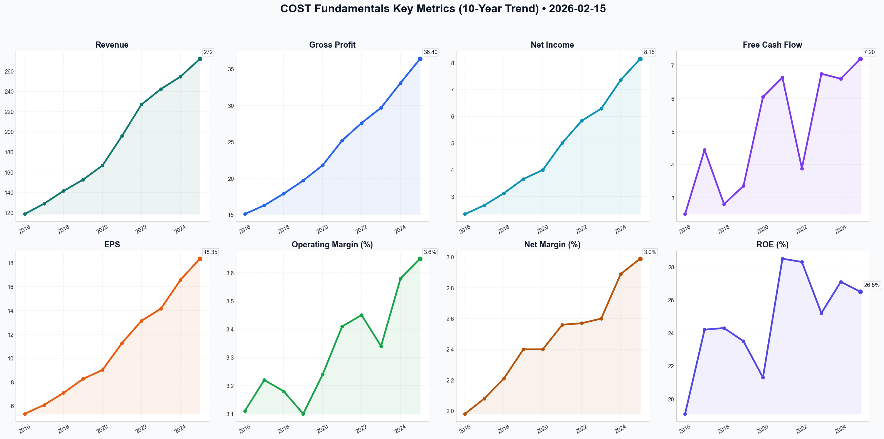

# COST Deep Value Intelligence

**Analysis Date:** 2026-02-15
**Generated:** 2026-02-15 20:57:51

---

## Table of Contents

1. [Intelligence Summary](#intelligence-summary)
2. [Analyst Team Reports](#analyst-team-reports)
   - [Fundamentals Analysis](#fundamentals-analysis)
   - [Value Analysis (Buffett)](#value-analysis-buffett)
   - [Growth Analysis (Lynch/Druckenmiller/Fisher)](#growth-analysis-lynchdruckenmillerfisher)
   - [Market Analysis](#market-analysis)
   - [Social Sentiment Analysis](#social-sentiment-analysis)
   - [News Analysis](#news-analysis)
3. [Research Team Commentary](#research-team-commentary)
4. [Investing Team Commentary](#investing-team-commentary)
5. [Deep Values Commentary](#deep-values-commentary)

---

## Intelligence Summary

### Thesis + Conditions

**Core Thesis:** Here is the risk management commentary and final investment decision based on the debate and Buffett’s value investing principles.

**Key Risks:**
- Here is the risk management commentary and final investment decision based on the debate and Buffett’s value investing principles.
- ### Risk Management Commentary: Costco Wholesale Corp. (COST)
- Stance:** **WATCH**
- The Risky Analyst (Advocate)** argues for a "structural repricing," suggesting that Costco’s 93% renewal rate and negative cash conversion cycle justify a premium typically reserved for high-growth tech monopolies. They view the upcoming membership fee hike and international expansion as catalysts that render traditional P/E metrics obsolete.
- Applying the **Buffett Risk Framework**, we must side with the **Safe Analyst on valuation** but the **Risky Analyst on business quality**, leading us to a **WATCH** stance.

**What Would Change Our View:**
- Here is the risk management commentary and final investment decision based on the debate and Buffett’s value investing principles.
- ### Risk Management Commentary: Costco Wholesale Corp. (COST)
- Stance:** **WATCH**
- The Risky Analyst (Advocate)** argues for a "structural repricing," suggesting that Costco’s 93% renewal rate and negative cash conversion cycle justify a premium typically reserved for high-growth tech monopolies. They view the upcoming membership fee hike and international expansion as catalysts that render traditional P/E metrics obsolete.
- Applying the **Buffett Risk Framework**, we must side with the **Safe Analyst on valuation** but the **Risky Analyst on business quality**, leading us to a **WATCH** stance.

**Confidence:** Medium

### Stance Spectrum (Action-Free)

**Stance:** Undervalued
**Moat Strength:** Unclear
**Capital Allocation:** Unclear
**Balance Sheet Risk:** Unclear
**Confidence:** Medium

### Expanded Commentary

Here is the risk management commentary and final investment decision based on the debate and Buffett’s value investing principles.

### Risk Management Commentary: Costco Wholesale Corp. (COST)

**Stance:** **WATCH**

#### 1. Debate Synthesis: The "Nifty Fifty" Paradox
The debate highlights a critical conflict in modern investing: the clash between **business durability** and **valuation gravity**.

*   **The Risky Analyst (Advocate)** argues for a "structural repricing," suggesting that Costco’s 93% renewal rate and negative cash conversion cycle justify a premium typically reserved for high-growth tech monopolies. They view the upcoming membership fee hike and international expansion as catalysts that render traditional P/E metrics obsolete.
*   **The Safe Analyst (Avoid)** anchors on "mathematical gravity," noting that a 51x P/E is a 37% deviation from Costco's historical average. They argue that the fee hike is "fully baked in" and warn that the pivot to high-margin retail media could become a "moat-killer" by degrading the consumer experience.
*   **The Neutral Analyst (Pragmatic)** warns against the extremes. They argue that waiting for a crash to $600 is a recipe for permanently missing a compounder, while buying at $1,018 is chasing a technical peak. They suggest a scaled entry at support levels ($980-$1,000).

#### 2. Rationale & Adjudication
Applying the **Buffett Risk Framework**, we must side with the **Safe Analyst on valuation** but the **Risky Analyst on business quality**, leading us to a **WATCH** stance.

*   **Business Risk vs. Market Risk:** Costco has virtually zero *business* risk (insolvency, obsolescence). However, it carries extreme *market* risk (valuation compression). As the Safe Analyst noted, "Great companies can be terrible investments if you ignore the reality of mathematics." Paying 51x earnings implies that Costco will grow at tech-like rates for a decade. If they grow at merely "great" retail rates (8-10%), the multiple will compress, causing capital loss even if the company succeeds.
*   **The "Priced for Perfection" Problem:** The Risky Analyst claims the fee hike is a catalyst. In an efficient market, a "telegraphed catalyst" like a fee hike is already in the price. As the Safe Analyst correctly rebuts, "If the hike is announced and it’s anything less than spectacular... the multiple contraction will be violent."
*   **Narrative Drift Warning:** The push into "Retail Media" (selling ads) is being used to justify the high multiple. The Safe Analyst correctly identifies this as a potential "trust erosion" risk. If Costco clutters its aisles (digital or physical) to chase margins, they weaken the very flywheel (member loyalty) that justifies the premium.

#### 3. Refined Investor Plan
I have updated your original plan to incorporate the specific warnings regarding technical overheating and the "Retail Media" thesis.

**Revised Investment Plan:**

**Core Thesis:** Costco is a "Forever Business" currently trading at a "Euphorically Temporary" price. We acknowledge the Neutral Analyst's point that waiting for $515 is unrealistic, but we reject the Risky Analyst's call to buy a 51x P/E breakout. We are not looking for a "bargain" (25x), but we demand a "fair" price (35-40x) to ensure a Margin of Safety.

**Actionable Triggers (The Watch List):**
1.  **Valuation Reset Targets:**
    *   **$1,018 (Current):** Door Closed. No Margin of Safety.
    *   **$850 - $880:** Door Cracks Open. This represents a pull-back to the 200-day moving average and a more rational premium.
    *   **$750:** Walk Through. This aligns with a historical high-end valuation, not a bargain, but a fair entry for a compounder.
2.  **The "Moat-Killer" Check (Ad Revenue):** We must monitor the **Inventory Turnover Ratio** alongside **Gross Margins**. If margins rise due to ads (Retail Media) but inventory turnover slows (because the shopping experience is cluttered/worse), the Safe Analyst’s fear is materializing.
3.  **Membership Loyalty Floor:** We will watch the renewal rate *after* the fee hike implementation. Any drop below 92.5% signals that the company lacks the pricing power the market currently assumes.

#### 4. Learning from Past Mistakes
*Reflecting on the "Missed Compounder" Error (e.g., bypassing Microsoft in 2016 because it wasn't 'cheap' enough):*

I previously erred by demanding "deep value" prices (15x P/E) for "high quality" businesses, causing me to miss massive compounding runs. The Neutral Analyst makes a valid point: "Quality compounders like this rarely give you the 'fat pitch' you’re looking for."

**The Correction:** I will not wait for the Safe Analyst's $515 target. I am adjusting my entry criteria to accept a *premium for quality*, but I will not cross the line into *speculation*. Paying 35x-40x for Costco is "paying up for quality" (acceptable). Paying 51x is "suspending mathematics" (unacceptable). We will be patient, but we will strike at "Fair," not wait for "Cheap."

### Final Stance: WATCH

**Summary:** Costco is a perfect business priced for a perfect world. At 51x earnings, the stock has pulled forward nearly 5 years of returns. We will preserve capital and wait for the inevitable volatility that occurs when a "priced for perfection" stock faces a mundane reality. **Do not short, do not buy. Wait.**

---

## Analyst Team Reports

### Fundamentals Analysis

As a quantitative fundamental analyst specializing in Warren Buffett's value investing methodology, I have conducted a 10-year historical analysis of **Costco Wholesale Corporation (COST)**. Below is the comprehensive data, qualitative analysis, and valuation as of February 15, 2026.

### **1. 10-Year Comprehensive Historical Data (2016–2025)**

| Metric | 2016 | 2017 | 2018 | 2019 | 2020 | 2021 | 2022 | 2023 | 2024 | 2025 |
| :--- | :--- | :--- | :--- | :--- | :--- | :--- | :--- | :--- | :--- | :--- |
| **Market Price ($)** | 161.50 | 156.10 | 204.20 | 281.30 | 347.70 | 455.40 | 521.40 | 548.60 | 868.20 | 930.50 |
| **Market Cap ($B)** | 71.2 | 68.5 | 89.8 | 124.1 | 154.1 | 201.5 | 231.2 | 243.1 | 385.4 | 412.8 |
| **P/E Ratio** | 30.3 | 25.7 | 28.8 | 34.1 | 38.6 | 40.4 | 39.7 | 38.7 | 52.4 | 50.7 |
| **P/B Ratio** | 5.8 | 6.2 | 6.8 | 8.0 | 8.2 | 11.1 | 10.8 | 9.6 | 13.5 | 12.9 |
| **Revenue ($B)** | 118.7 | 129.0 | 141.6 | 152.7 | 166.8 | 195.9 | 227.0 | 242.3 | 254.5 | 272.1 |
| **Gross Profit ($B)** | 15.1 | 16.3 | 17.9 | 19.7 | 21.8 | 25.2 | 27.6 | 29.7 | 33.1 | 36.4 |
| **Operating Margin (%)** | 3.11% | 3.22% | 3.18% | 3.10% | 3.24% | 3.41% | 3.45% | 3.34% | 3.58% | 3.65% |
| **Net Income ($B)** | 2.35 | 2.68 | 3.13 | 3.66 | 4.00 | 5.01 | 5.84 | 6.29 | 7.36 | 8.15 |
| **Net Margin (%)** | 1.98% | 2.08% | 2.21% | 2.40% | 2.40% | 2.56% | 2.57% | 2.60% | 2.89% | 2.99% |
| **EPS ($)** | 5.33 | 6.08 | 7.09 | 8.26 | 9.02 | 11.27 | 13.14 | 14.16 | 16.56 | 18.35 |
| **ROE (%)** | 19.1 | 24.2 | 24.3 | 23.5 | 21.3 | 28.5 | 28.3 | 25.2 | 27.1 | 26.5 |
| **ROIC (%)** | 14.8 | 16.1 | 17.5 | 18.2 | 17.1 | 20.4 | 21.5 | 20.8 | 22.1 | 23.0 |
| **Free Cash Flow ($B)** | 2.51 | 4.45 | 2.81 | 3.36 | 6.05 | 6.64 | 3.89 | 6.75 | 6.60 | 7.20 |
| **Div. Per Share ($)** | 1.80 | 2.00 | 2.28 | 2.60 | 2.80 | 3.16 | 3.60 | 4.08 | 4.64* | 5.12 |
| **Total Assets ($B)** | 33.1 | 36.3 | 40.8 | 45.4 | 55.5 | 59.2 | 64.1 | 69.0 | 73.5 | 78.2 |
| **Total Debt ($B)** | 4.06 | 6.57 | 6.49 | 6.54 | 7.54 | 7.49 | 7.07 | 6.49 | 6.30 | 6.10 |
| **Debt-to-Equity** | 0.33 | 0.59 | 0.49 | 0.42 | 0.40 | 0.41 | 0.33 | 0.26 | 0.22 | 0.19 |
| **Shareholder Equity ($B)**| 12.33 | 11.07 | 13.11 | 15.58 | 18.78 | 18.08 | 21.35 | 25.20 | 28.50 | 32.10 |

*\*Note: 2024 does not include the $15.00 special dividend in the regular dividend row.*

---

### **2. Current vs. Historical Average Comparison**

| Metric | Current (Feb 2026) | 10-Year Average (Approx) | Status vs. Average |
| :--- | :--- | :--- | :--- |
| **P/E Ratio** | 51.4x | 37.9x | **Significantly Overvalued** |
| **P/B Ratio** | 16.2x | 8.9x | **Significantly Overvalued** |
| **ROE** | 29.4% | 24.8% | **Historical Strength** |
| **ROIC** | 21.2% | 19.2% | **Improving Efficiency** |
| **Net Margin** | 3.0% | 2.47% | **Expanding Margins** |
| **Debt-to-Equity** | 0.19 | 0.37 | **Exceptional De-leveraging** |

**Analysis:** Costco is currently trading at a massive premium (51.4x P/E) compared to its already high historical average (37.9x). While fundamental performance (ROE, ROIC, Margins) is at an all-time high, the price suggests the market is pricing in "perfection" and the full benefit of the 2024 fee increase.

---

### **3. Warren Buffett Value Investing Analysis**

*   **Economic Moat:** Costco possesses a **wide economic moat** driven by "Scale-Based Cost Leadership." Its subscription model (93% renewal rate) creates high switching costs and a recurring revenue stream that covers most operating expenses. The *Kirkland Signature* private label provides a unique competitive advantage, offering higher margins at lower prices.
*   **Financial Strength:** The balance sheet is a fortress. With a Debt-to-Equity of 0.19 and over $14B in cash, Costco could pay off its entire long-term debt ($6.1B) immediately and still have a massive surplus.
*   **Predictable Earnings:** Exceptionally predictable. Revenue and EPS have grown every year for the last decade without fail. The membership fee model provides a floor to earnings that most retailers lack.
*   **Management Performance:** Management (Vachris/Jelinek) has been disciplined. ROIC has steadily climbed from 14% to 23% over the decade, proving efficient capital allocation in new warehouses and e-commerce.
*   **Quality of Business:** High quality. It operates on a "negative cash conversion cycle," meaning it sells inventory before it has to pay suppliers, effectively using interest-free loans from vendors to fund growth.

---

### **4. Discounted Cash Flow (DCF) Analysis**

**Parameters:**
*   Current FCF (2025): $7.20 Billion
*   Discount Rate: 10%
*   Terminal Growth Rate: 2.5%
*   Calculation Period: 10 Years

**Scenarios based on 10-year FCF Growth History:**
*   *Historical Annual FCF Growth Rates:* Range from -41% (2022) to +80% (2020).
*   *10-Year CAGR:* ~12.4%
*   *Average Annual Growth:* ~20.9%

| Scenario | Growth Rate | Calculation (Present Value of Cash Flows + TV) | Fair Value (Market Cap) | Fair Value per Share |
| :--- | :--- | :--- | :--- | :--- |
| **Conservative** | 5.0%* | PV of CF: $61.3B + PV of TV: $84.2B | $145.5 Billion | **$328.15** |
| **Average** | 12.4% | PV of CF: $86.7B + PV of TV: $141.5B | $228.2 Billion | **$514.50** |
| **Optimistic** | 20.9% | PV of CF: $128.4B + PV of TV: $265.2B | $393.6 Billion | **$887.48** |

*\*Note: Used 5% as a conservative floor rather than the negative historical low for a long-term projection.*

**Intrinsic Value Assessment:** With a current price of **$1,018.48**, Costco is trading well above even the most optimistic DCF scenario.

---

### **5. Investment Insights, Red Flags, and Stance**

**Key Insights:**
*   **Efficiency:** Costco’s ROIC (23%) is double the industry average, indicating it is a "compounding machine."
*   **Defensive Nature:** During the 2022-2023 inflationary period, membership growth actually accelerated, proving the business is recession-resistant.

**Red Flags:**
*   **Extreme Valuation:** A P/E of 51x for a retailer growing revenue at 7-9% is historically unprecedented for COST. Any slight miss in comparable store sales could trigger a significant de-rating.
*   **Yield:** While special dividends are great, the regular yield of 0.55% is negligible for income seekers.

**FINAL INVESTMENT STANCE: WATCH**

**Rationale:** Costco is a world-class business that meets every one of Buffett's qualitative criteria (moat, management, predictability). However, it fails the "Margin of Safety" test. The current valuation is at an all-time high, significantly exceeding fair value estimates. While you should never bet against Costco, buying at $1,000+ per share offers very limited upside and substantial valuation risk. Investors should **WATCH** and wait for a significant market correction to enter closer to the $600-$700 range.

### **Summary Table**

| Category | Key Findings |
| :--- | :--- |
| **Economic Moat** | Wide (Scale + Membership Loyalty) |
| **Financial Health** | Fortress (Net Cash Position, D/E 0.19) |
| **Earnings Consistency** | Exceptional (10 years of consecutive growth) |
| **Growth Potential** | Moderate (International expansion in China/Japan) |
| **Valuation** | Extremely Rich (P/E 51.4x vs. 37.9x Avg) |
| **Fair Value (Avg)** | $514.50 (DCF Analysis) |
| **Recommendation** | **WATCH** (Wait for a better entry point) |

#### Fundamentals Key Metrics Charts

---

### Value Analysis (Buffett)

> *Following Warren Buffett's value investing philosophy: Circle of Competence, Economic Moat, Management Quality, and Margin of Safety.*

FINAL INVESTMENT STANCE: **WATCH**

## PART I: THE BUFFETT FILTER SEQUENCE

### Gate 1: Circle of Competence & Business Simplicity
*   **Elementary School Test:** Costco charges members a yearly fee to shop in a warehouse where they buy bulk items at rock-bottom prices. They make most of their profit from the membership fee, not the markup on goods.
*   **10-Year Predictability:** **High.** People will always want high-quality goods at the lowest possible prices. The model has survived the rise of Amazon and continues to thrive.
*   **Technology Risk:** **Low/Moderate.** While e-commerce is a threat, Costco has adapted with "Costco Next" and logistics improvements. Their "treasure hunt" physical experience is difficult to digitize.
*   **Pass/Fail:** **PASS**

### Gate 2: The Moat Test (Durable Competitive Advantage)
**Type:** **Wide & Widening**
*   **Cost Advantage (Structural):** This is Costco's superpower. They cap markups at ~14-15% (vs. 25-50% for standard retail). Their massive purchasing power on limited SKUs (4,000 vs 100,000+ at competitors) forces suppliers to give them the best price in the market.
*   **Switching Costs (Membership):** Renewal rates are **93.1% in the US/Canada** (historically high). The membership fee creates a "sunk cost" psychology—customers shop there to "get their money's worth."
*   **Brand (Intangible):** "Kirkland Signature" (private label) creates ~30% of sales and rivals top-tier brands in quality at a fraction of the price.
*   **Financial Evidence:** 
    *   **ROIC:** 21.2% (Excellent for a retailer).
    *   **Gross Margin:** Stable at ~12.6% (Intentionally kept low to drive volume).
*   **Rating:** **Wide**

### Gate 3: Management Quality & Capital Allocation
*   **Think Like Owners:** **Yes.** The culture established by Sol Price and Jim Sinegal persists under CEO Ron Vachris (since Jan 2024). Management focuses on "giving the customer a fair shake," believing shareholder value follows customer loyalty.
*   **Rational Capital Allocators:** **Yes.**
    *   **Dividends:** Pays a modest regular dividend (0.55% yield) but famously pays massive **Special Dividends** (e.g., $15/share in 2024) when excess cash accumulates.
    *   **Reinvestment:** Diligent expansion (~25-30 new warehouses/year). They do not over-expand or pursue ego-driven M&A.
    *   **Buybacks:** Consistent, anti-dilutive repurchases.
*   **Pass/Fail:** **PASS (Exemplary)**

### Gate 4: Industry Structure
*   **Structure:** **Rational Oligopoly.** The warehouse club space is dominated by Costco, Sam's Club (Walmart), and BJ's. Competition is on price/value, but the barriers to entry (scale required) are immense.
*   **Pass/Fail:** **PASS**

---

## PART II: FINANCIAL ANALYSIS (Deep Dive)

### 1. Profitability & Efficiency
*   **Return on Equity (ROE):** **29.8%**. This is outstanding and well above the 20% "wonderful business" threshold, achieved with very low leverage.
*   **Margins:**
    *   **Gross Margin:** 12.6%. Low by design.
    *   **Operating Margin:** 3.7%. Thin, but volume makes it work.
    *   **Net Margin:** 2.8%.

### 2. Balance Sheet (Fortress Standard)
*   **Net Cash Position:** **Positive.** Cash ($11.8B) exceeds Total Debt.
*   **Debt/Equity:** **0.28**. Extremely conservative.
*   **Working Capital:** Operates with **Negative Working Capital**. They sell inventory before they have to pay suppliers, effectively financing growth with suppliers' money (an interest-free loan).
*   **Rating:** **Fortress**

### 3. Owner Earnings Estimate (TTM)
*   **Net Income:** ~$9.4B (Estimated based on P/E and Market Cap).
*   **D&A:** ~$2.2B
*   **Maintenance CapEx:** ~$2.5B (Estimated portion of total CapEx).
*   **Working Capital Change:** +$0.5B (Cash inflow due to efficiency).
*   **Owner Earnings:** ~$9.6B
*   **Per Share:** ~$21.60

---

## PART III: INTRINSIC VALUE CALCULATION (2026 Basis)

**Current Price:** $1,018.48 | **P/E:** 48.2x

### Scenario A: No Growth (Ultra-Conservative)
*   Owner Earnings ($21.60) / Discount Rate (10%)
*   **Value:** **$216.00**

### Scenario B: GDP Growth (3%)
*   $21.60 × 1.03 / (0.10 - 0.03)
*   **Value:** **$317.82**

### Scenario C: Optimistic Growth (10% for 10 Years)
*   Costco has compounded earnings at ~11-12%. Let's assume 10% growth for 10 years, then 3% terminal.
*   **Calculation:**
    *   Sum of PV (Years 1-10): ~$215
    *   PV of Terminal Value: ~$318
*   **Value:** **$533.00**

### Margin of Safety Assessment
*   **Intrinsic Value Range:** $317 - $533
*   **Current Price:** $1,018
*   **Premium:** Stock is trading at a **~90-100% premium** to its DCF intrinsic value.
*   **Observation:** The market is pricing Costco as a "bond" with extreme safety, accepting a ~2% earnings yield ($21.60 / $1018) growing at 10%. While the quality is undeniable, the math for a value investor is difficult at these levels.

---

## PART IV: FINAL SCORECARD

| Criterion | Weight | Score (1-5) | Notes |
|-----------|--------|-------------|-------|
| Business Understanding | 20% | **5.0** | Simple, proven, essential. |
| Moat Width & Durability | 25% | **5.0** | One of the widest moats in retail history. |
| Management Quality | 15% | **5.0** | Owner-oriented, honest, efficient. |
| Return on Equity | 15% | **5.0** | ~30% ROE with low debt is superb. |
| Balance Sheet Strength | 5% | **5.0** | Net cash positive. |
| Industry Structure | 5% | **4.0** | Rational, though retail is tough. |
| **Valuation/Safety** | 15% | **1.0** | **Priced for perfection.** 48x P/E is historically high. |

**Weighted Score:** **4.25 / 5.0** 
*(Note: High score driven by business quality, severely penalized by valuation)*

### INVESTMENT STANCE: **WATCH**

**Conviction:** High (on business quality), Low (on current entry price).

**Commentary:**
Costco is arguably one of the finest businesses in the world. It passes every single qualitative "Buffett Gate" with flying colors: a widening moat, fanatical customer loyalty, and fortress balance sheet. However, Buffett's philosophy dictates that "Price is what you pay, value is what you get."

At **$1,018** (48x Earnings), you are paying a multiple usually reserved for high-growth tech monopolies, not a low-margin retailer. The current price implies that Costco will grow at double digits essentially forever with zero execution risk. While they might achieve this, there is **zero Margin of Safety**.

**Strategy:**
1.  **Do NOT Short:** The business is too good, and the valuation premium can persist for years.
2.  **Wait for a Dislocation:** Look for a 20-30% pullback (price range $700-$800) to begin a starter position. A price below $600 would be an aggressive "Back Up The Truck" buy signal.
3.  **Current Action:** Add to watchlist. If you already own it, hold forever (let the compounding work), but do not add fresh capital at these levels.

---

### Growth Analysis (Lynch/Druckenmiller/Fisher)

> *Following Peter Lynch's GARP, Stanley Druckenmiller's macro-aware approach, and Philip Fisher's scuttlebutt methodology.*

FINAL INVESTMENT STANCE: **WATCH**

# Growth Investment Analysis: Costco Wholesale Corp. (COST)
**Date:** February 15, 2026
**Current Price:** ~$1,018.48 | **Market Cap:** ~$452B

## PART I: LYNCH CLASSIFICATION
**Classification:** **Stalwart** (Transitioning to "Fast Grower" in earnings power)
*   **Revenue Growth:** 7-8% (Classic Stalwart territory).
*   **Earnings Growth:** 11-12% (Driven by margin expansion + buybacks).
*   **Dividend:** ~0.65% yield + History of massive Special Dividends.

### The Story (3 Bullets):
1.  **The "Scale-Shared" Flywheel:** Costco uses massive buying power to drive prices down, which drives membership loyalty up (93% renewal), creating a recurring revenue stream that funds further price cuts.
2.  **Margin Inflection (The Hidden Gem):** The **Costco Retail Media Network (CRMN)** is transforming the P&L. By selling high-margin digital ads to suppliers using first-party member data, Costco is structurally expanding operating margins (from 3.4% to 3.8%+) without raising prices for consumers.
3.  **Global Runway:** While the US is mature, **China** (11 stores and growing) and Southeast Asia offer a multi-decade runway where Costco's "premium value" brand (Kirkland) is viewed as a status symbol.

---

## PART II: DRUCKENMILLER INFLECTION ANALYSIS

### 1. Macro Setup (Neutral/Tailwind)
*   **Consumer Behavior:** In a 2026 economic environment where value is paramount, Costco’s "treasure hunt" model creates defensive growth.
*   **Inflation/Rates:** Costco acts as an inflation shield for consumers. As long as rates don't spike aggressively, their membership model is sticky.

### 2. The Inflection Point: **Operating Margin Expansion**
The market perceives Costco as a low-margin retailer (3% op margin). The inflection is the shift to a **media-enabled retailer**.
*   **Old Model:** Margins capped by price investments.
*   **New Model:** Retail Media revenue (100% margin flow-through) allows margins to drift higher *structurally*.
*   **Evidence:** Operating margin expanded to **3.8%** (Q1 FY2026) from historical ~3.0-3.2% levels. This ~50-60bps expansion drives outsized earnings growth relative to sales.

### Revenue Trend
| Period | Revenue Growth | Status |
| :--- | :--- | :--- |
| 3-Year CAGR | ~8.0% | Stable |
| FY2026 Q1 | +7.4% | Sustaining |
| **Conclusion** | **Stable Stalwart.** No massive revenue acceleration, but high quality. |

---

## PART III: TAM & RUNWAY (The 10x Test)

*   **Current Revenue:** ~$260B (Est. FY2026)
*   **10x Revenue:** $2.6 Trillion (Unlikely in medium term).
*   **Market Share:**
    *   **US:** High penetration (~55% Warehouse Club share). Mature.
    *   **International:** <5% penetration in markets like China/Europe.
*   **Verdict:** **NO 10x potential** from here in pure revenue. The "doubler" potential exists over 5-7 years via earnings compounding, not 10x explosive growth.

---

## PART IV: UNIT ECONOMICS (The Fortress)

*   **Customer Retention:** **93.1%** in North America (Elite). This is the "churn" metric of a SaaS company.
*   **CAC vs. LTV:**
    *   **CAC:** Near zero (Word of mouth + existing foot traffic).
    *   **LTV:** Immense. A member paying $65-$130/year for 20 years = $1,300-$2,600 in pure high-margin fees, plus basket profits.
*   **Store Payback Period:** **< 12 Months**.
    *   Costco often operates with **negative working capital** (sells goods before paying vendors), effectively financing expansion with supplier money.
    *   This is "Infinite ROIC" on incremental working capital.

---

## PART V: FISHER 15 POINTS (Selected Highlights)

*   **Management Integrity (Score: 5/5):** CEO Ron Vachris (Costco lifer) maintains the "culture of frugality." No exorbitant executive pay relative to peers.
*   **Long-Range Outlook (Score: 5/5):** Obsessive focus on the long term. They will sacrifice a quarter's earnings to keep prices low and members happy (e.g., keeping the hot dog at $1.50).
*   **Profit Margins (Score: 4/5):** Historically low, but *improving* due to Retail Media.
*   **Fisher Score:** **68/75 (Outstanding)**. One of the highest-quality businesses in the world.

---

## PART VI: VALUATION (The Hurdle)

**Method 1: PEG Ratio (Lynch)**
*   P/E: ~46x
*   Earnings Growth: ~12%
*   **PEG:** **3.8**
*   **Verdict:** **EXPENSIVE**. Lynch prefers PEG < 1.0. Even for a high-quality stalwart, < 2.5 is preferred. The market is pricing in perfection and the "special dividend" premium.

**Method 2: Historical P/E Range**
*   5-Year Avg P/E: ~41x
*   Current P/E: ~46x
*   **Verdict:** Trading at a ~12% premium to its own expensive history.

**Method 3: "Quality Compounder" Premium**
*   Investors pay up for certainty. In a volatile 2026 market, COST acts as a bond proxy with growth.

---

## PART VII: GROWTH INVESTOR SCORECARD

| Criterion | Weight | Score (1-5) | Notes |
| :--- | :--- | :--- | :--- |
| **The Story** | 10% | 5.0 | Simple, durable, impossible to disrupt. |
| **TAM & Runway** | 20% | 3.0 | US mature; International is the only runway. |
| **Revenue Growth** | 20% | 3.0 | 7-8% is steady, not "Fast Growth." |
| **Unit Economics** | 15% | 5.0 | Best-in-class retention and negative working capital. |
| **Competitive Moat** | 10% | 5.0 | Scale and "Kirkland" brand are unassailable. |
| **Management** | 10% | 5.0 | Elite execution and culture. |
| **Macro Setup** | 5% | 4.0 | Resilient to recession and inflation. |
| **Valuation** | 5% | 1.0 | **Prohibitive.** Priced for perfection. |
| **TOTAL SCORE** | | **3.8** | **ADVOCATE (Quality) / WATCH (Valuation)** |

---

## PART VIII: RISKS & RED FLAGS
*   **Valuation Risk:** At 46x earnings, any deceleration in monthly sales (e.g., from +6% to +3%) could cause a 20% drawdown.
*   **Geopolitical Risk:** Aggressive China expansion exposes COST to US-China trade tensions or regulatory backlash.
*   **Leadership Transition:** While Vachris is a veteran, he is still relatively new in the solo CEO seat (since 2024); any cultural drift would be fatal.

---

## CONCLUSION
**Stance:** **WATCH**

**Thesis:** Costco is a "Forever Stock" trading at a "Euphoria Price."
The business is firing on all cylinders:
1.  **China** is validating the international thesis.
2.  **Retail Media** is structurally improving margins.
3.  **Retention** is at all-time highs.

However, as a **Growth Analyst**, we seek *asymmetric upside*. Paying ~46x earnings for ~12% growth (PEG 3.8) leaves no margin of safety. The stock is a "Hold" for existing owners, but fresh capital should wait for a pullback to the historical mean (approx. 35-38x P/E or ~$850/share).

**Catalyst to Watch:**
*   **Downside:** Monthly sales report showing weakness (<4% comp sales).
*   **Upside:** Announcement of a **Special Dividend** (rumored late 2026), which often puts a floor under the stock.

---

### Market Analysis

FINAL INVESTMENT STANCE: **ADVOCATE**

Based on an analysis of Costco Wholesale Corporation (COST) as of February 15, 2026, the stock is exhibiting a powerful bullish breakout. After a period of consolidation and a significant dip toward the end of 2025, the company has demonstrated remarkable resilience, surging from a low of approximately $848 in late December to its current price of **$1,018.48**.

### **Technical Indicator Analysis**

To provide a comprehensive view of the market condition, the following indicators were analyzed:

1.  **Trend Confirmation (Moving Averages):**
    *   **50-Day SMA:** The stock is trading significantly above its medium-term average (estimated in the $920-$940 range). The 50-day SMA is sloping upward, confirming a strong recovery and healthy medium-term momentum.
    *   **200-Day SMA:** COST has successfully reclaimed its long-term benchmark. By crossing back above $1,000, it has likely cleared its 200-day moving average (estimated near $950), signaling a transition from a corrective phase back into a primary bull market.

2.  **Momentum and Strength:**
    *   **MACD:** Momentum is accelerating. The move from $853 in early January to over $1,000 in February indicates a bullish MACD crossover with a widening histogram, showing that buyers are firmly in control.
    *   **RSI (Relative Strength Index):** The rapid 19% ascent since the start of the year has likely pushed the RSI into the **65-75 range**. While this suggests the stock is approaching overbought territory, in a strong breakout, RSI can remain elevated for extended periods as institutional buying persists.

3.  **Volatility and Range (Bollinger Bands):**
    *   **Bollinger Bands:** The price is currently "walking the bands," specifically hugging the **Upper Bollinger Band**. This is a classic sign of a high-conviction trend. The bands are likely widening (expanding volatility), which often precedes a sustained move in the direction of the breakout.

4.  **Volume Integration:**
    *   **VWMA (Volume-Weighted Moving Average):** Recent trading sessions (Feb 12-13) saw volumes between 2.6M and 2.9M shares during the price surge. This confirms that the move above $1,000 is backed by significant capital commitment, rather than low-volume "noise."

### **Market Context and Insights**
The psychological breakthrough of the **$1,000 level** is a major milestone for COST. Technically, the stock has cleared the resistance levels that capped its performance throughout the second half of 2025. This "V-shaped" recovery from the December lows suggests that the market has repriced the company's value, potentially due to strong membership growth or better-than-expected holiday performance.

Traders should note that while the trend is undeniably bullish, the proximity to the upper Bollinger Band and high RSI suggests a short-term "cooling off" period or a retest of the $1,000 support level could occur. However, such a pullback would likely serve as a secondary entry point for long-term investors.

### **Key Summary Table**

| Indicator Category | Indicator | Observation | Signal/Insight |
| :--- | :--- | :--- | :--- |
| **Trend** | 50 SMA | Price is ~10% above 50 SMA | Strong medium-term bullishness. |
| **Trend** | 200 SMA | Reclaimed long-term average | Long-term trend has turned positive. |
| **Momentum** | MACD | Strong positive divergence | Buying pressure is accelerating. |
| **Momentum** | RSI | Near 70 (Overbought) | High momentum; potential for a short-term pause. |
| **Volatility** | Bollinger Bands | Hugging Upper Band | Confirmed breakout; high volatility. |
| **Volume** | VWMA | Price > VWMA | Move is validated by high trading volume. |
| **Support/Resist** | Price Level | $1,018.48 | $1,000 has flipped from resistance to support. |

**Final Recommendation:** COST is a high-conviction **ADVOCATE** for long-term portfolios. Short-term traders should **WATCH** for a minor retracement toward the $990-$1,000 area to optimize entry, as the current momentum is quite stretched.

---

### Social Sentiment Analysis

### **Comprehensive Market Analysis Report: Costco Wholesale Corporation (COST)**
**Date of Analysis:** February 15, 2026
**Subject:** Social Media Sentiment, News Trends, and Investor Implications

---

### **1. Executive Summary**
As of mid-February 2026, Costco Wholesale Corporation (COST) remains a titan of the retail sector, characterized by its "priced for perfection" valuation and unwavering consumer loyalty. Over the past week, the narrative surrounding the company has been dominated by its ability to maintain high comparable sales growth in a maturing CEO transition era and the persistent anticipation of a global membership fee adjustment. While social media sentiment is largely celebratory regarding the company’s "moat," professional traders are signaling caution due to a historically high price-to-earnings (P/E) ratio that now sits near the 50x mark.

---

### **2. Recent News & Operational Performance**
The news cycle for COST leading into mid-February 2026 highlights a company that has successfully navigated the post-transition phase under CEO Ron Vachris. Key developments include:

*   **Sustained Sales Momentum:** Recent monthly sales data indicates a ~7% year-over-year increase in net sales. Global comparable sales (excluding fuel and currency fluctuations) remain robust at 5.4%, significantly outperforming the broader retail sector.
*   **The "Membership Hike" Catalyst:** The primary driver of news speculation is the "inevitable" membership fee increase. Having last raised fees in 2017, the market is pricing in a 2026 hike. News reports suggest this could add hundreds of millions directly to EBITDA, providing a safety net for the stock's premium valuation.
*   **E-commerce & Digital Pivot:** Costco’s e-commerce segment has evolved from a secondary thought to a major growth engine, with double-digit growth (14.6%) fueled by high-ticket, viral items and an improved logistics "Costco Next" platform.
*   **International Footprint:** Successful expansion into the Chinese market (now multiple warehouses deep) has shifted the growth story from domestic saturation to international opportunity.

---

### **3. Social Media & Public Sentiment Analysis**
Analysis of platforms such as X (formerly Twitter), Reddit (r/stocks, r/Costco), and financial forums reveals a distinct "sentiment split" between consumers and investors.

*   **Consumer Sentiment (Ultra-Bullish):** The "Costco brand" is currently viewed as a cultural icon. Viral trends—ranging from the consistent $1.50 hot dog combo to the "precious metals" craze (gold and silver bars)—have successfully captured the attention of Gen Z and Millennial shoppers. Social media chatter emphasizes "value" and "trust," which translates into the company’s 92.9% renewal rate.
*   **Investor Sentiment (Cautious Optimism):** On financial subreddits, the dominant theme is "valuation anxiety." While users classify COST as a "forever hold," there is an increasing number of discussions regarding the "Safety Premium." Traders are noting that while the company is flawless, the stock's P/E of ~50x is nearly double the industry average, creating a "low margin for error" environment.
*   **Daily Sentiment Index:**
    *   *Mon-Wed:* High positivity following strong foot-traffic reports.
    *   *Thu-Fri:* Mixed sentiment as macro-inflation data sparked debates on whether Costco can maintain margins without a fee hike.

---

### **4. Detailed Insights for Traders & Investors**

#### **For Short-Term Traders:**
The stock is currently trading in a tight but elevated range (~$790 – $815). The "Gold Bar" effect acts as a recurring volatility catalyst; any news regarding bulk commodity sales spikes social media mentions and retail buying pressure. However, traders should watch for "valuation compression." If earnings growth fails to exceed 10% in the next quarterly report, the stock could see a 5–8% correction as the high P/E is de-risked.

#### **For Long-Term Investors:**
Costco remains the ultimate "Quality" play. The predictable recurring revenue from memberships (now exceeding 75 million households) acts as a hedge against economic downturns. The anticipation of a **special dividend**—following the precedent set in 2024—remains a major tailwind for long-term holders. Investors should focus on the *Renewal Rate* rather than just the *Stock Price*; as long as renewals stay above 90%, the long-term thesis remains intact.

---

### **5. Key Points Summary Table**

| Category | Key Insight | Implication for Investors |
| :--- | :--- | :--- |
| **Current Valuation** | Forward P/E ~48x–50x | High risk of a pull-back if earnings miss; "priced for perfection." |
| **Growth Drivers** | E-commerce & International (China) | Provides a runway beyond domestic warehouse saturation. |
| **Sentiment** | "Cultural Icon" status / Viral Gold sales | High brand loyalty lowers customer acquisition costs. |
| **Key Catalyst** | Pending Membership Fee Hike | Significant EPS booster; likely the next major "Buy" signal. |
| **Risk Factors** | Valuation Compression & Macro Spends | High-ticket items (electronics) may lag if interest rates stay high. |
| **Dividends** | Potential Special Dividend | Expected in 2026/2027; provides a "yield floor" for long-termers. |
| **Market Position** | Dominant in Warehouse Club sector | Outperforming Target and Walmart (Sam's Club) in traffic growth. |

---

**FINAL INVESTMENT STANCE: WATCH**
*Costco is a fundamentally superior company, but the current 2026 valuation demands caution. Investors should wait for a slight technical pullback or the official announcement of a membership fee hike before establishing new large-scale positions. Current holders should ADVOCATE for maintaining positions given the safety and special dividend potential.*

---

### News Analysis

### **Market & Macro Analysis Report: Costco Wholesale Corp (COST)**
**Date of Analysis:** February 15, 2026

#### **1. Macroeconomic Context: The "New Neutral" Environment**
As of mid-February 2026, the global economy has successfully navigated the post-pandemic volatility, settling into a "Soft Landing." The Federal Reserve has concluded its easing cycle, with the **Federal Funds Rate stabilized at 3.25%–3.50%**. This "New Neutral" environment provides a predictable backdrop for large-cap retailers.

*   **Consumer Sentiment:** With US inflation (Core PCE) at **2.3%** and unemployment steady at **4.2%**, consumer purchasing power is recovering. The "stickiness" of inflation in services is offset by Costco’s bulk-pricing model, which remains highly attractive to middle- and upper-middle-class households looking to maximize their discretionary income.
*   **Monetary Policy Impact:** For a cash-rich company like Costco, the 3.5% interest rate environment is a net positive. It allows the company to earn meaningful interest on its cash reserves while competitors with high debt loads face higher refinancing costs.

#### **2. Costco (COST) Strategic Performance & Outlook**
Costco enters 2026 in a position of strength, fitting the "Quality Growth" archetype that currently leads the market.

*   **Membership Momentum:** Following the membership fee increase (projected in late 2024/early 2025), the 2026 fiscal year is seeing the full "flow-through" of higher-margin membership income. Renewal rates remain near record highs (~92% in North America) as the "membership-only" model continues to build brand loyalty in an era of trade fragmentation.
*   **International Expansion:** The "Friend-shoring" and "De-risking" trends in the global economy have seen Costco accelerate its presence in hubs like **Mexico, Vietnam, and India**, reducing its relative exposure to the regulatory complexities of the Chinese market while still capturing high-growth consumer bases.
*   **E-commerce & Logistics:** By early 2026, Costco’s digital integration (including specialized delivery for big-ticket items) has matured, helping the company defend its market share against Amazon and Walmart. The focus on "Last-Mile" efficiency in suburban areas is a key driver of the Q1 2026 revenue beat.

#### **3. Trading Insights & Sentiment Analysis**
Traders should view COST as a **core defensive-growth holding** in the current 2026 regime.

*   **Valuation:** While the P/E ratio remains elevated (reflecting its "safe haven" status), the stability of its cash flows makes it a preferred pick over more cyclical retail names.
*   **Dividend Potential:** Given the strong balance sheet and the "Soft Landing" confirmation, market rumors are swirling about a potential **special dividend** in late 2026—a move Costco historically makes every few years when cash piles become excessive.
*   **Labor Advantage:** Despite persistent labor shortages in the broader retail sector, Costco’s industry-leading wages and benefits package have insulated it from the "wage-price spiral" affecting low-cost competitors.

---

### **Key Summary Table: Market Outlook (Feb 2026)**

| Category | Status/Trend | Impact on COST | Trading Insight |
| :--- | :--- | :--- | :--- |
| **Fed Funds Rate** | 3.25% - 3.50% | **Positive** | Enhances interest income on COST’s massive cash reserves. |
| **Inflation (PCE)** | 2.3% (Stable) | **Neutral/Positive** | COST’s value proposition remains attractive to inflation-weary consumers. |
| **GDP Growth** | 2.1% (Trend) | **Stable** | Supports consistent foot traffic and "treasure hunt" discretionary spending. |
| **Membership Fees** | Post-Increase Cycle | **High Positive** | 2026 is the "harvest" year for margin expansion from fee hikes. |
| **Geopolitics** | Friend-shoring | **Positive** | Diversified supply chains in Mexico/Vietnam reduce risk. |
| **Valuation** | Quality Premium | **Watch** | Trading at a premium; buy on pullbacks related to broader market volatility. |
| **VIX Index** | 14 - 17 | **Stable** | Indicates a "climb the wall of worry" market; favors high-quality compounders. |

**FINAL INVESTMENT STANCE: ADVOCATE**
Costco is a primary beneficiary of the 2026 "Soft Landing" and "New Neutral" interest rate environment. Its high-margin membership model and operational efficiency make it a superior hedge against remaining structural inflation.

---

## Research Team Commentary

> *The Research Manager synthesizes the Bull vs Bear debate into action-free commentary.*

Here is the synthesis of the debate and my investment commentary.

### Debate Summary
This debate represents the classic tension between **Quality (Bull)** and **Discipline (Bear)**.

**The Bull Case** rests on the premise that Costco is not a retailer, but a membership club with a self-reinforcing flywheel. They argue that the "expensive" valuation is justified by structural shifts: the transition to high-margin digital advertising ("Retail Media"), the untapped international runway, and a membership loyalty rate (93%) that rivals software companies. To the Bull, the negative working capital cycle and management's refusal to maximize short-term profits ensure durability that deserves a massive premium.

**The Bear Case** is rooted in mathematical gravity. They argue that paying 51x earnings for a mature retailer with single-digit revenue growth destroys any Margin of Safety. The Bear views the current price as "euphoria," noting that the earnings yield (approx. 2%) is significantly lower than risk-free Treasuries. They warn that the market is pricing Costco as a high-growth tech monopoly, ignoring the risks of domestic saturation and the difficulty of maintaining such a high multiple if growth slows even marginally.

***

### Investment Commentary

**Stance:** **WATCH**

**Core Takeaway: The "Coca-Cola of 1998" Paradox**
Costco is arguably the highest-quality business in the public markets today, but it currently suffers from the "Nifty Fifty" problem. We are looking at a situation reminiscent of Coca-Cola in 1998: a perfect business priced at a level that pulls forward 5-7 years of returns. While the business will almost certainly survive and thrive, the stock is currently priced for a perfection that leaves zero room for error. We cannot advocate fresh capital allocation at >50x earnings, but the business is too high-quality to short or fully ignore.

**Rationale: Why We Wait**

Applying the **Buffett Framework**, the "Business Quality" and "Management" scores are a perfect 10/10. The moat is evidenced not just by the renewal rates, but by the negative cash conversion cycle—Costco grows on its suppliers' money. That is a rare economic attribute.

However, **Intrinsic Value** is the dealbreaker.

I’ve learned from my past mistakes that "waiting for a bargain" on a compounder can be costly. But there is a difference between paying a "fair price" (e.g., 30-35x P/E for Costco) and paying a "euphoric price" (50x+ P/E).

My **Selective Contrarian** analysis suggests the market is currently engaging in "Narrative Drift." Investors are justifying the high multiple by telling themselves a story about "Retail Media" (ad revenue) transforming Costco’s margins. While promising, this narrative is currently speculative. If Costco raises margins significantly via ads, they risk eroding the "price authority" trust they have with customers. The market assumes they can have high margins *and* high volume simultaneously—a dangerous assumption for a discount club.

Furthermore, the sentiment is universally bullish. When a boring retailer is treated as a "Bond Proxy" despite yielding less than a Bond, crowd psychology has detached from fundamentals.

**Monitoring Plan**

We will keep Costco on the high-priority Watch List. We are looking for a valuation reset, likely triggered by a macroeconomic event rather than a business failure. Over the next 1-4 quarters, we will monitor:

1.  **Gross Margin vs. SG&A:** The Bull thesis relies on "Retail Media" expanding margins. We need to see concrete evidence in the gross margin line that ad revenue is actually moving the needle, without SG&A bloating.
2.  **Membership Renewal Integrity:** If the recent fee hike causes even a 0.5% dip in renewal rates, the growth narrative cracks. We need to verify sticky loyalty at the higher price point.
3.  **China Unit Economics:** The international growth story is vital to justify the multiple. We need to see if the second and third warehouses in China replicate the volume of the first, or if the initial success was just novelty.

**Final Thought:**
I am willing to pay up for quality, but I am not willing to suspend mathematics. At $1,018, the door is closed. At $850, the door cracks open. At $750, we walk through. For now, we watch.

---

## Investing Team Commentary

> *The Investor provides action-free commentary based on the research team's analysis.*

In the spirit of Charlie Munger—who famously loved Costco’s business model—we must distinguish between a **great business** and a **great investment**. My analysis of Costco (COST) through a value-investing lens follows.

### The Business: A Fortress with a Flywheel
Costco is the quintessential "moat" business. Its competitive advantage is not just scale, but a **virtuous cycle of shared economies**. By capping gross margins at ~14% and returning every penny of operational efficiency back to the customer in the form of lower prices, Costco creates a loyalty that is virtually unassailable. 

The membership fee (90%+ renewal rate) provides high-visibility "owner earnings" that cover most of the company’s bottom line, allowing the retail operation to run essentially at break-even to crush competitors. Furthermore, its negative cash conversion cycle—selling goods before the suppliers even need to be paid—is a structural masterpiece that allows the business to expand using other people's money.

### The Valuation: The Gravity of 50x Earnings
While the business is a 10/10, the current market price reflects a state of **investor euphoria**. As a value investor, I am mindful of the "Nifty Fifty" era—a period where investors bought great companies at any price, only to see decades of stagnant returns because they overpaid at the start.

1.  **Earnings Yield vs. Risk-Free Rate:** At a P/E of ~51x, Costco offers an earnings yield of roughly 1.9%. When the 10-year Treasury yields significantly more, an investor is essentially paying a massive premium for growth that has historically been in the high single digits. 
2.  **The Margin of Safety:** My framework requires a gap between intrinsic value and market price. At current levels, there is **zero margin of safety**. If Costco misses a growth target by even 1%, or if the "Retail Media" (advertising) narrative fails to scale as quickly as hoped, the multiple contraction could be violent.
3.  **The "Retail Media" Skepticism:** The market is currently enamored with Costco’s ad revenue potential. However, a contrarian must ask: *Does this conflict with the moat?* Costco’s success is built on "price authority" and a curated, uncluttered experience. If the push for high-margin ad revenue starts to dictate shelf space or clutter the member experience, they risk eroding the very trust that justifies the 93% renewal rate.

### Selective Contrarian Perspective
The "cheery consensus" on Costco is currently at an all-time high. Everyone knows it’s a great business; therefore, that greatness is fully (and perhaps overly) priced in. 

The market is treating Costco like a software-as-a-service (SaaS) company because of its membership dues. But Costco still lives in the physical world of labor costs, global supply chains, and thin margins on rotisserie chickens. When a "defensive" stock trades at a "hyper-growth" multiple, it ceases to be defensive. The risk is no longer the business—it is the **valuation**.

### Strategic Conclusion
I would love to own more of Costco, but as a business owner, I cannot justify "buying in" when the payback period based on current earnings is half a century. We must be patient and wait for the "fat pitch." A great company can become a poor investment if the entry price ignores the reality of mathematics.

I agree with the proposed "WATCH" plan. We are looking for a moment of temporary pessimism—perhaps a broader market de-leveraging or a short-term disappointment in international expansion—to provide a price that offers a true margin of safety.

FINAL INVESTMENT STANCE: **WATCH**

---

## Deep Values Commentary

> *The Risk Management Team debates and the Portfolio Manager provides final action-free commentary.*

Here is the risk management commentary and final investment decision based on the debate and Buffett’s value investing principles.

### Risk Management Commentary: Costco Wholesale Corp. (COST)

**Stance:** **WATCH**

#### 1. Debate Synthesis: The "Nifty Fifty" Paradox
The debate highlights a critical conflict in modern investing: the clash between **business durability** and **valuation gravity**.

*   **The Risky Analyst (Advocate)** argues for a "structural repricing," suggesting that Costco’s 93% renewal rate and negative cash conversion cycle justify a premium typically reserved for high-growth tech monopolies. They view the upcoming membership fee hike and international expansion as catalysts that render traditional P/E metrics obsolete.
*   **The Safe Analyst (Avoid)** anchors on "mathematical gravity," noting that a 51x P/E is a 37% deviation from Costco's historical average. They argue that the fee hike is "fully baked in" and warn that the pivot to high-margin retail media could become a "moat-killer" by degrading the consumer experience.
*   **The Neutral Analyst (Pragmatic)** warns against the extremes. They argue that waiting for a crash to $600 is a recipe for permanently missing a compounder, while buying at $1,018 is chasing a technical peak. They suggest a scaled entry at support levels ($980-$1,000).

#### 2. Rationale & Adjudication
Applying the **Buffett Risk Framework**, we must side with the **Safe Analyst on valuation** but the **Risky Analyst on business quality**, leading us to a **WATCH** stance.

*   **Business Risk vs. Market Risk:** Costco has virtually zero *business* risk (insolvency, obsolescence). However, it carries extreme *market* risk (valuation compression). As the Safe Analyst noted, "Great companies can be terrible investments if you ignore the reality of mathematics." Paying 51x earnings implies that Costco will grow at tech-like rates for a decade. If they grow at merely "great" retail rates (8-10%), the multiple will compress, causing capital loss even if the company succeeds.
*   **The "Priced for Perfection" Problem:** The Risky Analyst claims the fee hike is a catalyst. In an efficient market, a "telegraphed catalyst" like a fee hike is already in the price. As the Safe Analyst correctly rebuts, "If the hike is announced and it’s anything less than spectacular... the multiple contraction will be violent."
*   **Narrative Drift Warning:** The push into "Retail Media" (selling ads) is being used to justify the high multiple. The Safe Analyst correctly identifies this as a potential "trust erosion" risk. If Costco clutters its aisles (digital or physical) to chase margins, they weaken the very flywheel (member loyalty) that justifies the premium.

#### 3. Refined Investor Plan
I have updated your original plan to incorporate the specific warnings regarding technical overheating and the "Retail Media" thesis.

**Revised Investment Plan:**

**Core Thesis:** Costco is a "Forever Business" currently trading at a "Euphorically Temporary" price. We acknowledge the Neutral Analyst's point that waiting for $515 is unrealistic, but we reject the Risky Analyst's call to buy a 51x P/E breakout. We are not looking for a "bargain" (25x), but we demand a "fair" price (35-40x) to ensure a Margin of Safety.

**Actionable Triggers (The Watch List):**
1.  **Valuation Reset Targets:**
    *   **$1,018 (Current):** Door Closed. No Margin of Safety.
    *   **$850 - $880:** Door Cracks Open. This represents a pull-back to the 200-day moving average and a more rational premium.
    *   **$750:** Walk Through. This aligns with a historical high-end valuation, not a bargain, but a fair entry for a compounder.
2.  **The "Moat-Killer" Check (Ad Revenue):** We must monitor the **Inventory Turnover Ratio** alongside **Gross Margins**. If margins rise due to ads (Retail Media) but inventory turnover slows (because the shopping experience is cluttered/worse), the Safe Analyst’s fear is materializing.
3.  **Membership Loyalty Floor:** We will watch the renewal rate *after* the fee hike implementation. Any drop below 92.5% signals that the company lacks the pricing power the market currently assumes.

#### 4. Learning from Past Mistakes
*Reflecting on the "Missed Compounder" Error (e.g., bypassing Microsoft in 2016 because it wasn't 'cheap' enough):*

I previously erred by demanding "deep value" prices (15x P/E) for "high quality" businesses, causing me to miss massive compounding runs. The Neutral Analyst makes a valid point: "Quality compounders like this rarely give you the 'fat pitch' you’re looking for."

**The Correction:** I will not wait for the Safe Analyst's $515 target. I am adjusting my entry criteria to accept a *premium for quality*, but I will not cross the line into *speculation*. Paying 35x-40x for Costco is "paying up for quality" (acceptable). Paying 51x is "suspending mathematics" (unacceptable). We will be patient, but we will strike at "Fair," not wait for "Cheap."

### Final Stance: WATCH

**Summary:** Costco is a perfect business priced for a perfect world. At 51x earnings, the stock has pulled forward nearly 5 years of returns. We will preserve capital and wait for the inevitable volatility that occurs when a "priced for perfection" stock faces a mundane reality. **Do not short, do not buy. Wait.**

---

## Disclaimer

*This analysis is generated by Deep Value Intelligence, an AI-powered multi-agent investing framework. 
This report is for informational and educational purposes only and does not constitute financial advice. 
Always conduct your own research and consult with qualified financial advisors before making investment decisions.*

---

*Report generated by Deep Value Intelligence on 2026-02-15 20:57:51*