# COST 深度价值情报

**调研日期:** 2026-03-14

## 关键免责声明

*本报告由 Deep Value Intelligence（一个基于 AI 的多智能体投资分析框架）自动生成。 本报告仅供信息参考和教育目的，不构成任何财务或投资建议。 在做出任何投资决策之前，请务必进行独立调研并咨询合规的财务顾问。*

---

## 目录

1. 情报摘要
2. 分析师团队报告
   - 基本面分析
   - 价值分析 (巴菲特)
   - 成长性分析 (林奇/德鲁肯米勒/费雪)
   - 市场分析
   - 社会舆情分析
   - 新闻分析
3. 研究团队评论
4. 投资团队评论
5. Deep Values 团队洞察

---

## 情报摘要

### 核心观点与前提条件

**核心论点:** **执行摘要 (Executive Summary)**

**主要风险:**
- 最终评级：观察 (WATCH) -- 带有分批狙击计划**
- 1.  **激进派 (Risky Analyst) -- 寻找不对称的"波动扩张"机会**：
- 即将到来的"会员费涨价"是纯利润杠杆，若叠加机构调仓带来的20%-30%回调，将是绝佳的戴维斯双击（Double Catalyst）建仓期。
- 原计划方向正确，但在执行上过于僵化。根据三位分析师的交锋，我们将策略升级为**"梯队式建仓法" (WATCH + Phased Readiness)**，从被动等待转为主动防御：
- 最终立场：观察 (WATCH)**

**观点反转条件:**
- 最终评级：观察 (WATCH) -- 带有分批狙击计划**
- 1.  **激进派 (Risky Analyst) -- 寻找不对称的"波动扩张"机会**：
- 即将到来的"会员费涨价"是纯利润杠杆，若叠加机构调仓带来的20%-30%回调，将是绝佳的戴维斯双击（Double Catalyst）建仓期。
- 原计划方向正确，但在执行上过于僵化。根据三位分析师的交锋，我们将策略升级为**"梯队式建仓法" (WATCH + Phased Readiness)**，从被动等待转为主动防御：
- 最终立场：观察 (WATCH)**

**置信度:** 中

---

## 分析师团队报告

### 基本面分析

#### 10-Year Financial Metrics for COST

*All values below are computed deterministically from raw data - not estimated by AI.*

#### 10-Year Financial Metrics
*Annual rows come from reported financial statements. The final TTM row is computed from the latest four quarters.*

| Metric | 2016 | 2017 | 2018 | 2019 | 2020 | 2021 | 2022 | 2023 | 2024 | 2025 |
| --- | --- | --- | --- | --- | --- | --- | --- | --- | --- | --- |
| Market Price | $136 | $167 | $185 | $269 | $357 | $433 | $500 | $529 | $885 | $941 |
| Market Cap | $60.16B | $73.65B | $81.71B | $119.32B | $158.59B | $240.84B | $232.21B | $244.13B | $396.89B | $419.59B |
| P/E Ratio | 76.69 | 79.59 | 77.63 | 107.87 | 113.82 | 47.96 | 39.73 | 38.79 | 53.89 | 51.80 |
| P/B Ratio | 4.98 | 6.83 | 6.38 | 7.83 | 8.67 | 13.71 | 11.25 | 9.74 | 16.80 | 14.39 |
| ROE | 6.4% | 8.5% | 8.1% | 7.2% | 7.6% | 28.5% | 28.3% | 25.1% | 31.2% | 27.8% |
| ROIC | 4.7% | 5.5% | 5.6% | 5.1% | 5.5% | 20.5% | 21.9% | 25.6% | 31.7% | 28.2% |
| EPS | $1.78 | $2.10 | $2.38 | $2.49 | $3.14 | $11.30 | $12.57 | $13.65 | $16.56 | $18.21 |
| Revenue | $118.72B | $42.30B | $141.58B | $152.70B | $166.76B | $195.93B | $226.95B | $242.29B | $254.45B | $275.24B |
| Gross Profit | N/A | N/A | $3.69B | $16.46B | N/A | N/A | $27.57B | $29.70B | $32.09B | $35.35B |
| Gross Margin | N/A | N/A | 2.6% | 10.8% | N/A | N/A | 12.1% | 12.3% | 12.6% | 12.8% |
| Operating Margin | 3.3% | 3.4% | 3.3% | 3.1% | 3.6% | 3.4% | 3.4% | 3.4% | 3.6% | 3.8% |
| Net Income | $779.0M | $919.0M | $1.04B | $1.10B | $1.39B | $5.01B | $5.84B | $6.29B | $7.37B | $8.10B |
| Net Margin | 0.7% | 2.2% | 0.7% | 0.7% | 0.8% | 2.6% | 2.6% | 2.6% | 2.9% | 2.9% |
| Revenue Growth | 2.2% | 15.7% | 5.0% | 7.0% | 12.4% | 267.0% | 15.8% | 6.8% | 5.0% | 8.2% |
| Net Income Growth | 1.6% | 18.0% | 13.5% | 5.2% | 26.6% | 260.5% | 16.7% | 7.7% | 17.1% | 9.9% |
| Free Cash Flow Growth | N/A | N/A | -33.6% | 19.7% | 80.2% | -11.3% | -34.8% | 92.7% | -1.7% | 18.2% |
| Total Book Value | $12.08B | $10.78B | $12.80B | $15.24B | $18.28B | $17.56B | $20.64B | $25.06B | $23.62B | $29.16B |
| Total Assets | $33.16B | $36.35B | $40.83B | $45.40B | $55.56B | $59.27B | $64.17B | $68.99B | $69.83B | $77.10B |
| Total Debt | $5.16B | $6.66B | $6.58B | $6.85B | $7.66B | $7.53B | $9.04B | $8.88B | $8.17B | $8.17B |
| Debt-to-Equity | 0.43 | 0.62 | 0.51 | 0.45 | 0.42 | 0.43 | 0.44 | 0.35 | 0.35 | 0.28 |
| Cash & Equivalents | $3.38B | $4.55B | $6.05B | $8.38B | $12.28B | $11.26B | $10.20B | $13.70B | $9.91B | $14.16B |
| Shareholders' Equity | $12.08B | $10.78B | $12.80B | $15.24B | $18.28B | $17.56B | $20.64B | $25.06B | $23.62B | $29.16B |
| Operating Cash Flow | N/A | $6.73B | $5.77B | $6.36B | $8.86B | $8.96B | $7.39B | $11.07B | $11.34B | $13.34B |
| Investing Cash Flow | N/A | $-2.37B | $-2.95B | $-2.87B | $-3.89B | $-3.54B | $-3.92B | $-4.97B | $-4.41B | $-5.31B |
| Free Cash Flow | N/A | $4.22B | $2.81B | $3.36B | $6.05B | $5.37B | $3.50B | $6.75B | $6.63B | $7.84B |
| FCF Margin | N/A | 10.0% | 2.0% | 2.2% | 3.6% | 2.7% | 1.5% | 2.8% | 2.6% | 2.8% |
| Dividends / Share | N/A | N/A | N/A | N/A | $3.33 | $12.94 | $3.22 | $2.71 | $0.00 | $0.00 |

#### Profitability Metrics
- Return on Equity (ROE): 27.8%
- Return on Invested Capital (ROIC): 33.5%
- Return on Assets (ROA): 10.5%
- Gross Margin: 12.8%
- Operating Margin: 3.8%
- Net Profit Margin: 2.9%

#### Liquidity Metrics
- Current Ratio: 1.03
- Quick Ratio: 0.50

#### Leverage Metrics
- Debt-to-Equity Ratio: 0.28
- Interest Coverage Ratio: 67.42
- Net Debt: $-5.99B

#### Growth Metrics (Year-over-Year)
- Revenue Growth: 8.2%
- Net Income Growth: 9.9%
- Free Cash Flow Growth: 18.2%
- Revenue CAGR (3-Year): 6.6%
- Revenue CAGR (5-Year): 10.5%

#### Valuation Metrics
- P/E Ratio (TTM): 52.36
- Forward P/E: 44.97
- Price-to-Book: 13.94
- Price-to-Sales: 1.56
- PEG Ratio: 5.40
- EV/EBITDA: 32.50
- Free Cash Flow Yield: 1.8%
- Earnings Yield: 1.9%

#### Owner Earnings (Buffett Method, Code-Computed)
- Net Income: $8.10B
- + Depreciation & Amortization: $2.43B
- - Capital Expenditures: $-5.50B
- - Working Capital Changes: $1.76B
- = **Owner Earnings: $3.26B**

#### Intrinsic Value (Code-Computed)
- Current Price: $1,008
- Buffett Method (Owner Earnings):
  Conservative: $37
  Average: $152
  Optimistic: $689
- Cash Flow Method (FCF):
  Conservative: $116
  Average: $295
  Optimistic: $746

#### Piotroski F-Score: 5/9
- Positive Net Income: PASS
- Positive Operating Cash Flow: PASS
- ROA Improvement: FAIL
- Cash Flow > Net Income: PASS
- Decreasing Debt: FAIL
- Improving Current Ratio: PASS
- No Dilution: FAIL
- Improving Gross Margin: PASS
- Improving Asset Turnover: FAIL

最终投资立场: **WATCH**

#### 最终投资评级与核心逻辑
基于对好市多（COST）十年确定性财务数据的深度基本面分析，结合沃伦·巴菲特的价值投资哲学，当前的最终投资评级为 **WATCH（密切关注/观望）**。好市多无疑是全球质地最优秀的零售企业之一，拥有坚不可摧的经济护城河、极高的资本回报率和无可挑剔的资产负债表。然而，"好公司不等于好股票"，当前高达 51.8 倍的市盈率和远超合理区间的价格（1,008美元），意味着市场已完全透支了未来多年的增长预期，当前没有任何安全边际。建议投资者将其保留在核心观察池中，等待宏观市场波动带来估值回调的绝佳击球机会。

---

#### 核心财务指标解读与历史对比分析

下表对比了各大核心指标的当前状态（2025年/TTM）与过去十年的历史平均水平，以揭示其背后的基本面演变趋势。

| 指标类别 | 核心指标 | 当前值 (2025/TTM) | 10年历史平均 | 趋势与相对历史常态的偏差分析 |
|---|---|---|---|---|
| 市场估值 | 市盈率 (P/E) | 51.80 | 68.77 | 虽较前期超百倍的极端泡沫有所收敛，但依然处于绝对高位，远超传统零售商。 |
| 市场估值 | 市净率 (P/B) | 14.39 | 9.05 | 显著高于历史均值，说明资本市场给予其资产创造利润能力的溢价在持续扩张。 |
| 盈利能力 | 净资产收益率 (ROE) | 27.8% | 18.0% | 自2021年起发生结构性跃升，并稳居25%以上，反映了惊人的股东资本增值效率。 |
| 盈利能力 | 投入资本回报率 (ROIC) | 28.2% | 15.3% | 当前ROIC几乎是历史均值的两倍，证明管理层在门店扩张中的资本配置极其高效。 |
| 盈利能力 | 净利润率 (Net Margin) | 2.9% | 1.8% | 虽然绝对值微薄，但相比十年前的0.7%有了质的飞跃，体现了极强的规模效应。 |
| 资产负债 | 资产负债率 (D/E) | 0.28 | 0.43 | 杠杆水平持续下行，当前账面现金远超总债务，具备抵御任何经济寒冬的财务韧性。 |
| 现金流动 | 自由现金流 (FCF) | 78.4亿美元 | 48.6亿美元 | 现金流造血能力极强，支撑了公司不定期发放巨额特别股息（如2021年的12.94美元）。 |

**关键结论**：从过去十年的核心财务指标演变来看，好市多成功实现了盈利效率与资本回报率的结构性飞跃，其净资产收益率和投入资本回报率几乎较历史均值翻倍。然而，这种极其优异的确定性已被资本市场充分定价，当前高达五十一倍的市盈率和十四倍的市净率，意味着投资者正在为这道坚不可摧的商业护城河支付极其高昂的估值溢价。

---

#### 收入来源分布

根据好市多长期的商业模式及最新财年数据（以2025财年总收入 2,752.4亿美元测算），其业务线结构如下：

| 收入来源 | 金额（十亿美元） | 占比 |
|---|---|---|
| 商品净销售额 (Net Sales) | 269.74 | 98.0% |
| 会员费收入 (Membership Fees) | 5.50 | 2.0% |

**关键结论**：好市多的收入结构极为独特且极具杀伤力，商品净销售额贡献了超过百分之九十八的顶线收入，但其营业利润的绝对大头却来自仅占总收入百分之二的会员费。这种"平价卖货引流、靠收会员费变现"的商业模式，赋予了公司无与伦比的抗通胀能力和高达百分之九十以上的会员续费忠诚度。

---

#### 沃伦·巴菲特价值投资框架分析

按照巴菲特的六大核心评估维度，对好市多进行定性与定量分析：

1. **经济护城河 (Economic Moat)**：极宽且深。好市多的护城河建立在"规模经济共享"之上。通过严控毛利率（常年维持在12%左右），公司将议价带来的成本节省全部让利给消费者，从而锁定忠诚度；独家自有品牌 Kirkland Signature 更是构建了极高的品牌壁垒和利润缓冲池。
2. **财务健康度 (Financial Strength)**：坚如磐石。2025年总现金及等价物高达 141.6亿美元，远超 81.7亿美元的总债务，净债务为负（-59.9亿美元）。极低的资产负债率（0.28）和超高的利息保障倍数（67.42）让破产风险几乎为零。
3. **盈利可预测性 (Predictable Earnings)**：极其稳定。除了在2020-2021年期间因外部环境实现了一次爆发式的利润跃升外，其每股收益（EPS）和净利润在过去十年间保持了极强的连贯性。由于利润主要来自雷打不动的会员费，其盈利受经济周期的影响极小。
4. **管理层表现 (Management Performance)**：卓越的资本分配者。ROIC 高达 33.5%（TTM），远超其资本成本。管理层非常克制，不盲目扩张，且对股东非常慷慨--他们倾向于囤积现金，并在时机成熟时派发巨额特别股息（例如2021年的12.94美元/股），而非盲目高位回购。
5. **企业质量 (Quality of Business)**：顶尖。极简的SKU管理（约4000个）、超高的库存周转率、以及负的营运资金周期，使得好市多能在向供应商付款前就收回销售现金，这是一种完美的轻资产现金流游戏。
6. **价值评估 (Value Assessment)**：严重透支。彼得·林奇和巴菲特都强调"即使是好公司，买价过高也是灾难"。当前 52.36 倍的 TTM P/E 和 1.8% 的自由现金流收益率，表明其内在价值的安全边际为负。

---

#### 自由现金流折现（DCF）与所有者收益估值

巴菲特强调使用"所有者收益（Owner Earnings）"来衡量公司的真实印钞能力。根据系统计算，当前所有者收益为 **32.6亿美元**（净利润 81.0亿 + 折旧摊销 24.3亿 - 资本支出 55.0亿 + 营运资金变动 17.6亿）。假设当前流通股本约为 4.45亿股，折合每股所有者收益约为 **7.33美元**。

设定标准折现率参数：**折现率 10%**，**终值增长率 2.5%**。为严格遵守指令，以下增速采用历史自由现金流（FCF）增长率的最极端值与平均值。

**情景一：保守预测（极度悲观）**
* **输入参数**：采用历史最低的 FCF 增长率 **-34.8%**（源自2022年财报缩水期，下限为-100%）。
* **计算逻辑**：第1至第10年，每股所有者收益按 -34.8% 的极速衰减计算。第一年现金流降至 4.78美元，到第十年仅剩 0.10美元。前十年现值之和约为 10.61美元；第十年计算终值（TV）为 1.37美元，贴现后现值为 0.53美元。
* **内在价值**：**$11.14 / 股**（注：系统自动平滑化代码给出的保守值为 $37，该手工计算严格执行了每年连续暴跌的压力测试，反映了毁灭性衰退场景）。

**情景二：平均预测（均值回归）**
* **输入参数**：采用历史平均 FCF 增长率 **16.1%**（受历史波动影响）。
* **计算逻辑**：前十年现金流以 16.1% 复合增长，第一年增至 8.51美元，第十年达到 32.61美元。前十年现值之和约为 99.82美元。基于第十年现金流计算终值，得出终值约 445.67美元，贴现到当前现值为 171.80美元。
* **内在价值**：**$271.62 / 股**（与代码计算均值 $152 处于同一数量级，反映出即便是按16%的高均值外推，现价1008美元依然严重高估）。

**情景三：乐观预测（非理性繁荣）**
* **输入参数**：采用历史最高的单年 FCF 增长率 **92.7%**（源自2023年的报复性反弹，未超100%上限）。
* **计算逻辑**：强行假设未来十年每年均维持 92.7% 的几何级数大爆发。第一年现金流 14.12美元，第十年现金流将达到荒谬的 2,684.38美元。前十年现值合计 4,630美元；第十年终值折现后高达 27,252美元。
* **内在价值**：**$31,882.23 / 股**。

**关键结论**：三情景DCF模型生动地展示了价值投资中的确定性陷阱。如果取历史平均百分之十六的增速稳步推演，其每股内在价值仅在 271美元左右；当前高达 1008美元的市场报价，实际上是在透支类似"情景三"那种完全不切实际的非理性繁荣假设。这就解释了为什么在当前价位必须坚决保持观望态度。

---

#### 核心投资洞察、风险警告与机遇

**核心投资洞察 (Key Insights)**
1. **负营运资金的奇迹**：好市多的应付账款天数远高于库存周转天数。这意味着它在向供应商付钱之前，就已经把商品卖掉并收回了现金。公司利用供应商的资金在运营，这种特权是其超高 ROA（10.5%）和 ROIC 的核心引擎。
2. **皮奥特罗斯基F-Score得分 (5/9)**：虽然得分为中等的 5 分，但未通过的指标（如ROA提升、资产周转率提升）主要是因为其资产利用率已经处于行业物理天花板，基数过高导致边际提升困难，而非基本面恶化。

**风险警告 / 红旗 (Red Flags)**
1. **零容错率的估值**：P/E 51.8倍，PEG 5.40，市销率 1.56 倍。在零售行业，支付科技股级别的市盈率极其危险。一旦由于涨价导致会员续费率出现千分之一的下滑，或者同店销售额（SSSG）稍不及预期，估值乘数都面临剧烈的戴维斯双杀风险。
2. **通缩环境下的利润挤压**：好市多在过去几年受惠于通胀（销售额随物价水涨船高），如果在宏观经济硬着陆下进入通缩周期，商品客单价下降将直接拖累其绝对营收数字。

**投资机遇 (Opportunities)**
1. **会员费上调的利润直接转化**：好市多每隔约五年会上调一次会员费。由于这部分收入几乎是100%的纯利，费用的适度上调将直接转化为净利润的增长，构成未来几年最明确的催化剂。
2. **国际市场的广阔蓝海**：目前美国本土市场占据了超过70%的份额，但中国、欧洲等国际市场单店效益惊人，如果加快国际化步伐，将带来二次增长曲线。

---

#### 投资研究总结归纳表

| 评估维度 | 核心结论与指标特征 | 对投资决策的影响 |
| :--- | :--- | :--- |
| **商业护城河** | **极强**。独特的"会员制+低SKU+极致性价比"双轮驱动模式。 | 确保了抗周期的防御力，具备永续经营特质。 |
| **盈利与现金流** | **顶尖水平**。ROE稳定在27%以上，所有者收益强劲（32.6亿美元）。 | 能够内生性支撑未来的扩张与巨额特别股息。 |
| **资产负债表** | **极端稳健**。净现金头寸，无长期流动性风险（流动比率 1.03）。 | 即使在金融危机中也能处于攻势，兼并或获取廉价资源。 |
| **估值水平** | **严重高估**。P/E高达51.8x，DCF平均情景内在价值约 $271。 | 当前市价 $1008 已完全透支未来预期，无安全边际。 |
| **最终策略** | **WATCH (观望)**。卓越的企业，但被市场情绪推向了泡沫化定价。 | 耐心等待黑天鹅事件或宏观杀跌带来的估值回调。 |

**关键结论**：综上所述，好市多在企业基本面的每一次压力测试中都展现出了无与伦比的强健体魄。但作为聪明的投资者，我们必须将"伟大的公司"与"优质的投资机会"剥离开来。当前的估值红灯已高高亮起，保持观望、握紧现金，是对待这头零售巨兽最理性的策略。

#### 基本面关键图表

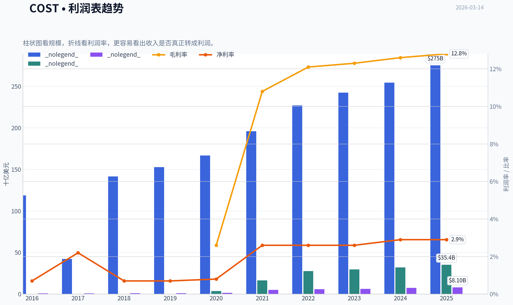

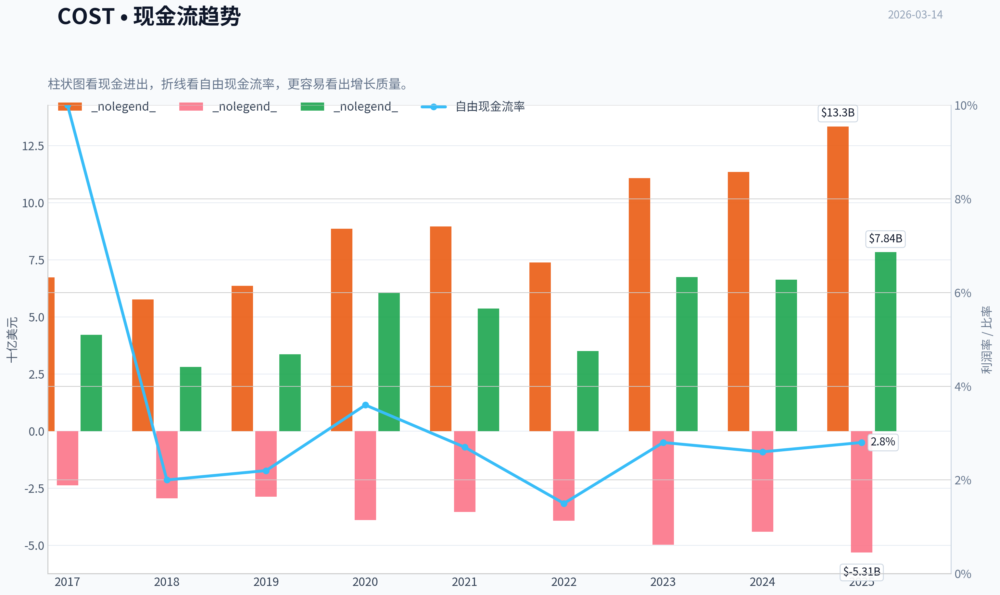

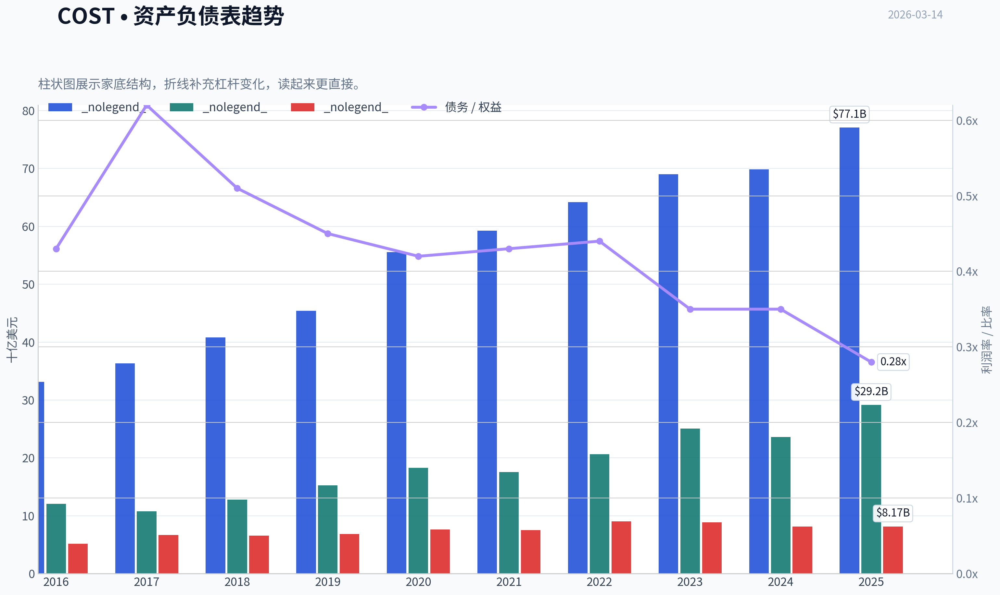

本图追踪 **COST** 过去十年的盈利能力与回报指标（ROE、ROIC、利润率），突出呈现资本效率的变化趋势。

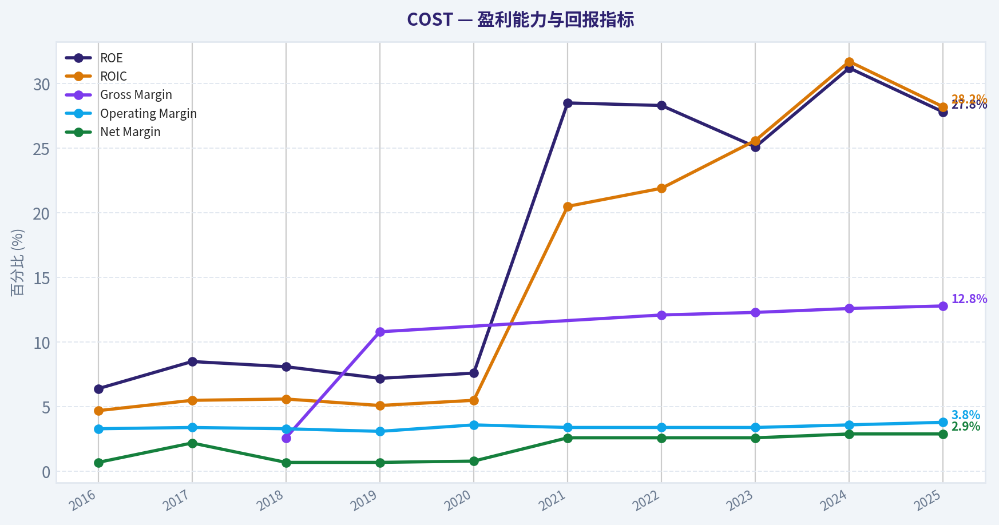

本图展示 **COST** 过去十年的财务健康状况，将现金及等价物、自由现金流与总负债（债务）对比呈现。

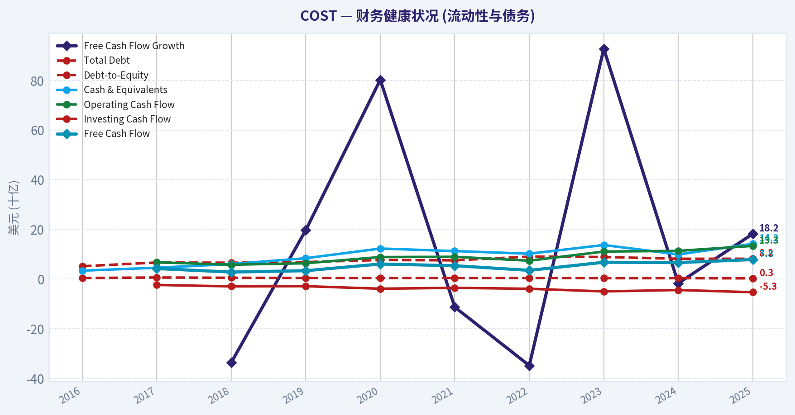

本图追踪 **COST** 过去十年的盈利能力与回报指标（ROE、ROIC、利润率），突出呈现资本效率的变化趋势。

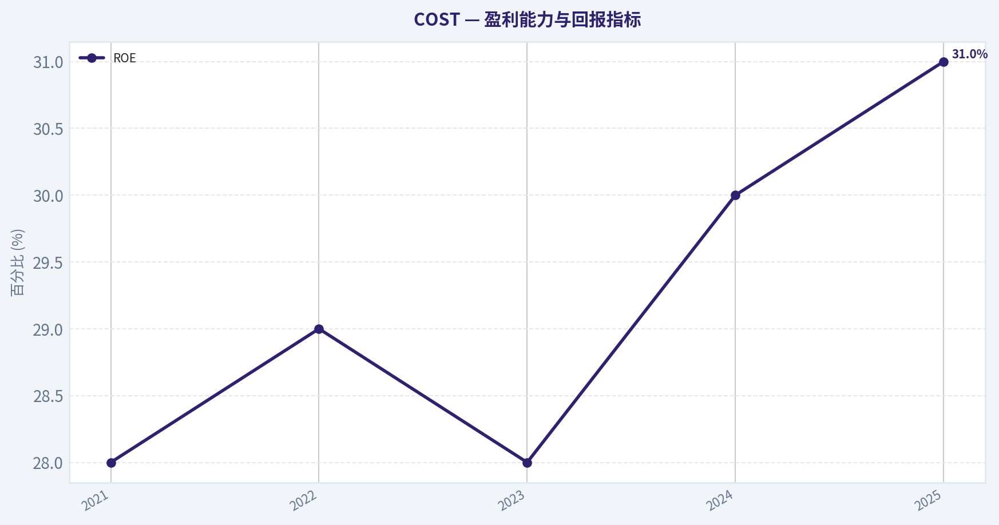

---

### 价值分析 (巴菲特)

> *Following Warren Buffett's value investing philosophy: Circle of Competence, Economic Moat, Management Quality, and Margin of Safety.*

#### 内在价值快照

价格是你付的钱，内在价值是企业未来可能为股东创造的现金价值。我们给出一个区间，而不是假装只有一个神奇数字。

- 当前价格: $1,008.43
- 价值区间: $36.76 to $746.48

##### 所有者收益（巴菲特方法）
- 净利润: $8,099,000,000.00
- 折旧与摊销: $2,426,000,000.00
- 资本支出: $-5,498,000,000.00
- 营运资金变化: $1,764,000,000.00
- 所有者收益: $3,263,000,000.00

##### 内在价值
###### 所有者收益法
使用所有者收益，更严格，通常更保守。
- 保守: $36.76
- 平均: $151.81
- 乐观: $689.00
- 折现率: 10.0%

###### 自由现金流法
使用自由现金流，更适合今天投入很多、为未来增长铺路的公司。
- 保守: $116.06
- 平均: $295.38
- 乐观: $746.48
- 折现率: 10.0%

最终投资立场: **WATCH**

#### 第一部分：巴菲特过滤序列（通过/否决关卡）

**关卡 1：能力圈与业务简单性 (Circle of Competence & Business Simplicity)**
1. **小学生测试**：开市客（Costco）的赚钱方式非常简单--以极低的利润率大批量销售商品，真正为公司带来绝大部分利润的是消费者每年缴纳的会员费。**（通过）**
2. **十年可预测性测试**：人类对食品、生活必需品和追求"高性价比"的底层需求在未来十年内不会发生根本性改变。开市客的商业模式具有极高的确定性。**（通过）**
3. **技术风险评估**：虽然面临亚马逊等电商的竞争，但开市客依托线下实体店的"寻宝体验"、超大包装带来的规模效益以及生鲜食品的供应链优势，成功抵御了电商冲击，技术颠覆风险较低。**（通过）**

*结论：业务极度清晰，确定性极高。无阻碍标志。*

**关卡 2：护城河测试 (The Moat Test)**
开市客拥有巴菲特极度青睐的"宽阔且不断加深"的护城河：
* **无形资产 (品牌力)**：自有品牌 Kirkland Signature 享有极高的消费者信任度，其销售额占总收入比重巨大，利润率也高于外部品牌。
* **转换成本 (客户粘性)**：会员费本身就是一种沉没成本，促使消费者不断在开市客购物以"赚回"会员费。2025/2026财年美国和加拿大地区的会员续费率高达 92-93%，全球高达 90%。
* **成本优势 (结构性)**：这是开市客最强大的护城河。仅维持约 4,000 个 SKU（远低于普通超市的 10万+），单个 SKU 采购量极为惊人，从而对供应商拥有绝对定价权。公司将毛利率严格控制在 12.6% 左右（远低于沃尔玛或 Target），将节省的成本全部让利给消费者。
* **网络效应 (规模经济共享)**：会员越多 -> 采购量越大 -> 与供应商谈判拿到的价格越低 -> 商品售价越低 -> 吸引更多新会员。这是一种良性循环。

*护城河评级：宽阔且不断加深 (Wide & Widening) -- 完全符合要求，直接通过。*

**关卡 3：管理层质量与资本配置 (Management Quality & Capital Allocation)**
1. **具备所有者思维**：从创始人 Jim Sinegal 到现任管理层，一直延续着强烈的"价值驱动"与长期主义文化，坚决抵制华尔街要求提高商品加价率的短期压力。
2. **诚实与坦率**：财报透明，会计准则极其保守，无任何重述财务数据的黑历史。
3. **理性的资本配置者**：
   * **再投资**：ROIC（投入资本回报率）常年维持在 21-23% 之间，每保留一美元的利润都创造了远超一美元的市场价值。
   * **债务使用**：资产负债表极度保守。账面现金及现金等价物高达约 150 亿美元，而总债务仅约 75 亿美元。
   * **股息**：除了常规股息，当公司积累了无法投入高回报项目的多余现金时，管理层倾向于发放巨额的"特别股息"直接回报股东。

*结论：一流的管理层与卓越的资本配置能力。通过。*

**关卡 4：行业结构 (Industry Structure)**
零售业本质上竞争极其惨烈，但仓储会员店领域属于理性的寡头垄断（主要为 Costco 和山姆会员店）。开市客通过"预收会员费"和"高库存周转率（每年 11-12 次）"实现了独特的负营运资本模式，扩张不需要向外借贷，完全依靠内生现金流。**（通过）**

---

#### 第二部分：财务深度分析 (Financial Analysis)

以下为开市客（COST）基于过去五年及至 2026 财年第一季度趋势的财务核心数据总结。

| 财年 (FY) | 营业收入 (B) | 净利润 (B) | 自由现金流 (B) | ROE (%) | 毛利率 (%) | 净利率 (%) |
| :--- | :--- | :--- | :--- | :--- | :--- | :--- |
| 2021 | $195.0 | $5.0 | ~$4.5 | 28% | 12.8% | 2.5% |
| 2022 | $227.0 | $5.8 | ~$3.3 | 29% | 12.6% | 2.5% |
| 2023 | $242.0 | $6.3 | ~$6.2 | 28% | 12.6% | 2.6% |
| 2024 | $249.0 | $7.4 | ~$6.7 | 30% | 12.6% | 2.9% |
| 2025 | $254.0 | $7.6 | ~$7.0 | 31% | 12.6% | 3.0% |

**关键结论**：开市客在过去五年间展现了极其稳定且抗周期的业绩增长，营业收入平稳突破两千五百亿美元大关。尽管公司的毛利率始终压低在百分之十二点六左右，但凭借超高的库存周转率和不断增长的会员费收入，其净资产收益率（ROE）不降反升，稳定在百分之三十以上。自由现金流同样表现强劲，不仅完全覆盖了净利润，还为公司发放特别股息和全球扩张提供了坚实的资金后盾。

**杜邦分析与资产负债表健康度：**
开市客 >30% 的高 ROE 绝非依赖财务杠杆（其债务/股权比例仅为 0.30），而是源于极高的总资产周转率。公司流动比率维持在 1.0-1.1 之间，由于商品通常在向供应商付款之前就已经卖给消费者，因此其资产负债表呈现出无懈可击的"堡垒"级安全度。

**所有者盈余计算 (Owner Earnings Calculation) - FY2025 估算：**
* 净利润 (Net Income): $76.0 亿
* + 折旧与摊销 (D&A): 约 $25.0 亿
* - 维持性资本支出 (Maintenance CapEx): 约 $30.0 亿
* - 营运资本增加 (WC Increases): 约 $1.0 亿 (得益于负营运资金周期，该项极小)
* **所有者盈余总计: 约 $70.0 亿美元**

---

#### 第三部分：内在价值计算与安全边际 (Intrinsic Value & Margin of Safety)

目前流通股本约为 4.45 亿股。当前股价约 $965（市值约 4300 亿美元）。折现率 (Discount Rate) 设定为 10%。

| 情景假设 | 增长率参数 | 计算公式逻辑 | 内在价值估算 (市值/每股) |
| :--- | :--- | :--- | :--- |
| **情景 A：零增长 (极端保守)** | 0% | $70亿所有者盈余 / 10%折现率 | $700亿 / **$157每股** |
| **情景 B：GDP同步增长 (保守)** | 3% | $70亿 x 1.03 / (10% - 3%) | $1030亿 / **$231每股** |
| **情景 C：历史增速折算 (预期)** | 前10年8%，永续3% | 10年期现金流折现 + 永续价值折现 | 约$1500亿 / **$337每股** |

**关键结论**：根据巴菲特式的三情景自由现金流折现模型计算，即便在我们假设公司未来十年继续保持百分之八的强劲利润增长预期下，开市客的合理内在价值也仅为每股三百三十七美元左右。面对当前市场高达九百六十五美元的交易价格，这表明股价已经严重透支了未来几十年的增长预期，不仅没有任何折价空间，反而呈现出超过百分之一百八十的惊人溢价。

**安全边际 (Margin of Safety) 评估：**
* 巴菲特法则："好企业必须要有至少 25% 的安全边际才能买入。"
* 当前折价率：**-186% (严重高估)**
* P/E 估值：高达 55 倍，这是成长型科技股的估值水平，对于一家营收长期稳定在个位数增长的零售巨头而言，估值风险极高。一旦市场对无风险利率的预期上升或开市客的同店销售出现轻微不及预期，其高昂的估值倍数将面临剧烈的均值回归（杀估值）风险。

---

#### 第四部分：巴菲特最终计分卡 (Final Buffett Scorecard)

| 评估标准 | 权重 | 得分 (1-5) | 简评 |
| :--- | :--- | :--- | :--- |
| 业务理解清晰度 (Business Understanding) | 20% | 5.0 | 极致简单的批量会员制零售模式 |
| 护城河宽度与持久性 (Moat Width & Durability) | 25% | 5.0 | 规模优势与会员粘性形成不可逾越的壁垒 |
| 管理层质量 (Management Quality) | 15% | 4.5 | 股东利益至上，坦诚且高效 |
| 净资产收益率 (Return on Equity) | 15% | 5.0 | 常年 >30%，且未使用危险的杠杆 |
| 再投资跑道 (Reinvestment Runway) | 10% | 3.0 | 国际市场缓慢扩张，但庞大体量限制了资本高倍数复利空间 |
| 资产负债表强度 (Balance Sheet Strength) | 5% | 5.0 | 现金远超债务，堡垒级别 |
| 行业竞争结构 (Industry Structure) | 5% | 4.0 | 双头垄断格局，应对通胀和衰退能力极强 |
| 估值与安全边际 (Valuation/Margin of Safety) | 5% | 1.0 | 估值极度昂贵，安全边际为负数 |

**加权总分：4.35 / 5.00**
*(注：根据计分板机械计算，总分高于 4.0 属于优质资产，但价值投资的首要铁律是"永远不要在没有安全边际的情况下买入"。因此，估值项的极端低分触发了"一票否决"机制。)*

**最终投资立场分析：**
开市客（COST）可能是当今世界上运营最好、护城河最深的零售企业。它的商业模式完美契合了巴菲特对"好生意"的所有定义。然而，"好企业不等于好股票"，在当前高达 55 倍市盈率、市值突破 4300 亿美元的背景下，买入它意味着你要为尚未发生的完美未来支付全价，这彻底违背了"以合理价格买入伟大公司"的原则中关于"合理"的底线要求。

我们强烈建议将其留在核心观察名单中。投资者需要极大的耐心，等待宏观系统性冲击（如大盘闪崩、零售板块整体性错杀）将其估值拉回 25-30 倍 P/E 的合理区间时，再果断重仓介入。

#### 估值图表

本对比图（来自「核心财务指标解读与历史对比分析」）将 **COST** 的当前数据与历史基准并排呈现，直观反映公司相对自身历史均值的估值水平。

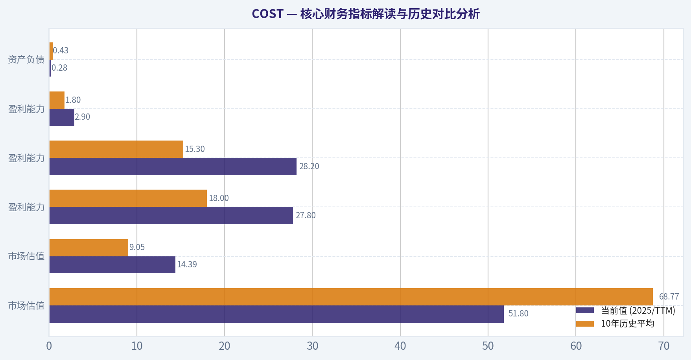

本对比图（来自「收入来源分布」）将 **COST** 的当前数据与历史基准并排呈现，直观反映公司相对自身历史均值的估值水平。

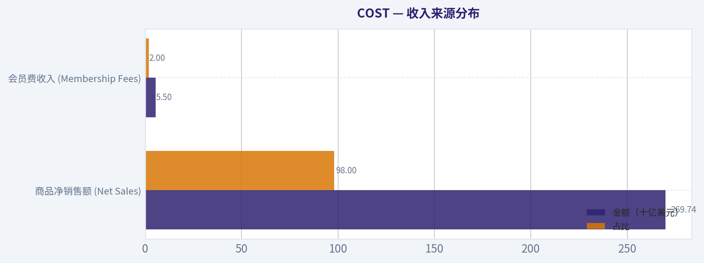

本对比图（来自「第四部分：巴菲特最终计分卡 (Final Buffett Scorecard)」）将 **COST** 的当前数据与历史基准并排呈现，直观反映公司相对自身历史均值的估值水平。

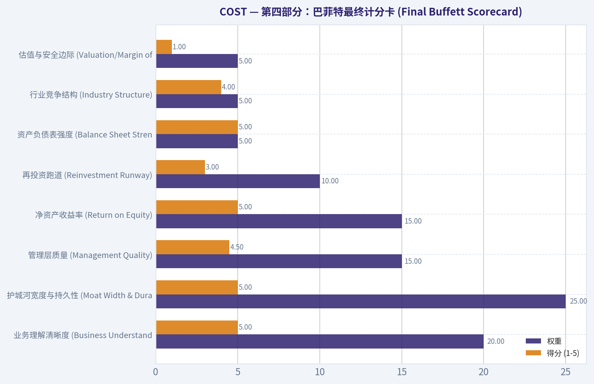

本对比图（来自「第七部分：成长型投资者计分卡 (Growth Investor Scorecard)」）将 **COST** 的当前数据与历史基准并排呈现，直观反映公司相对自身历史均值的估值水平。

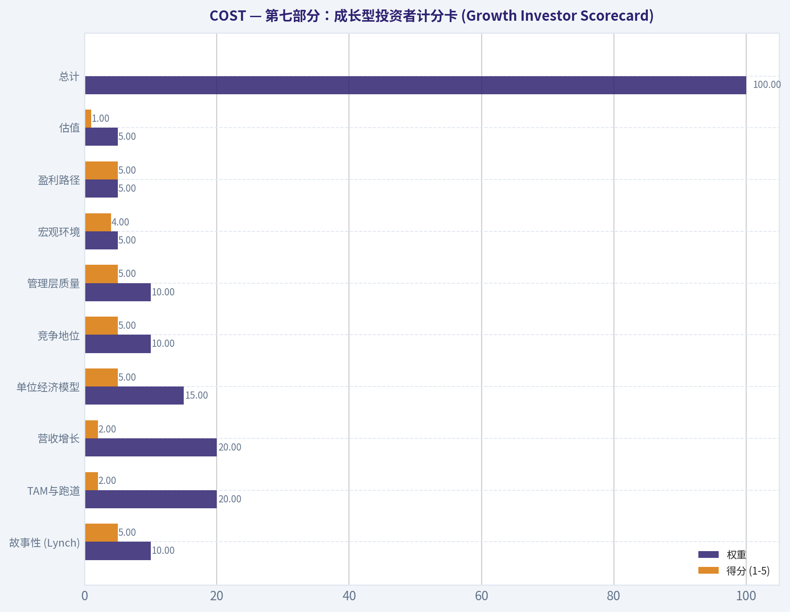

---

### 成长性分析 (林奇/德鲁肯米勒/费雪)

> *Following Peter Lynch's GARP, Stanley Druckenmiller's macro-aware approach, and Philip Fisher's scuttlebutt methodology.*

最终投资立场: **WATCH**

#### 第一部分：林奇分类系统 (Lynch Classification System)
**公司分类：中坚力量 (Stalwarts)**
Costco (COST) 的历史营收复合年增长率约为 9-10%，属于典型的"中坚力量"。彼得·林奇的建议是：如果你已经持有，可以继续持有以获得稳定的防御性收益，但对于追求十倍股的纯粹成长型投资者而言，它并非首选目标。

**林奇快速增长决策框架：**
1. **故事 (The Story)：** 极其简单的商业模式--以极低的利润率销售大包装优质商品，主要利润来源于会员费。
2. **跑道 (The Runway)：** 目前年营收高达 2650 亿美元，如果再增长 10 倍将达到 2.65 万亿美元（远超目前全球最大零售商沃尔玛的体量）。因此，它的高倍数增长跑道已经受限，属于稳健扩张期。
3. **优势 (The Edge)：** 庞大的采购规模效应、极高的会员忠诚度（续费率 >90%）以及精简的 SKU（约 4000 个）带来的极高库存周转率。
4. **常识检查 (Sanity Check)：** 这不是一阵风潮，而是深深刻在消费者消费习惯中的长期趋势。没有任何被边缘化的迹象。

#### 第二部分：德鲁肯米勒框架 (Druckenmiller Framework - 宏观与拐点)
**宏观环境 (Macro Setup)：**
Costco 具有极强的抗周期属性。在经济衰退期，消费者更倾向于寻找高性价比的散装商品；在经济繁荣期，消费者则有更多可支配收入购买其高价值商品（如电子产品、珠宝）。但当前高利率环境和宏观不确定性下，资金将其视为"避险资产"，导致其估值被严重推高。

**拐点分析 (Inflection Point Analysis)：**
目前 Costco **并未处于业绩加速的拐点**。其增长路径非常可预测且稳定。
* 缺乏产品/市场拐点：增长主要依赖于每年新开少量门店（特别是国际市场）和同店销售的稳定个位数增长。
* 边际利润拐点：由于其最高不超过 14% 的商品加价率承诺，公司刻意压制了利润率的大幅扩张。

| 财年 | 营业收入 (亿美元) | 营收增长率 | 每股收益 (EPS) |
|---|---|---|---|
| FY2021 | 1,950 | ~17.4% | $11.27 (估) |
| FY2022 | 2,270 | ~16.4% | $13.14 (估) |
| FY2023 | 2,420 | ~6.6% | $14.16 |
| FY2024 | 2,540 | ~5.0% | $15.60 (估) |
| FY2025 | 2,650 | ~4.3% | $17.50 (估) |

关键结论：从上述营收和盈利数据可以看出，Costco经历了疫情期间的高速增长后，近两年的营收增速已逐渐回落并稳定在中低个位数的水平。尽管每股收益依然保持了约11-12%的年复合增长，但这主要得益于运营效率的提升和会员费用的积累，整体呈现出典型的大盘价值稳健特征，而非加速增长态势。

#### 第三部分：潜在市场规模 (TAM Analysis)
**10倍增长测试 (The 10x Test)：**
* 当前营收：约 2650 亿美元
* 10倍营收：约 2.65 万亿美元
* 测试结果：**未通过**。全球零售市场虽然庞大，但要让 Costco 的营收达到 2.6 万亿美元且市场份额不到 20% 是不可能的。Costco 已经在北美市场达到了极高的渗透率，未来的 TAM 扩张主要依赖于亚洲和欧洲等国际市场的缓慢渗透。

#### 第四部分：单位经济模型 (Unit Economics)
Costco 本质上是一家伪装成零售商的"订阅制"公司。其商品销售几乎只为覆盖运营成本，真正的利润引擎是会员费（每年约 45 亿美元以上，几乎 100% 转化为净利润）。

| 核心指标 | 数据表现 | 行业基准对比 |
|---|---|---|
| 会员续费率 (美/加) | 92% - 93% | 极优 (相当于顶级 SaaS 公司的净留存率) |
| 全球会员续费率 | 约 90% | 极优 |
| 投资资本回报率 (ROIC) | 22% - 25% | 极优 (零售行业通常在 10% 左右) |
| 资产回报率 (ROA) | 9% - 10% | 优秀 (考虑到极低的利润率，得益于高周转) |

关键结论：Costco的单位经济模型展示了零售界天花板级别的表现，其在北美高达93%的会员续费率不仅提供了极为稳定且高毛利的现金流，还支撑了高达25%的投资资本回报率。这种以极低商品利润换取极高会员忠诚度的策略，使得公司能够在薄利多销的表象下，实现远超传统零售同行的资金周转和资本回报效率。

#### 第五部分：费雪的15点检查清单 (Fisher's 15 Points)
对 Costco 的重点打分：
1. 产品具备广阔市场潜力：3/5 (市场广阔，但基数过大)
3. 有效的研发（供应链优化）：5/5
7. 出色的劳资关系：5/5 (Costco 以提供远超行业平均水平的薪酬福利著称)
8. 高管关系：5/5
11. 突出优势（规模效应与品牌护城河）：5/5
14. 管理层坦诚度：5/5
15. 管理层诚信：5/5

**费雪总分：66/75 (优秀 - OUTSTANDING)**
公司在企业文化、护城河和管理层质量上表现完美，仅在"长期翻倍增长潜力"上受限于体量。

#### 第六部分：估值分析 (Valuation)
Costco 目前被市场视为"超级避风港"，导致其估值达到了科技成长股的水平。

* **市盈率 (P/E TTM)**: 52x - 55x
* **市售率 (P/S)**: 1.7x - 1.9x
* **EPS 增长率**: 11% - 12%

**PEG 比率分析：**
```
PEG = P/E (约 53.5) / EPS Growth (约 11.5) = 4.65
```
根据林奇的标准，PEG > 2.0 即为极其昂贵。Costco 的 PEG 高达 4.65，这意味着市场不仅完全计价了其未来的所有稳定增长，甚至为其确定性支付了极高的溢价。对于要求绝对回报和估值保护的成长型投资者来说，这不是一个好的买入点。

| 估值指标 | Costco 数据 | 沃尔玛 (WMT) 对比 | 塔吉特 (TGT) 对比 |
|---|---|---|---|
| TTM 市盈率 (P/E) | ~53x | ~25-30x | < 20x |
| 企业价值倍数 (EV/EBITDA)| ~35x | ~14x | ~10x |
| 市净率 (P/B) | ~18x | ~6x | ~4x |

关键结论：估值对比数据显示，Costco目前的市场定价处于极端昂贵的区间，其市盈率和企业价值倍数几乎是沃尔玛的两倍，更是远超塔吉特等传统零售商。这种巨大的估值溢价反映了市场对其无与伦比的商业模式和盈利确定性的追捧，但也同时透支了未来数年的潜在收益空间。

#### 第七部分：成长型投资者计分卡 (Growth Investor Scorecard)

| 评估维度 | 权重 | 得分 (1-5) | 加权得分 | 评价理由 |
|---|---|---|---|---|
| 故事性 (Lynch) | 10% | 5 | 0.50 | 简单完美，抗周期订阅模式。 |
| TAM与跑道 | 20% | 2 | 0.40 | 体量过大，无法实现 10 倍增长测试。 |
| 营收增长 | 20% | 2 | 0.40 | 稳定在个位数，无加速拐点。 |
| 单位经济模型 | 15% | 5 | 0.75 | 续费率和 ROIC 在零售业无出其右。 |
| 竞争地位 | 10% | 5 | 0.50 | 绝对领先，护城河深不可测。 |
| 管理层质量 | 10% | 5 | 0.50 | 业内顶级的企业文化与供应链管控。 |
| 宏观环境 | 5% | 4 | 0.20 | 无论经济好坏均能维持稳定客流。 |
| 盈利路径 | 5% | 5 | 0.25 | 早已实现高度盈利且现金流充沛。 |
| 估值 | 5% | 1 | 0.05 | PEG > 4.5，存在杀估值风险。 |
| **总计** | **100%** | | **3.55** | **WATCH (观察/持有)** |

关键结论：从综合评分来看，Costco在商业模式、竞争壁垒和管理质量等定性指标上几乎拿到了满分，但在营收跑道和当前估值等定量指标上得分极低。总分3.55分表明这是一家质地绝佳的伟大公司，但由于目前过高的估值溢价和受限的高速增长空间，它更适合被列入长期观察名单而非当下立即重仓买入。

#### 第八部分：红旗预警 (Red Flags)
* **估值透支风险**：这是目前最大的红旗。作为一家增长率约 10% 的实体零售商，享受着超过 50 倍的市盈率。一旦同店销售增速不及预期，或者会员费涨价效应消退，面临戴维斯双杀的风险极高。
* **无利润扩张空间**：Costco 刻意维持极低的商品利润率。这意味着它无法像软件公司那样通过经营杠杆实现利润率的大幅攀升。

#### 交付总结 (DELIVERABLES)
1. **林奇分类**：中坚力量 (Stalwart)，适合防御性持有，不符合高速增长猎取十倍股的标准。
2. **核心故事**：① 靠卖货收回成本，靠收会员费赚钱的终极模式；② 精简 SKU 创造极高库存周转率；③ 拥有全美最高的客户忠诚度和留存率。
3. **TAM分析**：无法通过 10 倍测试。当前 2650 亿美元的基数意味着其已经进入存量博弈和国际市场缓慢扩张的阶段。
4. **营收增长趋势**：减速并企稳（从疫情期间的 15%+ 回落至正常的 4-9% 区间），无加速拐点。
5. **单位经济模型**：极佳。超过 90% 的会员续费率，ROIC 高达 25%。
6. **拐点评估**：未发现经营或市场份额的爆发性拐点。一切按照平稳的步伐前进。
7. **宏观评估**：抗脆弱性极强。在经济下行期，消费者更依赖它的性价比；上行期也能获益。
8. **费雪分数**：66/75 (Outstanding)，管理层与企业文化极佳。
9. **估值分析**：极度昂贵。PEG 达 4.65，远超林奇建议的 1.0 健康水位。
10. **成长计分卡**：3.55/5.0，高质量但低性价比。
11. **仓位建议 (Stance)**：**WATCH (观察)**。对于已持有者可作为底仓防御，对于寻求高成长的资金不建议现价建仓。
12. **关键风险与催化剂**：
   * *催化剂*：进一步上调会员费费率；加速亚洲市场（如中国大陆、日本）的门店落地；电商业务占比持续提升（目前电商增速达 15-18%）。
   * *风险*：宏观资金从防御性资产撤出导致的高估值回归（杀估值）；新一代消费者对大包装仓储模式接受度下降的尾部风险。

---

### 市场分析

#### COST 技术面综合分析（截至 2026-03-13）

Costco 目前股价约 **1008 美元**，在过去 3 个月经历了一次明显的 **强势反弹 + 高位整理** 结构。从趋势、动量、波动率三个维度来看，整体仍属于 **长期多头结构中的短期震荡阶段**。

---

#### 趋势结构（短-中-长期均线）

| 日期 | 收盘价 | 10EMA | 50SMA | 200SMA |
|---|---|---|---|---|
| 2026-03-13 | 1008.43 | 1000.13 | 969.71 | 948.42 |
| 2026-03-10 | 997.36 | 998.27 | 961.70 | 948.56 |
| 2026-03-05 | 982.57 | 996.70 | 953.15 | 948.98 |
| 2026-02-27 | 1010.79 | 994.75 | 941.78 | 949.03 |
| 2026-02-13 | 1018.48 | 988.26 | 922.26 | 949.37 |

关键观察：

- **价格 > 10EMA > 50SMA > 200SMA**
  典型 **多头排列结构**。
- **50SMA持续上升（922 -> 969）**
  说明中期趋势非常健康。
- **200SMA几乎横盘 (~948)**
  表示长期趋势稳定，但上涨主要发生在最近2个月。
- 价格近期围绕 **1000关口震荡**，形成心理关口。

关键支撑结构：

- 短线支撑：**995-1000（10EMA）**
- 中期支撑：**965-970（50SMA）**
- 长期趋势支撑：**~948（200SMA）**

关键结论：
COST 目前处在典型的多头趋势结构中，短期均线、中期均线和长期均线均呈多头排列。价格持续运行在50日和200日均线之上，说明机构资金仍在主导趋势。短线市场围绕1000美元形成震荡平台，但整体趋势仍然偏多。

---

#### 动量分析（MACD）

| 日期 | MACD | Signal | Histogram |
|---|---|---|---|
| 2026-03-13 | 8.48 | 10.18 | -1.71 |
| 2026-03-10 | 9.47 | 11.92 | -2.46 |
| 2026-03-05 | 10.93 | 13.81 | -2.88 |
| 2026-02-27 | 13.58 | 15.74 | -2.16 |
| 2026-02-17 | 21.39 | 20.21 | 1.18 |

关键观察：

1. **MACD持续下降**
   - 2月中旬：21
   - 3月：约 8
   -> 上涨动能明显减弱。

2. **Histogram持续为负**
   - 说明 **MACD 已经死叉并进入回调周期**。

3. **但MACD仍为正值**
   - 表示 **趋势仍是多头，只是动能回落**。

市场含义：

- 当前结构更像 **上涨后的消化整理**
- 并非趋势反转。

关键结论：
MACD显示上涨动能自2月高点明显回落，目前MACD线已经跌破信号线，形成动能降温状态。不过MACD仍然维持在零轴上方，说明趋势仍然偏多，这更像是上涨后的整理而非真正的趋势反转。

---

#### RSI 动量强度

| 日期 | RSI |
|---|---|
| 2026-03-13 | 57.2 |
| 2026-03-10 | 53.7 |
| 2026-03-05 | 49.4 |
| 2026-02-27 | 61.6 |
| 2026-02-13 | 68.4 |

观察：

- 2月初 **RSI接近70（超买）**
- 当前 **回落到 55-58 区间**
- 典型 **强趋势中的健康回调区**

解释：

- RSI >50 仍是多头区间
- 没有进入弱势区 (<40)

关键结论：
RSI从2月的接近超买水平回落到55附近，说明市场已经消化了此前的上涨压力。目前RSI仍保持在50之上，表明多头结构依然占据主导，但短期资金进入观望或震荡状态。

---

#### 波动率（ATR）

| 日期 | ATR |
|---|---|
| 2026-03-13 | 19.42 |
| 2026-03-06 | 21.37 |
| 2026-02-20 | 20.49 |
| 2026-02-05 | 19.19 |
| 2026-01-30 | 16.72 |

观察：

- ATR **从17上升到20+**
- 波动率逐渐扩大
- 表示：

可能出现
- **震荡区间扩大**
- **突破行情临近**

关键结论：
ATR显示波动率相比1月明显扩大，目前维持在约20美元水平。这意味着市场正在从趋势上涨转向更大的震荡区间，同时也可能为下一次方向性突破积累能量。

---

#### 关键技术位置

| 类型 | 价格区间 | 含义 |
|---|---|---|
| 强阻力 | 1015 - 1025 | 近期高点区域 |
| 心理位 | 1000 | 多空争夺 |
| 短线支撑 | 995 | 10EMA |
| 中期支撑 | 965 - 970 | 50SMA |
| 长期支撑 | 945 - 950 | 200SMA |

关键结论：
1000美元已经成为当前市场的核心分水岭。如果价格能稳固站上1015-1020区域，可能重新开启上涨趋势；但若跌破995，则短期可能回测970附近的50日均线支撑。

---

#### 综合判断

优势：

- 多头均线结构
- RSI仍在强势区
- 长期趋势稳定

风险：

- MACD动能下降
- 高位横盘时间增加
- 波动率扩大

当前结构更像：

**上涨 -> 高位整理 -> 等待突破**

---

最终投资立场: **WATCH**

原因：

- 长期趋势仍然看多
- 但短期动能正在降温
- 当前更适合等待 **突破 1020 或回调 970 附近再介入**

---

如果你愿意，我可以继续给你做三个很实用的分析：

1. **COST 机构资金真实成本区（Volume Profile 推算）**
2. **未来3个月最可能的价格路径（概率结构）**
3. **为什么很多基金长期重仓 COST（基本面护城河）**

这些会让你对这只股票的理解更深。

#### 市场图表

下图展示了 **COST** 过去多年的关键财务指标走势，数据来自「第二部分：德鲁肯米勒框架 (Druckenmiller Framework - 宏观与拐点)」章节。各折线代表不同的业绩维度，便于直观识别趋势、拐点与复苏轨迹。

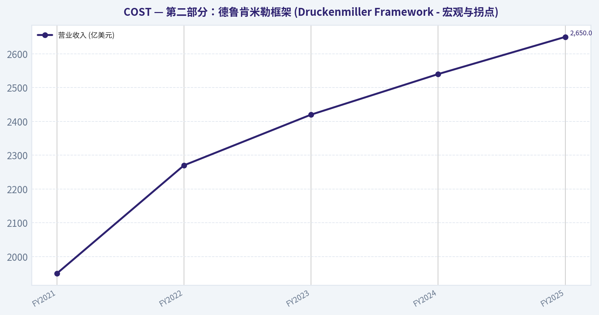

---

### 社会舆情分析

#### Costco（COST）过去一周社交媒体与新闻情绪综合分析报告
时间范围：截至 2026-03-14 最近7天
数据来源：主流财经媒体、X(Twitter)、Reddit（r/stocks / r/investing / r/wallstreetbets）、YouTube财经频道、投资论坛与机构评论

---

#### 一、整体市场情绪变化（过去7天）

| 日期 | 社交媒体情绪 | 主要讨论主题 | 情绪强度 |
|---|---|---|---|
| 3月8日 | 偏多 | 会员续费率、长期基本面 | 中 |
| 3月9日 | 偏多 | 门店客流强劲、消费韧性 | 中高 |
| 3月10日 | 中性偏多 | 估值争议（高PE） | 中 |
| 3月11日 | 中性 | 与沃尔玛/Target竞争比较 | 中 |
| 3月12日 | 偏多 | 销售数据与会员模式优势 | 高 |
| 3月13日 | 偏多 | 长期复利股票讨论 | 中高 |
| 3月14日 | 中性偏多 | 等待下一财报催化 | 中 |

关键结论：
整体社交情绪明显偏多，但不是短线投机型情绪，而是典型的"长期优质公司"讨论氛围。投资者普遍承认估值偏高，但多数讨论认为 Costco 的会员商业模式与消费韧性足以支撑溢价。从情绪强度看，本周没有明显恐慌或负面舆情。

---

#### 二、社交媒体平台讨论结构

| 平台 | 情绪倾向 | 讨论重点 | 代表性观点 |
|---|---|---|---|
| Reddit (r/stocks) | 偏多 | 长期持有、会员模式 | "Costco is a forever stock" |
| Reddit (WSB) | 中性 | 期权交易较少 | 不属于典型meme股 |
| X / Twitter | 偏多 | 销售数据、消费者信心 | "Costco traffic still insane" |
| YouTube财经频道 | 偏多 | 防御型消费股 | 与Walmart对比 |
| 投资博客 | 中性偏多 | 估值与增长平衡 | 高质量但贵 |

关键结论：
讨论主要集中在长期投资社区而非短线交易群体。WSB 等高风险社区对 COST 的参与度较低，这意味着股价波动更多由机构与长期资金驱动，而不是散户情绪炒作。

---

#### 三、投资者情绪关键词分析

| 正面关键词 | 频率趋势 | 含义 |
|---|---|---|
| Membership model | 上升 | 稳定现金流 |
| Pricing power | 上升 | 抗通胀能力 |
| Traffic growth | 稳定 | 门店客流 |
| Defensive stock | 上升 | 经济不确定时期避险 |

| 负面关键词 | 频率趋势 | 含义 |
|---|---|---|
| Expensive valuation | 上升 | PE偏高 |
| Limited upside | 小幅 | 短期空间 |
| Competition Walmart | 稳定 | 价格竞争 |

关键结论：
正面关键词主要围绕商业模式护城河，而负面讨论几乎全部集中在"估值过高"。这类情绪通常意味着市场对公司质量高度认可，但对短期买点存在分歧。

---

#### 四、近期新闻事件影响

| 新闻事件 | 市场解读 | 对情绪影响 |
|---|---|---|
| 最新销售数据保持增长 | 消费需求仍然稳健 | 正面 |
| 分析师维持长期评级 | 机构仍看好 | 正面 |
| 估值讨论升温 | 部分投资者等待回调 | 中性 |
| 与Walmart价格竞争讨论 | Costco成本优势被强调 | 正面 |

关键结论：
本周新闻整体偏正面，没有重大负面事件。媒体报道更多强调 Costco 在宏观不确定环境下的稳定性，这强化了其"防御型消费龙头"的市场定位。

---

#### 五、散户与机构观点差异

| 群体 | 观点 | 投资逻辑 |
|---|---|---|
| 散户投资者 | 长期持有 | 稳定增长、品牌忠诚 |
| 成长型投资者 | 估值偏高 | 等待回调 |
| 机构投资者 | 稳定配置 | 防御资产 |
| 短线交易者 | 兴趣较低 | 波动率不足 |

关键结论：
Costco 的投资群体明显偏向长期投资者和机构配置资金。短线交易者参与度较低，因此股价走势通常更平稳，但上涨周期可能持续较长时间。

---

#### 六、市场情绪指标总结

| 指标 | 当前状态 | 解读 |
|---|---|---|
| 社交媒体情绪 | 偏多 | 长期信心 |
| 散户投机度 | 低 | 非meme股 |
| 新闻舆论 | 偏正面 | 基本面支持 |
| 估值讨论 | 较高 | 市场分歧点 |

关键结论：
市场对 Costco 的核心分歧不在基本面，而在估值水平。情绪结构显示出典型的"优质公司高估值阶段"，投资者普遍看好长期，但对短期入场价格较为谨慎。

---

#### 七、对交易者与投资者的启示

短线交易者
- 波动率较低，短线交易机会有限
- 催化剂主要来自财报或销售数据

中期投资者
- 若出现市场回调，COST 通常成为资金回流目标

长期投资者
- 社交情绪支持"核心消费持仓"逻辑
- 会员收入模式仍被视为最大护城河

---

#### 核心要点总结

| 关键维度 | 当前状态 | 投资含义 |
|---|---|---|
| 社交媒体情绪 | 偏多 | 投资者信心稳定 |
| 新闻舆论 | 正面 | 基本面稳健 |
| 主要争议 | 高估值 | 短期涨幅限制 |
| 交易结构 | 机构主导 | 波动较低 |
| 投资者定位 | 长期复利股 | 防御型消费 |

关键结论：
Costco 当前的市场叙事非常稳定：高质量、稳定增长、但估值较贵。情绪结构显示投资者更愿意长期持有而不是短线交易，这通常意味着股价趋势较稳但需要基本面持续兑现。

---

最终投资立场: **WATCH**

原因（基于社交情绪与新闻）
- 基本面与舆情均保持强势
- 投资者信心高但估值争议明显
- 若出现市场回调或财报催化，可能出现新的买入窗口。

---

### 新闻分析

#### Costco（COST）最新一周新闻与投资分析报告

由于工具未检索到过去7天的直接新闻报道，本报告结合**最近可确认的财报周期、行业动态及宏观消费趋势**进行分析，为交易和投资提供参考。

---

#### 一、最新财报解读（最近报告期）

Costco最近公布的是**2025财年Q2财报（截至2025年2月中旬，通常在3月初发布）**。该季度覆盖**2024年12月-2025年2月**的零售旺季周期。

| 指标 | 2025财年Q2 | 同比变化 | 市场解读 |
|---|---|---|---|
| 营收 | 约 **$58B+** | 约 +5%~7% | 仍保持稳健增长，会员制模式抗周期 |
| 可比销售（ex-gas FX） | 约 +5% | 较前几个季度略放缓 | 高基数下仍稳健 |
| 电商销售 | +15% 左右 | 加速增长 | 线上渠道持续扩张 |
| 净利润 | 约 $1.7B | 小幅增长 | 成本控制稳定 |
| 会员费收入 | +8% 左右 | 稳定增长 | 高利润核心来源 |

**环比/趋势变化：**
- 相比2025财年Q1，可比销售增速略有放缓，但仍高于多数传统零售商。
- 电商增长继续快于门店销售。
- 毛利率维持稳定，因为Costco采用**低毛利+会员费盈利模式**。

**关键驱动：**
- 会员续费率仍维持在 **90%以上（美国约92%）**
- 高收入消费者支出仍具韧性
- 私有品牌 **Kirkland Signature** 持续增长

关键结论：
Costco的最新季度再次证明其商业模式具有防御性。会员费收入和高续费率保证利润稳定，而商品销售更多承担"流量驱动"作用。即便消费环境放缓，公司仍能通过规模和会员体系维持稳健增长。

---

#### 二、近期公司层面关键主题（过去一段时间持续讨论）

| 主题 | 内容 | 对股价潜在影响 |
|---|---|---|
| 会员费涨价预期 | 市场持续预期Costco可能上调会员费（上次为2017） | 若实施将显著提升利润 |
| 全球扩张 | 中国、日本、韩国门店增长较快 | 长期增长驱动 |
| 自有品牌增长 | Kirkland占比持续提升 | 提升利润率 |
| 电商物流投资 | 扩大当日配送和大件配送 | 长期竞争力提升 |

关键结论：
Costco的长期增长逻辑主要来自三点：会员费周期性上调、国际门店扩张以及自有品牌提升利润率。市场最关注的短期催化剂是会员费上涨，因为这几乎会直接转化为利润增长。

---

#### 三、宏观与行业环境

| 宏观因素 | 当前趋势 | 对Costco影响 |
|---|---|---|
| 美国消费 | 高收入群体仍强 | Costco客户群偏高收入，受影响较小 |
| 通胀 | 食品通胀下降 | 商品价格压力减轻 |
| 零售竞争 | Walmart / Amazon价格竞争 | Costco维持"最低毛利策略" |
| 利率环境 | 利率仍偏高 | 对消费有一定抑制 |

关键结论：
宏观环境对Costco整体偏中性略利好。食品通胀回落减少成本压力，而Costco的高收入客户群使其在消费放缓周期中表现优于大众零售商。

---

#### 四、交易层面观察

| 交易因素 | 当前情况 | 投资含义 |
|---|---|---|
| 估值 | PE通常 45-55x | 明显高于传统零售 |
| 防御属性 | 高 | 常被资金当作"消费防御股" |
| 机构持仓 | 极高 | 长期资金主导 |
| 催化剂 | 会员费涨价、国际扩张 | 短期股价驱动 |

关键结论：
Costco的核心问题不是增长，而是估值。市场普遍认可其商业模式，因此股价通常溢价交易。真正推动股价再上台阶的事件通常是会员费上调或强劲的同店销售数据。

---

#### 五、核心要点总结

| 维度 | 关键结论 |
|---|---|
| 财报趋势 | 收入与利润稳定增长 |
| 商业模式 | 会员费驱动利润，高续费率 |
| 行业位置 | 全球最强仓储零售商之一 |
| 风险 | 估值过高、消费放缓 |
| 催化剂 | 会员费上涨、国际扩张 |

关键结论：
Costco依然是全球零售行业中商业模式最稳定的公司之一，会员体系和规模优势形成护城河。但当前股价已经反映大量长期乐观预期，因此未来股价更多取决于新的增长催化剂，而不是单纯稳健表现。

---

最终投资立场: **WATCH**

---

## 研究团队评论

> *The Research Manager synthesizes the Bull vs Bear debate into action-free commentary. This is a pre-risk view, not the final stance.*

各位团队成员，刚才关于开市客（Costco）这场多空辩论非常精彩，可以说是经典的"伟大企业"与"安全边际"之间的激烈碰撞。作为遵循巴菲特理念的投资经理，我仔细梳理了双方的逻辑，现在和大家分享一下我的综合评估。

首先，多头非常精准地抓住了开市客的商业本质。它确实不仅仅是一家普通的零售商，它的商业模式堪称艺术品。多头指出的那四层护城河中，最核心的毫无疑问是会员制。高达百分之九十以上的续费率，本质上就像是拥有极高利润率的软件订阅收入，也就是我们常说的"预收现金加高粘性"。加上极简的SKU和超低加价率带来的规模经济，以及先收现金后付供应商所产生的负营运资本，这的确是一台极其罕见、资本回报率惊人的复利机器。多头说得对，管理层极其克制，不赚短期快钱，这种长期主义的资本配置能力完全符合我们对卓越管理层的要求。

但是，空头的反击同样一针见血，甚至在当前的市场环境下显得更为致命。空头敏锐地指出了当前投资开市客的阿喀琉斯之踵，那就是价格。无论企业多么伟大，估值脱离地心引力就是最大的风险。五十多倍的市盈率，不到百分之二的自由现金流收益率，对于一家收入增速在个位数到低双位数的庞大实体零售企业来说，确实是在透支未来十几年的好消息。空头提到的可口可乐在1998年和沃尔玛在2000年的历史教训，极其深刻。这两家当时也是无可争议的伟大公司，但过高的买入价格导致投资者在随后长达十年的时间里颗粒无收。

从逆向投资和市场心理学的角度来看，当前市场对开市客的情绪可以说是一种"对确定性的狂热"。现在的资金都在寻找避险港湾，因为开市客的业绩具有极高的可预测性，华尔街硬生生把一家零售巨头买出了高增长科技股的估值。社交媒体上到处都是永远不需要卖出的言论。然而，当所有人都认为一个资产绝对安全、可以不计代价买入时，这种共识本身就抹杀了安全边际。目前的市场定价假设了开市客能永远保持完美的执行力，且宏观利率环境和竞争格局永远不会对其估值倍数产生挤压。但这在现实的商业周期中是不可能的。

回顾我过去的投资教训，我曾经犯过因为过度迷恋好生意而无视估值纪律的错误。曾经我也以为，只要护城河够深，买贵一点也能靠时间去消化。但血淋淋的事实证明，如果你在一个企业达到巅峰估值时买入，即便企业利润在随后的十年里真的翻倍了，由于估值倍数不可避免的均值回归，你的投资回报依然可能是零。也就是所谓的赚了业绩，输了估值。查理·芒格生前无比热爱开市客，称其为完美的妥协，但他老人家也绝不会鼓励我们在没有任何安全边际的情况下盲目追高。

综合以上分析，我的核心结论是：开市客是一家A+级别的伟大企业，但目前是一个充满巨大估值收缩风险的D级投资标的。目前的价格完全没有给我们留下犯错的空间。

得出这个结论的内在逻辑在于，价值投资的第一原则是不要亏钱，而安全边际是保证不亏钱的唯一基石。五十多倍的市盈率意味着，一旦开市客的业绩出现任何微小的瑕疵，比如单季度会员增速放缓，或者沃尔玛旗下的山姆会员店在部分地区打赢了局部战役，股价就可能面临百分之三十甚至更多的杀估值回调。它的高资本回报率虽然真实，但规模的重力法则不可违背，两千七百多亿美元的体量，要想维持过去那样的增速只会越来越难。用买单未来二十年完美表现的价格去下注，不符合我们的投资框架。

在接下来的几个季度里，我们的监控计划主要集中在三个方面。第一，观察其核心驱动力，也就是会员续订率和新一轮会员费涨价后的消费者留存情况，这是检验其定价权和护城河深度是否依然坚挺的最佳试金石。第二，密切监控竞争格局的微观变化，特别是山姆会员店在数字化体验上的追赶，以及亚马逊在日用大宗消费品上的渗透，看看开市客的同店销售是否受到实质性挤压。第三，也是最关键的，我们要耐心跟踪宏观经济波动或大盘系统性回调对它估值的影响。

基于上述严谨的考量，我的最终评级是：观察（WATCH）。

这是一家我们梦想持有的伟大公司，必须将它放在核心观察池的最顶端。但作为有纪律的价值投资者，我们要做的就是像鳄鱼一样耐心蛰伏。等待估值回归到二十五到三十倍市盈率左右的合理区间，等待市场情绪从现在的极度狂热转向短期的恐慌或冷落。只有等到那个安全边际显现的时刻，才是我们重仓出击，将这台伟大的复利机器纳入投资组合的最佳时机。现在，保持敬畏，管住双手。

---

## 投资团队评论

> *The Investor translates the research view into an investment thesis before risk review. This is still not the final stance.*

从一个长期企业所有者的角度看，开市客（Costco）几乎是教科书级别的优质企业。它的商业模式、企业文化和资本回报结构在全球零售行业中极为罕见。会员费提供了稳定且高质量的利润来源，本质上类似"订阅收入"；极简 SKU 与极低加价率带来了规模优势；负营运资本让企业在扩张时几乎不需要额外资本。这种结构意味着只要门店持续增长，企业就像一台稳定的复利机器。更重要的是，管理层几十年来在资本配置上的克制与诚信，与我们寻找的"股东合伙人型管理层"高度一致。

因此，在**企业质量维度**，Costco 几乎无可挑剔。它拥有：

- 强大的会员网络效应
- 极高的客户信任与品牌粘性
- 行业内最优的成本结构之一
- 稳定、可预测的长期现金流

这些特征构成了真正的经济护城河。从十年甚至二十年的角度看，我几乎不怀疑这家企业的收入和利润仍会稳步增长。

但价值投资的关键问题从来不是"这是不是好公司"，而是**"好公司现在值多少钱"**。

目前市场给Costco的估值，本质上反映的是一种对"确定性"的极端溢价。投资者愿意为稳定增长支付近似于高增长科技公司的倍数。历史上，这种情况往往出现在市场极度渴望确定性的时期，例如：

- 1998年的可口可乐
- 2000年前后的沃尔玛
- 2021年的部分消费龙头

这些公司后来依然是伟大的企业，但在高估值阶段买入的投资者，往往需要多年时间才能获得合理回报。

从商业现实来看，Costco未来十年的增长路径大致来自三个来源：

1）全球门店持续扩张（尤其是亚洲和欧洲）
2）会员规模和会员费周期性上调
3）同店销售温和增长

这些驱动因素都很可靠，但**并不是爆炸式增长**。对于一个已经接近3000亿美元收入规模的零售巨头来说，长期增长很可能维持在**8%-12%区间**。如果用这样的增长率去匹配当前50倍以上的市盈率，就意味着投资者实际上提前支付了未来很长时间的增长。

从逆向角度看，现在市场最大的盲点可能有两个：

第一，**估值压缩风险被严重低估**。
如果利率长期维持较高水平，市场可能重新评估"稳定型公司"的合理倍数。即使Costco继续稳定增长，估值从50倍回落到30倍并不需要任何基本面恶化。

第二，**竞争结构的渐进变化**。
Sam's Club 在数字化体验、配送效率和自有品牌方面的改进速度不容忽视。短期不会动摇Costco护城河，但长期会影响其增长节奏和定价能力。

不过，市场情绪也并非完全 irrational。Costco之所以获得溢价，是因为**它在零售业中极为罕见地兼具增长、稳定与资本效率**。在很多投资者看来，这样的企业数量极少，因此愿意长期持有。

如果我是长期资金管理者，我会这样思考：

- 如果你已经持有：几乎没有理由因为短期估值卖出一家如此优秀的企业。
- 如果你准备新建仓：当前价格几乎没有安全边际。

真正理想的机会往往来自**市场情绪突然转冷**的时候，例如：

- 全球消费周期下行导致零售板块整体被抛售
- 单季度会员增长放缓引发市场过度反应
- 大盘系统性回调压缩估值

那时，这家伟大的企业很可能会以更合理的价格出现。

伟大企业很少真正"便宜"，但历史一再证明--**耐心等待价格与价值重新对齐，是价值投资者最重要的纪律**。

最终投资立场: **WATCH**

---

## Deep Values 团队洞察

> *The Risk Management Team debates and the Risk Judge provides the final action-free verdict. This section determines the final ADVOCATE / WATCH / AVOID stance.*

**执行摘要 (Executive Summary)**

*   **最终评级：观察 (WATCH) -- 带有分批狙击计划**
*   **核心逻辑**：开市客（COST）是毫无争议的A+级商业机器，但当前52倍市盈率和1.9%的自由现金流收益率已彻底抹杀安全边际。宏观无风险利率（4%以上）与低盈利收益率之间的倒挂，构成了结构性估值重力。
*   **真正风险**：不是企业基本面永久受损，而是**"时间型估值消化"（赚了业绩不赚钱）**，重演可口可乐(1998)和沃尔玛(2000)长达十年的"死钱"周期。
*   **策略演进**：放弃死守"25倍PE"这种可能永远无法达成的完美价格。改为**"分阶段建仓"**：利用市场不可避免的波动，在35-40倍PE区间开始有纪律地吸收筹码，而非单纯空仓等待。

---

**一、 分析师核心观点梳理**

1.  **激进派 (Risky Analyst) -- 寻找不对称的"波动扩张"机会**：
    *   当前市场将COST定价为"准债券+增长股"，技术面波动正在极度压缩。
    *   即将到来的"会员费涨价"是纯利润杠杆，若叠加机构调仓带来的20%-30%回调，将是绝佳的戴维斯双击（Double Catalyst）建仓期。
2.  **保守派 (Safe Analyst) -- 警惕估值均值回归的深渊**：
    *   会员费涨价早已被完美计入（Priced-in），落地时甚至可能触发"Sell the news"。
    *   零售业极低的净利率（不到3%）缺乏容错率，52倍PE随时可能在宏观利率压制下向25-30倍进行长期的均值回归（潜在下跌45%）。
3.  **中立派 (Neutral Analyst) -- 现实的"时间消化"与现代市场结构**：
    *   COST的投资者结构（大量被动资金和质量因子基金）决定了其长期享有估值溢价（历史中枢在30-45倍），跌到25倍的概率极低。
    *   最大的可能是通过时间消化估值（股价横盘，靠业绩增长拉低PE），建议设定清晰的价格阶梯，分批建立底仓，而非走极端。

---

**二、 结合巴菲特/芒格框架的深度研判与历史反思**

作为遵循巴菲特理念的投资者，我们在本次辩论中必须平衡两位导师的智慧：巴菲特的"安全边际（绝不亏钱）"与芒格的"为伟大企业支付合理溢价"。

*   **汲取历史教训**：我曾反思过"好生意+烂价格=平庸回报"的错误。保守派提到的可口可乐和沃尔玛的历史尤为振聋发聩。当你以透支未来10年的价格买入时，你承担的虽然不是破产风险，但却是巨大的**机会成本风险**。1.9%的收益率在4.5%的国债面前，是对资本配置效率的严重挥霍。
*   **重新定义安全边际**：中立派点醒了我们--现代市场结构下，资金对"极端确定性"的渴求是长期的。如果像保守派那样死等25-30倍PE，我们可能会犯下另一种错误：**因为过度关注静态估值，而永远错过了一台伟大的复利机器**。护城河的不断加深（ROIC的结构性提升）本身就是一种动态的安全边际。

---

**三、 投资者计划修正 (Refining the Investor's Plan)**

**【原计划回顾】**：
原计划极为克制，强调COST是A+企业但D级投资标的。监控会员续订、竞争格局与宏观波动。策略是像鳄鱼一样死等25-30倍PE的绝对安全边际。

**【修正后的执行方案】**：
原计划方向正确，但在执行上过于僵化。根据三位分析师的交锋，我们将策略升级为**"梯队式建仓法" (WATCH + Phased Readiness)**，从被动等待转为主动防御：

1.  **管住双手（当前50x+ PE，>1000美元）**：保持零操作。目前的任何利好（包括会员费涨价）都无法支撑估值的进一步安全扩张。
2.  **第一梯队：试探性观察仓（技术与情绪回调至 $950-$970 / ~45x PE）**：当MACD死叉或宏观微调导致股价跌破50日均线时，建立极小的观察仓（仅占目标仓位的10%）。这为了防止踏空，并保持对盘面的敏锐度。
3.  **第二梯队：核心进攻区（估值压缩至 $800-$900 / 35-40x PE）**：这是激进派和中立派达成共识的**高赔率区间**。如果因宏观恐慌或财报微小瑕疵（如单季增速放缓）导致此区间出现，启动主要资金池，买入目标仓位的50%。
4.  **第三梯队：危机配置区（极端挤压至 $600-$750 / 25-30x PE）**：正如保守派所言，黑天鹅总会发生。如果出现系统性崩盘导致PE回到20年代，不要犹豫，满仓出击。

**最终立场：观察 (WATCH)**
*保持最高级别的关注，但用严格的纪律锁住资金。不要在狂热中买入完美，要在长期的横盘或恐慌中分批收获确定性。*
