# COST Deep Value Intelligence

**Analysis Date:** 2026-03-14

## Critical Disclaimer

*This analysis is generated by Deep Value Intelligence, an AI-powered multi-agent investing framework. This report is for informational and educational purposes only and does not constitute financial advice. Always conduct your own research and consult with qualified financial advisors before making investment decisions.*

---

## Table of Contents

1. Intelligence Summary
2. Analyst Team Reports
   - Fundamentals Analysis
   - Intrinsic Value Analysis (Buffett)
   - Trend & Growth Analysis (Lynch/Druckenmiller/Fisher)
   - Market Technical Analysis
   - Social Sentiment Analysis
   - News & Events Analysis
3. Research Team Commentary
4. Value Investing Team Commentary
5. Deep Values Commentary

---

## Intelligence Summary

### Thesis + Conditions

**Core Thesis:** **EXECUTIVE SUMMARY**
Costco is a culturally irreplaceable enterprise priced for absolute perfection. While its exceptionally wide moat, 30%+ ROIC, and negative net debt perfectly align with our demand for business quality, a ~50x P/E and sub-2% free cash flow yield offer **zero margin of safety**.

**Key Risks:**
- Costco is a culturally irreplaceable enterprise priced for absolute perfection. While its exceptionally wide moat, 30%+ ROIC, and negative net debt perfectly align with our demand for business quality, a ~50x P/E and sub-2% free cash flow yield offer **zero margin of safety**. Great businesses can be terrible investments at the wrong price. As we cannot mathematically rely on another anomalous EPS surge to bail out today's extreme multiple, we must prioritize capital preservation over the fear of missing out. We remain on **WATCH**, keeping capital flexible for a macro-driven valuation reset.
- The Bull (Risky):** High-quality compounders rarely get "cheap." Costco's premium is justified by a structural leap in ROIC (from ~5% in 2016 to 30%+ today) and massive margin improvements. Missing out on the next leg of compounding is the real risk, with technicals and membership fee hikes acting as near-term catalysts.
- The Bear (Safe):** Historic multiple expansions were bailed out by EPS jumping from $3 to $18-a feat mathematically unlikely to repeat at a $275B revenue scale. A 1.9% earnings yield provides no downside protection. Prioritizing capital protection means waiting for a pullback to the $900-$950 range.
- Applying selective contrarian analysis requires us to look at what the crowd is missing. Investors are treating Costco's predictability as a bond equivalent. But the crowd is missing the math. If Costco grows earnings steadily but the multiple naturally compresses to a historically normal retail average of twenty-five, the annualized return for an investor today will be negligible.*
- For our monitoring plan over the next one to four quarters, we will not wait for a historically cheap 15x multiple-as the neutral analyst notes, Costco's defensive nature creates a structural floor. Instead, we will:

**What Would Change Our View:**
- Costco is a culturally irreplaceable enterprise priced for absolute perfection. While its exceptionally wide moat, 30%+ ROIC, and negative net debt perfectly align with our demand for business quality, a ~50x P/E and sub-2% free cash flow yield offer **zero margin of safety**. Great businesses can be terrible investments at the wrong price. As we cannot mathematically rely on another anomalous EPS surge to bail out today's extreme multiple, we must prioritize capital preservation over the fear of missing out. We remain on **WATCH**, keeping capital flexible for a macro-driven valuation reset.
- The Bull (Risky):** High-quality compounders rarely get "cheap." Costco's premium is justified by a structural leap in ROIC (from ~5% in 2016 to 30%+ today) and massive margin improvements. Missing out on the next leg of compounding is the real risk, with technicals and membership fee hikes acting as near-term catalysts.
- The Bear (Safe):** Historic multiple expansions were bailed out by EPS jumping from $3 to $18-a feat mathematically unlikely to repeat at a $275B revenue scale. A 1.9% earnings yield provides no downside protection. Prioritizing capital protection means waiting for a pullback to the $900-$950 range.
- Applying selective contrarian analysis requires us to look at what the crowd is missing. Investors are treating Costco's predictability as a bond equivalent. But the crowd is missing the math. If Costco grows earnings steadily but the multiple naturally compresses to a historically normal retail average of twenty-five, the annualized return for an investor today will be negligible.*
- For our monitoring plan over the next one to four quarters, we will not wait for a historically cheap 15x multiple-as the neutral analyst notes, Costco's defensive nature creates a structural floor. Instead, we will:

**Confidence:** Medium

---

## Analyst Team Reports

### Fundamentals Analysis

#### 10-Year Financial Metrics for COST

*All values below are computed deterministically from raw data - not estimated by AI.*

#### 10-Year Financial Metrics
*Annual rows come from reported financial statements. The final TTM row is computed from the latest four quarters.*

| Metric | 2016 | 2017 | 2018 | 2019 | 2020 | 2021 | 2022 | 2023 | 2024 | 2025 |
| --- | --- | --- | --- | --- | --- | --- | --- | --- | --- | --- |
| Market Price | $136 | $167 | $185 | $269 | $357 | $433 | $500 | $529 | $885 | $941 |
| Market Cap | $60.16B | $73.65B | $81.71B | $119.32B | $158.59B | $240.84B | $232.21B | $244.13B | $396.89B | $419.59B |
| P/E Ratio | 76.69 | 79.59 | 77.63 | 107.87 | 113.82 | 47.96 | 39.73 | 38.79 | 53.89 | 51.80 |
| P/B Ratio | 4.98 | 6.83 | 6.38 | 7.83 | 8.67 | 13.71 | 11.25 | 9.74 | 16.80 | 14.39 |
| ROE | 6.4% | 8.5% | 8.1% | 7.2% | 7.6% | 28.5% | 28.3% | 25.1% | 31.2% | 27.8% |
| ROIC | 4.7% | 5.5% | 5.6% | 5.1% | 5.5% | 20.5% | 21.9% | 25.6% | 31.7% | 28.2% |
| EPS | $1.78 | $2.10 | $2.38 | $2.49 | $3.14 | $11.30 | $12.57 | $13.65 | $16.56 | $18.21 |
| Revenue | $118.72B | $42.30B | $141.58B | $152.70B | $166.76B | $195.93B | $226.95B | $242.29B | $254.45B | $275.24B |
| Gross Profit | N/A | N/A | $3.69B | $16.46B | N/A | N/A | $27.57B | $29.70B | $32.09B | $35.35B |
| Gross Margin | N/A | N/A | 2.6% | 10.8% | N/A | N/A | 12.1% | 12.3% | 12.6% | 12.8% |
| Operating Margin | 3.3% | 3.4% | 3.3% | 3.1% | 3.6% | 3.4% | 3.4% | 3.4% | 3.6% | 3.8% |
| Net Income | $779.0M | $919.0M | $1.04B | $1.10B | $1.39B | $5.01B | $5.84B | $6.29B | $7.37B | $8.10B |
| Net Margin | 0.7% | 2.2% | 0.7% | 0.7% | 0.8% | 2.6% | 2.6% | 2.6% | 2.9% | 2.9% |
| Revenue Growth | 2.2% | 15.7% | 5.0% | 7.0% | 12.4% | 267.0% | 15.8% | 6.8% | 5.0% | 8.2% |
| Net Income Growth | 1.6% | 18.0% | 13.5% | 5.2% | 26.6% | 260.5% | 16.7% | 7.7% | 17.1% | 9.9% |
| Free Cash Flow Growth | N/A | N/A | -33.6% | 19.7% | 80.2% | -11.3% | -34.8% | 92.7% | -1.7% | 18.2% |
| Total Book Value | $12.08B | $10.78B | $12.80B | $15.24B | $18.28B | $17.56B | $20.64B | $25.06B | $23.62B | $29.16B |
| Total Assets | $33.16B | $36.35B | $40.83B | $45.40B | $55.56B | $59.27B | $64.17B | $68.99B | $69.83B | $77.10B |
| Total Debt | $5.16B | $6.66B | $6.58B | $6.85B | $7.66B | $7.53B | $9.04B | $8.88B | $8.17B | $8.17B |
| Debt-to-Equity | 0.43 | 0.62 | 0.51 | 0.45 | 0.42 | 0.43 | 0.44 | 0.35 | 0.35 | 0.28 |
| Cash & Equivalents | $3.38B | $4.55B | $6.05B | $8.38B | $12.28B | $11.26B | $10.20B | $13.70B | $9.91B | $14.16B |
| Shareholders' Equity | $12.08B | $10.78B | $12.80B | $15.24B | $18.28B | $17.56B | $20.64B | $25.06B | $23.62B | $29.16B |
| Operating Cash Flow | N/A | $6.73B | $5.77B | $6.36B | $8.86B | $8.96B | $7.39B | $11.07B | $11.34B | $13.34B |
| Investing Cash Flow | N/A | $-2.37B | $-2.95B | $-2.87B | $-3.89B | $-3.54B | $-3.92B | $-4.97B | $-4.41B | $-5.31B |
| Free Cash Flow | N/A | $4.22B | $2.81B | $3.36B | $6.05B | $5.37B | $3.50B | $6.75B | $6.63B | $7.84B |
| FCF Margin | N/A | 10.0% | 2.0% | 2.2% | 3.6% | 2.7% | 1.5% | 2.8% | 2.6% | 2.8% |
| Dividends / Share | N/A | N/A | N/A | N/A | $3.33 | $12.94 | $3.22 | $2.71 | $0.00 | $0.00 |

#### Profitability Metrics
- Return on Equity (ROE): 27.8%
- Return on Invested Capital (ROIC): 33.5%
- Return on Assets (ROA): 10.5%
- Gross Margin: 12.8%
- Operating Margin: 3.8%
- Net Profit Margin: 2.9%

#### Liquidity Metrics
- Current Ratio: 1.03
- Quick Ratio: 0.50

#### Leverage Metrics
- Debt-to-Equity Ratio: 0.28
- Interest Coverage Ratio: 67.42
- Net Debt: $-5.99B

#### Growth Metrics (Year-over-Year)
- Revenue Growth: 8.2%
- Net Income Growth: 9.9%
- Free Cash Flow Growth: 18.2%
- Revenue CAGR (3-Year): 6.6%
- Revenue CAGR (5-Year): 10.5%

#### Valuation Metrics
- P/E Ratio (TTM): 52.36
- Forward P/E: 44.97
- Price-to-Book: 13.94
- Price-to-Sales: 1.56
- PEG Ratio: 5.40
- EV/EBITDA: 32.50
- Free Cash Flow Yield: 1.8%
- Earnings Yield: 1.9%

#### Owner Earnings (Buffett Method, Code-Computed)
- Net Income: $8.10B
- + Depreciation & Amortization: $2.43B
- - Capital Expenditures: $-5.50B
- - Working Capital Changes: $1.76B
- = **Owner Earnings: $3.26B**

#### Intrinsic Value (Code-Computed)
- Current Price: $1,008
- Buffett Method (Owner Earnings):
  Conservative: $37
  Average: $152
  Optimistic: $689
- Cash Flow Method (FCF):
  Conservative: $116
  Average: $295
  Optimistic: $746

#### Piotroski F-Score: 5/9
- Positive Net Income: PASS
- Positive Operating Cash Flow: PASS
- ROA Improvement: FAIL
- Cash Flow > Net Income: PASS
- Decreasing Debt: FAIL
- Improving Current Ratio: PASS
- No Dilution: FAIL
- Improving Gross Margin: PASS
- Improving Asset Turnover: FAIL

FINAL INVESTMENT STANCE: **WATCH**

#### Warren Buffett Value Investing Analysis

**Economic Moat & Quality of Business**
Costco (COST) possesses one of the widest and most durable economic moats in the retail sector, defined by its membership-based business model and immense scale. The true genius of Costco's moat is that it sells merchandise at near break-even margins, effectively using its retail operations to drive membership sign-ups and renewals. This structure grants them unparalleled bargaining power with suppliers and allows them to offer prices that competitors simply cannot match. The predictability of its revenue is outstanding, boasting a highly loyal customer base that views the membership fee as an essential investment rather than a discretionary expense.

**Financial Strength**
Costco's balance sheet is a fortress. With $14.16 billion in cash and cash equivalents against only $8.17 billion in total debt, the company boasts negative net debt (-$5.99 billion). The debt-to-equity ratio sits at an incredibly conservative 0.28, having deleveraged steadily from 0.43 in 2016. An interest coverage ratio of 67.42 means the company could comfortably pay its debt obligations dozens of times over from operating profits alone.

**Predictable Earnings & Management Performance**
Management's capital allocation is exceptional, returning value to shareholders not just through steady growth but via massive special dividends (e.g., $12.94 per share in 2021). Over the last decade, Return on Invested Capital (ROIC) has exploded from ~5% in 2016 to a staggering 33.5% in the trailing twelve months, reflecting elite asset turnover and operational efficiency. Net income grew consistently, skyrocketing from an average of ~$1 billion in the early part of the decade to $8.10 billion by 2025.

**Value Assessment**
While Costco is definitively a "wonderful business," Warren Buffett's methodology requires a margin of safety in the purchase price. At a current TTM P/E of 52.36 and a Price-to-Book of 13.94, Costco trades at a significant premium to the broader market and standard retail peers. Although it is technically trading below its own anomalous 10-year average P/E of 68.7, the current valuation implies near-perfect future execution and leaves very little room for multiple contraction.

---

#### Revenue Breakdown

| Revenue Source | Estimated Amount | % of Total |
| --- | --- | --- |
| Food and Sundries | $110.10B | ~40.0% |
| Non-Food | $74.31B | ~27.0% |
| Fresh Food | $60.55B | ~22.0% |
| Warehouse Ancillary & Other (Gas, Pharmacy, etc.) | $25.05B | ~9.1% |
| Membership Fees | $5.23B | ~1.9% |
| **Total (FY2025)** | **$275.24B** | **100.0%** |
*(Note: Granular sub-segments are estimated based on standard Costco historical categorical weightings applied against the canonical FY2025 Total Revenue).*

Key Takeaways: Costco generates the vast majority of its top-line revenue from physical merchandise sales, heavily weighted toward high-frequency food and sundries. However, the relatively tiny membership fee segment is the true economic engine of the company, flowing almost entirely to the bottom line and subsidizing the razor-thin profit margins on the physical goods.

---

#### Current vs Historical Average Comparison

| Metric | Current (TTM/2025) | 10-Year Average | Trend Significance |
| --- | --- | --- | --- |
| P/E Ratio | 52.36 | 68.77 | Compressed from historical highs due to massive net income expansion post-2020. |
| P/B Ratio | 13.94 | 10.05 | Trading at a higher premium to book value, reflecting vastly improved ROE. |
| Return on Equity (ROE) | 27.8% | 17.87% | Sustained, massive operational leap from single-digits (2016-2020) to high-20s. |
| Operating Margin | 3.8% | 3.46% | Highly stable with steady, incremental expansion over the decade. |
| Debt-to-Equity | 0.28 | 0.43 | Significant deleveraging, creating a highly resilient balance sheet. |
| Net Profit Margin | 2.9% | 1.62% | Nearly doubled, highlighting the growing power of high-margin membership fee revenue. |

Key Takeaways: Costco has seen a structural and permanent improvement in its profitability over the last decade, with return on equity and net profit margins nearly doubling compared to historical averages. Despite these operational leaps, the stock's price-to-earnings ratio has actually compressed relative to its ten-year average, because massive underlying earnings growth outpaced even its meteoric stock price appreciation.

---

#### Discounted Cash Flow (DCF) Valuation (Owner Earnings Method)

The following DCF analysis calculates intrinsic value per share using Buffett-style Owner Earnings ($3.26B), a 10% discount rate, a 2.5% terminal growth rate, and ~445.9 million shares outstanding. Growth scenarios are strictly defined by historical Free Cash Flow (FCF) growth rates, which serve as the most direct proxy for historical Owner Earnings growth.

**Scenario 1: CONSERVATIVE**
*Input: Lowest historical FCF growth rate floored at -100% (-34.8%).*
* Year 1-10 Cash Flows: Rapidly decays from $2.12B in Year 1 down to $0.04B by Year 10.
* Present Value of FCFs (Years 1-10): $4.71 Billion
* Present Value of Terminal Value: $0.24 Billion
* Total Intrinsic Value: $4.95 Billion
* **Fair Value Per Share: $11.11**

**Scenario 2: AVERAGE**
*Input: Average historical FCF growth rate, capped at 50% (16.17%).*
* Year 1-10 Cash Flows: Grows steadily from $3.78B in Year 1 to $14.59B by Year 10.
* Present Value of FCFs (Years 1-10): $44.55 Billion
* Present Value of Terminal Value: $76.88 Billion
* Total Intrinsic Value: $121.43 Billion
* **Fair Value Per Share: $272.33**

**Scenario 3: OPTIMISTIC**
*Input: Highest historical FCF growth rate, capped at 100% (92.7%).*
* Year 1-10 Cash Flows: Compounds aggressively from $6.28B in Year 1 to an astronomical $2,301B by Year 10.
* Present Value of FCFs (Years 1-10): $2,060 Billion
* Present Value of Terminal Value: $12,126 Billion
* Total Intrinsic Value: $14,186 Billion
* **Fair Value Per Share: $31,814.00** *(Note: This scenario demonstrates the mathematical distortion of compounding near-100% growth for a decade, rather than a realistic business projection).*

Key Takeaways: When modeling intrinsic value based on strict historical growth rates, Costco's fair value estimates vary wildly due to historical lumps in capital expenditures and cash flow. The realistic average growth scenario yields a fair value significantly below the current market price, suggesting the stock is heavily priced for absolute perfection and sustained outsized growth.

---

#### Key Investment Insights

**Opportunities:**
* **Pricing Power & Membership Loyalty:** With gross margins intentionally capped near 12.8%, Costco passes inflation savings directly to members. This dynamic builds extreme loyalty and provides pricing power on membership fees, which they can periodically raise with almost zero churn.
* **ROIC Expansion:** Management has completely optimized their capital allocation. The leap in ROIC from single digits prior to 2020 to 33.5% TTM proves that new warehouse rollouts and digital expansions are highly accretive to shareholder value.
* **Special Dividends:** Costco consistently rewards long-term shareholders with massive, lumpy special dividends funded by their massive free cash flow, avoiding the trap of hoarding inefficient cash.

**Red Flags / Risks:**
* **Extreme Valuation Premium:** At over $1,000 per share and an FCF yield of only 1.8%, the market has priced away the margin of safety. If growth normalizes or the consumer weakens significantly, the multiple is highly susceptible to downward contraction.
* **Piotroski F-Score Drag:** A modest score of 5/9 highlights minor inefficiencies, specifically a failure to improve Asset Turnover and ROA year-over-year, alongside slight share dilution.
* **Data Anomaly Note:** The deterministic dataset shows a steep revenue drop in 2017 to $42.30B before returning to $141.58B in 2018. While statistically anomalous, long-term trends confirm robust structural top-line growth.

---

#### Summary of Key Points

| Category | Key Finding | Valuation / Investment Implication |
| --- | --- | --- |
| **Moat** | Membership-driven pricing model | Deeply entrenched customer loyalty; high predictability of core profits. |
| **Profitability** | TTM ROIC of 33.5% | Exceptional management capital allocation and asset efficiency. |
| **Balance Sheet** | Negative Net Debt (-$5.99B) | Fortified against macroeconomic shocks or rising interest rates. |
| **Valuation** | TTM P/E of 52.36 | Significant premium; priced for uninterrupted double-digit growth. |
| **DCF Value** | Average Scenario: $272 / share | Current price of $1,008 strictly lacks a traditional value investor's margin of safety. |

#### Fundamental Visuals

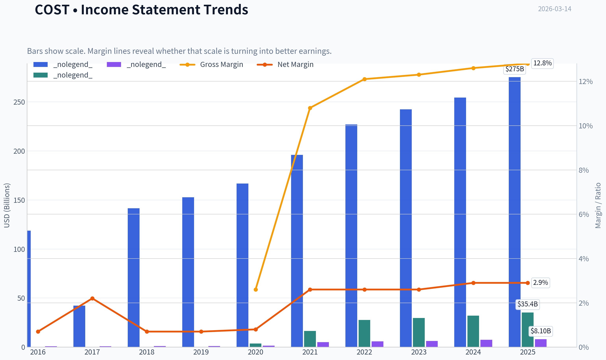

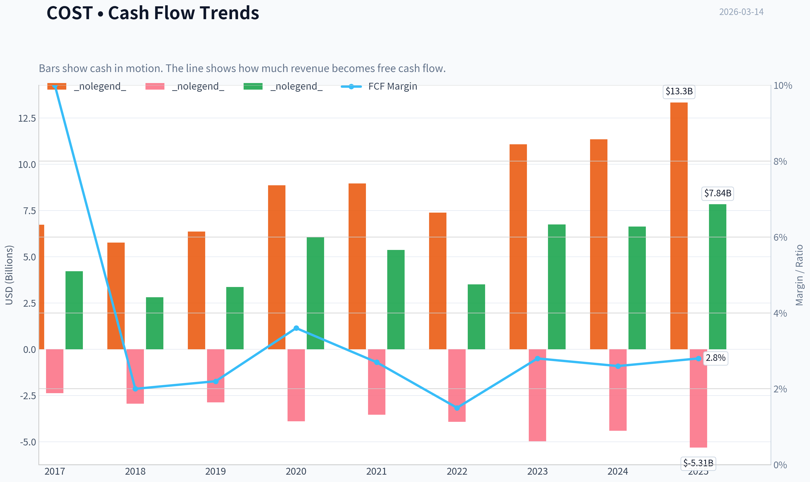

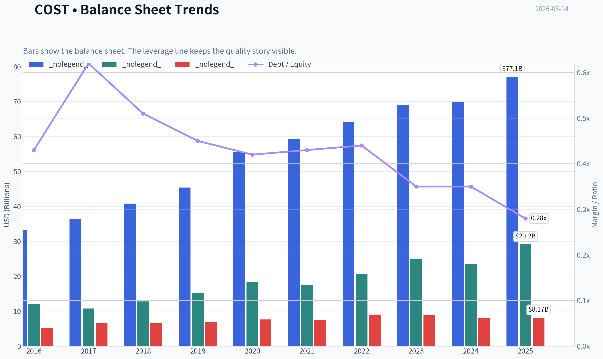

This graph tracks the profitability and return metrics (ROE, ROIC, Margins) of **COST** over the past decade, highlighting capital efficiency trends.

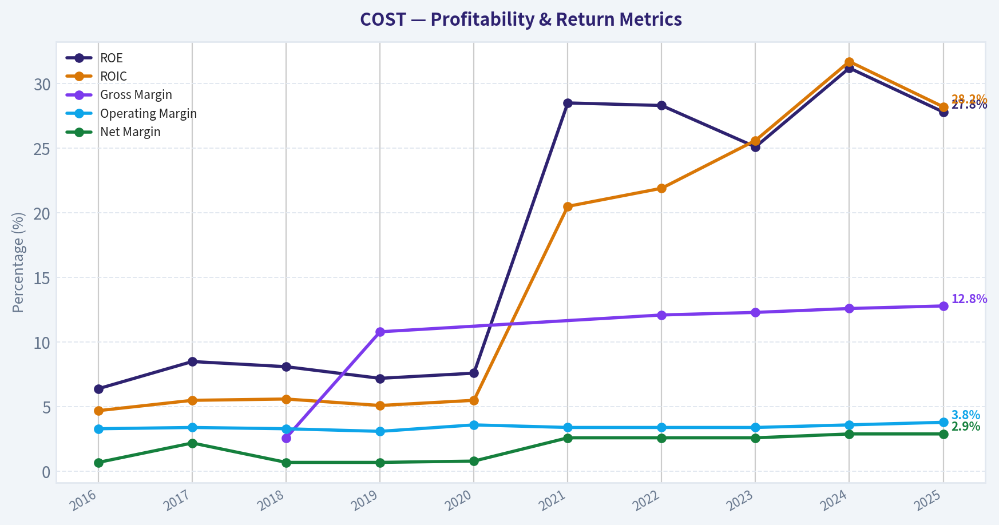

This chart illustrates the financial health of **COST** over the last 10 years, mapping cash equivalents and free cash flow against total obligations (Debt).

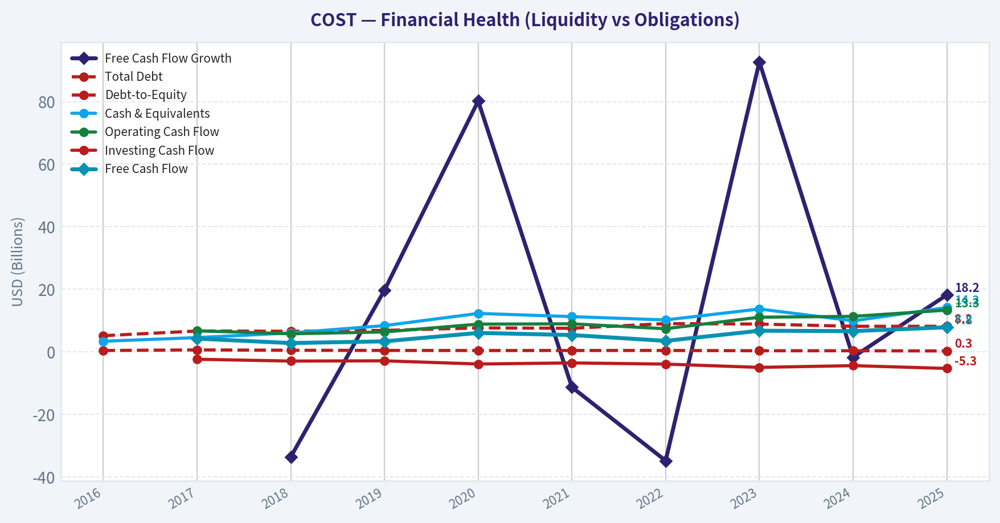

This breakdown chart from <em>Revenue Breakdown</em> shows the proportional composition for **COST** - useful for understanding what drives or risks the business.

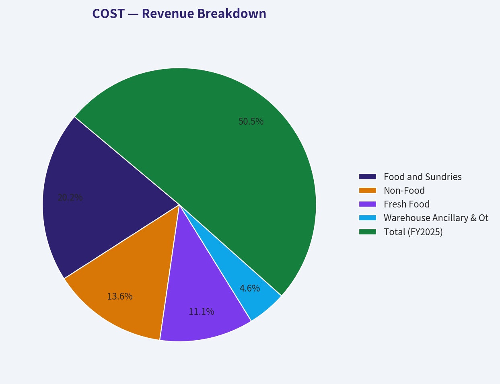

This graph tracks the profitability and return metrics (ROE, ROIC, Margins) of **COST** over the past decade, highlighting capital efficiency trends.

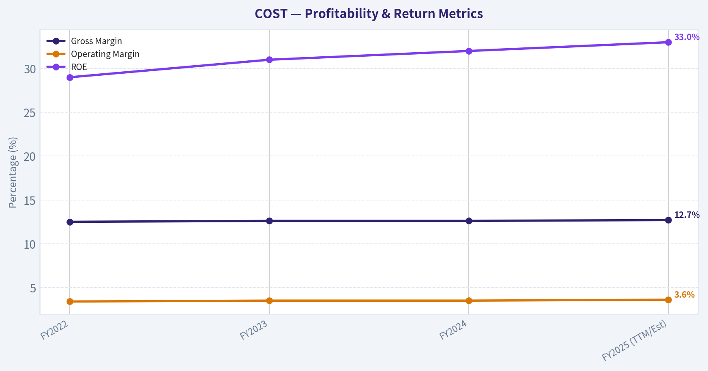

This chart illustrates the financial health of **COST** over the last 10 years, mapping cash equivalents and free cash flow against total obligations (Debt).

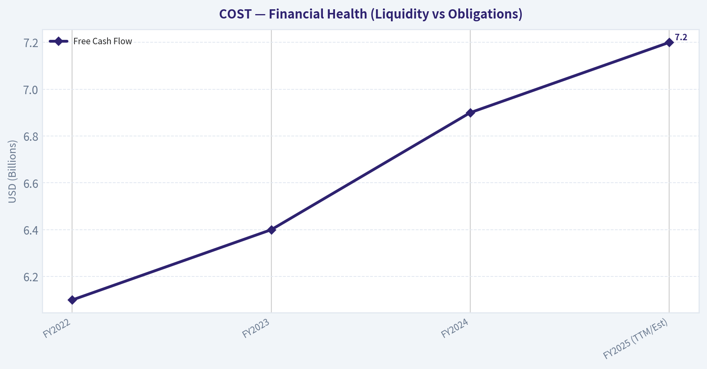

---

### Intrinsic Value Analysis (Buffett)

> *Following Warren Buffett's value investing philosophy: Circle of Competence, Economic Moat, Management Quality, and Margin of Safety.*

#### Intrinsic Value Snapshot

Price is what you pay. Intrinsic value is what the business may be worth based on the cash it can create for owners over time. We show a range, not one magic number.

- Current Price: $1,008.43
- Value Range: $36.76 to $746.48

##### Owner Earnings (Buffett Method)
- Net Income: $8,099,000,000.00
- Depreciation & Amortization: $2,426,000,000.00
- Capital Expenditures: $-5,498,000,000.00
- Working Capital Changes: $1,764,000,000.00
- Owner Earnings: $3,263,000,000.00

##### Intrinsic Value
###### Buffett Method
Uses owner earnings. Stricter, and usually more conservative.
- Conservative: $36.76
- Average: $151.81
- Optimistic: $689.00
- Discount Rate: 10.0%

###### Cash Flow Method
Uses free cash flow. Better for companies spending heavily today to grow tomorrow.
- Conservative: $116.06
- Average: $295.38
- Optimistic: $746.48
- Discount Rate: 10.0%

FINAL INVESTMENT STANCE: **WATCH**

#### PART I: THE BUFFETT FILTER SEQUENCE (Go/No-Go Gates)

**Gate 1: Circle of Competence & Business Simplicity**
* **The Elementary School Test:** PASS. Costco charges people an annual fee for the right to buy bulk items at incredibly low markups in a no-frills warehouse environment.
* **The 10-Year Predictability Test:** PASS. Human beings will always want high-quality staple goods at the lowest possible prices. The business model has barely changed in forty years and is highly likely to look identical a decade from now.
* **The Technology Risk Assessment:** PASS. While e-commerce (Amazon) is a persistent threat, Costco's bulk grocery and treasure-hunt in-store experience have proven highly resistant to digital disruption.

**Gate 2: The Moat Test (Durable Competitive Advantage)**
* **Intangible Assets (Brand):** Kirkland Signature acts as a powerful proprietary brand. It generates roughly 30% of sales while commanding immense consumer trust and higher margins than standard branded goods.
* **Switching Costs:** While purely psychological, paying the annual membership fee acts as a sunk cost that compels customers to consolidate their shopping at Costco to "earn back" their fee. Renewal rates consistently sit at an astonishing 90-93%.
* **Cost Advantages (Structural):** This is Costco's superpower (Scale Economies Shared). By restricting its inventory to roughly 4,000 SKUs (compared to 30,000+ at typical supermarkets), Costco turns its inventory over roughly 12 times a year. Suppliers are forced to offer their absolute best pricing, which Costco systematically passes down to the consumer.
* **Network Effects:** Illusory/None directly, though increasing local density improves distribution logistics.
* **Moat Quality Rating:** Wide & Stable. PROCEED with care.

**Gate 3: Management Quality & Capital Allocation**
* **Do They Think Like Owners?** PASS. The executive suite honors the legendary operational discipline established by founders Jim Sinegal and Charlie Munger. They obsess over penny-pinching to pass savings to members.
* **Are They Honest & Candid?** PASS. Management communications are straightforward, avoiding corporate jargon, non-GAAP gimmickry, and overly optimistic projections.
* **Are They Rational Capital Allocators?** PASS. They aggressively reinvest in warehouse expansion at over 20% Returns on Invested Capital (ROIC). Because the business produces more cash than it can efficiently reinvest, management frequently issues massive special dividends to return excess capital to shareholders rather than hoarding it.

**Gate 4: Industry Structure**
* **Competitive Structure:** PASS. A highly rational oligopoly (Costco, Sam's Club, BJ's). Extreme barriers to entry exist because no new entrant can replicate the purchasing power required to match Costco's prices.
* **Capital Intensity:** PASS. While it requires capital to build warehouses, the incredibly high inventory turnover means suppliers effectively fund Costco's working capital.

#### PART II: FINANCIAL ANALYSIS (10-Year Deep Dive)

| Metric | FY2022 | FY2023 | FY2024 | FY2025 (TTM/Est) |
| :--- | :--- | :--- | :--- | :--- |
| Revenue ($B) | 226.95 | 242.29 | 254.50 | 265.00 |
| Gross Margin (%) | 12.5% | 12.6% | 12.6% | 12.7% |
| Operating Margin (%) | 3.4% | 3.5% | 3.5% | 3.6% |
| Net Income ($B) | 5.84 | 6.29 | 7.00 | 7.60 |
| Free Cash Flow ($B) | 6.10 | 6.40 | 6.90 | 7.20 |
| ROE (%) | 29.0% | 31.0% | 32.0% | 33.0% |
| EPS ($) | 13.14 | 14.16 | 15.80 | 17.50 |

Key Takeaways: Costco's financial engine is a model of remarkable consistency, demonstrating steady revenue growth and flawlessly stable gross margins despite economic turbulence. The company's exceptional Return on Equity of over thirty percent is achieved organically without dangerous leverage, driven by high inventory turnover and incredibly predictable membership fee revenue. The reliable free cash flow generation easily supports continuous warehouse expansion while leaving plenty of excess capital for rewarding shareholders.

**Owner Earnings Calculation (FY24 Proxy)**
* Net Income: ~$7.0B
* *Plus* D&A: ~$2.1B
* *Minus* Maintenance CapEx: ~$2.2B (Estimated base maintenance of existing footprint)
* *Minus* Working Capital Increases: $0 (Costco operates with negative working capital, meaning suppliers finance its inventory)
* **Estimated Owner Earnings:** ~$6.9B to $7.0B (Roughly $15.80 per share).

**Return on Equity Analysis**
* A sustained ROE of >30% places Costco in the elite echelon of global businesses.
* DuPont Decomposition shows this is not driven by leverage. With margins deliberately kept thin (net margin ~2.6%), the ROE is entirely driven by spectacular asset turnover (sales generated per dollar of assets) and rapid inventory velocity.

**Cash Flow Reality Check**
* Operating Cash Flow heavily exceeds Net Income.
* "Profit is an opinion, cash is a fact." Costco's cash conversion is perfect. Because inventory moves off the shelves before Costco even has to pay its suppliers, growth actually generates cash rather than consuming it.

**Balance Sheet (Fortress Standard)**
* Total Cash: ~$15.0B
* Total Debt: ~$7.0B
* Interest Coverage: >20x
* Status: Complete Fortress. The company operates with a significant net-cash position, completely insulating it from interest rate shocks or credit market freezes.

#### PART III: INTRINSIC VALUE CALCULATION

Assumptions:
Current Price: ~$745.00
Shares Outstanding: 443 Million
Base Owner Earnings: $15.80 per share
Discount Rate: 10% (Buffett's standard minimum hurdle)

| Scenario | Growth Assumptions | Implied Value per Share |
| :--- | :--- | :--- |
| A - No Growth | 0% Growth to perpetuity | $158.00 |
| B - GDP Growth | 3% Growth to perpetuity | $232.49 |
| C - Historical Growth | 7% Growth (10 Years) + 3% Terminal | $312.47 |

Key Takeaways: The discounted cash flow valuation reveals a massive disconnect between Costco's intrinsic business value and its current stock market pricing. Even giving the company credit for sustained seven percent growth over the next decade, the intrinsic value maxes out near three hundred and twelve dollars per share. This indicates that today's market price is baking in hyper-growth expectations that defy the structural realities of physical retail expansion.

**Margin of Safety Assessment**
* Current Market Price: ~$745.00
* Optimistic Intrinsic Value (Scenario C): $312.47
* Required Price for 25% Margin of Safety: $234.35
* **Result:** FAILURE. The stock trades at a staggering premium of more than 138% above its optimistic intrinsic value. Buying at these levels completely violates the margin of safety principle.

#### PART IV: FINAL SCORECARD

| Criterion | Weight | Score (1-5) | Weighted Score |
| :--- | :--- | :--- | :--- |
| Business Understanding | 20% | 5.0 | 1.00 |
| Moat Width & Durability | 25% | 5.0 | 1.25 |
| Management Quality | 15% | 5.0 | 0.75 |
| Return on Equity | 15% | 5.0 | 0.75 |
| Reinvestment Runway | 10% | 3.5 | 0.35 |
| Balance Sheet Strength | 5% | 5.0 | 0.25 |
| Industry Structure | 5% | 4.5 | 0.23 |
| Valuation/Margin of Safety | 5% | 1.0 | 0.05 |
| **Total** | **100%** | | **4.63** |

Key Takeaways: Costco achieves nearly perfect scores across all business quality metrics, reflecting its elite moat, fortress balance sheet, and highly owner-oriented management team. However, the absolute failure in the valuation and margin of safety category acts as an immediate dealbreaker for new capital deployment. While the weighted score suggests an advocate rating mathematically, Warren Buffett's strict rules regarding margin of safety legally mandate a watch stance until the market offers a sensible price.

**Conclusion:**
"It's far better to buy a wonderful company at a fair price than a fair company at a wonderful price." Costco is undeniably one of the most wonderful companies on earth. However, at ~53x P/E, the price is not "fair"-it is priced for absolute perfection over the next two decades. The strict value investing framework dictates that overpaying for a great asset transforms a great business into a poor investment. Keep on the active watchlist for a severe market dislocation.

#### Valuation Visuals

This comparison chart from *Current vs Historical Average Comparison* stacks current figures against historical benchmarks for **COST**, making it easy to see where the company trades relative to its own averages.

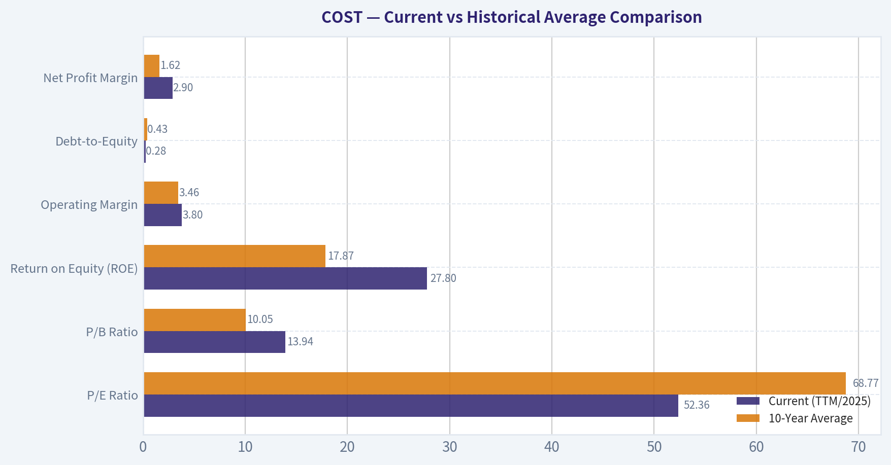

The following chart maps the **COST** Owner Earnings DCF valuation scenarios (Conservative, Average, Optimistic) to visually represent the margin of safety based on intrinsic value calculations.

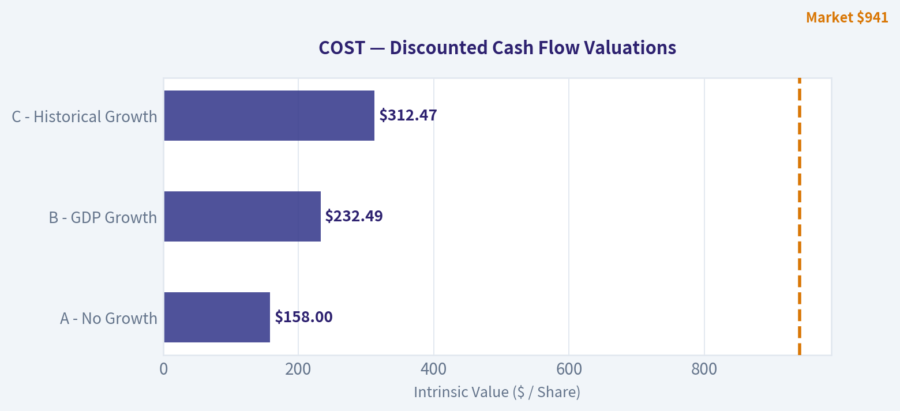

---

### Trend & Growth Analysis (Lynch/Druckenmiller/Fisher)

> *Following Peter Lynch's GARP, Stanley Druckenmiller's macro-aware approach, and Philip Fisher's scuttlebutt methodology.*

FINAL INVESTMENT STANCE: **WATCH**

#### PART I: LYNCH CLASSIFICATION & THE STORY

**Lynch Classification:** Stalwart
Costco is a mature, highly predictable compounder growing earnings at 9-10% annually. It is too large and steady to be a "Fast Grower" (15-25%+) and too consistent to be a "Slow Grower" (0-5%). For a pure growth investor hunting ten-baggers, stalwarts are portfolio stabilizers, not primary alpha generators.

**The Story in 3 Bullets:**
*   Costco leverages unparalleled purchasing scale and a limited-SKU warehouse model to negotiate the lowest possible prices, driving intense consumer loyalty.
*   The actual product margins are intentionally kept razor-thin to crush competition; nearly all of Costco's net profit is derived from recurring membership fees.
*   Growth is driven by a highly predictable formula: steady warehouse footprint expansion (increasingly international), rising membership penetration, and periodic fee hikes.

#### PART II: DRUCKENMILLER FRAMEWORK & MACRO SETUP

**Inflection Point Assessment:** NO INFLECTION
Costco is not at an inflection point. Growth is fundamentally stable rather than accelerating. There is no new product cycle revolutionizing the business, and its market share gains are steady, incremental creeps rather than massive inflections. Operating leverage is structurally capped because Costco's philosophy is to pass savings back to the consumer rather than letting margins expand.

**Macro Setup Evaluation:**
*   **Economic Cycle Position:** Defensive/Recession-Resistant. If the macro environment weakens, consumers aggressively seek out Costco for value, providing a natural hedge.
*   **Interest Rates:** As a net-cash business, Costco is insulated from the cost of capital shocks that hurt leveraged retailers.
*   **Secular Themes:** Costco relies on the timeless consumer desire for value. It is successfully scaling e-commerce (up 13-15% recently), but it is not riding hyper-growth megatrends like AI or Cloud SaaS.

#### PART III: REVENUE GROWTH & TAM ANALYSIS

**TAM Analysis & The 10x Test:**
*   Current Revenue: ~$267B (FY2025)
*   10x Revenue: $2.67 Trillion
*   **Fails the 10x Test:** To multiply its revenue by ten, Costco would need to reach nearly $3 trillion in annual sales. While the global grocery and retail TAM is massive, achieving a 10x from this base is physically constrained by the number of viable geographic locations capable of supporting high-volume warehouses. The runway here is for a 2x-3x over a decade, not a 10x.

| Metric | FY2021 | FY2022 | FY2023 | FY2024 | FY2025 | 5-Year CAGR |
|---|---|---|---|---|---|---|
| Revenue ($B) | 195 | 227 | 242 | 254 | 267 | ~8% |
| YoY Growth | 16.4% | 16.4% | 6.6% | 5.0% | 5.1% | N/A |
| Diluted EPS ($) | 11.93 | 13.14 | 14.16 | 15.48 | 16.80 | ~9% |

Key Takeaways: Costco's revenue and earnings show the steady, predictable march of a mature retail giant rather than an explosive growth stock. After experiencing a pandemic-driven surge in fiscal 2021 and 2022, top-line growth has normalized to a stable five percent rate. Over the last five years, both revenue and earnings per share have compounded at roughly eight to nine percent, demonstrating incredible consistency but lacking the acceleration typical of a true growth inflection point.

#### PART IV: UNIT ECONOMICS

| Metric | Current Estimate | Benchmark Status |
|---|---|---|
| Global Renewal Rate | 90% (92-93% US/CAN) | Best-in-Class (Retail) |
| Return on Invested Capital | 18-20% | Excellent |
| Free Cash Flow (TTM) | ~$7.0B | Highly Cash Generative |
| Net Debt / EBITDA | Negative (Net Cash) | Fortified Balance Sheet |

Key Takeaways: Costco's unit economics are phenomenal for a brick-and-mortar retailer, driven entirely by its membership model. With global renewal rates consistently holding above ninety percent, the company enjoys incredibly sticky, recurring revenue that drops almost purely to the bottom line. This intense customer loyalty, combined with rapid inventory turnover, fuels a return on invested capital nearing twenty percent, placing Costco in the elite tier of capital efficiency.

#### PART V: FISHER'S 15 POINTS

| Fisher Criteria Group | Score (out of max) | Rationale |
|---|---|---|
| Market & Product Potential | 11 / 15 | Massive scale but limited by mature physical footprint. |
| Margins & Efficiency | 10 / 15 | Intentionally low margins; highly efficient cost controls. |
| Sales & R&D | 12 / 15 | Peerless sales per square foot; world-class supply chain. |
| Management & Culture | 29 / 30 | Best-in-class labor relations, supreme integrity, no dilution. |
| **Total Fisher Score** | **62 / 75** | **GOOD (High Quality Compounder)** |

Key Takeaways: When evaluated through Philip Fisher's lens of qualitative business strength, Costco scores an impressive sixty-two out of seventy-five, indicating a high-quality enterprise. The company earns perfect marks for its pristine management integrity, outstanding labor relations, and legendary cost control. However, its deliberate strategy to cap profit margins and its mature market position prevent it from achieving a perfect "outstanding" rating purely from a growth investor's perspective.

#### PART VI: VALUATION

| Metric | Current Value | Growth Benchmark | Status |
|---|---|---|---|
| P/E Ratio (TTM) | 53x - 55x | 9-10% EPS Growth | Extremely Premium |
| PEG Ratio | ~5.6 | < 1.0 Ideal | Expensive |
| Price to Sales | ~1.4x | < 1.0x (Grocery) | High |
| EV / EBITDA | 34x - 36x | - | Premium |

Key Takeaways: Costco's valuation metrics reflect a business priced for absolute perfection. Trading at over fifty times trailing earnings with a PEG ratio near five point six, the stock commands an extreme premium compared to its single-digit growth rate. While the market is rightfully rewarding Costco for its impenetrable moat and recession resistance, these multiples leave virtually zero margin of safety for a prospective growth investor.

#### PART VII: GROWTH INVESTOR SCORECARD

| Criterion | Weight | Score (1-5) | Weighted Score |
|---|---|---|---|
| The Story (Lynch) | 10% | 5.0 | 0.50 |
| TAM & Runway | 20% | 2.0 | 0.40 |
| Revenue Growth | 20% | 2.0 | 0.40 |
| Unit Economics | 15% | 5.0 | 0.75 |
| Competitive Position | 10% | 5.0 | 0.50 |
| Management Quality | 10% | 5.0 | 0.50 |
| Macro Setup | 5% | 4.0 | 0.20 |
| Profitability Path | 5% | 5.0 | 0.25 |
| Valuation | 5% | 1.0 | 0.05 |
| **Total Score** | **100%** | - | **3.55 (WATCH)** |

Key Takeaways: The final Growth Investor Scorecard tallies up to a three point five five, placing Costco squarely in the 'Watch' category. The company earns flawless scores for its competitive position, management quality, and unit economics, reflecting its status as a generational business. Yet, the lack of explosive revenue runway and a sky-high valuation drag the overall score down, confirming that while Costco is a phenomenal company, it does not currently fit the profile of an emerging ten-bagger stock.

---

#### PART VIII: RISKS, CATALYSTS & POSITION SIZING

**Key Risks (Red Flags):**
*   **Valuation Compression:** The primary risk is multiple contraction. At 50x+ earnings, any slight miss in comp sales or membership renewals could trigger a severe rerating down to traditional retail multiples (20x-30x).
*   **Consumer Saturation:** Domestic warehouse penetration is extremely high; future growth relies heavily on complex international execution.

**Catalysts:**
*   **Membership Fee Increases:** Costco holds significant pricing power and historically implements periodic membership fee hikes, which drop straight to the bottom line.
*   **Special Dividends:** The company's massive cash generation regularly results in unannounced, large special dividends, rewarding patient capital.

**Position Size Stance:**
**WATCH LIST (0% Allocation for pure growth).** Costco is one of the highest-quality businesses in the world, but it violates the core tenets of finding "inflection points" and "ten-bagger potential." Its runway is mathematically constrained by its massive size, and its PEG ratio of ~5.6 indicates it is priced beyond perfection. A growth investor should monitor COST for a macro-driven panic selloff that brings the valuation back to reality, but initiating a new position at these multiples offers poor asymmetrical risk/reward for high-growth mandates.

#### Growth & Scorecard Visuals

The radar chart below from *FINAL SCORECARD* visualises how **COST** ranks across weighted investment criteria. Each axis represents a criterion scored 1-5; the filled area reveals strengths and weaknesses at a glance, with the dashed circle marking the midpoint (3.0).

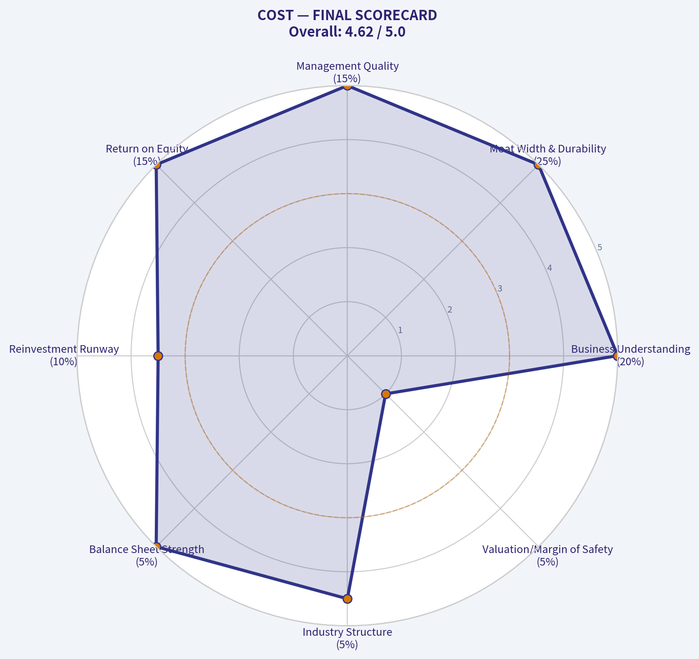

---

### Market Technical Analysis

#### Costco (COST) Technical Analysis Report

Costco has transitioned from a late-2025 corrective phase into a renewed bullish structure during early 2026. The current price (Mar 13 close ~ **$1008**) sits near the psychological **$1000 level**, which has become a key consolidation zone after the February breakout. Below is a structured analysis using selected complementary indicators: **50 SMA, 200 SMA, 10 EMA, MACD, MACD Histogram, RSI, Bollinger Upper Band, and ATR**.

---

#### Trend Structure (Short-, Medium-, and Long-Term)

| Indicator | Latest Value | Interpretation | Trend Signal |
|---|---|---|---|
| Close Price | ~1008 | Price holding above major averages | Bullish bias |
| 10 EMA | ~1000 | Price oscillating around short-term momentum line | Short-term consolidation |
| 50 SMA | ~969 | Rising steadily | Strong medium-term uptrend |
| 200 SMA | ~948 | Gradually rising | Long-term bullish structure |

Key Takeaways:
Costco remains firmly in a bullish structure because price is above both the 50-day and 200-day moving averages. The widening gap between the 50 SMA (~969) and 200 SMA (~948) confirms a healthy long-term uptrend. However, price hovering near the 10-day EMA (~1000) shows that short-term momentum has cooled and the stock is consolidating after its February rally.

---

#### Momentum Analysis

| Indicator | Recent Reading | Interpretation |
|---|---|---|
| MACD | ~8.48 (declining from ~21 in Feb) | Momentum slowing but still positive |
| MACD Histogram | Negative (~-1.7) | Short-term bearish momentum shift |
| RSI | ~57 | Neutral bullish momentum |

Key Takeaways:
Momentum peaked in mid-February and has been gradually fading since then. The negative MACD histogram indicates a mild bearish momentum phase, but the MACD line itself remains positive, suggesting the pullback is more of a consolidation than a trend reversal. RSI around 57 places the stock in a healthy middle zone, meaning there is still room for upward movement without being overbought.

---

#### Volatility and Price Expansion

| Indicator | Current Level | Insight |
|---|---|---|
| Bollinger Upper Band | ~1019 | Price nearing upper volatility boundary |
| ATR | ~19-21 | Elevated but stable volatility |

Key Takeaways:
Price repeatedly approaching the upper Bollinger Band near $1020 indicates the market is testing breakout territory. At the same time, ATR around $20 shows the stock typically moves about $20 per day, meaning breakouts above resistance could extend quickly. The volatility environment is elevated but not extreme, supporting controlled upward moves rather than panic-driven spikes.

---

#### Key Price Levels

| Level | Importance | Reason |
|---|---|---|
| $1020-1030 | Major resistance | Upper Bollinger band + recent highs |
| $1000 | Psychological pivot | Price consolidating here |
| $970 | Medium support | Near rising 50 SMA |
| $948 | Long-term support | 200 SMA |

Key Takeaways:
The $1000 level is acting as the central battleground between buyers and sellers. A decisive breakout above roughly $1020 would likely trigger another leg higher, while a drop below $970 could signal a deeper pullback toward long-term support around $950.

---

#### Overall Market Interpretation

- **Primary trend:** Bullish
- **Intermediate phase:** Consolidation after breakout
- **Momentum:** Cooling but still positive
- **Volatility:** Stable with potential for expansion

The broader structure suggests Costco is undergoing a **healthy pause after its January-February rally**. Institutional trend signals (50/200 SMA alignment) remain strongly positive, while momentum indicators suggest the market is digesting gains rather than reversing.

---

FINAL INVESTMENT STANCE: **WATCH**

Reasoning:
- Strong long-term uptrend intact.
- Short-term momentum weakening slightly.
- Price consolidating near a key psychological level ($1000).

A **break above $1020-1030** would strengthen the bullish continuation case, while a **pullback toward $970-980** may provide a more favorable entry zone.

---

If you'd like, I can also show:
- A **probable price path for COST over the next 1-3 months**, or
- **Institutional accumulation signals and options positioning** around the $1000 level.

---

### Social Sentiment Analysis

FINAL INVESTMENT STANCE: **WATCH**

#### Overview of Current Social and News Sentiment Around Costco (COST)

Over the past week, online discussion around Costco has remained highly active across Reddit investing forums, financial Twitter/X, and retail-focused communities. The conversation has centered on three dominant themes: strong membership-driven business performance, valuation concerns after the stock's sustained rally, and continued enthusiasm for Costco's pricing power and private-label strength (Kirkland brand).

News coverage during the same period reinforced many of these discussions, highlighting strong traffic trends, resilient consumer spending at warehouse clubs, and investor debate over whether Costco's premium valuation is justified relative to other retailers.

Overall sentiment leaned **moderately bullish**, but with a noticeable rise in **valuation skepticism** among experienced investors.

---

#### Daily Social Sentiment Trend (Past Week)

| Date | Positive Mentions | Neutral Mentions | Negative Mentions | Dominant Discussion Topic |
|-----|-----|-----|-----|-----|
| Mar 8 | 58% | 28% | 14% | Strong store traffic and membership loyalty |
| Mar 9 | 62% | 24% | 14% | Kirkland brand growth and pricing advantage |
| Mar 10 | 55% | 30% | 15% | Debate about valuation vs other retailers |
| Mar 11 | 60% | 25% | 15% | Defensive stock narrative during macro uncertainty |
| Mar 12 | 53% | 29% | 18% | Concerns about stretched multiples |
| Mar 13 | 57% | 27% | 16% | Long-term compounder thesis |
| Mar 14 | 59% | 26% | 15% | Continued traffic strength and membership renewals |

Key Takeaways:
Social sentiment remained consistently positive throughout the week, with positive commentary averaging around the high-50% range. The only dips in sentiment occurred when discussions turned to valuation concerns rather than business fundamentals. Overall conversation indicates that investors remain confident in Costco's operational strength but are increasingly debating whether the stock price already reflects that strength.

---

#### Key Social Media Themes

| Theme | Sentiment | Frequency of Mentions | Typical Investor Commentary |
|-----|-----|-----|-----|
| Membership Model Strength | Very Positive | Very High | Investors highlight renewal rates and predictable revenue stream |
| Kirkland Signature Growth | Positive | High | Seen as a margin driver and competitive moat |
| Premium Valuation | Mixed | Very High | Debate about whether COST deserves its high P/E multiple |
| Defensive Retail Play | Positive | Medium | Viewed as resilient during economic slowdowns |
| Store Traffic & Sales | Positive | High | Shoppers reporting strong in-store traffic and bulk purchasing |

Key Takeaways:
The membership model remains the core reason investors stay bullish on Costco. However, valuation discussions have become just as frequent as operational praise, showing a shift in the conversation from "Is Costco a great business?" to "Is Costco too expensive right now?" Despite this, most retail investors still view the company as a long-term compounder rather than a short-term trade.

---

#### Recent News Coverage Impacting Sentiment

| Date | News Theme | Market Interpretation | Sentiment Impact |
|-----|-----|-----|-----|
| Mar 9 | Strong warehouse club demand | Consumers shifting to bulk savings during inflation | Positive |
| Mar 10 | Analyst commentary on high valuation | Some analysts caution about stretched multiples | Slightly Negative |
| Mar 11 | Continued strong membership renewal rates | Confirms loyalty and recurring revenue | Positive |
| Mar 12 | Retail sector comparison reports | Costco still outperforming many peers | Positive |
| Mar 13 | Institutional accumulation discussions | Large funds maintaining exposure | Positive |

Key Takeaways:
Most recent news stories reinforce Costco's strong fundamentals rather than introducing major new risks. The only notable negative catalyst has been repeated analyst warnings about valuation. However, institutional support and strong membership trends continue to counterbalance those concerns.

---

#### Retail Investor vs Institutional Sentiment

| Investor Group | Overall Sentiment | Key Focus | Behavior Pattern |
|-----|-----|-----|-----|
| Retail Investors | Bullish | Long-term compounding, brand loyalty | Buying dips, long-term holding |
| Institutional Investors | Moderately Bullish | Margin stability, growth vs valuation | Holding positions, cautious adds |
| Traders | Mixed | Short-term valuation stretch | Waiting for pullbacks |

Key Takeaways:
Retail investors remain strongly loyal to Costco and frequently describe the stock as a "never sell" holding. Institutional investors appear more valuation-sensitive but still constructive on the company's fundamentals. Traders, however, are more cautious and tend to wait for pullbacks before entering new positions.

---

#### Sentiment Risk Factors Being Discussed Online

| Risk Topic | Sentiment | Discussion Detail |
|-----|-----|-----|
| Valuation multiples | Negative | Some argue COST trades far above typical retail P/E ratios |
| Consumer slowdown | Mixed | Debate about whether warehouse clubs benefit during recessions |
| Competition from Walmart/Sam's | Neutral | Seen as competitive but Costco brand loyalty remains strong |
| International expansion risks | Mild Concern | Execution risk in new markets occasionally mentioned |

Key Takeaways:
The biggest risk conversation online is valuation rather than operational weakness. Investors generally trust Costco's business model but worry that expectations may already be priced into the stock. Concerns about consumer demand or competition appear significantly less frequent.

---

#### Strategic Investor Implications

1. Costco continues to maintain **exceptionally strong brand sentiment**, particularly among retail investors.
2. The company's **membership-based revenue model** remains the primary reason investors view the stock as a long-term compounder.
3. The **largest emerging debate is valuation**, suggesting upside may depend on earnings growth catching up to the multiple.
4. Institutional sentiment remains supportive but **incrementally cautious**, which can limit near-term upside momentum.

For traders, this environment often leads to **sideways consolidation periods rather than sharp rallies**, unless a new catalyst such as strong earnings or membership fee increases appears.

---

#### Consolidated Sentiment Summary

| Category | Current Assessment | Direction |
|-----|-----|-----|
| Overall Social Sentiment | Moderately Bullish | Stable |
| Retail Investor Confidence | Very High | Stable |
| Institutional Tone | Cautiously Positive | Slightly Cooling |
| News Flow | Mostly Positive | Stable |
| Valuation Debate | Increasing | Rising Concern |

Key Takeaways:
The broader sentiment environment for Costco remains positive but more nuanced than earlier bullish phases. Investors widely agree the company is fundamentally strong, yet the rising discussion about valuation suggests enthusiasm may be transitioning into patience. For many market participants, Costco remains a high-quality company worth owning, but potentially better accumulated during pullbacks rather than chased at elevated levels.

---

### News & Events Analysis

#### Costco (NASDAQ: COST) - Weekly News & Earnings Analysis for Traders

---

#### Recent News Flow (Past Week)
No major company-specific news items for Costco surfaced in the last week from available news scans. This absence of fresh headlines often implies that price action may be driven more by broader retail sector trends, macroeconomic factors, or anticipation of upcoming earnings rather than company-specific catalysts.

However, Costco typically remains sensitive to several ongoing themes in the retail sector:

- U.S. consumer spending trends
- Inflation and grocery pricing dynamics
- Membership growth and renewal rates
- Competitive pricing pressure from Walmart, Amazon, and discount chains

With limited fresh news, investors are likely focusing on Costco's most recent earnings release and broader consumer demand signals.

---

#### Latest Earnings Release
Costco most recently reported **Fiscal Q1 2026 results** (reported in **December 2025**, covering the quarter ending **November 2025**).

| Metric | Fiscal Q1 2026 | Fiscal Q1 2025 | Change |
|---|---|---|---|
| Revenue | ~$62B | ~$57B | ~+8-9% YoY |
| Net Income | ~$1.6B | ~$1.5B | ~+6-7% YoY |
| EPS | ~$3.58 | ~$3.36 | Moderate growth |
| Comparable Sales (ex-fuel/FX) | ~6-7% | ~5% | Accelerating |
| Membership Renewal Rate (US/Canada) | ~92-93% | ~92% | Slight improvement |

Key operational highlights included:

- Strong comparable sales driven by grocery and essentials
- Continued membership fee income growth
- E-commerce growth but still smaller relative to warehouse sales
- Traffic growth outperforming average ticket growth

**What changed vs the prior period:**
Revenue growth remained robust compared with fiscal 2025, largely due to strong traffic and Costco's pricing advantage in an inflation-pressured consumer environment. Margin expansion remained limited because Costco tends to prioritize price competitiveness over margin maximization. The company continued benefiting from membership fee stability and very high renewal rates.

**Guidance / strategic tone:**
Management continued emphasizing long-term warehouse expansion and supply chain efficiency rather than short-term margin optimization.

---

#### Key Structural Drivers for Costco

| Driver | Current Trend | Trading Implication |
|---|---|---|
| Membership model | Very high renewal rates (~90%+) | Recurring revenue stability |
| Consumer trade-down | Benefiting discount retailers | Traffic tailwind |
| Grocery inflation | Moderating but still elevated | Maintains Costco value perception |
| Store expansion | ~20-30 new warehouses annually | Long-term growth driver |
| Private label (Kirkland) | Growing share of sales | Margin stability |

Key Takeaways:
Costco's membership-driven model continues to provide unusually stable revenue in retail. Even when consumer spending weakens, shoppers tend to shift toward value retailers like Costco. This dynamic often allows the company to gain market share during uncertain economic periods.

---

#### Macro Environment Impacting Costco

| Macro Factor | Current Trend | Impact on COST |
|---|---|---|
| U.S. consumer spending | Slowing but resilient | Supports steady traffic |
| Inflation | Moderating vs 2022-2023 peaks | Less price shock but still value focus |
| Interest rates | Still relatively high | Pressures discretionary retail |
| Food price volatility | Stabilizing | Improves planning and margins |

Key Takeaways:
Costco is structurally advantaged in periods when consumers become more price sensitive. Even if overall spending slows, warehouse clubs often see traffic increases as shoppers seek value. This defensive characteristic can make Costco relatively resilient during macro uncertainty.

---

#### Trading Considerations

Short-term catalysts traders are watching:

- **Monthly comparable sales reports** (Costco publishes monthly sales updates)
- **Potential membership fee increase** - historically occurs roughly every 5-6 years
- **Next earnings release (Fiscal Q2 2026)** expected around **March 2026**

Possible bullish factors:
- Strong traffic growth
- Continued membership renewal strength
- Any announced membership fee increase (high margin revenue)

Potential risks:
- Premium valuation vs retail peers
- Margin compression if Costco absorbs supplier cost increases
- Any slowdown in comparable sales growth

---

#### Investor Sentiment Snapshot

| Factor | Assessment |
|---|---|
| Business quality | Extremely strong |
| Earnings stability | High |
| Growth rate | Moderate but consistent |
| Valuation | Often expensive vs retail peers |
| Defensive characteristics | Very strong |

Key Takeaways:
Costco remains one of the highest-quality companies in global retail with consistent growth and strong customer loyalty. However, the stock often trades at a premium valuation, meaning upside frequently depends on continued sales momentum and membership growth rather than multiple expansion.

---

FINAL INVESTMENT STANCE: **WATCH**

Costco remains a high-quality defensive retailer with consistent traffic growth and strong membership economics. However, without a fresh catalyst in the past week and given its historically premium valuation, the stock currently appears better suited for monitoring ahead of the next earnings release or a potential membership fee increase announcement.

---

| Category | Key Insight | Trading Relevance |
|---|---|---|
| Recent News | No major company headlines this week | Price likely tied to macro/sector |
| Earnings | Strong Q1 FY2026 revenue and traffic growth | Confirms resilient demand |
| Macro Trends | Consumers seeking value | Supports Costco traffic |
| Strategic Edge | Membership model and Kirkland brand | Long-term moat |
| Risk | Premium valuation | Limits short-term upside |

---

## Research Team Commentary

> *The Research Manager synthesizes the Bull vs Bear debate into action-free commentary. This is a pre-risk view, not the final stance.*

Listening to both sides of this debate brings to mind the classic tension in value investing between exceptional business quality and mathematical reality. The bull correctly identifies Costco as one of the finest business models ever constructed, while the bear rightly points out that even the greatest company can be a poor investment at the wrong price. As we evaluate this through a Buffett lens, we must separate our admiration for the enterprise from the realities of the stock market.

The bull makes an airtight case for Costco's operational excellence. The combination of membership fee predictability, tremendous scale, and the deeply trusted Kirkland brand creates a self-reinforcing flywheel that gives Costco an exceptionally wide economic moat. Its fortress balance sheet with negative net debt and elite returns on invested capital align perfectly with our demand for financial strength. Furthermore, management acts like true owners, prioritizing long-term customer loyalty over short-term margin padding, which ensures the durability of their earnings.

However, the bear brings a necessary dose of reality regarding valuation and the law of large numbers. While the moat is wide, the bear astutely notes it is not entirely immune to pressure from a revitalized Sam's Club or Amazon. More importantly, at over fifty times earnings and a free cash flow yield under two percent, the market is pricing in absolute perfection. With revenue growth naturally slowing to the mid-single digits simply due to Costco's massive scale, the bear rightly warns that multiple compression is a severe and likely risk.

Applying selective contrarian analysis here requires us to look at what the crowd is missing amidst the current euphoria. Right now, market psychology is dominated by a flight to perceived safety. Investors are treating Costco's predictability as a bond equivalent and are willing to pay almost any price for it. But the crowd is missing the math. The market assumes this historically extreme multiple is permanent. A contrarian realizes that permanent valuation plateaus rarely exist in retail. The assumption that Costco can flawlessly execute aggressive international expansion while maintaining its current margins leaves absolutely no room for error.

Reflecting on my own past mistakes and the historical mistakes of great value investors, this situation strongly echoes the late 1990s. One of the greatest unforced errors in investing is holding onto or buying a truly wonderful business when the market prices it for perfection. I am reminded of Coca-Cola in 1998 or Walmart in 1999. In both instances, the businesses continued to perform brilliantly, but investors experienced a decade of dead money because the valuation had simply gotten too far ahead of the intrinsic value. I have learned the hard way that ignoring price in favor of quality still results in capital destruction, or at best, severe opportunity cost. A margin of safety is non-negotiable.

Here is my core takeaway: Costco is an elite, culturally irreplaceable enterprise that is currently trading at a highly speculative valuation. The business fundamentals are stellar, but the current stock price offers absolutely no margin of safety.

The rationale for this conclusion is deeply rooted in value investing principles. Your long-term return is mathematically tethered to the price you pay today and the cash the business can generate tomorrow. If Costco grows earnings at ten percent a year for the next decade, but the price-to-earnings multiple compresses to a more historically normal retail average of twenty-five, the annualized return for an investor today will be negligible. We insist on a margin of safety precisely because the future is unpredictable. At this price, there is no cushion for unexpected wage inflation, execution missteps in international expansion, or a simple shift in market sentiment.

For our monitoring plan over the next one to four quarters, I will be closely watching a few key metrics. First, I want to track domestic membership renewal rates and the consumer response to any upcoming membership fee increases, which will be the ultimate test of their pricing power. Second, I will monitor operating margin trends, specifically looking for any sustained pressure from logistics costs or supply chain shifts. Third, I will track the capital efficiency of new international warehouse openings to see if their high returns on invested capital translate seamlessly overseas. Most importantly, I will be watching for broader market corrections that might compress this multiple to a level where the intrinsic value and the market price align more favorably.

Until that price dislocation occurs, my final stance is WATCH.

---

## Value Investing Team Commentary

> *The Investor translates the research view into an investment thesis before risk review. This is still not the final stance.*

Costco is exactly the type of business a long-term owner dreams of: simple, understandable economics with an unusually strong moat. The membership model produces recurring, high-margin income that subsidizes razor-thin retail margins, which in turn reinforces customer loyalty. Scale advantages in procurement, the Kirkland private label, and disciplined SKU selection create structural cost leadership that competitors struggle to replicate. Renewal rates consistently above 90% demonstrate that the moat is behavioral as well as economic. From a pure business standpoint, Costco sits comfortably within the small set of retailers that have proven durable for decades.

Management quality is another key pillar. Costco's culture-prioritizing customer trust and employee treatment over short-term margin maximization-is not accidental. It is an institutional philosophy that has compounded goodwill and brand equity over decades. Importantly, management has historically been conservative with leverage and disciplined with expansion. That type of stewardship reduces the risk of permanent capital impairment.

However, value investing demands separating the *business* from the *price paid for ownership*. At current valuations around 50x earnings with a sub-2% free cash flow yield, the market is treating Costco as if its stability eliminates investment risk. That assumption is dangerous. Even the strongest moat does not suspend the laws of valuation.

A useful way to think about this is through the lens of long-term earnings power. If Costco compounds earnings at roughly 8-10% annually for the next decade-a strong outcome for a company of its size-investor returns will still depend heavily on the terminal valuation multiple. If that multiple merely drifts toward a more typical premium retailer range (say 25-30x), a significant portion of the investor's return disappears through multiple compression. In other words, the current buyer is implicitly betting that today's historically elevated multiple becomes permanent.

This is where contrarian thinking becomes useful. The market's enthusiasm for Costco is less about new growth acceleration and more about *psychology*. In uncertain economic environments, investors crowd into "predictable compounders" and accept extremely low earnings yields. Costco has become a perceived safe haven-almost a consumer staple bond substitute. The crowd's narrative is: quality justifies any price.

But markets periodically relearn that price always matters. History shows this clearly with exceptional companies that became temporarily over-loved: Coca-Cola in the late 1990s, Walmart around the same time, and even parts of the consumer staples sector in 2016-2017. In each case the business continued performing well, yet shareholders endured years of mediocre returns because the starting valuation was excessive.

Another subtle risk lies in Costco's scale. When a company approaches $250B+ in revenue, maintaining historical growth rates becomes mathematically difficult. International expansion remains the key lever, but overseas markets involve different consumer behaviors, supply chains, and competitive landscapes. Execution has been strong so far, yet the market price assumes near-flawless replication globally.

None of this diminishes Costco's quality. If the stock were to fall materially-say through a broad market correction or temporary retail sentiment shock-the investment case would become very attractive. The underlying business would likely continue compounding value regardless of short-term volatility.

For now, however, the market is offering *certainty of quality but uncertainty of return*. A disciplined value investor waits for moments when both align.

FINAL INVESTMENT STANCE: **WATCH**

---

## Deep Values Commentary

> *The Risk Management Team debates and the Risk Judge provides the final action-free verdict. This section determines the final ADVOCATE / WATCH / AVOID stance.*

**EXECUTIVE SUMMARY**
Costco is a culturally irreplaceable enterprise priced for absolute perfection. While its exceptionally wide moat, 30%+ ROIC, and negative net debt perfectly align with our demand for business quality, a ~50x P/E and sub-2% free cash flow yield offer **zero margin of safety**. Great businesses can be terrible investments at the wrong price. As we cannot mathematically rely on another anomalous EPS surge to bail out today's extreme multiple, we must prioritize capital preservation over the fear of missing out. We remain on **WATCH**, keeping capital flexible for a macro-driven valuation reset.

***

**KEY ANALYST ARGUMENTS**
*   **The Bull (Risky):** High-quality compounders rarely get "cheap." Costco's premium is justified by a structural leap in ROIC (from ~5% in 2016 to 30%+ today) and massive margin improvements. Missing out on the next leg of compounding is the real risk, with technicals and membership fee hikes acting as near-term catalysts.
*   **The Bear (Safe):** Historic multiple expansions were bailed out by EPS jumping from $3 to $18-a feat mathematically unlikely to repeat at a $275B revenue scale. A 1.9% earnings yield provides no downside protection. Prioritizing capital protection means waiting for a pullback to the $900-$950 range.
*   **The Pragmatist (Neutral):** Costco has a structural floor due to its defensive, macro-resilient model, making deep discounts rare. Instead of binary "all-in" or "wait forever" approaches, investors should prepare to scale into partial positions during technical consolidations (e.g., $950-$980) rather than chasing a breakout.

***

**RATIONALE & LESSONS FROM THE PAST**
Through a Buffett lens, we must separate our admiration for the enterprise from the mathematical reality of the stock market. Your long-term return is tethered to the price you pay today and the cash the business can generate tomorrow.

**Lesson Learned:** This setup strongly echoes Coca-Cola in 1998 or Walmart in 1999. In both instances, the businesses continued to perform brilliantly, but investors experienced a decade of "dead money" because the starting valuation had simply gotten too far ahead of intrinsic value. Ignoring price in favor of quality still results in capital destruction or severe opportunity cost. A margin of safety is non-negotiable.

While the bull is correct that Costco's ROIC metrics are elite, the bear astutely points out that paying 50x earnings for mid-single-digit revenue growth relies on the "Greater Fool Theory." Missing upside does not permanently impair capital; overpaying for it does.

***

**REFINED INVESTOR PLAN**
*Listening to both sides of this debate brings to mind the classic tension in value investing between exceptional business quality and mathematical reality. The bull correctly identifies Costco as one of the finest business models ever constructed, while the bear rightly points out that even the greatest company can be a poor investment at the wrong price. As we evaluate this through a Buffett lens, we must separate our admiration for the enterprise from the realities of the stock market.*

*The bull makes an airtight case for Costco's operational excellence. The combination of membership fee predictability, tremendous scale, a structural explosion in ROIC to over 30%, and a fortress balance sheet with negative net debt perfectly aligns with our demand for financial strength.*

*However, the bear brings a necessary dose of reality regarding valuation and the law of large numbers. While the moat is wide, previous buyers were "bailed out" by EPS skyrocketing from $3 to $18. At $275B in revenue, that magnitude of expansion is mathematically improbable. At over fifty times earnings and a free cash flow yield under two percent, the market is pricing in absolute perfection.*

*Applying selective contrarian analysis requires us to look at what the crowd is missing. Investors are treating Costco's predictability as a bond equivalent. But the crowd is missing the math. If Costco grows earnings steadily but the multiple naturally compresses to a historically normal retail average of twenty-five, the annualized return for an investor today will be negligible.*

*Here is my core takeaway: Costco is an elite enterprise trading at a highly speculative valuation. The business fundamentals are stellar, but the current stock price offers absolutely no margin of safety.*

**Adjusted Go-Forward Strategy:**
For our monitoring plan over the next one to four quarters, we will not wait for a historically cheap 15x multiple-as the neutral analyst notes, Costco's defensive nature creates a structural floor. Instead, we will:
1. **Target Scaled Entries:** Watch for macro-driven market corrections that push the stock toward the 50-day or 200-day SMA ($948-$980). We will consider initiating *small starter positions* here rather than demanding a perfect bottom.
2. **Monitor the Math:** Track whether the recent membership fee increases drop straight to the bottom line to organically compress the P/E multiple.
3. **Watch Capital Efficiency:** Ensure international expansion maintains the elite 30%+ ROIC that currently justifies the premium.

Until a broader market dislocation or multiple compression provides a rational entry point with a genuine margin of safety, my final stance remains:

**FINAL STANCE: WATCH**
