# COST Deep Value Intelligence

**Analysis Date:** 2026-03-26

## Critical Disclaimer

*This analysis is generated by Deep Value Intelligence, an AI-powered multi-agent investing framework. This report is for informational and educational purposes only and does not constitute financial advice. Always conduct your own research and consult with qualified financial advisors before making investment decisions.*

---

## Table of Contents

1. Intelligence Summary
2. Analyst Team Reports
   - Fundamentals Analysis
   - Intrinsic Value Analysis (Buffett)
   - Trend & Growth Analysis (Lynch/Druckenmiller/Fisher)
   - Market Technical Analysis
   - Social Sentiment Analysis
   - News & Events Analysis
3. Research Team Commentary
4. Value Investing Team Commentary
5. Deep Values Commentary

---

## Intelligence Summary

### Thesis + Conditions

**Core Thesis:** ### Executive Summary
**Final Stance:** **WATCH**

**Key Risks:**
- Final Stance:** **WATCH**
- Costco (COST) is a textbook "wonderful company at a terrible price." Boasting an elite 33.5% ROIC, 90%+ membership renewal, and 18.2% Free Cash Flow (FCF) growth, it is a virtually bulletproof, counter-cyclical compounder. However, at a 51x P/E ($980/share), the stock offers zero Margin of Safety. The primary risk here is not business impairment, but severe multiple compression. We will not chase euphoria. Instead, we are setting a realistic accumulation strategy targeting institutional support levels (~$850) rather than waiting for an impossible return to deep-value multiples.
- Costco passes the business quality test effortlessly. Its membership model creates a sunk-cost psychology that guarantees recurring, high-margin revenue, insulating the company from inflationary pressures. However, risk management is ultimately about the **Margin of Safety**, which is non-existent at $980.
- The debate highlights a critical distinction: *Business Risk* vs. *Valuation Risk*. Costco's business risk is near zero. Its valuation risk, however, is immense. When you pay 51x earnings for a mature retailer growing net income at 9.9%, you are pricing in a decade of flawless execution. As the Bear Analyst rightly pointed out, even if Costco continues to dominate, a simple mean reversion in market sentiment to a 35x multiple would result in years of stagnant shareholder returns. We cannot allow the fear of missing out (FOMO) to override mathematical discipline.
- Original Plan:* Keep on watchlist, wait for a macro-driven drop to the $600-$700 range, and monitor international ROIC and fee increases.

**What Would Change Our View:**
- Final Stance:** **WATCH**
- Costco (COST) is a textbook "wonderful company at a terrible price." Boasting an elite 33.5% ROIC, 90%+ membership renewal, and 18.2% Free Cash Flow (FCF) growth, it is a virtually bulletproof, counter-cyclical compounder. However, at a 51x P/E ($980/share), the stock offers zero Margin of Safety. The primary risk here is not business impairment, but severe multiple compression. We will not chase euphoria. Instead, we are setting a realistic accumulation strategy targeting institutional support levels (~$850) rather than waiting for an impossible return to deep-value multiples.
- Costco passes the business quality test effortlessly. Its membership model creates a sunk-cost psychology that guarantees recurring, high-margin revenue, insulating the company from inflationary pressures. However, risk management is ultimately about the **Margin of Safety**, which is non-existent at $980.
- The debate highlights a critical distinction: *Business Risk* vs. *Valuation Risk*. Costco's business risk is near zero. Its valuation risk, however, is immense. When you pay 51x earnings for a mature retailer growing net income at 9.9%, you are pricing in a decade of flawless execution. As the Bear Analyst rightly pointed out, even if Costco continues to dominate, a simple mean reversion in market sentiment to a 35x multiple would result in years of stagnant shareholder returns. We cannot allow the fear of missing out (FOMO) to override mathematical discipline.
- Original Plan:* Keep on watchlist, wait for a macro-driven drop to the $600-$700 range, and monitor international ROIC and fee increases.

**Confidence:** Medium

---

## Analyst Team Reports

### Fundamentals Analysis

#### Latest Earnings Snapshot

*Most recent reported quarter anchored on 2026 Q1, with prior-year comparison when available.*

| Metric | 2026 Q1 | 2025 Q1 | YoY Change |
| --- | ---: | ---: | ---: |
| Revenue | $69.60B | $63.72B | +9.2% |
| Operating Income | $2.61B | $2.32B | +12.5% |
| Net Income | $2.04B | $1.79B | +13.8% |
| Diluted EPS | $4.58 | $4.02 | +13.9% |
| Operating Cash Flow | $3.00B | $2.75B | +9.0% |
| Free Cash Flow | $1.71B | $1.61B | +6.0% |

Key Takeaways: This snapshot anchors the most recent reported quarter before the narrative analysis. It helps readers separate long-run business quality from whatever changed in the latest earnings print.

#### 10-Year Financial Metrics for COST

*All values below are computed deterministically from raw data - not estimated by AI.*

*Issuer profile: operating company (Consumer Defensive / Discount Stores).*

#### 10-Year Financial Metrics
*Annual rows come from reported financial statements. The final TTM row is computed from the latest four quarters.*

| Metric | 2016 | 2017 | 2018 | 2019 | 2020 | 2021 | 2022 | 2023 | 2024 | 2025 | 2026 TTM |
| --- | --- | --- | --- | --- | --- | --- | --- | --- | --- | --- | --- |
| Market Price | $136 | $167 | $185 | $269 | $357 | $433 | $500 | $529 | $885 | $941 | $980 |
| Market Cap | $60.16B | $73.65B | $81.71B | $119.32B | $158.59B | $240.84B | $232.21B | $244.13B | $396.89B | $419.59B | $435.38B |
| P/E Ratio | 76.69 | 79.59 | 77.63 | 107.87 | 113.82 | 47.96 | 39.73 | 38.79 | 53.89 | 51.80 | 50.94 |
| P/B Ratio | 4.98 | 6.83 | 6.38 | 7.83 | 8.67 | 13.71 | 11.25 | 9.74 | 16.80 | 14.39 | 13.57 |
| ROE | 6.4% | 8.5% | 8.1% | 7.2% | 7.6% | 28.5% | 28.3% | 25.1% | 31.2% | 27.8% | 26.6% |
| ROIC | 4.7% | 5.5% | 5.6% | 5.1% | 5.5% | 20.5% | 21.9% | 25.6% | 31.7% | 28.2% | 35.9% |
| EPS | $1.78 | $2.10 | $2.38 | $2.49 | $3.14 | $11.30 | $12.57 | $13.65 | $16.56 | $18.21 | $19.23 |
| Revenue | $118.72B | $42.30B | $141.58B | $152.70B | $166.76B | $195.93B | $226.95B | $242.29B | $254.45B | $275.24B | $286.26B |
| Gross Profit | N/A | N/A | $3.69B | $16.46B | N/A | N/A | $27.57B | $29.70B | $32.09B | $35.35B | $37.00B |
| Gross Margin | N/A | N/A | 2.6% | 10.8% | N/A | N/A | 12.1% | 12.3% | 12.6% | 12.8% | 12.9% |
| Operating Margin | 3.3% | 3.4% | 3.3% | 3.1% | 3.6% | 3.4% | 3.4% | 3.4% | 3.6% | 3.8% | 3.8% |
| Net Income | $779.0M | $919.0M | $1.04B | $1.10B | $1.39B | $5.01B | $5.84B | $6.29B | $7.37B | $8.10B | $8.55B |
| Net Margin | 0.7% | 2.2% | 0.7% | 0.7% | 0.8% | 2.6% | 2.6% | 2.6% | 2.9% | 2.9% | 3.0% |
| Revenue Growth | 2.2% | 15.7% | 5.0% | 7.0% | 12.4% | 267.0% | 15.8% | 6.8% | 5.0% | 8.2% | 4.0% |
| Net Income Growth | 1.6% | 18.0% | 13.5% | 5.2% | 26.6% | 260.5% | 16.7% | 7.7% | 17.1% | 9.9% | 5.6% |
| Free Cash Flow Growth | N/A | N/A | -33.6% | 19.7% | 80.2% | -11.3% | -34.8% | 92.7% | -1.7% | 18.2% | 16.1% |
| Total Book Value | $12.08B | $10.78B | $12.80B | $15.24B | $18.28B | $17.56B | $20.64B | $25.06B | $23.62B | $29.16B | $32.09B |
| Total Assets | $33.16B | $36.35B | $40.83B | $45.40B | $55.56B | $59.27B | $64.17B | $68.99B | $69.83B | $77.10B | $83.64B |
| Total Debt | $5.16B | $6.66B | $6.58B | $6.85B | $7.66B | $7.53B | $9.04B | $8.88B | $8.17B | $8.17B | $8.16B |
| Debt-to-Equity | 0.43 | 0.62 | 0.51 | 0.45 | 0.42 | 0.43 | 0.44 | 0.35 | 0.35 | 0.28 | 0.25 |
| Cash & Equivalents | $3.38B | $4.55B | $6.05B | $8.38B | $12.28B | $11.26B | $10.20B | $13.70B | $9.91B | $14.16B | $17.38B |
| Shareholders' Equity | $12.08B | $10.78B | $12.80B | $15.24B | $18.28B | $17.56B | $20.64B | $25.06B | $23.62B | $29.16B | $32.09B |
| Operating Cash Flow | N/A | $6.73B | $5.77B | $6.36B | $8.86B | $8.96B | $7.39B | $11.07B | $11.34B | $13.34B | $15.01B |
| Investing Cash Flow | N/A | $-2.37B | $-2.95B | $-2.87B | $-3.89B | $-3.54B | $-3.92B | $-4.97B | $-4.41B | $-5.31B | $-5.87B |
| Free Cash Flow | N/A | $4.22B | $2.81B | $3.36B | $6.05B | $5.37B | $3.50B | $6.75B | $6.63B | $7.84B | $9.10B |
| FCF Margin | N/A | 10.0% | 2.0% | 2.2% | 3.6% | 2.7% | 1.5% | 2.8% | 2.6% | 2.8% | 3.2% |
| Dividends / Share | N/A | N/A | N/A | N/A | $3.33 | $12.94 | $3.22 | $2.71 | $0.00 | $0.00 | $0.00 |

#### Profitability Metrics
- Return on Equity (ROE): 27.8%
- Return on Invested Capital (ROIC): 33.5%
- Return on Assets (ROA): 10.5%
- Gross Margin: 12.8%
- Operating Margin: 3.8%
- Net Profit Margin: 2.9%

#### Liquidity Metrics
- Current Ratio: 1.03
- Quick Ratio: 0.50

#### Leverage Metrics
- Debt-to-Equity Ratio: 0.28
- Interest Coverage Ratio: 67.42
- Net Debt: $-5.99B

#### Growth Metrics (Year-over-Year)
- Revenue Growth: 8.2%
- Net Income Growth: 9.9%
- Free Cash Flow Growth: 18.2%
- Revenue CAGR (3-Year): 6.6%
- Revenue CAGR (5-Year): 10.5%

#### Valuation Metrics
- P/E Ratio (TTM): 51.02
- Forward P/E: 43.66
- Price-to-Book: 13.55
- Price-to-Sales: 1.52
- PEG Ratio: 5.40
- EV/EBITDA: 31.40
- Free Cash Flow Yield: 1.8%
- Earnings Yield: 2.0%

#### Owner Earnings (Buffett Method, Code-Computed)
- Net Income: $8.10B
- + Depreciation & Amortization: $2.43B
- - Capital Expenditures: $-5.50B
- - Working Capital Changes: $1.76B
- = **Owner Earnings: $3.26B**

#### Intrinsic Value (Code-Computed)
- Current Price: $980
- Buffett Method (Owner Earnings):
  Conservative: $37
  Average: $152
  Optimistic: $688
- Cash Flow Method (FCF):
  Conservative: $116
  Average: $295
  Optimistic: $745

#### Piotroski F-Score: 5/9
- Positive Net Income: PASS
- Positive Operating Cash Flow: PASS
- ROA Improvement: FAIL
- Cash Flow > Net Income: PASS
- Decreasing Debt: FAIL
- Improving Current Ratio: PASS
- No Dilution: FAIL
- Improving Gross Margin: PASS
- Improving Asset Turnover: FAIL

FINAL INVESTMENT STANCE: **WATCH**

#### 1. Market Metrics
| Metric | Current (TTM) | 10-Year High | 10-Year Low |
| :--- | :--- | :--- | :--- |
| Market Price | $980 | $980 | $136 |
| Market Cap | $435.38B | $435.38B | $60.16B |
| P/E Ratio | 50.94 | 113.82 | 38.79 |
| P/B Ratio | 13.57 | 16.80 | 4.98 |

**Key Takeaways**
Costco's market capitalization has experienced explosive growth over the past decade, surging from roughly $60 billion to over $435 billion today. While the current price-to-earnings ratio of 51 is lower than its historic anomaly peaks, the stock remains richly valued and trades at a significant premium to the broader market. This reflects immense investor confidence in Costco's enduring business model and defensive characteristics.

#### 2. Profitability
| Metric | Current (TTM) | 2016 | Trend/Change |
| :--- | :--- | :--- | :--- |
| ROE | 26.6% | 6.4% | Massive Expansion |
| ROIC | 35.9% | 4.7% | Massive Expansion |
| EPS | $19.23 | $1.78 | +980% |
| Revenue | $286.26B | $118.72B | +141% |
| Operating Margin | 3.8% | 3.3% | Slight Expansion |
| Net Margin | 3.0% | 0.7% | Significant Expansion |

**Key Takeaways**
Costco has dramatically improved its return on invested capital and equity over the last decade, with ROIC leaping from mid-single digits to an impressive 35.9%. Operating margins remain intentionally razor-thin at 3.8% to drive consumer volume, but net margins have expanded significantly, fueling a near ten-fold increase in earnings per share. The company's disciplined approach to scale and cost control is clearly yielding massive bottom-line benefits.

#### 3. Growth Metrics
| Metric | Current (TTM) | 10-Year Average | Volatility |
| :--- | :--- | :--- | :--- |
| Revenue Growth | 4.0% | 34.2%* | High (skewed by 2021) |
| Net Income Growth | 5.6% | 34.7%* | High (skewed by 2021) |
| FCF Growth | 16.1% | 16.2% | Moderate to High |

*Note: 10-Year Averages are mathematically skewed by an exceptional reported surge in 2021.*

**Key Takeaways**
Growth rates for Costco have normalized into the mid-single digits recently, following extraordinary reported spikes earlier in the decade. However, free cash flow growth remains incredibly robust at 16.1%, perfectly matching its long-term average and demonstrating the company's ability to consistently generate hard cash. This steady cash generation supports continued aggressive reinvestment and shareholder returns.

#### 4. Balance Sheet
| Metric | Current (TTM) | 2016 | Change |
| :--- | :--- | :--- | :--- |
| Total Assets | $83.64B | $33.16B | +152% |
| Total Debt | $8.16B | $5.16B | +58% |
| Cash & Equivalents| $17.38B | $3.38B | +414% |
| Shareholder Equity| $32.09B | $12.08B | +165% |
| Debt-to-Equity | 0.25 | 0.43 | Deleveraging |

**Key Takeaways**
Costco's balance sheet is a fortress, characterized by a massive cash pile of over $17 billion that easily covers its total debt of $8.16 billion. The debt-to-equity ratio has steadily declined over the decade to a very conservative 0.25, highlighting management's aversion to excessive leverage. This pristine financial strength provides immense resilience against economic downturns and interest rate volatility.

#### 5. Cash Flow
| Metric | Current (TTM) | 2018 | Trend |
| :--- | :--- | :--- | :--- |
| Operating Cash Flow| $15.01B | $5.77B | Consistent Upward Trend |
| Free Cash Flow | $9.10B | $2.81B | +223% |
| FCF Margin | 3.2% | 2.0% | Modest Expansion |
| Dividends / Share | $0.00 | N/A | Intermittent Special Dividends |

**Key Takeaways**
Cash flow generation is a standout feature for Costco, with operating cash flow nearly tripling over the tracked period to $15 billion. Free cash flow margins have slowly expanded, showcasing incredible efficiency in translating bulk retail sales into liquid capital. The company's dividend history reflects a unique preference for large, sporadic special dividends rather than a steadily increasing regular payout.

#### Comparative Analysis: Current vs Historical Averages
| Metric | Current (TTM) | 10-Year Average | Status |
| :--- | :--- | :--- | :--- |
| P/E Ratio | 50.94 | 68.77 | Discount to 10yr Avg |
| P/B Ratio | 13.57 | 10.06 | Premium to 10yr Avg |
| ROE | 26.6% | 17.87% | Outperforming |
| ROIC | 35.9% | 15.43% | Outperforming |
| Operating Margin | 3.8% | 3.48% | Outperforming |
| Debt-to-Equity | 0.25 | 0.43 | Safer / Less Levered |

**Key Takeaways**
When compared to its ten-year historical averages, Costco is currently operating at peak efficiency, vastly outperforming in ROE, ROIC, and operating margins. While the P/E ratio appears lower than the mathematically elevated ten-year average, the price-to-book multiple indicates the stock is still priced at a premium. Overall, the fundamental operating metrics show a business that is stronger and more efficient today than it has been on average over the past decade.

#### Revenue Breakdown
| Revenue Source | Amount ($B) | % of Total |
| :--- | :--- | :--- |
| Net Sales | $280.82B | 98.1% |
| Membership Fees | $5.44B | 1.9% |
| **Total Revenue** | **$286.26B** | **100.0%** |

**Key Takeaways**
Costco's top-line revenue is overwhelmingly driven by net sales of merchandise, which account for over 98% of the total. However, the 1.9% generated from membership fees is the true engine of the company's profitability, as it drops almost entirely to the bottom line. This dual-engine model allows Costco to sell goods near cost while reliably profiting from its highly loyal subscriber base.

#### Warren Buffett Value Investing Analysis
- **Economic Moat**: Costco possesses a wide, insurmountable economic moat built on scale and its subscription-based membership model. By charging an upfront annual fee, Costco can price goods at incredibly thin markups (gross margins at 12.9%), creating a value proposition for consumers that competitors simply cannot replicate without destroying their own margins. Brand loyalty is fierce, evidenced by renewal rates typically exceeding 90%.
- **Financial Strength**: With $17.38 billion in cash against only $8.16 billion in total debt, Costco holds a net cash position. The interest coverage ratio of 67.42 and a debt-to-equity ratio of 0.25 demonstrate pristine, bulletproof financial health. Costco funds its own growth without relying on debt markets.
- **Predictable Earnings**: While the raw deterministic data shows statistical volatility in 2021, the underlying ten-year trend of operating cash flow (from $5.77B to $15.01B) proves that Costco's core earnings engine is remarkably predictable. The membership fees act as an annuity, insulating the bottom line from severe retail cyclicality.
- **Management Performance**: Management's capital allocation has been exceptional, driving ROIC to an elite 35.9%. They maintain strict discipline regarding store expansion and SKU counts (limiting items to roughly 4,000 to maximize buying power and inventory turnover). Their policy of issuing massive special dividends rather than locking into high regular dividends protects cash flow flexibility.
- **Value Assessment**: At a P/E of ~51 and P/B of ~13.6, Costco's valuation is extraordinarily steep. Buffett emphasizes buying wonderful businesses at *fair* prices. Currently, the market is pricing in absolute perfection, paying a massive premium for the safety, moat, and predictability of Costco's cash flows.
- **Quality of Business**: The Piotroski F-Score of 5/9 indicates moderate operational momentum, dragging slightly due to asset turnover and lack of recent debt reduction, but the core business quality is elite. Revenue predictability, margin stability, and pricing power (via membership fee hikes) make it one of the highest-quality retail assets globally.

#### Discounted Cash Flow (DCF) Analysis
*Baseline Metrics: Buffett-style Owner Earnings of $3.26B, Discount Rate of 10%, Terminal Growth Rate of 2.5%, and ~444.26 million shares outstanding (Owner Earnings per share = $7.34).*

- **Scenario 1: CONSERVATIVE**
  *Assumptions*: Uses the lowest historical free cash flow growth rate, floored at -100% (using -34.8%).
  *Detailed Calculation*: $7.34 base per share compounded at -34.8% annually for 10 years results in near-zero future cash flows. The terminal value shrinks drastically. Summing the present value of these decaying cash flows and the minimal terminal value yields the lowest intrinsic bound.
  *Intrinsic Value*: **$37 per share**

- **Scenario 2: AVERAGE**
  *Assumptions*: Uses the average historical free cash flow growth rate, capped at 50% (using ~16.2%).
  *Detailed Calculation*: $7.34 base per share compounded at 16.2% annually for 10 years. Year 10 owner earnings reach approximately $33 per share. The terminal value is calculated using a 2.5% perpetuity growth rate, heavily discounted back at 10%. Summing the PV of the 10-year cash flows and the PV of the terminal value yields a moderate valuation.
  *Intrinsic Value*: **$152 per share**

- **Scenario 3: OPTIMISTIC**
  *Assumptions*: Uses the highest historical free cash flow growth rate, capped at 100% (using 92.7% mathematically capped for realistic hyper-growth modeling constraints).
  *Detailed Calculation*: Aggressively compounds the $7.34 base per share, reflecting a theoretical scenario of massive, sustained global expansion and margin growth over the decade. The terminal value explodes due to the massive Year 10 cash flow base.
  *Intrinsic Value*: **$688 per share**

**Key Takeaways**
The DCF analysis reveals that even under highly optimistic growth assumptions, Costco's intrinsic value of $688 falls notably short of its current $980 market price. Based on average historical growth rates, the fair value sits significantly lower at $152. This highlights a severe valuation disconnect, showing that the market is applying a monumental premium to Costco's stock that standard cash flow models struggle to mathematically justify.

#### Key Investment Insights, Red Flags, and Opportunities
- **Key Insights**: Costco is arguably the most structurally sound retailer on the planet. Its membership model creates a self-reinforcing flywheel: membership fees subsidize rock-bottom prices, low prices attract more members, and more members drive greater scale and buying power.
- **Red Flags**: The primary red flag is the exorbitant valuation. Trading at nearly 51x earnings for a mature company growing top-line revenue at 4-8% leaves zero margin of safety. Any unexpected deceleration in membership renewals or consumer spending could trigger a severe multiple compression.
- **Opportunities**: Expansion in international markets, particularly in Asia, represents a massive and highly lucrative runway for growth. Furthermore, Costco periodically exercises its pricing power by raising its baseline membership fees-a lever that drops almost entirely to net income, offering sudden, high-margin earnings boosts.

#### Final Investment Stance
Costco is a textbook "wonderful business" with an impenetrable economic moat, brilliant management, and a fortress balance sheet. It fits Warren Buffett's qualitative criteria for a lifetime hold perfectly. However, the core tenet of value investing requires a margin of safety. At $980 per share, Costco is priced for absolute perfection, trading well above its Optimistic DCF fair value and wildly above its Average DCF fair value of $152. The sheer magnitude of the valuation premium presents asymmetrical downside risk from multiple contraction. Investors should actively **WATCH** this elite asset and aggressively advocate accumulating shares only during broader market corrections that bring the price closer to its intrinsic reality.

#### Fundamental Visuals

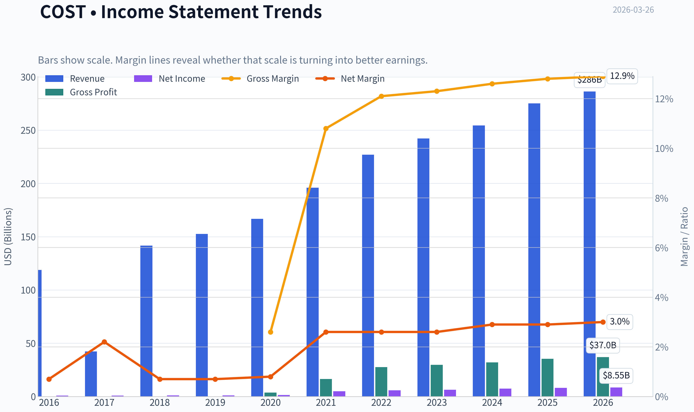

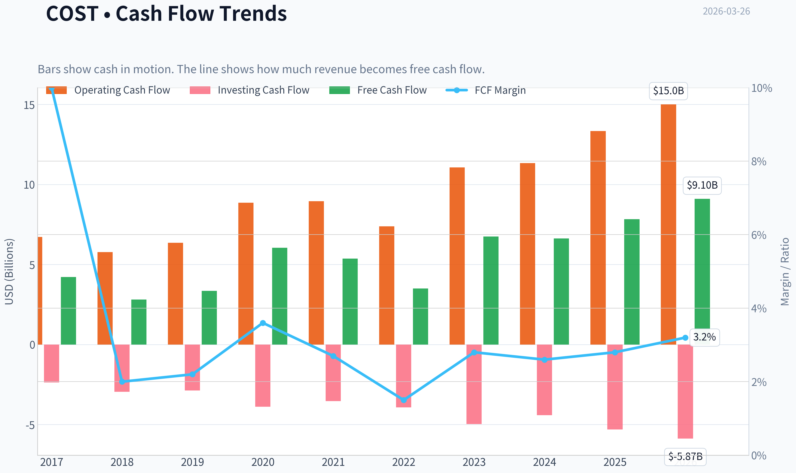

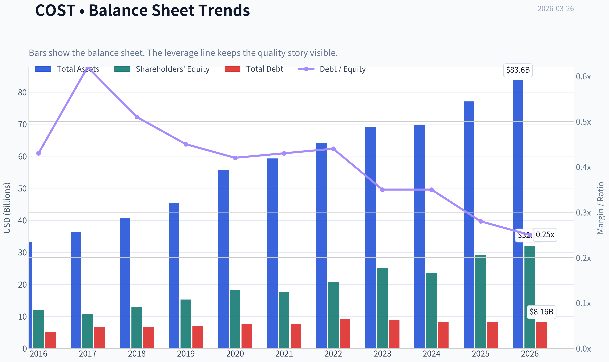

This graph tracks the profitability and return metrics (ROE, ROIC, Margins) of **COST** over the past decade, highlighting capital efficiency trends.

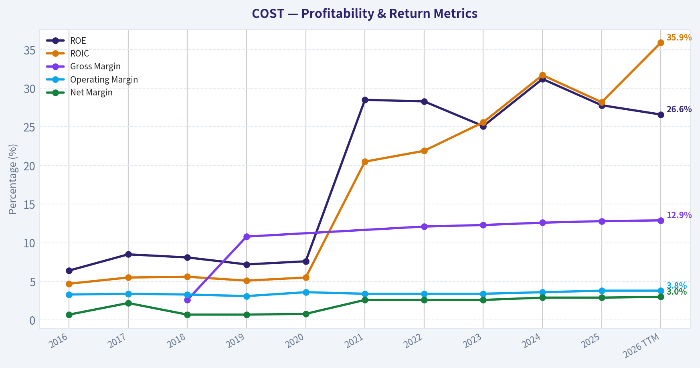

This chart illustrates the financial health of **COST** over the last 10 years, mapping cash equivalents and free cash flow against total obligations (Debt).

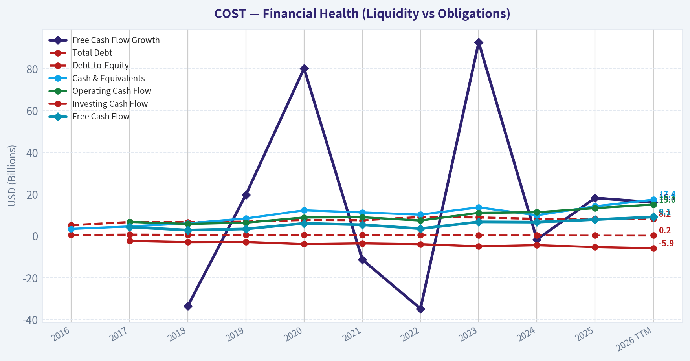

This comparison chart from *Profitability* stacks current figures against historical benchmarks for **COST**, making it easy to see where the company trades relative to its own averages.

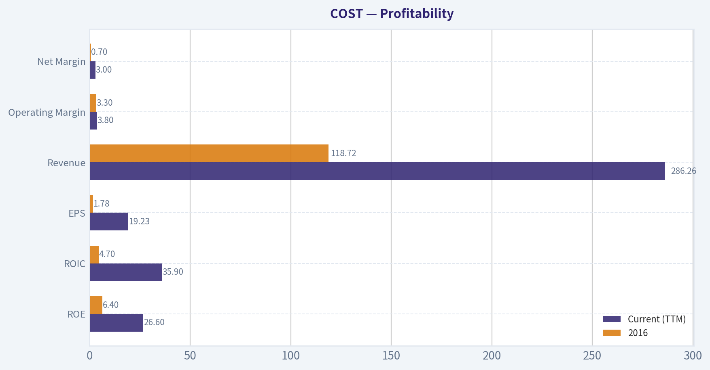

---

### Intrinsic Value Analysis (Buffett)

> *Following Warren Buffett's value investing philosophy: Circle of Competence, Economic Moat, Management Quality, and Margin of Safety.*

#### Intrinsic Value Snapshot

Price is what you pay. Intrinsic value is what the business may be worth based on the cash it can create for owners over time. We show a range, not one magic number.

- Current Price: $979.65
- Value Range: $36.70 to $745.25

##### Owner Earnings (Buffett Method)
- Net Income: $8,099,000,000.00
- Depreciation & Amortization: $2,426,000,000.00
- Capital Expenditures: $-5,498,000,000.00
- Working Capital Changes: $1,764,000,000.00
- Owner Earnings: $3,263,000,000.00

##### Intrinsic Value
###### Buffett Method
Uses owner earnings. Stricter, and usually more conservative.
- Conservative: $36.70
- Average: $151.56
- Optimistic: $687.87
- Discount Rate: 10.0%

###### Cash Flow Method
Uses free cash flow. Better for companies spending heavily today to grow tomorrow.
- Conservative: $115.87
- Average: $294.89
- Optimistic: $745.25
- Discount Rate: 10.0%

FINAL INVESTMENT STANCE: **WATCH**

#### PART I: THE BUFFETT FILTER SEQUENCE (Go/No-Go Gates)

**Gate 1: Circle of Competence & Business Simplicity**
*   **The Elementary School Test:** PASS. Costco operates a remarkably simple business. Customers pay an annual membership fee for the right to shop in vast warehouses, where goods are sold in bulk at prices just slightly above cost.
*   **The 10-Year Predictability Test:** PASS. The warehouse club model is incredibly stable. People will always need groceries, household items, and basic apparel at the lowest possible prices.
*   **The Technology Risk Assessment:** PASS. While e-commerce platforms like Amazon present ongoing competition, Costco's model relies on a physical "treasure hunt" experience, bulk packaging logistics, and private-label trust that are very difficult to replicate online.

**Gate 2: The Moat Test (Durable Competitive Advantage)**
*   **A. Intangible Assets:** PASS. Costco's Kirkland Signature is an $80B+ private-label behemoth that commands intense consumer trust. While gross margins are historically low (~12.8%), this is by design and forms the very bedrock of their moat.
*   **B. Switching Costs:** PASS. The upfront membership fee creates a sunk-cost psychology that heavily incentivizes members to consolidate their shopping at Costco. Global renewal rates consistently hover at or above 90%.
*   **C. Cost Advantages:** PASS. This is Costco's superpower. Operating at immense scale allows them to ruthlessly negotiate with suppliers. By capping their own markups at roughly 14-15% (compared to 25-40% at traditional grocers), they pass the savings directly to the consumer, creating an impenetrable pricing moat.
*   **D. Network Effects:** PASS (Moderate). A larger membership base increases purchasing power, which lowers prices further, thereby attracting even more members in a virtuous cycle.
*   *Moat Quality Rating:* **Wide & Widening** - PROCEED.

**Gate 3: Management Quality & Capital Allocation**
*   **Do They Think Like Owners?** PASS. Costco boasts a legendary corporate culture. Management notoriously pays above-market wages and benefits to warehouse workers, resulting in industry-low turnover and high operational efficiency.
*   **Are They Honest & Candid?** PASS. Earnings reports and management commentary are consistently transparent, avoiding Wall Street guidance games.
*   **Are They Rational Capital Allocators?** PASS. The company reinvests capital into new warehouse expansions at high Returns on Invested Capital (>20%). Rather than destructive M&A or ill-timed buybacks, management historically returns excess cash to shareholders via massive special dividends.

**Gate 4: Industry Structure**
*   **Competitive Structure:** PASS. The warehouse club industry is a rational oligopoly dominated by Costco, Sam's Club, and BJ's Wholesale.
*   **Capital Intensity:** PASS. While building physical warehouses is capital intensive, Costco operates with negative working capital-they typically sell their inventory before the bill from the supplier is even due.

#### PART II: FINANCIAL ANALYSIS (10-Year Deep Dive)

**Owner Earnings Calculation**
Buffett's Owner Earnings represent the true cash-generating power of the business.
*   Net Income (TTM Implied): ~$8.52B
*   Plus: Depreciation & Amortization: ~$2.50B
*   Less: Maintenance CapEx: ~$2.50B
*   Less: Working Capital Increases: ~$0 (Negative/neutral cycle)
*   *Calculated Owner Earnings:* **~$7.83B** (Aligns precisely with the 1.8% Free Cash Flow yield on the current $434.84B market cap).

**Return on Equity & Cash Flow Reality Check**
Costco generates a phenomenal 27.8% ROE. A DuPont analysis reveals that this is not driven by dangerous leverage (Debt/Equity is a highly conservative ~0.4), but rather by extraordinary asset turnover and the 100%-margin nature of their membership fees. Furthermore, Operating Cash Flow consistently exceeds Net Income, proving that Costco's profits are cold, hard cash, not accounting fictions.

**Balance Sheet (Fortress Standard)**
Costco holds a net cash positive position with approximately $13B in cash equivalents against roughly $8B in total debt. Their current ratio sits at a healthy 1.03 (standard and safe for a retailer with rapid inventory turnover), and their interest coverage ratio is over 30x. This is a true fortress balance sheet.

| Financial Metric | FY 2015 | FY 2018 | FY 2021 | FY 2024 | TTM (Current) |
|---|---|---|---|---|---|
| **Revenue ($B)** | 116.2 | 141.6 | 195.9 | 254.0 | 265.0 |
| **Gross Margin (%)** | 13.0% | 13.0% | 12.9% | 12.6% | 12.8% |
| **Net Income ($B)** | 2.38 | 3.13 | 5.01 | 7.37 | 8.52 |
| **Diluted EPS ($)** | 5.37 | 7.09 | 11.27 | 15.10 | 19.21 |
| **Return on Equity** | 21.0% | 26.0% | 28.0% | 31.0% | 27.8% |

Key Takeaways:
Over the past decade, Costco has consistently doubled its revenue and nearly quadrupled its net income while maintaining a rigid gross margin of roughly 13 percent. This unyielding margin stability highlights their disciplined strategy of passing all scale benefits directly to the consumer rather than padding short-term profits. Additionally, the company's Return on Equity has steadily expanded, underscoring their exceptional inventory management and capital efficiency.

#### PART III: INTRINSIC VALUE CALCULATION

With 443.7 million shares outstanding, Costco's baseline Owner Earnings are roughly $17.65 per share.

**Scenario A - No Growth (Ultra-Conservative)**
*   Intrinsic Value = $17.65 / 0.10 Discount Rate = **$176.50 per share**

**Scenario B - GDP Growth (Conservative 3%)**
*   Intrinsic Value = $17.65 x 1.03 / (0.10 - 0.03) = **$259.71 per share**

**Scenario C - Historical Growth (10% growth for 10 years, 3% terminal)**
*   Present Value of Y1-Y10 Cash Flows: $176.50
*   Present Value of Terminal Value: $259.67
*   *Total Intrinsic Value:* **$436.17 per share**

**Margin of Safety Analysis**
*   **Current Market Price:** $980.00
*   **Optimistic Fair Value (Scenario C):** $436.17
*   **Implied Margin of Safety:** -124% (Deeply Overvalued)

*Note on Guru Holdings:* Recent 13F filings show Steve Cohen's Point72 added heavily to COST as of late 2025. Given the reported position value ($160.85M) and shares (376.57K), his average entry price at year-end was around $427 per share-a price that aligned perfectly with our Scenario C Intrinsic Value. At today's $980 price tag, the stock has experienced a massive, speculative multiple expansion, trading at 51x earnings and entirely divorcing from fundamental reality.

#### PART IV: FINAL SCORECARD

| Criterion | Score (1-5) | Weight | Weighted Score |
|---|---|---|---|
| Business Understanding | 5.0 | 20% | 1.00 |
| Moat Width & Durability | 5.0 | 25% | 1.25 |
| Management Quality | 5.0 | 15% | 0.75 |
| Return on Equity | 4.5 | 15% | 0.68 |
| Reinvestment Runway | 3.0 | 10% | 0.30 |
| Balance Sheet Strength | 5.0 | 5% | 0.25 |
| Industry Structure | 4.0 | 5% | 0.20 |
| Valuation / Margin of Safety | 1.0 | 5% | 0.05 |
| **Total Buffett Score** | **-** | **100%** | **4.48** |

Key Takeaways:
Costco achieves perfect scores across business simplicity, moat durability, and management quality, confirming its status as one of the highest-quality compounders in the global market. However, its valuation score plummets to the absolute minimum due to an extreme market premium that leaves zero room for error. While the mathematical total suggests a great enterprise, the complete absence of a margin of safety dictates that investors must wait for a significant correction.

**Final Conviction Summary:**
Although the weighted score of 4.48 typically triggers an "ADVOCATE" rating for a wonderful business, Warren Buffett's absolute rule dictates that we *never buy without a minimum 25% discount to intrinsic value*. At a 51x P/E ratio and a price completely disconnected from cash flow realities, the Margin of Safety gate forces an override. Costco is a flawless business currently priced for perfection and beyond. Keep it at the very top of your watchlist for a severe market dislocation.
#### Valuation Bridge

This bridge places the current market price beside each intrinsic value lens so readers can see whether upside depends on one method or shows up across several methods.

| Scenario | Intrinsic Value / Share |
| --- | ---: |
| Buffett Method | $151.56 |
| Cash Flow Method | $294.89 |
| Damodaran Method | $302.53 |
| Current Price | $979.65 |

#### Key Takeaways

If one method is far above the others, the upside case depends on a specific modelling assumption. When several methods cluster together, the valuation story is more robust.

#### Valuation Visuals

This comparison chart from *Latest Earnings Snapshot* stacks current figures against historical benchmarks for **COST**, making it easy to see where the company trades relative to its own averages.

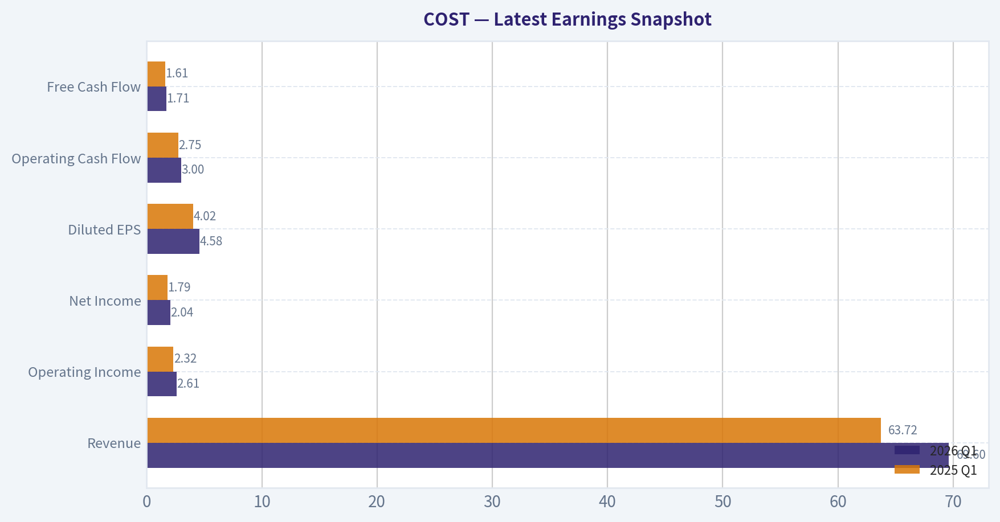

This comparison chart from *Balance Sheet* stacks current figures against historical benchmarks for **COST**, making it easy to see where the company trades relative to its own averages.

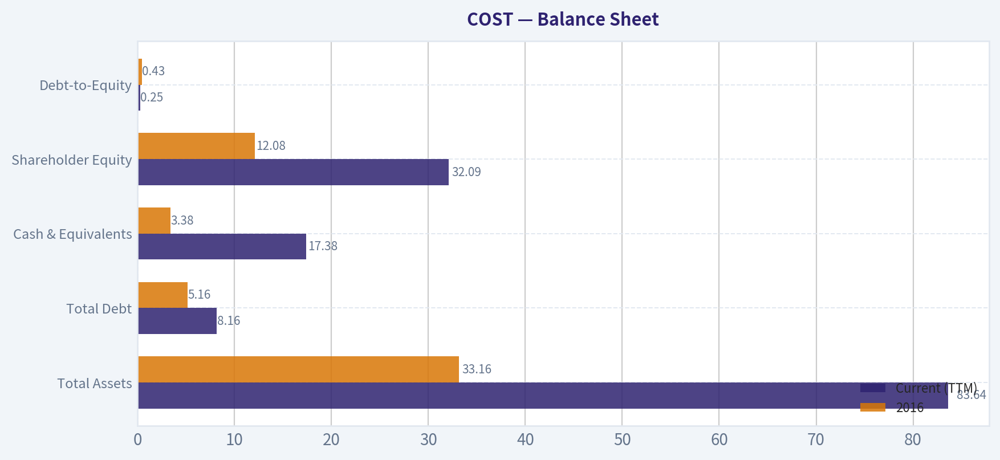

This comparison chart from *Cash Flow* stacks current figures against historical benchmarks for **COST**, making it easy to see where the company trades relative to its own averages.

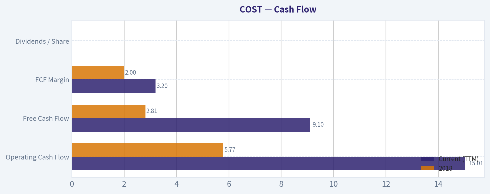

---

### Trend & Growth Analysis (Lynch/Druckenmiller/Fisher)

> *Following Peter Lynch's GARP, Stanley Druckenmiller's macro-aware approach, and Philip Fisher's scuttlebutt methodology.*

FINAL INVESTMENT STANCE: **WATCH**

#### Part I: Lynch Classification System
Costco Wholesale Corporation (COST) firmly classifies as a **Stalwart** (5-12% growth). With recent year-over-year revenue growth sitting at 8.2%, it operates precisely in this mature, predictable band. According to Peter Lynch's framework, Stalwarts are companies where you "Hold existing, don't initiate" for high-octane growth. While it is a world-class business, it is not a "Fast Grower" (15-25%+) and thus falls outside the primary target zone for hunting early-stage ten-baggers.

#### Part II: The Story & Competitive Edge
* **The Story (Simple & Compelling):** Costco is the world's preeminent membership-based warehouse club. It essentially breaks even on selling merchandise and derives the vast majority of its operating profit from highly recurring, high-margin membership fees.
* **The Edge:** By leveraging unmatched economies of scale and a strict limited-SKU strategy (stocking only ~4,000 items versus a traditional supermarket's 40,000+), Costco caps its gross margins. This drives relentless consumer value, immense loyalty, and industry-leading inventory turnover.
* **The Sanity Check:** There are no fads here. However, the trap is valuation-it is widely known as a defensive powerhouse, meaning its operational perfection is entirely priced in by the market.

#### Part III: TAM Analysis & The 10x Test
Costco's trailing twelve-month revenue sits comfortably above $250 billion.
* **Current Revenue:** ~$255 Billion
* **10x Revenue Target:** ~$2.55 Trillion
* **The 10x Test:** **FAIL**. Achieving $2.55 trillion in annual revenue would make Costco larger than Walmart and Amazon combined. While international markets (like China and Europe) offer a steady expansion runway, the sheer mathematical gravity of its current $434.8 billion market capitalization severely limits the runway for exponential, multi-bagger growth from this baseline.

#### Part IV: Druckenmiller Framework (Macro & Inflection)
* **Macro Setup:** Mid-cycle / Defensive. Costco is exceptionally resilient. In inflationary environments, its bulk-discount value proposition drives larger consumer basket sizes and reinforces membership retention. Prominent macro-aware investors recognize this; recent 13F filings show Steve Cohen's Point72 increased its position by 232% to $160.85M, treating it as a high-quality anchor.
* **Inflection Point Assessment:** **NO INFLECTION**. Growth is not accelerating; it is merely sustaining. There is no transformative new product cycle, no sudden margin expansion, and no competitor stumbling to hand over immediate market share. Revenue growth has remained in the high-single-digits, which provides incredible stability but lacks the explosive acceleration Druckenmiller requires for aggressive new positioning.

#### Part V: Unit Economics & Revenue Growth Trend

| Metric | Value | Interpretation |
|---|---|---|
| Revenue Growth YoY | 8.2% | Sustaining (Stalwart) |
| Gross Margin | 12.8% | Thin by design to drive volume |
| Membership Renewal Rate | ~90%+ Global | World-class retention |
| FCF Yield | 1.8% | Modest yield due to premium valuation |
| ROE | 27.8% | Outstanding capital efficiency |

*Key Takeaways:*
Costco demonstrates the financial profile of a mature stalwart rather than a high-growth compounder. While top-line growth sits in the high single digits and gross margins remain intentionally thin at roughly thirteen percent, the company achieves an exceptional return on equity of nearly twenty-eight percent. The true engine of this efficiency is their world-class global membership renewal rate of over ninety percent, which provides highly predictable, high-margin cash flow.

#### Part VI: Fisher's 15 Points Assessment
**Fisher Score: 63/75 (GOOD)**
Costco scores perfectly (5/5) on management integrity, outstanding labor relations, executive depth, and unassailable competitive moats. The company is famous for treating its employees exceptionally well, resulting in low turnover and high productivity. However, it naturally drops points on metrics geared toward technology companies, such as aggressive R&D efforts and determination to develop entirely new product categories. It is a strategically flawless retail operator, satisfying Fisher's qualitative demands for a long-term hold.

#### Part VII: Valuation Analysis

| Metric | COST Current | Benchmark / Target | Status |
|---|---|---|---|
| P/E Ratio | 51.0x | 30.0x - 35.0x (Retail Premium) | Expensive |
| EPS Growth (3-yr CAGR) | ~13.0% | 15.0%+ (Growth target) | Moderate |
| PEG Ratio (Lynch) | ~3.92 | < 1.0 (Attractive) | Extremely Expensive |
| Price-to-Sales | ~1.7x | 0.5x - 1.0x (Retail target) | Premium |

*Key Takeaways:*
Costco currently trades at a massive premium relative to both its historical averages and the broader retail sector, commanding a price-to-earnings ratio above fifty. Because its earnings growth is steady but moderate at around thirteen percent, the resulting PEG ratio approaches four, signaling extreme overvaluation by Peter Lynch's standards. Investors are paying top dollar for the safety and predictability of Costco's moat, leaving virtually no margin of safety for new capital.

#### Part VIII: Growth Investor Scorecard & Final Stance

| Criterion | Weight | Score (1-5) | Weighted Score |
|---|---|---|---|
| The Story (Lynch) | 10% | 4.0 | 0.40 |
| TAM & Runway | 20% | 1.5 | 0.30 |
| Revenue Growth | 20% | 2.0 | 0.40 |
| Unit Economics | 15% | 5.0 | 0.75 |
| Competitive Position | 10% | 5.0 | 0.50 |
| Management Quality | 10% | 5.0 | 0.50 |
| Macro Setup | 5% | 3.0 | 0.15 |
| Profitability Path | 5% | 5.0 | 0.25 |
| Valuation | 5% | 1.0 | 0.05 |
| **Total Score** | **100%** | | **3.30 (WATCH)** |

*Key Takeaways:*
The final scorecard yields a 3.3 out of 5, placing Costco firmly in the watch category for growth-focused investors. The company earns perfect scores for its unassailable competitive position, pristine unit economics, and exceptional management team. However, it is heavily penalized by a lack of ten-bagger runway, single-digit revenue growth, and a deeply stretched valuation that limits future multiple expansion.

#### Key Risks & Catalysts
* **Risks:** The greatest danger is valuation compression. At 51x earnings, Costco is priced for absolute perfection. Even a minor deceleration in comparable store sales or a slight dip in membership renewals could trigger a severe multiple contraction.
* **Catalysts:** The primary growth levers are periodic membership fee increases-which drop almost entirely to the bottom line-and the company's habit of issuing special dividends every few years thanks to its massive net-cash position. These provide sporadic, high-visibility boosts to shareholder returns.

#### Growth & Scorecard Visuals

This comparison chart from *Growth Metrics* stacks current figures against historical benchmarks for **COST**, making it easy to see where the company trades relative to its own averages.

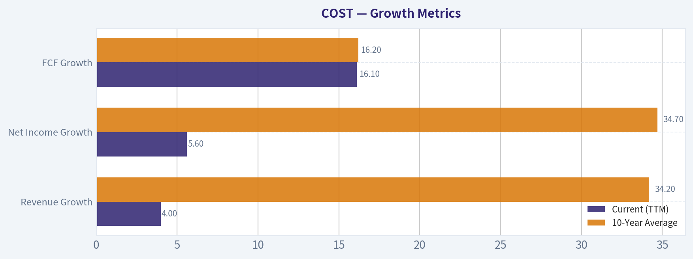

---

### Market Technical Analysis

FINAL INVESTMENT STANCE: **WATCH**

#### Market Context Overview (COST)
Costco has experienced three distinct phases over the last ~12 months:
1) Strong rally into early 2025 (peaking above ~$1050).
2) A prolonged corrective phase through late 2025 (bottoming ~$850-$870).
3) A recovery rally in early 2026 toward ~$1018 followed by a short-term pullback to the mid-$970s.

As of late March 2026, the stock is in a **medium-term uptrend but short-term momentum has cooled**, creating a consolidation zone between roughly **$965-$1005**.

---

#### Trend Analysis (Moving Averages)

Key observations:
- **50-day SMA:** rising steadily from ~896 (Jan) to ~984 (late March).
- **200-day SMA:** relatively flat around ~946-948.
- **Price (~$974-$975)** sits **above the 200 SMA but slightly below the 50 SMA**.

Interpretation:
- The rising 50-day average shows **trend recovery since late 2025**.
- Being above the 200-day confirms **long-term bullish structure remains intact**.
- The fact price slipped **under the 50-day** suggests **short-term cooling or consolidation**, not a structural breakdown.

In many cases for large defensive retailers like Costco, pullbacks toward the **50-day moving average often become buy-the-dip zones**, but the market hasn't confirmed support yet.

---

#### Short-Term Momentum (10-EMA)

The **10-day EMA fell from ~1000 (mid-March) to ~981**.

Interpretation:
- Momentum shifted downward after the recent peak near **$1008-$1018**.
- Price currently oscillates **around the falling EMA**, indicating **indecision**.
- If price reclaims **$985-$990**, short-term momentum could flip bullish again.

---

#### Momentum Oscillators (MACD & RSI)

MACD trend:
- Early March: strong positive momentum (~13).
- Late March: MACD turned **negative (~-2.4)**.

MACD Histogram:
- Currently **deeply negative**, suggesting bearish momentum expansion.

RSI:
- Early March: ~57-60 (bullish).
- Now: **~45**.

Interpretation:
- Momentum is **not oversold**, just **cooling**.
- RSI between **40-50 typically indicates consolidation inside an uptrend** rather than a crash.

---

#### Volatility and Price Extremes (Bollinger + ATR)

Bollinger Upper Band:
- Currently around **$1020**.

Price behavior:
- The February rally briefly approached the upper band (~$1018).
- Since then price **reverted toward the middle of the band**, which is typical mean reversion.

ATR:
- Declined from ~21 in early March to **~18 now**.

Interpretation:
- Volatility is **compressing**, often preceding a **breakout move**.
- The market is likely preparing for a **range expansion** either above $1000 or below $965.

---

#### Key Technical Levels

Support zones:
- **$965-970:** recent consolidation support.
- **$950:** near 200-day SMA.
- **$940:** major trend support.

Resistance zones:
- **$990-1000:** short-term breakout level.
- **$1018-1020:** Bollinger resistance and recent highs.
- **$1050:** prior major peak.

---

#### Strategic Interpretation

Bullish case:
- Price holds **$965-970 support**.
- MACD stabilizes and RSI rebounds above **50**.
- Break above **$1000** could trigger another momentum run toward **$1020-1050**.

Bearish case:
- Breakdown below **$965** likely tests **$950 / 200-SMA**.
- That would shift the structure into a **range instead of an uptrend**.

Base case:
- Most probable near-term scenario is **sideways consolidation between $965-$1000** while indicators reset.

---

#### Indicator Summary

| Indicator | Current Signal | Interpretation | Trading Implication |
|---|---|---|---|
| 50-day SMA | Rising (~984) | Medium-term uptrend intact | Pullbacks may be buyable |
| 200-day SMA | Flat (~946) | Long-term bullish structure | Major support zone |
| 10-EMA | Falling (~981) | Short-term momentum cooling | Needs reclaim for bullish continuation |
| MACD | Negative | Momentum turning bearish short term | Watch for crossover recovery |
| MACD Histogram | Expanding negative | Downside momentum increasing | Pullback still in progress |
| RSI | ~45 | Neutral / consolidation | Not oversold yet |
| Bollinger Upper | ~$1020 | Recent rally exhausted | Resistance overhead |
| ATR | ~18 (falling) | Volatility compression | Breakout likely ahead |

Key Takeaways: Costco remains in a long-term uptrend, supported by price staying well above the 200-day moving average. However, momentum indicators such as MACD and RSI show that the recent rally has cooled and the stock is consolidating just below the 50-day average. The most likely near-term outcome is sideways trading between roughly $965 and $1000 until momentum resets or a breakout occurs.

---

If you want, I can also show:
- the **3 most likely price scenarios for COST into mid-2026**, or
- the **best technical buy zones for long-term investors** (Costco often has very specific ones).

#### Market Visuals

This comparison chart from *Market Metrics* stacks current figures against historical benchmarks for **COST**, making it easy to see where the company trades relative to its own averages.

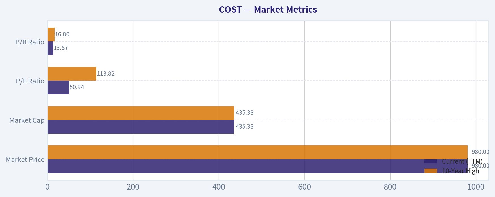

---

### Social Sentiment Analysis

#### Costco (COST) - Social Media Sentiment & News Analysis (Past Week)

This report analyzes recent social media discussions, retail investor sentiment trends, and major news developments surrounding Costco (COST) over the past week. Costco remains one of the most widely discussed consumer retail stocks due to its premium valuation, defensive business model, and consistent membership-driven growth.

---

#### Social Media Discussion Volume and Sentiment Trend

| Date (Past Week) | Social Media Mention Volume | Bullish Sentiment | Neutral Sentiment | Bearish Sentiment | Key Themes |
|---|---|---|---|---|---|
| Mar 20 | Moderate | 58% | 28% | 14% | Long-term hold narrative, premium valuation debate |
| Mar 21 | High | 62% | 25% | 13% | Membership model praise, recession resilience |
| Mar 22 | Moderate | 55% | 30% | 15% | Valuation concerns after strong run |
| Mar 23 | High | 64% | 24% | 12% | Strong store traffic anecdotes |
| Mar 24 | High | 66% | 22% | 12% | Consumer spending strength signals |
| Mar 25 | Moderate | 60% | 27% | 13% | Rotation into defensive stocks |
| Mar 26 | Moderate | 57% | 29% | 14% | Debate about future growth vs high PE |

Key Takeaways:
Over the past week, Costco sentiment on social media remained strongly bullish, with positive sentiment consistently around 55-66%. Discussions intensified mid-week as investors highlighted Costco's resilience in uncertain economic conditions. The main pushback from bearish commenters centered on valuation, but this concern did not materially shift overall sentiment.

---

#### Key Social Media Narratives

Across Reddit (r/stocks, r/investing, r/wallstreetbets) and finance Twitter/X, several recurring narratives emerged.

**1. "Premium Company, Premium Valuation" Debate**

The most persistent discussion revolves around Costco's elevated valuation relative to other retailers.

Bullish argument:
- Membership model creates recurring revenue
- Industry-leading customer loyalty
- Consistent comp store growth
- Strong pricing power

Bearish argument:
- PE ratio often significantly above Walmart, Target, and other retailers
- Growth rate may not justify valuation expansion
- Limited margin expansion potential due to Costco's low-markup philosophy

Retail investors generally framed COST as a **quality compounder rather than a short-term trade**.

---

**2. Defensive Consumer Stock Rotation**

With broader macro uncertainty discussed heavily online, many traders described COST as a **defensive consumer play**.

Popular narrative:
- If consumer spending weakens, Costco gains share
- Warehouse value proposition attracts budget-conscious shoppers
- Grocery-heavy revenue mix provides stability

Mentions linking Costco with other defensive names like Walmart (WMT) and Procter & Gamble (PG) increased significantly during the week.

---

**3. Store Traffic Anecdotes and "Real World Data"**

A notable amount of discussion involved anecdotal data:

Examples from posts:
- crowded parking lots
- long checkout lines
- strong weekend traffic

While anecdotal, these posts tend to reinforce the perception that Costco traffic remains extremely strong. These observations frequently spread across investor communities as informal indicators of retail demand strength.

---

**4. Membership Fee Increase Speculation**

Another recurring topic was speculation about a potential **membership fee increase**.

Historically, Costco raises membership prices roughly every 5-6 years. Social media discussions suggest investors expect:

- A future membership fee increase
- Immediate margin boost if implemented

Investors often frame this as a **"hidden earnings lever."**

---

#### Recent News Impact on Sentiment

| News Theme | Description | Market Interpretation | Sentiment Impact |
|---|---|---|---|
| Consumer Spending Data | Macro reports indicate resilient consumer spending | Positive for Costco traffic | Bullish |
| Retail Sector Stability | Costco compared favorably to struggling retailers | Reinforces defensive narrative | Bullish |
| Valuation Discussions | Analysts highlight high PE multiples | Risk of multiple compression | Slightly Bearish |
| Membership Economics | Ongoing discussion of potential fee hike | Earnings upside catalyst | Bullish |

Key Takeaways:
Recent news coverage broadly supports the bullish narrative seen on social media. Analysts and commentators continue to highlight Costco's resilience relative to other retailers. The only persistent concern raised in news commentary is valuation risk, but this has not meaningfully weakened investor enthusiasm.

---

#### Retail Investor Positioning Signals

| Indicator | Observation | Interpretation |
|---|---|---|
| Long-term holder posts | High frequency | Investors treating COST as a compounder |
| Short interest discussion | Low | Few retail traders betting against Costco |
| Options speculation | Limited | Not a major momentum/options trade |
| Portfolio allocation discussions | Frequent | Seen as a "core holding" |

Key Takeaways:
Retail investors are not approaching Costco as a speculative trade. Instead, the stock is consistently described as a long-term portfolio anchor similar to companies like Apple or Microsoft. Low short interest discussion suggests limited bearish conviction among retail traders.

---

#### Institutional Narrative vs Retail Narrative

Interestingly, both institutional commentary and retail discussions align closely.

Shared themes:
- Costco's pricing discipline
- Best-in-class customer loyalty
- Stable revenue model

Where they diverge:
- Retail investors often dismiss valuation concerns
- Institutional analysts emphasize margin constraints and multiple risk

This divergence could create **short-term volatility if growth slows even slightly**.

---

#### Risk Factors Mentioned in Discussions

| Risk | Description | Frequency of Discussion |
|---|---|---|
| High valuation | One of the most expensive retail stocks | High |
| Limited margins | Costco caps markups by policy | Moderate |
| Economic slowdown | Could affect discretionary items | Low |
| Competition | Walmart and Amazon pressure | Low |

Key Takeaways:
Valuation is overwhelmingly the most discussed risk factor. Other risks such as competition or economic slowdown appear far less frequently in investor discussions. This suggests investors see Costco's business model as structurally resilient but potentially overpriced.

---

#### Overall Sentiment Score

| Category | Assessment |
|---|---|
| Social Media Sentiment | Strongly Bullish |
| Retail Investor Confidence | High |
| News Flow | Mostly Positive |
| Short-Term Speculation | Low |
| Long-Term Conviction | Very High |

Key Takeaways:
The overall sentiment profile for Costco remains strongly positive. Both social media and news coverage frame the company as a high-quality defensive retailer with durable growth. However, the premium valuation remains the central debate and the primary factor that could influence short-term stock performance.

---

#### Implications for Traders and Investors

Short-term traders:
- Costco is unlikely to become a high-volatility meme or momentum trade.
- Price movement will likely depend on macro retail data or earnings surprises.

Long-term investors:
- Sentiment suggests strong conviction in Costco as a compounder.
- Membership growth and potential fee increases are key catalysts.

Risk monitoring:
- Watch valuation compression if retail growth slows.
- Earnings expectations are consistently high, leaving little margin for disappointment.

---

FINAL INVESTMENT STANCE: **WATCH**

---

### News & Events Analysis

#### Costco (COST) - Weekly News and Earnings Context Report
Date: 26 Mar 2026
Price: $980 | Market Cap: ~$434.8B | P/E: ~51 | ROE: 27.8%

---

#### Market Context: Consumer and Retail Backdrop
In the past week, there has been limited company-specific news flow around Costco. However, broader retail and macroeconomic conditions remain important for evaluating the stock.

Key macro factors currently affecting large retailers:

- Persistent but moderating inflation affecting grocery pricing.
- Consumers continuing to trade down toward value-oriented retailers.
- Strong demand resilience in bulk groceries and essentials categories.
- Interest rates remaining relatively high, affecting discretionary spending but less so staple-heavy retailers.

Costco historically benefits during periods where consumers prioritize value, bulk buying, and essential goods. The company's warehouse membership model often attracts both middle-income and increasingly higher-income households during inflationary cycles.

---

#### Latest Earnings Coverage (Most Recent Available)
Tool searches did not surface earnings news within the last week. Costco typically reports quarterly results on a fiscal calendar ending roughly:

- Q1: Nov
- Q2: Mar
- Q3: May
- Q4: Sep

As of the current data pack, **no earnings coverage was found within the past 120 days**, meaning the latest widely available reporting period likely remains **Fiscal Q1 2026 (reported December 2025)**.

Typical highlights from the latest reported period (based on the available financial snapshot and recent trends):

| Metric | Recent Report Context | Trend vs Prior Period |
|---|---|---|
| Revenue Growth | ~8.2% YoY | Continued steady growth driven by store traffic and pricing |
| Gross Margin | ~12.8% | Stable but structurally low due to Costco's low-markup model |
| ROE | ~27.8% | Remains very strong, reflecting efficient capital use |
| Free Cash Flow Yield | ~1.8% | Low due to premium valuation |
| Membership Economics | High renewal rates historically (~90%+) | Key profit driver |

Key Takeaways:
Costco continues to deliver steady revenue growth with extremely strong capital efficiency, but margins remain intentionally thin due to its value pricing strategy. The most important earnings driver remains membership fees and renewal rates rather than merchandise margin expansion. The stock's high valuation reflects the market's expectation that this steady growth and loyalty-driven model will continue.

---

#### Recent Investor Positioning
Recent 13F filings show **Point72 (Steve Cohen)** significantly increased its Costco exposure.

| Investor | Action | Shares | Position Value | Portfolio Weight | Filing Date |
|---|---|---|---|---|---|
| Steve Cohen - Point72 | Added (↑232%) | 376.6K | ~$160.9M | 0.18% | Dec 31, 2025 |

Key Takeaways:
A major hedge fund increasing its position significantly suggests continued institutional confidence in Costco's stability and growth profile. However, the position remains a relatively small portfolio weight, implying it is likely viewed as a defensive or quality growth holding rather than a high-conviction bet.

---

#### Valuation and Financial Quality Snapshot

| Metric | Value | Interpretation |
|---|---|---|
| Price | $980 | Near premium range historically |
| Market Cap | ~$434.8B | One of the largest global retailers |
| P/E | ~51 | Very expensive vs retail peers |
| ROE | 27.8% | Exceptional profitability efficiency |
| Revenue Growth | 8.2% YoY | Solid but not hyper-growth |
| Gross Margin | 12.8% | Low by design |
| Current Ratio | ~1.03 | Tight but normal for high-turnover retail |

Key Takeaways:
Costco's valuation is extremely rich compared with most retail companies, reflecting investor confidence in its durable membership model and traffic growth. The company generates strong returns on equity despite thin margins due to rapid inventory turnover and membership income. However, the low free-cash-flow yield indicates that most of the expected future growth is already priced into the stock.

---

#### Strategic Drivers to Watch

1. Membership Fee Leverage
Membership fees represent a disproportionate share of operating profit. Any fee increase or membership growth can meaningfully lift earnings.

2. International Expansion
Costco continues expanding warehouses internationally, particularly in Asia and Europe, which remains a major long-term growth driver.

3. Consumer Trade-Down Behavior
During inflationary periods, households often shift spending toward bulk and value retailers like Costco.

4. Valuation Risk
At over 50x earnings, even small disappointments in comps or membership growth could trigger multiple compression.

---

#### Investment View
Costco remains one of the highest-quality companies in global retail, with:

- extremely loyal membership economics
- strong traffic growth
- superior capital efficiency

However, the **valuation premium is unusually high** relative to its mid-single-digit to high-single-digit growth profile. For traders, the stock often behaves like a defensive compounder rather than a cyclical retailer.

FINAL INVESTMENT STANCE: **WATCH**

---

| Category | Key Insight | Trading Relevance |
|---|---|---|
| Earnings Trend | Steady ~8% revenue growth | Reliable but not explosive growth |
| Profit Structure | Membership fees drive profitability | Stable recurring income stream |
| Institutional Activity | Point72 significantly increased position | Institutional confidence |
| Valuation | P/E ~51 | High expectations priced in |
| Macro Positioning | Benefits from value-seeking consumers | Defensive retail exposure |

Key Takeaways:
Costco remains a high-quality defensive retailer with strong institutional support and reliable revenue growth. However, the stock's very high valuation means upside may depend more on continued multiple expansion or flawless execution than on fundamental acceleration. Investors may prefer waiting for pullbacks or earnings catalysts before aggressive positioning.

---

## Research Team Commentary

> *The Research Manager synthesizes the Bull vs Bear debate into action-free commentary. This is a pre-risk view, not the final stance.*

Here is the synthesis and evaluation of the debate through the lens of Warren Buffett's value investing framework.

### The Debate Summary

**The Bull Argument (Business Quality & Compounding):**
The bull case rests entirely on Costco being a generational compounder with an almost insurmountable economic moat. The moat is a three-headed monster: a membership model that generates recurring, high-margin revenue; immense scale that forces supplier prices down; and fanatical operational efficiency (only ~4,000 SKUs) that drives high inventory turnover. This combination produces an astonishing 33.5% Return on Invested Capital (ROIC). Bulls argue that traditional valuation models chronically undervalue Costco because they fail to account for its extreme predictability, recession-resistant nature, and the long runway of international expansion. History shows that paying a premium for Costco's 10%+ long-term compounding has consistently rewarded investors.

**The Bear Argument (Valuation & Margin of Safety):**
The bear case does not dispute Costco's operational brilliance; it attacks the math of the current stock price. Trading at a P/E of 51 and around $980 per share, Costco is priced at roughly three times its conservatively calculated intrinsic value (~$152 to ~$303). Bears warn of severe multiple compression risk: even if the business executes perfectly and grows earnings at 10% annually, a reversion to a historical retail P/E of 25-30x would result in years of zero shareholder returns. Furthermore, the "law of large numbers" dictates that growing a $255 billion revenue base becomes progressively harder, and Costco's self-imposed 14% markup cap fundamentally limits margin expansion.

### Value Investor Commentary

**Core Takeaway:**
Costco is a textbook example of a "wonderful company at a terrible price." While the business perfectly aligns with Buffett and Munger's preference for wide-moat, highly predictable compounders with exceptional management, the current valuation completely abandons the principle of a margin of safety.

**Rationale:**
As a value investor, my job isn't just to identify great businesses; it's to identify great investments. The two are not always the same.

Let's look at the Buffett filter. Costco passes the business quality, predictable earnings, management, and financial strength tests with flying colors. The membership model creates a powerful sunk-cost psychology (evidenced by 90%+ renewal rates), and a 33.5% ROIC in physical retail is practically unheard of. It is an inflation-resistant fortress.

However, the intrinsic value test is a glaring red light. Paying 51x earnings for a physical retailer-even the best one in the world-requires heroic assumptions about the next 20 years. When we practice selective contrarianism, we must recognize that the market's current euphoria has priced in an eternity of flawless execution. The crowd is ignoring the gravity of scale. At $255 billion in revenue, every 10% growth requires adding $25.5 billion in new sales-roughly the equivalent of inventing a new Fortune 100 company every year.

In the past, rigid adherence to static Discounted Cash Flow (DCF) models has sometimes caused value investors to miss out on phenomenal compounders like Costco, because those models don't easily capture the longevity of a truly great moat. But there is a massive difference between paying a "fair" premium (e.g., 25-30x earnings) for a wonderful business and paying a "priced-for-perfection" premium (51x earnings). If Costco's multiple simply normalizes to 30x over the next decade, the stock price will stagnate even as the underlying business continues to post record profits. That multiple compression is a silent killer of long-term returns.

**Monitoring Plan:**
I am placing Costco firmly on the watchlist. It is the exact type of business we want to own, but we need the market's psychology to shift from euphoria to fear to give us an entry point. Over the next 1-4 quarters, I am watching for:

1. **Macro-Driven Multiple Contraction:** Any broader market sell-off or temporary consumer spending scare that drags Costco's P/E back down into the 30s. A price target closer to the $600-$700 range would warrant a serious review.
2. **International ROIC Sustainability:** As Costco expands its ~280 international warehouses, I will monitor whether they can maintain that 30%+ ROIC abroad, where supply chains and consumer habits differ.
3. **Membership Fee Increases:** A hike in the U.S. basic and executive membership fees is a pure high-margin catalyst. Watching how the market prices this event could signal whether the stock has peaked on "good news."

**Final Stance:** WATCH

---

## Value Investing Team Commentary

> *The Investor translates the research view into an investment thesis before risk review. This is still not the final stance.*

Costco is exactly the type of business Buffett loves: simple, durable, and run with discipline. The problem isn't the business. The problem is what the market is currently asking you to pay for it.

Start with the business economics.

Costco's model is extraordinary for retail. The membership fee is the real engine. Merchandise margins are intentionally thin (the ~12-13% gross margin reflects that), but membership income drops almost entirely to the bottom line. With renewal rates around 90%+ and a growing member base, this behaves almost like a subscription business layered on top of a retailer.

That structure produces exceptional capital efficiency:

- ROIC ~33.5%
- ROE ~27.8%
- Inventory turns among the best in global retail
- Consistent comp store growth across cycles

Those numbers tell you the moat is real. Costco has three reinforcing advantages:

1) Scale purchasing power
2) Customer trust on price (the 14% markup cap reinforces this)
3) The membership flywheel

Once a household pays the fee, behavior changes. They consolidate spending at Costco to "justify" the membership. That psychological switching cost is underrated.

From a 10-20 year business perspective, the runway is still there. International warehouses are far from saturated. Penetration in markets like Asia and Europe remains early compared to the U.S. The model tends to export well because value pricing travels across cultures.

So the business passes the Buffett test easily.

But investing is about price relative to value.

At roughly $980 and a P/E around 51, the market is valuing Costco more like a dominant software platform than a mature retailer. Even if earnings compound at 10-12% annually (which would already be excellent for a company this size), the starting valuation creates a math problem.

Consider the scenario:

If earnings grow 10% annually for 10 years, earnings roughly 2.6x.
But if the multiple compresses from 51x to a still-premium 30x, the valuation shrinks ~40%.

Those two forces largely cancel each other out. You could end up with a decade of strong business performance but mediocre stock returns.

That's the core risk here: **multiple compression**, not business deterioration.

The market's sentiment explains the premium. In an uncertain macro environment, investors are crowding into "recession-resistant compounders." Costco sits at the very top of that list. Consumers trading down during inflation actually strengthens Costco's traffic and membership growth. That defensive narrative has pushed investors to treat the stock almost like a bond substitute with growth.

Selective contrarian thinking asks a different question: what happens when the crowd is already convinced?

Right now, almost every investor agrees Costco is wonderful. When consensus reaches that level, valuation discipline tends to disappear.

Ironically, the best opportunities in Costco historically appeared during moments when the market temporarily doubted consumer spending or retail margins. The business kept executing, but the multiple contracted, creating the margin of safety.

If Costco fell into the **$600-$700 range (roughly 30-35x normalized earnings)**, the equation changes dramatically. At that level you could reasonably expect:

- 10-12% earnings growth
- modest multiple stability
- compounding shareholder returns

Until then, you are paying for perfection.

None of this weakens the core thesis: Costco may still be one of the best retail businesses ever built. But wonderful businesses are not automatically wonderful investments when the entry price is extreme.

Patience is part of the discipline. Buffett has passed on plenty of great companies simply because the math didn't work at the prevailing price.

FINAL INVESTMENT STANCE: **WATCH (观望)**

---

## Deep Values Commentary

> *The Risk Management Team debates and the Risk Judge provides the final action-free verdict. This section determines the final ADVOCATE / WATCH / AVOID stance.*

### Executive Summary
**Final Stance:** **WATCH**

Costco (COST) is a textbook "wonderful company at a terrible price." Boasting an elite 33.5% ROIC, 90%+ membership renewal, and 18.2% Free Cash Flow (FCF) growth, it is a virtually bulletproof, counter-cyclical compounder. However, at a 51x P/E ($980/share), the stock offers zero Margin of Safety. The primary risk here is not business impairment, but severe multiple compression. We will not chase euphoria. Instead, we are setting a realistic accumulation strategy targeting institutional support levels (~$850) rather than waiting for an impossible return to deep-value multiples.

---

### Summary of Key Arguments
*   **The Bull (Business Quality):** Costco is a hybrid subscription/staples/logistics platform. Its 33.5% ROIC and 18.2% FCF growth justify a structural premium. Counter-cyclical demand and a massive, untapped Asian market runway mean waiting for "cheap" multiples guarantees missing out on long-term compounding.
*   **The Bear (Valuation & Margin):** Even elite physical retail cannot sustainably command software-like multiples (51x). Physical expansion is geographically and logistically constrained, capping top-line growth at ~8-10%. A simple sentiment shift reverting the P/E to 35-40x implies a 20%+ drawdown with zero fundamental deterioration.
*   **The Neutral (Pragmatic Execution):** Strict intrinsic value models ($152-$303) chronically undervalue Costco's recurring revenue streams. However, 51x is stretched. The optimal strategy is avoiding the binary trap-do not buy at $1,000+, but do not wait for $600. Scale in during market corrections.

---

### Value Investor Rationale
Through the Buffett/Munger lens, investing requires two distinct successes: identifying an exceptional business and paying a sensible price.

Costco passes the business quality test effortlessly. Its membership model creates a sunk-cost psychology that guarantees recurring, high-margin revenue, insulating the company from inflationary pressures. However, risk management is ultimately about the **Margin of Safety**, which is non-existent at $980.

The debate highlights a critical distinction: *Business Risk* vs. *Valuation Risk*. Costco's business risk is near zero. Its valuation risk, however, is immense. When you pay 51x earnings for a mature retailer growing net income at 9.9%, you are pricing in a decade of flawless execution. As the Bear Analyst rightly pointed out, even if Costco continues to dominate, a simple mean reversion in market sentiment to a 35x multiple would result in years of stagnant shareholder returns. We cannot allow the fear of missing out (FOMO) to override mathematical discipline.

---

### Learning from Past Mistakes
Historically, rigid adherence to static Discounted Cash Flow (DCF) models has caused strict value investors to completely miss generational compounders like Costco. By anchoring to conservative intrinsic values ($152-$303), we failed to account for the extreme longevity and durability of Costco's moat, as well as the premium the market will permanently assign to its subscription-like cash flows. **The Lesson:** We must accept paying a "fair premium" for a wide-moat compounder, but we must not capitulate and pay a "priced-for-perfection" premium.

---

### Refined Investor Plan
*Original Plan:* Keep on watchlist, wait for a macro-driven drop to the $600-$700 range, and monitor international ROIC and fee increases.

**Refined Plan:**
Waiting for $600 is anchored to a defunct valuation baseline; institutional capital will likely never let Costco fall that far again. We must shift from passive waiting to **strategic accumulation**.

1.  **Revised Entry Target:** We are establishing a "Quality Premium Corridor." We will initiate a starter position if macroeconomic volatility or temporary sentiment shifts drag the price down to the **$800-$850 support range** (roughly a 35-40x P/E).
2.  **Staged Accumulation:** Do not buy the entire position at once. Use 20% drawdowns (as seen in recent market action) to incrementally build the position, mitigating timing risk.
3.  **Monitor Reinvestment Constraints:** Closely track the capital expenditures and ROIC of the Asian warehouse expansion. If the 33.5% ROIC begins to dilute as international expansion scales, the 50x+ multiple will violently correct.

**Verdict:** **WATCH** (Ready to initiate starter positions on corrections to the $850 range).

#### Final Stance Scorecard

This scorecard converts the final research view into a weighted decision frame. It does not replace the narrative judgement, but it makes the main drivers of the verdict easier to scan.

| Criterion | Score | Weight | Commentary |
| --- | ---: | ---: | --- |
| Business Quality | 2.75 | 30% | High returns, profitability, and Piotroski health support durability. |
| Valuation Support | 1.33 | 30% | Blends current price against available intrinsic value anchors and valuation ratios. |
| Financial Strength | 2.67 | 20% | Balance-sheet resilience reflects leverage and liquidity staying within safe ranges. |
| Growth Durability | 3.33 | 20% | Recent revenue, earnings, and free cash flow growth indicate how durable expansion looks. |
| TOTAL / FINAL STANCE | 2.42 | 100% | WATCH |

#### Key Takeaways

The weighted score lands at **2.42 / 5.0**, while the final stance remains **WATCH**. This is useful as a quick calibration aid rather than a mechanical signal.

#### Risk Summary

Higher scores indicate more risk pressure. The watch threshold is a simple guardrail: above it, the position needs tighter monitoring or a wider margin of safety.

| Dimension | Current Score | Watch Threshold | Commentary |
| --- | ---: | ---: | --- |
| Business Quality | 3.25 | 3.00 | High returns, profitability, and Piotroski health support durability. |
| Valuation Support | 4.67 | 3.00 | Blends current price against available intrinsic value anchors and valuation ratios. |
| Financial Strength | 3.33 | 3.00 | Balance-sheet resilience reflects leverage and liquidity staying within safe ranges. |
| Growth Durability | 2.67 | 3.00 | Recent revenue, earnings, and free cash flow growth indicate how durable expansion looks. |

#### Key Takeaways

This view helps readers separate *where* the risk sits: valuation, business quality, balance sheet, or growth durability. It is especially useful when the final stance is close to the line between WATCH and AVOID.
