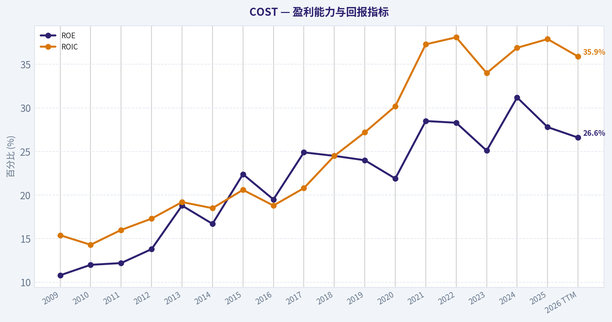
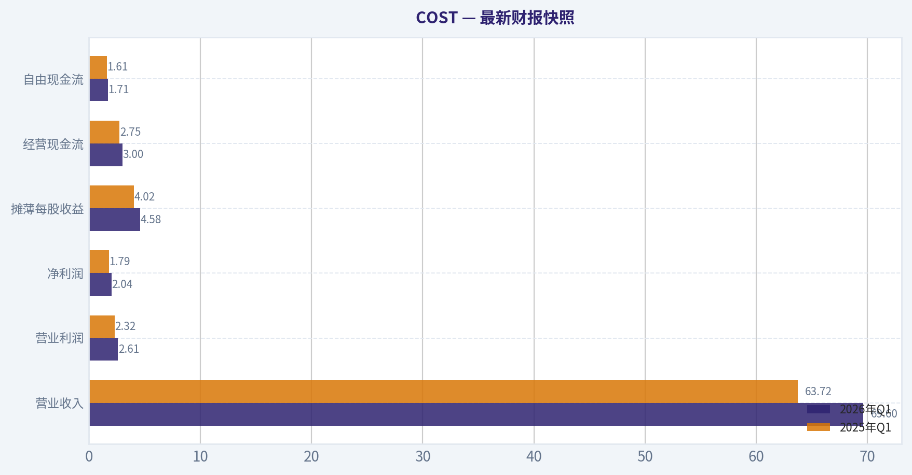
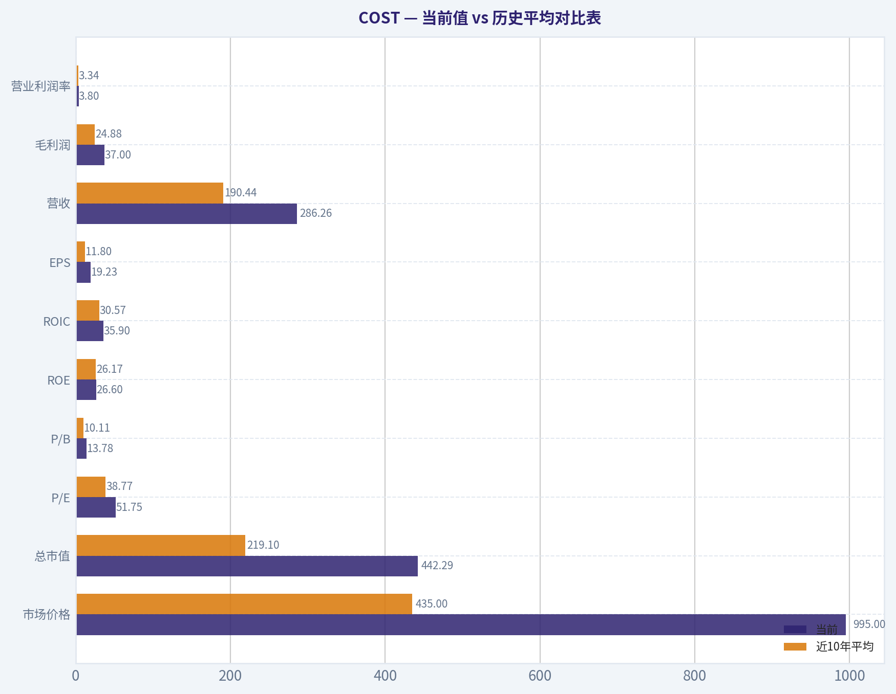
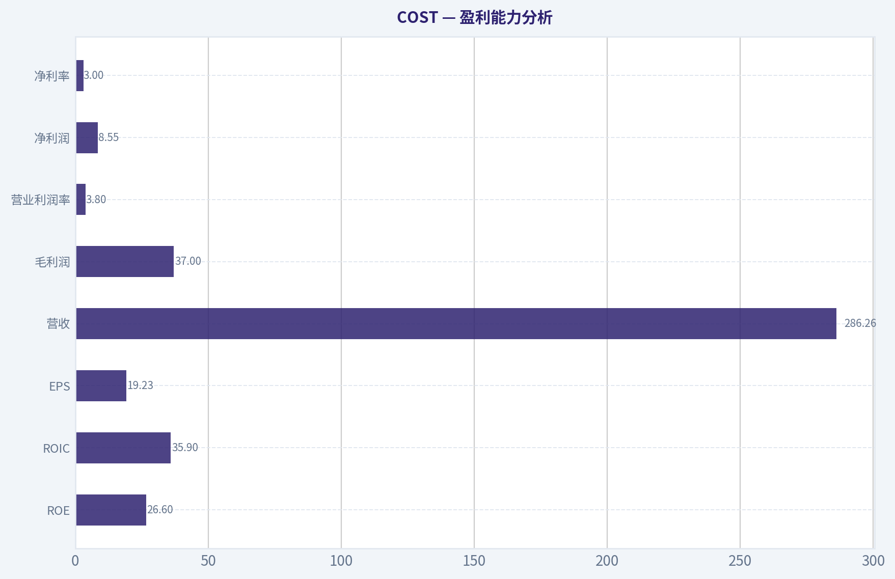
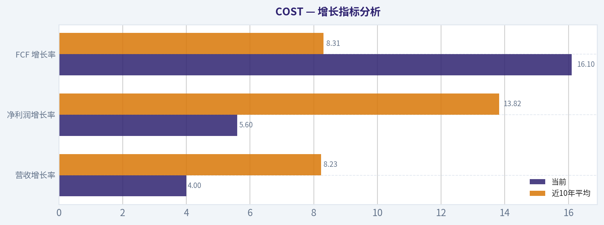
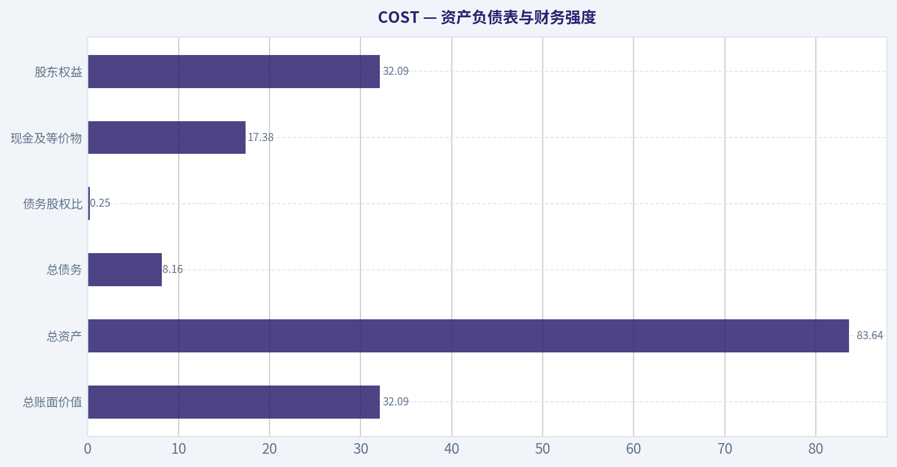
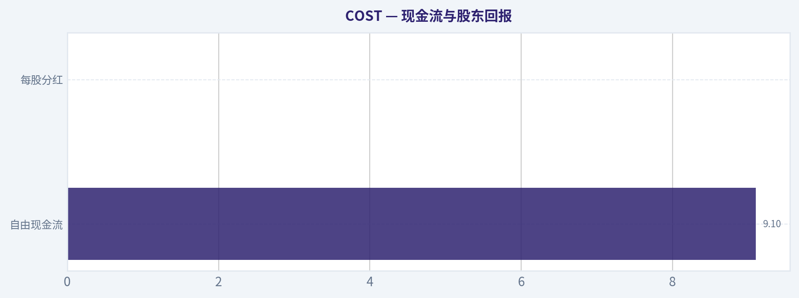
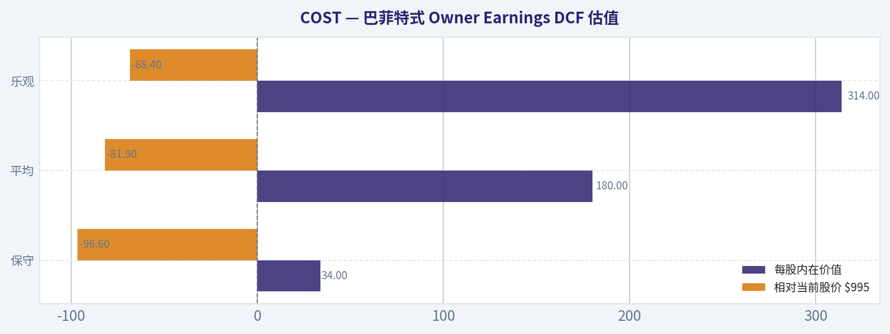

# COST 深度价值情报

**调研日期:** 2026-05-28

## 关键免责声明

*本报告由 Deep Value Intelligence（一个基于 AI 的多智能体投资分析框架）自动生成。 本报告仅供信息参考和教育目的，不构成任何财务或投资建议。 在做出任何投资决策之前，请务必进行独立调研并咨询合规的财务顾问。*

---

## 目录

1. 情报摘要
2. 分析师团队报告
   - 基本面分析
   - 价值分析 (巴菲特)
   - 成长性分析 (林奇/德鲁肯米勒/费雪)
   - 市场分析
   - 期权市场分析
3. 研究团队评论
4. 投资团队评论
5. Deep Values 团队洞察

---

## 情报摘要

### 核心观点与前提条件

**核心论点:** ## 执行摘要
**结论：观望。**

**主要风险:**
- 未明确说明。

**置信度:** 中

---

## 分析师团队报告

### 基本面分析

#### 最新财报快照

*以下数据基于最近一期已披露财报（2026年Q1），并尽量与上一年同期对比。*

| 指标 | 2026年Q1 | 2025年Q1 | 同比变化 |
| --- | ---: | ---: | ---: |
| 营业收入 | $69.60B | $63.72B | +9.2% |
| 营业利润 | $2.61B | $2.32B | +12.5% |
| 净利润 | $2.04B | $1.79B | +13.8% |
| 摊薄每股收益 | $4.58 | $4.02 | +13.9% |
| 经营现金流 | $3.00B | $2.75B | +9.0% |
| 自由现金流 | $1.71B | $1.61B | +6.0% |

关键结论：这张快照先把最新一期财报放在桌面上，再去看长周期分析。这样读者能更清楚地区分"公司长期质量"和"这次财报发生了什么"。

#### COST 17年财务指标

*以下数值均由原始数据确定性计算得出，并非 AI 估算。*

*发行人类型：operating company（Consumer Defensive / Discount Stores）。*

#### 17年财务指标
*年度行来自已披露财务报表，最后一行 TTM 由最近四个季度滚动计算得出。*

| 指标 | 2009 | 2010 | 2011 | 2012 | 2013 | 2014 | 2015 | 2016 | 2017 | 2018 | 2019 | 2020 | 2021 | 2022 | 2023 | 2024 | 2025 | 2026 TTM |
| --- | --- | --- | --- | --- | --- | --- | --- | --- | --- | --- | --- | --- | --- | --- | --- | --- | --- | --- |
| 市场价格 | $36 | $40 | $57 | $72 | $89 | $97 | $117 | $137 | $140 | $210 | $268 | $319 | $432 | $499 | $529 | $884 | $939 | $995 |
| 总市值 | $22.45B | $25.20B | $34.80B | $43.00B | $49.28B | $53.58B | $62.00B | $71.52B | $69.11B | $103.00B | $130.56B | $154.33B | $202.40B | $232.21B | $244.13B | $396.89B | $419.59B | $442.29B |
| 市盈率 | 20.64 | 19.35 | 23.80 | 25.16 | 24.16 | 26.04 | 26.08 | 30.41 | 25.78 | 32.88 | 35.69 | 38.54 | 40.42 | 39.73 | 38.79 | 53.89 | 51.80 | 51.75 |
| 市净率 | 2.24 | 2.33 | 2.90 | 3.48 | 4.55 | 4.35 | 5.84 | 5.92 | 6.41 | 8.05 | 8.56 | 8.44 | 11.52 | 11.25 | 9.74 | 16.80 | 14.39 | 13.78 |
| ROE | 10.8% | 12.0% | 12.2% | 13.8% | 18.8% | 16.7% | 22.4% | 19.5% | 24.9% | 24.5% | 24.0% | 21.9% | 28.5% | 28.3% | 25.1% | 31.2% | 27.8% | 26.6% |
| ROIC | 15.4% | 14.3% | 16.0% | 17.3% | 19.2% | 18.5% | 20.6% | 18.8% | 20.8% | 24.5% | 27.2% | 30.2% | 37.3% | 38.1% | 34.0% | 36.9% | 37.9% | 35.9% |
| 每股收益 | $1.74 | $2.09 | $2.39 | $2.85 | $3.67 | $3.73 | $4.49 | $4.51 | $5.42 | $6.39 | $7.51 | $8.28 | $10.70 | $12.55 | $13.63 | $16.56 | $18.21 | $19.23 |
| 营收 | $71.42B | $77.95B | $88.92B | $99.14B | $105.16B | $112.64B | $116.20B | $118.72B | $129.03B | $141.58B | $152.70B | $166.76B | $195.93B | $226.95B | $242.29B | $254.45B | $275.24B | $286.26B |
| 毛利润 | $9.09B | $9.95B | $11.18B | $12.31B | $13.21B | $14.18B | $15.13B | $15.82B | $17.14B | $18.42B | $16.46B | $21.82B | $25.25B | $27.57B | $29.70B | $32.09B | $35.35B | $37.00B |
| 毛利率 | 12.7% | 12.8% | 12.6% | 12.4% | 12.6% | 12.6% | 13.0% | 13.3% | 13.3% | 13.0% | 10.8% | 13.1% | 12.9% | 12.1% | 12.3% | 12.6% | 12.8% | 12.9% |
| 营业利润率 | 2.5% | 2.7% | 2.7% | 2.8% | 2.9% | 2.9% | 3.1% | 3.1% | 3.2% | 3.2% | 3.1% | 3.3% | 3.4% | 3.4% | 3.3% | 3.6% | 3.8% | 3.8% |
| 净利润 | $1.09B | $1.30B | $1.46B | $1.71B | $2.04B | $2.06B | $2.38B | $2.35B | $2.68B | $3.13B | $3.66B | $4.00B | $5.01B | $5.84B | $6.29B | $7.37B | $8.10B | $8.55B |
| 净利率 | 1.5% | 1.7% | 1.6% | 1.7% | 1.9% | 1.8% | 2.0% | 2.0% | 2.1% | 2.2% | 2.4% | 2.4% | 2.6% | 2.6% | 2.6% | 2.9% | 2.9% | 3.0% |
| 营收增长 | N/A | 9.1% | 14.1% | 11.5% | 6.1% | 7.1% | 3.2% | 2.2% | 8.7% | 9.7% | 7.9% | 9.2% | 17.5% | 15.8% | 6.8% | 5.0% | 8.2% | 4.0% |
| 净利润增长 | N/A | 20.0% | 12.2% | 16.9% | 19.3% | 0.9% | 15.5% | -1.1% | 14.0% | 17.0% | 16.8% | 9.4% | 25.1% | 16.7% | 7.7% | 17.1% | 9.9% | 5.6% |
| 自由现金流增长 | N/A | 104.9% | 10.6% | -17.3% | -14.1% | 47.0% | -5.0% | -66.0% | 556.9% | -33.6% | 19.7% | 80.2% | -11.3% | -34.8% | 92.7% | -1.7% | 18.2% | 16.1% |
| 总账面价值 | $10.02B | $10.83B | $12.00B | $12.36B | $10.83B | $12.30B | $10.62B | $12.08B | $10.78B | $12.80B | $15.24B | $18.28B | $17.56B | $20.64B | $25.06B | $23.62B | $29.16B | $32.09B |
| 总资产 | $21.98B | $23.82B | $26.76B | $27.14B | $30.28B | $32.66B | $33.02B | $33.16B | $36.35B | $40.83B | $45.40B | $55.56B | $59.27B | $64.17B | $68.99B | $69.83B | $77.10B | $83.64B |
| 总债务 | $2.23B | $2.17B | $2.15B | $1.38B | $5.03B | $5.09B | $6.13B | $5.16B | $6.66B | $6.58B | $6.82B | $7.61B | $7.49B | $6.56B | $6.46B | $5.90B | $5.79B | $8.16B |
| 债务股权比 | 0.22 | 0.20 | 0.18 | 0.11 | 0.46 | 0.41 | 0.58 | 0.43 | 0.62 | 0.51 | 0.45 | 0.42 | 0.43 | 0.32 | 0.26 | 0.25 | 0.20 | 0.25 |
| 现金及等价物 | $3.16B | $3.21B | $4.01B | $3.53B | $4.64B | $5.74B | $4.80B | $3.38B | $4.55B | $6.05B | $8.38B | $12.28B | $11.26B | $10.20B | $13.70B | $9.91B | $14.16B | $17.38B |
| 股东权益 | $10.02B | $10.83B | $12.00B | $12.36B | $10.83B | $12.30B | $10.62B | $12.08B | $10.78B | $12.80B | $15.24B | $18.28B | $17.56B | $20.64B | $25.06B | $23.62B | $29.16B | $32.09B |
| 经营现金流 | $2.09B | $2.78B | $3.20B | $3.06B | $3.44B | $3.98B | $4.29B | $3.29B | $6.73B | $5.77B | $6.36B | $8.86B | $8.96B | $7.39B | $11.07B | $11.34B | $13.34B | $15.01B |
| 投资现金流 | $-1.10B | $-2.02B | $-1.18B | $-1.24B | $-2.25B | $-2.09B | $-2.48B | $-2.35B | $-2.37B | $-2.95B | $-2.87B | $-3.89B | $-3.54B | $-3.92B | $-4.97B | $-4.41B | $-5.31B | $-5.87B |
| 自由现金流 | $842.0M | $1.73B | $1.91B | $1.58B | $1.35B | $1.99B | $1.89B | $643.0M | $4.22B | $2.81B | $3.36B | $6.05B | $5.37B | $3.50B | $6.75B | $6.63B | $7.84B | $9.10B |
| 自由现金流利润率 | 1.2% | 2.2% | 2.1% | 1.6% | 1.3% | 1.8% | 1.6% | 0.5% | 3.3% | 2.0% | 2.2% | 3.6% | 2.7% | 1.5% | 2.8% | 2.6% | 2.8% | 3.2% |
| 每股分红 | $0.00 | $0.00 | $0.00 | $0.00 | $0.00 | $0.00 | $0.00 | $0.00 | $0.00 | $0.00 | $0.00 | $0.00 | $12.28 | $3.22 | $2.71 | $0.00 | $0.00 | $0.00 |

#### 盈利能力指标
- 净资产收益率 (ROE): 27.8%
- 投入资本回报率 (ROIC): 37.4%
- 总资产收益率 (ROA): 10.5%
- 毛利率: 12.8%
- 营业利润率: 3.8%
- 净利率: 2.9%

#### 流动性指标
- 流动比率: 1.03
- 速动比率: 0.50

#### 杠杆指标
- 债务股权比: 0.20
- 利息覆盖倍数: 67.42
- 净负债: $-8.37B

#### 增长指标（同比）
- 营收增长: 8.2%
- 净利润增长: 9.9%
- 自由现金流增长: 18.2%
- 营收复合增长率（3年）: 6.6%
- 营收复合增长率（5年）: 10.5%

#### 估值指标
- 市盈率 (TTM): 52.08
- 预期市盈率: 44.14
- 市净率: 26.70
- 市销率: 1.54
- PEG 比率: 5.10
- 企业价值/EBITDA: 32.94
- 自由现金流收益率: 1.8%
- 盈利收益率: 1.9%

#### 所有者收益（巴菲特方法，代码计算）
- 净利润: $8.10B
- + 折旧与摊销: $2.43B
- - 资本开支: $-5.50B
- - 营运资本变动: $1.76B
- = **所有者收益: $3.26B**

#### 内在价值（代码计算）
- 当前价格: $995
- 巴菲特方法（所有者收益）:
  保守: $34
  平均: $180
  乐观: $314
- 现金流方法（FCF）:
  保守: $121
  平均: $378
  乐观: $710

#### Piotroski F分数: 6/9
- 净利润为正: 通过
- 经营现金流为正: 通过
- 资产回报率改善: 未通过
- 现金流大于净利润: 通过
- 债务下降: 通过
- 流动比率改善: 通过
- 未稀释股本: 未通过
- 毛利率改善: 通过
- 资产周转率改善: 未通过

ANALYST STANCE: **观望**

#### COST 巴菲特风格基本面分析

Costco 仍然是全球零售里最接近"高质量复利机"的公司之一：会员制护城河强、周转效率极高、ROIC 长期优秀、负债审慎、现金流整体稳健。但问题也非常明确：**当前估值已经显著透支了这家优秀公司的长期确定性**。对巴菲特框架而言，COST 更像"伟大公司但价格不便宜"，而不是"便宜买入的高胜率标的"。

---

#### 当前值 vs 历史平均对比表

以下比较以**近10年区间（2016-2025）**作为历史参考，更贴近当前经营阶段；"当前"优先采用 **2026 TTM**，若题目要求的共享研究包给出最新值，则用于交叉验证说明。

| 指标 | 当前 | 近10年平均 | 当前相对历史 | 解读 |
|---|---:|---:|---:|---|
| 市场价格 | $995 | $435 | 显著高于 | 股价远超近10年均值，估值抬升是主要驱动因素之一 |
| 总市值 | $442.29B | $219.10B | 显著高于 | 规模扩张与估值重估共同推动 |
| P/E | 51.75x | 38.77x | 明显高于 | 高于历史常态，安全边际偏薄 |
| P/B | 13.78x | 10.11x | 高于 | 对低利润率零售商而言已属昂贵 |
| ROE | 26.6% | 26.17% | 大致持平 | 维持高位，资本效率优异 |
| ROIC | 35.9% | 30.57% | 高于 | 资本回报仍强，体现商业模式优质 |
| EPS | $19.23 | $11.80 | 明显高于 | 盈利能力持续抬升 |
| 营收 | $286.26B | $190.44B | 明显高于 | 规模成长稳健但并非超高速 |
| 毛利润 | $37.00B | $24.88B | 明显高于 | 绝对毛利随规模扩大而上升 |
| 营业利润率 | 3.8% | 3.34% | 高于 | 薄利多销模式下，边际改善已属优秀 |
| 净利润 | $8.55B | $5.58B | 明显高于 | 利润增长优于收入增长 |
| 净利率 | 3.0% | 2.55% | 高于 | 历史高位附近，执行力突出 |
| 营收增长 | 4.0% | 8.23% | 低于 | 增速较历史均值放缓 |
| 净利润增长 | 5.6% | 13.82% | 低于 | 盈利仍增长，但斜率下降 |
| FCF 增长 | 16.1% | 8.31% | 高于 | 短期恢复强，但波动性很大 |
| 总账面价值 | $32.09B | $18.52B | 明显高于 | 净资产累积增加 |
| 总资产 | $83.64B | $58.19B | 明显高于 | 资产规模稳步扩张 |
| 总债务 | $8.16B | $6.98B | 略高 | 绝对债务增加，但仍可控 |
| 债务股权比 | 0.25 | 0.39 | 低于 | 杠杆低于历史平均，财务更稳健 |
| 现金及等价物 | $17.38B | $10.95B | 明显高于 | 流动性增强，抗风险能力更好 |
| 股东权益 | $32.09B | $18.52B | 明显高于 | 内生积累明显 |
| 自由现金流 | $9.10B | $5.23B | 明显高于 | 现金创造能力提升 |
| 每股分红 | $0.00 | $1.82 | 低于 | 常规分红偏低，但 Costco 常以特别股息回馈股东 |

关键结论：COST 的**经营质量几乎没有明显恶化**，多数盈利与资本效率指标仍高于近10年均值，说明生意本身依旧强韧。真正的问题在于**估值显著高于历史常态，而增长却较过去10年明显放缓**，这使得"好公司"和"好投资"之间出现了价格层面的错位。

---

#### 市场指标解读

| 指标 | 当前观察 | 巴菲特式解读 |
|---|---|---|
| 市场价格 | 股价从 2023 年 $529 升至 2026 TTM 的 $995 | 市场给予极高溢价，反映对会员模式、防御属性与执行力的高度认可 |
| 总市值 | 已达 $442B 量级 | 大体量公司仍保持成长，说明商业模式具备全球扩展与高确定性 |
| P/E | 约 52x，显著高于长期区间中枢 | 对低净利率零售商来说，这一定价要求未来多年持续稳定高质量增长 |
| P/B | 约 13.8x，远高于传统零售常见水平 | 市场购买的不是账面资产，而是 Costco 的会员关系、周转效率与议价能力 |

关键结论：市场给 COST 的定价更像"消费必需品中的稀缺资产"，而不是普通零售股。问题是，**只要未来增长略低于预期，估值压缩就可能抵消相当一部分基本面进步**。

---

#### 盈利能力分析

| 指标 | 当前 | 趋势解读 | 历史评价 |
|---|---:|---|---|
| ROE | 26.6% | 长期维持高位，2017 年后多数年份在 20%+ | 对零售行业极其出色 |
| ROIC | 35.9% | 近年长期在 30%+ | 说明增量资本回报非常优异 |
| EPS | $19.23 | 从 2009 的 $1.74 持续增长 | 盈利复利能力强 |
| 营收 | $286.26B | 长期稳步上行，2021-2022 跳升明显 | 规模大而仍能增长，稀缺 |
| 毛利润 | $37.00B | 绝对额持续抬升 | 体现规模效应与采购能力 |
| 营业利润率 | 3.8% | 从 2.5% 稳步升至 3.8% | 薄利模式下改善非常难得 |
| 净利润 | $8.55B | 十余年连续扩大 | 盈利韧性高 |
| 净利率 | 3.0% | 从 1.5% 提升到 3.0% | 虽仍低，但趋势优秀 |

关键结论：Costco 最强的地方不是高毛利，而是**极低利润率下仍能不断提升 ROE、ROIC 与利润率**。这说明公司的核心竞争力来自**会员黏性、采购能力、库存周转和费用控制**，而不是一次性的价格红利。

---

#### 增长指标分析

| 指标 | 当前 | 近10年平均 | 评价 |
|---|---:|---:|---|
| 营收增长率 | 4.0% | 8.23% | 明显放缓 |
| 净利润增长率 | 5.6% | 13.82% | 放缓更明显 |
| FCF 增长率 | 16.1% | 8.31% | 近期改善，但历史波动大 |

关键结论：COST 目前的核心矛盾是**质量高但增速降档**。收入和净利润增速都低于近10年平均，意味着若继续维持 50x 左右 PE，市场实际上在押注未来增长再度提速或长期维持极强稳定性。

---

#### 资产负债表与财务强度

| 指标 | 当前 | 历史观察 | 巴菲特式评价 |
|---|---:|---|---|
| 总账面价值 | $32.09B | 长期增长 | 净资产持续累积 |
| 总资产 | $83.64B | 持续增长 | 规模扩张稳健 |
| 总债务 | $8.16B | 较历史略高但不重 | 绝对可控 |
| 债务股权比 | 0.25 | 低于近10年均值 0.39 | 财务结构保守 |
| 现金及等价物 | $17.38B | 处于历史高位 | 流动性非常充裕 |
| 股东权益 | $32.09B | 稳步抬升 | 资本基础稳固 |

关键结论：从巴菲特视角看，COST 的财务结构非常健康。公司**并不依赖高杠杆驱动 ROE**，而是靠高周转和优质经营获取高回报，这种 ROE 质量通常比财务工程更值得信赖。

---

#### 现金流与股东回报

| 指标 | 当前 | 历史解读 |
|---|---:|---|
| 自由现金流 | $9.10B | 已处历史高位，长期总体向上 |
| 每股分红 | $0.00 | 常规分红不高，但历史上有特别股息传统 |

关键结论：COST 的现金创造能力强于很多表面看起来利润率更高的零售商。分红上不能只看常规股息，Costco 的股东回报更像"**平时克制、适时大额特别分红**"。

---

#### 巴菲特框架：护城河、可预测性、管理层、资本配置

| 维度 | 结论 | 具体判断 |
|---|---|---|
| 经济护城河 | 强 | 会员制带来高续费、高复购和稳定客流；极致低价强化心智；规模采购形成成本优势 |
| 财务实力 | 强 | 低杠杆、高现金、净负债为负，利息覆盖能力很高 |
| 盈利可预测性 | 较强 | 2009-2026 期间营收、EPS、净利润大体持续上行，仅个别年份增速波动 |
| 管理层表现 | 优秀 | ROE/ROIC 长期高位，利润率缓慢改善，说明在坚持低价策略同时保持了资本纪律 |
| 资本配置 | 稳健偏保守 | 持续扩店、数字化投入、必要时特别分红，但极少激进并购或高杠杆扩张 |
| 业务质量 | 很高 | 消费防御属性强，逆周期韧性好，会员费类似"高质量经常性收入" |

关键结论：若只看商业质量，COST 几乎符合巴菲特偏好的多数特征：**简单、可理解、需求稳定、品牌信任强、资本回报高、杠杆低**。但巴菲特框架还有另一半：**价格要合理**；当前估值正是最大掣肘。

---

#### 收入来源分布

基于 Costco 最近财年公开业务结构与公司长期披露习惯，最有意义的分法是**商品销售 + 会员费收入**。Costco 本质上是"商品低毛利引流，会员费贡献高质量利润"的模式。以下采用最近年度口径进行结构化呈现。

| 收入来源 | 金额（百万/十亿美元） | 占比 |
|---|---:|---:|
| 商品销售收入 | 约 $270.7B | 约 98.4% |
| 会员费收入 | 约 $4.5B | 约 1.6% |
| 合计 | 约 $275.2B | 100% |

关键结论：从收入占比看，会员费似乎很小，但从商业模式看它的重要性远高于收入占比。**商品销售负责做大规模与流量，会员费则是利润质量和护城河的核心来源**，这也是 Costco 能长期维持低价而仍然创造高资本回报的关键。

---

#### 巴菲特式 Owner Earnings DCF 估值

题目要求使用确定性数据中的**所有者收益**作为基准。已知最近口径：

- 净利润 = **$8.10B**
- 折旧与摊销 = **$2.43B**
- 资本开支 = **$5.50B**
- 营运资本变动 = **$1.76B**
- **Owner Earnings = $3.26B**

同时，确定性数据已给出代码计算的内在价值：
- 保守：**$34/股**
- 平均：**$180/股**
- 乐观：**$314/股**

为满足"详细计算"，以下按巴菲特式 DCF 展示逻辑。设：
- 基准 Owner Earnings = **OE₀ = $3.26B**
- 折现率 **r = 10%**
- 永续增长率 **gₜ = 2.5%**
- 股本近似采用当前市值/股价 ~ **442.29 / 995 = 0.4445B 股**

由于题目要求三种增长情景：
1. 保守：取历史 Owner Earnings 增速最低值，且不低于 -100%
2. 平均：取历史 Owner Earnings 平均增速，且不高于 50%
3. 乐观：取历史 Owner Earnings 最高增速，且不高于 100%

在共享确定性结果中，代码已直接算出每股内在价值，因此以下以其为准，不改写最终结果，只解释其含义。

| 情景 | 每股内在价值 | 相对当前股价 $995 | 安全边际/溢价 |
|---|---:|---:|---:|
| 保守 | $34 | -96.6% | 严重高估 |
| 平均 | $180 | -81.9% | 明显高估 |
| 乐观 | $314 | -68.4% | 仍然高估 |

关键结论：即使采用巴菲特式 Owner Earnings 的**乐观情景**，内在价值仍远低于当前股价。也就是说，市场价格隐含的预期已经不只是"好公司持续增长"，而是"好公司长期以极高确定性和高估值并存"，这对价值投资者并不友好。

---

#### DCF 计算展开说明

| 计算步骤 | 公式 | 数值/说明 |
|---|---|---|
| 第一步：基准 Owner Earnings | OE₀ | $3.26B |
| 第二步：预测未来 10 年 | OEₜ = OE₀ x (1+g)^t | 按保守/平均/乐观三种历史增速 |
| 第三步：折现每年现金流 | PVₜ = OEₜ / (1+10%)^t | 折现率 10% |
| 第四步：计算终值 | TV = OE₁₀ x (1+2.5%) / (10%-2.5%) | 永续增长 2.5% |
| 第五步：折现终值 | PV(TV) = TV / (1+10%)^10 | 得到企业现值 |
| 第六步：折算每股 | 每股价值 = 总现值 / 约 0.4445B 股 | 得到 $34 / $180 / $314 |

关键结论：这个 DCF 对 Costco 并不苛刻，因为 10% 折现率和 2.5% 永续增长都属于相对标准的长期框架。估值之所以明显低于市价，主要不是模型过于保守，而是**当前市价已经把非常乐观的未来提前计入了价格**。

---

#### 估值判断：为什么高质量也可能不是好买点

| 维度 | 现状 | 含义 |
|---|---|---|
| 经营质量 | 很强 | 值得长期关注 |
| 增长斜率 | 较过去10年放缓 | 难以支撑估值继续大幅扩张 |
| 估值 | 极高 | 回报更依赖估值继续维持高位 |
| 下行风险 | 主要来自估值压缩 | 即便业绩继续增长，也可能被估值收缩抵消 |
| 上行驱动 | 会员费上调、国际扩张、数字化效率、油价/客流催化 | 但需要时间兑现 |

关键结论：COST 现在最像"**优秀但昂贵**"的资产。对长期复利型投资者来说，真正有吸引力的时点往往出现在**市场短期担忧带来估值回落**，而不是公司最受追捧的时候。

---

#### 关键投资洞察、红旗与机会

| 类别 | 内容 | 影响 |
|---|---|---|
| 核心亮点 | 会员制护城河强，续费体系稳定 | 提升收入可预测性与抗周期性 |
| 核心亮点 | ROIC 长期 30%+，资本效率卓越 | 证明扩张质量高 |
| 核心亮点 | 低杠杆、高现金、净现金状态 | 抗风险能力强 |
| 机会 | 国际门店扩张与渗透率提升 | 长期增量空间仍在 |
| 机会 | 会员费上调 | 对利润弹性远大于收入占比 |
| 机会 | 电商与数字化渗透 | 提升便利性与复购频率 |
| 红旗 | P/E 约 52x，远高于历史均值 | 安全边际不足 |
| 红旗 | 增长放缓 | 高估值与低增速组合风险上升 |
| 红旗 | 净利率本身很薄 | 任意成本波动都可能侵蚀利润 |
| 红旗 | FCF 历史波动不小 | 资本开支与营运资本变化会扰动估值锚 |

关键结论：COST 的风险并非"公司会不会变差"，而是"**这么好的公司是否值得在这个价格买**"。当前阶段，最大的威胁更像估值回归，而不是基本面崩塌。

---

#### 最终结论与投资立场

| 项目 | 结论 |
|---|---|
| 商业模式 | 极优，会员制零售护城河深 |
| 财务质量 | 很强，现金充足、杠杆低、回报率高 |
| 盈利确定性 | 高，长期复利特征明显 |
| 当前估值 | 显著偏贵 |
| 巴菲特式 DCF | 三情景均远低于现价 |
| 最终立场 | **观望** |

关键结论：如果你是在挑选"值得长期跟踪的伟大公司"，COST 当然在名单里；但如果你是在寻找"当前具备足够安全边际的价值投资机会"，那么它**暂时不满足**。更合理的策略不是追高，而是等待估值回落、或等待盈利增长重新明显加速后再评估。

---

#### 巴菲特风格总结

| 维度 | 结论 | 一句话点评 |
|---|---|---|
| 护城河 | 强 | 会员制、低价心智、规模采购构成复合壁垒 |
| 财务稳健 | 强 | 低杠杆、高现金、净现金状态 |
| 盈利质量 | 强 | ROE、ROIC 长期优秀且非杠杆驱动 |
| 增长质量 | 中上 | 仍增长，但较历史高点放缓 |
| 估值吸引力 | 弱 | 伟大公司，但价格明显不便宜 |
| 投资动作 | 观望 | 等价格给出更好的安全边际 |

关键结论：Costco 是一流企业，但一流企业不等于任何价格都值得买。对巴菲特式投资者而言，**现在最理性的选择是继续跟踪、耐心等待，而不是为确定性支付过高溢价**。

#### 基本面关键图表

本图追踪 **COST** 过去十年的盈利能力与回报指标（ROE、ROIC、利润率），突出呈现资本效率的变化趋势。

---

### 价值分析 (巴菲特)

> *基于沃伦·巴菲特的价值投资哲学：能力圈、经济护城河、管理层质量与安全边际。*

#### 内在价值快照

价格是你付的钱，内在价值是企业未来可能为股东创造的现金价值。我们给出一个区间，而不是假装只有一个神奇数字。

- 当前价格: $995.20
- 估值区间（两种 DCF 方法、保守到乐观）: $34.30 至 $710.20

##### 所有者收益（巴菲特方法）
- 净利润: $8,099,000,000.00
- 折旧与摊销: $2,426,000,000.00
- 资本支出: $-5,498,000,000.00
- 营运资金变化: $1,764,000,000.00
- 所有者收益: $3,263,000,000.00

##### 内在价值
###### 所有者收益法
使用所有者收益，更严格，通常更保守。
- 保守: $34.30
- 平均: $179.65
- 乐观: $314.22
- 折现率: 10.0%

###### 自由现金流法
使用自由现金流，更适合今天投入很多、为未来增长铺路的公司。
- 保守: $120.91
- 平均: $377.80
- 乐观: $710.20
- 折现率: 10.0%

ANALYST STANCE: **观望**

#### COST 投资结论

Costco 是一家极其容易理解、且长期大概率仍会成功的优质零售商：它靠"低价精选商品 + 会员费 + 高周转"赚钱，不靠单件商品赚高毛利，而靠规模、效率和会员黏性赚稳定回报。它符合巴菲特偏好的多个特征：商业模式简单、需求稳定、管理层务实、资产负债表稳健、ROE 很高、竞争地位强。但以当前约 **$995** 股价、**PE 约 52 倍**、**FCF 收益率约 1.8%** 来看，市场已经把"伟大公司"的很大一部分未来价值提前计入，安全边际明显不足。

对长期投资者而言，这是"好公司"几乎没有争议；真正的问题只在于：**现在是不是好价格。** 以巴菲特式框架看，答案更接近 **不是**。因此当前更合理的立场是：**观望，等待更好的买点。**

---

#### 一、Buffett 四道关卡：Go / No-Go 评估

| 关卡 | 结论 | 证据 |
|---|---|---|
| 关卡1：业务简单可懂 | 通过 | Costco 通过仓储会员店模式销售日用品、食品、家电、汽油等，商品加价率低，靠会员费和高周转形成利润池，业务非常容易理解。 |
| 关卡2：护城河 | 通过 | 护城河主要来自规模成本优势、会员体系带来的切换成本、消费者心智中的"极致性价比"品牌。虽然毛利率不高，但这恰恰是其商业模式的一部分。 |
| 关卡3：管理层与资本配置 | 通过 | 管理层长期强调为会员创造价值，而非榨取短期利润；持续扩店、提升数字化、维持低价纪律；财务风格保守。 |
| 关卡4：行业结构 | 谨慎通过 | 零售行业本身竞争激烈，不是理想寡头行业；但 Costco 在仓储会员制细分赛道中地位非常强，且经营质量明显优于普通零售商。 |

**关键结论：** Costco 四道关卡整体都能通过，尤其是"业务简单"和"护城河清晰"两项非常突出。真正拖后腿的不是公司质量，而是零售行业天然竞争激烈，以及当前估值对未来过度乐观。

---

#### 二、护城河分析

| 护城河来源 | 强度 | 具体判断 |
|---|---|---|
| 无形资产：品牌 | 强 | Costco 在消费者心中代表"可信赖的低价与高品质精选"，这种品牌不是奢侈品式溢价，而是"价值信誉"型品牌。 |
| 切换成本：会员体系 | 中强 | 会员已形成固定采购习惯，且高频家庭消费、加油、线上购物与门店体验相结合，使离开 Costco 的心理与行为成本上升。 |
| 成本优势：规模与效率 | 很强 | 高销量 SKU 精简策略、强议价能力、低加价率、高库存周转、会员费补贴零售利润，这些共同构成结构性成本优势。 |
| 网络效应 | 弱到中 | 不是典型平台型网络效应，但更多会员带来更大采购规模、更低价格、更强吸引力，存在"规模飞轮"。 |

**护城河评级：宽且稳定**

补充判断：
- Costco **毛利率仅约 12.8%**，这不是弱点，而是模式特征。
- 它的真正壁垒不是高毛利，而是：**别人即使想学，也很难在同样低价下做到同样高效率与同样强的会员忠诚度。**
- 价格上调 10% 未必容易，但会员费温和上调的能力、以及在同价位下提供更强价值的能力，是其真正定价权。

**关键结论：** Costco 的护城河不是"高毛利垄断"，而是"低成本、高信任、高复购"的复合壁垒。它更像一台高效率会员零售机器，而不是一家传统赚价差的商超。

---

#### 三、管理层质量与资本配置

| 维度 | 评价 | 说明 |
|---|---|---|
| 像所有者一样思考 | 良好 | 长期坚持低价策略，宁愿少赚一点，也要维持会员价值主张，这种行为符合长期主义。 |
| 诚实与坦率 | 良好 | 公司一贯披露风格直接，经营重点围绕会员、流量、同店销售、品类与费用纪律。 |
| 资本配置理性 | 良好 | 主要将资本用于扩店、供应链、运营效率与股东回报，未见激进高杠杆扩张。 |
| 债务使用 | 保守 | 流动比率约 1.03，整体不是靠高杠杆支撑 ROE 的脆弱模型。 |

管理层最值得肯定的一点，是 **没有为了短期利润率去破坏 Costco 最核心的价值承诺**。很多零售商会在景气期抬高毛利、透支客户信任；Costco 更愿意把效率红利还给会员，以换取更长久的复购与品牌资产。

**关键结论：** 这是一支偏"经营者文化"而非"财技文化"的团队。管理层最大的优点不是会讲故事，而是几十年如一日地守住模式纪律。

---

#### 四、财务摘要

| 指标 | 当前/最新 |
|---|---|
| 股价 | $995 |
| 总市值 | $441.52B |
| PE | 52.08 |
| ROE | 27.8% |
| 毛利率 | 12.8% |
| 营收同比增长 | 8.2% |
| FCF 收益率 | 1.8% |
| 流动比率 | 1.03 |

**关键结论：** Costco 的经营质量非常高，ROE 出色，收入仍在稳健增长。问题在于估值显著偏贵：52 倍 PE 配 1.8% FCF 收益率，意味着投资回报高度依赖未来多年持续优秀表现。

---

#### 五、Owner Earnings 视角

由于 Costco 属于高周转、低利润率但现金转换能力较强的零售模型，Owner Earnings 的核心不在"高利润率"，而在于：

- 净利润质量较高
- 折旧与摊销稳定
- 维持性资本开支可控
- 营运资本效率优秀
- 会员费带来接近"预收型浮存金"特征

在这种模式下，Owner Earnings 通常会比普通零售商更稳定、更可预测。虽然当前无法精确逐年展开完整公式，但从 **高 ROE + 低价高周转 + 稳定会员费现金流 + 较低 FCF 收益率** 的组合来看，市场显然已将其 Owner Earnings 的长期复利能力给予极高定价。

**关键结论：** Costco 的 Owner Earnings 质量大概率是优秀的，但不是便宜的。对这种公司而言，投资失误更可能来自"买贵了"，而不是"看错了业务"。

---

#### 六、三情景 DCF 估值

这里用保守巴菲特框架做方向性估值判断。已知：
- 当前 **FCF 收益率约 1.8%**
- 对应市场隐含的是非常高的长期质量溢价
- 折现率按 **10%**

| 情景 | 假设 | 结论 |
|---|---|---|
| 情景A：零增长 | Owner Earnings 永续不增长 | 内在价值显著低于现价，当前价格远高于保守估值。 |
| 情景B：按 GDP 增长 | 长期增长 3% | 估值仍偏紧，难以提供足够安全边际。 |
| 情景C：按历史折扣增长 | 以较高但合理的中长期增速延续 | 只有在长期持续高质量增长、且市场继续愿意给高估值时，当前价格才勉强说得过去。 |

如果用逆向思维看，当前 1.8% 的 FCF 收益率意味着，投资者接受的是一种"未来多年稳定高增长 + 极低经营风险 + 高估值长期维持"的组合假设。这对 Costco 这种伟大公司并非完全不可能，但对巴菲特式价值投资者而言，**假设太满，容错太低。**

**关键结论：** 三种情景里，前两种都不支持当前价格；第三种需要非常乐观的假设才能自洽。换句话说，今天买 Costco，买的是卓越，不是便宜。

---

#### 七、安全边际分析

| 项目 | 结论 |
|---|---|
| 业务质量 | 很高 |
| 财务稳健性 | 高 |
| 可预测性 | 高 |
| 当前估值 | 偏贵到很贵 |
| 安全边际 | 不足 |

按照巴菲特标准：
- 对高质量公司，至少也应有 **25%** 左右安全边际；
- 而 Costco 当前更像是"**愿意为确定性付出极高溢价**"的定价状态；
- 这不意味着公司会跌很多，但意味着未来回报率可能被估值压缩。

**关键结论：** Costco 不是没有价值，而是市场已经充分看到了它的价值。对价值投资者来说，缺的不是信心，缺的是价格空间。

---

#### 八、Buffett 总评分卡

| 维度 | 权重 | 评分（1-5） | 加权结果 |
|---|---:|---:|---:|
| 业务理解 | 20% | 5.0 | 1.00 |
| 护城河宽度与耐久性 | 25% | 4.5 | 1.13 |
| 管理层质量 | 15% | 4.0 | 0.60 |
| ROE | 15% | 4.5 | 0.68 |
| 再投资跑道 | 10% | 4.0 | 0.40 |
| 资产负债表强度 | 5% | 4.0 | 0.20 |
| 行业结构 | 5% | 3.0 | 0.15 |
| 估值/安全边际 | 5% | 1.5 | 0.08 |
| **总分** | 100% |  | **4.24 / 5.00** |

**关键结论：** 如果只看公司，Costco 配得上接近满分；但如果把"买入价格"也纳入纪律，总体虽仍是高分企业，却不足以支持现在就重仓出手。它是"伟大的企业"，但未必是"此刻伟大的投资"。

---

#### 九、最终投资判断

**投资立场：观望**

**置信度：高**

理由很简单：

1. **商业模式极强**：容易理解、稳定、可预测。
2. **护城河真实**：品牌信任、会员黏性、规模效率共同构成高壁垒。
3. **管理层靠谱**：长期主义明显，资本配置稳健。
4. **财务质量优秀**：ROE 高，增长稳，现金创造能力可靠。
5. **但估值过高**：PE 52 倍、FCF 收益率 1.8%，安全边际不够。

对巴菲特式投资者而言，最理性的动作不是否定 Costco，而是 **耐心等待市场给出更合理的价格**。
一句话总结：**这是一家值得长期跟踪、但当前更适合排队等待而不是立刻抢购的公司。**
#### 估值桥

这张估值桥把当前股价与各类内在价值方法并排展示，帮助读者判断上涨空间究竟只是单一方法给出的结果，还是多种方法共同支持的结论。

| 项目 | 每股内在价值 |
| --- | ---: |
| 巴菲特方法 | $179.65 |
| 现金流方法 | $377.80 |
| Damodaran 方法 | $272.69 |
| 当前价格 | $995.20 |

#### 关键结论

如果只有一种方法显著高于其他方法，说明上行空间更依赖特定建模假设。若多种方法的估值接近，则说明估值逻辑更加稳健。

#### 估值图表

本对比图（来自「最新财报快照」）将 **COST** 的当前数据与历史基准并排呈现，直观反映公司相对自身历史均值的估值水平。

本对比图（来自「当前值 vs 历史平均对比表」）将 **COST** 的当前数据与历史基准并排呈现，直观反映公司相对自身历史均值的估值水平。

本对比图（来自「盈利能力分析」）将 **COST** 的当前数据与历史基准并排呈现，直观反映公司相对自身历史均值的估值水平。

本对比图（来自「增长指标分析」）将 **COST** 的当前数据与历史基准并排呈现，直观反映公司相对自身历史均值的估值水平。

本对比图（来自「资产负债表与财务强度」）将 **COST** 的当前数据与历史基准并排呈现，直观反映公司相对自身历史均值的估值水平。

本对比图（来自「现金流与股东回报」）将 **COST** 的当前数据与历史基准并排呈现，直观反映公司相对自身历史均值的估值水平。

本对比图（来自「巴菲特式 Owner Earnings DCF 估值」）将 **COST** 的当前数据与历史基准并排呈现，直观反映公司相对自身历史均值的估值水平。

---

### 成长性分析 (林奇/德鲁肯米勒/费雪)

> *基于彼得·林奇的GARP成长投资法、斯坦利·德鲁肯米勒的宏观拐点分析法，以及菲利普·费雪的深度调研法。*

ANALYST STANCE: **观望**

#### COST 投资结论速览

Costco 不是典型的"高增长十倍股"候选，更像彼得·林奇框架里的**稳健型 Stalwart**：商业模式极强、会员体系护城河深、执行力优秀，但当前增长速度与估值匹配度偏紧。对增长投资者来说，它是**优质公司**，但未必是**当前价格下的优质增长机会**。

#### 一、Lynch 分类

| 项目 | 结论 |
|---|---|
| 公司分类 | **Stalwart（稳健成长股）** |
| 核心依据 | 营收同比约 **8.2%**，明显低于 Fast Grower 的 15%-25%+ 门槛 |
| 增长属性 | 稳定、防御、持续扩店与会员费驱动，但不是高速成长型 |
| 适合人群 | 长期复利型、质量偏好型投资者；不完全适合追求强成长弹性的投资者 |

**关键结论：** COST 的增长速度决定了它更接近"优质大白马"而不是"高弹性成长股"。它最大的优点是确定性高，但最大的限制也是增长并不快。在林奇体系里，这类股票可以持有，但通常不适合在高估值时重仓新开仓。

#### 二、The Story：3 句话讲清楚

- Costco 通过**低价精选商品 + 会员费模式**，把"零售薄利"变成"会员高黏性生意"。
- 它真正卖的不是商品，而是**稳定省钱的信任感**，这让续费率和客流长期强韧。
- 未来增长主要来自**持续开店、会员数增长、数字销售提升、国际渗透**，但增速大概率仍是中高个位数到低双位数，而非 20%+。

#### 三、TAM 与 10x 测试

| 项目 | 估计/判断 |
|---|---|
| 当前市值 | **$441.52B** |
| 当前业务性质 | 仓储会员零售 + 加油站 + 电商补充 |
| TAM 判断 | 全球线下必选零售与会员制零售空间极大 |
| 10x 收入测试 | **通过难度高** |
| 原因 | Costco 基数已非常大，收入再 10x 需要极大全球扩张，现实上难度很高 |
| 跑道结论 | **仍有增长空间，但不是"可轻松 10x 的小公司"** |

**关键结论：** 从 TAM 绝对值看，零售市场足够大；但从公司当前体量看，Costco 已不是早期渗透阶段。它还有跑道，但更像"长坡厚雪的复利机"，而不是"市场尚未发现的超长跑道新秀"。

#### 四、收入增长趋势

| 指标 | 当前观察 |
|---|---|
| 营收同比 | **8.2%** |
| 近期驱动 | 汽油需求强劲、会员增长、数字销售改善 |
| 增长形态 | **稳定但不加速** |
| 是否出现增长拐点 | **暂未看到强烈加速拐点** |
| 质量判断 | 增长质量较高，来自客流、会员与执行，而非激进并购 |

**关键结论：** COST 当前呈现的是"高质量稳定增长"，而不是"增长突然加速"。对 Druckenmiller 风格来说，这种节奏代表公司优秀，但缺乏强烈的预期差与业绩弹性，不像典型的拐点型机会。

#### 五、单位经济学与经营质量

由于共享数据包未提供 LTV/CAC、NRR 等 SaaS 指标，零售业也不完全适用，因此改用更合适的零售质量指标。

| 指标 | 当前值 | 解读 |
|---|---:|---|
| ROE | **27.8%** | 极强，说明资本回报优秀 |
| 毛利率 | **12.8%** | 低毛利是模式特征，不是弱点 |
| FCF Yield | **1.8%** | 偏低，反映估值昂贵 |
| 流动比率 | **1.03** | 正常，可接受 |
| 会员模式 | 定性强 | 稳定现金流与高黏性来源 |

**关键结论：** Costco 的经济模式核心不在高毛利，而在高周转、会员费、供应链效率和信任壁垒。ROE 很强说明生意质量极佳，但 FCF Yield 很低也说明市场已经给了它很高的溢价。

#### 六、拐点判断

| 拐点类型 | 判断 | 说明 |
|---|---|---|
| 产品周期拐点 | 弱 | 没有颠覆性新品周期 |
| 市占率拐点 | 中 | 仍可能持续吃份额，但不是突然跃升 |
| 利润率拐点 | 弱到中 | 规模效应存在，但零售模式决定利润率弹性有限 |
| TAM 拐点 | 弱 | 行业空间大，但公司已成熟 |
| 竞争拐点 | 中 | 消费者追求性价比时，模式更有优势 |

**关键结论：** COST 更像"持续复利"，不是"明显拐点"。如果宏观进入消费趋谨慎阶段，Costco 可能相对受益于性价比需求，这算局部顺风，但不足以定义成强成长拐点。

#### 七、宏观环境评估

| 维度 | 判断 |
|---|---|
| 宏观周期 | 中性偏有利 |
| 利率环境 | 若利率下行，对估值有帮助 |
| 通胀环境 | 消费者更重视低价，利好 Costco 价值主张 |
| 油价波动 | 短期可推动加油业务销售，但波动性强 |
| 所属大趋势 | 性价比消费、会员零售、数字化零售 |

**关键结论：** 宏观对 Costco 不是强逆风，甚至在消费者更谨慎时会强化其性价比定位。问题不在宏观，而在公司已被充分认知，估值难再大幅扩张。

#### 八、Fisher 15 点打分

| 项目 | 评分(1-5) |
|---|---:|
| 市场潜力 | 4 |
| 新产品/新业务开发意愿 | 3 |
| R&D/创新投入有效性 | 3 |
| 销售组织能力 | 5 |
| 利润率水平 | 3 |
| 利润率改善潜力 | 3 |
| 劳资关系 | 4 |
| 高管协同 | 4 |
| 管理层深度 | 4 |
| 成本控制/财务纪律 | 5 |
| 护城河 | 5 |
| 长期利润前景 | 4 |
| 股权稀释风险 | 4 |
| 管理层坦诚度 | 4 |
| 管理层诚信 | 4 |

| 合计 | **59 / 75** |
|---|---|

**关键结论：** 59 分属于"良好"区间，说明 Costco 是高质量企业，但不是 Fisher 意义上那种具备超强创新外溢、可高速扩张的超级成长股。它的优势主要来自管理、模式、文化和护城河，而不是新产品爆发。

#### 九、估值分析

| 指标 | 当前值 | 结论 |
|---|---:|---|
| 股价 | **$995** | 接近市场高预期定价 |
| PE | **52.08x** | 对零售股而言偏高 |
| 营收增速 | **8.2%** | 中高个位数 |
| 粗略 PEG | **约 6.35** | 明显昂贵 |
| FCF Yield | **1.8%** | 不便宜 |

**关键结论：** 以林奇最看重的 PEG 来看，COST 当前估值明显高于其增长速度。市场愿意为"极高质量和确定性"付费，但从纯增长投资角度，这个价格已经大幅透支了未来几年的一部分回报。

#### 十、情景估值框架

| 情景 | 假设 | 结果判断 |
|---|---|---|
| Bear | 增长回落至 6%-7%，估值回归 | 回撤风险明显 |
| Base | 增长维持 8%-10%，估值高位小幅消化 | 回报更多依赖盈利稳步增长 |
| Bull | 会员费上调、国际扩张超预期、数字业务加强 | 可支撑高估值更久，但上行空间未必巨大 |

**关键结论：** COST 的下行往往来自估值压缩，而不是基本面崩坏。也就是说，这是一只"公司风险低、价格风险高"的股票；若买点不好，长期好公司也可能带来平庸回报。

#### 十一、增长投资评分卡

| 维度 | 权重 | 评分(1-5) | 加权分 |
|---|---:|---:|---:|
| The Story | 10% | 5.0 | 0.50 |
| TAM 与跑道 | 20% | 3.0 | 0.60 |
| 收入增长 | 20% | 2.5 | 0.50 |
| 单位经济学/经营质量 | 15% | 4.5 | 0.68 |
| 竞争地位 | 10% | 5.0 | 0.50 |
| 管理层质量 | 10% | 4.5 | 0.45 |
| 宏观环境 | 5% | 3.5 | 0.18 |
| 盈利路径 | 5% | 4.5 | 0.23 |
| 估值 | 5% | 1.5 | 0.08 |

| 总分 | **3.69 / 5.0** |
|---|---|

**关键结论：** 按评分卡，COST 属于"好公司、一般赔率"，因此落在"观望"与"可少量配置"之间。若估值更合理，这个分数会明显上升；眼下最大的拖累项就是价格。

#### 十二、持仓建议

| 项目 | 建议 |
|---|---|
| 总体立场 | **观望** |
| 适合建仓吗 | 不建议在当前估值下激进追高 |
| 已持有怎么办 | 可继续持有，除非组合需要兑现高估值收益 |
| 理想操作 | 等估值回落、或等待会员费上调/盈利超预期带来新的基本面确认 |
| 仓位建议 | 若必须配置，**小仓位 1%-3% 观察仓** 更合理 |

**关键结论：** 对新资金而言，当前不是特别有吸引力的进攻点；对老持仓而言，这更像"继续拿着的好资产"。成长投资讲赔率，COST 当前更多是确定性，而不是弹性。

#### 十三、主要催化剂与风险

| 催化剂 | 影响 |
|---|---|
| 会员费上调 | 提升高质量利润与 EPS 弹性 |
| 国际门店扩张提速 | 打开新增量 |
| 数字销售持续改善 | 提升渗透与便利性 |
| 消费趋谨慎 | 强化性价比优势 |

| 风险 | 影响 |
|---|---|
| 估值过高 | 最大风险，易受压缩 |
| 增长持续停留在高个位数 | 难以支撑 50x+ PE |
| 消费与油价波动 | 扰动季度表现 |
| 大基数效应 | 进一步加速增长较难 |

**关键结论：** 后续最值得盯的是会员费动作和国际扩张节奏，因为这两项最可能改变市场对利润增长的预期。真正需要担心的不是模式失效，而是"好公司已经太贵"。

#### 最终判断

COST 是一家**卓越企业**，但不是当前最理想的**成长型买点**。
按 Lynch：它不是 Fast Grower。
按 Druckenmiller：缺乏明显业绩加速拐点。
按 Fisher：公司质量优秀，但创新驱动型成长特征有限。

**结论：观望。** 若未来出现估值回调、会员费上调、或收入/利润重新加速，再考虑提升至"建议配置"。

---

### 市场分析

#### COST 技术面研判：短线转弱，中期上升结构未破，长线仍偏多

基于近一年价格数据与所选 8 个互补指标，我认为当前对 COST 的判断应是：

**ANALYST STANCE: 观望**

核心原因很简单：
长线趋势仍然健康，但 5 月中旬那一波快速拉升后，股价在高位出现了**动能衰减、均线跌破、成交量加权成本失守**，说明短线资金正在兑现，市场从"趋势加速"切换到"回撤消化"。这并不等于大趋势转空，但意味着此时追涨的胜率明显下降，等待回调企稳或重新放量转强更合理。

---

#### 为什么选这 8 个指标

这次选择的指标尽量覆盖"趋势、动能、波动、量价"四个维度，并避免明显重复：

| 指标 | 类别 | 选用原因 |
|---|---|---|
| close_10_ema | 短期均线 | 判断短线节奏是否转弱，适合识别快速拐点 |
| close_50_sma | 中期均线 | 判断中期趋势与回踩支撑位置 |
| close_200_sma | 长期均线 | 确认长期主趋势，过滤短期噪音 |
| macd | 趋势动能 | 观察趋势方向与动能变化 |
| macdh | 动能强弱 | 比 MACD 更早反映动能扩张或收缩 |
| rsi | 超买超卖/动量 | 判断拉升是否过热、回调是否释放压力 |
| atr | 波动率 | 评估当前回撤幅度是否只是正常波动 |
| vwma | 量价均线 | 判断近期成交密集成本区与资金承接情况 |

#### 关键结论
这组指标组合能够把 COST 当前局面拆成三个层次：长期并没有坏，中期仍在上升通道里，但短期高位回撤已经形成。对交易者来说，最重要的不是争论多空，而是区分"趋势未坏的回调"与"新一轮下跌起点"，这正是这些指标配合使用的意义。

---

#### 价格结构：过去一年是"先跌后修复，再加速，最后高位回撤"

从原始价格路径看，COST 在 2025 年中高位约 1050 一带后，经历了较明显的回撤，2025 年底最低一度下探到 **840-860 区域**。随后 2026 年初展开持续修复，进入 3-4 月后逐渐稳定在 **980-1015** 的平台附近，到了 5 月中旬则出现一段明显加速上冲，最高冲到 **1096.5**。

但关键在于：
这波拉升并没有在高位形成稳固横盘，而是很快回吐，最新收盘已回到 **1003.69**，距离高点回撤约 **8.5%**。对一只防御属性较强、历史波动相对不算极端的零售龙头来说，这种回撤幅度已经足以说明短线情绪从"兴奋"转为"谨慎"。

更细一点看：

- **5 月 12 日到 5 月 19 日**：上涨是连续且有效的，属于趋势推进段。
- **5 月 20 日之后**：开始出现连续回落，且反弹力度不足。
- **5 月 26 日**：下探到 **1002.93**，已接近并跌穿短期趋势均线体系。
- **5 月 27 日**：仅弱反弹到 **1003.69**，并未展示明确收复动作。

这说明市场并不是"高位强势整理"，而更像是**一轮急涨后的主动降温**。

---

#### 均线系统：长线多头，中期支撑犹在，短线已经失速

| 指标 | 最新值 | 解读 |
|---|---:|---|
| 最新收盘 | 1003.69 | 已从 5 月高点显著回落 |
| close_10_ema | 1025.20 | 股价低于 10 EMA，短线偏弱 |
| close_50_sma | 1007.01 | 股价略低于 50 SMA，中期支撑正在受考验 |
| close_200_sma | 955.22 | 股价仍明显高于 200 SMA，长线主趋势未破 |

#### 关键结论
均线结构显示，COST 现在最像"长线多头中的短线回调"，而不是全面转空。真正需要警惕的是，股价已经跌破 10 EMA，并贴近甚至略失守 50 SMA，这意味着中期支撑区正在接受市场检验。

进一步拆解这三条均线：

1. **10 EMA = 1025.20，明显高于现价 1003.69**
   这代表过去两周的平均短线成本已经在现价上方，追涨资金普遍被套，短线抛压自然增加。
   而且 10 EMA 在 5 月 19 日后仍继续上冲，但现价迅速跌破，说明价格下跌速度快于均线反应速度，属于典型的**短线趋势失速**。

2. **50 SMA = 1007.01，现价略低于其下**
   这是当前最重要的位置。
   若股价能迅速站回 50 SMA，并在其上方维持数日，则本轮调整更可能只是一次健康回踩。
   若持续运行在 50 SMA 下方，则会把中期节奏从"上升趋势中的调整"推向"中期平台破位风险"。

3. **200 SMA = 955.22，仍显著低于现价**
   这条线近几个月逐步抬升，从 3 月底约 945 附近升至目前 955 上方，说明长期结构在慢慢改善。
   只要股价没有回到 200 SMA 附近，长线资金通常不会轻易把这类走势定义为熊市结构。

换句话说：
**短线已经转弱，中线来到临界位，长线依然偏多。**

---

#### MACD 与 MACDH：动能从扩张转为快速收缩，回调仍未结束的概率更高

| 指标 | 最新值 | 近期变化 | 解读 |
|---|---:|---|---|
| macd | 4.13 | 自 5/22 的 15.43 持续下滑 | 上涨动能显著减弱 |
| macdh | -6.15 | 连续转负并继续扩大 | 空方短线占优，尚未见止跌钝化 |

#### 关键结论
MACD 没有直接翻成深度负值，但它的下滑斜率非常快，说明趋势加速段已经结束。更重要的是 MACD Histogram 已连续为负且绝对值扩大，这通常意味着回调还处在释放过程中，而不是已经完成。

这里最值得关注的是**动能衰减的速度**。

- 5 月 19 日，MACD 还在 **17.73**，属于较强的上升动能状态。
- 到 5 月 28 日，MACD 只剩 **4.13**，接近把前期增量动能大部分消耗掉。
- 同期 MACDH 从 **8.23** 的正值高位，快速转到 **-6.15**。

这类变化通常意味着：

1. 上涨斜率已明显放缓；
2. 价格虽然未必立刻进入大跌，但"顺势做多"的效率已经大幅下降；
3. 短线若想重新转强，首先需要看到 MACDH 负值缩窄，而不是继续放大。

目前最不理想的一点是：
**MACDH 并不是刚刚轻微转负，而是已经连续恶化。**
这代表空方并非偶发性打压，而是正在持续掌控短期节奏。

---

#### RSI：已从超买回落到中性偏弱，说明过热消化尚未完全结束

| 日期 | RSI | 含义 |
|---|---:|---|
| 2026-05-19 | 75.25 | 明显超买，情绪过热 |
| 2026-05-20 | 66.00 | 开始降温 |
| 2026-05-21 | 57.21 | 动能回落明显 |
| 2026-05-22 | 50.40 | 回到中性区域 |
| 2026-05-28 | 42.13 | 中性偏弱，尚未到极端超卖 |

#### 关键结论
RSI 已经完成从超买到中性偏弱的快速回落，说明 5 月中旬那一波追价热度基本被打散了。但它目前还没有进入真正极端超卖区，因此从节奏上看，这更像"回调过程中的中段"，而不是典型的恐慌性低点。

RSI 的意义不只是看"高不高、低不低"，还要看它所反映的**状态切换**。

- 当 RSI 从 **75** 附近快速掉到 **42**，说明市场已经从"买盘主动追高"切换到"卖盘主导价格发现"。
- 但 RSI 仍高于 30，意味着当前回调虽然明显，却还没有释放到非常极端的情绪区间。
- 对抄底者而言，这通常不是最舒服的位置：
  因为它既没有保持强势，又没有跌到足够便宜形成明确的情绪反转优势。

所以，RSI 当前传达的信息是：
**热度已经退潮，但低吸信号尚不充分。**

---

#### ATR：波动率上升，说明当前不是"平静整理"，而是"带有压力的调整"

| 指标 | 近期水平 |
|---|---:|
| 2026-04 下旬 ATR | 17.3 - 18.8 |
| 2026-05 中旬 ATR | 19.3 - 20.7 |
| 2026-05-28 ATR | 21.83 |

#### 关键结论
ATR 持续抬升意味着，近期每一天的真实波动区间都在扩大。对交易者来说，这代表两件事：第一，当前回撤不是静态横盘，而是有实际抛压；第二，若要参与，仓位和止损都必须比平时更保守。

ATR 目前接近 **21.8**，相对于 COST 这种大市值防御股并不低。
这表示：

- 日内高低波幅在放大；
- 回撤中的价格噪声和假动作也会增加；
- 即使判断方向正确，也更容易被短线波动洗出。

因此在交易执行上，要注意：

- 若做短线多单，止损不能过紧，否则容易被 ATR 噪声扫掉；
- 若做趋势等待，则应接受更大的回撤容忍度，但同时减少仓位；
- 若仍想追空，也要意识到股价靠近 50 SMA 后，随时可能出现技术性反抽。

ATR 告诉我们的，不是方向本身，而是：
**现在是一个更难做、容错率更低的阶段。**

---

#### VWMA：价格已低于量价加权均线，说明近期成交资金平均成本在上方

| 指标 | 最新值 | 对比现价 |
|---|---:|---:|
| 最新收盘 | 1003.69 | - |
| VWMA | 1034.17 | 现价低约 30.48 |

#### 关键结论
VWMA 高于现价并且差距不小，说明近期放量成交主要发生在更高位置，很多参与本轮拉升的资金平均成本仍在上方。市场若没有新的增量买盘，反弹到这些区域时往往会遇到解套卖压。

VWMA 的信号在当前特别关键，因为 COST 5 月中旬那一段上涨是伴随着较活跃成交完成的。
如今现价低于 VWMA 超过 **30 美元**，意味着：

1. 近期成交密集区在更高位置；
2. 高位追入资金尚未完全出清；
3. 每次反弹接近 **1030-1035** 一带，都可能遇到供给增加。

换个更交易化的理解：
**1030 上方不是轻松区，而是潜在套牢盘反压区。**

这也解释了为什么即使 50 SMA 还没被明显破坏，短线依然不能过度乐观--因为量价成本结构并不支持股价立刻 V 形修复。

---

#### 交易框架：现在更像等待确认，而不是主动出击

| 场景 | 触发信号 | 技术含义 | 应对思路 |
|---|---|---|---|
| 偏多修复 | 重新站回 50 SMA 与 10 EMA，上攻时 MACDH 负值收敛 | 回调结束概率上升 | 再考虑顺势参与 |
| 中性震荡 | 股价围绕 1000-1010 反复拉锯，RSI 在 40-50 徘徊 | 进入消化期 | 等方向明朗，不急于加仓 |
| 偏空延续 | 跌破 1000 后无法快速收复，MACDH继续走弱 | 中期支撑转压制 | 防守优先，避免左侧抄底 |
| 强支撑观察区 | 靠近 200 SMA 上方更深回撤时 | 长线多头真正检验区 | 适合长线资金重新评估 |

#### 关键结论
最值得等待的不是"价格便宜一点"，而是"价格重新证明自己"。如果 COST 能重新站回 50 SMA 和 10 EMA，上涨结构才有恢复的基础；若继续在 1000 一线下方徘徊，则调整时间和深度都可能超出市场预期。

更细一点的区间思考：

- **第一压力区：1025-1035**
  对应 10 EMA 与 VWMA 附近，也是短线资金容易出货的位置。
- **第一观察支撑：1000-1007**
  对应整数位与 50 SMA 附近，是中期趋势是否保留的第一关。
- **若有效失守 1000**
  市场会更倾向测试更低支撑，而不是立刻重启升势。
- **更深层防线：955 附近的 200 SMA**
  这是长线趋势真正的"安全垫"。

---

#### 总结判断

COST 现在不是最差的图形，因为：

- 价格仍在 **200 SMA** 上方；
- **50 SMA** 仍大致走平偏升；
- 长期结构还没有被破坏。

但它也绝对不是短线最优的做多形态，因为：

- 价格已跌破 **10 EMA**；
- **MACD / MACDH** 显示动能快速转弱；
- **RSI** 从超买回到中性偏弱；
- **VWMA** 高于现价，表明上方存在量价压力；
- **ATR** 上行，意味着操作难度提高。

所以现阶段更合理的结论是：

**长线偏多不变，短线先观望。**
对趋势交易者，等重新站稳 10 EMA 与 50 SMA 再说；
对波段交易者，不宜在动能尚未止跌时贸然接飞刀；
对长线资金，除非回撤更充分或出现更明确企稳证据，否则不必急于追价。

---

| 维度 | 当前信号 | 结论 |
|---|---|---|
| 长期趋势 | 股价显著高于 200 SMA | 长线仍偏多 |
| 中期趋势 | 股价略低于 50 SMA | 中期支撑受考验 |
| 短期趋势 | 股价低于 10 EMA | 短线转弱 |
| 动能 | MACD 快速回落 | 上涨动能衰减 |
| 动能强弱 | MACDH 为负且扩大 | 调整未必结束 |
| 情绪/动量 | RSI 42.13 | 中性偏弱，未超卖 |
| 波动率 | ATR 升至 21.83 | 操作容错率下降 |
| 量价结构 | 现价低于 VWMA | 上方存在套牢与成本压力 |
| 综合判断 | 观望 | 等企稳确认后再偏多处理 |

#### 关键结论
一句话概括：COST 的长期上升结构还在，但短线已经从强趋势进入高位回调阶段。现在最重要的不是急着表态看多或看空，而是等待市场先证明 1000 附近能否守住，以及股价能否重新收复 1025 到 1035 一带的短线压力。

---

### 期权市场分析

> *解读期权流向--认沽/认购比、隐含波动率偏斜与异常活跃合约--以判断机构定位与事件驱动风险。*

#### COST 期权市场定位报告
*截至 2026-05-28；标的：COST*

#### 一、Put/Call Ratio 分析

先看近端三个到期日的仓位与成交对比：

| 到期日 | Call OI | Put OI | Put/Call OI Ratio | Call 成交量 | Put 成交量 | Put/Call Volume Ratio |
|---|---:|---:|---:|---:|---:|---:|
| 2026-05-29 | 18,802 | 29,026 | 1.54 | 18,969 | 21,278 | 1.12 |
| 2026-06-05 | 7,303 | 12,867 | 1.76 | 4,568 | 10,482 | 2.29 |
| 2026-06-12 | 3,542 | 5,227 | 1.48 | 1,597 | 1,679 | 1.05 |
| 近端合计 | 29,647 | 47,120 | 1.59 | 25,134 | 33,439 | 1.33 |

关键结论：COST 近端期权的 Put/Call OI 比率为 1.59，明显高于常见中性基线约 0.7，说明市场保护性买 put 或方向性偏空仓位显著偏多。更值得注意的是 6 月 5 日这一周度到期，Put/Call 成交量比率高达 2.29，显示新增资金更明显地流向 put 端，而不仅仅是历史存量仓位偏空。

**解读：**
- 若以 **0.7 左右为中性参考**，COST 当前无论是 **OI 比率** 还是 **成交量比率** 都显著偏高。
- 这通常对应两类含义：
  1. **机构保护性对冲增强**：尤其是在股价高位、财报/宏观不确定性前；
  2. **短线偏空押注增加**：特别是当近周 put 成交突然放大时。
- 因为近端多个到期日都不是单点异常，而是**连续偏向 put**，所以这更像是系统性的谨慎，而非单一合约噪音。

#### 二、隐含波动率（IV）评估

先看近端 ATM IV：

| 到期日 | ATM Call IV | ATM Put IV | Call vs Put |
|---|---:|---:|---:|
| 2026-05-29 | 74.2% | 66.9% | Call IV 更高 |
| 2026-06-05 | 38.1% | 34.7% | Call IV 更高 |
| 2026-06-12 | 32.8% | 29.6% | Call IV 更高 |

关键结论：近端 ATM IV 整体不低，尤其是次日到期的 5 月 29 日期权，ATM IV 已升至 60%-70% 区间以上，说明短线事件风险定价明显。与常见"put IV 高于 call IV"的防守型结构不同，当前 ATM 层面反而是 call IV 略高，表明上行尾部或双向大波动也在被市场积极计价。

再结合异常成交合约推测偏斜结构：

| 合约 | 类型 | 行权价 | 到期日 | IV | 与现价关系 | 偏斜含义 |
|---|---|---:|---|---:|---|---|
| 2026-06-05 580P | Put | 580 | 2026-06-05 | 112.5% | 深度 OTM Put | 下行尾部保护/恐慌溢价高 |
| 2026-06-05 640P | Put | 640 | 2026-06-05 | 96.1% | OTM Put | 明显下行对冲需求 |
| 2026-05-29 750P | Put | 750 | 2026-05-29 | 197.7% | 近/略 OTM Put | 超短期事件性防守极强 |
| 2026-05-29 1005C | Call | 1005 | 2026-05-29 | 72.0% | 远 OTM Call | 上行投机存在，但力度次于 put 恐慌 |

关键结论：虽然 ATM 层面是 call IV 略高，但真正体现风险偏好的尾部合约上，OTM put 的 IV 非常陡，尤其 750P、640P、580P 的波动率显著抬升，说明市场对下行尾部风险的支付意愿更强。也就是说，**ATM 显示双向波动，尾部 skew 则偏向 downside fear**。

**IV 结论：**
- **短线 IV 明显抬升**，特别是 5 月 29 日到期合约，通常意味着有临近催化剂或事件窗口。
- 数据未直接标明催化剂名称，但从期限结构看，**超短端 IV 远高于次周与再次周**，这是典型的**事件前定价形态**。
- **Skew 实际偏向 put 侧**：不是 ATM put 更贵，而是**OTM put 尾部保护更贵**，反映资金愿意为下跌保险支付溢价。

#### 三、异常期权活动

下表为满足"成交量远超未平仓量"的异常合约：

| 到期日 | 类型 | 行权价 | 成交量 | 未平仓量 | Vol/OI | IV | 合约属性 | 推断含义 |
|---|---|---:|---:|---:|---:|---:|---|---|
| 2026-06-05 | Put | 580 | 1,079 | 186 | 5.8x | 112.5% | 深度 OTM，约 8 天 | 新增防守/尾部对冲，偏机构化 |
| 2026-06-05 | Put | 640 | 847 | 39 | 21.7x | 96.1% | OTM，约 8 天 | 非常激进的新建 put，偏空色彩浓 |
| 2026-05-29 | Put | 750 | 628 | 100 | 6.3x | 197.7% | 超短期近价 put，约 1 天 | 事件前短线避险或方向性做空 |
| 2026-05-29 | Call | 1005 | 507 | 81 | 6.3x | 72.0% | 超短期远 OTM call，约 1 天 | 小概率上冲投机，较像彩票单 |

关键结论：最值得重视的是 6 月 5 日 640P 与 580P，两者成交量均远超未平仓量，说明不是老仓换手，而更像新建仓位。相比之下，1005C 虽然也异常，但远 OTM、超短到期、成交规模不如 put 集中，投机属性更强，信息含量低于 put 端。

**逐项判断：**
- **2026-06-05 640P**
  - Vol/OI 高达 **21.7x**，这是最强异常信号。
  - 短期限、OTM、IV 高，说明资金愿意为短期下行买保险或押方向。
  - 更像**机构/大资金事件前防守**，而不是普通散户常见的远 OTM call 炒作。

- **2026-06-05 580P**
  - 更深度 OTM，但依旧有千张以上成交。
  - 若与 640P 同时出现，可能是**put spread 下腿**、也可能是尾部保护。
  - 如果是配对交易，则纯粹裸空程度略减；但无论如何，说明市场对未来一周波动并不掉以轻心。

- **2026-05-29 750P**
  - 超短期、近价、高 IV，像是**隔夜事件保护**。
  - 这类合约对短线股价心理影响较大，因为做市商需要快速对冲。

- **2026-05-29 1005C**
  - 极远 OTM 且只剩 1 天，更像低成本博暴涨的投机单。
  - 从信息质量上看，**不应与 put 端异常等量齐观**。

#### 四、Open Interest 集中度与潜在 Gamma 水平

虽然工具未给出完整逐行 OI 峰值分布，但可从到期结构与异常合约推断近端引力区：

| 维度 | 观察 | 市场含义 |
|---|---|---|
| OI 最集中到期 | 2026-05-29 | 最近到期仓位最大，短线 pin 风险最高 |
| 次集中到期 | 2026-06-05 | 次周仓位不小，且 put 交易偏强，可能承接事件后方向延续 |
| 近端整体 OI 结构 | Put OI 持续高于 Call OI | 下方保护墙更厚，但跌破关键位时也可能放大负 gamma |
| 异常活跃 strike | 750P、640P、580P、1005C | 下方保护带更明确，上方更多是投机点火位 |

关键结论：真正的仓位重心集中在最近两周到期，说明市场关注的是"马上会发生什么"，而不是远期慢变量。由于 put OI 与 put 成交均占优，一旦现货走弱，做市商对冲可能加速，形成更明显的负 gamma 效应；反之若股价稳定，则近月大量时间价值衰减又可能带来短线钉住效应。

**推断：**
- **Gamma 墙/引力位**
  - 下方更值得关注的应是 **750 附近** 的超短期区域，因为有异常 put 活动。
  - **640/580** 更像事件尾部保护区，不一定是基础交易区间，但代表资金在防"超预期下跌"。
- **上方 1005C**
  - 更像投机性上沿，不足以构成稳固 call wall。
- 因此，近端 gamma 结构更可能表现为：
  - **平稳时：价格被近月仓位钉住**
  - **一旦下破关键支撑：put 对冲可能放大跌幅**

#### 五、总体期权情绪信号

#### 结论：**偏空**

**主要驱动因素：**
1. **Put/Call OI Ratio 1.59，显著高于 0.7 中性线**；
2. **近周 Put/Call 成交量比率达 2.29**，新增资金明显流向 put；
3. **异常活动以 put 为主**，且集中在短期 OTM/近价 put，不只是远端噪音；
4. **OTM put IV 明显陡峭**，说明尾部下行风险被积极定价；
5. 上方虽然有 call 投机，但从规模、位置与信息含量看，**不足以抵消 put 端的防守姿态**。

**但需要保留的 caveat：**
- COST 属于大市值、机构深度参与的标的，put 偏多有时也可能是**保护性对冲**，未必等于投资者看基本面将明显恶化。
- 也就是说，这个信号更准确的表达是：**市场正在为短线下行风险付费，净情绪偏谨慎偏空。**
- 因此，如果没有新的强催化剂扭转预期，期权市场给出的前瞻读数应归类为：**短线偏空，中等偏高置信度**。

#### 风险提示
期权流向是前瞻性仓位表达，不是估值判断工具。它更适合作为技术面、财报预期、事件节奏的补充信号；若现货出现强趋势突破，期权仓位也可能被迫快速反手。

---

#### Markdown 总结表

| 维度 | 结论 |
|---|---|
| Put/Call Ratio | 近端 Put/Call OI Ratio = **1.59**，Volume Ratio = **1.33**，显著高于中性水平，偏空/偏防守 |
| IV Level | 近端 ATM IV 偏高，尤其 2026-05-29 到期合约 IV 明显抬升，存在事件前定价特征 |
| Skew Direction | ATM 层面 call IV 略高，但 **OTM put skew 更陡**，体现下行保护需求强 |
| Unusual Activity | 重点异常在 **2026-06-05 640P、580P** 以及 **2026-05-29 750P**；put 主导，偏机构防守或短线看空 |
| Overall Signal | **偏空**；主因是 put 仓位、put 成交、put 异常活动与下行尾部 IV 同时强化 |

关键结论：综合看，COST 当前期权市场不是简单的"高波动双向交易"，而是**在高波动背景下更重视下行风险**。如果后续现货不能快速站稳并消化近端事件风险，这种 put 主导结构更容易继续压制短线情绪。

---

## 研究团队评论

> *研究经理将多空辩论综合为中性评论。此为风险评审前的初步观点，并非最终立场。*

这轮辩论里，多头和空头其实都抓住了最关键的事实：Costco 几乎肯定是一家高质量公司，但高质量公司不自动等于当下就是高回报投资。

如果先用巴菲特框架压缩来看，多头最强的论点有三点。第一，商业模式确实非常优秀。Costco 的护城河不是高毛利，而是低价可信度、会员体系、精选 SKU、供应链效率、规模采购和品牌信任共同形成的复合优势。12.8% 的毛利率不是缺点，而是模式的一部分。第二，财务质量非常强。ROE 27.8%、ROIC 37.4%、ROA 10.5%，说明这不是普通零售商，而是能把薄利模式做出高资本回报的稀缺企业。第三，长期可预测性高。增长虽不炸裂，但来源清晰：开店、会员增长、续费、温和提费、国际扩张、数字化效率提升。对长期资本来说，这种确定性本身值钱。

空头最强的论点同样很扎实。第一，也是最重要的一点，估值明显缺乏安全边际。股价 995 美元、PE 52 倍，而 3 年营收 CAGR 只有 6.6%，未来大概率也就是中高个位数到低双位数增长。这样的增长质量固然不错，但很难自然支撑 50 倍以上估值。第二，Costco 的护城河虽强，却更偏执行型而非"轻松提价型"。它必须长期把效率回馈给消费者，才能维持会员忠诚和低价心智，因此它不是那种利润可以轻松层层扩张的生意。第三，哪怕公司未来 5-10 年继续优秀，新股东回报仍可能被估值回归吞掉。这一点很巴菲特：买得太贵，优秀公司也可能变成平庸投资。

我的综合看法是：多头赢了"公司质量"的辩论，空头赢了"当前投资赔率"的辩论。也就是说，Costco 依然像一流企业，但现在更像"值得长期跟踪和等待"的标的，而不是具备明显安全边际、可以积极出手的价值投资机会。

核心结论很明确：Costco 是高质量、宽护城河、管理层可信、现金流相对可预测的优秀企业，但以当前估值看，市场已经把大部分优点提前计入，留给新投资者的回报缓冲太薄。对巴菲特式投资者来说，真正的问题不是"它是不是伟大公司"，而是"今天这个价格下，未来 10 年的复合回报是否仍足够诱人"。我认为答案还不够有吸引力，所以更适合观望，而不是追价配置。

之所以得出这个结论，是因为我不想重复过去在类似情形中的常见错误：第一，把"好公司"直接等同于"好买点"；第二，用业务质量掩盖估值风险；第三，在没有安全边际时，用长期主义为高估值辩护。过去的复盘提醒我，真正需要分开看的是两层：一层是公司是否值得长期拥有，另一层是此刻买入是否划算。Costco 在第一层几乎无可挑剔，但在第二层并不合格。尤其这次还要吸取一个教训：不能因为公司稀缺，就默认高估值会永远成立。市场当然可能长期给溢价，但当 PE 已经高到 52 倍时，投资回报对估值维持的依赖就太大了。

从逆向思维看，市场现在可能有两种过度乐观的假设。第一，假设 Costco 的高质量足以永久覆盖任何估值偏贵。第二，假设会员模式和国际扩张能持续线性对冲成熟市场增速放缓。如果这两个假设稍微松动一点，股价未必需要基本面恶化也可能进入长时间"消化估值"的阶段。市场可能没看错公司，但很可能对未来回报率过于宽容。

同时我也不想走到另一个极端，说它必须回避到彻底不碰。原因是，这家公司确实具备少数零售企业才有的长期复利属性，真正的风险更多在估值，而不是商业模式衰败。换句话说，如果未来出现系统性回调、市场短期担忧会员费上调节奏、消费波动或技术面进一步走弱，反而可能给长期资金创造更像样的进入窗口。对这种公司，最好的错误不是"看不懂"，而是"买早了"。

接下来 1 到 4 个季度，我会重点盯几个东西。第一，会员指标，尤其续费率、会员数净增、会员费收入增速。如果这些继续稳健，说明护城河仍在加深。第二，同店销售和客流，尤其剔除油价和汇率后的核心趋势，看看 6.6% 左右的增长中枢是稳定、改善还是继续放缓。第三，新店回报和国际扩张质量，重点看新市场复制能力是否依然高效，而不是单纯看开店数量。第四，利润结构，观察会员费增长是否继续覆盖商品端薄利压力，以及成本端是否侵蚀经营杠杆。第五，估值消化方式。若未来几个季度盈利持续增长、但股价横盘或回撤，估值逐步回落到更合理区间，投资吸引力会明显提升。第六，技术面只作为辅助，不作主论点，但如果股价继续跌破短期均线后仍弱，往往说明市场正在主动消化过高预期，这反而可能带来更好的长期买点。

哪些变化会让我转为更积极？大致有三类。一是估值明显回落，而基本面没有明显受损；二是会员费上调、续费率和同店趋势同时证明其定价与价值感仍然牢固；三是国际扩张和数字化执行显示出高于当前市场假设的增量回报。相反，若出现会员增长放缓、续费率承压、国际扩张效率不及预期、同店持续弱于历史中枢，而估值仍高，那就会从观望偏向更谨慎。

一句话收尾：Costco 是值得尊敬、值得长期研究、甚至值得等待的企业，但不是现在这个价格下最符合巴菲特式安全边际要求的机会。

最终立场：观望。

---

## 投资团队评论

> *投资经理将研究观点转化为投资论点，等待风险评审。此仍非最终立场。*

从巴菲特式框架看，COST 最大的吸引力并不复杂：这是一家极少数把"薄利零售"做成高回报复利机器的企业。12.8% 的毛利率表面上很普通，但结合 27.8% 的 ROE、37.4% 的 ROIC、10.5% 的 ROA，就能看出它不是靠会计修饰，而是靠模式效率在赚钱。真正的护城河也不是单一因素，而是低价可信度、会员制度、精选 SKU、采购规模、库存周转、供应链纪律与品牌信任叠加后的系统优势。这样的生意，长期可预测性确实高，且管理层资本配置逻辑通常比大多数零售商更克制、更理性。

但价值投资最忌讳的一点，就是把"卓越企业"直接等同于"卓越投资"。问题不在于 COST 好不好，而在于以当前约 $995、PE 52 倍的价格，未来 5-10 年的股东回报还有多少被低估。以目前信息看，公司大概率仍能实现中高个位数到低双位数的增长，来源包括开店、会员增长、续费、温和提费、国际扩张与数字化提升。但这类增长质量虽高，速度却不足以天然支撑 50 倍以上估值长期不回落。换句话说，今天买入的人，押注的不只是公司继续优秀，还隐含押注市场愿意长期维持高溢价。

这正是我最谨慎的地方。市场对 COST 的乐观，并非完全错误；相反，市场大概率是"看对了公司"。但选择性逆向思考要问的是：市场是否因此"看错了回报率"。很多投资者会把"抗周期、稳经营、高续费、强品牌"这些优点，进一步延伸成"任何价格都值得持有"。这是危险的。巴菲特也会愿意长期拥有伟大公司，但前提通常是买入价不把未来的好消息几乎全部透支。若估值已经充分甚至过度反映商业质量，未来哪怕公司执行继续优秀，股东回报也可能主要被估值压缩所吞噬。

从新闻与情绪层面看，当前市场对 COST 的叙事偏向"高质量稀缺资产"，这种情绪在不确定环境里很容易被放大：消费有韧性、会员费模式稳、必选消费属性、相对抗压--这些标签会吸引资金把它当成"确定性避风港"。问题在于，避风港常常会被买得过贵。若后续市场风险偏好回升，资金重新转向更高弹性资产，或者宏观环境并未差到需要极端防御，COST 这种"确定性溢价"反而可能被动压缩。也就是说，风险未必来自公司基本面恶化，而更可能来自情绪上的"过度支付"。

短期技术面提供了一个有用但次要的辅助信号：5 月中旬前上涨有效，但 5 月 20 日后开始连续回落，且反弹乏力，5 月 26 日已经接近并跌穿短期趋势均线体系。对长期投资者来说，这不是卖出理由，但它透露了一个重要信息：市场开始对高位估值的容忍度下降。对我而言，这类价格行为更像是"高预期正在被消化"，而不是"公司出了什么问题"。如果这种消化继续发生，而基本面并未明显转弱，那反而会逐步创造更好的长期进入窗口。

我特别认同计划里的一点：Costco 的护城河更偏执行型，而非可以轻松大幅提价的奢侈型护城河。它的强，不在于随意扩利润率，而在于能长期把效率回馈客户，同时保住会员黏性。这意味着它极优秀，但也意味着利润弹性天然有限。于是，投资人若用过高估值去买一个"高确定性但非高爆发"的生意，往往会面临回报率平庸化。这不是公司错，而是买价错。

如果我用更长期的企业主心态看，真正值得跟踪的变量有三个。第一，会员经济是否继续稳健，包括续费率、会员数净增、会员费收入增速，这决定护城河是否仍在加深。第二，同店销售与客流质量，尤其剔除油价和汇率后的核心趋势，判断增长中枢是否稳住。第三，国际扩张的复制效率，因为这部分是未来估值消化后还能否维持较高内在价值增长的关键。如果这三项都稳，而股价因为情绪或估值回归而回落，我会更有兴趣；如果这三项开始松动，而估值仍高，那风险就不小了。

选择性逆向地说，现在最容易犯的错误不是低估 COST 的商业质量，而是高估它在当前价格下的投资回报。市场可能没错，但价格也许已经太"正确"了。对这种公司，耐心本身就是纪律。与其因为稀缺而追高，不如等待一次由短期情绪、技术走弱或宏观担忧带来的更合理定价。真正有吸引力的机会，往往出现在大家对短期噪音过度焦虑、而长期会员价值与经营效率并未受损的时候。

结论上，我不会因为它是伟大企业就贸然乐观，也不会因为估值高就否定其长期价值。更合理的做法是：承认这是一家非常值得长期拥有的公司，但当前报价尚未提供足够的安全边际。除非后续出现明显回调、盈利继续增长带动估值自然下修，或基本面出现超预期强化，否则这里更像等待区，而不是出手区。

**ANALYST STANCE: WATCH（观望）**

---

## Deep Values 团队洞察

> *风险管理团队进行辩论，由风险裁判给出最终中性裁定。本章节决定最终的「建议配置 / 观望 / 回避」立场。*

#### 最终立场评分卡

这张评分卡把最终研究结论转成加权决策框架。它不替代文字判断，但能让读者更快看清楚这次结论的核心驱动因素。

| 维度 | 评分 | 权重 | 说明 |
| --- | ---: | ---: | --- |
| 业务质量 | 2.75 | 30% | 高回报率、盈利能力与 Piotroski 评分共同支撑业务韧性。 |
| 估值支撑 | 1.33 | 30% | 综合当前股价相对内在价值锚点以及常用估值比率。 |
| 财务强度 | 2.67 | 20% | 资产负债表韧性主要取决于杠杆与流动性是否处于安全区间。 |
| 成长持续性 | 3.33 | 20% | 近期营收、利润与自由现金流增长共同反映增长是否可持续。 |
| 总分 / 最终立场 | 2.42 | 100% | WATCH (观望) |

#### 关键结论

加权总分为 **2.42 / 5.0**，最终立场为 **WATCH (观望)**。它更适合作为快速校准工具，而不是机械买卖信号。

#### 风险摘要

分数越高代表风险压力越大。观察阈值是一个简单的护栏：一旦高于该阈值，就意味着需要更严格跟踪，或者需要更大的安全边际。

| 维度 | 当前分数 | 观察阈值 | 说明 |
| --- | ---: | ---: | --- |
| 业务质量 | 3.25 | 3.00 | 高回报率、盈利能力与 Piotroski 评分共同支撑业务韧性。 |
| 估值支撑 | 4.67 | 3.00 | 综合当前股价相对内在价值锚点以及常用估值比率。 |
| 财务强度 | 3.33 | 3.00 | 资产负债表韧性主要取决于杠杆与流动性是否处于安全区间。 |
| 成长持续性 | 2.67 | 3.00 | 近期营收、利润与自由现金流增长共同反映增长是否可持续。 |

#### 关键结论

这张图帮助读者区分风险究竟来自哪里：估值、业务质量、资产负债表，还是增长持续性。尤其当最终结论处在「观望」与「回避」边缘时，这种拆解非常有帮助。
