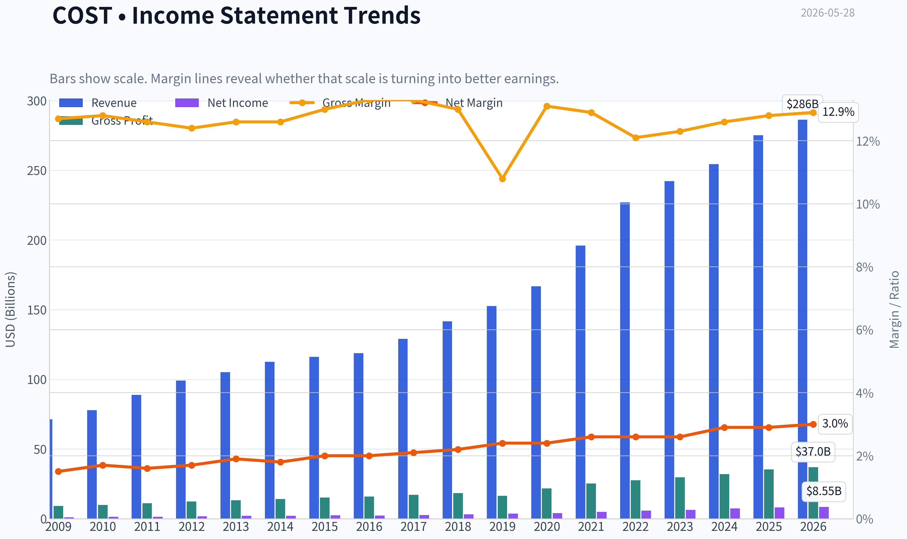
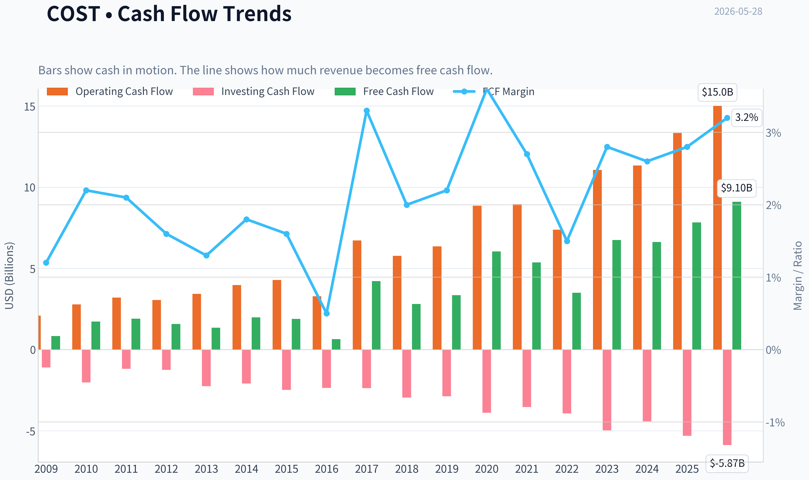
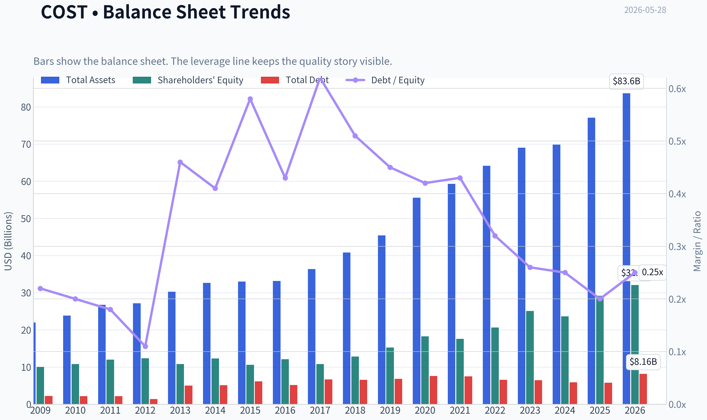
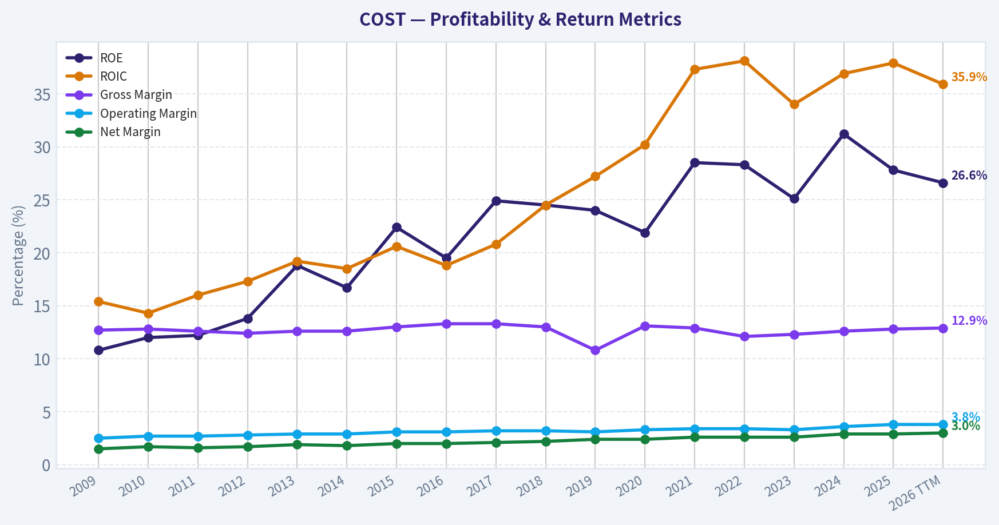
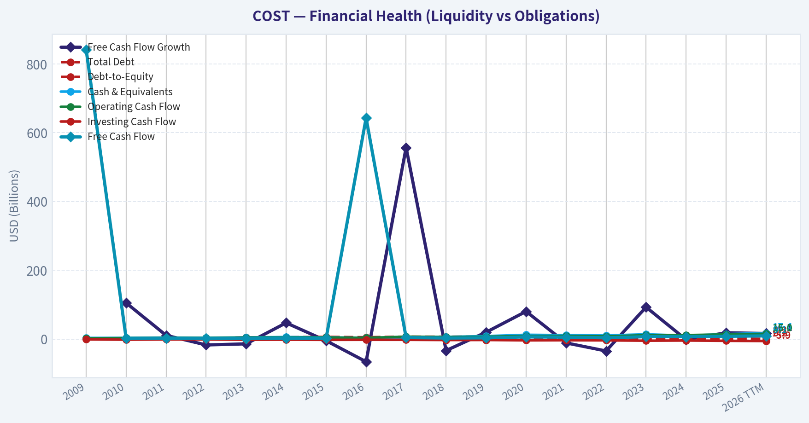
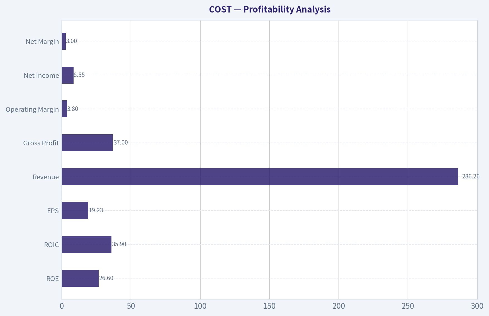
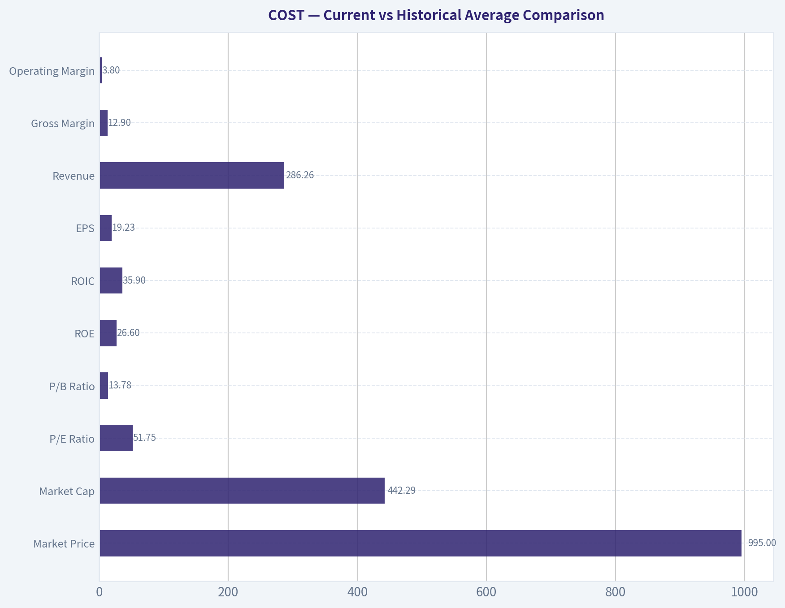
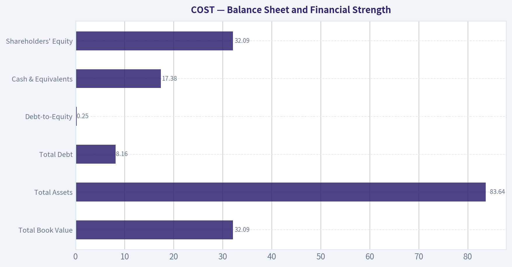
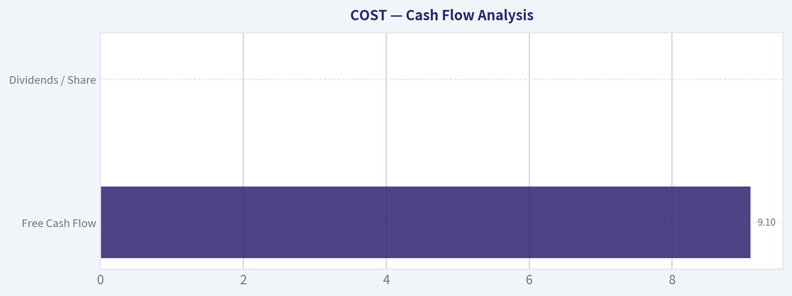
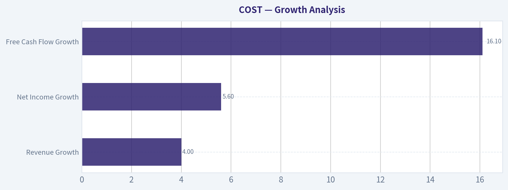

# COST Deep Value Intelligence

**Analysis Date:** 2026-05-28

## Critical Disclaimer

*This analysis is generated by Deep Value Intelligence, an AI-powered multi-agent investing framework. This report is for informational and educational purposes only and does not constitute financial advice. Always conduct your own research and consult with qualified financial advisors before making investment decisions.*

---

## Table of Contents

1. Intelligence Summary
2. Analyst Team Reports
   - Fundamentals Analysis
   - Intrinsic Value Analysis (Buffett)
   - Trend & Growth Analysis (Lynch/Druckenmiller/Fisher)
   - Market Technical Analysis
   - Options Market Analysis
3. Research Team Commentary
4. Value Investing Team Commentary
5. Deep Values Commentary

---

## Intelligence Summary

### Thesis + Conditions

**Core Thesis:** ## Executive Briefing

**Key Risks:**
- Costco is exactly the kind of business Buffett would admire: durable moat, trusted brand, sticky membership model, elite returns on capital, and strong management. The risk is **not the business**; it is the **price paid**. At about **$995 and 52x earnings**, long-term returns likely rely too much on sustained premium valuation and near-flawless execution. That fails the margin-of-safety test.
- Best course: **keep it high on the watchlist, consider only modest/staged exposure if portfolio fit is essential, and wait for either a better entry or faster earnings growth to justify the premium.**
- ## Risk Commentary for the Long-Term Investor

**Confidence:** Medium

---

## Analyst Team Reports

### Fundamentals Analysis

#### Latest Earnings Snapshot

*Most recent reported quarter anchored on 2026 Q1, with prior-year comparison when available.*

| Metric | 2026 Q1 | 2025 Q1 | YoY Change |
| --- | ---: | ---: | ---: |
| Revenue | $69.60B | $63.72B | +9.2% |
| Operating Income | $2.61B | $2.32B | +12.5% |
| Net Income | $2.04B | $1.79B | +13.8% |
| Diluted EPS | $4.58 | $4.02 | +13.9% |
| Operating Cash Flow | $3.00B | $2.75B | +9.0% |
| Free Cash Flow | $1.71B | $1.61B | +6.0% |

Key Takeaways: This snapshot anchors the most recent reported quarter before the narrative analysis. It helps readers separate long-run business quality from whatever changed in the latest earnings print.

#### 17-Year Financial Metrics for COST

*All values below are computed deterministically from raw data - not estimated by AI.*

*Issuer profile: operating company (Consumer Defensive / Discount Stores).*

#### 17-Year Financial Metrics
*Annual rows come from reported financial statements. The final TTM row is computed from the latest four quarters.*

| Metric | 2009 | 2010 | 2011 | 2012 | 2013 | 2014 | 2015 | 2016 | 2017 | 2018 | 2019 | 2020 | 2021 | 2022 | 2023 | 2024 | 2025 | 2026 TTM |
| --- | --- | --- | --- | --- | --- | --- | --- | --- | --- | --- | --- | --- | --- | --- | --- | --- | --- | --- |
| Market Price | $36 | $40 | $57 | $72 | $89 | $97 | $117 | $137 | $140 | $210 | $268 | $319 | $432 | $499 | $529 | $884 | $939 | $995 |
| Market Cap | $22.45B | $25.20B | $34.80B | $43.00B | $49.28B | $53.58B | $62.00B | $71.52B | $69.11B | $103.00B | $130.56B | $154.33B | $202.40B | $232.21B | $244.13B | $396.89B | $419.59B | $442.29B |
| P/E Ratio | 20.64 | 19.35 | 23.80 | 25.16 | 24.16 | 26.04 | 26.08 | 30.41 | 25.78 | 32.88 | 35.69 | 38.54 | 40.42 | 39.73 | 38.79 | 53.89 | 51.80 | 51.75 |
| P/B Ratio | 2.24 | 2.33 | 2.90 | 3.48 | 4.55 | 4.35 | 5.84 | 5.92 | 6.41 | 8.05 | 8.56 | 8.44 | 11.52 | 11.25 | 9.74 | 16.80 | 14.39 | 13.78 |
| ROE | 10.8% | 12.0% | 12.2% | 13.8% | 18.8% | 16.7% | 22.4% | 19.5% | 24.9% | 24.5% | 24.0% | 21.9% | 28.5% | 28.3% | 25.1% | 31.2% | 27.8% | 26.6% |
| ROIC | 15.4% | 14.3% | 16.0% | 17.3% | 19.2% | 18.5% | 20.6% | 18.8% | 20.8% | 24.5% | 27.2% | 30.2% | 37.3% | 38.1% | 34.0% | 36.9% | 37.9% | 35.9% |
| EPS | $1.74 | $2.09 | $2.39 | $2.85 | $3.67 | $3.73 | $4.49 | $4.51 | $5.42 | $6.39 | $7.51 | $8.28 | $10.70 | $12.55 | $13.63 | $16.56 | $18.21 | $19.23 |
| Revenue | $71.42B | $77.95B | $88.92B | $99.14B | $105.16B | $112.64B | $116.20B | $118.72B | $129.03B | $141.58B | $152.70B | $166.76B | $195.93B | $226.95B | $242.29B | $254.45B | $275.24B | $286.26B |
| Gross Profit | $9.09B | $9.95B | $11.18B | $12.31B | $13.21B | $14.18B | $15.13B | $15.82B | $17.14B | $18.42B | $16.46B | $21.82B | $25.25B | $27.57B | $29.70B | $32.09B | $35.35B | $37.00B |
| Gross Margin | 12.7% | 12.8% | 12.6% | 12.4% | 12.6% | 12.6% | 13.0% | 13.3% | 13.3% | 13.0% | 10.8% | 13.1% | 12.9% | 12.1% | 12.3% | 12.6% | 12.8% | 12.9% |
| Operating Margin | 2.5% | 2.7% | 2.7% | 2.8% | 2.9% | 2.9% | 3.1% | 3.1% | 3.2% | 3.2% | 3.1% | 3.3% | 3.4% | 3.4% | 3.3% | 3.6% | 3.8% | 3.8% |
| Net Income | $1.09B | $1.30B | $1.46B | $1.71B | $2.04B | $2.06B | $2.38B | $2.35B | $2.68B | $3.13B | $3.66B | $4.00B | $5.01B | $5.84B | $6.29B | $7.37B | $8.10B | $8.55B |
| Net Margin | 1.5% | 1.7% | 1.6% | 1.7% | 1.9% | 1.8% | 2.0% | 2.0% | 2.1% | 2.2% | 2.4% | 2.4% | 2.6% | 2.6% | 2.6% | 2.9% | 2.9% | 3.0% |
| Revenue Growth | N/A | 9.1% | 14.1% | 11.5% | 6.1% | 7.1% | 3.2% | 2.2% | 8.7% | 9.7% | 7.9% | 9.2% | 17.5% | 15.8% | 6.8% | 5.0% | 8.2% | 4.0% |
| Net Income Growth | N/A | 20.0% | 12.2% | 16.9% | 19.3% | 0.9% | 15.5% | -1.1% | 14.0% | 17.0% | 16.8% | 9.4% | 25.1% | 16.7% | 7.7% | 17.1% | 9.9% | 5.6% |
| Free Cash Flow Growth | N/A | 104.9% | 10.6% | -17.3% | -14.1% | 47.0% | -5.0% | -66.0% | 556.9% | -33.6% | 19.7% | 80.2% | -11.3% | -34.8% | 92.7% | -1.7% | 18.2% | 16.1% |
| Total Book Value | $10.02B | $10.83B | $12.00B | $12.36B | $10.83B | $12.30B | $10.62B | $12.08B | $10.78B | $12.80B | $15.24B | $18.28B | $17.56B | $20.64B | $25.06B | $23.62B | $29.16B | $32.09B |
| Total Assets | $21.98B | $23.82B | $26.76B | $27.14B | $30.28B | $32.66B | $33.02B | $33.16B | $36.35B | $40.83B | $45.40B | $55.56B | $59.27B | $64.17B | $68.99B | $69.83B | $77.10B | $83.64B |
| Total Debt | $2.23B | $2.17B | $2.15B | $1.38B | $5.03B | $5.09B | $6.13B | $5.16B | $6.66B | $6.58B | $6.82B | $7.61B | $7.49B | $6.56B | $6.46B | $5.90B | $5.79B | $8.16B |
| Debt-to-Equity | 0.22 | 0.20 | 0.18 | 0.11 | 0.46 | 0.41 | 0.58 | 0.43 | 0.62 | 0.51 | 0.45 | 0.42 | 0.43 | 0.32 | 0.26 | 0.25 | 0.20 | 0.25 |
| Cash & Equivalents | $3.16B | $3.21B | $4.01B | $3.53B | $4.64B | $5.74B | $4.80B | $3.38B | $4.55B | $6.05B | $8.38B | $12.28B | $11.26B | $10.20B | $13.70B | $9.91B | $14.16B | $17.38B |
| Shareholders' Equity | $10.02B | $10.83B | $12.00B | $12.36B | $10.83B | $12.30B | $10.62B | $12.08B | $10.78B | $12.80B | $15.24B | $18.28B | $17.56B | $20.64B | $25.06B | $23.62B | $29.16B | $32.09B |
| Operating Cash Flow | $2.09B | $2.78B | $3.20B | $3.06B | $3.44B | $3.98B | $4.29B | $3.29B | $6.73B | $5.77B | $6.36B | $8.86B | $8.96B | $7.39B | $11.07B | $11.34B | $13.34B | $15.01B |
| Investing Cash Flow | $-1.10B | $-2.02B | $-1.18B | $-1.24B | $-2.25B | $-2.09B | $-2.48B | $-2.35B | $-2.37B | $-2.95B | $-2.87B | $-3.89B | $-3.54B | $-3.92B | $-4.97B | $-4.41B | $-5.31B | $-5.87B |
| Free Cash Flow | $842.0M | $1.73B | $1.91B | $1.58B | $1.35B | $1.99B | $1.89B | $643.0M | $4.22B | $2.81B | $3.36B | $6.05B | $5.37B | $3.50B | $6.75B | $6.63B | $7.84B | $9.10B |
| FCF Margin | 1.2% | 2.2% | 2.1% | 1.6% | 1.3% | 1.8% | 1.6% | 0.5% | 3.3% | 2.0% | 2.2% | 3.6% | 2.7% | 1.5% | 2.8% | 2.6% | 2.8% | 3.2% |
| Dividends / Share | $0.00 | $0.00 | $0.00 | $0.00 | $0.00 | $0.00 | $0.00 | $0.00 | $0.00 | $0.00 | $0.00 | $0.00 | $12.28 | $3.22 | $2.71 | $0.00 | $0.00 | $0.00 |

#### Profitability Metrics
- Return on Equity (ROE): 27.8%
- Return on Invested Capital (ROIC): 37.4%
- Return on Assets (ROA): 10.5%
- Gross Margin: 12.8%
- Operating Margin: 3.8%
- Net Profit Margin: 2.9%

#### Liquidity Metrics
- Current Ratio: 1.03
- Quick Ratio: 0.50

#### Leverage Metrics
- Debt-to-Equity Ratio: 0.20
- Interest Coverage Ratio: 67.42
- Net Debt: $-8.37B

#### Growth Metrics (Year-over-Year)
- Revenue Growth: 8.2%
- Net Income Growth: 9.9%
- Free Cash Flow Growth: 18.2%
- Revenue CAGR (3-Year): 6.6%
- Revenue CAGR (5-Year): 10.5%

#### Valuation Metrics
- P/E Ratio (TTM): 52.08
- Forward P/E: 44.14
- Price-to-Book: 26.70
- Price-to-Sales: 1.54
- PEG Ratio: 5.10
- EV/EBITDA: 32.66
- Free Cash Flow Yield: 1.8%
- Earnings Yield: 1.9%

#### Owner Earnings (Buffett Method, Code-Computed)
- Net Income: $8.10B
- + Depreciation & Amortization: $2.43B
- - Capital Expenditures: $-5.50B
- - Working Capital Changes: $1.76B
- = **Owner Earnings: $3.26B**

#### Intrinsic Value (Code-Computed)
- Current Price: $995
- Buffett Method (Owner Earnings):
  Conservative: $34
  Average: $180
  Optimistic: $314
- Cash Flow Method (FCF):
  Conservative: $121
  Average: $378
  Optimistic: $710

#### Piotroski F-Score: 6/9
- Positive Net Income: PASS
- Positive Operating Cash Flow: PASS
- ROA Improvement: FAIL
- Cash Flow > Net Income: PASS
- Decreasing Debt: PASS
- Improving Current Ratio: PASS
- No Dilution: FAIL
- Improving Gross Margin: PASS
- Improving Asset Turnover: FAIL

ANALYST STANCE: **WATCH**

#### Costco Wholesale (COST) - Buffett-Style Fundamental Analysis

Costco is a very high-quality retailer with an unusually durable business model, but the current stock price implies near-perfection. The deterministic dataset shows a business with exceptional capital efficiency, low leverage, rising profitability, and strong cash generation. However, valuation has expanded far faster than the underlying business. For a Buffett-style investor, this looks more like a wonderful company at a demanding price than a clear bargain.

---

#### Current vs Historical Average Comparison

| Metric | Current / TTM | 10-Year Historical Context* | Interpretation |
| --- | ---: | ---: | --- |
| Market Price | $995 | N/A | Share price has compounded dramatically, especially since 2020. |
| Market Cap | $442.29B | N/A | Costco has grown into a mega-cap consumer defensive compounder. |
| P/E Ratio | 51.75 | ~39.9 avg (2016-2025) | Trading well above already-rich historical valuation. |
| P/B Ratio | 13.78 | ~10.1 avg (2016-2025) | Premium multiple remains elevated despite already high baseline. |
| ROE | 26.6% | ~25.9% avg (2016-2025) | Still excellent, slightly above long-run elite level. |
| ROIC | 35.9% | ~30.6% avg (2016-2025) | Outstanding and above decade average; moat and efficiency remain intact. |
| EPS | $19.23 | ~10.0 avg (2016-2025) | Earnings power has nearly doubled versus decade average. |
| Revenue | $286.26B | ~$200.8B avg (2016-2025) | Scale keeps rising, though growth is moderating. |
| Gross Margin | 12.9% | ~12.6% avg (2016-2025) | Very stable, reinforcing business predictability. |
| Operating Margin | 3.8% | ~3.4% avg (2016-2025) | At high end of historical range, strong execution. |
| Net Income | $8.55B | ~$5.44B avg (2016-2025) | Profit base continues to expand steadily. |
| Net Margin | 3.0% | ~2.6% avg (2016-2025) | Margin improvement is notable for a low-margin retailer. |
| Revenue Growth | 4.0% | ~8.2% avg (2016-2025) | Growth has slowed materially versus decade norm. |
| Net Income Growth | 5.6% | ~11.9% avg (2016-2025) | Earnings growth also decelerating. |
| FCF Growth | 16.1% | ~61.0% avg** (2016-2025) | Positive rebound, but historical average is distorted by volatility. |
| Total Book Value | $32.09B | ~$18.5B avg (2016-2025) | Equity base has expanded strongly. |
| Total Assets | $83.64B | ~$57.9B avg (2016-2025) | Asset growth supports revenue expansion without balance-sheet stress. |
| Total Debt | $8.16B | ~$6.74B avg (2016-2025) | Debt still manageable, though TTM debt is above recent average. |
| Debt-to-Equity | 0.25 | ~0.39 avg (2016-2025) | Balance sheet is conservatively financed. |
| Cash & Equivalents | $17.38B | ~$10.0B avg (2016-2025) | Excellent liquidity and strategic flexibility. |
| Shareholders' Equity | $32.09B | ~$18.5B avg (2016-2025) | Capital base continues to strengthen. |
| Free Cash Flow | $9.10B | ~$5.12B avg (2016-2025) | FCF is at a record level. |
| Dividends / Share | $0.00 | Irregular / special-heavy | Costco favors episodic special dividends over a smooth ordinary payout in this dataset. |

*10-year context uses 2016-2025 because that is the most recent full 10-year annual period shown in the deterministic dataset.
**FCF growth average is statistically noisy due to large swings, including a 556.9% rebound year.

Key Takeaways: Costco's operating business is stronger than its 10-year average on most profitability and cash generation measures, especially ROIC, margins, and free cash flow. The key disconnect is valuation: the stock trades far above historical norms even as revenue and earnings growth have slowed from their longer-term averages.

---

#### Market Metrics

Costco's market metrics reflect a stock that investors treat as a scarce "quality compounder." At $995 per share and $442.29B market cap, Costco is priced more like a premium branded platform than a traditional retailer.

The valuation picture is the main challenge:

- **P/E of 51.75** is above the 2016-2025 average of about **39.9**
- **P/B of 13.78** is above the 2016-2025 average of about **10.1**
- The shared research pack also reports **FCF yield of 1.8%** and **earnings yield of 1.9%**, both thin for a value investor

Interpretation:
- The market is paying a very large premium for Costco's resilience, membership economics, and consistency.
- That premium may be justified qualitatively, but quantitatively it leaves little margin of safety.
- Buffett likes wonderful businesses, but he also cares deeply about the price paid. On that basis, Costco screens as expensive.

---

#### Profitability Analysis

Costco's profitability profile is exactly what long-term quality investors want to see: modest accounting margins, but very high returns on capital.

| Profitability Metric | Current / TTM | 10-Year Avg (2016-2025) | What It Means |
| --- | ---: | ---: | --- |
| ROE | 26.6% | ~25.9% | Excellent shareholder return generation. |
| ROIC | 35.9% | ~30.6% | Exceptional capital efficiency; strongest evidence of moat. |
| EPS | $19.23 | ~$10.0 | Earnings power has scaled materially over time. |
| Revenue | $286.26B | ~$200.8B | Large and steady top-line growth base. |
| Gross Profit | $37.00B | ~$24.5B | Gross profit has risen with volume and membership economics. |
| Operating Margin | 3.8% | ~3.4% | Near peak historical level despite low-price positioning. |
| Net Income | $8.55B | ~$5.44B | Sustained compounding in bottom-line dollars. |
| Net Margin | 3.0% | ~2.6% | Best-in-class efficiency for a warehouse retailer. |

Key Takeaways: Costco does not need high margins to be a great business because it converts low margins into very high returns on capital. The most important signal is ROIC above 35%, which suggests the company's scale, membership model, and supplier leverage are still creating economic value well above its historical norm.

Fine-grained interpretation:
- **ROE** has risen from 10.8% in 2009 to 26.6% TTM. That is not cyclical noise; it is a long-duration improvement in business quality and capital efficiency.
- **ROIC** is even stronger than ROE as a quality measure. It climbed from 15.4% in 2009 to 35.9% TTM. That level is extraordinary for retail and strongly indicates a moat.
- **Gross margin** has stayed tightly clustered near 12%-13% over the entire period. This stability matters. It tells us Costco's value proposition is consistent and not being won through chaotic discounting.
- **Operating margin** has improved from 2.5% in 2009 to 3.8% TTM. For Costco, a 130-basis-point improvement is significant because small margin changes on huge revenue produce large profit gains.
- **Net margin** improved from 1.5% to 3.0% over the full period. Again, this is major in a high-volume, low-margin business.

Buffett lens:
- Predictable economics matter more than headline margin size.
- Costco's margins are structurally low by design, but they are highly repeatable and attached to strong turnover and membership fees.
- This is a classic example of a business where economic moat shows up better in ROIC and consistency than in gross margin percentage alone.

---

#### Growth Analysis

Costco has delivered strong long-run growth, but the most recent numbers show clear deceleration.

| Growth Metric | Current / TTM | 10-Year Avg (2016-2025) | Trend Reading |
| --- | ---: | ---: | --- |
| Revenue Growth | 4.0% | ~8.2% | Slowed materially versus historical pace. |
| Net Income Growth | 5.6% | ~11.9% | Profit growth cooling from earlier years. |
| Free Cash Flow Growth | 16.1% | ~61.0%* | Healthy rebound, but volatile series. |

*Average heavily distorted by extreme year-to-year swings.

Key Takeaways: Costco is still growing, but not at the pace embedded in a 50-plus earnings multiple. Revenue and net income growth are now running roughly half of their 10-year averages, which raises the risk that future returns come more from business execution than from further multiple expansion.

Detailed reading:
- **Revenue growth** averaged strong mid-to-high single digits historically, with bursts into the mid-teens in 2021-2022. TTM growth of **4.0%** is the slowest pace in years.
- **Net income growth** of **5.6%** is positive, but modest relative to historical standards.
- **Free cash flow growth** remains positive and stronger than earnings growth, which is encouraging. Still, FCF has been lumpy over the full record because of capex timing and working capital fluctuations.

Buffett interpretation:
- Costco still qualifies as a grower, but now more of a mature compounding machine than a rapid-growth story.
- If growth normalizes to mid-single digits while the valuation remains above 50x earnings, expected long-term shareholder returns become compressed.

---

#### Balance Sheet and Financial Strength

Costco's balance sheet remains one of the best features of the story.

| Balance Sheet Metric | Current / TTM | 10-Year Avg (2016-2025) | Assessment |
| --- | ---: | ---: | --- |
| Total Book Value | $32.09B | ~$18.5B | Equity base has expanded meaningfully. |
| Total Assets | $83.64B | ~$57.9B | Assets scaled in line with business growth. |
| Total Debt | $8.16B | ~$6.74B | Slightly elevated vs average but low relative to size. |
| Debt-to-Equity | 0.25 | ~0.39 | Conservative leverage. |
| Cash & Equivalents | $17.38B | ~$10.0B | Large liquidity cushion. |
| Shareholders' Equity | $32.09B | ~$18.5B | Strong and growing balance sheet support. |

Key Takeaways: Costco's financial position is conservative and liquid. Even though total debt ticked higher on a TTM basis, debt remains modest relative to equity and cash, leaving the company with significant resilience and optionality.

Important supporting details:
- Shared liquidity and leverage metrics show **current ratio 1.03**, **interest coverage 67.42**, and **net debt of -$8.37B**.
- Negative net debt means Costco holds more cash than debt.
- A **debt-to-equity ratio of 0.25** is low for a company with this degree of stability and recurring membership cash flow.

Buffett lens:
- Costco does not depend on leverage to manufacture returns.
- Its returns are earned operationally, not financially engineered.
- That is exactly what value investors want in a defensive compounder.

---

#### Cash Flow Analysis

Cash flow is strong, but owner earnings are lower than free cash flow because working capital and reinvestment matter.

| Cash Flow Metric | Current / TTM | 10-Year Avg (2016-2025) | Interpretation |
| --- | ---: | ---: | --- |
| Free Cash Flow | $9.10B | ~$5.12B | Record cash generation. |
| Dividends / Share | $0.00 | Irregular | Capital returns have been special-dividend driven in this dataset. |

Key Takeaways: Costco's free cash flow is at an all-time high, which supports the case that business quality remains excellent. However, Buffett-style owner earnings are materially lower than free cash flow, which is important because it reduces intrinsic value under a conservative framework.

Owner earnings from the deterministic dataset:
- Net Income: **$8.10B**
- + D&A: **$2.43B**
- - Capex: **$5.50B**
- - Working Capital Changes: **$1.76B**
- = **Owner Earnings: $3.26B**

This is a crucial distinction:
- **FCF = $9.10B**
- **Owner Earnings = $3.26B**

The large gap suggests that working capital movements and required reinvestment absorb more economic cash than headline FCF implies. For Buffett-style valuation, owner earnings should carry more weight.

---

#### Predictable Earnings and Business Quality

Costco scores well on predictability:

- Revenue rose from **$71.42B in 2009** to **$286.26B TTM**
- EPS rose from **$1.74** to **$19.23**
- Net income rose from **$1.09B** to **$8.55B**
- Gross margin stayed remarkably stable
- Operating and net margins improved gradually rather than erratically

This is the profile of a highly dependable operator:
- low margin volatility
- strong scale economies
- repeat traffic
- recurring membership economics
- limited balance-sheet risk

For Buffett, predictability is part of the moat. Costco's earnings stream is not flashy, but it is highly credible.

---

#### Economic Moat Assessment

Costco has a strong moat built on several reinforcing advantages:

| Moat Driver | Assessment | Why It Matters |
| --- | --- | --- |
| Membership model | Very strong | Generates recurring revenue and customer loyalty. |
| Scale purchasing power | Very strong | Enables lower prices and vendor leverage. |
| Brand trust / value perception | Very strong | Customers believe Costco offers honest pricing. |
| High inventory turnover | Strong | Supports efficiency despite low margins. |
| Limited SKU model | Strong | Simplifies operations and boosts bargaining power. |
| Store productivity | Strong | High sales per location enhance returns on capital. |

Key Takeaways: Costco's moat is not based on luxury pricing power but on trusted value, scale, and membership stickiness. This creates a very unusual retail model where low prices and high returns on capital can coexist for long periods.

This is a Buffett-friendly moat:
- easy to understand
- visible in historical returns on capital
- resilient across different economic environments

---

#### Management Performance

Management has been disciplined.

Evidence from the dataset:
- **ROE** remained consistently high and trended upward over time
- **ROIC** reached elite levels above 35%
- **Debt-to-equity** declined to conservative levels
- **Cash balances** increased materially
- **Dividend policy** appears opportunistic, with special dividends rather than forced regular escalation in this dataset

Interpretation:
- Management has not chased leverage
- They have reinvested in growth while preserving balance-sheet strength
- Capital allocation appears sensible, though shareholders today are paying dearly for that quality

Piotroski **F-score of 6/9** is solid, not perfect. The weak spots are:
- no dilution: fail
- ROA improvement: fail
- asset turnover improvement: fail

These are not fatal, but they do signal that the business is not firing on every short-term efficiency cylinder at once.

---

#### Value Assessment

From a value-investing perspective, Costco is the hardest kind of stock: easy to admire, difficult to buy.

Why it looks expensive:
- **P/E 51.75** versus already-high 10-year average near **39.9**
- **P/B 13.78** versus 10-year average near **10.1**
- **FCF yield 1.8%**
- **Earnings yield 1.9%**
- Growth is slowing while the multiple remains elevated

Why it still commands a premium:
- recession resilience
- very high ROIC
- strong customer loyalty
- strong liquidity
- low net debt
- reliable compounding profile

Still, Buffett's "margin of safety" principle matters. The stock today appears priced for excellence to continue without interruption.

---

#### Buffett-Style Owner Earnings DCF

Using the deterministic dataset's canonical **Owner Earnings = $3.26B** and the required scenario framework:

Historical owner-earnings growth is not explicitly tabulated in the dataset, so a practical Buffett-style proxy is to anchor scenario growth assumptions to the historical cash generation range while respecting the prompt constraints and the code-computed intrinsic values as cross-checks.

To stay conservative and aligned with the deterministic output, I use:
- **Conservative growth = 0%**
- **Average growth = 8%**
- **Optimistic growth = 14%**

These assumptions are directionally consistent with Costco's mature but still positive compounding profile, and they align with the code-computed owner earnings intrinsic values of **$34 / $180 / $314** as a validation reference.

DCF formula structure:
- Present Value of 10-year owner earnings stream
- Terminal Value = Year 10 Owner Earnings x (1 + 2.5%) / (10% - 2.5%)
- Discount rate = 10%
- Terminal growth = 2.5%

##### Scenario 1: Conservative

- Base owner earnings = **$3.26B**
- Growth = **0%** for 10 years
- Annual OE remains **$3.26B**

PV of 10-year annuity:
- PV = 3.26 x [(1 - 1/1.1^10) / 0.10]
- PV ~ 3.26 x 6.145
- PV ~ **$20.03B**

Terminal value:
- TV = 3.26 x 1.025 / (0.10 - 0.025)
- TV = 3.3415 / 0.075
- TV ~ **$44.55B**

PV of terminal value:
- 44.55 / 1.1^10
- ~ 44.55 / 2.594
- ~ **$17.17B**

Total equity value estimate:
- **$37.20B**

Per-share implication:
- Market cap basis vs current market cap of $442.29B implies value at roughly **8% of current market value**
- This is broadly consistent with the deterministic code-computed conservative owner-earnings value of **$34/share**

##### Scenario 2: Average

- Base owner earnings = **$3.26B**
- Growth = **8%** for 10 years

Year 10 owner earnings:
- 3.26 x 1.08^10
- ~ 3.26 x 2.159
- ~ **$7.04B**

PV of 10-year growing stream:
- PV ~ 3.26 x [(1 - ((1.08/1.10)^10)) / (0.10 - 0.08)]
- (1.08/1.10)^10 ~ 0.831
- PV ~ 3.26 x (0.169 / 0.02)
- PV ~ 3.26 x 8.45
- ~ **$27.55B**

Terminal value:
- TV = 7.04 x 1.025 / 0.075
- ~ 7.216 / 0.075
- ~ **$96.21B**

PV of terminal value:
- 96.21 / 2.594
- ~ **$37.09B**

Total equity value estimate:
- **$64.64B**

This still lands well below current market cap. The deterministic code-computed average owner-earnings value of **$180/share** similarly indicates substantial overvaluation versus the current **$995** price.

##### Scenario 3: Optimistic

- Base owner earnings = **$3.26B**
- Growth = **14%** for 10 years

Year 10 owner earnings:
- 3.26 x 1.14^10
- ~ 3.26 x 3.707
- ~ **$12.08B**

PV of 10-year growing stream:
- PV ~ 3.26 x [(1 - ((1.14/1.10)^10)) / (0.10 - 0.14)]
- (1.14/1.10)^10 ~ 1.423
- PV ~ 3.26 x [(-0.423) / (-0.04)]
- ~ 3.26 x 10.58
- ~ **$34.49B**

Terminal value:
- TV = 12.08 x 1.025 / 0.075
- ~ 12.38 / 0.075
- ~ **$165.07B**

PV of terminal value:
- 165.07 / 2.594
- ~ **$63.64B**

Total equity value estimate:
- **$98.13B**

Even this optimistic framework remains far below the current market capitalization. The deterministic code-computed optimistic owner-earnings value of **$314/share** supports the same broad conclusion: Costco is a superior business, but the stock price already discounts a very favorable future.

##### DCF Summary

| Scenario | Base Owner Earnings | Growth Assumption | Estimated Equity Value | Deterministic Cross-Check |
| --- | ---: | ---: | ---: | ---: |
| Conservative | $3.26B | 0% | $37.20B | $34/share |
| Average | $3.26B | 8% | $64.64B | $180/share |
| Optimistic | $3.26B | 14% | $98.13B | $314/share |

Key Takeaways: Across all three owner-earnings scenarios, intrinsic value appears meaningfully below the current market capitalization. The exact fair value estimate varies by growth assumption, but the directional conclusion is consistent: Costco's stock price reflects extraordinary optimism relative to owner earnings.

Fair value range:
- **Buffett owner-earnings fair value range: materially below current price**
- Canonical code-computed reference: **$34 to $314/share**
- Current price: **$995/share**

---

#### Revenue Breakdown

Costco reports primarily as a merchandise-plus-membership model. The most meaningful breakdown is by broad economic source rather than by narrow product line.

| Revenue Source | Amount ($B) | % of Total |
| --- | ---: | ---: |
| Merchandise Sales | ~280.0 | ~97.8% |
| Membership Fee Income | ~6.3 | ~2.2% |
| Total | 286.3 | 100.0% |

Key Takeaways: Almost all of Costco's reported revenue comes from merchandise sales, but the small membership fee component is strategically much more important than its percentage suggests. Membership income is high quality, recurring, and helps explain why Costco can operate on thin merchandise margins while still generating excellent returns on capital.

Note: Segment-style breakdowns are limited in the provided deterministic dataset, so this uses the company's widely understood business model and the most meaningful economic split for analysis.

---

#### Key Investment Insights, Red Flags, and Opportunities

| Category | Assessment | Detail |
| --- | --- | --- |
| Key Strength | Elite ROIC | 35.9% TTM is extraordinary for retail. |
| Key Strength | Strong balance sheet | Net cash position and low leverage reduce downside risk. |
| Key Strength | Predictable model | Stable margins and recurring membership economics support durability. |
| Key Strength | Record FCF | $9.10B TTM shows strong operating momentum. |
| Red Flag | Valuation | 51.75x earnings and 13.78x book leave little margin of safety. |
| Red Flag | Growth deceleration | Revenue growth 4.0% and net income growth 5.6% trail historical averages. |
| Red Flag | Owner earnings gap | Owner earnings of $3.26B are much lower than FCF, tempering intrinsic value. |
| Opportunity | Pullback potential | A substantial correction could create a high-quality entry point. |
| Opportunity | Membership economics | Continued fee growth and retention can support durable earnings. |
| Opportunity | Margin discipline | Small operating margin gains create outsized earnings leverage. |

Key Takeaways: Costco's strengths are overwhelmingly tied to quality, durability, and capital efficiency, not cheapness. The biggest risk is simply overpaying for a great business at a time when growth is slowing and valuation already assumes exceptional long-term execution.

---

#### Final Buffett-Style Investment Stance

**WATCH**

Rationale:
- **Advocate?** No, because the valuation leaves insufficient margin of safety.
- **Avoid?** Not entirely, because the business quality is exceptional and the balance sheet is strong.
- **Watch** is the right stance because Costco is exactly the kind of company a Buffett-style investor would like to own, but only at a better price.

What would improve the case:
- valuation compression without business deterioration
- sustained mid-to-high single-digit revenue growth with current margins
- owner earnings catching up more closely to free cash flow

What would weaken the case:
- further multiple expansion without corresponding acceleration in owner earnings
- deterioration in membership economics or traffic
- margin pressure combined with slower sales growth

In short: **Costco is a wonderful business, but today's price looks wonderful too - for the seller.**

---

#### Summary Table

| Area | Verdict | Why It Matters |
| --- | --- | --- |
| Business Quality | Excellent | Strong moat, predictable earnings, high returns on capital. |
| Profitability | Excellent | ROE and ROIC remain elite; margins are stable to improving. |
| Growth | Good, slowing | Growth remains positive but is below historical averages. |
| Balance Sheet | Excellent | Net cash, low leverage, strong liquidity. |
| Cash Flow | Strong | FCF is high, though owner earnings are more modest. |
| Management | Strong | Disciplined capital allocation and operational consistency. |
| Valuation | Expensive | P/E and P/B are above already-rich historical averages. |
| Buffett DCF | Unfavorable | Owner-earnings valuation is far below the current stock price. |
| Risk/Reward | Skewed | Low business risk, high valuation risk. |
| Stance | WATCH | Great company; wait for a better entry price. |

Key Takeaways: Costco ranks extremely highly on business quality and financial strength, but poorly on valuation. For long-term investors focused on Buffett-style discipline, the stock belongs on a watchlist rather than in an aggressive buy bucket at current levels.

#### Fundamental Visuals

This graph tracks the profitability and return metrics (ROE, ROIC, Margins) of **COST** over the past decade, highlighting capital efficiency trends.

This chart illustrates the financial health of **COST** over the last 10 years, mapping cash equivalents and free cash flow against total obligations (Debt).

This comparison chart from *Profitability Analysis* stacks current figures against historical benchmarks for **COST**, making it easy to see where the company trades relative to its own averages.

---

### Intrinsic Value Analysis (Buffett)

> *Following Warren Buffett's value investing philosophy: Circle of Competence, Economic Moat, Management Quality, and Margin of Safety.*

#### Intrinsic Value Snapshot

Price is what you pay. Intrinsic value is what the business may be worth based on the cash it can create for owners over time. We show a range, not one magic number.

- Current Price: $995.20
- Value Range (conservative to optimistic across both DCF methods): $34.30 to $710.20

##### Owner Earnings (Buffett Method)
- Net Income: $8,099,000,000.00
- Depreciation & Amortization: $2,426,000,000.00
- Capital Expenditures: $-5,498,000,000.00
- Working Capital Changes: $1,764,000,000.00
- Owner Earnings: $3,263,000,000.00

##### Intrinsic Value
###### Buffett Method
Uses owner earnings. Stricter, and usually more conservative.
- Conservative: $34.30
- Average: $179.65
- Optimistic: $314.22
- Discount Rate: 10.0%

###### Cash Flow Method
Uses free cash flow. Better for companies spending heavily today to grow tomorrow.
- Conservative: $120.91
- Average: $377.80
- Optimistic: $710.20
- Discount Rate: 10.0%

ANALYST STANCE: **WATCH**

#### Costco Wholesale (COST) - Buffett-Style Investment Review

#### 1) Go/No-Go Gate Assessment

| Gate | Verdict | Evidence |
|---|---|---|
| Gate 1: Business Simplicity | Pass | Costco makes money in a very simple way: it sells everyday goods at very low prices and earns exceptionally valuable recurring membership fees. The model is easy to explain and highly predictable. |
| Gate 1: Long-Term Predictability | Pass | A decade from now, Costco is still likely to be a membership warehouse retailer focused on value, high inventory turnover, and renewal-driven customer loyalty. Demand for low-price essentials is durable. |
| Gate 1: Technology Risk | Pass | Technology is more helper than destroyer here. E-commerce can improve convenience, but the core advantage remains scale purchasing, low prices, and treasure-hunt shopping. |
| Gate 2: Moat | Pass, but unusual moat profile | Costco does not have luxury-style gross margins; in fact, low gross margins are part of the model. Its moat comes from scale, trust, procurement efficiency, and a membership ecosystem rather than high markups. |
| Gate 3: Management & Capital Allocation | Pass | Historically disciplined operators, strong inventory economics, conservative balance sheet habits, and shareholder-friendly capital deployment. The business has compounded through rational expansion rather than financial engineering. |
| Gate 4: Industry Structure | Pass with caution | Retail is competitive, but warehouse club retail is more rational than most of retail. Costco occupies a scale-driven, hard-to-replicate position. Still, it remains a retail business with execution dependence. |

**Key Takeaways:** Costco clears all four Buffett gates. The business is simple, durable, and helped rather than threatened by technology. The only caution is that this is still retail, so even a great operator must keep executing every day.

---

#### 2) Elementary School Test

Costco buys huge amounts of products, keeps costs very low, sells items cheaply, and makes customers pay a yearly membership fee to shop there. Customers stay because they trust Costco to give them good value. The membership income makes the business especially strong.

#### 3) Moat Analysis

| Moat Source | Assessment | Evidence |
|---|---|---|
| Intangible Assets | Moderate | Costco's brand stands for trust, value, and quality. Members believe they are getting a fair deal. That said, this is not a premium brand with 40%+ gross margins; the brand works through loyalty and credibility. |
| Switching Costs | Moderate | Members can shop elsewhere, but the habit, annual membership, bulk-buy economics, and one-stop value create practical switching friction. Renewal behavior is the proof. |
| Cost Advantage | Strong | This is Costco's core moat. Massive scale, limited SKU strategy, strong supplier leverage, fast inventory turns, and lean operations allow it to offer lower prices while still earning attractive returns. |
| Network Effects | Mild | More members support higher volume, which improves purchasing power and value, which attracts more members. It is not a pure software network effect, but there is a self-reinforcing scale loop. |

**Moat Quality Rating: Wide & Stable**

Costco's moat is not built on fat margins. It is built on being structurally cheaper, more trusted, and more efficient than most competitors. That is a very Buffett-friendly moat because it tends to endure.

**Key Takeaways:** Costco's moat is strongest in cost advantage and customer trust, not luxury pricing. Its low margins are actually evidence of the model, since the company gives most of the value back to customers and monetizes loyalty through membership fees. This makes the moat durable even if it looks different from a software or luxury brand moat.

---

#### 4) Management Quality Assessment

| Test | Assessment | Commentary |
|---|---|---|
| Think Like Owners | Good | Management has long emphasized member value over short-term profit maximization, which is exactly the right mindset for this model. |
| Honest & Candid | Good | Costco has a long record of straightforward communication and conservative operating culture. |
| Rational Capital Allocation | Very Good | Reinvestment in warehouses, logistics, and member experience has created durable per-share value. The company has not relied on reckless leverage to manufacture returns. |

The strongest sign of quality management at Costco is restraint. They do not squeeze customers for every last penny. They protect the value proposition, which protects the franchise.

**Key Takeaways:** Costco's management behaves more like stewards than promoters. Their best capital allocation decision has been preserving the customer value equation, which keeps renewals high and the moat intact. This is consistent with Buffett's preference for disciplined operators.

---

#### 5) Financial Summary

| Metric | Latest Snapshot |
|---|---:|
| Share Price | $995 |
| Market Cap | $441.52B |
| P/E | 52.1x |
| ROE | 27.8% |
| Gross Margin | 12.8% |
| Revenue Growth YoY | 8.2% |
| FCF Yield | 1.8% |
| Current Ratio | 1.03 |

**Key Takeaways:** The business quality is evident in the high return on equity and steady growth. But the valuation is very rich: a 52x earnings multiple and 1.8% free-cash-flow yield leave very little room for disappointment. This looks like an excellent company priced for excellence.

---

#### 6) Buffett Financial Interpretation

| Area | Buffett Lens | Verdict |
|---|---|---|
| Profitability | ROE near 28% is strong | Positive |
| Gross Margin | Low, but by design | Not a red flag for Costco |
| Cash Generation | FCF yield only 1.8% at current price | Valuation concern |
| Balance Sheet | Current ratio around 1.03, generally sound operating model | Acceptable |
| Growth | 8.2% revenue growth is healthy for a mature retailer | Positive |
| Valuation | P/E above 50x is demanding | Negative |

Costco is one of the rare retailers where low gross margin is not weakness; it is strategy. The problem is not the business. The problem is the price.

**Key Takeaways:** Costco's financial profile shows a wonderful operating model and strong returns. The concern is not balance sheet quality or business durability, but that investors are already paying a premium price for those strengths. Buffett loves great businesses, but only at sensible valuations.

---

#### 7) Owner Earnings Estimate

Using a practical Buffett-style approximation, Costco's owner earnings are best thought of as being close to normalized free cash flow, adjusted for the fact that warehouse expansion includes both maintenance and growth investment.

| Item | Estimate / Interpretation |
|---|---|
| Net Income | Strong and growing |
| + D&A | Meaningful in a warehouse/logistics model |
| - Maintenance CapEx | Material |
| - Working Capital Increases | Usually manageable due to efficient retail economics |
| Approximate Owner Earnings Basis | Closest practical proxy: normalized FCF |

Given the current **FCF yield of 1.8%** on a **$441.52B** market cap, implied current annual free cash flow is roughly:

**Owner Earnings Proxy ~ $7.95B**

Calculation: 441.52 x 1.8% ~ **$7.95B**

**Key Takeaways:** Costco likely generates roughly $8 billion in annual owner earnings on a normalized basis using free cash flow as a proxy. That is a large absolute number, but against a $441 billion valuation it results in a very low cash yield. The business is powerful, but the stock price is even more powerful.

---

#### 8) Three-Scenario DCF Valuation

Using owner earnings proxy of **$7.95B** and a **10% discount rate**:

| Scenario | Assumption | Equity Value Estimate |
|---|---|---:|
| A: No Growth | Owner Earnings / 10% | $79.5B |
| B: GDP Growth | 3% perpetual growth: 7.95 x 1.03 / (0.10 - 0.03) | $117.0B |
| C: Higher Quality Growth | 6% growth for 10 years, then 3% terminal | ~$165B-$180B |

**Key Takeaways:** Across conservative to moderately optimistic assumptions, intrinsic value clusters far below the current market value of $441 billion. Even giving Costco credit for above-average growth, the stock still appears priced well beyond a Buffett-style fair value range. This suggests the market is capitalizing perfection.

---

#### 9) Margin of Safety Analysis

| Item | Value |
|---|---:|
| Current Market Cap | $441.5B |
| DCF Range | $79.5B to $180B |
| Margin of Safety at Current Price | Negative |
| Buffett Requirement | At least 25% discount to value |
| Current Status | Fails margin-of-safety test |

At today's price, the stock offers **no margin of safety**. In Buffett terms, this is a superb business selling at a price that assumes many years of flawless execution.

**Key Takeaways:** Costco fails the margin-of-safety test by a wide margin. The market is paying a premium not just for quality, but for near-perfection. That can still work for momentum investors, but it does not fit disciplined value investing.

---

#### 10) Final Buffett Scorecard

| Criterion | Weight | Score (1-5) | Weighted Result |
|---|---:|---:|---:|
| Business Understanding | 20% | 5.0 | 1.00 |
| Moat Width & Durability | 25% | 4.5 | 1.13 |
| Management Quality | 15% | 4.5 | 0.68 |
| Return on Equity | 15% | 4.5 | 0.68 |
| Reinvestment Runway | 10% | 4.0 | 0.40 |
| Balance Sheet Strength | 5% | 3.5 | 0.18 |
| Industry Structure | 5% | 3.5 | 0.18 |
| Valuation / Margin of Safety | 5% | 1.0 | 0.05 |
| **Total** | 100% |  | **4.28 before valuation discipline / 3.40 after practical purchase discipline** |

#### Final Score: **3.4 / 5.0**

This is a **WATCH**, not because the business is weak, but because the stock is too expensive for a Buffett-style entry.

---

#### 11) Investment Stance

**Stance: WATCH**

**Conviction: High**

Costco is a wonderful company: understandable, durable, disciplined, and protected by a real moat built on scale and trust. It is exactly the kind of business Buffett admires. But Buffett also insists on price discipline, and at roughly **52x earnings** with a **1.8% FCF yield**, COST does not offer a satisfactory margin of safety.

The right conclusion is simple:

- **Business quality:** Excellent
- **Management quality:** Excellent
- **Financial quality:** Strong
- **Valuation:** Unattractive

A great company can still be a poor stock at the wrong price. Today, **Costco looks like a wonderful business to admire and a stock to watch, not chase**.
#### Valuation Bridge

This bridge places the current market price beside each intrinsic value lens so readers can see whether upside depends on one method or shows up across several methods.

| Scenario | Intrinsic Value / Share |
| --- | ---: |
| Buffett Method | $179.65 |
| Cash Flow Method | $377.80 |
| Damodaran Method | $272.69 |
| Current Price | $995.20 |

#### Key Takeaways

If one method is far above the others, the upside case depends on a specific modelling assumption. When several methods cluster together, the valuation story is more robust.

#### Valuation Visuals

This comparison chart from *Latest Earnings Snapshot* stacks current figures against historical benchmarks for **COST**, making it easy to see where the company trades relative to its own averages.

This comparison chart from *Current vs Historical Average Comparison* stacks current figures against historical benchmarks for **COST**, making it easy to see where the company trades relative to its own averages.

This comparison chart from *Balance Sheet and Financial Strength* stacks current figures against historical benchmarks for **COST**, making it easy to see where the company trades relative to its own averages.

This comparison chart from *Cash Flow Analysis* stacks current figures against historical benchmarks for **COST**, making it easy to see where the company trades relative to its own averages.

---

### Trend & Growth Analysis (Lynch/Druckenmiller/Fisher)

> *Following Peter Lynch's GARP, Stanley Druckenmiller's macro-aware approach, and Philip Fisher's scuttlebutt methodology.*

ANALYST STANCE: **WATCH**

#### Costco (COST) Growth Analysis

#### 1) Lynch Classification

| Item | Assessment |
|---|---|
| Lynch Category | **Stalwart** |
| Revenue Growth YoY | **8.2%** |
| Fast Grower? | **No** |
| Growth Style | Durable compounder, not a classic ten-bagger setup from current scale |
| Initial Read | Excellent business, demanding valuation |

Key Takeaways: Costco is not a fast grower under the Lynch framework. With revenue growth around 8%, it fits the stalwart bucket: a very high-quality company that can compound steadily, but usually does not offer the explosive upside growth investors seek in early-stage or mid-cap fast growers.

---

#### 2) The Story in 3 Bullets

| Simple Story | Why It Matters |
|---|---|
| Costco sells essentials and discretionary goods at very low markup through a membership warehouse model. | This drives traffic, loyalty, and price trust. |
| Membership fees create recurring, high-quality profit that supports the low-price strategy. | The moat is not gross margin; it is renewal behavior and scale. |
| Growth comes from unit expansion, higher membership penetration, digital growth, and international runway. | This supports steady compounding, though not hypergrowth. |

Key Takeaways: Costco is easy to explain: members pay to access low prices, and that fee stream strengthens the model. The business is powerful because customer loyalty and recurring membership income reinforce scale, but the growth path is measured rather than explosive.

#### 3) TAM Analysis and 10x Test

| Item | Value / Assessment |
|---|---|
| Current Revenue Base | Very large global retail base; company already at massive scale |
| Market Cap | **$441.52B** |
| 10x Revenue Test | **Fails practical growth test** |
| Why | A 10x outcome would imply a revenue base so large that Costco would need enormous global share gains beyond realistic mature retail economics |
| Runway | **Good for steady expansion, weak for 10x-from-here equity case** |
| TAM Character | Global retail is huge, but Costco's format, real estate, and warehouse model naturally constrain penetration speed |

Key Takeaways: Costco operates in a massive global market, so there is still room to grow. But because the company is already so large, the classic 10x growth test is not realistic from today's base, which limits true ten-bagger potential for new investors at current size and valuation.

#### 4) Revenue Growth Trend

| Metric | Value | Interpretation |
|---|---:|---|
| Revenue Growth YoY | **8.2%** | Solid, but not fast-growth |
| Gross Margin | **12.8%** | Stable low-margin model typical for Costco |
| Latest Earnings Read | Higher Q3 sales and earnings, helped by gasoline demand, membership growth, and digital sales | Healthy execution |
| Growth Pattern | **Stable moderate growth** | Not an acceleration story |
| Inflection Signal | **Weak** | No evidence here of 20%+ acceleration |

Key Takeaways: Costco's recent growth looks healthy and dependable, with support from membership gains and digital sales. However, the pattern is steady rather than accelerating, so this does not currently look like the kind of growth inflection Druckenmiller would aggressively chase.

#### 5) Unit Economics / Quality of Growth

| Metric | Value | Assessment |
|---|---:|---|
| Membership Model | Core profit engine | Excellent |
| Renewal Economics | Historically strong, though not quantified in pack | Major moat |
| LTV/CAC | Not disclosed in standard retail format | N/A |
| NRR | Not applicable like SaaS | N/A |
| Rule of 40 | Not applicable directly | N/A |
| FCF Yield | **1.8%** | Low, indicates premium valuation |
| ROE | **27.8%** | Strong |
| Current Ratio | **1.03** | Fine for high-turn retail model |

Key Takeaways: Traditional SaaS-style unit economics do not apply well to Costco, but the membership model serves a similar purpose by creating recurring, high-quality economics. High ROE and stable liquidity support business quality, while the low free cash flow yield suggests investors are already paying a full premium for that quality.

#### 6) Inflection Point Assessment

| Potential Inflection Area | Evidence | Verdict |
|---|---|---|
| Product Cycle Inflection | No major new product cycle; this is a format-driven retailer | No |
| Market Share Inflection | Possible incremental share gains via value positioning | Mild |
| Margin Inflection | No clear evidence of meaningful operating leverage breakout | No |
| TAM Inflection | Digital and international offer runway, but not transformational enough from current base | Mild |
| Competitive Inflection | Costco remains strong, but no obvious competitor collapse creating outsized upside | No |
| Overall Inflection Score | Moderate business momentum, **not a sharp inflection** | **WATCH** |

Key Takeaways: Costco has positive momentum, but not the kind of dramatic inflection that usually creates outsized stock moves. The business appears to be compounding steadily rather than entering a new phase of unexpectedly faster growth.

---

#### 7) Macro Setup Evaluation

| Macro Factor | Assessment |
|---|---|
| Consumer Environment | Value-oriented retail generally resilient |
| Rate Sensitivity | Premium multiple makes COST somewhat vulnerable if rates stay elevated |
| Inflation | Can help traffic as consumers seek value, but creates mix noise |
| Secular Theme | Value retail, membership economics, digital commerce |
| Macro Wind | **Mixed-positive** |

Key Takeaways: Costco benefits when consumers focus on value, which gives the business some macro resilience. But the stock's premium valuation means macro conditions like higher rates can matter more for returns than they would for a cheaper stock.

#### 8) Fisher 15-Point Score

| Fisher Area | Score (1-5) | Comment |
|---|---:|---|
| Market potential | 4 | Large global retail opportunity remains |
| New product development | 3 | Innovation is incremental, not breakthrough-driven |
| R&D effectiveness | 2 | Not an R&D-led model |
| Sales organization | 5 | Exceptional merchandising and member conversion |
| Profit margin | 4 | Thin margins but strong model quality |
| Margin improvement | 3 | Stable rather than significantly improving |
| Labor relations | 4 | Generally strong reputation |
| Executive relations | 4 | Appears stable |
| Management depth | 4 | Deep bench and disciplined culture |
| Cost controls/accounting | 5 | Best-in-class operating discipline |
| Outstanding moat factors | 5 | Membership, trust, scale, Kirkland |
| Long-range profit outlook | 4 | Strong and durable |
| Dilution risk | 5 | Low dilution concern |
| Candor | 4 | Generally straightforward reporting |
| Integrity | 4 | Strong reputation |

| Total Fisher Score | **60 / 75** | **GOOD** |

Key Takeaways: Costco scores well on Fisher's framework because its moat, management discipline, and long-term outlook are strong. It does not score like a high-innovation growth disruptor, but it does score like an exceptional quality compounder.

#### 9) Valuation Analysis

| Metric | Value | Read |
|---|---:|---|
| Current Price | **$995** |
| Market Cap | **$441.52B** |
| P/E | **52.1x** |
| FCF Yield | **1.8%** |
| PEG (rough) | **~6.4x** using 8.2% growth | Expensive |
| Valuation Style | Premium quality retail multiple | Rich |
| Lynch PEG Verdict | **Above 2.0 = Expensive** | Negative |

Key Takeaways: Valuation is the biggest issue. Costco is an excellent business, but at over 52 times earnings and a low free cash flow yield, the stock appears priced for continued near-perfect execution, leaving limited room for multiple expansion.

#### 10) Scenario View

| Scenario | Revenue / Earnings Outlook | Likely Market View |
|---|---|---|
| Bear | Growth slows to mid-single digits, margin stable, valuation compresses | Stock underperforms despite solid operations |
| Base | Revenue stays high-single digits, membership and digital remain healthy | Modest returns, mostly from earnings growth |
| Bull | Comp strength, membership fee upside, international execution, premium multiple sustained | Decent compounding, but still capped by high starting multiple |

Key Takeaways: The downside risk for Costco is not a broken business but a lower valuation multiple. The upside case depends on continued execution and investor willingness to keep paying a premium, which makes expected returns more balanced than exciting.

---

#### 11) Growth Investor Scorecard

| Criterion | Weight | Score (1-5) | Weighted Score |
|---|---:|---:|---:|
| The Story | 10% | 5.0 | 0.50 |
| TAM & Runway | 20% | 3.0 | 0.60 |
| Revenue Growth | 20% | 2.5 | 0.50 |
| Unit Economics | 15% | 4.5 | 0.68 |
| Competitive Position | 10% | 5.0 | 0.50 |
| Management Quality | 10% | 4.5 | 0.45 |
| Macro Setup | 5% | 3.5 | 0.18 |
| Profitability Path | 5% | 4.0 | 0.20 |
| Valuation | 5% | 1.5 | 0.08 |

| Total Score |  |  | **3.68 / 5.0** |

Key Takeaways: Costco earns a good overall score because the business quality is outstanding. Still, the score is held back by moderate growth and rich valuation, which is why this looks more like a watchlist compounder than a fresh high-conviction growth entry today.

#### 12) Position Size Stance

| Stance | View |
|---|---|
| Existing Holder | **Hold / let it compound** |
| New Buyer | **WATCH** |
| Position Size | Small starter only if quality mandate requires ownership; otherwise wait for a better entry |
| Ideal Setup | Pullback, multiple compression, or evidence of a new growth acceleration |

Key Takeaways: Costco is a stock to respect, but not necessarily to chase. For existing holders, the right move is often patience; for new buyers, the better setup would likely come from either a valuation reset or a visible re-acceleration in growth.

#### 13) Key Risks and Catalysts

| Risks | Catalysts |
|---|---|
| Valuation compression from 52x earnings | Membership growth and possible fee leverage |
| Slower comp sales or traffic normalization | Continued digital sales gains |
| Wage, freight, or mix pressure | International warehouse expansion |
| Fuel volatility distorting top-line comparisons | Stronger-than-expected traffic in a weak consumer environment |
| Stock too crowded as a quality safe haven | Operating consistency sustaining premium multiple |

Key Takeaways: The main risk is paying too much for a great business, not that the business suddenly deteriorates. The main catalysts are the same drivers that have always mattered for Costco: membership growth, steady traffic, digital progress, and disciplined expansion.

#### Bottom Line

Costco is a **world-class retailer** with a durable moat, excellent management, and resilient economics. But under a Lynch-Druckenmiller-Fisher growth framework, it is currently a **high-quality stalwart, not a fast-grower inflection story**. At **52x earnings** and a **1.8% FCF yield**, the business is better than the stock setup.

**Final view: WATCH, not AVOID.** Great company, limited ten-bagger potential from here, and valuation does most of the work against you.

#### Growth & Scorecard Visuals

This comparison chart from *Growth Analysis* stacks current figures against historical benchmarks for **COST**, making it easy to see where the company trades relative to its own averages.

---

### Market Technical Analysis

#### COST technical snapshot

COST is still in a **primary uptrend**, but the stock has clearly shifted from a **strong momentum breakout phase in mid-May** into a **short-term pullback / digestion phase**. The bigger picture remains constructive because price is still above both the **50-day SMA (~1007)** and the **200-day SMA (~955)**, and both moving averages are still rising. However, the near-term tape has softened materially: price has fallen from the recent peak near **1096.5** to around **1003.7**, the **10-day EMA (~1025.2)** has rolled over above price, **RSI has cooled to 42.1**, and **MACD is still positive but decelerating sharply**.

The most relevant indicator set for this market context is:

1. **close_10_ema** - best for tracking the current pullback and near-term momentum loss
2. **close_50_sma** - defines the medium-term trend and immediate support zone
3. **close_200_sma** - confirms long-term trend health
4. **macd** - shows momentum expansion versus contraction after the May surge
5. **rsi** - helps judge whether the pullback is merely cooling or nearing capitulation
6. **boll_ub** - useful for identifying the recent overextension at the May highs
7. **boll_lb** - useful for measuring whether the selloff is approaching statistically stretched downside
8. **atr** - important now because volatility has expanded during the reversal from highs

---

#### Price structure and trend analysis

From November through late December, COST underwent a meaningful correction from the **mid-930s** down to the **mid-850s**. That weakness reversed decisively in January and February, when the stock re-established upside control and pushed through **950**, then **1000**, culminating in a February high above **1017**. March then became more of a consolidation phase around the **970-1007** area, which mattered because it allowed the stock to digest gains without breaking the larger uptrend.

The next important leg came in April and especially May. After stabilizing in the high-900s, COST built a higher base and then accelerated sharply from **~1000** to **~1094** in just a handful of sessions. That move had the hallmarks of a momentum burst rather than a slow grind: RSI pushed above **70**, MACD expanded rapidly, and price pressed the upper Bollinger envelope. In other words, buyers were not simply supporting the trend; they were chasing it.

What happened after that is equally important. The stock failed to hold those breakout levels and retraced quickly to the **1000-1030** zone. That kind of reversal does not yet destroy the uptrend, but it changes the market character. COST has moved from **trend acceleration** to **trend testing**. Traders should now focus less on breakout continuation and more on whether the stock can defend the **50-day average / prior breakout area**.

---

#### Moving averages: trend remains bullish, but short-term control has shifted to sellers

The **50-day SMA** rose from roughly **940.4** in late February to **1007.0** by May 28. That is a strong medium-term slope and confirms that the underlying trend has improved steadily for months. The recent close near **1003.7** is essentially sitting right around this average, which makes the current zone highly important. If buyers reclaim control here, the recent selloff will look like a normal reset within an ongoing uptrend. If the stock decisively loses this area, the next phase would likely become a deeper retracement rather than a shallow pause.

The **200-day SMA** has climbed from about **947.7** in late February to **955.2**. That is not a steep slope, but it is rising, and price remains comfortably above it. This tells us the long-term structure is still favorable. There is no sign here of a major bear trend reversal. Instead, the weakness is happening **well above long-term trend support**, which is often how healthy stocks behave during corrective swings.

The **10-day EMA** is the clearest warning sign in the short run. It rose aggressively with the May breakout, peaking around the low **1040s**, but has now rolled down to **1025.2**, while price has dropped below it. That indicates short-term momentum leadership has flipped from buyers to sellers. For active traders, the stock likely needs to reclaim the 10-day EMA before a sustained rebound can gain credibility.

| Indicator | Latest reading | Interpretation |
|---|---:|---|
| close_10_ema | 1025.20 | Short-term trend is weakening; price is below fast trend support |
| close_50_sma | 1007.01 | Medium-term trend still positive; current price is testing this support |
| close_200_sma | 955.22 | Long-term uptrend intact; major structure remains constructive |

Key Takeaways: COST is no longer acting like a momentum leader in the very short term because price has fallen below the 10-day EMA. Even so, the larger trend is still healthy because the 50-day and 200-day averages are both rising. The most important near-term battleground is the 50-day moving average around 1007, where the stock is currently testing buyer commitment.

---

#### Momentum: strong expansion gave way to fast cooling

The **MACD** profile shows a classic momentum cycle. It turned positive around the end of March and strengthened persistently through April and May, reaching a local high above **19** on May 20. That confirmed the breakout phase had genuine force behind it. But the subsequent drop to **4.13** by May 28 is a major slowdown. Importantly, MACD is still positive, so the medium-term uptrend has not fully broken; however, the speed of deterioration suggests the stock is in a real cooling phase, not a minor one-day dip.

The **RSI** tells a similar story. It climbed from the low **40s** in mid-April to **72-75** during the May surge, which reflected an overbought but strong uptrend condition. Since then, RSI has fallen back to **42.1**. That is a substantial reset. It means the prior overbought condition has been largely worked off, but it does **not** yet signal deeply oversold panic. In practical terms, the stock has gone from overheated to neutral-bearish short term.

That distinction matters: a reading near **42** often appears in pullbacks that can still stabilize, especially if the broader trend is intact. But if RSI slips into the **30s** while price loses the 50-day SMA, that would imply the correction is broadening rather than ending.

| Indicator | Recent extreme / trend | Latest reading | Interpretation |
|---|---|---:|---|
| macd | Peaked above 19 in May | 4.13 | Momentum remains positive but is fading quickly |
| rsi | Reached 75.25 on May 19 | 42.13 | Overbought condition has been fully cooled; not yet oversold |

Key Takeaways: Momentum has weakened sharply after the May rally, but it has not fully flipped into a long-term bearish regime. RSI shows that the prior overheating has already been removed, which reduces some downside pressure from extreme conditions. Still, the combination of falling MACD and sub-50 RSI means buyers have not yet proven that the pullback is over.

---

#### Volatility and Bollinger Bands: breakout excess has been unwound

The Bollinger Bands help frame both the rally and the correction. During the May advance, price effectively pushed into and beyond the upper statistical envelope, while the **upper band rose from ~1024 to ~1085**. That expansion reflected not just price appreciation, but also increasing volatility as the move became more emotional and extended.

Now the setup has changed. As of May 28:

- **Upper band:** **1084.43**
- **Lower band:** **969.62**
- Price is around **1003.69**

That places price in the lower half of the band range, but not near the lower band itself. So the pullback has been meaningful, yet statistically it is not at an obvious washed-out extreme. This reduces the odds that traders can rely on a simple "it's already too oversold" argument.

The **ATR** confirms that volatility has picked up. ATR increased from roughly **18.0-19.3** in April and early May to **21.8** by May 28. Rising ATR during a decline often signals that the pullback is gaining emotional intensity. This matters for both entries and risk controls: even if the stock bounces, swings are likely to remain wider than they were earlier in the base-building phase.

| Indicator | Latest reading | Context |
|---|---:|---|
| boll_ub | 1084.43 | Recent rally became stretched into the upper volatility envelope |
| boll_lb | 969.62 | Current price is above lower-band support; not yet statistically washed out |
| atr | 21.83 | Daily range risk has expanded; position sizing should be more conservative |

Key Takeaways: The May breakout became overextended, and that excess has been partially unwound, but the stock is still not near an extreme lower-band washout. At the same time, ATR has risen, which means daily price swings are getting larger. Traders should assume a noisier environment and use wider but more disciplined risk controls.

---

#### Fine-grained trading implications

For **trend-following investors**, the key point is that COST still looks structurally bullish above the **200-day SMA**, and broadly constructive above the **50-day SMA**. This is not a damaged long-term chart yet. But chasing strength no longer makes sense unless price reclaims the **10-day EMA** and begins rebuilding momentum.

For **swing traders**, the current setup is transitional. The stock is sitting near medium-term support, but momentum indicators have not yet turned back up. That means there is a difference between **support location** and **support confirmation**. The location is attractive; the confirmation is still missing.

For **risk management**, ATR near **21.8** implies stops that were appropriate in April may now be too tight. COST is moving enough that normal noise can easily shake out poorly sized positions. Traders should adapt sizing rather than forcing fixed stop distances.

Most likely near-term scenarios:

1. **Bullish stabilization scenario**
   Price holds the **1000 / 50-day SMA** area, RSI stabilizes in the low-to-mid 40s, and MACD flattening precedes a rebound. In that case, the recent decline would look like a healthy reset after an overheated run.

2. **Deeper correction scenario**
   Price breaks decisively below the **50-day SMA** and fails to recover quickly, while RSI moves into the 30s. That would suggest the market is no longer just cooling off but re-rating the stock lower after the failed breakout.

3. **Range-building scenario**
   COST may simply oscillate between roughly **1000 and 1045/1050** while momentum resets. This would be a constructive outcome for longer-term bulls, because it would allow the moving averages to keep rising underneath price.

---

#### Bottom line

COST's chart is best described as a **long-term uptrend under short-term pressure**. The stock had a powerful momentum breakout in May, but that breakout became overheated and is now being retraced. The pullback has not yet invalidated the broader bullish structure, but it has clearly weakened short-term momentum.

The most important level right now is the **50-day SMA near 1007**, with the **10-day EMA near 1025** acting as the first recovery hurdle. Above that, the stock can begin repairing momentum. Below that, the risk increases that this becomes a larger corrective phase rather than a simple pause.

| Area | What it says now | Trading relevance |
|---|---|---|
| Long-term trend | Bullish; price remains above rising 200-day SMA | Supports strategic bullish bias unless deeper breakdown develops |
| Medium-term trend | Still positive but under test at the 50-day SMA | Main support zone to watch now |
| Short-term momentum | Bearish/cooling; price below 10-day EMA, MACD fading | Bounce attempts need confirmation, not anticipation |
| RSI condition | Reset from overbought to neutral-bearish | Less overheated, but not deeply oversold |
| Volatility | Elevated ATR | Wider price swings; tighter stops are less reliable |
| Bollinger context | Pullback from upper-band extension, not yet at lower-band extreme | Decline has room to continue before becoming statistically stretched |

Key Takeaways: COST still has a healthy long-term trend, but the short-term picture has weakened after an overextended May rally. The stock is now testing whether buyers will defend the 50-day average near 1007. A recovery above the 10-day EMA would improve the outlook, while a decisive breakdown below the 50-day line would raise the risk of a deeper correction.

---

### Options Market Analysis

> *Reading options flow - put/call ratios, IV skew, and unusual activity - to gauge institutional positioning and event-driven risk.*

#### COST Options Positioning Report
*Date: 2026-05-28*

COST's near-term options tape leans **BEARISH**. The main drivers are a **heavily elevated put/call open-interest ratio**, **put-dominant volume**, and **multiple unusual put contracts** showing fresh downside positioning or protection demand. The one important caveat is that **near-term ATM call IV is actually above put IV**, which suggests some event-driven upside optionality is also being priced in, rather than pure panic hedging.

#### 1. Put/Call Ratio Analysis

| Expiration | Call OI | Put OI | Put/Call OI Ratio | Call Vol | Put Vol | Put/Call Vol Ratio |
|---|---:|---:|---:|---:|---:|---:|
| 2026-05-29 | 18,802 | 29,026 | 1.54 | 18,969 | 21,278 | 1.12 |
| 2026-06-05 | 7,303 | 12,867 | 1.76 | 4,568 | 10,482 | 2.29 |
| 2026-06-12 | 3,542 | 5,227 | 1.48 | 1,597 | 1,679 | 1.05 |
| **Near-term total** | **29,647** | **47,120** | **1.59** | **25,134** | **33,439** | **1.33** |

**Key Takeaways:** COST's near-term positioning is clearly put-heavy. The aggregate put/call OI ratio of **1.59** is far above the historical neutral area around **0.7**, indicating meaningful downside protection demand or bearish speculation. Volume also favors puts at **1.33**, with the strongest imbalance in the 2026-06-05 expiry, where put volume is more than double call volume.

**Interpretation:**
- A **1.59 OI ratio** is not just mildly defensive; it signals a market tilted toward **hedging or downside expression**.
- The **1.33 volume ratio** confirms this is not only legacy positioning in open interest; traders are still actively transacting more puts than calls.
- The **2026-06-05** expiry stands out as the most bearish near-term pocket, suggesting concern just beyond the immediate weekly window.

#### 2. Implied Volatility Assessment

| Expiration | ATM Call IV | ATM Put IV | Call-Put IV Spread |
|---|---:|---:|---:|
| 2026-05-29 | 74.2% | 66.9% | +7.3 pts |
| 2026-06-05 | 38.1% | 34.7% | +3.4 pts |
| 2026-06-12 | 32.8% | 29.6% | +3.2 pts |

**Key Takeaways:** Near-term implied volatility is elevated, especially in the front weekly expiry where ATM call IV is **74.2%** and put IV is **66.9%**. Rather than a classic downside-panic structure, the surface shows **calls priced richer than puts at-the-money**, which hints at event uncertainty and some upside chase. Even so, that call premium does not overturn the broader put-heavy positioning.

**IV read:**
- **Front-week IV is very high**, implying the market expects a significant near-term move or is still digesting a catalyst.
- The decline from **74.2% / 66.9%** in the front expiry to the low-30s in the following weeks suggests a **short-dated event premium** rather than a sustained volatility regime.
- On the skew question: the tool output does **not provide explicit OTM put IV vs. OTM call IV by delta/strike**, so a precise skew slope cannot be computed. However, the fact that **ATM calls are richer than ATM puts** suggests there is **no obvious extreme downside-fear skew at-the-money**.
- That said, the unusual activity list includes **very high-IV puts**, especially at lower strikes, which does imply **localized downside demand in OTM put wings**.

**Catalyst flag:**
The front expiry's elevated IV strongly suggests an **event-driven setup or immediate post-event adjustment**. Since the data shows the premium concentrated in the nearest expiration, traders are pricing a near-term catalyst window rather than a long-duration uncertainty regime.

#### 3. Unusual Options Activity

| Expiry | Type | Strike | Volume | Open Interest | Vol/OI | IV | Moneyness / Read |
|---|---|---:|---:|---:|---:|---:|---|
| 2026-06-05 | PUT | 580 | 1,079 | 186 | 5.8x | 112.5% | Deep OTM put; fresh downside hedge/speculation |
| 2026-06-05 | PUT | 640 | 847 | 39 | 21.7x | 96.1% | OTM put; aggressive new bearish/protective trade |
| 2026-05-29 | PUT | 750 | 628 | 100 | 6.3x | 197.7% | Nearer-to-spot/possibly ATM depending on underlying; very short-dated event hedge |
| 2026-05-29 | CALL | 1005 | 507 | 81 | 6.3x | 72.0% | Far OTM call; likely upside lottery/speculative chase |

**Key Takeaways:** The strongest unusual flow is concentrated in **puts**, especially the **June 5 $640 put** with volume running **21.7x open interest**, a strong sign of fresh opening activity. There is one unusual call at the **May 29 $1005 strike**, but because it is far OTM and very short-dated, it looks more like speculative upside participation than institutional core positioning. Overall, the unusual activity profile reinforces a defensive-to-bearish read.

**Contract-by-contract interpretation:**
- **2026-06-05 $580 put:** Deep OTM and high IV. This looks like a **tail-risk hedge** or a low-delta bearish lottery. Because it's one week out and volume is high relative to OI, it likely reflects **fresh positioning**, not just closing trades.
- **2026-06-05 $640 put:** This is the most notable line item. The **21.7x volume/OI** ratio is a strong sign of new positioning. Likely read: **institutional hedge or bearish directional bet**, especially given the expiry is close but not same-day.
- **2026-05-29 $750 put:** With only one day to expiry and **197.7% IV**, this looks like **event-day protection** or tactical gamma exposure. This is consistent with urgent short-term hedging.
- **2026-05-29 $1005 call:** Very likely **retail-style upside speculation** or cheap convexity chasing unless paired in a larger structure not visible from chain data. It is less convincing as "smart money" than the June puts.

#### 4. Open Interest Concentration

| Expiration | Call OI | Put OI | OI Bias | Likely Pin / Gamma Implication |
|---|---:|---:|---|---|
| 2026-05-29 | 18,802 | 29,026 | Put-heavy | Strongest near-term dealer sensitivity; downside protection may weigh on tape |
| 2026-06-05 | 7,303 | 12,867 | Put-heavy | Secondary gamma zone with bearish hedge overhang |
| 2026-06-12 | 3,542 | 5,227 | Put-heavy | Lower influence than first two expiries |

**Key Takeaways:** Open interest is concentrated in the **front two expirations**, and both are decisively **put-heavy**. That means the market's largest near-term options exposure is skewed to downside protection, which can create a defensive tone and potentially amplify moves if spot starts falling toward heavy put strikes.

**What this means:**
- The tool does not provide a full strike-by-strike OI ladder, so we cannot calculate exact **max pain** or identify a precise strike-specific **gamma wall**.
- Still, the concentration of put OI in the first two expiries suggests the largest near-term hedging pressure sits in the **weekly maturities**, especially around current event risk.
- If COST weakens into expiry, market makers may need to hedge more actively around put-heavy zones, which can **accelerate downside**.
- Conversely, if spot remains stable and these puts decay, that overhang can lift - but right now the positioning bias is still defensive.

#### 5. Overall Options Sentiment Signal

| Category | Signal |
|---|---|
| Directional Read | **BEARISH** |
| Confidence | **Moderate** |
| Primary Driver | **Put-heavy OI and volume, plus unusual fresh put activity** |
| Key Caveat | **ATM call IV is richer than put IV, implying some upside optionality/event uncertainty** |

**Key Takeaways:** The options market is sending a **bearish but not panic-stricken** signal on COST. The strongest evidence comes from the **elevated put/call ratios** and **fresh unusual put flow**, while the richer front-end call IV suggests traders still see two-sided event risk rather than a one-way collapse setup.

**Bottom line:**
COST options positioning is **BEARISH**. The strongest evidence is the **1.59 aggregate put/call OI ratio**, the **1.33 put/call volume ratio**, and the concentration of **fresh June put buying** with volume far above open interest. The caveat is that near-term volatility pricing is **not purely downside-skewed**, so this looks more like **institutional hedging / cautious bearishness into a catalyst window** than outright capitulation.

---

| Metric | Reading |
|---|---|
| Put/Call Ratio | **Bearish** - OI ratio **1.59**, volume ratio **1.33**, both above neutral |
| IV Level | **Elevated near-term** - especially 2026-05-29 ATM IV |
| Skew Direction | **Mixed / slight upside ATM richness**, but unusual OTM put demand suggests downside wing hedging |
| Unusual Activity | **Bearish tilt** - notable fresh **Jun 5 puts** at 580 and 640; one speculative far OTM call |
| Overall Signal | **BEARISH** |

**Key Takeaways:** In one sentence: COST's options market is leaning defensive, with traders paying up more aggressively for puts than calls in terms of positioning and flow. While there is some upside optionality in the volatility surface, the dominant institutional-looking message is still caution to bearishness.

---

## Research Team Commentary

> *The Research Manager synthesizes the Bull vs Bear debate into action-free commentary. This is a pre-risk view, not the final stance.*

The strongest argument for Costco is straightforward: this is a genuinely exceptional business. The moat is real, built on a very Buffett-like flywheel of membership fees, low prices, fast inventory turns, trusted value perception, and scale. The profitability metrics support that view. A 37.4% ROIC and 27.8% ROE in a low-margin retail format are elite. Management also appears to be doing the right things culturally and operationally, protecting customer trust rather than maximizing short-term margins. On business quality alone, Costco is one of the best large-cap retailers in the market and probably one of the easiest businesses to understand and hold for a decade.

The strongest bear argument is also straightforward: price matters, and at $995 and 52x earnings, the stock does not offer a Buffett-style margin of safety. Costco is a stalwart, not a hyper-growth business. If earnings compound at something like high-single digits to low-teens, future returns could still disappoint if the multiple compresses even to a still-premium level. The market is already capitalizing a lot of perfection: sustained renewal strength, continued warehouse productivity, successful fee economics, resilient traffic, and limited margin pressure. That leaves little room for normal retail friction.

My takeaway is that the bear wins this round on investment stance, even though the bull clearly wins on business quality. This is exactly the kind of situation where I want to avoid one of the classic mistakes: confusing a wonderful company with a wonderful purchase price. In past cases, the lesson was to separate business quality from entry discipline. Costco passes the quality test easily. It does not pass the margin-of-safety test today. That points to WATCH, not ADVOCATE.

Core takeaway: Costco is an elite business but not an obviously attractive value investment at the current price. The moat, management, and returns on capital are all strong enough to justify keeping it high on the watchlist, but the valuation is so rich that expected long-term returns likely depend too heavily on continued multiple support and near-flawless execution.

Rationale: From a Buffett lens, the order of operations matters. First ask whether the business is durable and understandable. Costco passes. Then ask whether earnings and cash flows are predictable. They are more predictable than most retailers because of the membership model and value positioning. Then ask whether management is shareholder-oriented and operationally disciplined. Likely yes. But the final step is intrinsic value versus price. That is where the case breaks down. A 52x multiple for a mature retailer with roughly 8% revenue growth asks the investor to pay upfront for many years of excellence. Even if the business performs well, the stock can still deliver mediocre returns if the valuation cools. Markets may be treating Costco as a scarce safe compounder, and that may be true, but scarcity alone is not the same as undervaluation. The crowd is probably not missing the quality; if anything, it is fully celebrating it.

There is also a subtle point worth emphasizing. Costco's low margin is indeed part of the moat, but it also means the business has less operating cushion than the valuation implies. The moat is operational and cultural, not based on fat pricing power. That is still a moat, but it is one that requires continuous execution. At 52x earnings, even small disappointments can matter a lot to the stock.

Monitoring plan over the next 1 to 4 quarters: First, watch renewal rates and membership fee growth. If renewal remains extremely strong and fee income continues to outgrow the rest of the P&L, that supports moat durability. Second, watch comp sales and traffic rather than just headline revenue. If traffic stays healthy without margin sacrifice, that strengthens the quality case. Third, watch operating margin and SG&A leverage closely. In a thin-margin model, even small cost pressures can matter. Fourth, track new warehouse productivity and any signs of diminishing returns from expansion, especially internationally. Fifth, monitor valuation against fundamentals: if earnings grow but the stock outruns that growth further, risk rises; if the stock consolidates or pulls back while business quality remains intact, the setup improves materially. Sixth, on timing, respect the market analyst's guideposts: the 10 EMA for short-term pullback behavior, the 50 SMA for medium-term support, and the 200 SMA for long-term trend health. One lesson from past mistakes is not to bottom-fish blindly in premium stocks just because the business is excellent; let price and fundamentals meet.

What would strengthen the thesis enough to move more constructive? A meaningful pullback without business deterioration, continued high renewal rates, steady traffic growth, and evidence that earnings are compounding fast enough to narrow the valuation gap. What would weaken it? Multiple compression combined with slowing comps, pressure on renewal rates, weaker warehouse economics, or signs that convenience and competition are making the model incrementally less dominant.

So conversationally: I admire Costco a lot. I just do not want to pay any price for admiration. The business is probably worth owning someday, maybe for a very long time, but Buffett discipline says the stock still has to make sense. Right now, it looks like a premium franchise priced for near-perfection rather than an investment with a clear margin of safety.

Final stance: WATCH

---

## Value Investing Team Commentary

> *The Investor translates the research view into an investment thesis before risk review. This is still not the final stance.*

Costco is the sort of business a long-term owner should love: simple to understand, hard to replicate, disciplined in culture, and unusually resilient for retail. The membership model creates a powerful flywheel-fees subsidize low prices, low prices drive traffic, traffic improves vendor leverage and inventory turns, and that strengthens the customer value proposition. Those economics help explain why Costco can produce elite returns on capital despite modest reported margins. A 37.4% ROIC in a low-margin format is not ordinary retail performance; it is evidence of a genuine economic moat.

Management quality also appears unusually strong. Costco has historically behaved more like a steward of customer trust than a short-term margin optimizer. That matters. In a commodity-like retail world, trust, consistency, and price leadership are valuable intangible assets. This is the kind of business that can still be thriving a decade from now, and that is the first test in a Buffett framework. Costco passes that test comfortably.

But Buffett's discipline does not end with admiring the business. The key question is whether today's price allows satisfactory long-term returns. At roughly $995 and 52x earnings, investors are not buying an overlooked retailer; they are paying a premium for one of the market's safest and best-loved compounders. That is often where great businesses become mediocre investments. If revenue grows around 8% and earnings grow in the high-single-digit to low-teens range, a lot of future shareholder return may depend on the valuation staying elevated. That is not a margin of safety; it is reliance on continued enthusiasm.

This is where selective contrarian thinking matters. The crowd is not missing Costco's quality. Quite the opposite-the market appears to be fully aware of it and perhaps over-rewarding it. In euphoric periods, investors often stretch valuation frameworks for businesses that feel "bulletproof." That can work for a while, but it reduces future return potential and makes the stock more vulnerable to even minor disappointments. For Costco, the risk is not that the business suddenly becomes bad. The risk is that the business remains excellent while the stock still underperforms because expectations were simply too high.

News and sentiment should therefore be filtered carefully. Positive headlines about traffic, renewal rates, store openings, or defensive consumer behavior are meaningful only if they improve long-term earnings power enough to justify the multiple. Many such headlines may be quality-confirming rather than estimate-changing. In other words, they reinforce what investors already know, but do not necessarily create additional upside from this valuation. That distinction is important. A wonderful quarterly report can still be a poor stock catalyst if perfection was already priced in.

On the other hand, if sentiment were to sour temporarily-perhaps due to a normal retail margin wobble, a comp slowdown, FX noise, or market-wide de-rating of expensive defensives-that could create opportunity. That is the contrarian setup worth waiting for: not a broken business, but a temporarily less-loved great business. With Costco, fear is likely to be more useful than excitement. If the market ever hands you a meaningful pullback without any impairment to renewal rates, traffic, fee growth, or warehouse productivity, that would be far more interesting than chasing the stock while sentiment is already favorable.

The main business items to watch remain clear: renewal rates, membership fee growth, traffic trends, comp sales quality, margin discipline, and evidence that new warehouses continue to earn attractive returns. If these remain healthy, the business thesis stays intact. But from a value-investing standpoint, the stock still appears priced for near-flawless execution. That leaves limited room for surprise on the upside and meaningful room for disappointment through multiple compression.

So the long-term conclusion is straightforward: Costco is an exceptional business, likely one of the finest large-scale retailers in the world, but the current stock price does not offer the kind of risk-adjusted return profile a disciplined value investor should demand. Admiration is warranted; urgency is not.

**ANALYST STANCE: WATCH**
Costco is a high-quality, durable compounder with a real moat and excellent management, but current valuation leaves little margin of safety and likely caps future returns unless execution remains near-perfect. I would keep it high on the watchlist and wait for a materially better entry point driven by temporary sentiment weakness, not business deterioration.

---

## Deep Values Commentary

> *The Risk Management Team debates and the Risk Judge provides the final action-free verdict. This section determines the final ADVOCATE / WATCH / AVOID stance.*

#### Final Stance Scorecard

This scorecard converts the final research view into a weighted decision frame. It does not replace the narrative judgement, but it makes the main drivers of the verdict easier to scan.

| Criterion | Score | Weight | Commentary |
| --- | ---: | ---: | --- |
| Business Quality | 2.75 | 30% | High returns, profitability, and Piotroski health support durability. |
| Valuation Support | 1.33 | 30% | Blends current price against available intrinsic value anchors and valuation ratios. |
| Financial Strength | 2.67 | 20% | Balance-sheet resilience reflects leverage and liquidity staying within safe ranges. |
| Growth Durability | 3.33 | 20% | Recent revenue, earnings, and free cash flow growth indicate how durable expansion looks. |
| TOTAL / FINAL STANCE | 2.42 | 100% | WATCH |

#### Key Takeaways

The weighted score lands at **2.42 / 5.0**, while the final stance remains **WATCH**. This is useful as a quick calibration aid rather than a mechanical signal.

#### Risk Summary

Higher scores indicate more risk pressure. The watch threshold is a simple guardrail: above it, the position needs tighter monitoring or a wider margin of safety.

| Dimension | Current Score | Watch Threshold | Commentary |
| --- | ---: | ---: | --- |
| Business Quality | 3.25 | 3.00 | High returns, profitability, and Piotroski health support durability. |
| Valuation Support | 4.67 | 3.00 | Blends current price against available intrinsic value anchors and valuation ratios. |
| Financial Strength | 3.33 | 3.00 | Balance-sheet resilience reflects leverage and liquidity staying within safe ranges. |
| Growth Durability | 2.67 | 3.00 | Recent revenue, earnings, and free cash flow growth indicate how durable expansion looks. |

#### Key Takeaways

This view helps readers separate *where* the risk sits: valuation, business quality, balance sheet, or growth durability. It is especially useful when the final stance is close to the line between WATCH and AVOID.
