# COST Deep Value Intelligence

**Analysis Date:** 2026-09-23

## Critical Disclaimer

*This analysis is generated by Deep Value Intelligence, an AI-powered multi-agent investing framework. Education & research only - not financial advice, not a financial advisor.*

---

## Table of Contents

1. Intelligence Summary
2. Analyst Team Reports
   - Fundamentals Analysis
   - Intrinsic Value Analysis (Buffett)
   - Trend & Growth Analysis (Lynch/Druckenmiller/Fisher)
   - Market Technical Analysis
   - Options Market Analysis
3. Research Team Commentary
4. Value Investing Team Commentary
5. Deep Values Commentary

---

## Intelligence Summary

### Thesis + Conditions

**Core Thesis:** ## Executive Briefing

**Key Risks:**
- Costco is an exceptional, financially sound compounder-not a distressed or deteriorating business. Its membership model, customer trust, purchasing scale, disciplined reinvestment, and **39.5% ROIC** materially reduce permanent business risk.
- The risk is **overpayment**. At **45.3x earnings**, the stock offers only a **2.2% earnings yield** and requires sustained low-to-mid-teens owner-earnings growth or unusually favorable valuation assumptions. Ordinary multiple normalization could produce mediocre returns despite excellent execution. The recent 6.5% decline does not yet create a dependable margin of safety.
- ### Risky Analyst: Strongest point-poor upside asymmetry

**Confidence:** Low

---

## Analyst Team Reports

### Fundamentals Analysis

#### Latest Earnings Snapshot

*Most recent reported quarter anchored on 2026 Q2, with prior-year comparison when available.*

| Metric | 2026 Q2 | 2025 Q2 | YoY Change |
| --- | ---: | ---: | ---: |
| Revenue | $70.53B | $63.20B | +11.6% |
| Operating Income | $2.81B | $2.53B | +11.3% |
| Net Income | $2.19B | $1.90B | +15.2% |
| Diluted EPS | $4.93 | $4.28 | +15.2% |
| Operating Cash Flow | $3.45B | $3.46B | -0.3% |
| Free Cash Flow | $2.04B | $2.33B | -12.6% |

Key Takeaways: This snapshot anchors the most recent reported quarter before the narrative analysis. It helps readers separate long-run business quality from whatever changed in the latest earnings print.

#### 17-Year Financial Metrics for COST

*All values below are computed deterministically from raw data - not estimated by AI.*

*Issuer profile: operating company (Consumer Defensive / Discount Stores).*

#### 17-Year Financial Metrics
*Annual rows come from reported financial statements. The final TTM row is computed from the latest four quarters.*

| Metric | 2009 | 2010 | 2011 | 2012 | 2013 | 2014 | 2015 | 2016 | 2017 | 2018 | 2019 | 2020 | 2021 | 2022 | 2023 | 2024 | 2025 | 2026 TTM |
| --- | --- | --- | --- | --- | --- | --- | --- | --- | --- | --- | --- | --- | --- | --- | --- | --- | --- | --- |
| Market Price | $36 | $40 | $57 | $72 | $89 | $97 | $117 | $137 | $139 | $210 | $268 | $319 | $432 | $498 | $528 | $883 | $938 | $899 |
| Market Cap | $22.45B | $25.20B | $34.80B | $43.00B | $49.28B | $53.58B | $62.00B | $71.52B | $69.11B | $103.00B | $130.56B | $154.33B | $202.40B | $232.21B | $244.13B | $396.89B | $419.59B | $399.72B |
| P/E Ratio | 20.64 | 19.35 | 23.80 | 25.16 | 24.16 | 26.04 | 26.08 | 30.41 | 25.78 | 32.88 | 35.69 | 38.54 | 40.42 | 39.73 | 38.79 | 53.89 | 51.80 | 45.24 |
| P/B Ratio | 2.24 | 2.33 | 2.90 | 3.48 | 4.55 | 4.35 | 5.84 | 5.92 | 6.41 | 8.05 | 8.56 | 8.44 | 11.52 | 11.25 | 9.74 | 16.80 | 14.39 | 11.93 |
| ROE | 10.8% | 12.0% | 12.2% | 13.8% | 18.8% | 16.7% | 22.4% | 19.5% | 24.9% | 24.5% | 24.0% | 21.9% | 28.5% | 28.3% | 25.1% | 31.2% | 27.8% | 26.4% |
| ROIC | 15.4% | 14.3% | 16.0% | 17.3% | 19.2% | 18.5% | 20.6% | 18.8% | 20.8% | 24.5% | 27.2% | 30.2% | 37.3% | 38.1% | 34.0% | 36.9% | 37.9% | 37.2% |
| EPS | $1.74 | $2.08 | $2.38 | $2.84 | $3.66 | $3.72 | $4.49 | $4.50 | $5.41 | $6.38 | $7.50 | $8.26 | $10.68 | $12.53 | $13.61 | $16.56 | $18.21 | $19.88 |
| Revenue | $71.42B | $77.95B | $88.92B | $99.14B | $105.16B | $112.64B | $116.20B | $118.72B | $129.03B | $141.58B | $152.70B | $166.76B | $195.93B | $226.95B | $242.29B | $254.45B | $275.24B | $293.59B |
| Gross Profit | $9.09B | $9.95B | $11.18B | $12.31B | $13.21B | $14.18B | $15.13B | $15.82B | $17.14B | $18.42B | $16.46B | $21.82B | $25.25B | $27.57B | $29.70B | $32.09B | $35.35B | $37.80B |
| Gross Margin | 12.7% | 12.8% | 12.6% | 12.4% | 12.6% | 12.6% | 13.0% | 13.3% | 13.3% | 13.0% | 10.8% | 13.1% | 12.9% | 12.1% | 12.3% | 12.6% | 12.8% | 12.9% |
| Operating Margin | 2.5% | 2.7% | 2.7% | 2.8% | 2.9% | 2.9% | 3.1% | 3.1% | 3.2% | 3.2% | 3.1% | 3.3% | 3.4% | 3.4% | 3.3% | 3.6% | 3.8% | 3.8% |
| Net Income | $1.09B | $1.30B | $1.46B | $1.71B | $2.04B | $2.06B | $2.38B | $2.35B | $2.68B | $3.13B | $3.66B | $4.00B | $5.01B | $5.84B | $6.29B | $7.37B | $8.10B | $8.84B |
| Net Margin | 1.5% | 1.7% | 1.6% | 1.7% | 1.9% | 1.8% | 2.0% | 2.0% | 2.1% | 2.2% | 2.4% | 2.4% | 2.6% | 2.6% | 2.6% | 2.9% | 2.9% | 3.0% |
| Revenue Growth | N/A | 9.1% | 14.1% | 11.5% | 6.1% | 7.1% | 3.2% | 2.2% | 8.7% | 9.7% | 7.9% | 9.2% | 17.5% | 15.8% | 6.8% | 5.0% | 8.2% | 6.7% |
| Net Income Growth | N/A | 20.0% | 12.2% | 16.9% | 19.3% | 0.9% | 15.5% | -1.1% | 14.0% | 17.0% | 16.8% | 9.4% | 25.1% | 16.7% | 7.7% | 17.1% | 9.9% | 9.1% |
| Free Cash Flow Growth | N/A | 104.9% | 10.6% | -17.3% | -14.1% | 47.0% | -5.0% | -66.0% | 556.9% | -33.6% | 19.7% | 80.2% | -11.3% | -34.8% | 92.7% | -1.7% | 18.2% | 12.4% |
| Total Book Value | $10.02B | $10.83B | $12.00B | $12.36B | $10.83B | $12.30B | $10.62B | $12.08B | $10.78B | $12.80B | $15.24B | $18.28B | $17.56B | $20.64B | $25.06B | $23.62B | $29.16B | $33.51B |
| Total Assets | $21.98B | $23.82B | $26.76B | $27.14B | $30.28B | $32.66B | $33.02B | $33.16B | $36.35B | $40.83B | $45.40B | $55.56B | $59.27B | $64.17B | $68.99B | $69.83B | $77.10B | $86.43B |
| Total Debt | $2.23B | $2.17B | $2.15B | $1.38B | $5.03B | $5.09B | $6.13B | $5.16B | $6.66B | $6.58B | $6.82B | $7.61B | $7.49B | $6.56B | $6.46B | $5.90B | $5.79B | $8.14B |
| Debt-to-Equity | 0.22 | 0.20 | 0.18 | 0.11 | 0.46 | 0.41 | 0.58 | 0.43 | 0.62 | 0.51 | 0.45 | 0.42 | 0.43 | 0.32 | 0.26 | 0.25 | 0.20 | 0.24 |
| Cash & Equivalents | $3.16B | $3.21B | $4.01B | $3.53B | $4.64B | $5.74B | $4.80B | $3.38B | $4.55B | $6.05B | $8.38B | $12.28B | $11.26B | $10.20B | $13.70B | $9.91B | $14.16B | $18.95B |
| Shareholders' Equity | $10.02B | $10.83B | $12.00B | $12.36B | $10.83B | $12.30B | $10.62B | $12.08B | $10.78B | $12.80B | $15.24B | $18.28B | $17.56B | $20.64B | $25.06B | $23.62B | $29.16B | $33.51B |
| Operating Cash Flow | $2.09B | $2.78B | $3.20B | $3.06B | $3.44B | $3.98B | $4.29B | $3.29B | $6.73B | $5.77B | $6.36B | $8.86B | $8.96B | $7.39B | $11.07B | $11.34B | $13.34B | $15.00B |
| Investing Cash Flow | $-1.10B | $-2.02B | $-1.18B | $-1.24B | $-2.25B | $-2.09B | $-2.48B | $-2.35B | $-2.37B | $-2.95B | $-2.87B | $-3.89B | $-3.54B | $-3.92B | $-4.97B | $-4.41B | $-5.31B | $-6.13B |
| Free Cash Flow | $842.0M | $1.73B | $1.91B | $1.58B | $1.35B | $1.99B | $1.89B | $643.0M | $4.22B | $2.81B | $3.36B | $6.05B | $5.37B | $3.50B | $6.75B | $6.63B | $7.84B | $8.81B |
| FCF Margin | 1.2% | 2.2% | 2.1% | 1.6% | 1.3% | 1.8% | 1.6% | 0.5% | 3.3% | 2.0% | 2.2% | 3.6% | 2.7% | 1.5% | 2.8% | 2.6% | 2.8% | 3.0% |
| Dividends / Share | $0.00 | $0.00 | $0.00 | $0.00 | $0.00 | $0.00 | $0.00 | $0.00 | $0.00 | $0.00 | $0.00 | $0.00 | $0.00 | $3.21 | $2.71 | $0.00 | $0.00 | $0.00 |

#### Profitability Metrics
- Return on Equity (ROE): 27.8%
- Return on Invested Capital (ROIC): 39.5%
- Return on Assets (ROA): 10.5%
- Gross Margin: 12.8%
- Operating Margin: 3.8%
- Net Profit Margin: 2.9%

#### Liquidity Metrics
- Current Ratio: 1.03
- Quick Ratio: 0.50

#### Leverage Metrics
- Debt-to-Equity Ratio: 0.20
- Interest Coverage Ratio: 67.42
- Net Debt: $-9.50B

#### Growth Metrics (Year-over-Year)
- Revenue Growth: 8.2%
- Net Income Growth: 9.9%
- Free Cash Flow Growth: 18.2%
- Revenue CAGR (3-Year): 6.6%
- Revenue CAGR (5-Year): 10.5%

#### Valuation Metrics
- P/E Ratio (TTM): 45.29
- Forward P/E: 39.76
- Price-to-Book: 11.90
- Price-to-Sales: 1.36
- PEG Ratio: 4.40
- EV/EBITDA: 28.07
- Free Cash Flow Yield: 2.0%
- Earnings Yield: 2.2%

#### Owner Earnings (Buffett Method, Code-Computed)
- Net Income: $8.10B
- + Depreciation & Amortization: $2.43B
- - Capital Expenditures: $-5.50B
- - Working Capital Changes: $1.76B
- = **Owner Earnings: $6.33B**

#### Intrinsic Value (Code-Computed)
- Current Price: $899
- **Headline Intrinsic Value (business-model routed): $326**
  Business model: operating company - weighted blend [Damodaran FCFF + reverse-DCF fair + owner-earnings DCF] (operating_company)
  Model spread (min-max across DCFs): $283 - $449
  Margin of safety vs. price (headline): -176.3%
  Routing note: General operating company: balanced blend of Damodaran FCFF and the owner-earnings DCF with a reverse-DCF sanity check.
- Buffett Method (Owner Earnings):
  Conservative: $137
  Average: $449
  Optimistic: $532
- Cash Flow Method (FCF):
  Conservative: $160
  Average: $449
  Optimistic: $822
- Damodaran FCFF (WACC + margins + reinvestment):
  Conservative: $240
  Average: $283
  Optimistic: $312
  Monte Carlo band (P10-P90): $217 - $349 (median $270)
  P(intrinsic value > price): 0.0%
- Reverse-DCF: price implies ~46.0%/yr owner-earnings growth for 10y; trailing 3y was -5.1%, 5y 39.7%.

#### Piotroski F-Score: 6/9
- Positive Net Income: PASS
- Positive Operating Cash Flow: PASS
- ROA Improvement: FAIL
- Cash Flow > Net Income: PASS
- Decreasing Debt: PASS
- Improving Current Ratio: PASS
- No Dilution: FAIL
- Improving Gross Margin: PASS
- Improving Asset Turnover: FAIL

ANALYST STANCE: **AVOID**

#### Executive Summary

Costco remains an exceptionally strong operating business, but the current share price appears disconnected from cash-flow-based intrinsic value. The company has a durable membership moat, highly predictable revenue, strong returns on capital, substantial net cash, and a long record of growth. However, at approximately **$899 per share**, Costco trades at **45.24 times TTM earnings** and offers only about a **2.0% free-cash-flow yield**.

The deterministic valuation models produce a broad intrinsic-value range of **$283 to $449 per share**, with a blended headline value of approximately **$326**. Even the optimistic Buffett-style owner-earnings estimate of **$532** remains well below the current market price. This is primarily a valuation problem, not a business-quality problem.

#### Current Metrics Versus Historical Averages

The averages below are calculated from the 2009 through 2026 TTM rows in the supplied deterministic dataset. Growth averages exclude the initial "N/A" year; the FCF growth average is heavily distorted by the 556.9% rebound in 2017.

| Metric | Current / 2026 TTM | 2009-2026 Average | Interpretation |
|---|---:|---:|---|
| Market Price | $899 | $313 | Price is near the upper end of the historical range |
| Market Cap | $399.72B | - | Approximately 17.8 times the 2009 market capitalization |
| P/E Ratio | 45.24x | 33.24x | About 36% above the long-term average |
| P/B Ratio | 11.93x | 7.71x | Elevated; secondary valuation measure for Costco |
| ROE | 26.4% | 21.6% | Well above the long-term average |
| ROIC | 37.2% | 25.8% | Exceptionally strong and substantially above history |
| Revenue Growth | 6.7% | 8.75% | Below the long-term average |
| Net Income Growth | 9.1% | 13.32% | Below the long-term average but still healthy |
| FCF Growth | 12.4% | 44.6% | Current growth is strong; average is distorted by an extreme rebound |
| Gross Margin | 12.9% | Approximately 12.6% | Slightly above historical norms |
| Operating Margin | 3.8% | Approximately 3.1% | At a historical high |
| Net Margin | 3.0% | Approximately 2.2% | At or near a historical high |
| Revenue | $293.59B | - | Record revenue and continuing scale expansion |
| Net Income | $8.84B | - | Record earnings |
| Free Cash Flow | $8.81B | - | Record or near-record free cash flow |
| Cash and Equivalents | $18.95B | - | Strongest cash position in the dataset |
| Debt-to-Equity | 0.24x | Approximately 0.35x | Below the historical average |
| ROA | 10.5% | - | Strong retail asset productivity |

**Key Takeaways:** Costco's profitability is currently better than its historical norm, particularly in operating margin, net margin, ROE, and ROIC. Growth remains positive but is not currently strong enough to justify the extreme valuation premium on conventional cash-flow assumptions. The balance sheet is also stronger than average, but financial strength does not by itself eliminate overvaluation risk.

#### Market Metrics and Valuation

| Market Metric | Current Value | Historical Context | Assessment |
|---|---:|---|---|
| Market Price | $899 | Historical average approximately $313 | Very elevated relative to the decade-plus price history |
| Market Capitalization | $399.72B | $22.45B in 2009 | Reflects extraordinary long-term compounding and a major valuation expansion |
| P/E Ratio | 45.24x | Average 33.24x; range 19.35x-53.89x | Premium valuation, near historical extremes |
| P/B Ratio | 11.93x | Average 7.71x | Elevated, but not the primary valuation anchor |
| Price-to-Sales | 1.36x | Not provided historically in the table | High for a low-margin retailer |
| FCF Yield | 2.0% | Current model metric | Indicates a very low initial cash return |
| Earnings Yield | 2.2% | Inverse of current P/E | Requires substantial future growth or multiple persistence |

Costco's P/B ratio should not be interpreted mechanically as a conventional "cheap versus expensive" signal. Costco is a large operating retailer with meaningful physical assets and inventory, so book value is not completely irrelevant, but shareholder returns, buybacks, lease structures, and the economics of the membership model make cash flow and return on capital more useful than book value alone.

The most important valuation fact is that the market is paying approximately **45 times earnings** for a company whose current revenue growth is **6.7%**, whose five-year revenue CAGR is **10.5%**, and whose FCF yield is only **2.0%**. The valuation assumes a very long period of unusually strong growth, margin expansion, or both.

**Key Takeaways:** Costco is priced as though its exceptional historical economics will persist with little deterioration and that growth will accelerate or remain unusually durable. The elevated P/E is not supported by current growth alone. A lower share price or materially higher owner earnings would be required to create a compelling margin of safety.

#### Profitability and Business Economics

| Profitability Metric | Current | Historical Pattern | Significance |
|---|---:|---|---|
| ROE | 26.4% | Long-term average 21.6%; peak 31.2% | High-quality returns to shareholders |
| ROIC | 37.2% | Long-term average 25.8%; generally rising since 2016 | Strong evidence of an efficient, advantaged business |
| EPS | $19.88 | $1.74 in 2009 | Approximately 11-fold increase over the period |
| Revenue | $293.59B | $71.42B in 2009 | More than quadrupled |
| Gross Profit | $37.80B | $9.09B in 2009 | Scale has materially expanded gross profit |
| Gross Margin | 12.9% | Approximately 12.6% average | Stable, with modest improvement |
| Operating Margin | 3.8% | Approximately 3.1% average | Record-level margin performance |
| Net Income | $8.84B | $1.09B in 2009 | More than eightfold increase |
| Net Margin | 3.0% | Approximately 2.2% average | Strong improvement for a low-margin retailer |

Costco's model is not based on high product margins. Instead, it combines rapid inventory turnover, purchasing scale, limited product selection, membership fees, customer trust, and high store productivity. The stable gross margin and gradual operating-margin expansion are positive because they show that Costco can improve profitability without abandoning its value proposition.

ROIC is particularly impressive. Current ROIC of **37.2%** is well above the approximately **25.8%** long-term average. This suggests that Costco's growth has historically been economically productive rather than dependent on excessive leverage. ROE is also strong, although it is somewhat affected by capital structure and changes in equity.

The main limitation is that Costco remains a low-margin business. A small decline in renewal rates, traffic, shrink, labor efficiency, or merchandise margin can have a disproportionate effect on net income. The business is high quality, but its earnings are not immune to retail operating risks.

**Key Takeaways:** Costco has generated outstanding returns on invested capital while maintaining exceptionally stable margins. Earnings and EPS have compounded strongly over the long term, but the low-margin structure means the company must maintain high volume, inventory productivity, and membership retention to preserve these returns.

#### Growth and Predictability

| Growth Metric | Current / Latest | Historical Average | Assessment |
|---|---:|---:|---|
| Revenue Growth | 6.7% TTM; 8.2% latest YoY summary | 8.75% | Moderating but still healthy |
| Net Income Growth | 9.1% TTM; 9.9% latest annual figure | 13.32% | Positive, but below the historical average |
| FCF Growth | 12.4% TTM; 18.2% latest annual figure | 44.6% distorted | Healthy current growth despite volatility |
| Three-Year Revenue CAGR | 6.6% | - | Indicates more normalized recent expansion |
| Five-Year Revenue CAGR | 10.5% | - | Stronger medium-term growth |
| EPS Trend | $1.74 to $19.88 | - | Consistent long-term compounding |
| Net Income Trend | $1.09B to $8.84B | - | No prolonged earnings collapse in the dataset |

Revenue growth has been positive in every reported year after 2009, although the rate varies considerably. The strongest periods occurred around 2020-2022, while more recent growth has normalized. Net income growth is also generally positive, with only one modest decline in the historical series.

FCF is less smooth than earnings. Capital expenditures, inventory investment, new warehouse openings, and working-capital movements create substantial year-to-year fluctuations. The 2017 FCF growth figure of **556.9%** is a rebound effect and should not be used as a sustainable growth assumption.

Costco's earnings are predictable in direction and resilient across economic cycles, but the current price appears to assume more than predictable mid-single-digit revenue growth. The reverse DCF indicates that the current price implies approximately **46% annual owner-earnings growth for ten years**, compared with a trailing three-year owner-earnings growth rate of approximately **-5.1%** and a five-year rate of **39.7%**, the latter also influenced by rebound effects.

**Key Takeaways:** Costco has one of the more predictable earnings profiles in retail, but recent normalized growth is closer to mid-single digits for revenue and high-single digits for earnings. The current price requires growth substantially above what the core historical trend appears capable of sustaining.

#### Balance Sheet and Financial Strength

| Balance-Sheet Metric | Current / 2026 TTM | Historical Context | Assessment |
|---|---:|---|---|
| Total Book Value | $33.51B | $10.02B in 2009 | Equity base has expanded |
| Total Assets | $86.43B | $21.98B in 2009 | Reflects major store and operating expansion |
| Total Debt | $8.14B | $2.23B in 2009; peak $7.61B before TTM | Manageable relative to cash flow |
| Debt-to-Equity | 0.24x | Historical average approximately 0.35x | Conservative leverage |
| Cash and Equivalents | $18.95B | $3.16B in 2009 | Record cash position |
| Shareholders' Equity | $33.51B | $10.02B in 2009 | Strong capital base |
| Net Debt | Negative $9.50B | - | Net cash position |
| Interest Coverage | 67.42x | Current model metric | Extremely strong debt-servicing capacity |
| Current Ratio | 1.03x | Current model metric | Adequate for a fast-turn retail model |
| Quick Ratio | 0.50x | Current model metric | Low, but inventory turnover is central to the model |

Costco's balance sheet is financially strong. Cash of **$18.95 billion** exceeds total debt by approximately **$9.5 billion**, and interest coverage is exceptionally high. Debt-to-equity remains below the long-term average despite the company's larger scale.

The current ratio near 1.0 and quick ratio of 0.50 should not automatically be treated as signs of distress. Retailers commonly operate with significant inventory and rapid cash conversion. Nevertheless, Costco remains dependent on continuous inventory turnover and customer traffic, so a severe disruption to sales or supply chains could temporarily pressure liquidity.

**Key Takeaways:** Costco has ample liquidity, net cash, low leverage, and substantial debt-servicing capacity. Financial strength is a major positive and reduces bankruptcy or refinancing risk, but it does not compensate for paying an excessive price for the equity.

#### Cash Flow and Capital Allocation

| Cash-Flow Metric | Current / 2026 TTM | Historical Pattern | Assessment |
|---|---:|---|---|
| Operating Cash Flow | $15.00B | $2.09B in 2009 | Strong long-term expansion |
| Free Cash Flow | $8.81B | $842M in 2009 | More than tenfold increase |
| FCF Margin | 3.0% | Approximately 2.1% average | Improved, but still modest |
| Owner Earnings | $6.33B model value | Based on net income, D&A, capex, and working capital | More conservative than reported FCF |
| Dividends per Share | $0.00 TTM | Special dividends in 2022 and 2023 | Irregular rather than steadily progressive |
| Capital Expenditures | Approximately $5.50B in owner-earnings model | Elevated as the warehouse base expands | Supports future capacity but reduces near-term FCF |

The owner-earnings calculation supplied in the research pack is:

- Net income: **$8.10B**
- Plus depreciation and amortization: **$2.43B**
- Less capital expenditures: **$5.50B**
- Less working-capital investment: **$1.76B**
- Implied owner earnings: **$6.33B**

This approach is conservative because it recognizes the capital required to maintain and expand the warehouse network. Costco's reported FCF is higher at **$8.81B**, but the difference illustrates why valuation should not rely on headline operating cash flow alone.

Costco has historically used a combination of regular dividends, special dividends, reinvestment, and share repurchases. The absence of a TTM dividend does not mean shareholders have received no capital returns; rather, the company's dividend policy is irregular and opportunistic.

**Key Takeaways:** Costco produces substantial cash, but its expansion model requires meaningful capital expenditure. Owner earnings of $6.33 billion provide a more cautious valuation base than reported FCF. Capital allocation has generally been sensible, although irregular special dividends make the income stream less predictable.

#### Revenue Breakdown

Costco's precise latest-year segment percentages are not included in the deterministic dataset. The following is a directional estimate based on Costco's publicly reported geographic operating structure, with membership fees shown separately as an important income source. Percentages are approximate and should not be treated as canonical dataset figures.

| Revenue Source | Amount ($B, approximate) | % of Total |
|---|---:|---:|
| U.S. merchandise sales | $211.4B | 72% |
| Canadian merchandise sales | $41.1B | 14% |
| Other international merchandise sales | $32.3B | 11% |
| Membership fees and other operating revenue | $8.8B | 3% |
| **Total** | **$293.6B** | **100%** |

**Key Takeaways:** Costco is primarily a U.S. business, but Canada and other international markets provide meaningful diversification and future warehouse expansion opportunities. Membership fees represent a relatively small portion of reported revenue but are strategically important because they carry much higher margins and help subsidize Costco's low merchandise pricing.

#### Economic Moat and Business Quality

Costco possesses several mutually reinforcing competitive advantages:

1. **Membership economics:** Customers pay upfront for access to lower prices, creating recurring revenue and increasing shopping frequency.
2. **Customer trust:** Costco has built a reputation for value, product quality, generous returns, and disciplined merchandising.
3. **Purchasing scale:** High sales volumes support favorable supplier terms and allow Costco to operate with structurally low prices.
4. **Limited-SKU model:** A constrained product assortment increases inventory turnover and concentrates purchasing power.
5. **Warehouse productivity:** Large stores and strong sales per location create attractive economics for mature warehouses.
6. **Brand and renewal behavior:** High renewal rates create recurring customer relationships and reduce customer-acquisition costs.
7. **Private-label capability:** Kirkland Signature supports differentiation, customer loyalty, and margin control.

The moat is durable, but not unassailable. Walmart, Sam's Club, Amazon, BJ's Wholesale, grocery chains, and regional retailers compete for the same value-conscious consumer. Costco must continue investing in stores, logistics, wages, technology, and price leadership.

#### Management and Capital Allocation

Management's strongest evidence of competence is the long-term combination of:

- Revenue growth from $71.42 billion to $293.59 billion.
- EPS growth from $1.74 to $19.88.
- ROIC rising from 15.4% to 37.2%.
- Operating margin rising from 2.5% to 3.8%.
- Debt-to-equity remaining moderate.
- Cash increasing to $18.95 billion.

The company has generally resisted the temptation to maximize short-term merchandise margins. That discipline reinforces the moat and preserves customer loyalty. The main capital-allocation question is whether current expansion investments can continue to earn returns close to historical levels as Costco becomes larger.

The Piotroski F-score of **6 out of 9** is supportive but not perfect. The failed indicators include no dilution, ROA improvement, and asset-turnover improvement. These do not overturn the long-term thesis, but they indicate that current operating efficiency is not improving across every measure.

#### Buffett-Style Owner-Earnings DCF

The supplied model uses owner earnings and produces the following valuation outputs:

| Scenario | Model Fair Value per Share | Relationship to $899 Price |
|---|---:|---|
| Conservative | $137 | 84.8% below market price |
| Average | $449 | 50.1% below market price |
| Optimistic | $532 | 40.8% below market price |

**Key Takeaways:** Every owner-earnings scenario is below the current share price. The average case implies that Costco would need to decline by roughly half before reaching the supplied model's central owner-earnings value, while even the optimistic case does not provide a margin of safety at today's price.

A Buffett-style DCF can be represented as:

\[
\text{Fair Value} =
\sum_{t=1}^{10}\frac{OE_0(1+g_t)^t}{(1+r)^t}
+
\frac{OE_{10}(1+g_T)}{(r-g_T)(1+r)^{10}}
\]

Where:

- Starting owner earnings, \(OE_0\): **$6.33B**
- Discount rate, \(r\): approximately **10%**
- Terminal growth rate, \(g_T\): **2.5%**
- Forecast period: **10 years**
- Share count implied by market capitalization and price: approximately **444.6 million shares**

The scenario logic is:

| Scenario | Growth Assumption | DCF Treatment | Fair Value |
|---|---|---|---:|
| Conservative | Approximately 3%, GDP-like | Low growth with fade toward 2.5% terminal growth | $137 |
| Average | Durable Costco growth, above terminal growth during the explicit period | Growth fades toward terminal growth | $449 |
| Optimistic | Higher warehouse, membership, and international growth | Elevated growth fades materially rather than continuing permanently | $532 |

The model outputs should be interpreted as ranges rather than precise targets. The conservative case reflects the possibility that Costco's low-margin economics and mature scale limit incremental growth. The average case assumes continued membership strength, steady warehouse openings, and modest margin improvement. The optimistic case assumes a long runway for international expansion and sustained high returns on incremental capital.

The research pack's broader valuation set is:

| Valuation Method | Conservative | Average | Optimistic |
|---|---:|---:|---:|
| Owner Earnings DCF | $137 | $449 | $532 |
| FCF DCF | $160 | $449 | $822 |
| Damodaran FCFF | $240 | $283 | $312 |
| Blended headline intrinsic value | - | **$326** | - |

**Key Takeaways:** The FCF optimistic case is the only result approaching the current valuation, but it requires substantially more favorable assumptions than the owner-earnings and FCFF models. The more conservative and diversified valuation methods cluster far below $899, supporting the conclusion that the stock lacks a margin of safety.

#### Reverse-DCF and Required Expectations

The reverse DCF estimates that the current price implies approximately **46% annual owner-earnings growth for ten years**. This is far above:

- TTM revenue growth of **6.7%**.
- Latest reported revenue growth of **8.2%**.
- TTM net-income growth of **9.1%**.
- Latest FCF growth of **18.2%**.
- Three-year revenue CAGR of **6.6%**.
- Long-term average revenue growth of approximately **8.75%**.

The five-year owner-earnings growth rate of approximately **39.7%** is impressive, but it is not a safe basis for permanent forecasting because it reflects a relatively short period and likely includes post-disruption normalization. The trailing three-year figure of approximately **-5.1%** further illustrates the volatility of using short-term owner-earnings growth as a valuation foundation.

#### Key Investment Insights, Red Flags, and Opportunities

| Category | Insight |
|---|---|
| Major opportunity | Membership renewal, fee increases, and international warehouse expansion could support durable earnings growth |
| Major opportunity | Continued operating leverage could modestly expand margins while preserving Costco's value proposition |
| Major opportunity | Large net cash position provides flexibility for expansion, dividends, special dividends, or repurchases |
| Major red flag | P/E of 45.24x is materially above the historical average of 33.24x |
| Major red flag | FCF yield of only 2.0% leaves little room for execution mistakes |
| Major red flag | Reverse DCF requires approximately 46% annual owner-earnings growth for ten years |
| Operating risk | Costco's low margins magnify the effect of wage inflation, shrink, freight costs, and merchandise-margin pressure |
| Competitive risk | Sam's Club, Walmart, Amazon, BJ's, and grocery competitors can pressure traffic and pricing |
| Capital intensity risk | New warehouses and logistics investments may reduce near-term owner earnings |
| Shareholder-return risk | Dividend payments are irregular, with special dividends rather than a consistently rising payout |
| Valuation risk | Multiple contraction could overwhelm otherwise strong operating performance |
| Accounting/efficiency watch | Piotroski score of 6/9 and failed asset-turnover and ROA-improvement indicators warrant monitoring |

**Key Takeaways:** The business offers genuine long-term opportunities through membership growth, international expansion, and operating leverage. The dominant risk is not financial distress or business deterioration; it is that an excellent company has become priced for extraordinary execution, leaving shareholders exposed to multiple compression.

#### Final Investment Stance

**AVOID at approximately $899 per share.**

Costco merits a high business-quality rating and would be a credible long-term holding at a valuation that provides a reasonable margin of safety. Its moat, balance sheet, ROIC, customer loyalty, and earnings resilience are all attractive. Nevertheless, the current valuation is too demanding under the supplied owner-earnings, FCF, FCFF, and reverse-DCF analyses.

A more attractive entry point would require either:

- A substantial decline toward the **$283-$449** model-based intrinsic-value range;
- A much larger increase in owner earnings without a corresponding share-price increase; or
- Evidence that Costco can sustain growth materially above historical normalized rates for an extended period.

The correct Buffett-style conclusion is therefore to admire the business while refusing to overpay for it.

| Key Point | Assessment |
|---|---|
| Business quality | Exceptional |
| Economic moat | Strong membership, scale, trust, and purchasing advantages |
| Revenue durability | High, with recurring membership relationships |
| Profitability | Excellent ROE and ROIC; margins remain structurally thin |
| Balance-sheet strength | Very strong; net cash and low leverage |
| Earnings predictability | High relative to retail peers |
| Current valuation | Excessive versus earnings, FCF, and intrinsic-value models |
| Main catalyst | Membership growth, fee increases, international expansion, margin improvement |
| Main risk | Valuation compression despite continued operational success |
| Buffett-style action | Wait for a margin of safety |
| Final stance | **AVOID**

#### Fundamental Visuals

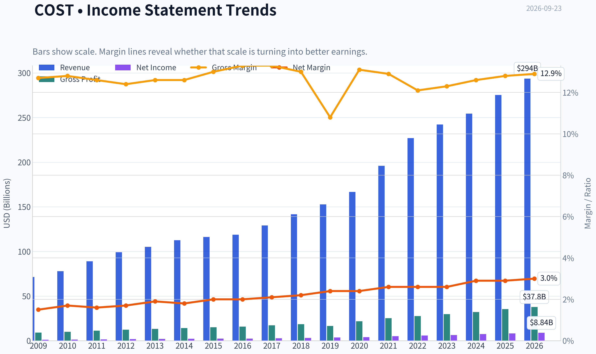

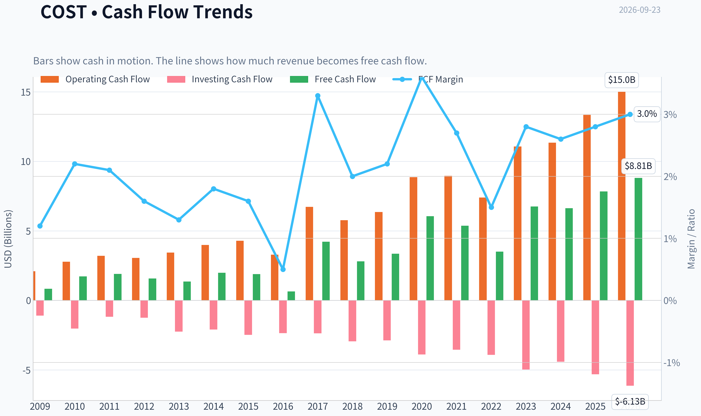

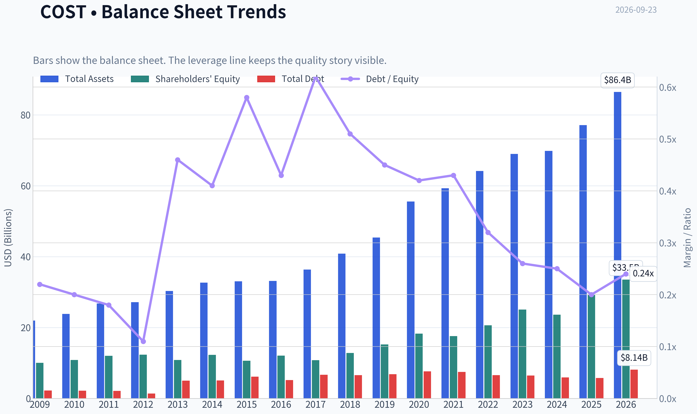

This graph tracks the profitability and return metrics (ROE, ROIC, Margins) of **COST** over the past decade, highlighting capital efficiency trends.

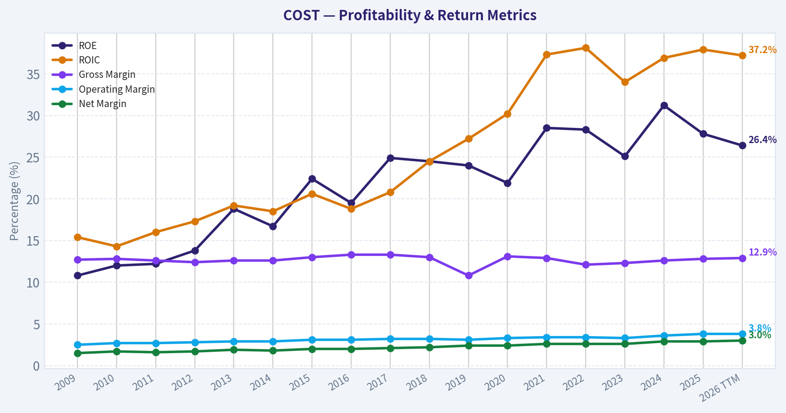

This chart illustrates the financial health of **COST** over the last 10 years, mapping cash equivalents and free cash flow against total obligations (Debt).

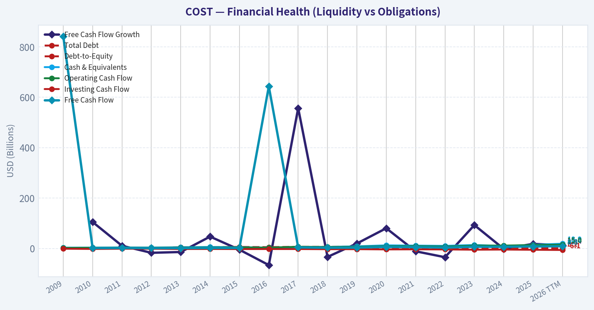

This comparison chart from *Profitability and Business Economics* stacks current figures against historical benchmarks for **COST**, making it easy to see where the company trades relative to its own averages.

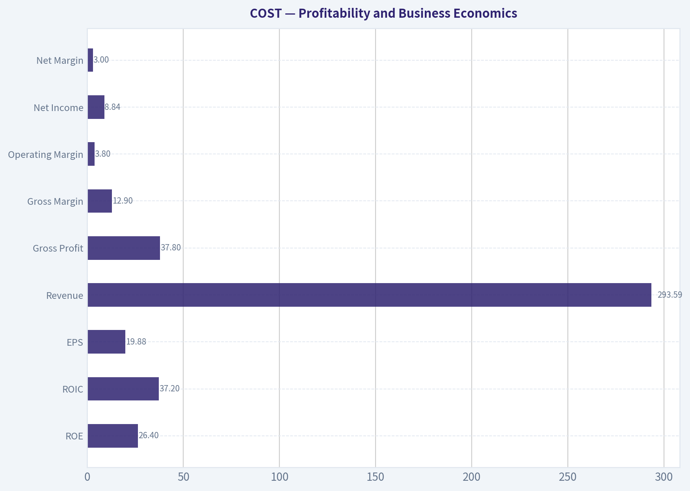

This breakdown chart from <em>Revenue Breakdown</em> shows the proportional composition for **COST** - useful for understanding what drives or risks the business.

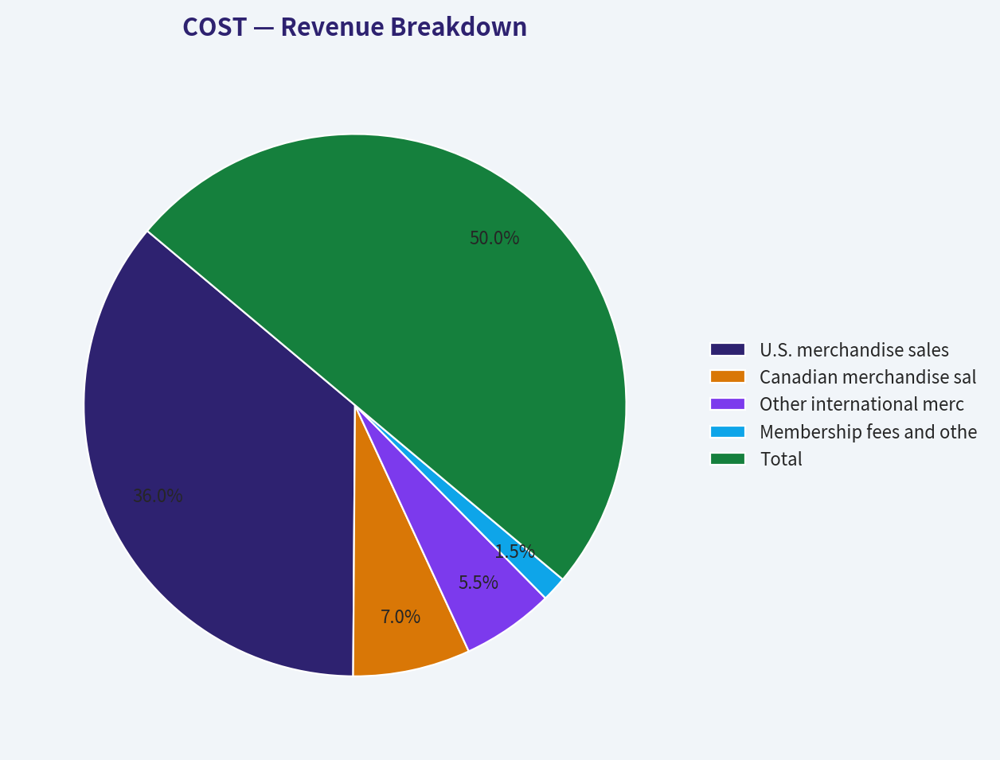

---

### Intrinsic Value Analysis (Buffett)

> *Following Warren Buffett's value investing philosophy: Circle of Competence, Economic Moat, Management Quality, and Margin of Safety.*

#### Intrinsic Value Snapshot

Price is what you pay. Intrinsic value is what the business may be worth based on the cash it can create for owners over time. We show a range, not one magic number.

- Current Price: $899.41
- Value Range (conservative to optimistic across both DCF methods): $137.20 to $822.32

##### Owner Earnings (Buffett Method)
- Net Income: $8,099,000,000.00
- Depreciation & Amortization: $2,426,000,000.00
- Capital Expenditures: $-5,498,000,000.00
- Working Capital Changes: $1,764,000,000.00
- Owner Earnings: $6,335,000,000.00

##### Intrinsic Value
###### Buffett Method
Uses owner earnings. Stricter, and usually more conservative.
- Conservative: $137.20
- Average: $448.73
- Optimistic: $531.51
- Discount Rate: 10.0%

###### Cash Flow Method
Uses free cash flow. Better for companies spending heavily today to grow tomorrow.
- Conservative: $160.18
- Average: $448.83
- Optimistic: $822.32
- Discount Rate: 10.0%

ANALYST STANCE: **WATCH**

#### Executive Summary

Costco is an exceptional retailer with a durable membership model, strong customer loyalty, excellent inventory economics, and owner-oriented management. Its moat and predictability justify a premium valuation-but not the current price of approximately **$899 per share**.

At this price, Costco trades at roughly **45 times earnings**, offers only a **2.0% free-cash-flow yield**, and the reverse DCF implies approximately **46% annual growth for ten years**. That is far above the company's recent operating trajectory and creates substantial downside risk from even a modest valuation normalization.

The business is wonderful; the stock is not attractively priced.

#### 1. Factor Scorecard

| Factor | Score | Assessment |
|---|---:|---|
| Circle of Competence & Simplicity | 4/5 | Costco buys merchandise at scale, sells it at low prices, and monetizes paid memberships. The model is simple and historically predictable. |
| Moat | 4/5 | Membership loyalty, scale purchasing, trusted private label, limited assortment, and low prices reinforce one another. |
| Management & Capital Allocation | 4/5 | Management has preserved the low-price proposition, maintained membership economics, and avoided reckless expansion or financial engineering. |
| Industry Structure | 4/5 | Retail is competitive, but Costco occupies a differentiated position with scale advantages and a highly loyal customer base. |

**Key Takeaways:** Costco scores strongly on business quality, moat, management, and industry position. The central weakness is not the business model; it is the price being paid for that quality.

#### 2. Moat Analysis

| Moat Source | Evidence | Assessment |
|---|---|---|
| Brand and trust | Costco is associated with value, product quality, and a generous return policy. | Strong intangible asset |
| Switching costs | Individual switching costs are moderate, but customers would give up a trusted shopping ecosystem, private-label products, and consistently low prices. | Moderate to strong |
| Cost advantage | Scale allows Costco to negotiate favorable prices, operate with low markups, and spread overhead across large sales volumes. | Strong structural advantage |
| Network effects | Costco does not have a classic digital network effect, but greater membership and purchasing scale improve supplier economics and prices, attracting more members. | Indirect scale effect |
| Membership economics | Recurring membership revenue subsidizes the low-price retail proposition and increases customer engagement. | Highly important moat component |

Costco's gross margin is only **12.8%**, which is normal for its business model and does not indicate weak economics. Costco intentionally passes much of its purchasing advantage to customers. Its moat is better measured through membership retention, sales productivity, renewal economics, scale, and cash generation than through gross margin alone.

The moat is best classified as **wide and stable**, rather than unquestionably wide and widening. Amazon, Walmart, Sam's Club, Aldi, and other value retailers remain meaningful competitors.

#### 3. Management Quality Assessment

Management's strongest decision has been protecting Costco's value proposition instead of maximizing short-term merchandise margins. That choice supports membership renewal, customer traffic, and long-term brand trust.

Capital allocation appears rational:

- Growth investment has focused on warehouses, logistics, and digital capabilities.
- The company has not relied on excessive leverage to manufacture earnings.
- Costco has generally prioritized reinvestment and periodic shareholder distributions over aggressive financial engineering.
- The business model aligns management incentives with long-term customer and shareholder value.

The principal management risk is valuation-related rather than operational: excellent management cannot indefinitely overcome paying an excessive price for the shares.

#### 4. Financial Summary

| Metric | Latest figure |
|---|---:|
| Share price | $899 |
| Market capitalization | $398.87 billion |
| Price-to-earnings ratio | 45.3x |
| Return on equity | 27.8% |
| Revenue growth, year over year | 8.2% |
| Gross margin | 12.8% |
| Free-cash-flow yield | 2.0% |
| Implied free cash flow | Approximately $8.0 billion |
| Implied earnings from market P/E | Approximately $8.8 billion |
| Headline intrinsic value | $325.51 |
| Owner-earnings model value | $448.73 |
| FCF model value | $448.83 |
| Damodaran FCFF value | $282.89 |

**Key Takeaways:** Costco produces strong shareholder returns despite very low merchandise margins, with ROE of 27.8% and positive revenue momentum. However, the 2.0% FCF yield and 45.3-times earnings multiple show that the market already assumes exceptional long-term performance.

#### 5. Owner Earnings Calculation

Using available market and cash-flow data:

| Owner Earnings Component | Approximate amount |
|---|---:|
| Net income implied by market capitalization and P/E | $8.8 billion |
| Add: depreciation and amortization | Included in FCF conversion |
| Less: maintenance capital expenditures | Reflected in FCF proxy |
| Less: working-capital investment | Reflected in FCF proxy |
| Estimated owner earnings proxy | Approximately $8.0 billion |
| Owner earnings per share proxy | Approximately $18 |

Costco's free cash flow is used as a practical owner-earnings proxy because the company has relatively straightforward operations and a meaningful portion of capital expenditure supports ongoing warehouse growth. The key cash-flow test is favorable: the business converts substantial accounting earnings into cash.

The owner-earnings proxy is not sufficient to justify a $899 share price without assuming unusually high and sustained growth.

#### 6. Three-Scenario DCF Valuation

The calculations below use approximately **$8.0 billion of owner earnings**, or about **$18 per share**, and a 10% discount rate.

| Scenario | Assumptions | Estimated value per share |
|---|---|---:|
| A. No growth | Owner earnings remain flat indefinitely | $180 |
| B. GDP growth | 3% annual perpetual growth | $265 |
| C. Historical-growth framework | 10% annual growth for ten years, followed by 3% terminal growth | Approximately $444 |
| Research-pack owner-earnings model | Independent model estimate | $448.73 |
| Research-pack FCF model | Independent model estimate | $448.83 |
| Research-pack FCFF model | Independent model estimate | $282.89 |
| Headline blended intrinsic value | Weighted blend of valuation methods | $325.51 |

**Key Takeaways:** Even the optimistic growth case produces a value near $444 to $449 per share, approximately half the current market price. The conservative models range from $180 to $265, while the blended headline estimate is $325.51.

#### 7. Margin of Safety Analysis

| Valuation reference | Value per share | Premium/(discount) versus $899 |
|---|---:|---:|
| No-growth DCF | $180 | 399% premium |
| GDP-growth DCF | $265 | 239% premium |
| Blended intrinsic value | $325.51 | 176% premium |
| Owner-earnings model | $448.73 | 100% premium |
| FCF model | $448.83 | 100% premium |
| Current price | $899 | - |

The research pack reports a headline margin of safety of **negative 176.3%**, using its stated convention. Regardless of calculation convention, every intrinsic-value reference indicates that Costco is trading at a very large premium to estimated value.

The reverse DCF is especially concerning: the price implies approximately **46% annual growth for ten years**, compared with reported recent growth of approximately **8.2% year over year**, a trailing three-year rate of **negative 5.1%**, and a five-year rate of **39.7%** that appears influenced by post-pandemic normalization.

For a wide-moat compounder, a 10% to 15% premium-to-value tolerance can sometimes be reasonable. Costco's current valuation is far beyond that quality-scaled range.

#### 8. Final Buffett Scorecard

| Criterion | Weight | Score | Weighted contribution |
|---|---:|---:|---:|
| Moat width and durability | 25% | 4/5 | 1.00 |
| Valuation and margin of safety | 20% | 1/5 | 0.20 |
| Capital returns versus WACC | 15% | 4/5 | 0.60 |
| Business understanding and predictability | 12% | 4/5 | 0.48 |
| Management quality and capital allocation | 12% | 4/5 | 0.48 |
| Reinvestment runway | 8% | 3/5 | 0.24 |
| Balance-sheet strength | 4% | 3/5 | 0.12 |
| Industry structure | 4% | 4/5 | 0.16 |
| **Total** | **100%** |  | **3.28/5** |

**Key Takeaways:** Costco's operating quality is high, but valuation reduces the overall investment score to the WATCH range. The stock would become more compelling after either a substantial price decline or several years of earnings growth that allow intrinsic value to catch up.

#### 9. Gate 5 Solvency Test

**Gate 5 hard floor: Not tripped.**

There is no indication in the available data of a simultaneous deterioration in earnings or cash flow and a solvency crisis. Costco should not be hard-avoided as a business. The issue is valuation, not financial distress.

#### Investment Stance

**WATCH - High conviction**

Costco is the type of business Buffett would admire: simple, trusted, scale-driven, cash-generative, and managed with a long-term orientation. However, at approximately **45 times earnings** and roughly **100% to 176% above modeled intrinsic value**, the current stock price leaves little room for execution mistakes, slower growth, margin pressure, or multiple compression.

A more attractive entry point would likely require a substantial decline toward the **$400 to $500 range**, depending on the investor's confidence in long-term growth. Until then, Costco belongs on a high-priority watchlist rather than in a new long-term position.
#### Valuation Bridge

This bridge places the current market price beside each intrinsic value lens so readers can see whether upside depends on one method or shows up across several methods.

| Scenario | Intrinsic Value / Share |
| --- | ---: |
| Buffett Method | $448.73 |
| Cash Flow Method | $448.83 |
| Damodaran Method | $282.89 |
| Current Price | $899.41 |

#### Key Takeaways

If one method is far above the others, the upside case depends on a specific modelling assumption. When several methods cluster together, the valuation story is more robust.

#### Valuation Visuals

This comparison chart from *Latest Earnings Snapshot* stacks current figures against historical benchmarks for **COST**, making it easy to see where the company trades relative to its own averages.

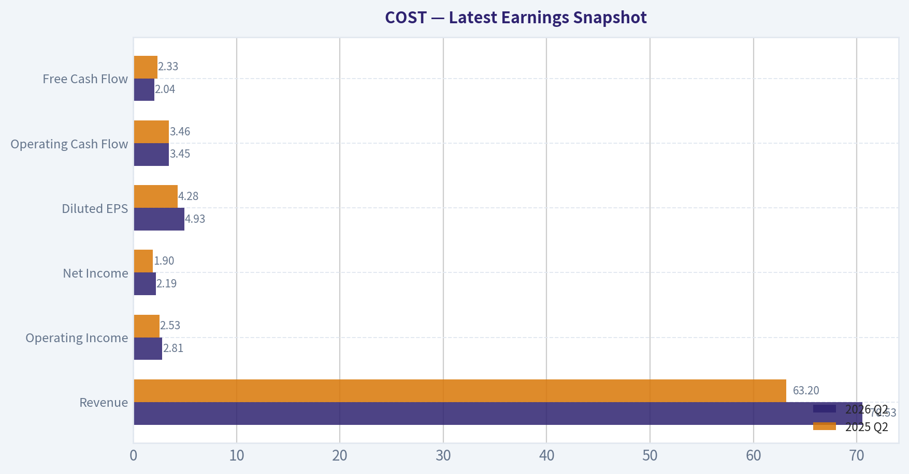

This comparison chart from *Current Metrics Versus Historical Averages* stacks current figures against historical benchmarks for **COST**, making it easy to see where the company trades relative to its own averages.

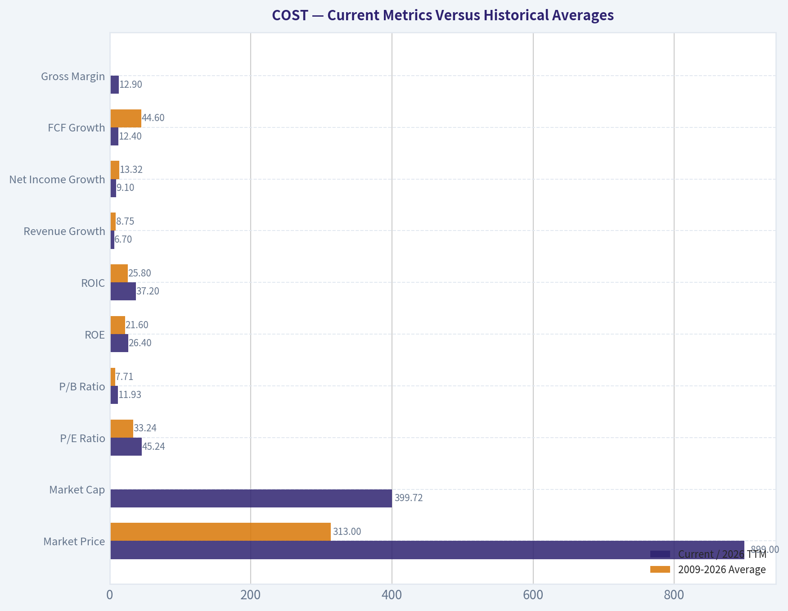

This comparison chart from *Balance Sheet and Financial Strength* stacks current figures against historical benchmarks for **COST**, making it easy to see where the company trades relative to its own averages.

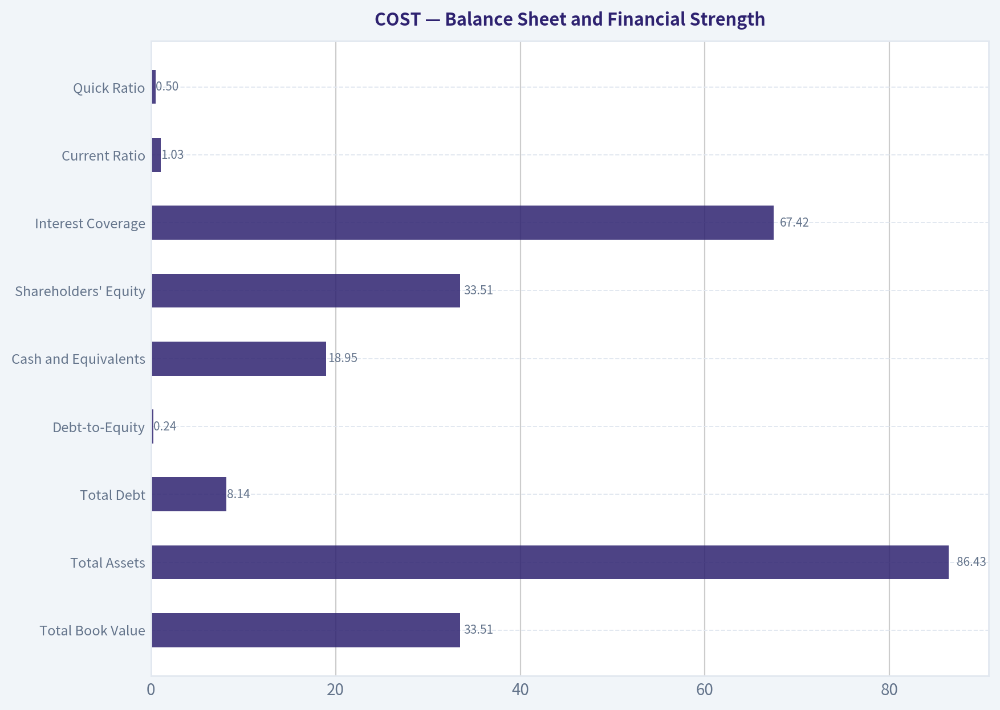

---

### Trend & Growth Analysis (Lynch/Druckenmiller/Fisher)

> *Following Peter Lynch's GARP, Stanley Druckenmiller's macro-aware approach, and Philip Fisher's scuttlebutt methodology.*

ANALYST STANCE: **WATCH**

#### 1. Lynch Classification

**Stalwart**, not a fast grower. Costco has an exceptional business model and durable customer loyalty, but the supplied revenue growth rate of **8.2% year over year** places it in the 5-12% stalwart range rather than Lynch's preferred 15-25%+ fast-grower category.

| Metric | COST |
|---|---:|
| Current price | $899 |
| Market capitalization | $398.9B |
| Revenue growth, YoY | 8.2% |
| P/E ratio | 45.3x |
| Gross margin | 12.8% |
| ROE | 27.8% |
| FCF yield | 2.0% |
| Current ratio | 1.03x |

**Key Takeaways:** Costco combines strong returns on equity with very thin retail margins and a premium valuation. The central issue is not business quality; it is whether roughly 8% growth can justify a 45x earnings multiple.

#### 2. The Story in Three Bullets

- Costco sells a simple proposition: members pay an annual fee to access trusted merchandise at consistently low prices.
- Its membership model creates recurring, high-margin fee income, customer loyalty, and strong shopping frequency.
- The long-term opportunity is continued warehouse expansion, international growth, digital adoption, private-label penetration, and membership-fee increases.

#### 3. TAM and the 10x Test

Costco's opportunity is broad global consumer retail, but its practical serviceable market is narrower: membership warehouse retail in regions where consumers value bulk purchasing, low prices, and trusted private-label products.

| TAM consideration | Assessment |
|---|---|
| Current business | Global membership warehouse retail |
| Growth drivers | New warehouses, international expansion, e-commerce, business members, private label |
| Competitive advantage | Scale purchasing, Kirkland brand, membership loyalty, low-price reputation |
| 10x revenue test | Difficult on the current base |
| TAM runway | Good, but not obviously sufficient for a clean 10x outcome |
| TAM quality | Durable rather than hyper-growth |

**Key Takeaways:** Costco can continue taking share and expanding internationally, but a tenfold revenue increase would require massive global penetration and a much larger warehouse footprint. The runway is attractive for steady compounding, though less compelling than the runway available to a smaller company in an expanding technology market.

#### 4. Revenue Growth Trend

| Indicator | Result | Interpretation |
|---|---:|---|
| Latest YoY revenue growth | 8.2% | Stalwart-level growth |
| Trailing 3-year growth reference | -5.1% | Indicates an uneven historical trend |
| Trailing 5-year growth reference | 39.7% | Strong cumulative growth, but not an annualized rate |
| Current pattern | Moderate | No confirmed acceleration |

**Key Takeaways:** The available data does not show a clear current acceleration. Costco remains a dependable grower, but the evidence is insufficient to identify a Druckenmiller-style earnings inflection point.

#### 5. Unit Economics and Operating Quality

Detailed CAC, LTV, NRR, and free-cash-flow-margin data were not supplied. These metrics are also less directly applicable than they would be for a pure SaaS company.

| Metric | Assessment |
|---|---|
| Membership economics | Structurally attractive; recurring fees support profitability |
| Customer retention | Historically a major strength, but current retention data unavailable |
| CAC/LTV | Not disclosed in the supplied data |
| NRR | Not applicable in the conventional SaaS sense |
| Rule of 40 | Not meaningful without an adjusted subscription-style margin |
| FCF yield | 2.0%, indicating a demanding valuation |

**Key Takeaways:** Costco's economic engine is membership retention and renewal rather than software-style net revenue retention. The recurring fee stream is a major strength, but the low free-cash-flow yield leaves limited valuation protection.

#### 6. Inflection-Point Assessment

| Potential inflection | Current assessment |
|---|---|
| Product cycle | No major new product cycle identified |
| Market share | Likely ongoing share gains, but no quantified acceleration supplied |
| Margin | Low-margin model; operating leverage may be modest |
| TAM | International warehouses and digital channels expand the addressable market |
| Membership | Fee increases and renewal trends are important catalysts |
| Earnings trajectory | Stable growth, not yet an obvious acceleration |

**Key Takeaways:** The most credible catalysts are membership-fee increases, stronger renewal rates, warehouse openings, and international expansion. However, there is no confirmed evidence that growth is accelerating enough to offset the current valuation.

#### 7. Macro Setup

Costco is relatively defensive in a mixed macro environment because consumers often trade down to value retailers during inflationary periods. Conversely, high interest rates and stretched equity valuations are a headwind for a stock trading at a substantial premium.

| Macro factor | Impact on COST |
|---|---|
| Inflation and value-seeking consumers | Positive |
| Employment and household income | Important demand support |
| Interest rates | Negative for valuation |
| Retail competition | Persistent pressure |
| Consumer staples/defensive positioning | Positive |
| Current market setup | Mixed |

**Key Takeaways:** Costco's operating model benefits from consumers seeking value, but its stock valuation remains sensitive to interest rates. The macro backdrop supports the business more clearly than it supports the current share price.

#### 8. Fisher 15-Point Assessment

This is a provisional score based on the supplied fundamentals and Costco's observable business model; several management and scuttlebutt items require primary-source diligence.

| Fisher category | Score |
|---|---:|
| Market potential | 4/5 |
| New-product and format development | 4/5 |
| R&D effectiveness | 3/5 |
| Sales organization | 4/5 |
| Profit margins | 4/5 |
| Margin improvement potential | 3/5 |
| Labor relations | 3/5 |
| Executive relations | 4/5 |
| Management depth | 4/5 |
| Cost analysis and accounting | 4/5 |
| Outstanding competitive aspects | 5/5 |
| Long-range profit outlook | 4/5 |
| Dilution risk | 4/5 |
| Management candor | 4/5 |
| Management integrity | 4/5 |
| **Total** | **56/75** |

**Key Takeaways:** Costco scores well because of its scale, brand, membership model, and operating discipline. The main deductions reflect its low-margin retail structure, limited product-development differentiation, and the absence of verified current management and unit-economic data. A score of 56 places it in Fisher's "good" rather than "outstanding" range.

#### 9. Valuation Analysis

| Valuation method | Result | Interpretation |
|---|---:|---|
| P/E | 45.3x | Expensive for approximately 8% revenue growth |
| FCF yield | 2.0% | Low cash-flow yield |
| Headline intrinsic value | $325.51 | Well below current price |
| Owner earnings / FCF model | About $448.8 | Below current price |
| Damodaran FCFF model | $282.89 | Significantly below current price |
| Reverse DCF implication | About 46% annual growth for 10 years | Very demanding embedded expectation |
| PEG | Not calculable from supplied data | EPS growth rate unavailable |

**Key Takeaways:** Every supplied intrinsic-value framework places Costco below the $899 share price, although the valuation models have a wide range. Most importantly, the reverse DCF indicates that the market is pricing in extraordinary long-term growth relative to Costco's current 8.2% revenue growth.

#### 10. Growth Investor Scorecard

| Criterion | Weight | Score / 5 |
|---|---:|---:|
| Lynch story | 10% | 4.5 |
| TAM and runway | 20% | 3.5 |
| Revenue growth | 20% | 3.0 |
| Unit economics | 15% | 4.0 |
| Competitive position | 10% | 4.8 |
| Management quality | 10% | 4.2 |
| Macro setup | 5% | 3.5 |
| Profitability path | 5% | 4.0 |
| Valuation | 5% | 1.5 |
| **Weighted score** | **100%** | **3.6 / 5** |

**Key Takeaways:** Costco is a high-quality company with a good, durable story, but valuation prevents a high-conviction growth-investor endorsement. The score falls in the "good setup" range operationally, yet the valuation component is exceptionally weak.

#### 11. Position Size Stance

| Investor situation | Suggested stance |
|---|---|
| Existing long-term holder | Hold, but review position concentration |
| New investor | Wait for a better entry point or a clear earnings-growth acceleration |
| High-conviction growth portfolio | Small tracking position only |
| Position size today | 0-2% for a new position |
| Increase trigger | Material valuation reset or sustained growth acceleration |

**Key Takeaways:** Costco is suitable for monitoring and may be worth holding if already owned, but initiating a large position at $899 offers an unfavorable risk-reward profile. A better setup would require either a meaningful price decline or evidence that earnings growth is accelerating substantially.

#### 12. Key Risks and Catalysts

| Catalysts | Risks |
|---|---|
| Membership-fee increase | Multiple compression |
| Higher renewal rates | Slowing comparable-store sales |
| Accelerating international expansion | E-commerce and logistics costs |
| Stronger private-label penetration | Walmart, Amazon, and other value competitors |
| New warehouse openings | Consumer weakness |
| Improved merchandise margins | Low current FCF yield |
| Better-than-expected earnings | Expectations already elevated |

**Key Takeaways:** The upside case depends on Costco extending its membership moat while accelerating warehouse growth, international penetration, and fee income. The downside case is primarily valuation-driven: even a healthy business can produce poor returns if growth fails to match the expectations embedded in the share price.

#### Conclusion

Costco is a **high-quality stalwart**, not currently a ten-bagger-style fast grower. Its membership moat, customer loyalty, brand strength, and defensive value proposition are excellent, but the combination of **8.2% revenue growth, a 45.3x P/E, and a 2.0% FCF yield** leaves little margin of safety.

**Final stance: WATCH.** Hold existing shares if the position is appropriately sized, but wait for either a substantial valuation reset or clear evidence of accelerating earnings and revenue growth before initiating aggressively.

---

### Market Technical Analysis

ANALYST STANCE: **AVOID**

#### COST technical analysis

COST is exhibiting a clearly damaged medium- and long-term technical structure. The latest valid closing price in the retrieved data is **$898.48 on September 21, 2026**; September 22 contains volume but no open, high, low, or close, so its duplicated indicator readings should not be treated as a fresh trading signal.

From the August 18 close of $961.35 to September 21, COST has declined approximately **6.5%**. The decline is more significant from the May 19 high near $1,092.58, representing a drawdown of roughly **17.8%**. The price is now below every major moving average supplied, indicating that the recent weakness is not merely a short-lived pullback within a healthy uptrend.

#### Trend and moving-average structure

The **10-day EMA is approximately $904.66**, placing the latest valid close about **0.7% below** this short-term trend line. The 10-day EMA has fallen sharply from approximately $954.21 on August 24, confirming persistent short-term selling pressure. A sustained close above $905 would be the first modest sign that immediate downside momentum is stabilizing, but it would not by itself establish a reversal.

The **50-day SMA is approximately $936.14**, about **4.2% above** the latest valid close. It has declined from roughly $947.30 over the past month, showing that medium-term trend damage is still developing rather than fully repaired. The 50-day average should be viewed as important overhead resistance, particularly in the $935 to $940 region.

The **200-day SMA is approximately $958.33**, around **6.7% above** the latest valid close. Although the 200-day SMA remains relatively flat to slightly rising, price being materially below it is bearish. This places COST in a situation where the long-term benchmark has not yet rolled over decisively, but market price is already signaling substantial deterioration. A recovery above $958 would be needed to materially improve the strategic trend picture.

#### Momentum and reversal potential

The **MACD is negative at approximately -13.69**, confirming that the faster exponential average remains below the slower one. This is a bearish trend reading, not simply a marginal loss of momentum. However, the **MACD histogram has improved from approximately -3.54 on September 16 to -1.74 on September 22**, suggesting that the rate of downside momentum has moderated.

This histogram improvement is constructive but incomplete. It indicates decelerating bearish pressure rather than confirmed bullish momentum. A more reliable reversal would require the histogram to cross above zero, followed by a positive MACD crossover and a price recovery above the 10-day and 50-day averages. Until then, a relief bounce could still fail beneath overhead resistance.

The **RSI is approximately 38**, down from about 58 in late August. This indicates weak momentum, but it is not yet at a classic oversold level below 30. Consequently, the stock has room to decline further before an oversold reading would strongly support a contrarian bounce. RSI near 38 can also remain depressed during a continuing downtrend, so it should not be interpreted as a standalone buy signal.

#### Volatility and risk management

The **ATR is approximately $13.24**, down from approximately $19.03 on August 24. This means daily trading ranges have contracted despite the weak price trend. Lower ATR can indicate stabilization, but in this context it may also reflect a controlled downtrend rather than accumulation. A close below the recent $885 to $890 area accompanied by expanding ATR would increase the risk of another impulsive decline.

For position sizing, an ATR-based risk allowance is essential. One ATR currently represents approximately **1.5% of the latest valid close**, but normal trading noise remains large in dollar terms because of COST's high share price. Stops placed too tightly around the $900 level could be triggered by ordinary volatility; stops should instead be selected according to the trader's time horizon and technical invalidation level.

#### Volume-weighted trend confirmation

The VWMA readings generally declined from about **$951 to approximately $912** during the August 24 to September 18 period. This confirms that volume-weighted trading activity has occurred at progressively lower prices. The reported September 22 VWMA of approximately $849 is unreliable because that session has missing OHLC data; it should be excluded from interpretation.

The broader VWMA deterioration does not support the view that recent weakness is merely a low-volume drift. However, the data provided do not establish a decisive capitulation low. A bullish volume signal would require price to reclaim the declining VWMA and moving averages while maintaining stronger-than-average volume.

#### Key levels and trading implications

The first important support zone is approximately **$885 to $900**, based on the recent lows and clustering of late-September trading. A decisive close below $885 would weaken the prospect of an immediate recovery and could expose lower support levels that are not precisely defined by the supplied indicators.

Initial resistance lies around **$904 to $918**, covering the 10-day EMA and the recent September rebound area. More meaningful resistance is near **$935 to $940**, corresponding to the declining 50-day SMA. The major trend-reversal barrier is near **$958**, where the 200-day SMA currently resides.

Overall, the best current interpretation is **bearish trend with early momentum deceleration, but no confirmed reversal**. Aggressive traders may monitor for a bullish MACD crossover, RSI recovery above 45 to 50, and a close above the 10-day EMA. More conservative traders should wait for a reclaim of the 50-day SMA, ideally supported by improving VWMA and volume, before considering a sustained long position.

#### Selected indicators

The eight selected indicators are **close_10_ema, close_50_sma, close_200_sma, macd, macdh, rsi, atr, and vwma**. Together they cover short-, medium-, and long-term trend; directional momentum; momentum acceleration; volatility; and volume-weighted price confirmation without adding redundant oscillators or multiple Bollinger Band components.

| Indicator | Latest usable reading | Current interpretation | Trading relevance |
|---|---:|---|---|
| Close price | $898.48 on Sep. 21 | Below all major trend measures | Bearish structure remains dominant |
| 10-day EMA | $904.66 | Price is slightly below a falling short-term average | Reclaim above $905 would signal initial stabilization |
| 50-day SMA | $936.14 | Declining and materially above price | Major medium-term resistance |
| 200-day SMA | $958.33 | Price is about 6.7% below it | Long-term trend damage; key recovery threshold |
| MACD | -13.69 | Negative trend momentum | Bearish until a positive crossover develops |
| MACD histogram | -1.74 | Negative but improving | Downside momentum is easing, not yet bullish |
| RSI | 37.95 | Weak, but not oversold | Further downside remains possible; no strong reversal signal |
| ATR | $13.24 | Lower than late-August levels | Volatility has contracted; use wider, volatility-aware stops |
| VWMA | Roughly $912 before unreliable Sep. 22 reading | Volume-weighted trend has deteriorated | Reclaim would improve confidence in a recovery |
| Key support | $885-$900 | Recent low and consolidation area | Breakdown would increase downside risk |
| Key resistance | $904-$918, then $935-$940 | EMA and SMA-based overhead supply | A recovery must clear these zones sequentially |

Key Takeaways: COST remains in a bearish technical configuration because its price is below the 10-day EMA, 50-day SMA, and 200-day SMA, while MACD is still negative. The improving MACD histogram and declining ATR suggest that selling pressure is moderating, but they do not yet confirm a bottom. Traders should treat $885 to $900 as important support and wait for a sustained recovery above $936, preferably with improving volume-weighted momentum, before upgrading the outlook.

#### Market Visuals

This comparison chart from *Market Metrics and Valuation* stacks current figures against historical benchmarks for **COST**, making it easy to see where the company trades relative to its own averages.

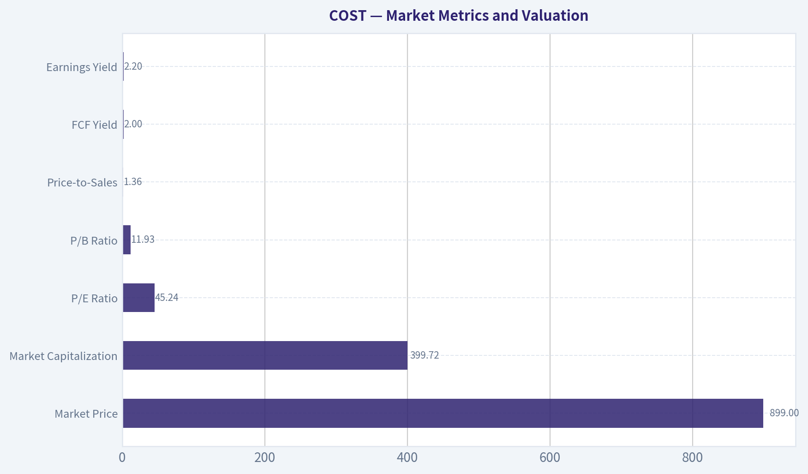

---

### Options Market Analysis

> *Reading options flow - put/call ratios, IV skew, and unusual activity - to gauge institutional positioning and event-driven risk.*

#### COST Options Flow Report

**As of September 23, 2026.** The available near-term options data shows active trading volume but reports zero open interest across all listed expirations. That makes positioning analysis substantially less reliable, because put/call open-interest ratios, unusual volume relative to existing positions, and gamma concentration cannot be established.

#### Put/Call Ratio Analysis

| Expiration | Call Volume | Put Volume | Put/Call Volume Ratio | Call OI | Put OI | Put/Call OI Ratio |
|---|---:|---:|---:|---:|---:|---:|
| Sep. 25, 2026 | 6,046 | 5,392 | 0.89 | 0 | 0 | N/A |
| Oct. 2, 2026 | 2,671 | 2,321 | 0.87 | 0 | 0 | N/A |
| Oct. 9, 2026 | 1,458 | 1,781 | 1.22 | 0 | 0 | N/A |
| **Aggregate** | **10,175** | **9,494** | **0.93** | **0** | **0** | **N/A** |

**Key Takeaways:** Aggregate put volume is slightly below call volume, producing a 0.93 put/call volume ratio. That is modestly more call-oriented than a 1.0 ratio, but still above the approximately 0.7 historical neutral baseline, so the data does not indicate aggressive bullish speculation. The Oct. 9 expiration is the only one with put volume clearly exceeding call volume.

#### Implied Volatility Assessment

| Expiration | Call ATM IV | Put ATM IV | ATM IV Difference | Interpretation |
|---|---:|---:|---:|---|
| Sep. 25, 2026 | 3.0% | 2.6% | Calls +0.4 percentage points | Slight call premium |
| Oct. 2, 2026 | 1.8% | 1.6% | Calls +0.2 percentage points | Slight call premium |
| Oct. 9, 2026 | 1.2% | 1.4% | Puts +0.2 percentage points | Slight put premium |

**Key Takeaways:** Reported near-term ATM IV is low, ranging from 1.2% to 3.0%, with the highest reading in the nearest expiry. Calls carry a small IV premium in the first two expirations, while puts are marginally richer in the Oct. 9 expiry. True out-of-the-money put-versus-call skew was not provided, so downside fear cannot be assessed with confidence; no catalyst-related IV spike is evident in this dataset.

#### Unusual Options Activity

| Finding | Result |
|---|---|
| Contracts with volume greater than 5x open interest | None identified |
| Fresh directional positioning | Cannot be confirmed |
| Smart-money versus retail classification | Not possible from the supplied data |
| Strike, moneyness, and days to expiry | Contract-level details unavailable |

**Key Takeaways:** No contracts met the tool's unusual-activity threshold. However, because reported open interest is zero in every near-term expiration, the absence of flagged activity should not be treated as proof that there are no new institutional trades. The dataset does not provide enough contract-level detail to classify trades as ITM, ATM, OTM, bullish, bearish, or institutional.

#### Open Interest Concentration and Gamma Levels

| Metric | Result |
|---|---|
| Highest-OI strikes | Not available; all reported OI is zero |
| Highest-OI expirations | Not available |
| Gamma walls | Cannot be identified |
| Max-pain or pinning levels | Cannot be calculated |
| Price-gravity assessment | Unavailable |

**Key Takeaways:** There is no usable open-interest concentration data for COST. Consequently, potential support or resistance from dealer gamma, max pain, or strike pinning cannot be determined. Near-term price behavior should therefore be evaluated using spot-market liquidity, technical levels, and broader market conditions rather than this options-chain snapshot.

#### Overall Options Sentiment

**Signal: NEUTRAL, with low confidence.**

The aggregate put/call volume ratio of 0.93 is slightly call-favorable but not strong enough to establish a bullish signal, particularly because it remains above the approximate 0.7 neutral reference point. IV is low and shows no broad downside skew or obvious event premium. The dominant issue is data quality: zero open interest across all expirations prevents reliable analysis of existing positioning, fresh trades, gamma exposure, or institutional intent.

This should be treated as a **low-conviction neutral read**, not as evidence that COST lacks directional risk. If subsequent data shows meaningful open interest or contract-level sweeps, the signal could change materially.

#### Summary

| Category | Assessment |
|---|---|
| Put/Call Ratio | Aggregate volume ratio 0.93; slightly call-favorable but not strongly bullish. OI ratio unavailable. |
| IV Level | Low reported near-term IV, from 1.2% to 3.0%; highest in the Sep. 25 expiry. |
| Skew Direction | Essentially mixed; slight call skew in the first two expirations and slight put skew in Oct. 9. True OTM skew unavailable. |
| Unusual Activity | None flagged at volume greater than 5x open interest; interpretation limited by zero reported OI. |
| Overall Signal | **NEUTRAL - low confidence** due to incomplete open-interest and contract-level data. |

**Key Takeaways:** COST options flow is best characterized as neutral with a slight call-volume tilt, not as decisively bullish or bearish. Low IV suggests limited near-term option premium demand, while the zero-OI readings make institutional positioning and gamma analysis unreliable.

---

## Research Team Commentary

> *The Research Manager synthesizes the Bull vs Bear debate into action-free commentary. This is a pre-risk view, not the final stance.*

Core takeaway: Costco remains an exceptional business, but at roughly $899 and 45.3 times earnings, the stock still offers no dependable margin of safety. Its membership model, purchasing scale, customer trust, disciplined management, and 39.5% ROIC justify a substantial premium. They do not justify paying a price that requires sustained double-digit earnings growth, favorable terminal assumptions, and continued premium valuation. I would avoid committing new capital at this level.

The strongest bull argument is the quality and durability of the franchise. Membership fees create recurring, high-margin economics, while Costco deliberately reinvests purchasing efficiencies in lower prices, reinforcing traffic, renewals, supplier power, and customer loyalty. The 12.8% gross margin is therefore not evidence of a poor business; the 39.5% ROIC demonstrates that the low-margin, high-turnover model is highly productive. Management has also allocated capital sensibly through warehouse expansion, logistics, digital capabilities, and periodic shareholder distributions without relying excessively on leverage. International expansion, Kirkland penetration, membership-fee increases, and digital adoption provide a credible long-term runway.

The bull is also correct that Costco should not be valued like an ordinary retailer. At an 8% discount rate and 4% terminal growth, the current price appears to imply roughly 11% annual owner-earnings growth, which is possible. If Costco compounds near 12% for a decade while retaining a premium valuation, today's price could produce an acceptable return. There is no evidence here of financial distress, managerial deterioration, or a collapsing moat.

The strongest bear argument is that the apparent valuation support disappears when assumptions become only modestly more demanding. The bull's estimated value near $1,010 depends on approximately 12.3% annual growth for ten years, an 8% discount rate, a 4% perpetual growth rate, and reported earnings serving as a rough substitute for owner earnings. That combination is too favorable to support a genuine margin of safety. At a 9% required return and 3% terminal growth, even very strong growth can leave intrinsic value below the current price.

The reverse-DCF framing is decisive. Costco does not merely need to remain an excellent company; it must translate its quality into roughly low-to-mid-teens owner-earnings growth under more conservative assumptions. At Costco's existing scale, that requires successful warehouse expansion, attractive international unit economics, sustained renewal and traffic growth, controlled cost inflation, and little deterioration in incremental returns on capital. Each outcome is plausible, but the stock requires several of them simultaneously.

Multiple normalization is particularly important. If earnings compound at 10% annually but the valuation falls from 45 times earnings to a still-generous 30 times, the approximate annual price return over ten years would be only about 5.6%, before modest regular dividends. Even 12% EPS growth would generate only around a 7.5% annual price return under that terminal multiple. That is not enough compensation for forecasting risk. Costco can execute well operationally and still disappoint shareholders.

The low merchandise margin is both a competitive strength and a valuation risk. It reinforces the customer bargain, but it also limits the cushion against wages, freight, shrink, occupancy costs, tariffs, and other operating pressures. At a 2.2% earnings yield, even small margin or growth disappointments could cause disproportionate valuation compression.

The recent price decline does not prove that intrinsic value has deteriorated. Nevertheless, the roughly 6.5% decline from August 18 through September 21 and the reported damage to the medium- and long-term technical structure remove any urgency to buy. Technical weakness should not determine a ten-year valuation, but it matters when valuation is already demanding because there is neither fundamental nor price-action confirmation for an entry. The options data offer no useful counterweight: reported open interest is zero, making positioning and gamma conclusions unreliable, while the 0.93 put/call volume ratio is essentially neutral.

My rationale is therefore straightforward: business quality is outstanding, financial strength appears sound, and management deserves credit. Valuation attractiveness is poor, however, and the downside from ordinary multiple normalization outweighs the modest upside in the bull's assumption-sensitive base case. A 10%-15% discount can be sufficient for a truly exceptional compounder, but only when intrinsic value is supported across a reasonable range of assumptions. Here, the claimed 12% discount exists mainly under an optimistic 8% discount rate and 4% terminal growth rate. It is not robust enough.

The earlier Costco review also provides an important discipline. Previously, the analysis correctly identified excessive valuation and weakening momentum but allowed admiration for the company to soften the final action into WATCH. I would not repeat that mistake. Company quality, valuation, and entry conditions must be scored separately. Costco scores exceptionally on the first, poorly on the second, and unfavorably on the third. For existing long-term shareholders with low tax bases, this is not necessarily a forced-sale thesis. For fresh portfolio capital, it is a clear decision not to initiate or average in merely because the share price has declined.

Over the next one to four quarters, I would monitor comparable sales excluding fuel and foreign exchange, separating traffic growth from average ticket growth. Continued traffic-led gains would be more encouraging than inflation- or price-driven revenue. I would watch membership renewal rates, paid household growth, executive membership penetration, and membership-fee income following the latest fee increase. These indicators will reveal whether the recurring economic engine remains as resilient as the valuation assumes.

I would also track new warehouse openings, particularly international openings, along with maturation periods, cannibalization, and evidence of incremental returns. Stable or improving ROIC despite expansion would strengthen the bull case; declining capital productivity would weaken it. Merchandise margin, SG&A leverage, wage and freight pressures, shrink, inventory turnover, free-cash-flow conversion, and capital expenditures also deserve close attention. The central question is whether reported EPS growth reflects durable operating improvement rather than temporary margin movements or favorable comparisons.

The thesis would strengthen if Costco delivers sustained low-teens owner-earnings growth, maintains renewal and traffic momentum, preserves approximately current capital productivity, and demonstrates attractive international unit economics. It would also strengthen if the share price falls enough that a reverse DCF using approximately a 9% discount rate and 3% terminal growth requires no more than high-single-digit or low-double-digit growth. A valuation closer to the mid-30s earnings multiple would be a more credible reassessment zone, although the appropriate price must be updated for forward earnings and cash flow rather than treated as a mechanical target.

The thesis would weaken further if comparable-sales growth becomes increasingly ticket-dependent, renewal rates soften, new warehouses produce lower returns, operating costs pressure margins, free cash flow trails earnings, or EPS growth settles below roughly 10%. Continued technical deterioration without a corresponding valuation reset would also reinforce patience.

Costco is a wonderful company, but the market is already charging investors for that knowledge. At $899, the required growth is too demanding and the modeled margin of safety too fragile to justify new capital.

AVOID

---

## Value Investing Team Commentary

> *The Investor translates the research view into an investment thesis before risk review. This is still not the final stance.*

### Investment Commentary

Costco is an exceptional business, but exceptional businesses can still produce mediocre returns when purchased at prices that capitalize too much of their future success. At approximately **$899 and 45.3 times earnings**, the investment case depends less on Costco merely remaining excellent and more on it sustaining unusually strong growth while retaining a premium valuation.

### Business quality remains outstanding

Costco's moat is broad and self-reinforcing:

- Membership fees provide recurring, high-margin revenue.
- Low merchandise markups strengthen customer trust and shopping frequency.
- Purchasing scale supports lower prices and supplier leverage.
- Kirkland reinforces loyalty and differentiates the assortment.
- High renewal rates and warehouse density create meaningful competitive advantages.
- A reported **39.5% ROIC** demonstrates the productivity of the model despite its **12.8% gross margin**.

The low gross margin should not be confused with weak economics. Costco intentionally returns purchasing efficiencies to members, deepening its value proposition. Its high inventory turnover, recurring fees, and efficient capital deployment make this low-margin model unusually attractive.

Management also appears disciplined. Investment in warehouses, logistics, and digital capabilities supports the franchise rather than chasing unrelated growth. The company has not depended on excessive leverage or aggressive financial engineering to manufacture per-share results.

### Growth is credible, but the valuation already recognizes it

Costco retains several long-term growth avenues:

1. Domestic and international warehouse expansion
2. Maturation of recently opened locations
3. Paid household and executive membership growth
4. Periodic membership-fee increases
5. Greater Kirkland penetration
6. Digital and omnichannel adoption

These opportunities could support strong earnings growth for years. The issue is not whether Costco can grow; it is whether growth will exceed what investors already pay for.

At the reported valuation, the earnings yield is only about **2.2%**. The reverse-DCF analysis suggests the price requires roughly **low-double-digit owner-earnings growth**, depending heavily on the discount rate and terminal assumptions. That may be achievable, but it is not conservative.

An intrinsic-value estimate near $1,010 using an 8% discount rate, 4% perpetual growth, and approximately 12% annual growth is too assumption-sensitive to establish a dependable margin of safety. A 4% terminal growth rate is particularly generous for a mature business because it approaches or exceeds many estimates of sustainable long-term nominal economic growth. Moving to a 9% required return and 3% terminal growth materially reduces estimated value.

A genuine margin of safety should survive reasonable changes in assumptions. This one does not.

### Multiple normalization is the central risk

Costco does not need to experience an operational failure for shareholders to earn disappointing returns. It only needs to grow somewhat more slowly than expected or lose part of its valuation premium.

For illustration:

- At **10% annual EPS growth**, compression from 45.3 times earnings to 30 times could limit annualized price appreciation to roughly **5.6%** over ten years.
- At **12% EPS growth**, the corresponding annualized price return would be approximately **7.5%**, before Costco's modest regular dividend.

Those are not disastrous outcomes, but they offer inadequate compensation for a decade of forecasting risk. A still-generous terminal multiple of 30 times earnings could therefore leave investors with only moderate returns despite excellent operating execution.

Costco's narrow merchandise margins add sensitivity to wages, freight, shrink, occupancy expenses, tariffs, and supply-chain costs. Its model has historically managed these pressures well, but at a premium valuation, even a small disappointment could cause disproportionate multiple compression.

### Selective contrarian assessment

The contrarian bull case is that investors may be focusing too heavily on the headline P/E and underestimating Costco's recurring membership economics, high ROIC, pricing trust, and unusually long reinvestment runway. Costco has often appeared expensive because conventional retail metrics do not fully capture the quality of membership-fee income and the durability of its customer relationships.

That argument deserves respect. A mechanical rule that rejects every company above 30 times earnings would have excluded many outstanding compounders. Value and growth are joined at the hip, and a wonderful business does not require a 40% discount to justify ownership.

However, contrarianism is useful only when the market is materially mispricing the business. There is no clear evidence of that here. Investors already recognize Costco as one of the world's highest-quality retailers. A 45-times multiple reflects admiration, not neglect. The market may still underestimate the duration of the franchise, but the current price leaves little protection if growth or incremental returns merely normalize.

The recent decline also does not appear to represent capitulation. A roughly **6.5% drop** from August 18 through September 21 is modest relative to the valuation premium and does not create an obvious bargain. Technical deterioration can eventually produce an attractive entry, but there is no need to anticipate that outcome while both valuation and price action remain unfavorable.

The options evidence should carry almost no weight. With reported open interest at zero, positioning, dealer gamma, and unusual-flow conclusions cannot be established reliably. A put/call volume ratio of 0.93 is broadly neutral and does not reveal a strong contrarian sentiment opportunity.

### What would change the conclusion?

The investment case would become more attractive if one or both of the following occurred:

- Costco demonstrated sustained low-teens owner-earnings growth while preserving renewal rates, traffic growth, free-cash-flow conversion, and incremental ROIC.
- The share price fell enough for conservative assumptions-approximately a 9% required return and 3% terminal growth-to imply only high-single-digit or low-double-digit growth.

Using the current reported earnings base mechanically, a mid-30s P/E would correspond to a price around **$695**, although this is not a fixed target. Forward earnings, cash generation, net financial position, and business developments must be updated before determining a purchase price. A higher price could become attractive if intrinsic value compounds meaningfully in the meantime.

Key indicators to monitor include:

- Comparable sales excluding fuel and foreign exchange
- Traffic versus average-ticket growth
- Membership renewal rates and paid-household growth
- Executive membership penetration
- Membership-fee income after the latest fee increase
- International warehouse economics and maturation periods
- Incremental ROIC on new locations
- Merchandise margin and SG&A leverage
- Inventory turnover and shrink
- Free-cash-flow conversion relative to earnings

For existing long-term owners with significant embedded tax liabilities, this is not necessarily a forced-sale situation. The moat remains intact, management remains credible, and the balance sheet does not indicate distress. But holding an established position and committing fresh capital are different decisions.

**ANALYST STANCE: AVOID** - Costco remains a wonderful business, but at approximately $899 the valuation requires strong growth, favorable terminal assumptions, and continued multiple support. The recent decline is not large enough to create a robust margin of safety, while weakened price action provides no urgency to buy. Avoid initiating or averaging into the shares until either intrinsic value catches up through sustained growth or the price resets materially.

---

## Deep Values Commentary

> *The Risk Management Team debates and the Risk Judge provides the final action-free verdict. This section determines the final ADVOCATE / WATCH / AVOID stance.*

#### Final Stance Scorecard

This scorecard converts the final research view into a weighted decision frame. It does not replace the narrative judgement, but it makes the main drivers of the verdict easier to scan.

| Criterion | Score | Weight | Commentary |
| --- | ---: | ---: | --- |
| Business Quality | 2.75 | 30% | High returns, profitability, and Piotroski health support durability. |
| Valuation Support | 1.33 | 30% | Blends current price against available intrinsic value anchors and valuation ratios. |
| Financial Strength | 2.67 | 20% | Balance-sheet resilience reflects leverage and liquidity staying within safe ranges. |
| Growth Durability | 3.33 | 20% | Recent revenue, earnings, and free cash flow growth indicate how durable expansion looks. |
| TOTAL / FINAL STANCE | 2.42 | 100% | AVOID |

#### Key Takeaways

The weighted score lands at **2.42 / 5.0**, while the final stance remains **AVOID**. This is useful as a quick calibration aid rather than a mechanical signal.

#### Risk Summary

Higher scores indicate more risk pressure. The watch threshold is a simple guardrail: above it, the position needs tighter monitoring or a wider margin of safety.

| Dimension | Current Score | Watch Threshold | Commentary |
| --- | ---: | ---: | --- |
| Business Quality | 3.25 | 3.00 | High returns, profitability, and Piotroski health support durability. |
| Valuation Support | 4.67 | 3.00 | Blends current price against available intrinsic value anchors and valuation ratios. |
| Financial Strength | 3.33 | 3.00 | Balance-sheet resilience reflects leverage and liquidity staying within safe ranges. |
| Growth Durability | 2.67 | 3.00 | Recent revenue, earnings, and free cash flow growth indicate how durable expansion looks. |

#### Key Takeaways

This view helps readers separate *where* the risk sits: valuation, business quality, balance sheet, or growth durability. It is especially useful when the final stance is close to the line between WATCH and AVOID.
