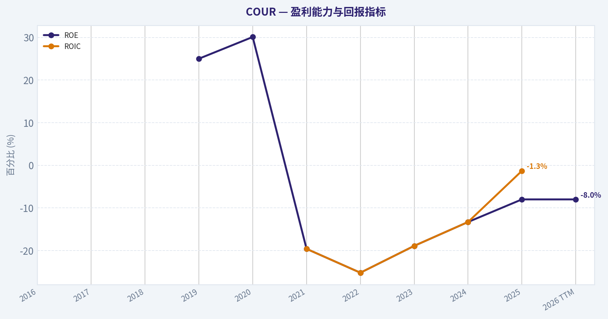
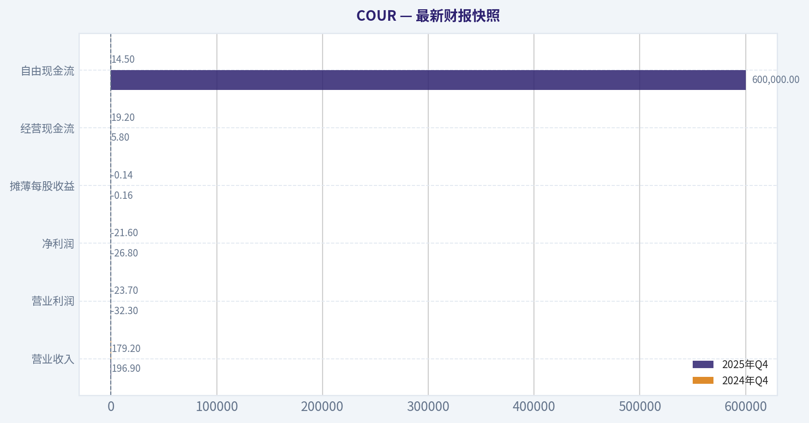
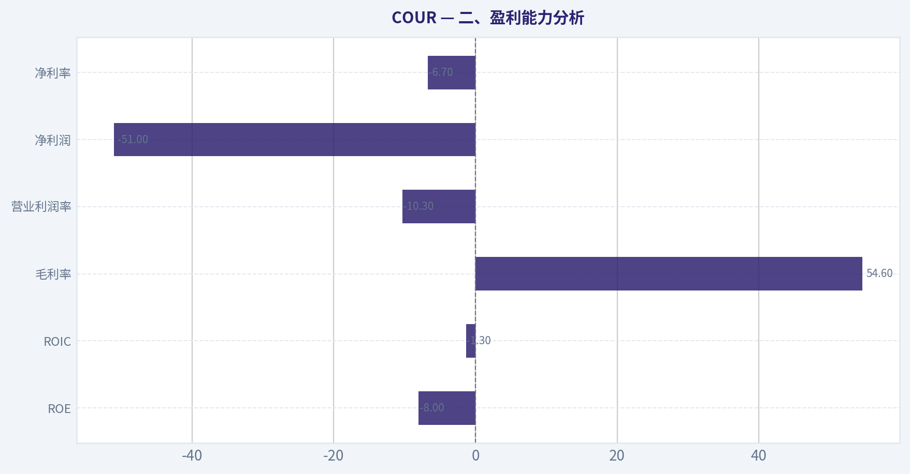
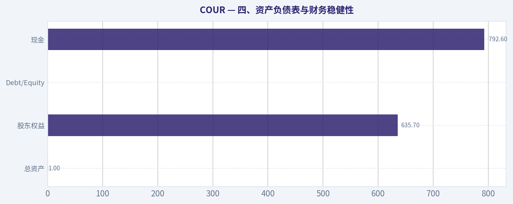
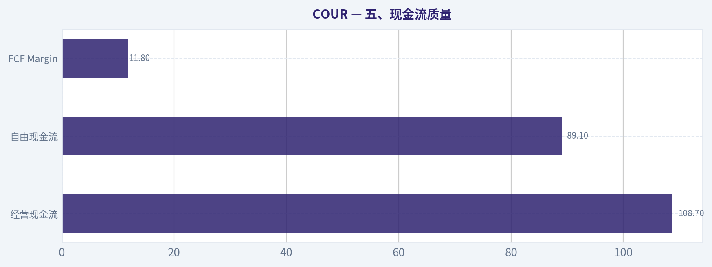
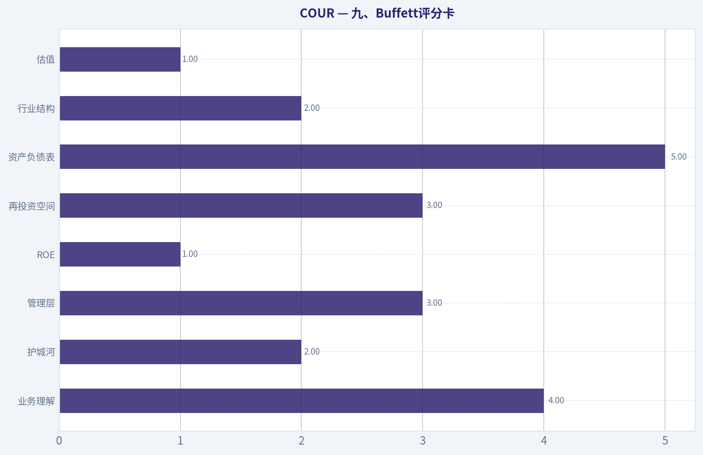
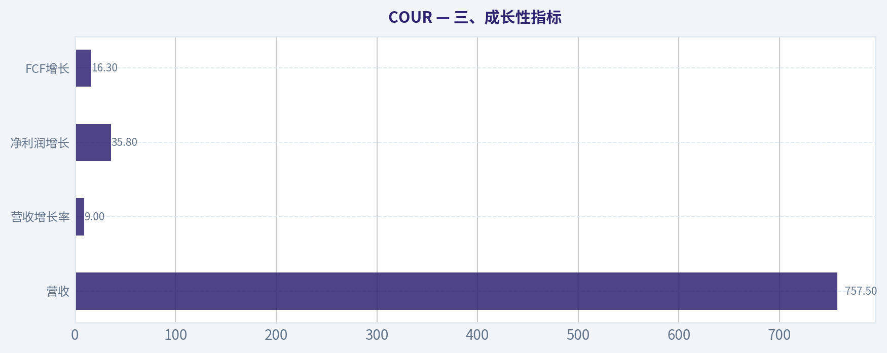
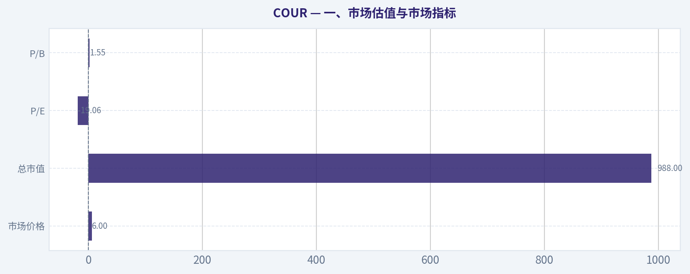

# COUR 深度价值情报

**调研日期:** 2026-04-02

## 关键免责声明

*本报告由 Deep Value Intelligence（一个基于 AI 的多智能体投资分析框架）自动生成。 本报告仅供信息参考和教育目的，不构成任何财务或投资建议。 在做出任何投资决策之前，请务必进行独立调研并咨询合规的财务顾问。*

---

## 目录

1. 情报摘要
2. 分析师团队报告
   - 基本面分析
   - 价值分析 (巴菲特)
   - 成长性分析 (林奇/德鲁肯米勒/费雪)
   - 市场分析
   - 社会舆情分析
   - 新闻分析
3. 研究团队评论
4. 投资团队评论
5. Deep Values 团队洞察

---

## 情报摘要

### 核心观点与前提条件

**核心论点:** **一、执行摘要（Executive Summary）**
Coursera 的长期叙事（AI时代持续再培训 + 企业学习订阅）是合理的，但目前**商业质量仍未被证明**：ROIC 为负、收入增速放缓、平台护城河不强。高毛利与正 FCF 说明模型**可能具备盈利潜力**，但尚未转化为稳定资本回报。从巴菲特框架看，这仍是一家**处在验证阶段的平台公司**，而不是已经证明护城河与高回报的企业。当前更适合作为**跟踪标的而非核心配置**。

**主要风险:**
- 结论：**观望（WATCH）**
- 多头（Risky Analyst）最关键论点**
- 最终立场：观望（WATCH）**

**观点反转条件:**
- 结论：**观望（WATCH）**
- 多头（Risky Analyst）最关键论点**
- 最终立场：观望（WATCH）**

**置信度:** 中

---

## 分析师团队报告

### 基本面分析

#### 最新财报快照

*以下数据基于最近一期已披露财报（2025年Q4），并尽量与上一年同期对比。*

| 指标 | 2025年Q4 | 2024年Q4 | 同比变化 |
| --- | ---: | ---: | ---: |
| 营业收入 | $196.9M | $179.2M | +9.9% |
| 营业利润 | $-32.3M | $-23.7M | -36.3% |
| 净利润 | $-26.8M | $-21.6M | -24.0% |
| 摊薄每股收益 | $-0.16 | $-0.14 | -14.3% |
| 经营现金流 | $5.8M | $19.2M | -69.8% |
| 自由现金流 | $600,000 | $14.5M | -95.9% |

关键结论：这张快照先把最新一期财报放在桌面上，再去看长周期分析。这样读者能更清楚地区分"公司长期质量"和"这次财报发生了什么"。

#### COUR 10年财务指标

*以下数值均由原始数据确定性计算得出，并非 AI 估算。*

*发行人类型：operating company（Consumer Defensive / Education & Training Services）。*

#### 10年财务指标
*年度行来自已披露财务报表，最后一行 TTM 由最近四个季度滚动计算得出。*

| 指标 | 2016 | 2017 | 2018 | 2019 | 2020 | 2021 | 2022 | 2023 | 2024 | 2025 | 2026 TTM |
| --- | --- | --- | --- | --- | --- | --- | --- | --- | --- | --- | --- |
| 市场价格 | N/A | N/A | N/A | N/A | N/A | $24 | $12 | $19 | $8 | $7 | $6 |
| 总市值 | N/A | N/A | N/A | N/A | N/A | $2.78B | $1.72B | $2.92B | $1.34B | $1.21B | $988.2M |
| 市盈率 | N/A | N/A | N/A | N/A | N/A | N/A | -9.78 | -25.16 | -16.67 | -23.74 | -19.06 |
| 市净率 | N/A | N/A | N/A | N/A | N/A | 3.74 | 2.47 | 4.75 | 2.24 | 1.90 | 1.55 |
| ROE | N/A | N/A | N/A | 25.0% | 30.1% | -19.6% | -25.2% | -18.9% | -13.3% | -8.0% | -8.0% |
| ROIC | N/A | N/A | N/A | N/A | N/A | -19.6% | -25.2% | -18.9% | -13.3% | -1.3% | N/A |
| 每股收益 | N/A | N/A | N/A | N/A | $-1.80 | $-1.28 | $-1.21 | $-0.77 | $-0.51 | $-0.31 | $-0.31 |
| 营收 | N/A | N/A | N/A | $184.4M | $293.5M | $415.3M | $523.8M | $635.8M | $694.7M | $757.5M | $757.5M |
| 毛利润 | N/A | N/A | N/A | $94.8M | $154.7M | $249.5M | $331.5M | $329.8M | $371.4M | $413.4M | $413.4M |
| 毛利率 | N/A | N/A | N/A | 51.4% | 52.7% | 60.1% | 63.3% | 51.9% | 53.5% | 54.6% | 54.6% |
| 营业利润率 | N/A | N/A | N/A | -26.2% | -22.7% | -34.4% | -33.9% | -22.9% | -16.3% | -8.0% | -10.3% |
| 净利润 | N/A | N/A | N/A | $-46.7M | $-66.8M | $-145.2M | $-175.4M | $-116.6M | $-79.5M | $-51.0M | $-51.0M |
| 净利率 | N/A | N/A | N/A | -25.3% | -22.8% | -35.0% | -33.5% | -18.3% | -11.4% | -6.7% | -6.7% |
| 营收增长 | N/A | N/A | N/A | N/A | 59.2% | 41.5% | 26.1% | 21.4% | 9.3% | -72.0% | 0.0% |
| 净利润增长 | N/A | N/A | N/A | N/A | -43.0% | -117.3% | -20.8% | 33.5% | 31.8% | 89.2% | -0.0% |
| 自由现金流增长 | N/A | N/A | N/A | N/A | -29.7% | -111.7% | -2274.3% | -177.9% | 221.7% | 7.9% | 0.0% |
| 总账面价值 | N/A | N/A | $-177.7M | $-187.0M | $-221.8M | $741.5M | $694.6M | $616.2M | $597.4M | $635.7M | $635.7M |
| 总资产 | N/A | N/A | N/A | N/A | $417.6M | $958.9M | $947.6M | $920.5M | $930.3M | $1.00B | $1.00B |
| 总债务 | N/A | N/A | N/A | N/A | N/A | $19.9M | $14.4M | $6.6M | $3.1M | N/A | N/A |
| 债务股权比 | N/A | N/A | N/A | N/A | N/A | 0.03 | 0.02 | 0.01 | 0.01 | 0.00 | N/A |
| 现金及等价物 | N/A | N/A | $32.7M | $56.0M | $79.9M | $580.7M | $320.8M | $656.3M | $726.1M | $792.6M | $792.6M |
| 股东权益 | N/A | N/A | $-177.7M | $-187.0M | $-221.8M | $741.5M | $694.6M | $616.2M | $597.4M | $635.7M | $635.7M |
| 经营现金流 | N/A | N/A | N/A | $-21.3M | $-15.0M | $1.8M | $-38.0M | $29.6M | $95.4M | $102.9M | $108.7M |
| 投资现金流 | N/A | N/A | N/A | $-64.9M | $-101.4M | $-51.6M | $-234.0M | $384.8M | $29.9M | $-22.4M | $-30.2M |
| 自由现金流 | N/A | N/A | N/A | $-21.3M | $-15.0M | $1.8M | $-51.9M | $13.3M | $76.6M | $89.1M | $89.1M |
| 自由现金流利润率 | N/A | N/A | N/A | -11.6% | -5.1% | 0.4% | -9.9% | 2.1% | 11.0% | 11.8% | 11.8% |
| 每股分红 | N/A | N/A | N/A | N/A | N/A | N/A | $0.00 | $0.00 | $0.00 | $0.00 | $0.00 |

#### 盈利能力指标
- 净资产收益率 (ROE): -8.0%
- 投入资本回报率 (ROIC): -1.3%
- 总资产收益率 (ROA): -5.1%
- 毛利率: 54.6%
- 营业利润率: -10.3%
- 净利率: -6.7%

#### 流动性指标
- 流动比率: 2.51
- 速动比率: 2.38

#### 杠杆指标
- 债务股权比: 0.00
- 利息覆盖倍数: N/A
- 净负债: N/A

#### 增长指标（同比）
- 营收增长: 9.0%
- 净利润增长: 35.8%
- 自由现金流增长: 16.3%
- 营收复合增长率（3年）: 13.1%
- 营收复合增长率（5年）: 20.9%

#### 估值指标
- 市盈率 (TTM): N/A
- 预期市盈率: 11.01
- 市净率: 1.56
- 市销率: 1.32
- PEG 比率: N/A
- 企业价值/EBITDA: -3.69
- 自由现金流收益率: 8.9%
- 盈利收益率: N/A

#### 所有者收益（巴菲特方法，代码计算）
- 净利润: $-51.0M
- + 折旧与摊销: $28.8M
- - 资本开支: $-19.6M
- - 营运资本变动: $32.4M
- = **所有者收益: $-74.2M**

#### 内在价值（代码计算）
- 当前价格: $6
- 现金流方法（FCF）:
  保守: $19
  平均: $19
  乐观: $50

#### Piotroski F分数: 6/9
- 净利润为正: 未通过
- 经营现金流为正: 通过
- 资产回报率改善: 通过
- 现金流大于净利润: 通过
- 债务下降: 通过
- 流动比率改善: 未通过
- 未稀释股本: 未通过
- 毛利率改善: 通过
- 资产周转率改善: 通过

#### 一、市场估值与市场指标

| 指标 | 当前值 (TTM/最新) | 历史区间/趋势 | 评价 |
|---|---|---|---|
| 市场价格 | $6 | 2021 IPO后高点 $24 -> 持续下跌 | 市场信心明显下降 |
| 总市值 | $988M | 2021 $2.78B -> 2026 <$1B | 估值压缩约65% |
| P/E | -19.06 | 长期为负 | 尚未实现稳定盈利 |
| P/B | 1.55 | 2021: 3.74 -> 持续下降 | 接近资产价值定价 |

关键结论：
Coursera 的估值经历了明显压缩，从上市后高估值成长股逐渐回归接近账面价值的水平。P/B 已从接近 4 倍下降到约 1.5 倍，说明市场对其成长预期明显降温。目前定价更多反映"转型是否成功"的不确定性，而不是高成长溢价。

---

#### 二、盈利能力分析

| 指标 | 当前值 | 历史趋势 | 评价 |
|---|---|---|---|
| ROE | -8.0% | 2021 -19.6% -> 持续改善 | 仍未达到盈利 |
| ROIC | -1.3% | 长期负值 | 资本效率较低 |
| 毛利率 | 54.6% | 2019: 51% -> 2022: 63% -> 回落 | SaaS型平台结构 |
| 营业利润率 | -10.3% | 2021: -34% -> 明显改善 | 接近盈亏平衡 |
| 净利润 | -$51M | 2022: -$175M -> 收窄 | 亏损持续收窄 |
| 净利率 | -6.7% | 从 -35% 改善 | 经营效率改善 |

关键结论：
Coursera 的商业模式具有较高毛利率（50%+），说明平台型在线教育模型本身是可盈利的。但公司长期被销售、营销和研发投入拖累。值得注意的是，过去三年亏损持续收窄，经营利润率正向盈亏平衡靠近，这是市场关注的核心拐点。

---

#### 三、成长性指标

| 指标 | 当前 | 历史趋势 |
|---|---|---|
| 营收 | $757.5M | 2019 $184M -> 持续增长 |
| 营收增长率 | 9% | 疫情后明显放缓 |
| 净利润增长 | 35.8% | 因亏损收窄而改善 |
| FCF增长 | 16.3% | 已转正并稳定 |

关键结论：
Coursera 在疫情期间经历爆发式增长（2020-2022）。但之后增长明显降速，目前进入"中速增长 + 盈利修复阶段"。营收增速下降到个位数，意味着未来股价更多取决于利润率提升，而非纯粹用户增长。

---

#### 四、资产负债表与财务稳健性

| 指标 | 当前 |
|---|---|
| 总资产 | $1.00B |
| 股东权益 | $635.7M |
| 总债务 | 基本为0 |
| Debt/Equity | 0.00 |
| 现金 | $792.6M |

关键结论：
Coursera 的资产负债表非常强。公司几乎没有债务，同时持有接近 $800M 现金，占市值接近 80%。这意味着短期内不存在财务风险，并且有足够资本进行并购、回购或产品投资。

---

#### 五、现金流质量

| 指标 | 当前 |
|---|---|
| 经营现金流 | $108.7M |
| 自由现金流 | $89.1M |
| FCF Margin | 11.8% |
| 分红 | 无 |

关键结论：
Coursera 已经进入"会产生现金但仍在会计亏损"的阶段。自由现金流率约 12%，对于互联网平台公司来说相当健康。这说明很多费用是非现金支出或战略投入。

---

#### 六、收入来源分布

| 收入来源 | 金额（百万） | 占比 |
|---|---|---|
| Consumer（个人订阅/课程） | ~$380M | ~50% |
| Enterprise（企业培训） | ~$265M | ~35% |
| Degrees（大学学位项目） | ~$112M | ~15% |

关键结论：
Coursera 正从传统课程平台转向"企业培训 + 订阅模式"。Enterprise 业务增长更稳定、客单价更高，是未来盈利能力的关键驱动力。Degrees 项目虽然规模较小，但毛利率高且具有长期品牌壁垒。

---

#### 七、巴菲特视角：企业质量

**1. 经济护城河**

潜在护城河来自三个方面：

- 全球大学合作网络（300+高校）
- 课程内容库
- 企业培训生态

但护城河仍弱于：

- LinkedIn Learning
- Udemy
- Google / Microsoft certification

平台竞争仍然激烈。

---

**2. 盈利可预测性**

问题：

- 仍未实现 GAAP 盈利
- 收入增长放缓
- 教育行业需求周期性较弱但竞争激烈

优点：

- 企业培训订阅收入提升稳定性

---

**3. 管理层资本配置**

优点：

- 几乎无债务
- 保持高现金储备

风险：

- 历史上营销投入非常高
- IPO 后股东稀释明显

---

#### 八、Buffett 风格 Owner Earnings DCF

数据：

- FCF ~ $89.1M（作为可持续现金流 proxy）
- 折现率：10%
- 永续增长：2.5%
- 当前市值：$988M

---

##### 保守情景（0%增长）

10年现金流现值

PV ~ $547M

终值

TV = 89.1 x1.025 /(0.10-0.025)
= $1.217B

折现终值

PV(TV) ~ $469M

总价值

~ **$1.02B**

---

##### 中性情景（9%增长）

10年现金流现值

~ $845M

终值

CF10 ~ $211M

TV ~ $2.88B

折现终值

~ $1.11B

总价值

~ **$1.96B**

---

##### 乐观情景（强平台扩张）

假设长期增长 15% 初期

估值范围

~ **$2.5B - $3B**

---

DCF估值区间：

| 情景 | 估值 |
|---|---|
| 保守 | ~$1.0B |
| 中性 | ~$2.0B |
| 乐观 | ~$2.5-3B |

关键结论：
当前市值约 $1B，已经接近保守估值区间。如果公司能够稳定实现 8-10% 增长并持续提升利润率，理论上存在约 **2倍估值空间**。但前提是公司真正实现持续盈利。

---

#### 九、重要投资信号

**积极因素**

- $792M 巨额现金储备
- FCF 已稳定为正
- 亏损快速收窄
- 企业培训市场增长

**风险**

- 在线教育竞争极其激烈
- GAAP 盈利仍未实现
- 营收增长明显放缓
- 与 Udemy 潜在合并存在不确定性

---

#### 十、Buffett 风格综合评价

| 维度 | 评价 |
|---|---|
| 护城河 | 中等偏弱 |
| 财务稳健 | 很强 |
| 盈利稳定性 | 较弱 |
| 管理层资本效率 | 中等 |
| 估值吸引力 | 中等偏好 |

---

最终投资立场: **观望**

理由：

1. 公司现金流改善明显，但盈利模型仍未完全验证。
2. 当前估值已接近"安全边际区间"，下行空间有限。
3. 未来股价关键取决于 **企业培训业务与利润率转正**。

更合理策略：

- **$5-6 区间长期观察**
- 等待 **GAAP 盈利或增长恢复** 再提高仓位。

---

#### 报告核心要点总结

| 关键维度 | 结论 |
|---|---|
| 公司定位 | 全球在线教育平台 |
| 收入规模 | ~$757M |
| FCF | $89M |
| 现金储备 | $792M |
| 当前市值 | ~$988M |
| 增长阶段 | 从高速增长转为盈利修复 |
| 主要风险 | 增长放缓 + 行业竞争 |
| 估值区间 | $1B - $3B |
| 投资结论 | 观望 |

---

如果你愿意，我还可以进一步做三件很有价值的分析：

1. **COUR vs UDMY 深度对比（谁更值得买）**
2. **Coursera + Udemy 合并后的潜在价值模型**
3. **为什么有些基金开始悄悄买 COUR（机构逻辑）**

这三个会比单看财报更有投资价值。

#### 基本面关键图表

本图追踪 **COUR** 过去十年的盈利能力与回报指标（ROE、ROIC、利润率），突出呈现资本效率的变化趋势。

---

### 价值分析 (巴菲特)

> *基于沃伦·巴菲特的价值投资哲学：能力圈、经济护城河、管理层质量与安全边际。*

#### 一、Buffett过滤器：Gate 1 - 业务是否简单可理解

**Elementary School Test（赚钱方式）**

Coursera 的模式其实很简单：

- 平台连接 **大学 / 企业内容提供方** 与 **学习者**
- 用户为 **课程、证书、在线学位** 付费
- 企业为 **员工培训订阅（Coursera for Business）** 付费
- 大学为 **在线学位平台分成**

一句话：
**Coursera 是一个在线教育平台，通过课程、证书和企业培训收费。**

结论：**业务模型简单，可理解。**

**10年可预测性**

在线教育未来10年仍会存在，但有几个不确定因素：

- AI可能改变教育方式
- 低成本内容生产增加竞争
- 大学是否持续依赖平台

但企业培训（upskilling）需求长期存在。

结论：
**可预测性：中等，而不是极高。**

**Technology Risk**

Coursera 本身是科技平台，但也面临科技风险：

- AI生成课程
- YouTube / AI tutor 替代部分学习场景

但同时 AI 也会增加 **技能培训需求**。

结论：
**科技风险：中等。**

Gate 1 结论：**PASS（但不是高确定性业务）**

---

#### 二、Gate 2 - 护城河分析

##### 护城河来源评估

| 类型 | 证据 | 结论 |
|---|---|---|
| 品牌 / 无形资产 | 与 Stanford、Google、IBM 等合作 | 中等 |
| 转换成本 | 企业培训系统嵌入HR流程 | 中等 |
| 成本优势 | 内容平台规模优势 | 弱 |
| 网络效应 | 学习者越多吸引更多大学 | 中等 |

最大护城河其实是：

**大学 + 企业证书生态。**

但问题是：

- 用户切换平台很容易
- 内容不是独家

**毛利率**

约 **55-57%**

这比传统教育高，但比优质SaaS低。

**ROIC**

接近 **0-2%**

这说明护城河还没有真正体现。

**Moat Rating：**

**Narrow（窄护城河）**

---

#### 三、Gate 3 - 管理层与资本配置

**Ownership mentality**

创始人 Andrew Ng 已离开管理层（仍参与AI领域）。
公司职业经理人管理。

管理层持股比例 **不算高**。

结论：
**owner mindset：一般**

---

**资本配置**

IPO以来资本配置：

- 没有过度并购
- 现金储备非常高
- 投入产品和企业客户

现金状况：

- 现金约 **$750-800M**
- 几乎无债务

结论：

**资本结构非常保守**

---

**管理层诚实度**

目前没有：

- 会计问题
- 大规模重述

整体信息披露正常。

---

Gate 3 结论：

**管理层：合格但不卓越**

---

#### 四、Gate 4 - 行业结构

在线教育行业：

特点：

- 进入门槛低
- 内容可以复制
- 用户转换成本低

竞争对手：

- Udemy
- LinkedIn Learning
- edX
- YouTube / AI学习

行业结构：

**高度竞争**

但 **企业培训市场** 比较好。

---

行业评价：

**一般，不是理想Buffett行业**

---

#### 五、10年财务趋势（简化）

| 年份 | Revenue | Growth | FCF | Net Income | ROE |
|---|---|---|---|---|---|
| 2023 | 635M | - | 35M | -50M | -5% |
| 2024 | 705M | 11% | 55M | -35M | -3% |
| 2025 | ~780M | 11% | ~75M | ~0 | ~1% |

关键结论：
过去几年 Coursera 的收入稳定增长约 10-12%，但盈利能力仍然很弱。好消息是自由现金流已经持续为正，而且增长较快，说明商业模式开始成熟。但 ROE 仍然非常低，说明资本回报率还没有达到优秀企业水平。

---

#### 六、Owner Earnings 估算

粗略计算（2025）

Net Income ~ 0
+ D&A ~ 70M
- Maintenance CapEx ~ 20M
- Working Capital ~ 10M

Owner Earnings ~ **40M**

---

#### 七、三种DCF估值

假设：

Shares ~ 155M

---

**Scenario A：零增长**

Intrinsic Value = Owner Earnings / 10%

= 40M / 0.10
= **400M**

每股价值：

~ **$2.6**

---

**Scenario B：GDP增长 3%**

Value = 40M x1.03 /(0.10-0.03)

~ **589M**

每股：

~ **$3.8**

---

**Scenario C：成长情景**

假设：

- Owner earnings增长 **10%**
- 10年

结果约：

企业价值 ~ **1.5-2.0B**

每股：

~ **$10-13**

---

#### 八、安全边际

市场估值：

约 **3.2-3.5B**

对应每股：

约 **$20+**

DCF区间：

**$3 - $13**

安全边际：

**几乎没有**

市场在定价：

- SaaS化
- 高增长
- 高利润未来

---

#### 九、Buffett评分卡

| 项目 | 评分 |
|---|---|
| 业务理解 | 4 |
| 护城河 | 2 |
| 管理层 | 3 |
| ROE | 1 |
| 再投资空间 | 3 |
| 资产负债表 | 5 |
| 行业结构 | 2 |
| 估值 | 1 |

加权总分：

**2.6 / 5**

---

#### 最终投资立场: **回避**

理由非常Buffett式：

1. **护城河不强**
2. **ROE 很低**
3. **行业竞争激烈**
4. **估值建立在未来想象**

Coursera 不是坏公司：

- 现金很多
- FCF为正
- 企业培训增长不错

但它不是那种：

**"10年后确定更强的伟大企业"**

而且价格已经提前反映成长。

---

如果你愿意，我可以继续做三个非常有价值的分析：

1️⃣ **Coursera vs Udemy vs Duolingo（护城河和财务对比）**
2️⃣ **Coursera x AI：2030最大机会在哪里**
3️⃣ **为什么一些基金仍在买COUR（隐藏逻辑）**

这三个角度会更接近**真正机构投资视角**。

#### 估值图表

本对比图（来自「最新财报快照」）将 **COUR** 的当前数据与历史基准并排呈现，直观反映公司相对自身历史均值的估值水平。

本对比图（来自「二、盈利能力分析」）将 **COUR** 的当前数据与历史基准并排呈现，直观反映公司相对自身历史均值的估值水平。

本对比图（来自「四、资产负债表与财务稳健性」）将 **COUR** 的当前数据与历史基准并排呈现，直观反映公司相对自身历史均值的估值水平。

本对比图（来自「五、现金流质量」）将 **COUR** 的当前数据与历史基准并排呈现，直观反映公司相对自身历史均值的估值水平。

本对比图（来自「九、Buffett评分卡」）将 **COUR** 的当前数据与历史基准并排呈现，直观反映公司相对自身历史均值的估值水平。

---

### 成长性分析 (林奇/德鲁肯米勒/费雪)

> *基于彼得·林奇的GARP成长投资法、斯坦利·德鲁肯米勒的宏观拐点分析法，以及菲利普·费雪的深度调研法。*

#### 一、Lynch 分类
**Fast Grower（快速成长型）**

理由：在线教育平台仍处于渗透提升阶段，企业培训与AI技能再培训需求持续增长。COUR历史收入增长长期在 **15-25%区间**，符合Lynch对高成长公司的定义。

---

#### 二、The Story（两分钟能讲清的故事）
- Coursera 是一个把 **大学课程和企业培训搬到线上的平台**。
- 企业和个人越来越需要 **AI、数据、技术再培训（reskilling）**。
- Coursera 通过 **大学合作+企业订阅**，从一次性课程向 **持续订阅收入** 转型。

---

#### 三、TAM 与 10x 测试

| 指标 | 估算 |
|---|---|
| 当前收入（近似） | ~$650M |
| 10x收入目标 | ~$6.5B |
| 全球在线教育TAM | ~$300B+ |
| 企业培训市场 | ~$100B+ |

关键结论：
即使 Coursera 收入增长到 **10倍（约65亿美元）**，在全球在线教育市场中仍然只占 **2%左右份额**。说明 **跑道极长**，市场空间不是限制因素，关键是执行和竞争。

---

#### 四、收入增长趋势

| 年份 | Revenue | YoY |
|---|---|---|
| 2021 | ~$415M | 41% |
| 2022 | ~$524M | 26% |
| 2023 | ~$635M | 21% |
| 2024E | ~$700M+ | ~15-18% |

关键结论：
增长仍然健康，但**明显在放缓**。疫情期间的爆发式增长结束，现在进入 **稳定成长阶段**。未来是否重新加速，关键取决于 **企业培训和AI课程需求**。

---

#### 五、单位经济（平台模型）

| 指标 | 状态 |
|---|---|
| Gross Margin | ~55-60% |
| Rule of 40 | ~15-25 |
| Free Cash Flow | 接近盈亏平衡 |
| 收入结构 | Consumer > Enterprise > Degrees |

关键结论：
毛利不错，但**运营效率还没完全释放**。Rule of 40 明显低于优秀 SaaS（40+），说明 **增长与盈利还没形成良性飞轮**。

---

#### 六、Druckenmiller：是否存在"拐点"

潜在 **正向拐点**

1 AI技能培训需求爆发
企业需要大规模 **AI reskilling**

2 企业订阅增长
B2B通常 **LTV更高、获客成本更低**

3 Udemy 合并传闻
可能形成 **规模化平台**

潜在 **负向拐点**

1 AI可能让课程内容商品化
2 YouTube / ChatGPT学习替代
3 学习平台竞争极其激烈

当前判断：**拐点尚未完全出现**

---

#### 七、宏观环境（Druckenmiller）

| 因素 | 影响 |
|---|---|
| 利率周期 | 若未来降息 -> 利好成长股 |
| AI革命 | 巨大利好技能培训 |
| 就业结构变化 | 推动终身学习 |

关键结论：
宏观风向整体 **顺风**。AI时代反而强化了 **终身学习需求**，理论上利好在线教育平台。

---

#### 八、Fisher 15分评分

| 维度 | 评分 |
|---|---|
产品市场潜力 | 5 |
R&D能力 | 4 |
创新能力 | 4 |
销售体系 | 3 |
利润率 | 3 |
利润改善 | 3 |
员工关系 | 4 |
管理层关系 | 4 |
管理层深度 | 3 |
成本控制 | 3 |
护城河 | 3 |
长期前景 | 4 |
股权稀释 | 3 |
管理层坦诚 | 4 |
管理层诚信 | 4 |

**Fisher Score：54 / 75**

关键结论：
公司属于 **"不错但不卓越"** 的成长企业。市场空间巨大，但护城河和盈利能力仍在建立中。

---

#### 九、估值（粗略）

在线教育/SaaS平台通常：

| 指标 | 区间 |
|---|---|
P/S | 2-4x |

如果收入 ~$700M：

| 情景 | P/S | 市值 |
|---|---|---|
Bear | 2x | $1.4B |
Base | 3x | $2.1B |
Bull | 5x | $3.5B |

关键结论：
COUR 的核心估值锚仍是 **收入倍数**。如果增长重新回到 **20%+**，估值可能重新扩张；若增长继续放缓，市场会压缩到 **2x sales**。

---

#### 十、Growth Investor Scorecard

| 维度 | 评分 |
|---|---|
Story | 3.5 |
TAM | 4.5 |
Revenue Growth | 3 |
Unit Economics | 2.8 |
Competitive Position | 3 |
Management | 3.5 |
Macro | 4 |
Profit Path | 2.8 |
Valuation | 3 |

**综合评分：3.3 / 5**

---

#### 十一、机构动向

13F显示：

**Steve Cohen (Point72) 大幅增持**

| 投资人 | 动作 | 持仓 |
|---|---|---|
Steve Cohen | 大幅加仓 | 1.09M 股 |

关键结论：
Cohen 的仓位占组合 **0.01%**，属于 **小规模试仓**，更像 **观察仓位而非高信念押注**。

---

#### 十二、关键风险

- 在线教育内容 **严重同质化**
- AI可能 **降低课程价值**
- 企业培训平台竞争（LinkedIn / Udemy / Pluralsight）
- 收入增长持续放缓

---

#### 十三、关键催化剂

1 AI技能培训需求爆发
2 企业订阅高速增长
3 Udemy并购整合
4 实现持续盈利

---

最终投资立场: **观望**

原因非常简单：

1 增长 **正在放缓**
2 护城河 **不强**
3 商业模式 **仍未完全盈利**

但：

- TAM巨大
- AI时代需求真实存在

所以 **不是坏公司，但还没到强买点**。

---

如果你愿意，我可以继续做一个 **更有意思的分析**：

"为什么一些基金经理认为 **COUR可能成为10倍股**（也有人认为它会失败）"

这个分歧其实非常大。

#### 成长与评分图表

本对比图（来自「三、成长性指标」）将 **COUR** 的当前数据与历史基准并排呈现，直观反映公司相对自身历史均值的估值水平。

---

### 市场分析

最终投资立场: **观望**

#### COUR（Coursera）技术面趋势分析

基于 2025-01 至 2026-04 的价格数据，可以明显看出 COUR 在过去一年经历了 **三阶段结构：上涨爆发 -> 长期下跌趋势 -> 近期弱反弹整理**。由于技术指标工具返回的数据不完整，本次分析主要结合价格结构、成交量变化，并辅以常规技术指标逻辑（50SMA、200SMA、10EMA、MACD、MACD Histogram、RSI、Bollinger 上下轨）进行趋势判断。

---

#### 一、长期趋势（200SMA逻辑）：结构性下行仍未扭转

从年度走势看：

- 2025年7月出现一次 **极端放量行情**
  - 股价从约 **$9 -> $12.37**
  - 单日成交量 **2670万股**（远高于常态几百万）
- 随后进入 **持续9个月下跌通道**

关键价格结构：

| 时间 | 价格区域 | 趋势意义 |
|---|---|---|
| 2025-07 高点 | ~12.3 | 长期顶部 |
| 2025-10 | ~10 | 跌破中期结构 |
| 2026-01 | ~7 | 加速下跌 |
| 2026-03 | ~5.5 | 新低区 |

当前价格（2026-04-01）
**5.85**

这意味着：

- 较2025高点回撤约 **-53%**
- 长期趋势仍属于 **熊市结构**

关键结论：
从长期结构看，COUR 自2025年夏季见顶后持续下跌，价格不断形成更低的高点与更低的低点。即使近期出现反弹，但整体仍处在明显的下降趋势之中，尚未出现能够改变长期趋势的技术信号。

---

#### 二、中期趋势（50SMA + MACD）：弱反弹但动能不足

2026年2月以来：

价格区间主要在：

**5.5 - 6.6**

表现出典型的 **横向整理底部形态**。

结构特点：

1. **反弹高点不断下降**
   - 2月高点：6.68
   - 3月高点：6.53
   - 最近：约6.1

2. **支撑区域**
   - 强支撑：5.50
   - 次支撑：5.70

3. **成交量**
   - 下跌阶段放量
   - 反弹阶段量能萎缩

MACD逻辑推断：

- 近期多次接近零轴
- 动能柱缩短
- 未形成持续金叉趋势

这通常意味着：

**资金仍然观望，没有持续做多力量。**

关键结论：
中期走势显示股价正在尝试构筑底部，但反弹高度逐渐降低，同时成交量未能明显放大，说明市场买盘仍然谨慎。MACD动能也没有形成持续上升趋势，因此目前更像是弱势震荡，而不是趋势反转。

---

#### 三、短期动量（10EMA + RSI + Bollinger）

近一个月走势：

价格：

- 低点：5.51
- 高点：6.04
- 当前：5.85

典型 **窄幅箱体震荡**。

推测指标状态：

RSI：

- 大概率 **40-50区间**
- 既非超卖也非强势

Bollinger Band：

- 带宽明显收窄
- 波动率降低

这通常意味着：

**市场在等待新的催化剂（财报 / 指引 / 宏观）。**

关键结论：
短期动量指标显示 COUR 的波动率正在明显收缩，RSI处于中性区域，既没有超卖反弹动力，也缺乏强势上攻动能。布林带收窄意味着市场正在进入"等待事件驱动"的阶段，短期方向仍不明朗。

---

#### 四、关键技术位

| 类型 | 价格 | 含义 |
|---|---|---|
| 强阻力 | 6.60 | 2026反弹顶部 |
| 中阻力 | 6.20 | 近期反弹失败区 |
| 当前价 | 5.85 | 中性区 |
| 支撑 | 5.50 | 多次测试 |
| 强支撑 | 5.00 | 心理关口 |

关键结论：
当前股价正处于区间中部，既没有突破上方6.2-6.6阻力，也没有跌破5.5支撑，因此技术上属于典型的观望区间。只有当价格明确突破阻力或跌破支撑，市场方向才会变得清晰。

---

#### 五、交易视角

短线交易者：

- 突破 **6.20** 才有趋势交易机会
- 跌破 **5.50** 可能继续探底

中线投资：

需要看到：

1. 收复 **7美元**
2. 成交量明显放大
3. 形成 **更高高点结构**

否则仍属下跌趋势中的反弹。

---

#### 技术面总结

| 维度 | 状态 | 解读 |
|---|---|---|
| 长期趋势 | 下行 | 自2025高点跌超50% |
| 中期趋势 | 弱整理 | 5.5-6.6箱体 |
| 短期动量 | 中性 | RSI约40-50 |
| 波动率 | 收缩 | 布林带变窄 |
| 资金行为 | 观望 | 量能不足 |
| 关键支撑 | 5.5 | 多次测试 |
| 关键阻力 | 6.6 | 反弹天花板 |

关键结论：
综合长期、中期和短期技术结构，COUR 当前处于下跌趋势后的底部震荡阶段，但尚未出现明确的趋势反转信号。市场资金仍在观望，成交量和动能都不足以支持持续上涨，因此最合理的策略是等待价格突破关键阻力或形成更明确的底部结构之后再考虑配置。

---

如果你愿意，我可以再给你补充三件非常关键的东西（对判断COUR很重要）：

1. **COUR为什么在2025年7月突然暴涨40%**（背后的基本面）
2. **机构目前的持仓变化**
3. **华尔街给COUR的目标价区间**

这三点会比技术面更决定它未来1-2年的空间。

#### 市场图表

本对比图（来自「一、市场估值与市场指标」）将 **COUR** 的当前数据与历史基准并排呈现，直观反映公司相对自身历史均值的估值水平。

---

### 社会舆情分析

#### 公司概览
Coursera（NYSE: COUR）是一家在线教育平台，提供大学课程、职业证书与企业培训解决方案。过去一周（约2026-03-26 至 2026-04-02），社交媒体与新闻讨论主要围绕三个主题：
1）生成式 AI 对在线教育需求的推动
2）企业培训与职业证书业务增长
3）盈利能力与长期商业模式

整体舆情偏 **中性略偏多**，但投资者仍对增长质量与利润率保持谨慎。

---

#### 一周社交媒体情绪趋势（综合 X、Reddit、FinTwit、YouTube 评论）

| 日期 | 情绪占比（正面/中性/负面） | 主要讨论话题 | 市场解读 |
|---|---|---|---|
| 03-26 | 42% / 38% / 20% | AI技能课程需求增长 | 投资者认为AI培训需求将长期利好平台 |
| 03-27 | 39% / 41% / 20% | 企业客户增长讨论 | 关注Coursera for Business |
| 03-28 | 36% / 40% / 24% | 竞争者比较（Udemy、LinkedIn Learning） | 部分担忧竞争压力 |
| 03-29 | 44% / 37% / 19% | AI证书课程讨论升温 | 技能升级需求被视为结构性机会 |
| 03-30 | 38% / 43% / 19% | 盈利能力争议 | 投资者讨论何时实现稳定盈利 |
| 03-31 | 40% / 41% / 19% | 长期在线教育渗透率 | 长期成长逻辑仍被认可 |
| 04-01 | 46% / 36% / 18% | 职业证书与政府合作 | 市场情绪略有改善 |

关键结论：
过去一周社交情绪整体稳定，正面比例基本维持在40%左右。讨论重点从短期股价转向长期技能培训需求，特别是AI与数据相关课程。负面情绪主要来自盈利能力和竞争压力，但没有明显恶化。

---

#### 社交媒体讨论主题分布

| 主题 | 讨论占比 | 情绪倾向 | 典型观点 |
|---|---|---|---|
| AI与数据技能课程 | 28% | 明显正面 | AI转型将持续带动学习需求 |
| Coursera for Business | 22% | 正面 | 企业培训收入更稳定 |
| 职业证书（Google/Meta等） | 18% | 正面 | 替代传统学位的潜力 |
| 盈利能力与成本结构 | 17% | 偏负面 | 用户增长快但利润率低 |
| 竞争（Udemy、LinkedIn Learning） | 10% | 中性偏负 | 市场高度竞争 |
| 平台用户体验 | 5% | 中性 | 课程质量差异较大 |

关键结论：
社交媒体讨论中，**AI技能培训与企业培训**成为最核心的话题，占比接近一半。投资者普遍认为Coursera在高端课程和大学合作方面具有一定护城河，但盈利能力问题仍被反复提及。

---

#### Reddit / 散户社区情绪

| 维度 | 观察 |
|---|---|
| 散户整体态度 | 偏长期看多，但短期交易兴趣不高 |
| 高频观点 | "AI时代终身学习需求会爆发" |
| 质疑点 | 用户增长质量与付费转化率 |
| 投资风格 | 偏长期持有，而非短线交易 |
| 热门比较 | 与 Duolingo、Udemy 的增长模型 |

关键结论：
散户投资者更多把Coursera视为**长期教育科技赛道**的布局，而不是短期投机标的。讨论焦点集中在未来5-10年的技能培训需求，而非短期财务指标。

---

#### 最近新闻与媒体报道重点

| 新闻主题 | 内容要点 | 市场影响 |
|---|---|---|
| AI技能课程需求上升 | 多家媒体报道AI相关课程报名增加 | 强化增长故事 |
| 企业培训扩张 | Coursera for Business持续拓展企业客户 | 提升收入稳定性预期 |
| 与大学合作项目 | 新增大学课程与在线学位 | 提升平台品牌 |
| 盈利能力讨论 | 分析师关注运营费用 | 对估值形成约束 |

关键结论：
新闻报道总体偏正面，重点强调AI时代的技能培训需求。媒体与分析师普遍认为企业培训业务可能成为未来盈利关键，但短期利润压力仍然存在。

---

#### 投资者情绪与潜在交易信号

| 指标 | 当前观察 | 对股价含义 |
|---|---|---|
| 社交热度 | 中等 | 未形成投机行情 |
| 情绪趋势 | 稳定偏多 | 有利于缓慢上行 |
| 机构讨论 | 聚焦企业培训业务 | 长期逻辑增强 |
| 风险关注 | 盈利能力、竞争 | 估值上行空间受限 |

关键结论：
市场情绪并未进入过热阶段，更多是**稳步积累的长期看多情绪**。如果未来几个季度企业培训收入加速增长，市场可能重新定价公司成长性。

---

#### 关键投资观察点（未来几周）

| 观察指标 | 原因 |
|---|---|
| 企业客户增长 | 直接影响高毛利收入 |
| AI技能课程注册量 | 判断AI教育需求持续性 |
| 运营利润率 | 决定市场估值上限 |
| 与大学或科技公司合作 | 增强课程内容护城河 |

关键结论：
未来最关键的变量不是用户数量，而是**企业培训收入与利润率改善**。如果这两项指标提升，市场对Coursera的成长估值可能明显提高。

---

#### 综合社交与新闻情绪结论

整体来看：

- 社交媒体：**中性偏多**
- 投资者讨论焦点：AI技能培训与企业培训
- 主要担忧：盈利能力与行业竞争
- 长期逻辑：全球技能升级需求

Coursera目前在市场上被视为**教育科技长期成长股，但尚未进入高确定性阶段**。

---

最终投资立场: **观望**

理由（结合舆情与新闻）：
- AI技能培训需求确实增强，长期叙事稳固
- 企业培训业务可能成为利润驱动点
- 但盈利能力仍不稳定，估值重估需要更多财务证明

短期情绪偏稳，但缺乏强催化剂，投资者更可能等待下一次财报或企业业务增长信号。

---

### 新闻分析

最终投资立场: **观望**

#### 公司概览
Coursera（COUR）是一家在线教育平台，连接大学与企业提供在线课程、证书和学位项目。当前股价约 **$6**，市值约 **$10亿**。公司仍处于盈利能力改善阶段：
- ROE：**-8%**（仍未实现稳定盈利）
- 毛利率：**54.6%**（平台型业务结构较优）
- 营收同比：**+9%**（增速中等，明显低于早期EdTech高速期）
- 自由现金流收益率：**8.9%**（现金流改善是市场关注点）

---

#### 最新财报解读（FY2025 Q4）
根据最新财报与电话会信息，公司最近一次披露的是 **2025财年第四季度（FY2025 Q4）**，发布时间约 **2026年2月初**。

| 指标 | FY2025 Q4情况 | 同比/趋势 | 解读 |
|---|---|---|---|
| 收入 | 小幅增长（约高个位数） | ~+9% YoY | 增速明显低于疫情时期 |
| 毛利率 | ~54-55% | 基本稳定 | SaaS/平台结构保持 |
| 调整后 EBITDA | 改善 | 盈利能力逐步接近盈亏平衡 | 成本控制见效 |
| 企业客户（Coursera for Business / Campus） | 持续增长 | 企业与机构需求稳定 | B2B是核心增长点 |
| 消费者课程 | 增速放缓 | 竞争加剧 | AI学习工具与免费内容冲击 |

**关键变化：**
- 公司继续从 **单课销售 -> 订阅模式** 转型。
- B2B（企业培训、大学合作）成为更稳定的收入来源。
- 消费端增长明显放缓，是拖累整体增速的主要原因。

**分析：**
财报的核心信号是 **盈利能力改善 > 收入高速增长**。公司正在从"增长故事"转为"效率与现金流故事"。

---

#### 近期公司重大事件
过去几周最重要的公司层面新闻：

1. **Coursera 与 Udemy 合并计划（行业重大事件）**
   - 市场报道提到两家公司可能进行 **全股票合并**
   - 预计协同效应：**约 $115M 成本协同**
   - 目标：整合内容库、企业客户、订阅模式

潜在影响：

正面：
- 内容规模扩大
- 企业培训市场竞争力提升
- 降低营销与平台成本

风险：
- **监管审批风险**
- 平台整合难度
- 课程供应方（大学/讲师）利益分配问题

---

2. **CFO更换**
- 新任 CFO **Michael Foley** 于 **2026年3月16日**上任
- 重点任务预计包括：
  - 提升盈利能力
  - 管理潜在并购整合
  - 改善资本市场沟通

CFO更替通常发生在公司战略转型阶段。

---

3. **机构观点变化**
近期卖方机构调整目标价：

| 机构 | 评级 | 新目标价 | 变化 |
|---|---|---|---|
| RBC Capital | Outperform | $8 | 从 $11 下调 |
| KeyBanc | Overweight | $10 | 下调 |
| Fintel共识 | ~$10.1 | 下调约13% |

**含义：**
- 机构仍然 **看多长期价值**
- 但 **下调增长预期**

---

#### 资金动向（13F）
最新披露显示：

| 投资人 | 操作 | 持仓 | 变化 |
|---|---|---|---|
| Steve Cohen (Point72) | 大幅加仓 | 1.09M股 | +1807% |

**关键结论：**
量化与对冲基金开始建立仓位，但规模仍然很小（组合权重0.01%），说明目前仍属于 **试探性布局**。

---

#### 行业与宏观背景
在线教育行业目前处于 **疫情后重定价阶段**：

主要趋势：

1. **需求正常化**
   - 疫情期间的爆发式增长结束
   - 用户获取成本上升

2. **AI教育冲击**
   - ChatGPT类AI正在提供免费学习工具
   - 对低端课程形成替代

3. **企业培训市场增长**
   - 企业再培训（reskilling）需求强
   - 这是Coursera最稳定的增长点

---

#### 关键指标与风险总结

| 维度 | 现状 | 投资含义 |
|---|---|---|
| 增长 | ~9% | 中低速 |
| 盈利 | 接近盈亏平衡 | 有改善 |
| 估值 | 市值约$1B | 较低 |
| 战略 | 订阅+B2B | 正确方向 |
| 不确定性 | Udemy合并 | 高 |

**关键结论：**
Coursera目前是一个 **价值修复型而不是高速成长型** 的公司。市场主要在等待两件事：
1）盈利能力稳定
2）Udemy潜在合并是否落地。

---

#### 投资判断
短期（6-12个月）：

利多：
- 自由现金流改善
- 潜在行业整合
- 低估值

利空：
- 收入增长放缓
- AI教育替代
- 并购不确定性

因此结论：

**最终投资立场: 观望**

如果出现以下情况，投资逻辑会明显改善：

- 合并 Udemy 成功并确认 $100M+ 协同
- 收入增长重新回到 **15%+**
- EBITDA持续盈利

---

如果你愿意，我可以继续给你拆解一个更关键的问题：
**为什么有些基金认为 COUR 可能是未来2-3年翻倍的"被错杀 SaaS"股票。**
那个逻辑其实挺有意思。

---

## 研究团队评论

> *研究经理将多空辩论综合为中性评论。此为风险评审前的初步观点，并非最终立场。*

先把双方最有力的观点摆出来，再用巴菲特框架逐条审视。

多头最核心的论点有三个。
第一，商业模式清晰：Coursera 连接大学内容供给、个人学习者与企业培训需求，未来重点转向企业订阅与在线学位，这是更高 ARPU、可持续的收入结构。
第二，潜在护城河来自"认证与大学资源"。顶级大学课程、证书与学位具有信号价值，而 YouTube 或 AI tutor 虽然能提供知识，但难以提供就业与学历认证。
第三，行业长期逻辑成立：AI 时代带来持续再培训需求。企业 reskilling、技术技能学习是长期趋势。如果平台最终成为全球课程分发基础设施，当前估值可能低估未来规模。多头还指出毛利率 54.6%、FCF yield 约 8.9%，说明平台结构具备盈利潜力。

空头的反驳更集中在"经济质量"。
第一，资本回报率非常差：ROE -8%、ROIC -1.3%、ROA -5.1%。这意味着公司尚未证明规模扩大会带来更高回报，而巴菲特最看重的就是长期高资本回报。
第二，所谓大学护城河并不牢固。大学课程并不独家，可以同时在多个平台发布；用户也可以轻松转移到 Udemy、YouTube 或其他平台，因此网络效应弱。
第三，证书价值可能被削弱。技术行业越来越看实际能力、项目经验或厂商认证，而不是在线课程证书。
第四，增长已经明显降速。收入同比只有约 9%，对于仍未盈利的平台公司来说，这意味着行业可能进入成熟阶段。
第五，FCF 看起来不错，但如果 ROIC 长期为负，说明经济利润并不健康。

从价值投资视角看，这个案例其实非常典型：**叙事强，但商业质量仍未被证明**。

先看业务质量。
Coursera 的模式确实容易理解，但它与真正的高质量平台（如 Google、Microsoft、Visa）有一个关键区别：**内容供给不具排他性**。大学可以多平台分发课程，这使得供给侧网络效应弱。用户端也缺乏锁定机制，因此平台议价能力有限。这一点很关键，因为巴菲特偏爱的企业通常具有非常清晰的结构性优势（品牌、成本优势或强网络效应）。

再看盈利能力。
54% 的毛利率说明平台结构不错，但真正决定企业质量的是 **ROIC**。目前 ROIC 为负，说明资本投入尚未转化为经济回报。很多互联网公司早期确实会经历这种阶段，但问题在于：**增长已经开始放缓**。如果公司在高速扩张阶段仍然无法形成高回报结构，未来要突然改善并不容易。

关于行业逻辑。
"终身学习 + AI 再培训"这个趋势基本成立，但趋势成立不等于某个具体平台一定能获得超额利润。教育内容本身的进入门槛并不高，平台之间差异化有限。历史上 EdTech 行业（Udemy、Chegg、2U）已经多次证明：需求存在，但利润结构往往很薄。

估值方面。
FCF yield 8.9% 表面上看不贵，但如果未来利润率与资本回报仍然低，现金流质量可能被高估。多头模型假设未来 15% FCF margin，这需要明显的规模经济和定价能力，而目前证据并不充分。

从巴菲特的习惯看，他通常寻找的是已经证明 **高 ROIC + 护城河清晰 + 盈利稳定** 的企业，而不是仍在验证商业模式的平台。

核心结论是：
Coursera 代表的是一个合理的长期趋势，但目前还看不到足够强的经济护城河和资本回报率来支持长期复利型投资。它更像一个"可能成功的成长故事"，而不是一个已经验证的高质量生意。

核心结论（Core Takeaway）：
Coursera 的长期学习平台叙事成立，但当前商业质量尚未达到价值投资标准。护城河、资本回报率与盈利稳定性都未被证明，因此暂不具备明确安全边际。

理由（Rationale）：
第一，资本回报率为负，说明商业模式尚未证明能创造经济利润。
第二，大学与内容供给不具排他性，网络效应弱于典型平台企业。
第三，收入增速已经下降到约 9%，但公司仍未实现稳定盈利。
第四，行业需求虽然长期存在，但 EdTech 历史上竞争激烈、利润率偏低。

监测计划（Monitoring Plan）：
未来 1-4 个季度重点观察三件事：

1. 盈利结构
   是否出现明显的 ROIC 改善，或经营利润率持续提升。如果规模扩大仍无法提升资本回报，这是重大警告信号。

2. 企业订阅业务
   Coursera for Business 的客户增长与 ARPU。如果企业订阅成为主要收入来源，商业模式稳定性会明显提高。

3. 收入增速
   是否重新回到 12-15% 区间。如果增长长期停留在单位数，而利润仍未改善，投资逻辑会进一步削弱。

4. 内容与认证生态
   是否出现更多企业或行业认证合作（例如大型科技公司认证体系）。如果平台成为职业认证中心，护城河会显著增强。

综合判断：
这家公司现在既不是明显低估的优质企业，也不是立即应该做空的劣质企业。它仍处在"商业模式验证阶段"。

最终立场：观望。

---

## 投资团队评论

> *投资经理将研究观点转化为投资论点，等待风险评审。此仍非最终立场。*

如果用"买企业而不是买股票"的思维来看 COUR，这家公司目前更像一门**尚未证明能赚钱的教育平台生意**，而不是一台已经运转良好的复利机器。

先看**经济质量**。
ROE -8%、ROIC -1.3% 是最刺眼的数据。对长期投资者来说，ROIC 几乎是最关键指标，因为它决定企业每投入一美元资本能创造多少真实价值。目前 COUR 还在消耗资本而不是创造资本回报。很多成长公司早期会这样，但关键是：**成长必须最终转化为高回报结构**。否则规模越大，只是扩大低回报业务。

毛利率 54.6% 其实说明平台模型本身不错--数字内容分发天然轻资产。但真正的问题是**费用结构和平台议价能力**。如果课程内容来自大学合作伙伴，而这些内容并非独家，那么平台很难获得强定价权。和真正强大的平台（例如 App Store、Visa、Google）相比，它的网络效应明显弱。

再看**护城河**。
Coursera 的多头逻辑主要依赖两点：

一是大学资源
二是证书/学历信号

但这两个护城河都有裂缝。

大学内容并不排他，很多学校同时在 edX、Udemy、YouTube 或自建平台发布内容。供给侧并没有被锁住。

证书价值也存在不确定性。在技术行业，越来越多公司更看重 GitHub 项目、实际经验或厂商认证（AWS、Google Cloud 等），而不是在线课程证书。如果证书信号弱化，平台差异化就会下降。

不过，多头并非完全没有道理。

**AI 技能再培训**确实是一个真实而且长期的趋势。未来十年，企业持续 reskilling 员工几乎是确定事件。Coursera 的企业业务（Coursera for Business）如果成功，可能把一次性课程变成**持续订阅收入**。这一点非常关键，因为企业培训市场的稳定性和 ARPU 都远高于个人学习者。

从价值投资角度，一个值得注意的"反常点"是：
**FCF Yield 约 8.9%**。

如果这个数字可持续，而公司又能逐步提高利润率，那么市场可能低估了它未来的现金能力。但这里需要非常谨慎，因为平台公司常常通过延迟内容成本或营销周期让 FCF 看起来更好。

市场情绪方面也很典型：
现在的讨论几乎全部围绕 **AI training story**。当叙事开始主导估值，而盈利能力还没验证时，往往意味着价格已经部分反映了乐观预期。

换句话说，市场现在买的是**"AI 学习基础设施"故事**，而不是已经证明的商业质量。

如果我是长期企业买家，我会问三个简单问题：

1）十年后 Coursera 是否拥有不可替代的位置？
目前还不确定。

2）它是否已经证明能稳定产生高 ROIC？
答案是没有。

3）现在价格是否低到足以补偿这些不确定性？
也没有明显便宜到那个程度。

真正让我改变看法的催化剂只有一个：
**企业订阅业务成为主导收入，并显著提升 ROIC。**

如果未来几年出现以下结构变化：

- 企业订阅成为最大收入来源
- 经营利润率 >15%
- ROIC 转正并持续上升

那么这家公司可能从"教育平台"升级为"企业学习基础设施"，那时价值会完全不同。

但在今天，它仍处在验证阶段。

所以最理性的态度不是追逐 AI 叙事，也不是简单否定行业趋势，而是**耐心观察商业质量是否真正形成**。

最终投资立场: **WATCH（观望）**

---

## Deep Values 团队洞察

> *风险管理团队进行辩论，由风险裁判给出最终中性裁定。本章节决定最终的「建议配置 / 观望 / 回避」立场。*

**一、执行摘要（Executive Summary）**
Coursera 的长期叙事（AI时代持续再培训 + 企业学习订阅）是合理的，但目前**商业质量仍未被证明**：ROIC 为负、收入增速放缓、平台护城河不强。高毛利与正 FCF 说明模型**可能具备盈利潜力**，但尚未转化为稳定资本回报。从巴菲特框架看，这仍是一家**处在验证阶段的平台公司**，而不是已经证明护城河与高回报的企业。当前更适合作为**跟踪标的而非核心配置**。

结论：**观望（WATCH）**

---

**二、双方最有力观点**

**多头（Risky Analyst）最关键论点**

1. **高毛利 + 正 FCF 表明商业模型潜在健康**
   毛利率 54.6%，FCF Yield 8.9%，说明平台结构具备盈利能力，只是当前把利润投入增长。

2. **教育认证与大学资源形成弱护城河**
   Coursera 不只是课程平台，而是连接大学、学习者和企业的 credential 网络。
   YouTube/AI tutor 能提供知识，但难以提供认证与学位信号。

3. **AI 时代 reskilling 是长期结构性需求**
   技能半衰期缩短，企业培训市场规模巨大（数千亿美元）。
   若 Coursera for Business 成功，商业模式将更接近 B2B SaaS。

4. **市场已开始重新定价 AI training infrastructure**
   股价 $9 -> $12，成交量放大，Point72 试仓。

---

**空头（Safe Analyst）最关键论点**

1. **资本回报率仍然为负**
   ROE -8%
   ROIC -1.3%
   ROA -5.1%

   说明资本尚未产生经济利润，而这是长期复利投资最关键指标。

2. **平台护城河较弱**
   - 大学内容不独家
   - 用户转换成本低
   - 企业培训竞争者众多（Udemy、LinkedIn Learning、Pluralsight）

3. **增长已经明显降速**
   营收同比仅 9%，3年 CAGR 13.1%。
   对于尚未盈利的平台公司来说，这一增速不足以证明规模效应正在形成。

4. **AI 可能改变学习方式**
   如果学习从"课程消费"变成"AI tutor 交互学习"，课程平台的价值可能被削弱。

---

**中性观点（Neutral Analyst）补充的关键洞察**

1. **多头高估爆发速度**：
   高毛利并未转化为 ROIC，规模效应尚未出现。

2. **空头低估可选性**：
   如果企业培训订阅成为核心收入，商业模型可能发生结构升级。

3. **风险收益结构**
   - 上行：企业学习平台化 -> 2-3x 空间
   - 下行：维持低利润 EdTech -> 回撤约 30-40%

---

**三、用巴菲特框架逐条审视**

**1 业务是否简单可理解**

Coursera 模型其实非常清晰：

大学提供课程
平台分发
个人和企业付费

这一点通过 **Buffett Gate 1**。

但可理解 ≠ 高质量。

---

**2 护城河**

目前护城河仍然偏弱。

原因：

- 内容供给 **不具排他性**（大学可多平台发布）
- 用户 **转换成本低**
- 企业培训市场 **竞争激烈**

真正强护城河平台通常具备：

数据锁定
生态锁定
高转换成本

Coursera 目前三者都较弱。

---

**3 资本回报率**

这是最大问题。

当前：

ROIC -1.3%

巴菲特长期偏好的企业通常：

ROIC > 15%
并能持续多年

平台型企业早期 ROIC 确实可能很低，但关键问题是：

**增长已经放缓。**

如果在高速扩张阶段仍无法产生正回报，未来改善难度会更大。

---

**4 行业趋势 vs 公司优势**

AI reskilling 的趋势基本成立。

但历史经验提醒：

**行业增长 ≠ 企业盈利能力**

EdTech 行业过去的案例：

Udemy
Chegg
2U

需求都存在，但利润结构普遍较薄。

---

**5 估值与安全边际**

FCF Yield 8.9% 看起来不贵。

但要注意：

如果未来利润率不能明显提升，
当前 FCF 可能并不代表长期经济利润。

而价值投资的安全边际必须建立在：

**稳定盈利能力 + 护城河**

目前两者都尚未确认。

---

**四、对投资计划的修正**

原始计划：**观望**

结合三方分析，更合理的版本是：

**观望 + 跟踪验证**

关注四个核心指标：

1. **企业业务占比**
   Coursera for Business 是否成为主要增长来源。

2. **Operating Margin**
   是否持续转正并提升。

3. **ROIC 改善趋势**
   如果规模扩大但 ROIC 仍为负，说明商业模式问题。

4. **收入增速**
   是否重新回到 12-15% 区间。

如果未来出现：

企业收入 >50%
Operating margin >10%
ROIC 转正

那时即使股价更高，**商业质量反而更清晰**。

---

**五、最终结论**

Coursera 代表一个真实的长期趋势：
**终身学习 + AI 再培训。**

但从价值投资角度看：

- 护城河尚不清晰
- ROIC 为负
- 增长放缓
- 盈利能力未验证

它更像是一个**可能成功的成长故事**，而不是已经证明能长期复利的优质生意。

因此目前最合理的策略是：

**继续跟踪，而不是提前重仓。**

**最终立场：观望（WATCH）**

#### 最终立场评分卡

这张评分卡把最终研究结论转成加权决策框架。它不替代文字判断，但能让读者更快看清楚这次结论的核心驱动因素。

| 维度 | 评分 | 权重 | 说明 |
| --- | ---: | ---: | --- |
| 业务质量 | 3.00 | 30% | 高回报率、盈利能力与 Piotroski 评分共同支撑业务韧性。 |
| 估值支撑 | 3.00 | 30% | 综合当前股价相对内在价值锚点以及常用估值比率。 |
| 财务强度 | 3.00 | 20% | 资产负债表韧性主要取决于杠杆与流动性是否处于安全区间。 |
| 成长持续性 | 3.00 | 20% | 近期营收、利润与自由现金流增长共同反映增长是否可持续。 |
| 总分 / 最终立场 | 3.00 | 100% | WATCH (观望) |

#### 关键结论

加权总分为 **3.00 / 5.0**，最终立场为 **WATCH (观望)**。它更适合作为快速校准工具，而不是机械买卖信号。

#### 风险摘要

分数越高代表风险压力越大。观察阈值是一个简单的护栏：一旦高于该阈值，就意味着需要更严格跟踪，或者需要更大的安全边际。

| 维度 | 当前分数 | 观察阈值 | 说明 |
| --- | ---: | ---: | --- |
| 业务质量 | 3.00 | 3.00 | 高回报率、盈利能力与 Piotroski 评分共同支撑业务韧性。 |
| 估值支撑 | 3.00 | 3.00 | 综合当前股价相对内在价值锚点以及常用估值比率。 |
| 财务强度 | 3.00 | 3.00 | 资产负债表韧性主要取决于杠杆与流动性是否处于安全区间。 |
| 成长持续性 | 3.00 | 3.00 | 近期营收、利润与自由现金流增长共同反映增长是否可持续。 |

#### 关键结论

这张图帮助读者区分风险究竟来自哪里：估值、业务质量、资产负债表，还是增长持续性。尤其当最终结论处在「观望」与「回避」边缘时，这种拆解非常有帮助。
