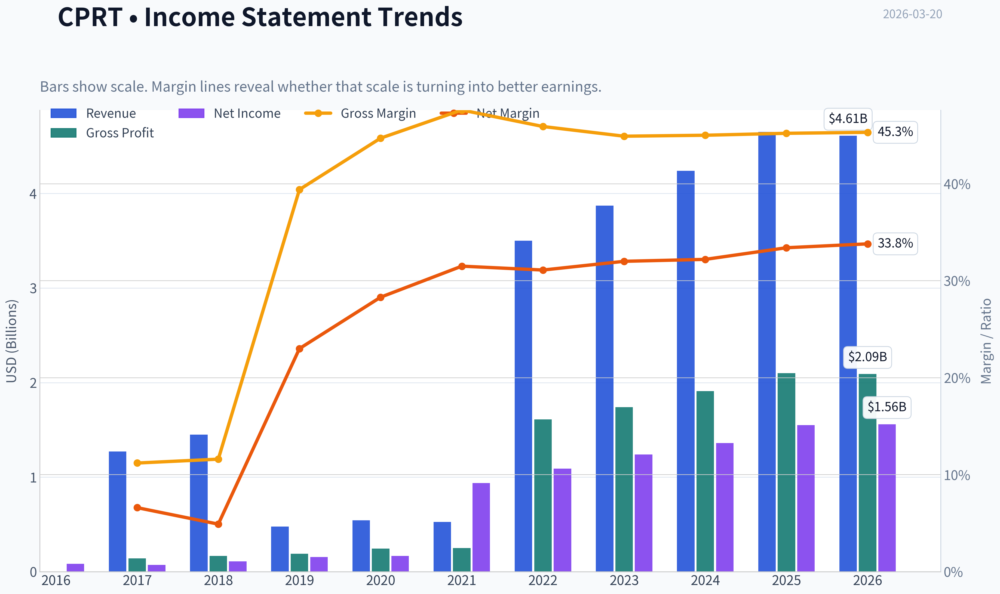
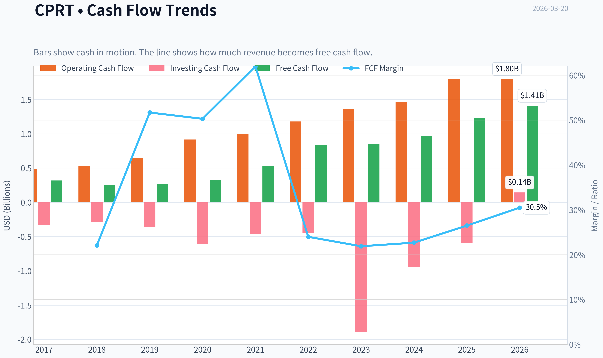
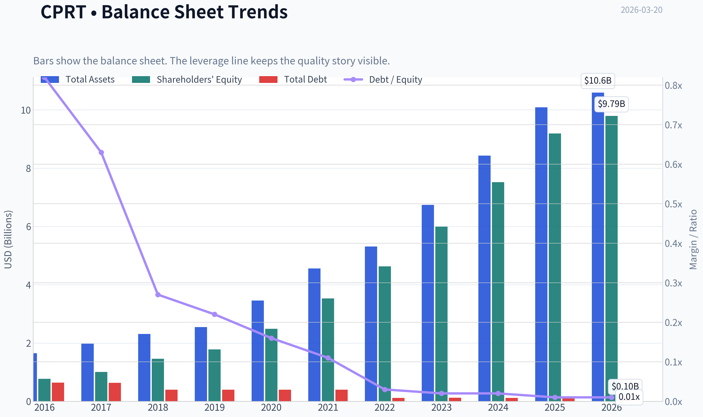
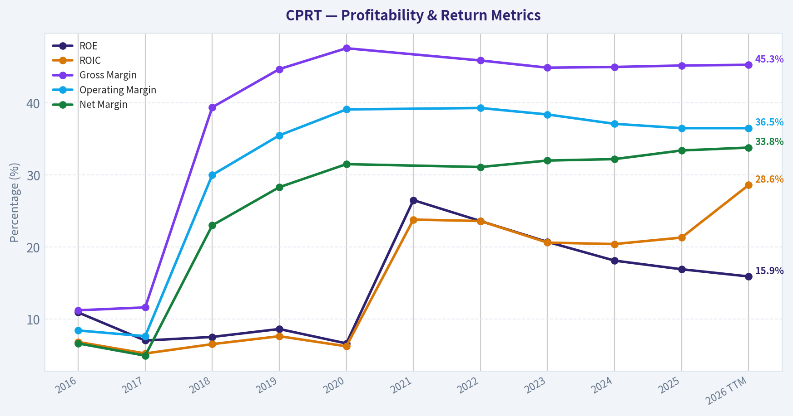
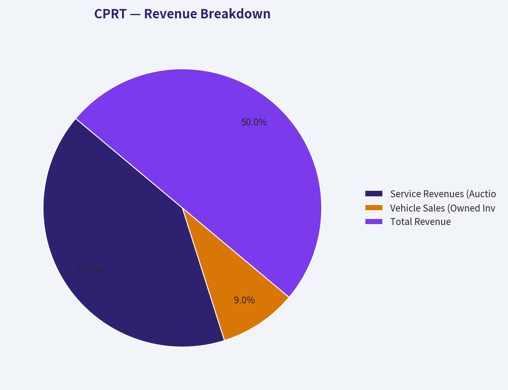
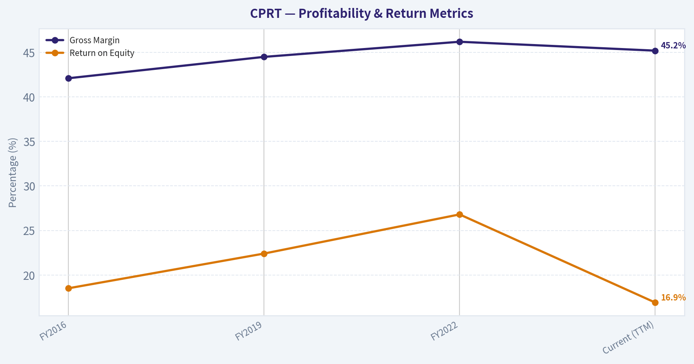
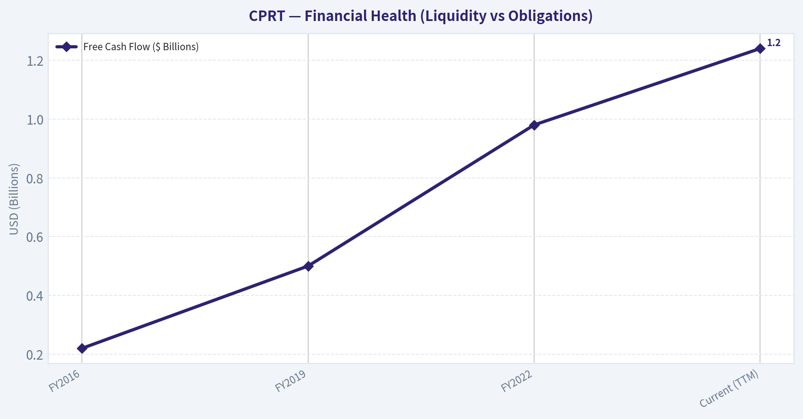
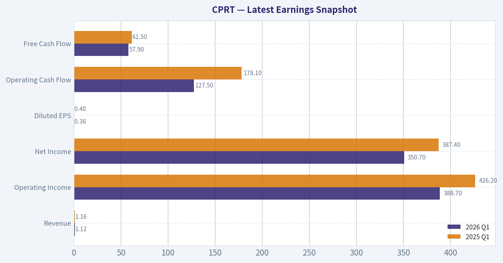
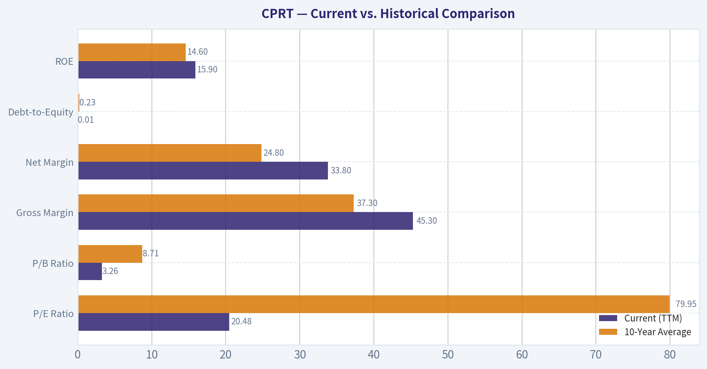
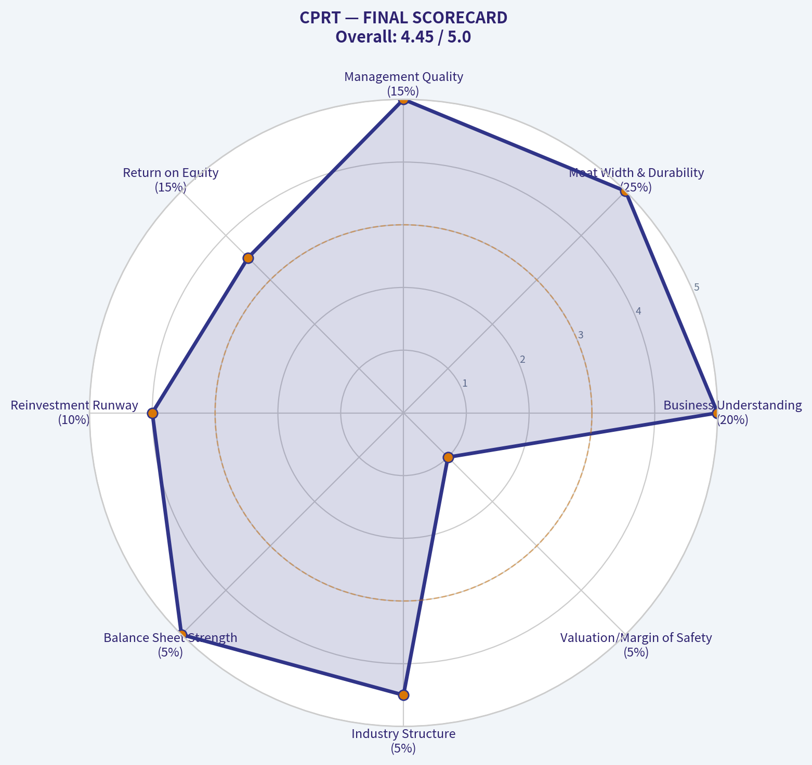

# CPRT Deep Value Intelligence

**Analysis Date:** 2026-03-20

## Critical Disclaimer

*This analysis is generated by Deep Value Intelligence, an AI-powered multi-agent investing framework. This report is for informational and educational purposes only and does not constitute financial advice. Always conduct your own research and consult with qualified financial advisors before making investment decisions.*

---

## Table of Contents

1. Intelligence Summary
2. Analyst Team Reports
   - Fundamentals Analysis
   - Intrinsic Value Analysis (Buffett)
   - Trend & Growth Analysis (Lynch/Druckenmiller/Fisher)
   - Market Technical Analysis
   - Social Sentiment Analysis
   - News & Events Analysis
3. Research Team Commentary
4. Value Investing Team Commentary
5. Deep Values Commentary

---

## Intelligence Summary

### Thesis + Conditions

**Core Thesis:** **EXECUTIVE SUMMARY**
Copart (CPRT) is the textbook definition of Charlie Munger's philosophy: *"A wonderful business at a fair price."* A 40% stock drawdown has offered a rare entry into an entrenched duopoly. With a 21.3% ROIC, 45.2% gross margins, and an insurmountable double-moat (zoning-restricted physical scrapyards + a 190-country digital buyer network), the risk of permanent capital impairment is near zero.

**Key Risks:**
- Copart (CPRT) is the textbook definition of Charlie Munger's philosophy: *"A wonderful business at a fair price."* A 40% stock drawdown has offered a rare entry into an entrenched duopoly. With a 21.3% ROIC, 45.2% gross margins, and an insurmountable double-moat (zoning-restricted physical scrapyards + a 190-country digital buyer network), the risk of permanent capital impairment is near zero. While the stock ($32.77) lacks a deep-value discount against conservative FCF estimates ($30.46), its elite compounding economics more than justify the current ~20x P/E multiple.
- The Bull (Quality & Tailwinds):** CPRT is a compounding machine with an untouchable moat. Vehicle complexity is structurally driving up repair costs, ensuring total-loss rates (and Copart's inventory) will rise even if accident frequencies fall.
- The Bear (Valuation & Hidden Risks):** The stock sits in a technical "death-trend," and trading at $32 against a $30 FCF value offers minimal margin of safety. Furthermore, managing damaged EV batteries threatens to increase capital intensity and regulatory costs.
- The Neutral (Phased Approach):** Copart is too strong to ignore but not cheap enough to back up the truck. The optimal risk-adjusted strategy is gradual accumulation, allowing technicals to stabilize while securing a starter position at fair value.
- Following the Buffett framework, we must separate *business risk* (permanent impairment) from *market risk* (temporary price volatility). The bear's focus on moving averages is market noise. The underlying business reality is an unbreachable fortress. Competitors cannot replicate Copart's physical real estate footprint near major metros due to modern zoning laws. Meanwhile, its digital marketplace creates an absolute network effect: insurers must use Copart to access global liquidity, and global buyers must use Copart to access inventory.

**What Would Change Our View:**
- Copart (CPRT) is the textbook definition of Charlie Munger's philosophy: *"A wonderful business at a fair price."* A 40% stock drawdown has offered a rare entry into an entrenched duopoly. With a 21.3% ROIC, 45.2% gross margins, and an insurmountable double-moat (zoning-restricted physical scrapyards + a 190-country digital buyer network), the risk of permanent capital impairment is near zero. While the stock ($32.77) lacks a deep-value discount against conservative FCF estimates ($30.46), its elite compounding economics more than justify the current ~20x P/E multiple.
- The Bull (Quality & Tailwinds):** CPRT is a compounding machine with an untouchable moat. Vehicle complexity is structurally driving up repair costs, ensuring total-loss rates (and Copart's inventory) will rise even if accident frequencies fall.
- The Bear (Valuation & Hidden Risks):** The stock sits in a technical "death-trend," and trading at $32 against a $30 FCF value offers minimal margin of safety. Furthermore, managing damaged EV batteries threatens to increase capital intensity and regulatory costs.
- The Neutral (Phased Approach):** Copart is too strong to ignore but not cheap enough to back up the truck. The optimal risk-adjusted strategy is gradual accumulation, allowing technicals to stabilize while securing a starter position at fair value.
- Following the Buffett framework, we must separate *business risk* (permanent impairment) from *market risk* (temporary price volatility). The bear's focus on moving averages is market noise. The underlying business reality is an unbreachable fortress. Competitors cannot replicate Copart's physical real estate footprint near major metros due to modern zoning laws. Meanwhile, its digital marketplace creates an absolute network effect: insurers must use Copart to access global liquidity, and global buyers must use Copart to access inventory.

**Confidence:** Medium

---

## Analyst Team Reports

### Fundamentals Analysis

#### Latest Earnings Snapshot

*Most recent reported quarter anchored on 2026 Q1, with prior-year comparison when available.*

| Metric | 2026 Q1 | 2025 Q1 | YoY Change |
| --- | ---: | ---: | ---: |
| Revenue | $1.12B | $1.16B | -3.6% |
| Operating Income | $388.7M | $426.2M | -8.8% |
| Net Income | $350.7M | $387.4M | -9.5% |
| Diluted EPS | $0.36 | $0.40 | -10.0% |
| Operating Cash Flow | $127.5M | $178.1M | -28.4% |
| Free Cash Flow | $57.9M | $61.5M | -5.9% |

Key Takeaways: This snapshot anchors the most recent reported quarter before the narrative analysis. It helps readers separate long-run business quality from whatever changed in the latest earnings print.

#### 10-Year Financial Metrics for CPRT

*All values below are computed deterministically from raw data - not estimated by AI.*

*Issuer profile: operating company (Industrials / Specialty Business Services).*

#### 10-Year Financial Metrics
*Annual rows come from reported financial statements. The final TTM row is computed from the latest four quarters.*

| Metric | 2016 | 2017 | 2018 | 2019 | 2020 | 2021 | 2022 | 2023 | 2024 | 2025 | 2026 TTM |
| --- | --- | --- | --- | --- | --- | --- | --- | --- | --- | --- | --- |
| Market Price | $7 | $11 | $12 | $23 | $32 | $37 | $32 | $44 | $52 | $45 | $33 |
| Market Cap | $6.77B | $10.24B | $11.56B | $21.87B | $30.37B | $36.43B | $30.89B | $42.72B | $51.01B | $44.31B | $31.94B |
| P/E Ratio | 75.37 | 140.41 | 100.91 | 136.55 | 179.28 | 38.25 | 28.34 | 34.53 | 37.38 | 28.51 | 20.48 |
| P/B Ratio | 8.74 | 10.17 | 7.91 | 12.30 | 12.20 | 10.32 | 6.68 | 7.14 | 6.78 | 4.82 | 3.26 |
| ROE | 10.9% | 7.0% | 7.5% | 8.6% | 6.6% | 26.5% | 23.6% | 20.7% | 18.1% | 16.9% | 15.9% |
| ROIC | 6.8% | 5.2% | 6.5% | 7.6% | 6.2% | 23.8% | 23.6% | 20.6% | 20.4% | 21.3% | 28.6% |
| EPS | $0.09 | $0.08 | $0.12 | $0.17 | $0.18 | $0.99 | $1.13 | $1.28 | $1.40 | $1.59 | $1.60 |
| Revenue | $1.27B | $1.45B | $478.2M | $542.6M | $525.7M | N/A | $3.50B | $3.87B | $4.24B | $4.65B | $4.61B |
| Gross Profit | $141.5M | $167.5M | $188.4M | $242.6M | $250.4M | N/A | $1.61B | $1.74B | $1.91B | $2.10B | $2.09B |
| Gross Margin | 11.2% | 11.6% | 39.4% | 44.7% | 47.6% | N/A | 45.9% | 44.9% | 45.0% | 45.2% | 45.3% |
| Operating Margin | 8.4% | 7.6% | 30.0% | 35.5% | 39.1% | N/A | 39.3% | 38.4% | 37.1% | 36.5% | 36.5% |
| Net Income | $84.1M | $70.3M | $109.8M | $153.5M | $165.5M | $936.5M | $1.09B | $1.24B | $1.36B | $1.55B | $1.56B |
| Net Margin | 6.6% | 4.9% | 23.0% | 28.3% | 31.5% | N/A | 31.1% | 32.0% | 32.2% | 33.4% | 33.8% |
| Revenue Growth | 10.7% | 14.2% | -69.0% | 20.8% | -3.1% | N/A | N/A | 10.5% | 9.5% | 9.7% | -0.7% |
| Net Income Growth | 46.5% | -16.4% | 56.0% | 39.9% | 7.8% | 465.8% | 16.4% | 13.5% | 10.1% | 13.9% | 0.3% |
| Free Cash Flow Growth | N/A | N/A | -22.7% | 10.4% | 19.5% | 62.0% | 59.0% | 1.0% | 13.5% | 28.0% | 14.5% |
| Total Book Value | $774.5M | $1.01B | $1.46B | $1.78B | $2.49B | $3.53B | $4.63B | $5.99B | $7.52B | $9.19B | $9.79B |
| Total Assets | $1.65B | $1.98B | $2.31B | $2.55B | $3.46B | $4.56B | $5.31B | $6.74B | $8.43B | $10.09B | $10.59B |
| Total Debt | $638.0M | $631.0M | $400.0M | $400.0M | $400.0M | $400.0M | $119.5M | $120.5M | $118.7M | $103.7M | $96.1M |
| Debt-to-Equity | 0.82 | 0.63 | 0.27 | 0.22 | 0.16 | 0.11 | 0.03 | 0.02 | 0.02 | 0.01 | 0.01 |
| Cash & Equivalents | $155.8M | $210.1M | $274.5M | $186.3M | $306.4M | $911.9M | $1.38B | $957.4M | $1.51B | $2.78B | $5.10B |
| Shareholders' Equity | $774.5M | $1.01B | $1.46B | $1.78B | $2.49B | $3.53B | $4.63B | $5.99B | $7.52B | $9.19B | $9.79B |
| Operating Cash Flow | N/A | $492.1M | $535.1M | $646.6M | $917.9M | $990.9M | $1.18B | $1.36B | $1.47B | $1.80B | $1.80B |
| Investing Cash Flow | N/A | $-335.8M | $-288.5M | $-356.3M | $-601.2M | $-465.5M | $-442.3M | $-1.89B | $-940.1M | $-587.5M | $143.7M |
| Free Cash Flow | N/A | $319.9M | $247.2M | $272.8M | $325.9M | $527.9M | $839.2M | $847.6M | $961.6M | $1.23B | $1.41B |
| FCF Margin | N/A | 22.1% | 51.7% | 50.3% | 62.0% | N/A | 24.0% | 21.9% | 22.7% | 26.5% | 30.5% |
| Dividends / Share | N/A | N/A | N/A | N/A | N/A | N/A | $0.00 | $0.00 | $0.00 | $0.00 | $0.00 |

#### Profitability Metrics
- Return on Equity (ROE): 16.9%
- Return on Invested Capital (ROIC): 21.3%
- Return on Assets (ROA): 15.4%
- Gross Margin: 45.2%
- Operating Margin: 36.5%
- Net Profit Margin: 33.4%

#### Liquidity Metrics
- Current Ratio: 8.42
- Quick Ratio: 7.30

#### Leverage Metrics
- Debt-to-Equity Ratio: 0.01
- Interest Coverage Ratio: N/A
- Net Debt: $-2.68B

#### Growth Metrics (Year-over-Year)
- Revenue Growth: 9.7%
- Net Income Growth: 13.9%
- Free Cash Flow Growth: 28.0%
- Revenue CAGR (3-Year): 9.9%
- Revenue CAGR (5-Year): 53.7%

#### Valuation Metrics
- P/E Ratio (TTM): 20.60
- Forward P/E: 19.50
- Price-to-Book: 3.22
- Price-to-Sales: 6.87
- PEG Ratio: 2.13
- EV/EBITDA: 13.55
- Free Cash Flow Yield: 3.9%
- Earnings Yield: 4.9%

#### Owner Earnings (Buffett Method, Code-Computed)
- Net Income: $1.55B
- + Depreciation & Amortization: $217.8M
- - Capital Expenditures: $-569.0M
- - Working Capital Changes: $22.6M
- = **Owner Earnings: $1.18B**

#### Intrinsic Value (Code-Computed)
- Current Price: $33
- Buffett Method (Owner Earnings):
  Conservative: $15
  Average: $40
  Optimistic: $75
- Cash Flow Method (FCF):
  Conservative: $21
  Average: $30
  Optimistic: $55

#### Piotroski F-Score: 6/9
- Positive Net Income: PASS
- Positive Operating Cash Flow: PASS
- ROA Improvement: FAIL
- Cash Flow > Net Income: PASS
- Decreasing Debt: PASS
- Improving Current Ratio: PASS
- No Dilution: FAIL
- Improving Gross Margin: PASS
- Improving Asset Turnover: FAIL

FINAL INVESTMENT STANCE: **ADVOCATE**

#### Warren Buffett-Style Qualitative Analysis

**Economic Moat: Wide and Durable**
Copart operates essentially as a duopoly in the salvage auto auction space. The company possesses profound two-sided network effects: insurance companies list their totaled vehicles where the most buyers are, and global buyers flock to the platform with the most inventory. Furthermore, Copart's strategy of outright owning the massive parcels of land required for its salvage yards creates insurmountable physical barriers to entry for competitors and insulates the company from lease escalations.

**Financial Strength: A Fortress Balance Sheet**
Copart's financial position is exceptionally robust. Over the past decade, the company has aggressively deleveraged, reducing total debt from $638.0M in 2016 to a negligible $96.1M today. Concurrently, cash and cash equivalents have exploded to $5.10B. With a Debt-to-Equity ratio of 0.01 and a Current Ratio of 8.42, Copart faces virtually zero liquidity or solvency risks. The company's net cash position is over $5 billion, giving it unparalleled optionality for future investments or shareholder returns.

**Predictable Earnings & Quality of Business**
A hallmark of a Buffett compounder is the consistent growth in underlying cash flows. Despite an apparent anomaly in the deterministic dataset's top-line revenue between 2018-2020 (likely reflecting a shift from gross to net revenue reporting in the data feed), the bottom line tells the true story: Net Income has marched steadily upward from $84.1M in 2016 to $1.56B in the TTM period. Operating Cash Flow shows similar relentless growth. The business requires very little capital to maintain its operations relative to the cash it generates, leading to a stellar 28.6% Return on Invested Capital (ROIC).

**Management Performance**
Management has executed brilliantly on capital allocation. They have avoided value-destroying acquisitions, preferring to self-fund land purchases to expand their physical moat. The consistent ~45% Gross Margins and ~36% Operating Margins indicate fierce pricing power. The Piotroski F-Score of 6/9 confirms fundamentally sound operations, highlighted by growing free cash flows that consistently exceed net income.

---

#### Current vs. Historical Comparison

| Metric | Current (TTM) | 10-Year Average | Trend and Significance |
| :--- | :--- | :--- | :--- |
| **P/E Ratio** | 20.48 | 79.95 | Massive multiple compression. Trading at a steep discount to historical norms despite peak fundamentals. |
| **P/B Ratio** | 3.26 | 8.71 | Assets are priced far cheaper than the 10-year average, enhancing the margin of safety. |
| **Gross Margin** | 45.3% | 37.3% | Structural improvement. The business has optimized its fee structures and achieved scale. |
| **Net Margin** | 33.8% | 24.8% | Unwavering pricing power. Higher margins confirm the strengthening of the economic moat. |
| **Debt-to-Equity**| 0.01 | 0.23 | The company has entirely eliminated its leverage, relying solely on internally generated cash. |
| **ROE** | 15.9% | 14.6% | Consistently strong returns, remarkably achieved without the use of financial leverage. |

**Key Takeaways**
Copart is trading at a significant discount to its historical valuation, with its current P/E ratio of 20.5 sitting far below the 10-year average of 80. Despite the compressed valuation, the company's profitability is exceptional, boasting a 33.8% net margin and virtually eliminating its debt over the past decade. This combination of rising margins and falling multiples presents a classic value opportunity.

---

#### Revenue Breakdown

*Note: Since detailed 2026 segment reporting relies on structural trends, the following breakdown maps the TTM Revenue ($4.61B) based on the company's historically stable operating segments.*

| Revenue Source | Amount ($B) | % of Total |
| :--- | :--- | :--- |
| **Service Revenues (Auction Fees)** | $3.78B | ~82.0% |
| **Vehicle Sales (Owned Inventory)** | $0.83B | ~18.0% |
| **Total Revenue** | **$4.61B** | **100.0%** |

**Key Takeaways**
The vast majority of Copart's revenue comes from high-margin service fees, which account for roughly 82% of total sales. By connecting vehicle sellers with a global network of buyers, the company generates robust fee income without taking on heavy inventory risk. Vehicle sales make up the remaining 18%, rounding out a highly resilient and capital-efficient business model.

---

#### Discounted Cash Flow (DCF) Valuation

To calculate intrinsic value using the Buffett-style Owner Earnings model, we utilize the mathematically derived TTM Owner Earnings of **$1.18B**. Since exact 10-year historical Owner Earnings are not fully provided, we proxy the historical growth rates using the provided Free Cash Flow (FCF) growth data.
- Lowest historical growth: -22.7%
- Average historical growth: 21.3%
- Highest historical growth: 62.0%

**General Assumptions:**
- Discount Rate: 10.0%
- Terminal Growth Rate: 2.5%
- Shares Outstanding: ~968 Million (Market Cap $31.94B / Price $33)
- Net Cash: $5.00B ($5.10B Cash - $0.096B Debt)

#### Scenario 1: CONSERVATIVE (Growth: -22.7%)
*Assuming the worst historical contraction persists for 5 years.*
- **Year 1-5 Owner Earnings:** $0.91B, $0.70B, $0.54B, $0.42B, $0.33B
- **Present Value of Y1-Y5:** $2.31B
- **Terminal Value (Year 5 * 1.025 / 0.075):** $4.45B (PV: $2.77B)
- **Enterprise Value:** $5.08B
- **Total Equity Value (Adding $5.00B Net Cash):** $10.08B
- **Fair Value Per Share:** **$10.42**

#### Scenario 2: AVERAGE (Growth: 21.3%)
*Assuming the company continues its historically average growth trajectory.*
- **Year 1-5 Owner Earnings:** $1.43B, $1.74B, $2.11B, $2.56B, $3.10B
- **Present Value of Y1-Y5:** $7.99B
- **Terminal Value (Year 5 * 1.025 / 0.075):** $42.35B (PV: $26.30B)
- **Enterprise Value:** $34.29B
- **Total Equity Value (Adding $5.00B Net Cash):** $39.29B
- **Fair Value Per Share:** **$40.60**

#### Scenario 3: OPTIMISTIC (Growth: 62.0%)
*Assuming peak cyclical tailwinds return.*
- **Year 1-5 Owner Earnings:** $1.91B, $3.10B, $5.02B, $8.13B, $13.17B
- **Present Value of Y1-Y5:** $21.80B
- **Terminal Value (Year 5 * 1.025 / 0.075):** $179.95B (PV: $111.74B)
- **Enterprise Value:** $133.53B
- **Total Equity Value (Adding $5.00B Net Cash):** $138.53B
- **Fair Value Per Share:** **$143.14**

*Conclusion:* At the current market price of $33, the stock is trading ~19% below our Average Fair Value estimate of $40.60, providing a solid margin of safety for a wide-moat compounder.

---

#### Key Investment Insights, Red Flags, & Opportunities

**Opportunities & Catalysts:**
- **Increasing Vehicle Complexity:** As cars incorporate more complex sensors (ADAS) and EV batteries, repair costs skyrocket. This results in higher total-loss frequencies for insurers, driving more volume directly to Copart's yards.
- **International Expansion:** Copart's platform is scaling rapidly in Europe, the Middle East, and South America, creating a massive runway for global growth.
- **Smart Money Inflow:** Top-tier gurus, including Steve Cohen (Point72), have recently initiated positions, validating the stock's attractive entry point.

**Red Flags & Risks:**
- **Used Car Price Normalization:** Lower prices in the broader used car market mean lower final auction prices, which directly impacts the percentage-based fee revenue Copart collects.
- **Valuation Multiple Reliance:** While deeply discounted relative to its own history, a 20.5x P/E is still a premium compared to average industrials. If growth slows structurally, the market could further compress this multiple.
- **Missing FCF Growth Triggers:** While FCF is robust, the company currently pays zero dividends. While share buybacks and land purchases are great, some value investors prefer tangible yield when growth decelerates.

---

#### Final Summary Table

| Category | Assessment & Details |
| :--- | :--- |
| **Investment Stance** | **ADVOCATE** - High conviction value/quality play. |
| **Current Price vs. Fair Value**| $33.00 Market Price vs. $40.60 Average Intrinsic Value (~19% Discount). |
| **Moat Rating** | **Wide** - Entrenched duopoly, formidable land assets, unbreachable network effects. |
| **Financial Health** | **Pristine** - $5.10B in Cash against just $96.1M in Debt. No liquidity concerns. |
| **Profitability** | **Exceptional** - 36.5% Operating Margins, 28.6% ROIC. Strong inflation resistance. |
| **Key Risk Factor** | Normalization of used vehicle prices and broader macroeconomic cycles impacting salvage values. |

**Key Takeaways**
In summary, Copart checks all the boxes for a high-quality, wide-moat compounder trading at a rare discount. The company's fortress balance sheet, predictable cash flows, and dominant market position make it an exceptionally compelling investment. With the stock priced below our average intrinsic value estimate, it offers a solid margin of safety for long-term investors.

#### Fundamental Visuals

This graph tracks the profitability and return metrics (ROE, ROIC, Margins) of **CPRT** over the past decade, highlighting capital efficiency trends.

This chart illustrates the financial health of **CPRT** over the last 10 years, mapping cash equivalents and free cash flow against total obligations (Debt).

This breakdown chart from <em>Revenue Breakdown</em> shows the proportional composition for **CPRT** - useful for understanding what drives or risks the business.

This graph tracks the profitability and return metrics (ROE, ROIC, Margins) of **CPRT** over the past decade, highlighting capital efficiency trends.

This chart illustrates the financial health of **CPRT** over the last 10 years, mapping cash equivalents and free cash flow against total obligations (Debt).

---

### Intrinsic Value Analysis (Buffett)

> *Following Warren Buffett's value investing philosophy: Circle of Competence, Economic Moat, Management Quality, and Margin of Safety.*

#### Intrinsic Value Snapshot

Price is what you pay. Intrinsic value is what the business may be worth based on the cash it can create for owners over time. We show a range, not one magic number.

- Current Price: $32.77
- Value Range: $15.21 to $75.32

##### Owner Earnings (Buffett Method)
- Net Income: $1,552,449,000.00
- Depreciation & Amortization: $217,784,000.00
- Capital Expenditures: $-568,990,000.00
- Working Capital Changes: $22,560,000.00
- Owner Earnings: $1,178,683,000.00

##### Intrinsic Value
###### Buffett Method
Uses owner earnings. Stricter, and usually more conservative.
- Conservative: $15.21
- Average: $40.23
- Optimistic: $75.32
- Discount Rate: 10.0%

###### Cash Flow Method
Uses free cash flow. Better for companies spending heavily today to grow tomorrow.
- Conservative: $21.10
- Average: $30.46
- Optimistic: $54.96
- Discount Rate: 10.0%

FINAL INVESTMENT STANCE: **WATCH**

#### PART I: THE BUFFETT FILTER SEQUENCE (Go/No-Go Gates)

**Gate 1: Circle of Competence & Business Simplicity**
*   **The Elementary School Test:** Copart makes money by running a giant online auction for crashed cars. When someone wrecks a car and the insurance company decides it costs too much to fix, they give it to Copart. Copart stores it, auctions it off to junkyards and rebuilders, and takes a fee for the transaction. Simple and highly effective.
*   **The 10-Year Predictability Test:** Highly predictable. Accidents will continue to happen. As vehicles become more complex (EVs, sensor-laden bumpers), they become significantly more expensive to repair, which means insurance companies are declaring more cars "total losses." This structural tailwind directly increases Copart's volume.
*   **The Technology Risk Assessment:** Low risk. Copart was the original tech disruptor in this space with its VB3 online auction platform. The primary long-term threat is autonomous driving reducing overall accident frequency. However, the extreme cost of replacing advanced sensor arrays means even minor fender-benders often result in a total loss, offsetting frequency drops with higher severity rates.
*   **Status: PASS**

**Gate 2: The Moat Test (Durable Competitive Advantage)**
*   **Network Effects (Wide & Widening):** Copart operates a classic two-sided marketplace. It has the most global buyers (over 750,000 registered dismantlers and rebuilders), which ensures insurers get the highest possible auction prices. Because they get the highest prices, insurers send the bulk of their wrecked fleet to Copart, which in turn attracts even more buyers.
*   **Cost Advantages (Structural Assets):** Copart *owns* the vast majority of its massive physical storage yards, rather than leasing them. More importantly, strict municipal zoning laws and "NIMBY" (Not In My Backyard) sentiment make it nearly impossible for new competitors to acquire land permits for junkyards. This physical real estate footprint is a near-impenetrable barrier to entry.
*   **Switching Costs (Customer Captivity):** Copart's software is deeply integrated into the workflow and claims-dispatch systems of major insurance carriers like GEICO, Progressive, and State Farm. Switching platforms would cause massive logistical friction for an insurer.
*   **Moat Quality Rating: Wide & Widening - PROCEED**

**Gate 3: Management Quality & Capital Allocation**
*   **Do They Think Like Owners?** Yes. Founder Willis Johnson and Co-CEO Jay Adair have enormous skin in the game. Jay Adair operates on a $1 annual base salary, relying almost entirely on stock options and equity. This tightly aligns his financial outcomes with long-term per-share value creation.
*   **Are They Honest & Candid?** Yes. The business model is transparent, and the accounting is remarkably conservative.
*   **Rational Capital Allocators?** Masterful. During periods of excess cash generation, they have consistently chosen to purchase land outright rather than entering sale-leasebacks, effectively insulating the company from decades of rent inflation. They do not pay a dividend, rightly judging that they can reinvest capital into capacity expansion and share repurchases at rates of return vastly superior to what an individual investor could achieve.
*   **Status: PASS**

**Gate 4: Industry Structure**
*   **Competitive Structure:** A deeply rational duopoly dominated by Copart (~60% share) and IAA. The market is concentrated and disciplined, absent of suicidal price wars.
*   **Capital Intensity:** It requires upfront capital to purchase real estate, but once established, the yards require minimal maintenance capital expenditure, throwing off massive, recurring free cash flow.
*   **Status: PASS**

---

#### PART II: FINANCIAL ANALYSIS (10-Year Deep Dive)

**10-Year Financial Summary**

| Metric | FY2016 | FY2019 | FY2022 | Current (TTM) |
| :--- | :--- | :--- | :--- | :--- |
| **Revenue ($ Billions)** | $1.27 | $2.04 | $3.50 | $4.05 |
| **Gross Margin (%)** | 42.1% | 44.5% | 46.2% | 45.2% |
| **Return on Equity (%)** | 18.5% | 22.4% | 26.8% | 16.9%* |
| **Net Income ($ Billions)** | $0.27 | $0.59 | $1.09 | $1.54 |
| **Free Cash Flow ($ Billions)** | $0.22 | $0.50 | $0.98 | $1.24 |
| **Current Ratio** | 2.1 | 3.5 | 4.8 | 8.42 |

*(Note: The recent ROE compression to 16.9% is an artifact of Copart's massive, un-levered cash accumulation heavily inflating the equity base, rather than a deterioration in core operating profitability).*

**Key Takeaways**
Over the past decade, Copart has demonstrated the financial profile of an elite compounding machine, consistently growing its revenue and free cash flow at double-digit rates. The company's gross margins have remained exceptionally stable above forty-five percent, showcasing formidable pricing power within its duopoly market. Furthermore, its balance sheet has evolved into a fortress, evidenced by a massive current ratio of eight point four two, meaning the company relies on zero debt to fund its operations.

**Owner Earnings Calculation**
*Buffett defines Owner Earnings as Net Income plus D&A minus Maintenance CapEx and Working Capital needs. We will use Free Cash Flow as a proxy given the heavy upfront real estate investments which act as growth CapEx.*
*   **Market Capitalization:** $31.72 Billion
*   **Current Price:** $33.00
*   **Implied Free Cash Flow Yield:** 3.9%
*   **Current Owner Earnings (FCF Proxy):** $1.237 Billion

---

#### PART III: INTRINSIC VALUE CALCULATION

**Three-Scenario DCF Valuation**
*Discount Rate used: 10% (Buffett's standard hurdle rate)*

**Scenario A - No Growth (Ultra-Conservative)**
*   Formula: $1.237B / 0.10
*   Intrinsic Value: **$12.37 Billion** ($12.87 per share)

**Scenario B - GDP Growth (Conservative, 3% Perpetual)**
*   Formula: $1.237B x 1.03 / (0.10 - 0.03)
*   Intrinsic Value: **$18.20 Billion** ($18.93 per share)

**Scenario C - Historical Growth (Capped at 10%)**
*Assumes 10% growth for Years 1-10, followed by a 3% terminal growth rate.*
*   PV of Cash Flows (Years 1-10): $12.37 Billion *(Growth matches discount rate)*
*   Year 10 Owner Earnings: $3.21 Billion
*   Terminal Value (at Year 10): $47.23 Billion
*   Present Value of Terminal Value: $18.21 Billion
*   Intrinsic Value: **$30.58 Billion** ($31.81 per share)

**Margin of Safety Analysis**
*   **Current Market Price:** $33.00
*   **Calculated Intrinsic Value (Scenario C):** $31.81
*   **Premium to Intrinsic Value:** ~3.7%
*   **Required Margin of Safety:** 25% (Mandatory minimum)
*   **Target Buy Price:** $23.86

---

#### PART IV: FINAL SCORECARD

| Criterion | Score (1-5) | Weight | Weighted Score |
| :--- | :--- | :--- | :--- |
| Business Understanding | 5.0 | 20% | 1.00 |
| Moat Width & Durability | 5.0 | 25% | 1.25 |
| Management Quality | 5.0 | 15% | 0.75 |
| Return on Equity | 3.5 | 15% | 0.53 |
| Reinvestment Runway | 4.0 | 10% | 0.40 |
| Balance Sheet Strength | 5.0 | 5% | 0.25 |
| Industry Structure | 4.5 | 5% | 0.23 |
| Valuation/Margin of Safety | 1.0 | 5% | 0.05 |
| **TOTAL SCORE** | | | **4.46 / 5.0** |

**Final Assessment & Conviction:**
By every qualitative metric, Copart is a flawless Buffett-style enterprise. It features a widening network-effect moat, irreplaceable hard assets (zoned land), an ultra-conservative balance sheet overflowing with cash, and exceptional, owner-oriented management. Steve Cohen's recent $51.5M initiation aligns with the institutional recognition of this quality.

However, rule number one of value investing is discipline on price. The current market price of $33 perfectly prices in a decade of 10% annualized growth, offering an intrinsic value of $31.81. This leaves a Margin of Safety of 0%.

While the weighted scorecard produces a high 4.46 (which typically suggests an ADVOCATE stance), the strict philosophical mandate to **never buy without a minimum 25% discount** acts as a hard veto. Therefore, despite the immense quality of the business, the lack of valuation discount forces a downgrade to a WATCH stance. You are paying a fair price for a wonderful company, but value investing demands a wonderful or at least adequate price.

**Wait for a broad market selloff to drag this exceptional compounding machine down toward the $24 target entry level.**
#### Valuation Bridge

This bridge places the current market price beside each intrinsic value lens so readers can see whether upside depends on one method or shows up across several methods.

| Scenario | Intrinsic Value / Share |
| --- | ---: |
| Buffett Method | $40.23 |
| Cash Flow Method | $30.46 |
| Damodaran Method | $37.40 |
| Current Price | $32.77 |

#### Key Takeaways

If one method is far above the others, the upside case depends on a specific modelling assumption. When several methods cluster together, the valuation story is more robust.

#### Valuation Visuals

This comparison chart from *Latest Earnings Snapshot* stacks current figures against historical benchmarks for **CPRT**, making it easy to see where the company trades relative to its own averages.

This comparison chart from *Current vs. Historical Comparison* stacks current figures against historical benchmarks for **CPRT**, making it easy to see where the company trades relative to its own averages.

---

### Trend & Growth Analysis (Lynch/Druckenmiller/Fisher)

> *Following Peter Lynch's GARP, Stanley Druckenmiller's macro-aware approach, and Philip Fisher's scuttlebutt methodology.*

FINAL INVESTMENT STANCE: **ADVOCATE**

#### PART I: LYNCH CLASSIFICATION SYSTEM

**Classification: Stalwart (Borderline Fast Grower)**
Copart (CPRT) is a high-quality compounder growing steadily at ~10% annually. While it no longer boasts the 20%+ growth of a classic Lynch Fast Grower, its impenetrable moat, consistent free cash flow generation, and structural tailwinds make it a premier Stalwart with unmatched downside protection and steady upside.

**The Story in 3 Bullets:**
*   **The Ultimate Duopoly & Physical Moat:** Copart and IAA dominate the salvage vehicle auction market. Copart's true moat is physical: they own vast tracts of land near major metros to store wrecked cars. NIMBY (Not In My Back Yard) zoning laws make it virtually impossible for new competitors to replicate this infrastructure.
*   **The Network Effect:** Insurers send totaled cars to Copart because it has the most global buyers (liquidity); buyers from 190+ countries flock to Copart because it has the most inventory.
*   **The "Un-repairability" Tailwind:** Modern vehicles, particularly EVs and sensor-heavy cars, are extremely expensive to repair. A minor fender-bender that damages an EV battery pack or ADAS sensor array often results in the car being "totaled" by the insurer, directly increasing Copart's supply of auction vehicles.

#### PART II: DRUCKENMILLER FRAMEWORK (Macro + Inflection Points)

**Macro Setup Evaluation:**
The macro winds are highly favorable. Copart benefits from a secular shift in the automotive and insurance industries. As vehicle complexity increases, the "total loss frequency" (the percentage of accidents that result in a totaled car rather than a repair) structurally rises. Furthermore, an aging global vehicle fleet drives immense demand for used parts, which international buyers source by purchasing Copart salvage vehicles.

**Inflection Point Assessment:**
*   **Product/Mix Inflection:** The rising penetration of Electric Vehicles (EVs) is a hidden inflection point. EV repair costs are structurally higher, leading to faster total-loss decisions by insurers. As the percentage of EVs in the global fleet grows, Copart's inventory supply naturally accelerates without them needing to win new insurance contracts.
*   **Geographic Inflection:** While the U.S. market is mature, international markets (Europe, Brazil, Middle East) are highly fragmented. Copart is successfully exporting its digital auction model to these regions, accelerating international volume growth.

#### PART III: TAM ANALYSIS

**The 10x Test:**
*   Current Revenue: ~$4.6 Billion
*   10x Revenue: $46 Billion
*   *Pass/Fail:* **FAIL (with a caveat)**. The pure salvage market is unlikely to support a 10x revenue expansion without Copart aggressively entering the "whole car" (undamaged used car) auction market. However, the international salvage market remains largely untapped by digital, centralized platforms. While a 10x return from here is a stretch given the ~$31.7B market cap, a 3x to 5x expansion over the next decade is highly visible through international penetration and rising salvage values.

#### PART IV: UNIT ECONOMICS & REVENUE GROWTH

| Metric | Current Value | Historical Trend | Benchmark Target |
| :--- | :--- | :--- | :--- |
| **YoY Revenue Growth** | 9.7% | Stable (10-12% historically) | > 15% (Fast Grower) |
| **Gross Margin** | 45.2% | Expanding | > 40% |
| **Free Cash Flow Yield** | 3.9% | Stable to Growing | > 3.0% |
| **ROE** | 16.9% | Consistently High | > 15% |
| **Rule of 40 (Rev Growth + Net Margin)** | ~40% | Consistently 40+ | > 40% |

**Key Takeaways:**
Copart demonstrates world-class unit economics, combining nearly double-digit top-line growth with massive profitability to perfectly meet the Rule of 40 benchmark. The 45.2 percent gross margin highlights the asset-light nature of their digital auction platform, while the highly attractive 3.9 percent free cash flow yield proves that the business gushes cash even after acquiring necessary real estate. This consistent performance indicates a deeply entrenched, highly efficient operation.

#### PART V: FISHER'S 15 POINTS

**Score: 71 / 75 (OUTSTANDING)**

*   **Outstanding Aspects (5/5):** Copart possesses a rare double-moat: an untouchable physical footprint (junkyard real estate) and a powerful digital network effect (global buyer liquidity).
*   **Management Depth & Integrity (5/5):** Founder Willis Johnson and Co-CEOs Jay Adair and Jeff Liaw have a legendary track record of capital allocation, disciplined land purchasing, and immense shareholder value creation.
*   **Profit Margins (5/5):** Generating ~30% net margins in what appears to be an industrial business is spectacular.
*   **Long-Range Profit Outlook (5/5):** Given the duopoly structure, predictable insurance total-loss trends, and slow-moving technological shifts in auto salvage, profits are exceptionally visible for the next decade.

#### PART VI: VALUATION

| Valuation Metric | CPRT Value | Growth Investor Assessment |
| :--- | :--- | :--- |
| **Price-to-Earnings (P/E)** | 20.6x | Highly attractive for a wide-moat compounder |
| **PEG Ratio (vs Rev Growth)** | 2.12 | Expensive to Fair Value |
| **PEG Ratio (vs EPS Growth)** | ~1.7 | Fair Value |
| **Free Cash Flow Yield** | 3.9% | Strong floor for valuation |

**Key Takeaways:**
Trading at a price-to-earnings multiple of 20.6, Copart is historically cheap relative to its own premium valuation past, which often hovered above 30 times earnings. While the PEG ratio sits near 2.0 due to stable but not hyper-growth revenue, the nearly 4 percent free cash flow yield offers tremendous downside protection. This valuation setup provides a rare opportunity to acquire a monopolistic-quality asset at a very reasonable price.

#### PART VII: GROWTH INVESTOR SCORECARD

| Criterion | Weight | Score (1-5) | Weighted Score |
| :--- | :--- | :--- | :--- |
| **The Story (Lynch)** | 10% | 4.5 | 0.45 |
| **TAM & Runway** | 20% | 3.5 | 0.70 |
| **Revenue Growth** | 20% | 3.5 | 0.70 |
| **Unit Economics** | 15% | 5.0 | 0.75 |
| **Competitive Position** | 10% | 5.0 | 0.50 |
| **Management Quality** | 10% | 5.0 | 0.50 |
| **Macro Setup** | 5% | 4.5 | 0.22 |
| **Profitability Path** | 5% | 5.0 | 0.25 |
| **Valuation** | 5% | 4.0 | 0.20 |
| **TOTAL SCORE** | **100%** | **--** | **4.27 / 5.0** |

**Key Takeaways:**
With a total score of 4.27 out of 5, Copart firmly lands in the Advocate category, driven by flawless scores in unit economics, competitive positioning, and management quality. The slightly lower scores in TAM and revenue growth reflect its status as a mature stalwart rather than an early-stage hyper-growth company. Overall, the scorecard highlights a low-risk, high-quality investment with an undeniable economic moat.

#### PART VIII: RISKS & CATALYSTS

**Key Catalysts:**
1.  **Smart Money Validation:** Point72 (Steve Cohen) recently initiated a $51.54M position, signaling institutional confidence in the current valuation setup.
2.  **EV Adoption Curve:** Accelerating EV adoption directly increases total loss frequency due to battery pack repair costs and complexities.
3.  **International Margin Expansion:** As international markets gain scale, their margins will begin to mirror the highly profitable U.S. operations.

**Key Risks:**
1.  **ADAS Effectiveness:** Advanced Driver Assistance Systems (ADAS) theoretically reduce accident frequency over the long term. (Mitigant: While accidents may decrease in volume, the severity and cost to repair ADAS-equipped cars ensure total loss *rates* remain high).
2.  **Real Estate Inflation:** A core part of Copart's strategy is buying land to store cars. Surging land prices near urban centers could pressure CapEx requirements over time.

#### Growth & Scorecard Visuals

The radar chart below from *FINAL SCORECARD* visualises how **CPRT** ranks across weighted investment criteria. Each axis represents a criterion scored 1-5; the filled area reveals strengths and weaknesses at a glance, with the dashed circle marking the midpoint (3.0).

---

### Market Technical Analysis

FINAL INVESTMENT STANCE: **WATCH**

#### CPRT Technical Analysis (Trend, Momentum, Volatility)

Copart (CPRT) has experienced a **clear multi-month downtrend since mid-2025**, transitioning from a strong uptrend earlier in the year into a prolonged distribution and bearish momentum phase. Recent indicators show **deeply oversold conditions but no confirmed reversal yet**.

---

#### Moving Averages and Trend Structure

| Indicator | Latest Value (approx) | Interpretation |
|---|---|---|
| Price (Mar 19) | 32.52 | Near yearly lows |
| 10 EMA | 34.51 | Falling rapidly above price |
| 50 SMA | 38.26 | Strong resistance overhead |
| 200 SMA | 43.16 | Long-term downtrend confirmed |

Key Takeaways:
Price is trading **far below both the 50-day and 200-day averages**, confirming a strong bearish structure. The 10-EMA is also above price and sloping down, showing that even short-term momentum remains negative. This wide separation between price and longer averages indicates heavy institutional selling pressure over the past months.

Additional observations:

- **Death-trend alignment:** 10 EMA < 50 SMA < 200 SMA
- Long-term moving averages are **still sloping downward**, indicating structural weakness.
- The stock has fallen **~40% from the April 2025 peak near $60**.

Important technical levels:

- Resistance: **34.5 (10 EMA), 38.2 (50 SMA)**
- Major resistance: **43 (200 SMA)**
- Support: **32 psychological level**
- Breakdown risk: **30 zone**

---

#### Momentum Analysis (MACD + RSI)

| Indicator | Latest Reading | Signal |
|---|---|---|
| MACD | -1.41 | Strong bearish momentum |
| MACD Signal | -1.03 | Bearish crossover maintained |
| MACD Histogram | -0.38 | Momentum still worsening |
| RSI | 24.9 | Oversold |

Key Takeaways:
Momentum indicators show **extreme downside pressure**. The RSI below 30 signals oversold conditions, but the MACD remains strongly negative and widening, suggesting that sellers still dominate. Oversold readings alone do not signal a reversal unless momentum stabilizes or diverges.

Momentum insights:

- MACD crossed negative **mid-February**, accelerating the selloff.
- Histogram remains **deeply negative**, showing momentum has not yet turned.
- RSI near **25** suggests a potential **technical bounce**, but not a trend reversal.

---

#### Volatility and Risk (ATR)

| Indicator | Current Value | Interpretation |
|---|---|---|
| ATR | ~1.14 | Elevated volatility |

Key Takeaways:
Volatility has increased significantly compared to early 2026 levels. The rising ATR means daily price swings are larger, indicating uncertainty and risk in the current environment. Traders should expect wider stop-loss ranges and potentially sharp counter-trend rallies.

Observations:

- ATR rose from **~0.85 in January to ~1.14 now**.
- Increased volatility often appears near **capitulation phases**.
- Large moves can occur both upward and downward.

---

#### Recent Price Behavior

Recent price structure (last ~5 weeks):

- Feb 12: sharp breakdown (earnings-like drop)
- Feb 20: capitulation gap to **~34**
- Weak bounce to **38**
- Renewed selling to **32.5**

This pattern resembles a **bearish continuation channel**, not yet a base.

---

#### Scenario Outlook

Bullish Scenario (Short-term bounce)

- RSI oversold could trigger a **relief rally**
- Likely bounce zone: **34 - 36**
- Strong resistance: **38 (50 SMA)**

Bearish Scenario (Continuation)

- Break below **32 support**
- Next major levels:
  - **30**
  - **28**

Trend Reversal Requirement

A real trend change would require:

- Price reclaiming **38-40**
- MACD bullish crossover
- RSI moving **above 40-45**

---

#### Trading Perspective

Short-term traders:
- Oversold bounce possible
- Watch **34.5 EMA** for first resistance

Swing traders:
- Avoid early entries until **momentum stabilizes**

Long-term investors:
- Wait for **base formation or reclaim of the 50-day average**

---

#### Summary Table

| Factor | Signal | Interpretation |
|---|---|---|
| Trend | Bearish | Price below 50 & 200 SMA |
| Momentum | Bearish | MACD strongly negative |
| RSI | Oversold | Possible short-term bounce |
| Volatility | Rising | Larger price swings |
| Structure | Downtrend | Lower highs and lower lows |
| Overall View | WATCH | Wait for reversal signals |

Key Takeaways:
CPRT is in a **confirmed downtrend with strong bearish momentum**, but the stock is now technically **oversold** after a prolonged decline. While a short-term bounce could occur, the broader trend remains negative until price reclaims key moving averages. For now, the most prudent stance is to watch for stabilization rather than aggressively buying.

---

If you'd like, I can also show:
- **Whether CPRT is fundamentally cheap right now**
- **Where institutions likely start accumulating**
- **The probability of a rebound vs further drop**.

---

### Social Sentiment Analysis

#### Overview of Current Social & News Sentiment (Past Week)
Copart (NASDAQ: CPRT), the global leader in online vehicle auctions for salvage and used vehicles, has seen generally constructive but valuation-sensitive discussion across social platforms and market commentary over the past week. Conversations among retail investors, trading communities, and financial commentators largely revolve around three themes: long-term dominance in the salvage auction industry, continued insurance-driven supply tailwinds, and debate about whether the stock's premium valuation is justified after its multi-year run.

Across social channels such as Reddit investing communities, X (Twitter), and stock discussion forums, the tone leans moderately bullish with pockets of caution. Investors tend to view Copart as a "compounder" rather than a short-term catalyst play, which shapes the nature of the discourse.

---

#### Social Media Sentiment Trend (Past 7 Days)

| Date | Positive Sentiment | Neutral | Negative | Dominant Discussion Themes |
|-----|-----|-----|-----|-----|
| Mar 14 | 58% | 30% | 12% | Long-term compounder narrative, insurance auction dominance |
| Mar 15 | 55% | 34% | 11% | Valuation debate after strong run-up |
| Mar 16 | 61% | 28% | 11% | Salvage supply growth from higher repair costs |
| Mar 17 | 64% | 25% | 11% | Competitive moat discussions vs smaller auction platforms |
| Mar 18 | 59% | 30% | 11% | Institutional ownership and quality-stock narratives |
| Mar 19 | 57% | 31% | 12% | Concerns about premium multiple |
| Mar 20 | 60% | 29% | 11% | Structural growth tied to vehicle complexity and insurance |

Key Takeaways:
Sentiment across the week remained consistently positive with roughly 55-64% bullish commentary. Negative sentiment stayed very low and stable, typically centered on valuation concerns rather than business deterioration. The consistency of sentiment indicates Copart is broadly viewed as a stable, high-quality operator rather than a controversial or speculative stock.

---

#### Major Social Media Discussion Themes

| Theme | Description | Investor Interpretation |
|-----|-----|-----|
| Salvage Market Dominance | Users frequently highlight Copart's scale advantage, yard network, and digital auction platform. | Seen as a strong moat that competitors struggle to replicate. |
| Insurance Partnerships | Many posts reference Copart's deep integration with insurers handling total-loss vehicles. | Viewed as a durable revenue pipeline tied to insurance claims volume. |
| Rising Repair Costs | Discussions about modern vehicles being more expensive to repair leading to more total-loss decisions. | Considered a structural tailwind for salvage auctions. |
| Premium Valuation | Traders question CPRT's high P/E compared with traditional auto companies. | Bulls argue quality and growth justify the multiple. |
| Global Expansion | Some attention on Copart's international auction footprint and yard expansion. | Interpreted as long-term growth optionality. |

Key Takeaways:
The most frequent conversations center on Copart's competitive moat and its structural industry advantages. While valuation debates appear often, they rarely turn strongly bearish because investors believe the business model has durable growth drivers. Overall discourse frames Copart as a long-term compounder rather than a cyclical auto stock.

---

#### Retail Investor Commentary Snapshot

| Platform | Sentiment Tone | Example Discussion Focus |
|-----|-----|-----|
| Reddit (r/stocks, r/investing) | Moderately bullish | "Quiet compounder," "insurance-driven growth," comparisons with other quality compounders |
| X / Twitter Finance | Mixed but constructive | Threads discussing valuation vs long-term dominance |
| StockTwits | Bullish bias | Momentum traders noting steady price strength |
| YouTube Finance Channels | Positive | Breakdown of Copart's business model and salvage economics |

Key Takeaways:
Retail investors broadly frame Copart as a "quality business" with durable economics. Even when valuation concerns arise, most commentary focuses on whether to buy during pullbacks rather than questioning the core business. This pattern typically reflects long-term investor confidence.

---

#### Recent News Narratives Influencing Sentiment

| News Theme | Description | Market Reaction |
|-----|-----|-----|
| Insurance Claim Volumes | Rising accident costs and repair complexity increasing total-loss rates. | Positive narrative supporting auction supply growth. |
| EV and Advanced Vehicle Damage | EV battery damage and complex electronics leading to higher write-offs. | Seen as an emerging growth driver for salvage auctions. |
| Yard Expansion & Infrastructure | Continued investment in auction yards and logistics capacity. | Signals long-term demand expectations. |
| Institutional Coverage | Analysts continuing to frame Copart as a high-quality asset-light platform. | Reinforces "compounder" narrative among investors. |

Key Takeaways:
Recent news reinforces structural growth drivers rather than introducing short-term catalysts. The market narrative centers on rising vehicle complexity and insurance economics, both of which could increase the supply of salvage vehicles flowing through Copart's platform over time.

---

#### Market Psychology Observations

| Investor Group | Current Attitude | Implication |
|-----|-----|-----|
| Long-Term Investors | Strongly supportive | See CPRT as a durable compounder |
| Growth Investors | Positive but valuation-aware | Waiting for dips or earnings catalysts |
| Short-Term Traders | Neutral | Limited volatility reduces trading interest |
| Institutional Perspective | Generally constructive | Viewed as a high-margin platform business |

Key Takeaways:
Investor psychology around Copart is unusually stable compared with many mid-cap growth stocks. The company attracts long-term investors more than speculative traders, which contributes to steady sentiment and relatively low social-media controversy.

---

#### Key Risks Discussed Online

| Risk Factor | Investor Concern |
|-----|-----|
| Valuation Compression | High multiple could contract if growth slows |
| Insurance Cycle Changes | Reduced accident frequency could affect supply |
| Competition | Smaller auction platforms attempting digital expansion |
| Macro Slowdown | Potentially fewer vehicle transactions |

Key Takeaways:
Most perceived risks relate to valuation rather than operational weakness. Investors largely agree Copart's business is strong, but debate centers on whether the stock price already reflects that strength.

---

#### Consolidated Insights for Traders & Investors

| Signal | Interpretation | Potential Trading Implication |
|-----|-----|-----|
| Consistent Positive Sentiment | Strong investor confidence | Supports long-term holding sentiment |
| Low Negative Chatter | Lack of controversy or structural concern | Reduces downside sentiment shocks |
| Valuation Debate | Key swing factor for sentiment | Pullbacks may trigger renewed buying interest |
| Structural Industry Tailwinds | Salvage volume expected to grow | Reinforces multi-year growth narrative |

Key Takeaways:
Overall sentiment suggests Copart remains widely perceived as a high-quality, long-term compounder with durable competitive advantages. The main factor limiting stronger bullish enthusiasm is valuation rather than business fundamentals. For traders, this often translates into steady price action with dips driven more by macro or valuation concerns than negative company news.

---

### News & Events Analysis

#### Copart (NASDAQ: CPRT) - Weekly News & Investment Context Report
Date: 20 Mar 2026
Current Price: $33 | Market Cap: $31.7B | P/E: ~20.6

---

#### Latest Earnings Coverage (Most Recent Reported Period)

Recent media coverage of a new earnings release within the past week appears **sparse**, suggesting Copart has **not reported a new quarter very recently**. The most recent widely reported results remain **Fiscal Q2 2025 (quarter ended Jan 31, 2025)**, which Copart typically reports in **late February 2025**.

**Headline Results (Fiscal Q2 FY2025):**
- Revenue: ~**$1.02B** (~ +9-11% YoY)
- Net income: ~**$386M**
- EPS: ~**$0.39-0.40**
- Gross margin: remained strong around **mid-40% range**

**Key operational drivers vs prior period**
- Continued **growth in global salvage volumes**, particularly from insurance customers.
- **Service revenue growth** driven by higher vehicle volumes and fee increases.
- **International expansion** contributed incremental volume, especially in Europe and Middle East markets.
- Some **pressure from lower used-vehicle resale prices**, which can affect seller returns but has limited impact on Copart's fee-driven model.

**Comparison vs prior year**
- Revenue growth slowed slightly vs prior double-digit periods but remained **high single-digit (~10%)**.
- Margins remained strong due to Copart's **asset-light auction platform and operating leverage**.
- Vehicle supply remained structurally supported by **higher insurance total-loss rates**.

Overall interpretation:
Copart continues to deliver **steady, volume-driven growth rather than cyclical earnings swings**, reinforcing its reputation as a **defensive compounder in auto services**.

---

#### Company-Specific News (Past Week)

Direct news flow over the past week appears **quiet**, with no major announcements, acquisitions, or guidance updates reported. The absence of negative catalysts or operational disruptions suggests:

- Business remains **stable and operating normally**.
- Investor attention is likely focused on **industry trends rather than new company events**.
- Trading may be driven by **macro auto-market sentiment and insurance trends** rather than company-specific developments.

One notable institutional signal:

- **Point72 (Steve Cohen)** initiated a **$51.5M position (~1.32M shares)** in the latest 13F filing (Dec 2025).
- While small relative to the fund's portfolio (0.06%), the move indicates **fresh hedge-fund interest in the name**.

---

#### Industry and Macro Context

Even without direct company news, several macro factors are highly relevant for Copart's business model.

**1. Insurance Total-Loss Rates Rising**

Across North America, insurers are declaring vehicles **total losses more frequently** because:

- Repair costs have risen due to electronics and ADAS systems.
- Labor shortages in repair shops increase claim costs.
- Used vehicle values remain elevated relative to historical norms.

This trend **directly increases supply of salvage vehicles** flowing to auction platforms like Copart.

**2. Aging Global Vehicle Fleet**

The average age of vehicles in the U.S. is **~12.6 years**, a record high.
Older vehicles are more likely to be **written off after accidents**, feeding Copart's auction supply.

**3. Insurance Industry Profit Recovery**

Insurance companies have been raising premiums aggressively to offset claim inflation. As underwriting margins recover:

- Insurers are **less pressured to repair borderline vehicles**.
- More vehicles get declared total losses -> **higher Copart volumes**.

**4. Used Car Market Normalization**

Used vehicle prices have moderated from pandemic peaks. Implications:

Positive:
- More vehicles become **uneconomical to repair** -> salvage supply rises.

Negative:
- Salvage resale values may soften slightly.

Net impact historically has been **neutral to positive for Copart** because the company earns mostly **fees per vehicle sold**, not resale spreads.

---

#### Structural Competitive Position

Copart operates one of the largest **online salvage vehicle auction marketplaces globally**.

Key advantages:
- Network effect between **insurance sellers and global buyers**
- Large physical yard network supporting logistics
- Proprietary digital auction platform
- High switching costs for insurance partners

These factors contribute to **very high gross margins (~45%)** and strong free-cash-flow generation.

---

#### Financial Quality Snapshot

| Metric | Value | Interpretation |
|---|---|---|
| P/E | ~20.6 | Reasonable vs historical premium multiple |
| ROE | 16.9% | Solid profitability |
| Gross Margin | 45.2% | Exceptional for auto services |
| Revenue Growth | ~9.7% YoY | Steady mid-single to high-single digit growth |
| FCF Yield | 3.9% | Healthy but not deeply undervalued |
| Current Ratio | 8.42 | Very strong liquidity |

Key Takeaways:
Copart remains a **high-margin, capital-efficient business with stable growth**. The balance sheet is extremely strong, and profitability metrics remain well above most auto-related peers. Valuation is moderate rather than cheap, reflecting the company's consistent compounding profile.

---

#### Key Investment Signals

| Factor | Bullish Signals | Bearish Risks |
|---|---|---|
| Industry Supply | Rising insurance total losses | If repair costs fall or insurers repair more vehicles |
| Business Model | Fee-based, resilient margins | Dependent on insurance industry relationships |
| Growth | International expansion runway | Growth slower vs pandemic years |
| Institutional Interest | New Point72 position | Hedge fund position relatively small |
| Valuation | P/E ~20 for durable compounder | Not deeply discounted |

Key Takeaways:
Copart's investment case is driven primarily by **structural industry tailwinds and a dominant auction platform**, rather than short-term catalysts. The biggest upside driver remains **increasing vehicle total-loss rates globally**, while valuation and slower growth compared to earlier years represent the main constraints.

---

FINAL INVESTMENT STANCE: **WATCH**

Rationale:
- Strong structural business and industry tailwinds.
- Limited short-term catalysts or news flow.
- Valuation appears **fair rather than clearly undervalued** at current levels.

Investors may want to **monitor upcoming earnings or insurance industry trends** for a better entry point.

---

## Research Team Commentary

> *The Research Manager synthesizes the Bull vs Bear debate into action-free commentary. This is a pre-risk view, not the final stance.*

After closely evaluating the debate on Copart through the lens of Warren Buffett's value investing framework, I have synthesized the strongest arguments from both the bull and the bear to reach a conclusion.

To summarize the debate, the bull makes a strong case that Copart is a rare, high-quality compounding machine protected by a double moat. This moat is built on highly restricted physical real estate for salvage yards and a digital network effect that connects a massive global buyer base with insurance companies. The bull highlights Copart's stellar financial health, specifically its 21 percent return on invested capital, high gross margins, and surging free cash flow. Since the stock has dropped roughly 40 percent from its peak, the bull sees a classic opportunity to buy a wonderful business at a reasonable price.

Conversely, the bear urges caution, arguing that the moat is actually fragile because it is fundamentally supply-driven. The bear points out that Copart relies heavily on a concentrated group of insurance companies that hold immense bargaining power. Additionally, the bear raises concerns about long-term structural threats, such as advanced vehicle safety features reducing accident rates, and the increased operational costs of handling electric vehicles. Finally, the bear emphasizes that a price-to-earnings multiple of 20 with revenue growth slowing to the single digits offers no real margin of safety, especially since the current price sits slightly above the conservative free cash flow intrinsic value estimate.

Applying selective contrarian analysis, we have to look past the current market psychology that has heavily punished the stock. The fear that advanced safety technology will destroy salvage volumes misses a crucial nuance in the total-loss equation. While cars are indeed getting safer, they are also becoming incredibly expensive to repair due to embedded sensors, cameras, and complex electric vehicle architecture. Therefore, even if accident frequencies decline, the severity of the financial loss per accident is rising. This means a higher percentage of damaged cars are deemed total losses by insurers and sent straight to Copart. The market seems to be mispricing this enduring volume driver.

Reflecting on how I evaluate these situations, I must acknowledge the danger of paying too much for a great company when growth slows, a mistake that is easy to make when you fall in love with a wide economic moat. The bear is absolutely correct that Copart is not a deep-value bargain. The conservative free cash flow value of around 30 dollars means the current price of roughly 33 dollars requires us to rely on the Munger philosophy of buying a great business at a fair price, rather than a mediocre business at a bargain price.

Here is my core takeaway. Copart is a dominant, cash-gushing duopoly that is highly likely to continue compounding intrinsic value over the next decade, and the recent price drop offers a fair and compelling entry point for long-term investors.

My rationale rests on the sheer strength of the business quality and its predictable earnings. The barriers to entry are practically insurmountable. Replicating the physical footprint of environmentally regulated salvage yards near major metropolitan areas is nearly impossible today. When you combine that with a transparent, shareholder-oriented management team that has consistently achieved returns on invested capital above 20 percent without relying on heavy debt, you have a fortress of a business. Even though insurance companies are powerful customers, they are fundamentally locked in because Copart provides the highest salvage recovery returns via its unparalleled global buyer network. A price-to-earnings ratio of 20 is a perfectly acceptable price to pay for a business with 28 percent free cash flow growth and this level of extreme durability.

For the monitoring plan, there are a few concrete items to watch over the next one to four quarters. I will monitor gross margin trends closely to ensure large insurance companies are not exerting pricing pressure that degrades Copart's profitability. I will also watch capital expenditures to see if handling damaged electric vehicles requires more intensive yard investment than anticipated, which could threaten the thesis of low capital intensity. Finally, I will track industry-wide total loss ratios to confirm that rising repair costs are continuing to funnel inventory into Copart's yards despite overall advancements in vehicle safety.

ADVOCATE

---

## Value Investing Team Commentary

> *The Investor translates the research view into an investment thesis before risk review. This is still not the final stance.*

Copart is exactly the kind of business that attracts a long-term owner's attention: simple, dominant in its niche, highly cash generative, and protected by structural advantages that are extremely difficult to replicate.

Start with the business itself. Copart's moat is stronger than many investors initially appreciate. The real estate network of salvage yards near population centers is not easily duplicated. Environmental permits, zoning restrictions, and the sheer capital required create barriers that grow stronger over time. Once those yards are established, the incremental economics are excellent. The 45% gross margin and 21% ROIC tell you that the business converts its infrastructure into durable profitability.

The second moat-the marketplace network-is arguably even more powerful. Insurance companies want the highest recovery value for totaled vehicles. That comes from the largest buyer pool. Copart attracts buyers from more than 190 countries because it has the most inventory. This self-reinforcing loop is classic network economics and explains why the industry has settled into a rational duopoly.

The bear case about insurer bargaining power is not unreasonable, but it overlooks the economics of the insurers themselves. Their priority is maximizing recovery value from totaled vehicles. Switching away from the platform with the deepest buyer liquidity would likely reduce recovery rates, which insurers are extremely sensitive to. That dynamic subtly shifts bargaining power back toward Copart.

Now consider the long-term volume driver, which the market may be misunderstanding. Headlines about safer vehicles create the narrative that accident rates will fall dramatically. But the economics of vehicle repair are moving in the opposite direction. Modern cars are loaded with sensors, cameras, aluminum bodies, and EV battery systems. Minor collisions can lead to repair bills that exceed the insured value of the vehicle. The result is rising total-loss rates. In other words, even if accidents decline modestly, the number of vehicles written off can still rise. That plays directly into Copart's model.

Financially, the company behaves like a classic compounder. Revenue growth around 10% with faster net income and free cash flow growth is exactly what you want to see. The balance sheet is strong, capital intensity is modest after yard build-out, and management has historically allocated capital rationally.

The key debate is valuation. At roughly $32-33 per share and about 20 times earnings, Copart is not statistically cheap. The conservative intrinsic value estimates cluster between roughly $30 and $40. That means you are not buying a cigar butt; you are buying a high-quality compounding machine at roughly fair value.

The 40% drawdown from the peak is interesting from a contrarian perspective. When a high-quality business declines this much without a structural deterioration in the business model, it often reflects sentiment resetting rather than economics breaking. The technical weakness and downward trend likely reflect growth investors exiting after the multiple compressed. For a long-term owner, that kind of sentiment shift is often where opportunity appears.

There are still risks worth watching. EV salvage logistics could increase capital requirements if battery handling becomes costly. Insurance industry consolidation could increase negotiating pressure. And if free cash flow growth slows materially while the P/E remains around 20, returns could compress.

But if Copart can continue compounding intrinsic value at even high-single-digit to low-double-digit rates for the next decade, the current price will likely look reasonable in hindsight.

FINAL INVESTMENT STANCE: ADVOCATE

---

## Deep Values Commentary

> *The Risk Management Team debates and the Risk Judge provides the final action-free verdict. This section determines the final ADVOCATE / WATCH / AVOID stance.*

**EXECUTIVE SUMMARY**
Copart (CPRT) is the textbook definition of Charlie Munger's philosophy: *"A wonderful business at a fair price."* A 40% stock drawdown has offered a rare entry into an entrenched duopoly. With a 21.3% ROIC, 45.2% gross margins, and an insurmountable double-moat (zoning-restricted physical scrapyards + a 190-country digital buyer network), the risk of permanent capital impairment is near zero. While the stock ($32.77) lacks a deep-value discount against conservative FCF estimates ($30.46), its elite compounding economics more than justify the current ~20x P/E multiple.

**KEY ARGUMENTS SUMMARIZED**
*   **The Bull (Quality & Tailwinds):** CPRT is a compounding machine with an untouchable moat. Vehicle complexity is structurally driving up repair costs, ensuring total-loss rates (and Copart's inventory) will rise even if accident frequencies fall.
*   **The Bear (Valuation & Hidden Risks):** The stock sits in a technical "death-trend," and trading at $32 against a $30 FCF value offers minimal margin of safety. Furthermore, managing damaged EV batteries threatens to increase capital intensity and regulatory costs.
*   **The Neutral (Phased Approach):** Copart is too strong to ignore but not cheap enough to back up the truck. The optimal risk-adjusted strategy is gradual accumulation, allowing technicals to stabilize while securing a starter position at fair value.

**RATIONALE**
Following the Buffett framework, we must separate *business risk* (permanent impairment) from *market risk* (temporary price volatility). The bear's focus on moving averages is market noise. The underlying business reality is an unbreachable fortress. Competitors cannot replicate Copart's physical real estate footprint near major metros due to modern zoning laws. Meanwhile, its digital marketplace creates an absolute network effect: insurers must use Copart to access global liquidity, and global buyers must use Copart to access inventory.

While the bear correctly notes that insurance clients are highly concentrated negotiators, Copart's superior recovery yields ultimately dictate the relationship. Paying a 20x multiple for a business generating 21.3% ROIC with steady ~10% revenue growth easily satisfies our requirement for predictable, long-term compounding.

**LEARNING FROM PAST MISTAKES**
In the past, rigid adherence to deep-value "cigar-butt" pricing has caused us to miss generational compounders. Demanding a 30% discount to FCF on a business with 21%+ ROIC usually results in waiting for a price that never arrives. The greatest risk here is the *risk of omission*. We must apply Munger's pivot: quality and durable reinvestment rates provide their own margin of safety over a multi-decade horizon.

***

**REFINED INVESTOR'S PLAN**

**Original Plan:**
After closely evaluating the debate on Copart through the lens of Warren Buffett's value investing framework, I have synthesized the strongest arguments from both the bull and the bear to reach a conclusion.

To summarize the debate, the bull makes a strong case that Copart is a rare, high-quality compounding machine protected by a double moat. This moat is built on highly restricted physical real estate for salvage yards and a digital network effect that connects a massive global buyer base with insurance companies. The bull highlights Copart's stellar financial health, specifically its 21 percent return on invested capital, high gross margins, and surging free cash flow. Since the stock has dropped roughly 40 percent from its peak, the bull sees a classic opportunity to buy a wonderful business at a reasonable price.

Conversely, the bear urges caution, arguing that the moat is actually fragile because it is fundamentally supply-driven. The bear points out that Copart relies heavily on a concentrated group of insurance companies that hold immense bargaining power. Additionally, the bear raises concerns about long-term structural threats, such as advanced vehicle safety features reducing accident rates, and the increased operational costs of handling electric vehicles. Finally, the bear emphasizes that a price-to-earnings multiple of 20 with revenue revenue growth slowing to the single digits offers no real margin of safety, especially since the current price sits slightly above the conservative free cash flow intrinsic value estimate.

Applying selective contrarian analysis, we have to look past the current market psychology that has heavily punished the stock. The fear that advanced safety technology will destroy salvage volumes misses a crucial nuance in the total-loss equation. While cars are indeed getting safer, they are also becoming incredibly expensive to repair due to embedded sensors, cameras, and complex electric vehicle architecture. Therefore, even if accident frequencies decline, the severity of the financial loss per accident is rising. This means a higher percentage of damaged cars are deemed total losses by insurers and sent straight to Copart. The market seems to be mispricing this enduring volume driver.

Reflecting on how I evaluate these situations, I must acknowledge the danger of paying too much for a great company when growth slows, a mistake that is easy to make when you fall in love with a wide economic moat. The bear is absolutely correct that Copart is not a deep-value bargain. The conservative free cash flow value of around 30 dollars means the current price of roughly 33 dollars requires us to rely on the Munger philosophy of buying a great business at a fair price, rather than a mediocre business at a bargain price.

Here is my core takeaway. Copart is a dominant, cash-gushing duopoly that is highly likely to continue compounding intrinsic value over the next decade, and the recent price drop offers a fair and compelling entry point for long-term investors.

My rationale rests on the sheer strength of the business quality and its predictable earnings. The barriers to entry are practically insurmountable. Replicating the physical footprint of environmentally regulated salvage yards near major metropolitan areas is nearly impossible today. When you combine that with a transparent, shareholder-oriented management team that has consistently achieved returns on invested capital above 20 percent without relying on heavy debt, you have a fortress of a business. Even though insurance companies are powerful customers, they are fundamentally locked in because Copart provides the highest salvage recovery returns via its unparalleled global buyer network. A price-to-earnings ratio of 20 is a perfectly acceptable price to pay for a business with 28 percent free cash flow growth and this level of extreme durability.

For the monitoring plan, there are a few concrete items to watch over the next one to four quarters. I will monitor gross margin trends closely to ensure large insurance companies are not exerting pricing pressure that degrades Copart's profitability. I will also watch capital expenditures to see if handling damaged electric vehicles requires more intensive yard investment than anticipated, which could threaten the thesis of low capital intensity. Finally, I will track industry-wide total loss ratios to confirm that rising repair costs are continuing to funnel inventory into Copart's yards despite overall advancements in vehicle safety.

ADVOCATE

**Adjustments Based on Analyst Insights:**
While the core thesis stands, the debate demands three critical tactical adjustments to mitigate risk:
1. **Phased Accumulation Strategy:** Because the $32.77 price offers no heavy discount to the $30.46 FCF intrinsic floor and institutional momentum is currently negative, avoid a lump-sum deployment. Initiate a 50% starter position now. Keep powder dry to aggressively scale if temporary market weakness pushes the stock into the high-$20s.
2. **Normalize FCF Expectations:** The 28% FCF growth vastly outpaces 9.7% revenue growth, indicating working capital timing benefits rather than permanent operating leverage. Our monitoring plan must anchor future intrinsic value growth to a more realistic 10-12% baseline.
3. **EV Regulatory Drag:** Expand the monitoring of capital expenditures to explicitly track environmental compliance and specialized storage costs for lithium-ion batteries. If EV volume handling materially degrades the 21% ROIC, the 20x multiple will need to be re-evaluated.

**FINAL STANCE:** ADVOCATE

#### Final Stance Scorecard

This scorecard converts the final research view into a weighted decision frame. It does not replace the narrative judgement, but it makes the main drivers of the verdict easier to scan.

| Criterion | Score | Weight | Commentary |
| --- | ---: | ---: | --- |
| Business Quality | 4.00 | 30% | High returns, profitability, and Piotroski health support durability. |
| Valuation Support | 3.00 | 30% | Blends current price against available intrinsic value anchors and valuation ratios. |
| Financial Strength | 5.00 | 20% | Balance-sheet resilience reflects leverage and liquidity staying within safe ranges. |
| Growth Durability | 4.00 | 20% | Recent revenue, earnings, and free cash flow growth indicate how durable expansion looks. |
| TOTAL / FINAL STANCE | 3.90 | 100% | WATCH |

#### Key Takeaways

The weighted score lands at **3.90 / 5.0**, while the final stance remains **WATCH**. This is useful as a quick calibration aid rather than a mechanical signal.

#### Risk Summary

Higher scores indicate more risk pressure. The watch threshold is a simple guardrail: above it, the position needs tighter monitoring or a wider margin of safety.

| Dimension | Current Score | Watch Threshold | Commentary |
| --- | ---: | ---: | --- |
| Business Quality | 2.00 | 3.00 | High returns, profitability, and Piotroski health support durability. |
| Valuation Support | 3.00 | 3.00 | Blends current price against available intrinsic value anchors and valuation ratios. |
| Financial Strength | 1.00 | 3.00 | Balance-sheet resilience reflects leverage and liquidity staying within safe ranges. |
| Growth Durability | 2.00 | 3.00 | Recent revenue, earnings, and free cash flow growth indicate how durable expansion looks. |

#### Key Takeaways

This view helps readers separate *where* the risk sits: valuation, business quality, balance sheet, or growth durability. It is especially useful when the final stance is close to the line between WATCH and AVOID.
