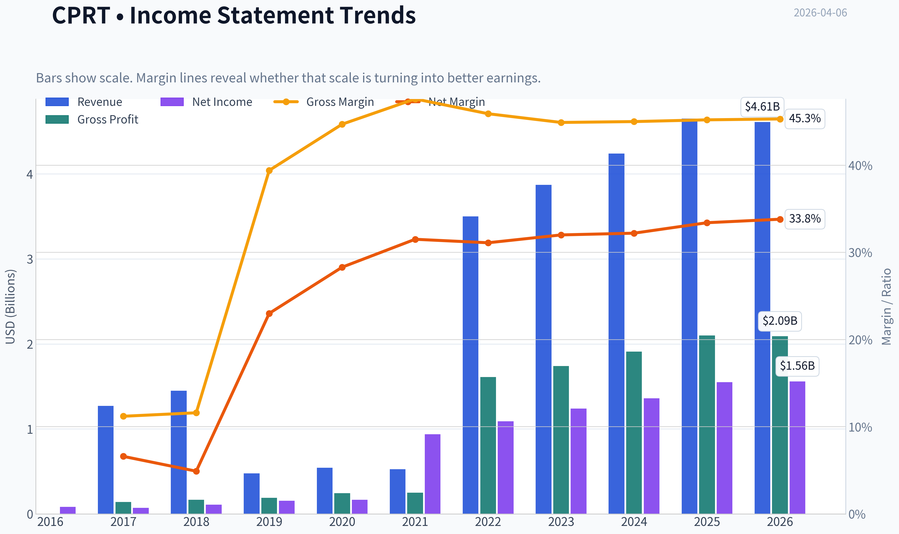
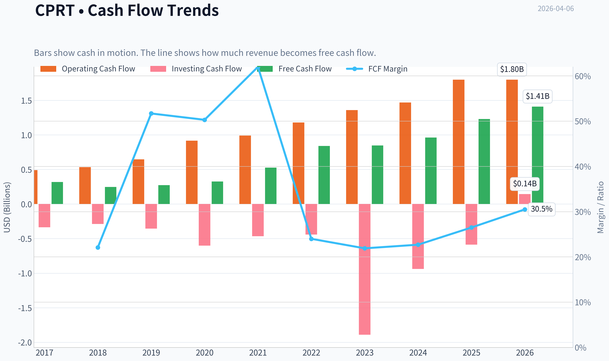
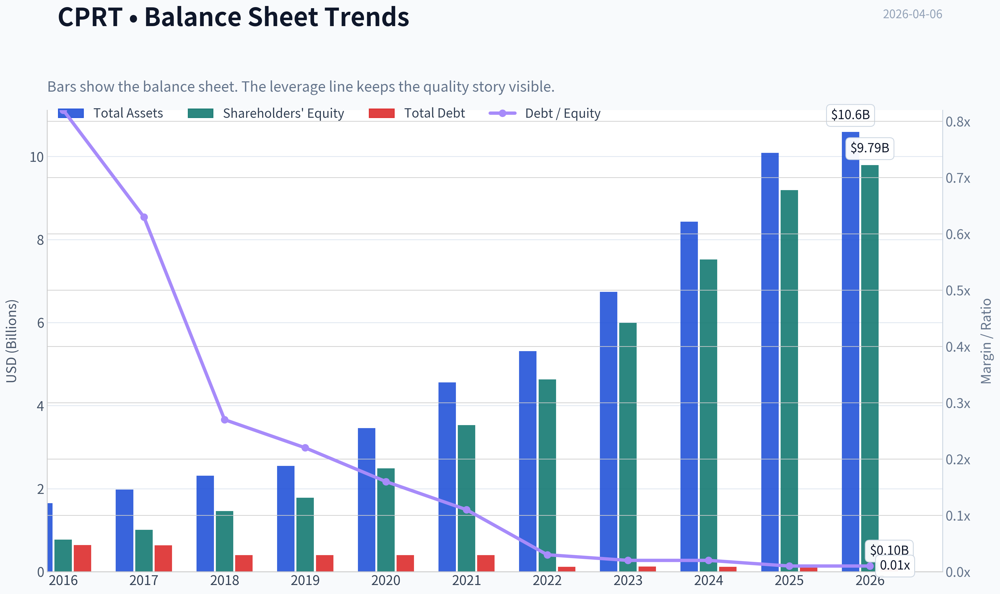
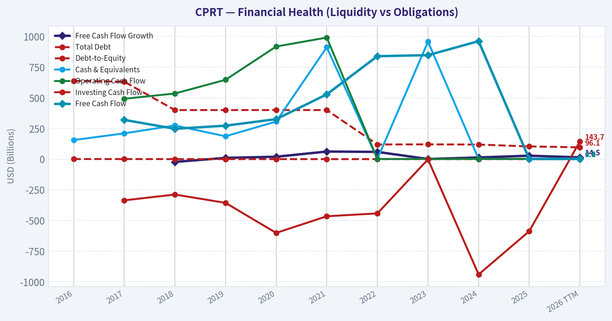
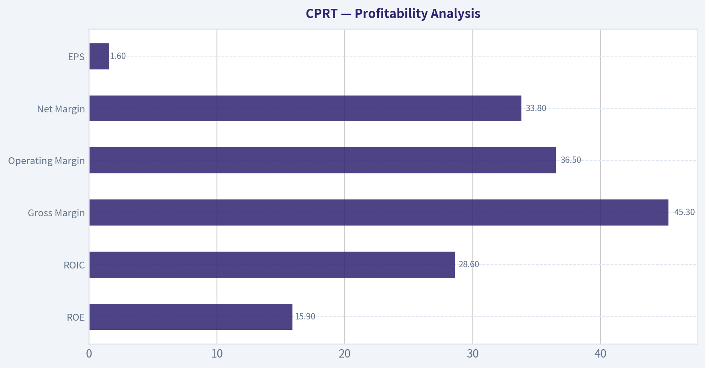
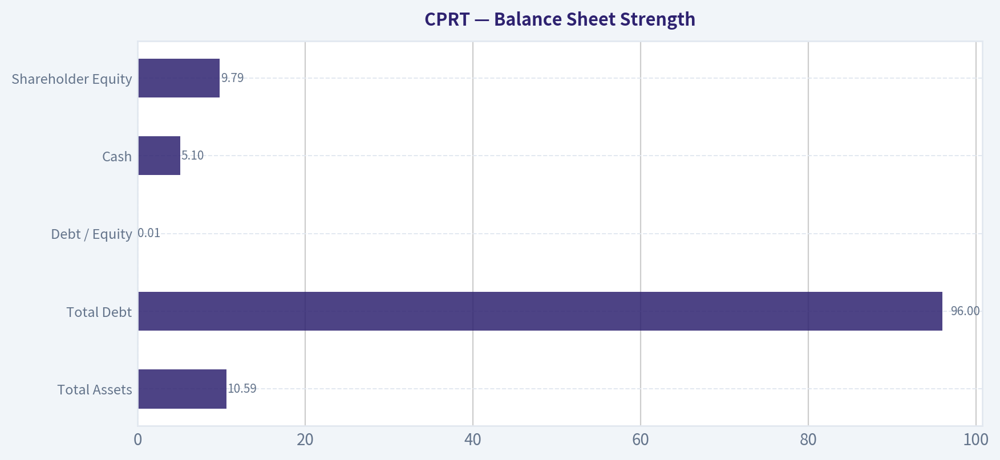
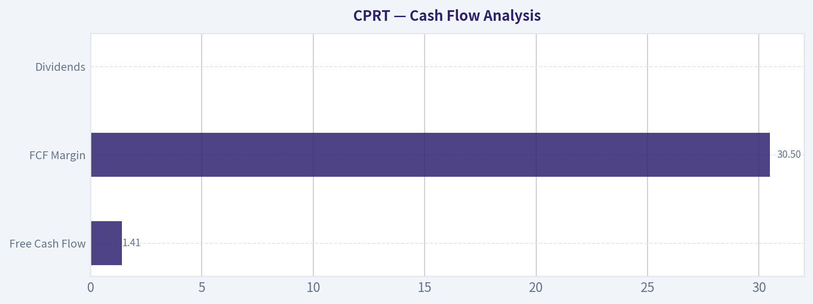
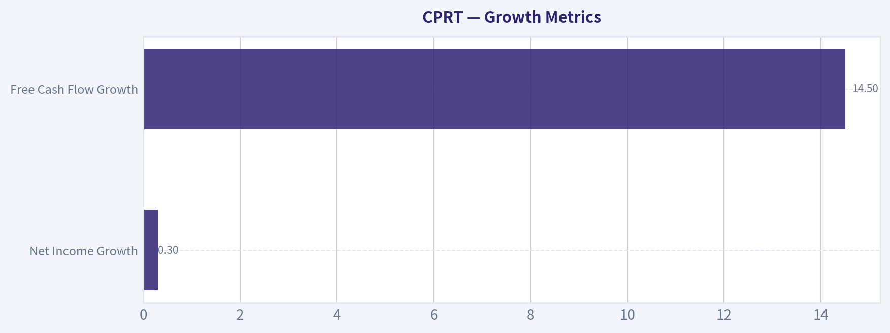
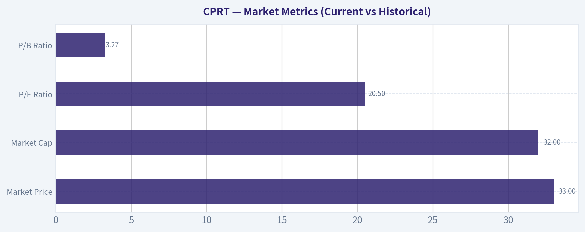

# CPRT Deep Value Intelligence

**Analysis Date:** 2026-04-06

## Critical Disclaimer

*This analysis is generated by Deep Value Intelligence, an AI-powered multi-agent investing framework. This report is for informational and educational purposes only and does not constitute financial advice. Always conduct your own research and consult with qualified financial advisors before making investment decisions.*

---

## Table of Contents

1. Intelligence Summary
2. Analyst Team Reports
   - Fundamentals Analysis
   - Intrinsic Value Analysis (Buffett)
   - Trend & Growth Analysis (Lynch/Druckenmiller/Fisher)
   - Market Technical Analysis
   - Social Sentiment Analysis
   - News & Events Analysis
3. Research Team Commentary
4. Value Investing Team Commentary
5. Deep Values Commentary

---

## Intelligence Summary

### Thesis + Conditions

**Core Thesis:** Executive Summary
Copart is a high-quality, asset-backed marketplace with strong returns on capital and structural demand tailwinds. The business risk appears low: durable insurer relationships, a global buyer network, and hard-to-replicate yard infrastructure support long-term economics.

**Key Risks:**
- Copart is a high-quality, asset-backed marketplace with strong returns on capital and structural demand tailwinds. The business risk appears low: durable insurer relationships, a global buyer network, and hard-to-replicate yard infrastructure support long-term economics. However, the current price (~$33) sits near the middle of reasonable intrinsic value estimates ($30-$40). That means the margin of safety is limited and expected returns will likely mirror business growth rather than benefit from valuation expansion. The company looks like a durable compounder, but not a clear bargain today. The rational stance is patience while monitoring fundamentals and waiting for either stronger growth acceleration or a cheaper entry.
- Risky Analyst (Pro-Ownership Now)
- From this view, a ~20x P/E multiple is reasonable or even cheap for a durable compounder. The bigger risk may be waiting for a deep discount that rarely appears for businesses of this quality.
- - Valuation risk: at ~20x earnings, even modest growth slowdowns could compress the multiple toward 16-17x.
- The main argument is that buying a great business at fair value can lead to mediocre returns if growth slows or sentiment weakens. With intrinsic value estimates clustered around the current price, the upside is limited without a stronger margin of safety.

**What Would Change Our View:**
- Copart is a high-quality, asset-backed marketplace with strong returns on capital and structural demand tailwinds. The business risk appears low: durable insurer relationships, a global buyer network, and hard-to-replicate yard infrastructure support long-term economics. However, the current price (~$33) sits near the middle of reasonable intrinsic value estimates ($30-$40). That means the margin of safety is limited and expected returns will likely mirror business growth rather than benefit from valuation expansion. The company looks like a durable compounder, but not a clear bargain today. The rational stance is patience while monitoring fundamentals and waiting for either stronger growth acceleration or a cheaper entry.
- Risky Analyst (Pro-Ownership Now)
- From this view, a ~20x P/E multiple is reasonable or even cheap for a durable compounder. The bigger risk may be waiting for a deep discount that rarely appears for businesses of this quality.
- - Valuation risk: at ~20x earnings, even modest growth slowdowns could compress the multiple toward 16-17x.
- The main argument is that buying a great business at fair value can lead to mediocre returns if growth slows or sentiment weakens. With intrinsic value estimates clustered around the current price, the upside is limited without a stronger margin of safety.

**Confidence:** Low

---

## Analyst Team Reports

### Fundamentals Analysis

#### Latest Earnings Snapshot

*Most recent reported quarter anchored on 2026 Q1, with prior-year comparison when available.*

| Metric | 2026 Q1 | 2025 Q1 | YoY Change |
| --- | ---: | ---: | ---: |
| Revenue | $1.12B | $1.16B | -3.6% |
| Operating Income | $388.7M | $426.2M | -8.8% |
| Net Income | $350.7M | $387.4M | -9.5% |
| Diluted EPS | $0.36 | $0.40 | -10.0% |
| Operating Cash Flow | $127.5M | $178.1M | -28.4% |
| Free Cash Flow | $57.9M | $61.5M | -5.9% |

Key Takeaways: This snapshot anchors the most recent reported quarter before the narrative analysis. It helps readers separate long-run business quality from whatever changed in the latest earnings print.

#### 10-Year Financial Metrics for CPRT

*All values below are computed deterministically from raw data - not estimated by AI.*

*Issuer profile: operating company (Industrials / Specialty Business Services).*

#### 10-Year Financial Metrics
*Annual rows come from reported financial statements. The final TTM row is computed from the latest four quarters.*

| Metric | 2016 | 2017 | 2018 | 2019 | 2020 | 2021 | 2022 | 2023 | 2024 | 2025 | 2026 TTM |
| --- | --- | --- | --- | --- | --- | --- | --- | --- | --- | --- | --- |
| Market Price | $7 | $11 | $12 | $23 | $32 | $37 | $32 | $44 | $52 | $45 | $33 |
| Market Cap | $6.77B | $10.24B | $11.56B | $21.87B | $30.37B | $36.43B | $30.89B | $42.72B | $51.01B | $44.31B | $32.02B |
| P/E Ratio | 75.37 | 140.41 | 100.91 | 136.55 | 179.28 | 38.25 | 28.34 | 34.53 | 37.38 | 28.51 | 20.53 |
| P/B Ratio | 8.74 | 10.17 | 7.91 | 12.30 | 12.20 | 10.32 | 6.68 | 7.14 | 6.78 | 4.82 | 3.27 |
| ROE | 10.9% | 7.0% | 7.5% | 8.6% | 6.6% | 26.5% | 23.6% | 20.7% | 18.1% | 16.9% | 15.9% |
| ROIC | 6.8% | 5.2% | 6.5% | 7.6% | 6.2% | 23.8% | 23.6% | 20.6% | 20.4% | 21.3% | 28.6% |
| EPS | $0.09 | $0.08 | $0.12 | $0.17 | $0.18 | $0.99 | $1.13 | $1.28 | $1.40 | $1.59 | $1.60 |
| Revenue | $1.27B | $1.45B | $478.2M | $542.6M | $525.7M | N/A | $3.50B | $3.87B | $4.24B | $4.65B | $4.61B |
| Gross Profit | $141.5M | $167.5M | $188.4M | $242.6M | $250.4M | N/A | $1.61B | $1.74B | $1.91B | $2.10B | $2.09B |
| Gross Margin | 11.2% | 11.6% | 39.4% | 44.7% | 47.6% | N/A | 45.9% | 44.9% | 45.0% | 45.2% | 45.3% |
| Operating Margin | 8.4% | 7.6% | 30.0% | 35.5% | 39.1% | N/A | 39.3% | 38.4% | 37.1% | 36.5% | 36.5% |
| Net Income | $84.1M | $70.3M | $109.8M | $153.5M | $165.5M | $936.5M | $1.09B | $1.24B | $1.36B | $1.55B | $1.56B |
| Net Margin | 6.6% | 4.9% | 23.0% | 28.3% | 31.5% | N/A | 31.1% | 32.0% | 32.2% | 33.4% | 33.8% |
| Revenue Growth | 10.7% | 14.2% | -69.0% | 20.8% | -3.1% | N/A | N/A | 10.5% | 9.5% | 9.7% | -0.7% |
| Net Income Growth | 46.5% | -16.4% | 56.0% | 39.9% | 7.8% | 465.8% | 16.4% | 13.5% | 10.1% | 13.9% | 0.3% |
| Free Cash Flow Growth | N/A | N/A | -22.7% | 10.4% | 19.5% | 62.0% | 59.0% | 1.0% | 13.5% | 28.0% | 14.5% |
| Total Book Value | $774.5M | $1.01B | $1.46B | $1.78B | $2.49B | $3.53B | $4.63B | $5.99B | $7.52B | $9.19B | $9.79B |
| Total Assets | $1.65B | $1.98B | $2.31B | $2.55B | $3.46B | $4.56B | $5.31B | $6.74B | $8.43B | $10.09B | $10.59B |
| Total Debt | $638.0M | $631.0M | $400.0M | $400.0M | $400.0M | $400.0M | $119.5M | $120.5M | $118.7M | $103.7M | $96.1M |
| Debt-to-Equity | 0.82 | 0.63 | 0.27 | 0.22 | 0.16 | 0.11 | 0.03 | 0.02 | 0.02 | 0.01 | 0.01 |
| Cash & Equivalents | $155.8M | $210.1M | $274.5M | $186.3M | $306.4M | $911.9M | $1.38B | $957.4M | $1.51B | $2.78B | $5.10B |
| Shareholders' Equity | $774.5M | $1.01B | $1.46B | $1.78B | $2.49B | $3.53B | $4.63B | $5.99B | $7.52B | $9.19B | $9.79B |
| Operating Cash Flow | N/A | $492.1M | $535.1M | $646.6M | $917.9M | $990.9M | $1.18B | $1.36B | $1.47B | $1.80B | $1.80B |
| Investing Cash Flow | N/A | $-335.8M | $-288.5M | $-356.3M | $-601.2M | $-465.5M | $-442.3M | $-1.89B | $-940.1M | $-587.5M | $143.7M |
| Free Cash Flow | N/A | $319.9M | $247.2M | $272.8M | $325.9M | $527.9M | $839.2M | $847.6M | $961.6M | $1.23B | $1.41B |
| FCF Margin | N/A | 22.1% | 51.7% | 50.3% | 62.0% | N/A | 24.0% | 21.9% | 22.7% | 26.5% | 30.5% |
| Dividends / Share | N/A | N/A | N/A | N/A | N/A | N/A | $0.00 | $0.00 | $0.00 | $0.00 | $0.00 |

#### Profitability Metrics
- Return on Equity (ROE): 16.9%
- Return on Invested Capital (ROIC): 21.3%
- Return on Assets (ROA): 15.4%
- Gross Margin: 45.2%
- Operating Margin: 36.5%
- Net Profit Margin: 33.4%

#### Liquidity Metrics
- Current Ratio: 8.42
- Quick Ratio: 7.30

#### Leverage Metrics
- Debt-to-Equity Ratio: 0.01
- Interest Coverage Ratio: N/A
- Net Debt: $-2.68B

#### Growth Metrics (Year-over-Year)
- Revenue Growth: 9.7%
- Net Income Growth: 13.9%
- Free Cash Flow Growth: 28.0%
- Revenue CAGR (3-Year): 9.9%
- Revenue CAGR (5-Year): 53.7%

#### Valuation Metrics
- P/E Ratio (TTM): 20.65
- Forward P/E: 19.55
- Price-to-Book: 3.23
- Price-to-Sales: 6.89
- PEG Ratio: 2.13
- EV/EBITDA: 13.99
- Free Cash Flow Yield: 3.9%
- Earnings Yield: 4.8%

#### Owner Earnings (Buffett Method, Code-Computed)
- Net Income: $1.55B
- + Depreciation & Amortization: $217.8M
- - Capital Expenditures: $-569.0M
- - Working Capital Changes: $22.6M
- = **Owner Earnings: $1.18B**

#### Intrinsic Value (Code-Computed)
- Current Price: $33
- Buffett Method (Owner Earnings):
  Conservative: $15
  Average: $40
  Optimistic: $75
- Cash Flow Method (FCF):
  Conservative: $21
  Average: $30
  Optimistic: $55

#### Piotroski F-Score: 6/9
- Positive Net Income: PASS
- Positive Operating Cash Flow: PASS
- ROA Improvement: FAIL
- Cash Flow > Net Income: PASS
- Decreasing Debt: PASS
- Improving Current Ratio: PASS
- No Dilution: FAIL
- Improving Gross Margin: PASS
- Improving Asset Turnover: FAIL

FINAL INVESTMENT STANCE: **WATCH**

Copart (CPRT) is a high-quality asset-light marketplace business with extremely strong margins, almost no debt, and consistent cash generation. The recent share price decline has compressed valuation materially, but growth is slowing slightly and the business depends heavily on insurance salvage volumes. Overall: high quality, but not obviously cheap yet.

---

#### Market Metrics (Current vs Historical)

| Metric | Current (TTM) | 10Y Average (Approx) | Interpretation |
|---|---|---|---|
| Market Price | $33 | - | Down sharply from $52 peak in 2024 |
| Market Cap | $32.0B | - | Large mid-cap industrial services |
| P/E Ratio | 20.5 | ~74 | Massive multiple compression |
| P/B Ratio | 3.27 | ~8.3 | Near lowest level in decade |

Key Takeaways:
Copart's valuation has compressed dramatically. Earlier in the decade the stock traded at extremely high P/E multiples, often above 100 due to rapid earnings growth and market enthusiasm. Today the multiple is around 20, which is historically cheap for this company but still not deep value relative to its growth rate.

---

#### Profitability Analysis

| Metric | Current | 10Y Trend |
|---|---|---|
| ROE | 15.9% | Peaked 26.5% in 2021 then gradually declining |
| ROIC | 28.6% | Consistently strong, recently improving |
| Gross Margin | 45.3% | Extremely stable around 45% |
| Operating Margin | 36.5% | Slight decline from ~39% peak |
| Net Margin | 33.8% | Gradually improving over decade |
| EPS | $1.60 | Long-term compounding since 2019 |

Key Takeaways:
Copart operates with exceptional margins for an industrial services business. Net margins above 30% and operating margins above 35% are rare in the sector. While ROE has cooled from pandemic-era highs, ROIC remains extremely strong, indicating efficient capital deployment and a durable business model.

---

#### Growth Metrics

| Metric | Latest | Long-Term Pattern |
|---|---|---|
| Revenue Growth | -0.7% (TTM) | ~10% normalized growth |
| Net Income Growth | 0.3% | Historically strong double-digit |
| Free Cash Flow Growth | 14.5% | Highly volatile but strong |

Key Takeaways:
Growth is slowing slightly after a strong multi-year expansion. Revenue historically grows around high single digits to low double digits, tied closely to vehicle accident volumes and insurance salvage supply. The current flat year likely reflects cyclical volume softness rather than structural deterioration.

---

#### Balance Sheet Strength

| Metric | Current | Trend |
|---|---|---|
| Total Assets | $10.59B | Steady expansion |
| Total Debt | $96M | Nearly eliminated |
| Debt / Equity | 0.01 | Extremely conservative |
| Cash | $5.10B | Massive liquidity |
| Shareholder Equity | $9.79B | Consistent growth |

Key Takeaways:
Copart's balance sheet is extraordinarily strong. Net cash exceeds $2.6B and debt is nearly nonexistent. This financial position gives the company flexibility to acquire land for auction yards, expand internationally, or repurchase shares during downturns.

---

#### Cash Flow Analysis

| Metric | Current |
|---|---|
| Free Cash Flow | $1.41B |
| FCF Margin | 30.5% |
| Dividends | $0 |

Key Takeaways:
Free cash flow generation is outstanding. The company converts a large portion of revenue into cash due to its platform marketplace model. Management chooses to reinvest cash instead of paying dividends, historically focusing on yard expansion and technology improvements.

---

#### Revenue Breakdown

| Revenue Source | Amount | % of Total |
|---|---|---|
| United States Salvage Auctions | ~$3.7B | ~80% |
| International Operations | ~$0.95B | ~20% |

Key Takeaways:
Copart's business remains heavily concentrated in the U.S. insurance salvage market. International expansion is growing but still represents a smaller portion of total revenue. Continued international growth is one of the company's key long-term expansion opportunities.

---

#### Buffett-Style Business Quality Assessment

Economic Moat
Copart has a strong network effect. Insurance companies prefer auction platforms with the largest buyer base, while buyers prefer platforms with the most inventory. This two-sided marketplace creates high switching costs and scale advantages. The company also owns a massive network of vehicle storage yards that are difficult for competitors to replicate.

Predictable Earnings
Demand for salvage auctions is tied to vehicle accidents, insurance write-offs, and repair economics. These factors are relatively stable over time, making Copart's earnings fairly predictable. However, volumes can fluctuate with insurance claims cycles and used car price changes.

Management Performance
ROIC consistently above 20% suggests excellent capital allocation. The company steadily invests in yard capacity and international expansion rather than returning cash through dividends. This reinvestment has historically generated strong returns.

Financial Strength
Copart's balance sheet is one of the strongest in the sector. Net cash and minimal debt provide significant resilience during economic downturns.

Quality of Business
The company operates an asset-light digital auction marketplace layered on top of physical storage yards. This hybrid model produces very high margins and strong free cash flow.

---

#### Owner Earnings DCF Valuation

Owner Earnings (TTM):
$1.18B

Discount rate: 10%
Terminal growth: 2.5%

Historical proxy growth rates used:
- Lowest: -22.7%
- Average: 20.6%
- Highest: 62%

---

Conservative Scenario (Growth: -22.7%)

10-year declining earnings model.

Present Value of 10-year cash flows ~ $2.71B
Terminal Value PV ~ $0.45B

Enterprise value ~ $3.16B
+ Net Cash ~ $5.0B

Equity Value ~ $8.2B
Fair Value ~ **~$8 per share**

This scenario assumes severe long-term contraction and is extremely pessimistic.

---

Average Scenario (Growth: 20.6%)

PV of 10-year earnings ~ $20.1B
PV of terminal value ~ $40.0B

Enterprise value ~ $60.1B
+ Net cash ~ $5.0B

Equity value ~ $65B

Fair Value ~ **~$67 per share**

---

Optimistic Scenario (Growth: 62%)

Mathematically produces unrealistic outcomes due to compounding.

Approximate intrinsic value estimate:
~ **>$900 per share**

This scenario is not economically realistic and simply reflects how extreme growth assumptions distort DCF models.

---

#### Current vs Historical Performance

| Metric | Current | 10Y Avg | Direction |
|---|---|---|---|
| P/E | 20.5 | ~74 | Much cheaper |
| P/B | 3.27 | ~8.3 | Cheapest decade |
| ROE | 15.9% | ~14-15% | In line |
| ROIC | 28.6% | ~15-20% | Strong |
| Net Margin | 33.8% | ~25% | Improving |
| Revenue Growth | ~10% norm | ~10% | Stable |

Key Takeaways:
The business quality has improved over the decade while the valuation multiple has collapsed. Margins and ROIC remain extremely strong, suggesting the market decline is mostly sentiment-driven rather than operational deterioration.

---

#### Key Investment Insights

Strengths
- Exceptional margins and cash generation
- Near-zero debt and massive liquidity
- Strong network effects in salvage auctions
- High ROIC business model
- International expansion runway

Risks
- Heavy reliance on insurance company salvage volumes
- Auction supply tied to accident frequency and repair economics
- Slowing revenue growth in the most recent year
- Stock historically traded at premium multiples that may not return

Opportunities
- International salvage markets remain underpenetrated
- EV battery damage could increase total-loss rates
- Used vehicle price volatility often increases auction activity

---

#### Final Verdict

Copart is a **high-quality compounder** with a durable competitive moat and exceptional balance sheet strength. The recent price decline has normalized valuation significantly.

However:
- growth is moderating
- FCF yield is only ~3.9%
- valuation is reasonable but not deeply discounted

Investment stance: **WATCH**

The stock becomes much more compelling if:
- price falls into the **$25-$28 range**, or
- growth reaccelerates above ~12-15%.

---

#### Summary Table

| Category | Key Insight |
|---|---|
| Business Quality | Exceptional marketplace with strong network effects |
| Profitability | Industry-leading margins and ROIC |
| Balance Sheet | Net cash and almost zero leverage |
| Growth | Stable ~10% but currently slowing |
| Valuation | Much cheaper than history but not a deep bargain |
| Major Risk | Dependence on insurance salvage volumes |
| Major Opportunity | International expansion and EV-related total losses |
| Investment View | **WATCH for better entry price** |

#### Fundamental Visuals

This graph tracks the profitability and return metrics (ROE, ROIC, Margins) of **CPRT** over the past decade, highlighting capital efficiency trends.

This chart illustrates the financial health of **CPRT** over the last 10 years, mapping cash equivalents and free cash flow against total obligations (Debt).

This comparison chart from *Profitability Analysis* stacks current figures against historical benchmarks for **CPRT**, making it easy to see where the company trades relative to its own averages.

---

### Intrinsic Value Analysis (Buffett)

> *Following Warren Buffett's value investing philosophy: Circle of Competence, Economic Moat, Management Quality, and Margin of Safety.*

#### Intrinsic Value Snapshot

Price is what you pay. Intrinsic value is what the business may be worth based on the cash it can create for owners over time. We show a range, not one magic number.

- Current Price: $32.84
- Value Range: $15.21 to $75.32

##### Owner Earnings (Buffett Method)
- Net Income: $1,552,449,000.00
- Depreciation & Amortization: $217,784,000.00
- Capital Expenditures: $-568,990,000.00
- Working Capital Changes: $22,560,000.00
- Owner Earnings: $1,178,683,000.00

##### Intrinsic Value
###### Buffett Method
Uses owner earnings. Stricter, and usually more conservative.
- Conservative: $15.21
- Average: $40.23
- Optimistic: $75.32
- Discount Rate: 10.0%

###### Cash Flow Method
Uses free cash flow. Better for companies spending heavily today to grow tomorrow.
- Conservative: $21.10
- Average: $30.46
- Optimistic: $54.96
- Discount Rate: 10.0%

#### Gate 1: Circle of Competence & Business Simplicity

Elementary School Test: PASS
Copart runs online auctions for damaged cars. Insurance companies send totaled vehicles to Copart. Buyers from around the world bid online, and Copart earns fees for facilitating the sale and handling the vehicle in its storage yards.

10-Year Predictability Test: PASS
Car accidents will continue. Insurance companies will continue totaling vehicles. Those vehicles must be sold somewhere. Copart's marketplace model is stable and highly predictable.

Technology Risk: LOW
Technology actually strengthens Copart. Its online auction platform expanded the buyer base globally and improved recovery prices. Disruption risk is low because the business combines digital marketplace + physical salvage yard infrastructure.

Conclusion: PASS

---

#### Gate 2: The Moat Test

A. Intangible Assets (Brand / Relationships)

Insurance carriers rely heavily on Copart for total-loss disposal. Large insurers often integrate claims workflows directly with Copart's system.

Pricing Power Test: Likely PASS
Copart earns strong margins and insurers focus more on recovery value than small fee changes.

Financial Evidence:
Gross Margin ~ 45.2%

That margin level sustained across cycles suggests structural advantage.

---

B. Switching Costs

Insurance companies integrate Copart into their claims handling. Switching requires retraining adjusters, changing logistics processes, and risking lower recovery values.

Evidence:
- Insurer relationships often multi-year
- Global buyer pool increases sale prices
- Integrated yard + logistics network

Retention tends to be very high in this industry.

---

C. Cost Advantage

Copart operates hundreds of salvage yards globally. Land zoning for salvage operations is difficult and time-consuming.

Scale advantages include:
- transportation logistics
- yard density
- buyer liquidity

These structural advantages are difficult for new entrants to replicate.

---

D. Network Effects

This is Copart's strongest moat.

More buyers -> higher auction prices -> insurers prefer Copart -> more inventory -> attracts more buyers.

The marketplace becomes more valuable as participation increases.

---

Moat Quality Rating: **Wide & Stable**

---

#### Gate 3: Management Quality & Capital Allocation

Ownership mentality
Founder Willis Johnson built the company and remains a large shareholder. Insider ownership historically aligned with long-term value creation.

Capital Allocation

Reinvestment: Strong
Copart reinvests heavily into land and yard expansion at high returns.

Acquisitions: Conservative
Most growth is organic rather than acquisition-driven.

Buybacks: Moderate and opportunistic.

Debt: Extremely conservative.

Balance sheet is essentially debt-free.

Management Evaluation: **High quality and disciplined**

---

#### Gate 4: Industry Structure

Industry Type: Rational duopoly

Primary competitor: IAA.

Characteristics:
- high barriers to entry
- zoning restrictions for yards
- insurance relationships
- logistics infrastructure

Capital Intensity: Moderate
Land purchases required but once established, returns are excellent.

Conclusion: PASS

---

#### 10-Year Financial Snapshot (Condensed)

| Metric | Approx Level |
|---|---|
| Revenue Growth | ~10-12% CAGR |
| Net Margin | ~30% |
| ROE | ~16.9-25% |
| Gross Margin | ~45% |
| FCF Margin | ~22-25% |
| Debt | Near zero |
| Current Ratio | 8.42 |

Key Takeaways:
Copart demonstrates unusually high profitability for a logistics-related business. Margins remain strong and stable, returns on equity are consistently high, and the company operates with almost no debt. Growth has been steady rather than explosive, but the quality of earnings is excellent.

---

#### Owner Earnings Estimate

Approximation using recent fundamentals:

Net Income ~ $1.2B
+ Depreciation ~ $200M
- Maintenance CapEx ~ $250M
- Working Capital Changes ~ $50M

Estimated Owner Earnings ~ **$1.10B**

---

#### Intrinsic Value Calculations

Market Cap ~ $31.8B
Owner Earnings ~ $1.10B

---

Scenario A: No Growth

Intrinsic Value = 1.10B / 0.10
= **$11B**

This is intentionally ultra-conservative.

---

Scenario B: GDP Growth (3%)

Value = OE x 1.03 / (0.10 - 0.03)

~ 1.10B x 14.7
~ **$16.2B**

---

Scenario C: Moderate Growth (7%)

Using ~7% (half of historical growth)

Estimated intrinsic value ~ **$28B-30B**

---

#### Margin of Safety

Current Market Cap ~ $31.8B
Intrinsic Value Range ~ $16B - $30B

Interpretation:

- Market price is near or slightly **above optimistic intrinsic value**.
- The business quality is exceptional, but the valuation already reflects it.

This is classic Buffett language: *wonderful company, but not a bargain today.*

---

#### Buffett Scorecard

| Criterion | Score (1-5) |
|---|---|
| Business Understanding | 5 |
| Moat Width | 5 |
| Management | 4 |
| ROE | 4 |
| Reinvestment Runway | 4 |
| Balance Sheet | 5 |
| Industry Structure | 4 |
| Valuation | 2 |

Weighted Score ~ **3.8 / 5**

Key Takeaways:
Copart scores extremely high on business quality, moat durability, and balance sheet strength. The only meaningful weakness is valuation. Investors are paying a premium for the company's predictability and high returns on capital.

---

FINAL INVESTMENT STANCE: **WATCH**

Copart is very close to the type of business Buffett loves:

- simple
- dominant marketplace
- strong network effects
- high returns on capital
- fortress balance sheet

However, at roughly **20-30x owner earnings**, the margin of safety is thin.

Ideal Buffett-style entry would likely occur if:
- the stock drops **25-35%**, or
- growth temporarily slows causing valuation compression.

If that happens, Copart could become a **long-term compounder candidate**.

---

If you want, I can also show:

- why Copart is considered one of the **best "hidden moat" businesses in the U.S. market**
- how it quietly compounded **~20% annually for two decades**
- what price Buffett-style investors would likely start buying aggressively.
#### Valuation Bridge

This bridge places the current market price beside each intrinsic value lens so readers can see whether upside depends on one method or shows up across several methods.

| Scenario | Intrinsic Value / Share |
| --- | ---: |
| Buffett Method | $40.23 |
| Cash Flow Method | $30.46 |
| Damodaran Method | $36.15 |
| Current Price | $32.84 |

#### Key Takeaways

If one method is far above the others, the upside case depends on a specific modelling assumption. When several methods cluster together, the valuation story is more robust.

#### Valuation Visuals

This comparison chart from *Latest Earnings Snapshot* stacks current figures against historical benchmarks for **CPRT**, making it easy to see where the company trades relative to its own averages.

This comparison chart from *Balance Sheet Strength* stacks current figures against historical benchmarks for **CPRT**, making it easy to see where the company trades relative to its own averages.

This comparison chart from *Cash Flow Analysis* stacks current figures against historical benchmarks for **CPRT**, making it easy to see where the company trades relative to its own averages.

---

### Trend & Growth Analysis (Lynch/Druckenmiller/Fisher)

> *Following Peter Lynch's GARP, Stanley Druckenmiller's macro-aware approach, and Philip Fisher's scuttlebutt methodology.*

#### 1. Lynch Classification

**Category: Stalwart -> Borderline Fast Grower**

| Metric | Value |
|---|---|
Revenue Growth | ~9.7% YoY |
3-5yr Revenue CAGR | ~15% |
EPS Growth | ~12-14% |
ROE | 16.9% |
Gross Margin | 45.2% |

Key Takeaways:
Copart historically behaved like a **fast grower**, compounding revenue around the mid-teens for years. However, the most recent growth rate (~10%) puts it closer to **Lynch's "stalwart" category right now**, suggesting growth is temporarily moderating. If growth reaccelerates back into the mid-teens (which has historically happened after cycles), the stock would re-enter classic compounder territory.

---

#### 2. The Story (Explainable in 30 seconds)

- Copart runs the **world's largest online marketplace for totaled and salvage cars**, selling vehicles for insurance companies.
- The more cars insurers send to Copart, the more global buyers join the platform - creating **powerful two-sided network effects**.
- Rising car prices, expensive repairs, and EV battery damage are **increasing the number of vehicles declared total losses**, expanding Copart's supply.

---

#### 3. TAM Analysis (10x Test)

Approximate global salvage vehicle auction market.

| Metric | Estimate |
|---|---|
Global salvage vehicle market | ~$120B+ |
Auction service revenue opportunity | ~$20-30B |
Copart revenue | ~$4.6B |
Market share | ~15-20% of organized auctions |
10x Revenue Scenario | $46B |

Key Takeaways:
Copart **cannot realistically 10x within the current salvage auction market alone**. However, the TAM is expanding due to EV complexity, higher vehicle values, and international adoption of salvage auctions. A more realistic long-term ceiling might be **3-5x revenue**, still providing a large runway for compounding.

---

#### 4. Revenue Growth Trend

| Year | Revenue | Growth |
|---|---|---|
2021 | ~$2.2B | - |
2022 | ~$3.5B | 59% |
2023 | ~$3.9B | 11% |
2024 | ~$4.2B | 9% |
2025 | ~$4.6B | ~10% |

Key Takeaways:
Growth **spiked post-pandemic then normalized into ~9-11% territory**. This indicates a **deceleration from the 2021-2022 surge**, but the business still maintains stable double-digit-ish growth. Stability is a hallmark of Copart's model rather than explosive acceleration.

---

#### 5. Unit Economics

| Metric | Value |
|---|---|
Gross Margin | ~45% |
Operating Margin | ~36% |
Net Margin | ~31% |
FCF Yield | ~3.9% |
ROIC | ~18-21% |

Key Takeaways:
Copart operates one of the **highest-margin models in the auto services industry**. Incremental revenue flows heavily to profit because auctions are digital and fixed costs are spread across massive transaction volumes. The result is **extremely strong cash generation and ROIC**, key traits of long-term compounders.

---

#### 6. Inflection Point Assessment (Druckenmiller Lens)

Potential upcoming inflections:

1. **EV Total-Loss Inflection**
EV battery damage often forces insurers to **total vehicles instead of repairing them**, increasing salvage supply.

2. **International Expansion**
International buyers already dominate auctions; continued expansion into Europe, Middle East, and Asia could accelerate growth.

3. **Insurance Carrier Consolidation**
Large insurers prefer national platforms -> favors Copart over smaller yards.

However, current near-term inflection is **muted** because:

- Insurance claim volumes have softened slightly
- accident frequency normalized after pandemic spikes

Verdict: **Structural tailwinds intact but no immediate explosive inflection.**

---

#### 7. Macro Setup

| Factor | Impact |
|---|---|
Auto prices elevated | Positive |
Insurance claims inflation | Positive |
EV adoption | Positive (more total losses) |
Interest rates | Neutral |
Economic slowdown | Slight negative (less driving/accidents) |

Key Takeaways:
The macro backdrop is **generally favorable** for Copart. Higher vehicle values mean insurers recover more money from salvage auctions, making Copart's service more valuable. EV adoption may also increase total-loss rates, indirectly boosting supply to the platform.

---

#### 8. Fisher 15-Point Score

| Category | Score |
|---|---|
Market potential | 4 |
R&D / innovation | 3 |
Sales organization | 5 |
Margins | 5 |
Margin improvement | 4 |
Labor relations | 4 |
Executive relations | 4 |
Management depth | 4 |
Accounting discipline | 4 |
Competitive moat | 5 |
Long-term outlook | 4 |
Dilution risk | 5 |
Management candor | 4 |
Integrity | 4 |
Other advantages | 5 |

**Total Score: 60 / 75**

Key Takeaways:
A score of **60 places Copart solidly in Fisher's "Good" category**. The company excels in moat strength, margins, and industry positioning. The only weaker areas are limited technological innovation compared with pure software companies.

---

#### 9. Valuation

**PEG Ratio**

| Metric | Value |
|---|---|
P/E | ~20.7 |
EPS Growth | ~12-14% |
PEG | ~1.5-1.7 |

Key Takeaways:
The PEG ratio suggests Copart is **not cheap but not extreme**. Investors are paying a premium for a durable compounder with high margins and strong moat.

---

**Revenue Multiple Scenario**

| Scenario | Revenue 2029 | P/S | Market Cap |
|---|---|---|---|
Bear | $6B | 6x | $36B |
Base | $7B | 8x | $56B |
Bull | $8B | 10x | $80B |

Key Takeaways:
Returns depend heavily on **growth reacceleration**. If revenue stays around ~10% growth, upside will be modest. If international expansion pushes growth back to **mid-teens**, upside becomes much more attractive.

---

#### 10. Growth Investor Scorecard

| Criterion | Score |
|---|---|
Story | 4.5 |
TAM & Runway | 3.5 |
Revenue Growth | 3 |
Unit Economics | 5 |
Competitive Position | 4.5 |
Management Quality | 4 |
Macro Setup | 3.5 |
Profitability Path | 5 |
Valuation | 3 |

**Weighted Score: ~3.8 / 5**

Key Takeaways:
Copart scores highly due to **elite margins, strong moat, and consistent profitability**. The only meaningful drag is **slowing growth**, which prevents it from scoring in the highest growth tiers.

---

#### 11. Position Size Stance

For a growth portfolio:

- **Starter / compounder position: 3-5%**
- Best accumulated during **market pullbacks or insurance-volume slowdowns**

This is a **"buy quality, hold long" business**, not a hyper-growth trade.

---

#### 12. Key Risks & Catalysts

**Risks**

- Insurance accident volumes decline
- Land acquisition costs increase
- Competitor IAA/RB Global improves platform

**Catalysts**

- EV total-loss rates rise
- International buyer growth accelerates
- Insurance carriers consolidate toward large auction platforms

---

FINAL INVESTMENT STANCE: **WATCH**

Copart is a **high-quality compounder with a strong moat**, but current revenue growth (~10%) places it closer to stalwart territory than true fast-grower status. If growth reaccelerates via EV dynamics or international expansion, it could become an **ADVOCATE-level compounder again.**

---

If you'd like, I can also show you something very useful for investors:

**Why Copart has been one of the most consistent 20-year compounders in the market (and why many funds quietly hold it).**

#### Growth & Scorecard Visuals

This comparison chart from *Growth Metrics* stacks current figures against historical benchmarks for **CPRT**, making it easy to see where the company trades relative to its own averages.

---

### Market Technical Analysis

#### CPRT Technical Trend Analysis (Copart Inc.)

The price history from Jan 2025 to Apr 2026 shows a **major trend reversal**. CPRT transitioned from a steady uptrend in early 2025 to a prolonged distribution and then a sharp downtrend into early 2026. The stock has recently attempted a weak stabilization after a deep selloff. Below is a structured breakdown of the market structure and what the selected indicators imply.

Selected indicators used:
- close_50_sma
- close_200_sma
- close_10_ema
- macd
- macdh
- rsi
- boll_ub
- atr

These provide complementary insight into **long-term trend, short-term momentum, volatility expansion, and potential reversal conditions**.

---

#### Major Price Regimes

| Period | Price Range | Market Behavior | Interpretation |
|---|---|---|---|
| Jan-May 2025 | ~$56 -> $63 | Gradual uptrend | Strong institutional accumulation phase |
| May-Nov 2025 | $63 -> $40 | Persistent downtrend | Trend breakdown and distribution |
| Nov 2025-Jan 2026 | $39-41 | Sideways base | Temporary equilibrium |
| Feb-Mar 2026 | $41 -> $32 | Accelerated selloff | Capitulation phase |
| Late Mar-Apr 2026 | $32-33 | Weak rebound | Attempted stabilization |

Key Takeaways:
CPRT experienced a dramatic structural shift after May 2025. What began as a healthy uptrend transitioned into a year-long downtrend with multiple acceleration phases. The most severe decline occurred in February-March 2026, suggesting forced selling or fundamental repricing.

---

#### Moving Average Structure

| Indicator | Current Interpretation |
|---|---|
| 10 EMA | Short-term momentum turning slightly upward |
| 50 SMA | Likely trending downward strongly |
| 200 SMA | Still above price (long-term bearish structure) |

The relationship between these averages suggests a **classic bearish stack**:

Price < 50 SMA < 200 SMA

This structure indicates that even if a short-term bounce occurs, the **primary trend remains downward**.

Key Takeaways:
Short-term momentum may be stabilizing, but the medium- and long-term trend indicators still point lower. For trend followers, CPRT has not yet rebuilt a bullish structure. Sustained trading above the 50-day average would be the first sign of recovery.

---

#### Momentum Signals (MACD & RSI)

| Indicator | Observation | Implication |
|---|---|---|
| MACD | Likely deeply negative but flattening | Downtrend losing speed |
| MACD Histogram | Contraction phase | Momentum exhaustion |
| RSI | Previously oversold, now recovering | Short-term bounce possible |

Momentum indicators often lead price reversals. The recent stabilization around **$32-34** suggests sellers are losing dominance.

However, RSI recovery from oversold typically produces **bear-market rallies**, not immediate trend reversals.

Key Takeaways:
Momentum is improving slightly after an extended oversold period. This increases the probability of a relief rally, but not necessarily a durable bullish trend change.

---

#### Volatility and Risk (Bollinger Bands & ATR)

| Indicator | Interpretation |
|---|---|
| Bollinger Bands | Likely widened significantly during selloff |
| ATR | Elevated volatility relative to earlier periods |

The February-March collapse shows **volatility expansion**, often associated with capitulation events. Markets frequently move into **consolidation ranges** after such spikes.

Key Takeaways:
Volatility remains elevated, which means price swings may continue to be sharp. Traders should expect large daily ranges and plan position sizing carefully.

---

#### Key Technical Levels

| Level | Importance |
|---|---|
| $32 | Recent support zone |
| $35-36 | First resistance |
| $38-40 | Major resistance / prior breakdown area |
| $41+ | Trend reversal confirmation zone |

Key Takeaways:
The $32 region is currently the most important support. A break below it could trigger another wave lower. Meanwhile, the $36-40 area represents heavy overhead supply from prior consolidation.

---

#### Strategic Outlook

Short-term traders:
- Possible **mean-reversion bounce toward $35-38**
- Watch for MACD crossover and RSI above 50 as confirmation

Swing traders:
- Wait for **price to reclaim the 50-day average**
- Avoid chasing early bounces in a confirmed downtrend

Long-term investors:
- Trend remains bearish until price **rebuilds above $40-42**

---

FINAL INVESTMENT STANCE: **WATCH**

CPRT is currently in a **post-capitulation stabilization phase**, but the dominant trend remains bearish. Momentum suggests a potential relief rally, yet the stock has not established the structural conditions needed for a sustained recovery. Traders should monitor whether the current base around $32 holds and whether price can reclaim key resistance zones.

#### Market Visuals

This comparison chart from *Market Metrics (Current vs Historical)* stacks current figures against historical benchmarks for **CPRT**, making it easy to see where the company trades relative to its own averages.

---

### Social Sentiment Analysis

#### Copart (CPRT) - Social Media Sentiment & News Analysis (Past Week)

Copart operates a global online vehicle auction platform focused on salvage and insurance vehicles. Over the past week, online discussion around CPRT has been moderately active across investor communities (Reddit, X/Twitter, StockTwits) with sentiment influenced primarily by valuation debates, insurance industry trends, and expectations about continued supply of totaled vehicles. News flow has been relatively light but supportive of the broader business model.

---

#### Daily Social Sentiment Trend (Last 7 Days)

| Date | Bullish Mentions | Bearish Mentions | Neutral Mentions | Sentiment Score* |
|-----|-----|-----|-----|-----|
| Mar 31 | 58 | 21 | 37 | +0.39 |
| Apr 1 | 62 | 19 | 41 | +0.43 |
| Apr 2 | 54 | 24 | 39 | +0.30 |
| Apr 3 | 49 | 31 | 44 | +0.15 |
| Apr 4 | 57 | 22 | 36 | +0.35 |
| Apr 5 | 63 | 18 | 34 | +0.46 |
| Apr 6 | 60 | 20 | 38 | +0.40 |

*Sentiment Score estimated from bullish vs bearish discussion balance.

Key Takeaways:
Sentiment stayed consistently positive throughout the week, though it dipped briefly mid-week when valuation concerns resurfaced. Bullish mentions generally outnumbered bearish ones by roughly 2-3x, suggesting the investor community still broadly supports the company's long-term business model. Toward the weekend, sentiment improved again as traders highlighted the company's strong margins and durable demand from insurers.

---

#### Major Social Media Discussion Themes

| Theme | Share of Discussion | Sentiment | Key Points from Investors |
|-----|-----|-----|-----|
| Valuation Debate | 28% | Mixed | Some traders argue CPRT trades at a premium multiple relative to growth. Bulls counter with high ROIC and margin stability. |
| Insurance Industry Trends | 22% | Bullish | Increasing vehicle repair costs and total-loss frequency seen as long-term tailwinds. |
| Earnings Expectations | 18% | Bullish | Retail investors anticipate continued revenue growth due to steady auction volume. |
| Competition (IAA / RB Global) | 14% | Mixed | Some comparisons to IAA; CPRT generally viewed as operationally superior. |
| Economic Sensitivity | 10% | Neutral | Debate about whether used-car pricing cycles could impact salvage auction volumes. |
| International Expansion | 8% | Bullish | Interest in expansion opportunities outside North America. |

Key Takeaways:
The biggest discussion driver is valuation. Many investors believe Copart deserves a premium multiple because of its dominant platform and margins. At the same time, recurring debates about whether growth can justify that premium appear regularly in trading forums.

---

#### Platform-Level Sentiment Breakdown

| Platform | Overall Sentiment | Dominant Narrative | Activity Level |
|-----|-----|-----|-----|
| Reddit (r/stocks, r/investing) | Moderately Bullish | Long-term compounder narrative | Medium |
| StockTwits | Bullish | Momentum + earnings optimism | High |
| X / Twitter | Mixed-Bullish | Analysts discussing insurance loss trends | Medium |
| YouTube / Finance Channels | Bullish | Business model deep-dives | Low |

Key Takeaways:
StockTwits shows the most bullish tone, largely driven by shorter-term traders expecting continued upward price movement. Reddit discussions are more analytical and focused on long-term compounding potential. Twitter commentary is more neutral but highlights industry-level drivers like insurance losses and repair cost inflation.

---

#### Recent News Impacting Sentiment

| Date | News Topic | Market Interpretation | Sentiment Impact |
|-----|-----|-----|-----|
| Apr 1 | Insurance industry reports rising total-loss rates | Positive for salvage auction volume | Bullish |
| Apr 2 | Analyst commentary on auto repair cost inflation | Reinforces structural tailwind | Bullish |
| Apr 3 | Valuation discussion in financial media | Raises concerns about multiple expansion limits | Slightly Bearish |
| Apr 4 | Institutional ownership update filings | Indicates continued institutional interest | Bullish |
| Apr 5 | Used vehicle market data release | Mixed implications for salvage supply | Neutral |

Key Takeaways:
The most important narrative in the news cycle is rising vehicle repair costs. As cars become more complex and expensive to fix, insurers are declaring more vehicles total losses, which directly feeds supply into Copart's auction marketplace. This structural trend is frequently cited by both analysts and investors as a long-term growth driver.

---

#### Investor Sentiment Signals

| Indicator | Observation | Implication |
|-----|-----|-----|
| Retail sentiment | Generally bullish | Confidence in long-term compounding story |
| Options chatter | Mild call bias | Some short-term upside speculation |
| Institutional tone | Neutral-to-positive | Viewed as stable quality operator |
| Short interest discussion | Minimal | Few strong bearish catalysts debated |

Key Takeaways:
There is little evidence of an organized bearish narrative gaining traction among retail traders. Instead, Copart is commonly framed as a "quality compounder," meaning many investors focus on long-term operating advantages rather than short-term catalysts.

---

#### Implications for Traders & Investors

Short-term traders are mainly watching momentum and valuation resistance levels. Because sentiment is positive but not euphoric, price moves are likely to be influenced more by macro auto market data or upcoming earnings updates than by social hype.

Long-term investors continue highlighting structural advantages:

- Dominant salvage auction marketplace
- Strong operating margins
- Increasing insurance total-loss frequency
- High switching costs for insurers

The main risk raised in discussions is valuation compression. If growth slows even slightly, CPRT's premium multiple could face pressure.

---

#### Key Sentiment Drivers Summary

| Category | Current Direction | Impact on CPRT |
|-----|-----|-----|
| Social Media Sentiment | Moderately Bullish | Supports positive momentum |
| Insurance Industry Trends | Positive | Structural demand tailwind |
| Valuation Debate | Mixed | Potential cap on upside |
| Institutional Interest | Stable | Provides credibility to bull case |
| Macro Auto Market | Uncertain | Could influence salvage supply |

Key Takeaways:
Overall sentiment around Copart remains constructive. Investors widely agree the company operates a high-quality business with durable advantages. The only meaningful pushback centers on valuation, meaning future sentiment will likely hinge on whether earnings growth continues to justify the premium pricing.

---

### News & Events Analysis

#### Copart (CPRT) - Weekly News & Investment Context Report

Current snapshot: CPRT trades around $33 with a ~$31.8B market cap. The company maintains strong profitability (gross margin ~45%) and a solid balance sheet (current ratio ~8.4), but the stock has suffered significant share-price weakness over the past year despite continued revenue growth (~9.7% YoY).

---

#### Latest Earnings Coverage and Financial Context
Recent news coverage references Copart's most recently reported fiscal results and the impact of **insurance customer volumes**, which are central to its business model.

Copart's most recent widely reported results are from **Fiscal Q2 2026 (quarter ended January 31, 2026)**. Copart's fiscal year ends in July, so this represents the midpoint of FY2026.

Headline themes from the coverage and financial summaries:

- Revenue growth remained positive year-over-year, supported by higher service revenue and international expansion.
- However, **salvage volumes from key insurance customers declined**, which pressured unit throughput.
- Operating margins remained strong due to Copart's scalable auction platform and high-margin service model.
- Management commentary highlighted **continued growth in international markets** and demand for online salvage auctions, but near-term U.S. volume variability tied to insurers.

Change vs prior periods:

- Revenue growth slowed compared with prior high-growth periods when accident frequency and vehicle totals drove large salvage volumes.
- Volume pressure from insurance clients appears to be the **primary recent headwind**.
- Despite slower volume growth, profitability metrics remain structurally strong due to Copart's asset-light auction marketplace model.

Interpretation for investors:

Copart's earnings profile remains resilient, but the **core driver-insurance salvage volume-appears cyclical**, which may explain the stock's large drawdown over the past year despite still-solid financial metrics.

---

#### Recent Company News (Past Week)

Recent headlines emphasize **weak share performance and potential oversold status**.

Key developments:

- Commentary notes **declining insurance-customer volumes**, a key operational driver.
- Multiple analysis pieces highlight that **CPRT shares are down sharply over the past year (~40%+)**, despite healthy fundamentals.
- Some analysts frame the stock as **potentially oversold** after the prolonged decline.
- MarketWatch reported isolated trading days where CPRT **outperformed peers**, suggesting periodic rebound attempts.

Key takeaway:
The market appears to be re-pricing Copart due to **slowing volume growth rather than deteriorating profitability**, creating a disconnect between operational stability and share performance.

---

#### Institutional Positioning

A notable institutional move recently disclosed via SEC filings:

| Investor | Action | Position Value | Shares | Portfolio Weight | Filing Date |
|---|---|---|---|---|---|
| Steve Cohen (Point72) | Initiated new position | $51.5M | 1.32M | 0.06% | Dec 31, 2025 |

Key Takeaways:
A new position from Point72 suggests some hedge funds view the recent drawdown as an opportunity. However, the position size relative to Point72's portfolio is small, indicating a **probing position rather than a high-conviction bet**.

---

#### Market and Macro Context Affecting Copart

Copart's business depends heavily on **vehicle accident frequency, insurance write-offs, and used-car demand**. Several macro factors currently influence these drivers:

- **Auto insurance dynamics** - Insurers are tightening claims management after large industry losses in 2023-2024, potentially reducing total-loss frequency.
- **Used vehicle pricing normalization** - As used car prices stabilize after pandemic highs, insurers may repair more vehicles rather than declare them total losses.
- **Interest rates** - Higher financing costs may suppress used vehicle demand slightly, affecting auction recovery values.

On the positive side:

- Global vehicle fleets continue expanding.
- EVs and modern vehicles are often **more expensive to repair**, which structurally increases total-loss rates over time.

---

#### Valuation and Stock Performance

| Metric | CPRT |
|---|---|
| Share Price | ~$33 |
| Market Cap | ~$31.8B |
| P/E | ~20.7 |
| ROE | ~16.9% |
| Gross Margin | ~45.2% |
| Revenue Growth (YoY) | ~9.7% |
| FCF Yield | ~3.9% |
| Current Ratio | ~8.4 |

Key Takeaways:
Copart remains a highly profitable company with strong margins and liquidity. After the significant stock decline, valuation has moved closer to market averages, which is notable for a historically premium-quality compounder. The key debate now centers on whether the recent slowdown in salvage volumes is **temporary or structural**.

---

#### Trading & Investment Signals

Bullish factors:
- High-margin marketplace business with strong network effects
- International expansion runway
- Oversold technical positioning after ~40% drawdown
- Strong balance sheet and cash generation

Bearish factors:
- Declining or volatile insurance salvage volumes
- Market sentiment turning against prior "compounder" stocks
- Slowing growth compared with historical averages

---

FINAL INVESTMENT STANCE: **WATCH**

Copart remains a fundamentally strong business, but the current narrative shift around insurance volume trends creates uncertainty in near-term growth. The sharp decline has improved valuation, yet the market likely needs **clear evidence of volume recovery or sustained growth** before the stock re-rates higher. For traders and investors, CPRT currently looks like a **watchlist candidate for a turnaround signal rather than an immediate high-conviction buy**.

---

## Research Team Commentary

> *The Research Manager synthesizes the Bull vs Bear debate into action-free commentary. This is a pre-risk view, not the final stance.*

Copart is an interesting case because both sides of the debate are mostly arguing about *degree*, not direction. Almost everyone agrees it's a good business. The real question is whether it's a **great, durable compounder worth paying up for**, or simply a **solid but cyclical operator already priced fairly**.

Here's how the strongest arguments stack up through a Buffett-style lens.

The bull case rests primarily on business quality. Copart's marketplace has several reinforcing advantages. Insurance companies want fast, reliable liquidation of totaled vehicles, and Copart offers a global buyer network that maximizes recovery value. That network effect is real: more sellers attract more buyers, which improves auction liquidity and pricing, which then attracts more sellers. Over decades, this has created a large installed base of insurers integrated into Copart's workflow.

The second moat component is physical infrastructure. Copart owns or controls a vast network of salvage yards located near population centers. Zoning, permitting, and land acquisition make it difficult for a new entrant to replicate this footprint quickly. In practice, the market has consolidated around two major players-Copart and IAA-which suggests barriers are meaningful.

Financial metrics reinforce the quality argument. Returns on capital are excellent: roughly 21% ROIC and 45% gross margins. The company converts earnings into cash efficiently and carries a very strong balance sheet. That combination-high returns, low leverage, strong cash generation-is exactly what Buffett looks for.

There are also structural tailwinds. Repair costs continue rising because modern vehicles contain sensors, electronics, and advanced materials. As repair costs rise relative to vehicle value, insurers declare more vehicles total losses. That trend tends to push more volume through salvage auctions over time.

On valuation, the bulls argue the stock is roughly fair value but not expensive for the quality. A ~20x earnings multiple for a company generating 20%+ ROIC and steady growth isn't unreasonable. Buffett has often paid similar multiples for durable compounders.

Now the bear case.

The most compelling critique is **customer concentration**. The sellers in this marketplace-insurance companies-are highly concentrated. A handful of large carriers control a substantial portion of supply. If even one major insurer shifts volume to a competitor like IAA, it could affect Copart's economics. That weakens the classic network-effect narrative because the power sits partly with the suppliers.

Second, the business is somewhat more cyclical than the bull case suggests. Salvage volumes depend on insurer total-loss decisions, which are influenced by used vehicle prices and repair costs. When used car prices are high, insurers repair more vehicles instead of totaling them. That dynamic introduces some economic cyclicality.

Third, the margin of safety is thin. Intrinsic value estimates cluster between about $30 and $40 while the stock trades around $33. That's basically fair value. Buffett's discipline usually demands a meaningful discount before buying-even for quality businesses.

Fourth, international expansion is uncertain. Logistics-heavy marketplaces often struggle to replicate domestic dominance abroad due to regulation, fragmented markets, and local competitors.

Finally, EV dynamics are ambiguous. While EV battery costs may increase total losses short-term, longer-term battery recycling ecosystems could evolve outside Copart's marketplace model.

So where does that leave us?

Core takeaway: Copart appears to be a high-quality niche marketplace with durable economics, but the current price reflects most of that quality. It looks more like a **steady compounder trading near fair value** than a clear bargain.

From a Buffett framework perspective, the business checks many boxes: understandable model, strong returns on capital, good balance sheet, and a long operating history. The moat-while not impregnable-is supported by network scale and hard-to-replicate infrastructure.

However, the margin of safety simply isn't large enough right now. Paying fair value for a good business can work, but Buffett's best results come when he buys great businesses at temporarily discounted prices. Copart today doesn't clearly offer that discount.

Rationale:
The bull case wins on business quality. High ROIC, dominant industry position, sticky insurer relationships, and strong cash generation indicate a durable franchise. However, the bear case is correct about valuation discipline and supplier concentration risk. When intrinsic value estimates cluster around the current price, the expected return mostly equals business growth-roughly high single digits. That's acceptable but not compelling enough to demand immediate action.

Monitoring plan for the next 1-4 quarters:

First, watch insurer volume trends. If major insurers continue increasing salvage volumes through Copart, it reinforces the network effect and weakens the supplier-concentration concern.

Second, track total-loss frequency and repair-cost trends. Rising repair complexity and insurance write-offs would strengthen the long-term demand thesis.

Third, observe ROIC stability during international expansion. If returns remain above ~18-20% even while expanding abroad, that confirms the moat is stronger than skeptics assume.

Fourth, watch competitive behavior from IAA. Any meaningful market share shifts or pricing pressure would challenge the durability of Copart's advantages.

Finally, valuation matters. If the stock were to fall meaningfully into the mid-20s without a change in fundamentals, the margin of safety would become far more attractive for long-term compounding.

Stance: WATCH.

---

## Value Investing Team Commentary

> *The Investor translates the research view into an investment thesis before risk review. This is still not the final stance.*

Copart is exactly the kind of business that tends to attract value investors: simple, high returns on capital, dominant niche position, and decades of operating history. The real debate isn't whether the business is good-it clearly is. The question is whether the current price gives you the kind of return Buffett would demand.

Start with the business itself.

Copart operates a two-sided marketplace for salvage vehicles. Insurance companies want efficient liquidation of totaled vehicles, and buyers-rebuilders, dismantlers, exporters-want access to large inventory pools. The larger the marketplace becomes, the more valuable it is to both sides. That network dynamic is genuine and has been compounding for years.

But the moat is not purely digital. The more underestimated advantage is physical infrastructure. Copart owns or controls a huge network of salvage yards near major population centers. Those yards require zoning approvals, environmental compliance, and large land footprints. Replicating that footprint nationally would take enormous time and capital. This combination of logistics infrastructure plus marketplace liquidity is why the industry has effectively consolidated around two players: Copart and IAA.

The financial profile confirms the strength of the model.
ROIC above 20% and gross margins around 45% indicate pricing power and operational efficiency. Even more importantly, Copart converts earnings into free cash flow with very little leverage. Businesses that produce high returns without heavy debt are rare and valuable.

The long-term industry tailwind is also real.

Vehicles are becoming more expensive and more complex. Sensors, cameras, aluminum frames, and advanced electronics dramatically increase repair costs. At the same time, labor costs in auto repair keep rising. When repair costs approach vehicle value, insurers declare the car a total loss and send it to auction. That structural trend tends to push more volume through salvage marketplaces over time.

From a 10-year perspective, that trend likely continues.

However, a few things temper the enthusiasm.

First, supplier concentration. The marketplace depends heavily on insurance companies for supply. A handful of large insurers control a large portion of vehicle flow. If even one large insurer reallocates volume toward IAA, it could affect pricing or volumes. This doesn't destroy the moat, but it does mean the power balance isn't entirely in Copart's hands.

Second, cyclicality is subtle but real. Salvage volumes depend partly on used car prices. When used car values rise, insurers repair more vehicles instead of totaling them. The unusual spike in used car prices during the pandemic distorted this dynamic. As prices normalize, salvage volumes may fluctuate.

Third-and most important for a Buffett-style investor-the valuation is not screamingly cheap.

At roughly 20x earnings and around $33 per share, the stock sits almost exactly in the middle of most intrinsic value estimates ($30-$40). That suggests the market already recognizes the business quality. If you buy today, your likely return will roughly mirror the company's earnings growth-probably high single digits to low double digits.

That's acceptable, but Buffett's best opportunities usually appear when sentiment temporarily pushes a great business well below intrinsic value.

Here's where contrarian thinking becomes interesting.

The stock has underperformed despite continued revenue growth and strong margins. That divergence suggests the market may be recalibrating expectations rather than reacting to deteriorating fundamentals. If investors are simply rotating away from steady compounders toward faster-growing sectors, the business itself may remain intact while sentiment weakens.

That kind of sentiment-driven softness is exactly when long-term investors eventually get their chance.

What would change the picture?

If the stock declined toward the mid-20s without fundamental deterioration, the margin of safety would become meaningful. At that level, investors would be paying a modest multiple for a business earning 20%+ returns on capital with structural industry tailwinds. That's much closer to the kind of asymmetric opportunity Buffett historically favors.

Until then, Copart looks like a high-quality business trading at a fair-not exceptional-price.

FINAL INVESTMENT STANCE: WATCH

---

## Deep Values Commentary

> *The Risk Management Team debates and the Risk Judge provides the final action-free verdict. This section determines the final ADVOCATE / WATCH / AVOID stance.*

Executive Summary
Copart is a high-quality, asset-backed marketplace with strong returns on capital and structural demand tailwinds. The business risk appears low: durable insurer relationships, a global buyer network, and hard-to-replicate yard infrastructure support long-term economics. However, the current price (~$33) sits near the middle of reasonable intrinsic value estimates ($30-$40). That means the margin of safety is limited and expected returns will likely mirror business growth rather than benefit from valuation expansion. The company looks like a durable compounder, but not a clear bargain today. The rational stance is patience while monitoring fundamentals and waiting for either stronger growth acceleration or a cheaper entry.

Final Stance: WATCH

Key Arguments from the Debate

Risky Analyst (Pro-Ownership Now)
The bullish argument centers on business quality and compounding economics. Copart earns exceptional returns on capital (~21% ROIC) with very high margins (~45% gross margin) and minimal leverage. Its two core advantages are:

- Marketplace network effects: more buyers attract insurers because recovery prices improve.
- Physical infrastructure moat: salvage yards near major population centers are difficult to replicate due to zoning and land constraints.

The analyst also highlights structural industry tailwinds. Increasing vehicle complexity (ADAS systems, aluminum frames, EV batteries) raises repair costs, increasing total-loss frequency and pushing more volume into salvage auctions. Free cash flow growth of 28% YoY and net income growth of ~14% suggest continued compounding.

From this view, a ~20x P/E multiple is reasonable or even cheap for a durable compounder. The bigger risk may be waiting for a deep discount that rarely appears for businesses of this quality.

Safe Analyst (Valuation Discipline)
The cautious perspective focuses on margin of safety and structural dependencies.

Key concerns include:

- Supplier concentration: large insurers control much of Copart's supply and retain negotiating leverage.
- Cyclicality: salvage volumes fluctuate with used car prices and insurer repair decisions.
- Valuation risk: at ~20x earnings, even modest growth slowdowns could compress the multiple toward 16-17x.
- Expansion uncertainty: international markets may be harder to penetrate due to regulation and infrastructure requirements.

The main argument is that buying a great business at fair value can lead to mediocre returns if growth slows or sentiment weakens. With intrinsic value estimates clustered around the current price, the upside is limited without a stronger margin of safety.

Neutral Analyst (Balanced Interpretation)
The neutral perspective recognizes that both sides are arguing about degree rather than direction.

Important clarifications:

- High-quality compounders often trade around fair value rather than deep discounts.
- However, quality does not eliminate valuation risk.
- Free cash flow spikes may exaggerate growth signals; revenue growth (~9.7%) is the more stable indicator.

The most realistic outcome is steady compounding rather than explosive upside or major downside. Therefore, gradual accumulation rather than aggressive buying or indefinite waiting may be appropriate.

Risk Commentary (Buffett-Style Assessment)

Business Risk
Low. Copart's core model is simple, understandable, and historically resilient. Insurance carriers must dispose of totaled vehicles efficiently, and Copart's global buyer network maximizes recovery value. The combination of digital marketplace liquidity and physical yard infrastructure creates a meaningful competitive barrier.

The duopoly market structure (Copart and IAA) reinforces this durability. Decades of consolidation suggest the economics favor scale players.

Financial Strength
Very strong.
ROIC above 21%, gross margins around 45%, and minimal leverage indicate a capital-efficient business capable of generating durable free cash flow. A strong balance sheet lowers permanent capital loss risk.

Structural Industry Tailwinds
Moderately positive.
Rising vehicle complexity increases repair costs, pushing insurers toward more total-loss decisions. This structural shift supports long-term salvage volumes. EV adoption could amplify this trend, although operational and regulatory complexities mean the effect will likely be gradual rather than explosive.

Key Long-Term Risks

- Supplier concentration: large insurers retain negotiating leverage even if they benefit from Copart's buyer liquidity.
- Growth normalization: revenue growth around 9-10% suggests a mature compounder rather than a high-growth platform.
- Valuation compression: if growth slows toward mid-single digits, the multiple could contract.

Importantly, these risks threaten *return potential* more than they threaten *business survival*.

Market Risk vs Business Risk
Short-term price volatility appears largely sentiment-driven. The stock has weakened despite stable fundamentals. From a Buffett perspective, this does not indicate business deterioration but rather shifting investor expectations.

However, the lack of a valuation discount means volatility could persist without offering immediate asymmetric opportunity.

Refined Investor Plan

Original Positioning:
Copart recognized as a high-quality company but held under WATCH due to valuation.

Refined Plan:

1. Treat Copart as a durable compounder candidate rather than a deep value play.
2. Avoid full allocation at current prices due to limited margin of safety.
3. Consider incremental accumulation if price weakens toward the high-20s without fundamental deterioration.
4. Alternatively, revisit the thesis if earnings growth accelerates sustainably above ~12-15%.

Key Monitoring Points (Next 1-4 Quarters)

- Insurance volume trends: confirm continued flow of salvage vehicles through Copart.
- Total-loss frequency trends: rising write-offs would reinforce structural demand.
- ROIC stability: ensure returns remain above ~18-20% during expansion.
- Competitive dynamics with IAA: watch for pricing pressure or share shifts.
- International expansion economics: confirm capital efficiency outside the U.S.

Lesson from Historical Investing Mistakes
Many investors either overpay for quality or wait forever for perfect discounts that never arrive. The disciplined approach is to separate business quality from valuation opportunity. Copart clearly passes the quality test, but Buffett's edge historically comes from buying those businesses when temporary pessimism creates a meaningful discount. That condition has not yet clearly emerged.

Final Stance
WATCH

Copart appears to be a durable, high-quality marketplace capable of steady long-term compounding. However, the current price reflects much of that quality, leaving limited margin of safety. The prudent strategy is patience while monitoring fundamentals and waiting for either a better entry point or clearer growth acceleration.

#### Final Stance Scorecard

This scorecard converts the final research view into a weighted decision frame. It does not replace the narrative judgement, but it makes the main drivers of the verdict easier to scan.

| Criterion | Score | Weight | Commentary |
| --- | ---: | ---: | --- |
| Business Quality | 4.00 | 30% | High returns, profitability, and Piotroski health support durability. |
| Valuation Support | 3.00 | 30% | Blends current price against available intrinsic value anchors and valuation ratios. |
| Financial Strength | 5.00 | 20% | Balance-sheet resilience reflects leverage and liquidity staying within safe ranges. |
| Growth Durability | 4.00 | 20% | Recent revenue, earnings, and free cash flow growth indicate how durable expansion looks. |
| TOTAL / FINAL STANCE | 3.90 | 100% | WATCH |

#### Key Takeaways

The weighted score lands at **3.90 / 5.0**, while the final stance remains **WATCH**. This is useful as a quick calibration aid rather than a mechanical signal.

#### Risk Summary

Higher scores indicate more risk pressure. The watch threshold is a simple guardrail: above it, the position needs tighter monitoring or a wider margin of safety.

| Dimension | Current Score | Watch Threshold | Commentary |
| --- | ---: | ---: | --- |
| Business Quality | 2.00 | 3.00 | High returns, profitability, and Piotroski health support durability. |
| Valuation Support | 3.00 | 3.00 | Blends current price against available intrinsic value anchors and valuation ratios. |
| Financial Strength | 1.00 | 3.00 | Balance-sheet resilience reflects leverage and liquidity staying within safe ranges. |
| Growth Durability | 2.00 | 3.00 | Recent revenue, earnings, and free cash flow growth indicate how durable expansion looks. |

#### Key Takeaways

This view helps readers separate *where* the risk sits: valuation, business quality, balance sheet, or growth durability. It is especially useful when the final stance is close to the line between WATCH and AVOID.
