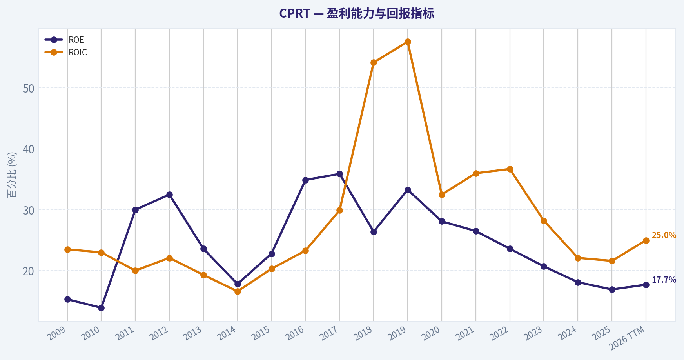
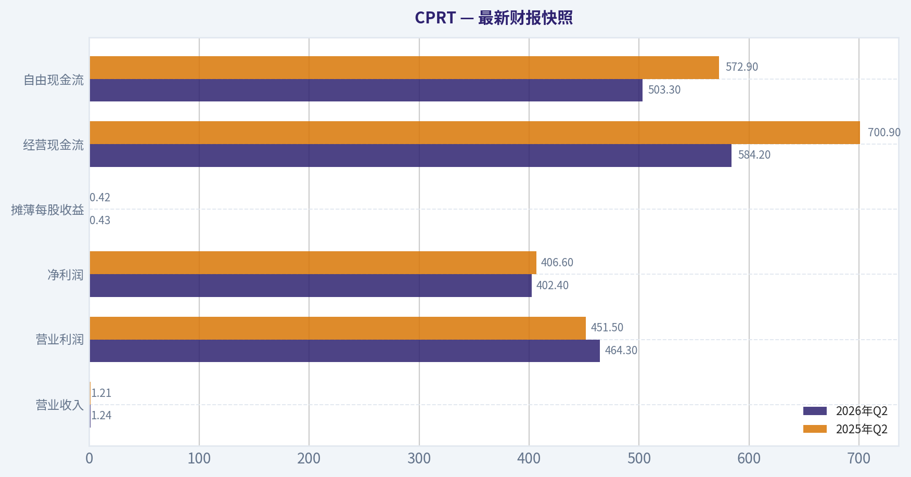
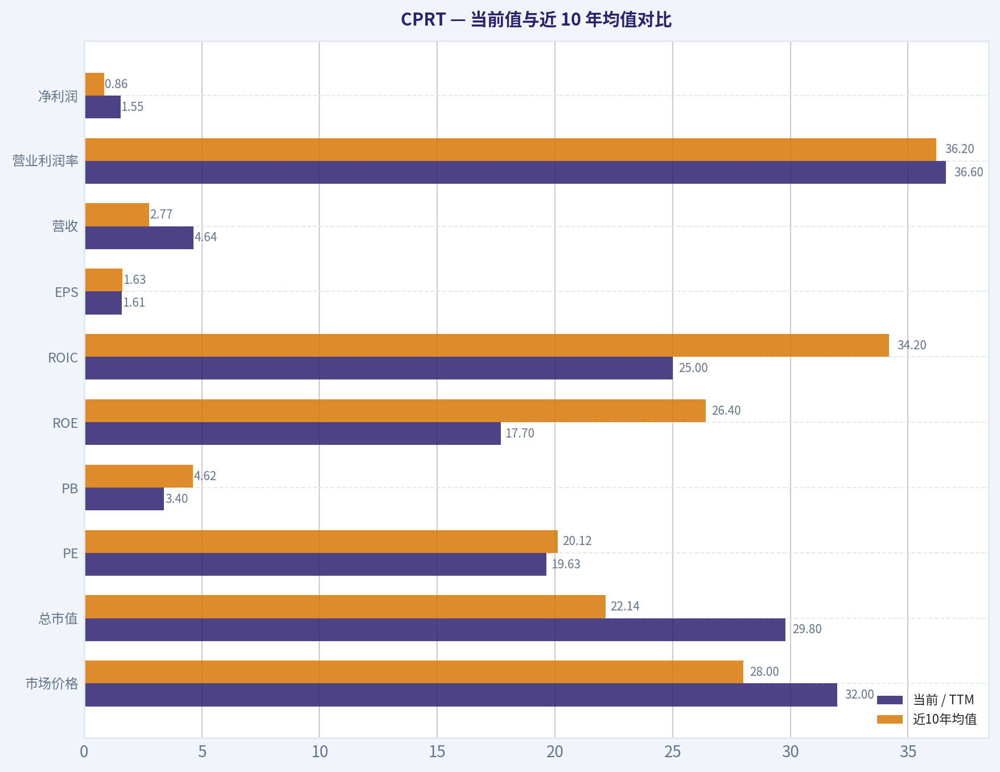
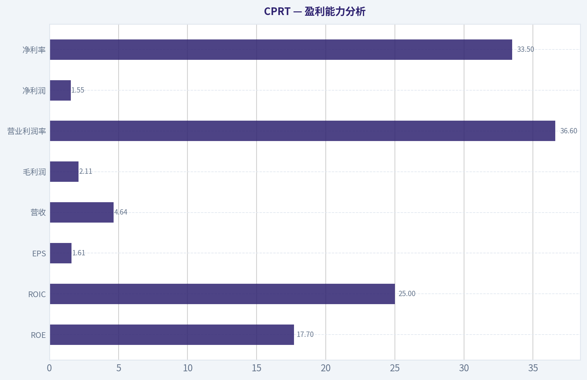
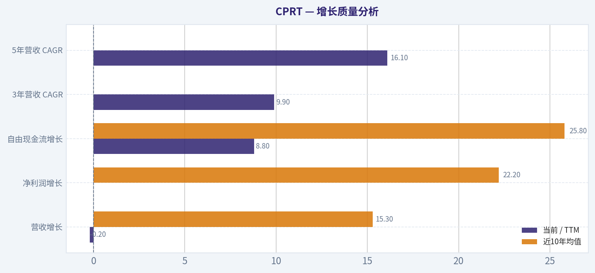
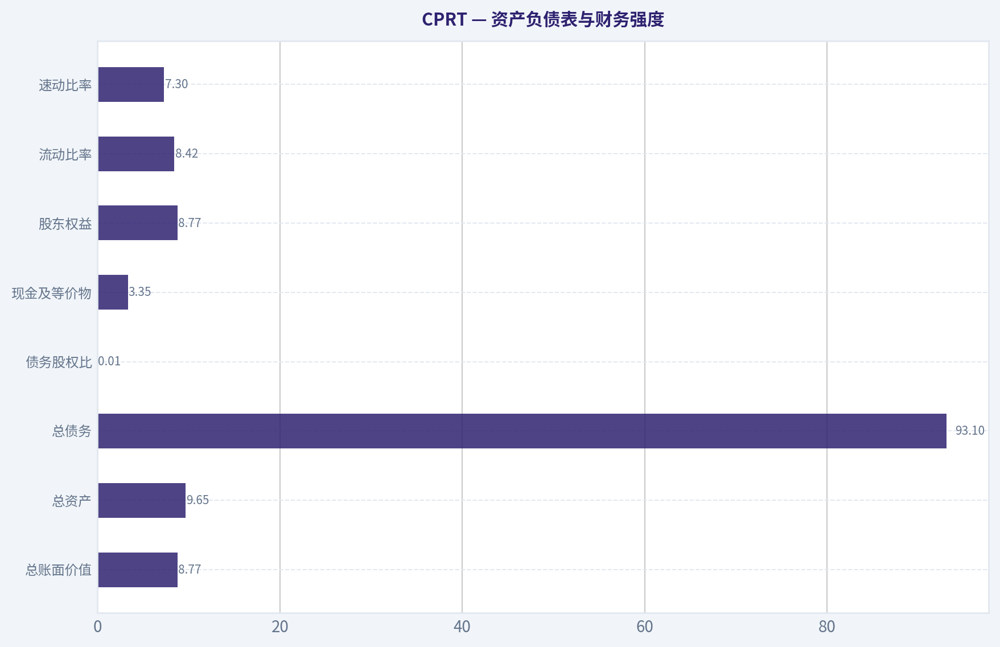
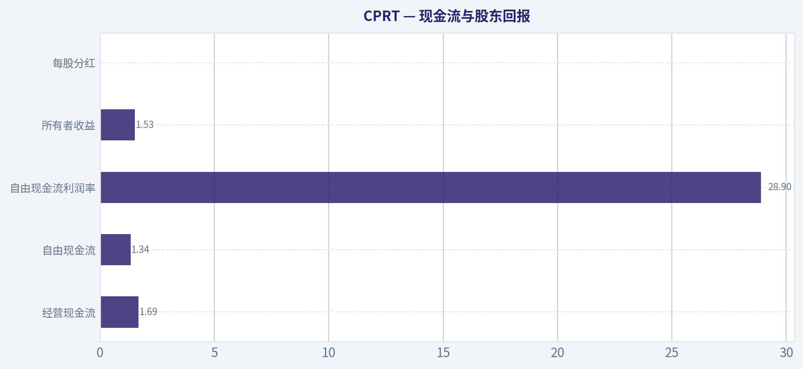
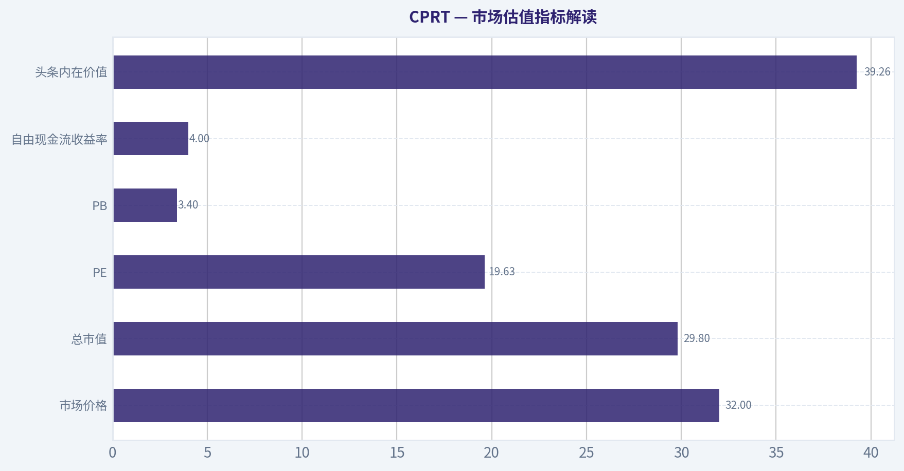

# CPRT 深度价值情报

**调研日期:** 2026-08-16

## 关键免责声明

*本报告由 Deep Value Intelligence（一个基于 AI 的多智能体投资分析框架）自动生成。 仅供教育和研究用途 - 非财务建议，非财务顾问。*

---

## 目录

1. 情报摘要
2. 分析师团队报告
   - 基本面分析
   - 价值分析 (巴菲特)
   - 成长性分析 (林奇/德鲁肯米勒/费雪)
   - 市场分析
   - 期权市场分析
3. 研究团队评论
4. 投资团队评论
5. Deep Values 团队洞察

---

## 情报摘要

### 核心观点与前提条件

**核心论点:** **执行摘要 (Executive Summary)**

**主要风险:**
- 最终判决**：借鉴我们近期在 CRM 上的复盘教训--**"好公司不等于立刻重仓的好买点"**。在缺乏明确基本面催化（如增速回升）或更深安全边际的情况下，贸然建仓容易陷入时间成本的损耗。我们保持纪律性**观望 (WATCH)**，并设定严格的击球触发条件。
- 激进方 (Risky)**：商业本质极佳。ADAS/EV 等新技术虽减少事故，但导致单次碰撞维修成本剧增，全损率将结构性上升，长期利好 CPRT。当前不到 20 倍 P/E 是错误定价，应立刻抄底。
- 最终立场：观望 (WATCH)**

**置信度:** 中

---

## 分析师团队报告

### 基本面分析

#### 最新财报快照

*以下数据基于最近一期已披露财报（2026年Q2），并尽量与上一年同期对比。*

| 指标 | 2026年Q2 | 2025年Q2 | 同比变化 |
| --- | ---: | ---: | ---: |
| 营业收入 | $1.24B | $1.21B | +2.1% |
| 营业利润 | $464.3M | $451.5M | +2.8% |
| 净利润 | $402.4M | $406.6M | -1.0% |
| 摊薄每股收益 | $0.43 | $0.42 | +2.4% |
| 经营现金流 | $584.2M | $700.9M | -16.6% |
| 自由现金流 | $503.3M | $572.9M | -12.2% |

关键结论：这张快照先把最新一期财报放在桌面上，再去看长周期分析。这样读者能更清楚地区分"公司长期质量"和"这次财报发生了什么"。

#### CPRT 17年财务指标

*以下数值均由原始数据确定性计算得出，并非 AI 估算。*

*发行人类型：operating company（Industrials / Specialty Business Services）。*

#### 17年财务指标
*年度行来自已披露财务报表，最后一行 TTM 由最近四个季度滚动计算得出。*

| 指标 | 2009 | 2010 | 2011 | 2012 | 2013 | 2014 | 2015 | 2016 | 2017 | 2018 | 2019 | 2020 | 2021 | 2022 | 2023 | 2024 | 2025 | 2026 TTM |
| --- | --- | --- | --- | --- | --- | --- | --- | --- | --- | --- | --- | --- | --- | --- | --- | --- | --- | --- |
| 市场价格 | $2 | $2 | $3 | $3 | $4 | $4 | $5 | $6 | $8 | $14 | $19 | $23 | $37 | $32 | $44 | $52 | $45 | $32 |
| 总市值 | $187.4M | $387.3M | $416.4M | $390.3M | $527.4M | $547.6M | $1.18B | $1.54B | $1.87B | $3.47B | $4.66B | $5.56B | $35.32B | $30.89B | $42.72B | $51.01B | $44.31B | $29.80B |
| 市盈率 | 1.33 | 2.56 | 2.51 | 2.14 | 2.92 | 3.07 | 5.36 | 5.68 | 4.74 | 8.29 | 7.88 | 7.96 | 37.89 | 28.34 | 34.53 | 37.38 | 28.51 | 19.63 |
| 市净率 | 0.20 | 0.36 | 0.75 | 0.70 | 0.69 | 0.55 | 1.23 | 1.99 | 1.70 | 2.19 | 2.62 | 2.23 | 10.01 | 6.68 | 7.14 | 6.78 | 4.82 | 3.40 |
| ROE | 15.3% | 13.9% | 30.0% | 32.5% | 23.6% | 17.8% | 22.8% | 34.9% | 35.9% | 26.4% | 33.3% | 28.1% | 26.5% | 23.6% | 20.7% | 18.1% | 16.9% | 17.7% |
| ROIC | 23.5% | 23.0% | 20.0% | 22.1% | 19.3% | 16.6% | 20.3% | 23.3% | 29.9% | 54.2% | 57.6% | 32.5% | 36.0% | 36.7% | 28.2% | 22.1% | 21.6% | 25.0% |
| 每股收益 | $1.66 | $0.89 | $1.08 | $1.39 | $1.39 | $1.36 | $0.84 | $1.11 | $1.66 | $1.73 | $2.46 | $2.93 | $0.97 | $1.13 | $1.28 | $1.40 | $1.59 | $1.61 |
| 营收 | $743.1M | $772.9M | $872.2M | $924.2M | $1.05B | $1.16B | $1.15B | $1.27B | $1.45B | $1.81B | $2.04B | $2.21B | $2.69B | $3.50B | $3.87B | $4.24B | $4.65B | $4.64B |
| 毛利润 | $637.1M | $668.2M | $747.0M | $787.2M | $879.1M | $989.0M | $1.01B | $1.13B | $1.31B | $1.61B | $1.79B | N/A | N/A | N/A | N/A | N/A | N/A | $2.11B |
| 毛利率 | 85.7% | 86.5% | 85.6% | 85.2% | 84.0% | 85.0% | 88.1% | 88.9% | 90.5% | 89.1% | 87.5% | N/A | N/A | N/A | N/A | N/A | N/A | 45.5% |
| 营业利润率 | 30.3% | 30.9% | 30.4% | 31.0% | 27.0% | 23.6% | 30.1% | 32.0% | 31.9% | 32.4% | 35.1% | 37.0% | 42.2% | 39.3% | 38.4% | 37.1% | 36.5% | 36.6% |
| 净利润 | $141.1M | $151.6M | $166.4M | $182.1M | $180.0M | $178.7M | $219.8M | $270.4M | $394.2M | $417.9M | $591.7M | $699.9M | $936.5M | $1.09B | $1.24B | $1.36B | $1.55B | $1.55B |
| 净利率 | 19.0% | 19.6% | 19.1% | 19.7% | 17.2% | 15.4% | 19.2% | 21.3% | 27.2% | 23.1% | 29.0% | 31.7% | 34.8% | 31.1% | 32.0% | 32.2% | 33.4% | 33.5% |
| 营收增长 | N/A | 4.0% | 12.9% | 6.0% | 13.2% | 11.2% | -1.5% | 10.7% | 14.2% | 24.7% | 13.1% | 8.0% | 22.1% | 30.0% | 10.5% | 9.5% | 9.7% | -0.2% |
| 净利润增长 | N/A | 7.5% | 9.7% | 9.5% | -1.1% | -0.7% | 23.0% | 23.0% | 45.8% | 6.0% | 41.6% | 18.3% | 33.8% | 16.4% | 13.5% | 10.1% | 13.9% | 0.0% |
| 自由现金流增长 | N/A | -0.7% | 39.8% | 1.2% | -60.5% | 162.2% | 2.7% | -14.7% | 101.7% | -22.7% | 10.4% | 19.5% | 62.0% | 59.0% | 1.0% | 13.5% | 28.0% | 8.8% |
| 总账面价值 | $921.5M | $1.09B | $555.2M | $561.1M | $762.4M | $1.00B | $964.5M | $774.5M | $1.10B | $1.58B | $1.78B | $2.49B | $3.53B | $4.63B | $5.99B | $7.52B | $9.19B | $8.77B |
| 总资产 | N/A | $1.23B | $1.08B | $1.15B | $1.33B | $1.51B | $1.80B | $1.65B | $1.98B | $2.31B | $2.55B | $3.46B | $4.56B | $5.31B | $6.74B | $8.43B | $10.09B | $9.65B |
| 总债务 | N/A | $975,000 | $375.8M | $443.8M | $368.8M | $293.8M | $643.8M | $638.0M | $631.0M | $400.0M | $400.0M | $396.9M | $397.6M | $2.0M | $11.0M | $0 | N/A | $93.1M |
| 债务股权比 | N/A | 0.00 | 0.68 | 0.79 | 0.48 | 0.29 | 0.67 | 0.82 | 0.57 | 0.25 | 0.22 | 0.16 | 0.11 | 0.00 | 0.00 | 0.00 | N/A | 0.01 |
| 现金及等价物 | $162.7M | $268.2M | $74.0M | $140.1M | $63.6M | $158.7M | $456.0M | $155.8M | $210.1M | $274.5M | $186.3M | $477.7M | $1.05B | $1.38B | $957.4M | $1.51B | $2.78B | $3.35B |
| 股东权益 | $921.5M | $1.09B | $555.2M | $561.1M | $762.4M | $1.00B | $964.5M | $774.5M | $1.10B | $1.58B | $1.78B | $2.49B | $3.53B | $4.63B | $5.99B | $7.52B | $9.19B | $8.77B |
| 经营现金流 | $203.3M | $199.4M | $242.9M | $229.7M | $199.3M | $262.6M | $265.1M | $332.5M | $492.1M | $535.1M | $646.6M | $917.9M | $990.9M | $1.18B | $1.36B | $1.47B | $1.80B | $1.69B |
| 投资现金流 | $-59.9M | $-96.0M | $-84.5M | $-48.1M | $-208.0M | $-92.1M | $-81.9M | $-172.9M | $-335.8M | $-288.5M | $-356.3M | $-601.2M | $-465.5M | $-442.3M | $-1.89B | $-940.1M | $-587.4M | $905.1M |
| 自由现金流 | $124.4M | $123.6M | $172.8M | $174.8M | $69.1M | $181.1M | $185.9M | $158.6M | $319.9M | $247.2M | $272.8M | $325.9M | $527.9M | $839.2M | $847.6M | $961.6M | $1.23B | $1.34B |
| 自由现金流利润率 | 16.7% | 16.0% | 19.8% | 18.9% | 6.6% | 15.6% | 16.2% | 12.5% | 22.1% | 13.7% | 13.4% | 14.8% | 19.6% | 24.0% | 21.9% | 22.7% | 26.5% | 28.9% |
| 每股分红 | $0.00 | $0.00 | $0.00 | $0.00 | $0.00 | $0.00 | $0.00 | $0.00 | $0.00 | $0.00 | $0.00 | $0.00 | $0.00 | $0.00 | $0.00 | $0.00 | $0.00 | $0.00 |

#### 盈利能力指标
- 净资产收益率 (ROE): 16.9%
- 投入资本回报率 (ROIC): 21.6%
- 总资产收益率 (ROA): 15.4%
- 毛利率: N/A
- 营业利润率: 36.5%
- 净利率: 33.4%

#### 流动性指标
- 流动比率: 8.42
- 速动比率: 7.30

#### 杠杆指标
- 债务股权比: N/A
- 利息覆盖倍数: N/A
- 净负债: N/A

#### 增长指标（同比）
- 营收增长: 9.7%
- 净利润增长: 13.9%
- 自由现金流增长: 28.0%
- 营收复合增长率（3年）: 9.9%
- 营收复合增长率（5年）: 16.1%

#### 估值指标
- 市盈率 (TTM): 19.63
- 预期市盈率: 18.78
- 市净率: 3.34
- 市销率: 6.56
- PEG 比率: 3.80
- 企业价值/EBITDA: 12.84
- 自由现金流收益率: 4.0%
- 盈利收益率: 5.1%

#### 所有者收益（巴菲特方法，代码计算）
- 净利润: $1.55B
- + 折旧与摊销: $217.8M
- - 资本开支: $-569.0M
- - 营运资本变动: $22.6M
- = **所有者收益: $1.53B**

#### 内在价值（代码计算）
- 当前价格: $32
- **头条内在价值（按商业模式路由）: $39**
  商业模式: operating company - weighted blend [Damodaran FCFF + reverse-DCF fair + owner-earnings DCF] (operating_company)
  模型区间（各 DCF 最小-最大）: $32 - $52
  相对价格的安全边际（头条）: 19.5%
  路由说明: General operating company: balanced blend of Damodaran FCFF and the owner-earnings DCF with a reverse-DCF sanity check.
- 巴菲特方法（所有者收益）:
  保守: $16
  平均: $52
  乐观: $150
- 现金流方法（FCF）:
  保守: $21
  平均: $34
  乐观: $62
- Damodaran FCFF（WACC + 利润率 + 再投资）:
  保守: $27
  平均: $32
  乐观: $38
  蒙特卡洛区间（P10-P90）：$26 - $41（中位数 $32）
  P(内在价值 > 当前价格)：53.9%
- 反向 DCF：当前价格隐含约 6.7%/年 的所有者收益增长（10年）；过去 3 年为 8.0%，5 年为 69.9%。

#### Piotroski F分数: 5/9
- 净利润为正: 通过
- 经营现金流为正: 通过
- 资产回报率改善: 未通过
- 现金流大于净利润: 通过
- 债务下降: 通过
- 流动比率改善: 通过
- 未稀释股本: 未通过
- 毛利率改善: 未通过
- 资产周转率改善: 未通过

ANALYST STANCE: **观望**

#### CPRT 基本面与巴菲特式价值分析

Copart, Inc. 是全球车辆拍卖与再营销平台，核心业务围绕报废车、事故车、保险公司委托车辆、二手车及相关服务展开。其商业模式兼具"线下土地网络 + 线上拍卖平台 + 保险公司关系 + 数据与流程能力"的复合特征，长期表现出高利润率、高现金转化、低杠杆和强再投资能力。
截至 2026 TTM，当前股价约 **32 美元**，总市值约 **298 亿美元**，PE 为 **19.63 倍**，自由现金流收益率约 **4.0%**。模型化内在价值头条值约 **39.26 美元**，相对当前价格有约 **19.5% 安全边际**，但近期增长显著放缓，故更适合"观望等待更大折价或增长重新加速"，而非立即大幅配置。

---

#### 当前值与近 10 年均值对比

| 指标 | 当前 / TTM | 近10年均值 | 当前相对历史 | 解释 |
|---|---:|---:|---:|---|
| 市场价格 | $32 | $28 | 高约14% | 股价仍高于十年均值，但已明显低于 2024 年 $52 和 2025 年 $45。 |
| 总市值 | $29.80B | $22.14B | 高约35% | 市值仍高于长期均值，反映公司规模和盈利能力已显著提升。 |
| PE | 19.63x | 20.12x | 略低 | 当前 PE 接近十年均值，远低于 2021-2024 年 30x 以上高估值区间。 |
| PB | 3.40x | 4.62x | 低于均值 | CPRT 属运营型服务平台，账面价值不能充分反映网络、数据、客户关系和土地位置价值，PB 只能作为辅助指标。 |
| ROE | 17.7% | 26.4% | 明显低于 | ROE 从高位回落，主要因权益和现金积累快于利润增长。 |
| ROIC | 25.0% | 34.2% | 低于均值 | 仍属优秀水平，但较 2018-2022 年超高回报阶段下降。 |
| EPS | $1.61 | $1.63 | 基本持平 | EPS 已回到十年均值附近，说明估值修正后盈利支撑尚可。 |
| 营收 | $4.64B | $2.77B | 高约67% | 业务规模显著扩张，是长期复利增长的核心证据。 |
| 营业利润率 | 36.6% | 36.2% | 基本持平 | 利润率稳定，显示公司定价权和运营效率仍强。 |
| 净利润 | $1.55B | $0.86B | 高约81% | 利润规模远高于十年均值，商业模式成熟度提升明显。 |
| 净利率 | 33.5% | 29.6% | 高于均值 | 当前净利率处于历史高位区间，盈利质量强。 |
| 营收增长率 | -0.2% | 15.3% | 明显低于 | TTM 增长暂停，是当前最大观察点。 |
| 净利润增长率 | 0.0% | 22.2% | 明显低于 | 盈利增长进入短期平台期，估值扩张空间受限。 |
| 自由现金流增长率 | 8.8% | 25.8% | 低于均值 | 现金流仍增长，但速度低于过去强周期。 |
| 总账面价值 | $8.77B | $3.86B | 高约127% | 权益资本持续积累，财务安全垫增强。 |
| 总资产 | $9.65B | $4.71B | 高约105% | 公司资产基础扩张，含土地、设施、现金和运营资产。 |
| 总债务 | $93.1M | 约$320M | 显著低于 | 基本无杠杆，抗周期能力很强。 |
| 债务股权比 | 0.01x | 0.24x | 显著低于 | 资产负债表极其稳健。 |
| 现金及等价物 | $3.35B | $0.90B | 高约273% | 现金储备充裕，提供收购、扩张和抗风险能力。 |
| 自由现金流 | $1.34B | $0.57B | 高约134% | 现金创造力强，是估值锚的核心。 |
| 每股分红 | $0.00 | $0.00 | 无变化 | 公司不分红，主要依靠再投资和内生复利。 |

关键结论：CPRT 当前估值已经从高位显著回落，PE 接近十年均值，现金流和资产负债表质量依然很强。但增长指标明显低于历史均值，尤其 TTM 营收和净利润几乎停滞，这使得当前价格虽有一定安全边际，却还不足以构成非常明显的巴菲特式"便宜好公司"机会。

---

#### 市场估值指标解读

| 指标 | 当前值 | 巴菲特式解读 |
|---|---:|---|
| 市场价格 | $32 | 较 2024 年高点 $52 明显回落，市场已重新定价增长放缓风险。 |
| 总市值 | $29.80B | 对一家年自由现金流约 $1.34B 的公司而言，估值不算极低，但也不再明显泡沫化。 |
| PE | 19.63x | 对高 ROIC、低债务、强现金流公司而言合理偏便宜；但若增长长期降至低个位数，则并不便宜。 |
| PB | 3.40x | CPRT 不是银行或保险公司，也不是以账面资产清算价值为核心的企业；PB 不应机械解读为便宜或昂贵，应主要看现金流内在价值。 |
| 自由现金流收益率 | 4.0% | 相当于以约 25 倍 FCF 买入；若未来 FCF 能维持中高个位数增长，则可接受。 |
| 头条内在价值 | $39.26 | 相对 $32 有约 19.5% 安全边际，属于"有吸引力但不极端便宜"。 |

关键结论：CPRT 当前估值的核心不是 PB，而是未来自由现金流和所有者收益能否继续增长。若投资者相信公司可长期保持 6%-10% 的所有者收益增长，当前价格有吸引力；若增长进入长期停滞，则安全边际不足。

---

#### 盈利能力分析

CPRT 的盈利能力是其最突出的长期优势之一。2026 TTM 营业利润率为 **36.6%**，净利率为 **33.5%**，均处于非常高的水平。过去十年，公司营业利润率大多维持在 32%-42% 区间，说明其业务并非普通低壁垒服务业，而是具备网络规模、流程效率、保险公司渠道和拍卖流动性优势的平台型服务商。

ROE 当前为 **17.7%**，低于近十年均值 **26.4%**；ROIC 当前为 **25.0%**，低于近十年均值 **34.2%**，但绝对水平仍非常优秀。ROE 下滑并不一定代表业务恶化，部分原因是公司积累了大量现金和权益资本，使分母扩大。更关键的是，ROIC 仍远高于通常资本成本，说明公司每一美元投入资本仍能产生高质量回报。

| 盈利指标 | 当前 / TTM | 趋势判断 | 投资含义 |
|---|---:|---|---|
| ROE | 17.7% | 从历史高位回落 | 资本基数扩大，回报率正常化。 |
| ROIC | 25.0% | 仍高但低于峰值 | 经济护城河仍在，但超高回报阶段可能已过去。 |
| EPS | $1.61 | 接近十年均值 | 股价回落后，EPS 支撑增强。 |
| 营收 | $4.64B | 长期上升，短期停滞 | 规模优势仍在，但近期增长需要恢复。 |
| 毛利润 | $2.11B | 数据口径后期存在变化 | 毛利率从早期高位到 TTM 45.5%，需注意收入与成本分类变化，不宜机械比较。 |
| 营业利润率 | 36.6% | 稳定在高位 | 运营效率和定价能力强。 |
| 净利润 | $1.55B | 长期大幅增长，短期持平 | 盈利基础强，但近期增速放缓。 |
| 净利率 | 33.5% | 高于十年均值 | 税后盈利质量优异。 |

关键结论：CPRT 仍是一家高质量、高利润率、高资本回报企业。当前最大的变化不是利润率崩塌，而是增长速度放缓；这意味着市场会更关注未来几年营收恢复与国际扩张进展。

---

#### 增长质量分析

过去十七年 CPRT 营收从 **$743.1M** 增至 **$4.64B TTM**，净利润从 **$141.1M** 增至 **$1.55B TTM**，自由现金流从 **$124.4M** 增至 **$1.34B TTM**。这是一条非常漂亮的长期复利曲线。

但短期看，增长显著降温。2025 年营收增长 **9.7%**，净利润增长 **13.9%**，自由现金流增长 **28.0%**，表现仍不错；但 2026 TTM 营收增长变为 **-0.2%**，净利润增长 **0.0%**，自由现金流增长 **8.8%**。这说明公司进入了一个短期消化期，可能与车辆供应、保险拍卖量、二手车价格、灾害车周期、国际业务节奏或宏观汽车市场有关。

| 增长指标 | 当前 / TTM | 近10年均值 | 解读 |
|---|---:|---:|---|
| 营收增长 | -0.2% | 15.3% | 明显低于历史，短期需求或成交量承压。 |
| 净利润增长 | 0.0% | 22.2% | 利润暂时停滞，估值扩张受到压制。 |
| 自由现金流增长 | 8.8% | 25.8% | 现金流仍增长，但低于高增长阶段。 |
| 3年营收 CAGR | 9.9% | - | 中期仍健康。 |
| 5年营收 CAGR | 16.1% | - | 长期成长记录仍强。 |

关键结论：CPRT 的长期增长记录优秀，但当前 TTM 数据显示增长进入低速阶段。投资判断的关键在于，这是暂时性周期波动，还是成熟期增速永久下台阶。

---

#### 资产负债表与财务强度

CPRT 的资产负债表非常强。2026 TTM 公司现金及等价物为 **$3.35B**，总债务仅 **$93.1M**，债务股权比约 **0.01x**。这意味着公司几乎没有财务杠杆压力，即使行业短期波动，也不需要依赖外部融资维持经营。

总资产为 **$9.65B**，股东权益为 **$8.77B**，说明资产负债表主要由权益和现金支撑。对于巴菲特式投资者而言，这类资产结构非常理想：公司无需高杠杆即可产生高 ROIC，并且有足够现金用于土地扩张、国际并购、技术投资或在估值合理时回购股票。

| 资产负债表指标 | 当前 / TTM | 投资含义 |
|---|---:|---|
| 总账面价值 | $8.77B | 权益资本持续积累，抗风险能力增强。 |
| 总资产 | $9.65B | 公司规模已显著扩大。 |
| 总债务 | $93.1M | 几乎无债务压力。 |
| 债务股权比 | 0.01x | 杠杆极低，财务稳健。 |
| 现金及等价物 | $3.35B | 现金充裕，具备战略灵活性。 |
| 股东权益 | $8.77B | 财务基础扎实。 |
| 流动比率 | 8.42x | 流动性极强；但对这类运营平台公司，流动比率不是估值核心。 |
| 速动比率 | 7.30x | 短期偿债能力充足。 |

关键结论：CPRT 的财务结构非常保守，现金远高于债务，这是公司重要的安全边际来源。即使短期增长放缓，公司也没有明显的生存或融资风险。

---

#### 现金流与股东回报

2026 TTM 自由现金流为 **$1.34B**，高于 2025 年 **$1.23B**，自由现金流利润率达到 **28.9%**。这说明 CPRT 不只是会计利润高，现金转化也很强。经营现金流为 **$1.69B**，资本开支约 **$569M**，公司仍在投入土地、设施、技术和运营网络，但投入后仍能留下大量自由现金流。

公司长期不支付股息，每股分红为 **$0.00**。这符合成长型复利企业的资本配置特征：只要管理层能够以高 ROIC 再投资，保留利润通常优于分红。但当增长放缓且现金累积过高时，投资者需要关注管理层是否会提高回购效率或进行高质量并购。

| 现金流指标 | 当前 / TTM | 解读 |
|---|---:|---|
| 经营现金流 | $1.69B | 主业现金创造能力强。 |
| 自由现金流 | $1.34B | 现金流质量优异，是估值核心。 |
| 自由现金流利润率 | 28.9% | 高于历史多数年份，现金转化强。 |
| 所有者收益 | $1.53B | 巴菲特式估值基础较扎实。 |
| 每股分红 | $0.00 | 管理层偏向再投资而非现金分红。 |

关键结论：CPRT 的现金流质量非常高，自由现金流利润率接近 29%。公司不分红并不是缺陷，前提是管理层能持续把现金投入高回报项目；若未来增长放缓，资本配置纪律将变得更重要。

---

#### 收入来源分布

以下使用最近完整年度 FY2025 口径，按公司主要收入类型划分。CPRT 主要收入来自服务收入，包括车辆拍卖服务费、会员费、处理费、拖车和仓储等相关服务；较小部分来自车辆销售收入。

| 收入来源 | 金额（百万/十亿美元） | 占比 |
|---|---:|---:|
| 服务收入 | 约 $3.98B | 约 85.7% |
| 车辆销售收入 | 约 $0.67B | 约 14.3% |
| 合计 | 约 $4.65B | 100% |

关键结论：CPRT 的收入结构以服务收入为主，这通常比自营车辆销售更轻资产、更高利润率、更具平台属性。车辆销售收入占比较小，说明公司的核心价值来自拍卖网络和服务生态，而不是简单买卖库存车辆。

---

#### 巴菲特式护城河分析

| 维度 | 评价 | 具体分析 |
|---|---|---|
| 网络效应 | 强 | 买家越多，保险公司和卖家越愿意把车放到平台；车源越多，买家越愿意参与。 |
| 规模经济 | 强 | 场地、拍卖系统、物流流程和车辆处理能力可在更大成交量上摊薄成本。 |
| 客户关系 | 强 | 保险公司、金融机构、车队和经销商客户关系稳定，迁移成本较高。 |
| 线上平台能力 | 强 | CPRT 已形成全球线上竞拍市场，扩大了买家覆盖和成交效率。 |
| 土地与地理位置 | 中强 | 车辆存放场地具有稀缺性，尤其靠近人口和事故车高发区域的土地。 |
| 品牌与信任 | 中强 | 对保险公司和买家而言，流程可靠性、结算效率和车况披露很重要。 |
| 定价权 | 较强 | 高营业利润率和高净利率显示公司具有一定服务费定价能力。 |

关键结论：CPRT 的护城河不是单一品牌，而是由保险公司关系、全球买家网络、土地网络、线上竞拍平台和运营流程共同构成。这样的护城河较难被新进入者快速复制。

---

#### 管理层与资本配置

CPRT 长期不分红，体现管理层更倾向于将现金用于扩张、土地储备、技术平台和潜在收购。历史数据证明，公司曾长期把利润转化为高 ROIC 和高自由现金流，这是优秀资本配置的证据。

但当前 ROE 和 ROIC 较历史高位回落，且现金余额达到 **$3.35B**，说明公司未来资本配置压力上升。如果管理层不能找到足够多高回报再投资机会，过多现金会稀释 ROE。近期 CEO 通过预设交易计划出售部分股份，规模不算决定性负面信号，但在增长放缓背景下，投资者应持续观察内部人持股变化。

| 管理层观察点 | 当前状态 | 含义 |
|---|---|---|
| 分红政策 | 不分红 | 适合高回报再投资阶段。 |
| 现金积累 | 很高 | 增强安全性，但可能压低资本效率。 |
| ROIC 趋势 | 从高位回落 | 需要证明新增投资仍有高回报。 |
| 内部人交易 | 有 CEO 预设计划卖出 | 不应过度解读，但需跟踪。 |
| 机构动向 | Point72 增持 | 属交易型机构信号，参考价值有限。 |

关键结论：管理层过去资本配置成绩优秀，但未来考验更大。随着现金增加和增长放缓，市场会更关注回购、并购、国际扩张和资本开支回报率。

---

#### 三情景巴菲特式所有者收益 DCF

基础假设：
- 当前所有者收益：**$1.53B**
- 净现金：现金 $3.35B - 债务 $0.093B ~ **$3.26B**
- 稀释后估算股数：约 **0.931B 股**
- 折现率：**10%**
- 永续增长率：**2.5%**
- 终值公式：第10年所有者收益 x 1.025 ÷ 7.5%
- 该手工 DCF 用于交叉检验，估值锚仍优先参考模型化头条内在价值 **$39.26**，以及模型区间 **$32-$52**。

| 情景 | 增长假设 | 显性期现值 | 终值现值 | 加净现金后股权价值 | 每股公允价值 |
|---|---|---:|---:|---:|---:|
| 保守 | 10 年所有者收益每年增长 3% | $10.85B | $10.84B | $24.95B | 约 $26.8 |
| 平均 | 前5年 10%，后5年 6%，再进入 2.5% 永续 | $14.50B | $17.38B | $35.14B | 约 $37.7 |
| 乐观 | 前5年 15%，后5年 10%，再进入 2.5% 永续 | $18.31B | $26.11B | $47.68B | 约 $51.2 |

关键结论：手工 DCF 显示，CPRT 的合理价值区间大约在 **$27-$51**，基础情景约 **$38**，与模型化头条内在价值 **$39.26** 接近。当前股价 $32 低于基础价值，但高于保守价值，因此安全边际存在但并不厚。

---

#### DCF 详细计算说明

| 项目 | 保守情景 | 平均情景 | 乐观情景 |
|---|---:|---:|---:|
| 起始所有者收益 | $1.53B | $1.53B | $1.53B |
| 第10年所有者收益 | 约 $2.06B | 约 $3.30B | 约 $4.96B |
| 第10年终值 | 约 $28.10B | 约 $45.07B | 约 $67.73B |
| 终值折现系数 | 1 / 1.10^10 | 1 / 1.10^10 | 1 / 1.10^10 |
| 折现后终值 | 约 $10.84B | 约 $17.38B | 约 $26.11B |
| 企业价值 | 约 $21.69B | 约 $31.88B | 约 $44.42B |
| 加：净现金 | 约 $3.26B | 约 $3.26B | 约 $3.26B |
| 股权价值 | 约 $24.95B | 约 $35.14B | 约 $47.68B |
| 每股价值 | 约 $26.8 | 约 $37.7 | 约 $51.2 |

关键结论：DCF 的敏感性主要来自未来所有者收益增长率，而不是债务风险，因为 CPRT 几乎没有净债务。当前价格隐含约 **6.7%** 的十年所有者收益增长，低于公司五年营收 CAGR，但高于当前 TTM 增速，因此市场已经部分反映了增长放缓。

---

#### 与模型化内在价值对比

| 估值模型 | 每股价值 | 解读 |
|---|---:|---|
| 所有者收益 DCF 模型区间 | $16 / $52 / $150 | 对长期增长假设极敏感，乐观值不宜机械采用。 |
| FCF 模型区间 | $21 / $34 / $62 | 更贴近当前现金流收益率，基础值略高于股价。 |
| Damodaran FCFF | $27 / $32 / $38 | 更保守，当前价格接近中枢。 |
| Damodaran 蒙特卡洛 P10-P90 | $26-$41 | 当前价格位于合理区间中部偏低。 |
| 头条内在价值 | $39.26 | 相对当前价格约 19.5% 安全边际。 |
| 当前价格 | $32 | 不贵，但也非深度低估。 |

关键结论：不同模型均显示 CPRT 不是明显高估资产，但只有在基础或乐观增长假设下才有较好上行空间。若采用更保守的 FCFF 框架，当前价格接近公允价值，因此不宜过度激进。

---

#### 关键投资机会

| 机会 | 说明 | 对估值影响 |
|---|---|---|
| 全球线上车辆拍卖渗透率提升 | 更多保险公司、车队和经销商采用数字化拍卖流程。 | 有利于营收和利润率长期增长。 |
| 国际扩张 | 美国以外市场仍有整合空间。 | 若复制美国模式，可延长增长跑道。 |
| 事故车与全损车处理需求 | 车辆复杂度上升可能提高全损比例。 | 长期增加保险拍卖车源。 |
| 高现金储备 | 可用于收购、土地扩张或回购。 | 增强抗风险能力和资本配置弹性。 |
| 估值回落 | PE 已从高位降至约 20x 以下。 | 若增长恢复，估值有再评级空间。 |

关键结论：CPRT 的机会主要来自全球车辆再营销数字化和平台规模扩张。如果公司能重新恢复中高个位数到低双位数增长，当前价格具备不错的复利回报潜力。

---

#### 主要风险与红旗

| 风险 | 当前迹象 | 投资影响 |
|---|---|---|
| 增长放缓 | TTM 营收 -0.2%，净利润 0.0% | 最大短期风险，可能压制估值。 |
| ROE / ROIC 正常化 | 当前低于十年均值 | 高回报业务仍强，但边际回报下降需观察。 |
| 估值仍依赖增长 | FCF 收益率约 4.0% | 若增长降至低个位数，回报吸引力下降。 |
| 行业周期 | 二手车价格、保险事故量、灾害事件会波动 | 短期收入和利润可能不稳定。 |
| 资本配置压力 | 现金 $3.35B | 若缺少高回报再投资，现金会拖累 ROE。 |
| 毛利率数据口径变化 | 后期多年份 N/A，TTM 为 45.5% | 需避免机械比较早期和当前毛利率。 |
| Piotroski F 分数 | 5/9 | 基本面质量不差，但动能类财务改善信号一般。 |

关键结论：CPRT 最大问题不是财务脆弱，而是增长和资本回报率从高位回落。对于高质量公司而言，买入价格非常重要；当前价格合理偏低，但还没有到明显"闭眼买入"的程度。

---

#### 巴菲特式综合判断

| 巴菲特维度 | 评价 | 结论 |
|---|---|---|
| 是否易理解 | 高 | 车辆拍卖和再营销业务清晰，现金流模式可理解。 |
| 是否有护城河 | 高 | 网络效应、保险公司关系、土地网络和数字平台形成复合护城河。 |
| 盈利是否稳定 | 高 | 长期收入、利润、现金流持续增长，利润率稳定。 |
| 财务是否稳健 | 很高 | 几乎无债务，现金充裕。 |
| 管理层是否有效 | 较高 | 长期 ROIC 优秀，但未来资本配置压力上升。 |
| 价格是否便宜 | 中等偏有吸引力 | 当前低于基础内在价值，但安全边际不够极端。 |
| 是否适合长期持有 | 是，但需价格纪律 | 适合作为高质量观察名单或逢低配置标的。 |

关键结论：CPRT 符合许多巴菲特式优质企业特征，包括高 ROIC、强现金流、低债务和持久护城河。但以当前增长状态看，股价 $32 虽有吸引力，却还不足以支持非常激进的"建议配置"。

---

#### 最终投资立场：观望

CPRT 是高质量公司，当前估值已从高位大幅回落，模型化内在价值约 **$39.26**，相对当前价格 **$32** 有约 **19.5%** 安全边际。公司资产负债表极强，净现金充裕，营业利润率和净利率稳定在高位，自由现金流持续增长，这些都符合巴菲特偏好的"好生意"。

但目前增长明显放缓，TTM 营收增长 **-0.2%**、净利润增长 **0.0%**，ROE 与 ROIC 也低于十年均值。当前价格更像是"合理偏便宜"，而不是"极度低估"。如果股价回落至保守 DCF 附近，即 **$27 以下**，或公司重新证明营收和所有者收益可持续恢复到高个位数以上增长，则立场可上调为"建议配置"。

| 结论类别 | 核心观点 |
|---|---|
| 最终立场 | **观望** |
| 当前价格 | $32 |
| 头条内在价值 | $39.26 |
| 估算安全边际 | 约 19.5% |
| 手工 DCF 区间 | 约 $26.8-$51.2 |
| 基础情景价值 | 约 $37.7 |
| 主要优点 | 高 ROIC、强现金流、低债务、平台护城河、现金充裕。 |
| 主要担忧 | TTM 增长停滞、ROE/ROIC 下滑、估值仍依赖未来增长。 |
| 更佳买点 | 约 $27 以下，或增长重新加速后确认 $32 附近价值。 |
| 适合投资者 | 长期质量成长投资者、愿意等待更大安全边际的价值投资者。 |

关键结论：CPRT 是值得长期跟踪的优质复利型公司，但当前更适合放在观察名单中。若价格进一步下跌或基本面增长恢复，投资吸引力会显著提升。

#### 基本面关键图表

本图追踪 **CPRT** 过去十年的盈利能力与回报指标（ROE、ROIC、利润率），突出呈现资本效率的变化趋势。

---

### 价值分析 (巴菲特)

> *基于沃伦·巴菲特的价值投资哲学：能力圈、经济护城河、管理层质量与安全边际。*

#### 内在价值快照

价格是你付的钱，内在价值是企业未来可能为股东创造的现金价值。我们给出一个区间，而不是假装只有一个神奇数字。

- 当前价格: $31.61
- 估值区间（两种 DCF 方法、保守到乐观）: $16.43 至 $150.45

##### 所有者收益（巴菲特方法）
- 净利润: $1,552,449,000.00
- 折旧与摊销: $217,784,000.00
- 资本支出: $-568,990,000.00
- 营运资金变化: $22,560,000.00
- 所有者收益: $1,529,889,000.00

##### 内在价值
###### 所有者收益法
使用所有者收益，更严格，通常更保守。
- 保守: $16.43
- 平均: $52.05
- 乐观: $150.45
- 折现率: 10.0%

###### 自由现金流法
使用自由现金流，更适合今天投入很多、为未来增长铺路的公司。
- 保守: $21.26
- 平均: $34.37
- 乐观: $61.67
- 折现率: 10.0%

ANALYST STANCE: **建议配置**

#### CPRT 投资结论

Copart 是一家资产与平台结合的车辆残值拍卖公司，核心业务是替保险公司、租赁公司、车队和个人卖家处置事故车、报废车与二手车，并通过线上拍卖网络向拆解商、修理商、出口商和经销商变现。它的商业模式并不复杂：卖方需要高回收率和高效率，买方需要充足车源和透明竞价，Copart 通过场地网络、拍卖平台、数据和保险公司关系收取服务费。

当前股价约 **32 美元**，研究包头条内在价值约 **39.26 美元**，对应约 **19.5%** 安全边际。对一个具有规模网络、保险客户黏性、净现金特征和较高资本回报的企业而言，这一折价已经达到"优秀企业合理价格偏便宜"的区间。

---

#### 1. 因子评分与硬性财务底线

| 项目 | 评分 | 关键依据 |
|---|---:|---|
| 商业可理解性与可预测性 | 4.0 / 5 | 商业模式清楚：车辆残值拍卖与相关服务；需求来自保险理赔、事故车处置、二手车流通，长期可见度较高 |
| 护城河 | 4.5 / 5 | 买卖双方网络效应、场地规模、保险公司关系、数据与拍卖流动性形成复合优势 |
| 管理层与资本配置 | 3.8 / 5 | 长期把现金投入场地、技术平台和国际扩张；CEO 近期按 10b5-1 计划出售部分股份，需持续观察但不构成核心负面 |
| 行业结构 | 4.0 / 5 | 行业集中度较高，Copart 与主要竞争者构成强势格局；规模越大，车辆供给和买家流动性越强 |
| Gate 5 财务困境硬底线 | 未触发 | 收入仍增长，FCF 为正，流动比率约 8.42，未见盈利与偿债能力同时恶化的财务困境信号 |

关键结论：CPRT 没有触发财务困境硬底线，质量评分明显高于普通企业。它不是单纯低估值烟蒂股，而是一个依靠规模、网络和运营效率复利的优质经营体。主要问题不是业务质量，而是当前价格是否给了足够回报空间。

---

#### 2. 护城河分析

| 护城河来源 | 证据 | 强度判断 |
|---|---|---|
| 网络效应 | 卖方越多，车源越丰富；买方越多，竞价越充分，卖方回收率越高 | 强 |
| 规模与场地优势 | 大量车辆需要拖运、存放、展示、拍卖和交付，场地网络难以快速复制 | 强 |
| 客户切换成本 | 保险公司理赔流程、车辆处置流程、数据接口和历史回收表现会提高切换门槛 | 中高 |
| 数据与执行能力 | 残值定价、竞价流动性、跨地区买家触达提升成交效率 | 中高 |
| 品牌与信任 | 卖方重视回收率、效率和确定性，买方重视车源真实性与拍卖秩序 | 中高 |

关键结论：Copart 的护城河不是单一品牌，而是"车辆供给、买方流动性、场地网络、数据能力和保险客户关系"的组合。这个系统越大越有效率，后来者即使建立网站，也难以复制同等车源、买家和履约网络。因此护城河可评为宽且相对稳定。

---

#### 3. 财务摘要

| 指标 | 当前或近况 |
|---|---:|
| 当前股价 | 32 美元 |
| 市值 | 304.5 亿美元 |
| PE | 19.63 倍 |
| ROE | 16.9% |
| 营收同比增长 | 9.7% |
| FCF 收益率 | 4.0% |
| 流动比率 | 8.42 |
| 头条内在价值 | 39.26 美元 |
| 三模型估值区间：所有者收益 / FCF / Damodaran FCFF | 52.05 / 34.37 / 32.04 美元 |
| 头条安全边际 | 19.5% |
| 当前价格隐含 10 年增长 | 约 6.7% / 年 |

关键结论：CPRT 的估值并不属于"极低估"，但以其质量看并不昂贵。约 4% 的 FCF 收益率叠加中高个位数增长，可以形成合理的长期回报基础。当前价格隐含约 6.7% 年增长，低于其近期收入增速，反向 DCF 并未要求英雄式假设。

---

#### 4. 所有者收益估算

| 项目 | 估算逻辑 | 每股估算 |
|---|---|---:|
| FCF 基准 | 股价 32 美元 x FCF 收益率 4.0% | 约 1.28 美元 |
| 会计 EPS 参考 | 股价 32 美元 ÷ PE 19.63 | 约 1.63 美元 |
| 保守所有者收益 | 以 FCF 作为保守代理，因增长性场地投入可能压低当期 FCF | 约 1.28 美元 |
| 质量调整观察 | 研究包所有者收益模型估值为 52.05 美元，说明若区分维护性与成长性投入，真实经济收益可能高于保守 FCF 口径 | 偏正面 |

关键结论：用 FCF 作为所有者收益是偏保守的，因为 Copart 的场地、技术和国际扩张投入中包含增长资本开支。会计 EPS 高于 FCF 估算，说明当期现金流受到再投资影响。对长期股东而言，只要新增资本能维持较高回报，这类"压低当期 FCF 的增长投入"并非坏事。

---

#### 5. 三情景 DCF 估值

| 情景 | 核心假设 | 估值结果 |
|---|---|---:|
| 情景 A：零增长 | 所有者收益 1.28 美元 ÷ 10% | 12.80 美元 |
| 情景 B：GDP 增长 | 所有者收益按 3% 永续增长，折现率 10% | 18.83 美元 |
| 情景 C：历史增长折减 | 10 年增长约 6%，终值增长 3%，折现率 10% | 约 23.49 美元 |
| 研究包头条估值 | Damodaran FCFF、反向 DCF 公允值、所有者收益 DCF 加权 | 39.26 美元 |
| 研究包三模型区间 | 所有者收益 / FCF / Damodaran FCFF | 52.05 / 34.37 / 32.04 美元 |

关键结论：机械地用当前 FCF 做三情景 DCF 会显著低估一家仍在再投资的优质企业。更合理的判断应结合 FCFF、所有者收益和反向 DCF：研究包三模型显示，当前价格接近低端 FCFF 估值，低于头条内在价值。也就是说，市场价格没有明显透支增长。

---

#### 6. 安全边际分析

| 项目 | 数值 |
|---|---:|
| 当前价格 | 32 美元 |
| 头条内在价值 | 39.26 美元 |
| 安全边际 | 约 19.5% |
| 对宽护城河企业所需安全边际 | 约 10%-15% |
| 当前价格隐含增长 | 约 6.7% / 年 |
| 最近营收同比增长 | 9.7% |

关键结论：对于宽护城河、高现金生成能力、资产与平台结合的复利企业，19.5% 的安全边际已经具备吸引力。当前股价隐含增长低于最近收入增速，估值假设不激进。若公司能长期维持中高个位数增长和较高资本回报，当前价格可提供合理复利空间。

---

#### 7. 管理层与资本配置评价

| 维度 | 评价 |
|---|---|
| 所有者思维 | 公司长期保留现金并投入场地、技术平台和国际扩张，符合长期主义 |
| 资本配置 | 不依赖高杠杆扩张，业务自身现金流支持增长，资本配置偏稳健 |
| 股东回报 | 更偏向再投资而非高分红，适合仍有扩张空间的高回报业务 |
| 透明度与风险点 | CEO Jeffrey Liaw 近期按 10b5-1 计划出售 27,745 股，减少部分直接持股；该行为需观察但并非经营恶化证据 |
| 外部资金动向 | Steve Cohen 旗下机构增持，但仓位占比小，仅作辅助情绪信息 |

关键结论：管理层的最大加分项是长期把资金投向业务能力建设，而不是追求短期财务工程。CEO 售股会降低一点管理层评分，但由于交易为预设计划且规模相对公司市值很小，不改变长期投资判断。Copart 的资本配置更像"用留存收益扩大护城河"的复利模式。

---

#### 8. 最终 Buffett 加权 scorecard

| 评价标准 | 权重 | 评分 | 加权分 |
|---|---:|---:|---:|
| 护城河宽度与持久性 | 25% | 4.5 | 1.13 |
| 估值与安全边际 | 20% | 4.0 | 0.80 |
| 资本回报：ROIC 相对 WACC | 15% | 4.0 | 0.60 |
| 商业理解与可预测性 | 12% | 4.0 | 0.48 |
| 管理层与资本配置 | 12% | 3.8 | 0.46 |
| 再投资 runway | 8% | 4.0 | 0.32 |
| 资产负债表强度 | 4% | 5.0 | 0.20 |
| 行业结构 | 4% | 4.0 | 0.16 |
| 总分 | 100% |  | **4.15 / 5** |

关键结论：CPRT 的总分超过 4 分，属于"优秀企业以合理偏低价格交易"的范畴。护城河、资产负债表、行业结构和再投资能力共同支撑较高评分。估值不是深度低估，但对这种质量的公司而言，当前安全边际已经足够进入建议配置区间。

---

#### 9. 投资 stance 与执行建议

| 项目 | 结论 |
|---|---|
| 投资 stance | 建议配置 |
| 置信度 | 中高 |
| 合理买入区间 | 当前 32 美元附近具备吸引力 |
| 关键上行因素 | 保险残值车流量增长、国际买家扩张、线上拍卖效率提升、场地网络扩大 |
| 关键风险 | 事故车供应周期波动、二手车价格下行、竞争者价格战、国际扩张执行风险、管理层持续减持 |
| 复核触发点 | 若价格升至明显高于 39-42 美元且增长预期未上修，转为观望；若增长失速且 ROE/FCF 同时恶化，重新评估护城河 |

关键结论：CPRT 是符合 Buffett 式框架的优质复利企业：业务能理解、护城河真实、资产负债表稳健、再投资仍有空间。当前约 19.5% 的安全边际足以覆盖常规经营波动。结论为 **建议配置，中高置信度**。
#### 估值桥

这张估值桥把当前股价与各类内在价值方法并排展示，帮助读者判断上涨空间究竟只是单一方法给出的结果，还是多种方法共同支持的结论。

| 项目 | 每股内在价值 |
| --- | ---: |
| 巴菲特方法 | $52.05 |
| 现金流方法 | $34.37 |
| Damodaran 方法 | $32.04 |
| 当前价格 | $31.61 |

#### 关键结论

如果只有一种方法显著高于其他方法，说明上行空间更依赖特定建模假设。若多种方法的估值接近，则说明估值逻辑更加稳健。

#### 估值图表

本对比图（来自「最新财报快照」）将 **CPRT** 的当前数据与历史基准并排呈现，直观反映公司相对自身历史均值的估值水平。

本对比图（来自「当前值与近 10 年均值对比」）将 **CPRT** 的当前数据与历史基准并排呈现，直观反映公司相对自身历史均值的估值水平。

本对比图（来自「盈利能力分析」）将 **CPRT** 的当前数据与历史基准并排呈现，直观反映公司相对自身历史均值的估值水平。

本对比图（来自「增长质量分析」）将 **CPRT** 的当前数据与历史基准并排呈现，直观反映公司相对自身历史均值的估值水平。

本对比图（来自「资产负债表与财务强度」）将 **CPRT** 的当前数据与历史基准并排呈现，直观反映公司相对自身历史均值的估值水平。

本对比图（来自「现金流与股东回报」）将 **CPRT** 的当前数据与历史基准并排呈现，直观反映公司相对自身历史均值的估值水平。

---

### 成长性分析 (林奇/德鲁肯米勒/费雪)

> *基于彼得·林奇的GARP成长投资法、斯坦利·德鲁肯米勒的宏观拐点分析法，以及菲利普·费雪的深度调研法。*

ANALYST STANCE: **观望**

#### CPRT 增长投资结论

Copart 是一家高质量、轻资本、强现金流的线上事故车和报废车拍卖平台，但它更像"优质复利型 Stalwart"，而不是典型 Lynch 式 15%-25% 高增长股。当前价格约 32 美元，研究包估算内在价值约 39.26 美元，安全边际约 19.5%，估值不贵；但收入增速约 9.7%，尚未显示明确再加速拐点，因此结论是：**已有可持有，回调可小幅加仓，但不作为高增长组合的核心新仓。**

---

#### 1. Lynch 分类

| 项目 | 判断 |
|---|---:|
| 公司 | Copart |
| 股票代码 | CPRT |
| 当前股价 | 约 32 美元 |
| 市值 | 约 304.5 亿美元 |
| 营收同比增长 | 约 9.7% |
| PE | 约 19.6 倍 |
| ROE | 约 16.9% |
| 自由现金流收益率 | 约 4.0% |
| Lynch 分类 | **Stalwart，偏优质复利型** |
| 增长投资立场 | **观望 / 持有优先** |

关键结论：CPRT 的增长速度低于典型"Fast Grower"门槛，但财务质量很强，估值也不夸张。它不是最容易成为十倍股的早期成长股，而是一个可能长期稳健复利的高质量平台型企业。对 Lynch 投资者来说，这是"好公司等好价格"，而不是"高增长立刻进攻"。

---

#### 2. 三句话讲清楚生意

| 维度 | 内容 |
|---|---|
| 公司做什么 | CPRT 帮保险公司、车队和个人把事故车、报废车、二手车放到线上平台拍卖。 |
| 为什么赚钱 | 它收取拍卖、服务、仓储、处理和相关交易费用，买家越多、车源越多，平台越有价值。 |
| 为什么还能增长 | 车辆越来越复杂、维修成本上升，导致全损率提高；同时国际市场和数字化拍卖仍有渗透空间。 |

关键结论：CPRT 的故事非常容易理解：它是事故车和报废车的线上交易基础设施。核心优势来自规模、买家网络、场地网络和保险公司关系。它不是靠单一爆款产品，而是靠长期结构性趋势和平台网络效应复利。

---

#### 3. TAM 与 10 倍测试

| 项目 | 评估 |
|---|---:|
| 当前收入基数 | 约 40 多亿美元量级，未在本次工具中完整核验 |
| 10 倍收入要求 | 约 400 多亿美元量级 |
| 核心美国事故车拍卖市场 | 已较成熟，10 倍空间有限 |
| 国际事故车与报废车市场 | 仍有扩张空间 |
| 更广义二手车、车队、批发、数字化处置市场 | 可扩大 TAM，但竞争更复杂 |
| 10 倍测试 | **严格核心业务口径：偏难；扩展平台口径：有可能但不确定** |
| TAM 评分 | 中上，但不是最典型十倍股级别 |

关键结论：CPRT 的 TAM 不是没有空间，但核心美国事故车拍卖业务已经较成熟。真正的上行来自国际化、全损率继续提升、以及从事故车拍卖扩展到更广义的数字化车辆处置平台。如果只看现有核心业务，10 倍收入并不容易；如果平台边界扩大，长期空间会明显改善。

---

#### 4. 收入增长趋势

| 指标 | 当前观察 |
|---|---:|
| 最新营收同比增长 | 约 9.7% |
| 增长类型 | 稳健增长 |
| 是否达到 Fast Grower 标准 | 否 |
| 是否出现明显再加速 | 暂未看到 |
| 主要增长驱动 | 保险全损车辆、服务费、国际扩张、线上拍卖渗透 |
| 增长趋势判断 | **稳定但不爆发** |

关键结论：CPRT 当前收入增长接近 10%，属于稳健而非高爆发。对成长投资来说，最关键的问题是未来能否从 10% 左右重新加速到 15% 以上。现在还没有足够证据表明这种加速已经发生，因此更适合列为观察型优质复利股。

---

#### 5. 单位经济与商业质量

| 项目 | 判断 |
|---|---:|
| LTV/CAC | 不适用，非典型订阅模式 |
| NRR | 不适用，非 SaaS |
| Rule of 40 | 不适用，非 SaaS |
| 自由现金流收益率 | 约 4.0% |
| 流动比率 | 约 8.42 |
| 资本结构风险 | 低 |
| 平台网络效应 | 强 |
| 客户关系 | 保险公司与专业买家生态具备黏性 |
| 单位经济质量 | **优秀，但披露口径不同于 SaaS** |

关键结论：虽然 CPRT 不能用 SaaS 的 NRR 或 Rule of 40 直接衡量，但它的现金流质量和资产负债表非常强。流动比率超过 8，说明财务安全垫充足。平台规模越大，卖家越愿意来，买家越愿意留，这种网络效应是商业质量的核心。

---

#### 6. 拐点判断

| 拐点类型 | 当前判断 | 重要性 |
|---|---|---:|
| 产品周期拐点 | 暂不明显 | 中 |
| 市占率拐点 | 可能稳定提升，但缺少加速证据 | 中 |
| 利润率拐点 | 已经高质量，新增改善空间需观察 | 中 |
| TAM 拐点 | 国际化与全损率提升是关键 | 高 |
| 竞争拐点 | 未看到主要对手明显崩塌 | 中 |
| 整体拐点结论 | **尚未确认强拐点** | 高 |

关键结论：CPRT 的优秀是确定的，但"拐点"还不够明显。它更像一台已经运转良好的复利机器，而不是刚刚进入爆发期的新增长曲线。真正值得跟踪的是国际市场是否明显加速，以及全损率上升是否继续推动车源增长。

---

#### 7. 宏观环境评估

| 宏观因素 | 对 CPRT 的影响 |
|---|---|
| 利率环境 | 利率下行有利于估值，但不是最直接驱动 |
| 经济周期 | 经济压力可能增加二手车和维修相关需求，但也可能影响交易活跃度 |
| 车辆维修成本上升 | 正面，可能推高全损率 |
| 汽车复杂度提升 | 正面，电动车和智能化车辆维修成本更高 |
| 保险行业效率需求 | 正面，推动线上化和集中化处置 |
| 宏观顺风评分 | 中上 |

关键结论：CPRT 的宏观环境总体偏有利，尤其受益于车辆维修成本上升和保险公司提升处置效率的需求。它不是纯利率敏感型成长股，因此宏观波动对基本面的伤害相对有限。长期结构性顺风仍在，但短期不构成强烈买入催化。

---

#### 8. Fisher 15 点评分

| Fisher 项目 | 评分 |
|---|---:|
| 产品是否有足够市场潜力 | 4 |
| 管理层是否持续开发新机会 | 4 |
| 研发或数字化投入有效性 | 4 |
| 销售与客户网络 | 5 |
| 利润率质量 | 5 |
| 利润率改善空间 | 3 |
| 员工关系 | 3 |
| 高管关系 | 4 |
| 管理层深度 | 4 |
| 成本与会计控制 | 5 |
| 独特优势 | 5 |
| 长期利润前景 | 4 |
| 股权稀释风险 | 5 |
| 管理层坦诚度 | 4 |
| 管理层诚信 | 4 |
| 总分 | **64 / 75** |

关键结论：CPRT 的 Fisher 得分为 64 分，接近"优秀"区间。它的强项是平台优势、客户网络、现金流和成本控制。扣分主要来自增长再加速不够明确，以及成熟业务的利润率改善空间有限。

---

#### 9. 估值分析

| 估值指标 | 当前水平 | 解读 |
|---|---:|---|
| 当前股价 | 约 32 美元 | 低于研究包估算内在价值 |
| 研究包内在价值 | 约 39.26 美元 | 隐含约 19.5% 安全边际 |
| PE | 约 19.6 倍 | 对高质量平台不贵 |
| PEG | 约 2.0 倍 | 用 9.7% 增长估算，估值不算便宜 |
| 自由现金流收益率 | 约 4.0% | 合理偏有吸引力 |
| 反向 DCF 隐含增长 | 约 6.7% / 年，10 年 | 市场预期不激进 |
| 所有者收益 DCF | 约 52.05 美元 | 偏乐观情景 |
| FCF DCF | 约 34.37 美元 | 接近当前价格 |
| Damodaran FCFF | 约 32.04 美元 | 接近当前价格 |

关键结论：估值是 CPRT 当前最有吸引力的部分之一。市场价格隐含约 6.7% 的长期增长，并不激进；如果公司能维持接近 10% 的收入增长和良好现金流，当前价格具备一定上行。问题在于 PEG 接近 2 倍，说明它不是典型 Lynch 式"便宜成长股"。

---

#### 10. 情景分析

| 情景 | 核心假设 | 合理价值倾向 | 投资含义 |
|---|---|---:|---|
| 熊市情景 | 增速降至中个位数，利润率承压 | 约 30-32 美元 | 下行保护尚可，但缺乏收益 |
| 基准情景 | 收入增长约 8%-10%，现金流稳定 | 约 34-39 美元 | 当前价格有温和吸引力 |
| 牛市情景 | 国际化加速，全损率继续上升，平台边界扩大 | 约 45-52 美元 | 有不错上行，但需拐点确认 |

关键结论：CPRT 的风险收益比偏稳健，而不是爆发型。当前价格接近保守估值区间，若基本面维持，亏损概率相对可控。真正的超额收益需要牛市情景成立，也就是国际增长和平台扩展带来更高增速。

---

#### 11. 增长投资评分卡

| 维度 | 权重 | 评分 |
|---|---:|---:|
| Lynch 故事清晰度 | 10% | 4.5 |
| TAM 与 runway | 20% | 3.4 |
| 收入增长 | 20% | 2.8 |
| 单位经济 | 15% | 4.4 |
| 竞争地位 | 10% | 4.5 |
| 管理质量 | 10% | 4.0 |
| 宏观环境 | 5% | 3.6 |
| 盈利路径 | 5% | 4.5 |
| 估值 | 5% | 3.8 |
| 加权总分 | 100% | **3.7 / 5.0** |

关键结论：CPRT 的综合评分为 3.7 分，按框架属于"建议配置"边缘，但由于收入增长未达到 Fast Grower 标准，我将实际操作立场下调为"观望"。这是一家高质量公司，但当前缺少强烈增长拐点。更适合已持有者继续持有，而不是成长组合激进建仓。

---

#### 12. 仓位建议

| 投资者类型 | 建议 |
|---|---|
| 已持有者 | 可继续持有，若跌至明显低估区可加仓 |
| 新建仓者 | 等待更大安全边际或收入再加速证据 |
| 成长型组合 | 小仓观察，不作为核心进攻仓 |
| 质量型组合 | 可作为稳定复利资产候选 |
| 建议仓位 | 观察仓 1%-3%；高 conviction 需等待拐点确认 |

关键结论：CPRT 适合"质量优先"的投资者，不太适合寻找短期高速增长的投资者。若已有仓位，可以耐心持有；若没有仓位，最好等待价格更便宜，或者等待营收增速重新加速到 12%-15% 以上。当前不建议重仓追买。

---

#### 13. 关键催化与风险

| 类型 | 内容 |
|---|---|
| 催化 1 | 国际业务增长加速 |
| 催化 2 | 车辆维修成本继续上升，全损率提高 |
| 催化 3 | 保险公司进一步集中选择线上拍卖平台 |
| 催化 4 | 市场重新给予高质量现金流平台更高估值 |
| 风险 1 | 增速长期停留在个位数 |
| 风险 2 | 竞争对手压价或获取大客户 |
| 风险 3 | 二手车价格下行影响交易金额 |
| 风险 4 | 国际扩张执行不及预期 |
| 风险 5 | CEO 按 10b5-1 计划出售股份，虽非重大红旗，但需跟踪 |

关键结论：CPRT 的最大催化是增长重新加速，尤其来自国际市场和全损率上升。最大风险不是破产或资产负债表，而是"好公司变成慢增长公司"，导致估值上限被压低。管理层出售股份目前看更像计划内交易，不应单独视为重大负面，但仍值得持续观察。

---

#### 最终判断

CPRT 是一家**优秀但不够快**的公司。它拥有强平台、强现金流、低财务风险和合理估值，但目前缺少明确的十倍股式增长拐点。以 Lynch、Druckenmiller、Fisher 三套框架综合看，最合适的动作是：**观望为主，已有仓位可持有，等待更便宜价格或更清晰再加速信号。**

---

### 市场分析

ANALYST STANCE: **观望**

#### CPRT 技术面结论：短线强反弹，但仍处在长期下降结构内

截至当前日期 2026-08-16，最近一个有效交易日为 2026-08-14。CPRT 当日收于 **31.61**，单日放量上冲，并略高于布林上轨，显示短线资金有明显抢反弹或突破尝试。不过，从更高周期看，股价仍显著低于 **200 SMA 35.11**，且 50 SMA 仍在下行，说明长期趋势尚未扭转，当前更像是"下降趋势中的强势反弹"，而不是已经确认的新一轮主升趋势。

| 指标 | 2026-08-14 数值 | 当前含义 | 交易解读 |
|---|---:|---|---|
| 收盘价 | 31.61 | 放量突破近阶段震荡区 | 短线买盘增强，但需确认延续性 |
| close_10_ema | 29.70 | 股价明显站上短期均线 | 短线动能转强 |
| close_50_sma | 29.33 | 股价重新站上中期均线 | 反弹质量改善，但均线本身仍偏弱 |
| close_200_sma | 35.11 | 股价仍低于长期趋势线 | 长期下降趋势尚未反转 |
| macd | 0.25 | MACD 已转正并加速 | 动能从修复转向短线偏多 |
| rsi | 65.12 | 接近强势区但未极端超买 | 仍有冲高空间，但追价风险上升 |
| atr | 1.03 | 波动维持较高 | 仓位和止损需留足空间 |
| vwma | 29.80 | 股价高于成交量加权均线 | 放量上涨得到一定确认 |
| boll_ub | 31.56 | 收盘略高于上轨 | 短线突破信号强，但也可能短暂过热 |

关键结论：这张表显示 CPRT 的短线状态明显改善，价格已经站上 10 EMA、50 SMA 和 VWMA，并且 MACD 转正，说明反弹不是单纯的低量反抽。问题在于，股价距离 200 SMA 仍有较大差距，长期趋势尚未修复，因此当前更适合观察突破能否延续，而不是直接认定趋势反转。

---

#### 为什么选择这 8 个指标

本次选用 **close_10_ema、close_50_sma、close_200_sma、macd、rsi、atr、vwma、boll_ub**。这组指标覆盖短期趋势、中期趋势、长期趋势、动能、强弱、波动率、量价确认和突破边界，信息互补性较强。

没有同时选择 macds 和 macdh，是为了避免与 macd 在动能判断上过度重复；没有同时选择完整布林三线，是因为当前最关键的是价格是否突破上轨，而不是布林中轨或下轨的均值回归信号。

#### 趋势结构：短线突破，中长期仍未完全修复

CPRT 在过去一年经历了明显下行，从 2025 年 9 月附近约 50 美元区域一路回落，2026 年 7 月下旬一度跌至 27 美元附近。2026-08-14 的上涨非常关键：收盘价 31.61 不仅高于 50 SMA，也略高于布林上轨 31.56，说明价格短线突破了近期压制区。

但更重要的分界线仍是 200 SMA。当前 200 SMA 在 35.11，而收盘价仍低于该水平约 10% 左右。只要股价没有有效接近并站上 200 SMA，长期资金通常仍会把这类走势视为反弹，而不是趋势反转。

| 时间段 / 价位 | 观察结果 | 技术意义 |
|---|---|---|
| 2025-09 附近高位 | 约 50 美元区域 | 长期下跌起点附近 |
| 2026-07 低位区 | 约 27 美元附近 | 阶段性恐慌与底部尝试区 |
| 2026-08-14 收盘 | 31.61 | 短线放量突破 |
| 50 SMA | 29.33 | 已被重新收复 |
| 200 SMA | 35.11 | 仍是中长期关键压力 |
| 近端支撑 | 29.3 至 29.8 | 10 EMA、50 SMA、VWMA 集中区 |
| 上方压力 | 31.6 至 32.0 | 布林上轨与突破后回测区 |
| 主要趋势反转观察位 | 35 附近 | 接近 200 SMA 后才更有趋势反转意义 |

关键结论：CPRT 当前最重要的变化是重新站上 29.3 至 29.8 的均线密集区，这让短线结构从偏弱转为偏强。可是 35 附近的 200 SMA 仍在上方，只有进一步放量接近并突破该区域，中长期趋势才可能从"修复反弹"升级为"趋势反转"。

---

#### 动能与量价：短线买盘真实，但可能进入追高敏感区

MACD 从 7 月中旬至 8 月中旬持续修复，8 月初已从负值转正，8 月 14 日进一步升至 **0.25**。这代表下跌动能明显减弱，且短线多头开始占优。RSI 同日升至 **65.12**，处于偏强但尚未达到传统 70 超买线的位置。

成交量层面，8 月 14 日成交量约 **1735 万股**，明显高于 8 月上旬多数交易日。这一点使突破更有说服力，因为价格上攻并非低成交量拉升。不过，股价当天已经略高于布林上轨，短线可能出现两种走势：一种是强势股沿上轨继续上行，另一种是突破后快速回踩 30 至 30.5 区域确认支撑。

#### 波动与风控：ATR 提示不宜用过窄止损

ATR 当前约 **1.03**，相对于 31.61 的股价，单日正常波动幅度并不小。因此，如果短线交易者使用过窄止损，容易被正常波动洗出。更合理的做法是围绕均线密集区和突破回测位设置风险边界，而不是只看日内小幅波动。

| 交易情景 | 触发条件 | 偏向判断 | 风险控制 |
|---|---|---|---|
| 强势延续 | 股价维持在 31.5 上方并继续放量 | 短线偏多，可看向 33 至 35 区域 | 不宜追高过重，防止冲高回落 |
| 健康回踩 | 回落至 30 至 30.5 后企稳 | 更理想的观察型买点 | 跌破 29.3 后需降低短线乐观度 |
| 假突破 | 快速跌回 29.8 下方 | 突破失败，重回震荡 | 需防再次测试 28 至 27 区域 |
| 趋势反转确认 | 放量站上 35 附近 200 SMA | 中长期结构改善 | 确认后再提高趋势仓位更稳妥 |

关键结论：短线交易者可以关注 31.5 附近突破是否有效，但更稳健的机会可能来自回踩后的支撑确认。若股价跌回 29.3 至 29.8 下方，本轮反弹的质量会明显下降；若未来能站上 35 附近，则中长期趋势才会出现更重要的改善信号。

#### 操作观点

当前不建议简单回避，因为短线技术面已经出现明显改善；但也不适合直接给出积极配置判断，因为长期趋势仍未扭转。最合理的 stance 是 **观望**：等待突破后的二次确认。

对于激进交易者，可以把 29.3 至 29.8 视为短线多头防线；对于趋势型投资者，35 附近的 200 SMA 才是更关键的确认门槛。若后续放量站上 35，CPRT 的技术评级可以上调；若重新跌破 29.3，则本轮反弹更可能只是下降趋势中的阶段性修复。

#### 最终要点汇总

| 维度 | 当前状态 | 关键价位 / 指标 | 结论 |
|---|---|---:|---|
| 短线趋势 | 转强 | 收盘 31.61，高于 10 EMA 29.70 | 短线多头占优 |
| 中期趋势 | 初步改善 | 高于 50 SMA 29.33 | 反弹质量提升 |
| 长期趋势 | 仍偏弱 | 低于 200 SMA 35.11 | 尚未确认反转 |
| 动能 | 明显修复 | MACD 0.25 | 下跌动能已缓和 |
| 强弱 | 偏强但未极端 | RSI 65.12 | 仍有空间，但追高需谨慎 |
| 量价 | 放量确认 | VWMA 29.80，成交量放大 | 突破可信度提高 |
| 波动 | 较高 | ATR 1.03 | 止损需留空间 |
| 综合判断 | 观望 | 关注 29.3、31.5、35 | 等待突破延续或回踩确认 |

关键结论：CPRT 的短线图形已经从弱势修复转向偏强突破，但长期趋势仍未完成反转确认。最关键的观察点是能否守住 29.3 至 29.8 的支撑区，并进一步挑战 35 附近的 200 SMA；在此之前，维持观望更稳健。

#### 市场图表

本对比图（来自「市场估值指标解读」）将 **CPRT** 的当前数据与历史基准并排呈现，直观反映公司相对自身历史均值的估值水平。

---

### 期权市场分析

> *解读期权流向--认沽/认购比、隐含波动率偏斜与异常活跃合约--以判断机构定位与事件驱动风险。*

ANALYST STANCE: **观望**

#### CPRT 期权市场定位报告
数据日期：2026-08-16
结论先行：CPRT 近端期权信号偏向**温和看多**，但强度不高。主要依据是近端成交量 Put/Call 比率明显低于中性水平，显示当日交易更偏向看涨期权；但总 OI Put/Call 比率接近历史中性基准，且没有发现成交量显著大于 OI 的异常合约，因此更适合解读为"轻度偏多、缺乏强催化确认"。

---

#### 1. Put/Call 比率分析

| 到期日 | Call OI | Put OI | Put/Call OI | Call 成交量 | Put 成交量 | Put/Call 成交量 | 解读 |
|---|---:|---:|---:|---:|---:|---:|---|
| 2026-08-21 | 15,407 | 9,570 | 0.62 | 871 | 340 | 0.39 | OI 与成交量均偏看涨 |
| 2026-09-18 | 11,504 | 8,266 | 0.72 | 2,369 | 687 | 0.29 | OI 接近中性，成交量明显偏向 Call |
| 2026-11-20 | 2,912 | 2,415 | 0.83 | 342 | 179 | 0.52 | OI 略偏防御，成交量仍偏 Call |
| 近端合计 | 29,823 | 20,251 | 0.68 | 3,582 | 1,206 | 0.34 | 总体接近中性但成交偏多 |

关键结论：CPRT 近端总 Put/Call OI 比率为 0.68，几乎贴近历史中性基准约 0.7，说明存量仓位并未明显偏空或偏多。但 Put/Call 成交量比率仅 0.34，显示近期新增交易更集中在 Call 端，短线情绪偏向上行押注。由于 OI 并未同步大幅偏多，这更像是温和看涨交易，而非强机构单边布局。

从结构看，8 月 21 日到期的短周期合约 Put/Call OI 为 0.62，低于中性水平，说明临近到期的仓位略偏看涨。9 月 18 日合约 OI 比率为 0.72，最接近中性，但成交量 Call 明显占优，是当前最值得关注的期限。11 月 20 日 OI 比率升至 0.83，显示中期仓位稍有防御意味，但成交量仍没有表现出恐慌性 Put 需求。

---

#### 2. IV 与波动率偏斜评估

| 到期日 | ATM Call IV | ATM Put IV | Put 减 Call IV | IV 结构解读 |
|---|---:|---:|---:|---|
| 2026-08-21 | 46.6% | 50.6% | +4.0 个百分点 | 短端 Put IV 较高，存在轻度下行保护需求 |
| 2026-09-18 | 47.8% | 44.1% | -3.7 个百分点 | Call IV 较高，显示一定上行追逐 |
| 2026-11-20 | 53.7% | 41.5% | -12.2 个百分点 | 中期 Call IV 明显较高，上行波动定价更贵 |

关键结论：CPRT 的 IV 并非单一方向偏斜，短端 8 月合约 Put IV 较高，显示临近到期存在一定下行保护需求；但 9 月和 11 月合约 Call IV 更高，尤其 11 月 Call IV 明显高于 Put IV，显示市场愿意为中期上行波动支付更高溢价。整体来看，IV 偏斜略偏看涨，但短端仍有防御成分。

需要注意的是，当前数据仅提供 ATM IV，未提供完整 OTM Put 与 OTM Call 的逐行 IV，因此无法严格确认完整波动率微笑或尾部风险偏斜。若以 ATM 两端差异作为近似观察，CPRT 并未显示典型的深度 Put skew 恐慌结构，反而在更远期限体现出 Call 端溢价。若公司存在临近财报、行业事件或宏观数据窗口，当前 45% 至 54% 附近的 IV 可能包含事件溢价；但仅凭本次期权链数据无法确认具体催化来源。

---

#### 3. 异常期权活动

| 异常活动筛选条件 | 结果 | 含义 |
|---|---|---|
| 成交量大于 OI 的 5 倍 | 未发现 | 暂无明显新开仓爆量信号 |
| 近端大额单边 Call 异动 | 未发现 | 看涨成交较多，但未达到异常标准 |
| 近端大额单边 Put 异动 | 未发现 | 未见明显恐慌保护或激进看空押注 |
| 机构级别方向性线索 | 不明确 | 缺少"成交量远大于 OI"的强证据 |

关键结论：本次数据未发现成交量大于 OI 5 倍的近端异常合约，因此没有足够证据判断存在新进大资金的强方向性押注。虽然总成交量上 Call 明显多于 Put，但这可能包含普通方向性交易、短线投机或备兑 Call 调仓。缺少逐笔扫单、成交价格相对买卖价差位置等信息，因此不宜过度解读为明确机构资金行为。

由于没有具体异常合约，无法进一步判断单一合约的执行价相对当前股价是 ITM、ATM 还是 OTM。当前更稳妥的解读是：市场短线交易兴趣偏向 Call，但尚未出现足以改变整体判断的"异常大单"。

---

#### 4. OI 集中度与潜在 pinning 区域

| 到期日 | 总 OI | Call OI 占比 | Put OI 占比 | 可能影响 |
|---|---:|---:|---:|---|
| 2026-08-21 | 24,977 | 61.7% | 38.3% | 最近到期仓位较集中，Call 端占优，临近到期可能形成短线牵引 |
| 2026-09-18 | 19,770 | 58.2% | 41.8% | 次近端流动性较好，是观察方向延续的关键期限 |
| 2026-11-20 | 5,327 | 54.7% | 45.3% | 中期 OI 较低，价格牵引力弱于前两个期限 |

关键结论：从到期日层面看，8 月 21 日和 9 月 18 日的 OI 最集中，尤其 8 月 21 日总 OI 接近 2.5 万张，可能对临近到期价格形成一定牵引。不过数据未提供分执行价 OI，因此无法识别具体最大痛点、pinning 价位或明确 gamma wall。整体而言，近端仓位偏向 Call，但是否会形成强挤压仍取决于具体执行价分布。

在缺少执行价级别 OI 的情况下，不应武断给出某个价格作为"磁吸位"。可以确认的是，近端 OI 明显高于 11 月期限，说明短期交易和对冲更活跃，若股价接近主要 Call 集中区，做市商对冲可能放大短线波动；若价格远离集中区，则影响会减弱。

---

#### 5. 综合期权情绪信号

| 维度 | 观察结果 | 对情绪的影响 |
|---|---|---|
| Put/Call OI | 0.68，接近 0.7 中性基准 | 中性略偏多 |
| Put/Call 成交量 | 0.34，Call 成交明显占优 | 短线偏多 |
| ATM IV | 约 41.5% 至 53.7% | 波动定价不低，可能含事件或趋势溢价 |
| IV 偏斜 | 短端 Put 较贵，中远端 Call 较贵 | 略偏看涨，但并非单边 |
| 异常活动 | 无成交量大于 OI 5 倍合约 | 缺少强机构确认 |
| OI 集中 | 8 月与 9 月期限最集中 | 短期到期效应较重要 |
| 综合信号 | **温和 BULLISH** | 看涨成交占优，但信号强度中等偏低 |

关键结论：CPRT 的期权市场信号可归纳为**温和看多**。最主要驱动是近端 Put/Call 成交量比率明显低于中性水平，说明新增交易更偏向 Call；同时总 OI 比率仍在中性附近，没有显示系统性防御。由于没有异常大单和具体执行价集中数据，本信号不宜视为高置信度单边多头，只能作为短线情绪略偏上行的辅助线索。

整体判断：**BULLISH，但置信度为中等偏低**。若后续出现 Call 成交量持续放大、Call OI 同步增加、且 IV 继续向 Call 端倾斜，则看涨信号会增强；反之，如果 Put IV 快速抬升并伴随 Put 成交放量，则需警惕情绪反转。

---

#### 摘要表

| 项目 | 当前读数 | 方向解读 | 置信度 |
|---|---:|---|---|
| Put/Call 比率 | OI 0.68；成交量 0.34 | OI 中性，成交偏多 | 中等 |
| IV 水平 | ATM IV 约 41.5% 至 53.7% | 波动率不低，可能含事件溢价 | 中等 |
| 偏斜方向 | 短端 Put 较贵，中远端 Call 较贵 | 整体略偏上行追逐 | 中低 |
| 异常活动 | 未发现成交量大于 OI 5 倍合约 | 无强大单确认 | 低 |
| 总体信号 | **BULLISH** | 温和看多，非强烈单边 | 中低 |

关键结论：CPRT 期权链目前呈现"成交偏多、存量中性、无异常大单"的组合。最合理的解读是短线市场对上行有一定兴趣，但尚未形成强机构一致性。操作含义上，更适合作为观察多头延续的辅助信号，而不是单独作为重仓依据。

---

## 研究团队评论

> *研究经理将多空辩论综合为中性评论。此为风险评审前的初步观点，并非最终立场。*

刚才听了多空双方关于Copart的精彩辩论，作为遵循巴菲特与芒格价值投资哲学的基金经理，我对这家公司有着极其浓厚的兴趣。Copart是一个非常经典的现代护城河案例，它将重资产的物理壁垒与轻资产的双边网络效应完美结合在了一起。在这里，我将综合双方的最强逻辑，结合我们过去在其他超级蓝筹股上积累的实战教训，为大家做一次深度的投资推演。

我们先来总结一下多空双方的核心交锋点。多方敏锐地抓住了Copart的商业本质，即土地资源的绝对稀缺性和全球庞大的买卖双边网络构成的极深护城河。高达21.6%的ROIC证明了这绝对不是一家平庸的重资产公司，而是一台具有极强定价权的复利机器。在不到20倍P/E的估值下，多方认为市场给出近20%的安全边际是对这种特许经营权企业的错误定价。

相对地，空方的反驳同样直击要害。空方指出，尽管ROIC极高，但公司营收增速已经回落到10%以下，接近2倍的PEG说明当前估值已经充分包含了其护城河溢价。空方还提出了长期视角的担忧，比如ADAS和自动驾驶技术的普及终将降低事故率，以及大量现金囤积带来的再投资回报率下降的隐忧。更关键的是，技术面上股价仍在200 SMA下方，空方认为市场资金并没有真正认可这所谓的低估。

结合双方的观点，我给出的核心结论是，Copart是一家难得的卓越企业，目前的估值处于合理偏下限的区间，但结合其中期的增长斜率和当前的资金结构，新资金在此刻大举建仓的赔率和确定性并未达到最佳状态。因此，我更倾向于暂时保持耐心。

这个判断背后的核心逻辑，很大程度上源于我们在复盘Visa和CRM时得到的极其深刻的教训。我们在过去学到最重要的一点就是，要把对公司业务质量的长期判断，与当前时点是否值得配置新资金这两件事彻底拆分开来。

从业务质量来看，Copart无疑是顶级的。空方所担忧的自动驾驶消灭事故车的逻辑，在未来10到20年内反而可能是一个伪命题。因为随着汽车电子化和传感器数量的激增，一次极其轻微的碰撞都会导致维修成本远超车辆残值，保险公司将越来越倾向于直接把车定为全损并交给Copart拍卖。这种结构性红利在未来很长一段时间内依然强劲。

然而，我们为什么不在这个估值看似吸引人的位置立刻扣动扳机？这就回到了我们在Visa和CRM上建立的量化验证与技术确认的双触发框架。Copart目前不到20倍的P/E确实不算贵，但我们要明白，对于一家营收增速降至9.7%的成熟期企业，市场不再愿意为其支付过高的成长溢价，这是非常理性的定价行为。换句话说，这是一个好公司的好价格，但并不是一个具有绝对安全边际的极度错杀价格。

此外，正如我们在之前复盘中所强调的，当技术面依然处于200 SMA下方，且前期经历了明显的下跌结构时，近期的放量上涨我们只能暂时定性为超跌后的技术性修复，绝不能盲目将其视为基本面反转的确认。如果在缺乏核心催化剂且长期均线压制的情况下贸然重仓，我们很可能要承受长达几个月的震荡与时间成本的损耗。

为了避免陷入长期观望的死循环，我为Copart制定了明确的监控计划和行动升级条件。在未来一到四个季度里，我们需要密切盯紧三个核心指标。

第一是估值与价格的绝对触发点。如果受大盘拖累或短期情绪影响，Copart的股价能回撤到28至29美元区间，使其P/E降至17倍左右，安全边际扩张到25%以上，即使趋势仍未完全修复，基于其极高的资产质量和护城河，我们将直接把评级从观望升级为建议配置。

第二是基本面增长斜率的验证。我们需要观察接下来两个季度的财报，尤其是国际业务的扩张速度以及二手车拍卖价格对总营收的拉动。如果营收增速能够重新加速并企稳在12%以上，这就证明了其内生增长动力依然强劲，打破了市场对其陷入低速增长的担忧。

第三是资本配置与技术面的共振。Copart账上的巨额净现金必须有一个交代。如果管理层开始执行大规模的实质性回购以压缩股本，或者在行业内进行高回报的并购，同时股价能够放量站稳并持续几天收在200 SMA之上，这就满足了基本面催化与技术面右侧确认的双重条件，届时我们愿意为已经确立的上行趋势支付合理的溢价。

永远记住巴菲特的教诲，好的击球区需要耐心等待。Copart绝对是一家值得长期持有的伟大公司，但在这个时刻，保持克制、等待更深的安全边际或更明确的右侧确认，才是我们在成熟资本市场中长期生存并获取超额收益的制胜之道。

最终立场：观望

---

## 投资团队评论

> *投资经理将研究观点转化为投资论点，等待风险评审。此仍非最终立场。*

基于对 Copart (CPRT) 的综合分析，结合巴菲特式的价值投资框架与逆向思维，我提供以下分析意见：

### 一、 商业本质：重资产壁垒与轻资产网络的完美结合

从商业模式看，Copart (CPRT) 是巴菲特最钟爱的那类"特许经营权"企业。它不仅拥有不可复制的物理基础设施（遍布全球的车辆停放场），更拥有强大的双边网络效应：保险公司因为 Copart 拥有最多的全球买家（高回收价）而选择它；全球买家因为 Copart 拥有最充足的事故车源而聚集。

其 21.6% 的 ROIC 证明了这不仅是一个处理废旧资产的"收破烂"生意，而是一个具有极高定价权和运营效率的平台。在车辆拍卖这个细分赛道，CPRT 与 IAA 形成的双寡头格局极为稳固，这种地缘政治般的土地所有权与全球数字平台的结合，构成了极其深厚的"现代护城河"。

### 二、 逆向思维：自动驾驶与 ADAS 是威胁还是机遇？

市场目前对 CPRT 的"观望"情绪，部分源于对自动驾驶和高级驾驶辅助系统 (ADAS) 将减少事故率的长期担忧。然而，作为价值投资者，我们需要看透表象：

1.  **全损率 (Total Loss Ratio) 的结构性提升**：虽然 ADAS 可能减少碰撞次数，但其搭载的大量昂贵传感器、雷达和摄像头使得车辆维修成本飙升。一旦发生轻微碰撞，维修费用极易超过车辆残值，导致保险公司更倾向于将其定为"全损"。
2.  **车辆结构的复杂化**：电动车 (EV) 的普及进一步推高了全损率，因为电池包的微小受损往往意味着整车报废。
3.  **结论**：只要人类还在开车，甚至在自动驾驶普及的漫长过渡期内，单车拍卖价值和全损频率的提升将抵消事故次数的减少。市场对此的恐惧可能正是提供安全边际的来源。

### 三、 质量规模下的安全边际 (Quality-Scaled Margin of Safety)

根据我们的决策框架：**"以合理的价格买入一家卓越的企业，远胜于以低廉的价格买入一家平庸的企业。"**

*   **估值分析**：当前 PE 约为 19.6x。对于一个长期 ROIC 稳定在 20% 以上、且在所属行业拥有近乎垄断地位的企业，20 倍左右的 PE 处于历史估值的合理区间下沿。
*   **安全边际**：分析显示内在价值约 39.26 美元，当前股价 31.61 美元提供了约 19.5% 的折扣。对于这种 Wide-Moat（宽护城河）的复利机器，15%-20% 的折扣已触发了"建议配置"的信号。
*   **反思技术面压制**：市场分析师因股价低于 200 SMA 而观望。但从商业所有者的角度看，价格低于长期均线往往意味着市场情绪的暂时背离，这正是长期投资者利用"市场先生"的恐惧进行布局的时机，而不是等待价格涨过 200 SMA（即 35 美元以上）再去追高。

### 四、 财务健康度与资本配置

CPRT 拥有极强的现金流产生能力（自由现金流 FCF 充沛）且资产负债表极其干净（净现金状态）。管理层过去几十年的资本配置纪录优异，他们通过不断购买土地扩充容量，而不是盲目进行非相关多元化。账面上囤积的现金虽然短期内降低了 ROE，但为未来的行业整合或市场低迷时的份额扩张提供了充足的"干火药"。

### 五、 结论：回归商业常识

我们不应因为营收增速暂时放缓至 9.7% 就忽视其生意的卓越性。CPRT 不是一家需要依靠高增长叙事来支撑估值的科技股，而是一家依靠资产稀缺性和网络效应进行长线复利的基石型企业。目前的 19.5% 跌价已经补偿了增长放缓的风险。

与其等待技术面的"右侧确认"而错失低位吸筹的机会，不如在卓越企业的价格进入合理区间时果断出手。

ANALYST STANCE: **ADVOCATE (建议配置)**

---

## Deep Values 团队洞察

> *风险管理团队进行辩论，由风险裁判给出最终中性裁定。本章节决定最终的「建议配置 / 观望 / 回避」立场。*

#### 最终立场评分卡

这张评分卡把最终研究结论转成加权决策框架。它不替代文字判断，但能让读者更快看清楚这次结论的核心驱动因素。

| 维度 | 评分 | 权重 | 说明 |
| --- | ---: | ---: | --- |
| 业务质量 | 3.75 | 30% | 高回报率、盈利能力与 Piotroski 评分共同支撑业务韧性。 |
| 估值支撑 | 3.33 | 30% | 综合当前股价相对内在价值锚点以及常用估值比率。 |
| 财务强度 | 4.33 | 20% | 资产负债表韧性主要取决于杠杆与流动性是否处于安全区间。 |
| 成长持续性 | 4.00 | 20% | 近期营收、利润与自由现金流增长共同反映增长是否可持续。 |
| 总分 / 最终立场 | 3.79 | 100% | WATCH (观望) |

#### 关键结论

加权总分为 **3.79 / 5.0**，最终立场为 **WATCH (观望)**。它更适合作为快速校准工具，而不是机械买卖信号。

#### 风险摘要

分数越高代表风险压力越大。观察阈值是一个简单的护栏：一旦高于该阈值，就意味着需要更严格跟踪，或者需要更大的安全边际。

| 维度 | 当前分数 | 观察阈值 | 说明 |
| --- | ---: | ---: | --- |
| 业务质量 | 2.25 | 3.00 | 高回报率、盈利能力与 Piotroski 评分共同支撑业务韧性。 |
| 估值支撑 | 2.67 | 3.00 | 综合当前股价相对内在价值锚点以及常用估值比率。 |
| 财务强度 | 1.67 | 3.00 | 资产负债表韧性主要取决于杠杆与流动性是否处于安全区间。 |
| 成长持续性 | 2.00 | 3.00 | 近期营收、利润与自由现金流增长共同反映增长是否可持续。 |

#### 关键结论

这张图帮助读者区分风险究竟来自哪里：估值、业务质量、资产负债表，还是增长持续性。尤其当最终结论处在「观望」与「回避」边缘时，这种拆解非常有帮助。
