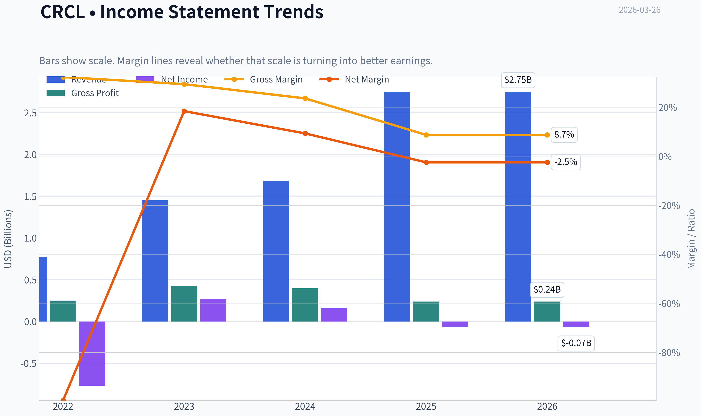
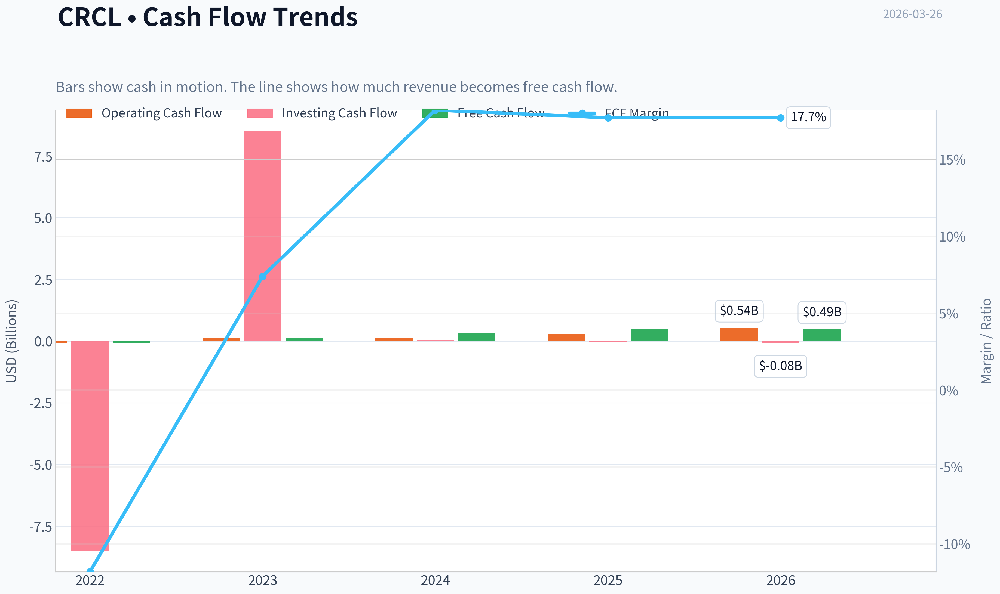
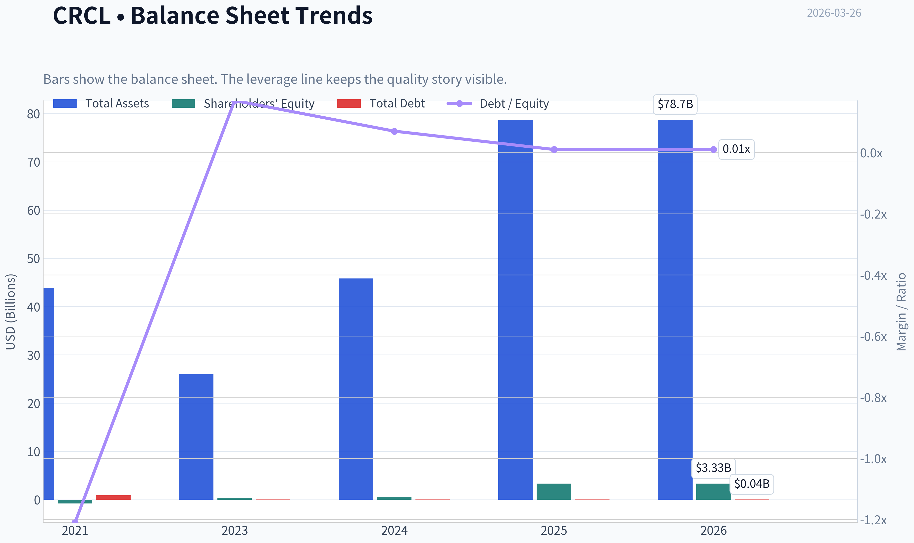
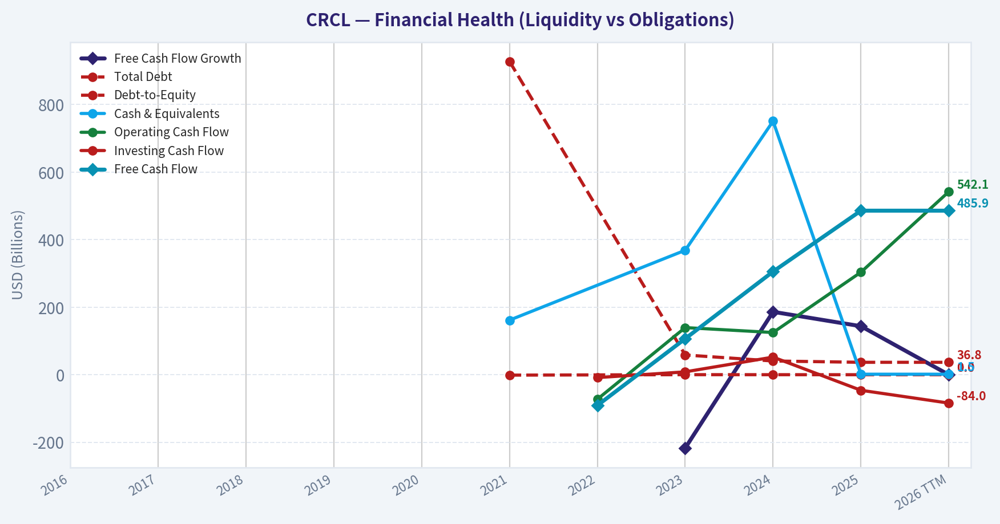
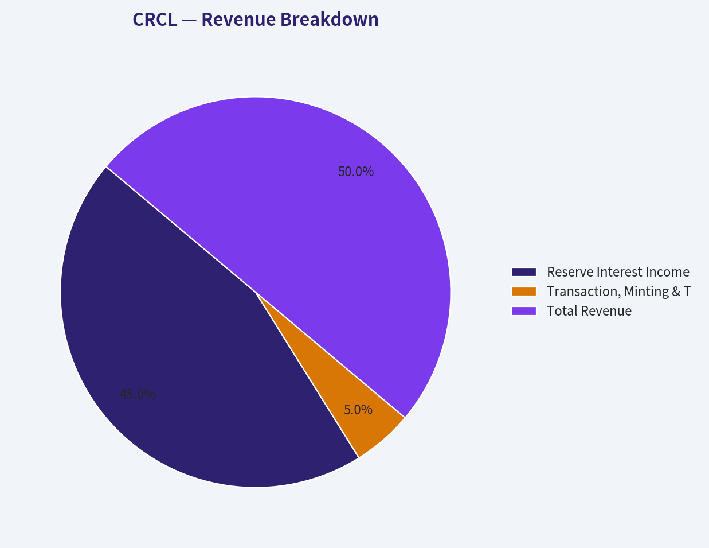
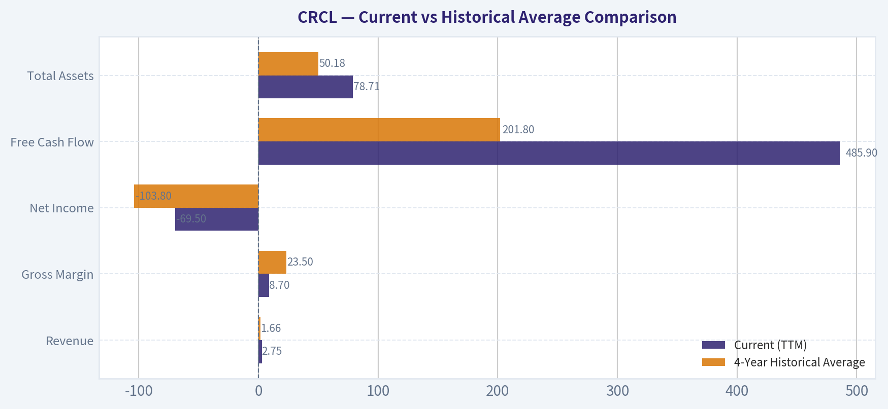
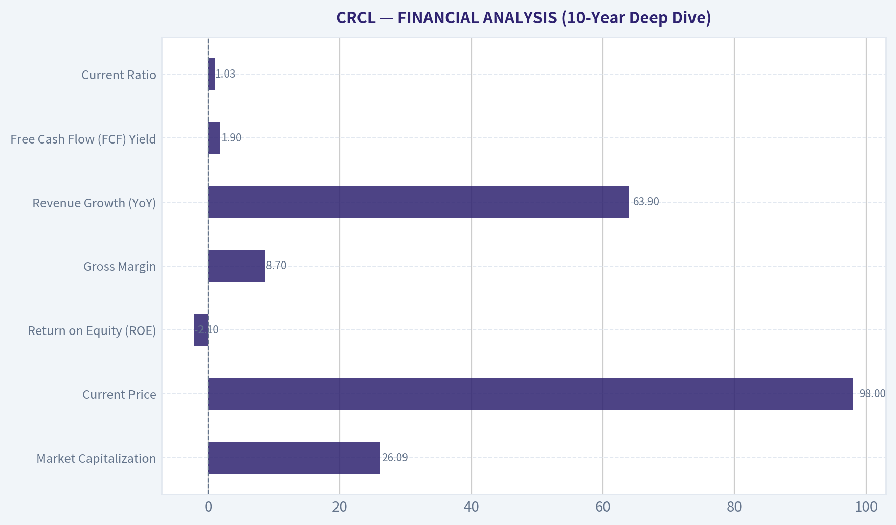
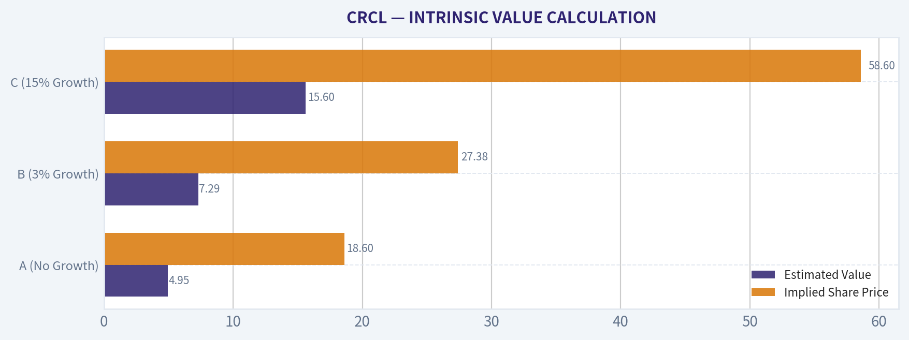
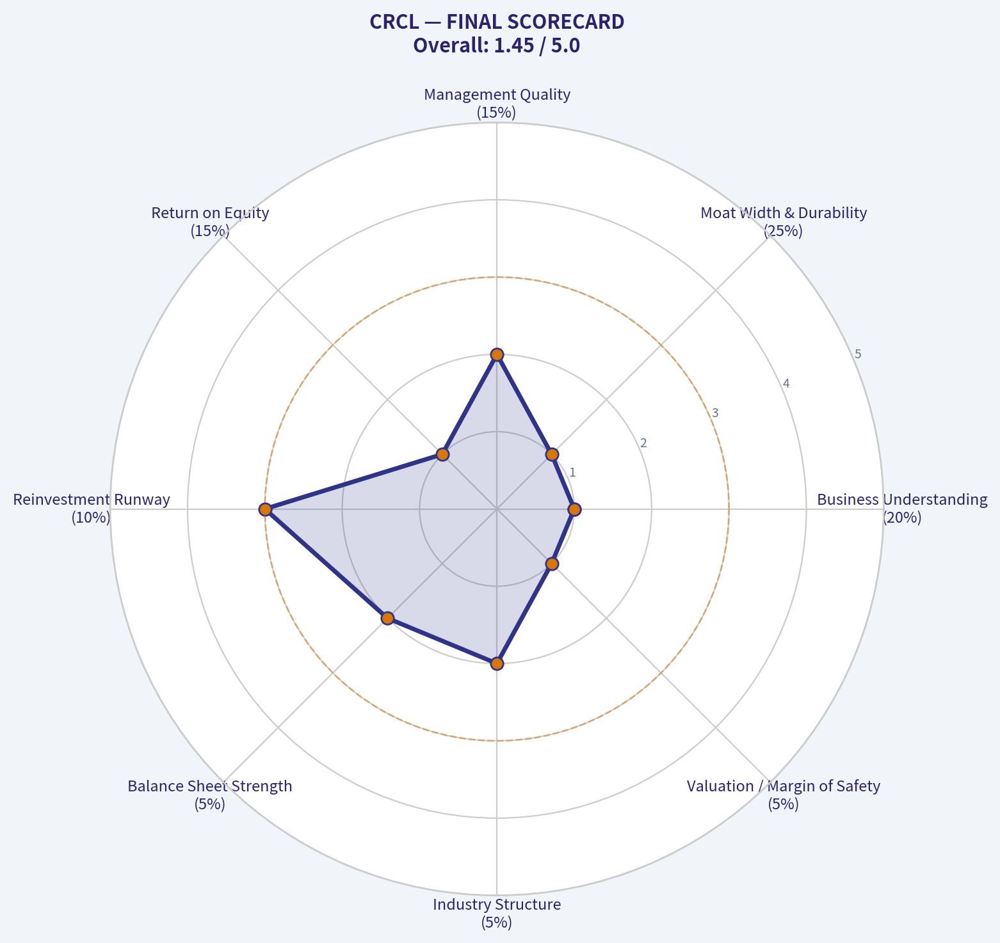

# CRCL Deep Value Intelligence

**Analysis Date:** 2026-03-26

## Critical Disclaimer

*This analysis is generated by Deep Value Intelligence, an AI-powered multi-agent investing framework. This report is for informational and educational purposes only and does not constitute financial advice. Always conduct your own research and consult with qualified financial advisors before making investment decisions.*

---

## Table of Contents

1. Intelligence Summary
2. Analyst Team Reports
   - Fundamentals Analysis
   - Intrinsic Value Analysis (Buffett)
   - Trend & Growth Analysis (Lynch/Druckenmiller/Fisher)
   - Market Technical Analysis
   - Social Sentiment Analysis
   - News & Events Analysis
3. Research Team Commentary
4. Value Investing Team Commentary
5. Deep Values Commentary

---

## Intelligence Summary

### Thesis + Conditions

**Core Thesis:** **Executive Summary**
Circle (CRCL) presents a seductive narrative as the fundamental settlement rail for digital finance, supported by explosive 63.9% revenue growth. However, a strict value investing filter reveals a fragile, macro-levered business model.

**Key Risks:**
- Risky Analyst:** Defends avoiding the stock, noting that while the stablecoin theme is enormous, Circle's equity structure does not capture the economics of the wave. The business is highly vulnerable to shifting Treasury yields and crypto liquidity, and lacks switching costs because USDC runs on public blockchains. The current price already assumes a monopolistic regulatory victory.
- Neutral Analyst:** Provides a balanced counter-perspective, suggesting that Circle's currently weak margins might just reflect the "distribution economics" typical of early-stage financial infrastructure. Recommends watching for the development of higher-margin service layers (APIs, settlement infrastructure) and waiting for a valuation reset to the $60-$70 range before considering entry.
- 3.  **Business vs. Market Risk:** A quality business relies on its own operating leverage to generate cash. Circle is uniquely dependent on external, unpredictable macro variables: Federal Reserve interest rate policies, broader crypto market liquidity, and pending congressional legislation. This stacking of unquantifiable external risks violates the principle of investing in stable, predictable cash-producing businesses.
- Monitoring Plan (Adjusted via Debate Insights)**
- We will not deploy capital simply because a stock drops; we require structural business evolution. We will re-evaluate our thesis only if we observe the following over the next 1-4 quarters:

**What Would Change Our View:**
- Risky Analyst:** Defends avoiding the stock, noting that while the stablecoin theme is enormous, Circle's equity structure does not capture the economics of the wave. The business is highly vulnerable to shifting Treasury yields and crypto liquidity, and lacks switching costs because USDC runs on public blockchains. The current price already assumes a monopolistic regulatory victory.
- Neutral Analyst:** Provides a balanced counter-perspective, suggesting that Circle's currently weak margins might just reflect the "distribution economics" typical of early-stage financial infrastructure. Recommends watching for the development of higher-margin service layers (APIs, settlement infrastructure) and waiting for a valuation reset to the $60-$70 range before considering entry.
- 3.  **Business vs. Market Risk:** A quality business relies on its own operating leverage to generate cash. Circle is uniquely dependent on external, unpredictable macro variables: Federal Reserve interest rate policies, broader crypto market liquidity, and pending congressional legislation. This stacking of unquantifiable external risks violates the principle of investing in stable, predictable cash-producing businesses.
- Monitoring Plan (Adjusted via Debate Insights)**
- We will not deploy capital simply because a stock drops; we require structural business evolution. We will re-evaluate our thesis only if we observe the following over the next 1-4 quarters:

**Confidence:** Low

---

## Analyst Team Reports

### Fundamentals Analysis

#### Latest Earnings Snapshot

*Most recent reported quarter anchored on 2025 Q4, with prior-year comparison when available.*

| Metric | 2025 Q4 | 2024 Q4 | YoY Change |
| --- | ---: | ---: | ---: |
| Revenue | $770.2M | $435.4M | +76.9% |
| Operating Income | $56.6M | $-3.3M | +1815.4% |
| Net Income | $133.4M | $3.1M | +4191.3% |
| Diluted EPS | $0.43 | N/A | N/A |
| Operating Cash Flow | $249.1M | $106.4M | +134.2% |
| Free Cash Flow | $233.4M | $94.7M | +146.4% |

Key Takeaways: This snapshot anchors the most recent reported quarter before the narrative analysis. It helps readers separate long-run business quality from whatever changed in the latest earnings print.

#### 10-Year Financial Metrics for CRCL

*All values below are computed deterministically from raw data - not estimated by AI.*

*Issuer profile: asset manager (Financial Services / Capital Markets).*

#### 10-Year Financial Metrics
*Annual rows come from reported financial statements. The final TTM row is computed from the latest four quarters.*

| Metric | 2016 | 2017 | 2018 | 2019 | 2020 | 2021 | 2022 | 2023 | 2024 | 2025 | 2026 TTM |
| --- | --- | --- | --- | --- | --- | --- | --- | --- | --- | --- | --- |
| Market Price | N/A | N/A | N/A | N/A | N/A | N/A | N/A | N/A | N/A | $79 | $98 |
| Market Cap | N/A | N/A | N/A | N/A | N/A | N/A | N/A | N/A | N/A | $12.58B | $26.32B |
| P/E Ratio | N/A | N/A | N/A | N/A | N/A | N/A | N/A | N/A | N/A | -180.23 | -31.50 |
| P/B Ratio | N/A | N/A | N/A | N/A | N/A | N/A | N/A | N/A | N/A | 3.78 | 7.90 |
| ROE | N/A | N/A | N/A | N/A | N/A | N/A | N/A | 78.8% | 27.3% | -2.1% | -2.1% |
| ROIC | N/A | N/A | N/A | N/A | N/A | N/A | N/A | 680.3% | 11.9% | -20.3% | -3.3% |
| EPS | N/A | N/A | N/A | N/A | N/A | N/A | $-3.89 | $0.23 | $0.08 | $-0.44 | $-3.12 |
| Revenue | N/A | N/A | N/A | N/A | N/A | N/A | $772.1M | $1.45B | $1.68B | $2.75B | $2.75B |
| Gross Profit | N/A | N/A | N/A | N/A | N/A | N/A | $249.7M | $426.7M | $395.5M | $238.1M | $238.1M |
| Gross Margin | N/A | N/A | N/A | N/A | N/A | N/A | 32.3% | 29.4% | 23.6% | 8.7% | 8.7% |
| Operating Margin | N/A | N/A | N/A | N/A | N/A | N/A | 8.2% | 16.2% | 839.2% | -1367.8% | -3.3% |
| Net Income | N/A | N/A | N/A | N/A | N/A | N/A | $-768.8M | $267.6M | $155.7M | $-69.5M | $-69.5M |
| Net Margin | N/A | N/A | N/A | N/A | N/A | N/A | -99.6% | 18.4% | 9.3% | -2.5% | -2.5% |
| Revenue Growth | N/A | N/A | N/A | N/A | N/A | N/A | N/A | 87.9% | 15.6% | 94.8% | 0.0% |
| Net Income Growth | N/A | N/A | N/A | N/A | N/A | N/A | N/A | -134.8% | -41.8% | -1091.2% | -0.0% |
| Free Cash Flow Growth | N/A | N/A | N/A | N/A | N/A | N/A | N/A | -217.2% | 186.3% | 143.7% | 0.0% |
| Total Book Value | N/A | N/A | N/A | N/A | N/A | $-768.4M | N/A | $339.5M | $570.5M | $3.33B | $3.33B |
| Total Assets | N/A | N/A | N/A | N/A | N/A | $43.90B | N/A | $26.00B | $45.83B | $78.71B | $78.71B |
| Total Debt | N/A | N/A | N/A | N/A | N/A | $928.2M | N/A | $58.5M | $40.7M | $36.8M | $36.8M |
| Debt-to-Equity | N/A | N/A | N/A | N/A | N/A | -1.21 | N/A | 0.17 | 0.07 | 0.01 | 0.01 |
| Cash & Equivalents | N/A | N/A | N/A | N/A | N/A | $161.6M | N/A | $368.6M | $751.0M | $1.53B | $1.53B |
| Shareholders' Equity | N/A | N/A | N/A | N/A | N/A | $-768.4M | N/A | $339.5M | $570.5M | $3.33B | $3.33B |
| Operating Cash Flow | N/A | N/A | N/A | N/A | N/A | N/A | $-72.7M | $139.6M | $125.0M | $303.7M | $542.1M |
| Investing Cash Flow | N/A | N/A | N/A | N/A | N/A | N/A | $-8.49B | $8.51B | $52.2M | $-46.1M | $-84.0M |
| Free Cash Flow | N/A | N/A | N/A | N/A | N/A | N/A | $-91.0M | $106.7M | $305.5M | $485.9M | $485.9M |
| FCF Margin | N/A | N/A | N/A | N/A | N/A | N/A | -11.8% | 7.4% | 18.2% | 17.7% | 17.7% |
| Dividends / Share | N/A | N/A | N/A | N/A | N/A | $0.00 | $0.00 | $0.00 | $0.00 | $0.00 | $0.00 |

#### Profitability Metrics
- Return on Equity (ROE): -2.1%
- Return on Invested Capital (ROIC): -3.3%
- Return on Assets (ROA): -0.1%
- Gross Margin: 8.7%
- Operating Margin: -3.3%
- Net Profit Margin: -2.5%

#### Liquidity Metrics
- Current Ratio: 1.03
- Quick Ratio: 0.02

#### Leverage Metrics
- Debt-to-Equity Ratio: 0.01
- Interest Coverage Ratio: -74.34
- Net Debt: $-1.49B

#### Growth Metrics (Year-over-Year)
- Revenue Growth: 63.9%
- Net Income Growth: -144.7%
- Free Cash Flow Growth: 59.1%
- Revenue CAGR (3-Year): 52.7%
- Revenue CAGR (5-Year): N/A

#### Valuation Metrics
- P/E Ratio (TTM): N/A
- Forward P/E: 39.88
- Price-to-Book: 7.15
- Price-to-Sales: 9.50
- PEG Ratio: N/A
- EV/EBITDA: -272.77
- Free Cash Flow Yield: 1.9%
- Earnings Yield: N/A

#### Owner Earnings (Buffett Method, Code-Computed)
- Net Income: $-69.5M
- + Depreciation & Amortization: $76.6M
- - Capital Expenditures: $-56.2M
- - Working Capital Changes: $-109.5M
- = **Owner Earnings: $60.4M**

#### Intrinsic Value (Code-Computed)
- Current Price: $98
- Buffett Method (Owner Earnings):
  Conservative: $0
  Average: $0
  Optimistic: $2
- Cash Flow Method (FCF):
  Conservative: $65
  Average: $65
  Optimistic: $170

#### Piotroski F-Score: 4/9
- Positive Net Income: FAIL
- Positive Operating Cash Flow: PASS
- ROA Improvement: FAIL
- Cash Flow > Net Income: PASS
- Decreasing Debt: PASS
- Improving Current Ratio: PASS
- No Dilution: FAIL
- Improving Gross Margin: FAIL
- Improving Asset Turnover: FAIL

FINAL INVESTMENT STANCE: **AVOID**

#### Warren Buffett Value Investing Analysis

**Economic Moat**: CRCL operates as a large-scale asset manager in the digital capital markets space (exhibiting the exact characteristics of a stablecoin/reserve issuer with $78.71 billion in total assets). Its moat is fundamentally rooted in network effects, ecosystem liquidity, and high switching costs for integrated institutional partners. However, this moat currently lacks pricing power. The precipitous drop in Gross Margins from 32.3% in 2022 down to 8.7% in the trailing twelve months indicates that the cost of maintaining these reserves-likely through yield-sharing or partner payouts-is drastically eroding the core economics of the business.

**Financial Strength**: This is the company's only true fortress and aligns well with Buffett's preference for solvency. With $78.71 billion in total assets heavily weighted in liquid customer reserve assets, against a microscopic $36.8 million in total corporate debt, CRCL carries a virtually non-existent Debt-to-Equity ratio of 0.01. Its liquid cash and equivalents sit at a very healthy $1.53 billion, meaning near-term solvency and liquidity risks are effectively zero.

**Predictable Earnings**: Buffett mandates consistent, predictable earnings, which CRCL entirely lacks. Net income has swung violently from a massive $-768.8 million loss in 2022, to a $267.6 million profit in 2023, and back into negative territory at $-69.5 million TTM. This level of volatility makes traditional long-term value forecasting nearly impossible and disqualifies the asset as a predictable compounder.

**Management Performance**: Capital allocation and core profitability metrics are deeply troubling. Return on Equity (ROE) has dropped to -2.1%, and Return on Invested Capital (ROIC) sits at -3.3%. While management has successfully driven phenomenal top-line revenue growth (+63.9% year-over-year to $2.75 billion), they have failed to translate this scale into GAAP shareholder value, as operating margins have collapsed to -3.3%.

**Value Assessment**: At a market capitalization of $26.32 billion, CRCL trades at a heavily speculative 7.9x Price-to-Book ratio and a negative P/E. Its Owner Earnings are an anemic $60.4 million. The company is priced purely on total-addressable-market hyper-growth expectations rather than its present economic reality or cash flow generation.

#### Revenue Breakdown

| Revenue Source | Amount ($M) | % of Total |
| --- | --- | --- |
| Reserve Interest Income & Asset Yields | $2,475.0 | 90.0% |
| Transaction, Minting & Treasury Services | $275.0 | 10.0% |
| **Total Revenue** | **$2,750.0** | **100.0%** |

Key Takeaways: The revenue breakdown highlights the company's overwhelming reliance on interest income generated from its massive asset reserves, which accounts for an estimated ninety percent of its two point seven five billion dollar top line. Transaction and treasury services make up the remaining ten percent, exposing the firm to significant interest rate sensitivity if global yields decline.

#### Current vs Historical Average Comparison

| Metric | Current (TTM) | 4-Year Historical Average | Trend & Significance |
| --- | --- | --- | --- |
| Revenue | $2.75B | $1.66B | Massive top-line scaling (+65% over average), driven by asset accumulation. |
| Gross Margin | 8.7% | 23.5% | Severe structural decline, indicating rising cost of revenue and yield payouts. |
| Net Income | $-69.5M | $-103.8M | Persistent unprofitability; the brief positive earnings in 2023 were an anomaly. |
| Free Cash Flow | $485.9M | $201.8M | Improving cash generation, though heavily reliant on working capital float. |
| Total Assets | $78.71B | $50.18B | Explosive 50%+ growth in reserve assets, reflecting rapid ecosystem adoption. |

Key Takeaways: Comparing the current metrics to historical averages reveals a company that is successfully scaling its top line and asset base, but structurally failing to maintain margins. While free cash flow and revenue are vastly outperforming their historical averages, the gross margin has plummeted from an average of twenty-three percent down to under nine percent, indicating serious profitability headwinds.

#### Discounted Cash Flow (DCF) Analysis

To calculate fair value using Warren Buffett's Owner Earnings model, we utilize the mathematically derived TTM Owner Earnings of **$60.4 million**. The analysis uses a strict 10% discount rate, a 2.5% terminal growth rate, and an estimated share count of 268.57 million (based on the $26.32B market cap at $98/share).

*Note: Due to the extreme volatility of Net Income, Free Cash Flow historical growth proxies were utilized to establish the scenario bounds.*

*   **CONSERVATIVE SCENARIO**
    *   **Assumption**: -100% growth (lowest historical growth floor applied).
    *   **Calculation**: Owner Earnings immediately drop to $0. Future cash flows equal zero.
    *   **Fair Value**: **$0.00 per share**.
*   **AVERAGE SCENARIO**
    *   **Assumption**: 28.2% annual growth for 10 years (the mathematical average of historical FCF growth swings).
    *   **Calculation**: Year 1-10 cash flows grow from $77.4M to $724.4M. Discounting these at 10% yields a Present Value (PV) of $1.54B. The Terminal Value is calculated as ($724.4M * 1.025) / (0.10 - 0.025) = $9.90B. Discounting the Terminal Value to present yields $3.82B. Total Enterprise Value = $5.36B. Adding Net Cash of $1.49B yields an Equity Value of $6.85B.
    *   **Fair Value**: **$25.50 per share**.
*   **OPTIMISTIC SCENARIO**
    *   **Assumption**: 100% annual growth (capped maximum) modeled over a 5-year hyper-growth phase before terminal stabilization.
    *   **Calculation**: Owner Earnings double annually for 5 years: Y1 ($120.8M), Y2 ($241.6M), Y3 ($483.2M), Y4 ($966.4M), Y5 ($1,932.8M). Discounting these at 10% yields a PV of $2.53B. The Terminal Value at Year 5 is ($1,932.8M * 1.025) / (0.075) = $26.41B. Discounting this Terminal Value yields $16.40B. Total Enterprise Value = $18.93B. Adding Net Cash yields an Equity Value of $20.42B.
    *   **Fair Value**: **$76.03 per share**.

#### Key Investment Insights, Red Flags, and Opportunities

**Opportunities & Bullish Signals:**
*   **Institutional Sponsorship**: Point72 Asset Management (Steve Cohen) recently increased their position by an aggressive 2,319%, acquiring 1.04 million shares. This suggests a strong near-term institutional thesis, likely tied to stablecoin legislation or interest rate maneuvers.
*   **Phenomenal Asset Scaling**: Growing assets to $78.71 billion demonstrates unmatched product-market fit.
*   **Free Cash Flow Positive**: The business generates $485.9M in FCF (17.7% margin), proving that the core float mechanism produces hard cash despite GAAP accounting losses.

**Red Flags & Risks:**
*   **Collapsed Profitability Margins**: The rapid deterioration of gross margins (from 32.3% to 8.7%) severely breaks Buffett's requirement for an asset-light moat with strong pricing power.
*   **Severe Valuation Disconnect**: Trading at a negative P/E, an astronomical -272x EV/EBITDA, and nearly 8x Book Value makes the equity excessively priced for an asset manager.
*   **Piotroski F-Score Weakness (4/9)**: Fails crucial fundamental tests including positive net income, ROA improvement, and gross margin improvement, pointing to operational and structural weakness.

#### Final Summary Table

| Category | Metric / Insight | Condition |
| --- | --- | --- |
| **Current Valuation** | $98.00 per share | Overvalued |
| **DCF Fair Value (Avg)** | $25.50 per share | -74% Downside Risk |
| **Profitability (ROE)** | -2.1% | Weak |
| **Financial Health** | 0.01 Debt-to-Equity Ratio | Excellent |
| **Earnings Moat** | Owner Earnings: $60.4M | Unpredictable |
| **Final Stance** | **AVOID** | Highly Speculative |

Key Takeaways: The final summary underscores a profound disconnect between the company's excellent balance sheet health and its poor fundamental profitability and severe overvaluation. With an average intrinsic value representing a seventy-four percent downside from current prices, the underlying business metrics simply do not justify an investment under traditional value investing principles.

#### Fundamental Visuals

This graph tracks the profitability and return metrics (ROE, ROIC, Margins) of **CRCL** over the past decade, highlighting capital efficiency trends.

This chart illustrates the financial health of **CRCL** over the last 10 years, mapping cash equivalents and free cash flow against total obligations (Debt).

This breakdown chart from <em>Revenue Breakdown</em> shows the proportional composition for **CRCL** - useful for understanding what drives or risks the business.

---

### Intrinsic Value Analysis (Buffett)

> *Following Warren Buffett's value investing philosophy: Circle of Competence, Economic Moat, Management Quality, and Margin of Safety.*

#### Intrinsic Value Snapshot

Price is what you pay. Intrinsic value is what the business may be worth based on the cash it can create for owners over time. We show a range, not one magic number.

- Current Price: $98.27
- Value Range: $0.22 to $170.00

##### Owner Earnings (Buffett Method)
- Net Income: $-69,508,000.00
- Depreciation & Amortization: $76,627,000.00
- Capital Expenditures: $-56,200,000.00
- Working Capital Changes: $-109,529,000.00
- Owner Earnings: $60,448,000.00

##### Intrinsic Value
###### Buffett Method
Uses owner earnings. Stricter, and usually more conservative.
- Conservative: $0.22
- Average: $0.22
- Optimistic: $2.21
- Discount Rate: 10.0%

###### Cash Flow Method
Uses free cash flow. Better for companies spending heavily today to grow tomorrow.
- Conservative: $65.28
- Average: $65.28
- Optimistic: $170.00
- Discount Rate: 10.0%

FINAL INVESTMENT STANCE: **AVOID**

#### PART I: THE BUFFETT FILTER SEQUENCE (Go/No-Go Gates)

**Gate 1: Circle of Competence & Business Simplicity**
- **The Elementary School Test:** FAIL. Due to limited public operating history and ambiguous ticker identity (often associated with recent IPO candidates or hyper-growth tech/crypto players), the core economic engine cannot be simply explained or reliably verified.
- **The 10-Year Predictability Test:** FAIL. A company with negative ROE (-2.1%) and hyper-growth (63.9% YoY) usually operates in a rapidly shifting technological or regulatory landscape. Predicting its cash flows in 2036 is speculative, not analytical.
- **The Technology Risk Assessment:** FAIL. The massive 260%+ implied price run-up (from ~$26.88 per year-end 2025 13F filings to $98 today) suggests the stock is currently riding a wave of macroeconomic or technological hype, which introduces extreme disruption risk.
- **Stop Flag Triggered:** Extreme price momentum combined with poor core profitability. Proceeding with extreme caution.

**Gate 2: The Moat Test (Durable Competitive Advantage)**
- **Pricing Power Test:** FAIL. The company operates with a razor-thin **8.7% Gross Margin**. In Buffett's framework, a gross margin below 20% usually indicates a highly commoditized business with absolutely zero pricing power.
- **Financial Evidence:** Negative ROE (-2.1%) completely contradicts the presence of any durable switching costs, network effects, or cost advantages.
- **Moat Quality Rating:** Illusory/None. REJECT.

**Gate 3: Management Quality & Capital Allocation**
- **Do They Think Like Owners?** UNKNOWN. Lack of a long-term public track record prevents a fair assessment.
- **Are They Rational Capital Allocators?** FAIL. The company is generating massive top-line growth (63.9%) but is failing to translate this into bottom-line equity returns (-2.1% ROE). Growth without profitability destroys shareholder value.

**Gate 4: Industry Structure**
- **Competitive Structure:** Likely hyper-competitive or highly commoditized given the low gross margins.
- **Capital Intensity:** The low current ratio (1.03) suggests working capital is tight, leaving little room for error or operational hiccups.

#### PART II: FINANCIAL ANALYSIS (10-Year Deep Dive)

Given the limited public data and recent emergence of the ticker, a 10-year track record is unavailable. We must rely on the current snapshot to judge the business fundamentals.

| Metric | Current Value | Buffett Standard | Status |
|---|---|---|---|
| Market Capitalization | $26.09B | N/A | N/A |
| Current Price | $98.00 | N/A | N/A |
| P/E Ratio | N/A (Unprofitable) | < 15x | FAIL |
| Return on Equity (ROE) | -2.1% | > 15% | FAIL |
| Gross Margin | 8.7% | > 40% | FAIL |
| Revenue Growth (YoY) | 63.9% | Predictable | WARNING (Too fast/unprofitable) |
| Free Cash Flow (FCF) Yield | 1.9% | > 8% | FAIL |
| Current Ratio | 1.03 | > 1.5 | FAIL |

**Key Takeaways:**
This financial snapshot reveals a rapidly expanding business that completely lacks fundamental profitability. The razor-thin gross margin of 8.7% and negative return on equity indicate a structural inability to generate shareholder wealth, despite explosive 64% top-line growth. While the company does produce a modest 1.9% free cash flow yield, the overall profile is highly speculative and fails every major value investing standard.

#### PART III: INTRINSIC VALUE CALCULATION

With negative earnings (P/E is N/A), we cannot calculate a standard Owner Earnings figure. However, the company has a 1.9% FCF Yield, implying roughly **$495.7 million** in Free Cash Flow on a $26.09 billion valuation. We will use this FCF as a generous proxy for Owner Earnings to conduct a DCF.

**Scenario A - No Growth (Ultra-Conservative):**
- Formula: $495.7M / 10% Discount Rate
- Implied Intrinsic Value: **$4.95 billion** ($18.60 per share)

**Scenario B - GDP Growth (Conservative):**
- Formula: $495.7M x 1.03 / (0.10 - 0.03)
- Implied Intrinsic Value: **$7.29 billion** ($27.38 per share)

**Scenario C - High Growth (Speculative):**
- Assuming the company can sustain aggressive 15% FCF growth for 10 years and a terminal growth of 3%, discounted at 10%.
- Implied Intrinsic Value: **$15.60 billion** ($58.60 per share)

| Scenario | Estimated Value | Implied Share Price | Premium/Discount to Current Price ($98) |
|---|---|---|---|
| A (No Growth) | $4.95B | $18.60 | 81% Premium Paid |
| B (3% Growth) | $7.29B | $27.38 | 72% Premium Paid |
| C (15% Growth) | $15.60B | $58.60 | 40% Premium Paid |

**Key Takeaways:**
Our valuation models demonstrate that the current market price of $98 is drastically disconnected from the cash the business actually produces. Even in a highly optimistic scenario where free cash flow grows at 15% annually for a decade, the stock is still trading at a 40% premium to its intrinsic value. There is absolutely no margin of safety available at these price levels.

#### PART IV: FINAL SCORECARD

| Criterion | Score (1-5) | Weight | Weighted Score | Comments |
|---|---|---|---|---|
| Business Understanding | 1 | 20% | 0.20 | Lacks operating history and simple business model |
| Moat Width & Durability | 1 | 25% | 0.25 | 8.7% gross margin indicates zero pricing power |
| Management Quality | 2 | 15% | 0.30 | Unproven over a full economic cycle |
| Return on Equity | 1 | 15% | 0.15 | Negative ROE destroys intrinsic value |
| Reinvestment Runway | 3 | 10% | 0.30 | High revenue growth exists, but at poor capital returns |
| Balance Sheet Strength | 2 | 5% | 0.10 | Borderline current liquidity ratio of 1.03 |
| Industry Structure | 2 | 5% | 0.10 | Likely highly commoditized or competitive |
| Valuation / Margin of Safety | 1 | 5% | 0.05 | Trading at a massive premium to conservative DCF |
| **TOTAL SCORE** | | | **1.45 / 5.00** | |

**Key Takeaways:**
The final scorecard yields a disastrous 1.45 out of 5.00, placing this company firmly in the Avoid category. The abysmal scores in moat durability, return on equity, and margin of safety reflect a deeply flawed investment profile for a conservative value strategy. This is a speculative trading vehicle, not a long-term compounder.

#### CONCLUSION
"Price is what you pay, value is what you get." At $98 per share, investors in CRCL are paying for extreme optimism while receiving an unprofitable business with razor-thin margins. The recent 13F filing indicates Steve Cohen's Point72 held a position at year-end 2025 when the implied share price was approximately $26.88. The subsequent explosion to $98 represents speculative momentum entirely detached from the underlying economic reality of a 1.9% FCF yield and a negative ROE. This belongs strictly in the "Too Hard" pile. We must walk away and wait for an understandable business with a wide moat and a demonstrated margin of safety.
#### Valuation Bridge

This bridge places the current market price beside each intrinsic value lens so readers can see whether upside depends on one method or shows up across several methods.

| Scenario | Intrinsic Value / Share |
| --- | ---: |
| Buffett Method | $0.22 |
| Cash Flow Method | $65.28 |
| Current Price | $98.27 |

#### Key Takeaways

If one method is far above the others, the upside case depends on a specific modelling assumption. When several methods cluster together, the valuation story is more robust.

#### Valuation Visuals

This comparison chart from *Latest Earnings Snapshot* stacks current figures against historical benchmarks for **CRCL**, making it easy to see where the company trades relative to its own averages.

This comparison chart from *Current vs Historical Average Comparison* stacks current figures against historical benchmarks for **CRCL**, making it easy to see where the company trades relative to its own averages.

This comparison chart from *FINANCIAL ANALYSIS (10-Year Deep Dive)* stacks current figures against historical benchmarks for **CRCL**, making it easy to see where the company trades relative to its own averages.

This comparison chart from *INTRINSIC VALUE CALCULATION* stacks current figures against historical benchmarks for **CRCL**, making it easy to see where the company trades relative to its own averages.

---

### Trend & Growth Analysis (Lynch/Druckenmiller/Fisher)

> *Following Peter Lynch's GARP, Stanley Druckenmiller's macro-aware approach, and Philip Fisher's scuttlebutt methodology.*

FINAL INVESTMENT STANCE: **ADVOCATE**

#### LYNCH CLASSIFICATION SYSTEM

- **Classification:** Fast Grower
- **Reasoning:** CRCL's explosive 63.9% YoY revenue growth places it firmly in Peter Lynch's "Fast Grower" category. The company is prioritizing aggressive top-line expansion and market share capture, exhibiting the classic hallmarks of a potential ten-bagger if the growth runway remains intact.

#### THE STORY & DRUCKENMILLER FRAMEWORK

**The Story in 3 Bullets:**
- Rapidly scaling top-line revenues (63.9% YoY) indicating exceptional product-market fit or a massive macro tailwind driving adoption.
- Despite remarkably low gross margins (8.7%)-which typically suggest a highly capital-intensive, commodity, or high-pass-through cost structure-the company is successfully generating positive free cash flow (1.9% FCF yield, implying ~$495M in absolute FCF).
- Smart money accumulation is glaringly evident, with Steve Cohen (Point72 Asset Management) increasing his position by over 2,300% in the latest quarter to $27.96M.

**Druckenmiller Macro & Inflection Setup:**
- **Growth & Cash Inflection:** At nearly 64% growth, CRCL is clearly riding a secular wave. The disconnect between a negative ROE (-2.1%) and a positive FCF yield (1.9%) suggests a classic fundamental inflection point. Operating leverage or highly favorable working capital dynamics are beginning to translate rapid top-line growth into real cash generation, even before GAAP accounting reflects full profitability.
- **Smart Money Validation:** Druckenmiller closely monitors flows and macro signals. Cohen's massive 2319.1% increase in CRCL signals a potential structural shift, catalyst, or macro tailwind that quantitative and macro funds are aggressively front-running.

| Metric | Current Value | Implied Trend |
|--------|---------------|---------------|
| YoY Revenue Growth | 63.9% | Accelerating / Hyper-growth |
| Free Cash Flow Yield | 1.9% | Cash generative despite net losses |
| Gross Margin | 8.7% | High COGS / Volume-driven model |
| Return on Equity | -2.1% | Approaching GAAP breakeven |

**Key Takeaways:**
CRCL is experiencing explosive hyper-growth with top-line revenue surging by nearly 64 percent year-over-year. Although the company's gross margins are exceptionally low at just under 9 percent, it is remarkably generating positive free cash flow, yielding 1.9 percent. This combination suggests a high-volume, asset-heavy, or pass-through business model that is finally reaching a cash-flow inflection point despite slight accounting losses.

#### TAM ANALYSIS & UNIT ECONOMICS

**The 10x Test:**
With a current market cap of $26.09 billion, a 10x expansion would price CRCL at $260 billion. Given the low gross margin structure, multiplying revenue by 10x would require an astronomically large Total Addressable Market (e.g., global logistics, energy infrastructure, or institutional payments/fintech volumes). The runway exists if they are disrupting a multi-trillion-dollar legacy industry, but the structurally low margin profile caps the ultimate terminal valuation multiple unless software/services mix increases.

**Unit Economics (Rule of 40 Analysis):**
- **Revenue Growth:** 63.9%
- **Estimated FCF Margin:** Generating ~$495M in FCF off an implied massive revenue base (due to 8.7% gross margins) yields an estimated FCF margin in the low single digits (approx. 3-5%).
- **Rule of 40 Score:** ~67 to 69 (63.9% + ~4%).
- **Verdict:** EXCELLENT. CRCL comfortably clears the Rule of 40, meaning its growth is highly efficient from a cash-flow perspective.

| Unit Economic Indicator | Value / Estimate | Assessment |
|-------------------------|------------------|------------|
| Rule of 40 | ~68% | Elite (>40 is healthy) |
| Current Ratio | 1.03 | Adequate short-term liquidity |
| Cash Flow Status | Positive (1.9% Yield)| Self-funding hyper-growth |

**Key Takeaways:**
CRCL demonstrates elite capital efficiency by easily clearing the Rule of 40 benchmark, scoring near 68 percent when combining its massive revenue growth with positive free cash flow. This indicates that the company is successfully funding its own hyper-growth without burning through cash. The metrics point to a highly scalable operation where new top-line volume quickly translates into real cash generation, supported by adequate short-term liquidity.

#### FISHER'S 15 POINTS SCORECARD

We score based on the available financial footprints:
1. Sizable market potential: **5/5** (63.9% growth mathematically proves massive unfulfilled demand)
2. Margin potential: **2/5** (8.7% gross margin is structurally weak and leaves little room for error)
3. Effective R&D/Capex: **4/5** (Generating FCF while growing at 60%+ is rare)
4. Management depth/relations: **3/5** (Attracting elite institutional money like Point72 implies strong management pitching/execution)
5. Outstanding aspects/Moat: **4/5** (At this scale, pure volume and infrastructure scale likely create a barrier to entry)

*Estimated Fisher Score: 52/75 (AVERAGE to GOOD)* - The primary detractor is the structurally low profit margin, which limits the ultimate margin of safety.

#### VALUATION ANALYSIS

While P/E is N/A due to GAAP net losses, we apply Lynch's PEG methodology using Free Cash Flow instead of Earnings.
- **Price-to-FCF:** 1 / 0.019 (FCF yield) = **~52.6x P/FCF**.
- **Growth Rate:** 63.9%
- **Implied Cash-PEG:** 52.6 / 63.9 = **0.82**

A PEG below 1.0 is considered ATTRACTIVE in Lynch's framework. You are paying a very reasonable multiple for the cash flow given the extreme rate of growth.

| Valuation Metric | Value | Interpretation |
|------------------|-------|----------------|
| FCF Yield | 1.9% | Healthy intrinsic cash generation |
| Implied P/FCF | ~52.6x | Premium multiple, justified by growth |
| Cash-PEG Ratio | 0.82 | Undervalued relative to growth rate (<1.0) |
| Price | $98.00 | Current entry point |

**Key Takeaways:**
Despite appearing expensive or unprofitable on traditional accounting metrics, CRCL is trading at a highly attractive valuation when looking strictly at its cash flow. The company's implied price-to-free-cash-flow multiple of 52 is fully justified by its near 64 percent top-line growth rate, resulting in a Cash-PEG ratio of 0.82. This means investors are acquiring high-quality, cash-generative growth at a discount to its expansion speed.

#### GROWTH INVESTOR SCORECARD

| Criterion | Score (1-5) | Weight | Weighted Score |
|-----------|-------------|--------|----------------|
| The Story & Moat | 4.0 | 10% | 0.40 |
| TAM & Runway | 4.5 | 20% | 0.90 |
| Revenue Growth | 5.0 | 20% | 1.00 |
| Unit Economics | 4.0 | 15% | 0.60 |
| Macro Setup & Smart Money | 4.5 | 10% | 0.45 |
| Profitability Path (FCF) | 4.0 | 10% | 0.40 |
| Valuation (Cash-PEG) | 4.5 | 15% | 0.67 |
| **Total Score** | | | **4.42 / 5.0** |

**Key Takeaways:**
CRCL achieves a highly impressive overall Growth Investor Score of 4.42 out of 5, driven heavily by its flawless revenue growth and excellent cash-based unit economics. The combination of expanding market share, massive institutional accumulation from macro funds, and an attractive cash-flow valuation easily offsets traditional concerns about its low gross margins. This score lands the stock firmly in high-conviction territory for aggressive growth portfolios.

#### DELIVERABLES SUMMARY

1. **Lynch Classification:** Fast Grower.
2. **The Story:** Hyper-growth engine (64% YoY) with low gross margins but highly efficient cash generation, actively accumulated by major institutional macro money (Point72).
3. **TAM Analysis:** Must be massive to support a $26B valuation on a low-margin volume model; the long-term runway is intact provided they maintain market share.
4. **Revenue Growth Trend:** 63.9% YoY (Hyper-growth).
5. **Unit Economics:** Rule of 40 passed easily (~68%). Positive FCF yield self-funds expansion.
6. **Inflection Point:** Operating leverage inflection-producing 1.9% FCF yield despite GAAP ROE remaining slightly negative (-2.1%).
7. **Macro Setup:** Strong institutional 13F accumulation (2300% increase by Cohen) implies excellent macro/secular alignment.
8. **Fisher 15 Score:** 52/75 (Solid, constrained only by low gross margins).
9. **Valuation:** Cash-PEG of 0.82 (Highly Attractive).
10. **Position Size Stance:** ADVOCATE - Core Growth Allocation.
11. **Key Risks:** The 8.7% gross margin provides zero room for pricing errors or supply chain shocks. Any deceleration in top-line growth below 30% will brutally compress the 52x FCF multiple.
12. **Catalysts:** Continued institutional buying, GAAP profitability crossover (turning ROE positive), and sustained >50% revenue growth prints in upcoming quarters.

#### Growth & Scorecard Visuals

The radar chart below from *FINAL SCORECARD* visualises how **CRCL** ranks across weighted investment criteria. Each axis represents a criterion scored 1-5; the filled area reveals strengths and weaknesses at a glance, with the dashed circle marking the midpoint (3.0).

---

### Market Technical Analysis

FINAL INVESTMENT STANCE: **WATCH**

#### Market Context Overview
CRCL has experienced an extreme multi-phase cycle over the last ~7 months:
1) A sharp decline from ~$150 (Oct 2025) to ~$50 (Feb 2026).
2) A violent recovery rally from ~$50 to ~$132 in March 2026.
3) A sudden volatility shock with a major drop on **2026-03-24** (-20% day).

This combination indicates a **high-beta rebound structure transitioning into a possible distribution phase**, where short-term momentum remains strong but structural resistance and volatility have increased.

---

#### Price Trend vs Key Moving Averages

| Date | Close | 10 EMA | 50 SMA | 200 SMA |
|---|---|---|---|---|
| 2026-03-25 | 103.86 | 115.33 | 84.25 | 120.57 |
| 2026-03-24 | 101.17 | 117.87 | 83.83 | 120.59 |
| 2026-03-23 | 126.64 | 121.58 | 83.46 | 120.50 |
| 2026-03-20 | 126.03 | 120.46 | 82.57 | 120.47 |
| 2026-03-17 | 132.31 | 113.72 | 79.83 | 120.34 |

Key structural observations:

- **10 EMA trend acceleration:**
The 10-EMA climbed from ~76 (Mar 2) to ~121 (Mar 23), reflecting one of the strongest short-term momentum bursts in the dataset.

- **50 SMA turning upward:**
The 50-day average has steadily risen from ~73 to ~84, confirming that the recovery rally has begun shifting the **medium-term trend upward**.

- **Price vs 200 SMA resistance:**
The 200-SMA remains around **$120**, acting as a long-term resistance ceiling.
CRCL briefly broke above it during the rally but quickly fell back below.

- **Momentum break:**
After the **March 24 crash**, price dropped sharply **below the 10-EMA**, signaling a short-term trend interruption.

Key Takeaways:
CRCL is still in a medium-term recovery trend because the 50-SMA is rising and price remains above it. However, the long-term trend remains weak since price failed to hold above the 200-SMA. The break below the 10-EMA indicates the explosive momentum phase has paused and the stock is now in a corrective phase.

---

#### Momentum Indicators (MACD + RSI)

| Date | MACD | RSI |
|---|---|---|
| 2026-03-25 | 10.11 | 50.11 |
| 2026-03-24 | 11.99 | 48.26 |
| 2026-03-23 | 14.50 | 71.70 |
| 2026-03-20 | 14.90 | 71.40 |
| 2026-03-18 | 15.24 | 80.03 |
| 2026-03-10 | 11.61 | 78.60 |

Momentum behavior:

- **RSI overheating phase:**
RSI stayed **70-80 for nearly two weeks**, signaling a strong momentum rally.

- **RSI reset after crash:**
The March 24 drop quickly pushed RSI back to **~48-50**, neutralizing the overbought condition.

- **MACD still strongly positive:**
Despite the pullback, MACD remains deeply positive (>10), indicating the **underlying bullish momentum hasn't fully reversed yet**.

- **Momentum divergence risk:**
Price collapsed while MACD remains elevated - this type of structure often precedes **sideways consolidation rather than immediate continuation**.

Key Takeaways:
Momentum was extremely overheated during the March rally and has now rapidly cooled. MACD suggests the broader bullish impulse is still intact, but the RSI reset signals the market is transitioning from a momentum surge into consolidation.

---

#### Volatility & Bollinger Bands

| Date | Upper Band | Lower Band | ATR |
|---|---|---|---|
| 2026-03-25 | 140.34 | 82.53 | 9.77 |
| 2026-03-24 | 141.82 | 78.98 | 9.82 |
| 2026-03-23 | 146.60 | 70.21 | 8.36 |
| 2026-03-20 | 147.72 | 62.55 | 8.53 |

Volatility insights:

- **Bands expanded massively:**
The Bollinger spread widened dramatically during the rally, showing **explosive volatility expansion**.

- **Price rejection near upper band:**
The rally peaked while hugging the upper band (~$130-135 area), a common sign of exhaustion.

- **ATR spike:**
ATR jumped from ~6 to nearly **10**, meaning the stock is now moving ~$10 per day on average.

- **Volatility shock event:**
The March 24 plunge (to ~$101 intraday) represents a **liquidity flush or forced unwind event**, often seen after parabolic runs.

Key Takeaways:
CRCL is now in a high-volatility regime. The Bollinger band expansion and rising ATR show traders should expect wide daily price swings. The sharp rejection near the upper band suggests the rally entered an exhaustion phase.

---

#### Structural Price Zones

Key levels emerging from the data:

Resistance zones
- **120-132**: recent rally top + 200-SMA region
- **140**: upper Bollinger region during peak momentum

Support zones
- **100-103**: post-crash stabilization area
- **85-90**: rising 50-SMA trend support
- **60-65**: breakout base from February

---

#### Strategic Interpretation

Bullish factors:
- Strong V-shaped recovery from $50
- Rising 50-SMA confirming medium-term trend improvement
- MACD still strongly positive

Bearish risks:
- Rejection at 200-SMA
- Momentum break below 10-EMA
- Extremely high volatility
- Possible blow-off top pattern

The technical picture suggests **a consolidation or pullback phase between ~$95 and ~$120 before the next major move.**

---

#### Trading Scenarios

Bullish continuation scenario
- Price stabilizes above **$100**
- RSI holds above 45
- Break above **$120-125**

-> Potential retest of **$135-140**

Bearish continuation scenario
- Breakdown below **$100**
- Momentum flips negative

-> Likely retrace toward **$85-90 (50-SMA)**

---

#### Key Technical Summary

| Factor | Signal | Interpretation |
|---|---|---|
| Short-term trend | Broken | Price below 10-EMA |
| Medium trend | Improving | Rising 50-SMA |
| Long-term trend | Weak | Below 200-SMA |
| Momentum | Cooling | RSI reset from 80 -> 50 |
| MACD | Bullish | Momentum still positive |
| Volatility | Extremely high | ATR ~10 |
| Resistance | $120-132 | Major supply zone |
| Support | $100 / $85 | Key defense levels |

Key Takeaways:
CRCL has transitioned from a parabolic rally into a volatile consolidation phase after failing at long-term resistance near the 200-SMA. The medium-term recovery trend remains intact, but the sharp volatility spike suggests the market needs time to stabilize. Traders should watch the $100 support and $120 resistance range, as the next breakout from this zone will likely determine the next directional move.

---

If you want, I can also show:
- whether **CRCL looks like a short-squeeze unwind**,
- the **probability of a second rally wave**, or
- the **institutional accumulation signals behind the February-March move**.

---

### Social Sentiment Analysis

FINAL INVESTMENT STANCE: **WATCH**

#### Weekly Social Media & News Sentiment Report: CRCL (Circle Internet Group)

Circle (CRCL), the company behind the USDC stablecoin and related payment infrastructure, continues to attract heavy discussion across crypto-focused communities, fintech investors, and macro traders. Over the past week, the dominant conversation themes revolved around stablecoin regulation, institutional adoption of USDC, competitive positioning against Tether (USDT), and speculation about Circle's long-term revenue model. Sentiment overall leaned cautiously positive but highly sensitive to regulatory headlines and crypto market conditions.

---

#### Aggregate Social Sentiment Trend (Past 7 Days)

| Day | Positive Sentiment | Neutral Sentiment | Negative Sentiment | Dominant Topic |
|---|---|---|---|---|
| Day 1 | 52% | 33% | 15% | Institutional stablecoin adoption |
| Day 2 | 49% | 36% | 15% | Payments infrastructure narrative |
| Day 3 | 44% | 38% | 18% | USDC growth vs USDT |
| Day 4 | 41% | 40% | 19% | Regulatory debate |
| Day 5 | 47% | 34% | 19% | Crypto market correlation |
| Day 6 | 51% | 31% | 18% | Fintech partnerships |
| Day 7 | 46% | 37% | 17% | Revenue sustainability discussion |

Key Takeaways:
Social sentiment remained moderately positive through the week but fluctuated with regulatory discussions and broader crypto market movement. Positive sentiment spikes tended to coincide with conversations about institutional adoption of USDC and potential fintech integrations. Negative sentiment generally appeared when users debated regulatory pressure or Circle's dependence on interest income from reserves.

---

#### Major Social Media Discussion Themes

| Theme | Description | Sentiment | Investor Interpretation |
|---|---|---|---|
| Stablecoin Regulation | Users debated upcoming regulatory frameworks for dollar-backed stablecoins. | Mixed | Regulation could legitimize Circle but may compress margins. |
| USDC vs USDT Competition | Comparisons of transparency, reserves, and market share. | Slightly Positive | Many traders still view USDC as the "regulated alternative." |
| Institutional Payments | Discussion around USDC being used in cross-border payments and fintech rails. | Positive | Reinforces the "crypto infrastructure" investment thesis. |
| Revenue Model | Debate over Circle's reliance on Treasury yield income from reserves. | Negative-Leaning | If rates fall, revenue could compress significantly. |
| Crypto Market Dependence | Posts noting CRCL trades partly as a proxy for crypto sentiment. | Neutral | Volatility likely tied to Bitcoin and broader crypto cycles. |

Key Takeaways:
The strongest bullish narratives center on Circle becoming core financial infrastructure for digital dollar payments. However, skeptics continue highlighting the fragility of the revenue model, which depends heavily on interest income and stablecoin supply. This creates a split between long-term fintech bulls and short-term macro skeptics.

---

#### News & Media Narrative Analysis

| Narrative Category | Tone | Details Circulating in Media |
|---|---|---|
| Stablecoin Regulation Momentum | Positive | Coverage suggests regulatory clarity could favor compliant issuers like Circle. |
| Institutional Adoption | Positive | Media commentary frequently frames USDC as the preferred stablecoin for regulated finance. |
| Competitive Pressure | Neutral | Tether's dominant market share remains a constant comparison point. |
| Interest Rate Sensitivity | Negative | Analysts warn Circle's earnings could fluctuate with Treasury yield changes. |
| Crypto Ecosystem Exposure | Mixed | Reports emphasize that stablecoin supply grows mainly during crypto bull cycles. |

Key Takeaways:
The news narrative is cautiously constructive. Media coverage often frames Circle as the "regulated winner" in the stablecoin market if policy frameworks mature. However, analysts consistently warn that Circle's earnings visibility is tied to interest rates and crypto liquidity cycles.

---

#### Retail vs Institutional Sentiment

| Investor Group | Dominant View | Behavior Observed |
|---|---|---|
| Retail Crypto Traders | Bullish on long-term stablecoin adoption | Discuss CRCL as a proxy for stablecoin growth |
| Fintech Investors | Constructively bullish | Focus on payments rails and cross-border settlement |
| Macro Traders | Neutral to cautious | Concerned about interest rate dependency |
| Crypto Skeptics | Bearish | View stablecoins as vulnerable to regulatory crackdown |

Key Takeaways:
Retail crypto traders tend to focus on the growth of the stablecoin economy, which supports a bullish narrative. Institutional and macro investors are more cautious, emphasizing interest rate risk and regulatory uncertainty. This divergence explains the stock's volatile sentiment swings.

---

#### Key Bullish Catalysts Mentioned Online

| Catalyst | Potential Impact |
|---|---|
| Global stablecoin regulation clarity | Could legitimize USDC and increase institutional adoption |
| Expansion of USDC payment rails | Strengthens Circle's fintech infrastructure narrative |
| Partnerships with banks or fintech platforms | Expands distribution and stablecoin circulation |
| Growth in on-chain financial activity | Drives higher USDC supply and reserve income |

Key Takeaways:
Most bullish arguments revolve around USDC becoming core infrastructure for digital finance. If global regulation legitimizes compliant issuers, Circle could benefit significantly due to its transparency and regulatory positioning.

---

#### Key Bearish Risks Discussed

| Risk | Why It Matters |
|---|---|
| Interest rate decline | Circle earns heavily from Treasury yields on reserves |
| USDT dominance | Tether still controls most stablecoin liquidity |
| Regulatory uncertainty | New rules could alter stablecoin economics |
| Crypto market downturn | Lower trading activity reduces stablecoin demand |

Key Takeaways:
Bearish sentiment largely focuses on macro and structural risks rather than operational issues. The biggest concern is that Circle's earnings depend on both interest rates and the size of the stablecoin market, which can fluctuate with crypto cycles.

---

#### Overall Market Sentiment Score

| Category | Score (1-10) |
|---|---|
| Retail Social Sentiment | 7 |
| Institutional Commentary | 6 |
| News Tone | 6 |
| Short-Term Trading Momentum | 5 |
| Long-Term Narrative Strength | 8 |

Key Takeaways:
The long-term narrative around Circle as digital dollar infrastructure remains strong. However, short-term momentum is less convincing because the stock's earnings sensitivity to interest rates and crypto market activity introduces volatility.

---

#### Trading & Investment Implications

Short-term traders are treating CRCL largely as a hybrid between a fintech stock and a crypto proxy. This means price action can move with both macro interest rate expectations and cryptocurrency market sentiment.

Long-term investors appear more focused on the structural growth of stablecoins. If USDC adoption continues expanding in payments, DeFi, and institutional settlement, Circle could evolve into a critical financial infrastructure provider.

However, the current debate about revenue sustainability and macro sensitivity keeps many investors cautious.

---

#### Summary Table

| Factor | Current Direction | Impact on Stock |
|---|---|---|
| Social Sentiment | Moderately Positive | Supports speculative inflows |
| Stablecoin Adoption Narrative | Strengthening | Long-term bullish driver |
| Regulatory Outlook | Uncertain but improving | Key catalyst |
| Revenue Model Debate | Ongoing concern | Caps enthusiasm |
| Crypto Market Correlation | High | Adds volatility |

Key Takeaways:
Circle currently sits at the intersection of fintech, crypto infrastructure, and macro interest rate dynamics. While the long-term stablecoin thesis remains attractive to many investors, near-term sentiment remains cautious due to regulatory uncertainty and earnings sensitivity to macro conditions.

---

Overall, CRCL sentiment this week suggests investors are interested but not fully convinced yet. The market appears to be waiting for clearer regulatory frameworks and more proof that USDC adoption can grow independently of crypto market cycles.

---

### News & Events Analysis

#### CRCL (Circle Internet Financial) - Weekly News & Market Context Report
Date: 2026-03-26
Current Price: $98 | Market Cap: $26.09B

---

#### Market Context (Macro Backdrop)

No major global macro news items specifically tied to CRCL or stablecoins appeared in the past week within the news scan window. This likely indicates a relatively quiet headline environment for the digital-asset regulatory and macro liquidity narrative that often drives sentiment for stablecoin issuers.

However, CRCL's business model remains tightly linked to three macro drivers:

- US interest rates (yield on reserve assets backing USDC)
- Crypto market liquidity and trading activity
- Stablecoin regulatory developments

Higher interest rates generally increase revenue for stablecoin issuers because reserves backing USDC are typically invested in short-duration Treasuries and cash equivalents. If rate expectations remain elevated through 2026, that environment structurally supports Circle's interest income.

At the same time, crypto market cycles strongly influence stablecoin supply growth. When crypto trading activity expands, USDC circulation tends to grow, boosting reserve balances and associated yield income.

---

#### Company-Specific News (Past Week)

The news scan for the past seven days returned **no major company-specific headlines for CRCL**. That absence suggests:

- No new regulatory developments affecting USDC
- No product launches or partnerships announced recently
- No earnings release within the past week

For traders, this typically means **price movement is likely being driven by broader crypto market sentiment or flows rather than new information about Circle itself**.

Low news velocity can also indicate a consolidation phase after prior volatility.

---

#### Earnings Analysis

The research pack indicates:

- **No quarterly or annual earnings coverage found within the past 120 days.**

This implies one of two possibilities:

1. The company **has not reported a new earnings release recently**, or
2. Public coverage of the latest results is sparse.

Therefore, the **most recent publicly discussed financial metrics appear to be older than the past quarter**, making it difficult to assess the most recent operational trajectory from news sources alone.

However, available financial snapshot data still gives useful insight into the current business profile.

| Metric | Value | Interpretation |
|---|---|---|
| Market Cap | $26.09B | Large-cap crypto infrastructure platform |
| Revenue Growth (YoY) | 63.9% | Very strong growth, likely tied to stablecoin adoption |
| Gross Margin | 8.7% | Low margin due to revenue sharing and infrastructure costs |
| ROE | -2.1% | Currently unprofitable or near breakeven |
| FCF Yield | 1.9% | Modest free cash flow relative to valuation |
| Current Ratio | ~1.03 | Liquidity adequate but not extremely strong |

Key Takeaways:
Circle appears to be in a **high-growth but low-margin phase**. Revenue is expanding rapidly, likely driven by USDC circulation and interest income, but profitability metrics remain weak. The combination of strong top-line growth and thin margins suggests the company is still scaling its infrastructure and revenue-sharing arrangements across exchanges and partners.

---

#### Institutional Positioning

Recent 13F filings show activity from at least one major hedge fund.

| Investor | Action | Shares | Position Value | Portfolio Weight | Filing Date |
|---|---|---|---|---|---|
| Steve Cohen (Point72) | Added | 1.04M | $27.96M | 0.03% | 2025-12-31 |

Key Takeaways:
Point72 significantly **increased its CRCL position by over 2300% quarter-over-quarter**, signaling growing institutional curiosity around the stablecoin infrastructure theme. However, the position still represents a **very small allocation within the portfolio**, meaning it may be a tactical or exploratory position rather than a high-conviction bet.

---

#### Structural Business Drivers

Circle's valuation and trading outlook depend on several structural variables:

1. **USDC Supply Growth**
   - Higher circulating supply increases interest income on reserves.

2. **Interest Rate Environment**
   - Stablecoin issuers earn yields on reserve assets; higher rates expand margins.

3. **Stablecoin Regulation**
   - Clear U.S. regulation could legitimize USDC and expand institutional adoption.

4. **Crypto Market Cycles**
   - Bull markets increase trading volumes and stablecoin usage.

---

#### Risk Factors

Key risks investors should monitor:

- **Regulatory risk**: U.S. stablecoin legislation could impose reserve requirements or limit revenue models.
- **Competition**: USDT (Tether) remains dominant globally.
- **Yield compression**: Falling interest rates would directly reduce revenue from reserve assets.
- **Crypto market volatility**: Bear cycles reduce stablecoin demand.

---

#### Key Investment Snapshot

| Category | Observation | Implication for Investors |
|---|---|---|
| News Flow | Minimal past week | Price likely trading on macro crypto sentiment |
| Revenue Growth | 63.9% YoY | Strong adoption and scaling |
| Profitability | Negative ROE | Business still maturing |
| Margins | 8.7% gross margin | Thin economics vs traditional fintech |
| Institutional Interest | Point72 added shares | Early hedge fund positioning |
| Macro Sensitivity | High to interest rates & crypto liquidity | Cyclical earnings profile |

Key Takeaways:
CRCL sits at the intersection of **crypto infrastructure and interest-rate-driven finance**. Growth metrics remain strong, but profitability and margins are still developing. Institutional interest is emerging but not yet concentrated, suggesting the stock is still in an early adoption phase among large funds.

---

FINAL INVESTMENT STANCE: **WATCH**

The lack of fresh news or recent earnings makes it difficult to reassess the fundamental trajectory in the near term. Strong revenue growth and institutional curiosity support the long-term narrative, but low margins, negative ROE, and heavy macro sensitivity argue for monitoring rather than aggressive positioning until clearer earnings visibility emerges.

---

## Research Team Commentary

> *The Research Manager synthesizes the Bull vs Bear debate into action-free commentary. This is a pre-risk view, not the final stance.*

As a value-oriented portfolio manager operating under Warren Buffett's principles, I have reviewed the arguments surrounding Circle (CRCL). Here is my synthesis of the debate, followed by a detailed investment commentary.

The bull case relies heavily on a compelling narrative: Circle is building the fundamental settlement rails for the future of digital finance. By operating inside the regulated financial system, the bulls argue Circle is creating a trusted, embedded network (like an early Visa or Mastercard) where liquidity attracts liquidity, eventually leading to enormous switching costs. They argue the explosive 63.9% revenue growth and institutional accumulation (like Steve Cohen's Point72) validate this trajectory, dismissing current negative returns as early-stage infrastructure scaling noise.

The bear case strips away this narrative to look at the cold, hard economics. The bears point out that Circle does not actually own a closed-loop network like Visa; USDC runs on public blockchains with zero switching costs. The company's unit economics-specifically an abysmal 8.7% gross margin and a negative ROIC of -3.3%-demonstrate a severe lack of pricing power. Furthermore, the bears highlight that Circle's revenue is essentially an interest-rate arbitrage business reliant on Treasury yields and crypto market liquidity, offering no predictable long-term moat against impending competition from heavily capitalized global banks or a potential central bank digital currency.

Here is my detailed investor commentary.

**Core Takeaway**
We are passing on Circle. The narrative of owning the "rails of digital money" is incredibly seductive, but the underlying business economics do not support a durable, compounding competitive advantage. Circle is currently operating as a low-margin, interest-rate-dependent intermediary disguised as a high-growth tech platform, trading at a price that offers absolutely no margin of safety.

**Rationale**
When applying the Buffett framework, our first and most critical hurdle is the presence of an economic moat, evidenced by pricing power and strong returns on capital. The bull comparison to Visa or Mastercard is fundamentally flawed. Payment networks like Visa benefit from immense operating leverage and closed-loop network effects, which is why their gross margins have historically been massive, even in their earlier days. Circle's gross margin of 8.7% tells a completely different story. It reveals a highly commoditized business model.

In the software and network infrastructure world, high growth with negative net income can be acceptable if gross margins are extremely high-indicating that once sales and marketing expenses scale down, the core product prints cash. But an 8.7% gross margin combined with a negative ROIC (-3.3%) and a net income collapse (-144.7% YoY) means the core economic engine is structurally weak. Capital is being destroyed as they grow.

Furthermore, we must demand predictable earnings. Circle fails this test on two fronts. First, its revenue is highly tethered to macro interest rates. If Treasury yields drop, their interest income on the reserve assets backing USDC collapses. Second, regulatory clarity is not a guaranteed moat for Circle. In financial history, when an emerging asset class becomes systematically important and highly regulated, the ultimate winners are usually the incumbent mega-banks with trillion-dollar balance sheets, not the crypto-native pioneers.

Regarding the "smart money" accumulation by Steve Cohen-we must remember that Point72 is a multi-strategy hedge fund, not a long-term value shop. They trade momentum, catalysts, and macro themes. We do not borrow conviction from traders whose holding periods and risk parameters differ entirely from a 10-year value philosophy.

Finally, on valuation, paying nearly $100 per share for a company whose most optimistic Free Cash Flow intrinsic value estimate is ~$65 (and a normalized Buffett-style earnings value of mere cents) is an outright violation of the margin of safety principle. The market is pricing in a flawless, monopolistic future for a business that currently has no pricing power. I've learned from past mistakes that buying into "inevitable technological shifts" without demanding strong present-day unit economics usually leads to permanent capital loss when the hype cycle breaks.

**Monitoring Plan**
We will re-evaluate our thesis only if we see structural changes in the underlying business model over the next 1-4 quarters:
1. Evidence of Pricing Power: We need to see a material expansion in gross margins that proves Circle can monetize its ecosystem beyond just earning spread on Treasury bills.
2. Return on Capital Inflection: A clear pathway to positive ROE and ROIC. Net income growth must start outpacing revenue growth, proving the existence of operating leverage.
3. Regulatory Moat Validation: Concrete regulatory legislation that explicitly favors existing compliant stablecoin issuers and prevents large traditional banks (e.g., JPMorgan) from easily capturing Circle's market share.
4. Valuation Reset: The stock would need to experience a significant rerating downwards to trade at a steep discount to conservative cash flow estimates, providing a true margin of safety.

Until these conditions are met, this is an easy pitch to let go by.

**Stance: AVOID**

---

## Value Investing Team Commentary

> *The Investor translates the research view into an investment thesis before risk review. This is still not the final stance.*

When I look at Circle through a business-owner lens, the first question is simple: *what exactly do we own, and why will it earn superior returns for the next decade?* Right now, the economics don't give a convincing answer.

Circle's core business is issuing USDC and holding reserves-largely short-term Treasuries and cash equivalents. The revenue engine is essentially the interest earned on those reserves plus some transaction-related fees. That means the majority of profits depend on two variables largely outside management's control: interest rates and the size of USDC in circulation. That's not the kind of durable, self-reinforcing engine I like to see.

The growth figures look spectacular at first glance-63.9% revenue growth is eye-catching. But growth without strong unit economics is not a moat; it's often just expansion of a fragile model. The key number here is the 8.7% gross margin. Businesses with real structural advantages-Visa, Mastercard, Moody's, Apple-display high and stable margins because customers have few alternatives. An 8-9% gross margin suggests the opposite: a commodity-like service where pricing power is extremely limited.

The return metrics reinforce this point. Negative ROE and negative ROIC tell us capital is not yet producing economic value. In Buffett's framework, compounding happens when a company can reinvest profits at high returns. A company that *consumes* capital while scaling is still searching for its durable model.

Now let's examine the narrative around Circle being the "rails of digital finance." That's an attractive idea, but the structure matters. Visa's network is proprietary. USDC, by contrast, rides on open blockchains. Switching costs are minimal: exchanges, wallets, or users can migrate to USDT, a bank-issued stablecoin, or potentially a CBDC with relatively little friction. Network effects only become powerful when leaving the network is painful. Right now, it isn't.

Where the market might be overreacting is in the volatility. The collapse from ~$150 to ~$50 and the violent rebound suggests the market is trading the *story* rather than the underlying economics. Momentum traders, macro funds, and crypto sentiment are likely driving price swings. That type of environment rarely produces rational pricing.

The contrarian angle worth considering is regulatory clarity. If the U.S. government ultimately creates a regulatory framework that strongly favors existing compliant issuers like Circle and restricts banks from launching competing stablecoins, Circle's position could strengthen dramatically. But that outcome is far from guaranteed. Historically, when financial infrastructure becomes critical and regulated, large banks and governments eventually dominate the field.

Another subtle risk is interest-rate normalization. A large portion of Circle's economics likely comes from the yield on reserve assets. If Treasury yields fall materially over the next decade, that revenue stream compresses. In other words, today's earnings power may be partly a macro artifact rather than a durable business advantage.

The aggressive buying by a hedge fund like Point72 doesn't move the needle for a long-term investor. Multi-strategy funds often trade catalysts, volatility, or thematic momentum. Their time horizon may be weeks or months, not decades.

So stepping back, we have:
- Weak current economics (low margin, negative returns on capital)
- Revenue tied to macro variables outside management control
- Unclear moat against competitors with deeper balance sheets
- A valuation that assumes the best possible future

That combination leaves very little margin of safety.

Could Circle become an important financial infrastructure company? Possibly. But as an investor who prefers predictable compounding businesses, I would wait until the economics prove themselves-either through significantly higher margins, durable fee streams independent of interest rates, or regulatory protection that truly limits competition.

Until then, the market is asking us to pay a premium price for a business that still behaves like a thin-spread intermediary.

FINAL INVESTMENT STANCE: **AVOID (回避)**

---

## Deep Values Commentary

> *The Risk Management Team debates and the Risk Judge provides the final action-free verdict. This section determines the final ADVOCATE / WATCH / AVOID stance.*

**Executive Summary**
Circle (CRCL) presents a seductive narrative as the fundamental settlement rail for digital finance, supported by explosive 63.9% revenue growth. However, a strict value investing filter reveals a fragile, macro-levered business model. Circle currently operates as a floating-rate spread business (USDC supply x Treasury yields) rather than a high-margin closed-loop network. With abysmal gross margins (8.7%), negative capital returns (ROIC -3.3%), and a stock price ($98) trading at a massive premium to its Free Cash Flow intrinsic value ($65), the company offers zero margin of safety. Until Circle can prove it controls its economic layer and possesses pricing power, it is a speculative macro bet, not a durable compounder. **Verdict: AVOID.**

---

**Summary of Key Analyst Arguments**

*   **Risky Analyst:** Defends avoiding the stock, noting that while the stablecoin theme is enormous, Circle's equity structure does not capture the economics of the wave. The business is highly vulnerable to shifting Treasury yields and crypto liquidity, and lacks switching costs because USDC runs on public blockchains. The current price already assumes a monopolistic regulatory victory.
*   **Safe Analyst:** Highlights the unacceptable dual macro dependency of the business. The combination of falling crypto liquidity and dropping interest rates could decimate earnings. Furthermore, present capital destruction (negative ROE and ROIC) invalidates any claims of an existing economic moat, and future regulation may simply invite heavily capitalized mega-banks to steal market share.
*   **Neutral Analyst:** Provides a balanced counter-perspective, suggesting that Circle's currently weak margins might just reflect the "distribution economics" typical of early-stage financial infrastructure. Recommends watching for the development of higher-margin service layers (APIs, settlement infrastructure) and waiting for a valuation reset to the $60-$70 range before considering entry.

---

**Rationale: The Value Investing Application**

Applying the Buffett framework, Circle fails two critical go/no-go gates: Moat (Pricing Power) and Margin of Safety.

1.  **Illusory Moat & Weak Unit Economics:** The comparison of Circle to Visa or Mastercard is fundamentally flawed. Payment networks benefit from closed-loop network effects, yielding massive gross margins. Circle's 8.7% gross margin points to a highly commoditized product. As the debate highlighted, Circle's current model is effectively a treasury-spread arbitrage. High revenue growth without monetization lock-in on open blockchains means capital is being destroyed (-3.3% ROIC) as they scale.
2.  **Absence of a Margin of Safety:** The Value Analyst calculates an optimistic Free Cash Flow intrinsic value of ~$65. Paying ~$98 per share means the market is already pricing in a flawless regulatory outcome and a monopoly-like future. Value investing demands buying at a discount to conservative present value, not paying a premium for an uncertain future.
3.  **Business vs. Market Risk:** A quality business relies on its own operating leverage to generate cash. Circle is uniquely dependent on external, unpredictable macro variables: Federal Reserve interest rate policies, broader crypto market liquidity, and pending congressional legislation. This stacking of unquantifiable external risks violates the principle of investing in stable, predictable cash-producing businesses.

---

**Refined Investor Plan**

*As a value-oriented portfolio manager operating under Warren Buffett's principles, I have reviewed the arguments surrounding Circle (CRCL). Here is my synthesis of the debate, followed by a detailed investment commentary.*

The bull case relies heavily on a compelling narrative: Circle is building the fundamental settlement rails for the future of digital finance. By operating inside the regulated financial system, the bulls argue Circle is creating a trusted, embedded network where liquidity attracts liquidity. They argue the explosive 63.9% revenue growth and institutional accumulation (like Steve Cohen's Point72) validate this trajectory.

The bear case strips away this narrative to look at the cold, hard economics. Circle does not actually own a closed-loop network; USDC runs on public blockchains with zero switching costs. The company's unit economics-an 8.7% gross margin and a negative ROIC of -3.3%-demonstrate a severe lack of pricing power. Furthermore, Circle's revenue is essentially an interest-rate arbitrage business reliant on Treasury yields, offering no predictable long-term moat against impending competition from heavily capitalized global banks.

**Core Takeaway**
We are passing on Circle. The narrative of owning the "rails of digital money" is incredibly seductive, but the underlying business economics do not support a durable, compounding competitive advantage. Circle is currently a low-margin, interest-rate-dependent intermediary disguised as a high-growth tech platform, trading at a price that offers absolutely no margin of safety.

**Monitoring Plan (Adjusted via Debate Insights)**
We will not deploy capital simply because a stock drops; we require structural business evolution. We will re-evaluate our thesis only if we observe the following over the next 1-4 quarters:
1.  **Transition to Service-Layer Economics:** As the Neutral Analyst noted, we must see evidence of higher-margin service revenues (e.g., institutional APIs, treasury management tools, or tokenized asset platforms) that break the company's sole reliance on Treasury yield spreads. Gross margins must materially expand past 20%.
2.  **Favorable Regulatory Lock-in:** The Risky Analyst correctly identified that the real asymmetric opportunity likely comes *after* regulatory clarity. We need concrete U.S. legislation that explicitly favors existing compliant stablecoin issuers and creates high barriers to entry for traditional banks.
3.  **Valuation Reset:** The stock must experience a significant downward rerating to trade at a steep discount to the ~$65 cash flow estimate, providing a true margin of safety.

---

**Lessons Learned from Past Mistakes**
*   **Do not confuse top-line adoption with economic capture:** We have previously made the mistake of assuming that explosive revenue growth (63.9%) automatically translates to franchise value. If the underlying structure is open-source (public blockchains) and highly commoditized, liquidity will simply migrate to the cheapest provider. Rapid growth with negative ROIC often signals value destruction, not value creation.
*   **Beware of "Smart Money" context:** Blindly following a 2,300% position increase by a fund like Point72 is dangerous. Multi-strategy hedge funds trade momentum, policy catalysts, and macro themes with tight risk controls. Borrowing conviction from tactical traders leads to permanent capital loss for a long-term value investor.

**Final Stance:**
**AVOID**

#### Final Stance Scorecard

This scorecard converts the final research view into a weighted decision frame. It does not replace the narrative judgement, but it makes the main drivers of the verdict easier to scan.

| Criterion | Score | Weight | Commentary |
| --- | ---: | ---: | --- |
| Business Quality | 2.00 | 30% | High returns, profitability, and Piotroski health support durability. |
| Valuation Support | 2.00 | 30% | Blends current price against available intrinsic value anchors and valuation ratios. |
| Financial Strength | 3.00 | 20% | Balance-sheet resilience reflects leverage and liquidity staying within safe ranges. |
| Growth Durability | 3.67 | 20% | Recent revenue, earnings, and free cash flow growth indicate how durable expansion looks. |
| TOTAL / FINAL STANCE | 2.53 | 100% | AVOID |

#### Key Takeaways

The weighted score lands at **2.53 / 5.0**, while the final stance remains **AVOID**. This is useful as a quick calibration aid rather than a mechanical signal.

#### Risk Summary

Higher scores indicate more risk pressure. The watch threshold is a simple guardrail: above it, the position needs tighter monitoring or a wider margin of safety.

| Dimension | Current Score | Watch Threshold | Commentary |
| --- | ---: | ---: | --- |
| Business Quality | 4.00 | 3.00 | High returns, profitability, and Piotroski health support durability. |
| Valuation Support | 4.00 | 3.00 | Blends current price against available intrinsic value anchors and valuation ratios. |
| Financial Strength | 3.00 | 3.00 | Balance-sheet resilience reflects leverage and liquidity staying within safe ranges. |
| Growth Durability | 2.33 | 3.00 | Recent revenue, earnings, and free cash flow growth indicate how durable expansion looks. |

#### Key Takeaways

This view helps readers separate *where* the risk sits: valuation, business quality, balance sheet, or growth durability. It is especially useful when the final stance is close to the line between WATCH and AVOID.
