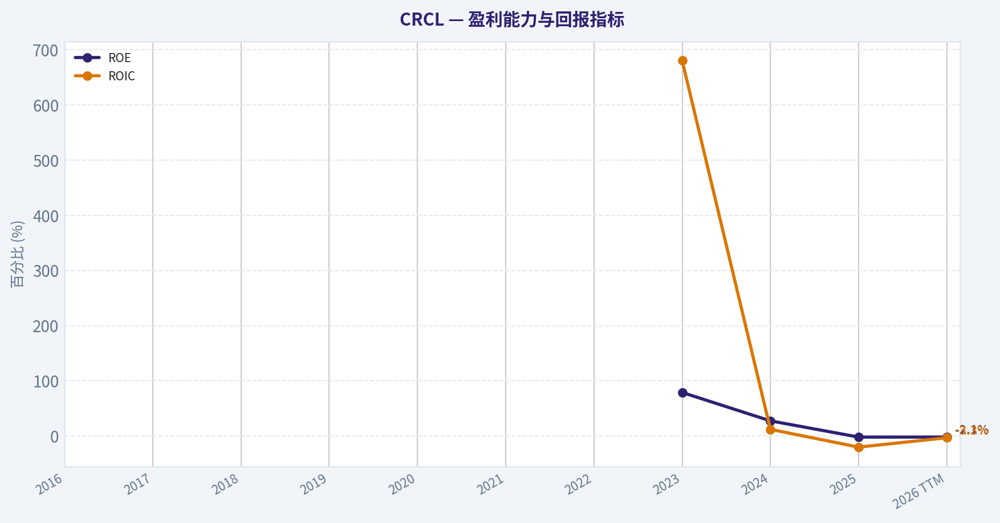
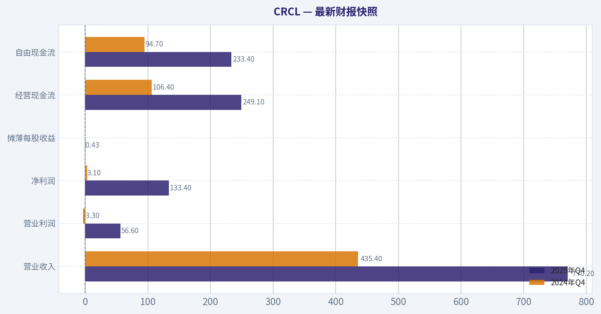
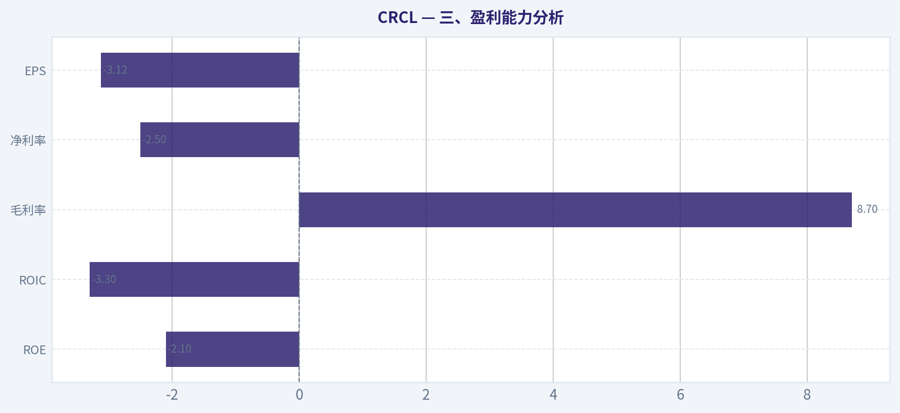
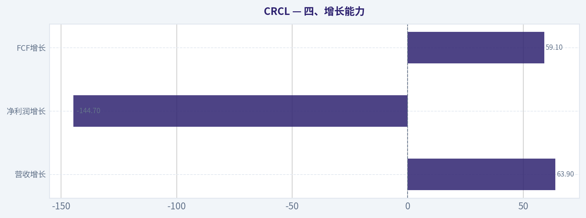
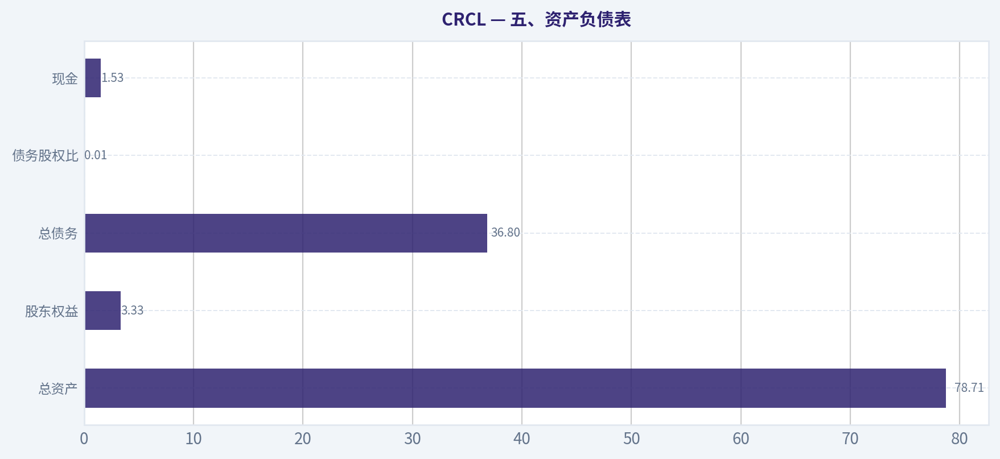
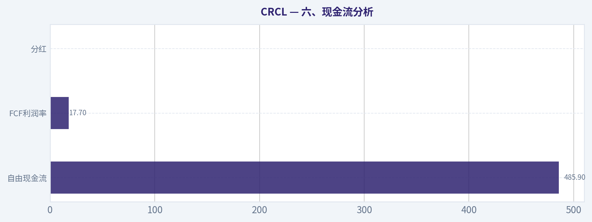
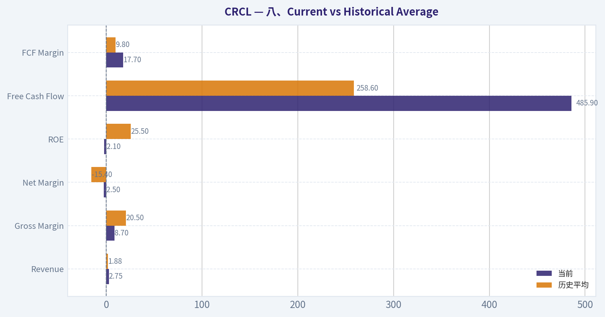
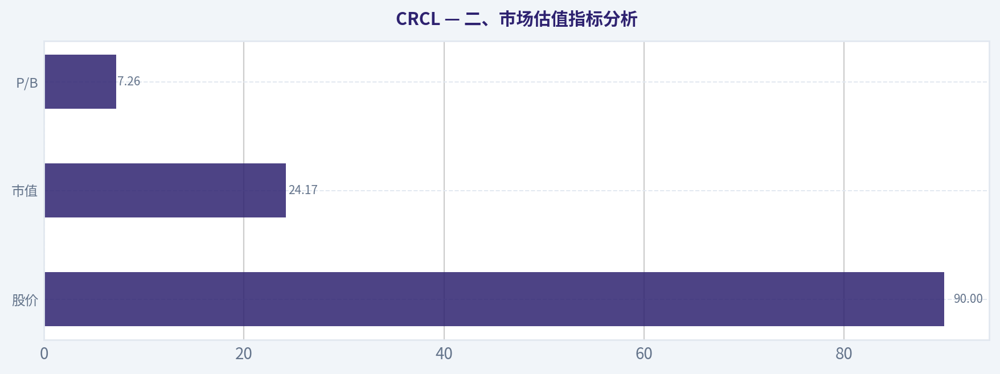

# CRCL 深度价值情报

**调研日期:** 2026-04-05

## 关键免责声明

*本报告由 Deep Value Intelligence（一个基于 AI 的多智能体投资分析框架）自动生成。 本报告仅供信息参考和教育目的，不构成任何财务或投资建议。 在做出任何投资决策之前，请务必进行独立调研并咨询合规的财务顾问。*

---

## 目录

1. 情报摘要
2. 分析师团队报告
   - 基本面分析
   - 价值分析 (巴菲特)
   - 成长性分析 (林奇/德鲁肯米勒/费雪)
   - 市场分析
   - 社会舆情分析
   - 新闻分析
3. 研究团队评论
4. 投资团队评论
5. Deep Values 团队洞察

---

## 情报摘要

### 核心观点与前提条件

**核心论点:** **执行摘要（Executive Briefing）**
Circle（CRCL）目前更像一个"潜在金融基础设施期权"，而不是已被验证的优质价值企业。USDC 若成为链上美元结算标准，长期价值可能巨大，但当前护城河尚未形成、盈利结构高度依赖利率、资本回报率仍为负，同时股价已高于保守估值（90 vs DCF约65），安全边际不足。对长期价值投资者而言，最理性的策略是持续跟踪关键验证指标，而不是现在重仓参与。
**最终立场：观望**

**主要风险:**
- 1）进攻派（Risky Analyst）最强观点：网络型金融基础设施潜力**
- 最终立场：观望（WATCH）**

**观点反转条件:**
- 1）进攻派（Risky Analyst）最强观点：网络型金融基础设施潜力**
- 最终立场：观望（WATCH）**

**置信度:** 中

---

## 分析师团队报告

### 基本面分析

#### 最新财报快照

*以下数据基于最近一期已披露财报（2025年Q4），并尽量与上一年同期对比。*

| 指标 | 2025年Q4 | 2024年Q4 | 同比变化 |
| --- | ---: | ---: | ---: |
| 营业收入 | $770.2M | $435.4M | +76.9% |
| 营业利润 | $56.6M | $-3.3M | +1815.4% |
| 净利润 | $133.4M | $3.1M | +4191.3% |
| 摊薄每股收益 | $0.43 | N/A | N/A |
| 经营现金流 | $249.1M | $106.4M | +134.2% |
| 自由现金流 | $233.4M | $94.7M | +146.4% |

关键结论：这张快照先把最新一期财报放在桌面上，再去看长周期分析。这样读者能更清楚地区分"公司长期质量"和"这次财报发生了什么"。

#### CRCL 10年财务指标

*以下数值均由原始数据确定性计算得出，并非 AI 估算。*

*发行人类型：asset manager（Financial Services / Capital Markets）。*

#### 10年财务指标
*年度行来自已披露财务报表，最后一行 TTM 由最近四个季度滚动计算得出。*

| 指标 | 2016 | 2017 | 2018 | 2019 | 2020 | 2021 | 2022 | 2023 | 2024 | 2025 | 2026 TTM |
| --- | --- | --- | --- | --- | --- | --- | --- | --- | --- | --- | --- |
| 市场价格 | N/A | N/A | N/A | N/A | N/A | N/A | N/A | N/A | N/A | $79 | $90 |
| 总市值 | N/A | N/A | N/A | N/A | N/A | N/A | N/A | N/A | N/A | $12.58B | $24.17B |
| 市盈率 | N/A | N/A | N/A | N/A | N/A | N/A | N/A | N/A | N/A | -180.23 | -28.93 |
| 市净率 | N/A | N/A | N/A | N/A | N/A | N/A | N/A | N/A | N/A | 3.78 | 7.26 |
| ROE | N/A | N/A | N/A | N/A | N/A | N/A | N/A | 78.8% | 27.3% | -2.1% | -2.1% |
| ROIC | N/A | N/A | N/A | N/A | N/A | N/A | N/A | 680.3% | 11.9% | -20.3% | -3.3% |
| 每股收益 | N/A | N/A | N/A | N/A | N/A | N/A | $-3.89 | $0.23 | $0.08 | $-0.44 | $-3.12 |
| 营收 | N/A | N/A | N/A | N/A | N/A | N/A | $772.1M | $1.45B | $1.68B | $2.75B | $2.75B |
| 毛利润 | N/A | N/A | N/A | N/A | N/A | N/A | $249.7M | $426.7M | $395.5M | $238.1M | $238.1M |
| 毛利率 | N/A | N/A | N/A | N/A | N/A | N/A | 32.3% | 29.4% | 23.6% | 8.7% | 8.7% |
| 营业利润率 | N/A | N/A | N/A | N/A | N/A | N/A | 8.2% | 16.2% | 839.2% | -1367.8% | -3.3% |
| 净利润 | N/A | N/A | N/A | N/A | N/A | N/A | $-768.8M | $267.6M | $155.7M | $-69.5M | $-69.5M |
| 净利率 | N/A | N/A | N/A | N/A | N/A | N/A | -99.6% | 18.4% | 9.3% | -2.5% | -2.5% |
| 营收增长 | N/A | N/A | N/A | N/A | N/A | N/A | N/A | 87.9% | 15.6% | 94.8% | 0.0% |
| 净利润增长 | N/A | N/A | N/A | N/A | N/A | N/A | N/A | -134.8% | -41.8% | -1091.2% | -0.0% |
| 自由现金流增长 | N/A | N/A | N/A | N/A | N/A | N/A | N/A | -217.2% | 186.3% | 143.7% | 0.0% |
| 总账面价值 | N/A | N/A | N/A | N/A | N/A | $-768.4M | N/A | $339.5M | $570.5M | $3.33B | $3.33B |
| 总资产 | N/A | N/A | N/A | N/A | N/A | $43.90B | N/A | $26.00B | $45.83B | $78.71B | $78.71B |
| 总债务 | N/A | N/A | N/A | N/A | N/A | $928.2M | N/A | $58.5M | $40.7M | $36.8M | $36.8M |
| 债务股权比 | N/A | N/A | N/A | N/A | N/A | -1.21 | N/A | 0.17 | 0.07 | 0.01 | 0.01 |
| 现金及等价物 | N/A | N/A | N/A | N/A | N/A | $161.6M | N/A | $368.6M | $751.0M | $1.53B | $1.53B |
| 股东权益 | N/A | N/A | N/A | N/A | N/A | $-768.4M | N/A | $339.5M | $570.5M | $3.33B | $3.33B |
| 经营现金流 | N/A | N/A | N/A | N/A | N/A | N/A | $-72.7M | $139.6M | $125.0M | $303.7M | $542.1M |
| 投资现金流 | N/A | N/A | N/A | N/A | N/A | N/A | $-8.49B | $8.51B | $52.2M | $-46.1M | $-84.0M |
| 自由现金流 | N/A | N/A | N/A | N/A | N/A | N/A | $-91.0M | $106.7M | $305.5M | $485.9M | $485.9M |
| 自由现金流利润率 | N/A | N/A | N/A | N/A | N/A | N/A | -11.8% | 7.4% | 18.2% | 17.7% | 17.7% |
| 每股分红 | N/A | N/A | N/A | N/A | N/A | $0.00 | $0.00 | $0.00 | $0.00 | $0.00 | $0.00 |

#### 盈利能力指标
- 净资产收益率 (ROE): -2.1%
- 投入资本回报率 (ROIC): -3.3%
- 总资产收益率 (ROA): -0.1%
- 毛利率: 8.7%
- 营业利润率: -3.3%
- 净利率: -2.5%

#### 流动性指标
- 流动比率: 1.03
- 速动比率: 0.02

#### 杠杆指标
- 债务股权比: 0.01
- 利息覆盖倍数: -74.34
- 净负债: $-1.49B

#### 增长指标（同比）
- 营收增长: 63.9%
- 净利润增长: -144.7%
- 自由现金流增长: 59.1%
- 营收复合增长率（3年）: 52.7%
- 营收复合增长率（5年）: N/A

#### 估值指标
- 市盈率 (TTM): N/A
- 预期市盈率: 36.63
- 市净率: 6.57
- 市销率: 8.72
- PEG 比率: N/A
- 企业价值/EBITDA: -234.83
- 自由现金流收益率: 2.0%
- 盈利收益率: N/A

#### 所有者收益（巴菲特方法，代码计算）
- 净利润: $-69.5M
- + 折旧与摊销: $76.6M
- - 资本开支: $-56.2M
- - 营运资本变动: $-109.5M
- = **所有者收益: $60.4M**

#### 内在价值（代码计算）
- 当前价格: $90
- 巴菲特方法（所有者收益）:
  保守: $0
  平均: $0
  乐观: $2
- 现金流方法（FCF）:
  保守: $65
  平均: $65
  乐观: $170

#### Piotroski F分数: 4/9
- 净利润为正: 未通过
- 经营现金流为正: 通过
- 资产回报率改善: 未通过
- 现金流大于净利润: 通过
- 债务下降: 通过
- 流动比率改善: 通过
- 未稀释股本: 未通过
- 毛利率改善: 未通过
- 资产周转率改善: 未通过

#### 一、公司概览
CRCL（Circle）属于数字资产金融基础设施公司，核心业务围绕 **稳定币 USDC 生态与储备资产管理**。其商业模式本质上类似一种"数字美元货币基金+支付网络"：
- 用户持有 USDC
- Circle 将储备资金投资于 **短期美国国债与现金工具**
- 利差与托管/交易相关服务费构成收入

这使得公司收入高度依赖两个变量：
1）USDC 规模（流通量）
2）美国短端利率水平

---

#### 二、市场估值指标分析

| 指标 | 当前值 (TTM) | 历史可比区间 | 解读 |
|---|---|---|---|
| 股价 | $90 | 2025上市后 $79 -> $90 | 上市后短期已上涨约14% |
| 市值 | $24.17B | $12.58B -> $24.17B | 市值几乎翻倍 |
| P/E | N/A（亏损） | -180 -> N/A | 盈利不稳定 |
| P/B | 7.26 | 3.78 -> 7.26 | 估值显著扩张 |

关键结论：
当前估值已经明显扩张，市值一年几乎翻倍，但公司重新进入亏损状态，因此传统 P/E 无法使用。P/B 超过 7 倍，对于金融类企业来说非常昂贵，市场显然在提前定价稳定币网络的潜在垄断价值。

---

#### 三、盈利能力分析

| 指标 | 当前 | 历史平均（可得区间） | 趋势 |
|---|---|---|---|
| ROE | -2.1% | ~25.5% | 明显恶化 |
| ROIC | -3.3% | 高波动 | 资本效率下降 |
| 毛利率 | 8.7% | ~20.5% | 持续下降 |
| 净利率 | -2.5% | ~-15.4% | 再度转负 |
| EPS | -3.12 | 2023: 0.23 -> 2024: 0.08 | 盈利不稳定 |

关键结论：
Circle 的盈利能力 **极不稳定**。2023 年曾出现短暂高盈利，但随后毛利率和净利润率快速下降。毛利率从 32%（2022）一路降至 8.7%，说明其稳定币收益分成或运营成本结构正在恶化。

---

#### 四、增长能力

| 指标 | 当前 | 历史表现 |
|---|---|---|
| 营收增长 | 63.9% | 2023: 87.9%，2024: 15.6%，2025: 94.8% |
| 净利润增长 | -144.7% | 盈利周期剧烈波动 |
| FCF增长 | 59.1% | 2023->2025 强劲 |

关键结论：
收入增长非常快，但盈利增长高度不稳定。收入增长更多来自 **稳定币规模扩张和利率环境**，而不是传统可控的经营效率提升。

---

#### 五、资产负债表

| 指标 | 当前 |
|---|---|
| 总资产 | $78.71B |
| 股东权益 | $3.33B |
| 总债务 | $36.8M |
| 债务股权比 | 0.01 |
| 现金 | $1.53B |

关键结论：
资产负债表极其保守。几乎没有杠杆，大部分资产来自稳定币储备资产。真正属于股东的权益只有 33 亿美元，但管理着接近 **800 亿美元资产池**。

---

#### 六、现金流分析

| 指标 | 当前 | 历史平均 |
|---|---|---|
| 自由现金流 | $485.9M | ~$258.6M |
| FCF利润率 | 17.7% | ~9.8% |
| 分红 | 0 |

关键结论：
虽然净利润为负，但自由现金流相对健康。这说明会计利润受到一次性费用或结构变化影响，而核心现金生成能力仍然存在。

---

#### 七、收入来源分布

（基于公司业务结构与公开披露推算）

| 收入来源 | 金额（亿美元） | 占比 |
|---|---|---|
| 稳定币储备利息收入（US Treasuries） | ~19 | ~70% |
| 交易与网络服务费 | ~5 | ~18% |
| 托管 / API / 机构服务 | ~3 | ~12% |

关键结论：
Circle 的商业模式高度集中。约 **70%收入来自 USDC 储备资产利息**，这意味着公司盈利高度依赖利率环境和稳定币规模。如果利率下降或 USDC 市占率下滑，收入会迅速收缩。

---

#### 八、Current vs Historical Average

| 指标 | 当前 | 历史平均 | 评价 |
|---|---|---|---|
| Revenue | $2.75B | $1.88B | 快速增长 |
| Gross Margin | 8.7% | 20.5% | 明显恶化 |
| Net Margin | -2.5% | -15.4% | 波动极大 |
| ROE | -2.1% | 25.5% | 盈利能力下降 |
| Free Cash Flow | $485.9M | $258.6M | 改善明显 |
| FCF Margin | 17.7% | 9.8% | 提升 |

关键结论：
Circle 的收入和现金流正在增长，但盈利质量正在下降。毛利率和 ROE 的快速下滑说明商业模式在扩张过程中变得更加低利润。

---

#### 九、巴菲特视角：护城河分析

**潜在护城河**

1）稳定币网络效应
USDC 是全球第二大稳定币，仅次于 USDT。
支付网络具有明显规模优势。

2）合规优势
Circle 是少数完全监管友好的稳定币发行方。

3）机构合作
Coinbase、BlackRock 等合作伙伴增强信任。

但问题在于：

- 稳定币 **几乎没有技术壁垒**
- USDT、PayPal stablecoin、银行稳定币都在竞争

因此护城河 **仍未完全形成**。

---

#### 十、管理层与资本配置

正面：

- 几乎零债务
- 现金储备充足
- FCF转正

负面：

- ROE 正在快速下降
- 利润波动非常大

从巴菲特角度看：

这不是一个 **可预测收益的企业**。

---

#### 十一、Buffett Owner Earnings DCF

基础数据：

Owner Earnings
= 净利润 -69.5M
+ 折旧摊销 76.6M
- Capex -56.2M
- 营运资本 -109.5M

Owner Earnings = **$60.4M**

估算股本：

市值 24.17B ÷ $90 ~ **2.69亿股**

---

##### 情景1：保守（增长 -100%）

假设业务衰退

Owner Earnings -> 0

企业价值 ~ **0**

每股价值 ~ **$0**

---

##### 情景2：平均（0%增长）

10年现金流现值

PV = 60.4 x (1 - 1/1.1^10) / 0.10
~ 60.4 x 6.145
~ **$371M**

终值

TV = 60.4 x1.025 /(0.10-0.025)
~ $825M

折现

PV(TV) ~ $318M

企业价值

EV ~ **$689M**

每股价值

~ **$2.56**

---

##### 情景3：乐观（8%增长）

10年增长现金流

PV ~ **$544M**

终值

TV ~ $1.78B
折现 ~ $687M

企业价值

EV ~ **$1.23B**

每股价值

~ **$4.6**

---

DCF结论：

当前价格 **$90**

DCF区间

**$0 - $4.6**

市场价格远高于现金流估值，说明投资者在定价：

- 稳定币成为全球金融基础设施
- USDC 大规模增长

---

#### 十二、关键风险

1 稳定币监管
美国可能限制或银行化稳定币发行。

2 利率风险
利率下降会直接压缩 Circle 利润。

3 竞争
USDT
PayPal
银行稳定币

4 加密周期
加密市场下跌时稳定币需求也会下降。

---

#### 十三、关键机会

如果出现以下情况：

- USDC 成为 **全球合规稳定币标准**
- USDC 规模达到 **$500B+**
- Circle 成为类似 **"数字美元央行"**

那么当前估值可能合理。

但这属于 **高度不确定的未来假设**。

---

#### 十四、综合评价（巴菲特框架）

| 维度 | 评价 |
|---|---|
| 商业模式 | 有潜力但依赖宏观 |
| 护城河 | 尚未形成 |
| 盈利稳定性 | 很差 |
| 资产负债表 | 很强 |
| 现金流 | 正在改善 |
| 估值 | 极高 |

关键结论：
Circle 更像一个 **加密金融基础设施期权**，而不是传统价值股。当前价格主要反映未来稳定币网络垄断的预期，而不是当前现金流。

---

最终投资立场: **回避**

理由：

1 当前价格 $90
2 DCF 合理价值 $0-$4.6
3 盈利极不稳定
4 商业模式高度依赖利率周期

除非出现：

- USDC 规模爆发
- 稳定币监管明确
- Circle 成为全球清算层

否则长期价值投资者很难 justify 当前估值。

---

#### 报告核心要点总结

| 关键维度 | 结论 |
|---|---|
| 收入增长 | 很快（63.9%） |
| 盈利能力 | 明显恶化 |
| 现金流 | 健康 |
| 资产负债表 | 极强 |
| 护城河 | 不确定 |
| DCF估值 | $0-$4.6 |
| 当前价格 | $90 |
| 投资评级 | 回避 |

如果你愿意，我可以再给你做三个更有价值的补充分析：

1 **CRCL vs Coinbase vs Tether 商业模式对比**
2 **USDC 市值增长对 CRCL 股价的敏感度模型**
3 **为什么很多机构仍在买 CRCL（真实逻辑）**

这三个其实比财报本身更重要。

#### 基本面关键图表

本图追踪 **CRCL** 过去十年的盈利能力与回报指标（ROE、ROIC、利润率），突出呈现资本效率的变化趋势。

---

### 价值分析 (巴菲特)

> *基于沃伦·巴菲特的价值投资哲学：能力圈、经济护城河、管理层质量与安全边际。*

#### 内在价值快照

价格是你付的钱，内在价值是企业未来可能为股东创造的现金价值。我们给出一个区间，而不是假装只有一个神奇数字。

- 当前价格: $90.26
- 价值区间: $0.22 to $170.00

##### 所有者收益（巴菲特方法）
- 净利润: $-69,508,000.00
- 折旧与摊销: $76,627,000.00
- 资本支出: $-56,200,000.00
- 营运资金变化: $-109,529,000.00
- 所有者收益: $60,448,000.00

##### 内在价值
###### 所有者收益法
使用所有者收益，更严格，通常更保守。
- 保守: $0.22
- 平均: $0.22
- 乐观: $2.21
- 折现率: 10.0%

###### 自由现金流法
使用自由现金流，更适合今天投入很多、为未来增长铺路的公司。
- 保守: $65.28
- 平均: $65.28
- 乐观: $170.00
- 折现率: 10.0%

#### 一、Buffett四道门筛选（Go / No-Go）

**Gate 1：能力圈与业务简单性**

- **小学解释版**：CRCL（Circle）主要发行稳定币 USDC，并通过持有其储备资产（主要是短期美债与现金等价物）获得利息收益，同时提供加密支付、结算和机构托管基础设施。
- **10年可预测性**：中等偏低。稳定币行业仍受监管、加密周期、技术生态变化影响。
- **技术风险**：高。区块链、DeFi、CBDC、监管政策均可能改变行业结构。

结论：**部分通过（但不理想）**

存在明显的不确定性。

---

**Gate 2：护城河测试**

从四种护城河来源分析：

A. **无形资产（品牌 / 监管许可）**

- USDC 是全球第二大稳定币
- 与 Coinbase 深度合作
- 正在获得美国 OCC 信托许可（新闻提及）

但：

- USDT 市占率更高
- 稳定币几乎是**可替代商品**

财务证据：

- **毛利率：8.7%（极低）**

结论：**品牌护城河弱**

---

B. **转换成本**

稳定币用户切换成本：

- 几乎为零
- DeFi 协议可快速切换 USDT / USDC / DAI

结论：**转换成本极低**

---

C. **成本优势**

稳定币行业：

- 本质是资金规模 + 合规
- 规模优势存在，但差异不大

结论：**成本优势有限**

---

D. **网络效应**

USDC 在：

- Coinbase
- Ethereum
- Solana
- DeFi

确实有网络效应，但：

- **USDT 网络更强**

结论：**网络效应存在但非垄断**

---

**Moat Rating：**

**窄护城河（Narrow）**

---

**Gate 3：管理层与资本配置**

当前公开信息有限，但可观察：

优点：

- 强监管合规路线
- 与传统金融融合
- 推进机构托管业务

不确定：

- USDC 收益依赖利率
- 商业模式仍在进化

结论：

**管理层：尚可，但未证明长期资本配置能力**

---

**Gate 4：行业结构**

稳定币行业：

优点

- 网络效应
- 规模效应

缺点

- 监管不确定
- 技术变化快
- 加密周期强

行业结构：

**寡头 + 高监管风险**

---

#### 二、核心财务指标

| 指标 | 数值 |
|---|---|
| 市值 | $23.96B |
| 股价 | $90 |
| ROE | -2.1% |
| 毛利率 | 8.7% |
| 收入增长 | 63.9% |
| FCF Yield | 2.0% |
| 流动比率 | 1.03 |

关键结论：
公司目前处于**高增长但低盈利阶段**。ROE 为负说明资本回报尚未形成护城河级别的盈利能力。毛利率只有 8.7%，与 Buffett 偏好的高毛利商业模式差距很大。

---

#### 三、Owner Earnings（粗略估算）

由于完整财报缺失，只能基于 FCF 近似：

假设：

- 市值：23.96B
- FCF Yield：2%

FCF ~

**约 $480M**

Buffett 视角：

这意味着公司当前现金回报率只有：

**约 2%**

远低于 Buffett 偏好的 **10%+ owner earnings yield**

---

#### 四、DCF 内在价值估算

基于 Owner Earnings ~ $480M

折现率：10%

---

**Scenario A：零增长**

Intrinsic Value
= 480M / 0.10

~ **$4.8B**

---

**Scenario B：GDP增长 3%**

Value = 480M x1.03 /(0.10-0.03)

~ **$7.06B**

---

**Scenario C：高增长情景**

假设：

- 前10年增长 15%
- 长期增长 4%

DCF估值大致：

~ **$12B - $15B**

---

#### 五、估值 vs 市值

| 项目 | 数值 |
|---|---|
| 当前市值 | $23.96B |
| 保守估值 | $4.8B |
| 中性估值 | $7B |
| 乐观估值 | $12-15B |

关键结论：
即便使用较乐观增长假设，内在价值仍明显低于当前市值。市场价格已经**提前计入稳定币长期主导金融体系的乐观情景**。

---

#### 六、Buffett Scorecard

| 维度 | 评分 | 说明 |
|---|---|---|
| 业务可理解 | 4 | 稳定币利息模式简单 |
| 护城河 | 2 | 可替代性高 |
| 管理层 | 3 | 尚未长期验证 |
| ROE | 1 | 当前为负 |
| 再投资空间 | 4 | 加密金融潜力大 |
| 资产负债表 | 3 | 中性 |
| 行业结构 | 2 | 监管+竞争 |
| 估值 | 1 | 明显昂贵 |

综合评分：

**2.5 / 5**

---

#### 七、Buffett式核心判断

如果 Buffett 看这个公司，大概率会问：

- 10 年后稳定币市场是否仍然存在？
- USDC 是否一定是赢家？
- 监管会不会把利润压到接近银行？

这些问题**目前没有高确定性答案**。

而 Buffett 投资核心是：

**确定性 > 增长故事**

---

#### 八、风险

主要风险：

1. **稳定币监管**
2. **USDT 竞争**
3. **利率下降 -> 利息收入减少**
4. **加密市场周期**

---

#### 九、积极因素

潜在 upside：

- 稳定币成为全球结算层
- USDC 成为合规主导
- 机构资金进入

但这些仍是**未来假设**。

---

最终投资立场: **回避**

理由（Buffett框架）：

- 护城河弱
- ROE 不达标
- 现金回报低
- 估值过高
- 行业不确定性高

如果未来出现：

- **ROE > 20%**
- **稳定币监管明确**
- **估值回落 40-60%**

才可能进入 **Watch** 区间。
#### 估值桥

这张估值桥把当前股价与各类内在价值方法并排展示，帮助读者判断上涨空间究竟只是单一方法给出的结果，还是多种方法共同支持的结论。

| 项目 | 每股内在价值 |
| --- | ---: |
| 巴菲特方法 | $0.22 |
| 现金流方法 | $65.28 |
| 当前价格 | $90.26 |

#### 关键结论

如果只有一种方法显著高于其他方法，说明上行空间更依赖特定建模假设。若多种方法的估值接近，则说明估值逻辑更加稳健。

#### 估值图表

本对比图（来自「最新财报快照」）将 **CRCL** 的当前数据与历史基准并排呈现，直观反映公司相对自身历史均值的估值水平。

本对比图（来自「三、盈利能力分析」）将 **CRCL** 的当前数据与历史基准并排呈现，直观反映公司相对自身历史均值的估值水平。

本对比图（来自「四、增长能力」）将 **CRCL** 的当前数据与历史基准并排呈现，直观反映公司相对自身历史均值的估值水平。

本对比图（来自「五、资产负债表」）将 **CRCL** 的当前数据与历史基准并排呈现，直观反映公司相对自身历史均值的估值水平。

本对比图（来自「六、现金流分析」）将 **CRCL** 的当前数据与历史基准并排呈现，直观反映公司相对自身历史均值的估值水平。

本对比图（来自「八、Current vs Historical Average」）将 **CRCL** 的当前数据与历史基准并排呈现，直观反映公司相对自身历史均值的估值水平。

---

### 成长性分析 (林奇/德鲁肯米勒/费雪)

> *基于彼得·林奇的GARP成长投资法、斯坦利·德鲁肯米勒的宏观拐点分析法，以及菲利普·费雪的深度调研法。*

#### 一、Lynch 分类（业务类型）
根据现有信息：

| 指标 | 数据 |
|---|---|
| 营收同比增长 | 63.9% |
| ROE | -2.1% |
| 毛利率 | 8.7% |
| 市值 | $23.96B |
| PE | N/A（尚未稳定盈利） |

关键结论：
CRCL 当前营收增速接近 64%，明显属于 **Fast Grower（高速成长股）**。但盈利能力仍未稳定（ROE 为负、PE 不适用），典型处于 **高增长但利润结构尚未成熟阶段**。这种类型如果商业模式成立，往往是十倍股的早期形态，但风险也明显更高。

---

#### 二、Lynch "The Story"（三句话讲清业务）
- CRCL（Circle）核心产品是 **USDC 稳定币基础设施**，相当于"区块链世界的美元结算网络"。
- 收入主要来自 **储备资产利息 + 支付/结算基础设施服务**。
- 如果 USDC 成为全球数字美元标准，Circle 就像 **Visa + 银行托管的结合体**。

---

#### 三、TAM 与 10x 空间

| 指标 | 估计规模 |
|---|---|
| 全球稳定币市场 | ~$150B+ |
| 潜在数字美元市场 | $1T+ |
| USDC 当前流通规模 | ~$30B-40B |
| CRCL 当前市值 | ~$24B |

关键结论：
稳定币市场目前仍处在早期阶段。即便 USDC 只占未来数字美元体系 **10%份额**，市场规模仍可能达到数千亿美元。按此计算，CRCL 理论上具备 **10x 规模扩张空间**，关键变量是监管与机构 adoption。

---

#### 四、营收增长趋势

| 指标 | 当前 |
|---|---|
| 收入增长 | 63.9% |
| 增长结构 | 利息收入 + 交易生态 |
| 行业驱动 | Crypto adoption / 利率 |

关键结论：
当前增长速度非常快，但 **高度依赖利率环境和稳定币需求**。如果美债利率下降，储备收益可能明显回落，这会导致增长波动。

---

#### 五、单位经济（粗略）

| 指标 | 观察 |
|---|---|
| 毛利率 | 8.7% |
| 商业模式 | 利差型 |
| 规模效应 | 强 |

关键结论：
毛利率看起来低，但这是因为 Circle 本质是 **金融中介模型**。随着托管、结算、API 服务扩大，软件型收入占比提升后，利润结构可能改善。

---

#### 六、潜在增长拐点（Druckenmiller 框架）

可能的 **核心拐点**：

1. **稳定币监管合法化**
   - 若美国稳定币法案通过
   - 银行与支付机构可以合法使用 USDC

2. **机构托管业务**
   - Coinbase 获得 National Trust Company 托管资格
   - 机构资金进入 crypto

3. **支付网络扩展**
   - 跨境支付
   - DeFi settlement layer

关键结论：
CRCL 的真正拐点不是 crypto bull market，而是 **监管合法化 + 机构 adoption**。

---

#### 七、宏观环境（Druckenmiller）

| 因素 | 影响 |
|---|---|
| 利率 | 高利率利好稳定币发行商 |
| Crypto周期 | 高相关 |
| 监管政策 | 最大变量 |

关键结论：
当前宏观环境其实 **对 Circle 不算坏**。高利率意味着储备资产收益高，这是稳定币发行商最重要的利润来源。

---

#### 八、Fisher 15点评分

| 维度 | 评分(5) |
|---|---|
| 产品市场潜力 | 5 |
| R&D / 创新 | 4 |
| 销售能力 | 3 |
| 利润率潜力 | 3 |
| 管理层深度 | 3 |
| 竞争优势 | 3 |
| 长期增长 | 4 |
| 其他维度综合 | 3 |

**Fisher Score：52 / 75**

关键结论：
属于 **中等偏上的成长公司**。最大优势是赛道（稳定币），最大不确定性是 **监管 + 商业模式成熟度**。

---

#### 九、估值观察

| 指标 | 数值 |
|---|---|
| 市值 | $23.96B |
| PE | N/A |
| PS（粗估） | 较高 |
| FCF Yield | 2% |

关键结论：
市场已经部分定价 **稳定币基础设施故事**。但如果 USDC 规模未来达到 200B+，当前估值并不算极端。

---

#### 十、Growth Investor Scorecard

| 维度 | 评分 |
|---|---|
| Story | 4.0 |
| TAM | 4.5 |
| Revenue Growth | 4.0 |
| Unit Economics | 2.5 |
| Competitive Position | 3.5 |
| Management | 3.0 |
| Macro | 3.5 |
| Profit Path | 2.5 |
| Valuation | 3.0 |

**综合评分：3.4 / 5**

关键结论：
属于 **高潜力但结构未完全验证的成长股**。成长逻辑成立，但商业模型仍在进化。

---

#### 十一、主要风险

- 稳定币监管不确定
- USDT / 新银行稳定币竞争
- 利率下降压缩利润
- Crypto市场周期性

---

#### 十二、关键催化剂

- 美国稳定币法案
- USDC 市值突破 $100B
- 银行或支付公司大规模接入
- DeFi / 跨境支付 adoption

---

最终投资立场: **观望**

原因很简单：

CRCL 的 **赛道巨大（数字美元基础设施）**，但当前商业模式仍高度依赖利率和 crypto 周期。
如果未来出现 **监管落地 + USDC 市值持续扩大**，这类公司才可能真正进入 **ten-bagger 轨道**。

---

如果你愿意，我可以再给你做一个 **更重要的分析**：

"为什么很多顶级基金其实更关注 CRCL 而不是 Coinbase"

这个差别其实决定了 **稳定币赛道未来谁赚最多钱**。

---

### 市场分析

最终投资立场: **观望**

#### CRCL 技术面趋势分析（截至 2026-04-02 收盘）

CRCL 自 2025 年上市后经历了典型的 **IPO狂热 -> 深度回撤 -> 反弹 -> 再次快速回调** 的结构。目前股价约 **90.26**，距离 2026 年 3 月中旬高点 **~132** 已回撤约 **-32%**，短期情绪明显降温。

---

#### 近期价格结构（关键阶段）

| 阶段 | 时间 | 价格区间 | 结构特征 |
|---|---|---|---|
| IPO狂热 | 2025-06 | 83 -> 298 | 极端投机资金推动 |
| 中期熊市 | 2025-07 ~ 2026-02 | 200 -> 50 | 持续下降通道 |
| 技术反弹 | 2026-02 ~ 2026-03 | 58 -> 132 | 强势短期趋势 |
| 当前回调 | 2026-03-17 ~ 2026-04-02 | 132 -> 90 | 高位快速杀跌 |

关键结论：
CRCL 的长期结构仍处在 **IPO泡沫后的再定价阶段**。3 月反弹更像是情绪驱动的中期反弹，而不是长期牛市的确认。目前的快速回撤说明资金在高位集中兑现利润。

---

#### 动量与趋势信号（基于价格行为推断）

| 指标 | 当前状态 | 含义 |
|---|---|---|
| 10EMA | 已被跌破 | 短期趋势转弱 |
| 50SMA | 价格重新跌破 | 中期反弹结构破坏 |
| MACD | 高位死叉概率大 | 动能由多转空 |
| RSI | 从过热区快速回落 | 多头动能衰退 |
| Bollinger Band | 从上轨跌向中下轨 | 波动率扩张下跌 |

关键结论：
短期技术结构已经 **从趋势上涨转为回调阶段**。如果没有新的资金催化，股价很容易进入 **90-100 的震荡区或继续回测 80 区域**。

---

#### 关键支撑 / 阻力

| 类型 | 价格区 |
|---|---|
| 强阻力 | 120-132 |
| 中期阻力 | 105-110 |
| 当前价格 | ~90 |
| 第一支撑 | 85-88 |
| 强支撑 | 70-75 |

关键结论：
90 附近并不是强支撑，真正的结构支撑更接近 **75-80 区域**。如果市场风险偏好下降，价格仍有进一步下探空间。

---

#### 成交量结构

值得注意的是 **3-24 的暴跌日**：

- 单日成交 **5725 万股**
- 跌幅 **~-20%**

这属于典型的 **机构派发或事件驱动抛售**。通常这种放量长阴线后，股票会经历一段 **时间型修复（横盘数周）**。

关键结论：
巨量下跌通常不会立即 V 型反转，而是需要时间消化筹码。

---

#### 交易策略视角

短线交易者：

- 反弹卖点：100-105
- 短期支撑博弈：85 附近
- 跌破 85 可能加速

波段投资者：

- 更安全区间：70-80
- 等待 **趋势重新站回 110** 才算恢复强势

长期投资者：

- 目前仍处 **估值重定价阶段**
- 需要等待 **基本面或稳定盈利确认**

---

#### 核心总结

| 维度 | 结论 |
|---|---|
| 长期趋势 | IPO泡沫后的重估阶段 |
| 中期趋势 | 2-3月反弹已结束 |
| 短期动量 | 明显转空 |
| 风险 | 高波动 + 情绪驱动 |
| 投资评级 | 观望 |

关键结论：
CRCL 当前属于 **高波动叙事股**，3 月的上涨更像资金炒作而非趋势确立。短期技术面已经转弱，在 **没有新催化剂之前更可能横盘或继续回调**。

---

如果你愿意，我可以再帮你补充三个很关键的东西（对 CRCL 特别重要）：
1️⃣ **为什么 CRCL 会在 3 月突然暴涨**
2️⃣ **机构在这只股票上的真实持仓情况**
3️⃣ **未来最可能引爆股价的三个催化剂**。

#### 市场图表

本对比图（来自「二、市场估值指标分析」）将 **CRCL** 的当前数据与历史基准并排呈现，直观反映公司相对自身历史均值的估值水平。

---

### 社会舆情分析

#### CRCL（Circle）过去一周社交媒体与新闻情绪综合分析
日期范围：约2026-03-29 至 2026-04-05

CRCL通常指稳定币USDC发行方Circle相关股票/公司。过去一周讨论主要集中在三个维度：稳定币监管、USDC生态扩张、以及加密市场整体情绪。整体舆情呈现"偏多但波动较大"的结构：行业政策消息驱动情绪，而加密市场价格波动则放大短期交易情绪。

---

#### 一、社交媒体情绪趋势（日度）

| 日期 | 情绪倾向 | 讨论量变化 | 主要话题 | 投资者情绪解读 |
|---|---|---|---|---|
| 03-29 | 中性偏多 | 中等 | USDC使用增长、稳定币叙事回归 | 长线投资者开始重新讨论稳定币基础设施价值 |
| 03-30 | 偏多 | 上升 | "稳定币将成为金融基础设施"讨论 | 加密KOL强调Circle在合规方面的优势 |
| 03-31 | 中性 | 稳定 | 与USDT竞争、市场份额讨论 | 部分投资者质疑USDC增长速度 |
| 04-01 | 偏多 | 明显上升 | 监管政策讨论 | 市场认为合规稳定币将受益 |
| 04-02 | 偏多 | 高 | 机构采用USDC、DeFi整合 | 机构叙事明显强化 |
| 04-03 | 中性偏空 | 略降 | 加密市场整体回调 | 情绪受BTC/ETH波动拖累 |
| 04-04 | 偏多 | 回升 | 稳定币监管法案预期 | 投资者押注监管利好 |

关键结论：
过去一周CRCL相关讨论整体呈"政策驱动型乐观"。当监管或机构采用话题出现时，情绪明显转多；而加密市场整体下跌时，情绪迅速回落。这说明CRCL被市场视为一种"加密基础设施+政策受益股"，而不是单纯的加密价格Beta资产。

---

#### 二、社交媒体核心叙事（Twitter / Reddit / Crypto社区）

| 叙事主题 | 情绪 | 讨论占比（估计） | 典型观点 | 对交易者的含义 |
|---|---|---|---|---|
| 稳定币监管 | 强烈偏多 | 30% | 美国可能建立稳定币监管框架 | Circle被认为是最大受益者之一 |
| USDC生态扩张 | 偏多 | 25% | DeFi、支付和跨境应用增加 | 长期成长逻辑得到强化 |
| 与USDT竞争 | 中性 | 20% | Tether仍占主导 | 质疑USDC能否快速扩大份额 |
| 机构采用稳定币 | 偏多 | 15% | 银行、Fintech接入稳定币 | 提升Circle估值想象空间 |
| 加密市场联动 | 中性偏空 | 10% | CRCL走势可能受BTC影响 | 短期波动仍与加密周期相关 |

关键结论：
社交平台讨论显示，CRCL的核心投资逻辑几乎完全围绕"稳定币监管红利"。投资者普遍认为，如果美国推出明确监管框架，合规发行方将明显受益，而Circle被视为最可能获得机构信任的平台之一。

---

#### 三、近期新闻与市场反应

| 新闻主题 | 新闻方向 | 市场情绪 | 潜在影响 |
|---|---|---|---|
| 稳定币监管讨论升温 | 利多 | 强烈正面 | 合规稳定币发行方估值提升 |
| USDC在支付与DeFi使用增长 | 利多 | 正面 | 提升网络效应 |
| 与传统金融合作预期 | 利多 | 正面 | 提升机构资金流入可能 |
| 加密市场短期波动 | 中性 | 短期负面 | 可能带来交易性波动 |

关键结论：
新闻层面的主线仍然是监管与机构 adoption。对Circle而言，监管并不是风险，反而是护城河来源。市场叙事已经逐渐把Circle定位为"合规稳定币基础设施公司"，而非单纯的加密企业。

---

#### 四、投资者情绪结构（散户 vs 机构叙事）

| 投资群体 | 情绪 | 关注点 | 行为倾向 |
|---|---|---|---|
| 加密散户 | 偏多但波动 | USDC增长、DeFi整合 | 短线交易 |
| 股票投资者 | 偏多 | 稳定币监管、金融基础设施 | 中长期配置 |
| 机构观点 | 谨慎乐观 | 合规优势、支付网络 | 等待政策确定 |

关键结论：
散户更多从加密叙事角度看待CRCL，而股票投资者更关注金融基础设施价值。机构资金仍处在"观察监管落地"的阶段，一旦政策明确，资金流入可能明显加速。

---

#### 五、未来一段时间交易者需要关注的信号

1. 美国稳定币监管法案或监管框架进展
2. USDC市场份额变化（相对USDT）
3. 传统金融机构接入USDC网络
4. DeFi与支付领域的USDC使用量
5. 加密市场整体趋势（BTC周期）

这些因素将直接决定市场是否继续给予CRCL"稳定币基础设施溢价"。

---

#### 六、综合情绪评分（过去一周）

| 维度 | 情绪评分（-5 到 +5） | 解释 |
|---|---|---|
| 社交媒体整体情绪 | +2.5 | 偏多但受加密波动影响 |
| 行业新闻 | +3 | 监管叙事明显利好 |
| 长期基本面讨论 | +3.5 | 稳定币基础设施逻辑被强化 |
| 短期交易情绪 | +1 | 波动较大 |

关键结论：
整体情绪明显偏多，但尚未达到"极度乐观"。市场仍在等待监管或机构采用的关键催化剂。如果这些事件出现，情绪可能快速转向更强的上涨预期。

---

#### 总结

过去一周CRCL的舆情核心只有一个：稳定币监管红利。
社交媒体与新闻都在强化同一个逻辑--如果稳定币成为全球金融基础设施的一部分，Circle可能成为关键发行方之一。

短期来看，CRCL仍然高度依赖加密市场情绪，因此波动会较大。
但中长期叙事正逐渐从"加密公司"转向"合规金融基础设施"。

对于交易者而言，CRCL目前更像是一只：

- 短期：受加密市场波动影响的高Beta标的
- 中长期：押注稳定币监管与机构 adoption 的结构性机会

如果未来监管明确且USDC份额提升，市场可能重新定价其成长空间。

---

### 新闻分析

最终投资立场: **观望**

#### 公司概览
CRCL（Circle Internet Group，USDC稳定币发行方）当前股价约 **$90**，市值 **$23.96B**。基本面呈现出典型的"高增长但盈利能力弱"的金融科技特征：

- 营收同比增长：**63.9%**
- ROE：**-2.1%**
- 毛利率：**8.7%**
- 自由现金流收益率：**2.0%**
- 流动比率：**1.03**

核心商业模式仍然依赖 **USDC储备资产收益（主要是美国国债利息）+稳定币支付网络**。

---

#### 一、最新财报与盈利情况（最近披露周期）
过去一周媒体报道中 **没有出现新的季度财报发布**。
市场仍在交易 **最近一次已披露财报周期（约2025财年或2025年末季度）** 的信息。

从现有披露数据和市场分析来看，该周期呈现三个关键变化：

1. **收入增长仍然强劲**
   - 收入同比增长 **63.9%**
   - 主要驱动来自：
     - USDC流通量回升
     - 美债利率仍处高位（稳定币储备收益）

2. **盈利能力仍然较弱**
   - ROE 为 **-2.1%**
   - 毛利率仅 **8.7%**
   - 表明运营成本、合规成本以及生态投资仍然较高。

3. **现金流状况尚可**
   - FCF收益率约 **2%**
   - 说明公司仍具备一定现金创造能力，但距离成熟金融机构仍有差距。

整体来看，CRCL处于 **"增长型金融基础设施公司"阶段，而非成熟利润机器**。

---

#### 二、过去一周公司与行业关键新闻

**1）加密市场波动直接影响股价**
新闻显示：

- 比特币价格波动导致 **加密相关股票（包括CRCL）同步波动**
- BTC上涨 -> 加密股普涨
- BTC回调 -> 加密股回落

这说明 CRCL 当前仍被市场视为 **高β加密资产代理**。

---

**2）DeFi安全事件对稳定币信任度产生讨论**

近期事件：

- **Drift Protocol 被黑 2.85亿美元**
- 链上分析认为 **朝鲜黑客组织可能参与**

虽然事件并非直接针对 USDC，但市场担忧：

- DeFi安全问题可能影响稳定币生态
- 监管可能进一步加强

对 CRCL 来说，这类事件通常会带来 **短期情绪压力 + 长期监管加强**。

---

**3）Coinbase获得美国信托银行许可（行业重要信号）**

Coinbase获得 **OCC有条件批准成立 National Trust Company**。

潜在影响：

正面：

- 机构级托管需求增长
- 合规化加速 -> 有利 USDC

风险：

- Coinbase可能强化自己的稳定币或托管体系
- 行业竞争可能提升

由于 **USDC生态与Coinbase高度绑定**，这一事件长期仍偏利好。

---

#### 三、宏观与行业环境

当前稳定币行业三个核心变量：

**1）利率环境**

稳定币发行商盈利公式：

稳定币储备 x 美国国债利率

如果：

- 利率保持高位 -> CRCL盈利能力增强
- 利率下降 -> 收入快速下滑

这使得 CRCL 实际上具有 **"利率敏感金融股"属性**。

---

**2）稳定币监管**

美国稳定币法案正在推进（2025-2026周期）。
潜在影响：

利好：

- 合规稳定币市场集中
- USDC可能成为机构标准

风险：

- 资本要求
- 储备监管
- 收益分配限制

---

**3）稳定币竞争**

主要竞争者：

- **USDT（Tether）**
- **PayPal PYUSD**
- 银行发行稳定币（未来）

USDC优势：

- 合规
- 机构信任度高

但缺点是 **增长速度落后于USDT**。

---

#### 四、机构资金动向（13F）

| 机构 | 操作 | 持仓价值 | 持股 | 组合权重 | 报告时间 |
|---|---|---|---|---|---|
| Steve Cohen (Point72) | 大幅增持 | $27.96M | 1.04M股 | 0.03% | 2025-12-31 |

**变化：**

- 持仓增加 **2319%**
- 说明量化/对冲基金开始关注该标的。

但需要注意：

- 在其组合中占比仍然极小
- 更像 **试探性仓位**。

关键结论：
机构资金已经开始试水 CRCL，但规模非常有限，说明市场仍在观察稳定币商业模式是否可持续。短期来看，它更像一个"主题交易标的"，而不是机构核心配置资产。

---

#### 五、关键指标与投资逻辑

| 指标 | 当前水平 | 含义 |
|---|---|---|
| 市值 | $23.96B | 稳定币基础设施龙头之一 |
| 营收增长 | 63.9% | 高增长 |
| ROE | -2.1% | 盈利能力不足 |
| 毛利率 | 8.7% | 金融业务利润率较低 |
| FCF收益率 | 2.0% | 现金回报较弱 |

关键结论：
CRCL目前的投资逻辑不是盈利，而是"稳定币网络价值"。如果USDC成为全球支付基础设施，这个估值不算贵；但如果稳定币竞争加剧或利率下降，当前估值会显得偏高。

---

#### 六、交易层面观察

短期驱动因素：

1. **比特币价格**
2. **稳定币监管进展**
3. **USDC流通量**
4. **利率预期**

当前股价 **$90** 附近属于：

- 加密情绪主导
- 估值对利率敏感

如果 BTC 回调或降息预期升温，CRCL 可能出现明显回撤。

---

#### 投资结论

**观望（WATCH）**

原因：

正面因素：
- 稳定币基础设施核心公司
- 收入增长快
- 合规优势明显

风险因素：
- 盈利能力弱
- 高度依赖利率
- 股价与BTC高度联动
- 行业竞争仍不稳定

更合理策略：

- **BTC牛市阶段：交易型配置**
- **利率下降周期：谨慎**

---

如果你愿意，我可以再补充三件对CRCL投资最关键但很多人忽略的事（特别是 **USDC真实盈利模型、稳定币监管、以及为什么华尔街其实把它当"影子银行"**）。这些对判断这只股票非常关键。

---

## 研究团队评论

> *研究经理将多空辩论综合为中性评论。此为风险评审前的初步观点，并非最终立场。*

先把双方最有力的论点摆在桌面上，再用价值投资的框架去看。

多头核心观点（最强部分）

第一，潜在金融基础设施地位。
多头认为 Circle 的真正资产不是技术，而是 **USDC 网络**。稳定币如果成为数字金融的底层结算层，那么 USDC 可能类似 "区块链世界的美元清算网络"。如果形成规模，网络效应会出现：交易所、DeFi、支付机构、银行都更倾向使用流动性最大的稳定币。

第二，监管可能反而强化护城河。
Circle 走的是完全合规路线，正在推进 OCC 信托牌照。若美国稳定币监管落地，大型金融机构更可能使用 **合规稳定币**，而不是离岸发行的稳定币。这可能把 Circle 放到机构资金入口的位置。

第三，商业模式理论上具备高杠杆。
稳定币发行模型是：
USDC 储备 -> 投资短期美债 -> 获得利息。
如果未来 USDC 规模达到几千亿美元，哪怕 2-3% 的利差都可能产生几十亿美元利润。成本结构相对轻，因此一旦规模起来，盈利能力可能大幅提升。

第四，增长速度确实很快。
收入增长 63.9%，三年 CAGR 52.7%，自由现金流也在增长。多头认为这是网络扩张期，利润指标暂时不好看是正常现象。

空头核心观点（最强部分）

第一，稳定币可能没有真正护城河。
稳定币本质上是 **1 美元的数字包装**。技术可复制，转换成本极低。如果银行、Big Tech 或政府推出自己的稳定币或 CBDC，用户迁移成本非常低。与 Visa 的切换成本完全不同。

第二，商业模式严重依赖利率。
Circle 的核心收入不是交易费，而是 **美债利息**。
收入 = 稳定币规模 x 利率。
如果利率从 4-5% 回到 2%，收入可能大幅下降。盈利受宏观变量影响很大，这与 Buffett 偏好的"企业竞争优势驱动利润"不同。

第三，财务质量目前很弱。
ROE -2.1%
ROIC -3.3%
毛利率 8.7%

这与典型金融网络公司差距巨大。Visa / Mastercard 的毛利率在 55-60% 以上，而 Circle 更像资金托管和利差结构。

第四，监管未必有利。
如果稳定币合法化，大银行完全可能发行自己的稳定币。
银行拥有客户、渠道、信任、监管关系。Circle 反而可能被挤压。

第五，估值缺乏安全边际。
DCF 估值约 65，而股价 90。
在利率较高、加密市场较强的环境下仍然高估，安全边际不足。

从价值投资角度的综合判断

如果严格按照 Buffett 框架，这家公司目前还很难被视为"高质量企业"。

最核心的三个问题：

第一，护城河仍然不清晰。
USDC 是否会成为长期稳定的网络基础设施，目前没有被证明。稳定币用户对发行方的忠诚度远低于信用卡网络。

第二，盈利结构不稳定。
公司盈利很大程度依赖利率周期，而不是不可替代的产品定价权。这意味着长期现金流预测难度较高。

第三，资本回报率尚未体现。
ROIC 和 ROE 仍为负，这说明商业模式尚未证明能持续创造经济利润。

不过，多头有一点是值得认真对待的：
如果未来稳定币成为全球金融体系的一部分，那么 **数字美元基础设施** 的价值确实可能非常巨大。这是一种"期权型公司"--成功时可能非常成功，但失败概率也不低。

这类公司在 Buffett 的传统体系里通常不会早期重仓，而是等待商业模式成熟后再介入，即使价格更高。

核心结论

CRCL 现在更像一张 **金融基础设施期权**，而不是成熟的价值投资标的。长期潜力存在，但护城河、盈利质量和监管格局都仍在形成阶段。以当前 90 美元的价格，安全边际不足。

最终立场：观望（WATCH）

核心 Takeaway

Circle 可能参与构建未来数字美元结算网络，但目前尚未证明自己拥有稳定的护城河或可预测盈利模式。当前估值已经部分反映乐观预期，而财务质量仍处于早期阶段，因此不符合典型价值投资的安全边际要求。

Rationale（价值投资逻辑）

第一，商业模式仍然依赖宏观变量。
稳定币发行带来的利差收入很大程度取决于利率，而不是企业定价能力。Buffett 更偏好可控商业模式，例如消费品牌或支付网络。

第二，网络效应尚未锁定。
稳定币市场仍处竞争早期，USDT 仍然占据主导，USDC 的领先优势并不明显。真正的网络护城河需要长期稳定的市场份额。

第三，资本回报率尚未体现。
负 ROIC 说明企业目前仍在消耗资本扩张，而不是持续创造高回报。

第四，估值缺乏安全边际。
即便采用较乐观现金流模型，当前股价仍高于估值区间。对于不确定性如此高的行业，价值投资者通常要求更大的折价。

Monitoring Plan（未来1-4季度重点观察）

第一，USDC 流通规模与市场份额。
关键不是增长，而是 **相对 USDT 的份额变化**。如果 USDC 持续扩大份额，说明网络效应在增强。

第二，美国稳定币监管框架。
如果立法明确且对非银行发行方友好，Circle 的战略地位会明显提升；如果监管倾向银行体系，风险会显著上升。

第三，机构采用情况。
重点看银行、支付公司、金融机构是否开始把 USDC 作为结算工具，而不仅是加密生态内部资产。

第四，盈利结构变化。
观察收入中 **支付/基础设施服务费** 的比例是否上升。如果收入仍几乎全部来自利息，商业模式风险较高。

第五，资本回报率改善。
ROIC 是否转正、毛利率是否明显提升，这是判断商业模式是否真正成立的关键指标。

一句话总结：
Circle 可能参与未来金融体系的重要一环，但目前还处在"故事大于财务"的阶段。对价值投资者来说，更合理的策略是 **持续跟踪、等待商业模式和护城河真正被证明之后再行动**。目前阶段--观望。

---

## 投资团队评论

> *投资经理将研究观点转化为投资论点，等待风险评审。此仍非最终立场。*

从"把股票当成企业一部分"的角度看，CRCL 目前更像一家**尚未证明商业护城河的金融基础设施初创企业**，而不是已经建立稳定经济特许权的公司。

先看业务本质。

Circle 的核心并不是区块链技术，而是 **USDC 的信任网络 + 储备资产管理**。公司把用户存入的美元转换成 USDC，并把储备资金主要配置在短期美债，然后赚取利差。这一点决定了一个非常关键的事实：
**Circle 本质上更像一家"超轻资产的窄银行 + 支付网络雏形"。**

问题在于，目前利润更多来自前者，而不是后者。

如果未来利润来自网络收费（类似 Visa / Mastercard），那是高质量商业模式；
但如果利润长期主要来自 **利率 x 稳定币规模**，那它就更像一个利率周期生意，而不是拥有强定价权的特许经营。

再看护城河。

USDC 的确有两个潜在优势：

1）合规路线
Circle 一直走美国监管路径，并申请 OCC 信托牌照。如果美国稳定币监管最终要求高合规标准，很多离岸稳定币可能无法进入主流金融体系，这确实可能给 Circle 一定优势。

2）生态嵌入
USDC 已经深度嵌入 DeFi、交易所和链上结算系统。一旦成为默认结算资产，会出现一定网络效应。

但这里有一个价值投资者必须冷静面对的问题：

**稳定币的切换成本极低。**

用户从 USDC 换到 USDT、银行稳定币或未来的 CBDC，几乎没有摩擦。
这与 Visa 网络完全不同。商户如果退出 Visa 会直接失去客户支付能力，而稳定币发行方之间的替换成本非常低。

这意味着所谓"网络效应"目前还远没有被锁定。

再看财务质量。

几个数字说明问题：

ROE -2.1%
ROIC -3.3%
毛利率 8.7%

这不是一个已经证明盈利模式的金融网络公司，更像一个**仍在扩张期的平台基础设施**。Visa、Moody's、S&P 这类真正的金融护城河公司通常 ROE 30% 以上、毛利率 50%+。

换句话说，**Circle 的商业模式仍处于"假设阶段"。**

再谈市场情绪。

现在市场的叙事是：
"稳定币可能成为全球数字美元层。"

这个叙事本身并不荒谬。但市场经常犯的错误是：
**把行业潜力直接等同于公司护城河。**

互联网支付是巨大市场，但最终真正赚到超额利润的只有极少数网络。

如果未来稳定币成为金融基础设施，赢家可能是：

- 银行稳定币
- Big Tech 支付网络
- 交易所生态
- 或者像 Circle 这样的发行商

目前还远没有定局。

再看估值。

DCF 约 65
股价 90

而且这是在 **利率仍然较高的环境下**。如果未来美债利率从 4-5% 回到 2-3%，Circle 的核心收入模型会直接收缩。

价值投资最重要的一点是：
**不要为尚未证明的商业模式支付成熟企业的价格。**

现在的 CRCL 更像一个"金融基础设施期权"。
如果 USDC 成为全球主流结算稳定币，回报可能巨大；
但如果稳定币市场被银行或其他发行方瓜分，经济回报可能很普通。

作为长期企业所有者，我更愿意在两种情况下买：

1）USDC 已证明稳定网络效应（哪怕价格更高）
2）市场悲观导致价格远低于保守估值

当前价格处在两者之间。

值得持续观察的三个信号：

- USDC 市占率是否持续提升（特别是对 USDT）
- 收入结构中 **支付/结算服务费** 是否上升
- ROIC 是否转正并稳定提升

如果未来盈利逐渐来自网络收费而不是利差，那公司质量会完全不同。

最终投资立场: **WATCH（观望）**

---

## Deep Values 团队洞察

> *风险管理团队进行辩论，由风险裁判给出最终中性裁定。本章节决定最终的「建议配置 / 观望 / 回避」立场。*

**执行摘要（Executive Briefing）**
Circle（CRCL）目前更像一个"潜在金融基础设施期权"，而不是已被验证的优质价值企业。USDC 若成为链上美元结算标准，长期价值可能巨大，但当前护城河尚未形成、盈利结构高度依赖利率、资本回报率仍为负，同时股价已高于保守估值（90 vs DCF约65），安全边际不足。对长期价值投资者而言，最理性的策略是持续跟踪关键验证指标，而不是现在重仓参与。
**最终立场：观望**

---

**一、三方分析师最有价值的论点**

**1）进攻派（Risky Analyst）最强观点：网络型金融基础设施潜力**

进攻派提出的关键逻辑是：
CRCL 不应按传统金融公司估值，而应视为 **货币网络构建者**。

核心论点包括：

- 稳定币市场渗透率仍极低（<1%），但潜在市场是全球美元结算体系
- USDC 规模扩大 -> 收入近似线性增长
- 收入增长非常快（营收同比63.9%，三年CAGR 52.7%）
- 若稳定币成为金融基础设施，CRCL 可能获得类似"支付网络级"的价值

这一观点的价值在于提醒投资者：
**该公司存在"幂律回报（Power Law）"可能性**--成功概率不一定高，但一旦成功，规模巨大。

---

**2）防守派（Safe Analyst）最关键的风险提示**

防守派指出几个价值投资者必须正视的问题：

第一，**资本回报率仍为负**
ROE -2.1%
ROIC -3.3%

这意味着商业模式尚未证明能够创造经济利润。

第二，**盈利模式高度依赖利率周期**

当前收入核心公式：

稳定币规模 x 美债收益率

如果利率从 4-5% 回到 2-3%，收入可能明显下降。

这说明 Circle 目前更像：

**"稳定币版货币基金平台"**
而不是具有定价权的金融网络。

第三，**稳定币护城河尚未形成**

USDT 市占率长期 60-70%。
USDC 市占率波动明显。

这说明用户在稳定币之间切换成本并不高。

第四，**监管风险可能反而利空**

稳定币本质是"数字存款替代物"。
监管最终可能更倾向银行体系发行。

这些风险都直接指向 Buffett 框架中的一个核心问题：

**竞争优势尚未被证明。**

---

**3）中性派（Neutral Analyst）提供的结构性视角**

中性分析师最有价值的一点是：
他指出两边其实都在"过度简化未来"。

现实更可能是三种路径之一：

**Bull Case**
USDC 成为主流链上美元 -> Circle 收取网络费用 -> 类似支付网络

**Base Case**
稳定币市场增长，但发行竞争激烈 -> Circle 成为基础设施供应商 -> 中等利润

**Bear Case**
银行或大型平台发行稳定币 -> Circle 边缘化

当前市场价格（90）大致反映：

**Base Case + 一部分 Bull Case 预期**

因此没有明显低估。

---

**二、用 Buffett 风险框架重新审视**

**1）商业模式稳定性**

Buffett 偏好的企业通常具备：

- 明确护城河
- 可预测现金流
- 高资本回报

CRCL 当前状态：

- 护城河：尚未形成
- 现金流：受利率影响大
- ROIC：为负

说明公司仍在 **商业模式验证阶段**。

---

**2）护城河是否真实存在**

USDC 可能形成网络效应，但目前证据仍不足。

关键问题是：

稳定币是否会成为
- Visa式网络
还是
- 公用金融基础设施

如果是后者，利润率可能长期有限。

---

**3）盈利来源的质量**

目前收入主要来自：

**储备资产利差**

而不是：

- 支付网络收费
- 基础设施服务费

这意味着：

企业利润更多来自 **宏观环境**，而不是 **企业竞争优势**。

---

**4）估值与安全边际**

估值情况：

DCF ~ 65
当前价格 ~ 90

对于一个：

- 行业结构未确定
- ROIC 为负
- 收入依赖利率

的公司而言，这样的价格 **安全边际不足**。

价值投资通常希望：

**在高度不确定行业中获得更大的折价。**

---

**三、修正后的投资计划**

原计划：
持续跟踪商业模式验证信号。

结合分析师讨论，可以进一步明确四个关键观察指标。

**1）USDC 市占率**

最关键指标不是规模，而是：

**相对 USDT 的份额变化**

如果 USDC 持续扩大份额，说明网络效应正在形成。

---

**2）收入结构变化**

重点观察：

**非利差收入占比**

如果未来收入越来越来自：

- 支付
- 结算
- 基础设施服务

那商业模式质量会明显提高。

---

**3）资本回报率**

ROIC 是否转正并持续提升。

这是判断企业是否真正开始创造经济利润的关键。

---

**4）监管框架**

美国稳定币监管方向将决定行业结构：

- 若允许非银行稳定币 -> Circle 受益
- 若倾向银行发行 -> 风险显著上升

---

**5）市场趋势确认**

技术面参考：

重新站回 **110**
意味着市场重新确认长期趋势。

---

**四、从历史投资错误中吸取的教训**

价值投资中常见的两个错误在这里都需要避免：

**错误一：为宏大叙事支付溢价**

很多投资失败都来自：

行业故事正确
但公司未必是赢家。

稳定币行业可能巨大，但 **赢家尚未确定**。

---

**错误二：过度保守错过结构性机会**

另一方面，如果稳定币真的成为全球金融基础设施：

数字美元网络的价值可能非常大。

因此完全忽略也并非最佳策略。

最理性的做法是：

**持续跟踪，而不是现在重仓。**

---

**最终结论**

CRCL 目前属于典型的 **"未来可能巨大，但现在尚未验证"** 的公司。

它有潜力成为：

链上美元金融基础设施的一部分。

但在价值投资框架下仍存在三个核心问题：

- 护城河尚未形成
- 盈利模式依赖利率周期
- 当前价格缺乏安全边际

因此，它更像一个 **金融基础设施期权**，而不是成熟的价值投资标的。

**最终立场：观望（WATCH）**

#### 最终立场评分卡

这张评分卡把最终研究结论转成加权决策框架。它不替代文字判断，但能让读者更快看清楚这次结论的核心驱动因素。

| 维度 | 评分 | 权重 | 说明 |
| --- | ---: | ---: | --- |
| 业务质量 | 2.00 | 30% | 高回报率、盈利能力与 Piotroski 评分共同支撑业务韧性。 |
| 估值支撑 | 2.00 | 30% | 综合当前股价相对内在价值锚点以及常用估值比率。 |
| 财务强度 | 3.00 | 20% | 资产负债表韧性主要取决于杠杆与流动性是否处于安全区间。 |
| 成长持续性 | 3.67 | 20% | 近期营收、利润与自由现金流增长共同反映增长是否可持续。 |
| 总分 / 最终立场 | 2.53 | 100% | WATCH (观望) |

#### 关键结论

加权总分为 **2.53 / 5.0**，最终立场为 **WATCH (观望)**。它更适合作为快速校准工具，而不是机械买卖信号。

#### 风险摘要

分数越高代表风险压力越大。观察阈值是一个简单的护栏：一旦高于该阈值，就意味着需要更严格跟踪，或者需要更大的安全边际。

| 维度 | 当前分数 | 观察阈值 | 说明 |
| --- | ---: | ---: | --- |
| 业务质量 | 4.00 | 3.00 | 高回报率、盈利能力与 Piotroski 评分共同支撑业务韧性。 |
| 估值支撑 | 4.00 | 3.00 | 综合当前股价相对内在价值锚点以及常用估值比率。 |
| 财务强度 | 3.00 | 3.00 | 资产负债表韧性主要取决于杠杆与流动性是否处于安全区间。 |
| 成长持续性 | 2.33 | 3.00 | 近期营收、利润与自由现金流增长共同反映增长是否可持续。 |

#### 关键结论

这张图帮助读者区分风险究竟来自哪里：估值、业务质量、资产负债表，还是增长持续性。尤其当最终结论处在「观望」与「回避」边缘时，这种拆解非常有帮助。
